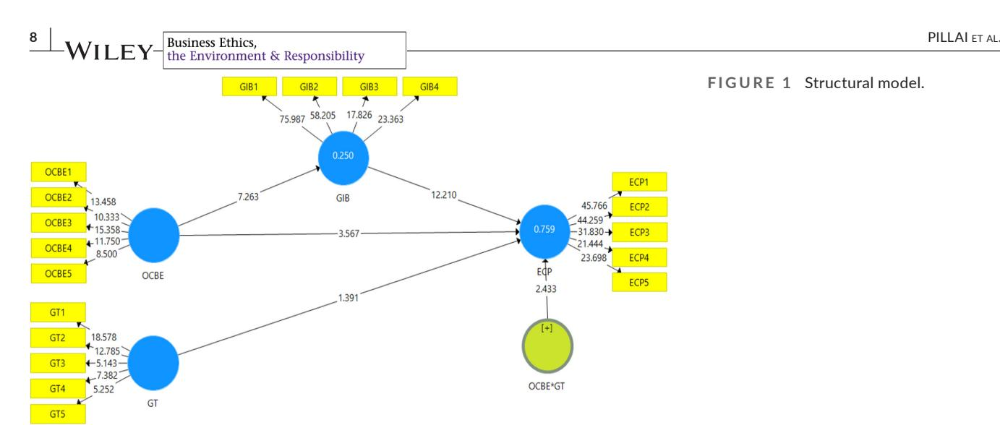
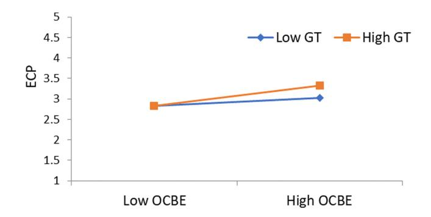

<!-- A3.R77 | source: papers_json/A3.R77/ -->

## **ORIGINAL ARTICLE**

## **Assessing the influence of organisational citizenship behaviour ** **towards environment on economic cost performance in UAE ** **hotels**

**Rekha** **Pillai****[1](#page-0-0)** |** Aminul** **Islam****[2,3](#page-0-1)** |** Parul** **Kumar****[4](#page-0-2)** |** Hamza** **Almustafa****[5](#page-0-3)**

## **Correspondence**

Parul Kumar, School of Banking, Financial Services and Insurance, Delhi Skill and Entrepreneurship University, New Delhi, India.

Email:[ parul.kumar@dseu.ac.in](mailto:parul.kumar@dseu.ac.in)

## **Abstract**

Organisational citizenship behaviour towards the environment (OCBE) aids in both environmental protection and in harnessing sustainable competitive organisational advantage. This study proposed a conceptual research model which investigated managerial perceptions of the relationship between OCBE and economic cost performance (ECP) in the UAE hospitality sector, with green innovative behaviour (GIB) mediating and green training moderating the relationship. Drawing on the theory of planned behaviour and abilities motivation opportunity theory, the study administered 479 structured questionnaires to hotel managers in the UAE using purposive and snowball sampling techniques. Partial least squares structural equation modelling was applied to test the hypotheses in SmartPLS3.3. Findings showed that OCBE had a direct and significant impact on ECP, with GIB emerging both as a direct and mediating predictor. Additionally, green training directly and significantly moderated the OCBE–cost performance relationship. These results evince the integration of sustainable philosophies with innovative mindsets to encourage green innovative endeavours among hotel managers.

## **KEYWORDS**

economic cost performance, green innovative behaviour, green training, organisational citizenship behaviour towards environment

## **1 ** |** INTRODUCTION**

Formal management systems, technologies and activities seldom decide the successful greening of organisations. Instead, it is often the discretionary pro-environment initiatives, such as organisational citizenship behaviour towards environment (OCBE), taken by individuals within the organisation that have a profound impact on the organisational vision of enhanced environmental performance (Boiral & Paillé, [2012](#page-11-0)). OCBE is important for a corporate vision of substantially enhancing environmental performance apart from the conventional outlook of improving financial performance (Khan et al., [2021)](#page-12-0). An imperative for corporate greening, OCBE is an informal and voluntary environmentally friendly behaviour exhibited

by individuals in the form of energy conservation, initiating and assisting colleagues in environment-friendly practices and active participation in eco-civic activities (Paillé et al., [2016)](#page-13-0). The inability to incorporate voluntary behaviours such as OCBE into formal job roles (Raineri et al., [2022)](#page-13-1), the invisible costs associated with OCBE (Ture & Ganesh, [2014](#page-14-0)) and its inherent potential to neutralise deficiencies and incompetencies in formal systems and practices, all call for further understanding of the integrated networks encapsulating this behaviour (Ramus & Steger, [2000)](#page-13-2).

The whole concept of OCBE holds a significant status in the UAE hospitality sector for myriad reasons. Firstly, the country's hospitality sector is destined to expand by 25% by 2030, adding an extra 48,000 rooms to the region's 200,000 key portfolio (Saleem, [2022)](#page-13-3).

> ^1^ Faculty of Business and Law, The British University in Dubai, Dubai, UAE

> ^2^ Faculty of Business and Communication, Universiti Malaysia Perlis, Arau, Malaysia College of Business Administration,

> Prince Mohammad Bin Fahd University, Saudi Arabia

> ^4^ School of Banking, Financial Services and Insurance, Delhi Skill and Entrepreneurship University, New Delhi, India

> ^5^ Department of Banking and Financial Sciences, Business School, The Hashemite University, Zarka, Jordan

<!-- page 2 -->

Although the hospitality sector generates substantial benefits for the UAE's GDP, aggravated environmental costs due to unfavourable weather conditions necessitate very high energy consumption, weighing negatively on the sustainability index. Secondly, the concerns raised on the eco-friendly aspect embedded in these sectors highlight the necessity for sustainable practices (Blázquez-Salom et al., [2019](#page-11-1)) which can reduce the energy cost by up to 20% (Knightfrank, [2019)](#page-12-1). Thirdly, the UAE is among the world's largest waste generators, producing more than 9.2 million tonnes of waste as well as being a major per capita emitter of greenhouses (Takshe et al., [2023)](#page-14-1).

Besides, Gartenberg et al. ([2019)](#page-12-2) confirm that, while the research arena is saturated with employee's OCBE, managers' OCBE needs to be further explored. Agreeing to the former claims, we further predict a strong positive association between managers' purpose intentions and organisational performance. The pertinence and frequency of managers' OCBE compared with non-managers was initially documented by Yaffe and Kark ([2011](#page-14-2)), who verified that sustainable behaviour was mostly being initiated by managers. In the hospitality sector, this trend is more distinct due to heightened environmental regulations and market scrutiny. This has raised managers' awareness of balancing scarce resources, environmental sustenance, cumbersome litigation and company profitability (Chan et al., [2014)](#page-11-2), all to remain competitive while reducing costs. In addition, Farnek ([2022)](#page-11-3) stipulates technology-driven hotels that guarantee value for money has further pressured managers to exploit opportunities that present credible sustainable programmes while striving for cost-efficiency as their fundamental vision. To complement the former, Chan et al. ([2014](#page-11-2)) identifies the pressing need to investigate managerial attitudes towards environmental programmes against the backdrop of elevated environmental concerns. This is because the efficiency and effectiveness of any environmentally friendly behaviour are under the managers' purview and authority (Lasrado & Zakaria, [2020)](#page-12-3) as they ultimately oversee the introduction and execution of these initiatives.

These proactive approaches such as managers' OCBE inevitably lead to the market-led dimension of GIB, which focuses on product and service innovations, thus increasing success in the form of enhanced organisational performance and competitive advantage (Pham et al., [2019](#page-13-4)). Naqshbandi and Kaur ([2013](#page-13-5)) claim that OCBE facilitates the introduction of an innovative paradigm which gradually helps an organisation acclimatise to uncertain environmental conditions. More specifically, GIB acts as a survival mantra for the hospitality sector (Lee & Hyun, [2016)](#page-12-4) because hospitality personnel are consistently encouraged to demonstrate such behaviours in deriving economic cost performance (ECP) or cost advantage (Khan et al., [2021](#page-12-0)). These behaviours include adopting unique practices that streamline and redesign production processes, practicing recycling, utilising sustainable raw materials, reducing waste disposal costs and lowering regulatory and product buy-back costs (Christmann, [2000](#page-11-4)).

The current study further proposes that green training (GT) and development programmes on environmental issues can moderate and catalyse OCBE-generated GIB by guiding people to think more

creatively, identify contingent environmental issues, enhance adaptive capacity and learn advanced techniques of resource and waste management (Jabbour, [2015](#page-12-5)). Additionally, Saeed et al. [(2019)](#page-13-6) claim that GT outweighs other monetary and non-monetary incentives in impacting environmentally friendly behaviour like OCBE.

Nonetheless, researchers highlight the inconsistency and fragmented knowledge of managers' perceptions of the OCBE-GIB-ECP pathway, particularly in the UAE hospitality sector. Prior literature to date tends to factor in ideas related to precedents of OCBE among employees (Kim, [2022;](#page-12-6) Pham et al., [2018](#page-13-7)) and students (Meyer & Warren, [2021;](#page-12-7) Takshe et al., [2023](#page-14-1)), leadership impact on OCBE (Mi et al., [2019](#page-13-8); Nie et al.,[ 2023](#page-13-9)) or managers' ratings of employees on certain green dimensions (Aboramadan et al., [2022](#page-10-0); Al-Hawari et al., [2021;](#page-11-5) Tuan, [2019](#page-14-3)). Limited focus is given to managers' environmental behaviours as a precursor to corporate greening especially in the UAE (Takshe et al., [2023](#page-14-1)), which warrants further research (Mi et al., [2019](#page-13-8)).

The present study has examined OCBE, GIB, GT and ECP relationships from the theoretical lens of the theory of planned behaviour (TPB (Ajzen, [1985,](#page-11-6) [1991](#page-11-7)) and abilities motivation opportunity (AMO) theory (Appelbaum et al., [2000;](#page-11-8) Bailey, [1993](#page-11-9)). The former theory has dominated behaviour research for the past decades (Cop et al., [2020](#page-11-10)) and refers to behavioural intentions (such as OCBE) that lead to actual intentions (such as GIB) depending on the extent of control and interest that a person holds over their behaviour. The latter theory proposes that practices such as OCBE and GT enhance individual capabilities thus motivating them to engage in GIB, which translates into enhanced corporate performance in terms of waste reduction and profits (Rizvi & Garg, [2020)](#page-13-10). On one hand, a set of studies have employed the TPB to underpin OCBE determinants (Boiral et al., [2015;](#page-11-11) Chan et al., [2014;](#page-11-2) Takshe et al., [2023)](#page-14-1), while other schools of thought (Khan et al., [2022;](#page-12-8) Priyankara et al., [2018](#page-13-11)) have applied the AMO theory to justify OCBE and related antecedents as well as performance outcomes.

In this study, we had three main objectives. First, we aimed to explore the theories underpinning unexplored aspects of the OCBE-ECP relationship, the mediating effects of GIB on the OCBE-ECP relationship and the moderating effects of GT on the overall model. Second, we aimed to empirically confirm the existence, or not, of significant relationships in the OCBE-ECP model with GIB and GT as mediators and moderators respectively. Finally, we aimed to identify theoretical and managerial implications which can serve as recommendations to enhance the OCBE-GIB-ECP nexus.

The study contributes to the sustainability domain in several ways. The prime contribution of this paper lies in the application of the mediated-moderated model to extend empirical insights into how OCBE translates to GIB which in turn leads to enhanced organisational performance in terms of cost minimisation. Another contribution lies in exploring the relevance of GT as a moderator, which can make the OCBE-GIB-ECP pathway more pronounced. On another note, prior studies, especially in the UAE (Meyer & Warren, [2021](#page-12-7); Takshe et al., [2023](#page-14-1)), have only examined OCBE determinants among undergraduate university students and Emirati

<!-- page 3 -->

students, respectively, leaving a major demographic gap in the environmental behavioural literature. We contribute to the OBCE realm by being the first to the best of our knowledge to extend this study to the hospitality sector, incorporating managers' perceptions, in response to Takshe et al.'s ([2023)](#page-14-1) recommendation to include specific groups which have a key role in protecting the environment in the UAE. By addressing this gap, our study will also add valuable insights and offer direction to relevant parties by examining the interplay between various behaviours (OCBE and GIB) in achieving a tangible output (ECP), bearing in mind the recent COP28 meeting and heightened interest towards sustainable actions in the UAE. Lastly, this is one of the few empirical studies to the best of our knowledge in the UAE context which provides theoretical support for the OCBE-GIB-ECP relationship by applying the TPB (Ajzen, [1985)](#page-11-6) and AMO theory (Appelbaum et al., [2000](#page-11-8); Bailey, [1993)](#page-11-9) to validate these complex pathways.

The rest of the paper is structured as follows: the elaboration of the underpinning theory setting the stage for hypotheses formulation, followed by the discussion of methodology, presentation of findings and a discussion and conclusion outlining the implications, limitations and setting recommendations for future research.

## **2 ** |** LITERATURE REVIEW**

## **2.1 ** |** Theoretical framework**

While both TPB (Ajzen, [1985](#page-11-6)) and AMO (Appelbaum et al., [2000](#page-11-8)) are frameworks employed to decipher human behaviour in varied contexts (Fawehinmi et al., [2023)](#page-11-12), TPB confines its focus on the inner cognitive dimensions and behavioural aspects of individuals' such as attitudes, subjective norms and perceived behavioural control. On the other hand, AMO theory encompasses both internal (abilities and motivation) and external factors (opportunities) as determinants of individuals' behaviour. Delving deeper into the history of TPB, it is important to understand that the former takes it roots from the theory of reasoned action (Fishbein & Ajzen, [1975)](#page-12-9) which encompasses 'attitudinal' (one's attitude towards a specific task), 'social influence' (perception of what and how others rate the importance of the task executed) and 'intention' (attitude towards a task and being mindful of the consequences) as variables predicting individual behaviour (Madden et al., [1992)](#page-12-10). The theory of reasoned action (TORA) also cautioned that behavioural intention can act as an accurate influencer only with the existence of boundary conditions, namely '(1) the intention and behavior measures correspond in specificity of action, target, context and timeframe; (2) intention does not change in the interval between assessment of behavioral intention and assessment of behavior; and (3) the behavior in question is under the actor's volitional control; that is, the actor can decide at will to perform or not to perform the behavior' (as cited in Netemeyer et al., [1991,](#page-13-12) p. 88). Here is where Ajzen ([1985)](#page-11-6) noticed a deficiency in TORA's boundary factors and incorporated 'perceived behavioral control' (one's belief about the relative simplicity or difficulty of performing

a behaviour in the midst of external factors, namely authority conferred, colleagues support, resources and internal factors such as skill and self-control) as an additional boundary condition to increase the precision of impact of behavioural intentions on actual behaviour. TPB (Ajzen, [1985)](#page-11-6) is therefore only an extension of the TORA (Fishbein & Ajzen, [1975)](#page-12-9) and is adopted in this study as it holds healthier and robust explanatory power in assessing behaviours of managers who hold a certain degree of perceived behavioural control. Moreover, scholars (Liska, [1984;](#page-12-11) Sheppard et al., [1988](#page-14-4)) have cautioned TORA's weak predicting power when behaviours are more goal oriented (the main goal being ECP in this paper) and suggests TPB as a perfect substitute as it examines the individual's capability of exercising control over one's behaviour apart from solely considering behavioural intentions as an antecedent of human behaviour (see also Netemeyer et al., [1991](#page-13-12)).

Another theory employed in this study is the AMO theory (Appelbaum et al., [2000](#page-11-8)) which emphasises the relevance and integration of individual ability (skills, competencies and proficiencies), motivation (intrinsic or extrinsic force directing a behaviour) and opportunities (external forces restricting or equipping one to perform a task) to predict one's performance behaviour (Bos-Nehles et al., [2017)](#page-11-13).

This paper assigns AMO theory to underpin the OCBE-ECP association and moderating effects of GT on the OCBE-ECP relationship. However, the TPB is chosen as the right theoretical fit to increase the explanatory power of the mediating effects of IWB on the OCBE-ECP relationship. Although AMO and TPB are distinct and independent theoretical frameworks, there is evidence of commonality in the constituting elements and we urge the integration of both these theories to provide a contextual base and comprehensive understanding of human behaviour and corresponding behavioural outcomes.

## **2.2 ** |** Hypotheses development**

### 2.2.1 | Organisational citizenship behaviour towards environment–economic cost performance

OCBE can be defined as 'individual and discretionary social behaviours that are not explicitly recognised by the formal reward system and that contribute to a more effective environmental management by organisations' (Boiral, [2009](#page-11-14), p. 223). The present study claims that OCBE forms a part of organisational citizenship behaviour towards the organisation which refers to efforts directed towards the organisation by establishing conscientious and civic virtues (Williams & Anderson, [1991](#page-14-5)) towards the environment by engaging in waste recycling, suggesting energy efficiency enhancement processes and forming a green committee (Ramus & Steger, [2000](#page-13-2)). Boiral and Paillé [(2012)](#page-11-0) categorise these activities into employee-driven ecoinitiatives and eco-civic engagement. They use an additional category, termed eco-helping, which connotes mutual colleague assistance on environmental concerns to reflect refined environmentally friendly

<!-- page 4 -->

behaviour. Prior literature has explicitly documented the benefits of OCBE as behaviours that enhance the corporate environment, social and governance domains (Yuriev et al., [2020](#page-14-6)). The current study is primarily concerned with exploring the economic performance of organisations with a granular emphasis on cost reduction. The relationship between OCBE and cost reduction is supported by Porter's ([1980](#page-13-13)) competitive strategy framework which highlights the cost benefits accruing from environmentally sound practices such as redesigning production processes to mitigate pollution, recycling and developing environmentally friendly innovations, all of which decrease production costs by reducing both inputs and waste management costs (Hart, [1995)](#page-12-12).

Prior research (Paauwe, [2009](#page-13-14)) has applied AMO theory, which is the assimilation of individual psychology as the root cause of an outcome, to investigate organisational psychology. In the current study, the outcome is the ECP element. More specifically, the validity of AMO theory in examining the effect of voluntary behaviours in enhancing corporate performance has been proposed by Appelbaum et al. ([2000](#page-11-8)), while Bos-Nehles et al. ([2017](#page-11-13)) emphasised the applicability of the theory when managerial perspectives are considered. To align the theoretical base with the OCBE-ECP nexus with respect to abilities, we argue that the OCBE-oriented managers are equipped with the required technical skills, knowledge, and a positive psychological capital (Afshar Jahanshahi et al., [2020](#page-11-15)) to advance environmental stewardship within the organisation (Greenwood et al., [2012)](#page-12-13). With regard to motivation, their efforts and contributions are voluntary and go beyond the formal reward and performance evaluation systems related to their job. Norton et al. ([2015](#page-13-15)) postulate that such self-motivated voluntary behaviours aid in resource conservation and cost mitigation. In terms of opportunity, especially in the UAE hospitality sector, hotel managers are at the forefront in harnessing opportunities such as knowledge sharing and innovative practices in order to be leading contributors to the UAE Net Zero 2050 initiatives. Their opportunities for seamless vertical and horizontal interaction with other departmental heads within the organisation position them to ensure all-round awareness of environment-related issues at every level of the organisation (Greenwood et al., [2012](#page-12-13)). This, in turn, translates into operational efficiency at all levels, leading to overall cost efficiency.

The importance of investigating the OCBE–economic performance relationship is well recognised in the hospitality sector because the sector is a high-energy consumer and waste generator while transforming itself into a consumption-based business (Kim, [2022)](#page-12-6). However, despite the growing pertinence of environmental issues in the hospitality sector, prior environmental management research has failed to identify the relevance of voluntary green involvement of managers (Boiral & Paillé, [2012)](#page-11-0) as a precursor to organisational cost efficiency. Former studies on OCBE in the hospitality sector have either focused on the determinants of OCBE (Pham et al., [2019;](#page-13-4) Tuan, [2019](#page-14-3); Zhao & Zhou, [2021)](#page-14-7), on OCBE as a moderator (Azam et al., [2022)](#page-11-16) or on the environmental expectation–OCBE nexus (Elshaer et al., [2022](#page-11-17)). Meanwhile, Khan., et.al ([2021,](#page-12-0) p.223) investigated the OCBE triple-bottom-line effect (which incorporates

economic, social, and environmental performance), but with a focus on the manufacturing industry which has a completely different business model from the hospitality sector.

To fill this gap in the literature, we argue that managers engaging in OCBE formulate and share an ideal future vision that aligns with their organisation's goals. Their existence helps to rationalise the organisation's environmental behaviour in the form of green practices from an internal context (Zhang et al., [2015](#page-14-8)). For example, they minimise energy consumption by reusing paper, adopting dualsided printing, switching off unwanted lights and reducing insurance expenses (Boiral et al., [2015](#page-11-11)). Also, a high sense of OCBE among managers leads to faster recognition of environmental concerns and urgencies while implementing relevant actions and immunising organisations to field uncertainties. This is done through participation in environment-related events; consistent innovations and elevated sensitivity; developing environmental awareness among colleagues; and exchanging relevant environmental information through open discussions (Ardoin et al., [2015](#page-11-18); Norton et al., [2017](#page-13-16)). These actions inevitably lead to cost reduction owing to careful material purchasing, decreased energy consumption, avoidance of regulatory fines, and decreased waste disposal fees (Malik et al., [2021)](#page-12-14). The information given above leads to the following hypothesis:

**H1. **OCBE has a direct impact on firms' ECP.

### 2.2.2 | Green innovative behaviour as a mediator

Green innovative behaviour (GIB) is defined as an employee's tendency to develop and present green innovative ideas, as well as to promote and implement unique green ideas (Lambriex-Schmitz et al., [2020)](#page-12-15), which are beneficial for the organisation and may be used to solve problems. In the context of green management, GIB denotes the generation of green ideas and their promotion and operationalisation (Aboramadan, [2022](#page-10-1)). The current study examined the role of GIB as a mediator which strengthened the link between OCBE and ECP. This decision was a response to Ren et al. ([2018](#page-13-17)) who specifically encouraged and call for the inclusion of mediating variables (e.g. GIB) through which favourable environmental behaviour (e.g. OCBE) can produce sustainable long-term outcomes (e.g. ECP). Furthermore, previous research has attested the relevance of GIB in the hospitality sector in terms of generating novel and creative solutions for product, process or service improvement, while ensuring the optimum utilisation of scarce resources (Hon, [2011](#page-12-16)). This is because hotels generate deleterious environmental impacts which can be mitigated only by integrating sustainable paradigms with innovative cognitions (Merli et al., [2019)](#page-12-17) to ensure sustainable hotel performance, as well as to signal entry barriers to potential competitors.

Research to date has identified a gap in providing a theoretical base to underpin the mediating influence that GIB has on the OCBE–economic cost efficiency relationship. The current paper is the first to assign the TPB (Ajzen, [1985](#page-11-6), [1991](#page-11-7)) to enhance the explanatory power of GIB as a mediator between OCBE–economic

<!-- page 5 -->

cost relationship nexus. Planned behaviour theory has been extensively used in exploring environmental psychology and green behaviour (Boiral et al., [2015](#page-11-11)), precisely considering the intention and extent of subjective control that individuals, such as managers, have in their decision-making power. As the TPB postulates that individual intention is the key determinant of any behaviour, here we argue that managers' intention to engage in sustainable practices and relentless endeavours to assist others in performing sustainable actions actually results in sustainable behaviour (Neessen et al., [2021](#page-13-18)) such as OCBE-generated GIB. Additionally, managers have authority, control over their actions, ability and power to ask for colleague support apart from the self-will and choice to engage in a sustainable behaviour, namely OCBE. This then develops into a specific behavioural pattern in the exploration and adoption of innovative (creative) behaviour (Hanaysha, [2022)](#page-12-18) to achieve some tangible output (which in this paper is ECP; Otieno et al., [2016)](#page-13-19).

Previous research (Li, [2022;](#page-12-19) Xerri & Brunetto, [2013)](#page-14-9) provides evidence that employees' self-cognition of their citizenship behaviours (here OCBE) has a direct impact on their creative innovative behaviour. More recently, Fawehinmi et al. ([2023)](#page-11-12) emphasised that when individuals believe and experience the ease of performing green behaviour due to their perceived behavioural control, the evidence of actual green behaviour (which is GIB in our paper) is more pronounced. In contrast, Bammens ([2016)](#page-11-19) identified manager-initiated organisational care as an antecedent to GIB (see also Abukhait & Pillai, [2017](#page-11-20)). The current study considers OCBE as a manager's perception of going green due to their concern for ecological safety, which in turn motivates and inspires them to demonstrate GIB (Norton et al., [2017](#page-13-16)). Here, we argue that GIB takes place in the form of 'in-bound open innovation' which implies a goal-oriented knowledge inflow from external knowledge sources or technological explorations that leads to technological advancements (Naqshbandi et al., [2016)](#page-13-20). The external knowledge here refers to the information amassed by managers while volunteering to improve sustainable environmental actions and while participating in corporate sustainable events programmes arranged by the organisation (Khan et al., [2021)](#page-12-0), all of which are constituents of OCBE. This is because managers in the hospitality sector are abreast of customer requirements and thus initiate innovative behaviour. We also contend that OCBE acts as psychological empowerment to a manager because it facilitates the integration of resolute values which compels them to engage in GIB solely because this behaviour attests to their unique identity and their values for nature, rather than because of any obligation or potential monetary benefits (Quratulain et al., [2020)](#page-13-21). We also assume that OCBE-oriented managers strive to include green practices in their actions and strategies while creating a culture that instils GIB in themselves and other employees within the organisation (Bani-Melhem et al., [2022)](#page-11-21). These innovative work behaviours will, in turn, improve operations and overall process effectiveness which immunises organisations from impending environmental changes (Podsakoff et al., [1997)](#page-13-22) and gradually contributes to achievement of goals such as enhanced corporate performance

(Appelbaum et al., [2000)](#page-11-8) by curtailing environment-related costs. To prove the former, Noerchoidah et al. ([2020](#page-13-23)) affirms that GIB is mandatory in the hospitality sector for performance improvement by focusing on creativity in methods, process, services or products. The GIB emanating from OCBE (Al-Hawari et al., [2021)](#page-11-5) enhances the goal of economic performance by eliminating unnecessary cost (Bello, [2020](#page-11-22)), reduces the firm's environmental costs by augmenting its image in the environmental protection arena (Hassan et al., [2023](#page-12-20)), reduces non-value adding activities and avoids waste and regulatory fines.

Prior research in the hospitality domain has considered various leadership models (Aboramadan & Karatepe, [2021;](#page-10-2) Khan et al., [2022](#page-12-8); Rahimizhian & Irani, [2021](#page-13-24)), organisational support and expectancy (Alzyoud et al., [2017)](#page-11-23), organisational justice and knowledge sharing (Noerchoidah et al., [2020)](#page-13-23) and co-worker support and work stress (Bani-Melhem et al., [2018](#page-11-24)) as drivers of GIB in developed countries, with limited research on developing countries (Mzembe et al., [2019](#page-13-25); Tuan, [2021](#page-14-10)) or on the potential mediating impact of GIB in the OCBE-ECP nexus. Bos-Nehles et al. [(2017)](#page-11-13) further confirm the inconsistency and fragmented knowledge of GIB up until now. Moreover, improving knowledge of the UAE hospitality sector is particularly important because of the substantial hospitality-related expansion plans that are in the pipeline. The second hypothesis to be tested for this complex pathway is, therefore, as follows:

**H2. **GIB mediates the relationship of OCBE with economic performance.

### 2.2.3 | Green training as a moderator

Green training of employees on environmental aspects is a precursor for enhancing environmental performance (Haddock-Millar et al., [2015)](#page-12-21) and accelerating the extent of progress shown in environmental management in firms (Jabbour, [2015)](#page-12-5). GT refers to the transfer of environmental knowledge, policies and practices to enhance the green attitude of individuals (Jabbour et al., [2010](#page-12-22)) and to achieve efficiency and effectiveness when performing a range of activities. ISO 14001 specifies that GT 'ensures that employees at all levels of the organisation understand the goals of the environmental management system (EMS) and the ways their job activities impact the environment and the achievement of EMS goals' (Roig, [1998)](#page-13-26). Moreover, such training equips individuals with green competence, thereby encouraging and motivating them to engage in various dimensions of OCBE (Pham et al., [2018)](#page-13-7). The competence gained and OCBE engagement leads to development of GIB which augments economic performance through cost reduction (Daily et al., [2012;](#page-11-25) Yong et al., [2020)](#page-14-11).

The moderating effect of GT is viewed through the lens of AMO theory (Bailey, [1993)](#page-11-9) which propounds training and development activities as ability, motivation and opportunity enhancers that ultimately contribute to enhanced organisational performance in terms of profitability and productivity (Bos-Nehles et al., [2017)](#page-11-13).

<!-- page 6 -->

Furthermore, Purcell et al. [(2003](#page-13-27)) conclude that the AMO model explains the entire behavioural process inherent in developing organisational initiatives (e.g. GT) leading to organisational performance (e.g. cost reduction). Building on the AMO theory, we posit the existence of an interaction between various organisational practices such as GT that can both create opportunities and enhance the abilities of managers in an organisation (Blumberg & Pringle, [1982)](#page-11-26). The training equips them with the required skills, knowledge and competency, thereby self-motivating them to engage voluntarily in OCBE to showcase their contribution to the environment (Chou, [2014)](#page-11-27). These proficient and technically sound managers are further motivated and inspired to engage in GIB such as switching to energy-efficient production, developing appropriate waste management techniques and exploring renewable sources of energy (Roy & Khastagir, [2016)](#page-13-28). This aids in minimising the carbon footprint and ensuring process efficiency by eliminating wastage (Srivastava & Shree, [2019](#page-14-12)).

The relevance of GT is high in the hospitality sector, particularly hotels, because it educates managers on efficient and effective resource consumption (Gull & Rehman, [2022)](#page-12-23) such as water and energy conservation in routine operations and waste minimisation (Abuelhassan & Elsayed, [2020](#page-11-28)), which lead to reduced operational cost. Nonetheless, there are few studies exploring the effect of GT in the hospitality sector (Abuelhassan & Elsayed, [2020](#page-11-28); Haddock-Millar et al., [2015;](#page-12-21) Pham et al., [2019;](#page-13-4) Srivastava & Shree, [2019](#page-14-12)), with no studies to date investigating the moderating effects of the variable. We suggest that environmentally cognisant managers are prone to experiencing a sense of work meaningfulness by considering organisational green practices (GT), consequently leading to GIB (Al-Hawari et al., [2021](#page-11-5)), all of which lead to favourable ECP. Therefore, we formulated the following hypothesis:

**H3. **GT positively moderates the direct effect of OCBE on economic performance (cost reduction) through innovative work behaviour.

## **3 ** |** MATERIALS AND METHODS**

## **3.1 ** |** Data gathering process**

The objective of the study was to assess the influence of OCBE on ECP with GT as moderator and GIB as mediator. A quantitative research methodology was employed with a structured questionnaire as the data collection tool. The sample unit of the study was limited to managers employed in three, four and five-star hotels in the UAE. This sector was selected because of its commitment to implementing green practices (Abualigah et al., [2022;](#page-11-29) Al-Hawari et al., [2021](#page-11-5)), due to rising concerns from eco-friendly customers. Another reason for focusing on the managers in the above hotel categories was that the hotels have clear-cut policies, procedures and green standards in their embedded values.

A mix of random and snowball sampling techniques was used for data collection from the managers and senior managers of UAE

three- to five-star hotels. Initially, five senior managers from five leading hotel groups known to the authors, based in Dubai, Ajman, and Abu Dhabi in the UAE, were asked to fill in the questionnaire. This exercise was to assess the content and face validity of the data collection tool and to minimise response bias.

After assessing the content and face validity, managers were asked to provide references to the other prospective respondents in UAE hotels. To increase the response rate, the structured questionnaire was also posted on social media platforms, namely LinkedIn, WhatsApp groups, and the researchers' personal contacts. The survey emphasised that participation by respondents was voluntary and assured them that responses would remain confidential and anonymous. They were also free to withdraw at any point in time. A total of 490 managers completed the questionnaire. Following the process of data cleaning, 479 (92.3%) valid responses were retained. The whole data collection process took 2 months from October 2022 to December 2022. A priori sample size adequacy was ensured by using the G* Power software, which suggested a minimum sample size of 83 (effect size 0.15, alpha level 0.05 and statistical power 80%). Using post hoc analysis, the sample size of 479 with 0.15 as the effect size and an alpha level of 0.05, the sample was able to achieve 99.95% statistical power.

## **3.2 ** |** Measures**

The structured questionnaire consisted of three sections. The first section asked about the relevance of the survey for the respondents. As the questionnaire was also shared on social media, check/filter questions were embedded, that is, whether the respondent was based in the UAE, followed by whether he/she was presently working as manager or senior manager in a three- to five-star hotel. Once these check/filter questions were selected as yes, only then was the respondent asked to complete the survey. This process helped to limit the responses from non-target respondents. The second part of the survey covered statements related to OCBE, GT and ECP (see Annexure [1](#page-14-13)). The last section was related to the the demographic profile of the respondent, that is, designation (manager or senior manager), gender, age in years, and total years of work experience. The constructs employed in the questionnaire were measured using items extracted and adapted from the established instruments available in the existing literature. All the items were measured on a 5 point Likert scale ranging from strongly disagree to strongly agree.

*Organisational citizenship behaviour towards environment* (*OCBE*): The study adopted the seven-item scale developed by Boiral and Paillé [(2012](#page-11-0)) which was also adopted by Yong et al. ([2019)](#page-14-14). A sample statement was 'I spontaneously give my time to help my colleagues take the environment into account in everything they do at work?'

*Green training* (*GT*): The present study adopted the five-item scale developed by Daily et al. [(2012](#page-11-25)) which was also employed by Pham et al. ([2018](#page-13-7)). A sample item was 'The organisation provides adequate amount of training in environmental issues is provided for managers'.

<!-- page 7 -->

*Economic cost performance* (*ECP*): A five-item scale adopted by Yong et al. ([2019](#page-14-14)), which was also employed by Malik et al. ([2021](#page-12-14)), was used to assess the ECP. A sample item was 'Costs for materials purchasing has decreased'.

As a standard scale was used with respect to different constructs, we ensured that the wording of the questions was not leading or directive, thus minimising response bias.

## **3.3 ** |** Data analysis techniques**

The initial step in the data analysis was to assess the model for the absence of common method bias. In the present study, this was done using the bivariate correlations between the constructs and the variance inflation factor (VIF). The bivariate correlations were not found to be excessively high (<0.85; Lowry & Gaskin, [2014)](#page-12-26) and all the VIF values were less than 3.3 (Hew & Kadir, [2016)](#page-12-27) as shown in Table [1.](#page-6-0) This implied the absence of common method bias in the model.

A variance-based structural equation model (SEM), that is, partial least square (PLS), was used to test the study hypotheses (Leong et al., [2019)](#page-12-28) with SmartPLS 3.3 (Ringle et al., [2015)](#page-13-29). The PLS algorithm was used to assess the reliability and validity of the measurement model, while the bootstrapping technique was used to test the hypotheses of the structural model. PLS Predict was used to estimate the out-of-sample predictive power of the model.

## **4 ** |** RESULTS**

In the overall sample of 479 hotel managers, 75% were men and 25% were women. In terms of age, 45% of managers were in the age group of 35–40 years, followed by 27% in 40–45 years group and 20% in 45–50 years group. Of all the managers surveyed, 60% had 5–10 years of experience and 36% had 10–15 years of experience.

The procedure suggested by Sarstedt et al. ([2022)](#page-13-30) was adopted to evaluate the measurement and structural model. The fit of the proposed model was tested with SRMR estimation model statistics. The model fit value of 0.096 was clearly below the threshold value of 0.8. Most of the indicator loadings were above the threshold of 0.708 (Hair et al., [2019](#page-12-29)) as shown in Annexure [2](#page-14-13). Although few of

Abbreviations: GIB, green innovative behaviour; GT, green training; OCBE, Organisational citizenship behaviour towards environment.

the loadings were less than the threshold, they were retained in the model because of negligible validity and reliability issues. The values of composite reliability (CR) and rho_A were greater than 0.70, confirming the reliability of the indicators, while the average variance extracted (AVE) confirmed the presence of convergent validity, with all constructs having an AVE >0.50 (Hair et al., [2019](#page-12-29)). The discriminant validity of the constructs was evaluated using the Heterotrait– Monotrait (HTMT) criterion. All the HTMT ratios were below the critical value of 0.90 (Henseler et al., [2014)](#page-12-30) as shown in Annexure [3](#page-14-13).

The bootstrapping technique was conducted to test the hypotheses with 10,000 subsamples, with the corresponding 95% bias-correlated and accelerated confidence interval (Sarstedt et al., [2022)](#page-13-30). Examination of the VIF was also part of the structural model assessment to check for possible collinearity issues. The inner VIFs were found to be below the more liberal threshold of 5 (Hair et al., [2019)](#page-12-29). Collinearity was thus at a level, which allowed comparison and interpretation of the size of the structural model coefficients. The proposed model entailed relatively high levels of the endogenous construct's explained variance (i.e. *R*^2^ values; Figure [1)](#page-7-0). For the key target construct, OCBE, the model explained more than 50% of the variance (*R*^2^= 0.759). The bootstrapping results (Figure [1;](#page-7-0) Table [2)](#page-7-1) indicated that the path coefficients were significant.

It was found that OCBE had a significant positive direct effect on ECP (*β*= 0.171; [0.082–0.425]). Also, the mediation effect of GIB on the relationship between OCBE and ECP was positive and significant (*β*= 0.327; [0.230–0.425]). Because both direct and indirect effects were significant, the presence of partial mediation by GIB was confirmed (Zhao et al., [2010)](#page-14-15). Hence, H1 and H2 were supported by the results of the model. The interaction term (OCBE*GT) was significant in affecting the ECP, thus confirming the presence of GT as a significant moderator.

Figure [2 ](#page-7-2)represents the simple slope analysis of the moderating effect of GT on the relationship between OCBE and ECP (*β*= 0.077). The GT strengthened the positive relationship between OCBE and ECP. In other words, the relationship between OCBE and ECP was positively moderated by GT. Hence, we failed to reject H3, that is, GT positively moderates the direct effect of OCBE on economic performance (cost reduction) through innovative work behaviour.

To support the results and identify managerial implications, we ran PLS Predict on ECP to assess the out-of-sample predictive power of the proposed model (Shmueli et al., [2016](#page-14-16),[ 2019)](#page-14-17). The root mean square error (RMSE) values of the PLS-SEM were smaller than the RMSE of the naive benchmark, that is the linear model (LM; Table [3](#page-7-3)). Also, the positive *Q*^2^ Predict indicated that the PLS-SEM predictions were superior, and thus the model had high predictive power (Table [3)](#page-7-3).

## **5 ** |** DISCUSSION**

OCBE and associated variables such as GT and GIB hold vital importance, especially with the growing prominence of environmental, social, and governance concerns in the hospitality sector. To address the evident vacuum of aforesaid concepts in the hospitality sector,

<!-- page 8 -->

***FIGURE 1** Structural model.*

***Hypo** **Path** **Coefficient** **T statistics** **BC CI (L)** **BC CI (U)** **Result** H1 OCBE -> ECP 0.171[a](#page-7-4) 3.567 0.082 0.266 Fail to reject H2 OCBE -> GIB -> ECP 0.32[7a](#page-7-4) 6.548 0.230 0.425 Fail to reject H3 OCBE*GT -> ECP 0.07[7a](#page-7-4) 2.433 0.027 0.155 Fail to reject*

***TABLE 2** Structural model results.*

Abbreviations: ECP, economic cost performance; GIB, green innovative behaviour; GT, green training; OCBE, Organisational citizenship behaviour towards environment.

> a Significant at 1% level of significance.

***FIGURE 2** Moderating effect of green training.*

this study formulated three hypotheses to test the relationships of the variables on ECP.

The findings demonstrated the acceptance of H1 that OCBE has a direct relationship with ECP. This proves that OCBE enhances cost performance because managers indulging in OCBE constantly encourage, motivate and instil sustainable ideas in the minds of the employees, thereby eliminating non-value-adding activities and waste. These eliminations invariably mitigate operational costs such as transportation and packing costs (Azam et al., [2022](#page-11-16)). The results are in line with Appelbaum et al.'s (2000) AMO theory and the empirical findings by Malik et al. ([2021](#page-12-14)) that OCBE contributed to favourable

cost performance due to managers skills, abilities and opportunities harnessed in undertaking precautionary and value-adding wastemitigating activities from the initiation of a project until its completion. To be more specific, the diligence exhibited by managers engaged in OCBE in maintaining consumables usage within the estimated quantity thus ensuring waste reduction, adopting renewable energy sources to mitigate energy bills and reduce carbon footprint, using renewable materials (especially to replace bitumen used in carpets which will save cost) instead of non-biodegradable materials, and using recycled material inputs for packaging can all add up to effective cost-cutting initiatives (Rodriguez-Fernandez, [2016)](#page-13-31). We also contend that OCBE-oriented managers show a keen interest in clean technology installation and efficient waste recycling techniques, and the accumulated benefits are translated into lower production

<!-- page 9 -->

costs (Sun & Bahizire, [2022)](#page-14-18). These managers also adhere to Global Reporting Initiative (GRI) standards (especially GRI 301 (1, 2 and 3)) which urge and encourage cost-cutting initiatives as a part of enhanced environmental and organisational performance.

The results from testing H2 support the claim that GIB acts as a mediator which strengthens the link between OCBE and ECP. The results confirmed that the inclusion of GIB has a positive effect on producing sustainable outcomes such as cost reduction and accompanying firm performance (Ren et al., [2018)](#page-13-17). We argue that green innovative employee behaviour, developed through voluntary citizenship behaviour towards environment, will facilitate progressive green initiatives. Thus, understanding the relevance of OCBE in driving green behavioural outcomes such as GIB is crucial. The findings are in alignment with the TPB (Ajzen, [1985,](#page-11-6) [1991)](#page-11-7) evidencing that actual behaviour such as GIB is an aftermath of a sustainable intention such as OCBE (Li, [2022;](#page-12-19) Xerri & Brunetto, [2013)](#page-14-9). The culminating effect of GIB and OCBE is a tangible sustainable outcome in the form of enhanced ECP (Otieno et al., [2016](#page-13-19)). This is because managers exhibiting OCBE are curious and have a persistent vision of engaging in environmental sustainability. This may arise from the inherent authority that most managers possess in decision-making, which leads to their self-engagement in OCBE and which metamorphoses gradually into GIB (Akterujjaman et al., [2022](#page-11-30)). This voluntary passion for environmental sustainability motivates and inspires managers to expand their knowledge into innovative behaviours in the form of internally designed waste management technology, sustainable sourcing policies for kitchens, toiletries and cleaning, optimum utilisation of ICT resources to harness opportunities, the generation of state-of-the-art services for customer sustainability (e.g. selfservice kiosks for check-in/out thereby minimising paper usage), designing tour packages without animal exploitation while encouraging afforestation and abolishing single-use plastic. Finally, the present study also proposes that OCBE-generated GIB is the only way forward to meet the Paris Climate Agreement which challenges the hospitality sector to decrease annual greenhouse gas emissions by 90% by 2050 (Wich, [2020)](#page-14-19).

Lastly, H3 investigated the moderating effects of GT on the OCBE-ECP relationship. The findings established a statistically significant influence in the aforesaid nexus. Our results denoted that managers provided with GT were adequately equipped with the skills and information related to hotels' upcoming environmental targets, issues and standards, which encouraged and motivated them to adopt conscious and proactive innovative behaviours to foster sustainable competitive performance (achieving ECP). The findings concur with the AMO theory as GT augments managers' cognitive and critical thinking skills, abilities and knowledge to confront environmental challenges and bolsters awareness of OCBE at workplace inspiring conscious decision-making capabilities in the sphere of environmental practices, all of which foster a culture of environmental stewardship. The results also align with the claims by Abuelhassan and Elsayed ([2020)](#page-11-28); Gull and Rehman ([2022)](#page-12-23); Pham et al. ([2018)](#page-13-7); Roy and Khastagir [(2016)](#page-13-28) and Srivastava and Shree [(2019)](#page-14-12), who elaborate on the myriad benefits accruing from GT in the form of adopting

energy-saving techniques, exploring sustainable energy options and minimising water/resource wastage to achieve cost benefits.

## **5.1 ** |** Theoretical implications**

The key theoretical contribution of our study pertains to the relevance and validity of OCBE, GIB and GT as precursors to ECP, a pathway which has been unexplored to date in behavioural research. We used the TPB and AMO theory to extend the understanding of the formulated model investigating unmapped OCBE-GIB-ECP pathways. Our findings validate prior claims that one behaviour leads to another behaviour (Chan et al., [2014](#page-11-2)). Our results evince the birth of GIB from OCBE, which leads to a positive outcome called enhanced ECP. The study of managers attests to the fact that individuals who have authority and control over their actions are more likely to engage in positive behaviour (Cop et al., [2020)](#page-11-10), and this harnesses sustainability benefits for the organisation. The study responds to Gartenberg et al.'s ([2019](#page-12-2)) call for additional literature on managers' OCBE, by validating their claim that OCBE-oriented managers play a key role in enhancing organisational performance (in our case, in economic cost mitigation). It is worth noting that previous research (Boiral et al., [2015)](#page-11-11) specifically ratified the relevance of OCBE in the effective implementation of ISO 14001, which invariably leads to effective cost mitigation.

Our results offer a better theoretical understanding of how and why OCBE can affect ECP through GIB and GT. We suggest that this is because managers engaging in OCBE, along with the relevant training, apply GIB to find sustainable solutions such as implementation of environmental standards like ISO 14001, which leads to reduced manufacturing and operational costs. The findings also emphasise the relevance of the effective integration of both behavioural (OCBE and GIB) and technological (GT) variables which create improved processes and organisational values (Troisi et al., [2021)](#page-14-20) and culminate in enhanced cost efficiency. Comparatively little research has been done on the interactional effects of managers' values and norms (OCBE) and green practices on organisational performance (Al-Hawari et al., [2021)](#page-11-5). The current study can be perceived as the pioneering work to add OCBE, GIB and GT as antecedents to ECP, especially in the UAE hospitality sector. Thus, our research contributes to a theoretical understanding of how and why OCBE translates into organisational cost mitigation. Furthermore, the mediation– moderation mechanisms act as key pointers in behavioural research which verifies that GIB should be nurtured under GT to translate such green behaviours into tangible outputs in the form of cost reduction. Results confirm that GT is a vital component in motivating the workforce to adopt a proactive environmental attitude and commitment, develop innovative green ideas and execute eco-policies, all of which lead to improved economic performance. These findings notably contribute to the existing literature by rationalising when and under what circumstances the effect of OCBE on ECP is more pronounced. Building on the limited studies emerging from the UAE hospitality sector which delved into leadership aspects and green

<!-- page 10 -->

behaviour (Aboramadan & Karatepe, [2021;](#page-10-2) Abualigah et al., [2022](#page-11-29); Al-Hawari et al., [2021;](#page-11-5) Wood et al., [2021](#page-14-21)), our work is unique in that it incorporates OCBE and GT as contributors to environmental cost mitigators. The research also serves as a foundational facilitator to advance understanding in the hospitality sector, which constantly seeks to find effective mechanisms to enhance OCBE. This is especially true within the UAE jurisdiction because the country mandates decarbonisation and holds sustainability practices as a core tenet of its national vision to achieve zero emissions by 2050.

## **5.2 ** |** Managerial implications**

The managerial implications of our work suggest a supportive organisational culture whereby senior management appreciates and encourages first-level and second-level managers with OCBE traits to continue exhibiting those traits because they lead to tangible outputs in the form of enhanced cost performance. Research by Schuler and Jackson [(1987](#page-14-22)) attests to the heavy dependence on human resources in the hospitality sector, with managerial employees able to contribute substantially to a hospitality corporation's green strategy (Tuan, [2019](#page-14-3)) by assuming the role of 'ambassadors' and 'agents' for the corporation's sustainable development (McShane & Cunningham, [2012](#page-12-31)). Moreover, it is vital for senior management to identify managers who exhibit OCBE ideals because the effectiveness of organisational sustainability policies is reliant on the discretionary contributions of such managers who prioritise environmental concerns over and above rewards and appraisals or formal job descriptions (Priyankara et al., [2018)](#page-13-11). Prior research (Norton et al., [2015)](#page-13-15) has validated their capability in mitigating costs. Currently, managers' sustainability-oriented authority and capabilities are confined to technical and regulatory compliance in managing environmental issues emanating from organisations, but this underuses their potential for engaging in more effective environmental practices (Greenwood et al., [2012](#page-12-13)). Management can include OCBE constructs in the recruitment and selection process to absorb the right talent into the organisation and further develop positive psychological capital with GT (Abualigah et al., [2022)](#page-11-29), especially in the high environment risk hospitality sector. In addition, managers indulging in OCBE can play a vital role in elevating the environmental awareness of peer departments within the organisation because their wide internal networks place them in a position where they have opportunities to jointly discuss pain points and suggest feasible solutions (Greenwood et al., [2012](#page-12-13)). These can gradually lead to firms' organisational governance cost efficiency due to the early detection of problems (Friedman, [1992](#page-12-32)). Bi-annual team meetings can be mandated to discuss and document green behaviour and potential benefits, thereby benefiting existing managers as well acclimatising new managers to the incumbent green culture in the organisation. This is because OCBE-oriented managers can better relate to the sustainable mission, values and goals of the organisation and direct collective efforts accordingly to achieve green objectives (Ardoin et al., [2015](#page-11-18)). Lastly, associations and links with GT institutes will further empower

and educate OCBE-oriented managers to become certified in the latest innovations and help to produce evidence-based integrated solutions to address various facets of the sustainable development challenges confronting hotels. Aligning OCBE and the successful achievement of the desired output (which is cost efficiency in our paper) to rewards such as 'Green Innovation Awards' and appreciation will reinforce such behaviour (Takshe et al., [2023)](#page-14-1) and encourage even non-OCBE-oriented managers to engage in such positive behaviour to enhance self, organisational and environmental performance. In continuum, the innovative ideas and green behaviour of these awardees shall be propagated across all functional departments to encourage consistent recurrence of the same. Senior management shall provide the power, freedom and instil confidence in managers to practice OCBE by encouraging them to share ideas addressing environmental challenges. This can enhance the extent of behavioural control, abilities and motivation managers perceive and thereby engage in IWBs. Adherence/engagement in environmental activities can be a criterion in the annual performance appraisals, thereby giving an opportunity to identify and appreciate those indulging in such practices.

Middle-level managers, in particular, can support company's transformation with a 'bottom-up visioning' where they assist top management to spawn a new vision or strengthen its vision muscle by encompassing environmental targets with the congruence among external groups, employees and groups. The same managers can engage in 'vision-crafting' by translating the newly developed vision into tangible and practical concepts for the team. A 'Green Think Day' can be calendar marked every month providing managers at all levels to craft/share green ideas, best and feasible green practices, green policy recommendations and generate actionable strategies to enhance OCBE-led ECP. Senior management can then devise systems to monitor the progress and evaluate the efficacy of environmental initiatives.

## **6 ** |** CONCLUSIONS, LIMITATIONS AND ** **FUTURE RESEARCH**

As part of the environmental and sustainability governance movement, this study set out to investigate the extent to which OCBE and associated variables such as GT and GIB impact cost performance in the hospitality sector in the UAE using the TPB (Ajzen, [1985](#page-11-6)) and AMO theory (Bailey, [1993](#page-11-9)). The framework was tested on a sample of 479 hotel managers using a PLS SEM. The paper provides strong evidence of the positive link between OCBE and ECP, with GT and GIB acting as a significant moderator and mediator respectively. The study recommends that firms in the hospitality sector embrace the OCBE movement and use this positive management tool to improve motivation, reduce staff turnover, and improve firm performance in terms of cost reduction and environmental impacts. The evidence points to a win–win for all stakeholders because OCBE not only aids in accomplishing corporate green performance (which is cost performance in our study) but also benefits the wider society by

<!-- page 11 -->

propagating green behaviour and green values to the surrounding community.

This paper also makes vital contributions to the OCBE domain. Firstly, for researchers interested in enhancing knowledge about the concept, this paper presents a coherent and concise overview of the underpinning theories and unexplored antecedents such as IWB and GT in explaining outcomes such as ECP. For senior managers, especially in the UAE hotel sector inquisitive on sustainable cost mitigation, this study offers a penetrating view of how IWB and GT can act as contributing factors in building cost efficiency. For entrepreneurs searching for strategic guidance on building a socially conscious organisation to thrive in this fiercely competitive market, this paper unfolds the myriad benefits related to cost savings through OCBE and subsequently generated IWB along with catalysts, namely GT.

## **6.1 ** |** Limitations and future research**

While the study addresses a significant gap in the green research domain related to the hospitality sector in the UAE, the paper has some limitations, and generalising our conclusions needs to be done with caution. The restricted focus on managers in the hotel sector in the UAE limits the application of the results to the wider population in diverse occupations, regions and professions. Future research can retrieve information from multiple sources (managers and employees) using a mixed approach to gather a wider perspective. A crosscountry investigation can further provide a comprehensive picture of the OCBE perceptions and their impact on cost mitigation. While favourable environmental behaviour such as OCBE is highly encouraged among residents in the UAE (Meyer & Warren, [2021](#page-12-7)), future research can expand to Middle East and North African regions to compare and explore the influence of socioeconomic frameworks impacting the OCBE–organisational performance relationship. Another limitation of the study is that the paper gives due consideration to the environmental aspect of environmental, social and governance (ESG) but does not consider social and governance citizenship behaviours. To advance research knowledge, future studies can incorporate environmental, social and governance dimensions into citizenship behaviour to provide a comprehensive picture of the phenomenon and how it impacts ECP. Future studies can also investigate the relevance of other green constructs such as green human resource management practices and green rewards and their cumulative impact on ECP. We also propose the inclusion of environmental reporting and transparency, policy advocacy, environmental audit and carbon neutrality commitments as potential moderators and green procurement as potential mediators while decoding the OCBE-ECP relationship. We also suggest that further studies undertaken in different tourism-focused settings such as entertainment, safaris, water and adventure parks would significantly add to the knowledge base in this under-researched aspect of management in the hospitality sector.

To conclude, OCBE was traditionally perceived as an ancillary service providing intangible benefits to customers. However, the

current social appetite for environmentally friendly businesses and ECP mandates it as imperative for corporate survival. Moreover, the time is not far off when most consumers will demand green-certified hotels. This also emphasises the relevance of manager-oriented OCBE in adopting proactive green approaches which not only derive sustainable competitive advantage for the hotels by elevating entry barriers and enhancing customer loyalty and corporate reputation but also provide benefits for the natural environment.

## **AUTHOR CONTRIBUTIONS**

Rekha Pillai: Conceptualisation and Writing; Aminul Islam: Conceptualisation and proofreading; Parul Kumar: Methodology, formal analysis and writing; and Hamza Almustafa: Writing and proofreading.

## **ACKNOWLEDGMENTS**

The authors are grateful to all the participants who spared their valuable time in answering the questionnaire. Our special gratitude to Mr. Aditya Pramodu Pillai for assisting in data collection.

## **FUNDING INFORMATION**

This research did not receive any specific grant from funding agencies in the public, commercial or not-for-profit sectors.

## **CONFLICT OF INTEREST STATEMENT**

The authors declare that there is no conflict of interest.

## **PEER REVIEW**

The peer review history for this article is available at [https://www.](https://www.webofscience.com/api/gateway/wos/peer-review/10.1111/beer.12700) [webofscience.com/api/gateway/wos/peer-review/10.1111/beer.](https://www.webofscience.com/api/gateway/wos/peer-review/10.1111/beer.12700) [12700.](https://www.webofscience.com/api/gateway/wos/peer-review/10.1111/beer.12700)

## **DATA AVAILABILITY STATEMENT**

The data that support the findings of this study are available from the corresponding author upon reasonable request.

## **ORCID**

*Rekha Pilla**[i](https://orcid.org/0000-0002-0086-5472)* [https://orcid.org/0000-0002-0086-5472](https://orcid.org/0000-0002-0086-5472) *Aminul Islam* [https://orcid.org/0000-0001-6516-2463](https://orcid.org/0000-0001-6516-2463) *Parul Kuma**[r](https://orcid.org/0000-0003-1150-9294)* [https://orcid.org/0000-0003-1150-9294](https://orcid.org/0000-0003-1150-9294) *Hamza Almustaf**[a](https://orcid.org/0000-0003-1274-6945)* [https://orcid.org/0000-0003-1274-6945](https://orcid.org/0000-0003-1274-6945)

## **REFERENCES**

Aboramadan, M. (2022). The effect of green HRM on employee green behaviors in higher education: The mediating mechanism of green work engagement. *International Journal of Organizational Analysis*, *30*(1), 7–23.[ https://doi.org/10.1108/IJOA-05-2020-2190](https://doi.org/10.1108/IJOA-05-2020-2190)

Aboramadan, M., Crawford, J., Türkmenoğlu, M. A., & Farao, C. (2022). Green inclusive leadership and employee green behaviors in the hotel industry: Does perceived green organizational support matter? *International Journal of Hospitality Management*, *107*, 103330. [https://doi.org/10.1016/J.IJHM.2022.103330](https://doi.org/10.1016/J.IJHM.2022.103330)

Aboramadan, M., & Karatepe, O. M. (2021). Green human resource management perceived green organizational support and their effects on hotel employees' behavioral outcomes. *International Journal of *

<!-- page 12 -->

- *Contemporary Hospitality Management*, *33*(10), 3199–3222. [https://](https://doi.org/10.1108/IJCHM-12-2020-1440) [doi.org/10.1108/IJCHM-12-2020-1440](https://doi.org/10.1108/IJCHM-12-2020-1440)
- Abualigah, A., Koburtay, T., Bourini, I., Badar, K., & Gerged, A. M. (2022). Towards sustainable development in the hospitality sector: Does green human resource management stimulate green creativity? A moderated mediation model. *Business Strategy and * *the Environment*, *32*, 3217–3232. [https://doi.org/10.1002/BSE.](https://doi.org/10.1002/BSE.3296) [3296](https://doi.org/10.1002/BSE.3296)
- Abuelhassan, A. E., & Elsayed, Y. N. M. K. (2020). The impact of employee green training on hotel environmental performance in the Egyptian hotels. *International Journal of Recent Trends in Business and Tourism*, *4*(1), 24–33. [https://ejournal.lucp.net/index.php/ijrtbt/article/](https://ejournal.lucp.net/index.php/ijrtbt/article/view/943) [view/943](https://ejournal.lucp.net/index.php/ijrtbt/article/view/943)
- Abukhait, R., & Pillai, R. (2017). Discussion paper on the key motivational factors impacting innovative climate. *International Journal of * *Business Innovation and Research*, *13*(1), 92–111.[ https://doi.org/10.](https://doi.org/10.1504/IJBIR.2017.083266) [1504/IJBIR.2017.083266](https://doi.org/10.1504/IJBIR.2017.083266)
- Afshar Jahanshahi, A., Maghsoudi, T., & Shafighi, N. (2020). Employees' environmentally responsible behavior: The critical role of environmental justice perception. *Sustainability: Science, Practice and Policy*, *17*(1), 1–14. [https://doi.org/10.1080/15487733.2020.1820701](https://doi.org/10.1080/15487733.2020.1820701)
- Ajzen, I. (1985). From intentions to actions: A theory of planned behavior. In *Action control* (pp. 11–39). Springer link.[ https://doi.org/10.1007/](https://doi.org/10.1007/978-3-642-69746-3_2) [978-3-642-69746-3_2](https://doi.org/10.1007/978-3-642-69746-3_2)
- Ajzen, I. (1991). The theory of planned behavior. *Organizational Behavior * *and Human Decision Processes*, *50*(2), 179–211. [https://doi.org/10.](https://doi.org/10.1016/0749-5978(91)90020-T) [1016/0749-5978(91)90020-T](https://doi.org/10.1016/0749-5978(91)90020-T)
- Akterujjaman, S. M., Blaak, L., Ali, M. I., & Nijhof, A. (2022). Organizational citizenship behavior for the environment: A management perspective. *International Journal of Organizational Analysis*, *30*(6), 1783– 1802.[ https://doi.org/10.1108/IJOA-01-2021-2567/FULL/PDF](https://doi.org/10.1108/IJOA-01-2021-2567/FULL/PDF)
- Al-Hawari, M. A., Quratulain, S., & Melhem, S. B. (2021). How and when frontline employees' environmental values influence their green creativity? Examining the role of perceived work meaningfulness and green HRM practices. *Journal of Cleaner Production*, *310*, 127598.[ https://doi.org/10.1016/J.JCLEPRO.2021.127598](https://doi.org/10.1016/J.JCLEPRO.2021.127598)
- Alzyoud, S., Partington, S., Mitchell, C., & Tom-Dieck, D. (2017, May 24). Employee innovation in the hospitality industry: The mediating role of psychological safety. In *Council for Hospitality Management * *Education (CHME'17)*. Manchester Metropolitan University. [http://](http://chme17.org/) [chme17.org/](http://chme17.org/)
- Appelbaum, E., Bailey, T., Berg, P., & Kalleberg, A. (2000). *Manufacturing * *advantage: Why high-performance work systems pay off*. Cornell University Press.
- Ardoin, N. M., Wheaton, M., Bowers, A. W., Hunt, C. A., & Durham, W. H. (2015). Nature-based tourism's impact on environmental knowledge, attitudes, and behavior: A review and analysis of the literature and potential future research. *Journal of Sustainable Tourism*, *23*(6), 838–858.[ https://doi.org/10.1080/09669582.2015.1024258](https://doi.org/10.1080/09669582.2015.1024258)
- Azam, T., Malik, S. Y., Ren, D., Yuan, W., Mughal, Y. H., Ullah, I., Fiaz, M., & Riaz, S. (2022). The moderating role of organizational citizenship behavior toward environment on relationship between green supply chain management practices and sustainable performance. *Frontiers in Psychology*, *13*, 876516. [https://doi.org/10.3389/](https://doi.org/10.3389/FPSYG.2022.876516) [FPSYG.2022.876516](https://doi.org/10.3389/FPSYG.2022.876516)
- Bailey, T. (1993). Organizational innovation in the apparel industry. *Industrial Relations: A Journal of Economy and Society*, *32*(1), 30–48. [https://doi.org/10.1111/J.1468-232X.1993.TB01017.X](https://doi.org/10.1111/J.1468-232X.1993.TB01017.X)
- Bammens, Y. P. M. (2016). Employees' innovative behavior in social context: A closer examination of the role of organizational care. *Journal * *of Product Innovation Management*, *33*(3), 244–259. [https://doi.org/](https://doi.org/10.1111/JPIM.12267) [10.1111/JPIM.12267](https://doi.org/10.1111/JPIM.12267)
- Bani-Melhem, S., Al-Hawari, M. A., & Mohd Shamsudin, F. (2022). Green innovation performance: A multi-level analysis in the hotel sector. *Journal of Sustainable Tourism*, *30*(8), 1878–1896. [https://doi.org/](https://doi.org/10.1080/09669582.2021.1991935) [10.1080/09669582.2021.1991935](https://doi.org/10.1080/09669582.2021.1991935)

- Bani-Melhem, S., Zeffane, R., & Albaity, M. (2018). Determinants of employees' innovative behavior. *International Journal of Contemporary * *Hospitality Management*, *30*(3), 1601–1620. [https://doi.org/10.](https://doi.org/10.1108/IJCHM-02-2017-0079) [1108/IJCHM-02-2017-0079](https://doi.org/10.1108/IJCHM-02-2017-0079)
- Bello, D. (2020). Cost reduction and sustainable business practices; A conceptual approach. *Journal of Economics and Administrative * *Sciences*, *26*(118), 78–87. [https://doi.org/10.33095/JEAS.V26I118.](https://doi.org/10.33095/JEAS.V26I118.1862) [1862](https://doi.org/10.33095/JEAS.V26I118.1862)
- Blázquez-Salom, M., Blanco-Romero, A., Vera-Rebollo, F., & Ivars-Baidal, J. (2019). Territorial tourism planning in Spain: From boosterism to tourism degrowth? *Journal of Sustainable Tourism*, *27*(12), 1764– 1785. [https://doi.org/10.1080/09669582.2019.1675073](https://doi.org/10.1080/09669582.2019.1675073)
- Blumberg, M., & Pringle, C. D. (1982). The missing opportunity in organizational research: Some implications for a theory of work performance. *Academy of Management Review*, *7*(4), 560–569. [https://doi.](https://doi.org/10.5465/AMR.1982.4285240) [org/10.5465/AMR.1982.4285240](https://doi.org/10.5465/AMR.1982.4285240)
- Boiral, O. (2009). Greening the corporation through organizational citizenship behaviors. *Journal of Business Ethics*, *87*(2), 221–236. [https://doi.org/10.1007/S10551-008-9881-2](https://doi.org/10.1007/S10551-008-9881-2)
- Boiral, O., & Paillé, P. (2012). Organizational citizenship behaviour for the environment: Measurement and validation. *Journal of * *Business Ethics*, *109*(4), 431–445. [https://doi.org/10.1007/S1055](https://doi.org/10.1007/S10551-011-1138-9) [1-011-1138-9](https://doi.org/10.1007/S10551-011-1138-9)
- Boiral, O., Talbot, D., & Paillé, P. (2015). Leading by example: A model of organizational citizenship behavior for the environment. *Business * *Strategy and the Environment*, *24*(6), 532–550. [https://doi.org/10.](https://doi.org/10.1002/BSE.1835) [1002/BSE.1835](https://doi.org/10.1002/BSE.1835)
- Bos-Nehles, A., Renkema, M., & Janssen, M. (2017). HRM and innovative work behaviour: A systematic literature review. *Personnel Review*, *46*(7), 1228–1253. [https://doi.org/10.1108/PR-09-2016-0257/](https://doi.org/10.1108/PR-09-2016-0257/FULL/PDF) [FULL/PDF](https://doi.org/10.1108/PR-09-2016-0257/FULL/PDF)
- Chan, E. S. W., Hon, A. H. Y., Chan, W., & Okumus, F. (2014). What drives employees' intentions to implement green practices in hotels? The role of knowledge, awareness, concern and ecological behaviour. *International Journal of Hospitality Management*, *40*, 20–28. [https://](https://doi.org/10.1016/J.IJHM.2014.03.001) [doi.org/10.1016/J.IJHM.2014.03.001](https://doi.org/10.1016/J.IJHM.2014.03.001)
- Chou, C. J. (2014). Hotels' environmental policies and employee personal environmental beliefs: Interactions and outcomes. *Tourism * *Management*, *40*, 436–446. [https://doi.org/10.1016/J.TOURMAN.](https://doi.org/10.1016/J.TOURMAN.2013.08.001) [2013.08.001](https://doi.org/10.1016/J.TOURMAN.2013.08.001)
- Christmann, P. (2000). Effects of "best practices" of environmental management on cost advantage: The role of complementary assets. *Academy of Management Journal*, *43*(4), 663–680. [https://doi.org/](https://doi.org/10.2307/1556360) [10.2307/1556360](https://doi.org/10.2307/1556360)
- Cop, S., Alola, U. V., & Alola, A. A. (2020). Perceived behavioral control as a mediator of hotels' green training, environmental commitment, and organizational citizenship behavior: A sustainable environmental practice. *Business Strategy and the Environment*, *29*(8), 3495– 3508. [https://doi.org/10.1002/BSE.2592](https://doi.org/10.1002/BSE.2592)
- Daily, B. F., Bishop, J. W., & Massoud, J. A. (2012). The role of training and empowerment in environmental performance: A study of the Mexican maquiladora industry. *International Journal of Operations & * *Production Management*, *32*(5), 631–647. [https://doi.org/10.1108/](https://doi.org/10.1108/01443571211226524) [01443571211226524](https://doi.org/10.1108/01443571211226524)
- Elshaer, I. A., Azazz, A. M. S., & Fayyad, S. (2022). Underdog environmental expectations and environmental organizational citizenship behavior in the hotel industry: Mediation of desire to prove others wrong and individual green values as a moderator. *International * *Journal of Environmental Research and Public Health*, *19*(15), 1–13.
- Farnek. (2022). *Hotels under increasing pressure to become more sustain**able, tech-driven and cost-efficient, say Farnek hospitality experts * *ahead of hotel show*.
- Fawehinmi, O., Yusliza, M. Y., Tanveer, M. I., & Abdullahi, M. S. (2023). Influence of green human resource management on employee green behavior: The sequential mediating effect of perceived behavioral control and attitude toward

<!-- page 13 -->

- corporate environmental policy. *Corporate Social Responsibility * *and Environmental Management*, *31*, 2514–2536. [https://doi.org/](https://doi.org/10.1002/csr.2707) [10.1002/csr.2707](https://doi.org/10.1002/csr.2707)
- Fishbein, M., & Ajzen, I. (1975). Strategies of change: Active participation. In *Belief, Attitude, Intention, and Behavior: An Introduction to Theory * *and Research*, (pp. 411–450). Addison-Wesley.
- Friedman, F. B. (1992). The changing role of the environmental manager. *Business Horizons*, *35*(2), 25–29.
- Gartenberg, C., Prat, A., & Serafeim, G. (2019). Corporate purpose and financial performance. *Organization Science*, *30*(1), 1–18. [https://doi.](https://doi.org/10.1287/ORSC.2018.1230) [org/10.1287/ORSC.2018.1230](https://doi.org/10.1287/ORSC.2018.1230)
- Greenwood, L., Rosenbeck, J., & Scott, J. (2012). The role of the environmental manager in advancing environmental sustainability and social responsibility in the organization. *Journal of Environmental * *Sustainability*, *2*(1), 1–16. [https://doi.org/10.14448/JES.02.0005](https://doi.org/10.14448/JES.02.0005)
- Gull, S., & Rehman, H. (2022). Impact of green training on ecological sustainability in the presence of employee resistance as a moderator: Evidence from textile sector of Pakistan. *Pakistan Journal of * *Engineering and Applied Sciences*, *30*, 101–110.
- Haddock-Millar, J., Sanyal, C., & Müller-Camen, M. (2015). Green human resource management: A comparative qualitative case study of a United States multinational corporation. *The International Journal * *of Human Resource Management*, *27*(2), 192–211.[ https://doi.org/10.](https://doi.org/10.1080/09585192.2015.1052087) [1080/09585192.2015.1052087](https://doi.org/10.1080/09585192.2015.1052087)
- Hair, J. F., Risher, J. J., Sarstedt, M., & Ringle, C. M. (2019). When to use and how to report the results of PLS-SEM. *European Business * *Review*, *31*(1), 2–24.[ https://doi.org/10.1108/EBR-11-2018-0203](https://doi.org/10.1108/EBR-11-2018-0203)
- Hanaysha, J. R. (2022). Impact of transformational and authentic leadership on employee creativity in Malaysian higher education sector: Mediating effect of organizational citizenship behaviour. *FIIB * *Business Review*, 231971452211306. [https://doi.org/10.1177/](https://doi.org/10.1177/23197145221130667) [23197145221130667](https://doi.org/10.1177/23197145221130667)
- Hart, S. L. (1995). A natural-resource-based view of the firm. *The Academy * *of Management Review*, *20*(4), 986. [https://doi.org/10.5465/amr.](https://doi.org/10.5465/amr.1995.9512280033) [1995.9512280033](https://doi.org/10.5465/amr.1995.9512280033)
- Hassan, O. A. G., Romilly, P., & Khadaroo, I. (2023). The impact of corporate environmental management practices on environmental performance. *Business Ethics, the Environment and Responsibility*. [https://doi.org/10.1111/BEER.12618](https://doi.org/10.1111/BEER.12618)
- Henseler, J., Ringle, C. M., & Sarstedt, M. (2014). A new criterion for assessing discriminant validity in variance-based structural equation modeling. *Journal of the Academy of Marketing Science*, *43*(1), 115– 135.[ https://doi.org/10.1007/s11747-014-0403-8](https://doi.org/10.1007/s11747-014-0403-8)
- Hew, T.-S., & Kadir, S. L. S. A. (2016). Behavioural intention in cloudbased VLE: An extension to channel expansion theory. *Computers * *in Human Behavior*, *64*, 9–20. [https://doi.org/10.1016/J.CHB.2016.](https://doi.org/10.1016/J.CHB.2016.05.075) [05.075](https://doi.org/10.1016/J.CHB.2016.05.075)
- Hon, A. H. Y. (2011). Enhancing employee creativity in the Chinese context: The mediating role of employee self-concordance. *International * *Journal of Hospitality Management*, *30*(2), 375–384. [https://doi.org/](https://doi.org/10.1016/J.IJHM.2010.06.002) [10.1016/J.IJHM.2010.06.002](https://doi.org/10.1016/J.IJHM.2010.06.002)
- Hu, M., Lei, M., Horng, J. S., & Christine Sun, Y. H. (2009). Hospitality teams: Knowledge sharing and service innovation performance. *Tourism Management*, *30*(1), 41–50. [https://doi.org/10.1016/J.](https://doi.org/10.1016/J.TOURMAN.2008.04.009) [TOURMAN.2008.04.009](https://doi.org/10.1016/J.TOURMAN.2008.04.009)
- Jabbour, C. J. C. (2015). Environmental training and environmental management maturity of Brazilian companies with ISO14001: Empirical evidence. *Journal of Cleaner Production*, *96*, 331–338. [https://doi.](https://doi.org/10.1016/J.JCLEPRO.2013.10.039) [org/10.1016/J.JCLEPRO.2013.10.039](https://doi.org/10.1016/J.JCLEPRO.2013.10.039)
- Jabbour, C. J. C., Santos, F. C. A., & Nagano, M. S. (2010). Contributions of HRM throughout the stages of environmental management: Methodological triangulation applied to companies in Brazil. *International Journal of Human Resource Management*, *21*(7), 1049– 1089.[ https://doi.org/10.1080/09585191003783512](https://doi.org/10.1080/09585191003783512)
- Janssen, O. (2000). Job demands, perceptions of effort-reward fairness and innovative work behaviour. *Journal of Occupational and *

- *Organizational Psychology*, *73*(3), 287–302. [https://doi.org/10.](https://doi.org/10.1348/096317900167038) [1348/096317900167038](https://doi.org/10.1348/096317900167038)
- Khan, N. U., Cheng, J., Yasir, M., Saufi, R. A., Nawi, N. C., & Bazkiaei, H. A. (2022). Antecedents of employee green behavior in the hospitality industry. *Frontiers in Psychology*, *13*, 1–16. [https://doi.org/10.3389/](https://doi.org/10.3389/FPSYG.2022.836109) [FPSYG.2022.836109](https://doi.org/10.3389/FPSYG.2022.836109)
- Khan, N. U., Irshad, A. u. R., Ahmed, A., & Khattak, A. (2021). Do organizational citizenship behavior for the environment predict triple bottom line performance in manufacturing firms? *Business Process * *Management Journal*, *27*(4), 1033–1053. [https://doi.org/10.1108/](https://doi.org/10.1108/BPMJ-01-2021-0007) [BPMJ-01-2021-0007](https://doi.org/10.1108/BPMJ-01-2021-0007)
- Kim, T. (2022). Assessing the impacts of individual and organizational factors on South Korea hotels' green performance using the AMO model. *International Journal of Environmental Research and Public * *Health*, *19*(16), 10440. [https://doi.org/10.3390/IJERPH191610440](https://doi.org/10.3390/IJERPH191610440) Knightfrank. (2019). *Driving hotel value*.
- Lambriex-Schmitz, P., van der Klink, M. R., Beausaert, S., Bijker, M., & Segers, M. (2020). Towards successful innovations in education: Development and validation of a multi-dimensional innovative work behaviour instrument. *Vocations and Learning*, *13*(2), 313– 340.[ https://doi.org/10.1007/S12186-020-09242-4](https://doi.org/10.1007/S12186-020-09242-4)
- Lasrado, F., & Zakaria, N. (2020). Go green! Exploring the organizational factors that influence self-initiated green behavior in The United Arab Emirates. *Asia Pacific Journal of Management*, *37*(3), 823–850. [https://doi.org/10.1007/S10490-019-09665-1](https://doi.org/10.1007/S10490-019-09665-1)
- Lee, K. H., & Hyun, S. S. (2016). An extended model of employees' service innovation behavior in the airline industry. *International Journal of * *Contemporary Hospitality Management*, *28*(8), 1622–1648. [https://](https://doi.org/10.1108/IJCHM-03-2015-0109) [doi.org/10.1108/IJCHM-03-2015-0109](https://doi.org/10.1108/IJCHM-03-2015-0109)
- Leong, L., Hew, T.-S., Ooi, K.-B., Lee, V.-H., & Hew, J.-J. (2019). A hybrid SEM-neural network analysis of social media addiction. *Expert * *Systems with Applications*, *133*(1), 296–316. [https://doi.org/10.](https://doi.org/10.1016/J.ESWA.2019.05.024) [1016/J.ESWA.2019.05.024](https://doi.org/10.1016/J.ESWA.2019.05.024)
- Li, X. J. (2022). Green innovation behavior toward sustainable tourism development: A dual mediation model. *Frontiers in Psychology*, *13*, 3187.[ https://doi.org/10.3389/FPSYG.2022.930973/BIBTEX](https://doi.org/10.3389/FPSYG.2022.930973/BIBTEX)
- Liska, A. E. (1984). A critical examination of the causal structure of the Fishbein/Ajzen attitude-behavior model. *Social Psychology * *Quarterly*, *47*, 61–74.[ https://doi.org/10.2307/3033889](https://doi.org/10.2307/3033889)
- Lowry, P. B., & Gaskin, J. (2014). Partial least squares (PLS) structural equation modeling (SEM) for building and testing behavioral causal theory: When to choose it and how to use it. *IEEE Transactions on * *Professional Communication*, *57*(2), 123–146. [https://doi.org/10.](https://doi.org/10.1109/TPC.2014.2312452) [1109/TPC.2014.2312452](https://doi.org/10.1109/TPC.2014.2312452)
- Madden, T. J., Ellen, P. S., & Ajzen, I. (1992). A comparison of the theory of planned behavior and the theory of reasoned action. *Personality * *and Social Psychology Bulletin*, *18*(1), 3–9. [https://doi.org/10.1177/](https://doi.org/10.1177/0146167292181001) [0146167292181001](https://doi.org/10.1177/0146167292181001)
- Malik, S. Y., Mughal, Y. H., Azam, T., Cao, Y., Wan, Z., Zhu, H., & Thurasamy, R. (2021). Corporate social responsibility, green human resources management, and sustainable performance: Is organizational citizenship behavior towards environment the missing link? *Sustainability * *(Switzerland)*, *13*(3), 1–24. [https://doi.org/10.3390/SU13031044](https://doi.org/10.3390/SU13031044)
- McShane, L., & Cunningham, P. (2012). To thine own self Be true? Employees' judgments of the authenticity of their organization's corporate social responsibility program. *Journal of Business Ethics*, *108*(1), 81–100. [https://doi.org/10.1007/S10551-011-1064-X](https://doi.org/10.1007/S10551-011-1064-X)
- Merli, R., Preziosi, M., Acampora, A., & Ali, F. (2019). Why should hotels go green? Insights from guests experience in green hotels. *International Journal of Hospitality Management*, *81*, 169–179. [https://doi.org/10.1016/J.IJHM.2019.04.022](https://doi.org/10.1016/J.IJHM.2019.04.022)
- Meyer, S., & Warren, M. A. (2021). Exploring the role of character strengths in the endorsement of gender equality and proenvironmental action in the UAE. *Middle East Journal of Positive * *Psychology*, *7*, 65–80. [https://middleeastjournalofpositivepsycholo](https://middleeastjournalofpositivepsychology.org/index.php/mejpp/article/view/119) [gy.org/index.php/mejpp/article/view/119](https://middleeastjournalofpositivepsychology.org/index.php/mejpp/article/view/119)

<!-- page 14 -->

- Mi, L., Gan, X., Xu, T., Long, R., Qiao, L., & Zhu, H. (2019). A new perspective to promote organizational citizenship behaviour for the environment: The role of transformational leadership. *Journal of * *Cleaner Production*, *239*, 118002. [https://doi.org/10.1016/J.JCLEP](https://doi.org/10.1016/J.JCLEPRO.2019.118002) [RO.2019.118002](https://doi.org/10.1016/J.JCLEPRO.2019.118002)
- Mzembe, A. N., Melissen, F., & Novakovic, Y. (2019). Greening the hospitality industry in the developing world: Analysis of the drivers and barriers. *Business Ethics*, *28*(3), 335–348. [https://doi.org/10.1111/](https://doi.org/10.1111/BEER.12217) [BEER.12217](https://doi.org/10.1111/BEER.12217)
- Naqshbandi, M. M., & Kaur, S. (2013). A study of organizational citizenship behaviours, organizational structures and open innovation. *International Journal of Business & Social Science*, *2*(6), 182– 193. [https://doi.org/10.2139/SSRN.2361122](https://doi.org/10.2139/SSRN.2361122)
- Naqshbandi, M. M., Singh, S. K. G., & Ma, P. (2016). The link between organisational citizenship behaviours and open innovation: A case of Malaysian high-tech sector. *IIMB Management Review*, *28*(4), 200–211.
- Neessen, P. C., de Jong, J. P., Caniëls, M. C., & Vos, B. (2021). Circular purchasing in Dutch and Belgian organizations: The role of intrapreneurship and organizational citizenship behavior towards the environment. *Journal of Cleaner Production*, *280*, 124978. [https://](https://doi.org/10.1016/j.jclepro.2020.124978) [doi.org/10.1016/j.jclepro.2020.124978](https://doi.org/10.1016/j.jclepro.2020.124978)
- Netemeyer, R. G., Burton, S., & Johnston, M. (1991). A comparison of two models for the prediction of volitional and goal-directed behaviors: A confirmatory analysis approach. *Social Psychology Quarterly*, *54*, 87–100. [https://doi.org/10.2307/2786928](https://doi.org/10.2307/2786928)
- Noerchoidah, Eliyana, A., & Christiananta, B. (2020). Enhancing innovative work behavior in the hospitality industry: Empirical research from East Java, Indonesia. *International Journal of Business * *and Society*, *21*(1), 96–110. [https://doi.org/10.33736/IJBS.3229.](https://doi.org/10.33736/IJBS.3229.2020) [2020](https://doi.org/10.33736/IJBS.3229.2020)
- Norton, T. A., Parker, S. L., Zacher, H., & Ashkanasy, N. M. (2015). Employee green behavior: A theoretical framework, multilevel review, and future research agenda. *Organization and Environment*, *28*(1), 103–125.[ https://doi.org/10.1177/1086026615575773](https://doi.org/10.1177/1086026615575773)
- Norton, T. A., Zacher, H., Parker, S. L., & Ashkanasy, N. M. (2017). Bridging the gap between green behavioral intentions and employee green behavior: The role of green psychological climate. *Journal of Organizational Behavior*, *38*(7), 996–1015.[ https://doi.org/](https://doi.org/10.1002/JOB.2178) [10.1002/JOB.2178](https://doi.org/10.1002/JOB.2178)
- Nie, Q., Peng, J., & Yu, G. (2023).Leader expectations facilitate employee pro-environmental behavior. *Business Ethics, the Environment & * *Responsibility*, *32*(2), 555–569.[ https://doi.org/10.1111/beer.12500](https://doi.org/10.1111/beer.12500)
- Otieno, O. C., Liyala, S., Odongo, B. C., & Abeka, S. (2016). Theory of reasoned action as an underpinning to technological innovation adoption studies. *World Journal of Computer Application and Technology*, *4*(1), 1–7. [https://doi.org/10.13189/WJCAT.2016.040101](https://doi.org/10.13189/WJCAT.2016.040101)
- Paauwe, J. (2009). HRM and performance: Achievements, methodological issues and prospects. *Journal of Management Studies*, *46*(1), 129– 142.[ https://doi.org/10.1111/J.1467-6486.2008.00809.X](https://doi.org/10.1111/J.1467-6486.2008.00809.X)
- Paillé, P., Mejía-Morelos, J. H., Marché-Paillé, A., Chen, C. C., & Chen, Y. (2016). Corporate greening, exchange process among coworkers, and ethics of care: An empirical study on the determinants of pro-environmental behaviors at coworkers-level. *Journal * *of Business Ethics*, *136*(3), 655–673. [https://doi.org/10.1007/S1055](https://doi.org/10.1007/S10551-015-2537-0) [1-015-2537-0](https://doi.org/10.1007/S10551-015-2537-0)
- Pham, N. T., Phan, Q. P. T., Tučková, Z., Vo, N., & Nguyen, L. H. L. (2018). Enhancing the organizational citizenship behavior for the environment: The roles of green training and organizational culture. *Management and Marketing*, *13*(4), 1174–1189. [https://doi.org/10.](https://doi.org/10.2478/MMCKS-2018-0030) [2478/MMCKS-2018-0030](https://doi.org/10.2478/MMCKS-2018-0030)
- Pham, N. T., Tučková, Z., & Chiappetta Jabbour, C. J. (2019). Greening the hospitality industry: How do green human resource management practices influence organizational citizenship behavior in hotels? A mixed-methods study. *Tourism Management*, *72*, 386–399. [https://](https://doi.org/10.1016/J.TOURMAN.2018.12.008) [doi.org/10.1016/J.TOURMAN.2018.12.008](https://doi.org/10.1016/J.TOURMAN.2018.12.008)

- Podsakoff, P. M., Ahearne, M., & MacKenzie, S. B. (1997). Organizational citizenship behavior and the quantity and quality of work group performance. *Journal of Applied Psychology*, *82*(2), 262–270.[ https://](https://doi.org/10.1037/0021-9010.82.2.262) [doi.org/10.1037/0021-9010.82.2.262](https://doi.org/10.1037/0021-9010.82.2.262)
- Porter, M. E. (1980). *Competitive strategy: Techniques for analyzing indus**tries and competitors*. Free Press.[ https://www.amazon.com/Compe](https://www.amazon.com/Competitive-Strategy-Techniques-Industries-Competitors/dp/0684841487) [titive-Strategy-Techniques-Industries-Competitors/dp/06848](https://www.amazon.com/Competitive-Strategy-Techniques-Industries-Competitors/dp/0684841487) [41487](https://www.amazon.com/Competitive-Strategy-Techniques-Industries-Competitors/dp/0684841487)
- Priyankara, H. P. R., Luo, F., Saeed, A., Nubuor, S. A., & Jayasuriya, M. P. F. (2018). How does leader's support for environment promote organizational citizenship behaviour for environment? A multi-theory perspective. *Sustainability*, *10*(1), 1–20.
- Purcell, J., Kinnie, N., Hutchinson, S., Rayton, B., & Swart, J. (2003). *Understanding the people and performance link: Unlocking the black * *box*. CIPD Publishing. [https://uwe-repository.worktribe.com/out](https://uwe-repository.worktribe.com/output/1070113/understanding-the-people-and-performance-link-unlocking-the-black-box)[put/1070113/understanding-the-people-and-performance-link](https://uwe-repository.worktribe.com/output/1070113/understanding-the-people-and-performance-link-unlocking-the-black-box)[unlocking-the-black-box](https://uwe-repository.worktribe.com/output/1070113/understanding-the-people-and-performance-link-unlocking-the-black-box)
- Quratulain, S., Al-Hawari, M. A., & Bani-Melhem, S. (2020). Perceived organizational customer orientation and frontline employees' innovative behaviors: Exploring the role of empowerment and supervisory fairness. *European Journal of Innovation Management*, *24*(2), 533–552. [https://doi.org/10.1108/EJIM-08-2019-0233/FULL/](https://doi.org/10.1108/EJIM-08-2019-0233/FULL/PDF) [PDF](https://doi.org/10.1108/EJIM-08-2019-0233/FULL/PDF)
- Rahimizhian, S., & Irani, F. (2021). Investigating the antecedents of innovative behaviors in the hotel industry of Turkey. *Tourism and * *Management Studies*, *17*(4), 45–56. [https://doi.org/10.18089/TMS.](https://doi.org/10.18089/TMS.2021.170404) [2021.170404](https://doi.org/10.18089/TMS.2021.170404)
- Raineri, N., Hericher, C., Mejía-Morelos, J. H., & Paillé, P. (2022). A deontic perspective on organizational citizenship behavior toward the environment: The contribution of anticipated guilt. *Business Ethics, * *Environment and Responsibility*, *31*(4), 923–936. [https://doi.org/10.](https://doi.org/10.1111/BEER.12464) [1111/BEER.12464](https://doi.org/10.1111/BEER.12464)
- Ramus, C. A., & Steger, U. (2000). The roles of supervisory support behaviors and environmental policy in employee "ecoinitiatives" at leading-edge European companies. *Academy of Management * *Journal*, *43*(4), 605–626. [https://doi.org/10.2307/1556357](https://doi.org/10.2307/1556357)
- Ren, S., Tang, G., & Jackson, S. E. (2018). Green human resource management research in emergence: A review and future directions. *Asia * *Pacific Journal of Management*, *35*(3), 769–803. [https://doi.org/10.](https://doi.org/10.1007/S10490-017-9532-1) [1007/S10490-017-9532-1](https://doi.org/10.1007/S10490-017-9532-1)
- Ringle, C. M., Wende, S., & Becker, J.-M. (2015). *SmartPLS 3*. SmartPLS. Rizvi, Y. S., & Garg, R. (2020). The simultaneous effect of green abilitymotivation-opportunity and transformational leadership in environment management: The mediating role of green culture. *Benchmarking: An International Journal*, *28*(3), 830–856. [https://doi.](https://doi.org/10.1108/BIJ-08-2020-0400) [org/10.1108/BIJ-08-2020-0400](https://doi.org/10.1108/BIJ-08-2020-0400)
- Rodriguez-Fernandez, M. (2016). Social responsibility and financial performance: The role of good corporate governance. *BRQ Business * *Research Quarterly*, *19*(2), 137–151. [https://doi.org/10.1016/J.BRQ.](https://doi.org/10.1016/J.BRQ.2015.08.001) [2015.08.001](https://doi.org/10.1016/J.BRQ.2015.08.001)
- Roig, R. A. (1998). *ISO 14001 environmental management systems: a com**plete implementation guide*.
- Roy, M., & Khastagir, D. (2016). Exploring role of green management in enhancing organizational efficiency in petro-chemical industry in India. *Journal of Cleaner Production*, *121*, 109–115. [https://doi.org/](https://doi.org/10.1016/J.JCLEPRO.2016.02.039) [10.1016/J.JCLEPRO.2016.02.039](https://doi.org/10.1016/J.JCLEPRO.2016.02.039)
- Saeed, B. B., Afsar, B., Hafeez, S., Khan, I., Tahir, M., & Afridi, M. A. (2019). Promoting employee's proenvironmental behavior through green human resource management practices. *Corporate Social * *Responsibility and Environmental Management*, *26*(2), 424–438. [https://doi.org/10.1002/CSR.1694](https://doi.org/10.1002/CSR.1694)
- Saleem, T. (2022). *UAE hotel pipeline expands to 48,000 rooms*. Knight Frank. [https://www.knightfrank.com/research/article/2022-09-](https://www.knightfrank.com/research/article/2022-09-28-uae-hotel-pipeline-expands-to-48000-rooms) [28-uae-hotel-pipeline-expands-to-48000-rooms](https://www.knightfrank.com/research/article/2022-09-28-uae-hotel-pipeline-expands-to-48000-rooms)
- Sarstedt, M., Hair, J. F., & Ringle, C. M. (2022). "PLS-SEM: Indeed a silver bullet"—Retrospective observations and recent advances. *Journal *

<!-- page 15 -->

- Schuler, R. S., & Jackson, S. E. (1987). Linking competitive strategies with human resource management practices. *Academy of Management * *Executive*, *1*(3), 207–219. [https://doi.org/10.5465/AME.1987.4275740](https://doi.org/10.5465/AME.1987.4275740)
- Sheppard, B. H., Hartwick, J., & Warshaw, P. R. (1988). The theory of reasoned action: A meta-analysis of past research with recommendations for modifications and future research. *Journal of Consumer * *Research*, *15*(3), 325–343. [https://doi.org/10.1086/209170](https://doi.org/10.1086/209170)
- Shmueli, G., Ray, S., Velasquez Estrada, J. M., & Chatla, S. B. (2016). The elephant in the room: Predictive performance of PLS models. *Journal of Business Research*, *69*(10), 4552–4564.[ https://doi.org/10.](https://doi.org/10.1016/j.jbusres.2016.03.049) [1016/j.jbusres.2016.03.049](https://doi.org/10.1016/j.jbusres.2016.03.049)
- Shmueli, G., Sarstedt, M., Hair, J. F., Cheah, J. H., Ting, H., Vaithilingam, S., & Ringle, C. M. (2019). Predictive model assessment in PLS-SEM: Guidelines for using PLSpredict. *European Journal of Marketing*, *53*(11), 2322–2347. [https://doi.org/10.1108/EJM-02-2019-0189](https://doi.org/10.1108/EJM-02-2019-0189)
- Srivastava, A. P., & Shree, S. (2019). Examining the effect of employee green involvement on perception of corporate social responsibility: Moderating role of green training. *Management of Environmental * *Quality: An International Journal*, *30*(1), 197–210.[ https://doi.org/10.](https://doi.org/10.1108/MEQ-03-2018-0057) [1108/MEQ-03-2018-0057](https://doi.org/10.1108/MEQ-03-2018-0057)
- Sun, H., & Bahizire, G. M. (2022). Employee wellbeing and cost reduction drivers of corporate social responsibility: Evidence from Congolese mining sector. *Frontiers in Psychology*, *13*, 850283. [https://doi.org/](https://doi.org/10.3389/fpsyg.2022.850283) [10.3389/fpsyg.2022.850283](https://doi.org/10.3389/fpsyg.2022.850283)
- Takshe, A. A., Hennawi, M., Jebril, S., Alawi, S., AlZaidan, S., & Okasha, A. (2023). Investigating determinants of pro-environmental behaviors amongst UAE university students through Q-methodology. *Discover Sustainability*, *4*(1), 1–14. [https://doi.org/10.1007/S4362](https://doi.org/10.1007/S43621-023-00156-4/TABLES/3) [1-023-00156-4/TABLES/3](https://doi.org/10.1007/S43621-023-00156-4/TABLES/3)
- Troisi, O., Visvizi, A., & Grimaldi, M. (2021). The different shades of innovation emergence in smart service systems: The case of Italian cluster for aerospace technology. *The Journal of Business & Industrial * *Marketing*. [https://doi.org/10.1108/JBIM-02-2020-0091](https://doi.org/10.1108/JBIM-02-2020-0091)
- Tuan, L. T. (2019). Catalyzing employee OCBE in tour companies: Charismatic leadership, organizational justice, and pro-environmental behaviors. *Journal of Hospitality and Tourism Management*, *43*(5), 682– 711. [https://doi.org/10.1177/1096348018817582](https://doi.org/10.1177/1096348018817582)
- Tuan, L. T. (2021). Disentangling green service innovative behavior among hospitality employees: The role of customer green involvement. *International Journal of Hospitality Management*, *99*, 103045.
- Ture, R. S., & Ganesh, M. P. (2014). Understanding pro-environmental behaviours at workplace: Proposal of a model. *Asia-Pacific Journal * *of Management Research and Innovation*, *10*(2), 137–145. [https://doi.](https://doi.org/10.1177/2319510X14536219) [org/10.1177/2319510X14536219](https://doi.org/10.1177/2319510X14536219)
- Wich, S. (2020). *Is 2020 the year of sustainable business in hospitality? * *Hospitality news and business insights by EHL*.[ https://hospitalityinsi](https://hospitalityinsights.ehl.edu/sustainable-business-in-hospitality) [ghts.ehl.edu/sustainable-business-in-hospitality](https://hospitalityinsights.ehl.edu/sustainable-business-in-hospitality)
- Williams, L. J., & Anderson, S. E. (1991). Job satisfaction and organizational commitment as predictors of organizational citizenship and in-role behaviors. *Journal of Management*, *17*(3), 601–617. [https://](https://doi.org/10.1177/014920639101700305) [doi.org/10.1177/014920639101700305](https://doi.org/10.1177/014920639101700305)
- Wood, B. P., Eid, R., & Agag, G. (2021). A multilevel investigation of the link between ethical leadership behaviour and employees

- green behaviour in the hospitality industry. *International Journal * *of Hospitality Management*, *97*, 102993. [https://doi.org/10.1016/J.](https://doi.org/10.1016/J.IJHM.2021.102993) [IJHM.2021.102993](https://doi.org/10.1016/J.IJHM.2021.102993)
- Xerri, M. J., & Brunetto, Y. (2013). Fostering innovative behaviour: The importance of employee commitment and organisational citizenship behaviour. *International Journal of Human Resource * *Management*, *24*(16), 3163–3177. [https://doi.org/10.1080/09585](https://doi.org/10.1080/09585192.2013.775033) [192.2013.775033](https://doi.org/10.1080/09585192.2013.775033)
- Yaffe, T., & Kark, R. (2011). Leading by example: The case of leader OCB. *Journal of Applied Psychology*, *96*(4), 806–826. [https://doi.org/10.](https://doi.org/10.1037/A0022464) [1037/A0022464](https://doi.org/10.1037/A0022464)
- Yong, J. Y., Yusliza, M. Y., Ramayah, T., Chiappetta Jabbour, C. J., Sehnem, S., & Mani, V. (2020). Pathways towards sustainability in manufacturing organizations: Empirical evidence on the role of green human resource management. *Business Strategy and the Environment*, *29*(1), 212–228. [https://doi.org/10.1002/bse.2359](https://doi.org/10.1002/bse.2359)
- Yong, J. Y., Yusliza, M. Y., Ramayah, T., & Fawehinmi, O. (2019). Nexus between green intellectual capital and green human resource management. *Journal of Cleaner Production*, *215*, 364–374. [https://doi.](https://doi.org/10.1016/J.JCLEPRO.2018.12.306) [org/10.1016/J.JCLEPRO.2018.12.306](https://doi.org/10.1016/J.JCLEPRO.2018.12.306)
- Yuriev, A., Boiral, O., & Guillaumie, L. (2020). Evaluating determinants of employees' pro-environmental behavioral intentions. *International * *Journal of Manpower*, *41*(7), 1005–1019. [https://doi.org/10.1108/](https://doi.org/10.1108/IJM-08-2019-0387) [IJM-08-2019-0387](https://doi.org/10.1108/IJM-08-2019-0387)
- Zhang, B., Wang, Z., & Lai, K. H. (2015). Mediating effect of managers' environmental concern: Bridge between external pressures and firms' practices of energy conservation in China. *Journal of * *Environmental Psychology*, *43*, 203–215. [https://doi.org/10.1016/j.](https://doi.org/10.1016/j.jenvp.2015.07.002) [jenvp.2015.07.002](https://doi.org/10.1016/j.jenvp.2015.07.002)
- Zhao, H., & Zhou, Q. (2021). Socially responsible human resource management and hotel employee organizational citizenship behavior for the environment: A social cognitive perspective. *International * *Journal of Hospitality Management*, *95*, 102749. [https://doi.org/10.](https://doi.org/10.1016/J.IJHM.2020.102749) [1016/J.IJHM.2020.102749](https://doi.org/10.1016/J.IJHM.2020.102749)
- Zhao, X., Lynch, J. G., & Chen, Q. (2010). Reconsidering baron and Kenny: Myths and truths about mediation analysis. *Journal of Consumer * *Research*, *37*(2), 197–206. [https://doi.org/10.1086/651257](https://doi.org/10.1086/651257)

## **SUPPORTING INFORMATION**

Additional supporting information can be found online in the Supporting Information section at the end of this article.

**How to cite this article: **Pillai, R., Islam, A., Kumar, P., & Almustafa, H. (2024). Assessing the influence of organisational citizenship behaviour towards environment on economic cost performance in UAE hotels. *Business Ethics, * *the Environment & Responsibility*, *00*, 1–15.[ https://doi.](https://doi.org/10.1111/beer.12700) [org/10.1111/beer.12700](https://doi.org/10.1111/beer.12700)
