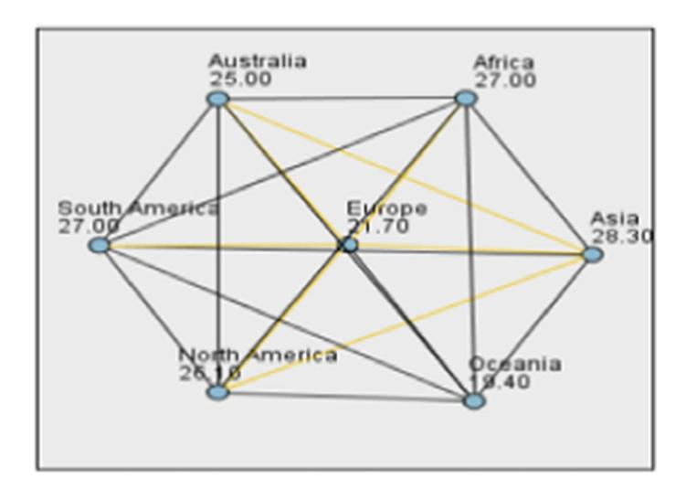
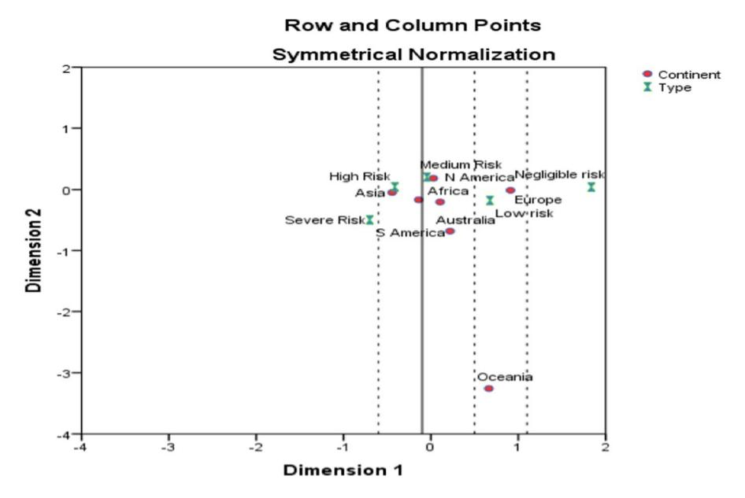
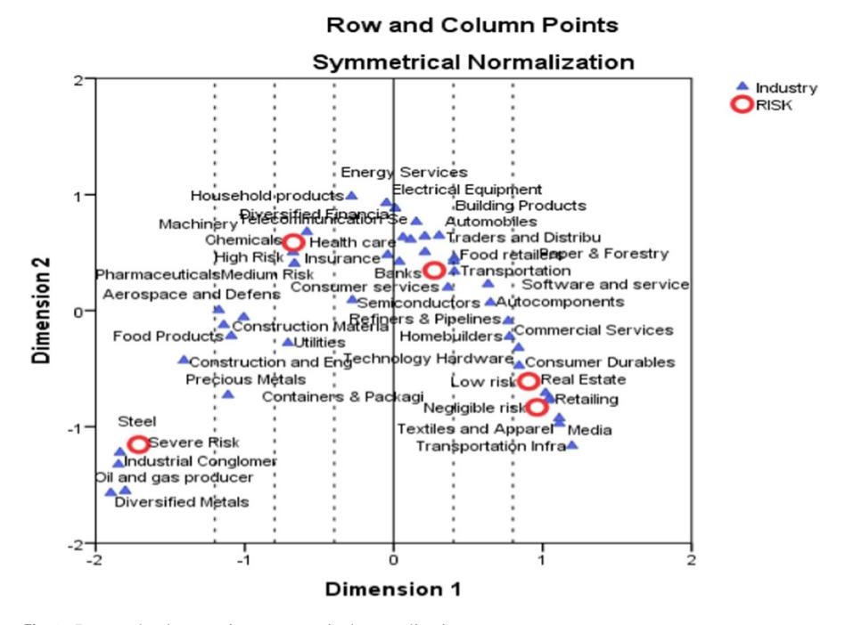
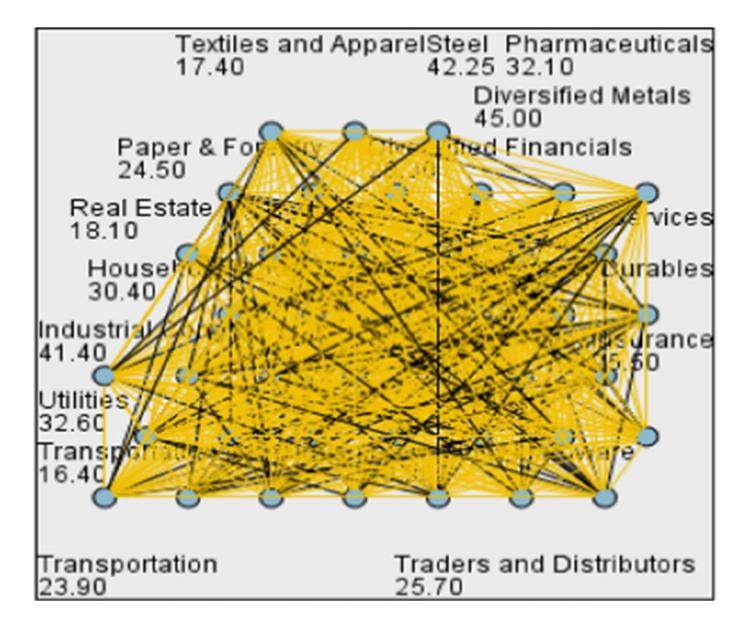

<!-- A3.R78 | source: papers_json/A3.R78/ -->

## **Comparative analysis of environmental, social ** **and governance (ESG) ratings: do sectors and regions ** **difer?**

**Rekha Pillai1** ******· Md. Aminul Islam2** ******· S. Sreejith3** ******· ** **Husam Aldin Al‑Malkawi****[4](http://orcid.org/0000-0001-5372-8394)**

Accepted: 9 October 2023 / Published online: 6 January 2024 © The Author(s), under exclusive licence to Springer Science+Business Media, LLC, part of Springer Nature 2024

## **Abstract**

Sustainable and holistic investment philosophy such as environmental, social and governance (ESG) concepts have now emerged as the subtle, comprehensive and concrete response to the unprecedented surge in environmental, social and fnancial market sustainable development problems. The main aim of this paper is to perform an in-depth study on ESG ratings world-wide and to granularly analyse how and why they difer within industries and regions as reported by Sustainalytics on 13,589 companies as of December 2022. Perceiving ESG ratings from dual dimensions, we introduce the 'push–pull efect' where we identify the rationale pushing corporates for providing their ESG engagements to ESG rating providers and the justifcation for stakeholders pulling information from these rating providers. Correspondence analysis, nonparametric independent sample Kruskal–Wallis test and Mann–Whitney test are performed as tools of inference. Results reveal that Asia and America are regions demonstrating high ESG risks with European corporates exhibiting low ESG risks. In terms of industry, transportation infrastructure and media, both categorized under low ESG risk, portray a statistically signifcant diference from other industries. Finally, the sector wise reports clearly evince an overall statistically signifcant diference between fnancial and non-fnancial sector in all regions, the former presenting high risk ESG scores in Asia and North America. Policy implications are set as ESG is a concept which has stepped out of the "awareness creation" stage to an implementation state, imploring policy makers to embark on stringent measures of ensuring ESG compliance to reap stakeholder confdence and ensure sustainable development.

**Keywords** Environmental · Social · Governance · ESG ratings

> Extended author information available on the last page of the article

<!-- page 2 -->

## **1** **Introduction**

The increasing relevance of environmental, social and governance (ESG) concerns have now surfaced as the new dictate for top management as they are being dually confronted to be accountable for both shareholders performance as well as non-fnancial interests and stakeholder risk (Khan, [2019](#page-37-0)). However, fair corporate citizenship, the new mandate and varied objective of an organization other than proftability and strategic goals, pose diverse risks for corporate boards in the form of demanding and assertive investors as well as elevated standards of adherence to climate change and sustainability. Dissecting ESG further, Li et al. [(2021](#page-38-0)) opinions that environmental norms encompass the stewardship role played by an organization towards the planet in terms of energy utilization, waste management practices, environmental regulatory compliance, natural resource conservation, pollution handling, organics sourcing and deforestation. The social element incorporates external and internal relationships, gender equality, employee safety and wellbeing, social justice and more importantly diversity, equality and inclusion. Lastly, the governance component integrates accountability, fairness, responsibility and transparency in executive payments, audits, shareholder rights, board diversity and internal controls amongst others.

Furthermore, Cornell and Shapiro ([2021](#page-36-0)) state that ESG is a vital evaluation tool and matrix employed by foreign direct investors to judge corporate value and reliability. Attesting the former claim, ESG user proportion has increased from 84% to 85% in 2021 with more than quarter of global investors (26%) afrming that ESG is their prime investment driver where 34% of the investors perceived their ESG stance as that of 'acceptance' and 29% observed it as 'compliance' (Ground, [2022)](#page-37-1). This is where ESG ratings prove as a vital base in fxing asset prices, designing strategic policies and guiding sustainable investment decisions (Berg et al., [2022](#page-36-1)), as such prudent ESG driven investments lead to sizeable and assured infows (Hartzmark & Sussman, [2019](#page-37-2)). ESG ratings primarily refer to the assessment of frms' adherence/performance in terms of ESG practices by a dedicated rating agency. However, ESG is multi-dimensional term encompassing varied practices, policies and activities devoid of universal reporting standards, all of which lead to considerable diferences in calculation, interpretation and application across industries, countries and frms (Philipp et al., [2020)](#page-38-1). That said, ESG scores are assumed to difer between fnancial and non-fnancial companies. As we all know fnancial sectors serve dual roles as capital providers and investment channels and are deeply engaged in transforming fossil backed economies to sustainable economies. They are now resolute in integrating ESG risks into their existing portfolio currently dominated by other traditional risks (Thomson Reuters, [2021](#page-39-0)). Concurrently, the non-fnancial sector is also diligently embedding ESG strategies into their organizational DNA to help them efectively engage with informed customers, access and market successful green products and services and retain brand value to catalyse long term growth. On the contrary, Amankwah-Amoah ([2020)](#page-35-0) alludes to the deprioritization of environmental commitments by companies in their quest for survival, especially during the pandemic. However,

<!-- page 3 -->

an evident void in investigating ESG rating variations between fnancial and nonfnancial sector to highlight inconsistencies and unearth the rationale behind the same, remains an imperative gap to be flled. Nevertheless, the existing heterogeneity and ambiguity in ESG information in these sectors diminishes its utility in the investors/users' eyes urging the need for a systematic and standardized ESG data (Amir & Serafeim, [2018;](#page-35-1) Billio et al., [2021](#page-36-2)). Furthermore, International Organization of Securities Commission ([2021)](#page-37-3) state that ESG ratings can difer geographically and regions with higher levels of regulatory, legislative and stakeholder focus are presumed to exhibit higher ratings. Complementing the former claim, Garcia-Sanchez et al. ([2013)](#page-37-4) argue that these regions fall under the 'civil law' legal framework, and they outperform regions following common law in terms of sustainability initiatives. Till date, to the best of our knowledge, the only research available on ESG rating -region nexus is by Mohamad et al., ([2022](#page-38-2)), who explores ESG disclosures in 6 Asian countries, imploring the necessity to perform a comprehensive study encompassing all regions and industries.

Delving into rating agencies, organizations such as Sustainalytics, MSCI, Bloomberg, FTSE Russel, True value Labs, ISS (Institutional Shareholder Service), S&P, RepRisk, Carbon Discoloure Project (CDP), Moodys, Refnitive and SIRIS (Only for Asia -Pacifc regions) amongst others act as vital players in distilling and aggregating ESG information from multiple sources into discrete fgures to efectively serve decision making among investors. That said, these scores are still subjected to wide criticism due to the variances in techniques used to collect and assess information, discrepancies in content/attribute inclusions and extent of weightage given to attributes (Berg et al., [2022)](#page-36-1). Interestingly, Feifei and Polychronopoulos [(2020](#page-37-5)) classify ESG rating providers under three categories namely fundamental, comprehensive and specialist. While the fundamental ESG providers collect and disseminate ESG data available on public domain without applying any robust ratings methodology (such as Refnitive, Bloomberg and SIRIS), comprehensive ESG data providers apply subjective and objective data that utilize a combination of objective and subjective data integrating various ESG market segments apart from employing scientifc and systematic techniques to decipher ESG scores (for eg. Sustainalytics, MSCI, ISS, TruValue Labs and RepRisk). Lastly the specialist category investigates specifc ESG concerns such as environmental issues, gender diversity, human rights and corporate governance (e.g. S&P and CDP) or region. Inspite of myriad ratings available from multiple providers, investors face impediments in accessing and evaluating the quality and reliability of ESG data, hampering their capability to incorporate and integrate them in their investment decisions (Ground,[ 2022](#page-37-1)).

Nevertheless, few studies focussing on various aspects and dimensions of ESG ratings (Tang et al., [2021)](#page-39-1) have emerged in recent years either to test its impact on fnancial performance (Egorova et al., [2021;](#page-37-6) Khan, [2019](#page-37-0); Landi & Sciarelli, [2019;](#page-37-7) Polbennikov et al., [2016)](#page-38-3) or corporate reporting (Banke et al., [2022)](#page-36-3) or else to debate on its inconsistencies (Berg et al., [2022](#page-36-1); Billio et al., [2021;](#page-36-2) Dimson et al., [2020](#page-36-4); Feifei & Polychronopoulos, [2020;](#page-37-5) Rostoum, [2018](#page-38-4); Serafeim & Yoon, [2022)](#page-38-5). On the other side, research focussing on ESG rating drivers have also cornered attention (Crespi & Migliavacca, [2020a](#page-36-5),[ 2020b](#page-36-6); Tang et al., [2021)](#page-39-1).To the best of our knowledge, there are no empirical studies till date exploring ESG rating diferences

<!-- page 4 -->

between regions, industries and how fnancial and non-fnancial sectors difer on the same in various regions, and this serves as the prime motivator to conduct a frst-hand study on the same. Moreover, theories underpinning the rationale behind and aftermath of ESG ratings is absent in ESG literature (Tang et al.,[ 2021](#page-39-1)). Extant research has majorly assumed ESG as a corporate social responsibility (CSR) and only discussed theoretical backings surrounding CSR (Banke et al., [2022;](#page-36-3) Snider et al.,[ 2003](#page-38-6)), another evident gap which will be addressed in this paper.

Therefore, the main aim of this paper is to perform an in-depth study on ESG ratings and to granularly analyze how they difer within industries and regions as reported by Sustainalytics as of December 2022. The only prior studies exploring rating agencies in independence are those by Tang et al., [(2021](#page-39-1)) on MSCI-KLD ESG scores and Tamimi and Sebastienelli ([2017)](#page-38-7) who perform on their research on Bloomberg scores, with none of them explicitly diferentiating or providing a rationale for ESG variations among regions, industries or fnancial–nonfnancial companies. Moreover, Bloomberg rates companies based on the extent of disclosure and does not measure ESG risk levels, which is a vital information for investment decision making and the central idea of this paper. Sustainalytics in specifc is chosen in this study as they fall under the most favourable 'comprehensive ESG rating provider category' and is the only rating agency integrating 'performance' along with preparedness and disclosure in arriving at their scores. To further our argument, Bloomberg and ISS calculate their ESG score solely based on disclosure levels while CDP summates awareness, disclosure, management, and leadership in their score calculations, with neither of them focusing on the 'performance aspect' (Rostoum, [2018)](#page-38-4). Additionally, the transparency and materiality underpinning Sustainalytics methodology conferred them with the "Best Sustainable & ESG Research & Ratings Provider" award by the Investment Week for two consecutive years in 2020 and 2021 (Sustainalytics,[ 2021](#page-38-8)). Also, among the rating providers, Sustainalytics encompasses the scores of more than 13,000 companies, the largest in comparison to MSCI, Refnitiv and FTSE Russel who reports on nearly 8500 (companies), 11,800 (companies) and 7200 securities respectively (Larcker et al., [2022](#page-37-8)). Sustainalytics is also renown for assessing more than 60,000 news sources for unveiling routine incidents such as oil spills, employee discrimination law suits and other controversies which add up to ESG risks apart from company specifc risks. Finally, we assert that ratings from multiple rating providers cannot be adopted due to inconsistencies in their ESG calculations and variations in number of companies listed in various agencies (Berg et al., 2022), thus diluting the inferences made.

Furthermore, this study will be the frst to perform a correspondence analysis to explicitly identify region-ESG variations as well as sector-ESG variations. As ESG investing is gaining momentum among institutional investors, a key contribution of this study is to equip them with informed insights on region and industry sustainability credentials in the form of ESG initiatives/risk levels during investment decisions. Another contribution of this paper is that it is the frst research, to the best of our knowledge, to provide a theoretical background basing the arguments as a 'push -pull efect' behind the rationale of ESG ratings. Our proposition is that ESG ratings can be perceived as a 'push–pull efect' where we need to identify the rationale pushing corporates for providing their ESG engagements to ESG rating providers

<!-- page 5 -->

and the justifcation for stakeholders pulling information from these rating, providers and this paper embarks on suggesting separate theories underlying these two phases. For risk managers, the paper contributes by providing region, industry and sector ESG risk highlights which caution respective risk management professionals to fne tune their ESG strategies and ensure its efective integration into the organizational structure to enhance their ESG score, the failure of which can lead to stakeholder allegations and reputation loss.

The objectives of the paper are therefore four-fold in nature. Firstly, to theorize the rationale surrounding corporate reactions prior to and after receiving ESG ratings. Secondly, to provide a comprehensive analysis on the state of transparency among companies rated by Sustainalytics and thirdly to investigate the diferences in transparency levels in diferent regions and sectors. Finally, the study aims to draw practical and policy implications from results derived principally to pave way for recommendations in enhancing ESG adoptions in various regions and industries studied.

The study employs Correspondence analysis, Independent Sample Kruskal- Wallis Test and Mann–Whitney test as tools of inference. In the region- risk analysis, Asia and America emerge as regions with organizations demonstrating high ESG risks with Europe centred organisations exhibiting low ESG risks. In terms of industry, transportation infrastructure and media, both categorized under low ESG risk, portray a statistically signifcant diference from other industries. Finally, the sector wise reports clearly evince an overall statistically signifcant diference between the fnancial and non-fnancial sector, where the fnancial sector is deemed riskier in terms of ESG compliance especially in Asia and North America.

The remainder of the paper is organized as follows. Section [2 ](#page-4-0)sets the theoretical base and reviews prior literature. Section [3](#page-8-0) highlights the data and methodology used with Sect. [4 ](#page-10-0)reporting and discussing the results and fndings. Section [5](#page-24-0) concludes the paper by setting practical implications apart from identifying limitations and recommendations for future research.

## **2 Theoretical and empirical review**

ESG concept traces its root from the advent of sustainable fnancing concepts in early 1990's which mandated precise metrices to guide sustainable investments (Tang et al., [2021)](#page-39-1). However, in 2004, it was Ivo Knoepfel's report in the United Nations Global Compact Initiative titled "Who Cares Wins" which ultimately documented the relevance and innumerable stakeholder benefts associated with ESG reports. That said, Tang et al. ([2021)](#page-39-1) cautions the lack of theoretical substantiation on the rationale behind ESG ratings (Tang et al., [2021)](#page-39-1), the current paper bridging that major gap by claiming a multi-theoretical approach for the same (see Izcan & Bektas, [2022)](#page-37-9). We believe that ESG ratings can be perceived as a 'push–pull efect' where we need to identify the rationale pushing corporates for providing their ESG engagements to ESG rating providers and the justifcation for stakeholders pulling information from these rating providers. Moving forward, Tamimi and Sebastianelli [(2017](#page-38-7)) evince the signifcance stakeholders currently attach to 'Triple Line Reports"

<!-- page 6 -->

that signal ESG facts and fgures embedding sustainability concepts apart from the conventional fnancial information. This is our torchbearer in stepping into the 'push' phase, where we assign the stakeholder theory as one of the ideal theoretical base and valuable framework underpinning the drive, rationale and signifcance of responsible activities such as ESG rating disclosures (Snider et al., [2003)](#page-38-6).The stakeholder theory (Freeman, [1984](#page-37-10)) is based on the premise that strategic policies and actions that focus and meet stakeholder expectations enhance frm value and performance. In this paper, it implies that the rising ESG-oriented stakeholder concerns can be pacifed only by successful and diligent stakeholder management in the form of providing robust ESG ratings of registered companies. This is because stakeholders perceive ESG ratings as prudent management actions oriented towards impacting long term frm value and sustainability mainly by mitigating the deleterious efects on environment, society whilst ensuring fair governance (Lokuwaduge & Heenitigala, [2017)](#page-38-9). We also assign the stewardship theory (Donaldson & Davis, [1991](#page-36-7)) as a rationale behind companies providing data for ESG rating providers. The theory emphasizes the importance of senior executives acting as stewards for the organization who have integrated sustainable organizational goals with their individual goals keeping in mind the best interests of the principals and other stakeholders. Here it implies that stewards perceive a higher utility from societal interest alignment and cooperative behaviour rather than indulging in self-serving behaviour of accumulating profts. Henceforth, they take responsibility in ESG engagement and providing evidence of the same to the rating providers. To add on, ESG rating rationale can also be supplemented by the legitimacy theory (Deegan, [2002](#page-36-8)) which denotes an invisible 'social contract' between the business and society, where frms alleviate regulatory and social scrutiny (Tamimi & Sebastianelli, [2017)](#page-38-7) by engaging and disseminating information on socially responsible activities such as ESG to rating providers. Finally, the rating validation can also be assigned to the institutional theory (Meyer & Rowan, [1977](#page-38-10)) which connotes how the infuence of stringent socio-economic structures such as regulations and laws overpowers functional considerations in corporates behaviours. These external pressures persuade companies to disclose their ESG practices to raters in order to later refect those scores to stakeholders. Moving on to the 'pull phase', we draw on the signalling theory (Spence, [1973](#page-38-11)) to advance a framework which propagate that market signals emitted (from rating providers) address information asymmetry and increases the likelihood of making informed decisions. The central idea here is the capacity of signals to transfer information about signaler's unobservable ESG value and quality to stakeholders. Aligning with the objective of this paper, we can say that stakeholders pull the intangible signals released by ESG rating providers, to arrive at a consensus on the rated frms' commitment to ESG practices in giving them a credible status. Moreover, consistency demonstrated in such signals translate into an insurance efect, furthering stakeholder trust and interest in such frms (Fu et al., [2022)](#page-37-11) to manage ESG related external risk (Philipp et al., [2020)](#page-38-1). Setting the theoretical base, we now venture into prior evidence surfaced on ESG ratings and various dimensions surrounding the same, in order to identify the research gap. We categorize our empirical review into primarily three categories where the frst set of studies scrutinize inconsistencies in ESG ratings, the second focus on ESG rating drivers and

<!-- page 7 -->

the third present stakeholder perceptions towards impact of ESG ratings on various parameters.

## **2.1 ESG rating inconsistencies**

Tamimi and Sebastiennli ([2017)](#page-38-7) analyzed Bloomberg ESG ratings on S&P 500 companies to investigate the extent of variance in their ESG disclosure levels. Results revealed high levels of transparency in governance dimensions throughout various sectors studied but showed extreme variations in governance and social dimensions across sampled sectors. Regardless of the authenticity of fndings, we need to be aware that Bloomberg compiles corporate ESG data using secondary information and direct communications, the latter being subject to bias and human imperfections. Following the chain, Billio et al.([2021)](#page-36-2) assess the rating criteria of nine major ESG raters and fnd major inconsistencies in attributes, standards and characteristics incorporated in defning ESG components (Dorfeitner et al., [2015](#page-36-9)) with these judgment heterogeneities leading to assignment of unfavourable ratings to sustainable companies (Egorova et al., [2021](#page-37-6); Feifei & Polychronopoulos, [2020)](#page-37-5). The study is insightful as they not only focus on ESG rating diferences but also on the consequences of such incongruencies. Similarly, Berg et al. ([2022)](#page-36-1) performed a comprehensive study on six renown ESG rating providers 'Kinder, Lydenberg, and Domini (KLD), Sustainalytics, Moody's ESG (Vigeo-Eiris), S&P Global (RobecoSAM), Refnitiv (Asset4), and MSCI' to disentangle the reasons of divergence in their scores. Results revealed that variations/inconsistencies in measurement of ESG factors contributed to 56% of the divergence with variation in scope and weights assigned leading to 38% and 6% of the divergence, all due to the raters' subjective opinion on the frms being the main cause of measurement anomalies. Fairly similar conclusions were derived by Christensen et al. ([2022)](#page-36-10) who argue that ESG ratings difer among raters when the extent of environmental and social disclosure is intense, leading to lack of consensus among raters' on metrices to employ to rate a frms ESG practice (Liu, [2022)](#page-38-12). A parallel study by Kimbrough et al. [(2022](#page-37-12)) validated the efcacy of long, less sticky, less positive and third-party attestations of ESG reports (especially environmental and social aspects) provided to ESG raters as factors leading minimising disagreements among raters. Recalling Berg et al.'s [(2022](#page-36-1)) paper, they claim to be extension of Chatterji et al.'s ([2016)](#page-36-11) paper who initiate a study on how CSR raters' defne and measure what they intend to measure without analysing the extent to which the defnition and measurement drive divergence. Now here is the question as to whether CSR and ESG are the same and our thoughts conform to the perception of Park et al. ([2022)](#page-38-13) that CSR is a common sustainability framework used to enhance corporate reputation and image while ESG is an investor-based sustainability assessment concept solely based on the three themes and that they need to be treated in independence while conducting research. A similar strategy of using CSR and ESG interchangeably in their narrative is evident in the studies by Landi and Sciarelly ([2019)](#page-37-7) who evaluate the impact of ESG ratings on Italian listed frms.

<!-- page 8 -->

## **2.2 ESG rating drivers**

Deviating from the former ESG rating critical reviews, a set of studies focussing on drivers of ESG ratings emerged parallelly. Crespi and Migliavacca ([2020a](#page-36-5), [2020b](#page-36-6)) perform an empirical study on 727 fnancial frms operating in 22 countries to report the relevance of large frm size and country specifc factors such as prevalent laws as main precedents of ESG ratings. We ponder over the sustenance of the factors identifed as they are prone to vary both during economic and social undulations as well as changes in frm size and proftability. Once again the interchangeability noticed in their CSR and ESG chronicle needs clarity. Correspondingly, Tang et al. [(2021](#page-39-1)) perform an interesting study to decipher the determinants of ESG rating by referring to KLD and Refnitive database which consist of S&P 500 frms, Russell 1000 and Russell 3000 component frms to deduce that corporates with shareholders holding major stakes in rating companies are privileged with higher ESG ratings. However, a major concern in the fndings relate to the indiference and lack of justifcation shown by the authors on the period of data studied as KLD included data till 2003 while Refnitive encompassed data till 2017.

## **2.3 ESG rating impact perceptions**

Moving on to ESG rating perception-based and impact-oriented studies, Engelhardt et al. [(2021](#page-37-13)) enquire the Covid related ESG rating- stock returns nexus on 1452 companies from16 European countries using Refnitive data base for the period February–March 2020 and conclude a positive relationship on the aforesaid nexus. They assign the resilience ingrained in ESG conformance among corporates for the positive relationship (Chen et al., [2022](#page-36-12)) and although the observation is valid, we beg to difer on the data collection period as Covid was ofcially declared as a pandemic only in March 2020 where the spill over efects are assumed to refect in the forthcoming months. More recently, Atkins et al. ([2022)](#page-35-2) initiated a qualitative study on 14 Senior practitioners in European listed environmental sensitive companies to gauge their perception on the impact of pandemic on incumbent ESG metrices. The study signals the prominence of 'Social' dimension overpowering environmental and governance issues and urges a redesign of sustainability measures. Here we do perceive the substantial contribution of the former study in a period where social ESG metrices are window dressed and eventually require stakeholders' opinion to ensure that corporates are employing them in a strategic way. However, the limited sample size and a specifc region focussed study result on a low representation of reality, thus questioning the validity of claims made on redesigning ESG metrices. In a similar vein, Clementino and Perkins [(2021](#page-36-13)) categorizes various corporate responses towards ESG ratings provided by MSCI, Vigeo-Eiris, Sustainalytics and CDP into 'active conformity', 'passive conformity', 'active resistance 'and 'passive resistance'. The study employs semi-structured interviews on 18 CSR complying senior managers from majorly Italian utility companies in 2018 which nearly half of the company heads following 'active conformity' by judiciously internalizing best

<!-- page 9 -->

CSR practices into their sustainable strategy framework. Although the study leaves considerable food for thought, the independent country focus and a very low sample size questions the heterogeneity evident in the respondents' inconsistent views on instrumentalizing business value generated from incorporating strategies to upgrade ones ESG ratings. Likewise, Banke et al. [(2022](#page-36-3)) look into the afterefects of incorporating ESG ratings in DAX40 companies in Germany and fnds a surge in stock prices and reputational benefts accruing from being transparent. On the contrary Gibson et al. [(2021](#page-37-14)) perceives risk premium attached to frms with ESG rating disagreements especially when the disagreement arises from the environmental aspect of ESG.

A review of prior literature clearly evinces astute observations from research scholars in the ESG domain, but at the same time signal potential gaps. It can be concluded that no studies till date neither take an efort in distinguishing prevalence of ESG rating diferences between fnancial and non-fnancial sectors nor industry or regional variations, which can then lead to multiple insights on causes and impact of the same. The only study which has explored a specifc data base till date is by Tamimi and Sebastianelli [(2017](#page-38-7)) who base their fndings on S&P 500 companies based on Bloomberg ESG ratings, thus necessitating a comprehensive and up to date study on the same. More recently, Mahmood [(2020](#page-38-14)) has applied the MSCI ESG ratings on selective companies such as FTSE 100, S&P 500 and other large and mid-size companies in other regions to decipher the variations in the regions selected. However, defciencies noticed in regions covered, risk patterns and industries studied in the former studies lead to our novel preliminary analysis of setting the stage for exploring the presence/absence of any rating diferences and how they vary across regions and sectors.

## **3 ***Data***[1](#page-8-1)** * and methodology*

Data was collected from 'Sustainalytics' ESG scores as on December 2022. Sustainalytics is 25-year-old reputed and independent ESG analytics and rating frm that assists worldwide investors to take wise investment decisions. Sustainalytics ESG ratings comprise of a quantitative score and a specifc risk category. The quantitative score ranges from 1 to 50 with the lower scores denoting low unmanaged risks and vice versa. Based on the former, companies are categorized under fve risk categories namely 'negligible' (score: 0–9.99 points), 'low' (score: 10–19.99 points), 'medium' (20–29.9 points), 'high' (30–39.9 points) and 'severe' (40 and higher points). There are 13,589 companies registered under Sustainalytics as on November 2022 and the ESG ratings of these companies are composed of three building blocks that contribute to a company's overall rating. These building blocks include Corporate Governance, Material ESG issues (MEIs) (topics which require a set of common management initiatives), and idiosyncratic ESG issues (unpredictable or unexpected issues in a specifc

<!-- page 10 -->

sub-industry). Once they are identifed, a two-dimensional architecture which encompasses 'exposure' and 'management' is then applied to rate the companies. While the former is related to the degree of company exposure to material ESG risks, the latter relates to the level of management acumen to handle the exposure. Finally, the rating also incorporates the extent of dual risks the company is facing in terms of 'unmanageable risks' (uncontrollable risks) and management gap (management incapacity to manage risks). The incorporation of the aforesaid risks makes Sustainalytics a unique dataset as it addressed inconsistencies noticed in Bloomberg and S&P rating-based studies emerged till date.

As tools of reference, correspondence analysis (CA), Independent Sample Kruskal-Wallis Test and Mann–Whitney test are performed on SPSS 26. Initially a cross tabulation is performed to analyse mutually exclusive groups of categorical data to primarily understand the afliations of various risks. Statistical signifcance of the patterns observed in the cross-tabulations is then established by using the Pearson chi-square test (Agresti, [2004)](#page-35-3). Additionally, a non- linear multivariate statistical tool termed correspondence analysis is employed to analyze categorical data graphically where the primary objective is to visualise rows and columns in a map i.e. a data table in a low dimensional space (Gilula & Haberman, [1988](#page-37-15)). This tool is a composite technique and is mainly ideal for analysing exploratory data due to its leniency in data measurement requirements (which is indiference between metric and non-metric data, existence of non-linearities in variable relationships, variations in measurement levels), with the sole requirement of a cross -tabulation table of positive entries (Greenacre, [1984](#page-37-16)). The tool bases its results on the indicator matrix which is basically a disjunctive table populated from the categorical variables. The CA then develops a covariance matrix by analyzing the information derived from the indicator/symmetric matrix of all two-way cross-tabulations between those categorical variables. The results related to conditional distribution and comparable eigenvectors can then be used to project those categorical variables with a graphical plot with points coordinated through selected pairs of variables (Greene, [2013](#page-37-17)). Prior literature (Ngai & Cheng, [1997](#page-38-15)) states that the analysis is used synonymously for 'optimal scaling', 'dual scaling' and 'homogenity analysis' and 'it creates the "perceptual map" (visual representation of a respondent's perceptions of objects on two or more dimensions) based on the association between objects and a set of descriptive characteristics or attributes' (p.395). For independent samples based on industry, region and risks the Kruskal Wallis test is used as it helps in comparing two or more groups (see Mohamad et al., [2022](#page-38-2); Tamimi & Sebastianelli, [2017](#page-38-7) who adopted the same for ESG related studies). To examine the prevalence of statistically signifcant diferences in ESG scores in fnancial and non-fnancial companies among various regions, the Mann–Whitney test is employed to compare two groups (also employed by Tamimi & Sebastianelli, [2017)](#page-38-7). "The null hypothesis of Wilcoxon–Mann–Whitney test is that the two samples have the same population distribution. The alternative hypothesis is that there is a 'location shift': that the median of one population is not equal to the other. The median is considered instead of the mean because there is no assumption that the populations are normally or even symmetrically distributed" (Harris & Jarvis,[ 2011](#page-37-18), p.159).

<!-- page 11 -->

|  | Continent | Frequency | Percent | Valid percent | Cumu lative percent |
| --- | --- | --- | --- | --- | --- |
| Valid | Asia | 5994 | 44.1 | 44.1 | 44.1 |
| Europe | 2722 | 20.0 | 20.0 | 64.1 |  |
| Africa | 141 | 1.0 | 1.0 | 65.2 |  |
|  | Oceania | 33 | 0.2 | 0.2 | 65.4 |
|  | Australia | 363 | 2.7 | 2.7 | 68.1 |
|  | North America | 4029 | 29.6 | 29.6 | 97.7 |
|  | South America | 307 | 2.3 | 2.3 | 100.0 |
|  | Total | 13,589 | 100.0 | 100.0 |  |

## **4 Results and discussion**

## **4.1 Descriptive statistics**

Tables [1](#page-10-1), [2 ](#page-10-2)and Appendix Table [13 ](#page-26-0)reports the descriptive statistics related to companies under various risk categories, number of companies under each sector, number of companies in each region respectively.

Table [1](#page-10-1) reveals that majority of the companies fall under the medium risk category followed by high risk and low risk category respectively. This refects the level of eforts taken by companies in ESG adherence and the fact that high risk companies (24.4%) are comparatively lower than medium risk (39.6%) companies strengthen our argument. Table [13 ](#page-26-0)(refer Appendix A) refer to the number of companies in each sector studied. There are 42 classifcations of sectors ranging from Aerospace to Utilities. It is noteworthy that banks (6.9%), pharmaceuticals (6.8%) and software and services (6.7%) together add up to 24.4% of the total sample with paper and forestry (0.5%) being the lowest representation in the group. However, the classifcations are comprehensive enough to include every possible sector to infer their ESG adherence levels. Table [2 ](#page-10-2)below shows the number of companies (13,589) situated in various regions and registered with Sustainalytics. Results

<!-- page 12 -->

report maximum percentage (44.1%) of companies from the Asian region (44.1%) followed by America (31.9%) and Europe (20%).

Diagnostic test such as the Kolmogorov–Smirnov goodness of ft test has been performed to check data normality (refer Appendix B). The result denotes a rejection of the null hypothesis that the residuals follow a normal distribution (p<0.05), hence nonparametric tests are employed for analysing data.

## **4.2 Region‑ risk analysis**

To perform the CAs, frst a cross tabulation between the region and type of risk category has been performed and results are outlined in Table [3 ](#page-11-0)below.

Results from Table [3 ](#page-11-0)reveal that the negligible risk category forms 1.6% of the total cases studied. The highest proportion of contributions is from Europe, followed by Australia. All other regions have less than the overall proportion of 1.6%. The

<!-- page 13 -->

highest proportion of low-risk rated organizations (57.6%) is reported in Oceania, followed by Europe (38.3%). However, the lowest proportion can be observed from the Asian region (16.6%). In continuum, Asia (40.3%), followed by North America (40.2%), shows the highest share of medium-risk cases. Even though no mediumrisk cases were reported in the Oceania region, one of the peak proportions of highrisk cases (27.3%) is reported there with the lowest proportion in the high-risk category being reported in Europe (14.7%). The uppermost proportion of severe risk categorised cases can be observed in Oceania (15.52%) followed by Asia (14.1%) and Australia (13.2%), respectively. On the other hand, the lowest proportion is at Europe (4.2%). The correspondence analysis (Greenacre, [1974)](#page-37-19) is now conducted with the cross-tabulation results which reveal majority of regions showing substantial presence in all risk categories. For this, frstly a column point's overview (see Table [4](#page-12-0)) table is prepared to display the contribution of the column points to the inertia of the dimensions and contributions of the dimensions. Two dimensions contribute a large amount to the inertia for most column points. The study treats the rows and columns symmetrically for normalisation. This process spreads inertia equally over the row and column scores (Constantine & Gower,[ 1978](#page-36-14)).

Table [4 ](#page-12-0)above reveals that all types' total contributions to the inertia are represented well in the study. The split shows that the risk categories are glowing in dimension 1 except medium category. Only medium category has a substantial contribution to the inertia of dimension 2. All the risks have been distinctly classifed in this column profle. Row profle identifcation is also required to recognize the profound meaning of dimensions. The row point overview shows the row points' contribution to the dimensions' inertia and the contributions of the dimensions. Two dimensions contribute a signifcant amount to the inertia for most row points as shown in Table [5 ](#page-13-0)below with additional revelations about the total contributions to the inertia by all regions being above 0.5 (Banfeld & Gower,[ 1980](#page-36-15)) except North America and South America.

The results derived from Table [6 ](#page-13-1)are now utilized to prepare a bi-plot as shown in Fig. [1](#page-14-0) below. Biplot is an asymmetric map, which jointly displays the profles

> a Symmetrical normalization

<!-- page 14 -->

and the vertices. It can be inferred on the approximation to the individual elements (Greenacre, [2006)](#page-37-20). Dimension 1 shows diferent categories of risk. Mid-point of the dimension indicates the medium risk. Deviations from the mid-point to the left side show increase in the severity of the risk, such as high risk and severe risk, in chronological order. On the other hand, deviations towards the right depict a decrease in risks, such as low risk and negligible risk. Dimension 2 portrays the frequency of the cases. Most frequent cases are shown in the mid-point, and it decreases as it moves down and the fgure evince that most of the regions are associated with medium risk for e.g. North America, Africa, Australia and Oceania. On the contrary, Asia and South America have high-risk attached to it with Europe being the only region allied to the low-risk category.

The Kruskal–Wallis procedure is further employed to validate statistical diferences among the Regions ESG scores. Results revealed statistically signifcant differences in the ESG scores across regions (χ2=888.7, df=6, n=13,589, p=0.000) (see Appendix C for detailed results). In order to determine which of the regions

<!-- page 15 -->

***Fig.** **1 **Row and column points—region-risk biplot*

***Fig.** **2 **Pairwise comparisons of regions. Each node denoting sample median of the region*

are statistically diferent from each other the pair-wise comparison (see Fig. [2](#page-14-1)) and Table [7](#page-15-0) justifes the same by demonstrating signifcant diferences among regions (employing a Bonferroni adjusted alpha value (Holm, [1979](#page-37-21)) of 0.05/21=0.002) along with corresponding p-values.

<!-- page 16 -->

Each row tests the null hypothesis that sample 1 and sample 2 distributions are the same. Asymptotic signifcances (2-sided tests) are displayed

Results reported in Table [7 ](#page-15-0)clearly reveal that ESG score of Europe has a statistically signifcant diference from Australia, North America, Africa, South America and Asia. Moreover, Asia is having signifcantly higher risk than Australia and North America.

## **4.2.1 Discussion**

A granular dissection of results obtained show that low risk regions such as Europe are conditioned to feld ESG risks. The results are in lines with the fndings by Mahmood ([2020)](#page-38-14) who reports the dominance of Europe in every dimension of the environmental dimension, specifcally assigning the Nordic regions (which is a part of Europe) for high social and governance scores. This is because EU has been the torchbearer for stringent ESG regulations which impact investment activities, carbon markets, accountability, and disclosure, thus having a sustainable global impact and acting as a precursor to the 'Brussels Efect'. The efect refers to' European Union's ability to set global standards for world-wide industrial and fnancial rules and regulations (Alamillos & de Mariz, [2022,](#page-35-4) p.2) in the form of legislations such as restrictions on hazardous substances, Waste of Electronic Equipment and General Data Protection Regulation to name a few. On the contrary North America has fallen under the severe risk category due to minimal ESG awareness and weak implementation of rigorous regulatory frameworks on ESG issues relevant to stakeholders (Smithline et al., [2022)](#page-38-16). With respect to Asia and South America bearing the highrisk tag, the results orient towards the opaque and politicised ESG regulatory policies in those regions. Asian and South American markets such as Brazil, Argentina, Vietnam, India and China to name a few have built their value proposition as lucrative manufacturing centres reaping benefts of skilled and ample labour, low operational cost, non -standardized ESG rules and malleable social and environmental regulations (Bhattacharya, [2021)](#page-36-16). In addition, these scores can be attributed to the sectoral diferences in the regions industry portfolio. Asia and South America have higher exposures to energy intensive industries thereby falling into the risky zone. These markets have high carbon intensity scores signalling high carbon footprint and

> ^***^Signifcance at 1% level

<!-- page 17 -->

more CO2 being produced (Mahmood, [2020)](#page-38-14). Also, USA is assumed to have minimal ESG disclosure requirements as well as limited institutional investor demand for the same, thus emphasizing the lack of a rigid stewardship code forcing institutional investors to embed ESG in their decision making. This regulatory leniency can act as a leverage for companies to engage in unsustainable practices (Lopez-De-silanes et al., [2020)](#page-38-17). Lastly, regions associated with medium risk are North America, Oceania, Africa and Australia. This can be due to the limited comprehension and disincentivisation of ESG integration and the difculty faced in quantifying ESG faced by authorities in these regions (CFA Institute,[ 2019](#page-36-17)).

## **4.3 Industry‑risk analysis**

The study further investigates a deep industry-wise breakdown to understand the differences in detail. Hence, the broad fnancial sector is classifed into Banks, Diversifed Financials and Insurance. Non-Financial companies include Aerospace and Defence, Auto Components, Automobiles, Building Products, Chemicals, Commercial Services, Construction and Engineering, Construction Materials, Consumer Durables, Consumer Services, Containers & Packaging, Diversifed Metals, Electrical Equipment, Energy Services, Food Products, Food Retailers, Health Care, Home Builders, Household Products, Machinery, Media, Paper & Forestry, Pharmaceuticals, Precious Metals, Real Estate, Refners & Pipelines, Retailing, Semiconductors, Software and Services, Technology Hardware, Telecommunication Services, Traders and Distributors, Transportation, Transportation Infrastructure, Utilities, Industrial Conglomerates, Oil and Gas Producers, Textiles and Apparel, and Steel.

Conversely, it is also challenging to understand the relative position of the industry due to a large number of industry classifcations. In order to get a robust picture of the relative position of various industries, the study attempted a CA. Results derived from cross tabulation, row point and column point (See Appendix D, E and F) form the basis for the plotting the summary row and column point table as shown in Table [7](#page-15-0). Results reveal that the total contributions to the inertia by all types of categories are above 0.5 (Banfeld & Gower, [1980](#page-36-15)) and the split-up statistics show that the regions are represented well in either dimension one or dimension two or both by industries. Hence the row points of the CA are explained substantially well. Dimension identifcation is also required to diagnose the deep meaning of CA (Albert et al., [2008)](#page-35-5). The row and column point overview shows the contribution of the row and point to the inertia of the dimensions. The inertia per dimension shows the decomposition of the total inertia along each dimension where two dimensions account for 90.4% of the total inertia and adding a third dimension contributes only a nominal 6.2% to the accounted inertia. Therefore, the study counts only twodimensional representation. The proportion of inertia accounted for dimensions in Table [8](#page-17-0) shows the signifcant contribution of dimension 1(68.6%) with dimension 2 accounting for about 21.8%. Hence, the interpretation will be primarily based on dimension 1.

<!-- page 18 -->

| Table 8 Summary of row and column points for industry-risk |  |
| --- | --- |

***Fig.** **3 **Row and column points symmetrical normalization*

Results from the row and column point summary table is then depicted in the biplot as shown in Fig.[ 3](#page-17-1). Dimension 1 shows diferent categories of risk. The midpoint of the dimension indicates medium risk. Deviations from the left to right side show a decrease in the severity of the risk. Dimension 2 portrays the frequency of the cases. Most frequent cases are towards the upper areas. The partition of the plot based on dimension one into detailed sections would result in getting six categories. Points below "− 1.2" cover severe risk category industries. High to severe

<!-- page 19 -->

risk category industries are in between "− 1.2 to − 0.8". High risk categories are in between "− 0.8 to − 0.4" medium–high risk cases can be observed between "− 0.4 to 0." Medium categories cases have been detected in the points between "0 to 0.4". Cases of low-medium risk categories are in between "0.4 to 0.8". Above "0.8" point encompass cases of low or negligible risks.

Figure [3 ](#page-17-1)reports that industries under the low or negligible risk category include Consumer Durables, Containers & Packaging, Media, Real Estate, Retailing, Technology Hardware, Transportation Infrastructure and Textiles and Apparel. Interestingly, all the industries that ft in this category belong to the non-fnancial sector category. Industries under the low–medium risk category include Auto components, Commercial Service, Food retailers, Homebuilders, Paper & Forestry, Software and services, and Transportation, once again belonging to the non-fnancial sector category. Industries under the Medium risk category include Automobiles, Banks, Building Products, Consumer services, Diversifed Financials, Electrical Equipment, Insurance, Telecommunication Services, and Traders and Distributors. This category has both fnancial and non-fnancial industries. Industries under the medium–high risk category include Energy Services, Health care, Household products, Semiconductors, once again belonging to the non- fnancial sector category. Industries under the High-risk category include Chemicals, Machinery, Pharmaceuticals and Utilities. All the industries that ft in this category belong to the non-fnancial sector category. Industries under the high- risk category include Aerospace and Defence, Construction Materials, Food Products, Precious Metals and Refners & Pipelines. All the industries that ft in this category belong to the broad category of the non-fnancial sector. Industries under the high and severe risk category include Construction and Engineering, Diversifed Metals, Chemicals, Industrial Conglomerates, Oil and gas producers, and Steel, once again belonging to the non-fnancial sector. This is due to the variations in activity types of these industries which leads to disparities in risk categories. For example, industries such as construction, industrial conglomerates, oil and gas to name a few are key contributors of greenhouse gas emissions due to carbon based fuel combustions involved in their operations, methane leaks etc.. When it comes to social risks, safety management exposure exacerbate the issue with governance issues cornering around mis-compliance and negligence on transparency and corruption issues in the sector, especially in emerging markets (S&P Global Ratings, [2019b)](#page-38-18). Here it can be inferred that various non-fnancial companies show a wide spread across all risk categories. Surprisingly, the fnancial sector is classifed under medium risk category with scores heavily orienting towards the high-risk category. Surprisingly the fnancial sector (banks, diversifed fnancials and Insurance) specifcally fall under the medium risk category although refecting a heavy orientation towards high risk (median scores of 27.9, 28.3 and 26.5, respectively). This can be due to the environmental risk exposure this sector faces on account of their loan portfolios and other capital investments, inability to promote ethical labor practices in such a deadline and project-based industry as well as governance issues relating to data privacy and management (Breitenstein et al., [2021](#page-36-18)). Furthermore, fnancial organizations are prone to

<!-- page 20 -->

***Fig.** **4 **Pairwise comparisons of industries*

encounter hindrances in relation to data availability, environmental risk pricing and hedging, all of which increases ESG risk (Krueger et al., [2020)](#page-37-22).

The Kruskal–Wallis procedure is further employed to validate statistical differences among the Industry ESG scores. Results revealed statistically signifcant diferences in the ESG scores across industries (χ2=6093, df=41, n=13,589, p=0.000) (see Appendix G for detailed results). In order to determine which of the industries are statistically diferent from each other a pair-wise comparison is performed as shown in Fig. [4](#page-19-0) and Table [9 ](#page-20-0)additionally quantifes and justifes the same by demonstrating signifcant diferences among specifc industries (employing a Bonferroni adjusted alpha value (Holm, [1979)](#page-37-21) of 0.05/41=0.001) along with corresponding p-values.

Results from Table [7](#page-15-0) (based on results from Appendix G) clearly denotes that transportation infrastructure industry is signifcantly diferent from all other industries except Media, Textiles and Apparel, Containers and Packaging, Realestate and Retailing. Besides, Textiles and Apparel is signifcantly diferent from all other industries except Containers and Packaging, Real-estate, Retailing and Consumer Durables. These both fall under the low and negligible risk area and are statistically diferent from the industries revealed in Table [9](#page-20-0) above.

## **4.3.1 Discussion**

Prior research completely understating ESG evidence industry wise, we initiate the process by setting forth our assumptions for ESG variations evident in transportation infrastructure and textiles and apparel sectors in relation to other sectors. Firstly, the constellation of micro and macro forces (for e.g., surge in travel trends post-pandemic,

<!-- page 21 -->

<!-- page 22 -->

Each row tests the null hypothesis that sample 1and sample 2 distributions are the same. Asymptotic signifcances (2−sided tests) are displayed

population explosion, rapid increase in freight transport, continuing urbanization to name a few) has generated sizeable and invaluable prospects for the transportation infrastructure sector, all at an environmental cost. Although governance issues top the scene due to government and regulatory concession oversights on this sector, social risks are moderate as they only stem from public oppositions for air and noise pollution and the rare extreme-severity accidents on bridges or tunnels (S&P Global Ratings, [2019a)](#page-38-19). Lower ESG risks can be associated with the growing importance of incorporating sustainability objectives into the structural framework of transportation infrastructure. It can also be an outcome of the 'G20 Principles for Quality Infrastructure Investment' which lay a set of non-binding and voluntary principles such as integrating social and environmental concerns in infrastructure investments and enhancing their governance for achieving sustainable growth that determine quality infrastructure investment within G20 (OECD, [2020)](#page-38-20). We also assume that eforts are in place to minimize the impacts of transportation infrastructure on biodiversity by employing efective and efcient sustainable planning of land usage in various regions. We also ponder over the juxtaposition of the impending benefts provided by sustainable transportation infrastructure in terms of mitigating CO2 emissions when the estimated costs in terms of increasing CO2 emissions with rampant development of such infrastructure (Awaworyi et al., [2021](#page-36-19)). Adding on, a systematic literature review by Koutoupis et al. ([2021](#page-37-23)) evidence a similar decline in harmful emissions in the transportation sector, attributing the phenomena as a temporary decline due to the pandemic related restrictions. With respect to media, an industry oriented towards being carbon–neutral as carbon generated by this industry is neutralized by environmental group funding and aforestation. The urge for acquiring the 'DPP Committed to Sustainability' recognition, a UK media initiative which acknowledges and promotes environmentally sustainable practices among content providers and suppliers can be another reason for media to engage in ESG activities. We also presume that media companies are switching their business models to cloud computing which derives dual benefts in the form of enhanced business efciency and sustainability through optimum resource utilization and ensuring energy efciency (Lopera-Mármol & Jiménez-Morales,[ 2021)](#page-38-21).

## **4.4 Sector‑risk analysis**

The study also tried to identify the risk– sector (fnancial vs non-fnancial) association. The cross tabulation results evident from Table [10 ](#page-22-0)suggest a spread of fnancial

> ^***^Signifcance at 1% level

<!-- page 23 -->

and non- fnancial sector across all risk categories. However, a close scrutiny of results reveal 80.5% companies in the fnancial sector falling under the risky category (ranging from medium to severe) where the score for the non-fnancial sector under the risky category stands at 73.2%.

A chi-square test is then used to check the statistical signifcance of the pattern observed in the cross tabulation as shown in Table [8 ](#page-17-0)above. The purpose of this test is to determine whether a diference between observed data and expected data is due to chance, or if it is due to an association between the variables that are studying (Miller & Siegmund, [1982](#page-38-22)). Since the requested number of dimensions is greater than the maximum number of dimensions, the row column points cannot be generated (Bølviken et al., [1982](#page-36-20)). Results emerge statistically signifcant at 95% confdence level (see Table [11](#page-22-1)) suggesting a statistically signifcant diference in the risk patters exhibited among the sector. This earmarks the fnancial sector signalling a high risk in terms of ESG adherence in comparison to their counterparts. The fndings are in lines with Breitenstein et al. ([2021)](#page-36-18) and Krueger et al. ([2020)](#page-37-22) who voice the inherent ESG risks in the fnancial sector.

The paper being an exploratory paper embarking into unveiling the extent of ESG adherence in regions and industries, it is imperative to investigate the prevalence

<!-- page 24 -->

N denotes the number of companies 2013

26.6 (27.7)

Total

***, **Statistical signifcance at p < 0.01 and p < 0.05, respectively. The Wilcoxon−Mann–Whitney (W−M−W) test is testing the null hypothesis (H0) that non−fnancial and fnancial companies come from the same population (i.e. have the same median ESG)

11,576

27.1 (10.1)

-2.091 (0.027)**

of any diferences in ESG adherence among fnancial and non-fnancial companies studied for each region and the regions as a whole as evident in Table [12](#page-23-0). For this a formal statistical test called Wilcoxon-Mann–Whitney test is performed to test if there are statistically signifcant diferences between fnancial and non-fnancial companies in ESG adherence (see also Tamimi & Sebastianelli,[ 2017](#page-38-7)).

Table [12](#page-23-0) shows that there are statistically signifcant diferences in the ESG scores between FIN and NFIN in two regions namely Asia and North America, evidencing higher ESG risk in the fnancial sector.

## **4.4.1 Discussion**

The wide variations evident in Asia and North America in the sector-risk category can be due to various fnancial scandals surfaced in these regions that contradict principal inclination to value triple bottom line dimensions such as ESG (Escrig-Olmedo et al., [2019)](#page-37-24). Additionally, both these regions fall under the common law legal framework which pay limited attention to sustainability within the fnancial industry. The US investors being indiferent to ESG scores (Lopez-De-silanes et al., [2020](#page-38-17)) can pose as catalysis for deviating from sustainable practices thereby increasing ESG risk. Continuing the argument, Asian countries such as Indonesia, Cambodia, Myanmar, Korea, Japan, China to name a few are still far from practical development and integration of ESG frameworks while countries like Singapore, India, Thailand are making conscious eforts in incorporating ESG guidelines into their institutional DNA. On the social and governance side, the sector grapples with issues such gender discrimination, opaque data transparency, volatility, corruption and mal governance, the cumulative efect of which elevates the ESG risk scores in these sectors (ADBI,[ 2020](#page-35-6)).

<!-- page 25 -->

## **5 Conclusion, limitations, and future research**

The paper paints a diferentiated and complex portrait of what ESG ratings imply in various regions, industries and sectors around the world based on 13,589 companies registered with Sustainalytics as of December 2022. The study makes a signifcant contribution to the ESG research domain by being the frst to propose the 'push–pull efect' as the theoretical underpinning behind the ESG ratings rationale as well as to unveil regional, industrial and sectoral diferences in ESG ratings.

Empirical evidence gathered suggest that European regions top the charts depicting ESG scores falling in the low risk category, with North America, Africa, Australia and Oceania falling under the middle risk category in terms of ESG scores. On the contrary, corporates in Asia and South America are posed to have high ESG risks attached to it. Analysing from an industry perspective, transportation infrastructure and media are signalling healthy ESG scores which emerge statistically signifcant from other industries. Delving into sector wise comparison, the fnancial sector indicate risker ESG scores in comparison to their counterparts, the differences being statistically signifcant in totality and in two regions namely Asia and North America.

That said, the study is not free from limitations. Sustainalytics provides a single ESG integrated score devoid of Environmental, Social and Governance classifcations in independence. This poses as a constraint in analysing the areas of defciency to suggest reformative and or improvement measures to corporates. Additionally, the usage of a single rating provider may lead to subjective bias and or response heterogeneity, as the results are solely based on the ESG rating methodology adopted by Sustainalytics. However, the current study being the frst exploratory study to unwrap region, industry and sector diferences in ESG risks, the limitations identifed can set the ground for future research which may perform a comparative study of ESG rating providers and regions and industries fare under each of their observations. Analysing ESG risk-frm performance relationship is also an area which cannot be ruled out in future endeavours.

Nevertheless, we presume that our study has far reaching theoretical, policy and practical implications. The study makes a vital contribution to the existing theoretical debate surrounding ESG ratings by proposing a 'push–pull' approach and judiciously assigning specifc theories to each of these stages. Prior studies have only assigned theories to ESG rationale with none assigning theoretical constructs to ESG ratings. Moving on to policy implications, it is strongly recommended that high ESG risk regions and industries ensure greater accountability, standardized data, transparent corporate disclosure and consistent regulatory scrutiny in order to elevate their status to an acceptable status. Asian and American regions must take concerted eforts in mandating transparent and stringent ESG disclosures by corporates with additional scrutiny on their ESG approaches and methodology used. The policy makers need to stipulate a standardized ESG guidepost benchmarked with international best practices (for e.g. European Union's Sustainable Finance Disclosure Regulation, The Task Force for Climate Related Disclosures, Science Based Targets Initiative), not failing to incorporate regional and industry dynamics into the constructs. Also, ESG practices encouraged

<!-- page 26 -->

and ingrained by C-Suite executives will have a cascading impact throughout the corporate culture thus enabling noteworthy ESG scores. Practical implications lie in the development of forward looking proprietary ESG ratings, reducing dependence on high level ESG rating providers following their own methodology. Corporate leaders can initiate appropriate controls, systems of checks and balances, ensure communication transparency and liase with stakeholders in ESG related matters, giving oneself an upper hand in felding regulatory scrutiny and uncertain external threats. A focussed ESG risk review can aid optimum allocation of resources, enhance employee engagement and retention and remain regulatory compliant, the cumulative efect of which can lead to a competitive advantage in the market by emerging as safe havens for sustainable investors. More specifcally, timely management of social risks in terms of safety mechanisms, diversity, equity and inclusion, working conditions can advance employee experience thus enhancing work productivity.

To conclude, we are aware that corporates have their own philosophies and claims related to ESG integration, actualizing in diverse styles. What is important is the optimum, thoughtful and systematic integration of ESG concepts into their sustainable framework in order to align with their value proposition and stakeholder interests. On the contrary, a broad dismissal of the same on account of fawed legal regimes or self-centred reasons will bestow credence to the unethical forces which can gradually uproot a regions and organizations economic and social performance, thereby elevating ESG risks and emerging infamous in terms of un-sustainable actions. Our fnal say is that countries and corporates must have astute business intelligence systems in place to alert them of the slightest shifts in ESG landscapes and accompanying risks to sustain their competitive advantage.

## **Appendix A**

See Table[ 13](#page-26-0)

<!-- page 27 -->

<!-- page 28 -->

|  | Table 13 (continued) |
| --- | --- |

|  | Frequency | Percent | Valid Percent | Cumu lative Percent |
| --- | --- | --- | --- | --- |
| Steel | 140 | 1.0 | 1.0 | 100.0 |
| Total | 13,589 | 100.0 | 100.0 |  |

## **Appendix B: Normality test**

## **Appendix C: Kruskal–Wallis test—to identify the ESG diferences ** **among regions**

> b Grouping variable: continent

<!-- page 29 -->

## **Appendix D: Industry * type of risk crosstabulation**

|  |  |  | Type of risk |  |  |  |  | Total |
| --- | --- | --- | --- | --- | --- | --- | --- | --- |
|  |  |  | Negligible risk | Low risk | Medium risk | High risk | Severe risk |  |
| Indus try | Aerospace and defense | Count | 0 | 1 | 18 | 42 | 26 | 87 |
|  |  | % within industry | 0.0% | 1.1% | 20.7% | 48.3% | 29.9% | 100.0% |
|  | Autocom ponents | Count | 3 | 68 | 117 | 15 | 0 | 203 |
|  |  | % within industry | 1.5% | 33.5% | 57.6% | 7.4% | 0.0% | 100.0% |
|  | Automo biles | Count | 0 | 15 | 46 | 22 | 0 | 83 |
|  |  | % within industry | 0.0% | 18.1% | 55.4% | 26.5% | 0.0% | 100.0% |
|  | Banks | Count | 35 | 159 | 402 | 299 | 37 | 932 |
|  |  | % within industry | 3.8% | 17.1% | 43.1% | 32.1% | 4.0% | 100.0% |
|  | Building products | Count | 1 | 15 | 72 | 33 | 0 | 121 |
|  |  | % within industry | 0.8% | 12.4% | 59.5% | 27.3% | 0.0% | 100.0% |
|  | Chemicals | Count | 2 | 15 | 168 | 216 | 74 | 475 |
|  |  | % within industry | 0.4% | 3.2% | 35.4% | 45.5% | 15.6% | 100.0% |
|  | Commercial services | Count | 27 | 135 | 184 | 19 | 0 | 365 |
|  |  | % within industry | 7.4% | 37.0% | 50.4% | 5.2% | 0.0% | 100.0% |
|  | Construc tion and engineer ing | Count | 0 | 7 | 36 | 130 | 112 | 285 |
|  |  | % within industry | 0.0% | 2.5% | 12.6% | 45.6% | 39.3% | 100.0% |
|  | Construc tion materials | Count | 0 | 3 | 28 | 54 | 39 | 124 |
|  |  | % within industry | 0.0% | 2.4% | 22.6% | 43.5% | 31.5% | 100.0% |
|  | Consumer durables | Count | 4 | 111 | 73 | 17 | 0 | 205 |
|  |  | % within industry | 2.0% | 54.1% | 35.6% | 8.3% | 0.0% | 100.0% |

<!-- page 30 -->

|  |  | Type of risk |  |  |  |  | Total |
| --- | --- | --- | --- | --- | --- | --- | --- |
|  |  | Negligible risk | Low risk | Medium risk | High risk | Severe risk |  |
| Consumer services | Count | 0 | 137 | 153 | 104 | 1 | 395 |
|  | % within industry | 0.0% | 34.7% | 38.7% | 26.3% | 0.3% | 100.0% |
| Containers and pack aging | Count | 1 | 51 | 28 | 0 | 0 | 80 |
|  | % within industry | 1.3% | 63.8% | 35.0% | 0.0% | 0.0% | 100.0% |
| Diversifed fnancials | Count | 12 | 150 | 327 | 299 | 2 | 790 |
|  | % within industry | 1.5% | 19.0% | 41.4% | 37.8% | 0.3% | 100.0% |
| Diversifed metals | Count | 0 | 3 | 24 | 39 | 115 | 181 |
|  | % within industry | 0.0% | 1.7% | 13.3% | 21.5% | 63.5% | 100.0% |
| Electrical equipment | Count | 0 | 24 | 118 | 78 | 0 | 220 |
|  | % within industry | 0.0% | 10.9% | 53.6% | 35.5% | 0.0% | 100.0% |
| Energy services | Count | 0 | 9 | 46 | 35 | 0 | 90 |
|  | % within industry | 0.0% | 10.0% | 51.1% | 38.9% | 0.0% | 100.0% |
| Food prod ucts | Count | 0 | 19 | 122 | 195 | 160 | 496 |
|  | % within industry | 0.0% | 3.8% | 24.6% | 39.3% | 32.3% | 100.0% |
| Food retail ers | Count | 0 | 40 | 109 | 28 | 0 | 177 |
|  | % within industry | 0.0% | 22.6% | 61.6% | 15.8% | 0.0% | 100.0% |
| Health care | Count | 0 | 101 | 231 | 185 | 26 | 543 |
|  | % within industry | 0.0% | 18.6% | 42.5% | 34.1% | 4.8% | 100.0% |
| Homebuild ers | Count | 0 | 31 | 44 | 2 | 0 | 77 |
|  | % within industry | 0.0% | 40.3% | 57.1% | 2.6% | 0.0% | 100.0% |
| Household products | Count | 0 | 7 | 41 | 48 | 2 | 98 |
|  | % within industry | 0.0% | 7.1% | 41.8% | 49.0% | 2.0% | 100.0% |

<!-- page 31 -->

|  |  | Type of risk |  |  |  |  | Total |
| --- | --- | --- | --- | --- | --- | --- | --- |
|  |  | Negligible risk | Low risk | Medium risk | High risk | Severe risk |  |
| Insurance | Count | 1 | 65 | 143 | 82 | 2 | 293 |
|  | % within industry | 0.3% | 22.2% | 48.8% | 28.0% | 0.7% | 100.0% |
| Machinery | Count | 0 | 27 | 153 | 235 | 50 | 465 |
|  | % within industry | 0.0% | 5.8% | 32.9% | 50.5% | 10.8% | 100.0% |
| Media | Count | 8 | 184 | 47 | 0 | 0 | 239 |
|  | % within industry | 3.3% | 77.0% | 19.7% | 0.0% | 0.0% | 100.0% |
| Paper and forestry | Count | 0 | 17 | 42 | 12 | 0 | 71 |
|  | % within industry | 0.0% | 23.9% | 59.2% | 16.9% | 0.0% | 100.0% |
| Pharmaceu ticals | Count | 0 | 61 | 290 | 419 | 148 | 918 |
|  | % within industry | 0.0% | 6.6% | 31.6% | 45.6% | 16.1% | 100.0% |
| Precious metals | Count | 4 | 3 | 27 | 27 | 41 | 102 |
|  | % within industry | 3.9% | 2.9% | 26.5% | 26.5% | 40.2% | 100.0% |
| Real estate | Count | 55 | 551 | 364 | 3 | 0 | 973 |
|  | % within industry | 5.7% | 56.6% | 37.4% | 0.3% | 0.0% | 100.0% |
| Refners and pipe lines | Count | 0 | 5 | 50 | 70 | 51 | 176 |
|  | % within industry | 0.0% | 2.8% | 28.4% | 39.8% | 29.0% | 100.0% |
| Retailing | Count | 3 | 273 | 135 | 6 | 0 | 417 |
|  | % within industry | 0.7% | 65.5% | 32.4% | 1.4% | 0.0% | 100.0% |
| Semicon ductors | Count | 0 | 47 | 133 | 81 | 47 | 308 |
|  | % within industry | 0.0% | 15.3% | 43.2% | 26.3% | 15.3% | 100.0% |
| Software and ser vices | Count | 8 | 248 | 619 | 35 | 0 | 910 |
|  | % within industry | 0.9% | 27.3% | 68.0% | 3.8% | 0.0% | 100.0% |

<!-- page 32 -->

|  |  | Type of risk |  |  |  |  | Total |
| --- | --- | --- | --- | --- | --- | --- | --- |
|  |  | Negligible risk | Low risk | Medium risk | High risk | Severe risk |  |
| Technology hardware | Count | 24 | 265 | 286 | 21 | 0 | 596 |
|  | % within industry | 4.0% | 44.5% | 48.0% | 3.5% | 0.0% | 100.0% |
| Telecom munica tion services | Count | 0 | 32 | 96 | 54 | 3 | 185 |
|  | % within industry | 0.0% | 17.3% | 51.9% | 29.2% | 1.6% | 100.0% |
| Traders and distribu tors | Count | 0 | 25 | 104 | 29 | 0 | 158 |
|  | % within industry | 0.0% | 15.8% | 65.8% | 18.4% | 0.0% | 100.0% |
| Transporta tion | Count | 1 | 77 | 197 | 44 | 5 | 324 |
|  | % within industry | 0.3% | 23.8% | 60.8% | 13.6% | 1.5% | 100.0% |
| Transporta tion infra structure | Count | 19 | 82 | 42 | 0 | 0 | 143 |
|  | % within industry | 13.3% | 57.3% | 29.4% | 0.0% | 0.0% | 100.0% |
| Utilities | Count | 5 | 74 | 189 | 192 | 167 | 627 |
|  | % within industry | 0.8% | 11.8% | 30.1% | 30.6% | 26.6% | 100.0% |
| Industrial conglom erates | Count | 0 | 0 | 10 | 32 | 64 | 106 |
|  | % within industry | 0.0% | 0.0% | 9.4% | 30.2% | 60.4% | 100.0% |
| Oil and gas producers | Count | 1 | 5 | 14 | 65 | 153 | 238 |
|  | % within industry | 0.4% | 2.1% | 5.9% | 27.3% | 64.3% | 100.0% |
| Textiles and apparel | Count | 2 | 122 | 49 | 0 | 0 | 173 |
|  | % within industry | 1.2% | 70.5% | 28.3% | 0.0% | 0.0% | 100.0% |
| Steel | Count | 0 | 2 | 7 | 50 | 81 | 140 |
|  | % within industry | 0.0% | 1.4% | 5.0% | 35.7% | 57.9% | 100.0% |

<!-- page 33 -->

|  |  |  | Type of risk |  |  |  |  |
| --- | --- | --- | --- | --- | --- | --- | --- |
|  |  | Negligible risk | Low risk | Medium risk | High risk | Severe risk |  |
| Total | Count | 216 | 3266 | 5384 | 3317 | 1406 | 13,589 |
|  | % within industry | 1.6% | 24.0% | 39.6% | 24.4% | 10.3% | 100.0% |

## **Appendix E: Overview column pointsa** ** for industry‑risk analysis**

## **Appendix F: Overview row pointsa** ** for industry risk analysis**

| Industry | Mass |  | Score in dimension | Inertia | Contribution |  |  |  |  |
| --- | --- | --- | --- | --- | --- | --- | --- | --- | --- |
|  |  | 1 | 2 |  | of dimension | Of point to inertia | of point | Of dimension to inertia |  |
|  |  |  |  |  | 1 | 2 | 1 | 2 | Total |
| Aerospace and defense | 0.006 | − 1.174 | 0.004 | 0.006 | 0.013 | 0.000 | 0.975 | 0.000 | 0.975 |
| Autocomponents | 0.015 | 0.649 | 0.069 | 0.005 | 0.010 | 0.000 | 0.809 | 0.005 | 0.814 |
| Automobiles | 0.006 | 0.209 | 0.639 | 0.001 | 0.000 | 0.007 | 0.143 | 0.758 | 0.901 |
| Banks | 0.069 | 0.038 | 0.420 | 0.008 | 0.000 | 0.033 | 0.008 | 0.560 | 0.568 |
| Building products | 0.009 | 0.151 | 0.765 | 0.002 | 0.000 | 0.014 | 0.056 | 0.809 | 0.866 |
| Chemicals | 0.035 | − 0.677 | 0.502 | 0.014 | 0.024 | 0.024 | 0.745 | 0.231 | 0.976 |

<!-- page 34 -->

| Industry | Mass |  | Score in dimension | Inertia | Contribution |  |  |  |  |
| --- | --- | --- | --- | --- | --- | --- | --- | --- | --- |
|  |  | 1 | 2 |  | of dimension | Of point to inertia | of point | Of dimension to inertia |  |
|  |  |  |  |  | 1 | 2 | 1 | 2 | Total |
| Commercial services | 0.027 | 0.777 | − 0.225 | 0.015 | 0.025 | 0.004 | 0.699 | 0.033 | 0.732 |
| Construction and engineering | 0.021 | − 1.408 | − 0.430 | 0.029 | 0.063 | 0.011 | 0.936 | 0.049 | 0.985 |
| Construction materi als | 0.009 | − 1.141 | − 0.123 | 0.008 | 0.018 | 0.000 | 0.987 | 0.007 | 0.994 |
| Consumer durables | 0.015 | 0.841 | − 0.475 | 0.009 | 0.016 | 0.009 | 0.783 | 0.141 | 0.923 |
| Consumer services | 0.029 | 0.364 | 0.198 | 0.005 | 0.006 | 0.003 | 0.532 | 0.088 | 0.621 |
| Containers and pack aging | 0.006 | 1.046 | − 0.755 | 0.006 | 0.010 | 0.009 | 0.710 | 0.208 | 0.918 |
| Diversifed fnancials | 0.058 | 0.062 | 0.630 | 0.011 | 0.000 | 0.063 | 0.014 | 0.797 | 0.811 |
| Diversifed metals | 0.013 | − 1.802 | − 1.551 | 0.042 | 0.066 | 0.087 | 0.678 | 0.283 | 0.961 |
| Electrical equipment | 0.016 | 0.010 | 0.883 | 0.005 | 0.000 | 0.034 | 0.000 | 0.989 | 0.990 |
| Energy services | 0.007 | − 0.048 | 0.929 | 0.002 | 0.000 | 0.015 | 0.005 | 0.992 | 0.997 |
| Food products | 0.037 | − 1.091 | − 0.220 | 0.029 | 0.066 | 0.005 | 0.977 | 0.022 | 1.000 |
| Food retailers | 0.013 | 0.407 | 0.453 | 0.004 | 0.003 | 0.007 | 0.398 | 0.278 | 0.676 |
| Health care | 0.040 | − 0.040 | 0.480 | 0.004 | 0.000 | 0.025 | 0.011 | 0.864 | 0.875 |
| Homebuilders | 0.006 | 0.768 | − 0.090 | 0.003 | 0.005 | 0.000 | 0.772 | 0.006 | 0.778 |
| Household products | 0.007 | − 0.283 | 0.985 | 0.003 | 0.001 | 0.019 | 0.117 | 0.796 | 0.913 |
| Insurance | 0.022 | 0.210 | 0.504 | 0.003 | 0.001 | 0.015 | 0.225 | 0.731 | 0.957 |
| Machinery | 0.034 | − 0.583 | 0.676 | 0.015 | 0.018 | 0.042 | 0.499 | 0.378 | 0.877 |
| Media | 0.018 | 1.197 | − 1.165 | 0.029 | 0.038 | 0.065 | 0.574 | 0.306 | 0.880 |
| Paper and forestry | 0.005 | 0.404 | 0.425 | 0.001 | 0.001 | 0.003 | 0.448 | 0.279 | 0.727 |
| Pharmaceuticals | 0.068 | − 0.666 | 0.404 | 0.025 | 0.046 | 0.030 | 0.776 | 0.160 | 0.936 |
| Precious metals | 0.008 | − 1.113 | − 0.729 | 0.008 | 0.014 | 0.011 | 0.721 | 0.174 | 0.895 |
| Real estate | 0.072 | 1.019 | − 0.709 | 0.064 | 0.114 | 0.098 | 0.766 | 0.209 | 0.975 |
| Refners and pipe lines | 0.013 | − 1.008 | − 0.058 | 0.009 | 0.020 | 0.000 | 0.998 | 0.002 | 1.000 |
| Retailing | 0.031 | 1.037 | − 0.773 | 0.032 | 0.050 | 0.050 | 0.669 | 0.210 | 0.879 |
| Semiconductors | 0.023 | − 0.278 | 0.090 | 0.002 | 0.003 | 0.001 | 0.665 | 0.040 | 0.705 |
| Software and services | 0.067 | 0.634 | 0.227 | 0.033 | 0.041 | 0.009 | 0.539 | 0.039 | 0.578 |
| Technology hard ware | 0.044 | 0.838 | − 0.322 | 0.022 | 0.047 | 0.012 | 0.901 | 0.075 | 0.975 |
| Telecommunication services | 0.014 | 0.113 | 0.611 | 0.002 | 0.000 | 0.014 | 0.054 | 0.884 | 0.938 |
| Traders and distribu tors | 0.012 | 0.304 | 0.645 | 0.004 | 0.002 | 0.013 | 0.181 | 0.457 | 0.638 |
| Transportation | 0.024 | 0.407 | 0.336 | 0.006 | 0.006 | 0.007 | 0.440 | 0.168 | 0.608 |
| Transportation infrastructure | 0.011 | 1.111 | − 0.974 | 0.018 | 0.020 | 0.027 | 0.477 | 0.206 | 0.683 |
| Utilities | 0.046 | − 0.710 | − 0.280 | 0.017 | 0.035 | 0.010 | 0.913 | 0.080 | 0.993 |
| Industrial conglom erates | 0.008 | − 1.848 | − 1.323 | 0.023 | 0.041 | 0.037 | 0.766 | 0.221 | 0.987 |

<!-- page 35 -->

## **Appendix G: Kruskal–Wallis test—to identify the diference ** **between industries**

|  | Industry | N | Median | Mean rank |
| --- | --- | --- | --- | --- |
| ESG Score | Aerospace and defense | 87 | 35.200 | 10,383.40 |
| Autocomponents | 203 | 22.900 | 4738.30 |  |
| Automobiles | 83 | 27.000 | 6574.86 |  |
| Banks | 932 | 27.900 | 7058.08 |  |
| Building products | 121 | 27.200 | 6757.70 |  |
| Chemicals | 475 | 32.200 | 9341.11 |  |
| Commercial services | 365 | 21.000 | 4139.17 |  |
| Construction and Engineering | 285 | 37.800 | 10,978.60 |  |
| Construction materials | 124 | 35.900 | 10,382.38 |  |
| Consumer durables | 205 | 18.900 | 3867.18 |  |
| Consumer services | 395 | 25.300 | 5829.55 |  |
| Containers and packaging | 80 | 17.900 | 2933.55 |  |
| Diversifed fnancials | 790 | 28.300 | 7069.35 |  |
| Diversifed metals | 181 | 45.000 | 11,525.26 |  |
| Electrical equipment | 220 | 27.650 | 7329.85 |  |
| Energy services | 90 | 27.650 | 7440.48 |  |
| Food products | 496 | 35.800 | 10,122.18 |  |
| Food retailers | 177 | 24.600 | 5832.73 |  |
| Health care | 543 | 27.200 | 7205.95 |  |
| Homebuilders | 77 | 22.300 | 4278.42 |  |
| Household products | 98 | 30.400 | 8412.11 |  |
| Insurance | 293 | 26.500 | 6417.90 |  |
| Machinery | 465 | 31.900 | 8993.15 |  |
| Media | 239 | 16.800 | 2234.91 |  |
| Paper and forestry | 71 | 24.500 | 5921.99 |  |
| Pharmaceuticals | 918 | 32.100 | 9189.01 |  |

<!-- page 36 -->

## **Declarations**

**Confict of interest** The authors declare that there is no confict of interest.

## **References**

ADBI. (2020). *Environmental, social and governance investment—opportunities for Asia*.

Agresti, A. (2004). *An Introduction to Categorical Data Analysis (Third)*. Wiley & Sons Hoboken.

Alamillos, R. R., & de Mariz, F. (2022). How can European regulation on ESG impact business globally? *Journal of Risk and Financial Management*.[ https://doi.org/10.3390/JRFM15070291](https://doi.org/10.3390/JRFM15070291)

Albert, N., Merunka, D., & Valette-Florence, P. (2008). When consumers love their brands: Exploring the concept and its dimensions. *Journal of Business Research,* *61*(10), 1062–1075. [https://doi.](https://doi.org/10.1016/J.JBUSRES.2007.09.014) [org/10.1016/J.JBUSRES.2007.09.014](https://doi.org/10.1016/J.JBUSRES.2007.09.014)

Amankwah-Amoah, J. (2020). Stepping up and stepping out of COVID-19: New challenges for environmental sustainability policies in the global airline industry. *Journal of Cleaner Production,* *271*, 123000.[ https://doi.org/10.1016/j.jclepro.2020.123000](https://doi.org/10.1016/j.jclepro.2020.123000)

Amir, A. Z., & Serafeim, G. (2018). Why and how investors use ESG information: Evidence from a global survey. *Financial Analysts Journal,* *74*(3), 87–103. [https://doi.org/10.2469/faj.v74.n3.2](https://doi.org/10.2469/faj.v74.n3.2)

Atkins, J., Doni, F., Gasperini, A., Artuso, S., la Torre, I., & Sorrentino, L. (2022). Exploring the efectiveness of sustainability measurement: Which ESG metrics will survive COVID-19? *Jour**nal of Business Ethics*.[ https://doi.org/10.1007/s10551-022-05183-1](https://doi.org/10.1007/s10551-022-05183-1)

> b Grouping variable: industry

<!-- page 37 -->

- Awaworyi, C. S., Inekwe, J., Ivanovski, K., & Smyth, R. (2021). Transport infrastructure and CO2 emissions in the OECD over the long run. *Transportation Research Part d: Transport and Envi**ronment,* *95*, 102857. [https://doi.org/10.1016/J.TRD.2021.102857](https://doi.org/10.1016/J.TRD.2021.102857)
- Banfeld, C. F., & Gower, J. C. (1980). A note on the graphical representation of multivariate binary data. *Journal of Royal Statistical Society: Series C (Applied Statistics)*, *29*(3), 238–245. [https://](https://doi.org/10.2307/2346897) [doi.org/10.2307/2346897.](https://doi.org/10.2307/2346897)
- Banke, M., Lenger, S., & Pott, C. (2022). ESG ratings in the corporate reporting of DAX40 companies in Germany: Efects on market participants. *Sustainability (switzerland)*. [https://doi.org/10.](https://doi.org/10.3390/su14159742) [3390/su14159742](https://doi.org/10.3390/su14159742)
- Berg, F., Kolbel, J., & Rigobon, R. (2022). Aggregate confusion: The divergence of ESG ratings. *Review of Finance, May.* [https://doi.org/10.2139/ssrn.3438533](https://doi.org/10.2139/ssrn.3438533)
- Bhattacharya, R. (2021). Spinning green into gold. *Asia Business Law Journal*. [https://law.asia/esg](https://law.asia/esg-principles-asia/)[principles-asia/.](https://law.asia/esg-principles-asia/) Accessed 20 Jan 2023
- Billio, M., Costola, M., Hristova, I., Latino, C., & Pelizzon, L. (2021). Inside the ESG ratings: (Dis) agreement and performance. *Corporate Social Responsibility and Environmental Management,* *28*(5), 1426–1445.[ https://doi.org/10.1002/csr.2177](https://doi.org/10.1002/csr.2177)
- Bølviken, E., Helskog, E., Helskog, K., Holm-Olsen, I. M., Solheim, L., & Bertelsen, R. (1982). Correspondence analysis: An alternative to principal components. *World Archaeology,* *14*(1), 41–60. [https://doi.org/10.1080/00438243.1982.9979848](https://doi.org/10.1080/00438243.1982.9979848)
- Breitenstein, M., Nguyen, D. K., & Walther, T. (2021). Environemntal hazards and risk management in the fnancial sector: A systemmatic literature review. *Journal of Economic Surveys,* *35*(2), 512–538. [https://doi.org/10.1111/joes.12411](https://doi.org/10.1111/joes.12411)
- CFA Institute. (2019). ESG integration in Europe, the Middle East and Africa: Markets, practices and data. In *Report*. [https://www.unpri.org/download?ac=6036](https://www.unpri.org/download?ac=6036). Accessed 31 Dec 2022
- Chatterji, A. K., Rodolphe, D., Levine, D. I., & Samuel, T. (2016). Do ratings of frms converge? Implications for managers, investors and strategy researchers. *Strategic Management Journal,* *37*, 1597–1614. [https://doi.org/10.1002/smj.2407](https://doi.org/10.1002/smj.2407)
- Chen, C., Su, C. H., & Chen, M. H. (2022). Are ESG-committed hotels fnancially resilient to the COVID-19 pandemic? An autoregressive jump intensity trend model. *Tourism Management,* *93*, 104581. [https://doi.org/10.1016/J.TOURMAN.2022.104581](https://doi.org/10.1016/J.TOURMAN.2022.104581)
- Christensen, D. M., Serafeim, G., & Sikochi, A. (2022). Why is corporate virtue in the eye of the beholder? The case of ESG ratings. *Accounting Review,* *97*(1), 147–175.[ https://doi.org/10.2308/](https://doi.org/10.2308/TAR-2019-0506) [TAR-2019-0506](https://doi.org/10.2308/TAR-2019-0506)
- Clementino, E., & Perkins, R. (2021). How do companies respond to environmental, social and governance (ESG) ratings? Evidence from Italy. *Journal of Business Ethics,* *171*(2), 379–397. [https://doi.org/10.1007/s10551-020-04441-4](https://doi.org/10.1007/s10551-020-04441-4)
- Constantine, A. G., & Gower, J. C. (1978). Graphical Representation of Asymmetric Matrices. *Jour**nal of Royal Statistical Society:Series C (Applied Statistics)*, *27*(3), 297–304. [https://doi.org/10.](https://doi.org/10.2307/2347165) [2307/2347165.](https://doi.org/10.2307/2347165)
- Cornell, B., & Shapiro, A. C. (2021). Corporate stakeholders, corporate valuation and ESG. *European * *Financial Management,* *27*(2), 196–207. [https://doi.org/10.1111/EUFM.12299](https://doi.org/10.1111/EUFM.12299)
- Crespi, F., & Migliavacca, M. (2020a). The determinants of ESG rating in the fnancial industry: The same old story or a diferent tale? *Sustainability (switzerland),* *12*(16), 1–20. [https://doi.org/10.](https://doi.org/10.3390/SU12166398) [3390/SU12166398](https://doi.org/10.3390/SU12166398)
- Crespi, F., & Migliavacca, M. (2020b). The determinants of ESG rating in the fnancial industry: The same old story or a diferent tale? *Sustainability,* *12*(16), 6398.[ https://doi.org/10.3390/SU12166398](https://doi.org/10.3390/SU12166398)
- Deegan, C. M. (2002). The legitimising efect of social and environmental disclosure—a theoretical foundation. *Accounting, Auditing & Accountability Journal,* *15*(282), 311.
- Dimson, E., Marsh, P., & Staunton, M. (2020). Divergent ESG ratings. *The Journal of Portfolio Manage**ment,* *41*(1), 75–87. [https://doi.org/10.3905/jpm.2020.1.175](https://doi.org/10.3905/jpm.2020.1.175)
- Donaldson, L., & Davis, J. H. (1991). Stewardship theory or agency theory: CEO governance and shareholder returns. *Australian Journal of Management,* *16*(1), 49–64. [https://doi.org/10.1177/03128](https://doi.org/10.1177/031289629101600103) [9629101600103](https://doi.org/10.1177/031289629101600103)
- Dorfeitner, G., Halbritter, G., & Nguyen, M. (2015). Measuring the level and risk of corporate responsibility—an empirical comparison of diferent ESG rating approaches. *Journal of Asset Management,* *16*(7), 450–466.[ https://doi.org/10.1057/JAM.2015.31](https://doi.org/10.1057/JAM.2015.31)

<!-- page 38 -->

Egorova, A. A., Grishunin, S. V., & Karminsky, A. M. (2021). The impact of ESG factors on the performance of information technology companies. *Procedia Computer Science,* *199*, 339–345. [https://](https://doi.org/10.1016/j.procs.2022.01.041) [doi.org/10.1016/j.procs.2022.01.041](https://doi.org/10.1016/j.procs.2022.01.041)

- Engelhardt, N., Ekkenga, J., & Posch, P. (2021). Esg ratings and stock performance during the covid-19 crisis. *Sustainability,* *13*(13), 1–15.[ https://doi.org/10.3390/su13137133](https://doi.org/10.3390/su13137133)
- Escrig-Olmedo, E., Fernández-Izquierdo, M., Ángeles, F.-F.I., Rivera-Lirio, J. M., & Muñoz-Torres, M. J. (2019). Rating the raters: Evaluating how ESG rating agencies integrate sustainability principles. *Sustainability (switzerland)*.[ https://doi.org/10.3390/su11030915](https://doi.org/10.3390/su11030915)
- Feifei, L., & Polychronopoulos, A. (2020). What a diference an ESG ratings provider makes, research afliates publication. *Research Afliates Publication*, 15. [https://www.researchaffiliates.com/docum](https://www.researchaffiliates.com/documents/770-what-a-difference-an-esg-ratings-provider-makes.pdf) [ents/770-what-a-diference-an-esg-ratings-provider-makes.pdf](https://www.researchaffiliates.com/documents/770-what-a-difference-an-esg-ratings-provider-makes.pdf). Accessed 5 Jan 2023
- Freeman, R. E. (1984). *Strategic managment: A stakeholder approach*. Pitman.
- Fu, L., Boehe, D. M., & Orlitzky, M. O. (2022). Broad or narrow stakeholder management? A signaling theory perspective. *Business and Society,* *61*(7), 1838–1880. [https://doi.org/10.1177/0007650321](https://doi.org/10.1177/00076503211053018) [1053018](https://doi.org/10.1177/00076503211053018)
- García-Sánchez, I. M., Frías-Aceituno, J. V., & Rodríguez-Domínguez, L. (2013). Determinants of corporate social disclosure in Spanish local governments. *Journal of Cleaner Production,* *39*, 60–72. [https://doi.org/10.1016/J.JCLEPRO.2012.08.037](https://doi.org/10.1016/J.JCLEPRO.2012.08.037)
- Gibson, B. R., Krueger, P., & Schmidt, P. S. (2021). ESG rating disagreement and stock returns. *Finan**cial Analysts Journal,* *77*(4), 104–127.[ https://doi.org/10.1080/0015198X.2021.1963186](https://doi.org/10.1080/0015198X.2021.1963186)
- Gilula, Z., & Haberman, S.J. (1988). The analysis of multivariate contingency tables by restricted canonical and restricted association models. *Journal of the American Statistical Association, 83*(403), 760–771.[ https://doi.org/10.2307/2289302](https://doi.org/10.2307/2289302)
- Greenacre, M. (1974). *Correspondence analysis in the social sciences*. Academic Press Inc.
- Greenacre, M. J. (1984). *Theory and applications of correspondence analysis*, Academic Press.
- Greenacre, M. J. (2006). Biplots in correspondence analysis. *Journal of Applied Statistics*.[ https://doi.org/](https://doi.org/10.1080/02664769300000021) [10.1080/02664769300000021](https://doi.org/10.1080/02664769300000021)
- Greene, M. J. (2013). Correspondence Analysis. In T. D. Little (Ed.), *The Oxford Handbook of Quantita**tive Methods Statistical Analysis *(pp. 142–153). Oxford University Press.
- Ground, J. (2022). *ESG global study 2022*. Harvard Law School. [https://corpgov.law.harvard.edu/2022/](https://corpgov.law.harvard.edu/2022/06/17/esg-global-study-2022/#:~:text=As) [06/17/esg-global-study-2022/#:~:text=As](https://corpgov.law.harvard.edu/2022/06/17/esg-global-study-2022/#:~:text=As) with 2021%2C more than,compliance" (29%25 vs. Accessed 10 Jan 2023
- Harris, R., & Jarvis, C. (2011). *Statistics for Geography and Environmental Science*, Prentice Hall.
- Hartzmark, S. M., & Sussman, A. B. (2019). Do investors value sustainability? A natural experiment examining ranking and fund fows. *The Journal of Finance,* *74*(6), 2789–2837. [https://doi.org/10.](https://doi.org/10.1111/JOFI.12841) [1111/JOFI.12841](https://doi.org/10.1111/JOFI.12841)
- Holm, S. (1979). A simple sequentially rejective multiple test procedure. *Scandinavian Journal of Statis**tics,* *6*(2), 65–70.
- International Organization of Securities Commission. (2021). *Environmental, social, and governance * *(ESG) ratings and data products providers.*
- Izcan, D., & Bektas, E. (2022). The relationship between ESG scores and frm-specifc risk of Eurozone banks. *Sustainability (switzerland)*. [https://doi.org/10.3390/su14148619](https://doi.org/10.3390/su14148619)
- Khan, M. (2019). Corporate governance, ESG, and stock returns around the world. *Financial Analysts * *Journal,* *75*(4), 103–123.[ https://doi.org/10.1080/0015198X.2019.1654299](https://doi.org/10.1080/0015198X.2019.1654299)
- Kimbrough, M.D., Wang, X., Wei, S., & Zhang, J. (2022). Does voluntary ESG reporting resolve disagreement among ESG rating agencies? *European Accounting Review*, 1–33. [https://doi.org/10.1080/](https://doi.org/10.1080/09638180.2022.2088588) [09638180.2022.2088588](https://doi.org/10.1080/09638180.2022.2088588)
- Krueger, P., Sautner, Z., & Starks, L. T. (2020). The importance of climate risks for institutional investors. *The Review of Financial Studies,* *33*(3), 1067–1111. [https://doi.org/10.1093/RFS/HHZ137](https://doi.org/10.1093/RFS/HHZ137)
- Koutoupis, A., Kyriakogkonas, P., Pazarskis, M., & Davidopoulos, L. (2021). Corporate governance and COVID-19: A literature review. *Corporate Governance: THe International Journal of Business in * *Society,* *21*(6), 969–982.[ https://doi.org/10.1108/CG-10-2020-0447](https://doi.org/10.1108/CG-10-2020-0447)
- Landi, G., & Sciarelli, M. (2019). Towards a more ethical market: The impact of ESG rating on corporate fnancial performance. *Social Responsibility Journal,* *15*(1), 11–27. [https://doi.org/10.1108/](https://doi.org/10.1108/SRJ-11-2017-0254) [SRJ-11-2017-0254](https://doi.org/10.1108/SRJ-11-2017-0254)
- Larcker, B. D. F., Tayan, B., & Watts, M. (2022). ESG ratings: A compass without direction. *Rock center * *for corporate governance at Stanford University working paper*. pp. 1–16.

<!-- page 39 -->

- Li, T. T., Wang, K., Sueyoshi, T., & Wang, D. D. (2021). Esg: Research progress and future prospects. *Sustainability (switzerland)*.[ https://doi.org/10.3390/su132111663](https://doi.org/10.3390/su132111663)
- Liu, M. (2022). Quantitative ESG disclosure and divergence of ESG ratings. *Frontiers in Psychology*. [https://doi.org/10.3389/fpsyg.2022.936798](https://doi.org/10.3389/fpsyg.2022.936798)
- Lokuwaduge, C. D. S., & Heenitigala, K. (2017). Integrating environmental, social and governance (ESG) disclosure for a sustainable development: An Australian study. *Business Strategy and the * *Environment,* *26*(4), 438–450.[ https://doi.org/10.1002/bse.1927](https://doi.org/10.1002/bse.1927)
- Lopera-Mármol, M., & Jiménez-Morales, M. (2021). Green shooting: Media sustainability, a new trend. *Sustainability (switzerland),* *13*(6), 1–14.[ https://doi.org/10.3390/su13063001](https://doi.org/10.3390/su13063001)
- Lopez-De-silanes, F., McCahery, J. A., & Pudschedl, P. C. (2020). ESG performance and disclosure: A cross-country analysis. *Singapore Journal of Legal Studies,* *2020*(December), 217–241. [https://doi.](https://doi.org/10.2139/ssrn.3506084) [org/10.2139/ssrn.3506084](https://doi.org/10.2139/ssrn.3506084)
- Mahmood, R. (2020). *How do diferent regions score on ESG attributes?* ESGCLARITY. [https://esgcl](https://esgclarity.com/how-do-different-regions-score-on-esg-attributes/) [arity.com/how-do-diferent-regions-score-on-esg-attributes/.](https://esgclarity.com/how-do-different-regions-score-on-esg-attributes/) Accessed 10 Jan 2023
- Meyer, J. W., & Rowan, B. (1977). Institutional organizations: Formal structure as myth and ceremony. *American Journal of Sociology,* *83*(2), 340–363.
- Miller, R., & Siegmund, D. (1982). Maximally selected chi square statistics. *Biometrics,* *38*(4), 1011– 1016.[ https://doi.org/10.2307/2529881](https://doi.org/10.2307/2529881)
- Mohamad, N. E. A., Saad, N. M., & FNA. (2022). Comparative analysis of environmental, social, and governance disclosures. *Global Business and Management Research: An International Journal,* *13*(4), 554–563.[ https://doi.org/10.2139/ssrn.4146673](https://doi.org/10.2139/ssrn.4146673)
- Ngai, E. W. T., & Cheng, T. C. E. (1997). Identifying potential barriers to total quality management using principal component analysis and correspondence analysis. *International Journal of Quality & Reli**ability Management, 14*(4), 391–408.[ https://doi.org/10.1108/02656719710170657](https://doi.org/10.1108/02656719710170657)
- OECD. (2020). *OECD business and fnance outlook 2020: Sustainable and resilient fnance*. [https://](https://www.oecd-ilibrary.org/sites/056af93d-en/index.html?itemId=/content/component/056af93d-en) [www.oecd-ilibrary.org/sites/056af93d-en/index.html?itemId=/content/component/056af93d-en](https://www.oecd-ilibrary.org/sites/056af93d-en/index.html?itemId=/content/component/056af93d-en). Accessed 30 Dec 2022
- Park, J., Choi, W., & Jung, S. U. (2022). Exploring trends in environmental, social, and governance themes and their sentimental value over time. *Frontiers in Psychology,* *13*, 2745. [https://doi.org/10.](https://doi.org/10.3389/FPSYG.2022.890435/BIBTEX) [3389/FPSYG.2022.890435/BIBTEX](https://doi.org/10.3389/FPSYG.2022.890435/BIBTEX)
- Philipp, K., Sautner, Z., & Starks, L. T. (2020). The importance of climate risks for institutional investors. *The Review of Financial Studies,* *33*(3), 1067–1111. [https://doi.org/10.1093/rfs/hhz137](https://doi.org/10.1093/rfs/hhz137)
- Polbennikov, S., Desclée, A., Dynkin, L., & Maitra, A. (2016). ESG ratings and performance of corporate bonds. *The Journal of Fixed Income Summer,* *26*(1), 21–41. [https://doi.org/10.3905/jf.2016.26.1.](https://doi.org/10.3905/jfi.2016.26.1.021) [021](https://doi.org/10.3905/jfi.2016.26.1.021)
- Rostoum, M. (2018). *The environmental, social , and governance (ESG) ratings industry: How can pub**licly-traded companies improve their overall ESG scores?*.
- Serafeim, G., & Yoon, A. (2022). Stock price reactions to ESG news: The role of ESG ratings and disagreement. *Review of Accounting Studies*.[ https://doi.org/10.1007/s11142-022-09675-3](https://doi.org/10.1007/s11142-022-09675-3)
- Smithline, R., Ichilcik, H., Koukios, J. M., Pong, S., & Navarro, L. (2022). ESG in Latin America and the rise of the social pillar. In A. M. Levine (Ed.), *The guide to corporate compliance* (3rd ed.). Latin Lawyer and LACCA. [https://latinlawyer.com/guide/the-guide-corporate-compliance/third-edition/](https://latinlawyer.com/guide/the-guide-corporate-compliance/third-edition/article/esg-in-latin-america-and-the-rise-of-the-social-pillar) [article/esg-in-latin-america-and-the-rise-of-the-social-pillar](https://latinlawyer.com/guide/the-guide-corporate-compliance/third-edition/article/esg-in-latin-america-and-the-rise-of-the-social-pillar). Accessed 10 Jan 2022
- Snider, J., Hill, R. P., & Martin, D. (2003). Corporate social responsibility in the 21st century: A view from the world's most successful frms. *Journal of Business Ethics,* *48*(2), 175–187. [https://doi.org/](https://doi.org/10.1023/B:BUSI.0000004606.29523.db) [10.1023/B:BUSI.0000004606.29523.db](https://doi.org/10.1023/B:BUSI.0000004606.29523.db)
- S&P Global Ratings. (2019a). *ESG industry report card: Chemicals* (Issue 2015). [https://www.spglobal.](https://www.spglobal.com/_assets/documents/ratings/esg-evaluations/ratingsdirect_esgindustryreportcardbuildingmaterialsandengineeringandconstruction_jun-03-2019.pdf) [com/_assets/documents/ratings/esg-evaluations/ratingsdirect_esgindustryreportcardbuildingmateri](https://www.spglobal.com/_assets/documents/ratings/esg-evaluations/ratingsdirect_esgindustryreportcardbuildingmaterialsandengineeringandconstruction_jun-03-2019.pdf) [alsandengineeringandconstruction_jun-03-2019.pdf.](https://www.spglobal.com/_assets/documents/ratings/esg-evaluations/ratingsdirect_esgindustryreportcardbuildingmaterialsandengineeringandconstruction_jun-03-2019.pdf) Accessed 20 Dec 2022
- S&P Global Ratings. (2019b). *ESG industry report card: Oil and gas*.[ https://www.spglobal.com/en/resea](https://www.spglobal.com/en/research-insights/articles/esg-industry-report-card-oil-and-gas) [rch-insights/articles/esg-industry-report-card-oil-and-gas.](https://www.spglobal.com/en/research-insights/articles/esg-industry-report-card-oil-and-gas) Accessed 20 Dec 2022
- Spence, M. (1973). Job market signaling. *The Quarterly Journal of Economics,* *87*(3), 355–374. [https://](https://doi.org/10.1055/s-2004-820924) [doi.org/10.1055/s-2004-820924](https://doi.org/10.1055/s-2004-820924)
- Sustainalytics. (2021). *Sustainalytics awarded best ESG research and ratings provider for the second * *consecutive year by investment week*. [https://www.sustainalytics.com/esg-news/news-details/2021/](https://www.sustainalytics.com/esg-news/news-details/2021/10/12/best-esg-research-and-ratings-provider-investment-week) [10/12/best-esg-research-and-ratings-provider-investment-week](https://www.sustainalytics.com/esg-news/news-details/2021/10/12/best-esg-research-and-ratings-provider-investment-week). Accessed 15 Nov 2022
- Tamimi, N., & Sebastianelli, R. (2017). Transparency among S & P 500 companies: An analysis of ESG disclosure scores. *Management Decision,* *55*(8), 1660–1880.

<!-- page 40 -->

Tang, D. Y., Yan, J., & Yao, Y. (2021). The determinants of ESG ratings: Rater ownership matters. In *Paris December 2021 fnance meeting EUROFIDAI—ESSEC*. [https://doi.org/10.2139/ssrn.3889395](https://doi.org/10.2139/ssrn.3889395). Thomson Reuterus (2021). ESG: Fast-emerging challenges for fnancial institutions.

**Publisher's Note** Springer Nature remains neutral with regard to jurisdictional claims in published maps and institutional afliations.

Springer Nature or its licensor (e.g. a society or other partner) holds exclusive rights to this article under a publishing agreement with the author(s) or other rightsholder(s); author self-archiving of the accepted manuscript version of this article is solely governed by the terms of such publishing agreement and applicable law.

**Dr Rekha Pillai** obtained a Master of Commerce in Finance and Accounting from the University of Kerala, India, and her doctoral degree in Finance from Banasthali University. She is a Certifed Associate in Project Management (CAPM). Dr Pillai is a post-doctoral researcher in Management at Universiti Malaysia Perlis, Malaysia and has more than 19 years of UAE teaching experience. She has authored and co-authored more than 20 publications/chapters in Scopus Indexed International journals and books including Research in International Business and Finance, Managerial Finance, International Journal of Business Innovation and Research, Economic Modelling and Humanomics. Her research interests are in the areas of behavioural fnance, corporate governance, ESG, Internet fnancial reporting and organizational behaviour. She also serves as a reviewer in high-quartile journals, including Sustainability, Journal of Risk and Financial Management, Leadership and Organisational Development Journal, Heliyon and Managerial Finance.

**Dr. Md. Aminul Islam** is a Professor in Finance at the Department of Business in the Faculty of Business and Communication of Universiti Malaysia Perlis. He received his bachelor's degree from the International Islamic University Malaysia; MBA and Doctor of Philosophy from Universiti Sains Malaysia. He also completed an advanced diploma in teaching in higher education from the Nottingham Trent University. He has authored and coauthored about 170 journal papers and 64 conference papers. He has also authored and co-authored fve books and three book chapters. He is a certifed trainer of Human Resource Development Corporation of Malaysia. He is a member of Asian Academy of Management, Malaysian Institute of Management, and an associate member of alaysian Finance Association. He is a visiting Professor of Ubudiyyah University Indonesia, Dafodil International University and East Delta University. His research areas of interest include FinTech, Blockchain, Econometrics, Islamic Banking, Sukuk, and Management

**Dr. S. Sreejith** is working as an Assistant Professor of Management at the School of Legal Studies, Cochin 10.1007/s10997-023-09692-7 University of Science and Technology. Sreejith is also a FLAIR certifed faculty and his areas of research interest are in Entrepreneurship, Empirical Research Methodologies, and Community Informatics. Informatics. He has published more than 20 books as well as research papers and presented research papers at National and International conferences. He is also serving as an expert member in various academic boards and selection committees in a few institutions in Kerala. He is also acting as the Principal Investigator and Co- Principal investigator for funded research projects.

**Husam Aldin Al‑Malkawi** is a Professor of Finance at the Faculty of Business and Law, The British University in Dubai, UAE. He received his Ph.D. from the University of Western Sydney, Australia. Prof. Al-Malkawi is a Certifed Islamic Finance Executive (CIFE). He has worked in various capacities at different institutions in the UAE, Saudi Arabia, Jordan and Australia. Prof. Al-Malkawi serves as a Chair/ Member of Institutional Review Panel for National Centre for Academic Accreditation and Assessment (NCAAA), Saudi Arabia. He serves also as an Associate Editor for Journal of Statistical Theory and Applications (Springer). He has received several awards for excellence in research and outstanding contribution in reviewing. He has published over 50 research papers in international journals, book chapters and conference proceedings. Prof. Al-Malkawi serves as a reviewer for several top international journals. His research interests include Islamic fnance, corporate governance, corporate fnancial policy, Fintech, fnancial economics, and applied econometrics.

<!-- page 41 -->

## **Authors and Afliations**

**Rekha Pillai1** ******· Md. Aminul Islam2** ******· S. Sreejith3** ******· ** **Husam Aldin Al‑Malkawi****[4](http://orcid.org/0000-0001-5372-8394)**

* Rekha Pillai rekha.pillai@buid.ac.ae

Md. Aminul Islam amin@unimap.edu.my

S. Sreejith sreejith@cusat.ac.in

Husam Aldin Al-Malkawi husam.almalkawi@buid.ac.ae

- ^1^ Faculty of Business and Law, British University in Dubai, Dubai, United Arab Emirates
- ^2^ Faculty of Business and Communication, Universiti Malaysia Perlis, Arau, Malaysia
- ^3^ School of Legal Studies, Cochin University of Science and Technology, Kochi, India
- ^4^ Faculty of Business and Law, British University in Dubai, Dubai, United Arab Emirates

