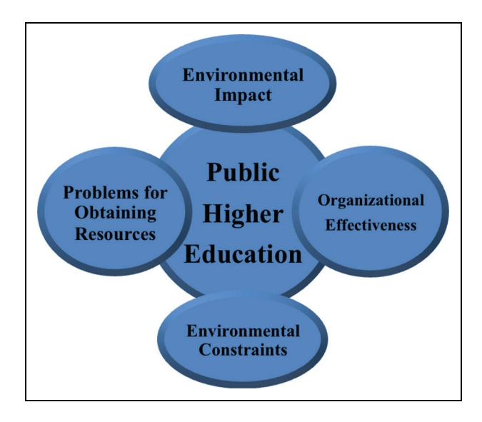

<!-- A3.R79 | source: papers_json/A3.R79/ -->

Article

## MiE

## Exploring a resource dependency perspective as an organizational strategy for building resource capacity: Implications for public higher education universities

Management in Education 2015, Vol. 29(3) 94–99 ª 2015 British Educational Leadership, Management & Administration Society (BELMAS)

Reprints and permission: [sagepub.co.uk/journalsPermissions.nav](http://www.sagepub.co.uk/journalsPermissions.nav) DOI: 10.1177/0892020615586805 [mie.sagepub.com](http://mie.sagepub.com)

## Kimberly K Powell

Southern University and A & M College, USA

## Melanie Powell Rey

Southern University and A & M College, USA

## Abstract

Declining state revenue, increased expenditures and rising costs at public universities are critical issues that are further heightened by the current economic environment. In an effort to address the challenges associated with reduced revenue and rising costs, this theoretical paper will explore how public institutions can leverage the resource dependency theory framework for strategy formulation and increased resource capacity. The organization of the paper begins with an introduction that sets forth the topic parameters and rationale of the paper. This is followed by a literature review that provides an overview of pertinent fiscal issues and strategies that were designed to mitigate these issues in public higher education. The authors then introduce the resource dependency theory and its linkage to public higher education based upon an understanding of the institution's interdependence with the external environment. Based upon the resource dependency theory, the authors discuss strategies that can garner greater resources and serve as a guide for university administrators and leaders during strategic planning efforts.

## Keywords

Management, higher education, resource dependency theory, organizational strategy, resource capacity building

## Introduction

Long revered as the ultimate stepping-stone for lifelong success, US higher education has systemically supported citizenry and the betterment of the entire society through products and services aimed at personal development. However, the social contract with public universities is changing. Public higher education in the United States is facing turbulent environments, which include increased accountability and assessment measures, declining state budgets, and diminutive endowments (Duderstadt and Womack, 2003; Hirsch and Weber, 2002; Keller, 1983). Competition for top students and faculty, declines in enrollment and retention, and the scarcity of resources needed to sustain their current activities and achieve their organizational goals further heighten these issues (Duderstadt and Womack, 2003).

Institutions that can quickly respond to these rapid environmental changes are rewarded, and those who are unable to respond in a timely manner face adverse consequences (Duderstadt and Womack, 2003). One way that public university leaders can respond to changes in the higher education environment is by developing strategies that are derived from a resource dependency perspective. In the context of public higher education, resource dependency

explores three key themes: (1) environmental effects on organizations; (2) organizational efforts to manage environmental constraints; and (3) how environmental constraint affects internal organizational dynamics (Pfeffer and Salancik, 2003). From a management-based perspective, theorists (e.g. Greening and Gray, 1994; Oliver, 1991) contend that resource dependence is a key factor in the development of organizational strategy. By drawing on open-systems theories (e.g. Katz and Kahn, 1966; Yuchtman and Seashore, 1967), the resource dependency framework looks at organizational action through the scope of the environments in which the organization is located and the need to procure resources that derive from that environment. The procurement of external resources is an essential component to strategic and tactical management of any organization. This theoretical paper thereby explores how leaders in public higher education can garner essential resources by leveraging

## Corresponding author:

Kimberly K Powell, Southern University and A & M College, P.O. Box 9723, Baton Rouge, LA 70813, USA. E-mail: kimberly_powell@subr.edu

<!-- page 2 -->

Powell and Rey 95

resource dependency-based strategies. This will in part help to increase the likelihood of institutional change, institutional survival and sustainability, and adaptation in response to external forces and environmental changes (Pfeffer and Salancik, 1978).

## Literature review

## Factors and forces impacting public higher education

External forces, such as competitive forces and declines in state funding, have deeply impacted four-year, public institutions in particular (Duderstadt and Womack, 2003). Public support for state institutions is deeply connected to the economic environment of its respective state (Brown and Gamber, 2002; Duderstadt and Womack, 2003). It was in the late 1970s that public support for higher education began to lose its momentum, followed by an overall decline. This decline was in part attributed to the reallocation of resources to other areas such as healthcare, crime prevention, and K-12 education. Consequently, public support for higher education declined throughout the 1980s and early 1990s (Duderstadt and Womack, 2003).

During these periods of decline, public universities have employed strategies that included tightening their wallets, cutting programs, and increasing productivity (Brown and Gamber, 2002; Duderstadt and Womack, 2003). Despite these strategies, it was impossible for cost containment efforts alone to offset the erosion in state support during the 1980s and 1990s, thereby resulting in college students having to bear the financial burden. Although public support for higher education recuperated somewhat with a stronger economy during the late 1990s, state appropriations again declined in 2001 as the national economy began to weaken (Duderstadt and Womack, 2003).

Additional market forces are transforming public universities by making them more responsive, efficient, and entrepreneurial (Duderstadt and Womack, 2003; Keller, 1983; Massey, 2001; Stevenson and Bishop, 2008). These institutions once enjoyed a monopoly over postsecondary education due to geographic location and their dominance on credentialing through the awarding of degrees. According to Duderstadt and Womack (2003): 'statewide systems of public universities have operated essentially as cartels, with roles and markets carefully prescribed. Today, however, all of these market constraints are being challenged by greater dependence on market forces and less on regulation' (Duderstadt and Womack, 2003: 76). Currently, these market constraints are being disputed by a greater dependence on market forces. With increased growth in the complexity of the postsecondary enterprise and the onset of technological advances that have minimized barriers to entry by competitors, the perspective of a market-driven restructuring of the higher education industry is a critical framework for considering the fiscal future of the public university (Duderstadt and Womack, 2003).

These new realities have prompted leaders in the higher education arena to assert that the US needs to adopt new frameworks for procuring resources and operating its

public universities if they are to thrive into the future (Duderstadt and Womack, 2003; Waggaman, 2001). In addition to adopting new frameworks, researchers postulate that higher education resource capacity building efforts should concentrate on making strategic investments in the future by gaining a better understanding of the higher education environment, resources, and spending patterns (Gansemer-Topf and Schuh, 2006; Ryan, 2004).

## The resource dependency theory and public higher education

Given the need for a strategic framework that promotes a greater understanding of the higher education environment and resources, certain environment-based theories should be considered for public higher education. Population ecology has an environment-based focus and looks at materials within the environment relative to population density. However, population ecology does not take organizational change and behavior, causes of internal organizational dynamics, and adaptation in response to external forces into consideration. Although initially emphasizing the effects of the social environment on organizations, institutional theory concentrates on the material conditions of the environment as contrasted with cultural norms, values, and social expectations. The resource dependency theory serves as a better fit given its three primary themes: (1) environmental effects on organizations; (2) organizational efforts to manage environmental constraints; and (3) how environmental constraint affects internal organizational dynamics (Pfeffer and Salancik, 2003).

Although the resource dependency theory has been heavily integrated in the organizational strategy of forprofits, this theory has also been applied in the nonprofit arena. In recent years, researchers such as Lenaghan (2006), Mosley (2010), Seo (2011), and Sleet (2010), have explored the resource dependency theory in the nonprofit sector (e.g. healthcare services). However, these areas are exclusive of higher education. Askin (2007) and McAllister-Spooner and Kent (2009) explored the resource dependency theory in aspects of higher education, but their research is delimited to community colleges. Internationally, Machado (2005) employed the resource dependency theory in order to clarify why federal universities in Brazil look to private institutions in order to generate revenue. Huisman (1991) conducted a critical analysis of higher education studies that lead to a theoretical framework consisting of the resource dependency theory, to analyze differentiation and diversity in Dutch higher education.

Based upon the literature, changes and challenges face higher education institutions. These challenges have called for public universities in the US to look outside of traditional paradigms and frameworks for obtaining resources. Therefore, the resource dependency theory will be explored due to its emphasis on understanding the environmental elements in order to acquire essential resources for capacity building. This is imperative and has implications for successful strategic planning efforts (Pfeffer and Salancik,

<!-- page 3 -->

1978, 2003) and institutional survival and sustainability. Successful strategic planning is crucial in higher education given the mixed success of past efforts and the tendency of universities to focus on specific processes and not longterm considerations (Duderstadt and Womack, 2003). Despite the importance of the environment for organizations, limited attention has been focused on this area (Pfeffer and Salancik, 2003).

## Resource dependency framework in the context of organizational sustainability and survival

To gain a greater understanding of how resource dependency-based strategies can be beneficial to public higher education leadership, the framework must be examined in the context of organizational survival and sustainability. According to Pfeffer and Salancik (1978, 2003), the underpinning of organizational survival is the organization's ability to acquire resources in an uncontrolled environment. This requires a systems level of thinking by public universities with an understanding of inputs and outputs (Birnbaum, 1988). A university should view itself as an organization or system comprised of subunits or subsystems that interact both among themselves and with the environment external to the university's boundaries (Birnbaum, 1988). Inputs and outputs in higher education can be viewed as a student who enters a university (input), interacts with faculty and fellow students, and then graduates or drops out thereby returning to the environment as an output. Even when the student returns to the environment as a 'product', this student continues to impact the system as an alumni, potential donor, citizen, and marketer for the institution (Birnbaum, 1988). Organizations are linked to the environment through their dependence on other organizations for the many resources they require (Pfeffer and Salancik, 2003). For example, universities are linked to their environments for critical resources such as students or funding. Some universities may find essential resources such as funding or students randomly dispersed throughout the environment or clustered in identifiable areas, while these same resources are abundantly available for other universities. As environments become more tumultuous, organizations must adapt and evolve quicker than their counterparts (Birnbaum, 1988; Terreberry, 1968). Therefore, the actions executed by organizations can be better understood by knowing something about the organization's level of effectiveness, the organization's environment, the problems it creates for obtaining resources, and the contingencies and constraints deriving from that environment (Pfeffer and Salancik, 1978, 2003).

## Organizational effectiveness

A predominate way in which organizations are viewed as effective is the level in which they are achieving or have achieved a set of goals. A goal-oriented view of organizations is that they are a collection of individual efforts that come together to achieve something that could not be

accomplished through individual action alone (Pfeffer and Salancik, 1978, 2003). For universities, as well other organizations, organizational effectiveness is achieved through avenues such as strategic planning efforts that are designed to measure and assess specific goals and outcomes. However, a social dynamic comes into play. Since organizations utilize society's resources, their assessments are driven by certain societal groups and coalitions that evaluate the appropriateness of their activities and the usefulness of their output (Parsons 1956; Pfeffer and Salancik, 2003). In the context of public universities, these groups and coalitions can include state legislators, private donors, and taxpayers who are holding colleges and universities accountable for justifying resources that are quickly diminishing in the area of higher education (Michel and Pringle, 2007). From this perspective, universities need to develop a strategic context that hinges on long-term considerations for university effectiveness (Duderstadt and Womack, 2003).

## The environment and its impact for obtaining resources

The public higher education environment in the US creates certain challenges for obtaining resources. 'Once number one in college degrees held by 25- to 34-year-olds, by 2010 the US was 12th among 36 developed nations. Graduation rates (except for the handful of students at the most selective institutions) lag, tuition is on the rise, and the unemployment rate is at record highs for recent college graduates (Kirschner, 2012, p.5)'. Higher education must contend with tighter and more politically infused federal and state budgets. Competition for resources such as students and funding in higher education is stiffer, inequality has widened, and it has become much more difficult for universities with fewer resources to graduate students who are effectively prepared to enter and flourish in a technologically advanced, information-based, and increasingly competitive workplace. Private philanthropy is made up of a greater number of younger donors who are more inclined toward ''create tomorrow'' investments, rather than 'save the day' gifts. Therefore, it is imperative that universities survey their environment to assess how successful navigation of the competitive landscape can be achieved (Wilson, 2011).

## The constraints deriving from the environment

Constraints occur when one response to a given situation is more probable than any other response to the situation. Although perceived as undesirable and restrictive, behavioral constraints can facilitate the decision process and choice. The concept of constraint explains why people account for relatively little divergence in the performance and activities of organizational systems (Pfeffer and Salancik, 2003). Every individual, including leaders, operates under some level of constraint (Birnbaum, 1988; Pfeffer and Salancik, 2003). Behavior is constrained by social influence, physical realities, information and cognitive capacity, and personal preferences (Pfeffer and Salancik, 2003). For example, a university could be constrained

<!-- page 4 -->

Powell and Rey 97

based upon the loss of administrative control. This loss of administrative control could be attributed to the presence of external funding by private donors and control agencies that bypass and weaken the university's administration, such as governing boards (Birnbaum, 1988).

The following schematic highlights a resource dependency perspective for understanding the higher education environment and building resource capacity in public higher education.

## Potential strategies from a resource dependency perspective

From a resource dependency perspective, public universities can consider two adaptive yet responsive strategies to build resource capacity––adapting and changing to fit environmental requirements or attempting to alter the environment in order to fit the institution's capabilities (Pfeffer and Salancik, 2003). To successfully employ either one of these strategies, public universities need to see themselves as if for the first time and strategically ask: 'What business are we really in? What special role does our university play in the US's public higher education network? What attractive and important set of services does our university provide that people cannot obtain elsewhere better, faster, or cheaper? What comparative advantages do we have over approximately similar places? What academic fields and university services will be most needed by the country and our region in the next decade? With our traditions, location, and collection of faculty and administrators, what should our institution be building toward? What should our university aspire to be ten years from now?' An academic strategy that employs a resource dependency perspective seeks to answer these questions (Keller, 1983).

## Adapting and changing to fit environmental requirements

Adapting and changing to fit environmental requirements encompasses the marketing concept (Kotler, 1967). With

this strategy, public universities can assess the needs of the marketplace, and then adapt their product and processes to meet some of these needs (Pfeffer and Salancik, 2003). One burgeoning trend is collaboration. Greater emphasis and creation of synergistic partnerships with other universities (both domestically and abroad), federal agencies, new and emerging growth industries, community partnerships, and businesses worldwide as integral parts of their strategic advancement are critical for building resource capacity (Wilson, 2011).

In the context of higher education/industry partnerships, the need for increased partnerships hinges on the premise that higher education and industry sectors of the US do not collaborate enough to ensure that students are adequately prepared for jobs. Employers increasingly report that they have trouble filling positions, because they are unable to find qualified applicants (Gonzalez, 2011). From a resource dependency perspective, if a university has more industry-based partnerships then greater internship opportunities are available for students. Graduates (output), who developed certain skills and enrichment from internship experiences they had during college, are more likely to have greater career options. Greater career options and earning potential for alumni can result in increased alumni donations to the university.

Strategic partnerships, such as higher education/community partnerships, are congruent with the core mission of the public university and the land grant model (Duderstadt and Womack, 2003; Hirsch and Weber, 2002; Maurrasse, 2001). Higher education/community partnerships support the community service component of higher education, are responsive to societal needs, and impact the institutional health of higher education. These partnerships meet a broader societal demand, particularly those partnerships that address poor and disenfranchised populations where the needs are most severe. Universities that establish these partnership initiatives can obtain resources from external supporters such as the federal government's Community Outreach Partnership Center program through the department of Housing and Urban Development (Maurrasse, 2001).

## Attempting to alter the environment to fit the institution's capabilities

Alternatively, public universities can adopt the strategy of altering the environment in order to fit the institution's capabilities. From this standpoint, universities create environments to which they adapt by selecting the market segments they will serve––by excluding some environmental elements and including others. For example, universities which obtain a significant amount of their resources from alumni, may institute selection procedures which ensure sufficient supplies (Pfeffer and Salancik, 2003). Databased decision-making is also an important component of this strategy. By evaluating institutional data, universities can determine their programmatic effectiveness and make reductions and changes accordingly (Fischer, 2011). By strategically streamlining, merging, modifying, or even phasing out certain academic programs and services, universities will have greater clarity regarding their purpose,

<!-- page 5 -->

mission, and vision. This will enable universities to undergo successful market segmentation and be able to concentrate on obtaining resources within that particular environment. To illustrate, if university data yields a heavy concentration of nontraditional students that commute and work full-time, then the university can modify its services and efforts by offering more online programs, hybrid programs, and virtual advising hours to appeal to existing students, while leveraging these features to attract a greater number of nontraditional students.

## Conclusion

In order for higher education institutions to flourish and remain competitive in an ever-changing economic environment, various models and perspectives must be considered. Given the changes of the economic environment, fewer barriers to entry, and market forces, it is imperative that public higher education institutions understand this environment and work within it to acquire and strengthen their resource capacity. By providing a resource dependency perspective, higher education institutions can enhance strategic planning efforts and glean applicable strategies to mitigate challenges, such as financial vulnerability, that are caused by environmental changes.

## Funding

This research received no specific grant from any funding agency in the public, commercial, or not-for-profit sectors.

## References

- Askin JA (2007) Community college mission: Re(s)ources make a difference. Community College Journal of Research and Practice 31(12): 977–997.
- Birnbaum R (1988) How Colleges Work: The Cybernetics of Academic Organization and Leadership. San Francisco, CA: Jossey-Bass.
- Brown W and Gamber C (2002) External cost factors: Are states' policies for higher education institutions helping or hindering cost containment opportunities? Ashe-Eric Higher Education Report 28(5): 99–128.
- Duderstadt JJ and Womack FW (2003) The Future of the Public University in America: Beyond the Crossroads. Baltimore, MD: The Johns Hopkins University Press.
- Fischer K (2011) Public-university leaders plan for more hard times ahead. Chronicle of Higher Education. Available at: [http://chronicle.com/article/Public-University-Leaders-Plan/](http://chronicle.com/article/Public-University-Leaders-Plan/129786/) [129786/](http://chronicle.com/article/Public-University-Leaders-Plan/129786/) (accessed on 10 January 2015).
- Gansemer-Topf AM and Schuh JH (2006) Institutional selectivity and institutional expenditures: Examining organizational factors that contribute to retention and graduation. Research in Higher Education 47(6): 613–642.
- Gonzalez J (2011) More partnerships between colleges and industry could produce a better-prepared work force. Chronicle of Higher Education. Available at:[ http://chronicle.com/article/](http://chronicle.com/article/More-Partnerships-Between/128293/) [More-Partnerships-Between/128293/](http://chronicle.com/article/More-Partnerships-Between/128293/) (accessed on 10 January 2015).

- Greening DW and Gray B (1994) Testing a model of organizational response to social and political issues. Academy of Management Journal 37(3): 467–98.
- Hirsch WZ and Weber L (2002) As the Walls of Academia are Tumbling Down. London, UK: Economica.
- Huisman J (1991) Differentiation, Diversity, and Dependency in Higher Education: A Theoretical and Empirical Analysis. Doctoral dissertation. Available from Proquest Dissertations and Theses database, UMI No. C471823.
- Katz D and Kahn RL (1966) The Social Psychology of Organizations. New York, NY: Wiley.
- Keller G (1983) Academic Strategy: The Management Revolution in American Higher Education. Baltimore, MD: Johns Hopkins University Press.
- Kirschner A (2012) Innovations in higher education? Hah! The Chronicle of Higher Education. Retrieved 7 January 2015, from [http://chronicle.com/article/Innovations-in-Higher/131424/](http://chronicle.com/article/Innovations-in-Higher/131424/)
- Kotler P (1967) Marketing Management: Analysis, Planning, and Control. Englewood Cliffs, NJ: Prentice-Hall.
- Lenaghan RF (2006) A Model of Cash Flow Components and Resource Dependency as Determinants of Short-Run Financial Vulnerability in Nonprofit Organizations. Doctoral dissertation. Available from Proquest Dissertations and Theses database, UMI No. 3205986.
- Machado MVV (2005) Entrepreneurial Activities in the Brazilian Federal Universities: A Case Study of the Federal University of Ceara´. Doctoral dissertation. Available from Proquest Dissertations and Theses database, UMI No. 3163432.
- Massey WF (2001) Reengineering resource allocation systems. In: Yeager JL, Nelson GM, Potter EA, Weidman JC and Zullo TG (eds) ASHE Reader on Finance in Higher Education (2nd ed.). Boston, MA: Pearson Custom Publish, pp.445–463.
- Maurrasse DJ (2001) Beyond the Campus: How Colleges and Universities Form Partnerships with Their Communities. New York, NY: Routledge.
- McAllister-Spooner S and Kent M (2009) Dialogic public relations and resource dependency: New Jersey community colleges as models for website effectiveness. Atlantic Journal of Communication 17(4): 220–239.
- Michel M and Pringle C (2007) Assessment practices in AACSBaccredited business schools. Journal of Education for Business 82(4): 202.
- Mosley JE (2010) Organizational resources and environmental incentives: Understanding the policy advocacy involvement of human service nonprofits. Social Service Review 84(1): 57–76.
- Oliver C (1991) Strategic responses to institutional processes. Academy of Management Review 16(1): 145–179.
- Parsons T (1956) Suggestions for a sociological approachtothetheory of organizations. Administrative Science Quarterly 1(1): 63–85.
- Pfeffer J and Salancik GR (1978) The External Control of Organizations: A Resource Dependence Perspective. New York, NY: Harper and Row.
- Pfeffer J and Salancik GR (2003) The External Control of Organizations: A Resource Dependence Perspective. Stanford, CA: Stanford Business Books.
- Ryan JF (2004) The relationship between institutional expenditures and degree attainment at baccalaureate colleges. Research in Higher Education 45(2): 97–114.

<!-- page 6 -->

Powell and Rey 99

Seo JW (2011) Resource Dependence Patterns and Organizational Performance in Nonprofit Organizations. Doctoral dissertation. Available from Proquest Dissertations and Theses database, UMI No. 3487466.

- Sleet M (2010) Resource Dependence and Medicaid Maximization in Community Mental Health Organizations. Doctoral dissertation. Available from Proquest Dissertations and Theses database, UMI No. 3397648.
- Stevenson JM and Bishop D (2008) The Engrossed Entrepreneurial Campus: What our Economy and our Academy Need Now. Dublin: Academica Press.
- Terreberry S (1968) The evolution of organizational environments. Administrative Science Quarterly 12(4): 590–613.
- Waggaman J (2001) Strategies and consequences: Managing the costs in higher education. In: Yeager JL, Nelson GM, Potter EA, Weidman JC and Zullo TG (eds) ASHE Reader on Finance in Higher Education (2nd ed.). Boston, MA: Pearson Custom Publishing, pp.301–315.
- Wilson JS Jr (2011) Multidimensional challenge for black colleges. Chronicle of Higher Education. Available at:[ http://](http://chronicle.com/article/A-Multidimensional-Challenge/129046/) [chronicle.com/article/A-Multidimensional-Challenge/129046/](http://chronicle.com/article/A-Multidimensional-Challenge/129046/) (accessed on 7 January 2015).

Yuchtman E and Seashore SE (1967) A system resource approach to organizational effectiveness. American Sociological Review 32(6): 891–903.

## Author biographies

Kimberly K Powell holds a PhD in Urban Higher Education from Jackson State University and additional certifications in both management and marketing from Tulane University and Texas A & M University – Commerce. Dr Powell is an Assistant Professor of Marketing. Her research interests include leadership in higher education, globalization in marketing education, and marketing for higher education.

Melanie Powell Rey holds a PhD in Special Education from Southern University and A & M College. Dr Rey is a staff member in the College of Business and an Adjunct Professor of Speech – Language Pathology and Special Education. Her research interests include diversity in higher education, culturally and linguistically diverse learners, and autism in sub-Saharan Africa.
