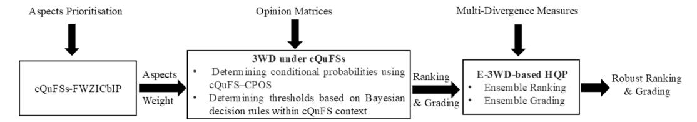
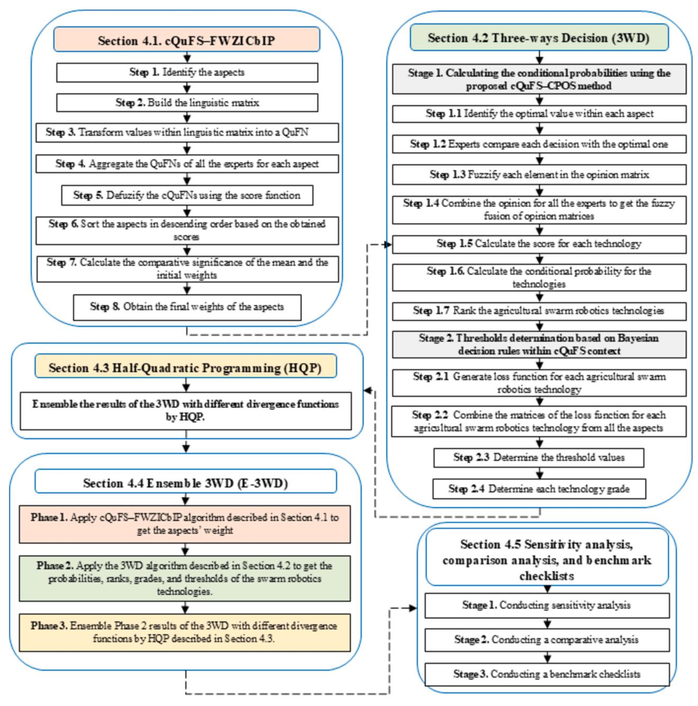
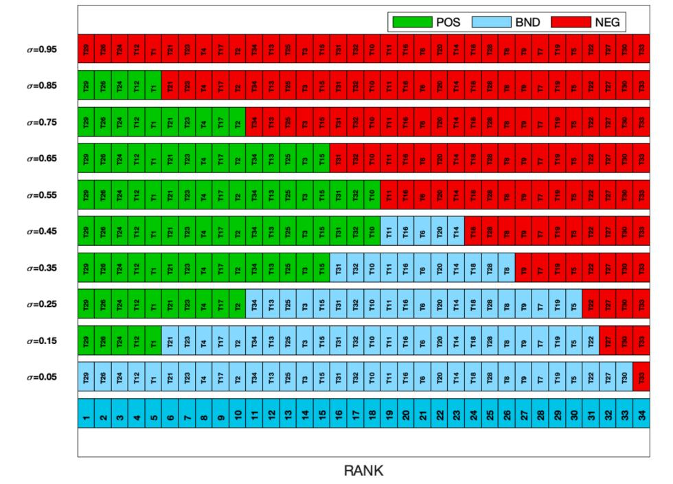
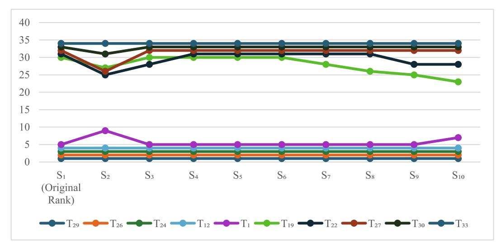
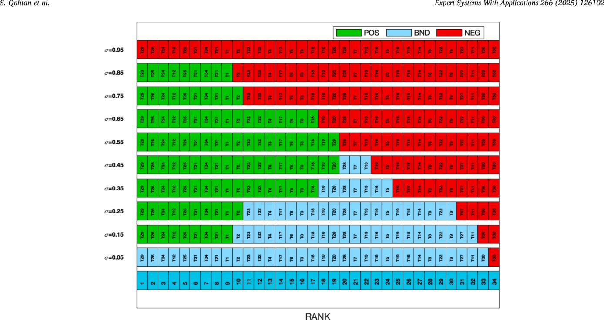
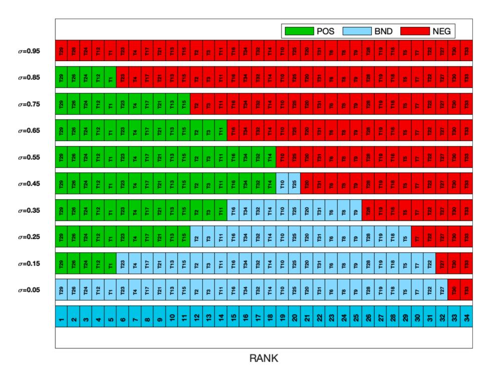
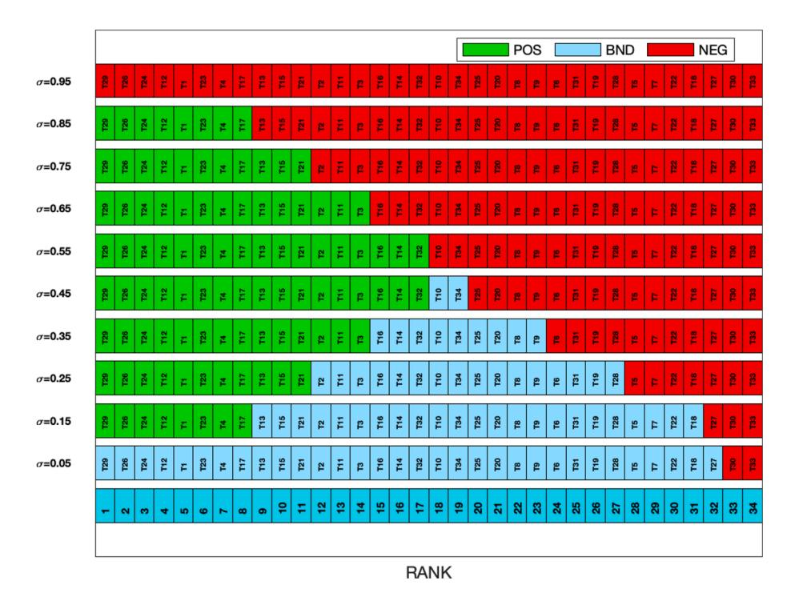
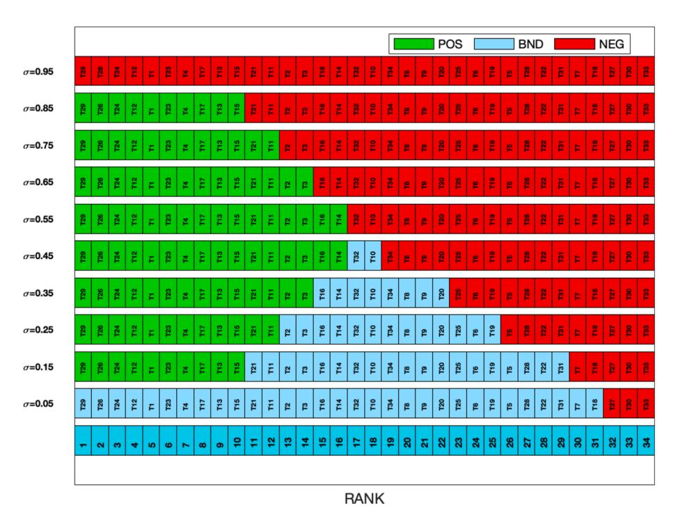
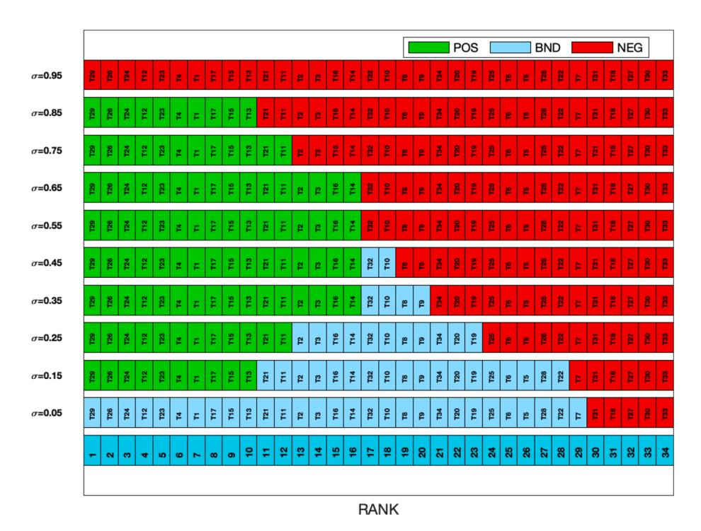

<!-- A3.R81 | source: papers_json/A3.R81/ -->

Contents lists available at [ScienceDirect](www.sciencedirect.com/science/journal/09574174)

## Expert Systems With Applications

journal homepage: [www.elsevier.com/locate/eswa](https://www.elsevier.com/locate/eswa)




## Robust three-way decisions based on ensembled multi-divergence measures with circular quintic fuzzy sets for developing swarm robots in mechanised agricultural operations

Sarah Qahtan [a](https://orcid.org/0000-0002-5636-5901) , Nahia Mourad ^b^ , Hassan A. Ibrahim c,f [,](https://orcid.org/0000-0003-1182-936X) Aws Alaa Zaidan ^d^ [,](https://orcid.org/0000-0001-6090-0391) Bilal Bahaa ^d^ , Weiping Ding e,*

- ^a^ *Information* *Technology* *Unit,* *College* *of* *Health* *and* *Medical* *Technology-Baghdad,* *Middle* *Technical* *University,* *Baghdad,* *Iraq*
- ^b^ *Faculty* *of* *Engineering* *&* *IT,* *British* *University* *in* *Dubai,* *Dubai,* *United* *Arab* *Emirates*
- ^c^ *Research* *Center,* *Mazaya* *University* *College,* *Nasiriyah,* *Iraq*
- ^d^ *SP* *Jain* *School* *of* *Global* *Management,* *Lidcombe,* *Sydney,* *NSW* *2141,* *Australia*
- ^e^ *School* *of* *Artificial* *Intelligence* *and* *Computer* *Science,* *Nantong* *University,* *Nantong* *226019,* *China*
- ^f^ *MEU* *Research* *Unit,* *Middle* *East* *University,* *Amman,* *Jordan*

## ARTICLE INFO

## *Keywords:* Three-way decisions Ensembling approaches Circular fuzzy sets Multi-divergence measures. Swarm robotics Mechanised agricultural operations

## ABSTRACT

Robotics is expected to play a crucial role in agriculture, with swarm robotics technologies frequently highlighted as solutions to enhance the efficiency and resilience of mechanised agricultural operations, particularly in precision farming and large-scale applications. While many technologies have been proposed and evaluated based on seven key aspects in academic literature, previous evaluations have not considered the interrelationships among these aspects or provided a simultaneous ranking and grading of the technologies, leaving a significant research gap. Identifying the most and least efficient technologies presents a complex multi-aspect decisionmaking (MADM) problem due to diverse evaluation aspects, prioritisation challenges, and data variability. Although MADM methods based on Three-Way Decisions (3WD) approach can address this, they often yield conflicting results due to the use of multiple divergence measures. Furthermore, uncertainty remains an open challenge, highlighting a significant theoretical gap. Thus, the main objective of this study is to propose a robust 3WD approach based on ensembled multi-divergence measures, with the introduction of a new Circular Quintic Fuzzy Sets (cQuFS) to provide a robust mechanism for ranking and grading swarm robotics technologies. This study's contributions encompass: (1) the reformulation of Fuzzy Weighted Zero Inconsistency-Based Interrelationship Process (FWZICbIP) utilising the proposed cQuFS, referred to as the cQuFS–FWZICbIP method to prioritize evaluation aspects and address uncertainty in the weighting process; (2) the extension of the 3WD approach within Conditional Probabilities by Opinion Scores (CPOS) method to determine decision thresholds in the context of the proposed cQuFS, referred to as the cQuFS–CPOS method, for determining the conditional probability of each technology. Furthermore, the proposed cQuFS reformulates Bayesian decision theory to establish decision thresholds for all technologies; and (3) reconciling varied outcomes through an ensemble 3WD (E-3WD) approach based on Half-Quadratic Programming (HQP). The proposed MADM method based on E-3WD is applied to rank and grade 34 technologies on the basis of seven evaluation aspects, with a consensus index and trust level calculated through the E-3WD approach, providing a robust mechanism for ranking and grading. The results revealed that T29, T26, T24, T12, and T1 exhibited a notable degree of efficacy, as indicated by their placement in the positive region throughout eight σ values. However, T33 consistently belonged to the NEG region across all σ values. Sensitivity and comparison analyses confirmed the robustness and stability of the proposed methodology.

*E-mail* *addresses:* [sarah.qahtan@mtu.edu.iq](mailto:sarah.qahtan@mtu.edu.iq) (S. Qahtan), [nahia.mourad@buid.ac.ae](mailto:nahia.mourad@buid.ac.ae) (N. Mourad), [hassan.alsattar@uom.edu.iq](mailto:hassan.alsattar@uom.edu.iq) (H.A. Ibrahim), [aos.aljuboori@](mailto:aos.aljuboori@spjain.edu.au) [spjain.edu.au](mailto:aos.aljuboori@spjain.edu.au) (A.A. Zaidan), [bilal.zaidan@spjain.edu.au](mailto:bilal.zaidan@spjain.edu.au) (B. Bahaa), [dwp9988@163.com](mailto:dwp9988@163.com) (W. Ding).

> ^*^ Corresponding author.

<!-- page 2 -->

## **1.** **Introduction**

Agricultural mechanisation is a field within agribusiness that experiences the greatest energy usage and overall expenses in agricultural production, accounting for around 60 % of energy consumption ([Gautam](#page-29-0) et al., 2023). This issue arises as a result of the unique characteristics of farming activities, which necessitate a significant amount of mechanical energy (Chalkias & [Stathatos,](#page-29-0) 2024). These operations encompass several phases of agricultural production, including seeding, soil preparation, crop management, planting, conditioning of crop leftovers and harvesting. The primary energy sources used in agriculture are agricultural tractors. These tractors enable the operation of various agricultural machinery such as seeders, harrows, brush cutters, ploughs, harvesters, sprayers, chisels, crushers, conditioners, subsoilers, planters, terriers, cutters, and rakes ([Albiero,](#page-29-0) Pontin Garcia et al., 2022). From the late 19th century to the early 20th century, the agricultural tractor emerged and underwent enhancements in power and weight to enhance its field capacity (Chalkias & [Stathatos,](#page-29-0) 2024). Agricultural tractors have had a 3,300 % increase in power over the course of 100 years [(Vogt](#page-31-0) et al., [2021)](#page-31-0).

According to [(Renius,](#page-30-0) 2023), the biggest tractors available at the beginning of the 20th century had a power output of roughly 15 kW. Currently, in the early 21st century, we have achieved a power level of around 500 kW for agricultural tractors (Chalkias & [Stathatos,](#page-29-0) 2024). Contemporary literature mostly agrees that the power growth curve of these machines is stabilising and approaching an optimum limit. This tendency is reaching a technological threshold for characteristics that signify three important issues: One issue is the high energy consumption of large tractors, which use a substantial amount of fossil diesel fuel ([ASABE,](#page-29-0) 2024). Another concern is the weight of these machines, which has increased from approximately 1,300 kg in 1902 to 25,000 kg in 2019 ([Renius,](#page-30-0) 2023). This substantial increase in weight leads to severe soil degradation in terms of physical and mechanical properties, specifically soil compaction. These two issues signify reductions in food; The third and equally important factor is the investment cost of these machines, which might amount to US$ 1,100.00 per kW ([Albiero,](#page-29-0) Pontin Garcia et al., 2022; Chalkias & Stathatos, 2024; [TractorHouse,](#page-29-0) 2024). Recently, ([Albiero,](#page-29-0) Pontin Garcia et al., 2022) initiated a call to the Agricultural Robotics Research Community (ARRC) to propose a research roadmap in the opposite direction. The aim of presenting a research roadmap that focuses on reducing the power and weight of tractors while increasing their quantity. Such an approach aimed to optimise agricultural operations in terms of logistics, operational geometry, and energy efficiency by leveraging the field of robotics. Instead of utilising a single huge machine with a power output of hundreds of kW, their proposal suggests employing multiple robotic tractors with power outputs in the tens of kW.

This anti-paradigmatic approach, however, is hindered by a significant issue. It encounters the present socio-economic conditions of agricultural regions in western countries ([Albiero,](#page-29-0) Paulo, et al., 2022). There is a shortage of tractor operators, and their expenses, including charges, wages, insurance, taxes, and training, are comparatively expensive. Consequently, an apt solution offered by the field of robotics is to employ these diminutive robotic tractors as several robots operating in a swarm configuration. The European SPARC Committee has set a goal for future research efforts that provide substantial opportunities to investigate the replacement of large tractors with small multi-robot [(SPARC,](#page-30-0) [2020)](#page-30-0).

Agricultural robotics is a mature field characterised by considerable research and sophisticated applications. A prevailing trend in agriculture exists at present (Albiero, Paulo, et al., 2022; [Fernandes](#page-29-0) et al., [2023)](#page-29-0). Hokkaido University undertook extensive research in agricultural robotics from 1990 to 2018. These studies encompassed all facets of the discipline and clearly illustrated the efficacy of agricultural robotic systems [(Roshanianfard](#page-30-0) et al., 2020). According to [(Lowenberg-](#page-30-0)[DeBoer](#page-30-0) et al., 2023), there is a requirement for further in-depth research

on the economic consequences of agricultural robotics. They argued that most studies currently evaluate the financial impact of these technologies using prototype-based technological criteria, which obscures the true results. In their comprehensive study on agricultural multi-robots, (Mao et al., [2021](#page-30-0)) examined various aspects including path planning, environment perception, communication, formation control, and task allocation. They find that these synergistic technologies not only enhance efficiency but also address the issue of declining labour supply. According to (Ball et al., [2022)](#page-29-0), there have been notable advancements in the development of agricultural robotic technologies, with systems that have been thoroughly tested in real-world conditions. The commercialisation of agricultural robotics is experiencing a rise in investment, evident from the emergence of start-ups and established enterprises offering a wide range of products and services. Advanced robotic technologies have the potential to enhance agricultural operations by minimising the amount of time humans need to spend on hazardous and routine duties.

Recently, ([Albiero,](#page-29-0) Pontin Garcia et al., 2022) conducted a comprehensive evaluation of 34 swarm robotics technologies in mechanised agricultural operations. The evaluation covered seven aspects (see [Section](#page-2-0) 2.1). Despite the authors' significant efforts, they did not consider the interrelationships among these aspects. Additionally, they did not rank or grade 34 agricultural swarm robotics technologies, which may be considered a research gap, as explained in detail in [Sec](#page-2-0)[tion](#page-2-0) 2.1. The task of selecting the most suitable and unsuitable technologies remains challenging and presents a complex multi-aspect decision-making (MADM) problem, due to three reasons outlined in [Section](#page-2-0) 2.1. Although MADM method based on the Three-Way Decisions (3WD) approach can address this, they often yield conflicting results due to the use of multiple divergence measures, as explained in [Section](#page-4-0) [2.2.1.](#page-4-0) Furthermore, uncertainty remains an open challenge, as discussed in [Section](#page-5-0) 2.2.2, highlighting a significant theoretical gap. Accordingly, [Section](#page-2-0) 2.2 presents and justifies a new MADM method based on the 3WD approach to address both research and theoretical gaps. To manage the uncertainty associated with the ranking and grading of technologies, Circular Quintic Fuzzy Sets (cQuFS) are discussed and proposed in [Section](#page-5-0) 2.2.2. Building upon this foundation, the study aims to reformulate the Fuzzy Weighted Zero Inconsistency-Based Interrelationship Process (FWZICbIP) using the proposed cQuFS, referred to as the cQuFS–FWZICbIP method; extend the 3WD approach by incorporating the Conditional Probabilities by Opinion Scores (CPOS) method within the context of the proposed cQuFS, referred to as the cQuFS–CPOS method; and integrate Bayesian decision theory under the proposed cQuFS. Additionally, a robust Ensemble 3WD (E-3WD) approach is formulated using ensembled multi-divergence measures via Half-Quadratic Programming (HQP), as elaborated in [Section](#page-4-0) 2.2.1. Consequently, the originality and primary contributions of the study are summarised as follows, as shown in [Fig.](#page-2-0) 1.

- This paper prioritises the seven evaluation aspects that influence the ranking and grading of swarm robotics technologies in mechanised agricultural operations. To achieve this, a new cQuFS–FWZICbIP method is formulated to enhance the certainty and effectiveness of the weighting process.
- This paper also determines the conditional probability and decision thresholds for thirty-four swarm robotics technologies in mechanised agricultural operations based on opinion matrices. It formulates the 3WD approach by incorporating the cQuFS–CPOS method and Bayesian decision theory under the proposed cQuFS to improve the certainty and effectiveness of the ranking and grading process.
- This paper further develops a robust E-3WD-based HQP approach for ensembling results derived from multi-divergence measures to reconcile varying decision outcomes (acceptance, rejection, or indecision). The consensus index and trust level of the E-3WD are then calculated. This approach provides a robust mechanism for

<!-- page 3 -->


***Fig.** **1.** Graphical representation of the paper contributions.*

ranking and grading swarm robotics technologies in mechanised agricultural operations.

The initial section emphasises the significance of swarm robotics technology in the agricultural sector. In addition, it covers the research gap, objectives, and contributions of this investigation. The fundamental thoughts and ideas that will guide the advancement of this research in the subsequent examination are stated in Section 2. The preliminaries and the proposed methodology are discussed in [Sections](#page-6-0) 3 and 4, respectively. The experimental results and discussion are reported in [Section](#page-11-0) 5, as well as a sensitivity analysis, comparative analysis, and benchmark checklists to validate the proposed approach and findings. Finally, our study provided a basis for continued field research by identifying potential areas for further investigation in [Section](#page-18-0) 6.

## **2.** **Related** **works**

## *2.1.* *Review* *of* *agricultural* *swarm* *robotics*

In their resent study, [(Albiero,](#page-29-0) Pontin Garcia et al., 2022) identified thirty-four swarm robotics technologies in mechanised agricultural operations, as mentioned earlier. [Table](#page-3-0) 1 presents the evaluation of 34 swarm robotics technologies in mechanised agricultural operations by ([Albiero,](#page-29-0) Pontin Garcia et al., 2022). The evaluation was conducted based on seven aspects, using the definitions provided by [(SPARC,](#page-30-0) [2020)](#page-30-0). Below, you can find the provided definition of these aspects:

- Technology Readiness Level aspect (TRL) refers to the development level of technology. According to [(SPARC,](#page-30-0) 2020), there are a total of 9 levels which are: (1) fundamental concepts; (2) technology idea formulation; (3) experimental proof-of-concept; (4) technology verified in a controlled laboratory setting; (5) technology verified in the appropriate real-world conditions; (6) technology showcased in the appropriate real-world conditions; (7) prototype verified in an operational setting; (8) system finalised and certified; (9) system validated in an operational setting.
- Configurability aspect (Conf) refers to the robot's ability to be adjusted or customised in order to carry out a certain duty.
- Adaptability aspect (Adap) refers to the ability of the system to adjust and conform to various work conditions.
- Dependability aspect (Depe) refers to the capability of the system to carry out a given task without any systematic errors.
- Motion Ability aspect (MA) refers to the system's ability for movement, which might vary in terms of constraints or freedom depending on the medium.
- Perception Ability aspect (PA) refers to the ability of the robot to accurately observe and understand its surroundings.
- Decisional Autonomy aspect (DA) refers to the robot's ability to operate independently.

In their study, [(Albiero,](#page-29-0) Pontin Garcia et al., 2022) constructed [Table](#page-3-0) 1 based on the mentioned aspects and technologies. The technologies were ranked according to a score defined by (Zhai et al., [2020](#page-31-0)). A score of three indicates that the aspect is fully described and considered with technical details (best); a score of two indicates that the aspect is partially mentioned without further explanations (medium); and a

score of one indicates that the aspect is not addressed at all (worst).

The assessment of the technologies, as presented in [Table](#page-3-0) 1, was conducted by considering each aspect separately. The evaluation did not consider the interrelationship among these aspects. Despite the existence of swarm robotics technologies in mechanised agricultural operations evaluation, no study has simultaneously ranked and graded these technologies, which represents a gap in the existing literature. To solve this research gap, three ranking and grading issues must be considered. First, It is essential to simultaneously consider all seven evaluation aspects ([Ibrahim](#page-29-0) et al., 2024). Furthermore, it is necessary to prioritise these evaluation aspects according to their importance ([Mohammed](#page-30-0) et al., 2023; [Zaidan](#page-30-0) et al., 2024). Besides, the examination of data variance is an additional issue that requires attention during the ranking and grading of swarm robotics technologies ([Albahri](#page-28-0) et al., 2022; Qahtan et al., [2023)](#page-28-0). Thus, identifying the best and least efficient swarm robotics technologies in mechanised agricultural operations constitutes a complicated MADM problem. Consequently, it is imperative to utilise the MADM technique to bridge the existing study gap and effectively tackle the complex nature of the problem.

## *2.2.* *Literature* *related* *to* *research* *methodology*

The process of making decisions is frequently characterised by ambiguity and uncertainty, and the judgement of experts is typically marked by hesitancy and lack of clarity [(Debnath](#page-29-0) & Roy, 2023). Decision-makers often rely on a range of accurate data and information to make judgements ([Jumaah](#page-30-0) et al., 2018). However, an excess of irrelevant data can cause confusion and complicate the decision-making process. This hinders the ability of experts to make informed decisions ([Kazemifard](#page-30-0) & Chachi, 2022).

The primary goal of MADM methods is to aid experts in making optimal choices by taking into account many attributes, criteria, or aspects, resulting in a more systematic and logical decision outcome ([Alsalem](#page-29-0) et al., 2021; Zaidan & Zaidan, 2017). MADM methods offer dependable approaches for addressing real-world problems across diverse applications by delivering logical and reasonable solutions ([Abdulkareem](#page-28-0) et al., 2021; Zi ˇ ˇzovi´c et al., 2020). Recently, MADM has gained significant popularity and is now frequently employed in almost all disciplines. For instance, [(Qahtan](#page-30-0) et al., 2023) and ([Zaidan](#page-31-0) et al., [2023)](#page-31-0) used MADM to rank healthcare systems that utilise Blockchain based on multiple security and privacy aspects. Another study ([Zaidan](#page-31-0) et al., [2024)](#page-31-0) employed MADM to evaluate circular business model innovation based on multiple circular economies' sustainability performance attributes. Furthermore, ([Ibrahim](#page-29-0) et al., 2024) utilised MADM to assess the simulation tools for sustainable mobility as a service based on four main aspects.

Robust MADM methods such as ranking according to compromise solution (MARCOS), fuzzy decision by opinion score method (FDOSM) (Salih & [Zaidan,](#page-30-0) 2020), FDOSM II [(Mahmoud](#page-30-0) et al., 2022), multiattributive ideal-real comparative analysis (MAIRCA), and complex proportional assessment (COPRAS), can be employed to rank the available alternatives. It is important to keep in mind that different approaches can produce varying ranking outcomes (Ecer, [2021)](#page-29-0). Despite numerous attempts being made in the creation of multiple MADM methods, there is currently no comprehensive methodology or single method that surpasses its counterparts ([Saaty](#page-30-0) & Ergu, 2015).

<!-- page 4 -->

| Swarm robotics technologies |  | TRL | Conf | Adap | Depe | MA | PA | DA |
| --- | --- | --- | --- | --- | --- | --- | --- | --- |
| Team multi vehicles (Butzke et al., 2012) | T24 | 7 | 3 | 3 | 3 | 3 | 3 | 3 |
| Foraging robots ( Campo et al., 2010) | T25 | 4 | 3 | 3 | 3 | 3 | 3 | 3 |
| Team robotic tractors (Johnson et al., 2009) | T26 | 7 | 3 | 3 | 3 | 3 | 3 | 3 |
| UAV Spray Swarm ( Al-Megren et al., 2018) | T27 | 2 | 2 | 2 | 2 | 2 | 2 | 3 |
| Control structure for agricultural robots ( Vougioukas, 2012) | T28 | 3 | 2 | 3 | 3 | 2 | 2 | 3 |
| Multi-Ground Vehicles (Shin et al., 2021) | T29 | 7 | 3 | 3 | 3 | 3 | 3 | 3 |
| Swarm robots for renewable resources ( Miletitch et al., 2018) | T30 | 2 | 2 | 1 | 2 | 2 | 2 | 2 |
| Rubber harvesting robot ( Gangadharan & Salgaonkar, 2020) | T31 | 3 | 3 | 3 | 3 | 3 | 3 | 3 |
| Multi-robot navigation ( Jhang et al., 2020) | T32 | 5 | 2 | 3 | 3 | 3 | 3 | 3 |
| Cloud robotics ( Khan et al., 2020) | T33 | 3 | 1 | 2 | 2 | 2 | 1 | 1 |
| Vehicle prediction route (Quann et al., 2020) | T34 | 5 | 3 | 2 | 3 | 3 | 3 | 3 |

Ensemble MADM is a recently introduced concept in the field of MADM that aims to mitigate its drawbacks and leverage the benefits of numerous approaches. This approach exploits the advantages of various MADM methods to mitigate their respective limitations and improve the overall prediction outcome. The ensemble MADM methods aim to resolve the issue of reconciling the potentially conflicting ranks produced by different MADM methods. This technique greatly enhances the field of MADM by offering a systematic mechanism for aggregating ranks, scores, or probabilities, thereby enhancing their dependability. This approach is valuable for resolving conflicting rankings and improving the reliability of decision-making procedures in complicated MADM situations. The process of aggregation is essential for standardising the outcomes, considering the usefulness and drawbacks of each technique, regardless of the inherent distinct advantages and limitations of individual procedures. In multi-aspects/criteria/attributes scenarios, this comprehensive technique is effective in reducing decision bias, improving decision-making, and enhancing the overall quality of the decision-making process in various scenarios [(Zahir,](#page-31-0) 2016).

Within academic literature, a total of ten articles have been found that employed the ensemble MADM methods. The articles have been classified into three groups based on their ensemble approaches. Firstly, there are publications that utilise statistical methods, such as the geometric mean. Furthermore, there are publications that employ voting mechanisms, such as majority voting. Finally, there are publications that utilise HQP. [Table](#page-4-0) 2 provides a comprehensive guide, linking these publications to their corresponding ensemble techniques, covering elements such as case study details, and the use of MADM methods.

Saaty et al. [(Saaty](#page-30-0) & Ergu, 2015) outline the procedure of

<!-- page 5 -->

aggregating different judgements or measures from many experts. He stresses the importance of integrating these judgements through the process of merging, aggregation, or consensus methods. Therefore, to achieve an overall ranking/scores/ probabilities, the performance of aspects on the alternatives must be combined using merging or aggregating methods. Saaty categorises an approach as low-ranking if it is produced by the process of averaging weights, medium-ranking if a simple weighted technique is employed, and high-ranking if a rigorous merging function is applied with appropriate weights. Therefore, methods that utilise statistical measures as aggregation approaches are regarded as low, whereas voting is categorised as medium to high, and half quadratic is labelled as high and advised to be used in the future research direction.

Another issue with the existing MADM methods is their exclusive reliance on aspect values to identify the optimal alternative, without considering the necessity of conducting additional testing to determine the final alternatives. Furthermore, it is crucial to comprehend that while MADM methods such as TOPSIS and VIKOR are efficient for ranking alternatives, they are not appropriate for assessing the grade

(Song et al., [2022;](#page-30-0) Yang et al., 2022). The decision-making outcomes become too harsh due to the deterministic nature of the outcome, which is either acceptance or rejection. This resembles the decision-making process of selecting or rejecting an alternative in any MADM scenario. An efficient method is to incorporate indeterminacy into the decision outcomes and do additional testing. This concept corresponds with the 3WD approach (Yao & [Deng,](#page-31-0) 2011), which focusses on evaluating three options. 3WD integrates both deterministic and nondeterministic decisions, offering a more detailed depiction of decision-making results in standard scenarios. Which aligns with the notion of human decisionmaking in uncertain conditions (Yao, [2016](#page-31-0)).

## *2.2.1.* *Three-Way* *decisions* *(3WD)* *theory*

Yao introduced the 3WD theory to formalise triadic thinking, triadic problem-solving, and triadic computing (Yao, [2011,](#page-31-0) 2010, 2009). This approach depends on triadic structures, including parts, areas, aspects, or viewpoints, to evaluate and interpret complex problems ([Suo](#page-31-0) et al., [2024)](#page-31-0). In recent years, there has been increased focus on the implementation of 3WD, emphasising three primary developmental phases: emergence, incubation, and growth, as seen in [Fig.](#page-5-0) 2. (Liu et al., [2020)](#page-30-0) described these phases as follows: (i) Emergence pertains to rough sets ([Pawlak,](#page-30-0) 1982) and decision-theoretic rough sets (DTRS) (Yao & [Wong,](#page-31-0) [1992)](#page-31-0), wherein rough sets established a framework for approximation imprecise sets through three regions: positive, negative, and boundary. Pawlak's rough sets were constrained by strict binary approximations, while Yao's probabilistic DTRS incorporated error tolerance via probabilistic regions, establishing a basis for the 3WD framework. (ii) Incubation pertains to a specific interpretation of 3WD, focussing on the semantic interpretations of the regions acceptance, rejection, and indecision. (iii) Growth signifies a shift towards an expansive understanding of 3WD, beginning in 2012, which includes triadic thinking, methodologies, and interdisciplinary computing.

Subsequent investigations have revealed that 3WD is a considerably broader concept with extensive applicability (Suo et al., [2024](#page-31-0)), including three-way classification (Yue et al., [2022](#page-31-0)), fuzzy set approximations [(Zhang](#page-31-0) et al., 2020), clustering (Ali et al., [2022)](#page-29-0), decision spaces (Hu, [2016](#page-29-0)), recommendation systems (Liu & Ye, [2020](#page-30-0)), granular computing [(Kong](#page-30-0) et al., 2022), concept analysis (Zhi et al., [2019](#page-31-0)), multiattribute ([Zhan](#page-31-0) et al., 2021), decision support systems ([Chen](#page-29-0) et al., [2017)](#page-29-0), group decision-making [(Zhang](#page-31-0) & Yang, 2019), and many others. These advancements have strengthened 3WD as an adaptable approach for tackling intricate, real-world challenges.

A new aspect of development involved the geometry and Dao of 3WD. Yao's recent work has explored geometric structures of 3WD [(Yao,](#page-31-0) [2021a)](#page-31-0) such as dots, lines, triangles, and circles—to visualize and interpret triads, blending numerical, textual, and visual thinking to support decision-making. Additionally, the Dao of 3WD (Yao, [2023,](#page-31-0) [2021b)](#page-31-0), also known as the TAO (Triading-Acting-Optimising) framework, provides a philosophical basis for triadic thinking. It conceptualizes decision-making as a way of understanding and navigating complex systems through interconnected triads.

Furthermore, other academics have examined the 3WD from different angles (Dun and [Decui,](#page-29-0) 2017), including 3WD utilising weightbased comprehensive evaluation, 3WD incorporating cost-sensitive considerations (Li et al., [2013](#page-30-0)), 3WD aimed at minimising total entropy, 3WD focused on minimising total risk, and so forth. In addition, (Giri et al., [2023](#page-29-0)) used 3WD with probabilistic interval-valued q-rung orthopair hesitant fuzzy set and regret theory to address uncertainty in decision-making. They determined the weights of aspects through multiobjective optimisation, solved using PSO-MGP-UF technique. ([Mondal,](#page-30-0) Roy, [Deveci,](#page-30-0) et al., 2023) utilised the q-ROFS Mahalanobis distance alongside regret and prospect theories, employing a correlation-based weighting method and applying conditional probabilities derived from dominating relations. (Mondal, Roy, [Pamucar,](#page-30-0) et al., 2023) employed interval-valued Fermatean fuzzy numbers and set pair analysis for incomplete information, developed a fuzzy state set utilising possibility

<!-- page 6 -->


***Fig.** **2.** Historical developments of 3WD (Suo et al., [2024)](#page-31-0).*

dominance, and computed conditional probabilities. ([Mondal](#page-30-0) & Roy, [2024)](#page-30-0) formulated Mahalanobis distance utilising Fermatean Fuzzy Sets (FFS) to address interrelationships and used regret and prospect theories to compute conditional probabilities. They exhibit a decision-making method that is comparable to that of humans when faced with realworld decision difficulties.

It can be observed that 3WDs have garnered significant scholarly interest and experienced tremendous growth (Chen, Yao, et al., [2025;](#page-29-0) Chen, Zhao, et al., [2025;](#page-29-0) Jiang & Hu, 2024). Moreover, multi-divergence measures contribute to diverse decision outcomes (acceptance, rejection, or indecision). Consequently, this perspective suggests the need to utilize robust 3WD. Based on this viewpoint, the literature review (see [Table](#page-4-0) 2) reveals that ensembles have not been applied with 3WD to solve the MADM problem or other issues, indicating a theoretical gap. In a recent study ([Alsattar,](#page-29-0) Jana, et al., 2023), the authors extended the concept of 3WD to a circular Pythagorean fuzzy sets (cPFS) environment. The purpose of this extension was to solve the issues related to ranking and grading sustainable smart living frameworks. The researchers in [(Alsattar,](#page-29-0) Jana, et al., 2023) devised the CPOS technique to compute the conditional probability for each alternative in decisionmaking scenarios. The CPOS technique addresses the constraints of current MADM methods, including issues with missing data, the requirement for normalisation, immeasurable aspects, inconsistency, unnatural comparisons, and the number of mathematical computations ([Alsattar,](#page-29-0) Jana, et al., 2023). Nevertheless, the CPOS method is constrained by two primary limitations: it necessitates an external method for prioritising the evaluation aspects, and it depends on an external method for managing uncertainty.

To overcome the initial limitation, several MADM weighting techniques, including the Best-Worst Method (BWM), Analytic Hierarchy Process (AHP), and Fuzzy Weighted Zero Inconsistency (FWZIC) method, have been utilised [(Qahtan](#page-30-0) et al., 2025). The effectiveness of these techniques in improving the decision-making process has garnered significant interest (Alsattar et al., 2024; [Ghailani](#page-29-0) et al., 2023). The authors of ([Hussein](#page-30-0) et al., 2025) performed a comparative analysis of these MADM weighting techniques. Their findings indicated that the FWZIC technique exhibited greater efficacy in prioritising the evaluation aspects. Subsequently, they enhanced FWZIC with the introduction of FWZICbIP, which incorporated an additional mathematical approach alongside the FWZIC method to accurately address the interrelationships among several aspects. Therefore, it is essential to utilise FWZICbIP to prioritise the evaluation aspects of agricultural swarm robotics technologies in this study. Nevertheless, both FWZICbIP and FWZIC, like other MADM subjective weighting techniques, rely on an external mechanism to handle uncertainty.

The constraint of FWZICbIP and the second limitation of CPOS can be

solved by extending these methods under a new fuzzy environment. The following section provides an in-depth examination of the original fuzzy set theory and its later versions to determine the most effective approach for this research.

## *2.2.2.* *Fuzzy* *set* *theory*

Every real-world problem naturally has a certain degree of uncertainty, which is frequently caused by factors such as insufficient information, ambiguity, inadequate data, or imprecision ([AlSereidi](#page-29-0) et al., 2024; [Mohammed](#page-29-0) et al., 2024). Classical set theory is inadequate for incorporating imprecise human evaluations. To address such circumstances, Zadeh autonomously introduced the concept of fuzzy set (FS) theory ([Zadeh,](#page-31-0) 1965), which has since been extensively applied in various domains such as operations research, artificial intelligence, business, and robotics. For scenarios involving degrees of preference, non-preference, and hesitation, [(Atanassov,](#page-29-0) 1986) introduced Intuitionistic Fuzzy Sets (IFS). IFS generalized FS theory by incorporating membership, non-membership, and hesitation indices. However, IFS's application is limited by the condition that the sum of membership and non-membership functions must not exceed one. To address such limitation, ([Yager,](#page-31-0) 2013) introduced PFS, where the square sum of membership and non-membership functions is restricted to one.

Later, ([Yager,](#page-31-0) 2017) developed q-Rung Orthopair Fuzzy Sets (q-ROFS), which generalized IFS and PFS by allowing the *qth* power sum of membership and non-membership functions to be limited to one, offering greater flexibility in decision-making. As spatial case of q-ROFS, ([Senapati](#page-30-0) & Yager, 2020) introduced FFS where *q* = 3, [(Arora](#page-29-0) & Nai[thani,](#page-29-0) 2023) termed quartic fuzzy set (QFS) where *q* = 4, capable of addressing more complex uncertainties than IFS and PFS. Recently, (Dutta & [Konwar,](#page-29-0) 2024) introduced QuFS, a subset of q-ROFS with *q* = 5, where the sum of the 5*th* power of membership and non-membership functions is limited to one. The QuFS enhanced flexibility and precision in decision-making processes when compared to the current IFS, PFS, FFS, and QFS theories.

The majority of research on fuzzy sets, including IFS, PFS, q-ROFS, FFS, QFS and QuFS, mostly focused on the utilisation of individual points, pairs of points, or triples of points within the closed interval [0,1]. Such strategy necessitates specialists to allocate precise numerical values. To tackle the inflexible characteristics of the ranking technique, ([Atanassov,](#page-29-0) 2020) introduced the concept of circular IFSs (cIFS). The cIFS differs from traditional representations by using circles to express the uncertainty associated with membership and non-membership functions. To be more specific, the degrees of each element in a cIFS are graphically depicted by a circle, where the centre corresponds to a pair of non-negative real integers. However, it is crucial to understand that the total of these real numbers must not be higher than one.

<!-- page 7 -->

Therefore, (Bozyiğit et al., 2022; Bozyigit et al., 2022) proposed the notion of cPFS, which acts as a comprehensive extension of both cIFS and PFS. Later, (Yusoff et al., 2023) proposed the notion of circular q-ROFS (cq-ROFS), where membership and non-membership functions are depicted as circles within q-ROFS. The introduction of cq-ROFS broadens the limitations imposed by q-ROFS and serves as a generalisation of cPFS. In addition, (Qahtan et al., 2025) utilised cq-ROFS to extend CPOS and FWZIC methods in the formulation of their 3WD.

Recently, (Revathy et al., 2024) introduced circular FFS (cFFS) as a subset of cq-ROFS. In this paper, the concept of cQuFS is introduced, which represents membership and non-membership functions as circles in QuFS. In this new apply concept of fuzzy sets, the degrees of membership and non-membership of an element to a fuzzy set are depicted using circles centred at (\mu_C(x), \nu_C(x)) instead of numerical values. This new representation significantly enhances the flexibility of the QuFSs by introducing a more flexible condition of 0 < \mu_C^5 + \nu_C^5 \le 1, thus broadening their expressing ability. The concept of cQuFS expands the conceptual restrictions of QuFS and also acts as a spatial case of cq-ROFS. Fig. 3 depicts the improvements of circular fuzzy sets.

In addition, this study conducts a comparison between q-ROFS and cq-ROFS, as presented in Table \it 3, to clarify the selection of the fuzzy number.

Based on Section 2.2.2, the fuzzy environment of cQuFS is identified as the best choice for extending the robust 3WD and FWZICbIP methods. In the context of prioritising evaluation aspects using the FWZICbIP method within proposed cQuFS, the proposed method referred to as the cQuFS-FWZICbIP method aims to handle the uncertainty in the weighting process. For the 3WD, the CPOS method is reformulated within the context of the proposed cQuFS, creating the cQuFS-CPOS method, which is used to determine the conditional probability of each technology. Additionally, Bayesian decision theory is reformulated to construct decision thresholds for all technologies under the proposed cQuFS, enhancing the certainty and effectiveness of the ranking and grading process. In Section 2.2, including Section 2.2.1, the robust 3WD approach is formulated using ensembled multi-divergence measures via HQP to reconcile varied decision outcomes (i.e., acceptance, rejection, or indecision). The consensus index and trust level of the proposed E-3WD approach are then calculated to grade the selected technologies among the 34 swarm robotics technologies in mechanised agricultural operations. This relies on computed conditional probabilities and specified decision thresholds.

## 3. Preliminaries

This section introduces the QuFS and, in accordance with the methodology outlined in (Qahtan et al., 2025), develops the cQuFS and formulates a distance measure defined on these sets.

**Definition 1.** (Dutta and Konwar, 2024) Let U be a universal set. A quintic fuzzy set \mathscr E in U is defined by \mathscr E=\{\langle u,\rho_{\mathscr E}(u),\vartheta_{\mathscr E}(u)\rangle:u\in U\}, where \rho_{\mathscr E},\vartheta_{\mathscr E}:U\to [0,1] represent the membership and the non-membership functions, respectively, with the condition that 0\leq \rho_{\mathscr E}^5+\vartheta_{\mathscr E}^5\leq 1.

It is to be noted that a q-ROFS with q=5 is degenerated to a QuFS. An element of a QuFS is known as a quintic fuzzy number (QuFN). For simplicity, following (Liu & Wang, 2018), we reference a QuFN by the symbol Q=\langle \rho_Q, \theta_Q \rangle \in \mathscr{Q}. Table 4 provides examples of QuFNs.

**Definition 2.** (Ali & Yang, 2024; Yusoff et al., 2023) Let U be a universal set. A cQuFS \mathscr C in U is defined by \mathscr C = \{\langle u, \mu_{\mathscr C}(u), \nu_{\mathscr C}(u); r_{\mathscr C}(u) \rangle : u \in U\}, where \mu_{\mathscr C}, \nu_{\mathscr C}: U \rightarrow [0,1] and the circle with radius r_{\mathscr C} \in [0,1] and centre (\mu_{\mathscr C}(u), \nu_{\mathscr C}(u)) represents the degree of membership and non-membership of u in \mathscr C, with the conditions that 0 \leq \mu_{\mathscr C}^5 + \nu_{\mathscr C}^5 < 1.

Analogously, a circular quintic fuzzy number (cQuFN) is represented by the symbol \chi = \langle \mu_{\chi}, \nu_{\chi}; r_{\chi} \rangle \in \mathscr{C}. Let \langle \mu_{\chi_{1}}, \nu_{\chi_{1}}; r_{\chi_{1}} \rangle and \langle \mu_{\chi_{2}}, \nu_{\chi_{2}}; r_{\chi_{2}} \rangle be two cQuFNs and \alpha \in \mathbb{R}, the addition and scalar multiplication based on t-norm, as defined in [104], are

$$
\langle \mu_{\chi_1}, \nu_{\chi_1}; r_{\chi_1} \rangle \oplus_t \langle \mu_{\chi_2}, \nu_{\chi_2}; r_{\chi_2} \rangle = \langle \left( \mu_{\chi_1}^5 + \mu_{\chi_2}^5 - \mu_{\chi_1} \mu_{\chi_2} \right)^{\frac{1}{5}}, \nu_{\chi_1} \nu_{\chi_2}, r_{\chi_1} r_{\chi_2} \rangle,
$$

and

$$
\alpha \cdot_t \langle \mu_{\chi_1}, \nu_{\chi_1}; r_{\chi_1} \rangle = \langle \left(1 - \left(1 - \mu_{\chi_1}^5\right)^{\alpha}\right)^{1/5}, \nu_{\chi_1}^{\alpha}; r_{\chi_1}^{\alpha} \rangle.
$$

According to (Bozyiğit et al., 2022; Bozyigit et al., 2022; Qahtan et al., 2025), the following proposition shows how to aggregate QuFNs into a cOuFN.

**Proposition 1.** Let \widetilde{\mathscr{C}} denotes the set of all QuFNs, and \widetilde{\mathscr{C}} denotes the set of all cQuFNs. Then, for n > 0, the operator cQuFNO : \widetilde{\mathscr{C}}^n \to \widetilde{\mathscr{C}} in Eq (1) transforms QuFNs into a cQuFN.

$$
cQuFNO(\langle \rho_{Q_1}, \vartheta_{Q_1} \rangle, \cdots \langle \rho_{Q_n}, \vartheta_{Q_n} \rangle) = \langle \mu_{\chi}, \nu_{\chi}; r_{\chi} \rangle 
(1)
$$


*Fig. 3. Fuzzy sets improvements.*

<!-- page 8 -->

where

$$
\mu_{\chi} = \sqrt[5]{\frac{1}{n} \sum_{j=1}^{n} \rho_{Q_{j}}^{5}}, \ \nu_{\chi} = \sqrt[5]{\frac{1}{n} \sum_{j=1}^{n} \vartheta_{Q_{j}}^{5}}
$$

and

$$
r_{\mathrm{\chi}} = \min \biggl\{ \max_{1 \leq j \leq n} \biggl\{ \sqrt[5]{ \left| \mu_{\mathrm{\chi}} - \rho_{\mathrm{Q}_{j}} \right|^{5} + \left| \nu_{\mathrm{\chi}} - \vartheta_{\mathrm{Q}_{j}} \right|^{5}} \, \biggr\}, 1 \, \biggr\}.
$$

Proof. It's clear that the radius r_{\chi} \in [0,1]. We have 0 < \left(\mu_{\chi}\right)^5 + \left(\nu_{\chi}\right)^5 = \frac{1}{n}\left(\sum_{j=1}^n \rho_{Q_j}^5 + \sum_{j=1}^n \theta_{Q_j}^5\right) = \frac{1}{n}\sum_{j=1}^n \left(\rho_{Q_j}^5 + \theta_{Q_j}^5\right) \leq \frac{1}{n}\sum_{j=1}^n 1 = 1, then \chi = \langle \mu_{\chi}, \nu_{\chi}; r_{\chi} \rangle is a cQuFN.

**Remark 1.** The cQuFNO defined in Proposition 1 is a permutation invariant and bounded non-linear operator.

*Proof.* Direct implication of the definition shows that cQuFNO \left(\langle \rho_{Q_1}, \theta_{Q_1} \rangle, \cdots, \langle \rho_{Q_n}, \theta_{Q_n} \rangle\right) = \text{cQuFNO}\left(\langle \rho_{Q_{p(1)}}, \theta_{Q_{p(1)}} \rangle, \cdots, \langle \rho_{Q_{p(n)}}, \theta_{Q_{p(n)}} \rangle\right) for any permutation p, hence cQuFNO is permutation invariant. Moreover, we have,

$$
\begin{split} &\| \text{cQuFNO} \left( \left\langle \rho_{Q_1}, \vartheta_{Q_1} \right\rangle, \cdots, \left\langle \rho_{Q_n}, \vartheta_{Q_n} \right\rangle \right) \|_5^5 = \| \left\langle \mu_{\chi}, \nu_{\chi}; r_{\chi} \right\rangle \|_5^5 = \mu_{\chi}^5 + \nu_{\chi}^5 + r_{\chi}^5 \\ &\leq \frac{1}{n} \left( \sum_{j=1}^n \rho_{Q_j}^5 + \vartheta_{Q_j}^5 \right) + \left( \max_{1 \leq j \leq n} \left\{ \sqrt[5]{\left| \mu_{\chi} - \rho_{Q_j} \right|^5 + \left| \nu_{\chi} - \vartheta_{Q_j} \right|^5} \right\} \right)^5 \\ &\leq \frac{1}{n} \left( \sum_{j=1}^n \rho_{Q_j}^5 + \vartheta_{Q_j}^5 \right) + \sum_{j=1}^n \left| \mu_{\chi} - \rho_{Q_j} \right|^5 + \left| \nu_{\chi} - \vartheta_{Q_j} \right|^5 \\ &\leq \frac{1}{n} \left( \sum_{j=1}^n \rho_{Q_j}^5 + \vartheta_{Q_j}^5 \right) + \sum_{j=1}^n \mu_{\chi}^5 + \nu_{\chi}^5 + \rho_{Q_j}^5 + \vartheta_{Q_j}^5 \\ &= \left( 2 + \frac{1}{n} \right) \left( \sum_{j=1}^n \rho_{Q_j}^5 + \vartheta_{Q_j}^5 \right) \leq 3 \left( \sum_{j=1}^n \rho_{Q_j}^5 + \vartheta_{Q_j}^5 \right) \\ &\leq 3 \| \left( \left\langle \rho_{Q_1}, \vartheta_{Q_1} \right\rangle, \cdots \left\langle \rho_{Q_n}, \vartheta_{Q_n} \right\rangle \right) \|_5^5 \end{split}
$$

Hence, cQuFNO maps bounded sets to bounded sets. The cQuFNO is not linear, as a counter example, we have cQuFNO(2 \cdot_t (\langle 0.5, 0.3 \rangle, \langle 0.2, 0.7 \rangle)) = \langle 0.4995, 0.4266; 0.3366 \rangle which is not same as 2 \cdot_t cQuFNO(\langle 0.5, 0.3 \rangle, \langle 0.2, 0.7 \rangle) = \langle 0.5002, 0.3735; 0.0968 \rangle.

It's known that a score function on fuzzy sets is a defuzzification operator. Within the decision-making theory, it indicates the degree to which an alternative satisfies the decision-maker's requirements.

**Definition 3.** (Qahtan et al., 2025) Let \chi = \langle \mu_{\chi}, \nu_{\chi}, r_{\chi} \rangle be a cQuFS. A score function on \mathscr{C} is defined as:

$$ S_{cQuFS} = \mu_{v}^{5} - \nu_{v}^{5} - \mathbf{r}_{v}^{5}. \tag{2} $$

It is to be mentioned that the radius of the cQuFN formed by aggregation of QuFNs, in Proposition 1, is an indication showing the difference in the set of the QuFNs. Subsequently, based on Chen's distance (Chen, 2018; Xiao & Ding, 2019) a new distance measure is defined, where the hesitancy function is replaced by the radius of the cQuFN.

**Proposition 2.** Let \chi_1 = \langle \mu_{\chi_1}, \nu_{\chi_1}; r_{\chi_1} \rangle and \chi_2 = \langle \mu_{\chi_2}, \nu_{\chi_2}; r_{\chi_2} \rangle be two cQuFNs. The function d_{\kappa} for \kappa \geq 1, defined by,

$$
d_{x}(\chi_{1},\chi_{2}) := \left[\frac{1}{3}\left(\left|\mu_{\chi_{1}}^{5} - \mu_{\chi_{2}}^{5}\right|^{\kappa} + \left|\nu_{\chi_{1}}^{5} - \nu_{\chi_{2}}^{5}\right|^{\kappa} + \left|r_{\chi_{1}}^{5} - r_{\chi_{2}}^{5}\right|^{\kappa}\right)\right]^{\frac{1}{\kappa}} (3)
$$

<!-- page 9 -->

is a distance measure on cQuFS and 0 \le d_{\kappa}(\chi_1, \chi_2) \le 1.

Proof. It is clear that, d_{\kappa} is non-negative, symmetric, and d_{\kappa}(\chi_1,\chi_2)=0 iff \chi_1=\chi_2. Moreover, for three cQuFNs \chi_1,\chi_2 and \chi_3, we have d_{\kappa}(\chi_1,\chi_3)\leq d_{\kappa}(\chi_1,\chi_2)+d_{\kappa}(\chi_1,\chi_3) by Minkowski's sum inequality. Lastly,

$$
d_{\kappa}(\chi_{1},\chi_{2}) = \left[\frac{1}{3}\left(\left|\mu_{\chi_{1}}^{5} - \mu_{\chi_{2}}^{5}\right|^{\kappa} + \left|\nu_{\chi_{1}}^{5} - \nu_{\chi_{2}}^{5}\right|^{\kappa} + \left|r_{\chi_{1}}^{5} - r_{\chi_{2}}^{5}\right|^{\kappa}\right)\right]^{\frac{1}{\kappa}} \leq \left[\frac{1}{3}(3)\right]^{\frac{1}{\kappa}}
$$

It is to be mentioned that, for \kappa=1 and \kappa=2 the distance defined in Eq. (3) is restricted to the Hamming and Euclidean distance measures, respectively (Dutta & Konwar, 2024).

## 4. Methodology

This section presents the proposed MADM based 3WD, which was formulated for ranking and grading the swarm robotics technologies in

mechanised agricultural operations. The research methodology is split into five sections, as shown in Fig. 4. Section 4.1 presents the steps for prioritising the evaluation aspects based on their calculated weight values using the proposed cQuFS–FWZICbIP method. Section 4.2 outlines the steps of ranking and grading swarm robotics technologies in mechanised agricultural operations using 3WD. Section 4.3 presents the steps of HQP to ensemble the probabilities, ranks, or grades of each technology. In addition, the consensus index and trust level are determined in this section. Section 4.4 presents the process conducted for ranking and grading the agricultural swarm robotics technologies in previous subsections. Finally, sensitivity and comparative analysis are given in Section 4.5.

## 4.1. cQuFS-FWZICbIP method

Within the decision theory, FWZIC is a well-known algorithm for


*Fig. 4. Design of the research methodology.*

<!-- page 10 -->

aspects weight computation. Alsattar et al. in (Alsattar, Jana, et al., 2023) developed FWZIC into FWZICbIP to incorporate the relationship between the aspects, following in (Qahtan et al., 2025) this method was developed within the circular fuzzy numbers' context. This algorithm, within the cQuFS environment, is accomplished by the below steps.

**Step 1.** Identify the evaluation aspects under consideration, denoted by \{A_j: j=1,\cdots,n_A\}, where n_A is the total number of aspects. Then choose experts in these aspects.

**Step 2.** Build the linguistic matrix [L_{ij}]_{1 \le i \le n_E, 1 \le j \le n_A}, where L_{ij} is the importance value given by expert i to aspect j, and n_E is the total number of experts involved in the evaluation.

**Step 3.** Transform each entry in the linguistic matrix in Step 2 into a QuFN as indicated in Table 4 to obtain the fuzzy matrix \left[Q_{ij}\right]_{1\leq i\leq n_{E}, 1\leq j\leq n_{A}}.

**Step 4.** Aggregate the QuFNs of all the experts for each aspect, Proposition 1, as shown in Eq. (4).

$$
\chi_j = \text{cQuFNO}(Q_{1j}, \dots, Q_{ngj}) \text{ for } j = 1, \dots, n_A.

(4)
$$

**Step 5.** Defuzify the cQuFNs \chi_j, using the score function in Eq. (2), as in Eq. (5).

$$ s_j = S_{cQuFS}(\chi_j) \text{ for } j = 1, \dots, n_A. (5) $$

It is to be noted that, s_i \in [-1, 1] as the Range(S_{cOuFS})\subset [-1, 1].

**Step 6.** Sort the aspects in descending order based on the obtained scores in Step 5. Let \left(\widetilde{s}_j\right)_{j=1,\cdots,n_A} = \left(s_{idx(j)}+1\right)_{j=1,\cdots,n_A}, where idx is the index of sorting the vector \left(s_j\right)_{j=1,\cdots,n_A} in descending order.

**Step 7.** Calculate the comparative significance of the mean and the initial weights as in Eq. (6).

$$
\widetilde{\sigma}_{j} = \begin{cases} 1, & j = 1 \\ \frac{\widetilde{s}_{j}}{\widetilde{s}_{j-1}}, & j > 1 \text{ and } \widetilde{s}_{j} \neq \widetilde{s}_{j-1} \\ 0, & \textit{otherwise} \end{cases} \quad \text{and } \widetilde{w}_{j} = \begin{cases} 1, & j = 1 \\ \frac{\widetilde{w}_{j-1}}{\widetilde{\sigma}_{j} + 1}, & j > 1 \end{cases} (6)
$$

**Step 8.** The final weights are obtained by scaling and reordering as indicated in Eq. (7).

$$ w_{idx(j)} = \frac{\widetilde{w}_j}{\sum_{j=1}^{n_A} \widetilde{w}_j} \tag{7} $$

Pseudocode of cQuFS-FWZICbIP method

```
Input: Expert decision matrix EDM
Output: weight
%%Fuzzification
EDM_fuzzy = Fuzzification(EDM,QuFNs);
%%Calculate scores for the n_A aspects
 EDM_agg\{j\} = cQuFNO(EDM_fuzzy(:,j));
 Scores(j) = score\_cQuFS(EDM\_agg\{j\});
end
%%Interlationship process
[scores_sorted,Ind] = sort(Scores + 1,'descend');
for i = 1:n_A
 if i==1
 sig(i) = 1;
 omega(i) = 1;
 sig(i) = scores\_sorted(i)/scores\_sorted(i-1);
 if (abs(sig(i)) == 1)
 sig(i) = 0;
 end
 omega(i) = omega(i-1)/(sig(i) + 1);
 end
```

(continued on next column)

(continued)

Pseudocode of cQuFS-FWZICbIP method

```
end
weight = omega./sum(omega);
weight(Ind) = weight;
```

## 4.2. 3WD under cQuFS environment

The 3WD is a ranking and grading technique which not only ranks the alternatives under study but also gives a three-value grade: POS, BND, and NEG. Alsattar et al. presented a 3WD based on rough set theory that is completed in two stages (Alsattar, Jana, et al., 2023). Stage 1 of 3WD is the CPOS method, where conditional probabilities for all alternatives are computed, and Stage 2 is based on Bayesian decision rules, where the thresholds for the three grades are computed.

In this section, the 3WD presented in (Alsattar, Jana, et al., 2023) is adopted. Given the aspects' weight coefficients (\omega_j)_{j=1,\cdots,n_\Lambda} and the agricultural swarm robotics technologies denoted by T_i, for i=1,\cdots,n_T. Also let D=\left[D_{ij}\right]_{i=1,\cdots,n_T,j=1,\cdots,n_\Lambda} represents the decision matrix, where D_{ij} is the evaluation of T_i under the j-th aspect.

Stage 1. Calculating the conditional probabilities using the proposed cQuFS–CPOS method

**Step 1.1.** Identify the optimal value within each aspect as in Eq. (8).

$$
D_{j}^{*} = \max_{1 \leq i \leq n_{T}} D_{ij} \vee \min_{1 \leq i \leq n_{T}} D_{ij} \vee c_{j}, \text{ for } j = 1, \dots, n_{A} 
\tag{8}
$$

where c_j is a critical value that is chosen by experts. It is to be noted that all the aspects considered in this study are benefit-type, and thus the maximum is chosen as an optimal solution.

**Step 1.2.** Experts compare each decision D_{ij} with the optimal one D_j^*, for i=1,\cdots,n_T and j=1,\cdots,n_A over a 5-Likert scale of difference. Therefore, for each expert k an opinion matrix will be produced as in Eq. (9).

$$
O^{[k]} = \left[ O_{ij}^{[k]} \right]_{i=1,\dots,n-1} \text{ for } k = 1,\dots,n_E 
(9)
$$

**Step 1.3.** Fuzzify each element in the opinion matrix using Table 4, to get the fuzzified opinion matrices presented in Eq. (10).

$$
\widetilde{O}^{[k]} = \left[\widetilde{O}_{ij}^{[k]}\right]_{i=1,\cdots,n_T,j=1,\cdots,n_A} \text{for } k=1,\cdots,n_E 
(10)
$$

where \widetilde{O}_{ij}^{[k]} is the QuFN associated to the linguistic value O_{ij}^{[k]} .

**Step 1.4.** Combine the opinions of all the experts to get the fuzzy fusion of opinion matrices as in Eq. (11). This is done using the operator cQuFNO defined in Proposition 1.

$$
\overline{O} = \left[\overline{O}_{ij}\right]_{i=1,\cdots_{n_T},j=1,\cdots,n_A} = \left[\text{cQuFNO}\left(\widetilde{O}_{ij}^{[1]},\cdots,\widetilde{O}_{ij}^{[n_E]}\right)\right]_{i=1,\cdots_{n_T},j=1,\cdots,n_A} (11)
$$

**Step 1.5.** Calculate the score S_i for each agricultural swarm robotics technology T_i, as in Eq. (12).

$$
S_{i} = \sum_{j=1}^{n_{A}} \omega_{j} \frac{\xi\left(\overline{O}_{j}^{+}, \overline{O}_{ij}\right)}{\xi\left(\overline{O}_{j}^{+}, \overline{O}_{j}^{-}\right)},\tag{12}
$$

where \omega_j is the j-th aspect's weight, \xi is any distance measure on the set of cQuFNs and \overline{O}_j^+ (resp. \overline{O}_j^-) is the best (resp. worst) ideal solution within each aspect j. As the considered aspects in this study are all benefit-type then \overline{O}_j^+ = \langle 1, 0; 0 \rangle and \overline{O}_j^- = \langle 0, 1; 1 \rangle for j = 1, \dots, n_A.

**Step 1.6.** Calculate the conditional probability P_i for the agricultural swarm robotics technologies T_i, as in Eq. (13).

<!-- page 11 -->

$$ P_i = 1 - \frac{S_i}{\max_{1 \le i \le n_r} S_i} \tag{13} $$

**Step 1.7.** Rank the agricultural swarm robotics technologies in descending order based on their conditional probabilities calculated in Eq. (13).

Stage 2. Thresholds determination based on Bayesian decision rules within cQuFS context

**Step 2.1.** Generate the 3 \times 2 matrices of the loss function for each swarm robotics technology in mechanised agricultural operations T_i within each j-th aspect using the fuzzy fusion of opinion matrices (\overline{O}) as shown in Eq. (14).

$$
\lambda(\overline{O}_{ij}) = \begin{bmatrix} \lambda_{PP}^{ij} & \lambda_{PN}^{ij} \\ \lambda_{BP}^{ij} & \lambda_{BN}^{ij} \\ \lambda_{NP}^{ij} & \lambda_{NN}^{ij} \end{bmatrix} = \begin{bmatrix} 0 & \xi(\overline{O}_{ij}, \overline{O}_{j}^{+}) \\ \sigma \xi(\overline{O}_{ij}, \overline{O}_{j}^{-}) & \sigma \xi(\overline{O}_{ij}, \overline{O}_{j}^{+}) \\ \xi(\overline{O}_{ij}, \overline{O}_{j}^{-}) & 0 \end{bmatrix} 
(14)
$$

where \sigma \in [0,1) is the risk avoidance coefficient. It shows the degree of assurance that experts have in the capacity of understanding factors data. It is proportional to the certainty level.

**Step 2.2.** Combine the matrices of the loss function for each swarm robotics technology in mechanised agricultural operations T_i from all the aspects and using the weight coefficients (\omega_j)_{j=1,\dots,n_a}.

$$
\begin{split} \overline{\lambda}_i &= \sum\nolimits_{j=1}^{n_A} \omega_j \, \lambda(\overline{O}_{ij}) = \begin{bmatrix} \overline{\lambda}_{PP}^i & \overline{\lambda}_{PN}^i \\ \overline{\lambda}_{BP}^i & \overline{\lambda}_{BN}^i \\ \overline{\lambda}_{NP}^i & \overline{\lambda}_{NN}^i \end{bmatrix} \\ &= \begin{bmatrix} 0 & \sum\nolimits_{j=1}^{n_A} \omega_j \, \xi(\overline{O}_{ij}, \overline{O}_j^+) \\ \sigma \sum\nolimits_{j=1}^{n_A} \omega_j \, \xi(\overline{O}_{ij}, \overline{O}_j^-) & \sigma \sum\nolimits_{j=1}^{n_A} \omega_j \, \xi(\overline{O}_{ij}, \overline{O}_j^+) \\ \sum\nolimits_{j=1}^{n_A} \omega_j \, \xi(\overline{O}_{ij}, \overline{O}_j^-) & 0 \end{bmatrix} \end{split}
$$

***Step 2.3.** Determine the threshold values denoted by \alpha=(\alpha_i)_{i=1,\cdots,n_T} and \beta=(\beta_i)_{i=1,\cdots,n_T}, where*

$$
\alpha_i = \frac{\overline{\lambda}_{PN}^i - \overline{\lambda}_{BN}^i}{(\overline{\lambda}_{PN}^i - \overline{\lambda}_{BN}^i) + (\overline{\lambda}_{BP}^i - \overline{\lambda}_{PN}^i)},
$$

and

$$
\beta_i = \frac{\overline{\lambda}_{BN}^i - \overline{\lambda}_{NN}^i}{(\overline{\lambda}_{RN}^i - \overline{\lambda}_{NN}^i) + (\overline{\lambda}_{NP}^i - \overline{\lambda}_{RP}^i)}
$$

**Step 2.4.** Determine each swarm robotics technology in mechanised agricultural operations T_i grade, based on the statistical means of the thresholds \overline{\alpha} = \frac{1}{n_r} \sum_{i=1}^{n_T} \alpha_i and \overline{\beta} = \frac{1}{n_r} \sum_{i=1}^{n_T} \beta_i, by the below rules:

- (P) if P_i \geq \overline{\alpha} then T_i is POS.
- (B) if \overline{\beta} < P_i < \overline{\alpha} then T_i is BND.
- (N) if P_i \leq \overline{\beta} then T_i is NEG.

For a pseudo-code for 3WD algorithm the reader is referred to (Alsattar et al., 2023; Qahtan et al., 2025).

## 4.3. Half-Quadratic Programming (HQP)

HQP is a technique used to solve specific types of optimisation problems (Nikolova & Chan, 2007). Mohammadi and Rezaei used this concept to ensemble ranks of alternatives obtained from different MADMs (Mohammadi & Rezaei, 2020).

In this section, we adopt the method proposed in (Mohammadi &

Rezaei, 2020). Consider X_j = (x_{ij})_{i=1,\cdots,n_T} \in \mathbb{R}^{n_T}, for j=1,\cdots,n_M, vectors of values associated to a specific property (e.g. rank, scores, probability, etc.) of the n_T swarm robotics technologies in mechanised agricultural operations, where n_M is the total number of methods from which these property values are obtained. Following (Nikolova & Chan, 2007), the ensemble vector X^* can be obtained by solving the recursive problem in Eq. (15). To get the solution of the problem, let (w^{[k]}, X^{[k]}) \in [0, 1]^{n_M} \times \mathbb{R}^{n_T} be the k-th iterate solution, then the (k+1)-th is obtained by:

$$
\begin{cases}
\sigma^{[k+1]} = \sqrt{\frac{\sum_{j=1}^{n_{M}} \|X_{j} - X^{[k]}\|_{2}^{2}}{2n_{M}}}, \\
w_{j}^{[k+1]} = \delta(\|X_{j} - X^{[k]}\|_{2}, \sigma^{[k]}), \text{ for } j = 1, \dots, n_{M}
\end{cases}

X^{[k+1]} = \sum_{j=1}^{n_{M}} \frac{w_{j}}{\|w\|_{1}} X_{j}, \tag{15}
$$

where \|\cdot\|_2 (resp. \|\cdot\|_1) is the \ell^2 (resp. \ell^1) norm, and \delta is the derivative of the Welsch function and is equal to \delta(x,c)=\frac{1}{c^2}\exp\left(-\frac{x^2}{2c^2}\right) for x>0 and c\geq 0. Upon convergence, for k=k_N (N\gg 1), X^*=\left(x_i^*\right)i=1,\dots,nT is X^N, and w^*=w^N/\|w^N\|_1. Moreover, the consensus and the trust levels for the ensemble vector X^* are calculated using Eq. (16) and Eq. (17), respectively.

$$
cns(X^{*}) = \frac{1}{n_{T}n_{M}} \sum_{i=1}^{n_{T}} \sum_{j=1}^{n_{M}} \frac{f_{\sigma^{*}}(x_{ij} - x_{i}^{*})}{f_{\sigma^{*}}(0)}, 
(16)
$$

and

$$
trs(X^*) = \frac{1}{n_T} \sum_{i=1}^{n_T} \sum_{j=1}^{n_M} w_j^* \frac{f_{\sigma^*}(x_{ij} - x_i^*)}{f_{\sigma^*}(0)}, (17)
$$

$$
\text{where } \sigma^* = \sqrt{\frac{\sum_{j=1}^{n_M} \|X_j - X^*\|_2^2}{2n_M}} \text{and } f_{\sigma^*}(x) = \frac{1}{\sigma^* \sqrt{2\pi}} e^{\left(-\frac{1}{2(\sigma^*)^2} \, x^2\right)}
$$

Pseudocode of HQP

```
Input: The vectors X_j for j = 1,..., n_M
Output: ens_weight, ens_X
%%Get the ensemble result
While no convergence do\nens_sigma = sqrt(0.5*sum(norm(X_j-ens_X,2)^2,j)/n_M);
for j = 1:n_M
 ens_weight = delta(norm(X_j-ens_X),ens_sigma);\nend
 ens_weight ← ens_weight/sum(ens_weight(j),j);
 ens_X = sum(ens_weight(j)*X_j,j)
Endwhile
```

## 4.4. Ensemble 3WD (E-3WD)

In this section, the E-3WD technique is developed to rank and grade the swarm robotics technologies in mechanised agricultural operations \{T_i, i=1,\cdots,n_T\}. The proposed E-3WD is created based on three phases. In Phase 1 the weights for the aspects \{A_j, j=1,\cdots,n_A\} are computed based on cQuFS–FWZICbIP (Section 4.1). In Phase 2, ranks and grades are generated for the T_i's from 3WD (Section 4.2) with different divergence/distance measures. Lastly, in Phase 3 the results are ensembled using the HOP (Section 4.3).

**Phase 1.** Apply cQuFS–FWZICbIP algorithm described in Section 4.1 to get the aspects' weight coefficients (w_j)_{j=1,\dots,n_a}.

**Phase 2.** Apply the 3WD algorithm described in Section 4.2 to get the probabilities, ranks, grades, and thresholds of the swarm robotics technologies mechanised agricultural operations. This algorithm is

<!-- page 12 -->

applied with divergence measures \xi = d_1, d_2, d_3, defined in Proposition 2, and the aspects weight (w_j)_{j=1,\dots,n_A} derived from Phase 1. Denote by P_{\kappa}, R_{\kappa}, G_{\kappa}, \alpha_{\kappa} and \beta_{\kappa} the probability, rank, grade, upper thresholds, and lower thresholds, respectively, acquired by the T_i's when using the divergence function \xi = d_{\kappa}, for \kappa = 1, 2, 3. Note that, R_{\kappa} = [r_{i\kappa}]_{i=1,\cdots,n_T} \in \{1,\cdots,n_T\}^{n_T}, \quad G_{\kappa} \in \{\text{POS}, \text{BND}, \text{NEG}\}^{n_T}, \quad \text{and} \quad P_{\kappa}, \quad \alpha_{\kappa}, \beta_{\kappa} \in [0,1]^{n_T}.

Phase 3. Ensemble Phase 2 results of the 3WD with different divergence functions by HQP described in Section 4.3.

- (a) Use P_{\kappa}, for \kappa = 1, 2, 3, in the HQP algorithm, i.e. n_{\rm M} = 3, to get the ensemble probability P^* \in [0,1]^{n_T} and the weight coefficients w^* = [w_1^*, w_2^*, w_3^*] \in [0, 1]^3. The consensus index and the trust level or the ensemble probability P^* are then calculated using Eq. (16) and Eq. (17).
- (b) Rank the ensemble probability P^* in descending order to get the ensemble rank R^*. (c) Calculate the ensemble thresholds by weighted sum as in Eq. (18).

$$
\alpha^* = \sum_{\kappa=1}^3 w_{\kappa}^* \alpha_{\kappa} \text{ and } \beta^* = \sum_{\kappa=1}^3 w_{\kappa}^* \beta_{\kappa} (18)
$$

(d) Identify the ensemble grades G^* for the T_i's using the below rules and the means:

$$
The the Heads.
\overline{\alpha^*} = \frac{1}{n_T} \sum_{i=1}^{n_T} \alpha_i^* \text{ and } \overline{\beta^*} = \frac{1}{n_T} \sum_{i=1}^{n_T} \beta_i^*;
(P) if P_i^* \geq \overline{\alpha^*} then T_i is POS.
(B) if \overline{\beta^*} < P_i^* < \overline{\alpha^*} then T_i is BND.
(N) if P_i^* \leq \overline{\beta^*} then T_i is NEG.
Pseudocode of E-3WD
$$

Input: prob. alpha, beta

```
Output: ens prob, ens weight, consensusIndex, ens rank, ens grade
%%HQP to get ensemble probability and the weights for each divergence.
[ens_prob, ens_weight, consensusIndex] = HQP(prob);
ens rank = RankwithDublicates(ens prob);
%%Weighted sum for alpha and beta
ens_alpha = alpha*ens_weight';
ens beta = beta*ens weight';
%%Grades for n T swarm robotics technologies in mechanised agricultural
operations
ens alpha av = average(ens alpha);
ens_beta_av = average(ens_beta);
for i = 1:n T
 if ens prob(i)>=ens alpha av
 ens_grade{i}='POS';
 elseif ens_prob(i) > ens_beta_av && ens_prob(i) < ens_alpha_av
 ens_grade{i}='BND';
 elseif ens_prob(i)<=ens_beta_av
 ens_grade{i}='NEG';
end
```

## 4.5. Sensitivity and comparison analysis

end

Stage 1. To perform a sensitivity analysis to demonstrate the magnitude of variation in the results and the arrangement of different alternatives, as well as the accuracy of the proposed methodology according to different simulation scenarios.

For sensitivity analysis the weight coefficients in Phase 1 of E-3WD are replaced based on Eq. (19) and w=\left(w_{j}\right)_{j=1,\cdots,n_{A}} the original weight calculated by cQuFS-FWZICbIP. Then Phase 2 and Phase 3 are applied to check the effect of the new weights on the ranks and grades. Let j_0 \operatorname{argmax}_{1 < j < n_A} w_j, then

$$
\begin{cases} w_j^{[\eta]} = w_j - \eta E_j \text{ for } j \neq j_0 \\ w_{j_0} = 1 - \sum_{j \neq j_0} w_j^{[\eta]} \end{cases} (19)
$$

where E = w/(1-w_{j_0}) and \eta \in [-w_{j_0}, 1-w_{j_0}] is a variation parameter.

Stage 2. Perform a comparison analysis with four different 3WD studies to demonstrate the strengths and limitations of the proposed

Stage 3. Conduct a comparison analysis utilising a benchmark checklist with three benchmark studies to demonstrate the efficacy and robustness of the proposed technique.

## 5. Results and discussion

In Section 4.4, the authors explained the procedure followed to rank and grade swarm robotics technologies in mechanised agricultural operations using the E-3WD technique. The E-3WD technique consisted of three main phases. In Phase 1, the weights for the aspects are computed based on the formulation of cQuFS-FWZICbIP (see Section 4.1). In Phase 2, ranks and grades of technologies are generated based on the new formulation of 3WD under cQuFS (see Section 4.2) with three divergence measures. In Phase 3, the three divergence results of 3WD are ensembled using the HQP (see Section 4.3). The results of each phase are reported in the following subsections.

## 5.1. Aspects' weighting results based on cQuFS-FWZICbIP (Phase 1's Results)

This section reports the weights of the seven evaluation aspects that influence the ranking and grading swarm robotics technologies in mechanised agricultural operations. The cQuFS-FWZICbIP method was formulated in Section 4.1 to prioritise the evaluation aspects. The proposed method offers considerable advantages in terms of certainty, the consistency of the given weights to the evaluation aspects, and interrelationship between these aspects. In the first step of the cQuFS-FW-ZICbIP technique, the evaluation aspects are identified, and three experts are chosen to assess these aspects. The experts are selected based on their knowledge and expertise in the field of swarm robotics technologies in mechanised agricultural operations. In step 2, the linguistic matrix is constructed by giving an importance/linguistic value (see Table 4) to each aspect by the three experts. The linguistic matrix based on the preferences of the three selected experts is reported in Table 5.

In step 3, the importance values within the linguistic matrix are transformed into QuFNs given in Table 4 to obtain fuzzy matrix. Then, in step 3, the QuFNs (\rho, \theta) of the three experts are aggregated to get cQuFNs (\rho, \vartheta, r), as reported in Table 6.

In step 5, the cQuFNs (aggregated values) within the fuzzy matrix (see Table 6) are defuzzied using the score function in Eq. (2) and as given in Eq. (5). In step 6, the resulting score values are sorted in descending order. Then, the values of \tilde{\sigma} and \tilde{w} are calculated as described in step 7. In the final step, the \widetilde{w} values were rescaled to provide the final weights w for each aspect, as given in Table 7.

The reported weighting results of the evaluation aspects, given in Table 7, revealed that TRL aspect (i.e. Technology Readiness Level aspect) earned the highest weight value of 0.4718. This specifies the important role of TRL aspect in the ranking and grading of swarm robotics technologies in v. The Conf. aspect (i.e. Configurability aspect) got a weight value of 0.2500, followed by Depe. aspect (i.e. Dependability aspect) with weight value of 0.1372. The MA aspect (i.e. Motion Ability aspect) assigned a weight value of 0.0708. The weight values assigned to Adap. and PA aspects (i.e. Adaptability and Perception Ability aspects) were 0.0368 and 0.0213, respectively. The DA aspect (i. e. Decisional Autonomy aspect) assigned a weight value of 0.0128,

<!-- page 13 -->

reflecting their very slight importance in the ranking and grading of swarm robotics technologies in mechanised agricultural operations.

## *5.2.* *Results* *of* *3WD* *under* *cQuFS* *environment* *(Phase* *2*′*s* *Results)*

This section reports the probabilities (*P**^κ^* ), ranks (*R**κ*), grades (*G**^κ^* ), and thresholds (upper thresholds [*ακ*] and lower thresholds [*βκ* ]) of the swarm robotics technologies in mechanised agricultural operations resulting from applying 3WD under cQuFS (see [Section](#page-9-0) 4.2). The 3WD algorithm is applied with three divergence measures *ξ* = *d*1*,* *d*2*,* *d*3, as defined in [Proposition](#page-7-0) 2, and the resulting aspects weights derived from Phase 1 (Section 5.1.1-Table 6). In addition, the data presented in [Table](#page-3-0) 1 are utilised as a dataset (decision matrix) in the present research as proof of concept.

The implementation of the 3WD algorithm consists of two primary stages, as described in [Section](#page-9-0) 4.2. The conditional probabilities are computed using the proposed cQuFS–CPOS method in stage 1, which consists of seven sequential steps. Step 1.1 involves determining the most optimal value within each aspect with the assistance of three experts (the same experts chosen to assess the evaluation aspects). In step 1.2, the experts assessed the optimal value of each aspect and compared it with other values within the same aspect. The comparison utilised a 5 point Likert scale as given in [Table](#page-7-0) 4. The objective was to create an opinion matrix that represents the preferences of each expert. The opinion matrix of the first expert is presented in Table 8, whereas the matrices of the second and third experts are given in [Tables](#page-19-0) A.1 and A.2 in [Appendix](#page-19-0) A.

In step 1.3, the difference values within the opinion matrices of the three experts are transformed into QuFNs given in [Table](#page-7-0) 4 to obtain fuzzy opinion matrices. Then, the opinion for all the experts is combined using the cQuFNO operator defined in [Proposition](#page-6-0) 1 to get the fuzzy fusion of opinion matrices in step 1.4. In step 1.5, the score *Si* for each swarm robotics technology in mechanised agricultural operations is calculated by using the weight values of the evaluation aspects (see Table 7). It's worth mentioning that three divergence measures *ξ* = *d*1*,* *d*2*,* *d*^3^ are used in this study to calculate the score *Si* for technologies.

Based on the calculated scores, the conditional probability *Pi* for technology across the three divergence measures is determined in step 1.6. Finaly, the swarm robotics technologies in mechanised agricultural operations are ranked in step 1.7 in descending order based on their conditional probabilities. The results of this stage are reported in [Table](#page-13-0) 9.

In the following stage of 3WD (stage 2), the thresholds for grading the ranked technologies are determined based on Bayesian decision rules within cQuFS context. This stage consists of four sequential steps. The initial step (step 2.1) entails generating matrices of the loss function for each agricultural swarm robotics technology within each aspect using the fuzzy fusion of opinion matrices, as specified in Eq. [(14).](#page-10-0) It is worth mentioning that 10 distinct values of the risk avoidance coefficient *σ*, specifically 0.05, 0.15, 0.25, 0.35, 0.45, 0.55, 0.65, 0.75, 0.85, and 0.95, are used in this study. In step 2.2, the matrices of the loss function are combined for each swarm robotics technology in mechanised agricultural operations from all the aspects and using the weight coefficients derived from cQuFS–FWZICbIP technique (see Table 7). In step 2.3, the threshold values *α* and *β* are calculated. Finally, the grade *G* of each swarm robotics technology in mechanised agricultural operations is determined based on the statistical means of the thresholds as given in step 2.4. It is worth mentioning that the grades of technologies are determined by comparing the value of conditional probabilities (stage 1) to the statistical mean of the threshold values (stage 2) and

<!-- page 14 -->

according to the rules given in step 2.4. Table 10 provides an example of the threshold values (*α* and *β*) and grade value of swarm robotics technologies in mechanised agricultural operations at *σ* = 0*.*35. While the overall results of this stage are reported in [Tables](#page-19-0) A.3 in [Appendix](#page-19-0) A.

The results provided in Table 10 and [Tables](#page-19-0) A3 in [Appendix](#page-19-0) A demonstrate that the grade of each technology may differ across the three divergence measures *ξ* = *d*1*,* *d*2*,* *d*3. Thus, the HQP technique can

be adopted to ensemble the rankings, scores, probabilities, and other metrics of alternatives derived from different divergence measures in this study.

*5.3.* *E-3WD* *results* *based* *on* *HQP* *technique* *(Phase* *3*′*s* *results)*

In this section, 3WD results of three different divergence measures

<!-- page 15 -->

are ensembled by HQP technique described in [Sections](#page-10-0) 4.3 and 4.4. Firstly, the ensemble probability *P** of each technology is determined by solving the recursive problem given in Eq. [(15)](#page-10-0). In addition, by utilising the same equation, we also obtained the weight coefficients *w** for the three divergence measures. Secondly, the ensemble rank *R** are calculated by sorting the ensemble probability *P** in a descending order. Thirdly, the ensemble thresholds *α** and *β** are calculated by weighted sum given in Eq. [(18).](#page-11-0) Finaly, the ensemble grades for each technology are identified. It is worth mentioning that the grades of technologies are determined by comparing the value of ensemble probabilities to the statistical mean of the ensemble threshold values and according to the rules given in [Section](#page-10-0) 4.4. Table 11 provides the ensemble probabilities and ranks of each technology as well as an example of the ensemble threshold values and ensemble grade values of swarm robotics technologies in mechanised agricultural operations at *σ* = 0*.*35. While the ensemble threshold values and ensemble grade values of technologies at all *σ* values are reported in [Tables](#page-19-0) A4 in [Appendix](#page-19-0) A.

It can be observed that T29, T26, T24, and T12 all obtained a probability value of 0.7846 for *σ* = 0*.*35, and this pattern persisted for the other *σ* values. Although we have allocated the top four rank positions to each of these technologies, they are all equally regarded as the best among the 34 technologies.

At *σ* = 0*.*35 as shown in Table 11, T29, T26, T24, and T12 emerged as the most efficient technologies among the 34 swarm robotics technologies in mechanised agricultural operations, as it achieved the highest probability value of 0.7846. Followed by T1 with probability value of 0.7559. The T33 is listed at the bottom position (*Rank* = *34*) due to its relatively lower probability value, followed by T30, T27, T22, and

T19. The remaining technologies are positioned within the range of the first and last technologies.

When considering the weight coefficients *w** of the three divergence measures *ξ* = *d*1*,* *d*2*,* *d*^3^ which were 0.0301, 0.5004, and 0.4695, respectively. The weights of *d*^2^ and *d*^3^ are relatively high and close, while the weight of *d*^1^ is lower and close to zero, which means that the proposed ensemble method favors the *d*^2^ among these three divergence measures. Since *d*^2^ has a higher weight compared to the other two divergence measures, its probability is situated between the other probabilities. The consensus index for the final ranking is 0.9723, while the trust level is 0.9956.

The grade results of Technologies for all *σ* values are shown in [Fig.](#page-6-0) 3. The results obtained from *σ* = 0*.*55 to *σ* = 0*.*95 were binary decisions (two-way decisions), categorising the technologies as either in the positive (POS) or negative (NEG) region. For values of *σ* ranging from 0.45 to 0.15, the results indicated three possible outcomes (three-way decisions): the technologies were classified as either POS, NEG, or boundary (BND) region. At σ = 0.05, the results obtained were binary, with the technologies being classified as either belonging to the BND or NEG region.

The results shown in [Fig.](#page-15-0) 5 demonstrate that T29, T26, T24, T12, and T1 exhibited a notable degree of efficacy, as indicated by their placement in the POS region throughout eight σ values. However, these technologies fell into the BND and NEG regions at *σ* = 0*.*05 and *σ* = 0*.*95, respectively. For all values of σ, the T33 consistently belonged to the NEG region. When *σ* = 0*.*05, the remaining technologies are located within the BND region. The BND region requires monitoring and attention to address the evaluation aspects that experts are willing to consider.

<!-- page 16 -->

## *5.4.* *Evaluation* *and* *Validation* *results*

## *5.4.1.* *Stage* *1.* *Sensitivity* *analysis* *results*

The sensitivity analysis results are examined and presented in this section. The influence of modifying the weight coefficients of the evaluation aspects on the ranking and grading of agricultural swarm robotics technologies is examined. The coefficient of elasticity is used in accordance with ([Alsattar](#page-29-0) et al., 2023; Mourad et al., 2024), the weighting coefficients for the evaluation aspects are adjusted to assess the sensitivity of the proposed methodology in 9 different scenarios (S2-S10). The adjusted weights and elasticity weight coefficient *α**^c^* for each of the evaluation aspects can be found in [Fig.](#page-16-0) 6 and [Table](#page-16-0) 12, respectively.

It is important to note that the first scenario (S1) corresponds to the original weight values computed using the cQuFS–FWZICbIP technique (refer to [Table](#page-12-0) 7). In the second scenario, the TRL aspect (the most important aspect) assigned a weight of zero, however in the tenth scenario, the entire weight is allocated to this aspect. The weight of the most important aspect (i.e TRL aspect) in the remaining scenarios ranges from the second to the tenth scenario, and it is used to measure the influence on the ranking and grading outcomes of technologies.

Furthermore, the variation parameter *η* is determined to fall within the range of − 0.4718 and 0.5282. The influence of the newly introduced weights on the rank results of the top and last five swarm robotics technologies in mechanised agricultural operations is illustrated in [Fig.](#page-16-0) 7. While the influence of the newly introduced weights on the grade results of the swarm robotics technologies in mechanised agricultural operations is illustrated in [Fig.](#page-17-0) 8 and Figs. [A1-A8.](#page-19-0) Afterwards, the technologies' new ranking and grade of technologies are compared with their original ranking and grading.

According to the examination of [Fig.](#page-16-0) 7, the four highest-ranking technologies (T29, T26, T24, and T12) maintained their positions in all nine weight scenarios. T1 maintained its fifth position in seven weight situations but fell to the ninth and seventh positions in S2 and S10, respectively. T19 maintained its 30th rank in four weight scenarios (S3- S6), but improved to 27th, 28th, 26th, and 23rd ranks in S2, S7, S8, and S10, respectively. T22 maintained its 31st rank in five different weight scenarios (S4-S8), but climbed to 25th place in S2 and to the 28th position in S3, S9, and S10. Both T27 and T30 maintained their original rankings

(32nd and 33rd) in all eight weight scenarios, but advanced to the 26th and 31st positions in S2, respectively. T33 maintained its last place in all nine weight scenarios.

[Fig.](#page-17-0) 8 illustrates the influence of the adjusted weight values in the first weight scenario (S2) on the grading outcomes of the technologies. It is evident that the technologies initially classified in the BND region (refer to Fig. 5) decreased in S2, whereas there was a rise in the POS and NEG regions. Figs. [A.1-A.8](#page-23-0) demonstrate comparable observations.

## *5.4.2.* *Stage* *2.* *Comparison* *analysis* *with* *state* *of* *Arts*

In constructing a robust decision-making model, it is crucial to assess how our proposed method aligns with current techniques in literature (Giri et al., 2023; Mondal, Roy, Deveci, et al., 2023, [Mondal,](#page-29-0) Roy, [Pamucar,](#page-29-0) et al., 2023; Mondal and Roy, 2024). Each model offers useful solutions for MADM, employing diverse techniques to manage uncertainty, optimise criterion weighting, and integrate decision outcomes. Our method presents unique innovations, particularly the incorporation of cQuFS, ensembled multi-divergence measures, and sophisticated weighting via FWZICbIP, which offer improved flexibility and robustness, particularly in scenarios characterised by high uncertainty and intricate interrelationships among aspects. Therefore, we examine these issues comprehensively, highlighting the benefits and possible drawbacks of each model to emphasise the different contributions and enhancements presented by our model.

(i) **Enhanced** **uncertainty** **handling** **with** **cQuFS:** The cQuFS employed in our model enhance the flexibility of membership and non-membership representations compared to conventional methods (Giri et al., 2023; [Mondal,](#page-29-0) Roy, Deveci, et al., 2023, Mondal, Roy, [Pamucar,](#page-29-0) et al., 2023; Mondal and Roy, 2024) that rely on fixed numerical values. By using circular degrees centred at (*μ**C*(*x*)*,* *ν**C*(*x*)), cQuFS provides a more nuanced representation of uncertainty, especially beneficial for agricultural applications where variability and unpredictability are high. Competing models (e.g., interval-valued Fermatean fuzzy numbers ([Mondal,](#page-30-0) Roy, [Pamucar,](#page-30-0) et al., 2023), probabilistic interval-valued q-rung orthopair hesitant fuzzy set (Giri et al., [2023)](#page-29-0)) lacked this circular flexibility, making them less adaptable in representing complex


***Fig.** **5.** Technologies' grading results across all *σ* values.*

<!-- page 17 -->


***Fig.** **6.** Adjusted aspects' weights for sensitivity analysis.*


***Fig.** **7.** New technologies' ranking results across nine scenarios.*

membership relationships. This limits their practical application in dynamically uncertain environments, such as the evolving conditions of mechanised agricultural operations.

- (ii) **Ensembled** **multi-divergence** **measures** **via** **HQP:** Our methodology introduces an ensembled multi-divergence measure approach reconciled through HQP, which combines varied decision outcomes (acceptance, rejection, indecision) in a robust and unified decision-making framework. HQP is particularly effective in aggregating divergent opinions, leading to high consistency across decision thresholds. Competing approaches, which typically use static decision rules or basic projection techniques [(Giri](#page-29-0) et al., 2023; [Mondal,](#page-29-0) Roy, Deveci, et al., 2023, Mondal, Roy, [Pamucar,](#page-29-0) et al., 2023; Mondal and Roy, 2024), failed to incorporate this robust reconciliation method, making them more prone to inconsistency in complex multi-aspect environments.
- (iii) **Advanced** **weighting** **with** **FWZICbIP** **method:** Our approach reformulates the subjective weighting task under cQuFS using FWZICbIP, accounting for interrelationships among aspects a

- significant improvement for contexts like technology assessment, where evaluation aspects may influence each other. Other models (e.g., q-ROF variance-based weighting [(Mondal,](#page-30-0) Roy, Deveci, et al., [2023](#page-30-0))) provided improvements in weight consistency but lack the interrelationship emphasis, making them potentially less suitable for real-world, interdependent aspects evaluation.
- (iv) **Utilising** **CPOS** **for** **stability:** Extending 3WD with Bayesian decision rules and CPOS, our model objectively calculates conditional probabilities and establishes decision thresholds, providing a stable grading method across a wide range of uncertainty levels. Competing methods (Giri et al., 2023; [Mondal,](#page-29-0) Roy, Deveci, et al., 2023, Mondal, Roy, [Pamucar,](#page-29-0) et al., 2023; [Mondal](#page-29-0) and Roy, 2024) that estimated conditional probabilities without CPOS faced higher risks of variability in grading, especially under diverse evaluation aspects or large datasets.

The weaknesses of Other Studies (Giri et al., 2023; [Mondal,](#page-29-0) Roy, Deveci, et al., 2023, Mondal, Roy, [Pamucar,](#page-29-0) et al., 2023; Mondal and

<!-- page 18 -->


***Fig.** **8.** Technologies' grading results based on the first weight scenario (S2).*

Roy, [2024)](#page-29-0) compared to our proposed methodology can be summarised as follows:

- (i) Existing models, such as those using q-ROFS [(Mondal,](#page-30-0) Roy, [Deveci,](#page-30-0) et al., 2023) and FFS (Mondal, Roy, [Pamucar,](#page-30-0) et al., [2023](#page-30-0)), lacked the nuanced flexibility provided by cQuFS in representing uncertainty, limiting adaptability in fields like agriculture where precision and resilience are essential.
- (ii) The 3WDs proposed by (Giri et al., 2023; [Mondal,](#page-29-0) Roy, Deveci, et al., 2023, Mondal, Roy, [Pamucar,](#page-29-0) et al., 2023; Mondal and Roy, [2024](#page-29-0)) did not employ HQP or any multi-divergence reconciliation, frequently depending on basic distance metrics (e.g., Mahalanobis) or conditional probabilities, which may lead to inconsistencies.
- (iii) The authors of (Giri et al., 2023; [Mondal,](#page-29-0) Roy, Deveci, et al., 2023, Mondal, Roy, [Pamucar,](#page-29-0) et al., 2023; Mondal and Roy, [2024](#page-29-0)) utilised static or variance-based weights, which are insufficient for accurately representing the interrelationships among the evaluation aspects vital for multi-aspects evaluations.

## *5.4.3.* *Stage* *3.* *Benchmark* *checklist* *results*

This section provides a comparative analysis utilising benchmark checklists between the E-3WD methodology proposed in this paper and three other benchmark studies. The authors of the 1st benchmark study (Yang et al., [2022)](#page-31-0) utilised entropy and VIKOR techniques within the context of PFSs to present their 3WD. In the second study ([Alsattar,](#page-29-0) Jana, et al., [2023](#page-29-0)), the authors utilised CPOS and FWZIC techniques within the context of cPFSs to present their 3WD. In the third study [(Qahtan](#page-30-0) et al., [2025)](#page-30-0), the authors employed CPOS and FWZIC techniques within cq-ROFSs to propose their 3WD.

The comparison was conducted using a comprehensive set of 17 distinct factors given in [Tables](#page-18-0) 13, 14, and 15. The selection of the research was based on their focus on the ranking and grading concerns, such as the incorporation of various evaluation aspects, prioritising the evaluation aspects, considering data variation, and grading alternatives. [Table](#page-18-0) 13 reports the comparative factors related to the case studies' associated concerns.

The comparative analysis depicted in [Table](#page-18-0) 13 clearly demonstrates

that the present study and the three benchmark studies satisfied all four comparison factors, resulting in a 100 % satisfaction rate in terms of the concerns associated with the case studies.

An additional comparison analysis is conducted in terms of theories utilized in this study and most related studies. These theoretical aspects are discussed from two directions. The first direction discusses the benefits associated with the prioritisation technique utilised in the compared studies to provide weight to the evaluation aspects. The second direction focuses on the benefits associated with the utilisation of the 3WD approach in the compared studies to rank and grade alternatives. The comparison factors of both directions are given in [Tables](#page-18-0) 14 [and](#page-18-0) 15, respectively.

[Table](#page-18-0) 14 presents six comparison factors to assess the pros and cons of different prioritising techniques used in the compared studies for determining the weight of the evaluation aspects. The present study and the third benchmark study [(Qahtan](#page-30-0) et al., 2025) fulfilled all the comparison factors, which account for 50 %. The first benchmark study (Yang et al., [2022](#page-31-0)) met three out of six factors, representing 25 %, but failed to meet the remaining three factors. The second benchmark study ([Alsattar,](#page-29-0) Jana, et al., 2023) met four out of six factors, representing 33.3 %, and failed to meet two factors, or 16.7 %.

[Table](#page-19-0) 15 outlines the seven factors used to evaluate the advantages of using the 3WD technique in the studies being compared, to determine the ranking and rating of alternatives. The present study satisfied six out of seven factors, representing 42.9 % of the total, and fell short in terms of only one factor, equivalent to 7.1 %. The first benchmark study ([Yang](#page-31-0) et al., [2022](#page-31-0)) fulfilled only 2 out of 7 factors, corresponding to 14.3 % of the total. However, it did not match the remaining 5 factors, which made up 35.7 %. The second benchmark study [(Alsattar,](#page-29-0) Jana, et al., 2023) fulfilled 3 out of 7 factors, accounting for 21.4 %, and did not fulfil 4 factors, equivalent to 28.6 %. The third benchmark study ([Qahtan](#page-30-0) et al., [2025)](#page-30-0) met five out of seven factors, or 35.7 % of the total, and did not meet one factor, which accounts for 14.3 %.

This study evaluates the application of the 3WD approach by analysing the methods used to determine the weight of aspects, conditional probabilities, threshold values, and the E-3WD findings for obtaining the final rankings and grades of agricultural swarm robotics technologies in relation to the three most relevant studies. Overall, the present study

<!-- page 19 -->

| Compared Studies | The issue of inconsistency related to the weighting techniques has been resolved. | The interrelationship of different evaluation aspects is examined. | The weighting technique did not need the use of pairwise comparisons. | The weighting technique possesses natural characteristics that enhance transparency. | The issue of uncertainty arising from expert preferences or data in the weighting technique is successfully resolved. | By integrating fuzzy sets into the weighting process, a broader range of options is made available. | Total scores | Accumulative difference |
| --- | --- | --- | --- | --- | --- | --- | --- | --- |
| The present study | ✓ | ✓ | ✓ | ✓ | ✓ | ✓ | 50 % | 0 % |
| Benchmark study1 ( Yang et al., 2022) | ✓ | x | ✓ | x | ✓ | x | 25 % | 25 % |
| Benchmark study2 (Alsattar et al., 2023b) | ✓ | x | ✓ | ✓ | ✓ | x | 33.3 % | 16.7 % |
| Benchmark study3 ( Qahtan et al., 2025) | ✓ | ✓ | ✓ | ✓ | ✓ | ✓ | 50 % | 0 % |

attained a success rate of 92.9 % in acquiring most comparison factors (refer to Tables 14 and 15). To be more precise, 12 out of the total 13 factors were successfully achieved, resulting in a mere 7.1 % absence, equivalent to just one factor. On the other hand, the first benchmark study (Yang et al., [2022](#page-31-0)) achieved a score of 39.3 % by fulfilling 5 out of 13 factors, but it failed to meet the remaining 8 factors, which accounts for 60.7 % of the total. The second benchmark study [(Alsattar,](#page-29-0) Jana, et al., [2023](#page-29-0)) achieved a benchmark score of 54.7 % by meeting 7 out of 13 factors. However, it did not meet the remaining 6 factors, which made up 45.3 % of the total. The third benchmark study ([Qahtan](#page-30-0) et al., [2025)](#page-30-0) fulfilled 11 out of 13 factors, corresponding to 85.7 % of the total. However, it failed to meet only 2 factors, which account for 14.3 %.

The results indicate that the present study successfully developed a notable method to rank and grade swarm robotics technologies, identifying the most efficient technology based on significant comparison factors.

## **6.** **Conclusion**

The theory of 3WD pertains to the processes of interacting with threes, thinking in threes, and processing through threes. This research endeavours to investigate a robust 3WD under a cQuFS environment for the ranking and grading of swarm robotics technologies by the ensembling of multi-divergence metrics. The contributions of this work encompass the formulation of the cQuFS–FWZICbIP method to prioritise the evaluation aspects of swarm robotic technologies. The resulting

weights of the aspects are fed into 3WD technique to determine the conditional probabilities for each technology using cQuFS–CPOS method. In addition, the proposed cQuFS is utilised to determine the decision thresholds. The study incorporates outcomes utilising the suggested E-3WD methodology grounded in HQP to guarantee robustness and consistency.

The MADM solution utilising the E-3WD technique introduced in this paper offers many benefits in the agricultural sector, particularly in swarm robotics. This solution optimises the practical and managerial sides of selecting technology, leading to enhanced efficiency, more effective resource utilisation, and a substantial competitive advantage. Managers can improve their decision-making by connecting their choices with operational goals and broader strategic objectives, for promoting innovation and boosting growth in the agriculture sector. Moreover, the proposed methodology can aid developers and researchers in designing more efficient solutions.

This study, despite its notable advantages, is subject to certain constraints. The cQuFS–FWZICbIP and cQuFS–CPOS methodologies were developed utilising a single scoring function and aggregation operator. Moreover, the experts were assigned identical weight regardless of their experience level. The generation of linguistic matrices in the cQuFS–FWZICbIP method and opinion matrices in the cQuFS–CPOS method relied exclusively on five linguistic terms and fuzzy values.

Consequently, further research will be required to address these constraints to offer more comprehensive and practical recommendations for ranking and grading swarm robotic technologies. The

<!-- page 20 -->

cQuFS–FWZICbIP and cQuFS–CPOS methodologies can be re-performed employing alternative scoring functions and aggregation operators. Experts may be categorised and assigned weights based on their degree of proficiency. The linguistic matrices in the cQuFS–FWZICbIP method and the opinion matrices in the cQuFS–CPOS method can be constructed using either seven or ten linguistic terms and fuzzy values.

## CRediT authorship contribution statement

Sarah Qahtan: Conceptualization, Formal analysis, Investigation, Methodology, Funding acquisition, Writing – review & editing. Nahia Mourad: Data curation, Visualization, Writing – review & editing. Hassan A. Ibrahim: Conceptualization, Methodology, Writing – review & editing. Aws Alaa Zaidan: Writing – review & editing, Supervision.

**Bilal Bahaa:** Methodology, Writing – review & editing, Supervision. **Weiping Ding:** Conceptualization, Methodology, Writing – review & editing, Supervision.

## Declaration of competing interest

The authors declare that they have no known competing financial interests or personal relationships that could have appeared to influence the work reported in this paper.

## Acknowledgment

The authors are grateful to the British University in Dubai, Dubai, UAE, for funding this study under BUiD grant code: INF021.

## Appendix A

***Table A1**Opinion matrix of the 2nd expert.*

2nd Expert

|  |  |  |  |  |  |  |  |
| --- | --- | --- | --- | --- | --- | --- | --- |
| Technologies/Aspects | TRL | Conf | Adap | Depe | MA | PA | DA |
| T~1~ | ND | ND | SD | ND | ND | ND | SD |
| T~2~ | SD | ND | BD | ND | ND | ND | Di |
| T~3~ | ND | ND | SD | BD | ND | BD | BD |
| T~4~ | ND | BD | ND | ND | ND | ND | ND |
| T~5~ | BD | HD | SD | ND | HD | ND | SD |
| T~6~ | BD | SD | BD | ND | ND | ND | ND |
| T~7~ | HD | BD | ND | ND | HD | HD | ND |
| T~8~ | Di | HD | Di | SD | ND | ND | Di |
| T~9~ | Di | HD | HD | SD | ND | ND | Di |
| T~10~ | SD | ND | HD | HD | ND | SD | ND |
| T~11~ | SD | HD | HD | Di | ND | ND | SD |
| T~12~ | ND | ND | ND | ND | ND | ND | ND |
|  |  |  |  |  |  |  |  |

<!-- page 21 -->

3rd Expert

|  |  |  |  |  |  |  |  |
| --- | --- | --- | --- | --- | --- | --- | --- |
| Technologies/Aspects | TRL | Conf | Adap | Depe | MA | PA | DA |
| T1 | ND | ND | Di | ND | ND | ND | Di |
| T2 | SD | ND | BD | ND | ND | ND | Di |
| T3 | SD | ND | SD | SD | ND | Di | SD |
| T4 | ND | BD | ND | ND | ND | ND | ND |
| T5 | BD | HD | SD | ND | HD | ND | Di |
| T6 | BD | SD | BD | ND | ND | ND | ND |
| T7 | BD | SD | ND | ND | HD | HD | ND |
| T8 | SD | HD | Di | Di | ND | ND | Di |
| T9 | SD | HD | HD | BD | ND | ND | Di |
| T10 | SD | ND | HD | HD | ND | Di | ND |
| T11 | ND | HD | HD | BD | ND | ND | Di |
| T12 | ND | ND | ND | ND | ND | ND | ND |
| T13 | ND | SD | BD | BD | ND | ND | BD |
| T14 | SD | HD | SD | BD | ND | ND | SD |
| T15 | ND | HD | HD | BD | ND | ND | ND |
| T16 | SD | SD | SD | HD | ND | ND | SD |
| T17 | ND | Di | ND | ND | ND | ND | Di |
| T18 | HD | ND | ND | Di | HD | ND | ND |
| T19 | Di | HD | BD | SD | ND | ND | ND |
| T20 | Di | HD | SD | ND | ND | ND | ND |
| T21 | ND | ND | BD | ND | ND | ND | ND |
| T22 | HD | HD | SD | ND | HD | BD | SD |
| T23 | ND | Di | ND | ND | ND | ND | ND |
| T24 | ND | ND | ND | ND | ND | ND | ND |
| T25 | BD | ND | ND | ND | ND | ND | ND |
| T26 | ND | ND | ND | ND | ND | ND | ND |
| T27 | HD | Di | SD | Di | SD | BD | ND |
| T28 | BD | Di | ND | ND | SD | SD | ND |
| T29 | ND | ND | ND | ND | ND | ND | ND |
| T30 | HD | BD | HD | Di | SD | Di | Di |
| T31 | HD | ND | ND | ND | ND | ND | ND |
| T32 | SD | BD | ND | ND | ND | ND | ND |
| T33 | HD | HD | Di | SD | SD | HD | HD |
| T34 | SD | ND | SD | ND | ND | ND | ND |

<!-- page 22 -->

<!-- page 23 -->

<!-- page 24 -->

## **Table** **A3** (*continued* )

|  | 0.91 | 0.02 | BN | 0.76 | 0.08 | BN | 0.62 | 0.15 | BN | 0.50 | 0.23 | BN | 0.40 | 0.31 | BN | 0.31 | 0.40 | NE | 0.23 | 0.50 | NE | 0.15 | 0.62 | NE | 0.08 | 0.76 | NE | 0.02 | 0.91 | NE |
| --- | --- | --- | --- | --- | --- | --- | --- | --- | --- | --- | --- | --- | --- | --- | --- | --- | --- | --- | --- | --- | --- | --- | --- | --- | --- | --- | --- | --- | --- | --- |
| T16 | 39 | 86 | D | 00 | 98 | D | 63 | 70 | D | 92 | 13 | D | 58 | 37 | D | 37 | 58 | G | 13 | 92 | G | 70 | 63 | G | 98 | 00 | G | 86 | 39 | G |
|  | 0.85 | 0.01 | BN | 0.63 | 0.05 | BN | 0.47 | 0.09 | PO | 0.36 | 0.14 | PO | 0.27 | 0.20 | PO | 0.20 | 0.27 | PO | 0.14 | 0.36 | PO | 0.09 | 0.47 | PO | 0.05 | 0.63 | NE | 0.01 | 0.85 | NE |
| T17 | 33 | 59 | D | 44 | 13 | D | 88 | 26 | S | 25 | 15 | S | 23 | 03 | S | 03 | 23 | S | 15 | 25 | S | 26 | 88 | S | 13 | 44 | G | 59 | 33 | G |
| T18 | 0.92 | 0.03 | BN | 0.79 | 0.10 | BN | 0.67 | 0.18 | BN | 0.55 | 0.26 | BN | 0.45 | 0.35 | NE | 0.35 | 0.45 | NE | 0.26 | 0.55 | NE | 0.18 | 0.67 | NE | 0.10 | 0.79 | NE | 0.03 | 0.92 | NE |
|  | 82 | 46 | D | 40 | 72 | D | 11 | 48 | D | 81 | 80 | D | 39 | 75 | G | 75 | 39 | G | 80 | 81 | G | 48 | 11 | G | 72 | 40 | G | 46 | 82 | G |
| T19 | 0.93 | 0.03 | BN | 0.81 | 0.11 | BN | 0.69 | 0.20 | NE | 0.58 | 0.28 | NE | 0.47 | 0.38 | NE | 0.38 | 0.47 | NE | 0.28 | 0.58 | NE | 0.20 | 0.69 | NE | 0.11 | 0.81 | NE | 0.03 | 0.93 | NE |
|  | 48 | 82 | D | 04 | 75 | D | 35 | 09 | G | 35 | 88 | G | 97 | 16 | G | 16 | 97 | G | 88 | 35 | G | 09 | 35 | G | 75 | 04 | G | 82 | 48 | G |
| T20 | 0.92 | 0.03 | BN | 0.78 | 0.10 | BN | 0.65 | 0.17 | BN | 0.54 | 0.25 | BN | 0.43 | 0.34 | NE | 0.34 | 0.43 | NE | 0.25 | 0.54 | NE | 0.17 | 0.65 | NE | 0.10 | 0.78 | NE | 0.03 | 0.92 | NE |
|  | 36 | 24 | D | 30 | 10 | D | 63 | 51 | D | 18 | 53 | D | 76 | 25 | G | 25 | 76 | G | 53 | 18 | G | 51 | 63 | G | 10 | 30 | G | 24 | 36 | G |
| T21 | 0.82 96 | 0.01 33 | BN D | 0.59 22 | 0.04 33 | BN D | 0.43 46 | 0.07 87 | PO S | 0.32 25 | 0.12 13 | PO S | 0.23 85 | 0.17 33 | PO S | 0.17 33 | 0.23 85 | PO S | 0.12 13 | 0.32 25 | PO S | 0.07 87 | 0.43 46 | PO S | 0.04 33 | 0.59 22 | NE G | 0.01 33 | 0.82 96 | NE G |
|  | 0.93 | 0.04 | BN | 0.82 | 0.12 | BN | 0.70 | 0.21 | NE | 0.60 | 0.30 | NE | 0.49 | 0.39 | NE | 0.39 | 0.49 | NE | 0.30 | 0.60 | NE | 0.21 | 0.70 | NE | 0.12 | 0.82 | NE | 0.04 | 0.93 | NE |
| T22 | 88 | 08 | D | 07 | 48 | D | 79 | 21 | G | 00 | 31 | G | 68 | 79 | G | 79 | 68 | G | 31 | 00 | G | 21 | 79 | G | 48 | 07 | G | 08 | 88 | G |
|  | 0.85 | 0.01 | BN | 0.63 | 0.05 | BN | 0.48 | 0.09 | PO | 0.36 | 0.14 | PO | 0.27 | 0.20 | PO | 0.20 | 0.27 | PO | 0.14 | 0.36 | PO | 0.09 | 0.48 | PO | 0.05 | 0.63 | NE | 0.01 | 0.85 | NE |
| T23 | 54 | 61 | D | 82 | 21 | D | 29 | 40 | S | 63 | 35 | S | 56 | 30 | S | 30 | 56 | S | 35 | 63 | S | 40 | 29 | S | 21 | 82 | G | 61 | 54 | G |
| T24 | 0.76 | 0.00 | BN | 0.48 | 0.02 | PO | 0.33 | 0.05 | PO | 0.23 | 0.08 | PO | 0.16 | 0.12 | PO | 0.12 | 0.16 | PO | 0.08 | 0.23 | PO | 0.05 | 0.33 | PO | 0.02 | 0.48 | PO | 0.00 | 0.76 | NE |
|  | 09 | 87 | D | 70 | 87 | S | 44 | 29 | S | 73 | 27 | S | 99 | 05 | S | 05 | 99 | S | 27 | 73 | S | 29 | 44 | S | 87 | 70 | S | 87 | 09 | G |
| T25 | 0.89 | 0.02 | BN | 0.71 | 0.07 | BN | 0.57 | 0.13 | BN | 0.45 | 0.19 | BN | 0.35 | 0.27 | PO | 0.27 | 0.35 | PO | 0.19 | 0.45 | NE | 0.13 | 0.57 | NE | 0.07 | 0.71 | NE | 0.02 | 0.89 | NE |
|  | 58 | 33 | D | 94 | 39 | D | 57 | 10 | D | 65 | 59 | D | 60 | 01 | S | 01 | 60 | S | 59 | 65 | G | 10 | 57 | G | 39 | 94 | G | 33 | 58 | G |
| T26 | 0.76 | 0.00 | BN | 0.48 | 0.02 | PO | 0.33 | 0.05 | PO | 0.23 | 0.08 | PO | 0.16 | 0.12 | PO | 0.12 | 0.16 | PO | 0.08 | 0.23 | PO | 0.05 | 0.33 | PO | 0.02 | 0.48 | PO | 0.00 | 0.76 | NE |
|  | 09 | 87 | D | 70 | 87 | S | 44 | 29 | S | 73 | 27 | S | 99 | 05 | S | 05 | 99 | S | 27 | 73 | S | 29 | 44 | S | 87 | 70 | S | 87 | 09 | G |
| T27 | 0.94 17 | 0.04 28 | BN D | 0.82 82 | 0.13 05 | NE G | 0.71 84 | 0.22 09 | NE G | 0.61 23 | 0.31 41 | NE G | 0.50 97 | 0.41 03 | NE G | 0.41 03 | 0.50 97 | NE G | 0.31 41 | 0.61 23 | NE G | 0.22 09 | 0.71 84 | NE G | 0.13 05 | 0.82 82 | NE G | 0.04 28 | 0.94 17 | NE G |
|  | 0.93 | 0.03 | BN | 0.79 | 0.11 | BN | 0.67 | 0.19 | BN | 0.56 | 0.27 | NE | 0.46 | 0.36 | NE | 0.36 | 0.46 | NE | 0.27 | 0.56 | NE | 0.19 | 0.67 | NE | 0.11 | 0.79 | NE | 0.03 | 0.93 | NE |
| T28 | 05 | 57 | D | 96 | 05 | D | 88 | 01 | D | 67 | 50 | G | 26 | 56 | G | 56 | 26 | G | 50 | 67 | G | 01 | 88 | G | 05 | 96 | G | 57 | 05 | G |
|  | 0.76 | 0.00 | BN | 0.48 | 0.02 | PO | 0.33 | 0.05 | PO | 0.23 | 0.08 | PO | 0.16 | 0.12 | PO | 0.12 | 0.16 | PO | 0.08 | 0.23 | PO | 0.05 | 0.33 | PO | 0.02 | 0.48 | PO | 0.00 | 0.76 | NE |
| T29 | 09 | 87 | D | 70 | 87 | S | 44 | 29 | S | 73 | 27 | S | 99 | 05 | S | 05 | 99 | S | 27 | 73 | S | 29 | 44 | S | 87 | 70 | S | 87 | 09 | G |
| T30 | 0.94 | 0.04 | BN | 0.83 | 0.13 | NE | 0.72 | 0.22 | NE | 0.61 | 0.31 | NE | 0.51 | 0.41 | NE | 0.41 | 0.51 | NE | 0.31 | 0.61 | NE | 0.22 | 0.72 | NE | 0.13 | 0.83 | NE | 0.04 | 0.94 | NE |
|  | 27 | 36 | D | 06 | 25 | G | 19 | 38 | G | 64 | 78 | G | 40 | 45 | G | 45 | 40 | G | 78 | 64 | G | 38 | 19 | G | 25 | 06 | G | 36 | 27 | G |
| T31 | 0.90 | 0.02 | BN | 0.74 | 0.08 | BN | 0.60 | 0.14 | BN | 0.49 | 0.21 | BN | 0.38 | 0.29 | PO | 0.29 | 0.38 | PO | 0.21 | 0.49 | NE | 0.14 | 0.60 | NE | 0.08 | 0.74 | NE | 0.02 | 0.90 | NE |
|  | 81 | 66 | D | 66 | 40 | D | 93 | 77 | D | 12 | 87 | D | 86 | 84 | S | 84 | 86 | S | 87 | 12 | G | 77 | 93 | G | 40 | 66 | G | 66 | 81 | G |
| T32 | 0.90 81 | 0.02 66 | BN D | 0.74 65 | 0.08 40 | BN D | 0.60 93 | 0.14 77 | BN D | 0.49 12 | 0.21 87 | BN D | 0.38 85 | 0.29 84 | BN D | 0.29 84 | 0.38 85 | NE G | 0.21 87 | 0.49 12 | NE G | 0.14 77 | 0.60 93 | NE G | 0.08 40 | 0.74 65 | NE G | 0.02 66 | 0.90 81 | NE G |
|  | 0.94 | 0.04 | NE | 0.84 | 0.14 | NE | 0.73 | 0.23 | NE | 0.63 | 0.33 | NE | 0.53 | 0.43 | NE | 0.43 | 0.53 | NE | 0.33 | 0.63 | NE | 0.23 | 0.73 | NE | 0.14 | 0.84 | NE | 0.04 | 0.94 | NE |
| T33 | 66 | 68 | G | 11 | 15 | G | 70 | 74 | G | 43 | 46 | G | 30 | 31 | G | 31 | 30 | G | 46 | 43 | G | 74 | 70 | G | 15 | 11 | G | 68 | 66 | G |
|  | 0.89 | 0.02 | BN | 0.70 | 0.07 | BN | 0.56 | 0.12 | BN | 0.44 | 0.18 | BN | 0.34 | 0.26 | PO | 0.26 | 0.34 | PO | 0.18 | 0.44 | NE | 0.12 | 0.56 | NE | 0.07 | 0.70 | NE | 0.02 | 0.89 | NE |
| T34 | 09 | 21 | D | 89 | 05 | D | 32 | 53 | D | 39 | 79 | D | 44 | 02 | S | 02 | 44 | S | 79 | 39 | G | 53 | 32 | G | 05 | 89 | G | 21 | 09 | G |
| Average | 0.88 | 0.02 |  | 0.71 | 0.08 |  | 0.57 | 0.14 |  | 0.46 | 0.21 |  | 0.36 | 0.28 |  | 0.28 | 0.36 |  | 0.21 | 0.46 |  | 0.14 | 0.57 |  | 0.08 | 0.71 |  | 0.02 | 0.88 |  |
|  | 65 | 63 |  | 15 | 23 |  | 60 | 33 |  | 41 | 04 |  | 85 | 48 |  | 48 | 85 |  | 04 | 41 |  | 33 | 60 |  | 23 | 15 |  | 63 | 65 |  |

<!-- page 25 -->

## **Table** **A4** (*continued* )

| Average | 0.87 80 | 0.02 49 |  | 0.69 65 | 0.07 81 |  | 0.55 95 | 0.13 64 |  | 0.44 83 | 0.20 08 |  | 0.35 43 | 0.27 28 |  | 0.27 28 | 0.35 43 |  | 0.20 08 | 0.44 83 |  | 0.13 64 | 0.55 95 |  | 0.07 81 | 0.69 65 |  | 0.02 49 | 0.87 80 |  |
| --- | --- | --- | --- | --- | --- | --- | --- | --- | --- | --- | --- | --- | --- | --- | --- | --- | --- | --- | --- | --- | --- | --- | --- | --- | --- | --- | --- | --- | --- | --- |
| T34 | 0.88 10 | 0.02 03 | BN D | 0.68 89 | 0.06 50 | BN D | 0.54 02 | 0.11 60 | BN D | 0.42 14 | 0.17 48 | PO S | 0.32 43 | 0.24 33 | PO S | 0.24 33 | 0.32 43 | PO S | 0.17 48 | 0.42 14 | PO S | 0.11 60 | 0.54 02 | NE G | 0.06 50 | 0.68 89 | NE G | 0.02 03 | 0.88 10 | NE G |
| T33 | 65 | 67 | G | 06 | 10 | G | 62 | 67 | G | 34 | 38 | G | 21 | 22 | G | 22 | 21 | G | 38 | 34 | G | 67 | 62 | G | 10 | 06 | G | 67 | 65 | G |
|  | 0.94 | 0.04 | NE | 0.84 | 0.14 | NE | 0.73 | 0.23 | NE | 0.63 | 0.33 | NE | 0.53 | 0.43 | NE | 0.43 | 0.53 | NE | 0.33 | 0.63 | NE | 0.23 | 0.73 | NE | 0.14 | 0.84 | NE | 0.04 | 0.94 | NE |
| T32 | 0.90 01 | 0.02 46 | BN D | 0.72 93 | 0.07 79 | BN D | 0.58 83 | 0.13 76 | BN D | 0.46 97 | 0.20 48 | BN D | 0.36 85 | 0.28 11 | PO S | 0.28 11 | 0.36 85 | PO S | 0.20 48 | 0.46 97 | NE G | 0.13 76 | 0.58 83 | NE G | 0.07 79 | 0.72 93 | NE G | 0.02 46 | 0.90 01 | NE G |
|  | 49 | 57 | D | 95 | 13 | D | 05 | 32 | D | 21 | 26 | D | 99 | 09 | S | 09 | 99 | S | 26 | 21 | G | 32 | 05 | G | 13 | 95 | G | 57 | 49 | G |
| T31 | 0.90 | 0.02 | BN | 0.73 | 0.08 | BN | 0.60 | 0.14 | BN | 0.48 | 0.21 | BN | 0.37 | 0.29 | PO | 0.29 | 0.37 | PO | 0.21 | 0.48 | NE | 0.14 | 0.60 | NE | 0.08 | 0.73 | NE | 0.02 | 0.90 | NE |
| T30 | 12 | 25 | D | 69 | 96 | G | 67 | 95 | G | 03 | 24 | G | 76 | 83 | G | 83 | 76 | G | 24 | 03 | G | 95 | 67 | G | 96 | 69 | G | 25 | 12 | G |
|  | 95 0.94 | 79 0.04 | D BN | 98 0.82 | 60 0.12 | S NE | 12 0.71 | 80 0.21 | S NE | 88 0.61 | 53 0.31 | S NE | 58 0.50 | 00 0.40 | S NE | 00 0.40 | 58 0.50 | S NE | 53 0.31 | 88 0.61 | S NE | 80 0.21 | 12 0.71 | S NE | 60 0.12 | 98 0.82 | S NE | 79 0.04 | 95 0.94 | G NE |
| T29 | 0.73 | 0.00 | BN | 0.45 | 0.02 | PO | 0.31 | 0.04 | PO | 0.21 | 0.07 | PO | 0.15 | 0.11 | PO | 0.11 | 0.15 | PO | 0.07 | 0.21 | PO | 0.04 | 0.31 | PO | 0.02 | 0.45 | PO | 0.00 | 0.73 | NE |
|  | 61 | 37 | D | 90 | 46 | D | 45 | 08 | D | 10 | 27 | G | 69 | 11 | G | 11 | 69 | G | 27 | 10 | G | 08 | 45 | G | 46 | 90 | G | 37 | 61 | G |
| T28 | 0.92 | 0.03 | BN | 0.78 | 0.10 | BN | 0.66 | 0.18 | BN | 0.55 | 0.26 | NE | 0.44 | 0.35 | NE | 0.35 | 0.44 | NE | 0.26 | 0.55 | NE | 0.18 | 0.66 | NE | 0.10 | 0.78 | NE | 0.03 | 0.92 | NE |
| T27 | 01 | 17 | D | 39 | 73 | G | 25 | 60 | G | 54 | 80 | G | 25 | 34 | G | 34 | 25 | G | 80 | 54 | G | 60 | 25 | G | 73 | 39 | G | 17 | 01 | G |
|  | 0.94 | 0.04 | BN | 0.82 | 0.12 | NE | 0.71 | 0.21 | NE | 0.60 | 0.30 | NE | 0.50 | 0.40 | NE | 0.40 | 0.50 | NE | 0.30 | 0.60 | NE | 0.21 | 0.71 | NE | 0.12 | 0.82 | NE | 0.04 | 0.94 | NE |
| T26 | 0.73 95 | 0.00 79 | BN D | 0.45 98 | 0.02 60 | PO S | 0.31 12 | 0.04 80 | PO S | 0.21 88 | 0.07 53 | PO S | 0.15 58 | 0.11 00 | PO S | 0.11 00 | 0.15 58 | PO S | 0.07 53 | 0.21 88 | PO S | 0.04 80 | 0.31 12 | PO S | 0.02 60 | 0.45 98 | PO S | 0.00 79 | 0.73 95 | NE G |
|  | 66 | 14 | D | 04 | 83 | D | 35 | 16 | D | 46 | 26 | D | 61 | 33 | S | 33 | 61 | S | 26 | 46 | G | 16 | 35 | G | 83 | 04 | G | 14 | 66 | G |
| T25 | 0.88 | 0.02 | BN | 0.70 | 0.06 | BN | 0.55 | 0.12 | BN | 0.43 | 0.18 | BN | 0.33 | 0.25 | PO | 0.25 | 0.33 | PO | 0.18 | 0.43 | NE | 0.12 | 0.55 | NE | 0.06 | 0.70 | NE | 0.02 | 0.88 | NE |
| T24 | 95 | 79 | D | 98 | 60 | S | 12 | 80 | S | 88 | 53 | S | 58 | 00 | S | 00 | 58 | S | 53 | 88 | S | 80 | 12 | S | 60 | 98 | S | 79 | 95 | G |
|  | 18 0.73 | 47 0.00 | D BN | 44 0.45 | 76 0.02 | D PO | 82 0.31 | 63 0.04 | S PO | 40 0.21 | 23 0.07 | S PO | 68 0.15 | 80 0.11 | S PO | 80 0.11 | 68 0.15 | S PO | 23 0.07 | 40 0.21 | S PO | 63 0.04 | 82 0.31 | S PO | 76 0.02 | 44 0.45 | G PO | 47 0.00 | 18 0.73 | G NE |
| T23 | 0.84 | 0.01 | BN | 0.61 | 0.04 | BN | 0.45 | 0.08 | PO | 0.34 | 0.13 | PO | 0.25 | 0.18 | PO | 0.18 | 0.25 | PO | 0.13 | 0.34 | PO | 0.08 | 0.45 | PO | 0.04 | 0.61 | NE | 0.01 | 0.84 | NE |
| T22 | 69 | 95 | D | 58 | 13 | D | 10 | 68 | G | 21 | 63 | G | 86 | 01 | G | 01 | 86 | G | 63 | 21 | G | 68 | 10 | G | 13 | 58 | G | 95 | 69 | G |
|  | 0.93 | 0.03 | BN | 0.81 | 0.12 | BN | 0.70 | 0.20 | NE | 0.59 | 0.29 | NE | 0.48 | 0.39 | NE | 0.39 | 0.48 | NE | 0.29 | 0.59 | NE | 0.20 | 0.70 | NE | 0.12 | 0.81 | NE | 0.03 | 0.93 | NE |
| T21 | 35 | 21 | D | 65 | 94 | D | 96 | 19 | S | 08 | 12 | S | 08 | 96 | S | 96 | 08 | S | 12 | 08 | S | 19 | 96 | S | 94 | 65 | G | 21 | 35 | NE G |
|  | 0.81 | 0.01 | BN | 0.56 | 0.03 | BN | 0.40 | 0.07 | PO | 0.30 | 0.11 | PO | 0.22 | 0.15 | PO | 0.15 | 0.22 | PO | 0.11 | 0.30 | PO | 0.07 | 0.40 | PO | 0.03 | 0.56 | NE | 0.01 | 0.81 |  |

|  |  |  |  |  |  |  |  |  |  |  |  |  |  |  |  |  |  |  |  |  |  |  |  |  |  |  |  |  |  |  |
| --- | --- | --- | --- | --- | --- | --- | --- | --- | --- | --- | --- | --- | --- | --- | --- | --- | --- | --- | --- | --- | --- | --- | --- | --- | --- | --- | --- | --- | --- | --- |
| T21 | 0.81 | 0.01 | BN | 0.56 | 0.03 | BN | 0.40 | 0.07 | PO | 0.30 | 0.11 | PO | 0.22 | 0.15 | PO | 0.15 | 0.22 | PO | 0.11 | 0.30 | PO | 0.07 | 0.40 | PO | 0.03 | 0.56 | NE | 0.01 | 0.81 | NE |
|  | 35 | 21 | D | 65 | 94 | D | 96 | 19 | S | 08 | 12 | S | 08 | 96 | S | 96 | 08 | S | 12 | 08 | S | 19 | 96 | S | 94 | 65 | G | 21 | 35 | G |
| T22 | 0.93 | 0.03 | BN | 0.81 | 0.12 | BN | 0.70 | 0.20 | NE | 0.59 | 0.29 | NE | 0.48 | 0.39 | NE | 0.39 | 0.48 | NE | 0.29 | 0.59 | NE | 0.20 | 0.70 | NE | 0.12 | 0.81 | NE | 0.03 | 0.93 | NE |
|  | 69 | 95 | D | 58 | 13 | D | 10 | 68 | G | 21 | 63 | G | 86 | 01 | G | 01 | 86 | G | 63 | 21 | G | 68 | 10 | G | 13 | 58 | G | 95 | 69 | G |
| T23 | 0.84 | 0.01 | BN | 0.61 | 0.04 | BN | 0.45 | 0.08 | PO | 0.34 | 0.13 | PO | 0.25 | 0.18 | PO | 0.18 | 0.25 | PO | 0.13 | 0.34 | PO | 0.08 | 0.45 | PO | 0.04 | 0.61 | NE | 0.01 | 0.84 | NE |
|  | 18 | 47 | D | 44 | 76 | D | 82 | 63 | S | 40 | 23 | S | 68 | 80 | S | 80 | 68 | S | 23 | 40 | S | 63 | 82 | S | 76 | 44 | G | 47 | 18 | G |
| T24 | 0.73 | 0.00 | BN | 0.45 | 0.02 | PO | 0.31 | 0.04 | PO | 0.21 | 0.07 | PO | 0.15 | 0.11 | PO | 0.11 | 0.15 | PO | 0.07 | 0.21 | PO | 0.04 | 0.31 | PO | 0.02 | 0.45 | PO | 0.00 | 0.73 | NE |
|  | 95 | 79 | D | 98 | 60 | S | 12 | 80 | S | 88 | 53 | S | 58 | 00 | S | 00 | 58 | S | 53 | 88 | S | 80 | 12 | S | 60 | 98 | S | 79 | 95 | G |
| T25 | 0.88 | 0.02 | BN | 0.70 | 0.06 | BN | 0.55 | 0.12 | BN | 0.43 | 0.18 | BN | 0.33 | 0.25 | PO | 0.25 | 0.33 | PO | 0.18 | 0.43 | NE | 0.12 | 0.55 | NE | 0.06 | 0.70 | NE | 0.02 | 0.88 | NE |
|  | 66 | 14 | D | 04 | 83 | D | 35 | 16 | D | 46 | 26 | D | 61 | 33 | S | 33 | 61 | S | 26 | 46 | G | 16 | 35 | G | 83 | 04 | G | 14 | 66 | G |
| T26 | 0.73 | 0.00 | BN | 0.45 | 0.02 | PO | 0.31 | 0.04 | PO | 0.21 | 0.07 | PO | 0.15 | 0.11 | PO | 0.11 | 0.15 | PO | 0.07 | 0.21 | PO | 0.04 | 0.31 | PO | 0.02 | 0.45 | PO | 0.00 | 0.73 | NE |
|  | 95 | 79 | D | 98 | 60 | S | 12 | 80 | S | 88 | 53 | S | 58 | 00 | S | 00 | 58 | S | 53 | 88 | S | 80 | 12 | S | 60 | 98 | S | 79 | 95 | G |
| T27 | 0.94 | 0.04 | BN | 0.82 | 0.12 | NE | 0.71 | 0.21 | NE | 0.60 | 0.30 | NE | 0.50 | 0.40 | NE | 0.40 | 0.50 | NE | 0.30 | 0.60 | NE | 0.21 | 0.71 | NE | 0.12 | 0.82 | NE | 0.04 | 0.94 | NE |
|  | 01 | 17 | D | 39 | 73 | G | 25 | 60 | G | 54 | 80 | G | 25 | 34 | G | 34 | 25 | G | 80 | 54 | G | 60 | 25 | G | 73 | 39 | G | 17 | 01 | G |
| T28 | 0.92 | 0.03 | BN | 0.78 | 0.10 | BN | 0.66 | 0.18 | BN | 0.55 | 0.26 | NE | 0.44 | 0.35 | NE | 0.35 | 0.44 | NE | 0.26 | 0.55 | NE | 0.18 | 0.66 | NE | 0.10 | 0.78 | NE | 0.03 | 0.92 | NE |
|  | 61 | 37 | D | 90 | 46 | D | 45 | 08 | D | 10 | 27 | G | 69 | 11 | G | 11 | 69 | G | 27 | 10 | G | 08 | 45 | G | 46 | 90 | G | 37 | 61 | G |
| T29 | 0.73 | 0.00 | BN | 0.45 | 0.02 | PO | 0.31 | 0.04 | PO | 0.21 | 0.07 | PO | 0.15 | 0.11 | PO | 0.11 | 0.15 | PO | 0.07 | 0.21 | PO | 0.04 | 0.31 | PO | 0.02 | 0.45 | PO | 0.00 | 0.73 | NE |
|  | 95 | 79 | D | 98 | 60 | S | 12 | 80 | S | 88 | 53 | S | 58 | 00 | S | 00 | 58 | S | 53 | 88 | S | 80 | 12 | S | 60 | 98 | S | 79 | 95 | G |
| T30 | 0.94 | 0.04 | BN | 0.82 | 0.12 | NE | 0.71 | 0.21 | NE | 0.61 | 0.31 | NE | 0.50 | 0.40 | NE | 0.40 | 0.50 | NE | 0.31 | 0.61 | NE | 0.21 | 0.71 | NE | 0.12 | 0.82 | NE | 0.04 | 0.94 | NE |
|  | 12 | 25 | D | 69 | 96 | G | 67 | 95 | G | 03 | 24 | G | 76 | 83 | G | 83 | 76 | G | 24 | 03 | G | 95 | 67 | G | 96 | 69 | G | 25 | 12 | G |
| T31 | 0.90 | 0.02 | BN | 0.73 | 0.08 | BN | 0.60 | 0.14 | BN | 0.48 | 0.21 | BN | 0.37 | 0.29 | PO | 0.29 | 0.37 | PO | 0.21 | 0.48 | NE | 0.14 | 0.60 | NE | 0.08 | 0.73 | NE | 0.02 | 0.90 | NE |
|  | 49 | 57 | D | 95 | 13 | D | 05 | 32 | D | 21 | 26 | D | 99 | 09 | S | 09 | 99 | S | 26 | 21 | G | 32 | 05 | G | 13 | 95 | G | 57 | 49 | G |
| T32 | 0.90 | 0.02 | BN | 0.72 | 0.07 | BN | 0.58 | 0.13 | BN | 0.46 | 0.20 | BN | 0.36 | 0.28 | PO | 0.28 | 0.36 | PO | 0.20 | 0.46 | NE | 0.13 | 0.58 | NE | 0.07 | 0.72 | NE | 0.02 | 0.90 | NE |
|  | 01 | 46 | D | 93 | 79 | D | 83 | 76 | D | 97 | 48 | D | 85 | 11 | S | 11 | 85 | S | 48 | 97 | G | 76 | 83 | G | 79 | 93 | G | 46 | 01 | G |
| T33 | 0.94 | 0.04 | NE | 0.84 | 0.14 | NE | 0.73 | 0.23 | NE | 0.63 | 0.33 | NE | 0.53 | 0.43 | NE | 0.43 | 0.53 | NE | 0.33 | 0.63 | NE | 0.23 | 0.73 | NE | 0.14 | 0.84 | NE | 0.04 | 0.94 | NE |
|  | 65 | 67 | G | 06 | 10 | G | 62 | 67 | G | 34 | 38 | G | 21 | 22 | G | 22 | 21 | G | 38 | 34 | G | 67 | 62 | G | 10 | 06 | G | 67 | 65 | G |
| T34 | 0.88 | 0.02 | BN | 0.68 | 0.06 | BN | 0.54 | 0.11 | BN | 0.42 | 0.17 | PO | 0.32 | 0.24 | PO | 0.24 | 0.32 | PO | 0.17 | 0.42 | PO | 0.11 | 0.54 | NE | 0.06 | 0.68 | NE | 0.02 | 0.88 | NE |
|  | 10 | 03 | D | 89 | 50 | D | 02 | 60 | D | 14 | 48 | S | 43 | 33 | S | 33 | 43 | S | 48 | 14 | S | 60 | 02 | G | 50 | 89 | G | 03 | 10 | G |
|  | 0.87 | 0.02 |  | 0.69 | 0.07 |  | 0.55 | 0.13 |  | 0.44 | 0.20 |  | 0.35 | 0.27 |  | 0.27 | 0.35 |  | 0.20 | 0.44 |  | 0.13 | 0.55 |  | 0.07 | 0.69 |  | 0.02 | 0.87 |  |
| Average | 80 | 49 |  | 65 | 81 |  | 95 | 64 |  | 83 | 08 |  | 43 | 28 |  | 28 | 43 |  | 08 | 83 |  | 64 | 95 |  | 81 | 65 |  | 49 | 80 |  |

<!-- page 26 -->


***Fig.** **A1.** Technologies' grading results based on S3.*


***Fig.** **A2.** Technologies' grading results based on S4.*

<!-- page 27 -->


***Fig.** **A3.** Technologies' grading results based on S5.*


***Fig.** **A4.** Technologies' grading results based on S6.*

<!-- page 28 -->



**Fig.** **A5.** Technologies' grading results based on S7.



**Fig.** **A6.** Technologies' grading results based on S8.

<!-- page 29 -->


***Fig.** **A7.** Technologies' grading results based on S9.*


***Fig.** **A8.** Technologies' grading results based on S10.*

## **Data** **availability**

No data was used for the research described in the article.

## **References**

Abdulkareem, K. H., Arbaiy, N., Zaidan, A. A., Zaidan, B. B., Albahri, O. S., Alsalem, M. A., & Salih, M. M. (2021). A new standardisation and selection

framework for real-time image dehazing algorithms from multi-foggy scenes based on fuzzy Delphi and hybrid multi-criteria decision analysis methods. *Neural* *Computing* *and* *Applications,* *33*, 1029–1054. [https://doi.org/10.1007/s00521-020-](https://doi.org/10.1007/s00521-020-05020-4) [05020-4](https://doi.org/10.1007/s00521-020-05020-4)

Albahri, A.S., Aws A. Zaidan, Hassan A. AlSattar,Hamid, A.R., Albahri, O.S., Sarah Qahtan, & Alamoodi, A.H. (2022). Towards physician's experience: Development of machine learning model for the diagnosis of autism spectrum disorders based on complex T-spherical fuzzy-weighted zero-inconsistency method. Computational Intelligence, 39, 225–257. doi:10.1111/coin.12562.

<!-- page 30 -->

- Albani, D., Nardi, D., & Trianni, V. (2017). Field coverage and weed mapping by UAV swarms. In *in:* *2017* *IEEE/RSJ* *International* *Conference* *on* *Intelligent* *Robots* *and* *Systems* *(IROS).* *IEEE* (pp. 4319–4325). [https://doi.org/10.1109/](https://doi.org/10.1109/IROS.2017.8206296) [IROS.2017.8206296](https://doi.org/10.1109/IROS.2017.8206296)
- Albiero, D., de Paulo, R. L., Junior, J. C. F., & da Santos, J. (2022). Agriculture 4.0: A terminological introduction. *Revista* *Ciencia* *Agronomica,* *51*, 1–8. [https://doi.org/](https://doi.org/10.5935/1806-6690.20200083) [10.5935/1806-6690.20200083](https://doi.org/10.5935/1806-6690.20200083)
- Albiero, D., Pontin Garcia, A., Kiyoshi Umezu, C., & Leme de Paulo, R. (2022). Swarm robots in mechanized agricultural operations: A review about challenges for research. *Computers* *and* *Electronics* *in* *Agriculture,* *193*, Article 106608. [https://doi.](https://doi.org/10.1016/j.compag.2021.106608) [org/10.1016/j.compag.2021.106608](https://doi.org/10.1016/j.compag.2021.106608)
- Ali, B., Azam, N., & Yao, J. (2022). A three-way clustering approach using image enhancement operations. *International* *Journal* *of* *Approximate* *Reasoning,* *149*, 1–38. [https://doi.org/10.1016/j.ijar.2022.07.001](https://doi.org/10.1016/j.ijar.2022.07.001)
- Ali, Z., & Yang, M.-S. (2024). On circular q-rung orthopair fuzzy sets with dombi aggregation operators and application to symmetry analysis in artificial intelligence. *Symmetry* *(Basel),* *16*, 260. [https://doi.org/10.3390/sym16030260](https://doi.org/10.3390/sym16030260)
- Al-Megren, S., Kurdi, H., & Aldaood, M. F. (2018). A multi-UAV task allocation algorithm combatting red palm weevil infestation. *Procedia* *Computer* *Science,* *141*, 88–95. [https://doi.org/10.1016/j.procs.2018.10.153](https://doi.org/10.1016/j.procs.2018.10.153)
- Alsalem, M. A., Alsattar, H. A., Albahri, A. S., Mohammed, R. T., Albahri, O. S., Zaidan, A. A., … Jumaah, F. M. (2021). Based on T-spherical fuzzy environment: A combination of FWZIC and FDOSM for prioritising COVID-19 vaccine dose recipients. *Journal* *of* *Infection* *and* *Public* *Health,* *14*, 1513–1559. [https://doi.org/](https://doi.org/10.1016/j.jiph.2021.08.026) [10.1016/j.jiph.2021.08.026](https://doi.org/10.1016/j.jiph.2021.08.026)
- Alsattar, H. A., Sarah, Q., Mourad, N., Zaidan, A. A., Deveci, M., Jana, C., & Ding, W. (2023). Three-way decision-based conditional probabilities by opinion scores and bayesian rules in circular-pythagorean fuzzy sets for sustainable smart living framework. *Information* *Sciences* *(NY),* *649*, 119681. [https://doi.org/10.1016/j.](https://doi.org/10.1016/j.ins.2023.119681) [ins.2023.119681](https://doi.org/10.1016/j.ins.2023.119681)
- Alsattar, H. A., Nahia Mourad, Zaidan, A. A., Deveci, M., Sarah, Q., Jayaraman, V., & Khalid, Z. (2024). *Developing* *IoT* *sustainable* *real-time* *monitoring* *devices* *for* *food* *supply* *chain* *systems* *based* *on* *climate* *change* *using* *circular* *intuitionistic* *fuzzy* *set,* *11* (16), 26680. [https://doi.org/10.1109/JIOT.2023.3305910](https://doi.org/10.1109/JIOT.2023.3305910)
- AlSereidi, A., Sarah, Q., Mohammed, R. T., Zaidan, A. A., Albayati, H., Pamucar, D., … Baqer, M. J. (2024). Novel federated decision making for distribution of anti-SARS-CoV-2 monoclonal antibody to eligible high-risk patients. *International* *Journal* *of* *Information* *Technology* *and* *Decision* *Making,* *23*, 197–268. [https://doi.org/10.1142/](https://doi.org/10.1142/S021962202250050X) [S021962202250050X](https://doi.org/10.1142/S021962202250050X)
- Arora, H. D., & Naithani, A. (2023). A new definition for quartic fuzzy sets with hesitation grade applied to multi-criteria decision-making problems under uncertainty. *Decision* *Analytics* *Journal,* *7*, Article 100239. [https://doi.org/10.1016/j.](https://doi.org/10.1016/j.dajour.2023.100239) [dajour.2023.100239](https://doi.org/10.1016/j.dajour.2023.100239)
- Asabe. (2024). Agricultural machinery [management](http://refhub.elsevier.com/S0957-4174(24)02969-5/h0075) data. *American* *Society* *of* *Agricultural* *and* *Biological* *Engineers-ASABE* *[Standards-Standard,](http://refhub.elsevier.com/S0957-4174(24)02969-5/h0075)* *D497*(2011), 5.
- Atanassov, K. T. (2020). Circular intuitionistic fuzzy sets. *Journal* *of* *Intelligent* *and* *Fuzzy* *Systems,* *39*, 5981–5986. [https://doi.org/10.3233/JIFS-189072](https://doi.org/10.3233/JIFS-189072)
- Atanassov, K. T. (1986). Intuitionistic fuzzy sets. *Fuzzy* *Sets* *and* *Systems,* *20*, 87–96. [https://doi.org/10.1016/S0165-0114(86)80034-3](https://doi.org/10.1016/S0165-0114(86)80034-3)
- Ayanian, N. (2019). DART: Diversity-enhanced autonomy in robot teams. *International* *Journal* *of* *Robotics* *Research,* *38*, 1329–1337. [https://doi.org/10.1177/](https://doi.org/10.1177/0278364919839137) [0278364919839137](https://doi.org/10.1177/0278364919839137)
- Revathy A., Inthumathi V., Krishnaprakash S., Anandakumar H., Arifmohammed K.M. (2024). The Characteristics of Circular Fermatean Fuzzy Sets and Multicriteria Decision-Making Based on the Fermatean Fuzzy t-Norm and t-Conorm. Applied Computational Intelligence and Soft Computing 2024. [https://doi.org/10.1155/202](https://doi.org/10.1155/2024/6974363) [4/6974363](https://doi.org/10.1155/2024/6974363).
- Ball, D., Upcroft, B., van Henten, E., van den Hengel, A., Tokekar, P., & Das, J. (2022). JFR Special Issue on Agricultural Robotics. J Field Robot 34, 1037–1038. https:// doi.org/10.1002/rob.21745.
- Ball, D., Upcroft, B., Wyeth, G., Corke, P., English, A., Ross, P., Patten, T., Fitch, R., Sukkarieh, S., & Bate, A. (2016). Vision-based obstacle detection and navigation for an agricultural robot. *Journal* *of* *Field* *Robotics,* *33*, 1107–1130. [https://doi.org/](https://doi.org/10.1002/rob.21644) [10.1002/rob.21644](https://doi.org/10.1002/rob.21644)
- Barrientos, A., Colorado, J., del Cerro, J., Martinez, A., Rossi, C., Sanz, D., & Valente, J. (2011). Aerial remote sensing in agriculture: A practical approach to area coverage and path planning for fleets of mini aerial robots. *Journal* *of* *Field* *Robotics,* *28*, 667–689. [https://doi.org/10.1002/rob.20403](https://doi.org/10.1002/rob.20403)
- Blender, T., Buchner, T., Fernandez, B., Pichlmaier, B., & Schlegel, C. (2016). Managing a Mobile Agricultural Robot Swarm for a seeding task, in: IECON 2016 - 42nd Annual Conference of the IEEE Industrial Electronics Society. IEEE, pp. 6879–6886. https:// doi.org/10.1109/IECON.2016.7793638.
- Bozyigit, ˘ M.C., Olgun, M., Ünver, M. (2022). Circular Pythagorean fuzzy sets and applications to multi-criteria decision making. arXiv e-prints.
- Butzke, J., Daniilidis, K., Kushleyev, A., Lee, D. D., Likhachev, M., Phillips, C., & Phillips, M. (2012). The university of Pennsylvania MAGIC 2010 multi-robot unmanned vehicle system. *Journal* *of* *Field* *Robotics,* *29*, 745–761. [https://doi.org/](https://doi.org/10.1002/rob.21437) [10.1002/rob.21437](https://doi.org/10.1002/rob.21437)
- Campo, A., Guti´errez, A., ´ Nouyan, S., Pinciroli, C., Longchamp, V., Garnier, S., & Dorigo, M. (2010). Artificial pheromone for path selection by a foraging swarm of robots. *Biological* *Cybernetics,* *103*, 339–352. [https://doi.org/10.1007/s00422-010-](https://doi.org/10.1007/s00422-010-0402-x) [0402-x](https://doi.org/10.1007/s00422-010-0402-x)
- Bozyigit, M.C., Olgun, M., Ünver, M. (2022). Circular Pythagorean fuzzy sets and applications to multi-criteria decision making. arXiv e-prints.

- Chalkias, D.A., & Stathatos, E. (2024). Energy and Agriculture, in: The Emergence of Agrivoltaics. Green Energy and Technology. Springer, Cham. pp. 9–37. https://doi. org/10.1007/978-3-031-48861-0_2.
- Chen, J., Yao, H., Zhao, S., & Zhang, Y. (2025). Trusted commonsense knowledge enhanced depression detection based on three-way decision. *Expert* *Systems* *with* *Applications,* *263*, Article 125671. [https://doi.org/10.1016/j.eswa.2024.125671](https://doi.org/10.1016/j.eswa.2024.125671)
- Chen, Q., Zhao, Q., Zou, Z., Qian, Q., Zhou, J., & Yuan, R. (2025). A novel air combat target threat assessment method based on three-way decision and game theory under multi-criteria decision-making environment. *Expert* *Systems* *with* *Applications,* *259*, Article 125322. [https://doi.org/10.1016/j.eswa.2024.125322](https://doi.org/10.1016/j.eswa.2024.125322)
- Chen, T. Y. (2018). Remoteness index-based Pythagorean fuzzy VIKOR methods with a generalized distance measure for multiple criteria decision analysis. *Information* *Fusion,* *41*, 129–150. [https://doi.org/10.1016/j.inffus.2017.09.003](https://doi.org/10.1016/j.inffus.2017.09.003)
- Chen, Y., Yue, X., Fujita, H., & Fu, S. (2017). Three-way decision support for diagnosis on focal liver lesions. *Knowledge-Based* *Systems,* *127*, 85–99. [https://doi.org/10.1016/j.](https://doi.org/10.1016/j.knosys.2017.04.008) [knosys.2017.04.008](https://doi.org/10.1016/j.knosys.2017.04.008)
- Chourabi, Z., Khedher, F., Babay, A., & Cheikhrouhou, M. (2019). Multi-criteria decision making in workforce choice using AHP, WSM and WPM. *The* *Journal* *of* *The* *Textile* *Institute,* *110*, 1092–1101. [https://doi.org/10.1080/00405000.2018.1541434](https://doi.org/10.1080/00405000.2018.1541434)
- Davis, B. (2012). CMU-led [automation](http://refhub.elsevier.com/S0957-4174(24)02969-5/h0165) program put robots in the field, AUVSI's [unmanned](http://refhub.elsevier.com/S0957-4174(24)02969-5/h0165) systems. *Mission* *Critical,* *2*, 38–40.
- De Lemos, R. A., De, L. A. C., [Nogueira,](http://refhub.elsevier.com/S0957-4174(24)02969-5/h0170) O., Ribeiro, A. M., Mirisola, L. G. B., Koyama, M. F., De Paiva, E. C., & Bueno, S. S. (2018). [Unisensory](http://refhub.elsevier.com/S0957-4174(24)02969-5/h0170) intra-row navigation strategy for orchards [environments](http://refhub.elsevier.com/S0957-4174(24)02969-5/h0170) based on sensor laser. *Congresso* *Brasileiro* *de* *[Automatica,](http://refhub.elsevier.com/S0957-4174(24)02969-5/h0170)* ´ *22*, 0400.
- Debnath, K., & Roy, S. K. (2023). Power partitioned neutral aggregation operators for Tspherical fuzzy sets: An application to H2 refuelling site selection. *Expert* *Systems* *with* *Applications,* *216*, Article 119470. [https://doi.org/10.1016/j.eswa.2022.119470](https://doi.org/10.1016/j.eswa.2022.119470)
- Dornhege, C., Kleiner, A., Hertle, A., & Kolling, A. (2016). Multirobot coverage search in three dimensions. *Journal* *of* *Field* *Robotics,* *33*, 537–558. [https://doi.org/10.1002/](https://doi.org/10.1002/rob.21573) [rob.21573](https://doi.org/10.1002/rob.21573)
- Dun, L., & Decui, L. (2017). [Generalized](http://refhub.elsevier.com/S0957-4174(24)02969-5/h0185) three-way decisions and special three-way decisions. *Journal* *of* *Frontiers* *of* *Computer* *Science* *&* *[Technology,](http://refhub.elsevier.com/S0957-4174(24)02969-5/h0185)* *11*, 502–510.
- Dutta, P., & Konwar, A. (2024). Quintic fuzzy sets: A new class of fuzzy sets for solving multi-criteria decision-making problems under uncertainty. *Decision* *Analytics* *Journal,* *11*, Article 100449. [https://doi.org/10.1016/j.dajour.2024.100449](https://doi.org/10.1016/j.dajour.2024.100449)
- Ecer, F. (2021). A consolidated MCDM framework for performance assessment of battery electric vehicles based on ranking strategies. *Renewable* *and* *Sustainable* *Energy* *Reviews,* *143*, Article 110916. [https://doi.org/10.1016/j.rser.2021.110916](https://doi.org/10.1016/j.rser.2021.110916)
- Fernandes, H. R., Polania, E. C. M., Garcia, A. P., Mendonza, O. B., & Albiero, D. (2023). Agricultural unmanned ground vehicles: A review from the stability point of view. *Revista* *Ciencia* *Agronomica,* *51*. [https://doi.org/10.5935/1806-6690.20200092](https://doi.org/10.5935/1806-6690.20200092)
- Fu, Y., Lu, Y., Yu, C., & Lai, K. K. (2022). Inter-country comparisons of energy system performance with the energy trilemma index: An ensemble ranking methodology based on the half-quadratic theory. *Energy,* *261*, Article 125048. [https://doi.org/](https://doi.org/10.1016/j.energy.2022.125048) [10.1016/j.energy.2022.125048](https://doi.org/10.1016/j.energy.2022.125048)
- Gangadharan, M. M., & Salgaonkar, A. (2020). Ant colony optimization and firefly algorithms for robotic motion planning in dynamic environments. *Engineering* *Reports,* *2*. [https://doi.org/10.1002/eng2.12132](https://doi.org/10.1002/eng2.12132)
- Gautam, P.V., Mansuri, S.M., Prakash, O., Pramendra, Patel, A., Shukla, P., & Kushwaha, H.L. (2023). Agricultural Mechanization for Efficient Utilization of Input Resources to Improve Crop Production in Arid Region, in: Enhancing Resilience of Dryland Agriculture Under Changing Climate. Springer Nature Singapore, Singapore, pp. 689–716. https://doi.org/10.1007/978-981-19-9159-2_34.
- Ghailani, H., A.A. Zaidan, Sarah Qahtan,Hassan A. Alsattar, Al-Emran, M., Muhammet Deveci & Delen, D. (2023). Developing sustainable management strategies in construction and demolition wastes using a q-rung orthopair probabilistic hesitant fuzzy set-based decision modelling approach. Applied Soft Computing, 145, 110606. doi:10.1016/j.asoc.2023.110606.
- Giri, B. K., Roy, S. K., & Deveci, M. (2023). Projection based regret theory on three-way decision model in probabilistic interval-valued q-rung orthopair hesitant fuzzy set and its application to medicine company. *Artificial* *Intelligence* *Review,* *56*, 3617–3649. [https://doi.org/10.1007/s10462-023-10611-3](https://doi.org/10.1007/s10462-023-10611-3)
- Grimstad, L., & From, P. J. (2017). Thorvald II a modular and re-configurable agricultural robot. *IFAC-PapersOnLine,* *50*, 4588–4593. [https://doi.org/10.1016/j.](https://doi.org/10.1016/j.ifacol.2017.08.1005) [ifacol.2017.08.1005](https://doi.org/10.1016/j.ifacol.2017.08.1005)
- Guillet, A., Lenain, R., Thuilot, B., & Rousseau, V. (2017). Formation control of agricultural mobile robots: A bidirectional weighted constraints approach. *Journal* *of* *Field* *Robotics,* *34*, 1260–1274. [https://doi.org/10.1002/rob.21704](https://doi.org/10.1002/rob.21704)
- Hu, B. Q. (2016). Three-way decision spaces based on partially ordered sets and threeway decisions based on hesitant fuzzy sets. *Knowledge-Based* *Systems,* *91*, 16–31. [https://doi.org/10.1016/j.knosys.2015.09.026](https://doi.org/10.1016/j.knosys.2015.09.026)
- Huuskonen, J., & Oksanen, T. (2019). Augmented reality for supervising multirobot system in agricultural field operation. *IFAC-PapersOnLine,* *52*, 367–372. [https://doi.](https://doi.org/10.1016/j.ifacol.2019.12.568) [org/10.1016/j.ifacol.2019.12.568](https://doi.org/10.1016/j.ifacol.2019.12.568)
- Ibrahim, H. A., Sarah, Q., Aws Alaa Zaidan, Muhammet Deveci, Hajiaghaei-Keshteli, M., Mohammed, R. T., & Alamoodi, A. H. (2024). Sustainability in mobility for autonomous vehicles over smart city evaluation; using interval-valued fermatean fuzzy rough set-based decision-making model. *Engineering* *Applications* *of* *Artificial* *Intelligence,* *129*, 107609. [https://doi.org/10.1016/j.engappai.2023.107609](https://doi.org/10.1016/j.engappai.2023.107609)
- Jafarzadeh, H., Heidary-Dahooie, J., Akbari, P., & Qorbani, A. (2022). A project prioritization approach considering uncertainty, reliability, criteria prioritization, and robustness. *Decision* *Support* *Systems,* *156*, Article 113731. [https://doi.org/](https://doi.org/10.1016/j.dss.2022.113731) [10.1016/j.dss.2022.113731](https://doi.org/10.1016/j.dss.2022.113731)
- Jhang, J., Lee, C., Lin, C., & Young, K. (2020). Using a self-clustering algorithm and type-2 fuzzy controller for multi-robot deployment and navigation in dynamic

<!-- page 31 -->

- environments. *Asian* *Journal* *of* *Control,* *22*, 2143–2155. [https://doi.org/10.1002/](https://doi.org/10.1002/asjc.2283) [asjc.2283](https://doi.org/10.1002/asjc.2283)
- Jiang, H., & Hu, B. Q. (2024). A sequential multiple attribute three-way group decisionmaking method to heterogeneous MAGDM problems with unknown weight information. *Expert* *Systems* *with* *Applications,* *256*, Article 124869. [https://doi.org/](https://doi.org/10.1016/j.eswa.2024.124869) [10.1016/j.eswa.2024.124869](https://doi.org/10.1016/j.eswa.2024.124869)
- Johnson, D. A., Naffin, D. J., Puhalla, J. S., Sanchez, J., & Wellington, C. K. (2009). Development and implementation of a team of robotic tractors for autonomous peat moss harvesting. *Journal* *of* *Field* *Robotics,* *26*, 549–571. [https://doi.org/10.1002/](https://doi.org/10.1002/rob.20297) [rob.20297](https://doi.org/10.1002/rob.20297)
- Jones, S., Milner, E., Sooriyabandara, M., & Hauert, S. (2020). Distributed situational awareness in robot swarms. *Advanced* *Intelligent* *Systems,* *2*. [https://doi.org/10.1002/](https://doi.org/10.1002/aisy.202000110) [aisy.202000110](https://doi.org/10.1002/aisy.202000110)
- Hussein, ali khudhyer alhadad, Abdelkarim, E., Hassan A.Alsattar, Sarah Qahtan, Nahia Mourad, Aws Alaa Zaidan, Bilal Bahaa, and Vaidyanathan Jayaraman, 2025. Intelligent Approach for Developing a Blood Product Supply Chain to Mitigate Shortages and Preclude Wastage. Eng Appl Artif Intell.
- Ju, C., Son, H. Il, (2019). A distributed swarm control for an agricultural multiple unmanned aerial vehicle system. Proceedings of the Institution of Mechanical Engineers, Part I: Journal of Systems and Control Engineering 233, 1298–1308. https://doi.org/10.1177/0959651819828460.
- Jumaah, F. M., Zaidan, A. A., Zaidan, B. B., Bahbibi, R., Qahtan, M. Y., & Sali, A. (2018). Technique for order performance by similarity to ideal solution for solving complex situations in multi-criteria optimization of the tracking channels of GPS baseband telecommunication receivers. *Telecommunication* *Systems,* *68*, 425–443. [https://doi.](https://doi.org/10.1007/s11235-017-0401-5) [org/10.1007/s11235-017-0401-5](https://doi.org/10.1007/s11235-017-0401-5)
- Kapoutsis, A. C., Chatzichristofis, S. A., & Kosmatopoulos, E. B. (2019). A distributed, plug-n-play algorithm for multi-robot applications with a priori non-computable objective functions. *International* *Journal* *of* *Robotics* *Research,* *38*, 813–832. [https://](https://doi.org/10.1177/0278364919845054) [doi.org/10.1177/0278364919845054](https://doi.org/10.1177/0278364919845054)
- Kazemifard, A., & Chachi, J. (2022). MADM approach to analyse the performance of fuzzy regression models. *Journal* *of* *Ambient* *Intelligence* *and* *Humanized* *Computing,* *13*, 4019–4031. [https://doi.org/10.1007/s12652-021-03394-4](https://doi.org/10.1007/s12652-021-03394-4)
- Khan, W. A., Abbas, S., Khan, M. A., Qazi, W. M., & Khan, M. S. (2020). Intelligent task planner for cloud robotics using level of attention empowered with fuzzy system. *SN* *Applied* *Sciences,* *2*, 587. [https://doi.org/10.1007/s42452-020-2312-4](https://doi.org/10.1007/s42452-020-2312-4)
- Kong, Q., Zhang, X., Xu, W., & Long, B. (2022). A novel granular computing model based on three-way decision. *International* *Journal* *of* *Approximate* *Reasoning,* *144*, 92–112. [https://doi.org/10.1016/j.ijar.2022.01.015](https://doi.org/10.1016/j.ijar.2022.01.015)
- Li, H., Zhou, X., Huang, B., Liu, D. (2013). Cost-Sensitive Three-Way Decision: A Sequential Strategy. 8th International Conference, RSKT 2013, Halifax, NS, Canada 325–337. https://doi.org/10.1007/978-3-642-41299-8_31.
- Li, H., Li, H., Lou, X., Meng, F., & Zhu, L. (2019). Soft optical fiber curvature sensor for finger joint angle proprioception. *Optik* *(Stuttg),* *179*, 298–304. [https://doi.org/](https://doi.org/10.1016/j.ijleo.2018.10.187) [10.1016/j.ijleo.2018.10.187](https://doi.org/10.1016/j.ijleo.2018.10.187)
- Liu, D., Yang, X., & Li, T. (2020). Three-way decisions: Beyond rough sets and granular computing. *International* *Journal* *of* *Machine* *Learning* *and* *Cybernetics,* *11*, 989–1002. [https://doi.org/10.1007/s13042-020-01095-6](https://doi.org/10.1007/s13042-020-01095-6)
- Liu, D., & Ye, X. (2020). A matrix factorization based dynamic granularity recommendation with three-way decisions. *Knowledge-Based* *Systems,* *191*, Article 105243. [https://doi.org/10.1016/j.knosys.2019.105243](https://doi.org/10.1016/j.knosys.2019.105243)
- Liu, P., & Wang, P. (2018). Some q-rung orthopair fuzzy aggregation operators and their applications to multiple-attribute decision making. *International* *Journal* *of* *Intelligent* *Systems,* *33*, 259–280. [https://doi.org/10.1002/int.21927](https://doi.org/10.1002/int.21927)
- Lowenberg-DeBoer, J., Huang, I. Y., Grigoriadis, V., & Blackmore, S. (2023). Economics of robots and automation in field crop production. *Precision* *Agriculture,* *21*, 278–299. [https://doi.org/10.1007/s11119-019-09667-5](https://doi.org/10.1007/s11119-019-09667-5)
- Mahmoud, U. S., Albahri, A. S., AlSattar, H. A., Zaidan, A. A., Talal, M., Mohammed, R. T., … Sarah Qahtan. (2022). DAS benchmarking methodology based on FWZIC II and FDOSM II to support industrial community characteristics in the design and implementation of advanced driver assistance systems in vehicles. *Journal* *of* *Ambient* *Intelligence* *and* *Humanized* *Computing,* *14*, 12747–12774. [https://](https://doi.org/10.1007/s12652-022-04201-4) [doi.org/10.1007/s12652-022-04201-4](https://doi.org/10.1007/s12652-022-04201-4)
- Mao, W., Liu, Z., Liu, H., Yang, F., & Wang, M. (2021). Research progress on synergistic technologies of agricultural multi-robots. *Applied* *Sciences,* *11*, 1448. [https://doi.org/](https://doi.org/10.3390/app11041448) [10.3390/app11041448](https://doi.org/10.3390/app11041448)
- Miletitch, R., Dorigo, M., & Trianni, V. (2018). Balancing exploitation of renewable resources by a robot swarm. *Swarm* *Intelligence,* *12*, 307–326. [https://doi.org/](https://doi.org/10.1007/s11721-018-0159-8) [10.1007/s11721-018-0159-8](https://doi.org/10.1007/s11721-018-0159-8)
- Mohammadi, M., & Rezaei, J. (2020). Ensemble ranking: Aggregation of rankings produced by different multi-criteria decision-making methods. *Omega* *(Westport),* *96*, Article 102254. [https://doi.org/10.1016/j.omega.2020.102254](https://doi.org/10.1016/j.omega.2020.102254)
- Mohammadifar, A., Gholami, H., & Golzari, S. (2023). Novel integrated modelling based on multiplicative long short-term memory (mLSTM) deep learning model and ensemble multi-criteria decision making (MCDM) models for mapping flood risk. *Journal* *of* *Environmental* *Management,* *345*, Article 118838. [https://doi.org/10.1016/](https://doi.org/10.1016/j.jenvman.2023.118838) [j.jenvman.2023.118838](https://doi.org/10.1016/j.jenvman.2023.118838)
- [Mohammed,](http://refhub.elsevier.com/S0957-4174(24)02969-5/h0370) M. T., Shubber, M. S., Jalood, N. S., Jasim, A. N., Shareef, A. H., & Garfan, S. (2023). Intelligent approach for school teacher [recruitment:](http://refhub.elsevier.com/S0957-4174(24)02969-5/h0370) distributing IT subjects based on multiple attributes. *[Applications](http://refhub.elsevier.com/S0957-4174(24)02969-5/h0370)* *of* *Modelling* *and* *Simulation,* *7*, 100–110.
- Mondal, A., & Roy, S. K. (2024). Behavioural three-way decision making with Fermatean fuzzy Mahalanobis distance: Application to the supply chain management problems. *Applied* *Soft* *Computing,* *151*, Article 111182. [https://doi.org/10.1016/j.](https://doi.org/10.1016/j.asoc.2023.111182) [asoc.2023.111182](https://doi.org/10.1016/j.asoc.2023.111182)
- Mondal, A., Roy, S. K., & Deveci, M. (2023). Regret-based domination and prospectbased scoring in three-way decision making using q-rung orthopair fuzzy

- Mahalanobis distance. *Artificial* *Intelligence* *Review,* *56*, 2311–2348. [https://doi.org/](https://doi.org/10.1007/s10462-023-10578-1) [10.1007/s10462-023-10578-1](https://doi.org/10.1007/s10462-023-10578-1)
- Mondal, A., Roy, S. K., & Pamucar, D. (2023). Regret-based three-way decision making with possibility dominance and SPA theory in incomplete information system. *Expert* *Systems* *with* *Applications,* *211*, Article 118688. [https://doi.org/10.1016/j.](https://doi.org/10.1016/j.eswa.2022.118688) [eswa.2022.118688](https://doi.org/10.1016/j.eswa.2022.118688)
- Mukherjee, A., Misra, S., Sukrutha, A., & Raghuwanshi, N. S. (2020). Distributed aerial processing for IoT-based edge UAV swarms in smart farming. *Computer* *Networks,* *167*, Article 107038. [https://doi.org/10.1016/j.comnet.2019.107038](https://doi.org/10.1016/j.comnet.2019.107038)
- Nikolova, M., & Chan, R. H. (2007). The equivalence of half-quadratic minimization and the gradient linearization iteration. *IEEE* *Transactions* *on* *Image* *Processing,* *16*, 1623–1627. [https://doi.org/10.1109/TIP.2007.896622](https://doi.org/10.1109/TIP.2007.896622)
- Noguchi, N., & Barawid, O. C. (2011). Robot farming system using multiple robot tractors in Japan agriculture. *IFAC* *Proceedings* *Volumes,* *44*, 633–637. [https://doi.](https://doi.org/10.3182/20110828-6-IT-1002.03838) [org/10.3182/20110828-6-IT-1002.03838](https://doi.org/10.3182/20110828-6-IT-1002.03838)
- Pawlak, Z. (1982). Rough sets. *International* *Journal* *of* *Computer* *&* *Information* *Sciences,* *11*, 341–356. [https://doi.org/10.1007/BF01001956](https://doi.org/10.1007/BF01001956)
- Mourad, N., Hassan A Alsattar, Sarah Qahtan, AA Zaidan,Deveci, M., Sangaiah, A.K., & Pedrycz, W. (2024). Decisioning-Based Approach for Optimising Control Engineering Tools Using Digital Twin Capabilities and Other Cyber-Physical Metaverse Manufacturing System Components. IEEE Transactions on Consumer Electronics, Volume 70, Issue 1, Pages 3212 - 3221. doi:10.1109/ TCE.2023.3326047.
- Mohammed, Z.K., A.A. Zaidan, Aris, H.B., Hassan A. Alsattar, Sarah Qahtan, Muhammet Deveci, and Delen, D. (2024). Bitcoin network-based anonymity and privacy model for metaverse implementation in Industry 5.0 using linear Diophantine fuzzy sets. Volume 342, pages 1193–1233. Ann Oper Res. [https://doi.org/10.1007/s10479-02](https://doi.org/10.1007/s10479-023-05421-3) [3-05421-3.](https://doi.org/10.1007/s10479-023-05421-3)
- Qahtan, S., Nahia Mourad, Ibrahim, H. A., Aws Alaa Zaidan, Bilal Bahaa, Muhammet Deveci, … Shamini, S. (2025). Normal wiggly hesitant fuzzy modelling approach for 6G frameworks based blockchain technology. *Expert* *Systems* *with* *Applications,* *259*, 125304. [https://doi.org/10.1016/j.eswa.2024.125304](https://doi.org/10.1016/j.eswa.2024.125304)
- Qahtan, S., Yatim, K., Osman, M. H., Zulzalil, H., Luqman, M., & Zakaria, M. (2023). A decision cloud ranking approach based on privacy and security in blockchain Ehealth industry 4.0 systems. *Journal* *of* *Techniques,* *5*, 1–15. [https://doi.org/](https://doi.org/10.51173/jt.v5i4.1464) [10.51173/jt.v5i4.1464](https://doi.org/10.51173/jt.v5i4.1464)
- Quann, M., Ojeda, L., Smith, W., Rizzo, D., Castanier, M., & Barton, K. (2020). Off-road ground robot path energy cost prediction through probabilistic spatial mapping. *Journal* *of* *Field* *Robotics,* *37*, 421–439. [https://doi.org/10.1002/rob.21927](https://doi.org/10.1002/rob.21927)
- Renius, K. T. (2023). Fundamentals of tractor design. *Springer* *International* *Publishing,* *Cham.*. [https://doi.org/10.1007/978-3-030-32804-7](https://doi.org/10.1007/978-3-030-32804-7)
- Roshanianfard, A., Noguchi, N., Okamoto, H., & Ishii, K. (2020). A review of autonomous agricultural vehicles (The experience of Hokkaido University). *Journal* *of* *Terramechanics,* *91*, 155–183. [https://doi.org/10.1016/j.jterra.2020.06.006](https://doi.org/10.1016/j.jterra.2020.06.006)
- Roy, U., & Majumder, M. (2019). Productivity yielding in shell and tube heat exchanger by MCDM-NBO approach. *Measurement* *and* *Control,* *52*, 262–275. [https://doi.org/](https://doi.org/10.1177/0020294019836109) [10.1177/0020294019836109](https://doi.org/10.1177/0020294019836109)
- Saaty, T. L., & Ergu, D. (2015). When is a decision-making method trustworthy? Criteria for evaluating multi-criteria decision-making methods. *International* *Journal* *of* *Information* *Technology* *and* *Decision* *Making,* *14*, 1171–1187. [https://doi.org/](https://doi.org/10.1142/S021962201550025X) [10.1142/S021962201550025X](https://doi.org/10.1142/S021962201550025X)
- Salih, M. M., Zaidan, B. B., & Zaidan, A. A. (2020). Fuzzy decision by opinion score method. *Applied* *Soft* *Computing* *Journal,* *96*. [https://doi.org/10.1016/j.](https://doi.org/10.1016/j.asoc.2020.106595) [asoc.2020.106595](https://doi.org/10.1016/j.asoc.2020.106595)
- Sarkar, S., Paramanik, A. R., & Mahanty, B. (2024). A Z-Number Slacks-Based Measure DEA model-based framework for sustainable supplier selection with imprecise information. *Journal* *of* *Cleaner* *Production,* *436*, Article 140563. [https://doi.org/](https://doi.org/10.1016/j.jclepro.2024.140563) [10.1016/j.jclepro.2024.140563](https://doi.org/10.1016/j.jclepro.2024.140563)
- Schmuck, P., & Chli, M. (2019). CCM-SLAM: Robust and efficient centralized collaborative monocular simultaneous localization and mapping for robotic teams. *Journal* *of* *Field* *Robotics,* *36*, 763–781. [https://doi.org/10.1002/rob.21854](https://doi.org/10.1002/rob.21854)
- Senapati, T., & Yager, R. R. (2020). Fermatean fuzzy sets. *Journal* *of* *Ambient* *Intelligence* *and* *Humanized* *Computing,* *11*, 663–674. [https://doi.org/10.1007/s12652-019-](https://doi.org/10.1007/s12652-019-01377-0)
- Sergiyenko, O. Y., Ivanov, M. V., Tyrsa, V. V., Kartashov, V. M., Rivas-Lopez, ´ M., Hernandez-Balbuena, ´ D., Flores-Fuentes, W., Rodríguez-Quinonez, ˜ J. C., Nieto-Hipolito, ´ J. I., Hernandez, W., & Tchernykh, A. (2016). Data transferring model determination in robotic group. *Robotics* *and* *Autonomous* *Systems,* *83*, 251–260. [https://doi.org/10.1016/j.robot.2016.04.003](https://doi.org/10.1016/j.robot.2016.04.003)
- Sharma, R., Mahanti, G. K., Panda, G., Rath, A., Dash, S., Mallik, S., & Zhao, Z. (2023). Comparative performance analysis of binary variants of FOX optimization algorithm with half-quadratic ensemble ranking method for thyroid cancer detection. *Scientific* *Reports,* *13*, 19598. [https://doi.org/10.1038/s41598-023-46865-8](https://doi.org/10.1038/s41598-023-46865-8)
- Shin, J., Kwak, D. J., & Kim, J. (2021). Autonomous platooning of multiple ground vehicles in rough terrain. *Journal* *of* *Field* *Robotics,* *38*, 229–241. [https://doi.org/](https://doi.org/10.1002/rob.21984) [10.1002/rob.21984](https://doi.org/10.1002/rob.21984)
- Song, J., He, Z., Jiang, L., Liu, Z., & Leng, X. (2022). Research on hybrid multi-attribute three-way group decision making based on improved VIKOR model. *Mathematics,* *10*, 10. [https://doi.org/10.3390/math10152783](https://doi.org/10.3390/math10152783)
- Qahtan, S., Nahia Mourad, H.A.Alsattar, A.A.Zaidan,, B.B.Zaidan, Pamucar, D., Vladimir Simic, Ding, W., Khaironi Yatim, (2025). Three-Way Decision based-on Utility and Dynamic Localization Transformational Procedures within Circular-q-rung orthopair Fuzzy Set for Large language Models. accepted at Cognitive Computation.
- SPARC, R. (2020). Robotics 2020 multi-annual roadmap for robotics in Europe. SPARC Robotics, EU-Robotics AISBL, The Hauge, Netherlands.

<!-- page 32 -->

- Suo, L., Yang, H., Li, Q., Yang, H.-L., & Yao, Y. (2024). A review of three-way decision: Triadic understanding, organization, and perspectives. *International* *Journal* *of* *Approximate* *Reasoning,* *173*, Article 109268. [https://doi.org/10.1016/j.](https://doi.org/10.1016/j.ijar.2024.109268) [ijar.2024.109268](https://doi.org/10.1016/j.ijar.2024.109268)
- Toorn, J. (2020). SAGA Swarm robotics for agricultural [applications](http://refhub.elsevier.com/S0957-4174(24)02969-5/h0510) The European coordination hub for open robotics [development.](http://refhub.elsevier.com/S0957-4174(24)02969-5/h0510) *European* *Coordination* *Hub* *for* *Open* *Robotics* *[Development,](http://refhub.elsevier.com/S0957-4174(24)02969-5/h0510)* *1*.
- TractorHouse (2024). JOHN DEERE 8370R For Sale 337 Listings [WWW Document]. URL TractorHouse.com (accessed 6.12.24).
- Vogt, H. H., de Melo, R. R., Daher, S., Schmuelling, B., Antunes, F. L. M., dos Santos, P. A., & Albiero, D. (2021). Electric tractor system for family farming: Increased autonomy and economic feasibility for an energy transition. *Journal* *of* *Energy* *Storage,* *40*, Article 102744. [https://doi.org/10.1016/j.est.2021.102744](https://doi.org/10.1016/j.est.2021.102744)
- Vougioukas, S. G. (2012). A distributed control framework for motion coordination of teams of autonomous agricultural vehicles. *Biosystems* *Engineering,* *113*, 284–297. [https://doi.org/10.1016/j.biosystemseng.2012.08.013](https://doi.org/10.1016/j.biosystemseng.2012.08.013)
- Vyas, V., Uma, V., & Ravi, K. (2022). Aspect-based approach to measure performance of financial services using voice of customer. *Journal* *of* *King* *Saud* *University* *-* *Computer* *and* *Information* *Sciences,* *34*, 2262–2270. [https://doi.org/10.1016/j.](https://doi.org/10.1016/j.jksuci.2019.12.009) [jksuci.2019.12.009](https://doi.org/10.1016/j.jksuci.2019.12.009)
- Weiss, S., Scaramuzza, D., & Siegwart, R. (2011). Monocular-SLAM–based navigation for autonomous micro helicopters in GPS-denied environments. *Journal* *of* *Field* *Robotics,* *28*, 854–874. [https://doi.org/10.1002/rob.20412](https://doi.org/10.1002/rob.20412)
- Wen, H., Liu, X., Yang, M., Lei, B., Cheng, X., & Chen, Z. (2023). An energy demand-side management and net metering decision framework. *Energy,* *271*, Article 127075. [https://doi.org/10.1016/j.energy.2023.127075](https://doi.org/10.1016/j.energy.2023.127075)
- Xaud, M. F. S., Leite, A. C., Barbosa, E. S., Faria, H. D., Loureiro, G. S. M., From, P. J. (2019). Robotic Tankette for intelligent bioenergy agriculture: design, development and field tests. Congresso Brasileiro de Automatica ´ 1. https://doi.org/10.20906/ CBA2022/519.
- Xiao, F., & Ding, W. (2019). Divergence measure of Pythagorean fuzzy sets and its application in medical diagnosis. *Applied* *Soft* *Computing,* *79*, 254–267. [https://doi.](https://doi.org/10.1016/j.asoc.2019.03.043) [org/10.1016/j.asoc.2019.03.043](https://doi.org/10.1016/j.asoc.2019.03.043)
- Yager, R. R. (2017). Generalized orthopair fuzzy sets. *IEEE* *Transactions* *on* *Fuzzy* *Systems,* *25*, 1222–1230. [https://doi.org/10.1109/TFUZZ.2016.2604005](https://doi.org/10.1109/TFUZZ.2016.2604005)
- Yager, R. R. (2013). Pythagorean fuzzy subsets. In *Proceedings* *of* *the* *2013* *Joint* *IFSA* *World* *Congress* *and* *NAFIPS* *Annual* *Meeting*. [https://doi.org/10.1109/IFSA-](https://doi.org/10.1109/IFSA-NAFIPS.2013.6608375)[NAFIPS.2013.6608375](https://doi.org/10.1109/IFSA-NAFIPS.2013.6608375)
- Yang, Y., Wang, H., Zhao, Y., Zhang, L., & Li, Y. (2022). Three-way decision approach for water ecological security evaluation and regulation coupled with VIKOR: A case study in Beijing-Tianjin-Hebei region. *Journal* *of* *Cleaner* *Production,* *379*. [https://doi.](https://doi.org/10.1016/j.jclepro.2022.134666) [org/10.1016/j.jclepro.2022.134666](https://doi.org/10.1016/j.jclepro.2022.134666)
- Yao, Y. (2023). The Dao of three-way decision and three-world thinking. *International* *Journal* *of* *Approximate* *Reasoning,* *162*, Article 109032. [https://doi.org/10.1016/j.](https://doi.org/10.1016/j.ijar.2023.109032) [ijar.2023.109032](https://doi.org/10.1016/j.ijar.2023.109032)
- Yao, Y. (2021a). The geometry of three-way decision. *Applied* *Intelligence,* *51*, 6298–6325. [https://doi.org/10.1007/s10489-020-02142-z](https://doi.org/10.1007/s10489-020-02142-z)
- Yao, Y. (2021b). Set-theoretic models of three-way decision. *Granular* *Computing,* *6*, 133–148. [https://doi.org/10.1007/s41066-020-00211-9](https://doi.org/10.1007/s41066-020-00211-9)
- Yao, Y. (2016). Three-way decisions and cognitive computing. *Cognit* *Comput,* *8*, 543–554. [https://doi.org/10.1007/s12559-016-9397-5](https://doi.org/10.1007/s12559-016-9397-5)
- Yao, Y. (2011). The superiority of three-way decisions in probabilistic rough set models. *Inf* *Sci* *(N* *Y),* *181*, 1080–1096. [https://doi.org/10.1016/j.ins.2010.11.019](https://doi.org/10.1016/j.ins.2010.11.019)
- Yao, Y. (2010). Three-way decisions with probabilistic rough sets. *Information* *Sciences* *(NY),* *180*, 341–353. [https://doi.org/10.1016/j.ins.2009.09.021](https://doi.org/10.1016/j.ins.2009.09.021)
- Yao, Y. (2009). Three-Way Decision: An Interpretation of Rules in Rough Set Theory, in: Rough Sets and Knowledge Technology. Springer, pp. 642–649. https://doi.org/ 10.1007/978-3-642-02962-2_81.

- Yao, Y., & Deng, X. (2011). Sequential three-way decisions with probabilistic rough sets. IEEE 10th International Conference on Cognitive Informatics and Cognitive Computing (ICCI-CC'11) 180, 120–125. https://doi.org/10.1109/ COGINF.2011.6016129.
- Yao, Y. Y., & Wong, S. K. M. (1992). A decision theoretic framework for approximating concepts. *International* *Journal* *of* *Man-Machine* *Studies,* *37*, 793–809. [https://doi.org/](https://doi.org/10.1016/0020-7373(92)90069-W) [10.1016/0020-7373(92)90069-W](https://doi.org/10.1016/0020-7373(92)90069-W)
- Yue, X., Chen, Y., Yuan, B., & Lv, Y. (2022). Three-way image classification with evidential deep convolutional neural networks. *Cognitive* *Computation,* *14*, 2074–2086. [https://doi.org/10.1007/s12559-021-09869-y](https://doi.org/10.1007/s12559-021-09869-y)
- Yusoff, B., Kilicman, A., Pratama, D., & Hasni, R. (2023). Circular q-rung orthopair fuzzy set and its algebraic properties. *Malaysian* *Journal* *of* *Mathematical* *Sciences,* *17*, 363–378. [https://doi.org/10.47836/mjms.17.3.08](https://doi.org/10.47836/mjms.17.3.08)
- Zadeh, L. A. (1965). Fuzzy sets. *Information* *and* *Control,* *8*, 338–353. [https://doi.org/](https://doi.org/10.1016/S0019-9958(65)90241-X) [10.1016/S0019-9958(65)90241-X](https://doi.org/10.1016/S0019-9958(65)90241-X)
- Zahir, S. (2016). Aggregation of priorities in multi-criteria decision analysis (MCDA): Connecting decision spaces in the cognitive space. *American* *Journal* *of* *Operations* *Research,* *06*, 317–333. [https://doi.org/10.4236/ajor.2016.64030](https://doi.org/10.4236/ajor.2016.64030)
- Zaidan, A. A., Alsattar, H. A., Sarah, Q., Deveci, M., Pamucar, D., & Gupta, B. B. (2023). Secure decision approach for internet of healthcare things smart-system-based blockchain. *IEEE* *Internet* *of* *Things* *Journal,* *10*, 21647–21655. [https://doi.org/](https://doi.org/10.1109/JIOT.2023.3308953) [10.1109/JIOT.2023.3308953](https://doi.org/10.1109/JIOT.2023.3308953)
- Zaidan, A.A., Muhammet Deveci, Hassan A. Alsattar, Sarah Qahtan,Shang, W.-L., Delen, D., Mourad, N., & Mohammed, Z.K. (2024). Neutrosophic bipolar fuzzy decisionbased approach for developing sustainable circular business model innovation tools. Computers and Industrial Engineering, 189, 109966. doi:10.1016/j. cie.2024.109966.
- Zaidan, B. B., & Zaidan, A. A. (2017). Software and hardware FPGA-based digital watermarking and steganography approaches: Toward new methodology for evaluation and benchmarking using multi-criteria decision-making techniques. *Journal* *of* *Circuits,* *Systems* *and* *Computers,* *26*, Article 1750116. [https://doi.org/](https://doi.org/10.1142/S021812661750116X) [10.1142/S021812661750116X](https://doi.org/10.1142/S021812661750116X)
- Zaidan, B. B., Zaidan, A. A., Abdul Karim, H., & Ahmad, N. N. (2024). A new approach based on multi-dimensional evaluation and benchmarking for data hiding techniques. *International* *Journal* *of* *Information* *Technology* *and* *Decision* *Making,* *23* (02), 1017–1058. [https://doi.org/10.1142/S0219622017500183](https://doi.org/10.1142/S0219622017500183)
- Zhai, Z., Martínez, J. F., Beltran, V., & Martínez, N. L. (2020). Decision support systems for agriculture 4.0: Survey and challenges. *Computers* *and* *Electronics* *in* *Agriculture,* *170*, Article 105256. [https://doi.org/10.1016/j.compag.2020.105256](https://doi.org/10.1016/j.compag.2020.105256)
- Zhan, J., Jiang, H., & Yao, Y. (2021). Three-way multiattribute decision-making based on outranking relations. *IEEE* *Transactions* *on* *Fuzzy* *Systems,* *29*, 2844–2858. [https://](https://doi.org/10.1109/TFUZZ.2020.3007423) [doi.org/10.1109/TFUZZ.2020.3007423](https://doi.org/10.1109/TFUZZ.2020.3007423)
- Zhang, C., & Noguchi, N. (2017). Development of a multi-robot tractor system for agriculture field work. *Computers* *and* *Electronics* *in* *Agriculture,* *142*, 79–90. [https://](https://doi.org/10.1016/j.compag.2017.08.017) [doi.org/10.1016/j.compag.2017.08.017](https://doi.org/10.1016/j.compag.2017.08.017)
- Zhang, H.-Y., & Yang, S.-Y. (2019). Three-way group decisions with interval-valued decision-theoretic rough sets based on aggregating inclusion measures. *International* *Journal* *of* *Approximate* *Reasoning,* *110*, 31–45. [https://doi.org/10.1016/j.](https://doi.org/10.1016/j.ijar.2019.03.011) [ijar.2019.03.011](https://doi.org/10.1016/j.ijar.2019.03.011)
- Zhang, Q., Xia, D., Liu, K., & Wang, G. (2020). A general model of decision-theoretic three-way approximations of fuzzy sets based on a heuristic algorithm. *Inf* *Sci* *(N* *Y),* *507*, 522–539. [https://doi.org/10.1016/j.ins.2018.10.051](https://doi.org/10.1016/j.ins.2018.10.051)
- Zhi, H., Qi, J., Qian, T., & Wei, L. (2019). Three-way dual concept analysis. *International* *Journal* *of* *Approximate* *Reasoning,* *114*, 151–165. [https://doi.org/10.1016/j.](https://doi.org/10.1016/j.ijar.2019.08.010) [ijar.2019.08.010](https://doi.org/10.1016/j.ijar.2019.08.010)
- Zi ˇ ˇzovi´c, M., Pamuˇcar, D., Albijani´c, M., Chatterjee, P., & Pribi´cevi´c, I. (2020). Eliminating rank reversal problem using a new multi-attribute model—The RAFSI method. *Mathematics,* *8*, 1015. [https://doi.org/10.3390/math8061015](https://doi.org/10.3390/math8061015)
