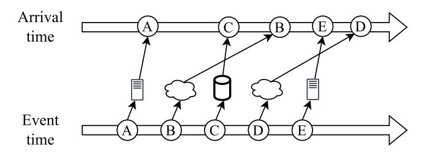
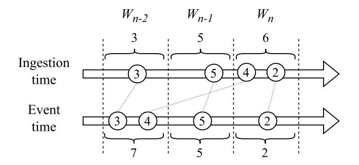
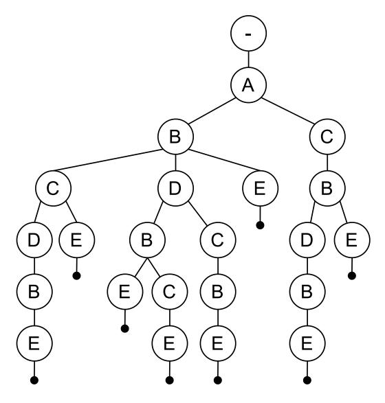
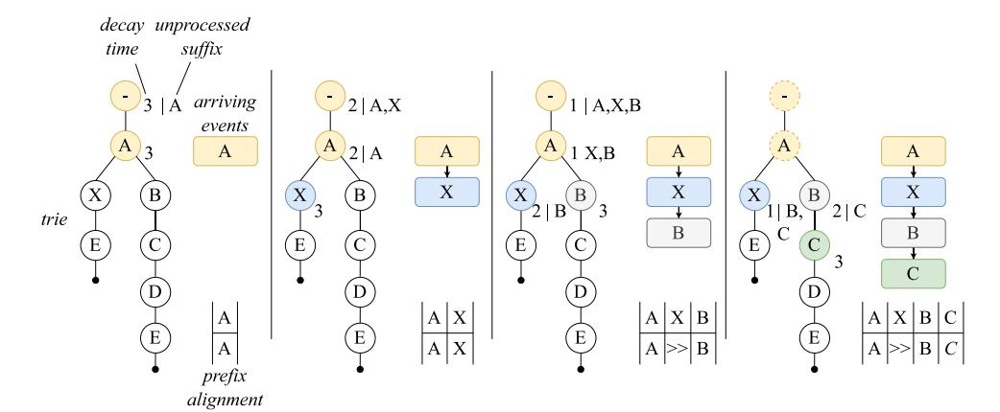
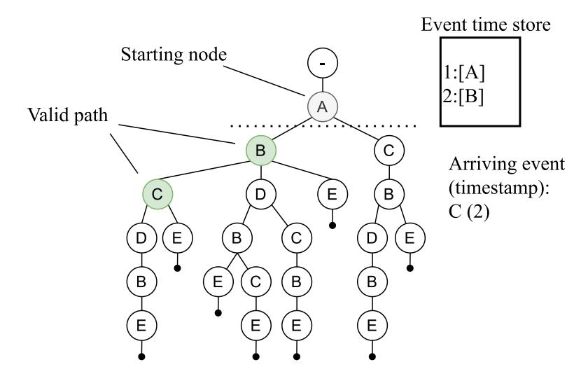
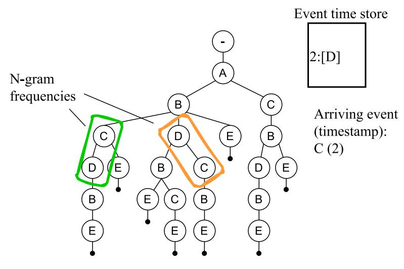
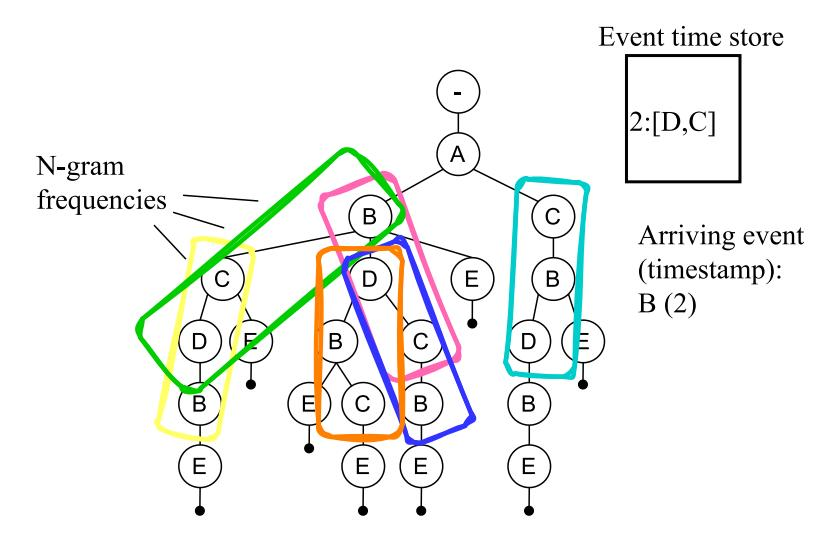
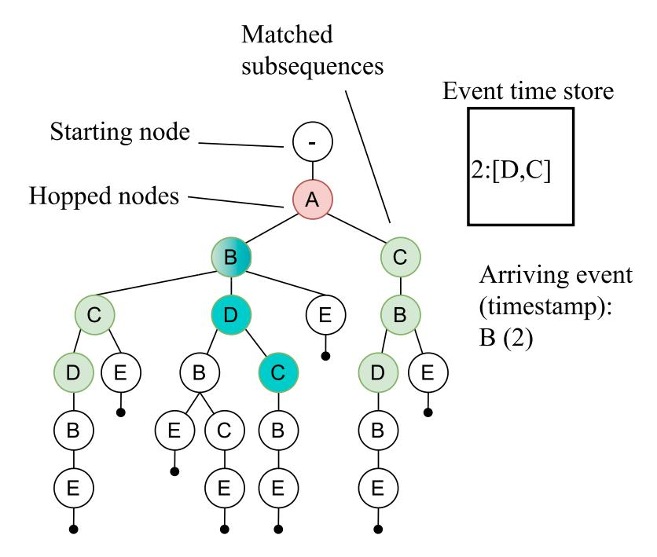
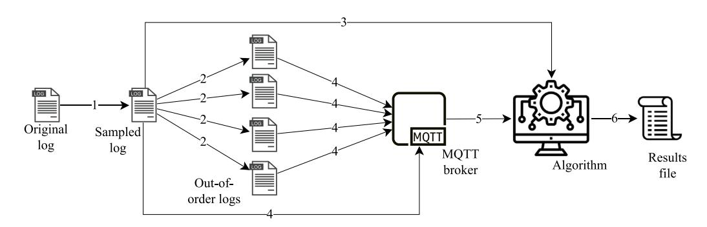

<!-- A3.R82 | source: papers_json/A3.R82/ -->

Contents lists available at [ScienceDirect](https://www.elsevier.com/locate/is)

## Information Systems

journal homepage: [www.elsevier.com/locate/is](https://www.elsevier.com/locate/is)

## Back to the Order: Partial orders in streaming conformance checking

Kristo Raun [a](#page-0-0) ,[∗](#page-0-1) , Riccardo Tommasini [a](#page-0-0),[b](#page-0-2) , Ahmed Awad [c](#page-0-3),[d](#page-0-4)

- ^a^ *University* *of* *Tartu, Tartu, Estonia*
- ^b^ *LIRIS* *Lab,* *INSA* *de* *Lyon, Lyon, France*
- ^c^ *The* *British* *University* *in* *Dubai, Dubai, United* *Arab* *Emirates*
- ^d^ *Cairo* *University, Giza, Egypt*

## A R T I C L E I N F O

## *Keywords:* Streaming conformance checking Real-time analytics Process mining Out-of-order events Partial orders

## A B S T R A C T

Most organizations are built around their business processes. Commonly, these processes follow a predefined path. Deviations from the expected path can lead to lower quality products and services, reduced efficiencies, and compliance liabilities. Rapid identification of deviations helps mitigate such risks. For identifying deviations, the conformance checker would need to know the sequence in which events occurred. In this paper, we tackle two challenges associated with knowing the right sequence of events. First, we look at out-of-order event arrival, a common occurrence in modern information systems. Second, we extend the previous work by incorporating partial order handling. Partially ordered events are a well-studied problem in process mining, but to the best of our knowledge it has not been researched in terms of fast-paced streaming conformance checking. Real-life and semi-synthetic datasets are used for validating the proposed methods.

## **1.** **Introduction**

Business processes are at the core of all organizations. Understanding, measuring, and monitoring business processes helps organizations become more efficient, have higher quality of work, and have higher compliance. Over the last two decades, *process* *mining* has emerged as the field that studies business processes to improve process executions through the systematic use of event data [[1](#page-13-0)].

An event log contains the event data of a process, while a process model describes the allowed behavior within a process. Example process model and event log are depicted in [Fig.](#page-1-0) [1](#page-1-0) and [Table](#page-1-1) [1](#page-1-1), respectively. The execution of a process instance may not necessarily align with the constraints set by the process model. Examples of non-conforming behavior in terms of control-flow elements include activities that should have occurred but did not, as well as those that occurred when they should not have. Activities may also be restricted by the number of times they are allowed to be executed. Furthermore, certain activities are commonly expected to occur in a specific order, and executing them in the wrong order may indicate non-conformance. *Conformance* *checking* [[2]](#page-13-1) in process mining refers to the comparison of the expected behavior, depicted by a process model, and the actual behavior, represented as event data.

While traditional conformance checking is done in an offline setting, an array of research in recent years has focused on conducting conformance checking in a streaming setting [[3–](#page-13-2)[5](#page-13-3)]. Regardless of the mode, most state-of-the-art techniques for conformance checking expect the

execution steps of the process instance (the trace) to be in the correct order of occurrence [[6]](#page-13-4).

## *1.1.* *Two* *challenges* *with* *order*

While the order of events may seem trivially intuitive in everyday activities, it can be surprisingly sophisticated in complex information systems. For this work, we consider two distinct challenges with the order of events. Firstly, the out-of-order event arrival in streaming settings [[7](#page-13-5)]. Secondly, the partial orders stemming from events that are recorded simultaneously [[8]](#page-13-6).

## *1.1.1.* *Out-of-order* *event* *arrival*

Streaming conformance checking shares many similarities with data stream processing: high volume and velocity of data, low latency requirements, unboundedness of data streams, and stream imperfections [[9](#page-13-7),[10]](#page-13-8). While the former items have garnered attention in research in recent years, the area of stream imperfections has remained neglected. Handling *out-of-order* events [(Fig.](#page-1-2) [2](#page-1-2)) has been investigated from the perspective of a process discovery setting [[11]](#page-13-9), but there have been no known works on conformance checking with out-of-order event streams.

One of the challenges with out-of-order events in business processes is that multiple traces can be ongoing simultaneously and possibly in

*E-mail* *address:* [kristo.raun@ut.ee](mailto:kristo.raun@ut.ee) (K. Raun).

> ^∗^ Corresponding author.

<!-- page 2 -->

***Fig.** **1.** Running example: a process model depicting a simple ordering process.*

***Fig.** **2.** Example of events arriving out of order.*

***Fig.** **3.** Example of simultaneous process executions with regards to current time.*

different life-cycle phases of the process [(Fig.](#page-1-3) [3](#page-1-3)). When events arrive out of order, the conformance checker needs to reorganize them to be in order. As each trace must be considered separately when handling out-of-order events, the event order typically matters only within the events of the particular case.

Another challenge is that event streams do not commonly exhibit a constant level of out-of-orderedness [[12](#page-13-10)]. Rigidly dealing with outof-order data may overcompensate at times when events arrive mostly on time and undercompensate when out-of-order event arrival is frequent. Thus, ideally, any method that handles out-of-order event arrival should be adaptive in responding to the stream's characteristics. Such an adaptive streaming conformance checker would be useful in industries where it is critical to have an up-to-date overview of process executions, but the underlying systems may introduce out-of-order events; for example, healthcare, clickstream analytics, manufacturing, and smart mobility.

## *1.1.2.* *Partially* *ordered* *events*

With out-of-order event arrivals, the correct sequence of events can be deduced in hindsight using offline computation. However, in many cases, such as the manual recording of events, data corruption

or low precision of data, different events within the same trace may be recorded with the same timestamp [[8,](#page-13-6)[13](#page-13-11)[,14](#page-13-12)]. Such events are considered to be partially ordered, as their total order is not obvious from purely observing the event timestamp. In information systems, partial orders may be introduced also by increasing automation, as previously manual tasks are automated to robotic processes [[15]](#page-13-13).

Returning to the example process model from [Fig.](#page-1-0) [1](#page-1-0), we could assume that the organization with this business process might want to apply discounts automatically during specific marketing campaigns. Thus, it is possible that *create* *order* (activity ) automatically triggers *apply* *discount* (activity ) and these events could be recorded with the same timestamp. Furthermore, it would make sense to automate also the checking of supply (activity ). If all three of these events have the same timestamp then there are six possible sequences in which the events may arrive at the conformance checker, as partial orders exhibit factorial complexity [[14]](#page-13-12).

Any conformance checker employed on such processes needs to efficiently decide on the right order for the events. While the partial order problem has been investigated for offline conformance checking [[8,](#page-13-6)[13,](#page-13-11)[16]](#page-13-14), there exists a research gap in terms of handling partial orders in streaming conformance checking. In fact, most of the research in streaming conformance checking has ignored the event timestamp altogether, while we would argue that it is an important attribute to consider in this domain.

## *1.2.* *Contributions* *and* *outline*

Addressing the aforementioned challenges, the contributions of the research in this paper are as follows: (1) we introduce a streaming conformance-checking approach capable of handling out-of-order events; (2) we show a novel approach for adaptive handling of eventtime progress in business process streams; (3) we propose two methods for handling partial orders in event streams.

All of the methods demonstrated in this paper have been implemented on top of an existing state-of-the-art approach using Apache Flink, allowing for a truly streaming and scalable conformance checking solution. For the experiments, we incorporate two solutions for

<!-- page 3 -->

generating semi-synthetic datasets. First, a method for creating out-oforder events in process mining datasets, and second, an approach for maximizing potential penalty for partially ordered events by reversing the arrival order for events with the same timestamps.

This paper is an extended and improved version of [[17](#page-13-15)]. The additional contribution of this work compared to [[17](#page-13-15)] is the part on handling partial orders, including the related works discussion, introduced methods, conducted experiments and discussion. Furthermore, we have conducted more comprehensive experiments, specifically analyzing the impact of the alpha value in the algorithm and testing with logs that are both out of order and non-conformant. The additional experiments offer a more holistic overview of how the algorithm behaves under different circumstances.

The rest of the paper is structured as follows: in Section [2](#page-2-0), we introduce the background, discussing out-of-order event arrival in data streams, business process characteristics, and streaming conformance checking. Section [3](#page-3-0) highlights related works and the current state of the art, both in terms of streaming conformance checking and conformance checking with partial orders. In Section [4,](#page-4-0) we discuss the handling of out-of-order events and how the solution can adapt based on the frequency of out-of-order event arrival. Furthermore, we incorporate two approaches for handling partial orders in the event streams. Section [5](#page-8-0) describes the conducted experiments, looking at both the out-of-order handling and partial order handling. Section [6](#page-13-16) concludes the work.

## **2.** **Background**

This section provides an overview of the main concepts relevant to this work. First, we explore the challenges associated with out-oforder event streams in modern stream processing frameworks. Next, we introduce the concepts on process models, the trie data structure, and event data. Finally, we discuss the concept of conformance checking, its distinction from streaming conformance checking, and the importance of prefix-alignments in the context of streaming conformance checking.

## *2.1.* *Out-of-order* *event* *streams*

Modern stream processing frameworks are designed for analytics that build upon recent data stream aggregates, especially in cases where real-time results are essential, such as systems monitoring and decision support [[9,](#page-13-7)[18]](#page-13-17). A data stream that features data arriving from multiple sources or a system built upon distributed systems will likely display a stream imperfection known as *out-of-order* event arrival [[7]](#page-13-5). An event is considered out of order when it arrives from a source after records with later event timestamps. Many factors can explain why a stream may have events arriving out of order, the most typical reasons being network reliability, bandwidth, and load [[19](#page-13-18)]. Our work assumes that event times across the systems are synchronized and that event timestamps accurately reflect the true total order of events.

Because a data stream is inherently infinite, the memory requirements on a stream processing system would be unbounded. Thus, the concept of windows is used to segment time into smaller units [[20](#page-13-19)]. Windows allow aggregations and joins of multiple streams within specific timeframes. In the presence of out-of-order events, windows need to be maintained and possibly entirely recalculated. An example of outof-order event arrival in the context of windows, and a comparison between event time and system ingestion time is shown in [Fig.](#page-2-1) [4](#page-2-1). In this example, aggregating based on windows would indicate an increasing trend if looking at ingestion time (3*,* 5*,* 6), while based on the event time, it is actually a downward trend (7*,* 5*,* 2).

Since there is no limit on the potential delay of event arrival, an additional concept called *watermarks* is used in data streams to keep track of event time progress and, essentially, limit the number of windows [[21](#page-13-20)]. This avoids potential time lag due to outliers or faulty data that could stretch windows indefinitely. While watermarks are commonly based on event time [[19]](#page-13-18), this is complicated for business

***Fig.** **4.** Example of out-of-order event arrival.*

process streams due to the characteristics of business processes and the fact that commonly, a single process execution does not have direct dependencies to other concurrent process executions.

Watermarks are not the only way to track the progress in event time. Other mechanisms such as slack [[22]](#page-13-21) (delaying events) or punctuations [[23](#page-13-22)] (annotating subsets of data in streams) can also be used. However, in recent years, watermarks have become the standard for most modern stream processing systems [[19](#page-13-18)].

## *2.2.* *Business* *process* *characteristics*

Data analytics encompasses a range of techniques that answer questions such as what happened (descriptive analytics) and why it happened (diagnostic analytics) [[24](#page-13-23)]. However, traditional data analytics often focuses on analyzing datasets without explicitly considering the sequential or structured nature of business processes. Business processes, by their nature, follow a defined course of action comprising specific activities [[1]](#page-13-0). This process-oriented perspective enables not only descriptive insights but also a deeper understanding of causal relationships, thus bridging the gap toward diagnostic and even prescriptive analytics, where recommendations or actions may be derived from the analysis.

Process models describe the behavior allowed in a process. Many notations exist with various characteristics, such as Petri Nets, Directly-Follows Graphs, and BPMN models [[1](#page-13-0)]. Most process models visualize the activities within the process and allow for behavior such as sequences, parallelism, choices, and loops. In the context of this paper, the method employs the trie data structure for describing process behavior [[25](#page-13-24)]. A trie is generated based on a sampled event log that represents the process behavior. For example, [Table](#page-2-2) [2](#page-2-2) shows a proxy log that exhibits the same behavior as the process model in [Fig.](#page-1-0) [1,](#page-1-0) provided that we only allow a single loop over activity . A shortcoming of the trie is that it cannot explain parallelism and loops, thus being an approximation by a sample of the full process behavior; however, the trie is well suited for conformance-checking purposes, where the goal is to compare event data to the allowed behavior efficiently. An example of the trie based on the process model in [Fig.](#page-1-0) [1](#page-1-0) is shown in [Fig.](#page-3-1) [5](#page-3-1).

The actual process executions are stored in event data. Commonly, a single event contains attributes such as the *case* *identifier* *(Case* *ID)*, *activity*, and *timestamp*. All activities having the same case identifier

<!-- page 4 -->

***Fig.** **5.** Running example: a trie representing process behavior based on the proxy log.*

make up a *trace* — a specific process execution instance. Events can be stored in static logs, called *event* *logs*, or in *event* *streams*, where each event arrives as it occurs in the real world.

## *2.3.* *Conformance* *checking*

Conformance checking is the examination of process executions and quantifying the non-conformant behavior compared to the behavior allowed by a process model [[2](#page-13-1)]. The state-of-the-art output of a conformance checker is an alignment between the actual behavior (log moves) and a complete run allowed by the model (model moves) [[26](#page-13-25)]. Alignments have the benefit of being more readily interpretable than most other diagnostic methods and have thus enjoyed wide adoption by the research community. An example alignment is shown in [Table](#page-3-2) [3](#page-3-2), with the log moves ⟨*, , *⟩ indicating the actual process executions and the model moves ⟨*, , *⟩ indicating a valid path in the model. The skip symbol *≫* indicates non-conformant behavior, typically associated with a conformance cost.

Traditional conformance checking is done on event logs extracted from business systems. While such a static approach is robust, it has some shortcomings; most notably, the data is obsolete by design. Thus, several recent research efforts have made conformance checking on event streams viable [[3–](#page-13-2)[5](#page-13-3),[27]](#page-13-26).

Streaming conformance checking is the application of conformance checking on top of event streams. Similar to offline conformance checking, these approaches require a reference model that indicates the expected behavior. However, in streaming conformance checking, the real behavior is not coming from a static event log, but from a continuous event stream. New events may appear at any given time, and these events may have either a known or a previously unseen case ID [[10](#page-13-8)].

In a streaming setting, conformance-checking frameworks usually observe a subsequence of the trace. The trace execution may not yet have concluded, and it is unknown how the execution sequence might play out. A *complete* alignment would overestimate the conformance cost in such cases. A **prefix-alignment** is a variation of the alignment where complete path traversal to the model's sink is unnecessary. For example, for the trace = ⟨*, , , *⟩, the final event may still occur, and thus there exists no deviation in terms of the activity ([Table](#page-3-3) [4)](#page-3-3). In a streaming setting, a prefix-alignment is calculated event by event, finding a match between the arrived event and the allowed model behavior.

|  |  |  |  |  |  |  |
| --- | --- | --- | --- | --- | --- | --- |
|  | Log moves | A | B | B | C |  |
| (1) | Model moves | A | B | ≫ | C |  |
|  | Log moves | A | B | ≫ | B | C |
| (2) | Model moves | A | B | D | B | C |

## **3.** **Related** **works**

Conformance checking has evolved significantly in recent years, particularly in the areas of streaming data and the handling of partial orders. This section reviews the main developments in both domains. First, we examine the distinction between metrics-based and alignmentbased approaches in streaming conformance checking, with a state of the art overview of the methods in both domains. Then, we look into the work done for handling partial orders in conformance checking. Importantly, no known work has combined the perspectives of streaming conformance checking and handling of partial orders, putting into context the contribution proposed in this work.

## *3.1.* *Streaming* *conformance* *checking*

An important distinction for streaming conformance checking can be made between metric-based approaches, which indicate the level of conformance, compared to alignment-based approaches, which, as the name suggests, output an alignment with increased explainability in terms of the location of the discrepancy.

A common denominator for *metrics-based* approaches is that the conformance artifact is a metric — usually a natural or decimal number. While such a representation is not as explanative as an alignment, these approaches are very effective at identifying traces where discrepant behavior has occurred. Computation of a simple metric is lightweight in terms of memory usage and has a low latency, and thus it is wellsuited for streaming applications. One of the first methods to apply conformance checking on top of event streams was introduced in [[3](#page-13-2)]. This approach uses concepts from region theory and state distance, outputting a natural number in terms of discrepancies seen. The work in [[28](#page-13-27)] used behavioral patterns for calculating conformance in a streaming setting, incorporating also warm-starting capabilities and a confidence metric for trace conclusion. A method based on Hidden Markov Models was introduced in [[29](#page-14-0)], alternating between state estimations and calculating conformance. While all of the metrics-based approaches perform fast, they require notable preprocessing effort as can be seen in the results from [[27]](#page-13-26).

The *alignment-based* approaches, another distinct subset of streaming conformance checkers, output a prefix-alignment of the trace and the model. Compared to the metrics-based approaches, the alignmentbased methods provide a higher explainability for the discrepant behavior. However, the computation during the stream execution for these approaches is generally worse than for metrics-based approaches. The work in [[4]](#page-13-28) introduced the concept of alignments to streaming conformance checking by lifting prefix alignments [[30](#page-14-1)] to the streaming setting. The approach relies on Petri Nets and computation of a Synchronous Product Net between the trace and the model. The approach was enhanced in [[31](#page-14-2)], providing a guiding heuristic that reduces the memory footprint of the approach. The work in [[32](#page-14-3)] has extended the same approach by investigating methods for pruning memory by storing only a summary state. While these approaches

<!-- page 5 -->

can compute the optimal prefix-alignment, they suffer from a poor latency, as the compilation of the Synchronous Product Net during the algorithm's execution is time-consuming. Thus, a subset of approximate alignment-based methods has emerged.

In [[5](#page-13-3)], an approximate approach was introduced – *IWS* – for calculating prefix alignments on top of event streams. The algorithm utilizes the trie data structure as the allowed process behavior, improving the calculation time of alignments in some cases by several orders of magnitude while introducing only a moderate error compared to the previous state of the art. The work in [[27](#page-13-26)] built upon the IWS algorithm, extending the approach with completeness and confidence metrics, allowing for quantification of warm-starting scenarios and a trace's potential conclusion in a stream. It is the first prefix-alignment-based method that supports warm-starting scenarios in streaming settings i.e., cases where the stream started before the conformance checker began measuring the results. The work in this research is also grounded on the IWS approach, as it is currently the fastest method for computing prefix-alignments in a streaming setting, and it is well suited to handle both stream imperfections and partial orders in streams.

## *3.2.* *Partial* *orders* *in* *conformance* *checking*

Over the years, there have been various interpretations for partial ordering of events [[14](#page-13-12)]. In this paper we focus more specifically on the *coarseness* of timestamps. That is, instances where two or more events within a case have the same event timestamp.

Conformance checking, especially with alignments [[30](#page-14-1)], has seen a lot of research effort in recent years [[2](#page-13-1)]. However, not too many works have touched upon handling partial orders with regards to timestamp coarseness. In [[8]](#page-13-6) the authors introduced *partially* *ordered* *alignments*. The authors use as input a directed acyclic graph (DAG) of the trace. The DAG is converted into a Petri net, and then conventional alignment computation via synchronous product nets is used. The input DAG can be computed from both a partially ordered or a regular, sequential trace. The approach improves the quality of the alignments, especially in event logs where traces exhibit a higher volume of partial orders. While the authors do not mention the execution time of the approach, it can be assumed that computing a product net and solving the shortest path is time consuming.

The work in [[16]](#page-13-14) encodes the computation of alignments for partial orders as a planning problem, converting the steps into the Planning Domain Definition Language (PDDL) [[33]](#page-14-4). The method takes as input a Petri net and returns optimal alignments. The authors test their method with experiments on both real-life and synthetic datasets, with the results indicating that the search time grows exponentially compared to the size of the process model. One of the main benefits of this approach is that as the alignment problem is represented as a planning problem in PDDL, any future improvements to existing off-the-shelf planners can be utilized with little effort. The computation times, however, are notable, most likely due to the optimality guarantee, with experiments on smaller models achieving about 40 events per second, and larger models dropping to 2–3 events per second.

A more recent paper introduced three behavioral models for computing conformance over partially ordered traces [[13]](#page-13-11). The main goal of the work is to find the most probable order (resolution) of the events within traces with partial order. As such, the trace equivalence model uses the frequency of the entire sequence of activity executions in the log to determine the order. The N-gram model tries to find traces that have events matching in the same location with the same N-length preceding subsequence. The weak order model considers only weak order dependencies in determining the correct order of partial orders, relaxing the limitation of checking consecutive events. Furthermore, the authors introduce an approximation method to reduce the computational effort of the conformance checker. In general, the 2-g (N-gram) model achieves best accuracy, with all introduced models improving upon the baseline [[8](#page-13-6)]. Regarding performance, the 2-g model is able to

throughput about 18 events per second, or 35 per second when using the approximation.

In [[34]](#page-14-5), the authors take a more holistic look at conformance checking over uncertain events, including also data ambiguity and incorrectness, in addition to partial ordering. Similarly to [[8](#page-13-6)], the approach first computes an intermediate structure, in this case a *behavior* *graph*, before generating the Petri Net representation of the trace. As in [[8](#page-13-6)], the synchronous product net is then computed between the Petri Nets of the trace and the model to obtain *uncertain* *alignments*. The authors do not measure the performance of their method directly, but note that while their method provides novel insights, it has lackings in performance already with a small percentage of uncertain events in a log.

Some further works have touched upon conformance checking in terms of partial orders, but not directly with the goal of handling partially ordered events [[35,](#page-14-6)[36]](#page-14-7). To the best of our knowledge, no method has yet considered partial orders from the perspective of streaming conformance checking, where tighter requirements on memory usage and computational performance are required.

## **4.** **Methodology**

This section presents the constructs proposed in this work. It begins with an explanation of how decay time and the state buffer are essential for retracting false path traversals. Following this, the event time store is introduced, enabling the algorithm to become event-time aware. The next section describes an adaptive method for dynamically adjusting the state buffer size based on the degree of out-of-orderedness. Next, methods for handling partial orders are discussed, including a frequency-based n-gram approach and a greedy method. Finally, the implementation details of the approach are outlined.

## *4.1.* *Decay* *time:* *Tracking* *event* *progress* *in* *IWS*

The IWS algorithm [[5](#page-13-3)] allows for fast and approximate conformance checking while under memory constraints in a streaming setting. For efficiency, IWS uses the trie data structure to compare the event data to the expected process behavior. Due to the nature of business process executions, it may sometimes be necessary to re-calculate the optimal route in the trie, and due to erroneous activities, the method may end up on a *wrong* path in the trie. Thus, the IWS approach uses a *state* *buffer* for keeping some past states available for recalculation and a *discounted* *decay* *time* hyperparameter to release old states from memory. The decay time is calculated based on the difference between the average length from the root to a leaf node in the trie, indicating a roughly average expected trace length, and the current trace length. The outcome is multiplied with the *discounting* *factor*, a value between 0 and 1 to indicate the maximum percentage of the average trace length that should be kept in memory. For a more detailed explanation and formula, we refer to [[5](#page-13-3)]. Conceptually, the decay time helps the algorithm progress event time on a per-trace basis. Traces may overlap and have different event execution patterns. Thus, progressing based on event time, as it is commonly done with watermarks, would favor traces with rapid executions, while time-consuming process instances would be quickly forgotten, and the analysis would suffer. Thus, the decay time setting in IWS is not time-based but event-based in the scope of a specific trace.

An example of the state buffer and the decay time are shown in [Fig.](#page-5-0) [6](#page-5-0). With the arrival of the first event, , two states are initiated, with the state at the root node holding in its unprocessed suffix. The unprocessed suffix is used to replay the moves upon the arrival of the next events. Decay time indicates how many events within this trace should arrive before the state will be cleared from memory. The optimal alignment at each event arrival is also shown. For event arrival , there are actually multiple optimal alignments, but only one alignment is shown in the figure for illustrative purposes. Importantly, the state buffer allows the retraction of the false path traversal to node . This behavior can be repurposed to implement out-of-order handling into the algorithm, as will be described in the next section.

<!-- page 6 -->

***Fig.** **6.** State buffer evolution with arriving of events. The color coding visually links the arriving event with the state and its node calculated. (For interpretation of the references to color in this figure legend, the reader is referred to the web version of this article.)*

## *4.2.* *Event* *time* *store*

To handle out-of-order events, the algorithm is extended by an event time store that keeps the event time of each arrived event. The event time store is an ordered key–value pair, with the key denoting the event time and the value being an array of events that occurred during this time. For simplicity, we assume that if events have the same event time, the arrival order is the correct total order of these events. In other words, the array denotes the arrival time of the events having this event time. Formally, assume that is the set of timestamps, is the set of events, and ∗ is the set of all possible words over , then the event store is a function ∶ → ∗. As the decay time releases states from memory, the event time store releases the earliest events from the event store.

For out-of-order handling, each event time is first compared to the largest key in the event store as events arrive. If the new event has a timestamp equal to or larger than the largest key, this event is arriving in order, and processing continues as usual. If the largest key is larger than the timestamp of the arrived event, all the events with a larger timestamp in the event store are considered out-of-order events and are piped for a new replay. Furthermore, any states in the state buffer that have played out any out-of-order events are removed from the buffer, while the rest of the states remove the unprocessed suffix that matches the new sequence of events.

To illustrate, let us consider an example of allowed behavior as shown by the trie in [Fig.](#page-3-1) [5.](#page-3-1)

Assume we observed events ⟨*, , *⟩ with event timestamps of 1,3 and 5, respectively. While this trace could have multiple optimal alignments, for simplicity, assume we have the same alignment as in [Table](#page-3-2) [3](#page-3-2).

If the algorithm now receives event with an event timestamp 2, it first checks the event store to see whether the events are arriving in order. The event store's largest key (5) is larger than the arrived event timestamp (2). Thus, all events with timestamps larger than 2 are considered out-of-order, and all of the states in memory that have played out the events and are removed. The resulting alignment of the event time aware solution is shown in [Table](#page-5-1) [5](#page-5-1), with a comparison to the original non-event time aware version that assumes all events arrive in order, leading to a higher conformance cost.

## *4.3.* *Adaptive* *event* *time* *progress*

The arrival of out-of-order events cannot be expected to be static throughout the life of the stream. Thus, approaches in stream processing have been devised to adapt the watermarks based on concept drifts — changes in data arrival frequency and delays [[12](#page-13-10)]. This paper introduces a novel approach for adaptive event time progress suited for business process data. Namely, we adopt the Exponentially Weighted Moving Averages (EWMA) metric from inventory and financial planning [[37](#page-14-8)] and modify it to work as a sensor for indicating the level of out-of-orderedness.

To adapt to the stream's frequency of out-of-order events, we extend the algorithm with the following method to modify the discounting factor. With every new event, we check if the event is out of order. If it is out of order, we assign it a boolean value of 1 and 0 if it is not. Then, we increase (or decrease) the discounting factor using the following formula:

$$ df = \alpha * ooo + (1 - \alpha) * df $$

where is the discounting factor, is the smoothing factor, and is the Boolean value of whether it is an out-of-order event. In our experiments, we use an alpha of 0.005 to represent an appropriate change in the discounting factor, unless stated otherwise. We demonstrate the impact of varying levels of the alpha value in Section [5.1.4](#page-11-0).

Intuitively, if the proportion of out-of-order events has increased, then the discounting factor will increase, thus keeping in memory a larger amount of states and allowing for improved out-of-order event handling. If the frequency of out-of-order events decreases, so too will the discounting factor, releasing the memory strain. We consider it unlikely that any specific trace would start exhibiting out-of-order behavior while other traces would have events in order. Thus, the formula is applied globally to all traces within the process. Nevertheless, it is possible to track for each case individually, [[38](#page-14-9)]. Indeed, in more complex information systems, localized system failures and delays could cause a certain subset of events to be out of order, which highlights the need for further investigation into trace-specific settings. However, this is beyond the extent of this contribution.

## *4.4.* *Partial* *order* *handling*

In the scope of this paper, partial orders are considered as events belonging to the same case ID that have the same event timestamp. The event time store (Section [4.2)](#page-5-2) will, by default, assume that the arrival order for a specific timestamp is the correct total order of these events. This may not be the case due to manual recording of events, low precision (coarseness) of data, or data corruption, as highlighted earlier. In this section, we introduce two methods as part of the *Back*

<!-- page 7 -->

***Fig.** **7.** BttO step 1: full match from the partially ordered trace.*

*to* *the* *Order* (BttO) extension that allows for handling of partial orders in event streams.

As an input, the BttO requires the partially ordered subtrace, and the list of starting nodes. For example, let us assume we have seen the trace ⟨*, *⟩ with timestamps of 1 and 2, respectively ([Fig.](#page-6-0) [7](#page-6-0)). Now, if we receive a new event with timestamp 2, then we have two events with timestamp 2 and the partially ordered trace is ⟨*, *⟩. The starting nodes would be all of the *latest* nodes that exist in the state buffer immediately before the timestamp that exhibits partial ordering. For this example, there would be a single starting node , as the event had the immediately preceding timestamp 1.

The two first heuristics used by BttO try to get a full substring match — this has linear complexity with regards to the substring length for the trie data structure. As can be seen for the example in [Fig.](#page-6-0) [7](#page-6-0), the trace ⟨*, *⟩ can be directly traversed from the starting node and thus no further explorations are done, and the input trace ⟨*, *⟩ is returned as the expected correct order of events. If a substring match from the input trace is not possible, then permutations of the partially ordered trace are generated. Due to the factorial complexity, this would not be feasible for traces that exhibit lengthy partially ordered traces, but any method working with partial orders suffers from this, unless optimizations can be applied [[14,](#page-13-12)[16]](#page-13-14). In this step, the method only computes the permutations for the candidate partial orders, and in the second step it iterates over the permutations in an attempt to get a full substring match for one of the permutations. An example is shown in [Fig.](#page-7-0) [8](#page-7-0). In this example, we have seen the trace ⟨*, *⟩ and receive event with the same timestamp as . The starting node is again , but this time we do not get a match from step 1 as ⟨*, *⟩ does not immediately follow the node . However, after generating the permutations – in this case, the only alternative is ⟨*, *⟩ – the method gets a full match for the path ⟨*, , *⟩ and returns this as the expected correct order of events.

If neither the input nor the permutations have a full substring match, then further explorations are done. During the instantiation of the algorithm, the user can define which of the two alternatives of BttO should be used.

## *4.4.1.* *Frequency-based* *n-gram*

In the first case, we take the assumption that the most frequent occurrence of a particular permutation is the correct one. To achieve this, we augment the creation of the trie [[25](#page-13-24)] by generating a frequencyordered associative array, mapping every n-gram to the number of its occurrences based on the proxy log. For example, the construction of the trie from [Fig.](#page-3-1) [5](#page-3-1) would yield the n-gram frequencies shown in [Table](#page-6-1) [6](#page-6-1) (note: the table only shows n-grams with a frequency greater than

1). Indeed, considering the proxy log in [Table](#page-2-2) [2](#page-2-2), we can see that the n-gram ⟨*, *⟩ occurs 6 times.

To illustrate how this works for finding the correct order, let us consider that we have seen the trace ⟨⟩ and we receive event with the same timestamp, as shown in [Fig.](#page-7-1) [9](#page-7-1). Having attempted steps 1 and 2 from the previous section, we now arrive in the n-gram frequencies with two permutations: ⟨*, *⟩ and ⟨*, *⟩. The method starts looping over the n-grams, starting from the most frequent n-grams in descending order, attempting to match the n-gram to each of the permutations. Once a match is found, the current frequency is stored. Multiple ngrams with the same frequency can be optimal, thus all of the n-grams that match at a particular frequency are kept as candidates. If at least one match has been found and the frequency has become less, then the loop is exited. If there is exactly one candidate, then this candidate is chosen as the expected correct order of events. If there are multiple candidates, then a random candidate is taken. If the loop over the ngrams finishes and no candidates have been found, then the method returns the input subtrace.

The benefit of this method is that the n-grams are computed beforehand, during the trie construction phase. Thus, this occurs only once, in the *offline* part. The n-grams are, in worst case, quadratic to the number of nodes in the trie, but only require a single lookup per each n-gram and permutation pair, as there is no state exploration involved. However, the n-gram frequency does not consider where in the trie the n-grams are located and what the current node is. Let us consider that

<!-- page 8 -->

***Fig.** **8.** BttO step 2: full match from a permutation.*

***Fig.** **9.** BttO n-grams: 2-g example.*

***Fig.** **10.** BttO n-grams: 3-g example.*

our trace ⟨*, *⟩ now receives another event with the same timestamp ([Fig.](#page-7-2) [10](#page-7-2)). There are six permutations that each have a 3-g frequency of 1, thus any of the six permutations could be chosen as the expected

correct order of events. However, considering that we are at node, some n-grams would be a preferable choice due to their closeness to the (⟨*, , *⟩, ⟨*, , *⟩, ⟨*, , *⟩), and choosing an n-gram that

<!-- page 9 -->

***Fig.** **11.** BttO greedy trie: example with two events.*

is more distant from the current node is likely to penalize the accuracy of the alignment. Thus, we introduce an alternative method for finding the correct order of the subtrace.

## *4.4.2.* *Greedy* *trie*

The second alternative for finding the correct order of the subtrace in BttO is a method based on a greedy traversal of the trie. This method switches between finding the longest substring match for each permutation, and hopping the minimal amount of nodes (essentially, making model moves) to get to the next substring match. The approach is greedy, because at each switch, only the top performing permutations remain as candidates. If there is only a single candidate left, then this is returned as the correct order by the method. If there are no candidates, then the hop size is increased as long as the total amount of hops remains less than or equal to the input trace length. If the total amount of hops becomes larger than the input trace length, then the optimal alignment would be *log* *moves* on the trace and thus the original input trace is returned, as the order of the partially ordered events does not matter in terms of alignment optimality.

For comparison, we can observe the same traces as in previous section and see how the results differ compared to the frequency-based n-grams method. The result for the trace ⟨⟩ with incoming event is shown in [Fig.](#page-8-1) [11.](#page-8-1) In this case, the method considers the starting node and two permutations: ⟨*, *⟩ and ⟨*, *⟩. At first, neither of the permutations gets a substring match, thus a hop is done on node . Then, ⟨*, *⟩ gets a match for node . Since only the ⟨*, *⟩ permutation remains, the method returns this as the assumed correct order of the subtrace.

For the extended example, with a new arriving event , there are a total of three permutations achieving a full substring match after the first hop: ⟨*, , *⟩, ⟨*, , *⟩, ⟨*, , *⟩ ([Fig.](#page-9-0) [12](#page-9-0)). Since all of the three permutations are equal in terms of their potential match, the final choice from the candidates is done randomly. Importantly, we can observe that the less optimal permutations that the n-gram based method considered are ignored by the greedy trie approach. Nevertheless, the greedy approach may be susceptible to finding a local optimum that may not be the global optimum, thus, in such cases, increasing the approximation error of the approach.

## *4.5.* *Implementation*

In order to be truly scalable, the original algorithm and the extensions introduced in this paper are implemented on top of the Beamline framework [[39]](#page-14-10). The Beamline framework utilizes Apache Flink as the runtime engine, allowing the algorithm's execution to scale across a cluster of computing nodes. Commonly, each individual trace in a business process is looked at separately. Thus, partitioning by the case identifier would theoretically allow scaling of the processing to as many nodes as there are cases within the process.

The source code for the implementation, together with instructions for running the experiments and the datasets used, have been made available on GitHub.[1](#page-8-2)

## **5.** **Experiments**

This section describes the experiments done to verify the methods of handling out-of-order events and partially ordered events. For both, we describe the experimental setting and the results obtained. The final subsection includes a general discussion of the results obtained.

All the conducted experiments were executed three times and averaged to mitigate possible runtime outliers impacting the results. The experiments were conducted on Microsoft Windows 11 Enterprise with Intel(R) Core(TM) i5-8265U CPU @ 1.60 GHz and 16.0 GB of RAM. The execution environment was running Java 11 and Python 3.10, with JVM set to simulate single-core execution. The MQTT broker used was EMQX 5.1, which was run using Docker. An explanation of how to replicate the experiments is detailed on GitHub.

## *5.1.* *Out-of-order* *handling*

The out-of-order handling experiments are used for validation of the event time store (Section [4.2](#page-5-2)) and adaptive event time progress (Section [4.3](#page-5-3)).

> ^1^ [https://github.com/DataSystemsGroupUT/StreamingConformanceChecke](https://github.com/DataSystemsGroupUT/StreamingConformanceChecker) [r](https://github.com/DataSystemsGroupUT/StreamingConformanceChecker).

<!-- page 10 -->

***Fig.** **12.** BttO greedy trie: example with three events.*

***Fig.** **13.** Experiment settings for out-of-order handling.*

## *5.1.1.* *Setting*

Several real-life event logs were used to test the handling of out-oforder events. The logs had to be manipulated to mimic the out-of-order scenario, as the original logs were grouped by trace and in temporal order. The logs used in this paper are well-known real-life process event logs: BPI 2012,[2](#page-9-1) BPI 2017,[3](#page-9-2) and BPI 2020 Travel Permits.[4](#page-9-3)

The steps done for running the experiments are shown in [Fig.](#page-9-4) [13](#page-9-4). To limit the scope of the experiments, the logs were first randomly sampled to 100 traces (step 1). Then, events within a trace were swapped with various settings ranging from no out-of-order events to fully out-oforder events (step 2). The settings are described in [Table](#page-9-5) [7,](#page-9-5) showing the probability of a swap, i.e., how likely a single event is to trade places with another event within the same trace, and max distance, i.e., how far from the current position can an event be swapped to. For example, with the *swap_01* setting, each event has a one percent likelihood of getting swapped with a maximum distance of one, meaning that it will trade places with the event directly before or after.

The unaltered sampled log was used for generating the trie — the process model that describes the expected behavior (step 3). Since the IWS algorithm is capable of streaming conformance checking, the

experiments were also conducted in a streaming fashion using an MQTT broker. A Python script published the out-of-order logs to MQTT topics (step 4), and the algorithm received the events by subscribing to these topics (step 5). The results of the experiments were outputted to a file on an event-by-event basis (step 6), measuring the latency of the algorithm – how long it takes to process an event – and the cost of the latest alignment of the case to where this particular event belongs to.

The method was instantiated with the default settings for the *decay* *time* variable: a minimum decay time () of 3 and a discounting factor () of 0.3. The method was run with the adaptive add-on from Section [4.3](#page-5-3) turned on (*adaptive*), turned off (*non-adaptive*), and the out-of-order handling turned off (*non-aware*, i.e., the original IWS algorithm). Furthermore, the two variations of partial order handling

> ^2^ [https://doi.org/10.4121/uuid:3926db30-f712-4394-aebc-75976070e91f](https://doi.org/10.4121/uuid:3926db30-f712-4394-aebc-75976070e91f).

> ^3^ [https://doi.org/10.4121/uuid:5f3067df-f10b-45da-b98b-86ae4c7a310b](https://doi.org/10.4121/uuid:5f3067df-f10b-45da-b98b-86ae4c7a310b).

> ^4^ [https://doi.org/10.4121/uuid:52fb97d4-4588-43c9-9d04-3604d4613b51.](https://doi.org/10.4121/uuid:52fb97d4-4588-43c9-9d04-3604d4613b51)

<!-- page 11 -->

| BPI2017 | greedy | n-grams | adaptive | non-adaptive | non-aware |
| --- | --- | --- | --- | --- | --- |
| swap_00 | 0.06 | 0.05 | 0.06 | 0.13 | 0.15 |
| swap_01 | 0.06 | 0.07 | 0.06 | 0.20 | 0.25 |
| swap_05 | 0.11 | 0.12 | 0.11 | 0.33 | 1.30 |
| swap_10 | 0.23 | 0.26 | 0.26 | 0.58 | 1.97 |
| swap_20 | 1.24 | 1.08 | 1.15 | 2.13 | 1.92 |
| swap_50 | 6.24 | 6.16 | 6.02 | 6.91 | 1.09 |
| swap_99 | 647.43 | 633.46 | 636.91 | 57.89 | 1.01 |

| BPI2020 | greedy | n-grams | adaptive | non-adaptive | non-aware |
| --- | --- | --- | --- | --- | --- |
| swap_00 | 0.10 | 0.10 | 0.11 | 0.18 | 0.14 |
| swap_01 | 0.11 | 0.11 | 0.12 | 0.18 | 0.15 |
| swap_05 | 0.11 | 0.15 | 0.14 | 0.21 | 0.21 |
| swap_10 | 0.21 | 0.23 | 0.21 | 0.29 | 0.31 |
| swap_20 | 0.26 | 0.35 | 0.31 | 0.47 | 0.46 |
| swap_50 | 0.70 | 0.71 | 0.71 | 0.85 | 0.42 |
| swap_99 | 1.16 | 0.99 | 0.89 | 1.00 | 0.41 |

were also employed, *n-grams* and *greedy*, with a total of five different variants of the algorithm.

Using the initial sampled log for generating the trie means that the logs are expected to be fully conformant. To test how the methods react to non-conformance in the datasets, further experiments were conducted by adding varying levels of noise to the sampled log. This was done by swapping events with probabilities of 5%, 10%, and 20%, representing minor, moderate, and heavy non-conformance, respectively. The resulting logs, with these controlled noise levels, were then streamed under different configurations of swapped events, following the process outlined in steps 2 and 4 of [Fig.](#page-9-4) [13.](#page-9-4)

Furthermore, we conducted tests using variations of the alpha value introduced in Section [4.3.](#page-5-3) For this, the *ngrams* algorithm was instantiated with three swap levels and seven alpha values, ranging from 0.0005 to 0.05.

## *5.1.2.* *Results* *for* *out-of-order*

[Table](#page-10-0) [8](#page-10-0) shows the latency, i.e., the processing time of the algorithm per event, in milliseconds. For the BPI2012 log, there are only minor differences up until _50. Starting from here, the variants with outof-order handling show a clear penalty in terms of processing time. For example, for the _99 variation, the non-adaptive version is almost an order of magnitude slower than the non-aware IWS version. The adaptive method and the greedy and n-grams variations are further about 5 times slower than the non-adaptive method. In general, it seems that the *greedy*, *n-grams* and *adaptive* variants are in roughly the same execution time.

For the other datasets, a similar pattern can be observed. For BPI2017, the difference between non-aware and out-of-order handling methods becomes clear starting from _50, and for _99 the differences between non-aware and the adaptive methods are almost three orders of magnitude. It can be observed that the execution time of the non-aware version of the algorithm does not increase with increased out-of-orderedness — this is because the algorithm does no recalculation for out-of-order event arrival and simply assumes that there is a great deal of non-conformant behavior occurring in the event stream.

| BPI2017 | greedy | n-grams | adaptive | non-adaptive | non-aware |
| --- | --- | --- | --- | --- | --- |
| swap_00 | 0.00 | 0.00 | 0.00 | 0.00 | 0.00 |
| swap_01 | 0.00 | 0.00 | 0.00 | 0.00 | 1.01 |
| swap_05 | 0.64 | 0.64 | 0.64 | 0.64 | 6.24 |
| swap_10 | 1.29 | 1.29 | 1.29 | 1.53 | 11.85 |
| swap_20 | 1.73 | 1.73 | 1.73 | 4.21 | 22.01 |
| swap_50 | 3.20 | 3.20 | 3.20 | 10.96 | 33.65 |
| swap_99 | 8.15 | 7.90 | 7.74 | 14.05 | 36.13 |

| BPI2020 | greedy | n-grams | adaptive | non-adaptive | non-aware |
| --- | --- | --- | --- | --- | --- |
| swap_00 | 0.00 | 0.00 | 0.00 | 0.00 | 0.00 |
| swap_01 | 0.00 | 0.00 | 0.00 | 0.00 | 0.25 |
| swap_05 | 0.42 | 0.42 | 0.48 | 0.48 | 1.67 |
| swap_10 | 2.18 | 2.18 | 2.16 | 2.17 | 3.84 |
| swap_20 | 2.87 | 2.87 | 2.91 | 3.51 | 6.12 |
| swap_50 | 3.04 | 3.04 | 3.10 | 5.63 | 9.00 |
| swap_99 | 3.11 | 3.11 | 3.29 | 6.91 | 9.40 |

For BPI2020 log, the results vary slightly more, with non-aware and non-adaptive versions being roughly equivalent for _50, and the adaptive method is faster than the non-adaptive method for _99. However, this may be due to the fact that this is the smallest of the datasets, as can be seen by the execution time remaining mostly under 1 ms per event. In general, the differences between the partial order handling methods seem minuscule and on par with the adaptive method without partial order handling. Notably, out of these datasets, only BPI2012 has naturally occurring partial orders.

The slightly higher computation time for the non-aware and nonadaptive versions at lower levels of swaps can be explained by the adaptive methods' ability to more effectively identify conformant behavior, allowing them to follow faster synchronous moves in the traces. The non-aware version, in particular, incurs a penalty as it encounters a significant amount of non-conformant behavior, leading it to explore potential model moves. This is most prominent in the BPI2017 log with _05 where the latency is in favor of adaptive methods by an order of magnitude.

A core measure of a conformance checker is the cost. In this paper, we measure the cost of an alignment, i.e., similarly to an edit distance difference between the expected process behavior and the actual observed behavior. The benefit of using an alignment is explainability, indicating clearly which part of the process contains the discrepancy. It is important to remember that the non-aware version naively assumes that the order in which the events arrive is the order in which the events happened, thus negatively impacting the alignment cost because the events were actually in the correct order but swapped. The cost results are summarized in [Table](#page-10-1) [9,](#page-10-1) with color-coding from green (the best result) to red (the worst result) per log and swap variation.

An observation can be made that as the amount of swaps increases, the cost increases. In general, the cost increase is due to the fact that with the swaps, we have introduced superficial non-conformant behavior. As was shown in [Table](#page-9-5) [7](#page-9-5), the higher swap settings increase the likelihood and distance of an event displacement, thus having an increased amount of non-conformant behavior.

Comparing the different versions of the algorithm, it is clear that the non-aware version severely penalizes the out-of-order events. The

<!-- page 12 -->

difference between adaptive and non-adaptive versions is minuscule until _20, when the adaptive versions start to outperform the nonadaptive version, and the _50 and _99 variations have an almost double the difference in cost, in favor of the adaptive versions. In terms of the variants with partial order handling, it seems that there is a small improvement in cost when compared to the adaptive version without partial order handling. However, the differences are relatively small.

## *5.1.3.* *Results* *for* *out-of-order* *with* *noise*

The results presented in the previous section demonstrate the performance of the methods on fully conformant datasets with varying levels of out-of-order behavior. To extend this analysis, we conducted additional experiments using non-conformant event logs, introducing out-of-orderedness on top of these logs.

[Table](#page-11-1) [10](#page-11-1) summarizes the latency per event in milliseconds for different levels of noise and swaps. As anticipated, latency increases with higher levels of out-of-orderedness, particularly for _50, which consistently exhibits the highest computation times. Interestingly, noise levels appear to have minimal impact on latency, with results remaining comparable to those observed for fully conformant logs ([Table](#page-10-0) [8](#page-10-0)). The most significant latency increase compared to the conformant log is observed for the BPI2017 dataset, where heavy noise (20) combined with a high degree of out-of-orderedness (_50) results in a latency approximately twice as high.

When it comes to cost, the impact of noise is particularly noteworthy ([Table](#page-11-2) [11](#page-11-2)). While there are slight differences between the greedy, ngrams, and adaptive approaches for the BPI2012 dataset, the results are nearly identical across most experiments for BPI2017 and BPI2020. As expected, the cost increases for nearly all algorithm variants compared to the experiments with conformant logs ([Table](#page-10-1) [9](#page-10-1)). The exception is the

non-aware variant, which is equally negatively affected by the noise and the out-of-orderedness.

The adaptive approaches, which showed a clear cost advantage with conformant logs, lose much of their edge in the presence of noise. For instance, in the BPI2017 dataset with _50, the cost for adaptive approaches was an order of magnitude lower than the nonaware approach. However, under heavy noise (20), the gap narrows to just about 1.5 times (23.74 versus 34.26). For scenarios with low out-of-orderedness (_01), there is virtually no difference in cost between the adaptive, non-adaptive, and non-aware variants. These findings suggest that when events themselves are non-conformant, the benefits of the proposed approaches diminish significantly. This outcome aligns with expectations, as the methods were designed to address out-of-order events. From this perspective, the results are positive, as the methods do not incorrectly attribute non-conformance to outof-orderedness or attempt to over-correct for it — at least not to a considerable extent.

## *5.1.4.* *Results* *for* *alpha* *value* *variations*

All prior experiments utilized an alpha value of 0.005 to modify the discounting factor . In this set of experiments, the variation of the algorithm was employed to evaluate the impact of varying alpha levels across different datasets and swap scenarios.

In terms of latency, the differences across alpha values are minimal ([Table](#page-12-0) [12)](#page-12-0). For BPI2012, the results remain consistent regardless of the alpha value. For BPI2017 and BPI2020, alpha values below 0.005 show at most a twofold improvement in computation time compared to values at or above 0.005. The impact of the alpha value becomes more pronounced as the level of out-of-orderedness increases, with _50 showing the largest differences. In contrast, _01 yields comparable latency across datasets. This suggests that lower alpha values improve latency primarily when there is significant out-of-orderedness in the

<!-- page 13 -->

|  | 0.0005 | 0.001 | 0.0025 | 0.005 | 0.01 | 0.025 | 0.05 |
| --- | --- | --- | --- | --- | --- | --- | --- |
| BPI2012 |  |  |  |  |  |  |  |
| swap_01 | 0.27 | 0.27 | 0.27 | 0.27 | 0.27 | 0.27 | 0.27 |
| swap_10 | 2.33 | 2.32 | 2.30 | 2.27 | 2.23 | 2.21 | 2.18 |
| swap_50 | 8.19 | 7.97 | 7.28 | 7.13 | 7.19 | 7.20 | 6.94 |
| BPI2017 |  |  |  |  |  |  |  |
| swap_01 | 0.00 | 0.00 | 0.00 | 0.00 | 0.00 | 0.00 | 0.00 |
| swap_10 | 1.45 | 1.34 | 1.29 | 1.29 | 1.18 | 1.12 | 1.12 |
| swap_50 | 5.13 | 4.84 | 3.79 | 3.20 | 3.26 | 3.26 | 3.30 |
| BPI2020 |  |  |  |  |  |  |  |
| swap_01 | 0.00 | 0.00 | 0.00 | 0.00 | 0.00 | 0.00 | 0.00 |
| swap_10 | 2.21 | 2.21 | 2.21 | 2.18 | 2.18 | 2.18 | 1.69 |
| swap_50 | 5.02 | 4.46 | 3.74 | 3.04 | 2.51 | 2.31 | 2.32 |

event stream. The smoothing effect of the alpha value moderates the rate of adaptation to out-of-order events. With higher levels of out-oforderedness, a lower alpha value slows the algorithm's expansion of the state buffer, thereby reducing latency.

Conversely, the cost is adversely affected by lower alpha values ([Table](#page-12-1) [13)](#page-12-1). Although the differences are generally modest, the largest disparity occurs for the BPI2020 dataset with _50, where an alpha value of 0.05 achieves approximately twice the cost efficiency of 0.0005. Again, the differences are more pronounced under higher levels of out-of-orderedness, where a higher smoothing factor allows the algorithm to adapt more swiftly to frequent out-of-order events.

In summary, there is no universally optimal alpha value for all scenarios. The choice of alpha should be informed by the expected rate of change in the level of out-of-orderedness. For this study, 0.005 strikes a reasonable balance between latency and cost. However, further research with a more comprehensive experimental design – such as event streams with fluctuating levels of out-of-orderedness – could yield further insights in future work.

## *5.2.* *Partial* *order* *handling*

This subsection evaluates the frequency-based n-gram (Section [4.4.1)](#page-6-2) and greedy (Section [4.4.2](#page-8-3)) approaches for partial order handling.

## *5.2.1.* *Setting*

In order to further test the partial order handling capabilities of the two introduced methods, we attempted to create a setting with an increased focus on partially ordered traces. For this purpose, we took the BPI2012 log as baseline, as it naturally contains partial orders. All of the cases exhibiting partially ordered events were extracted into a

|  | greedy | n-grams | adaptive | non-adapt. | non-aware |
| --- | --- | --- | --- | --- | --- |
| reverse | 6.3 | 6.4 | 7.0 | 7.0 | 7.0 |
| revw_swap | 6.2 | 6.3 | 6.9 | 6.9 | 9.8 |

filtered event log, containing a total of 5006 traces and 197 521 events. Then, two variations of the filtered log were produced: a reverse log, where the occurrence order of all of the partially ordered events was reversed, and a reverse log with swaps, where, similarly, the partially ordered events were reversed and swaps with the swap_05 setting was applied to add noise to the dataset. For running the experiment, the filtered event log was supplied as the proxy log for the construction of the trie.

## *5.2.2.* *Results*

The latency per event for all of the five variants is shown in [Table](#page-12-2) [14.](#page-12-2) In general, there are again only small differences in the execution times, with an average processing time of less than a millisecond per event. One of the outliers is the *greedy* approach for the reverse dataset, showing a notable difference compared to the *n-grams* approach. However, since the execution times are still relatively fast, it may be that the difference is merely the result of the experimental setting. Another outlier is the *non-aware* version, which performs especially poorly for the reverse with swaps dataset, having almost double the latency. This may be because the non-aware version is not able to handle neither the noise nor the partially ordered events, and is thus having a larger state exploration due to an increased non-conformance.

Looking at the cost per trace ([Table](#page-12-3) [15)](#page-12-3), it is clear that the *non**aware* version is the worst performer for the reverse with swaps dataset, when both partially ordered and out-of-order events are included in the data. For the reverse dataset, the *adaptive*, *non-adaptive* and *non-aware* versions perform similarly, as can be expected since none of them can handle partial orders. For both of the datasets, the *greedy* and the *n**grams* approaches are the winners in terms of achieving lowest cost, which is to be expected. There is still a relatively high cost per trace, though, and this seems to come from the heuristics approaches (steps 1 and 2 in Section [4.4](#page-5-4)) of the BttO approach, as often the input trace might already be a valid path in the trie and could lead to a suboptimal branch.

## *5.3.* *Discussion*

Based on the results, we can say that we have introduced a streaming conformance-checking approach capable of handling out-of-order events and partially ordered events. It seems that the adaptive handling of event-time progress is well suited for adapting to an increased load of out-of-order event arrivals. In general, the introduced methodology seems to work well for handling out-of-order events, even for streams where the portion of out-of-orderedness is relatively high. As expected, higher amounts of out-of-order events impact latency negatively. At the same time, the cost is greatly improved compared to the original IWS algorithm, which is unaware of event time. For smaller business processes, such as BPI2020, the adaptive method has low latency even with extreme out-of-orderedness. However, with more complex business processes, such as BPI2017, the non-adaptive method may be more sensical from the latency perspective.

<!-- page 14 -->

The partial order handling seems promising, as it seems to improve the conformance cost while not notably penalizing the latency. However, it seems like further work could be done so that applying the heuristics would not lead to a suboptimal path traversal.

Some threats of validation include the fact that only a few datasets were used in this comparison. Furthermore, the out-of-orderedness had to be mimicked because no known process mining logs or streams that exhibit out-of-order events are publicly available. The swap settings could be further investigated, as the probabilities and max distances could increase orthogonally, not in correlation.

Ultimately, as the results are positive, and the latencies are generally low for most experiments, we believe the introduced methods would be applicable for real-life use cases for running conformance checking on distributed systems and in instances where partially ordered events might occur.

## **6.** **Conclusion**

In this paper we introduced several extensions to an existing stateof-the-art streaming conformance checker. First, we showed a methodology for handling out-of-order event arrival via utilizing an event time store and a decay time setting. Second, we showed a novel approach for adapting the event time progress based on the frequency of out-oforder event arrival. Third, we proposed two approaches for handling partial orders in event streams. To the best of our knowledge, this is the first conformance-checking approach that is aware of event time, able to handle such stream imperfections as out-of-order events, and also able to consider partially ordered events. The implementation is available as open source and uses the Beamline framework built on top of Apache Flink, making the methods introduced here easily scalable and able to handle large data volumes in stream processing.

In future work, the handling of partial orders in event streams could be extended, as currently, based on empirical results, the heuristics allow for a low latency, but this may lead to suboptimal results if the optimal path diverges later in the trie. The discounting factor is applied globally in this study, but it would be important to investigate a trace-specific discounting factor, as in more complex information systems the out-of-order events may occur in only a certain subset of traces. Furthermore, a more extensive study could be done of the swap settings in event streams and their impact on out-of-order event handling. Extending this method with backward- and forward-looking capabilities, similarly to those in [[27]](#page-13-26), would allow for an even more holistic streaming conformance checker. Finally, exploring the use of Event Structures [[35](#page-14-6)] in an incremental manner may be an interesting path, particularly to see whether their compact representation and concurrency management can enhance performance and memory efficiency of the methods introduced in this work.

## **CRediT** **authorship** **contribution** **statement**

**Kristo** **Raun:** Writing – review & editing, Writing – original draft, Software, Methodology, Conceptualization. **Riccardo** **Tom****masini:** Writing – review & editing, Validation, Supervision. **Ahmed** **Awad:** Writing – original draft, Supervision, Methodology.

## **Declaration** **of** **competing** **interest**

The authors declare that they have no known competing financial interests or personal relationships that could have appeared to influence the work reported in this paper.

## **Acknowledgments**

This work was supported by the European Social Fund via ''ICT programme'' measure, the European Regional Development Fund, and the programme Mobilitas Pluss (2014-2020.4.01.16-0024).

## **Data** **availability**

The data and code is open source and the link is referred to in the manuscript.

## **References**

- [1] W.M.P. van der Aalst, Process mining: A 360 degree [overview,](http://refhub.elsevier.com/S0306-4379(25)00050-X/sb1) in: Process Mining [Handbook,](http://refhub.elsevier.com/S0306-4379(25)00050-X/sb1) Springer, 2022, pp. 3–34.
- [2] J. Carmona, B.F. van Dongen, A. Solti, M. Weidlich, [Conformance](http://refhub.elsevier.com/S0306-4379(25)00050-X/sb2) Checking - Relating [Processes](http://refhub.elsevier.com/S0306-4379(25)00050-X/sb2) and Models, Springer, 2018.
- [3] A. Burattin, J. Carmona, A framework for online [conformance](http://refhub.elsevier.com/S0306-4379(25)00050-X/sb3) checking, in: International Conference on Business Process [Management,](http://refhub.elsevier.com/S0306-4379(25)00050-X/sb3) Springer, 2017, pp. [165–177.](http://refhub.elsevier.com/S0306-4379(25)00050-X/sb3)
- [4] S.J. van Zelst, A. Bolt, M. [Hassani,](http://refhub.elsevier.com/S0306-4379(25)00050-X/sb4) B.F. van Dongen, W.M.P. van der Aalst, Online [conformance](http://refhub.elsevier.com/S0306-4379(25)00050-X/sb4) checking: relating event streams to process models using [prefix-alignments,](http://refhub.elsevier.com/S0306-4379(25)00050-X/sb4) Int. J. Data Sci. Anal. 8 (3) (2019) 269–284.
- [5] K. Raun, R. Tommasini, A. Awad, I will survive: An event-driven [conformance](http://refhub.elsevier.com/S0306-4379(25)00050-X/sb5) checking [approach](http://refhub.elsevier.com/S0306-4379(25)00050-X/sb5) over process streams, in: DEBS, ACM, 2023, pp. 49–60.
- [6] J. Carmona, B.F. van Dongen, M. Weidlich, [Conformance](http://refhub.elsevier.com/S0306-4379(25)00050-X/sb6) checking: Foundations, milestones and [challenges,](http://refhub.elsevier.com/S0306-4379(25)00050-X/sb6) in: Process Mining Handbook, Springer, 2022, pp. [155–190.](http://refhub.elsevier.com/S0306-4379(25)00050-X/sb6)
- [7] J. Li, K. Tufte, V. [Shkapenyuk,](http://refhub.elsevier.com/S0306-4379(25)00050-X/sb7) V. Papadimos, T. Johnson, D. Maier, Out-of-order processing: A new architecture for [high-performance](http://refhub.elsevier.com/S0306-4379(25)00050-X/sb7) stream systems, Proc. VLDB Endow. 1 (1) (2008) [274–288.](http://refhub.elsevier.com/S0306-4379(25)00050-X/sb7)
- [8] X. Lu, D. Fahland, W.M.P. van der Aalst, [Conformance](http://refhub.elsevier.com/S0306-4379(25)00050-X/sb8) checking based on partially ordered event data, in: Business Process [Management](http://refhub.elsevier.com/S0306-4379(25)00050-X/sb8) Workshops: BPM 2014 [International](http://refhub.elsevier.com/S0306-4379(25)00050-X/sb8) Workshops, Eindhoven, the Netherlands, September 7-8, 2014, Revised Papers 12, [Springer,](http://refhub.elsevier.com/S0306-4379(25)00050-X/sb8) 2015, pp. 75–88.
- [9] H. Isah, T. Abughofa, S. Mahfuz, D. Ajerla, F. [Zulkernine,](http://refhub.elsevier.com/S0306-4379(25)00050-X/sb9) S. Khan, A survey of distributed data stream processing [frameworks,](http://refhub.elsevier.com/S0306-4379(25)00050-X/sb9) IEEE Access 7 (2019) [154300–154316.](http://refhub.elsevier.com/S0306-4379(25)00050-X/sb9)
- [10] A. Burattin, [Streaming](http://refhub.elsevier.com/S0306-4379(25)00050-X/sb10) process mining, Process. Min. Handb. (2022) 349–372.
- [11] A. Awad, M. Weidlich, S. Sakr, Process mining over [unordered](http://refhub.elsevier.com/S0306-4379(25)00050-X/sb11) event streams, in: 2020 2nd [International](http://refhub.elsevier.com/S0306-4379(25)00050-X/sb11) Conference on Process Mining, ICPM, IEEE, 2020, pp. [81–88.](http://refhub.elsevier.com/S0306-4379(25)00050-X/sb11)
- [12] A. Awad, J. Traub, S. Sakr, Adaptive [watermarks:](http://refhub.elsevier.com/S0306-4379(25)00050-X/sb12) A concept drift-based approach for predicting [event-time](http://refhub.elsevier.com/S0306-4379(25)00050-X/sb12) progress in data streams, in: EDBT, 2019, pp. 622–625.
- [13] H. Van der Aa, H. Leopold, M. Weidlich, Partial order [resolution](http://refhub.elsevier.com/S0306-4379(25)00050-X/sb13) of event logs for process [conformance](http://refhub.elsevier.com/S0306-4379(25)00050-X/sb13) checking, Decis. Support Syst. 136 (2020) 113347.
- [14] S.J.J. Leemans, S.J. van Zelst, X. Lu, [Partial-order-based](http://refhub.elsevier.com/S0306-4379(25)00050-X/sb14) process mining: A survey and [outlook,](http://refhub.elsevier.com/S0306-4379(25)00050-X/sb14) Knowl. Inf. Syst. 65 (1) (2023) 1–29.
- [15] M. Dumas, M. La Rosa, V. Leno, A. [Polyvyanyy,](http://refhub.elsevier.com/S0306-4379(25)00050-X/sb15) F.M. Maggi, Robotic process mining, Process. Min. Handb. 448 (2022) [468–491.](http://refhub.elsevier.com/S0306-4379(25)00050-X/sb15)
- [16] M. de Leoni, G. Lanciano, A. Marrella, Aligning [partially-ordered](http://refhub.elsevier.com/S0306-4379(25)00050-X/sb16) processexecution traces and models using automated planning, in: [Proceedings](http://refhub.elsevier.com/S0306-4379(25)00050-X/sb16) of the [International](http://refhub.elsevier.com/S0306-4379(25)00050-X/sb16) Conference on Automated Planning and Scheduling, vol. 28, 2018, pp. [321–329.](http://refhub.elsevier.com/S0306-4379(25)00050-X/sb16)
- [17] K. Raun, R. Tommasini, A. Awad, Adaptive handling of [out-of-order](http://refhub.elsevier.com/S0306-4379(25)00050-X/sb17) streams in [conformance](http://refhub.elsevier.com/S0306-4379(25)00050-X/sb17) checking, in: DOLAP, 2024, pp. 9–17.
- [18] S. Zhang, J. Soto, V. Markl, A survey on [transactional](http://refhub.elsevier.com/S0306-4379(25)00050-X/sb18) stream processing, VLDB J. [(2023)](http://refhub.elsevier.com/S0306-4379(25)00050-X/sb18) 1–29.
- [19] M. Fragkoulis, P. Carbone, V. Kalavri, A. [Katsifodimos,](http://refhub.elsevier.com/S0306-4379(25)00050-X/sb19) A survey on the evolution of stream [processing](http://refhub.elsevier.com/S0306-4379(25)00050-X/sb19) systems, VLDB J. 33 (2) (2024) 507–541.
- [20] K. Patroumpas, T. Sellis, Window [specification](http://refhub.elsevier.com/S0306-4379(25)00050-X/sb20) over data streams, in: International Conference on Extending Database [Technology,](http://refhub.elsevier.com/S0306-4379(25)00050-X/sb20) Springer, 2006, pp. [445–464.](http://refhub.elsevier.com/S0306-4379(25)00050-X/sb20)
- [21] P. Carbone, A. [Katsifodimos,](http://refhub.elsevier.com/S0306-4379(25)00050-X/sb21) S. Ewen, V. Markl, S. Haridi, K. Tzoumas, Apache flink: Stream and batch [processing](http://refhub.elsevier.com/S0306-4379(25)00050-X/sb21) in a single engine, Bull. Tech. Comm. Data Eng. 38 (4) [(2015).](http://refhub.elsevier.com/S0306-4379(25)00050-X/sb21)
- [22] C. Mutschler, M. Philippsen, Distributed low-latency [out-of-order](http://refhub.elsevier.com/S0306-4379(25)00050-X/sb22) event processing for high data rate sensor streams, in: 2013 IEEE 27th [International](http://refhub.elsevier.com/S0306-4379(25)00050-X/sb22) Symposium on Parallel and Distributed Processing, IEEE, 2013, pp. [1133–1144.](http://refhub.elsevier.com/S0306-4379(25)00050-X/sb22)
- [23] P.A. Tucker, D. Maier, T. Sheard, L. Fegaras, Exploiting [punctuation](http://refhub.elsevier.com/S0306-4379(25)00050-X/sb23) semantics in [continuous](http://refhub.elsevier.com/S0306-4379(25)00050-X/sb23) data streams, IEEE Trans. Knowl. Data Eng. 15 (3) (2003) 555–568.
- [24] Z. Sun, L. Sun, K. Strang, Big data analytics services for [enhancing](http://refhub.elsevier.com/S0306-4379(25)00050-X/sb24) business [intelligence,](http://refhub.elsevier.com/S0306-4379(25)00050-X/sb24) J. Comput. Inf. Syst. 58 (2) (2018) 162–169.
- [25] A. Awad, K. Raun, M. Weidlich, Efficient approximate [conformance](http://refhub.elsevier.com/S0306-4379(25)00050-X/sb25) checking using trie data structures, in: 2021 3rd [International](http://refhub.elsevier.com/S0306-4379(25)00050-X/sb25) Conference on Process [Mining,](http://refhub.elsevier.com/S0306-4379(25)00050-X/sb25) ICPM, IEEE, 2021, pp. 1–8.
- [26] W.M.P. van der Aalst, A. [Adriansyah,](http://refhub.elsevier.com/S0306-4379(25)00050-X/sb26) B.F. van Dongen, Replaying history on process models for [conformance](http://refhub.elsevier.com/S0306-4379(25)00050-X/sb26) checking and performance analysis, WIREs Data Min. Knowl. Discov. 2 (2) (2012) [182–192.](http://refhub.elsevier.com/S0306-4379(25)00050-X/sb26)
- [27] K. Raun, M. Nielsen, A. Burattin, A. Awad, C-3PA: Streaming [conformance,](http://refhub.elsevier.com/S0306-4379(25)00050-X/sb27) confidence and completeness in [prefix-alignments,](http://refhub.elsevier.com/S0306-4379(25)00050-X/sb27) in: International Conference on Advanced Information Systems [Engineering,](http://refhub.elsevier.com/S0306-4379(25)00050-X/sb27) Springer, 2023, pp. 437–453.
- [28] A. Burattin, S.J. van Zelst, A. [Armas-Cervantes,](http://refhub.elsevier.com/S0306-4379(25)00050-X/sb28) B.F. van Dongen, J. Carmona, Online conformance checking using behavioural patterns, in: [International](http://refhub.elsevier.com/S0306-4379(25)00050-X/sb28) Conference on Business Process [Management,](http://refhub.elsevier.com/S0306-4379(25)00050-X/sb28) Springer, 2018, pp. 250–267.

<!-- page 15 -->

- [29] W.L.J. Lee, A. Burattin, J. [Munoz-Gama,](http://refhub.elsevier.com/S0306-4379(25)00050-X/sb29) M. Sepúlveda, Orientation and conformance: A HMM-based approach to online [conformance](http://refhub.elsevier.com/S0306-4379(25)00050-X/sb29) checking, Inf. Syst. 102 (2021) [101674.](http://refhub.elsevier.com/S0306-4379(25)00050-X/sb29)
- [30] A. Adriansyah, B.F. van Dongen, N. Zannone, Controlling [break-the-glass](http://refhub.elsevier.com/S0306-4379(25)00050-X/sb30) through alignment, in: 2013 [International](http://refhub.elsevier.com/S0306-4379(25)00050-X/sb30) Conference on Social Computing, IEEE, 2013, pp. [606–611.](http://refhub.elsevier.com/S0306-4379(25)00050-X/sb30)
- [31] D. Schuster, S.J. van Zelst, Online process monitoring using [incremental](http://refhub.elsevier.com/S0306-4379(25)00050-X/sb31) statespace expansion: An exact algorithm, in: [International](http://refhub.elsevier.com/S0306-4379(25)00050-X/sb31) Conference on Business Process [Management,](http://refhub.elsevier.com/S0306-4379(25)00050-X/sb31) Springer, 2020, pp. 147–164.
- [32] R. Zaman, M. Hassani, B.F. van Dongen, [Conformance](http://refhub.elsevier.com/S0306-4379(25)00050-X/sb32) checking of process event streams with [constraints](http://refhub.elsevier.com/S0306-4379(25)00050-X/sb32) on data retention, Inf. Syst. 117 (2023) 102228.
- [33] D. [McDermott,](http://refhub.elsevier.com/S0306-4379(25)00050-X/sb33) M. Ghallab, A. Howe, C. Knoblock, A. Ram, M. Veloso, D. Weld, D. Wilkins, PDDL-the planning domain [definition](http://refhub.elsevier.com/S0306-4379(25)00050-X/sb33) language, 1998.
- [34] M. Pegoraro, M.S. Uysal, W.M.P. van der Aalst, [Conformance](http://refhub.elsevier.com/S0306-4379(25)00050-X/sb34) checking over [uncertain](http://refhub.elsevier.com/S0306-4379(25)00050-X/sb34) event data, Inf. Syst. 102 (2021) 101810.

- [35] L. [García-Bañuelos,](http://refhub.elsevier.com/S0306-4379(25)00050-X/sb35) N.R.T.P. van Beest, M. Dumas, M. La Rosa, W. Mertens, Complete and [interpretable](http://refhub.elsevier.com/S0306-4379(25)00050-X/sb35) conformance checking of business processes, IEEE Trans. Softw. Eng. 44 (3) (2017) [262–290.](http://refhub.elsevier.com/S0306-4379(25)00050-X/sb35)
- [36] A. Senderovich, M. Weidlich, L. Yedidsion, A. Gal, A. [Mandelbaum,](http://refhub.elsevier.com/S0306-4379(25)00050-X/sb36) S. Kadish, C.A. Bunnell, Conformance checking and performance [improvement](http://refhub.elsevier.com/S0306-4379(25)00050-X/sb36) in scheduled processes: A [queueing-network](http://refhub.elsevier.com/S0306-4379(25)00050-X/sb36) perspective, Inf. Syst. 62 (2016) 185–206.
- [37] P.R. Winters, Forecasting sales by [exponentially](http://refhub.elsevier.com/S0306-4379(25)00050-X/sb37) weighted moving averages, Manag. Sci. 6 (3) (1960) [324–342.](http://refhub.elsevier.com/S0306-4379(25)00050-X/sb37)
- [38] T. Yasser, T. Arafa, M. ElHelw, A. Awad, Keyed watermarks: A fine-grained watermark generation for apache flink, Future Gener. Comput. Syst. 169 (2025) 107796, [http://dx.doi.org/10.1016/J.FUTURE.2025.107796](http://dx.doi.org/10.1016/J.FUTURE.2025.107796), [https://doi.org/10.](https://doi.org/10.1016/j.future.2025.107796) [1016/j.future.2025.107796](https://doi.org/10.1016/j.future.2025.107796).
- [39] A. Burattin, [Streaming](http://refhub.elsevier.com/S0306-4379(25)00050-X/sb39) process mining with beamline, ICPM Demos (2022).
