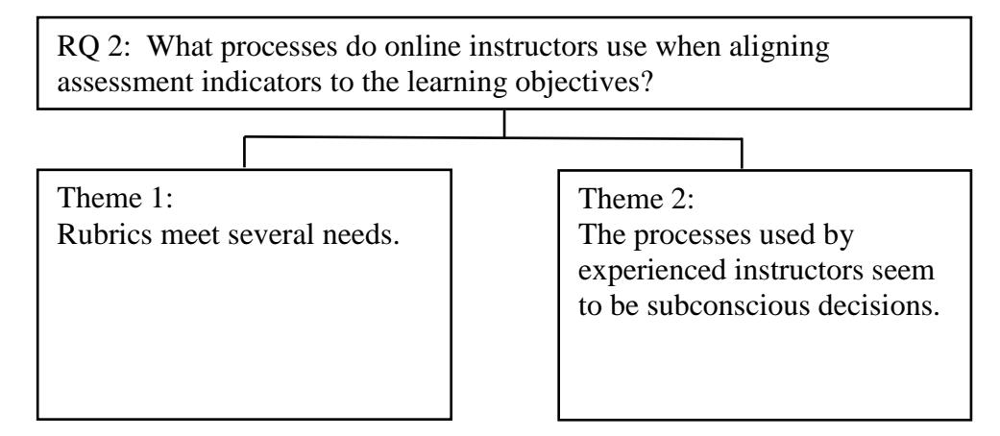
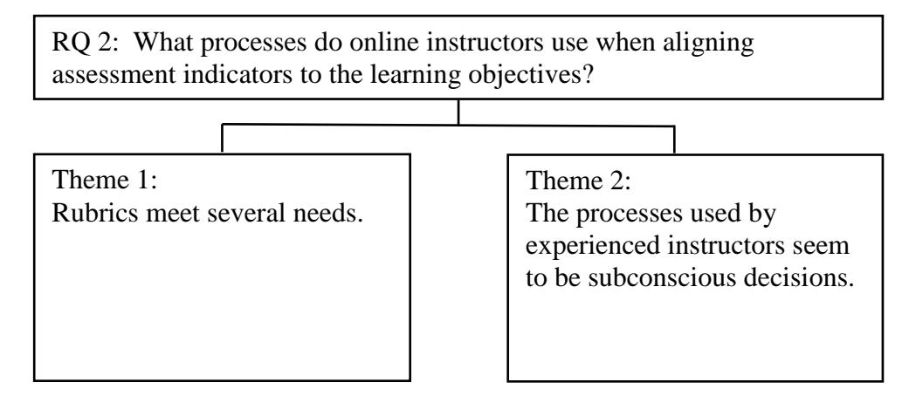

<!-- A3.R83 | source: papers_json/A3.R83/ -->

## Walden University ScholarWorks

Walden Dissertations and Doctoral Studies

Walden Dissertations and Doctoral Studies Collection

2016

## A Qualitative Case Study of Strategies for Choosing and Evaluating Alternative Assessments in Online Higher Education

Robert James Streff Walden University

Follow this and additional works at: https://scholarworks.waldenu.edu/dissertations

Part of the <u>Educational Assessment</u>, <u>Evaluation</u>, and <u>Research Commons</u>, <u>Higher Education</u> Administration Commons, and the Higher Education and Teaching Commons

This Dissertation is brought to you for free and open access by the Walden Dissertations and Doctoral Studies Collection at ScholarWorks. It has been accepted for inclusion in Walden Dissertations and Doctoral Studies by an authorized administrator of ScholarWorks. For more information, please contact ScholarWorks@waldenu.edu.

<!-- page 2 -->

## Walden University

College of Education

This is to certify that the doctoral dissertation by

## Robert Streff

has been found to be complete and satisfactory in all respects, and that any and all revisions required by the review committee have been made.

## Review Committee

Dr. Judith A. Donaldson, Committee Chairperson, Education Faculty Dr. Jennifer Smolka, Committee Member, Education Faculty Dr. Paula Dawidowicz, University Reviewer, Education Faculty

Chief Academic Officer Eric Riedel, Ph.D.

Walden University 2016

<!-- page 3 -->

## Abstract

## A Qualitative Case Study of Strategies for Choosing and Evaluating Alternative Assessments in Online Higher Education

by

Robert James Streff

M.S., University of Wisconsin-Stout, 2002

B.S., University of Wisconsin-Stout, 2001

Dissertation Submitted in Partial Fulfillment of the Requirements for the Degree of Doctor of Philosophy

Education

Walden University

June 2016

<!-- page 4 -->

## Abstract

Studies have shown that not all students are assessed effectively using standard testing formats. However, it is unclear what alternative methodology would be useful to determine whether students have acquired the skills necessary for today's global market. This research study's purpose was to understand the processes instructors use when choosing and designing alternative assessments in higher education online courses to measure student performance. Using Gagné's conditions of learning and Bloom's Taxonomy as a framework to understand these processes, this qualitative case study examined 8 participants teaching online at Midwestern public universities. Interview data and course artifacts, including syllabi, rubrics, assessments, and grades, were gathered as evidence. These data were categorized by participant, interview question, and research question, and were then coded and analyzed to identify themes. The results indicated that, although objectives drive assessment indicators, they do not necessarily drive the assessment choice. They also indicated that the processes used by experienced instructors to determine assessment choices appear almost subconscious, although objectives are the major decision making point. This study impacts social change by helping identify areas where assessment selection is effective or ineffective, as well as where additional training needs to occur on alternative assessment options that accommodate changing student and workplace expectations better.

<!-- page 5 -->

## A Qualitative Case Study of Strategies for Choosing and Evaluating Alternative Assessments in Online Higher Education

by

Robert James Streff

M.S., University of Wisconsin-Stout, 2002

B.S., University of Wisconsin-Stout, 2001

Dissertation Submitted in Partial Fulfillment of the Requirements for the Degree of Doctor of Philosophy Education

Walden University

June 2016

<!-- page 6 -->

## Dedication

I dedicate this paper to my wife, Andrea. Without her support, I never would have completed this journey. Andrea, I am, and will always be, hopelessly devoted to you.

<!-- page 7 -->

## Acknowledgments

I would like to acknowledge the immense help I received from my dissertation committee: Dr. Ana Donaldson, and Dr. Jennifer Smolka. I would also like to acknowledge the assistance I received throughout this program from many of my classmates and in particular from Derek Atchison, Carrie Penagraph, Georgia Watters, and Sara Sharick. The many discussions with my peers helped focus this study and hopefully allowed me to evolve as a better human.

<!-- page 8 -->

## **Table of Contents **

Listt of Tables viiTabole of FiguresviiiChaapter 1: Introduction to the Study1]Background of the Study3]Problem Statement7]Purpose of the Study8]Research Questions8(Conceptual Framework9]Nature of the Study10]Definition of Terms.11Assumptions15,Scope and Delimitations15]Limitations16,Significance17,Summary18Chaapter 2: Literature Review20]Literature Search Strategy22Search Terms22Search Strategy23Conceptual Framework24

<!-- page 9 -->

Framework Boundaries25Bloom's Taxonomy26Gagné's Conditions of Learning29Assessment Strategies40Traditional Assessments43Alternative Assessments45Summary and Conclusion79Chapter 3: Research Method82Research Design and Rationale83Role of the Researcher86Methodology88Participant Selection Logic 88Instrumentation91Selection Criteria Questionnaire92Interviews92Artifacts 94Procedures for Recruitment and Participation and Data Collection97Data Collection98Data Analysis Plan 100Discrepant Cases 102Issues of Trustworthiness102

<!-- page 10 -->

Credibility 102Transferability 102Dependability 103Confirmability 103Ethical Procedures104Researcher Bias 106Summary107Chapter 4: Results108Setting109Demographics109Participant Descriptions 111Data Collection118Participant Selection Questionnaire118Interviews119Artifacts119Data Analysis120Evidence of Trustworthiness127Credibility 127Transferability128Dependability128Confirmability128

<!-- page 11 -->

Results129Research Question 1
129Research Question 2
143Research Question 3
149Summary152Chapter 5: Discussion, Conclusions, and Recommendations154Interpretation of the findings
155Five Assessment Types156Objectives Drive Assessment Choice
157Some Alternative Assessments Used not Mentioned in the Literature159Alternative Assessments do not Contain Assessment Indicators in theSame Manner as Traditional Assessments161Experienced Instructors may Subconsciously Process Some DecisionsRegarding Assessment and Assessment Indicator Design162Experienced Instructors Continuously Revise their Coursework andAssessments162Peer review, Self-assessment, and Group Assessments163Limitations of the Study163Recommendations165Implications165Summary167

<!-- page 12 -->

ReferencesAppendix A: Search Terms, Dates Searched, and ResultsAppendix B: Databases searchedAppendix C. Cover letterAppendix D: Participant QuestionnaireAppendix E: Consent FormAppendix F: Selection LetterAppendix G. Interview QuestionsAppendix H: Relationship of Interview Questions to Research Questions andConceptual FrameworkAppendix I: Possible Follow-up QuestionsAppendix J: Document LogsQuestionnaireInterview ScheduleArtifactsConversation LogAppendix K: Transcript letterAppendix L: Confidentiality Agreement Between Researcher and TranscriptionServiceAppendix M: Copyright PermissionsAppendix N: Letter to "Knowledgeable people"

<!-- page 13 -->

Appendix O: Questionnaire Instructions
217Appendix P: Responses by Participant
218Appendix Q: Responses by Interview Question
220Appendix R: Responses by Research Question221

<!-- page 14 -->

## List of Tables

Table 1. The Higher Levels of Bloom's Taxonomy with Subcategories.
28Table 2
Comparison of Bloom's Taxonomy and Gagné's Types of Learning forthe Cognitive Domain35Table 3. Standard Verbs to Describe Human Capabilities, With Examples ofPhrases Incorporating Action Verbs37Table 4. Use of artifacts in this study
96Table 5. Participant Demographics110Table 6. Participant Implementation of Assessments111Table 7. List of Categories, Definitions, and Examples125Table 8. List of Emerging Themes, Definitions, and Examples127Table 9. Participants' Perceptions of Challenges and Opportunities131

<!-- page 15 -->

## Table of Figures

Figure 1. Themes Related to Research Question 1130Figure 2. Themes Related to Research Question 2143Figure 3. Themes Related to Research Question 3149

<!-- page 16 -->

## Chapter 1: Introduction to the Study

Recent studies suggest that traditional assessments may not measure learning accurately (Aksu Ataç, 2012; Aud et al., 2013; Camilli, 2013; Cho, Shunn, & Wilson, 2006; Hsiao, 2012; Leithner, 2011; Supovitz, 2009; Wiliam, 2010). However, studies of alternative assessments yielded conflicting results from no correlation to a moderate correlation of increased learning (Lew, Alwis, & Smith, 2010), and might have used student perceptions of learning without triangulation to grades. Some studies suggested alternative assessments are valid and reliable methods of measuring student learning (Butler & Lee, 2010; Supovitz, 2009; Tavakoli, 2011). Other studies indicated alternative assessment are learning tools and used traditional assessments to measure student learning (Butler & Lee, 2010; Cuthrell, Fogarty, Smith, & Ledford, 2013; Fischer, Cavanagh, & Bowles, 2011; Gielen, Dochy, Onghena, Struyven, & Smeets, 2011; Ibabe & Jauregizar, 2010; Lew et al., 2010; Li, 2011; Olofsson, Lindberg, & Hauge , 2011; Tavakoli, 2010). The ability to choose and design an assessment that accurately measures student performance is an important teaching skill. These mixed results do not provide teachers with a process to determine which assessment to choose or how to design the assessment to measure student learning accurately.

This study defined *online learning* as learning virtually, without the requirement for face-to-face contact with the instructor throughout the duration of the course (Cicciarelli, 2008). This definition included both synchronous and asynchronous participation methods with physical and possibly temporal separation between students and faculty. Educators apply the term alternative assessment to assessments other than

<!-- page 17 -->

those considered traditional assessments (Oosterhof, Conrad, & Ely, 2008). This study identifies alternative coursework assessments measuring student performance as methods such as peer review, portfolios, self-assessment, collaborative projects, group testing, or problem-solving tasks. Traditional assessments use methods such as multiple-choice, true-false, fill-in-the-blank, matching, short answer, or essay tests (Frey & Schmitt, 2010; Oosterhof et al., 2008).

The intent of this qualitative research case study was to explore and understand the processes used by higher education online instructors when choosing alternative assessments and aligning those assessments with learning outcomes. In some higher education contexts, instructors facilitating pre-designed content do not always have the ability to choose the assessment type or assessment indicators. In many cases, instructional designers who do not teach the courses they design may not receive feedback related to the results of assessments measuring student learning. Therefore, instructors teaching pre-designed courses and instructional designers were not included in this research. This study was limited to higher education instructors, with control over content and assessments, and the processes those instructors used when choosing alternative assessments to measure online learning. Future teachers may benefit from understanding the processes experienced online instructors used in choosing and designing alternative assessments.

Chapter 1 focuses on the background of the study, higher education online courses, assessments in those courses, and the gap found in research related to the processes the instructors use in choosing assessments and designing indicators. The

<!-- page 18 -->

chapter defines the research questions and critical terms used in this research study. This chapter also includes an overview of the conceptual framework and mechanics of this proposed qualitative study.

## **Background of the Study**

Online learning provides learners with alternative learning opportunities not available through brick and mortar classes (Castle & McGuire, 2010; Ibabe & Jauregizar, 2010). Over 6.7 million students enrolled in one or more online courses in fall 2011 (Allen & Seaman, 2013). This large student population, combined with additional communication channels to communicate and interact with peers and faculty through discussion boards, audio and video conferencing, chats, polls, whiteboards, and application sharing anywhere they can access the Internet, may present additional considerations for an instructor when choosing and designing assessments.

Informal assessments are less applicable in an asynchronous environment due to the lack of real time communication and students may find cheating and academic dishonesty easier when presented traditional assessments, (Conrad & Donaldson, 2012; Oosterhof et al., 2008). Distance learning also removes the instructor's ability to observe the learner physically during the learning and assessment processes, a situation that might create a challenge in determining the proper type of assessment for measuring specific learning outcomes (Beebe, Vonderwell, & Boboc, 2010).

Distance learning requires designing assessments in ways where the learner can provide evidence of understanding at the level of mastery indicated by the learning objective (Oosterhof et al., 2008). Failure to meet the criteria required by the learning

<!-- page 19 -->

objectives might compromise evidence that the required learning has occurred (Gagné, 1965).

Current research indicated traditional assessments enjoy long-standing use in education (Aksu Ataç, 2012; Charvade, Jahandar, & Khodabandehlou, 2012). Many professional fields use traditional assessments in their certification process (Moncada & Moncada, 2010). Furthermore, the ability to evaluate traditional assessments (excluding essay type assessments) accurately, and objectively, reduces instructor bias in scoring and provides information on common errors with a group of learners (Charvade et al., 2012; Qu & Zhang, 2013; Wiliam, 2010). However, current research also indicated issues with traditional assessments (Baumert, Lüdtke, Trautwein, & Brunner, 2009; Beebe et al., 2010; Christe, 2003; Hunaiti, Grimaldi, Goven, Mootanah, & Martin, 2010; Joosten-ten Brinke, Sluijsmans, & Jochems, 2010; Oosterhof et al., 2008).

Scholars pointed to traditional assessment methods as being too easy to cheat on and often not providing for evaluating critical thinking, problem-solving, or the capability of measuring a deeper understanding of the material, which alternative assessments can (Baumert et al., 2009; Beebe et al., 2010; Christe, 2003; Hunaiti et al., 2010; Joosten-ten Brinke et al., 2010; Oosterhof et al., 2008). In addition, some studies reported concerns that traditional testing may not be a valid indicator of learning if students encounter challenges during assessments, such as fear of tests or biases in the material (Baker & Johnson, 2010; Baumert et al., 2009; Beebe et al., 2010; Supovitz, 2009).

There is increasing interest in replacing traditional assessments with alternative assessments in higher educational online courses (Alden, 2011; Hubert, 2010; Joosten-ten

<!-- page 20 -->

Brinke et al., 2010; Knight & Steinbach, 2011; McArdle, Walker, & Whitefield, 2010). Recent studies indicated that nontraditional forms of assessment may provide more accurate evidence of learning (Joosten-ten Brinke et al., 2010; Lew et al., 2010; Tavakoli, 2010) and overcome the limitations inherent in traditional assessment practices (Beebe et al., 2010). The shortcomings of traditional assessments, combined with studies indicating alternative assessments may be more accurate, may prompt instructors to develop alternative assessments for their online courses (Aberšek & Aberšek, 2011; Baker & Johnson, 2010; Choi & Johnson; 2005; Ferrão, 2010; Halawi, McCarthy, & Piers, 2009; Harmon, Lambrinos, & Buffolino, 2010; Hayden, 2011; Miyaji, 2011; Supovitz, 2009; Zhu & St. Amant, 2010).

Alternative assessments tend to assess the higher order skills (analysis, synthesis, and evaluation) of Bloom's Taxonomy (Boyle & Hutchison; 2009; Fajardo, 2011; Knight & Steinbach, 2011; Meyer, 2008). Gagné referred to these skills as rule using, problemsolving, and cognitive strategies (Beebe et al., 2010; Harmon et al., 2010; Ziegler & Montplaisir, 2012). Current studies suggested that alternative assessment have been used as delivery mechanisms, learning strategies, or triangulation instruments in addition to being used as methods of measuring student learning (Butler & Lee, 2010; Knight & Steinbach, 2011). When used as a triangulation instrument, alternative assessments produced conflicting results, from no correlation to a significant correlation of increased learning (Butler & Lee, 2010; Lan, Lin, & Hung, 2012; Lew et al., 2010; Lundquist, Shogbon, Momary, & Rogers, 2013; Tavakoli, 2010).

<!-- page 21 -->

Other studies suggested the alternative assessments in the studies were learning strategies or activities rather than assessments (Beebe et al., 2010; Charvade et al., 2012; Mostert & Snowball, 2013; Nulty, 2011; Pombo, Loureiro, & Moreria, 2011; Pombo & Talaia, 2012; Tavakoli, 2012). Still other studies used alternative assessments to determine student perceptions rather than learning (Alden, 2011; Duque & Weeks, 2010; Glassmeyer, Dibbs, & Jensen, 2011; Montecinos, Rittershaussen, Solís, Contreras, & Contreras, 2010).

Additional research studies suggested some portfolio assessments suffer design limitations creating issues with validity and reliability (Nezakatgoo, 2011). Additionally, the evidence in support of group testing, where a group collaborated on a test and all group members receive the same grade, was not strong enough to convince concerned stakeholders (Scafe, 2011). Connecting content and learning objectives to an alternative assessment method was also not fully studied (Sarrico, Rosa, Teixeira, & Cardoso, 2010).

The aforementioned studies suggest traditional assessments do not necessarily provide the best measure of student learning. However, the studies also indicated a weakness in the ability of alternative assessments to accurately measure learning. If some studies provided evidence that alternative assessments measure student learning more accurately while other studies did not support the same conclusion, there should have been an explanation for the disparity. Gaining insight into how instructors determine how assessments measure knowledge acquisition has the potential to provide teachers with more tools to document the evidence of student learning. When presented

<!-- page 22 -->

to teachers of higher education online courses, these processes may foster a positive social change for the learner and institutions.

## **Problem Statement**

Limited studies exist focusing on understanding how instructors determine a particular assessment as the most valid in a particular learning situation, and how they created reliability through assessment indicators might provide future instructors with tools to develop valid and reliable assessments. The problem in using traditional assessments in online learning is their limited ability to measure deep understanding, critical thinking, and Bloom's higher levels of learning including evaluation and analysis and problem-solving (not a computation as in a mathematics problem) (Beebe et al., 2010; Doğan, 2013; Pellegrino & Chudowsky; 2003). In addition, traditional assessments may suffer from ethnic, social, and cultural bias (Baker & Johnson, 2010; Baumert et al., 2009; Beebe et al., 2010; Jones, 2010; Supovitz, 2009). Many possible factors contribute to the overuse of traditional assessments, including a lack of confidence in using alternative assessments and the ease of creating and grading traditional assessments. As a result, instructors are turning to alternative assessments, partly out of concern about shortcomings of traditional assessments mentioned above.

When designing alternative assessments, instructors need a process to ensure the assessment accurately measures student learning (Oosterhof et al., 2008). Educators measure student learning and assign grades through assessments, and accurate assessment of student learning is important to students, institutions, and other stakeholders.** **Research suggested alternative assessments are modified traditional assessments. Studies indicated

<!-- page 23 -->

an alignment of traditional assessments to learning goals, but research did not indicate how instructors develop alternative assessments to align with learning goals. The existing gap in literature raised the question what are the processes an instructor uses to align an alternative assessment to the learning goals.

This study contributed to the body of knowledge by exploring the processes higher education online instructors used when measuring learning objectives.

## **Purpose of the Study**

The purpose of this qualitative case study was to understand the processes higher education online instructors used in determining the type of alternative assessments to select and the assessment indicators employed related to the content and learning objectives. Data analysis relied on Gagné's (1965) conditions of learning to indicate alignment between learning objectives and assessment indicators.

## **Research Questions**

To understand the processes online instructors employ in choosing assessments and assessment indicators to assess learning in higher education online courses, this study focused on the following questions:

- 1. How do instructors of online higher education courses determine the type of alternative assessment to use?
- 2. How do online instructors align alternative assessment indicators to the stated learning objectives?
- 3. How does the process result in the identification or creation of alternative assessments that accurately measure the intended outcomes?

<!-- page 24 -->

## **Conceptual Framework**

When evaluating learning, assessments need to measure the extent of learning resulting from the instruction (Gagné, 1965; Gagné, Wager, Golas, & Keller, 2005). The objective(s) and the course content form the learning environment influencing the choice of the assessment type and the indicators used in measuring learning (Dick, Carey, & Carey, 2009; Gagné, 1965).

A combination of the taxonomy developed by Bloom, Engelhart, and the Committee of College and University Examiners (1956), commonly referred to as *Bloom's Taxonomy*, and Gagné's conditions of learning created the conceptual framework for this study. Because of its prevalence in defining educational objectives, this study used Bloom's Taxonomy as the vocabulary in interviewing subjects. However, Bloom's Taxonomy "is designed to be a classification of the student behaviors which represent the intended outcomes of the educational process" (Bloom et al., 1956, p. 12). Gagné's *Conditions of Learning *(1965) provided the conditions required for the different types of learning to occur. In relation to Gagné's conditions, this research study explored the processes the subjects used to choose an alternative assessment. These different types of learning roughly equate to the six levels of Bloom's Taxonomy (Table 2). In this conceptual framework, Gagné's conditions provided a link between the learning outcomes and the type of learning needed to occur to master the objective. The type of learning and the type of instruction are not the same. *Type of learning* is a process of learning. Chaining is a different process of learning than concept learning. If, for example, the objective is for student to know the Pythagorean Theorem, the student must

<!-- page 25 -->

be able to apply chains of computations in a specific order to arrive at the correct answer. The assessment design should use the type of learning (chaining) required by the objectives to measure student performance. However, if the objective is for a student to understand what a right triangle is, that is what Gagné called concept learning. The possibility exists that the research participants may have processed some information subconsciously, such as disregarding a type of assessment, reflecting on what worked in the past or may have chosen the assessment without identifying the conditions of learning objective.

Chapter 2 includes a more in-depth discussion of the conceptual framework based on Bloom's Taxonomy and Gagné's *Conditions of Learning *(1965) for choosing assessments based on the learning type, content, and outcomes and the works of Dick et al. (2009) and Gagné et al. (2005) on how the assessment design should align with learning objectives.

## **Nature of the Study**

This study used a case study approach. A quantitative study did not provide the depth needed to understand the process of selecting alternative assessments. Similarly, this was not a topic for ethnographic or phenomenological approaches. The single case study approach, involving only one subject, would not provide the breadth of experience required to understand the processes. From recommendations of "well-situated people" (Patton, 2002, p. 237), a purposeful sampling technique guided the subject selection, focusing on instructors who, in the last three years, implemented alternative assessments in their online courses at public universities in the Midwest. I selected public universities

<!-- page 26 -->

for geographical accessibility, the similarity in coursework, and contacts within the system. Time, the school years 2012-2014, inclusive, bound this qualitative research study. Using time as the bound for the study ensured the experience of the subjects was relatively recent and that experience might include recent advances in theory, best practices, and technology.

Data collection methods focused on acquiring information relevant to answering the research questions through interviews, focus groups, questionnaires, and artifacts. Data analysis was thematic. Syllabi, assessments, rubrics, grading schemes, and other related artifacts, when applicable, provided triangulation.

## **Definition of Terms**

- *ADDIE*: An acronym (analyze, design, develop, implement, evaluate) for an instructional design model (Richey, Klein, & Tracey, 2011).
- *Assessment: *A tool used to collect data related to a student's knowledge or behavior (Marzano & Kendall, 2007).
- *Assessment indicator:* The performance required to demonstrate the skill required by the objective (Dick et al., 2009).
- *Alternative assessment:* An alternative assessment collects data in a nontraditional method (Oosterhof et al., 2008) such as peer-review, portfolio, self-assessment, collaborative projects, or problem-solving.
- *Artifact: *A technological device, a tool or instrument, a work of art, or some other physical evidence (Yin, 2009).

<!-- page 27 -->

- *Asynchronous:* A communication method where parties do not communicate in real time, such as email, postal mail, discussion boards, blogs, wikis, or drop boxes (Oosterhof et al., 2008).
- *Authentic assessment:* An assessment requiring the learner to apply his or her knowledge to real world problems (Hui & Koplin, 2011).
- *Blog: "*A form of online journaling that often offers reflections and commentary on news or a particular subject" (Palloff & Pratt, 2007, p. 271).
- *Collaborative project:* An activity in which a number of students work together to create an artifact, which can be assessed (Oosterhof et al, 2008).
- *Distance learning:* Learning that occurs while students and faculty are separated physically, temporally, or geographically (Oosterhof et al., 2008).
- *Distance online learning:* Learning that occurs while students and faculty are physically, temporally, or geographically separated, and use the Internet for retrieving content, submitting and receiving assignments and assessments, and conducting some, if not all, communication (Gagné et al., 2005; Oosterhof et al., 2008).
- *Essay:* An assessment tool requiring students to provide a deeper response over forced choice methods such as true false, fill in the blank or multiple-choice (Marzano & Kendall, 2007).
- *Evaluation*: The score (grade) resulting from analyzing the assessment tool(s) and nonlearning components (Frey & Overfield, 2001).
- *Fill in the blank:* A method of assessing learning, which requires a student to provide the missing word or words in a statement or question (Marzano & Kendall, 2007).

<!-- page 28 -->

- *Formative assessment:* An assessment given during instruction for adjusting the instruction (Gagné et al., 2005; Oosterhof et al., 2008; Popham, 2010).
- *Grading: *A summary of evaluations given to students at a predetermined time (Marzano & Kendall, 2007).
- *Group testing:* Also called collaborative testing. This type of assessment can take two forms. Individual students can respond to a question, receive feedback from other students, and resubmit a response, or a group of students can answer assessment questions as a single entity after arriving at a consensus (Conejo, Barros, Guzmán, & Garcia-Viñas, 2013).
- *Learning method:* Not to be confused with a teaching method, a learning method is the strategies a student uses to understand and retain information (Rias & Zaman, 2011).
- *Matching:* A method of assessing learning, which requires a student to pair or connect words or dates with a corresponding definition (Marzano & Kendall, 2007).
- *Measurement***:** The process of assigning a value to a component of an assessment (Marzano & Kendall, 2007).
- *Multiple-choice:* A method similar to fill in the blank except several options is available to the student to choose from (Marzano & Kendall, 2007).
- *Multiple-discrimination*: "making different responses to different members of a particular collection [of stimuli]" (Gagné, 1965, p. 114).
- *Nontraditional assessment:* Another term for alternative assessment (Oosterhof et al., 2008).

<!-- page 29 -->

- *Online learning:* The use of the Internet for retrieving content, submitting and receiving assignments and assessments, and conducting some, if not all, communication between students and faculty during the process of learning (Gagné et al., 2005).
- *Peer review:* An assessment method where students review and assess other students' work (Knight & Steinbach, 2011).
- *Portfolio:* An assessment of learning based on a collection of artifacts. Portfolios, as an assessment, have several subgroups: showcase, assessment over time, and multiple artifacts (assessed individually and perhaps using different assessment methods) (Baturay & Daloğlu, 2010).
- *Practice:* An informal assessment that includes feedback (Gagné et al., 2005).
- *Problem-solving:* The use of learned principles to achieve a solution (Gagné, 1965).
- *Reliability*: The consistency and dependability of an assessment to measure learning related to the intended outcomes (Gagné et al., 2005).
- *Self-assessment:* An assessment where the learner measures their own performance on a specific task (Pierce, Durán, & Úbeda, 2011).
- *Short answer:* A method of assessing learning in which the learner responds to a question or statement using a phrase or a sentence (Marzano & Kendall, 2007).
- *Synchronous: *A communication method where all parties communicate in real time (Oosterhof et al., 2008).
- *Traditional assessment:* An assessment method such as multiple-choice, matching, true or false, fill-in-the-blank, and essays (Oosterhof et al., 2008).

<!-- page 30 -->

- *True-false:* A method of assessing learning by presenting a statement that the learner must determine whether it is right or wrong (Marzano & Kendall, 2007).
- *Validity:* Validity is the alignment of the assessment to the intended outcomes (Gagné et al., 2005).
- *Wiki: *A wiki "allows users to freely create and edit Web page content using any Web browser...Wikis allow for both the organization of contributions to be edited as well as the content itself" (Palloff and Pratt, 2009, p. 274).

## **Assumptions**

In any qualitative study, there is the assumption of an accurate reflection of the subjects' perception of their experiences may lead into insights of the processes used. In this research study, I also assumed that the subjects gave as truthful account of the process as possible rather than manipulating his or her narrative.

## **Scope and Delimitations**

This study used a small population of public university instructors with the ability to choose and create their own assessments in courses they currently teach or have taught in the last three years. The study was limited to 8 to 10 instructors at several Midwestern public universities within the same state educational system. Participant selection used a purposeful sampling approach. This study did not include instructors of *standardized* or *canned* courses (courses created by subject matter experts and instructional designers, which the instructor has no authority to modify). The intent of this research study was not to be a discussion of traditional versus alternative assessments or of preferences in teaching methodology.

<!-- page 31 -->

## **Limitations**

This research study faced several limitations. First, purposeful sampling selects a small sampling group (8-10). Although it might have been possible to generalize some aspects of the data gathered during the research study, the study focused on the processes used in choosing and applying the instruments, not the assessment itself. Many factors influenced these processes, but they were outside of the scope of this study.

Second, interviews were the primary method of data collection. Interviews relied on the ability of the interviewee to accurately recall and articulate information. The incorporation of triangulation through artifacts controlled this limitation. Neither the researcher nor the participants used archival data in this study. Additionally, the experience and commitment might have affected their choices and results, which did not surface in the interview. These variables, experience and commitment, did not affect the accuracy of the findings, but created a challenge in a successful generalization, and application of the findings.

Finally, researcher bias is present during all studies. "Traditionally, what you bring to the research from your own background and identity has been treated as 'bias,' something whose influence needs to be removed from the design" (Maxwell, 2005, p.37). Although I had no preconceptions to the results, nor do I favor any specific assessment or decision process, I kept a reflective journal related to biases discovered during the study and discussed the effects of those biases in Chapter 5. Member checking, careful wording of interview questions, and an active awareness of body language and tonal inflections by the researcher were included as controls.

<!-- page 32 -->

## **Significance**

Although there was the possibility of scalability of the findings, the processes described by the participants might only be applicable to specific circumstances. The results of this study provided general information that may assist instructors and course designers in developing a process for choosing assessments. The results of this study may provide the impetus to investigate the phenomenon further and document that alternative assessment are accurate methods of determining student learning. The acceptance of alternative assessments as valid and accurate measurements of learning could create a positive social change for students who do not perform well using traditional assessment methods. From a social change perspective, valid and accurate assessments are important components of the education process.

Walden University defines social change as the improvement of "the human and social condition by creating and applying ideas, strategies and actions to promote the worth, dignity, and development of society" (Walden University, n.d.). Changes in the methodology used to assess learning may reduce cultural and ethnic biases and barriers, and the fear associated with traditional assessments, raising an individual's self-efficacy, improving confidence, and allowing him or her to contribute positively to society. This research study, by investigating the design processes higher education instructors use when integrating alternative assessments into online courses, added to that body of knowledge.

The social value of providing evidence that alternative assessments reflect learning as accurately as any other type of assessment may not immediately become

<!-- page 33 -->

apparent. Change of this magnitude is a long-term process. This will require a change on a national scale, replacing standardized and high stakes testing throughout the entire educational system. In order to create change of this magnitude, studies such as this may provide a framework for informing a positive social change.

## **Summary**

Distance online learning offers the opportunity of education and the earning of advanced degrees for individuals not able to seek an on-campus education. Some recent studies indicated traditional assessments may not measure the depth of the learning, critical thinking, or higher levels of learning such as problem-solving and suggested that alternative assessments may overcome the shortcomings in traditional assessments. As a result, online instructors may move toward using alternative assessments in their online courses. However, results of still other current studies indicated alternative assessments at times failed to provide accurate measurement of student learning or used assessments for purposes other than measuring student learning. If some studies provided evidence that alternative assessments do measure student learning more accurately, while others did not, there should be an explanation for the disparity.

The purpose of this qualitative case study was to understand the processes higher education online instructors practiced in determining the type of alternative assessments to select and the assessment indicators to employ related to the content and learning objectives. Instead of a theoretical framework based on a single theory, this research study used a conceptual framework based on the works of Benjamin S. Bloom and Robert E. Gagné. The goal of this study was to understand the processes used in

<!-- page 34 -->

determining which type of alternative assessment to use, how to align the assessment indicators to the objectives, and to determine if the instructors perceptions indicated that the alternative assessments accurately measured the intended outcomes.

Understanding how instructors chose a particular alternative assessment and how the indicators were developed may provide insight into why an alternative assessment was successful in a given situation and failed in another. If the results indicate using a process increases the success of an alternative assessment to measure learning accurately, other instructors may be able to generalize the process for their personal use in their distance learning courses. The implementation of alternative assessments as valid and accurate measurements of learning could create a positive social change for students who do not perform well using traditional assessment methods.

Chapter 2 details how the conceptual framework developed for this study aided in answering the research questions. Chapter 2 also provides the search strategy used to uncover the literature and research studies relating to the topic and a review of the current literature. Finally, Chapter 2 discusses the current literature related to alternative assessments.

<!-- page 35 -->

## Chapter 2: Literature Review

The problem in using traditional assessments in online learning is their inability to measure deep understanding, critical thinking, higher levels of thinking, or problemsolving. This may result in instructors choosing to use alternative assessments to assess learning (Aberšek & Aberšek, 2011; Baker & Johnson, 2010; Choi & Johnson; 2005; Ferrão, 2010; Halawi et al., 2009; Harmon et al., 2010; Hayden, 2011; Miyaji, 2011; Supovitz, 2009; Zhu & St. Amant, 2010). However, within the current literature of alternative assessments, there appeared to be confusion whether alternative assessments were an assessment, a learning method, or an artifact.

Studies used the term *assessment* to describe methods of delivery, perceptions, and assignments in addition to assessments. Some studies used different terms for the same item. Additionally, some studies confused learning theory, teaching methodology, delivery mechanisms, and learning outcomes with assessments (Aberšek & Aberšek, 2011; Horton, 2000, 2006; Li, 2011; Miyaji, 2011; Ogunleye, 2010; Oosterhof et al., 2008; Palloff & Pratt, 2007). Understanding how instructors determined a particular assessment to be the most valid in a particular learning situation, and how they created reliability through assessment indicators might provide future instructors with tools to develop valid and reliable alternative assessments.

Using a multiple case approach, the purpose of this qualitative study was to understand the processes higher education online instructors used in determining the type of alternative assessments to select and the assessment indicators employed related to the content and learning objectives, which might provide future instructors with tools to

<!-- page 36 -->

develop valid and reliable assessments. This chapter discusses the search strategy used in determining the literature to include in this study, the conceptual framework used within the study, and the literature review.

This research study used a search strategy based on Creswell's (2009) suggestion of starting with encyclopedias, then moving to "journal articles in respected, national journals, especially those that report research studies" (p. 32). In addition, the strategy also used Dawidowicz's (2010) caution that a review should include quality research free from bias and that peer-reviewed articles normally meet this criterion. The search strategy also included the terms and databases used to search for articles and how search alerts kept the literature review current.

This research study required a conceptual framework rather than a theoretical framework to ensure inclusion of appropriate educational theories and types of assessments (traditional and alternative). The conceptual framework section explains the importance placed on Bloom's Taxonomy (Bloom et al., 1956) related to learning outcomes and determining assessment indicators, and provides the rationale for using Gagné's Taxonomy based on his *conditions of learning* (1965) instead of Bloom's Taxonomy. These works created a framework that allowed analysis of the assessment artifact open to the instructor or designer's interpretation. Finally, the assessment strategy section contains an in-depth look at current studies related to the use of alternative assessments, which supported the argument for the appropriateness of this study.

<!-- page 37 -->

## **Literature Search Strategy**

The following research questions provided the starting point for the search of literature:

- How do instructors of online higher education courses determine the type of alternative assessment to use?
- How do online instructors align alternative assessment indicators to the stated learning objectives?
- How does the process result in the identification or creation of alternative assessments that accurately measure the intended outcomes?

## **Search Terms**

The research questions and problem statement guided the search terms and strategy used in this review of literature, and created boundaries for articles and studies to consider in this research study. Based on Creswell's (2009) suggestion, the research problem and questions provided over 35 search terms (Appendix A). In locating articles and studies related to this topic, Academic Search Complete, Education Research Complete, Eric, Google Scholar, ProQuest Central, Sage, and SocINDEX were the primary search engines used to search over 40 publication databases (Appendix B). Search alerts, created for all search terms, including those that returned no results at first, send updates on a weekly basis via e-mail.

The terms *higher education, online learning, assessment, evaluation, student * *learning, and distance education* became the original focus of searches. These terms separately and in combination produced the first set of search results. Searches using

<!-- page 38 -->

*higher education* or synonyms for higher education (*colleges, universities, post-graduate, * *and undergraduate*) did not yield many studies related to the use of alternative assessments. Including the names of the types of alternative assessments singularly and in conjunction with the other search terms returned more results. Removing the terms *higher education* and *distance education* provided more studies related to the research questions. Although these results focused on studies at the elementary and high school levels, several appeared to be generalizable to online higher education courses. The searches produced over 650 articles that, on the first viewing, appeared to contain information related to the problem statement.

## **Search Strategy**

Many labels are associated with online learning; computer-based training (CBT), web-enhanced learning, E-learning (spelled in various ways), distance learning or distance education, mobile learning, and online learning are the most common (Horton, 2000, 2006; Oosterhof et al., 2008; Palloff & Pratt, 2007). However, some of these terms are also associated with technology-enhanced classroom lessons or blended learning environments (Aberšek & Aberšek, 2011; Li, 2011; Miyaji, 2011; Ogunleye, 2010), which resulted in many articles not suited to distance learning. Other articles not relevant to this study focused on topics such as evaluation of programs, instructors, student attrition, or institutions. The second phase of the search strategy reduced the number of possible studies to less than 300. Finally, using Dawidowicz's (2009) suggestion of evaluating articles "in relation to the specific topic" (p. 57), a closer inspection of the articles revealed many did not contain information on processes related to assessment or

<!-- page 39 -->

assessment indicator decisions, and the remaining studies were analyzed using the conceptual framework to determine their value, either positive or negative for this research study.

Determining the value of an article's content related to the research questions used a conceptual framework based on Gagné's (1965) conditions of learning. A theoretical framework uses only one theory, while the conceptual framework is a synthesis of multiple theories or concepts (Imenda, 2014). Analysis of the literature, within the boundaries of the conceptual framework developed for this study, reduced the number of articles related to the research questions to those listed in the literature review.

## **Conceptual Framework**

The conceptual framework of this research study did not exclude any type of assessment. The expectation is that the assessment choice contains an explanation of why the instructor chose an alternative assessment and why the assessment indicators measure student learning related to the anticipated outcomes. Oosterhof et al. (2008) stated, "If a test does not measure what is supposed to measure, it is useless" (p. 29). Used as a starting point, that statement developed into this study's conceptual framework.

Broadly stated, the purpose of this research study was to understand the processes higher education instructors use to assess the knowledge, skills, or performance of students in an online environment. This research required a framework to understanding why a particular assessment may be the most effective tool for measuring a particular learning objective, as determined by the instructor. The framework for this research study needed to encompass any learning theory, teaching methodology, type of

<!-- page 40 -->

alternative assessment, and assessment indicators an instructor may choose to implement. Education uses Bloom's Taxonomy (Bloom et al., 1956) extensively in developing learning objectives. However, Gagné's Taxonomy and conditions of learning do not conflict with other learning theories or teaching methodologies. Therefore, the conceptual framework for this research study used Bloom's Taxonomy to convert learning objectives into Gagné's Taxonomy and conditions of learning. The works of Bloom et al., (1956), Gagné (1965), and Gagné et al. (2005) provided a conceptual framework to ensure inclusion of educational theories and types of assessments found in the current literature.

## **Framework Boundaries**

Gagné et al. (2005) indicated that the instructional design process (which includes assessment design) begins with the learning outcomes, whether they are skills, knowledge, or abilities. Learning outcomes are sometimes determined at an administrative or professional standards level above the instructor level and outside of the instructor's control (Ascough, 2011; Dick et al., 2009), and for that reason, the choosing of learning outcomes was outside of the boundaries of this conceptual framework. Still, learning objectives are critical to the course's design and to assessing student learning (Ascough, 2011).

Online instructors at the university level may teach and assess students based on a preferred educational model (Dick et al., 2009). If this study excluded a learning theory, methodology, or type of assessment, the resulting research might have dismissed or overlooked valuable information related to understanding the assessment process the

<!-- page 41 -->

instructors used. The assessment must not only align with the desired outcomes, but also be constructed in a manner that the learner uses the same type of learning to complete the assessment as was used to teach the content (Dick et al., 2009). Consider if the learning objective is to be able to apply the formula C=2π*r*. Students are only taught how to compute the rule C=2π*r*. If the assessment asks the student to solve the word problem what is the circumference of a circle with a diameter of 2, they may fail for two reasons. First, they learned the rule needed to complete the computation, but not how to decipher the word problem, and second, they may or may not know that the radius equals two times the diameter.

Although constructivists and cognitivists may argue the point of transference of knowledge over discovery (Duffy & Jonassen, 1992), the learner must employ mental processes that transform the data into knowledge that the learner can subsequently provide evidence of learning through assessment (Jonassen, 1992).

## **Bloom's Taxonomy**

Bloom's Taxonomy arranges educational objectives into six categories or levels: level 1 - knowledge, level 2 - comprehension, level 3 - application, level 4 - analysis, level 5 - synthesis, and level 6 - evaluation. The categories represent the behaviors required to complete assigned tasks, knowledge being the simplest, and evaluation being the most complex level (Bloom et al., 1956). Studies suggested that alternative assessments tended to assess the higher order skills (analysis, synthesis, and evaluation) of Bloom's Taxonomy (Boyle & Hutchison; 2009; Fajardo, 2011; Knight & Steinbach,

<!-- page 42 -->

2011; Meyer, 2008). Bloom's Taxonomy (or a revised version) is used by many instructors, researchers, and course designers to create course and lesson outcomes and to assess learners (Ascough, 2011; Bezuidenhout & Alt, 2011; Buzzetto-More & Alade, 2006; Eccarius, 2011; Fajardo, 2011; Halawi et al., 2009; Lam & McNaught, 2006; Meyer, 2008; Newton & Martin, 2013; Odom, Glenn, Sanner, & Cannella, 2009; Tsiatsos, Andreas, & Pomportsis, 2010). Outcomes (or objectives) contain action verbs that define how the learner demonstrates knowledge (Dick et al., 2009; Marzano & Kendall, 2007).

Bloom's Taxonomy does not include action verbs, but rather nouns (knowledge, application, comprehension, analysis, synthesis, evaluation) which describe a behavior, but not a change in behavior as is used in defining learning (Gagné et al., 2005) or an indicator of what learning occurred (Gagné, 1965). In fact, there is no published chart or list of words to use in creating objectives. Bloom even suggested that in analysis "no entirely clear lines can be drawn between analysis [level 4] and comprehension [level 3] at one end or between analysis [level 4] and evaluation [level 6] at the other" (Bloom et al., 1956, p. 144). It is interesting that the fifth level, synthesis, was left out of the statement, as if all three upper-levels are so closely related, any distinction is blurred.

According to Bloom et al. (1956), *analysis* is the ability of the learner to deconstruct the parts of an element and understand the relationships between those parts. Analysis has three subcategories: classification of elements, relationships, and organizational principles. Bloom indicated synthesis is the ability to recombine elements and perhaps using additional material to create a new pattern. Bloom also added three

<!-- page 43 -->

subcategories to synthesis: a unique communication, a set of plans or operations, or a set of abstract relations. Bloom et al. (1956) defined the sixth level (evaluation) as making judgments (Bloom et al., 1956). Evaluation contains into two subcategories, *internal* and *external*, with two subcategories in each, *criteria*, and *information*. Table 1 shows the higher levels with their subcategories.

Using *analyze, synthesize, or evaluate* may be sufficient for an objective but these words are not sufficiently specific for developing an assessment. Assessing the learning outcome requires knowledge about the subcategory containing the objective, and the strategies the learner needs to complete the task successfully. For example, to teach learners the strategies required to make evaluative judgments using internal criteria but creating an assessment that relies on external criteria does not align the assessment with the objective. Assessments, to accurately measure student learning, must measure the student's learning in relation to the learning objective, "What we are classifying is the

<!-- page 44 -->

intended behavior of students--the ways in which individuals are to act, think or feel as a result of participating in some unit of instruction" (Bloom et al., 1956, p. 12).

As previously stated, outcomes (or objectives) contain action verbs which define how the learner demonstrates knowledge (Dick et al., 2009; Marzano & Kendall, 2007). Many people have created charts or lists of action words to use with Bloom's Taxonomy. A Google search for images of Bloom's Taxonomy produces several hundred of these charts or lists; none appears in Bloom et al. (1956). A taxonomy based on how learning occurs that converts to Bloom's Taxonomy provided the information needed to design assessments based on anticipated outcomes.

Although the taxonomy created by Bloom et al., (1956) is well known, Gagné's Conditions of Learning and his lesser-known taxonomy are the basis of a variety of instructional design models (Dick et al., 2009; Driscoll, 2005). Driscoll (2005) compared four taxonomies: Bloom's; Simpson's; Reigeluth's; and Krathwohl, Bloom, and Masia's to Gagné's, stating, "Gagné remains the only instructional theorist to propose an integrated taxonomy of learning outcomes that includes all three domains [cognitive, affective, and psychomotor]" (p. 356).

## **Gagné's Conditions of Learning**

Gagné's (1965) book, *The* *Conditions of Learning, *describes eight types of learning. Gagné states "the most important class or condition that distinguishes one form of learning from another is its initial state; in other words, its *prerequisites" *(Gagné, 1965, p. 60). Gagné discriminated his eight types of learning by their initial state. The eight types, from simplest the most complex are: signal learning, stimulus-response

<!-- page 45 -->

learning, chaining, verbal association, multiple-discrimination, concept learning, principle learning, and problem-solving. For example, problem-solving (type 8) required the learning of certain principles (type 7) which required the learning of the concepts (type 6) required to learn the principles, and so on. Once learners mastered the required principles (type 7), they could use those principles to learn how to problem-solve. He called this initial state "prerequisites".

Signal learning (type 1) relies on an involuntary motor skill such as Pavlov's dog conditioned to salivate at the sound of a bell. Stimulus-response (type 2), also called operant learning, or instrumental learning, another motor skill similar to signal learning, refers to actions such as teaching an infant to hold a bottle so that they may drink the milk. If the baby holds the bottle (stimulus) correctly (response), the baby can drink (reinforcement). Chaining (type 3) is the ability to assemble several signal–responses to complete a task. Smaller chains may be assembled together to create larger chains or procedures (Gagné, 1965). Starting the engine of a car, for example, would require many chains including how to open and close the door, determine if the vehicle was in park, or, neutral, insert the key and turn the ignition switch. Gagné suggested these three lower types of learning rely on motor skills and considered them nonverbal skills, although the learning of the skills may require verbal instruction. These three types are presented here as background. Gagné's five higher types of learning (verbal association, multiplediscrimination, concept learning, principle learning, and problem-solving) created the basis for the conceptual framework of this study.

<!-- page 46 -->

Gagné (1965) described verbal association (type 4) in this manner: "youngsters told while being shown a three-dimensional object, "this shape is called tetrahedron. If conditions are otherwise right, next time he sees this particular object, he will be able to say that it is a tetrahedron" (p. 99). Verbal association also includes creating verbal chains that is the cornerstone of language and therefore, communication.

Gagné (1965) did not mention how students should acquire knowledge or how instructors should teach them to think, stating the chosen method of instruction and assessment is at the instructors' discretion. This instructional freedom becomes more apparent in Gagné's last four types of learning: multiple-discrimination, concept learning, principle learning, and problem-solving. In this conceptual framework, Gagné's conditions of learning provide a link between the learning outcomes and the intended assessment by providing an understanding of the type of learning required to master the objective. If the learning objective is to be able to find the area of a right triangle, the learner must understand the concepts of triangle, line segments, and degrees, but must also be able to discriminate the concepts of right, isosceles, and obtuse triangles based on the rules that determine the concept of triangles. In addition, the student must learn the rule area equals-based times height divided by two (A = ab/2). The assessment should contain indicators for each of these concepts and rules in order to measure the student's learning.

The ability to create and use concepts in conjunction with language learned because of verbal association, allows a person to communicate ideas (Gagné, 1965). The mastery of concept learning provides an individual with the ability to understand

<!-- page 47 -->

principles and to problem solve and complements the constructivist viewpoint. "Indeed, while a core knowledge domain may be specified, the student is encouraged to search for other knowledge domains that may be relevant to the issue [of constructing a viewpoint or an understanding of the topic]" (Bednar, Cunningham, Duffy, & Perry, 1992, p. 23).

Principles, according to Gagné (1965), are chains of concepts. The statement *round things can roll* incorporates two concepts, *roll *and *round*. "If he has not already acquired concept *round*, he [the student] might end up learning a more restrictive principle, such as *balls roll*" (Gagné, 1965, p. 143). Gagné mentioned the importance of building on the previous learning types (prior knowledge), identifying them as *prerequisite concepts*. The failure of the learner to master the prerequisite concepts and the consequences of incomplete learning of related information is a key consideration in course construction and learner assessment (Gagné, 1965):

It is only when such prerequisite concepts have been mastered that a principle can be learned with full adequacy…It is unfortunately true that inadequate principles *can* be learned. It is a challenge for instruction to avoid these, and *it is a * *challenge for measurement techniques to distinguish them from adequate ones* [emphasis added]. (p. 146)

Gagné further suggested a hierarchy of principles organizing knowledge, of having the principles created from correctly formed concepts learned. He suggested that assessment of the learning needs to differentiate between the content assessed and the level and accuracy of prior knowledge the learner already possesses (Gagné, 1965). This differentiation is necessary to provide corrective feedback to the student. Without this

<!-- page 48 -->

differentiation, feedback cannot target the proper type of learning the student requires to be successful. Therefore, any instruction must consider the prerequisites for learning the intended principle (Gagné et al, 2005). Once a student learns the required principles, they can apply those principles to problem-solving, considered an alternative constructivist assessment method by Jonassen (1992) and Oosterhof et al. (2008).

Problem-solving is similar to principle learning, according to Gagné (1965). The difference, according to Gagné, is that when problem-solving, the learner uses principles, not just to achieve a goal, but also to learn from achieving the goal. Gagné (1965) also stated, "problem-solving must be based on the knowledge and recall of the principles that are combined in the achievement of the solution" (p. 165). Problem-solving provides the learner with the ability to create new generalized principles and the ability to apply both learned and newly created principles in other situations. Gagné suggested that the learner already mastered the required knowledge and concepts, and is able to combine the knowledge and concepts into the principle required to solve the problem, "Students must acquire knowledge and the ability to think" (Gagné, 1965, p. 110). In the discussion of assessing problem-solving objectives, Gagné et al. (2005) stated, "No verbatim scoring key is possible for this kind of objective….a rubric might be used to assess performance" (p. 276).

In relation to the review of literature, Gagné's conditions explored how the assessment provided evidence that the type of learning that occurred matched the intended outcome in the online environment. Bloom's Taxonomy only addresses the outcome of the learning, not if learning occurred. Gagné's conditions of learning require

<!-- page 49 -->

assessing the learning under the same conditions in which it occurred and that the assessment is able to differentiate between the current learning and prerequisites to provide supportive feedback to the student. In the earlier example of the right triangle, the student, applying the rule that computes the area of a right triangle, may meet the objective. However, if the instruction used only right triangles, but the assessment includes other forms of triangles, and the student had not learned how to discriminate between types of triangles, the student may be unable to answer correctly, even though they know the correct rule to apply for right triangle. As stated earlier, most educators use Bloom's Taxonomy when writing learning objectives. Gagné was aware of Bloom's Taxonomy and developed a cross-reference chart relating what he considered the type of learning required for that level of Bloom's Taxonomy. Table 2 provides this crossreference to Gagné's Taxonomy to aid in understanding how the assessment measures the type of learning indicated in course related data (syllabus, course description, course objectives, and assignments), indicating alignment between outcomes and measurement of learning.

<!-- page 50 -->

Note: From: *Principles of Instructional Design*, 5E, by R. E. Gagné, W. W. Wager, K. C. Golas, and J. M. Keller, p. 61, table 4.1. © 2005 by Wadsworth, a part of Cengage Learning, Inc. Reproduced with permission.

Table 2 indicates that Bloom's Taxonomy has six levels, while Gagné divides learning into five. Gagné combined his first three conditions into his taxonomy as verbal information and split rule using into Bloom's analysis and application. According to this table, Bloom's levels of evaluation and comprehension relate to several conditions of learning. Bloom et al. (1956) had mentioned there are no clearly defined attributes that separate *comprehension* from *application*, *application* from *analysis*, and *analysis* from *evaluation*. This may be the reason Gagné associated multiple conditions in *comprehension* and *evaluation* using *rule-using* for both *application* and *analysis*.

However, in order to compare learning objectives written in Bloom's Taxonomy to Gagné's conditions of learning a secondary table was required. Over the years, many people have created charts and lists suggesting action words for outcomes based on Bloom's Taxonomy. One list, picked randomly from the Internet, (TeachThought staff,

<!-- page 51 -->

2013) contains the words *discriminate* or *differentiate* in three different levels of Bloom's Taxonomy; the words *revise* and *rewrite* are listed in *understanding* and *create*, which in itself is a problem because they refer to *apply* for *comprehension*, to *evaluate* for synthesis, and to *create* for *evaluation*. There is a need to use action words related to Gagné's Taxonomy and apply them to levels of Bloom's Taxonomy. Table 3 provides a sample list of verbs commonly used in Bloom's Taxonomy and their association to Gagné's Taxonomy.

<!-- page 52 -->

Note: From: *Principles of Instructional Design*, 5E, by R. E. Gagné, W. W. Wager, K. C. Golas, and J. M. Keller, p. 136. © 2005 by Wadsworth, a part of Cengage [Learning, Inc. ](http://www.cengage.com/permissions) [Reproduced with](http://www.cengage.com/permissions) permission.

The first column refers to Gagné's conditions of learning, while the middle column indicates words used to describe levels in Bloom's Taxonomy. In reference to concept learning (rules), Gagné et al. (2005) used the word demonstration, leaving the assessment type and design to the instructor's discretion, stating:

There must be a demonstration that the learner can generalize the concept to a variety of specific instances of the class that have not been used in

<!-- page 53 -->

learning. Otherwise, it is not a concept, but merely a collection of specific chains. (p.136)

This framework also required a description of the evaluation process within the assessment process. Within the evaluation of an assessment, there are at least three criteria, a measurement of the assessed criteria, definitions of the level of achievement, and a score associated with that measurement (Reddy & Andrade, 2010). Similarly, Popham (2010) believed a rubric consists of three components: evaluation criteria, distinctions, and application strategy (p. 121). He believed rubrics to be less advantageous for lower level skills, based on the time required to apply rubrics when measuring the assessment.

The conceptual framework of this study encompassed multiple learning theories and teaching methodologies but did not include any limit on the assessment type, indicators, analysis, or the scoring of the evaluation. This research study was not concerned with scoring, but rather the measurement and definitions of achievement. Finally, this framework expected the choice of alternative assessments to reflect the ability to measure the learning outcome, and to provide information on the method determining assessment indicators.

In both ADDIE and Dick and Carey instructional design methods, developing assessments occurs after the objectives are broken down into lessons but before the content and instruction are developed (Dick et al., 2009; Gagné et al., 2005). Designing the assessment at this point ensures alignment between the objectives and the assessment. It also ensures the content and instruction is developed in alignment with both.

<!-- page 54 -->

Assessment indicators may be goal (assessing the stated objective), context (true and to the objective that may be encountered in reality), assessment, (no trick or questions unrelated to the learning outcomes) or learner (based on learner needs and abilities) centered. Assessment should contain enough indicators (usually 3 or more) of each objective to ensure accurate measurement of the mastery of that skill, according to Dick et al. (2009). Each indicator should measure how well a learner has mastered the skill related to the objective (Gagné et al., 2005).

Utilizing the conceptual framework previously constructed, this review of literature included current studies encompassing multiple learning theories, assessment types, and purposes to measure different types of learning. An exhaustive review of current literature indicated little published research regarding how online higher education instructors choose an assessment or how the assessment indicators aligned with learning outcomes. None of the studies found on alternative assessments discussed both the reasons. The literature reported on some assessment types more often than other types, requiring a lengthier discussion of some assessment types (self-assessment, peer assessments, and collaboration). This review only addressed those types of alternative assessments appearing in the current literature. Absence of an alternative type of assessment in the review only means no studies in the current literature mentioned that type of assessment and does not constitute a positive or negative connotation towards any unmentioned assessment type.

<!-- page 55 -->

## **Assessment Strategies**

The focus of this research into current literature was to uncover the processes used in choosing alternative assessments and the assessment indicators used in higher education online courses. The literature reviewed included studies of self-assessments, peer-reviews, student and faculty perceptions, portfolios, reports, blogs, wikis, presentations, collaboration, and interviews. Within the current literature, there appeared to be confusion whether the item is an assessment, a learning method, or an artifact. Studies used the term assessment to describe methods of delivery, perceptions, and assignments in addition to assessments. Some studies used different terms for the same item. Additionally, some studies confused learning theory, teaching methodology, delivery mechanisms, and learning outcomes with assessments. An example of this is Aberšek and Aberšek (2011). The authors stated they used constructivist learning as a basis for an E-learning tool. However, the tool used practice and feedback, very similar to Skinner's programmed instruction and teaching machine (Driscoll, 2005) and used traditional assessment methods (multiple choice, fill-in-the-blank, true/false). Miyaji (2011) used slides to reinforce lecture material and considered this E-learning. Another study used the term e-assessment to describe a traditional (multiple-choice question) assessment delivered electronically (Ferrão, 2010). These disparities in uniform definitions of what constitutes an alternative assessment created challenges in organizing the literature. One result was that the discussions of Aberšek and Aberšek (2011), Ferrão (2010), and Miyaji (2011) take place in the traditional assessment section.

<!-- page 56 -->

The literature also indicated some studies used blogs or wikis as collaborative, peer-review, or reflective types of learning (Biasutti, 2011; Park, Crocker, Nussey, Springate, & Hutchings, 2010; Su & Beaumont, 2010). Other studies treated blogs and wikis as assessments (Olofsson et al., 2011; Pombo et al., 2010). This research study treated wikis and blogs as delivery mechanisms and discussed studies of blogs and wikis based on the type of assessment used to measure the learning as mentioned in the study.

Finally, there was confusion on even over the meanings of formative and summative assessments. Hernández (2012) suggested that the difference is their purpose and effect and that some assessments are both. Hernández considered formative assessments any assessment giving feedback to students. This agreed with Gielen et al. (2011) and Hung et al. (2013) but conflicted with Ibabe and Jauregizar (2010) who insisted formative assessments are "carried out throughout the teaching-learning process, with the objective of monitoring the process and making any necessary improvements to the teaching program" (Ibabe & Jauregizar, 2010, p. 244).

The complexity of terminology in conjunction with the multiple methods of assessing an alternative assessment (as with portfolios and collaboration) required organizing this review using the actual assessment of learning as described in the research study's methodology. It appeared that while there are many names in the literature for alternative assessments, the actual method of assessing learning could be broken down into four major groups: portfolios, self-assessment, peer assessment, and perception. Portfolios, as an assessment, have several subgroups: showcase, assessment over time, and multiple artifacts (assessed individually and perhaps using different

<!-- page 57 -->

assessment methods) (Baturay & Daloğlu, 2010). This study disregarded collaboration and group testing as a type of assessment, as most studies used self- or peer assessment to measure participation rather than learning. Several studies used perception (faculty and student) as evidence for the use of an assessment. Faculty perceptions were included in the review but not student perceptions. The studies using student perceptions did not provide a triangulation of student learning; rather those studies asked if the students learned, not what or the extent of the learning. Of the studies reviewed, four contained assessment practices (problem-based learning) that did not fit in any category (Akçay, 2009; Hung, 2011; Macdonald, 2005; McDonald, 2013).

The review of literature also included three additional groups related to assessment indicators: feedback, rubrics, and assessment design. The characteristics formal, informal, norm-referenced, and criterion-referenced are characteristics of scoring while formative and summative are characteristics of learning over time. While it was possible to categorize assessments based on characteristics of scoring and time, the organization of this literature review did not depend on these characteristics.

In a study of 123 teachers, Thomas (2012) indicated that both trained and untrained teachers share the same attitudes on classroom assessment. Eighty-eight trained and 35 untrained teachers participated in this study. The results indicated the participants believed in assessment for learning and assessment as learning. The participants also indicated, "…assessments which take place informally in the class are the best ways of assessing students' performance" (p. 107). However, without a formal

<!-- page 58 -->

assessment of learning, there is no ability of the student to demonstrate mastery of skill or knowledge (Gagné, 1965).

## **Traditional Assessments**

Traditional assessments include multiple choice, true/false, matching, short answer, fill-in-the-blank, and essay. Because of their long use in education, the term traditional applies to these types of assessments. Baumert et al. (2009) and Nezakatgoo (2011) questioned the accuracy of traditional assessments and Beebe et al. (2010) suggested cultural bias could have an impact on the results. Nezakatgoo (2011), in studying assessments of writing, indicated that traditional testing incorporates an understanding of language, punctuation, grammar, and comprehension. Only recently, due to changes in academic needs of more diverse students, has the use of traditional assessments come into question (Hayden, 2011, Jones, 2010; Supovitz, 2009). The results of studies of traditional assessment methods might provide impetus for considering the use of alternative assessments over traditional methods (Aberšek & Aberšek, 2011; Baker & Johnson, 2010; Choi & Johnson; 2005; Ferrão, 2010; Halawi et al., 2009; Harmon et al., 2010; Hayden, 2011; Miyaji, 2011; Supovitz, 2009; Zhu & St. Amant, 2010).

Ferrão (2010), in a quantitative study, considered whether an e-assessment, in this case using multiple-choice questions, was a viable alternative to an open-ended type of assessment. The results indicated MCQ (multiple-choice question) assessments delivered electronically are a viable alternative to open-ended testing. Just as in Scafe's (2011) research (discussed in the collaboration section), the students in Ferrão's study took an

<!-- page 59 -->

open-ended assessment immediately preceding the MCQ assessment. This procedure raised the question whether the second assessment measured learning from instruction only and not learning resulting from completing the first assessment.

Aberšek and Aberšek (2011) attempted to promote constructivist learning with the objective for students to "construct his/her own mental mode of a specific concept" (p. 13). However, the tool used practice and feedback, very similar to Skinner's programmed instruction and teaching machine, and used traditional assessment methods (multiple choice and fill-in-the-blank questions with feedback).

In contrast, Miyaji (2011) focused on problem-solving using slides to reinforce lecture material. Although the treatment group did score higher in short (ten-minute) tests, Miyaji admitted that a structured notebook contributed to the increase. As the tests were not the same for the control group, a comparison of learning is difficult. There was no mention of either methodology or assessment type.

Similarly to Halawi et al. (2009) (discussed under feedback), Zhu and St. Amant's (2010) study of a course based on Gagné's nine events of instruction (for a complete discussion of Gagné's nine events of instruction, see Gagné et al., 2005) indicated students "achieved the overall objectives of the course" (p. 259). There was no discussion of the assessment analysis methodology used, or the data gathered which confirmed their claims. General statements without evidence that the assessment choice measures learning such as those made by Halawi et al. (2009) and Zhu and St. Amant (2010), might not motivate stakeholders to consider this type of assessment (Gallagher, 2011).

<!-- page 60 -->

The above studies were inconclusive regarding traditional assessments ability to measure learning outcomes accurately, creating a logical fallacy to the alternative assessment community's claims. Referring back to Oosterhof et al.'s (2008) statement about assessments needing to measure learning, one expected studies to address why a specific assessment is a good measurement for specific learning outcomes. However, the next section indicated that studies of alternative assessments faced challenges in explaining their processes of choice, design, and analysis.

## **Alternative Assessments**

As mentioned previously, educators apply the term alternative assessment to assessments other than those considered traditional assessments (Oosterhof et al., (2008). Alternative assessments tend to use the higher order skills of Bloom's Taxonomy (analysis, synthesis, and evaluation) according to some proponents (Boyle & Hutchison; 2009, Fajardo, 2011; Knight & Steinbach, 2011; Meyer, 2008). Gagné referred to these skills as rule using, problem-solving, and cognitive strategy (Beebe et al., 2010; Harmon et al., 2010; Ziegler & Montplaisir, 2012). Whether one references Bloom's or Gagné's Taxonomy, these skills are the basis of educational objectives, and therefore the basis for developing alternative assessments and assessment indicators.

Often in the alternative assessment studies researched, the studies did not provide clear precise procedures, methodology, and results. In Olofsson et al. (2011), a reflective peer-to-peer assessment using blogs measured connections between prior and new knowledge. The authors suggested students demonstrated connections between prior and new knowledge stating " Connections relates to previous knowledge and associates new

<!-- page 61 -->

bits to things already known" (p. 186), and "Signs of connections are shown when students demonstrate how basic concepts are related or when students make connections between what was learned and what they already knew" (p. 187). They did not provide precise information, using terms such as "In less than a handful of blogs" and "about a fourth of the comments" (p. 188). Olofsson et al. did not mention any learning objectives, nor did they mention the criteria the students used when peer reviewing.

Another example is Alkan's (2013) study of pre-service chemistry teachers. In his study, he suggested alternative assessment techniques improved learning. He actually used alternative teaching methods rather than alternative assessments, as both the control and experimental groups took the same pre- and posttests. He defined the alternative assessment as "Alternative assessment techniques supported by learning cycle model consists of the stages of exploration, concept introduction and concept application" (p.776).

In a meta-analysis, Gikandi, Morrow, and Davis (2011) reviewed 91 articles and evaluated 18 studies published between 2000 and 2010. The studies chosen for this analysis used alternative assessment strategies, with collaborative and self-assessments mentioned most frequently and no mention of traditional assessments. The authors suggested documentation monitoring of evidence as methods of reducing online cheating, the use of multiple source of evidence, and monitoring that evidence as methods of increasing validity and reliability, and to provide clarity of learning goals and increasing objectivity using rubrics. The authors gave no indication that any of the analyzed research studies provided evidence of student learning. Their conclusions included the

<!-- page 62 -->

need of teaching and learning strategies, assessment models for teachers to draw upon, and that further research requires "a rigorous and systematic approach in order to achieve useful findings that can inform effective practices" (Gikandi et al., p. 2348). The implication of this study is that online and face-to-face assessments require different design strategies, that alternative assessments in online environment require careful implementation of assessment indicators to ensure validity and reliability, and that the incorporation of rubrics increases objectivity of scoring assessments as well as providing students with information of the assessments purpose and requirements.

Metin (2013), while studying teacher preparation of performance assessments; found that teachers had issues in preparing and implementing performance assessments. After interviewing 25 teachers and assessing sixty performance tasks, Metin's results suggested teachers "have difficulties in determining the subject of performance tasks", deciding, "how they should give performance task", and one teacher summed it up saying, "*I do not know accurately how to prepare performance task (Math 1)"* (p. 1667). In addition, Metin found that the teachers had issues determining criteria for the assessment, and the inability to create of find rubrics. Teachers also mentioned class size, time constraints, and objectively assessing performance tasks. These are major issues when considering the validity of studies relating to the credibility and validity of performance tasks.

Fisher et al. (2011) examined formative assessment as a method of improving student learning. The study indicated that formative assessment provided an increase in student learning. A comparison of written assignments indicated the learning skills

<!-- page 63 -->

acquired as part of the experimental group did not transfer to another course. The findings indicated that although the use of formative assessment in this case, may have improved student grades for the particular course, the formative assessment was not successful in aiding student learning, or in creating a learning experience that was transferable to other courses. This may indicate that as a formative assessment, which by definition, is to inform teachers on modifications of instruction to improve learning, the assessment failed to meet its purpose.

Another study (Chen & Chen, 2012) used twitter as the delivery tool for a formative evaluation. The conclusion was that students preferred online to face-to-face communication. However, the study contradicted this supposition by stating, "…a number of minor issues still need to be resolved. The first of these is the participants' lack of commitment to online peer-to-peer collaborative learning" (Chen & Chen, 2012, p. E51).

Another example of a hard to organize study was Xamaní (2013). Xamaní stated that the study analyzed the use of a portfolio while assessing oral presentation skills. Peers assessed the portfolio mid-term. The portfolio consisted of 25 artifacts, including class exercises, recordings, self-assessments, peer reviews, and samples of the oral presentation. The portfolio included a final self-assessment, which they were able to negotiate with the teacher. However, the study analyzed three other artifacts for results: a research diary, recordings of the final oral presentation, and questionnaires, but "This article focuses on the findings from one of the research tools in particular: the opinion questionnaires" (p. 5). The result of this study was a student perception of the use of

<!-- page 64 -->

portfolios and this type of learning process. The highest mean, on a 1-3 Likert scale (1= disagree and 3= agree) was 2.90 for the question related to taking part in the assessment process. As Xamaní (2013) provided no triangulation of data, it was difficult to determine the benefit of the assessments used in this study, other than the students' perceptions.

Although some educators and researchers consider alternative assessments a viable and even a preferred method of measuring student learning, the studies mentioned above suggested that the research of alternative assessments is inconclusive due to poor research design, lack of data, or the use of traditional assessments to measure learning. In addition, those studies only covered a few alternative assessment choices. These issues continued to surface during the literature review, creating a challenge as to how to organize a literature review. The solution was to organize the literature review based on the type of assessment. However, the literature review did not find all types of alternative assessments. Therefore, the organization of this literature included selfassessments, peer reviews, collaborative assessments, portfolios, and studies of probebased learning, assessment. In addition, studies related to feedback and rubrics were included.

Finally, the literature indicated another type of alternative assessment called *Badges,* an award for achievement (Abramovich, Schunn, & Higashi (2013)*.* In this study of 51 students, the authors found mixed results related to motivation and to learning. The conclusion "…we find evidence that earning various badges can be associated in increases in expectations for success but also increases in counter-

<!-- page 65 -->

productive educational goals" (Abramovich et al., 2014, p. 229). Although Abramovich et al. also indicated that different types of badges affect motivation differently, they did not elaborate on the different types considered.

**Self-assessment**. Self-assessment, in the context of learning, is an evaluation of one's own learning. Self-testing, self-rating, and reflective assessments have different purposes and are sometimes confused (Ibabe & Jauregizar, 2010; Lew et al., 2010). There is some controversy whether self-assessment is an assessment or a learning strategy (Ibabe & Jauregizar, 2010; Lew et al., 2010; Tavakoli, 2010).

Lew et al. (2010) compared self-assessments with the judgment of peers with a team and tutors, using the judgment of the tutor, peer assessment, and a reflective journal as measurement tools. Overall, a comparison indicated weak to moderate accuracy of self-assessments compared to peer-review (*r* = .31) and tutor scores (*r* = .23). The correlation was not significant. Lew et al. (2010) mentioned, "A rating scale consists of eight items inquiring about the quality of *students'* [emphasis added] performance within their team" (p. 141). Using the plural possessive for student, without using the word *the* before it, questions if the assessment focused on the student or the teammates. Comparing the results of a second study (involving the same students) to the results of the first study, Lew et al. (2010) found, "There are no inter-relationships between students' beliefs about the usefulness of self-assessment and their self-assessment ability" (p. 151). The results of these two studies question the accuracy of self-assessment as a method of measuring student learning.

<!-- page 66 -->

Similar to Lew et al. (2010), Tavakoli (2010) studied 35 students to determine if a correlation existed between student self-assessment and teacher assessment. The teacher rated each student twice, giving a reliability score of .82. Because the results indicated a moderate correlation (.677) between the student and teacher assessments, Tavakoli (2010) suggested self-assessments are reliable and valid, but also concluded a selfassessment could be a learning strategy rather than a measurement tool.

Instead of studying the relationship of self and peer assessment to instructor or tutor assessment Dabbagh and English (2015) indicated that they studied the alignment of competencies to self-assessments. However, the results indicated they studied the students' perceptions of their competency levels according to professional standards for their field. The results also indicated that the students perceived themselves competent in all of the competencies, although a previous study indicated, "only 36% of students met all of the competencies" (Dabbagh & English, 2015, p. 24). Still, the authors concluded, "student self-rating of proficiency on professional field competencies can facilitate student reflection and serve as a basis for assessing the professional relevance of degree programs" (p. 30).

Butler and Lee (2010) found that although students improved their ability to use self-assessment over time, instructor intervention affected student perceptions. The results indicated self-assessment had a marginal effect and student perceptions differed from those of instructors, similar to the findings of Lew et al. (2010). Also similar to Tavakoli (2010), Butler and Lee (2010) felt self-assessment is as an instructional device in addition to being a measuring tool. The study did not indicate a method of analyzing

<!-- page 67 -->

the self-assessment, prompting one teacher to suggest that some other assessment needed to be included. The lack of a measurement criterion and analysis component reduced the validity of the self-assessment used in this study to personal satisfaction, not the individual's progress. Personal satisfaction may increase motivation through ownership and engagement (Axelson & Flick, 2011; Reigeluth & Beatty, 2003), but the assessment used did not measure learning from observation.

Almost as a response to Butler and Lee (2010), Sendziuk (2010) incorporated both feedback and self-assessment into a written assessment. Although Sendziuk used an essay for the main assessment and essays are a traditional assessment method (Oosterhof et al., 2008), I felt using a research essay, in conjunction with an additional measurement component (self-assessment) qualifies this as an alternative assessment. However, the self-assessment phase was not for the students to measure the learning but rather for them to defend their opinion of the grade they should receive, suggesting this was self-rating (as defined in Ibabe & Jauregizar, 2010), and not self-assessment.

The results of a study by Ibabe and Jauregizar (2010) of the effect of self-testing, indicated that of those using the self-test, 25% received failing grades and almost 30% only received sufficient scores ( an example of poor explanation of the results). Self-tests coincide with Dick et al.'s (2009) idea of practice tests, although, in this case, the instructor did not use the self-test results to improve teaching or provide additional instruction to the students. Instead, the author implemented an E-learning version of programmed instruction with feedback rather than a student self-assessing their learning.

<!-- page 68 -->

In a study of oral presentation skills, Lundquist et al., (2013) compared student self-assessments with faculty assessments and found students assessed their skills lower than faculty did. Lundquist et al. suggested the discrepancy might be due to lack of practice or inexperience with self-assessments. Regardless of the reason, some may suggest the findings indicated self-assessments are not accurate means of measuring learning.

Lam's (2010) is an example of the confusion an instructor may have in understanding the application of self-assessments. Lam used a portfolio-based assessment with multiple artifacts. However, he also used an initial and final draft of the three artifacts, which he graded, and each artifact was in the form of an essay. The selfassessment was a student perception and based on only one of the six artifacts. The results indicated that students perceived they lacked the required prerequisites/skills to be successful. Combining a traditional assessment method (essay) into an alternative assessment category (portfolio), and then having students self-assess their perception of the experience rather than a self-assessment to measure learning, created a misalignment of assessment strategies. There was no triangulation conducted between the essay, portfolio, and self-assessment that would indicate the accuracy of the self-assessment, nor any indication of how the self-assessment actually improved learning.

Students had input in the assessment process in the Baleghizadeh and Zarghami (2014) study. Although the authors stated, "Student-generated testing as a sub-discipline of alternative assessment" (Baleghizadeh, & Zarghami, 2014, p. 628). The authors used two multiple-choice and fill-in-the-blank assessments, each containing 40 questions. A

<!-- page 69 -->

standardized assessment was the control for both the pre and post assessment. The students in the experimental group developed the second post assessment. In developing the experimental assessment, the only reference to assessment alignment or indicators with learning objectives was, "there were ten items for each of the four grammatical topics covered during the given grammar course" (p.634). The results indicated on the standardized pretest, there was only 0.09 difference in the mean between the groups (experimental 16.74 and control 16.65) and a SD difference of 0.107 (experimental 1.310 and control 1.203). However, when comparing the standardized posttest scores, the difference in the mean between the groups (experimental 33.39 and control 30.47) was 2.92. The difference in the standard deviation was 0.444 (experimental 2.604 and control 2.155). This indicated that while the mean test score was higher for the experimental group it the reason might be from the difference in how the control experienced the experimental assessment. The results provided some evidence of this in the experimental post assessment. The experimental group's mean was 17.16 while the control group's mean was 12.25.

In conclusion, none of the studies provided reasoning behind choosing a selfassessment to assess learning outcomes, nor was there any discussion of indicators used in the self-assessments. Most of the self-assessment studies in the literature review appeared to be learning strategies or rely on students' perceptions of learning rather than on actual measurements of learning. The studies that did suggest the self-assessment measured learning indicated only a weak to moderate correlation in the accuracy between student and teacher measurements of learning. This does not imply self-assessments are

<!-- page 70 -->

invalid for measuring learning, but it does suggest choosing to employ self-assessments may require considerations not mentioned in the above studies. Adding a further dimension to the confusion, Beebe et al. (2010) suggested that rather than using selfassessments as a measurement of learning, self-assessments should be used as a method of improving course design: "Assessment is important in guiding the design of online courses by using a variety of tools - such as self-assessment and peer-assessment methods" (p. 2).

**Peer-review**. Peer-review is a process whereby a peer or group of peers reviews another peer's work. In educational settings, students review other student's work. According to Knight and Steinbach (2011), "peer review can be a grading tool, an assessment tool, or a learning tool" (p. 82), while Gunersel and Simpson (2010) felt peer reviews compete with traditional assessments in reliability. A meta-analysis (Gielen et al., 2011) of studies on peer reviews found five distinct goals: social control, assessment, learning, learning to assess, and active participation stating, "Some researchers and practitioners are not explicit about their intended goals for using peer assessment, but still draw conclusions on its quality" (p. 721). The authors suggested when used as a social control, motivation rather than assessment is the intention. As an assessment, peer review provides triangulation, or a replacement for the instructor's assessment. When it replaces the instructor's assessment, the confidence and acceptance by stakeholders come into question (Gielen et al., 2011). Gielen et al. suggested peer assessment could also be a tool to learn how to assess one's own work by assessing another's work. Finally, some

<!-- page 71 -->

studies in the meta-analysis used peer-reviews as a participation tool in the student's personal learning.

According to Subramanian and Lejk (2013), there are four categories of peer assessments:

- 1) The work of one person is assessed by one peer;
- 2) Multiple peers assess the work of one person.
- 3) The work of a group is assessed multiple peers (sometimes as a group).
- 4) The group an individual belongs to assesses the individual's group work.

In relation to the validity and reliability of peer assessments, Subramanian and Lejk (2013) stated:

Without really looking at the literature, it could be predicted that peer assessment of a multi-choice test using the correct answer scheme would be more valid and reliable than peer assessment of an open-ended essay where peers were required to simply use their judgement in arriving at a grade (p. 370).

Although results indicated the students graded peer reviews higher than the tutors, student felt both the peer reviews and the tutors' assessments were fair. Subramanian and Lejk concluded: "The replacement of individual assessments with group assessments is usually accompanied by a decreased marking load. This, on its own, is not a good reason and can lead to all sorts of problems" (p. 380).

In their meta-analysis, Gielen et al. (2011) offered instructors different reasons for using peer reviews in the classroom. However, the current research study focuses on peer

<!-- page 72 -->

review as an assessment. In that respect, Gielen et al. only offer two choices for the instructor, as a replacement for the instructors' assessing learning, or as a triangulation to provide a more complete assessment. When used as an instructor replacement, the reviewer's judgment must be a valid and reliable assessment.

Related to the online aspect of assessing learning using peer reviews, Knight and Steinbach (2011) compared the peer review process in face-to-face and online courses. Knight and Steinbach (2011) investigated the challenges of peer reviews in online courses, targeting the process rather than the results. Regardless of the challenges in the process, the effectiveness of the assessment is important, and the study failed to discuss the effectiveness of peer reviews in either modality. In addition, other than providing assessment criteria to the reviewers, the researchers provided no explanation of the ability of the students to measure learning.

Taking a different approach, Li (2011) used peer-review to promote student learning. The results indicated that although student scores increased across the board, the advanced group's grades did not improve as dramatically. Two possible interpretations of these results could be that only one student from the advanced group indicated the feedback they received was good, perhaps because they had reviewers from a lower group or that their work met the criteria. Li's study provided evidence of the effectiveness of peer-reviews as learning strategies, but provided little evidence of their value as an assessment tool.

Brill and Hodges (2011) investigated peer review as an intentional learning strategy to foster collaborative knowledge building. Using peer-review practices

<!-- page 73 -->

throughout the course, groups submitted their project draft at midterm to be peerreviewed on an informal, formative basis. Brill and Hodges suggested peer-reviews during the course honed the students' skills. A final informal peer-review occurred at the end of the course. Brill and Hodges offered no information other than those students had positive attitudes towards the process, stating, "The practice described here is part of an emerging research program" (p. 110).

A different study, Cho and MacArthur (2011), looked at peer review as a method of improving the writing of the reviewer. In this study, Cho and MacArthur trained students in the peer review using rubrics. A 7-point rating scale indicated the experimental group's writing at the end of the course rated higher than the control group's writing. The results of this study suggest the researchers used peer review as a learning tool benefiting the reviewer rather than to measure learning.

Exemplifying Gielen et al.'s (2011) discussion of peer review as learning tool, Cuthrell et al., (2013) researched student perceptions using the term peer feedback instead of peer review. The results indicated 50% of students agreed that the impact of using audio feedback in the peer review process was valuable. Students also indicated they preferred feedback from an instructor, rather than from students, believing the instructor to be more knowledgeable than their peers. The authors did not provide any data indicating an increase or decrease in knowledge to substantiate the students' perceptions.

In a variation of the traditional peer-review process, Lavy and Yadin (2010) implemented a student/team peer-assessment process that enabled one team of learners to

<!-- page 74 -->

assess another team's work in conjunction with the instructor assessment, both using the same rubric and scoring system. The results of the study only provided the difference in grading between the team and the instructor. The study did not compare grades to previous iterations of the course, which may have validated the peer-assessment as a measurement of learning. However, the authors asserted, "this [an increase in understanding] was observed for example by the fact that all feedback issues were properly addressed in subsequent assignments" (Lavy & Yadin, 2010, p. 91), indicating that peer review is a valuable learning strategy.

A similar study, Kaufman and Schunn (2011), looked at student resistance to peer assessment in a higher education writing course. An application called SWoRD, analyzed the peer reviews using an algorithm to determine the accuracy of the reviews. Students revised their papers based on the peer reviews and SWoRD scores and resubmitted for another peer review process. The process provided anonymity for both reviewers and writers, and allowed the writers to give feedback to their reviewers. The study focused on two student perception surveys, pre- and post. This study did triangulate the surveys with the revisions made to the papers and found:

…their revision of paper one was very significantly correlated with their number of simple changes for their revision of paper two (.45, p<.01), as was students' number of complex changes for their revision of paper one and their revision of paper two (.44, p< .01). (p. 395)

The results indicated that while process did increase scores, students felt peer reviews to be more effective when there was teacher involvement in the process.

<!-- page 75 -->

However, Kaufman and Schunn (2011) also suggested that the negativity did not appear to impact student work. This may indicate a learning tool rather than an assessment, as there was no correlation made with a control group.

In an effort to accurate weigh individual student participation in group work, Ko (2014) suggested an algorithm, which assigned a reliability value to the assessor. In this manner, Ko found "analysis shows that including self-assessment may represent each group members' contribution more accurately" (Ko, 2014, p. 310). However, the study also suggested that there should be multiple assessors and the algorithm affects only the assessor with the most divergent score.

None of the preceding studies used peer review to assess student learning, nor did they indicate the reasoning for choosing a self-assessment. Several used peer review as a learning process for the reviewer rather than as an assessment tool. Cho and MacArthur (2011) and Li (2011) used peer review as learning process for the reviewee rather than the reviewer. Again, this wide variation within the description and use of peer assessment might confuse an instructor as to how to go about choosing and designing a peer assessment for their online course. Cuthrell et al. (2013) found that students preferred feedback from the instructor, believing the instructor to be more knowledgeable, yet none of the self-assessment or peer review studies appeared concerned about the ability of students to accurately measure learning. Closely tied to self-assessments and peer reviews are collaborative assessments, in which a team works together to create a project, and then completes a peer-assessment of each individual learner's the group's participation

<!-- page 76 -->

**Collaboration**. In collaboration, at least two items are usually assessed, the artifact produced, and the participation of each member of the team (Alden, 2011). Collaborative projects can range from responding to a discussion question as a group to an entire semester project. One advantage of collaborative activities is the ability of students to learn from each other, fostering deeper learning (Alden, 2011).

In an effort to evaluate the contribution that the learner adds to a collaborative learning exercise, Lan et al., (2012) devised a web-based system that scored the knowledge of the individual student based on self-assessments, peer assessments, and teacher assessment, and created a relational database of the information. Rather than using the information in the database on student learning the authors used traditional preand posttests (multiple-choice, matching, fill in the blank, and true false questions).

Self-assessments, in the form of a reflective journal, "support teachers in implementing purposeful collaborative learning in their classrooms" (Hubert, 2010, p. 386). There was no correlation between the student perceptions and actual grades. Hubert (2010) made no mention of the objectives of the group work, or the methodology of assessing the journals for learning. These limitations created a problem in the reader's ability to understand why the instructor chose to use a self-assessment or to understand how self-assessments measured the learning in the group or individual.

Kurt (2014) studied what he considered a collaborative assessment process whereby the student and instructor discussed the student's grade. However, he did not mention the assessment at all. He did mention the teacher and student would reach a

<!-- page 77 -->

decision on a joint mark. Nevertheless, Kurt provided no indication the discussion led to change of the final grade assigned by the teacher.

Alden (2011) conducted a quantitative study of student performance evaluations in a collaborative exercise. The study compared four assessment methods: shared grades (all members of team receive the same grade), record review (evaluation of documents related to the assessment), peer review, and portfolio review. The results indicated that faculty record review was the preferred method of assessment, peer assessment was the least preferred by students, and a portfolio review was least preferred by faculty. This study was a perception study with no documentation of triangulation to actual student learning.

Ruey (2010) focused on whether and how there is a benefit from using a constructivist-based instructional strategy for an online course. The results indicated that "collaborative, interactive, constructivist online learning environment, as opposed to a passive learning environment, is found to be better able to help students learn more actively and effectively" (p. 706). According to the study, data collection included a survey, course documents, learner artifacts, interviews, conversations, and observations, but only the interviews and conversations were included in the findings. As in Alden's (2011) study, Ruey reported on perception rather than measurement of learning.

Huang and Wu (2011) suggested that in a collaborative environment, heterogeneous groups perform best. The result of their study was an algorithm utilizing an individual learning in a group environment. "These results demonstrate the groups with the greater diversity of behavior exhibited more interaction between learners and

<!-- page 78 -->

effected [affected] the process of learning more significantly" (Huang & Wu, p. 115). However, there was no discussion on the actual evaluation of learning; and the categories of learning behaviors were not well defined. The results of this study were based on a small group (3-5 students), and might not be generalizable or scalable to the wider online learning community. Online courses seldom have enrollments this small, and to achieve the desired heterogeneity additional programming of the algorithm would be required.

Biasutti (2011) incorporated a self-evaluation questionnaire in an asynchronous learning environment to explore the student experience of collaborative learning. The study gathered data from a student perspective, questioned if a collaborative activity positively affected student learning. According to the Biasutti (2011), the collaborative exercise was effective as a learning tool, and communication between students affected the learning and increased student's ability to analyze alternative viewpoints.

In a study of a peer-reviewed collaborative assignment involving 137 students, Hodgson, Chan, and Liu (2014) found students preferred to perform peer reviews as a team, rather than individually. The students indicated a lower confidence level of their peers' comments. Finally, the results indicated students with higher proficiency benefited less from the peer review process. There was no mention of the peer review process nor if the instructor was involved in the assessment as a triangulation of the reliability or validity of the peer reviews.

Related to collaborative activities is group testing. Scafe (2011) evaluated the effectiveness of group testing as a learning method using traditional (multiple-choice question) assessments. Although Scafe reported an increase in the group scores over

<!-- page 79 -->

individual scores, he used the same assessment to assess both the individual students and the students formed into a group. The group scores should have shown an increase, as immediately after the students took the assessment individually, the groups took the same assessment. Although the study indicated repeating a test as a group did increase scores, the study did not provide data indicating an individual increase of learning as a result.

Park et al. (2010) considered a wiki a teaching strategy rather than an alternative assessment method. In this study of a wiki, issues with data collection made correlation statistics and impractical. "We did not attempt correlational statistics. Instead, positive student comment on their perception of the Wiki was compared to students on the extreme ends of the continuum" (p. 317). It would appear that using positive comments as the comparison may skew the results and results in a study, which has little application in reality.

As in Park et al. (2010), Su and Beaumont (2010) analyzed student motivation within a collaborative exercise using a wiki. The study consisted of identifying benefits and issues perceived by students, the extent of student learning, and good practices. As in other studies, no discussion related the students' grades to their perceptions, even though the title suggested the study would evaluate "a wiki for collaborative learning" (p. 417). In addition, no mention of the collaborative portion appeared in the findings.

In Powell and Robson (2014), the authors indicated they employed podcasts as an assessment in a collaborative group setting. This case study consisted of 143 students divided in groups of four. Interestingly, this assessment was not graded:

<!-- page 80 -->

This work would be carried out in isolation from the marking process. Potential participants were assured that their work was not being reviewed on an individual level and that the research team were interested only in identifying common themes and trends. (p. 331)

In this case, the podcast served only as a vehicle to distribute the content, much like a presentation, Powel and Robinson did not evaluate the content, but only sought student feedback on the use of a podcast. Therefore this study did not serve to add to the body of knowledge related to alternative assessments, but did aid in the confusion of the use of the phrase *alternative assessment.*

Similarly, Jin's (2012) study of peer assessments, focused on the grading of the individuals within a collaborative group. He suggested that a complex assessment was not necessarily fairer than a simpler assessment. Students completed a peer assessment only if "he/she believed that an individual in their group had underperformed in his/her contribution to their group's presentation" (p. 582). Jin's reasoning was to reduce the workload on the students. This limits the results in terms of the study's validity, as students could bypass the assessment by giving their group adequate marks. The study did not indicate how students provided many individual peer reviews. The study also moved from the peer reviews to an analysis of a survey of student perceptions of the peer review process. He used the student perception survey as the basis for his conclusion.

It appears that collaboration either is a learning strategy or is assessed using selfassessments or traditional assessments (Huang & Wu, 2011; Hubert, 2010; Lan et al., 2010; Park et al., 2010; Ruey, 2010; Su & Beaumont, 2010). The studies conducted by

<!-- page 81 -->

Lan et al. (2010) and Scafe (2010) assessed learning using traditional methods. Biasutti (2011), Hubert (2010), Ruey (2010), and Park, et al. (2010) used student perceptions and self-assessments. According to Alden (2011), collaboration fosters deep learning. However, the studies that did measure learning in a collaborative environment used traditional or self-assessment. This adds to the conundrum of new instructors attempting to incorporate collaboration as an alternative method of measuring learning.

**Portfolio.** Portfolios can be a collection of artifacts, or it can be the changes of an artifact over time. There are three types of portfolios (documentation, showcase, and assessment) mentioned in Baturay and Daloğlu (2010).

One study documented learning over time using the portfolio model (Baturay & Daloğlu, 2010). The researchers collected data through pre- and post-tests achievement scores for two groups of students (traditional assessment and portfolio) and an end of semester achievement test. There was no significant difference between the posttest scores of the two groups. However, a t-test indicated the traditional group's mean was greater than that of the portfolio group. This study used measured writing ability in the portfolio phase, but used the oral exam in the achievement test. Alawdat (2013) confirmed this in a meta-analysis of 11 empirical studies conducted from 2010 to 2012), including the Baturay and Daloğlu (2010) study. Alawdat concluded that an e-portfolio "develops L2 learners' reading, writing, oral performance, and technical skills" (p. 349). Alawdat also suggested the need for more research on the validity and reliability of eportfolios. This is a direct contradiction to Gagné's (1965) statement that the assessment must measure knowledge in the same manner learned, not to develop skills.

<!-- page 82 -->

Using a similar combination of written portfolio and oral exercise, McArdle et al. (2010) had students present a portfolio of self-selected items in conjunction with an oral presentation to demonstrate their learning throughout the semester. A student perception questionnaire provided the results for the study, and the only mention of the portfolio was "we tried a strategy of assessment by interview/portfolio" (p. 89). Without more detail of the portfolio and the method of assessing the oral presentation, new instructors interested in using a combination of portfolio and oral exams would find both these studies almost impossible to evaluate or duplicate.

Using portfolios as a method of triangulating data through multiple drafts, Nezakatgoo (2011) created treatment (multiple drafts using a portfolio) and control groups (traditional assessment of a single draft). Although the results indicated the students in the experimental class performed better, it would appear this study validates a method of measuring the effect of feedback throughout the course. The study required the control group to submit a final copy at the same time the treatment group submitted a draft for feedback. The treatment group was permitted to revise their papers throughout the term for being graded, seemingly providing the treatment group with an unfair advantage. Nezakatgoo concluded portfolios could demonstrate learning over time but assessed the students using the Comprehensive English Language Test (a traditional assessment method), which indicated an increase in knowledge in the treatment group. Nezakatgoo's study may suggest that practice and revision increased learning, but does not indicate how the portfolio increased learning.

<!-- page 83 -->

Joosten-ten Brinke et al. (2010) investigated "assessors' approaches to portfolio assessment" (p. 59) and suggested that although assessment should be reliable and valid, it is hard to assess a portfolio, noting that problems with the reliability of the assessment stems from the subject material. Furthermore, there may be issues with the assessor's ability or their use of forms and criteria. This indicates that a portfolio may not be a valid and reliable method of assessing learning of certain subject material; however, the authors did not address this point.

Charvade et al. (2012) did not assess the portfolio contents, but rather used the portfolio as a self-assessment in a manner consistent with practice as mentioned in Gagné's nine events of instruction (Gagné et al., 2005). The results reinforce Gagné's theory that practice increased learning on posttest scores, although the authors did not elaborate on the assessment technique used. Other than explaining the two groups of control and treatment (using a portfolio), the authors did not mention the portfolio's purpose or assessment procedures. Charvade et al.'s post-test data did indicate a significant increase in learning, but did not describe the self-assessment. For an online instructor looking for ways of implementing alternative assessments, this example of using a portfolio as a learning strategy rather than an assessment would be difficult to replicate.

Nadeem and Nadeem (2011) suggested that portfolios assist in determining strengths and weaknesses in student learning. However, the study did not mention the content or the design of the portfolios, only to say that the portfolio included many entries, requiring multiple evaluation techniques. The results indicated both learners and

<!-- page 84 -->

instructors perceived the portfolio "give complete summary of good qualities of the learner" (Nadeem & Nadeem, 2011, p. 98). The results also indicated that group work should be included in portfolios. Based on the design of this study, the authors inferred portfolios might be a possible assessment tool combined with Adult Learning Theory teaching strategies.

A three-year study (Newhouse, 2014) using portfolios as a high-stakes assessment tool and multiple assessors, found "the best consistency of scoring was provided by the comparative pairs method, probably due to combining the judgements of a larger group of assessors" (p. 490). This study is interesting because the portfolio contents were digitized photographs, which the assessors did not approve stating that art is "be best assessed in real life" (p. 490). Still the conclusion reached in this study suggested the digitized photographs in the portfolios were viable assessment artifacts.

Studying portfolios as a reflective learning methodology, Çimer (2011) found through student perceptions that students studied more regularly, and reflective writing helped student discover strengths and weaknesses, increased retention of material, and had a positive effect in the affective domain. The students indicated that feedback on the tests contributed to their learning. It appears from the students' remarks that the increase in learning was due to increases in studying the material and feedback indicating strengths and weaknesses. However, as the study focused on student perceptions, Çimer did not indicate any comparison to learning, although weekly tests (traditional multiplechoice) were used but were self-assessed by the students.

<!-- page 85 -->

McDonald (2012) studied student perceptions of portfolio assessment. This study used portfolios to encourage and assess student's abilities to organize information and the impact on a final course assessment. Although the study concluded using portfolios aided in student self-determination and in optimizing work-related tasks, McDonald provided no information as to how she assessed the portfolios. McDonald did mention portfolio assessment requires significant time and planning, and if not correctly managed can incur high costs. In addition, portfolios need triangulation to be valid. This last statement appears to be contrary to several of the studies already mentioned (Charvade et al., 2012; Çimer, 2011; Joosten-ten Brinke et al., 2010).

Ruiz Palmero and Sánchez Rodríguez (2012) compared student peer-reviews against teacher reviews of 55 blogs using quantitative methods. The blogs were a collaborative assignment, and each group peer-reviewed two blogs. Ruiz Palmero and Sánchez Rodríguez also included a student perception survey in the study. The results of this study reinforced other studies that suggest students provide lower grades than teachers do. The results also indicated a positive student attitude towards the peer-review process. However, if students do indeed score lower with a peer-review than by a teacher' review, then this might indicate a lack of validity in the per-review process for grading.

Baturay and Daloğlu (2010), Charvade et al. (2012), Çimer (2011), McArdle et al. (2010), and Nezakatgoo (2011) used portfolios as a learning strategy rather than as an assessment. Baturay and Daloğlu (2010) and Charvade et al. (2012) implemented traditional assessment methods to measure learning. Joosten-ten Brinke et al. (2010)

<!-- page 86 -->

found issues with reliability and validity in assessing portfolios. Online instructors wishing to use alternative assessments might be confused as these studies suggest that assembling a portfolio might serve as a learning strategy, but a portfolio cannot serve as a valid and reliable assessment tool without considering the advice of McDonald (2012).

**Problem-based Learning (PBL).** Problem-based learning (PBL) is a learning methodology in which the student or team of students (in a collaborative setting) provide a solution to an ill-structured problem (Purser, n.d.). Gagné called this problem-solving and placed it at the highest level of learning (Gagné, 1965). Gagné suggested in order to be successful at problem-solving, a student must "be able to recall the relevant principles" (p. 162). He also felt that strategies were important in the students' ability to problem-solve. "Among the other things learned by a person who engages in problem solving is 'how to instruct oneself in solving problems.' Such a capability is basically composed of higher order principles, which are usually called strategies" (p. 168). Although some problem-solving activities may have more than one solution, instructors still have the ability to assess the learner's knowledge of relevant principles and the strategies the learner applied to the problem (Jonassen, 2010).

In a meta-analysis of problem-based learning, Hung (2011) indicated that the majority of studies did not provide information on the validity or reliability of the assessment used. Hung suggested that due to the complexity of applying PBL, instructor should carefully choose the assessment instrument. Hung concluded, "These inconsistent or conflicting research results might have come from two sources: research methods and

<!-- page 87 -->

implementation. The imprecision in referencing the PBL model used in research creates a potential for a distortion of the PBL research results" (p. 548).

Macdonald (2005) suggested assessing problem-based learning (PBL) does provide instructors with the ability to measure a student's skills and capacity to generate new knowledge. Macdonald provided eleven types of assessments to use in problembased learning, including group and individual presentations, essays, portfolios, self and peer assessments, examinations and reflective journals. MacDonald stated "we need to ensure that there is alignment between our objectives and the students' anticipated learning outcomes, the learning and teaching methods adopted, and the assessment of learning strategies, methods and criteria" (p. 86). The concept of using different assessment practices based on the objectives and teaching and learning methods agrees with Gagné's (1965) insistence that assessments must be designed to measure learning in the same way learning has occurred.

Using a PBL workshop for faculty, McDonald (2013) assessed attendee satisfaction. Based on the results of a satisfaction questionnaire, the author concluded the "value of PBL training in improving teaching and learning in higher educational institutions cannot be overemphasized" (p. 12). Although the study did not mention objectives or the assessment, the one mention of a relation to learning was "A final judgement [judgment] call was used to determine the retention of items" (p. 9).

This review of the current literature suggested that problem-based learning uses authentic, real world problems for students to solve. However, rather than follow the suggestion of Jonassen (2010) to assess this learning methodology, the aforementioned

<!-- page 88 -->

studies used perceptions for assessments or lacked research studies to validate the results. This enforces Hung's (2011) conclusion that "the majority of the studies reviewed did not report on the validity (appropriateness) or reliability of their assessment instruments" (p. 544).

The studies found in the literature review did not explain why the researcher chose that particular alternative assessment for that particular research study. Several studies used traditional assessments, and other studies failed to provide information on the assessment results. Approaching the questions from another viewpoint, the literature search moved from assessment types to assessment indicators, in the expectation this might answer the research questions.

**Assessment design.** In a study of cognitive levels used in higher education assessments, Bezuidenhout and Alt (2011) found the higher levels "received very little attention" (p. 1074). The authors also found when using rubrics, instructors assessed learning based on action words and not cognitive levels. The use of Gagné's Taxonomy may have prevented this, as his taxonomy refers to types of learning rather than action words that may be misconstrued.

**Feedback. **In summative assessments, instructors usually provide feedback to students after grading the assignment, with little opportunity for the learner to change the score they received. Feedback is a learning methodology, which Gagné (1965) considered vital in learning. Assessment developers design indicators not only to measure the current learning but also to pinpoint issues with the student's knowledge of

<!-- page 89 -->

prerequisites. Prescriptive feedback would allow each student to focus on overcoming weaknesses, allowing the student to master a common learning outcome (Gagne, 1965).

Student interviews indicated a desire for quickly returned, quality feedback (Scaife & Wellington, 2010). During the instructor interviews, the results indicated the staff did not understand the terms of the different kinds of assessment and considered assessment and assignment the same. Furthermore, Scaife and Wellington found staff did not understand the meaning of aligning an assessment with the outcomes. If an assessment does not align with the intended outcome, then it is questionable if the feedback is valuable to the student's ability to master it. This may not apply in such areas as writing mechanics, where the feedback applies to cross-curricular knowledge.

In a quantitative study of 60,860 student course evaluations to determine predictors of student satisfaction in courses, Denson, Loveday, and Dalton (2010) questioned the value of student evaluations of teaching (SET). According to the researchers, SETs "have a teaching, rather than a learning (or curriculum) focus" (p. 340). That is, the focus is on the performance of the teaching, not of the content or the learning achieved by the student. As a feedback mechanism, the authors reported SETs have little value (Denson et al., 2010). If, as the authors suggested, the goal of SET is to improve student learning, but they have little value, one might suggest that instructors consider the design of this feedback and provide the students with feedback that does have value to improving their learning.

Hung, Chiu, & Yeh (2013) indicated they studied "multimodal assessment of and for learning" (p. 400). However, they studied the effects of providing additional

<!-- page 90 -->

feedback to an experimental group stating, "feedback sessions was the major instructional intervention" (p. 404).In the remarks, Hung et al. indicated the addition of providing rubrics to the experimental group aided the groups progress. Both groups received the same summative assessment, an oral presentation with slides.

In the only study to mention time as a difference between traditional and alternative assessments, Alquraan et al. (2010) stated, "it [traditional assessment] is usually given in one setting" (p. 43). The traditional assessments referred to are the only activity the student engages in during a period of time, whereas some alternative assessments can last an entire semester and the student performs other activities not related to the assessment between working on the assessment. In this study, 714 students from four separate universities answered a questionnaire to determine the level of feedback associated with different assessment models. The results indicated different levels of assessments produced different levels of oral and written feedback. However, the researchers did not indicate if different assessment methods defined assessments other than traditional, or if instructors use different types of assessments within a course. They used a high, medium, and low for level of assessment, and there is no discussion of categorizing neither the different assessments into a high, medium, and low category nor how they determined the amount of feedback as high, medium, or low.

Crews and Wilkinson (2010) explored student perceptions of effective assessment methodologies, specifically meaningful feedback. The results indicated students preferred a combination of feedback incorporating audio and video and a marked paper.

<!-- page 91 -->

No mention or comparison between the student perceptions and the actual grading of the assignments indicated different modes of feedback increased or decreased learning.

Halawi et al. (2009) evaluated an online course based on Bloom's Taxonomy. The authors failed to explain how they incorporated Bloom's Taxonomy in the objectives, assessments, or analysis of the assessments. Halawi et al. also failed to mention what they were assessing, how the assessment measured learning, and the results of the learning. In addition, while the authors admitted problems with the data entry, they concluded, "Individual and instructional factors do not have a significant effect on Elearning" (p. 378). There was no discussion of the assessment analysis methodology used or the data gathered which confirmed their claims. General statements without evidence that the assessment choice measures learning, such as those made by Halawi et al., (2009) and Zhu and St. Amant (2010), might not motivate instructors to consider alternative assessments (Gallagher, 2011).

Feedback closes the assessment loop. Students prefer receiving valuable feedback in a timely manner (Crews & Wilkinson, 2010). However, Scaife and Wellington (2010) indicated that feedback is not valuable if it does not provide the learner with information on their weaknesses. MacDonald (2005) also suggested that if there is a misalignment between the assessment and learning outcomes, the feedback becomes less valuable. Data collections problems plagued Halawi et al. (2009). These studies do not agree with Gagné's thought that feedback should "either reinforce the correct response, or, if an incorrect response is chosen, explain the rationale and guide the user to a more appropriate answer or other remediation" (Gagné et al., 2005, p. 338).

<!-- page 92 -->

**Rubrics.** Rubrics used primarily in alternative assessments replace the traditional answer keys. "A 'rubric' in education literature is commonly understood as an assessment tool that is used to describe and score observable qualitative differences in performance,…It captures the essence of performance in academic tasks" (Reddy, 2011, p. 84). A rubric is a part of the evaluation process of an assessment, rather than the assessment method. Andrade and Du (2005) stated, "A commonly accepted definition is a document that articulates the expectations for an assignment by listing the criteria, or what counts, describing levels of quality from excellent to poor" (p. 1). Popham (1997) provided three features of the rubric: evaluation criteria, quality definitions, and scoring strategy.

Reddy and Andrade (2010) indicated that the validity of rubrics is unproven in studies, partially because of poor research design in half the studies reviewed. Only three of the studies that Reddy and Andrade analyzed (Green & Bowser, 2006; Petkov & Petkova, 2006; Reitmeier, Svendsen, & Vrchota, 2004) published the results of student achievement based on the use of rubrics. Nowhere in this study is there a discussion of rubric use with alternative assessments, how rubric design relates to the evaluation of the assessment, or the scoring strategy, even though they cited both Andrade and Du (2005) and Popham (1997).

Reddy (2011) also indicated that the use of rubrics can provide a valid and reliable judgment of performance, but that few studies report results of how the validity of the rubric was established and the scoring reliability of the rubric. Her study was a

<!-- page 93 -->

level I type (student perceptions though survey) and contained no discussion as to improvement of student learning from the use of the rubric.

In assessing asynchronous discussion boards, Eccarius (2011) developed a rubric based on Bloom's Taxonomy to code students' postings. Eccarius did not explain how the rubric determined a relationship between the post and taxonomy level. The results compare with those of Lu and Zhang (2013), in that postings contained level III most often; however, in the second year of the study, the higher levels increased while the lower levels decreased over time.

Combining portfolio, rubrics, exams, and presentations to assess a collaborative, problem-based learning approach, Ellis and Kelder (2012) only reported that students found the standalone portfolio module was inconvenient and annoying, and did not add to the learning experience. Ellis and Kelder gave no indication why they chose the collaborative PBL approach or how the portfolio exams and presentations indicated learning. The study did not address the rubric design used in-the group or individual assessment.

In a study of using rubrics to improve student writing, Lu and Zhang (2013) provided an online rubric to increase their writing ability through a review of instructorselected papers. Comparing final exam scores, Lu and Zhang concluded scores increased approximately 7.6%. Lu and Zhang did not investigate if the study design increased knowledge or gave the students a better understanding of instructor expectations.

In a meta-analysis of seventeen studies, Panadero and Jonsson (2013) sought to discover if rubrics affected students learning. They found the use of rubrics increased

<!-- page 94 -->

transparency, reduced anxiety in students, improved feedback, an improved student selfefficacy. Although rubrics increased transparency by providing students a better understanding of assignment expectations, there was no mention of incorporating the assessment indicators into the rubrics. In their suggestions for future research, Panadero and Jonsson indicated the studies analyzed contained design flaws such as limited or no information on participants, procedure, or data analysis.

Studies conducted by Reddy and Andrade (2010), Reddy (2011), and Panadero and Jonsson (2013) mention studies using rubrics contain design flaws question the validity of rubrics. The studies of Eccarius (2011), Ellis and Kelder (2012), and Lu and Zhang (2013) bear this out as information of the relation between outcomes and rubrics was not mentioned. The studies also do not explain the processes the instructors used in creating the assessment indicators used in the rubrics.

## **Summary and Conclusion**

Throughout this literature review, study after study suggested alternative assessments provided methods of increasing knowledge, increased learning, or could accurately analyze learning. However, the studies did not provide data to support these claims. Consequently, although the literature included the use of portfolios, written and oral artifacts, presentations, self and peer assessments, collaborative exercises, including wikis and blogs, attempted to measure learning with formative assessments, used feedback to increase learning, and incorporated rubrics to analyze learning, there was a gap in the assessment design process. In addition, the studies applied the assessments to different situations and applied different measurements to the same type of assessment.

<!-- page 95 -->

This reaffirms Gagné's (1965) observation that the methods of assessing learning along with the measurement are the instructor's choice.

Contrary to Gagné (1965), Gagné et al. (2005), Kirkpatrick and Kirkpatrick (2006), and Oosterhof et al.'s (2008) advice of having the assessment indicators measure learning in relation to the learning outcomes, the studies did not indicate this approach. . Furthermore, the analysis of student learning was neither compelling nor conclusive. If the purpose of research is to add to the body of knowledge, the current literature fell short in providing generalizable or reproducible evidence. If studies were to provide evidence to promote the attributes of alternative assessments, they needed to explain the assessment design process, in a manner allowing others to replicate and confirm or refute the process.

To add to the community's knowledge, this study focused on the processes the instructors use in the choosing of alternative assessments, the assessment indicators, and the results of those decisions. First, the research attempted to understand how an instructor chose to use an alternative assessment and why the instructor considered a particular method best suited to measuring the learning outcomes than others. Related to measuring the learning outcomes is how the assessment design provides measurable indicators of learning. Once the indicators are determined, the design process requires a method of measuring these indicators. Finally, there should be a process used to evaluate the effectiveness of the assessment.

Chapter 3 discusses a detailed plan for the qualitative study of the gap found in the research, including methodology, data collection, data analysis, human subject

<!-- page 96 -->

protection, control of biases, and participant selection. Chapter 4 gives a detailed account of the results of the study and Chapter 5 interprets the results of the proposed study including limitations, implications, and recommendations.

<!-- page 97 -->

## Chapter 3: Research Method

The purpose of this research study was to understand the processes higher education online instructors use in selecting the type of alternative assessments and the assessment indicators to employ related to the content and learning objectives. The literature review conducted for this study indicated a gap in knowledge of the processes involved in designing alternative assessments in higher education online courses. To explore this gap required careful consideration of research design and methodology, lest the study fail to add useful information to the knowledge base. In order to answer the research questions, one must design the research based on the question(s) (Patton, 2002) or the problem (Creswell, 2007) through the lens of the conceptual framework.

This chapter includes four main sections: research design and rationale, role of the researcher, methodology, and issues of trustworthiness. Research design and rationale explained the design of the study and the reasoning for choosing this design. The role of the researcher analyzed my role in the research study, provided information on the researcher's relationship to the subjects, and suggested controls to minimize personal and professional bias. The methodology section explained participant selection, instrumentation design and use, and data collection and analysis. The last section, issues of trustworthiness, broke down how this research study's design ensured credibility, transferability, dependability, and confirmability. This last section also included procedures to safeguard personal information and to ensure this research study followed all appropriate ethical procedures.

<!-- page 98 -->

## **Research Design and Rationale**

Understanding how instructors measure evidence of learning through the choice of alternative assessments may provide the data needed to convince stakeholders to accept the use of alternative assessments as a summative measurement of learning. This research study was concerned with the alternative assessments design process. Time was the boundary of this study, researching assessments that higher education online instructors implemented between the schoolyears 2012 and 2014, inclusive. This study was a single case, *the use of alternative assessments in online higher education* *at a * *north-central* *university*, which contained the experiences of up to eight instructors. Patton (2002) indicated size in a qualitative study is not as important as the depth of information that the sample size can provide. Several instructors decided to discuss more than one instance in which they used an alternatives assessment, providing even more depth to the research study.

The results of this study may provide higher education students enrolled in online distance courses and currently affected by the limitations attached to traditional assessment methods the opportunity for a more accurate measure of performance through the implementation of alternative assessments. Therefore, the research study explored the following research questions:

- How do instructors of online higher education courses determine the type of alternative assessment to use?
- How do online instructors align alternative assessment indicators to the stated learning objectives?

<!-- page 99 -->

• How does the process result in the identification or creation of alternative assessments that accurately measure the intended outcomes?

Deconstructing these questions explained the phenomenon explored in this research study. All of the research questions asked *how*. All of the research questions either explored or attempted to understand the specific actions (choosing or aligning) of a specific type of individual (higher education online instructors) during a specific event (the alternative assessment design/redesign process). This research study explored alternative assessment design components, specifically, the processes higher education online instructors employ when incorporating alternative assessments in online courses taught in the timeframe previously mentioned as the phenomenon.

Referring back to Table 2, Bloom's higher orders of thinking (analysis, synthesis, and evaluation) align with Gagné's rule using, problem-solving, or cognitive strategy. Therefore, if an objective indicated Bloom's fourth level (analysis), artifacts should have indicated the content, instruction prepared the student for learning, and creating rules and the assessment should reflect the learner's knowledge of the rules related to the subject matter. The interview questions encouraged the subject to explain this alignment between objective and assessment and the rationale for determining how a particular assessment best measured the objective at the required level.

This section explains the qualitative case study design used in this research study. Using purposeful sampling to create a pool of prospective participants consisting of higher education instructors with online course development and teaching experience, the study explored a component of the assessment design processes. The experiences of an

<!-- page 100 -->

instructor included information related to one or more courses taught by the instructor. Recorded interviews were the primary data gathering method with the addition of artifacts including syllabi, rubrics, discussion postings, assignments, and grades providing triangulation and in depth exploration of the phenomenon. Data analysis remained my responsibility, although an outside vendor transcribed the recorded interviews (Appendix L contains the confidentiality agreement signed by the transcription service). NVivo software was to organize data and assist in determining themes, while Excel was used to log and cross-reference artifacts, communications, and progress.

Determining the design of the study was not a matter of choosing or rejecting a design based on personal preferences, nor could one use a cookie cutter approach "What would be an excellent decision in one study could be a disaster in another" (Maxwell, 2005, p.79). This research study asked how, requiring a qualitative approach (Creswell, 2009; Merriam, 1998; Yin, 2009).

Researchers should consider multiple approaches before determining the most effective design for a given research problem. One must consider the philosophy of the researcher and align the study with the researcher's philosophy (Maxwell, 2005; Merriam, 1998). I consider myself somewhere in between a positivist and interpretivist.

The research questions, in an effort to understand a process, asked *how*. This precluded the use of quantitative methods and therefore also a mixed method. However, the qualitative method had several approaches to consider. Several conditions guided the choice of approach. The primary condition, using the word *how *in the wording of the

<!-- page 101 -->

research questions, suggested consideration of a case study (Yin, (2009). Therefore, I chose a case study method.

Creswell (2007) suggested five approaches: narrative, phenomenological, grounded theory, ethnographical, and case study. Creswell devised seven characteristics to differentiate the approaches. Narrative, grounded theory, and ethnographic proved not suitable for the proposed research as narrative involves an individual, while ethnographic involves a culture, and grounded theory intends to create a theory from the research (Creswell, 2007). The focus of phenomenology is participant perceptions of a shared experience, which might have fit the research questions, and the focus of the case study was to describe and analyze a case or cases. The difference came when one applied Creswell's second characteristic, the type of problem. Phenomenology describes the phenomenon, while the case seeks to understand a case in depth. The proposed research intended to understand how several instructors choose alternative assessments and indicators.

Based on Yin (2009) and Creswell (2007), this research study used a case study approach. The proposed study used direct observation in conjunction with artifacts to obtain an in-depth understanding of each instructor's processes used when determining alternative assessment selection and assessment indicators.

## **Role of the Researcher**

A good case study researcher must be a good listener, adaptive, flexible, understand the issues related to the research questions, and able to ask good questions while avoiding bias (Yin, 2009). All researchers are, to some extent, teachers, as the

<!-- page 102 -->

expectation is the research will teach the reader something (Stake, 1995). My role in this research study was that of an observer. In this role, I conducted interviews, gathered artifacts, and analyzed data. Observation and interaction was limited to the interview process.

During the interviews, I took notes, not only of the content, but also of body language and tonal inflections. After the service transcribed the interviews, I organized and coded the data to determine categories and themes. Using the data, I explained the results in Chapter 4.

Although I may have had a professional relationship in the past with some of experts I intended to ask to be possible subjects, I never had nor do I now have any power over them. The extent of my relationship to the university system was as a student (1999-2002) and as an instructional designer (2000-2010), retiring from the university system in 2010. Having worked at several universities within this system, there was the possibility that I may have had a professional relationship with some of the subjects as an instructional designer or learning management administrator. I do not believe there is any cause for concern over influence or conflicts of interest, as I retired from the university system over four years ago. I did not offer any incentives to the subjects or experts other than results of the research study.

A researcher must also be concerned with his or her professional biases influencing the study. Maxwell (2005) suggested that researchers cannot completely remove themselves from their experiences and knowledge, but rather should use that to an advantage. As.an instructional designer, I have developed a personal process for

<!-- page 103 -->

determining which assessment to use in a given situation. My personal process is a personal modification of the ADDIE model in which I choose an assessment based on analysis of the outcomes and learners skills and needs, developing the content afterwards. In relation to the topic, I used both traditional and alternative assessments in designing courses and concurred with the subject matter expert's (SME's) choices more frequently than not. As a researcher, I did not judge the process, or the results determined by the participants. During the interviews, I was cognizant of vocal inflections, body language, and wording of the questions to ensure I did not inject my personal beliefs into the research.

## **Methodology**

Maxwell (2005) divided the research method or design into four components: The relationship between the researcher and participants, site and participant selection, data collection, and data analysis. Following Maxwell's advice, this research study was structured, but with the expectation that flexibility is important. That is to say, the methodology of this study was carefully constructed but not so rigid as to create "tunnel vision" (Maxwell, 2005, p. 80). Using a structured research method, one not only designs the study and defines its parameters, but also provides the researcher with the ability to structure the study with care and precision.

## **Participant Selection Logic**

The possible participant pool for this study included any higher education instructor. However, due to economic and time constrains, this research study restricted the possible participant pool to instructors within a state university system located in the

<!-- page 104 -->

North-Central United States. Because the topic involved online education and alternative assessments, this research study included those topics in the selection criteria. In order to reach that population within this large participant pool, this research study used purposeful sampling. According to Merriam (1998), "Purposeful sampling is based on the assumption that the investigator wants to discover, understand, and gain insight and therefore must select a sample from which the most can be learned" (p.61). Therefore, the participant pool consisted of only instructors who have taught an online course within the last three years with the ability to create the alternative assessments in their courses.

This study used eight subjects describing as many different uses of alternative assessment in higher educational online courses as the subjects wished to share. In regards the sample size, Stake (1995) suggested while balance for representation of the population is important, this is not always possible in qualitative studies. Instead Stake suggests the "opportunity to learn is of primary importance" (p. 6). This study achieved some balance and variety by not omitting any theories or types of alternative assessments that the participants preferred or used. Miles and Huberman (1994) indicated that studies with a larger number of cases (15 or more) could become unmanageable without a support staff and "The price is usually thinner data" (p. 30). Patton (2002) suggests that a study reaches saturation when no further information is uncovered. This research study looked at the thought processes of individuals. Under Patton's (2002) explanation, two cases could provide saturation or a hundred cases may not. As this researcher wished to provide rich data within the time and resource constraints, this study applied the advice of Miles and Huberman (1994) and Stake (1995) and interviewed eight participants for

<!-- page 105 -->

richer data, the expectation being that the richer data would provide a confidence when analyzing generalizations.

I requested the names and contact information of higher education instructors fitting the criteria from several well-informed individuals working in the state University System. The target was for the experts to provide 10-12 individual names for consideration as participants. The potential participants received an e-mail immediately after receiving their contact information, inviting them to fill out the participant selection criteria form (Appendices C and D). As part of the selection criteria, participants were required to indicate a willingness to engage in one follow-up interview, if necessary. The potential participants on the list received a cover letter, including a sample of the selection questionnaire (including demographic information) and the consent form, (Appendices C, D, and E). The following criteria determined the final participant selection:

- 1. The instructor had taught higher education online courses in the last 3 years.
- 2. The online course structure provided for the instructor to design and control the content and assessments in his or her courses.
- 3. The participant indicated a preference for using alternative assessments in the online environment.
- 4. The participant was willing to provide artifacts for courses including syllabi, assignments, grades (without personal information), rubrics,

<!-- page 106 -->

discussions, and other artifacts related to the assessments, feedback, or analysis of the assessments.

5. The participant agreed to an interview and signed a consent form.

From those participants meeting the criteria, I purposeful selected up to eight participants. This participant number provided the ability to study the case in depth and elicit the information necessary to answer the questions better than in a superficial study of many cases (Patton, 2002). If some participant wished to discuss more than one course in which they used an alternative assessment, this provided a more in depth understanding of the individual's processes. If for some reason, one or more of the participants elected not to continue in the research study, I would chose replacement participants from the remaining individuals in the pool.

## **Instrumentation**

Instrumentation used in this research study included a selection questionnaire, interviews with the subjects, including the possibility of follow-up interviews, based on the results of the initial interview data, and artifacts including syllabi, assignments, rubrics, and any other material the participant felt necessary to include (see Table 4 for artifact matrix). Artifacts provided triangulation of the interview content. The researcher of this study used no archival data; however, the study allowed participants to provide archival data as an artifact. A short 6-question questionnaire determined if the subject met the criteria for the research study. The interview consisted of three background questions, seventeen questions related to the study topic, and three questions regarding

<!-- page 107 -->

scheduling possible follow-up interviews. The interview section contained a discussion of the follow-up interview plan.

## **Selection Criteria Questionnaire**

The purpose of the questionnaire was to ensure the subjects selected for this study had the experiences required to address the research questions and indicate a willingness to share those experiences. The selection criteria questionnaire (Appendix D) requested the prospective subject's contact information, which was required to set up the interviews and communicate with the subjects. There was one demographic question indicating the subject's current teaching position. The questionnaire also included five questions indicating the subject's experience related to this research study. The questionnaire did not obtain any information for analysis related to this study research.

## **Interviews**

The questions listed in Appendix G guided the interviews with a focus on the conceptual framework and research questions. The research questions and conceptual framework influenced the interview questions, and, as the research questions were based on assessment design, the interview questions sprang from design principles noted in Dick et al. (2009), Gagné et al. (2005), and Oosterhof et al. (2008). Appendix H provides the relationship between the research questions, the interview questions, and the conceptual framework.

**Initial Interview**. Three questions provided background information about the subject for several reasons. First, the question put the subject at ease and created a relationship between the subject and myself. Second, the questions obtained a sense of

<!-- page 108 -->

the subject's level of experience and passion for teaching. Lastly, the questions allowed the participant to provide as much background information as they wished. There was a possibility that the teaching experience level of the instructor affected the formation of the process they use.

Questions 1-8 focused on research question 1. I designed the questions to understand the process used to choose and align the assessment with the outcomes. The first question asked for the process used by the participant. This is the first research question restated. Questions 2-5 requested details, such as the determination process, the thought pattern of which outcomes the assessment related to, and the perception of alignment between the assessment and outcomes. These all related directly to Gagné's (1985) conditions of learning for what to assess in relation to outcomes and to Dick et al. (2009) in relation to building the assessment indicators.

Questions 6-8 focused on research question 2, which detailed the process used in determining the assessment indicator design within the assessment. The first question in this section asked for the process used in determining the indicators. The following questions asked for specifics on how the indicators reflected the outcomes and how the indicators measured that type of learning.

Question 9 provided the participant with an opportunity to reflect on the successes and challenges encountered because of their process, the third research question. This question also allowed the participant an opportunity to provide information on why the assessment succeeded or not, changes they made as a result, and self-reflection of the process.

<!-- page 109 -->

Finally, there were three questions related to follow up interviews and caveats. These were housekeeping questions both to remind the subjects of their commitment to follow up interviews, to start the dialog for the interview, and to allow the subjects to comment on their narration in case they wished to add, modify, or clarify any previous statements.

**Follow-up Interviews.** I planned for follow-up interviews if necessary for clarification or due to interest in pursuing information uncovered from interviews with other subjects. In that event, I would request an additional interview with the subject. One hour was the intended length of the interview. After transcription, I sent the transcript to the subject for editing and verification (Appendix K). Appendix L contains a list of possible additional questions and their relationship to the research questions.

## **Artifacts**

Some types of alternative assessment may create other artifacts such as portfolios, discussions, or assignments, which, if practical, the participant provided prior to the discussion of each case. Artifacts such as these are historical documents and provided triangulation between the participant's recollection and reality. Using the artifacts mentioned above provided supporting information that aided in confirmation of the process and outcomes of the process. These artifacts supported the first two research questions by indicating if both the assessment and the assessment indicators aligned with the outcomes or the content of the instruction, or may provide support as to variables, which affect the decisions made during the processes, such as discussions or portfolios indicating the level of mastery obtained by the learners. In addition, these historical

<!-- page 110 -->

documents may provide insight into how the interview should progress. The participant could use artifacts of this nature to indicate how the assessment connected to specific learning outcomes. The information in the course syllabus and course assignments might assist in identifying a connection between the course objectives and the assessments. Comparing grades between courses may indicate an increase in learning because of implementing the alternative assessment. Table 4 lists possible artifacts and their importance in this study.

<!-- page 111 -->

**Syllabus.** This research sought to understand the selection process of an individual. Data gleaned from the syllabus, assisted not only in the reliability of the participants recall, but also assisted the researcher in preparing specific interview questions for individual participants. The syllabus aids in data triangulation of alternative assessments existing within the course by comparing the stated outcomes with the assessment indicators. Syllabus may or may not contain student learning objectives, individual assignments, or rubrics; therefore, the coding scheme for the syllabus could not be determined until the syllabus the researcher received the syllabus. The syllabus might not have related directly to any research question, but the assessment indicators should have measured a type of learning that related to an outcome, objective, or rubric.

**Assignments.** Unlike the syllabus, assignments provided a detailed account of the relationship between the assessment and learning outcomes, the type of assessment

<!-- page 112 -->

used, and possibly assessment indicators. The assignments contributed data directly to the research questions and provided for triangulation between interviews, rubrics, and grades. Pre-coding the assignments, before the interview into type of assessment, learning outcomes, and assessment indicators further assisted the researcher in tailoring interview questions for the individual participant. Assignments analyzed after the interview for triangulation with interview data and for emerging themes.

**Rubrics.** Rubrics were treated the same as assignments with the exception that rubrics did not add or subtract from the first research question, but rather provided data related to the assessment indicators. Rubrics also provided triangulation between learning outcomes and grades. Coding of rubrics relied heavily on the assessment indicators an individual instructor chose to use and therefore could not be pre-coded.

**Other artifacts.** As the research questions relied on individual thought and selection processes, the study allowed the participant to provide other artifacts, which may have supported reasons for choosing an alternative assessment or the design of the assessment indicators within an alternative assessment. The methodology included thematic analysis of provided documents in relation to the assessment type of assessment indicators used. These other artifacts provided for triangulation and credibility along, with insight into the thought process used by the participant.

## **Procedures for Recruitment** **and Participation** **and Data Collection**

The selection criteria questionnaire required no coding. Analysis of prospective participants criteria was based on answering yes to all questions and having taught at least one course in the past three years in which they developed and implemented an

<!-- page 113 -->

alternative assessment in that course. I solicited recommendations for the participant pool from a diverse group of individuals to prevent a skewed sampling.

## **Data Collection**

Once Walden University's Institutional Review Board approved this research study, data collection started by contacting several knowledgeable individuals who have regular contact with instructors at the universities, and asking them to provide names and contact information of instructors matching the participant criteria. This data collection occurred in the first month of the research study using notes. After the initial interview was transcribed by a transcription service (Appendix L) and analyzed, (along with any relevant artifacts) a determination if clarification was needed in the form of a follow-up interview to provide a richer, thicker, and more robust understanding. Participants were be notified to set up the follow-up interview, if required. These follow-up interviews were at a time, place, and method acceptable to the participant, and reinterviewed participants had the opportunity to review the transcription of the second interview. After completing participation, participants received a thank you letter, which included an invitation to receive a copy of the results of research study.

The criteria selection questionnaire collected the initial information from each participant. A secure webpage distributed this questionnaire form. The website immediately sent an email indicating the completion or refusal of each prospective participant. This allowed me to select participants and to continue with further steps while waiting for additional participants. I collected and transferred the data to a removable hard drive that secured in a locked compartment behind a locked door. The

<!-- page 114 -->

same removable password protected hard drive contained all recordings of interviews, electronic copies of interview transcripts, artifacts, and analysis data. I deleted the website and database after transferring the data.

I sent the confirmation e-mail (Appendix F) to those selected which included the consent form and a request for a phone conversation to set the date, time, and method of the interview. During the initial phone conversation, I answered questions and concerns about the study; and set a date and time for the interview (including place and method of the interview). I also requested the participant send to me artifacts and a signed consent form (if I had not received one). I made every effort to conduct the interviews as soon as possible after the phone conversation, providing I received the consent form and artifacts.

I allotted one hour for the length of the interviews. The intent was to interview a participant once, although the need for additional information or clarification was a possibility. An outside transcription service transcribed the interview recordings, and I transcriptions saved as password-protected MS Word documents.

Interviews were conducted at a time and place and using a medium (in person or audio/ video conferencing) agreeable to the participant. Interviews lasted approximately one hour. The questions listed in Appendix J guided the interviews with a focus on the conceptual framework and research questions. The participants received a transcript of the interview, transcribed by an outside party (confidentiality agreement Appendix L) for verification and editing. The research questions and conceptual framework influenced the interview questions, and as the research questions were based on assessment design, the interview questions sprang from design principles noted in Dick et al. (2009), Gagné

<!-- page 115 -->

et al. (2005), and Oosterhof et al. (2008). If it was determined that a second interview was necessary, the interview were set up and conducted as previously mentioned. As noted previously, the structure of this research design permitted some flexibility. The interview was one flexible area. What information related to the topic would surface during the interview or the direction that the interview will take was unknown. The interview design permitted the participant to discuss the main questions in his or her own manner. The researcher's role was to guide the participants through interviews, ensuring the conversations remained focused on the topic and to ask additional questions as necessary for clarification and completeness. The researcher used no archival data in this study; however, this did not preclude a participant from providing archival data as an artifact. The only purpose of criteria selection questionnaire was to determine that the prospective participant had the experience required for the study. There was no information gained from the questionnaire in relation to the research questions.

## **Data Analysis** **Plan**

I intended to enter data into NVivo and Adobe Acrobat to organize and code interviews, and artifacts, while I used Excel to organize personal information, the selection criteria questionnaire, and logs of transcripts, recordings, notes, artifacts, and communications, (Appendix J). I performed no analysis or coding on data maintained in the Excel spreadsheets. However, since personal information was included in the Excel spreadsheets, each participant received a unique number, used on all data collected from that participant. The Excel spreadsheet logged artifacts with an artifact number based on the participant's unique number and the order I received the artifact. The log also

<!-- page 116 -->

included the date received, date transcription or analysis is completed and location of original artifact.

For participants withdrawing from the research study, data collection/analysis immediately ceased and upon written notification, I would destroy all data related to the individual. If, during the study, a participant did not meet the criteria or if ethical issues rose related to the participant jeopardizing the credibility of the researcher or the study, I would remove that participant and their information destroyed. Participants retained the right to remove themselves at any time from the study and have their data destroyed.

**Interviews.** In this research study, interviews created the largest amount of collected data. The research questions relied heavily on the data obtained from interviews. There has been some discussion whether to pre-code or not to pre-code (Creswell, 2007, 2009; Maxwell, 2005, Miles & Huberman, 1994). This allows themes to emerge from the data and control researcher bias. NVivo software is designed to organize data and allow the researcher to identify categories and themes. The methodology required each interview question analyzed separately; then, each participant's responses compared and contrasted to the other participants' responses to determine emerging themes, which might be generalizable, or to identify the outliers. The interview questions created the data used to answer the research questions. Appendix G provides the relationship between the interview questions, the research questions, and the conceptual framework. Appendix H is the script used for the interview, including the interview questions.

<!-- page 117 -->

If less than 6 participants responded to the request to participate, I intended to request additional names from those well informed individuals and ask other well informed individuals for assistance in providing names of prospective participants.

Should the need arise for follow-up interviews; the participant will be contacted, based on the follow-up information provided during the interview. As the reason for the need to re-interview the participant cannot be ascertained presently, a list of possible follow-up questions are listed in Appendix I

## **Discrepant Cases**

Discrepant cases required a multi-tier approach. First, a careful recoding of the discrepant case may resolve the issue. If recoding did not resolve the issue, a discussion with the participant regarding the accuracy of the original information may resolve the discrepancy. If the discrepancy is still not resolved, a second, careful examination of the data may reveal biases or flaws in the design that require reporting and an explanation of the discrepant case in the results section. The results section contains any unresolved discrepant cases.

## **Issues of Trustworthiness**

## **Credibility**

Member checks and triangulation established credibility. The committee methodologist conducted a limited number of member checks. Triangulation of interviews with artifacts presented by the participant established credibility of the participants recall and accuracy.

## **Transferability**

<!-- page 118 -->

Qualitative case studies do not generally provide for transferability, due to the small number of participants (Stake, 1995). However, Stake (1995) also mentioned recurring themes between participants might allow some generalization. The application of purposeful effect in creating the initial participant pool provided variation, as the participants taught at different universities. These universities ranged from small universities (less than 7,000 students) in rural settings to large universities (student population of over 12,000) in metropolitan areas.

## **Dependability**

As described previously, I implemented a comprehensive system for logging data. I logged all e-mails and copies kept on the hard drive, with an identifying filename. Interviews and artifacts provided triangulation not only for each case, but also as a triangulation instrument between cases to discover potentially generalizable themes.

## **Confirmability**

Confirmability or objectivity refers to "reasonable freedom from unacknowledged researcher biases" (Miles & Huberman, 1994, p. 278). Possible areas of bias included detailing the procedures, ensuring conclusions aligned with the data presented, plausible conclusions based on data, included alternative conclusions, retention of data, and finally, an explanation of the self-awareness of the researcher's personal biases. While the methodology previously described provided for confirmability in participant selection and data collection, the addition of member checking of random questions by a third party enhanced the neutrality of the data analysis. Researcher biases exist in every study to some degree (Maxwell, 2005). My strategy for controlling personal biases was the use

<!-- page 119 -->

of a reflective journal for periods where there is contact with subjects and data. The results section contains discussion of the reflective journal.

## **Ethical Procedures**

The researcher obtained a NIH certificate (# 523791) on September 17, 2010 and a recertification on November 12, 2013 (# 1325375). Walden University's Institutional Review Board approved this research study (approval number 06-18-15-0236618) on June 18, 2015. After receiving approval from Walden University's Institutional Review Board, I contacted prospective participants as appropriate.

Participants in this study may have encountered mild discomfort, limited increased stress, or agitation before and during the interview process. I planned to monitor participants with health issues (including pregnancy) during the interview by the researcher for signs of the above conditions. In addition, the researcher asked the participant several times during the interview if they needed a break and if they felt capable of continuing.

This study honored all requests by the participants for confidentiality. Collection of personal data in this research study only occurred during the participant selection questionnaire, which only required their first and last name, email address, and phone number, used for contacting participants. The questionnaire obtained no other information related to their university or their courses. If, in the results, it was important to compare similar courses between cases, I generically identified the courses such as a science course or an English course. The selection criteria questionnaire resided on a password-protected website, in my personal domain. Each individual will received a

<!-- page 120 -->

unique link allowing access to the questionnaire only once. The link included the identifier used throughout the study to identify data associated with that participant. The information gathered through the website was sent to the researcher's email and did not reside on the server after the prospective participant presses the submit button. I scanned/converted all communications, electronic and paper, into Acrobat, MS Word, or Excel files and destroyed the originals. All documents and artifacts included the participant's unique identifier. An Excel spreadsheet contains a log of all files. A separate spreadsheet contains information received from the selection criteria questionnaire, only used for contact information. Only I had access to any personal information. All data, communications, recordings, artifacts, logs, research notes, NVivo files, and transcriptions were encrypted and placed on a password protected removable hard drive. Connected to a computer only when working with files, the hard drive remained in a locked compartment behind locked door when not in use. Privacy envelopes in the same locked compartment as the hard drive contain any required hard copies of data.

Data collection and analysis immediately ceased related to any participant electing to discontinue in the study or found to be ineligible to participate in the study. As part of the ethical procedures, I intended, upon receiving written notice from the participants requesting to recluse themselves, to destroy all data, and artifacts related to that participant, with the exception of the participant criteria questionnaire. A log entry indicated the participant elected to discontinue and the date of discontinuation, however I retained the participant criteria questionnaire. The participant then received an email

<!-- page 121 -->

thanking him or her for their time and informing them of the destruction of their information. In the event a participant became ineligible, the participant received an email explaining the reasons for ineligibility, thanking them for their time, informing them of the destruction of their information, and termination of their participation in the study.

No children or under age subjects partook in this study in any way. Grades mention in the results pertained to the class as a whole. I did not record the names of students mentioned by the participant. The use of experts providing potential subjects in the selection process limited the control of the researcher over the initial selection of the participants. This researcher does not work for any of the universities or any organization with connections to them. The only personal information of the participants in my possession is their contact information, secured in accordance to standard ethical practices.

## **Researcher Bias**

My own experiences with traditional and alternate forms of assessment as an instructional designer and military trainer have prompted my interest in this research topic. "Traditionally, what you bring to the research from your own background and identity has been treated as 'bias,' something whose influence needs to be removed from the design" (Maxwell, 2005, p. 37). I kept a reflective journal relating to biases I discovered while working with the subjects, and data. This included while I went through the selection criteria, communicated with subjects, gathered and analyzed data, and while my developing the conclusions. Reflective journal entries provided a method

<!-- page 122 -->

for me to identify any bias and provide data of biases that were not controllable, allowing the reader to take into consideration. I believe this information was helpful in validating this study.

## **Summary**

Chapter 3 discussed the methodology proposed for this qualitative multiple case research study. Using a purposeful selection technique in which knowledge of the persons in the field provided a list of possible participants to populate a pool for selection based on specific criteria. The main data collection method was interview. Assignments and rubrics, in conjunction with syllabi, grades, and other artifacts provided triangulation within individual cases. Minor pre-coding occurred; however, this research study relied on themes emerging through careful analysis. NVivo software provides the organization and analysis of data.

As an ethical practice, this study did not compromise the protection of participant and confidential information. In addition, this research study made every effort to minimize health risks and to maintain confidentiality. Participant discontinuation did not affect the success of the study. However, this research study planned for that event by creating a pool of additional prospective participants.

<!-- page 123 -->

## Chapter 4: Results

When designing alternative assessments, instructors need a process to ensure the assessment accurately measures student learning (Oosterhof et al., 2008). Educators measure student learning and assign grades through assessments, and accurate assessment of student learning is important for students, institutions, and other stakeholders.** ** Research suggested alternative assessments are modified traditional assessments. Studies indicated an alignment of traditional assessments to learning goals, but research did not indicate how instructors develop alternative assessments to align with learning goals. The existing gap in literature raised the question: what are the processes an instructor uses to align an alternative assessment to the learning goals?

This research study focused on three questions to answer that question:

- RQ 1: How do instructors of online higher education courses determine the type of alternative assessment to use?
- RQ 2: How do online instructors align alternative assessment indicators to the stated learning objectives?
- RQ3: How does the process result in the identification or creation of alternative assessments that accurately measure the intended outcomes?

This chapter includes the setting of the study, demographics of the participants, and the collection of data. This chapter also includes the analysis of the data collected, including issues of trustworthiness. In addition, this chapter discusses the relationships between this study's conceptual framework and the participants' responses. Finally, this chapter discusses the results and summarizes the chapter.

<!-- page 124 -->

## **Setting**

The design of the case study intended to include participants from several universities in the North-Central United States. I contacted six knowledgeable persons at the university and state system level, requesting lists of possible participants. Two of the contacts no longer worked with faculty, one did not respond, and one informed me they could not find any willing participants. Of the two remaining names supplied by one of the individuals both declined to participant, therefore only one of the knowledgeable persons contacted supplied prospective participants. In addition, the contact person was only able to supply three possible participants, so I resorted to using a snowball selection process, gaining additional prospective participants from those three. This resulted in selecting all of the participants from one public state university located in the North Central United States.

This particular university enrolled over 9,000 students in the fall of 2015. Over 450 staff and faculty taught in 2015 The undergraduate student body is almost evenly divided in gender (54% Male, 46% Female) but females in graduates courses outnumber males almost 2-1 (35% male, 65% Female).The university lists over 70 undergraduate, graduate and advanced degree program. In 2015, the university awarded over 1,800 degrees. In addition, over 20 agencies or commissions accredited or certified this university.

## **Demographics**

This case study interviewed eight participants, two female and six male instructors. Seven hold Ph.D. degrees and one holds a Master's degree while currently

<!-- page 125 -->

enrolled in an Ed.D. program. Five of the participants are currently the head of his or her degree program and the other three are either lecturers or associate professors. Three teach in the College of Management, two teach in the College of Education, and the remaining three teach in Marketing, Communications, or Human Development and Family Studies. All met the criteria of having taught at least one online course during the 2013-2015 school years. In accordance with ethical standards, all information remained confidential. This study uses a pseudonym for each participant. Tables 5 and 6 contain demographics of the participants.

<!-- page 126 -->

Table 6 shows that six of eight of the participants used rubrics. The two that did not used an assessment, which included the indicators within the assessment, much as a traditional assessment does. The table also indicates that the participants considered feedback to the student an important part of the assessment, as suggested by Gagné (1965). Several of the participants discussed more than one type of assessment, but this table only indicates the primary assessment discussed by the participant.

## **Participant Descriptions**

The participant descriptions resulted from researcher observations and the first three interview questions (refer to Appendix G). In these questions, the participants related information about themselves and their teaching experience, what prompted them to choose teaching as a career, and the challenges and opportunities they find in teaching online courses in higher education.

<!-- page 127 -->

**Erik.** On the day of the interview, he was late meeting me at his office. The first hour class had an assessment scheduled for that day and they were experiencing some technology problems. He asked if we could postpone the interview for a half hour and I agreed. During the interview, it became apparent that Erik was proud to be an instructor; that he felt his colleagues were among the best, and that the university is progressive, employing cutting-edge technology. Erik indicated originally his career path was to teach K-12 but he ended up going into the privates sector. He returned to school to obtain a Bachelor's degree in Training and Development. He transferred to the university and while working on his Master's degree in Training and Development, he started teaching. That experience reignited his desire to teach and to seek a full time teaching position. Erik mentioned communication as his number one challenge and the dependence on technology as the second. In his response, he said:

Days like today can be a little aggravating and certainly creating a challenge. Yes, so I think that pretty much is communications and creating that environment where there is that connection with students and the instructor to the students, the human element, and actually having the technologies that are supportive of that and doing what they are supposed to do. Those are the two biggies.

**Jasmine.** Jasmine asked that the interview be at her home in the late morning. When I arrived, we conducted the interview in the living room. The atmosphere was comforting and Jasmine appeared at ease during the interview. It was quickly evident that she was serious about teaching. She was also proud to teach and indicated that when she informed me that she taught at three different universities while she was still working

<!-- page 128 -->

on her dissertation. She mentioned she enjoyed working with different student populations, cultures, and learning levels. She stated; "I love teaching, but even more than teaching, I love designing. I love designing courses and learning." When talking about challenges and opportunities, Jasmine talked more about opportunities. It was evident she is a glass half-full person:

I think that is the challenge. It is that I am going to get a real diversity of students. The opportunity is that I have the ability to really put a lot of thought into it to make my lectures clear, concise, and then captioned.

**Debbie.** I conducted Debbie's interview in her office. This was just before the semester began and she appeared swamped while preparing for the semester. However, she had documents ready for me and welcomed the opportunity to talk about teaching. Her demeanor gave away her previous experience in the business industry. She spent five years working in business as an accountant before she started teaching. On why she chose to teach, Debbie said:

I went into teaching because I was working with high school students you know…in my church and other things and I really liked working with the kids and I was not satisfied with my career in banking…we've a lot of educators in my family. My mom was a teacher, a lot of my mom's siblings and I have a lot of cousins who are teachers and so you know it made sense to do it and I thoroughly enjoyed it.

Debbie mentioned time as her biggest challenge in online teaching. She also mentioned that communicating with students has not been a problem. Like Jasmine, she

<!-- page 129 -->

felt the diversity of the students opens up opportunities for the class to learn from each other: "I think that's a great opportunity for students to learn from each other in a way that's different online than it is in the face to face classroom."

**Max.** I also interviewed Max in his office. While he showed a sense of humor during the interview, his responses indicated a sincere passion for teaching. During the interview, his posture was relaxed. Like Erik, Max exuded pride in his university when explaining that his department had a resource person who designed rubrics for the programs and courses.

Max is in his seventeenth year of teaching. He has two Master's degrees in addition to his PhD. Very similar to Erik, he started teaching while pursuing his second Master's degree. In fact, both received their Master's degree in Training and Development from the university where they currently teach.

However, Max described different challenges than Erik in online teaching. Max finds getting students to keep up with due dates as a challenge. To circumvent this Max stated:

One of the things that I've done to try and overcome that is – is I use a very detailed schedule of my online classes. You know, if we use D2L [Desire to Learn software] and my students get a calendar of exactly what's going to happen.

Max indicated convenience for the student and audio feedback as opportunities in the online environment: "I do use audio feedback through the system. And I firmly believe that it's important that all assignments are given feedback."

<!-- page 130 -->

**Mike.** Mike's interview took the longest to schedule. There was a lot of telephone tag and rescheduling. In the end, we met in his office and he reminded me of several of teachers I had when I attended a private high school. His office was neat and organized. Dressed in a suit, and very professional in manner and style, evident by the lack of mm's and ah's in his speech, he opened up about why he decided to teach. He showed his concern for students and learning when he mentioned that he felt he could do a better job teaching than his teachers. He wanted to be an agent of positive change. Before he decided to make teaching his career, Mike spent eighteen years as a private sector building inspector. He described that experience as:

It was like they were horrible instructors and I didn't learn as much as I needed to have learned to be successful in my job. So yeah, so then I finally got my hat – my name in the hat and then was able to teach online and that's when I said, "Now that I'm going to teach I better learn how to become a teacher".

He has now been teaching for eight years. When asked about challenges and opportunities in the online classroom, Mike indicated connecting with students and social presence to be both challenges and opportunities. He also mentioned the importance of balancing the course objectives while keeping the students' life issues in mind.

**Hal.** Hal became a participant in an unusual way. I was on my way to interview Debbie and I ran into Hal. It turned out Debbie's, Mike's, and Hal's offices were in the same area. Hal was already on my list, but I had not been able to contact him. When I told him of my study, he was excited to share his knowledge and we went through the selection questionnaire on the spot. He later filled out the questionnaire online for me.

<!-- page 131 -->

We conducted the interview in his office. Similar to Mike, he also started in industry, but then changed to teaching high school. He has been teaching at the university for around 20 years. When asked about the career change, he used two interesting phrases, "Business and Industry transplant," and "accidental tourist". Like the others, he tried teaching and found he liked it.

His office was cluttered as the interview took place a week before classes started and he was finishing the fall course preparations. Like Mike, his years in business showed in his dress, demeanor, and explanations. When asked about challenges and opportunities in online teaching, Hal said, "…time, because time is a different construct within that environment," but in the university context he felt he should always be available to his students. He mentioned diversity and targeted discussion as opportunities. Contrary to Oosterhof, et al. (2008), Hal mentioned, "not making assumptions based on people's verbal and non-verbal cues, which can sometimes actually impact expectations of them" as an opportunity available in online teaching.

**Robert.** Finding Robert's office was somewhat of a challenge. His office moved to another building during reorganization and the website listed his old office location. When I arrived, he was counselling a student. The office appeared larger than most of the other participants but still somewhat cramped. He was still unpacking from the move. Unlike Hal and Matt, he dressed in business casual attire and sat back relaxed during the interview. Once the interview started, it was evident why. He mentioned he spent about twelve years in secondary education before going into industry, where he spent about

<!-- page 132 -->

eight years as a consultant and trainer. When he finished his PhD, it motivated him back into education.

On the challenges and opportunities in online teaching and learning, Robert felt the lack of face-to-face exposure presents two challenges: establishing a relationship and the need to answer the same questions multiple times. He also indicated time constraints required more planning and better organization than in the classroom. Opportunities, according to Robert, "because it's more of a one on one it allows you to do a little bit more customized – and that's probably not the right word, individual specific training;" and "you know instead of just one curriculum you can have these mutations of the curriculums, but it's going to be highly dependent upon the number of students."

**Dave.** I also interviewed Dave in his office. One wall contained several certificates related to his field of industrial management. It was evident he used technology; his computer had three screens, one facing toward the chair I was sitting in. He used that to show several of the simulations he used in the course. He even offered to record the interview and send the audio file to me. I declined as I brought a tape device to record with and I wanted a "hard" copy, just in case.

As we started the interview, Dave informed me that he worked eight years in industry. During that time, he received his Master's and PhD in Industrial Engineering. As far as his decision to teach, he stated, "I like the teaching job. And then basically after you get that, the grade, I mean there is not much option left. You got to work in teaching or research area." and "Once I got to PhD, yeah, that there are not much options left for you."

<!-- page 133 -->

When the interview turned to challenges and opportunities in online courses, Dave agreed with Robert about face-to-face communication being important. Nevertheless, he also mentioned that in his courses, there is a large variation in age and course related skill levels between students. Dave also suggested this variation provides an opportunity for students to learn from one another and his students appear more highly

motivated compared to face-to-face classroom experiences.

In summary, the first three interview questions provided several demographics of this research study's eight participants. Seven of the eight hold PhD's, the eighth (Mike) is currently enrolled in a doctoral program. All have worked in the private sector before teaching at the university level (refer to Table 6). Four participants have only taught at the university level and the other four taught at the secondary level (High School) before teaching at the university level. Other than Jasmine, who did not mention her years of teaching, all have taught at the university level for eight to twenty years.

## **Data Collection**

## **Participant Selection Questionnaire**

Information gathered from the Participant Selection Questionnaire only prequalified possible participants for consideration as participants in the study. A secure website collected and stored the participant's information in a secured database. The online questionnaire was available from July 25, 2015 to September 28, 2015. After I conducted the last interview, I downloaded the website and database from the secure server, encrypted the files, and stored them on a removable hard drive. Once I verified

<!-- page 134 -->

the accuracy of the information on the hard drive, I deleted the website and database from the server.

Of the 22 participants invited to participate in this research study, 10 agreed to participate and received access to the secure website. One person disqualified himself before completing the questionnaire, as he had not taught an online course in the last three years. Another answered a question incorrectly, which I discovered before the interview began. The incorrect response disqualified the participant and ended the participant's involvement in the study. I removed information related to this participant and informed the participant as outlined in chapter three's Data Analysis Plan.

## **Interviews**

I Interviewed eight participants, seven in their offices and one (Jasmine) in her home. Although we agreed on one hour for the duration of the initial interview, only Erik's lasted that long. The other interviews lasted between twenty-five and forty minutes. A camcorder recorded only the audio. I recorded each participant's interview on a separate DV tape. Immediately after the interview, I converted the interview to an audio file and encrypted it on the same removable hard drive. I secured the tape in a locked compartment. A transcription service converted the audio file to MS Word. The turnaround time for the service ranged between two and six days. I encountered no variation in the methods described in Chapter 3 nor did I encounter any unusual circumstances.

## **Artifacts**

<!-- page 135 -->

Artifacts included copies of syllabi, assignments, assessments, and rubrics related to the courses mentioned in the interviews. Each participant provided one or more of these artifacts as they related to the course mentioned during the interview process. If I received a hard copy, I later converted it to an electronic format, and stored it on the removable hard drive as an encrypted file. If the participant sent the artifact electronically, I encrypted and saved the files in the participant's folder on the removable hard drive. I received artifacts throughout the duration of the interview process (July 25, 2015 to September 28, 2015). During the collection of artifacts, I encountered no variations or unusual circumstances

E-mail became a source of data collection during this study. In order to maintain confidentiality and security, I did modify the data plan slightly. Microsoft Outlook has the ability to save multiple email messages in Adobe Acrobat format (PDF). When a file is saved in this manner, Adobe Acrobat saves each message separately within a document, creating a table of contents and allowing searching for specific messages. Acrobat also saves any attachments and has the ability to append the file. In addition, Acrobat has the ability to password protect a file, Thus, I combined all e-mails into a single password protected Acrobat file, which I saved on the removable hard drive.

## **Data Analysis**

Chapter 3's methodology section focused on management issues; how the data would be stored, processed, etc. as indicated Miles and Huberman (1994). This section describes the actual process used to analyze the data collected in this research study. Miles and Huberman (1994) described qualitative data collection as being loose versus

<!-- page 136 -->

tight. One of their suggestions is "conventional image of field research is one that keeps pre-structure designs to a minimum" (p. 17). However, they do suggest using the tighter design "for researchers working within well delineated constructs" (p. 17). The idea of using a loose design indicated by Miles and Huberman fit the data collected in this study as I intentionally designed the conceptual framework and the research questions broadly to ensure all learning methodologies and theories and any type of assessment was open to discussion by the participants. As an example of the breadth of the data collected, only two of the participants used the same name for their assessment (peer-review) as found in the literature reviewed in Chapter 2. In Chapter 3, I stated that I would use NVivo software to organize and code data for this research study. After reviewing the first interview, this still appeared to be a viable method. However, after reviewing the second interview, several challenges arose. First, it became evident that the vocabulary used by the participants differed from the vocabulary used in the literature review studies, and therefore, precoding based on the review of literature was not feasible. Second, the vocabulary between participants also differed enough that pre-coding would not be a valuable tool for data analysis without injecting bias by personal interpretation of the participants' responses. In addition, the experiences and methods of the participants were so varied that NVivo would not assist in the organization of the analysis. Because the participants' selection of assessment type varied, I was not able to theme individual processes based on the assessment used. Therefore, the analysis of this research study required the paper and pen method.

<!-- page 137 -->

A secondary challenge resulting from the first two interviews indicated a need to clarify the first interview question. Therefore, starting with the fourth interview, (the third interview was completed); I removed the question of setting a follow-up date and replaced it with a question rewording the first question (refer to Appendix G). Each participant agreed to a follow-up interview in the consent form. At the time of the interviews, I had no knowledge of if or when I would need an additional interview, therefore, I felt it unnecessary to ask to set up the follow-up interview during the initial interview.

The analysis of the interviews started by first listening to each interview before sending it to transcriber to ensure clarity. Upon the receipt of the transcript, I verified the accuracy of the transcript against the original interview recording before sending it to the participant for verification. Only two participants made edits. These were minor changes in wording or acronyms.

While waiting for verification of the transcript from the participants, I developed three separate sets of tables for analysis of the interview data. The first set of tables (Appendix P), allowed me to analyze themes on an individual basis. The first column contained the interview question; the second column contained the participant's responses. The third and fourth columns contained notes and possible themes. The second set of tables (Appendix Q), allowed me to analyze themes based on the question. The first column contained the participant's pseudonym; the second column contained the participant's responses. The third and fourth columns again contained notes and possible themes. The third set of tables (Appendix R) focused on the research questions.

<!-- page 138 -->

I organized the interview questions and the participants' responses by the research question. Appendix H indicates how the interview questions aligned with the research questions and conceptual framework.

First, I read each participant's responses to the interview questions and made notations on key ideas, interesting quotes, and my comments. Then I analyzed each participant's responses in relation to the study's conceptual framework marking key areas in the same manner as the first analysis. At this point, I started to code the data. Analysis of each participant proceeded in the same manner. I found in coding each individual, I came up with many codes that were unique, such as assessment type, assessment indicators, and learning objectives. Therefore, I abandoned the use of coding on an individual level and instead started to look for categories based on the question. For example, rather than code each assessment type, I used the category assessment.

After I developed categories based on the participant's data, I then moved to coding each interview question based on all of the participants' responses using the same process as before. At this point, I had developed the categories scheme based on the individuals and on the interview questions (see Table 7). I used the coding and organizing the interview questions based on the research questions, I started to look for emerging themes (presented in Table 8). There were no discrepant cases encountered. The question of outliers in this study is ambiguous. The results indicate almost all of the participants used a different process in developing assessments. However, the results also indicated the process used by each participant worked in that particular instance. I addressed this ambiguity in Chapter 5.

<!-- page 139 -->

I also updated and revised the notes in my research journal as I was creating the code. The journal's purpose was to document personal ideas, revelations, and biases that surfaced during the coding and analysis processes (Bogdan & Biklen, 2007). Chapter 5 contains a discussion of relevant journal entries.

<!-- page 140 -->

<!-- page 141 -->

| Categories | Definitions | Examples |
| --- | --- | --- |
| Objective (OJ) | The skill or knowledge to be learned including the level of demonstration required | "There needs to be something to assess, a level of knowledge, a skill demonstration. The very simplest and this is really simple, what is it that I want my students to be able to do? We are talking about creating learning objectives" (Erik). |
| Opportunities (OP) | Methods available in online learning to teach more effectively not available in face-to-face courses | "I think I have opportunities online in that I am much more thoughtful and clear about designing courses online than I ever was in teaching face-to-face" (Jasmine). |
| Rubrics (RU) | Document which provides requirements for assessment or assignment. Sometimes includes a scoring guide | "Well, now I've got a rubric, because I still want to count. I still want to be able to declare how I arrived at what I'm choosing or selecting—or stating that they earned" (Hal). |
| Social Presence (SP) | Personal presence in an online community. | "…how do we create a sense of classroom presence in the online environment so that's the biggest challenge is how you do that" (Mike). |
| Taxonomy (TX) | A classification of knowledge or skill levels sometimes used in creating objectives | "I kind of look at where we are as far as level of difficulty on the Bloom's taxonomy (Mike). – I don't look at a taxonomy and say "Oh this is – I need to really focus on their ability to synthesize" (Robert). |

<!-- page 142 -->

*Note.* After coding the data in question 3, I incorporated the question about challenges and opportunities in online learning into this research question with the expectation that this may prove to be either an outlier or a generalizable theme.

## **Evidence of Trustworthiness**

## **Credibility**

Triangulation is what Stake (1995) calls protocols to increase credibility and validity "We need protocols which do not depend on mere intuition and good intention

<!-- page 143 -->

'to get it right'" (p. 107). Member checks conducted by the committee validated the coding. This study established credibility by triangulating artifacts with the participants' statements. In this manner, triangulation also provided validity to the participants' processes.

## **Transferability**

Qualitative case studies do not generally provide for transferability, due to the small number of participants (Stake, 1995). However, Stake (1995) also mentioned recurring themes between participants might allow some generalization. This research study reinforces Stake's claims. There are some themes providing generalizable similarities. The findings section of Chapter 5 discussed these.

## **Dependability**

As described previously, I implemented a comprehensive system for logging data. I logged all e-mails and copies kept on the hard drive, with an identifying filename. Interviews and artifacts provided triangulation not only for each case, but also as a triangulation instrument between cases to discover potentially generalizable themes.

## **Confirmability**

Confirmability or objectivity refers to "reasonable freedom from unacknowledged researcher biases" (Miles & Huberman, 1994, p. 278). Possible areas of bias included detailing the procedures, ensuring conclusions aligned with the data presented, plausible conclusions based on data, included alternative conclusions, retention of data, and finally, an explanation of the self-awareness of the researcher's personal biases. While the methodology previously described provided for confirmability in participant selection

<!-- page 144 -->

and data collection, the addition of member checking of random questions by a third party enhanced the neutrality of the data analysis. Researcher biases exist in every study to some degree (Maxwell, 2005). My strategy for controlling personal biases was the use of a reflective journal for periods where there is contact with subjects and data. The results section contains discussion of the reflective journal.

## **Results**

This section presents the results of this research study, organized by the research questions. I grouped the interview questions according to their relationship to each research question. As themes emerged from coding the interview questions, those recurring themes became themes aligned to the research question. I discussed nonrecurring themes throughout as discrepant responses. Excerpts of the interview transcripts provided documentation support for the themes. The transcription service transcribed the interviews verbatim; however, I removed *umms*, *ahhs*, and repeated words when quoting the participants. I chose not to use a specific order in presenting support, but rather to first quote what appeared to be the most impactful statement related to that research or interview question.

## **Research Question 1**

Interview questions 3-8 and 15 (Appendix G) supported research question 1. These interview questions directly reflected the process of selecting an assessment. The coding indicated three emerging themes (Figure 1).

<!-- page 145 -->

**Figure 1. Themes Related to Research Question 1.**

## **Theme 1: Challenges and opportunities are similar for experienced ** **instructors.** Question 3 gathered the data to determine if instructors might adjust the processes or assessments they used to meet or overcome challenges or opportunities. However, the results of the study did not support this. None of the participants mentioned adapting their instruction or the processes of determining assessments or assessment indicators based on his or her perceptions of online teaching challenges and opportunities. Table 9 provides a list of the participants' perceptions of the challenges and opportunities in teaching online course.

<!-- page 146 -->

I anticipated that this question would show some connection to assessment choice. I asked this question first (in relation to the research questions) to refresh memories of challenges and opportunities that may have affected the participant's thought process. The assumption that student diversity in learning might affect the decision process of choosing assessments is well documented (Baker & Johnson, 2010; Baumert et al., 2009; Beebe et al., 2010; Jones, 2010; Supovitz, 2009).

Jasmine indicated she designs courses with ADA challenges in mind: "I have tried to anticipate anything that could happen. Maybe I will have a student who is blind. Maybe I will have a student who is hearing impaired". While Erik felt, "The biggest

<!-- page 147 -->

challenge in online teaching is the human communication element", Hal and Debbie thought time was the challenge.

Diversity appeared in responses as an opportunity and a challenge. Debbie mentioned, "One of the things that I think is really amazing about online is we have students from all over". Mike looked at a different aspect of diversity: "so we have every type of person represented and there are a lot of people that are dealing with family issues, their kids, grandkids and parents, their grandparents and things like that". Dave looked at diversity from the generational aspect:

And, uh, it's compared to the, uh, we were talking segments, like age segments in the face-to-face session, they are really different. So, that's a challenge. Some of them are more, uh, skilled. Some of them are more experience, some of them more academic oriented. So, that's, that's the challenge.

However, none of the participants mentioned any of the challenges or opportunities as part of the decision process in choosing assessments. While I expected this to be a part of the process, for these research participants in these courses, it appears not to be a factor.

**Theme 2: Objectives drive assessment.** Question 4 asked the participants to explain the process they used to determine the type of assessment they used. Without exception, every participant indicated the objectives drive the assessment.** **Each participant vocalized this in his or her own unique way. For example, Hal stated, "The objectives are exactly—they're the specifications, they tell you exactly what the

<!-- page 148 -->

assessment is supposed to look like". Whereas, Jasmine mentions "… the first thing I think about is what the learning objective is and at what level". Erik is more forceful in his remark,

All right, it all comes back down to the learning objective, what the target is…I think about the objective, which is very targeted. I think about the tool that I am using. I know pretty confidently, that tool is measuring that specific objective clearly. I want the students to be at this proficiency level.

Debbie stated, "I really try to look at the course objectives and think about how I can have students demonstrate their learning related to that objective."

Hal said, "Well, I think the objective doesn't let me discard any type of assessment." He also brought up that the objective is not the only criteria. He indicated that the objective may have different levels of importance during the course and that the assessment needs to reflect the objective's importance at the time of the assessment:

When you listen to your objectives real closely, in your mind's eye you can see how you structure the assessment and the assessment type…And I'm declaring, I'm in the order of where the bulk of the work comes from. So this one here is addressed. This one here is targeted. This one here is maybe a little more than just addressed. These are the things that are going to happen, but this one is probably going to be the focus. But I can't disregard the other ones…And that's why it's housed this way. That's why it's intentionally in here in this particular

<!-- page 149 -->

unit because I'm working off of these. That keeps me honest in assessing what I'm teaching.

So not only does Hal look at the objectives, he also prioritizes them in relation to the lesson or module.

Max voiced a similar opinion as Hal suggesting the objectives drives not only the assessment, but the entire course, "…what are you looking for when you want to evaluate students?...the key thing is it has a lot to do with making sure that your course outline is driven by the objectives. And that the objectives are essentially buckled with the outline."

Robert teaches a training design course so his response was a bit different: …all of my in training instruction is driven by performance objectives, or it's structural objectives which are driven off of competencies. So I'm very focused on what is it that the student/future employee has to know or has to be able to do? And I tend to try to minimize the amount of extraneous materials because I want to really focus on the competency and what is it that I need to be able to do? And that objective drives the evaluation. Did they master this competency? So the evaluation tools, the assessment tools that I use are going to be tailored to whatever that competency is.

.

Mike had a different take on selecting assessments. His assessment selection process indicated his efforts for continuous improvement:

<!-- page 150 -->

So I look at objectives and I kind of look at where we are as far as level of difficulty on the Bloom's taxonomy and I'm kind of random sometimes because I change things up just because I want to try new things but I look at the objective and I think how is this going to be better? How can we achieve that outcome, which methodology would be better? Because it's something we do through a discussion? Is it something we do through a project? Is it something we could do through some other thing? So I look at the objective and I decide you know what, this would make a really good project or this would make a really good discussion for the students. Something like that, so depending on what I choose, either maybe a discussion or some sort of online activity or a reflection then I decide what kind of artifact they need to bring to the table for that.

Mike looked at the method of assessing (discussion, reflection, project, online activity) then determines how the students will deliver the assessment (artifact).

However both Mike and Jasmine did not necessarily pick a type of assessment, rather they offered the student the opportunity to pick or design. Mike allowed the students to design their own assessment around the method and objective, Whereas Jasmine gave her students three methods and artifacts and asked them to choose one to deliver for her to assess:

One other thing I think about is there are probably many ways for students to demonstrate that competency or that knowledge. Often, I do not think one is better than the other. Why do we just choose one? Why do we only give students one path, which is the one that maybe best suits us? I did not make this up. It

<!-- page 151 -->

comes from Universal Design for Learning. There is Ego Design, where we unintentionally design assignments and assessments in the way that we think. Then we force students onto that path. I think all three of those assessments do it. In that case, why don't we give students that opportunity to demonstrate their learning in various ways? Can I provide different ways for them to do that? They can choose. That is another thing. I often have multiple ways that they can demonstrate that they have met the objective. I will often have what is called a tic-tac-toe where they can pick one of three…They go to the website.…They need to look it over and say what are the benefits of membership, what kind of population are members of this group, and how could I contribute. They read over that. Then they can either go on a scavenger hunt. It is kind of a quiz really. I ask questions and they have to go find it on the site. Or, they can do a commercial. It is a five-minute commercial on why you should become a member of NCFR. They have to show all. Here are the benefits and here is how you can contribute. There are all those objectives that they have. The last one is they can attend one of the meetings and then do a reflection on how they learned what would be beneficial. They talk to people and say, where is my place in this organization (Jasmine).

Mike subscribed to the idea of allowing students to provide self-chosen artifacts as the assessment tool, but he also provided an artifact for another assessment:

…Sometimes one of my objectives in one of my interim classes; I actually have them draw a picture or they can get one online and some are very creative. But

<!-- page 152 -->

it's just creating like a little poster and then that's a fun way of reaching that objective but I can tell right away if they understand what the objective is and what I was looking for…So for this one what I actually have them do is they develop a timeline and I give some parameters but it's left wide open and some people have made videos, some people have simply hand drawn a timeline."

This might suggest the type of assessment is less important than the assessment indicators.

Hal put it in these terms: "It would always come back to so what's the course you're teaching? What are the objectives? What are the level of objectives?" Hal went further into the relation between the objectives and assessment:

I think of it through a taxonomy and I don't believe Bloom's is the only taxonomy. There are others. I don't always believe in the verbs because I do believe to understand something requires a much deeper way of a fairly complex knowledge base. I don't pander to the words, but they are a clue. So you go back to your course objectives. What are you declaring that you're going to deliver? This is like selling a car. If you're telling them it's going to have air conditioning, power brakes, power windows, and if at the end when you deliver it, it doesn't have air conditioning, you've got a problem.

These results indicated that objectives are the starting point of the process and the focal point in determining the type of assessment, that objectives and the participants' knowledge of the application of the content are the primary decision points in selecting assessments. The actual process of selecting an assessment appeared to be more of a

<!-- page 153 -->

personal choice than an active decision process. The results also indicated that participants chose assessments based on the level of mastery required of an objective in a particular lesson plan.

**Theme 3: Instructors do not necessarily use the same assessments mentioned ** **in literature.** As shown in Table 6, assessments chosen by the participants varied and although traditional alternative assessment types defined some of them, the vocabulary used by the instructors did not necessarily indicate that. Although several might be considered mainstream alternative assessments, the literature did not mention simulations, timelines, or skills demonstrations. Nevertheless, the results indicated that the participants were successful in applying these types of assessments to measure student learning.

In discussing ideas for assisting new instructors with choosing an assessment, Max stated, "Each instructor needs to make their own decision regarding that." Dave echoed this in stating, "I give everything to the new instructor and let the person decide. And also, I personally want to make my suggestions, too, but I'm going to give this person all of the options."

In relation to what the assessments measured, Jasmine and Debbie measured knowledge. Erik measured student's ability to apply formulas. Max measured synthesis of the course concepts. Mike measured student ability to identify relationships. Hal, Robert, and Dave measured student's ability to problem-solve using projects and simulations.

<!-- page 154 -->

When asked why the assessment aligned with the outcomes better than other types of assessments, the participants provided different responses. Jasmine subscribed to the Universal Design for Learning Theory and stated,

I think that there are a lot of assessments that would meet that kind of objective to get knowledge about what this organization is about. In fact, that is why I have three. I mean I have three because I think they equally meet those objectives…Often, I do not think one is better than the other. Why do we just choose one? Why do we only give students one path, which is the one that maybe best suits us? I did not make this up. It comes from Universal Design for Learning. There is Ego Design, where we unintentionally design assignments and assessments in the way that we think. Then we force students onto that path. I think all three of those assessments do it. In that case, why don't we give students that opportunity to demonstrate their learning in various ways?

Erik's objective was to have the students recall a formula and use the formula correctly in a software application. Therefore, he selected a portion of an existing professional assessment and incorporated an automated tracking system into the assessment:

I am thinking about what is the best way to measure that. Is it going to be a multiple choice? No, multiple choice is not going to tell me. It is not going to demonstrate the student can do it. The student is demonstrating through multiple choices, they are demonstrating some knowledge, which has value, but I am not going down that road. What do I use? Well, there are lots of computer based

<!-- page 155 -->

training systems, management systems out there where I can actually create an exam, or a test, that has the skills associated with that particular objective. For example, Microsoft has the Microsoft Office Specialist Examinations. They have it broken down into for Microsoft Excel, the basic level. They have it in five categories, five skill categories. Within each of those, they are real specific skills. With this tool that I use by the name of Geometrics, I can take and create and assessment tool, performance based tool, in the actual application that will do the mathematics, measuring whether the student got it or not.

On the other hand, Debbie indicated she subscribed to a more constructivist method when teaching:

But I have to tell you…my experience in my doctoral program…I went to Oregon State…and it was very much about here is the assignment, you go do your research, bring back what you've learned and share it with everybody. Right or wrong, it…it wasn't a real set framework and I guess it helped me see that you know we all learn from our research, from what we do and then by sharing it with each other we're learning that way as well. So are there really right and wrong answers about the history of current Technical Ed?

Hal indicated that the objective does not let him discard an assessment type but it does tell him what type of assessment to use:

Well, I think the objective doesn't let me discard any type of assessment… So the objective when you look at the unit level objectives, you know, if you're saying, "declare," the verb really triggers, well, what does that

<!-- page 156 -->

mean? So what's that going to look like? Well, it's probably going to be a performance assessment. Which probably means the student is presenting an idea, a service, or a product, something. So they're articulating it. So that kind of—when you listen to your objectives real closely, in your mind's eye you can see how you structure the assessment and the assessment type.

Max used reflection of mini case studies because he felt traditional assessments might not accurately measure learning:

You know, when you give a true/false exam, or you know, true/false question, you know it's – it's 50/50 all right. If you give a fill in the blank type of thing, somebody might come across the words by accident, not really remembering what it meant. Basic essay questions, again, there's the opportunity for someone to throw in that word that maybe what we're looking for…I don't give them a freebie you know, that doesn't help me know that they've learned something.

Mike used Adult Learning Theory and used timelines and drawings as assessment tools:

I think because they need to see it in order to really understand it. You need to see it in kind of a linear fashion. You could write about how this happened and then this happened but to see it spread out like that gives you a better picture of kind of the ebbs and flows of education and then shows you where we've been and kind of where we're heading.

<!-- page 157 -->

Dave indicated in his course "We know what industry wants for our graduates…I think this is more connected to the future challenge during the phase after they finish the study at the university.

Lastly, the results suggested that assessment choices might have a correlation to teaching experience. The participants did not appear to struggle with deciding which assessment to choose. Only Erik and Max mentioned a decision process of discarding other assessment types. The other participants indicated he or she found the objective indicated the type of assessment to use. The responses to the interview questions related to research question 1 provided the following results:

- 1. The objectives drive the assessment.
- 2. Assessment choice varies based on instructors teaching methodology, and learning theories.
- 3. Experienced instructors sometimes use assessments not normally mentioned in the literature.
- 4. Challenges and opportunities did not seem to play a part in assessment design or choice

<!-- page 158 -->

## **Research Question 2**

**Figure 2.* *Themes Related to Research Question 2**

To understand the process of choosing alternative assessments in online courses, the first research question focused on selecting an assessment type, whereas the second research question focused on the processes related to the assessment indicators. The participants answered four research questions (Appendix G, questions 9-12) related to research question 2.

**Theme 1: Rubrics meet several needs.** While the second research question dealt with the assessment indicators, most of discussion about the assessment indicators centered on the rubrics. Some of the responses concerning rubrics were vague, but the responses indicated the instructors developed assessment indicators in the rubrics. For example, Jasmine's response indicated an interesting point related to alternative assessments. The indicators are in the rubric rather than in the assessment design:

Right, it is just by whatever that verb is. I use Bloom's – that level. Ensure that whatever level that that verb is at, the assessment is really assessing at that level.

<!-- page 159 -->

The assessment tool with the indicators – in this case a rubric – is also asking at that level. It is asking did they meet the competency at this level.

Debbie mentions rubrics in a similar fashion but expounded slightly:

So the rubric provides some structure and for things for them to think about…Oh my…this is stuff I need to look for. Comparison of the time period to current day and potential implications. The assigned paper must include an introduction that sets the context for paper and a conclusion that summarizes critical understandings. Formatting, title page, following APA guidelines…all that kind of stuff.

Robert had a more focused approach to indicators:

I use a lot of – of case studies and scenarios so the processes are going to be the same but there's the variation based upon the variables of the situation. So, they have to be able to recognize the variables and make the minor adjustments but they still have to follow the general process to be successful. I don't know if that's necessarily you know the creation of new knowledge or if it's – it's more than just a straight recall in order for them to demonstrate that they've mastered the skill.

The interesting part of Robert's comment is that the indicators did not define whether he was assessing recall or knowledge creation.

Jasmine also relied on rubrics for her assessment indicators:

I do use rubrics. They are pretty well developed. Whenever I do an assignment/assessment, these are the bigger ones. There are little five point in

<!-- page 160 -->

class ones, but these are the larger ones. I have a lot of learning supports and imbedded in them are the indicators. Here is what I am looking for and here is at what level I am looking for it. For example, I will have an assignment guide that describes the assignment. It breaks it down. I am going to be looking. Here is what you need to do. It also has those things I am looking for. Be sure that you are citing scholarly sources and that kind of thing. I am going to be looking for your ability to connect the research together, not just summarize it. It is in the assignment guide. It is kind of cueing them in to what I am looking for. Then I give them a template. In that template I say in this section you are going to be sure to A, B, C, or D which are also the indicators. It matches the guide. All the headings match the guide. Then the third thing they get is the rubric. Also the headings match the guide and the template where I have. Did you do this at the level of mastery, competency, or whatever? I think they are getting it all along the way and it leads to that. They all align and it leads to that rubric that I use at the end.

## Jasmine further stated:

The indicators in the rubric – of course those other things lead up to the rubric – the language aligns on the rubric to the course outcomes. The language in the objectives is the same language in the rubric. Identify scholarly sources. Synthesize research information. Analyze a policy for family friendliness. A lot of that language is on the rubric. Then it is just kind of developed. What does it mean by analyze? Did you do A, B, and C? It is pretty tightly aligned.

<!-- page 161 -->

Hal actually mentioned the indicator he used:

…a discussion on articles they read on how to engage—why advisory boards, reading best practices in advisory boards, direct input on my part in terms of what makes for an effective advisory board. Why you'd use them? How you'd staff them? All of those things

Max suggested a broad indicator for his case study assessments:

Is there a lot of fluff, or restating the same answer, or is it in depth, well written and clearly shows understanding of the objective of the assignment?…How do indicators reflect the outcomes, well it shows me that either a student understands the topic, or they don't, or they're somewhere in the middle. And essentially that's part of the feedback that I give them. You know, if someone is on top topic but not quite there, I tell them.

Robert looked at indicators based on the processes required in the project: …did they complete this first step? And did they complete it within expectations or did they miss a couple parts here? Did they complete the second step and so I can build a rubric that based upon that objective and based upon the process… Oh well I guess at the most simplistic level it ends up being a pass/fail. You either met all these expectations and therefore you've mastered it or you didn't meet them or you fell somewhere in between but the rubrics and that's where I list my rubrics because you met the expectations, this is satisfactory, this is unsatisfactory. And so the variation is you know, you followed all six

<!-- page 162 -->

steps, you met the expectations, you followed four of the six steps or successfully completed four of the six and that is satisfactory; you did less than that so in that sense to me it almost ends up being you know, this pass/fail approach.

Dave used indicators in the simulations:

The goal is to get this line balancing concept of lean manufacturing. And these indicators from these outcome reflect that they understand the concept because this is like we throw them into a work flow and say, okay, we have a productive line. There are some usually insufficient processes. You have to make this line sufficient. What are you going to do? So, that the outcome indicates that they understand the concept and they understand how to use some of the approaches we teach in class to solve the real problem.

Theme 1 indicated instructors do design assessment indicators for alternative assessments. Rubrics contained the assessment indicators in several of the written assessments. Assessment indicators in Dave's simulations and Erik's performance assessments were programmed in the assessments. However, the participants did not explain a process used to design indicator, which suggested Theme 2.

**Theme 2: The processes used by experienced instructors seem to be ** **subconscious decisions.** Theme 2 started to emerge when the participants explained the process of determining how to select the proper type of assessment, but was most prevalent in the responses regarding assessment indicators. As previously mentioned, all the participants agreed that the objectives drive the assessment, and that the objective

<!-- page 163 -->

indicated the assessment or they selected an assessment of their choice from the objective. Other than Erik and Max, the other participants did not mention the process they use to select their type of assessment.

Jasmine put it very succinctly by saying: "The assessment tool with the indicators – in this case a rubric – is also asking at that level. It is asking did they meet the competency at this level." Jasmine did not explain how she determined the indicators only that she provided the indicators to the students: "I have a lot of learning supports and imbedded in them are the indicators. Here is what I am looking for and here is at what level I am looking for it."

Robert indicated his placed his indicators in the objectives:

Competency defines what you want and it also explains in behavioral terms what that looks like when somebody has mastered that skill or that ability or that piece of knowledge. And so those things really define your objectives and then your objectives define what it is that you measure. I mean you're writing your objectives to say this is what we're going to measure. It's not just you need to know this, it's you need to be able to list this or you need to be able to identify this or you need to be able to solve this problem. So, the objectives are written in measurable terms.

In Max's case, one person develops the rubrics for programs within that department: "Our assessment coordinator, in working with some other people, including myself, through a lot workshops that she has done, has developed a rubric for written assignments."

<!-- page 164 -->

The participants of this study did not clearly indicate how they chose assessment indicators, but they did indicate they use assessment indicators by providing rubrics with those indicators to the students with the assessment. This may be a result of one of the design differences between traditional assessments and alternative assessments.

## **Research Question 3**

RQ 3: How does the process result in the identification or creation of alternative assessments that accurately measure the intended outcomes?

Theme 1:

Experienced instructors continuously revise course and assessment.

**Figure 3. Themes Related to Research Question 3**

Interview question 12 sought to understand how the process created alternative assessments, which accurately measured the outcomes. Most participants felt the original assessments did not assess learning adequately and he or she required changing or modifying previous assessments to increase the ability to measure learning. This led to the emergence of the first theme below.

**Theme 1: Experienced instructors continuously revise courses and ** **assessments.** In comparing the current assessment to previous assessments, Jasmine mentions:

Then if I can address it ahead of time I will at the end of each semester say I had a lot of questions on this thesis statement. I am going to build more supports into here and make that more clear. I will do a five minute video on here is what a

<!-- page 165 -->

thesis statement is and what I am looking for. Then I will just keep finessing those and get fewer and fewer questions as we go along.

Erik used a statistical approach to assessment improvement:

What I used to do, like I said there have been different mediums I have used. I used Adobe PDF forms through the Adobe online system. I recently used Qualtrix. I have used paper and pencil assessment with this, but these days I use online first and then everything after that I use Qualtrix as a tool that works very well, very good with the data, very solid.

Debbie indicated student feedback guided her decisions on the assessment's accuracy and improved the assessment accordingly:

I tend to see that the students are better able to communicate what they've learned orally than in writing sometimes. Even though they need to do the writing…But the writing could be focused with their group and this is one of the first classes they take in the doctoral program so they're just starting to develop their writing skills as doctoral students and so you know…you learn from what you do…I got really positive feedback from the students on this way of doing that. They learned a lot…they felt like they did.

Hal looked at the assessment results in a different light:

I'm constantly working on validity and I'm trying to get at reliability to the extent that I can. So I modify them, but the modifications are tweaks. So if I were to show you an older version of this, you would have seen 1 through 5 and I would have given them, "Here's what a 1 looks like. Here's what a 2 looks like." And I

<!-- page 166 -->

actually had—the first one, I—this was an open project…So then after I started dissecting it by components and—then I ended up with learners that would just follow my script. It was kind of—it was almost like putting a puzzle together, but it wasn't even a puzzle anymore. They were directions. "Do this. Do that. Do that." And then, you know, underneath I had a sliding scale like a Likert. And then I started adding performance levels to the Likert scale so they can get a sense of, "Well, what does that look like?" So then I learned that I had to back off on that because I was—I was getting them to regurgitate what I put on their plates…And this is one that I'm, kind of happy with, but will probably continue to revise.

Max explained determining the effectiveness of an assessment is constant trial and error:

That doesn't tell me that somebody was learning. And when I started figuring it out, and I started doing more things on campus, I worked with the Teaching and Learning center, I went to all kinds of assessment workshops, incorporating those into my classes, ones that worked. Ones that really didn't work, I didn't incorporate or I didn't use very much. And I have not stopped trying to prove how I assess students in classes and how they're meeting the objectives of the class. So I think you started off by not necessarily making mistakes, but maybe not using the best models. And hopefully you get better at it.

Robert found the original assessment too complex:

<!-- page 167 -->

They've probably been tweaked, I may have eliminated some pieces that I didn't think relevant. I may have felt that the assessment or the assignment was too complex and attempted to simplify it a little bit. Usually these parts tend to build off of each other as we go through the project…And so um I may have tweaked it to make that process a little bit more streamlined but I wouldn't say that it had radical changes into what I'm assessing or how I'm assessing it.

Dave's response was very straightforward, "Yeah, the-the test scores are higher. Significantly higher and then we got good feedback from students, too.

## **Summary**

The results indicated the thought process used by the instructors had several similarities. The conclusions also suggested that some of the inconsistencies might result from the participants being very experienced in designing assessments and they subconsciously process portions of the decision process. Finally, the results indicated the vocabulary used by the instructors varied from the vocabulary used in the literature.

The first similarity is that challenges and opportunities did not factor into the decision process. None of the participants mentioned considering these when choosing their assessment. Therefore, this study cannot incorporate challenges and opportunities in the assessment decision processes.

The second similarity found was the unanimous declaration by the participants that the objective was the driving force in assessment selection. Every participant considered the objective first in his or her process. Although they indicated the objective drives the assessment, the choice of assessment varied based on additional factors, such

<!-- page 168 -->

as teaching methods and teaching theories, how the assessment related to the course and program, and instructor preferences. The instructors indicated the preferences included an interest in assessing learning better, creating assessment which were easier to grade, creating assessments for multiple student skill levels, and creating assessments which they knew were integral in the professional path of the course.

The third similarity was the use of rubrics in the assessment indicator process. The participants indicated the rubrics, a separate document, housed the indicators, not integrated within the assessment as in a traditional assessment. When speaking about the rubrics, the participants explained what assessment indicators they used, but not the indicator selection process.

Finally, the participants did not mention specifics in comparing the current assessments to previous iterations. Rather participants mentioned continuously improving the assessments, using trial and error, student feedback, and comparisons to past assessment scores.

The results of this research study indicated the participants followed processes. However, it appears the processes differed based on several factors. Chapter 5 includes a discussion interpreting these findings and provides recommendations for future research. Chapter 5 also describes the limitations of the study and the study's implications related to social change, educational theoretical and methodology, and this research study's conceptual framework.

<!-- page 169 -->

## Chapter 5: Discussion, Conclusions, and Recommendations

An exhaustive search through current literature indicated the research literature fell short in providing generalizable or reproducible evidence of how to choose and design alternative assessment. The purpose of this research study was to understand the thought processes higher education instructors used when choosing alternative assessments. This qualitative case study, bounded by time and place, relied primarily on interviews of participants selected through purposeful sampling.

The key findings of this study were:

- 1. There are only five general types of assessments, based on our five senses: audio, tactile, visual, taste, and smell.
- 2. Peer review, self-assessment, and group assessments are not true assessments, but rather indicate the name of the person scoring the assessment.
- 3. The objectives drive the assessment choice.
- 4. Some alternative assessments used by the participants were not mentioned in the literature.
- 5. Alternative assessments do not contain assessment indicators in the same manner as traditional assessments. Therefore, the participants frequently employ rubrics in conjunction with alternative assessments to house the assessment indicators.
- 6. Experienced instructors may subconsciously process some decisions regarding assessment and assessment indicator design.

<!-- page 170 -->

7. Experienced instructors continuously revise their coursework and assessments.

Findings one through three and five are the direct result of the literature, conceptual framework, and the participants' responses. Finding four emerged based on the responses related to interview questions concerning the assessment and assessment indicator choices. Findings 6 and 7 come from the conceptual framework, the literature, and the participants' responses.

This chapter discusses and interprets the research study findings in relation to the conceptual framework and the research literature review set forth in Chapter 2. This chapter also discusses the study's limitations and the methodological, theoretical, and the social implications of this study. Finally, Chapter 5 includes recommendations for future research and practice within the boundaries of this study.

## **Interpretation of the findings**

This study's findings indicated that research question number one (*How do * *instructors of online higher education courses determine the type of alternative * *assessment to use?*) is based almost entirely on course objectives with the added variables of instructor preferences, methodology, and educational theories. However, research question 2 (How do online instructors align alternative assessment indicators to the stated learning objectives?) did not appear to be a process that the participants were able to explain. Instead, the participants mentioned their rubrics and the assessment indicators contained within the rubric but never addressed the process by which they arrived at the

<!-- page 171 -->

indicators. This lack of assessment indicator design was also found in Ellis and Kelder , 2012; Gikandi, Morrow, and Davis,2011; Reddy and Andrade, 2010; Reddy,2011). Research question 3 (How does the process result in the identification or creation of alternative assessments that accurately measure the intended outcomes?) was answered by several participants comparing previous assessments to the current one. Comparing current to previous scores is one method of providing evidence of a study's results in the literature (Alkan, 3013; Baleghizadeh & Zarghami, 2014; Fisher et al., 2011). However, all the participants of this study indicated the entire course, including the assessment was in a process of continuous improvement and evaluation.

## **Five Assessment** **Types**

Educators use observable actions to measure learning (Dick, et, at., 2009; Gagné, 1965; Gagné, et al., 2005; Oosterhof, et al., 2008). The word *observable* is used as a concept rather than referring to observing the action of a student taking a test, which almost never happens in the online environment. An instructor in a face-to-face course might watch students completing an assessment, but the assessment is measured after the student if finished, in cases other that when motor skills are usually assessed. The instructor observes the assessment artifact, not the student. When one implements a multiple-choice or true false assessment, we are using the same sense (visual) as we do if we assess the learner's response to a case study scenario. One may observe an art student's ability to work with stone by feeling the smoothness of a sculpture, or we may smell a prepared meal in a culinary course. This indicates one can *observe* learning by hearing, sight, touch, taste, or smell. This leads to the conclusion that there are five

<!-- page 172 -->

types of assessments, each based on our senses. More important, the above examples indicate when we assess learning, we observe for assessment indicators located within one or more artifacts.

## **Objectives Drive Assessment Choice**

Just as in the literature and conceptual framework, the participants' choice of assessment appears based on personal preferences. For example, "To assess effectively, the type must match the results required, but this is not to say that there is only one option, instead there are usually several different options" (Qu & Zang, 2013, p. 338), which supports the responses of this study's participants: "I think the objective doesn't let me discard any type of assessment" (Hal). In a discussion of Gagné's Nine Events of Instruction, Gagné et al. (2005) carefully stated that assessment choice is a choice based on indicators which reflect the objectives "The teacher must be convinced, on other words, that the observation of performance reveals the learned capability in a genuine manner" (p. 201).

This suggests that when mentoring new instructors, mentors might introduce personal bias into the design process. This bias could have adverse effects on student learning, especially when there are conflicts with theoretical and methodological perceptions of the instructors.

The literature provides ample documentation that the objective drives the assessment (Alden, 2011; Gikandi, et al., Macdonald, 2005; McDonald, 2012; Xamaní, 2013) and in this study's conceptual framework (Bloom, et al., 1956, Dick, et al, 2009, Gagné, 1965, Gagné et al., 2005). In addition, the participants all mentioned the

<!-- page 173 -->

objectives as the starting point for assessment choice. Some suggested the objective actually determined the assessment. This supports Gagné's conclusion that "The item [assessment] must be designed to measure the objective specifically, not in a general sense" (Gagné, 1965, p. 259). Using the objectives to determine the assessment is also prevalent in the Dick and Carey design model and the ADDIE system (Dick, Carey, &Carey, 2009; Gagné, Wager, Golas, & Keller, 2005). In both models, assessment design follows determination of objectives.

Other participants used the objective to discard certain assessment types. However, this is not completely accurate. Objectives give an instructor the information of what to assess, not how to assess. The instructor measures the indicators within the artifact; the assessment is only a delivery mechanism. This is the reason why the same assessment type can measure different types of learning. Measuring student learning depends on the indicators within the assessment artifact.

Gagné (1965) suggested instruction and assessment were an instructor's decision, but that learning must be assessed using the same types of learning as provided in the instruction. This did not surface in the interviews or the literature. Therefore, when we assess learning, the indicators must reflect the objective and the assessment artifact design allows the learner to demonstrate their mastery under the same conditions as which the learning occurred. For example, if the objective were to apply concepts, then the indicators would indicate the ability to apply those concepts and the assessment artifact would be designed around ways that the learner could demonstrate the application of those concepts. In other words, if one were to compare the same course taught by

<!-- page 174 -->

different instructors the objectives should be the same. Although the assessment artifacts themselves may differ, the indicators within the assessment should measure the same objectives.

## **Some Alternative Assessments Used not Mentioned in the Literature**

What the study did find was additional names and types of assessments not mentioned in the literature review. This is in total agreement with the concept that the assessment artifact is a personal choice of the instructor provided the indicators measure the intended learning outcomes. However, this does add to a new instructors confusion of what constitutes an assessment.

The literature review indicated four major groups of alternative assessments: portfolios, self-assessment, peer-assessment, and student/teacher perceptions. This was not born out in this study's findings. The study showed the participants used skill demonstrations, case studies, projects, visual (pictures and timelines), simulations, web quests, research, video creation, collaborative papers or oral presentations, and written papers. The participants also indicated using peer reviews, and some participants gave the learners choices in the type of products to indicate mastery.

<!-- page 175 -->

The literature also indicated that traditional assessments included multiple-choice, true/false, matching, short answer, fill-in-the-blank, and essay. Several participants indicated they modified some traditional assessments to assess critical thinking, and therefore, the participants consider these alternative assessments. These findings reinforce Tavakoli's (2010) statement that "The term assessment is used with a variety of meanings" (p.236). Tavakoli also suggested that there is no consensus on the meaning of the term *assessment*. However, Nezakatgoo (2011) aligned closer to Gagné (1965), "Alternative assessment is characterized by: an investigation of developmental sequences in student learning, a sampling of genuine performances that reveal the underlying thinking processes, and the provision of an opportunity for further learning (Nezakatgoo, 2011, p. 748). While Nezakatgoo applied these characteristics to alternative assessments, these same characteristics apply to all well designed assessment practices.

The findings indicating objectives drive the assessment, and assessment choice is an instructor's personal decision. The findings also indicate assessment terms are vague and the participants indicated they sometimes use "traditional assessments" as alternative assessments. This creates more confusion for the new instructor. Further complication in assessment choice is the major design difference in the way traditional and alternative assessments incorporate assessment indicators. There are four smaller, but important findings related to the assessment choice. First, the design of assessment indicators within the assessment artifact differ based on the type of artifact used (traditional versus

<!-- page 176 -->

alternative.) Second, it appears that some of the processes and assessment indicator choice and design become subconscious as the instructor becomes more experienced. Third, the findings indicate that experienced instructors engage in a continuous improvement of not only their assessments but of their coursework. Lastly, based on the explanations given in the literature and by the participants related to self-assessment, peer review, and group assessments, these are not assessments but rather indicates as to who scores the assessment.

## **Alternative Assessments do not Contain Assessment Indicators in the Same Manner ** **as Traditional Assessments**

In traditional assessment design, such as multiple-choice, true/false, fill in the blank, etc., assessment indicators are the answers to individual questions. The assessment is objective. The answer is right or wrong. To determine the level of mastery in traditional assessments, an instructor rewords or modifies questions to determine the level of mastery of a concept (Oosterhof et al., 2008). In alternative assessments, the assessment indicators are not contained in the assessment design. The participants frequently employed rubrics in conjunction with alternative assessments to house the assessment indicators. This is consistent with the conceptual framework of the study. Dick, et al. (2009) stated:

Developing alternative assessment instruments used to measure performance, products, and attitudes does not involve writing test items per se, but instead requires writing directions to guide learners' activities and constructing a rubric to

<!-- page 177 -->

frame evaluation of the performances, products, or attitudes. (Dick, et al., 2009, p. 142)

However, Dick, Carey, and Carey (2009) suggested the use of two or three indicators for each level of objective mastery, which was not evident in the responses of the participants. This might be because the Dick, Carey, and Carey model uses a more traditional assessment decision process incorporating the indicators into the assessment. In a more traditional assessment, one might ask the same question several times but worded differently to assure mastery of a specific objective. The participants of this research study developed rubrics to house the assessment indicators rather than placing the indicators within the assessment.

## **Experienced Instructors may Subconsciously Process Some Decisions Regarding ** **Assessment and Assessment Indicator Design**

The research results indicated that some of the participants did explain the process of choosing an assessment. The research also indicated that most of the participants did not explain the choice of assessment indicators. While they did not explain the process of choosing assessment indicators, they did explain the indicators that were chosen when discussing rubrics. This would indicate to me that because of their experience the indicator process became second nature or that they chose an assessment type based on their experience and modified it to include the assessment indicators after they wrote the rubric.

**Experienced Instructors Continuously Revise their Coursework and Assessments**

<!-- page 178 -->

All the participants indicated that they constantly revised, modified, or changed their assessments, along with other portions of the course based on research and feedback. This is interesting because it indicated that these experienced instructors were not bound by theory or methodology to a specific type of assessment. Even through two of the participants indicated they aligned with constructivist theories, both did use multiple-choice testing items in certain instances.

## **Peer review, Self-assessment, and Group Assessments**

Butler and Lee (2010) used self-assessment in one study. However, in their study, the assessment was pre-written and the students scored themselves. Moreover, Lew, et al. (2010) indicated, "generally, students are fairly poor in judging their own learning process accurately" (p. 147). This suggests that these types of assessments indicate the score rather than a specific assessment or indicator design.

## **Limitations of the Study**

This study used purposeful sampling of a small sampling group (8-10). The knowledgeable persons contacted represented a cross section within a specific university system. A lack of respondents from other universities limited this study to participants from only one university within that system.

Although it might have been possible to generalize some aspects of the data gathered during the research study, the study focused on the processes used in choosing and applying the instruments, not the assessment itself. The findings indicated the process to be generalizable in only the broadest of terms and that required the application of such generalizations consider variables such as instructor experience, methodology,

<!-- page 179 -->

learning theories, and broader program objectives. Nevertheless, the implications section of this chapter discusses some generalizations.

Second, interviews were the primary method of data collection. Interviews relied on the ability of the interviewee to accurately recall and articulate information. The incorporation of triangulation through artifacts controlled this limitation. Experience and commitment might have affected their choices and results, which did not surface in the interviews. These variables, experiences and instructor commitments, did not affect the accuracy of the findings, but created a challenge in making successful generalizations, and future applications of the findings.

Finally, researcher bias is always a limitation of any research study. The implementation of the controls mentioned in Chapter 3 mitigated most researcher bias; however, the reflective journal did indicate some researcher bias that needs addressing. First, during the interview process, I found that I received my Master's degree from the same university and from the same instructors as two of the participants in the study. I also found that a third participant currently worked closely with one of those instructors. To mitigate this, I used my military counseling experience to step back and remain neutral. Another bias concern was to ensure that all learning theories and methodologies were included in the study without prejudice. I noted this bias when discussing constructivist theories with two of the participants, however I found their response's so interesting that the bias did not affect the interview or the coding. The last bias I discovered was that participant's responses to the interview questions differed from my

<!-- page 180 -->

expectations. This is a procedural bias rather than a personal bias, therefore by changing the method of coding; I was able to overcome this bias.

## **Recommendations**

Additional research should focus on higher education online instructors with less teaching experience, perhaps only two or three years total. Most of the research found during the literature review focused on K-12 learners. Second, future assessment research should include information of the decision process used in arriving at the type of assessment used. This was obviously absent in the literature. The literature appeared to focus on assessment type rather than assessment design. Research should expand the participant pool to include multiple educational institutions as this was a limitation of the current study.

The argument over traditional versus alternative assessments is a moot point. There are only five types of assessments based on our senses and if the design of assessment indicators accurately measures the intended outcomes, the type of artifact used to measure the indicators is irrelevant. Therefore, it is recommended that future research be targeted towards designing assessment indicators to align with outcomes rather than picking a type of assessment and trying to modify the indicators to fit the artifact.

## **Implications**

Almost 80 years ago, John Dewey wrote, "Conservatives as well as radicals in education are profoundly discontented with the present educational situation taken as a whole" (Dewey, 1938, p. 89). Today in the 21st century, society and politicians expect

<!-- page 181 -->

schools to do a better job of educating our young as evidenced by No Child Left Behind and the Common Core requirements. As a result, many educators have jumped on the technology bandwagon in order to improve student learning. The implications of this study suggest that positive social change in relation to student learning is not dependent on technology, but rather on the ability of instructors to accurately measure learning.

Currently the debate of traditional assessments versus alternative assessments as a way of accurately measuring learning has been going on for decades. Once the educational community accepts the premise that there are only five types of assessments and moves forward to design indicators, which accurately measure student learning, society can benefit from a social change brought about by better-educated youth. Education is one of the keys to relieving socioeconomic injustice in our current American society.

The implication of focusing research on properly designing assessment indicators, and creating an assessment artifact, which allows the learner to demonstrate the learning using the conditions under which the learning occurred:

- 1. The proper alignment of indicators to objectives is irrelevant to any teaching methodology theory or learning style.
- 2. The alignment of the artifact to the conditions of learning allows the learner to demonstrate skills or knowledge in the same manner the learning occurred.
- 3. The combination of alignment of indicators and the ability to demonstrate skills and knowledge in the same manner as the learning occurs provides

<!-- page 182 -->

educators with the ability to generalize learning between different classes teaching the same course.

I recommend that educational institutions charged with preparing new teachers focus on assessment indicator design processes in the hope that the next generation of teachers will have the tools necessary to accurately measure student learning and help remove socioeconomic injustices.

## **Summary**

This study indicated that instructors teaching higher education online courses relied primarily on program, course, or lesson objectives in choosing assessments. However, the study also indicated decision processes were highly individualized and relied on other variables such as teacher experience; weight of the objective within that program, course, lesson; teacher preferences in learning theories and methodology; student feedback; and formative evaluations. The study also indicated alternative assessments do not contain the indicators in the same manner as traditional assessments, and rely on rubrics for the assessment indicators.

This study revealed that there are only five types of assessments: written, auditory, tactile, taste, and smell. The study also indicated that self-assessments, group assessments, and peer reviews do not indicate a type of assessment, but rather names the person scoring the assessment. Finally, this research study indicated that assessment type is not as important as aligning assessment indicators with the learning outcomes.

<!-- page 183 -->

## References

- Aberšek, B., & Aberšek, M. K. (2011). Does intelligent e-learning tools need more pedagogical methodology or ICT. *Problems of Education in the 21st Century*, *37*, 9-17. Retrieved from http://www.gu.projektas.lt/indeks_en.htm
- Abramovich, S., Schunn, C., & Higashi, R. (2013). Are badges useful in education?: it depends upon the type of badge and expertise of learner. *Educational Technology * *Research & Development, 61*(2), 217-232. doi:10.1007/s11423-013-9289-2
- Akçay, B. (2009). Problem-based learning in science education. *Journal of* *Turkish * *Science Education, 6*(1), 26-36. Retrieved from http://www.tused.org
- Aksu Ataç, B. (2012). Foreign language teachers' attitude toward authentic assessment in language teaching. *The Journal of Language and Linguistic Studies, 8*(2), 7-19. Retrieved from http://www.jlls.org
- Alawdat, M. (2013). Using E-portfolios and ESL learners. *US-China Education Review,* *3*(5), 339-351. Retrieved from http://www.davidpublishing.com/journals_info.asp?jId=641
- Alden, J. (2011). Assessment of individual student performance in online team projects. *Journal of Asynchronous Learning Networks, 15*(3), 5-20. Retrieved from http://sloanconsortium.org/jaln/v15n3/assessment-individual-studentperformance-online-team-projects
- Alkan, F. (2013). The effect of alternative assessment techniques on chemistry competency perceptions and chemistry success of prospective science teachers.

<!-- page 184 -->

- *Journal* *of Baltic Science Education, 12*(6), 774-783. Retrieved from http://www.jbse.webinfo.lt/journal.htm
- Allen, I. E., & Seaman, J. (2013). Changing course: Ten years of tracking online education in the United States. *Sloan Consortium* [serial online]. Retrieved from http://sloanconsortium.org/publications
- Alquraan, M. F., Bsharah, M. S., & Al-Bustanji, M. (2010). Oral and written feedback and their relationship with using different assessment methods in higher education. *International Journal of Applied Educational Studies, 7*(1), 43-58. Retrieved from http://www.ijaes.com/
- Andrade, H., & Du, Y. (2005). Student perspectives on rubric-referenced assessment. *Practical Assessment, Research & Evaluation, 10*(5), 1-11. Retrieved from http://PAREonline.net
- Ascough, R. S. (2011). Learning (about) outcomes: How the focus on assessment can help overall course design. *Canadian Journal of Higher Education, 41*(2), 44-61. Retrieved from http://ojs.library.ubc.ca/index.php/cjhe
- Aud, S., Wilkinson-Flicker, S., Kristapovich, P., Rathbun, A., Wang, X., & Zhang, J. (2013). *The Condition of Education 2013 *(NCES 2013-037). U.S. Department of Education, National Center for Education Statistics. Washington, DC. Retrieved from http://nces.ed.gov/pubsearch
- Axelson, R. D., & Flick, A. (2011). Defining student engagement. *Change: The * *Magazine of Higher Learning, 43*(1), 38-43. doi:10.1080/00091383.2011.533096 Baker, M., & Johnston, P. (2010). The impact of status on high states testing reexamined.

<!-- page 185 -->

- *Journal of Instructional Psychology, 37*(3), 193-199. Retrieved from http://findarticles.com/p/articles/mi_m0FCG/
- Baleghizadeh, S. & Zarghami, Z. (2014). Student generated tests and their impact on EFL students' learning of grammar. *Journal of Theory and Practice in Education, 10*(3), 627-642. Retrieved from http://eku.comu.edu.tr/
- Baturay, M. H., & Daloğlu, A. (2010). E-portfolio assessment in an online English language course. *Computer Assisted Language Learning,* *23*(5), 413-428. doi:10.1080/09588221.2010.520671
- Baumert, J., Lüdtke, O., Trautwein, U., & Brunner, M. (2009). Large-scale student assessment studies measure the results of processes of knowledge acquisition: Evidence in support of the distinction between intelligence and student achievement. *Educational Research Review, 4*(3), 165-176. doi:10.1016/j.edurev.2009.04.002
- Bednar, A. K., Cunningham, D., Duffy, T. M., & Perry, J. D. (1992). Theory into practice: How do we link? In T. M. Duffy & D. H. Jonassen (Eds.), *Constructivism and the technology of instruction: A conversation* (pp. 17-34). Hinsdale, NJ: Lawrence Erlbaum Associates, Inc.
- Beebe, R., Vonderwell, S., & Boboc, M. (2010). Emerging patterns in transferring assessment practices from f2f to online environments. *Electronic Journal of e-**Learning, 8*(1), 1-12. Retrieved from http://www.ejel.org
- Bezuidenhout, M. J., & Alt, H. H. (2011). 'Assessment drives learning': Do assessments promote high-level cognitive processing? *South African Journal of Higher *

<!-- page 186 -->

- *Education, 25*(6), 1062-1076. Retrieved from http://www.sajhe.org.za/
- Biasutti, M. (2011). The student experience of a collaborative e-learning university module. *Computers & Education, 57*(3), 1865-1875. doi:10.1016/j.compedu.2011.04.006
- Bloom, B. S., Engelhart, M. D., & Committee of College and University Examiners. (1956). *Taxonomy of educational objectives: The classification of educational * *goals*. London, ENG: Longmans.
- Bogdan, R. C., & Biklen, S. K. (2007). Qualitative research for education: an introduction to theories and methods (5th ed.). Upper Saddle River, NJ: Pearson Education.
- Boyle, A., & Hutchison, D. (2009). Sophisticated tasks in e-assessment: what are they and what are their benefits? *Assessment & Evaluation in Higher Education,* *34*(3), 305–319. doi:10.1080/02602930801956034
- Brill, J. M., & Hodges, C. B. (2011). Investigating peer review as an intentional learning strategy to foster collaborative knowledge-building in students of instructional design. *International Journal of Teaching and Learning in Higher Education, * *23*(1), 114-118. Retrieved from http://www.isetl.org/ijtlhe/
- Butler, Y. G., & Lee, J. (2010). The effects of self-assessment among young learners of English. *Language Testing, 27*(1), 5-31. doi:10.1177/0265532209346370
- Buzzetto-More, N. A. & Alade, A. J. (2006). Best practices in e-assessment. *Journal of * *Information Technology Education, 5*, 251-269. Retrieved from http://jite.org/
- Camilli, G. (2013). Ongoing issues in test fairness. *Educational Research and *

<!-- page 187 -->

- *Evaluation: An International Journal on Theory and Practice, 19*(2-3), 104-120. doi:10.1080/13803611.2013.767602
- Castle, S. R., & McGuire, C. J. (2010). An analysis of student self-assessment of online, blended, and face-to-face learning environments: Implications for sustainable education delivery. *International Education Studies, 3*(3), 36-40. Retrieved from http://www.ccsenet.org/journal/index.php
- Charvade, K. R., Jahandar, S., & Khodabandehlou, M. (2012). The impact of portfolio assessment on EFL learners' reading comprehension ability. *English Language * *Teaching, 5*(7), 129-139. doi:10.5539/elt.v5n7p129
- Chen, L. & Chen, T-L. (2012). Use of Twitter for formative evaluation: Reflections on trainer and trainees' experiences. *British Journal of Educational Technology, * *43*(2), E49-E52. doi:10.1111/j.1467-8535.2011.01251.x
- Cho, K., & MacArthur, C. (2011). Learning by reviewing. *Journal of Educational * *Psychology, 103*(1), 73-84. doi:10.1037/a0021950
- Cho, K., Shunn, C. D., & Wilson, R. W. (2006). Validity and reliability of scaffolded peer assessment of writing from instructor and student perspectives. *Journal of * *Educational Psychology, 98*(4), 891-901. doi:10.1037/0022-0663.98.4.891
- Choi, H. J., & Johnson, S. D. (2005). The effect of context-based video instruction on learning and motivation in online courses. *American Journal of Distance * *Education, 19*(4), 215-227. doi:10.1207/s15389286ajde1904_3
- Christe, B. (2003). Designing online courses to discourage dishonesty. *Educause * *Quarterly, 26*(4), 54-58. Retrieved from

<!-- page 188 -->

- http://www.educause.edu/EDUCAUSE+Quarterly/EQVolume262003/EDUCAU SEQuarterlyMagazineVolum/157271
- Cicciarelli, M. (2008). A description of online instructors use of design theory. *International Journal of Information and Communication Technology Education * *(IJICTE), 4*(1), 25-32. doi:10.4018/jicte.2008010103
- Çimer, S. O. (2011). The effect of portfolios on students' learning: Student teachers' views. *European Journal of Teacher Education,* *34*(2), 161–176. doi:10.1080/02619768.2011.552183
- Conejo, R., Barros, B., Guzmán, E., & Garcia-Viñas, J-I. (2013). A web based collaborative testing environment. *Computers & Education,* *68*, 440–457. doi:10.1016/j.compedu.2013.06.001
- Conrad, R.-M., & Donaldson, J. A. (2012). *Continuing to engage the online learner: * *Activities and resources for creative instruction* [Kindle edition]. San Francisco, CA: Jossey-Bass.
- Creswell, J. W. (2007). *Qualitative inquiry & research design: Choosing among five * *approaches* (2nd ed.). Thousand Oaks, CA: Sage.
- Creswell, J. W. (2009). *Research design: Qualitative, quantitative, and mixed methods * *approaches *(3rd ed.). Thousand Oaks, CA: Sage.
- Crews, T. B., & Wilkinson, K. (2010). Students' perceived preference for visual and auditory assessment with e-handwritten feedback. *Business Communication * *Quarterly, 73*(4), 399-412. doi:10.1177/1080569910385566
- Cuthrell, K., Fogarty, E., Smith, J., & Ledford, C. (2013). Implications of using peer

<!-- page 189 -->

- audio feedback for the college learner: Enhancing instruction. *Delta Kappa * *Gamma Bulletin, 79*(4), 13-21. Retrieved from http://www.dkg.org/
- Dabbagh, N, & English, M. (2015). Using student self-ratings to assess the alignment of instructional design competencies and courses in a graduate program. *TechTrends * *59*(4), 22-31. doi:10.1007/s11528-015-0868-4
- Dawidowicz, P. (2010). *Literature reviews made easy: A quick guide is success*. Charlotte, NC: Information Age.
- Denson, N., Loveday, T., & Dalton, H. (2010). Student evaluation of courses: What predicts satisfaction? *Higher Education Research & Development, 29*(4), 339- 356. doi:10.1080/07294360903394466
- Dewey, J. (1938). *Experience & education*. New York, NY: Touchstone.
- Dick, W., Carey, L., & Carey, J. O. (2009). *The systematic design of instruction* (7th ed.). Upper Saddle River, N.J: Pearson/Merrill.
- Doğan, C. (2013). A modeling study about the factors affecting assessment preferences of pre-service teachers. *Educational Sciences: Theory & Practice, 13*(3), 1621- 1627. doi:10.12738/estp.2013.3.1551
- Driscoll, M. P. (2005). *Psychology of learning for instruction* (3rd ed.). Boston, MA: Pearson Education.
- Duffy, T. M., & Jonassen, D. H. (1992). Constructivism: New implications for instructional technology. In T. M. Duffy & D. H. Jonassen (Eds.), *Constructivism * *and the technology of instruction: A conversation* (pp. 1-16). Hinsdale, NJ: Lawrence Erlbaum.

<!-- page 190 -->

- Duque, L. C., & Weeks, J. R. (2010). Towards a model and methodology for assessing student learning outcomes and satisfaction. *Quality Assurance in Education, * *18*(2), 84-105. doi:10.1108/09684881011035321
- Eccarius, M. (2011). Rubric development to assess student learning through asynchronous discussion board. *Quarterly Review of Distance Education, 12*(4), 265–268. Retrieved from http://www.infoagepub.com
- Ellis, L., & Kelder, J. (2012). Individualised marks for group work: Embedding an eportfolio criterion in a criterion referenced assessment (CRA) rubric for groupwork assessment. *Education for Information, 29*(3), 219-227. doi:10.3233/EFI-130935
- Fajardo, C. (2011). Evaluation of learning outcomes in undergraduate onsite and online accounting courses. *Journal of American Academy of Business, Cambridge, * *17*(1), 18-24. Retrieved from http://www.jaabc.com/journal.htm
- Ferrão, M. (2010). E-assessment within the bologna paradigm: Evidence from Portugal. *Assessment & Evaluation in Higher Education, 35*(7), 819-830. doi:10.1080/02602930903060990
- Fisher, R., Cavanagh, J., & Bowles, A. (2011). Assisting transition to university: Using assessment as a formative learning tool. *Assessment & Evaluation in Higher * *Education, 36*(2), 225-237. doi:10.1080/02602930903308241
- Frey, B. A., & Overfield, K. (2001). On your mark: Faculty development and student evaluation. *New Horizons in Adult Education,* *15*(2), 4-19. Retrieved from http://education.fiu.edu/newhorizons

<!-- page 191 -->

- Frey, B. B., & Schmitt, V. L. (2010). Teachers' classroom assessment practices. *Middle * *Grades Research Journal, 5*(3), 107-117. Retrieved from http://www.infoagepub.com/middle-grades-research-journal.html
- Gagné, R. M. (1965). *The conditions of learning*. New York, NY: Holt, Rinehart, and Winston.
- Gagné, R. M., Wager, W. W., Golas, K. C., & Keller, J. M. (2005). *Principles of * *instructional design* (3rd ed.). Belmont, CA: Wadsworth, Cengage Learning.
- Gallagher, C. (2011). Being there: (Re)making the assessment scene. *College * *Composition and Communication, 62*(3), 450-476. Retrieved from http://www.ncte.org
- Gielen, S., Dochy, F., Onghena, P., Struyven, K., & Smeets, S. (2011). Goals of peer assessment and their associated quality concepts. *Studies in Higher Education, * *36*(6), 719-735. doi:10.1080/03075071003759037
- Gikandi, J. W., Morrow, D., & Davis, N. E. (2011). Online formative assessment in higher education: A review of literature. *Computers & Education, 57*, 2333-2351. doi:10.1016/j.compedu.2011.06.004
- Glassmeyer, D. M., Dibbs, R. A., & Jensen, R. (2011). Determining the utility of formative assessment through virtual community perspectives of online graduate students: Perspectives of online graduate students. *The Quarterly Review of * *Distance Education, 12*(1), 23–35. Retrieved from http://www.infoagepub.com/index.php?id=89&i=66
- Gunersel, A., & Simpson, N. (2010). Instructors' uses, experiences, thoughts and

<!-- page 192 -->

- suggestions regarding calibrated peer review. *Assessment & Evaluation in Higher * *Education, 35*(7), 771-781. doi:10.1080/02602930902977780
- Halawi, L. A., McCarthy, R. V., & Pires, S. (2009). An evaluation of e-learning on the basis of Bloom's Taxonomy: An exploratory study. *Journal of Education for * *Business, 84*(6), 374-380. doi:10.3200/JOEB.84.6.374-380
- Harmon, O. R., Lambrinos, J., & Buffolino, J. (2010). Assessment design and cheating risk in online instruction. *Online Journal of Distance Learning Administration,* *13*(3). Retrieved from http://www.westga.edu/~distance/ojdla
- Hayden, M. J. (2011). Standardized quantitative learning assessments and high stakes testing: Throwing learning down the assessment drain. In R. Kunzman (Ed.), *Philosophy of Education Yearbook* (pp.177-185). Retrieved from http://ojs.ed.uiuc.edu/index.php
- Hernández, R. (2012) Does continuous assessment in higher education support student learning? *Higher* *Education* *64*, 489-502. doi: 10.1007/s10734-012-9506-7
- Hodgson, P., Chan, K., & Liu, J. (2014). Outcomes of synergetic peer assessment: First year experience. *Assessment & Evaluation in Higher Education, *39(2), 168-178. doi: 10.1080/02602938.2013.803027
- Horton, W. (2000). *Designing web-based training*. New York, NY: John Wiley & Sons. Horton, W. (2006). *E-learning by design*. San Francisco, CA: Pfeiffer.
- Hsiao, K.-L. (2012). Exploring the factors that influence continuance intention to attend one-to-some online courses via videoconferencing software. TOJET: *The Turkish * *Online Journal of Educational Technology, 11*(4), 155-163. Retrieved from

<!-- page 193 -->

- http://www.tojet.net/
- Huang, Y-M., & Wu, T-T. (2011). A systematic approach for learner group composition utilizing U-learning portfolio. *Educational Technology & Society*, *14*(3), 102– 117. Retrieved from http://www.ifets.info
- Hubert, J. (2010). Collaborative learning and self-assessment through reflective writing. *The International Journal of Learning, 17*(5), 386-398. Retrieved from http://ijl.cgpublisher.com/product/pub.30/prod.2767
- Hui, F., & Koplin, M. (2011). The implication of authentic activities for learning: A case study in finance education. *e-Journal of Business Education & Scholarship of * *Teaching, 5*(1), 59-72. Retrieved from http://www.ejbest.org/upload/eJBEST_Hui_Koplin_2011_1.pdf
- Hunaiti, Z., Grimaldi, S., Goven, D., Mootanah, R., & Martin, L. (2010). Principles of assessment for project and research based learning. *International Journal of * *Educational Management, 24*(3), 189-203. doi:10.1108/09513541011031574
- Hung, H-T., Chiu, Y-C., & Yeh, H-C. (2013). Multimodal assessment of and for learning: A theory-driven design rubric. *British Journal of Educational * *Technology, 44*(3), 400–409. doi:10.1111/j.1467-8535.2012.01337.x
- Hung, W. (2011). Theory to reality: A few issues in implementing problem-based learning. *Educational Technology Research and Development, 59*(4), 529–552. doi:10.1007/s11423-011-9198-1
- Ibabe, I., & Jauregizar, J. (2010). Online self-assessment with feedback and metacognitive knowledge. *Higher Education, 59*(2), 243-258.

<!-- page 194 -->

- doi:10.1007/s10734-009-9245-6
- Imenda, S. (2014). Is there a conceptual difference between theoretical and conceptual frameworks? *Journal of Social Sciences, 38*(2), 185-195. Retrieved from http://www.krepublishers.com/
- Jin, X-H. (2012). A comparative study of effectiveness of peer assessment of individuals' contributions to group projects in undergraduate construction management core units. *Assessment & Evaluation in Higher Education, 37*(5), 577-589. doi:10.1080/02602938.2011.557147
- Jonassen, D. H. (1992). Evaluating constructivist learning. In T. M. Duffy & D. H. Jonassen (Eds.), *Constructivism and the technology of instruction:* *A conversation* (pp. 137-148). Hinsdale, NJ: Lawrence.
- Jonassen, D. H. (2010). *Learning to solve problems: A handbook for designing problem**solving learning environments* [Kindle version]. Retrieved from http://www.amazon.com
- Jones, W. A. (2010). General education assessment at private historically black colleges and universities: An exploratory study. *JGE: The Journal Of General Education, * *59*(1), 1-16. doi:10.1353/jge.2010.0006
- Joosten-ten Brinke, D., Sluijsmans, D. M. A., & Jochems, W. M. G. (2010). Assessors' approaches to portfolio assessment in assessment of prior learning procedures. *Assessment & Evaluation in Higher Education, 35*(1), 59-74. doi:10.1080/02602930802563086

<!-- page 195 -->

- Kaufman, J. H., & Schunn, C. D. (2011). Students' perceptions about peer assessment for writing: their origin and impact on revision work. *Instr Sci, 39, *387–406. doi:10.1007/s11251-010-9133-6
- Kirkpatrick, D. L., & Kirkpatrick, J. D. (2006). *Evaluating training programs: The four * *levels* (3rd ed.). San Francisco, CA: Berrett-Koehler.
- Ko, S-S. (2014). Peer assessment in group projects accounting for assessor reliability by an iterative method. *Teaching in Higher Education, 19*(3), 301-314. doi:10.1080/13562517.2013.860110
- Knight, L. V., & Steinbach, T. A. (2011). Adapting peer review to an online course: An exploratory case study. *Journal of Information Technology Education,* *10*, 81-99. Retrieved from http://www.jite.org
- Kurt, M. (2014). Collaborative assessment: Fostering ownership in assessment. *Education, 134*(3), 332-339. Retrieved from: http://www.projectinnovation.biz/education
- Lam, P., & McNaught, C. (2006). Design and evaluation of online courses containing media-enhanced learning materials. *Educational Media International, 43*(3), 199- 218. doi:10.1080/09523980600641403
- Lam, R. (2010). The role of self-assessment in students' writing portfolios: A classroom investigation. *TESL Reporter, 43*(2), 16-35. Retrieved from https://ojs.lib.byu.edu/spc/index.php/TESL
- Lan, Y.-F., Lin, P.-C., & Hung, C.-H. (2012). An approach to encouraging and evaluating learner's knowledge contribution in web-based collaborative learning. *Journal of *

<!-- page 196 -->

- *Educational Computing Research, 47*(2), 107-135. doi:10.2190/EC.47.2.a
- Lavy, I., & Yadin, A. (2010). Team-based peer-review as a form of formative assessment - the case of a systems analysis and design workshop. *Journal of Information * *Systems Education, 21*(1), 85-98. Retrieved from http://jise.org/
- Leithner, A. (2011). Do student learning styles translate to different ''testing styles''? *Journal of Political Science Education, 7*, 416–433. doi:10.1080/15512169.2011.615195
- Lew, M. D. N., Alwis, W. A. M., & Schmidt, H. G. (2010). Accuracy of students' selfassessment and their beliefs about its utility. *Assessment & Evaluation in Higher * *Education, 35*(2), 135–156. doi:10.1080/02602930802687737
- Li, L. (2011). How do students of diverse achievement levels benefit from peer assessment? *International Journal for the Scholarship of Teaching & Learning, * *5*(2), 1-16. Retrieved from http://academics.georgiasouthern.edu/ijsotl
- Lu, J., & Zhang, Z. (2013). Assessing and supporting argumentation with online rubrics. *International Education Studies, 6*(7), 66-77. doi:10.5539/ies.v6n7p66
- Lundquist, L. M., Shogbon, A. O., Momary, K. M., & Rogers, H. K. (2013). A comparison of students' self-assessments with faculty evaluations of their communication skills. *American Journal of Pharmaceutical Education, 77*(4), Article 72. doi:10.5688/ajpe77472
- Macdonald, R. (2005). Assessment strategies for enquiry and problem-based learning. In T. Barrett, I. Mac Labhrainn, & H. Fallon (Eds.), *Handbook of enquiry & problem * *based learning *(pp. 85-93). Galway, Ireland: AISHE and Centre for Excellence in

<!-- page 197 -->

- learning and Teaching, NUI Galway. Retrieved from http://www.aishe.org/
- Marzano, R. J., & Kendall, J. S. (2007). *The new taxonomy of educational objectives*. Thousand Oaks, CA: Corwin Press.
- Maxwell, J. A. (2005). *Qualitative research design: An interactive approach* (2nd ed.) Thousand Oaks, CA: Sage.
- McArdle, F., Walker, S., & Whitefield, K. (2010). Assessment by interview and portfolio in a graduate school program. *Journal of Early Childhood Teacher Education, 31*, 86-96. doi:10.1080/10901020903320403
- McDonald, B. (2012). Portfolio assessment: direct from the classroom. *Assessment & * *Evaluation in Higher Education, 37*(3), 335-347. doi:10.1080/02602938.2010.534763
- McDonald, B. ( 2013). *Evaluation instruments used in problem-based learning* (Unpublished doctoral dissertation). University of Trinidad and Tobago, Trinidad, West Indies.
- Merriam, S. B. (1998). *Qualitative research and case study applications in education:* *Revised and expanded from I case study research in education.*(2nd ed.)[Kindle version]. San Francisco, CA: Jossey-Bass.
- Metin, M. (2013). Teachers' difficulties in preparation and implementation of performance task. *Educational Sciences: Theory & Practice, 13*(3), 1664-1673. doi:10.12738/estp.2013.3.1452
- Meyer, A. (2008). Do rewards shape online discussions? *Journal of Interactive Online * *Learning,* *(7)*2, 126-138. Retrieved from http://www.ncolr.org/jiol

<!-- page 198 -->

- Miles, M. B., & Huberman, A. M. (1994). *Qualitative analysis: An expanded sourcebook* (2nd ed.). Thousand Oaks, CA: Sage.
- Miyaji, I. (2011). Comparison between effects in two blended classes which e-learning is used inside and outside classroom. *US-China Education Review*, *8*(4), 468-481. Retrieved from http://www.davidpublishing.com
- Moncada, S. M., & Moncada, T. P.(2010). Assessing student learning with conventional multiple-choice exams: Design and implementation considerations for business faculty. *International Journal of Education Research, 5(*2), 15-29. Retrieved from http://www.iabpad.com/IJER/index.htm
- Montecinos, C., Rittershaussen, S., Solís, M. C., Contreras, I., & Contreras, C. (2010). Standards-based performance assessment for the evaluation of student teachers: A consequential validity study. *Asia-Pacific Journal of Teacher Education, 38*(4), 285–300. doi:10.1080/1359866X.2010.515941
- Mostert, M., & Snowball, J. D. (2013). Where angels fear to tread: Online peerassessment in a large first-year class, *Assessment & Evaluation in Higher * *Education, 38*(6), 674-686. doi:10.1080/02602938.2012.683770
- Nadeem, T., & Nadeem, M. A. (2011). Impact of portfolio assessment on learners at higher education level in Pakistan. *Journal Of Educational Research, 14*(1), 93- 107. Retrieved from: http://www.iub.edu.pk/jer/Home.html

<!-- page 199 -->

- Newhouse, C. P. (2014). Using digital portfolios for high-stakes assessment in visual arts. *Research and Practice in Technology Enhanced Learning , 9*(3), 475-492. Retrieved from http://www.apsce.net/
- Newton, G., & Martin, E. (2013). Blooming, SOLO taxonomy, and phenomenography as assessment strategies in undergraduate science education. *Journal of College * *Science Teaching, 43*(2), 78-90. Retrieved from http://www.nsta.org/college/
- Nezakatgoo, B. (2011). Portfolio as a viable alternative in writing assessment. *Journal of * *Language Teaching & Research, 2*(4), 747-756. doi:10.4304/jltr.2.4.747-756
- Nulty, D. D. (2011). Peer and self-assessment in the first year of university. *Assessment * *& Evaluation in Higher Education, 36*(5), 493–507. doi:10.1080/02602930903540983
- Odom, S., Glenn, B., Sanner, S., & Cannella, K. A. S. (2009). Group peer review as an active learning strategy in a research course. *International Journal of Teaching * *and Learning in Higher Education, 21*(1), 108-117. Retrieved from http://www.isetl.org/ijtlhe
- Ogunleye, A. O. (2010). Evaluating an online learning programme from students' perspectives. *Journal of College Teaching &* *Learning, 7*(1), 79-89. Retrieved from http://journals.cluteonline.com/index.php
- Olofsson, A. D., Lindberg, J. O., & Hauge, T. E. (2011). Blogs and the design of reflective peer-to-peer technology-enhanced learning and formative assessment. *Campus-Wide Information Systems, 28*(3), 183-194.

<!-- page 200 -->

- doi:10.1108/10650741111145715
- Oosterhof, A., Conrad, R.-M., & Ely, D. P. (2008). *Assessing learners online*. Upper Saddle River, NJ: Pearson Education.
- Palloff, R. M., & Pratt, K. (2007). *Building online learning communities *(2nd ed.). San Francisco, CA: John Wiley & Sons.
- Panadero, E., & Jonsson, A. (2013). The use of scoring rubrics for formative assessment purposes revisited: A review. *Educational Research Review 9, *129–144. doi:10.1016/j.edurev.2013.01.002
- Park, C. L., Crocker, C., Nussey, J., Springate, J., & Hutchings, D. (2010). Evaluation of a teaching tool - Wiki - in online graduate education. *Journal of Information * *Systems Education, 21*(3), 313-321. Retrieved from http://jise.org/
- Patton, M. Q. (2002). *Qualitative research & evaluation methods* (3rd ed.). Thousand Oaks, CA: Sage.
- Pellegrino, J. W., & Chudowsky, N. (2003). The foundations of assessment. *Measurement: Interdisciplinary Research and Perspectives, 1*(2), 103-148. doi:10.1207/S15366359MEA0102_01
- Pierce, J., Durán, P., & Úbeda, P. (2011). Alternative assessment in engineering language education: The case of the Technical University of Madrid. *US-China Education * *Review, 2011*(2a), 179-187. Retrieved from http://www.davidpublishing.com
- Pombo, L., Loureiro, M. J., & Moreira, A. (2010). Assessing collaborative work in a higher education blended learning context: Strategies and students' perceptions. *Educational Media International, 47*(3), 217-229.

<!-- page 201 -->

- doi:10.1080/09523987.2010.518814
- Pombo, L., & Talaia, M. (2012). Evaluation of innovative teaching and learning strategies in science education: Collaborative work and peer assessment. *Problems of Education in the 21st Century, 43*, 86-95. Retrieved from http://www.jbse.webinfo.lt/Problems_of_Education.htm
- Popham, W. J. (1997). What's wrong-and what's right-with rubrics. *Education * *Leadership, 55*(2), 72-75. Retrieved from http://www.ascd.org
- Popham, W. J. (2010). *Everything school leaders need to know about assessment. * Thousand Oaks, CA: Corwin.
- Powell, L., & Robson, F. (2014). Learner-generated podcasts: A useful approach to assessment? *Innovations in Education and Teaching International, 51*(3), 326–337. doi:10.1080/14703297.2013.796710
- Purser, R. E. (n.d.). Problem-based learning [webpage]. Retrieved October 20, 2013 from http://online.sfsu.edu/rpurser/revised/pages/problem.htm
- Qu, W., & Zhang, C. (2013). The analysis of summative assessment and formative assessment and their roles in college English assessment system. *Journal of * *Language Teaching & Research, 4*(2), 335-339. doi:10.4304/jltr.4.2.335-339
- Reddy, M. Y. (2011). Design and development of rubrics to improve assessment outcomes: A pilot study in a master's level business program in India. *Quality * *Assurance in Education: An International Perspective*, *19*(1), 84-104. doi:10.1108/09684881111107771
- Reddy, Y. M., & Andrade, H. (2010). A review of rubric use in higher education.

<!-- page 202 -->

- *Assessment & Evaluation in Higher Education, 35*(4), 435–448. doi:10.1080/02602930902862859
- Reigeluth, C., & Beatty, B. (2003). Why children are left behind and what we can do about it. *Educational Technology, 43*(5), 24–32. Retrieved from http://www.indiana.edu/~syschang/decatur/reigeluth_pubs/documents/100_why_c hildren_left_behind.pdf
- Rias, R. M., & Zaman, H. B. (2011). Designing multimedia learning application with learning theories: A case study on a computer science subject with 2-D and 3-D animated versions. *Asia-Pacific Forum on Science Learning and Teaching, 12*(2), Article 6. Retrieved from http://www.ied.edu.hk/apfslt/
- Richey, R. C., Klein, J. D., & Tracey, M. W. (2011). *The instructional design knowledge * *base: Theory, research, and practice*. New York, NY: Routledge.
- Ruey, S. (2010). A case of constructivist strategies for adult online learning. *British * *Journal of Educational Technology, 41*(5), 706-720. doi:10.1111/j.1467- 8535.2009.00965.x
- Ruiz Palmero, J., & Sánchez Rodríguez, J. (2012). Peer Assessment in Higher Education. A Case Study. *New Educational Review, 27*(1), 247-255. Retrieved from http://www.educationalrev.us.edu.pl/
- Sarrico, C., Rosa, M., Teixeira, P., & Cardoso, M. (2010). Assessing quality and evaluating performance in higher education: Worlds apart or complementary views? *Minerva: A Review of Science, Learning & Policy*, *48*(1), 35-54. doi:10.1007/s11024-010-9142-2

<!-- page 203 -->

- Scafe, M. (2011). Group testing as a pedagogical technique to enhance learning in difficult subjects. *American Journal of Business Education, 4*(6), 35-38. Retrieved from http://journals.cluteonline.com/index.php
- Scaife, J., & Wellington, J. (2010). Varying perspectives and practices in formative and diagnostic assessment: A case study. *Journal of Education for Teaching, 36*(2), 137-151. doi:10.1080/02607471003651656
- Sendziuk, P. (2010). Sink or swim? Improving student learning through feedback and self-assessment. *International Journal of Teaching & Learning in Higher * *Education, 22*(3), 320-330. Retrieved from http://www.isetl.org/ijtlhe/
- Stake, R. E. (1995). *The art of case study research*. Thousand Oaks, CA: Sage.
- Su, F., & Beaumont, C. (2010). Evaluating the use of a wiki for collaborative learning. *Innovations in Education & Teaching International, 47*(4), 417-431. doi:10.1080/14703297.2010.518428
- Subramanian, R. & Lejk, M. (2013). Enhancing student learning, participation and accountability in undergraduate group projects through peer assessment. *South * *African Journal of Higher Education, 27*(2), 368-382. Retrieved from http://www.journals.ac.za/index.php/sajhe/index
- Supovitz, J. (2009). Can high stakes testing leverage educational improvement? Prospects from the last decade of testing and accountability reform. *Journal of Educational * *Change, 10*(2/3), 211-227. doi:10.1007/s10833-009-9105-2
- Tavakoli, M. (2010). Investigating the relationship between self-assessment and teacherassessment in academic context: A case of Iranian students. *Asian EFL Journal, *

<!-- page 204 -->

- *12*(1), 234-260. Retrieved from http://www.asian-efljournal.com/March_2010_mt.php
- TeachThought staff.(2013, August 19). 249 Bloom's Taxonomy Verbs For Critical Thinking [Web log post]. Retrieved from http://www.teachthought.com/learning/249-blooms-taxonomy-verbs-for-criticalthinking/
- Thomas, M. (2012). Teacher's beliefs about classroom assessment and theory selection of classroom assessment strategies. *Journal of Research and Reflections in Education, * *6*(2), 103 -112. http://www.ue.edu.pk/journal.asp
- Tsiatsos, T., Andreas, K., & Pomportsis, A. (2010). Evaluation framework for collaborative educational virtual environments. *Educational Technology & * *Society*, *13*(2), 65–77. Retrieved from http://www.ifets.info
- Walden University (n. d.). Social change [webpage]. Retrieved February 5 2013 from http://www.waldenu.edu/about/social-change
- Wiliam, D. (2010). What counts as evidence of educational achievement? The role of constructs in the pursuit of equity in assessment. *Review of Research in * *Education, 34*(1), 254-284. doi:10.3102/0091732X09351544
- Xamaní, M. I. (2013). Practical Implications of a Constructivist Approach to EFL Teaching in a Higher Education Context. *Journal Of University Teaching & * *Learning Practice, 10*(2), 1-16. Retrieved from http://ro.uow.edu.au/jutlp/
- Yin, R. K. (2009). *Case study research: Design and methods* (4th ed.) [Kindle version]. Retrieved from http://www.amazon.com

<!-- page 205 -->

- Zhu, P., & St. Amant, K. (2010). An application of Robert Gagné's nine events of instruction to the teaching of website localization. *Journal of Technical Writing * *and Communication, 40*(3), 337-362. doi:10.2190/TW.40.3.f
- Ziegler, B., & Montplaisir, L. (2012). Measuring student understanding in a portfoliobased course. *Journal of College Science Teaching, 42*(1), 16-25. Retrieved from http://www.nsta.org

<!-- page 206 -->

<!-- page 207 -->

|  | Τ | D-/ |  |
| --- | --- | --- | --- |
| Dotoboss | Soonah tamas | Date | Daguiles |
| Database | Search terms | range | Results |
| Edwartian | analysis (Education)")) |  |  |
| Education Research | ((DE "AUTHENTIC learning" OR DE "PEER | 2000 |  |
|  | review") OR (DE "ALTERNATIVE assessment | 2009- 2011 | 143 |
| Complete | (Education)"))  ((DE "Higher Education" OR DE "Postdoctoral | 2011 | 143 |
|  | ((DE "Higher Education" OR DE "Postdoctoral xEducation" OR DE "Undergraduate Study" OR DE |  |  |
|  | "Graduate Study" OR DE "Postsecondary Education" |  |  |
|  | OR DE "Postdoctoral Education" OR DE "Colleges" | 2010- |  |
| ERIC | OR DE "Univers | 2010- | 79 |
| LICE | ((DE "Post-secondary Education" OR DE "Higher | 2011 | 1) |
|  | Education" OR DE "College Programs" OR DE |  |  |
|  | "College Instruction" OR DE "Universities") AND | 1962- |  |
| Multiple | (DE "Evaluation Methods")) | 2012 | 4005 |
| Education |  | _01_ | .000 |
| Research | (assessment) AND (evaluation) AND ("student | 2009- |  |
| Complete | learning") | 2011 | 187 |
| 1 | (SU ("Evaluation Methods")) AND (higher education) | 1965- |  |
| Multiple | AND individual | 2012 | 693 |
| Education | (CII ("Evaluation Mathode")) AND (higher advection) |  |  |
| Research | (SU ("Evaluation Methods")) AND (higher education) AND individual | 1965- |  |
| Complete | AND individual | 2012 | 693 |
| Education | (SU ("Evaluation Methods")) AND (higher education) |  |  |
| Research | AND individual | 2009- |  |
| Complete |  | 2012 | 119 |
|  | (SU ("Evaluation Methods")) AND higher education | 2010- |  |
| ERIC | AND individual | 2012 | 0 |
| TT1 | (TI (interactive)) AND (higher education OR | 2010- | 100 |
| Thoreau | university OR college) AND (online) | 2011 | 109 |
| Education Research | Altamativa assassments | 2010 |  |
| rescuren | Alternative assessments | 2010- 2012 | 54 |
| Complete Education |  | 2012 | 34 |
| Research | assessment AND evaluation AND "student learning" | 2009- |  |
| Complete | AND "higher Education" | 2009- | 46 |
| Education |  | 2011 | 40 |
| Research | AUTHENTIC assessments | 2010- |  |
| Complete | TO TILLITIE GOODDINGTO | 2012 | 37 |
| Education |  | 2012 | ٥, |
| Research | DE "AUTHENTIC assessment" | 2010- |  |
| Complete |  | 2012 | 23 |
| Education | formative assessment | 2009- | 293 |
|  |  |  |  |

<!-- page 208 -->

|  |  | Date |  |
| --- | --- | --- | --- |
| Database | Search terms | range | Results |
| Research |  | 2011 |  |
| Complete |  |  |  |
| Education |  |  |  |
| Research | META-analysis | 2009- |  |
| Complete | · | 2011 | 367 |
| Education |  |  |  |
| Research | META-analysis AND assessment | 2009- |  |
| Complete |  | 2011 | 74 |
| Education |  |  |  |
| Research | SU "Evaluation Methods" | 2009- |  |
| Complete |  | 2011 | 0 |
| Education |  |  |  |
| Research | SU "Evaluation Methods" | 1942- |  |
| Complete |  | 2011 | 19117 |
| EDIC | SU "Feedback (Response)" | no | 0 |
| ERIC | , , , | limiter | 0 |
| Education | SU alternative assessment AND (Online learning or | 2010 |  |
| Research | online courses or distance education or distance | 2010- | 2 |
| Complete Education | learning) | 2012 | 2 |
| Research | SU Assessment | 2010- |  |
| Complete | SO Assessment | 2010- | 1159 |
| Education |  | 2012 | 1139 |
| Research | SU Assessment AND (Online learning or online | 2010- |  |
| Complete | courses or distance education or distance learning) | 2010- | 14 |
| Education |  | 2012 | 14 |
| Research | SU authentic assessment | 2010- |  |
| Complete | Se addicine assessment | 2012 | 19 |
| Education | SU authentic assessment AND (Online learning or | 2012 | 1) |
| Research | online courses or distance education or distance | no |  |
| Complete | learning) | limiter | 1 |
| 1 | SU evaluation AND Higher education AND (online | 2010- |  |
| ERIC | learning OR online courses ) | 2012 | 60 |
| Education | , |  |  |
| Research | SU evaluation AND Higher education AND (online | 2010- |  |
| Complete | learning OR online courses ) | 2012 | 18 |
| Education |  |  |  |
| Research | SU evaluation research | 2010- |  |
| Complete |  | 2012 | 36 |
| Education | SU online courses | 2010- |  |
| Research | Se offine courses | 2012 | 274 |

<!-- page 209 -->

|  |  | Date |  |
| --- | --- | --- | --- |
| Database | Search terms | range | Results |
| Complete |  |  |  |
| Education |  |  |  |
| Research | SU reliability | 2010- |  |
| Complete |  | 2012 | 364 |
| Education |  |  |  |
| Research | SU Student evaluation | 2010- |  |
| Complete |  | 2012 | 95 |
| Education Research | SU validity | 2010- |  |
| Complete |  | 1012 | 184 |
|  |  | 2010- |  |
| Thoreau | TI "Assessing student learning" | 2012 | 5 |
| Education |  |  |  |
| Research | TX Gagné | 1956- |  |
| Complete |  | 2012 | 1637 |
| Education |  |  |  |
| Research | TX Gagné AND higher education | 2010- |  |
| Complete |  | 2012 | 18 |
|  | su.EXACT("Educational tests & measurements" OR |  |  |
|  | "Achievement tests" OR "Academic standards" OR |  |  |
|  | "Tests" OR "Educational tests & measurements" OR |  |  |
|  | "Educational evaluation" OR "Standardized tests") |  |  |
|  | AND su.EXACT("Continuing education" OR "Online instruction" OR "Distance learning" OR "Internet" OR |  |  |
|  | "Educational technology" OR "Education") AND |  |  |
|  | (peer(yes) AND stype.exact("Conference Papers & |  |  |
|  | Proceedings" OR "Scholarly Journals" OR "Reports" |  |  |
|  | OR "Books" OR "Standards & Practice Guidelines" |  |  |
|  | OR "Trade Journals") AND la.exact("ENG")) AND | 2009- |  |
| Proquest | pd(>=20090614) | 2012 | 230 |

<!-- page 210 -->

## Appendix B: Databases searched

Academic Search Complete Information Science & Technology

AP NewsMonitor Collection Abstracts

Audiobook Collection (EBSCOhost) International Security & Counter

Business Source Complete Terrorism Reference Center

CINAHL Plus with Full Text LGBT Life with Full Text Library

Cochrane Central Register of Controlled MAS Ultra - School Edition

Trials MEDLINE with Full Text

Cochrane Database of Systematic Mental Measurements Yearbook

Reviews Military & Government Collection

Cochrane Methodology Register NHS Economic Evaluation Database

Communication & Mass Media NTIS

Complete Political Science Complete

Computers & Applied Sciences Primary Search

Complete ProQuest

Database of Abstracts of Reviews of PsycARTICLES

Effects PsycBOOKS

eBook Collection (EBSCOhost) PsycCRITIQUES

Education Research Complete PsycEXTRA

ERIC PsycINFO

Funk & Wagnall's New World Regional Business News

Encyclopedia Research Starters – Business

Google Scholar Sage

GreenFILE SocINDEX with Full Text

Health and Psychosocial Instruments Teacher Reference Center

Health Technology Assessments Thoreau

Hospitality & Tourism Complete

<!-- page 211 -->

## Appendix C. Cover letter

{Date}

RE: Invitation to participate in a research study

Name,

I am currently starting my doctoral research study, having received approval from Walden University's Institutional Review Board. In conversations with colleagues from the University of Wisconsin system, your name was mentioned as a person with experience teaching online and designing alternative assessments in the higher education online environment. My research study will attempt to understand the thought processes instructors use when determining to use an alternative assessment in online courses in the higher education environment and how they design the assessment indicators within the alternative assessment. This letter is an invitation for you to share your knowledge on this research topic.

In selecting participants, I am looking for higher education instructors who have the academic freedom to create their own assessments in online environment and have chosen to use alternative assessments in courses they have taught within the last three years. The study will use a qualitative interview at a time and location (in person, phone, or Skype) convenient to you. For triangulation purposes; syllabi, assignments, rubrics, and other artifacts you feel important to the discussion would be helpful.

If you have an interest in participating in this study, please respond to this email and I will send you a link to a very short (seven questions) questionnaire.

If your university requires a separate institutional review, Please send me the appropriate information for the person I would need to contact. Respectfully,

Robert J. Streff (robert.streff@waldenu.edu)

<!-- page 212 -->

## Appendix D: Participant Questionnaire

Based on your responses to the following questions, I will be selecting participants for my dissertation research study. This study seeks to understand the thought processes instructors use to determine when they will use an alternative assessment in an online course. The study further seeks to understand how they determine indicators within the assessment to align to learning objectives.

Your name, e-mail, and phone number is for contact information only. No one other than me will have access to that information. All forms, documents, and recordings will use a numbering system to protect privacy and kept on removable password protected hard drive, which will be encrypted and secured in locked compartment when not in use. In the dissertation results, I will use pseudonym names. The information and hard drive will be destroyed after seven years. The methodology section is located at: (http://www.bobstreff.com/research/methodology.pdf).

This questionnaire will only be available for three weeks. At the end of that time, I will contact selected participants. I will, however, retain this information of those not selected until interviews are completed at which time I will destroy all information of those not selected. If you choose to no longer participate at some point, I will remove your information immediately

Thank you for participating in this questionnaire.

Robert J. StreffFirst name:Last name:E-mail:Phone Number:Please select the one that best describes your current position:FacultyTeaching Staff
AdjunctHave you taught an online course in the last three years where you developed theassessments for that course?Yes
No

If yes, how many different courses (not sections of the same course)?

<!-- page 213 -->

Did you develop an alternative type assessment for that course?
(Alternative
assessmentsinclude self-assessments, peer-assessments/reviews, portfolios, problem-based learning,collaborative assessments, or group testing).
Yes
NoWould you consent to being interviewed for approximately one hour (in person, by phone,or by Skype), at your convenience, regarding your thought process in choosing the alternativeassessment and how you design the indicators within the assessment?Yes
NoWould you be available for a follow-up interview, if necessary?Yes
NoWould you be willing to supply artifacts such as syllabus, assignments, rubrics, classgrades (not individual and with no personal information), and other documents you feel relevant?Yes
No

<!-- page 214 -->

## Appendix E: Consent Form

You are invited to take part in a research study of the processes higher education online instructors use when choosing alternative assessments and the assessment indicators for an online course. The researcher is inviting higher education online instructors who have the academic freedom to design their own assessments and choose alternative assessments in online courses they taught in the past three years to be in the study. This form is part of a process called "informed consent" to allow you to understand this study before deciding whether to take part. You will receive a signed copy of the form via e-mail.

A researcher named Robert James Streff, who is a doctoral student at Walden University, is conducting this study.

## **Background Information:**

The purpose of this study is to understand the processes instructors use when choosing alternative assessments in higher education online course and the process they use to determine assessment indicators.

## **Procedures:**

If you agree to be in this study, you will be asked to:

Be interviewed for approximately one hour. The possibility of a follow-up interview Provide artifacts for triangulation of data, which may include syllabi, assignments, rubrics, copies of assessments and class grades (not individual).

Verify the accuracy of transcriptions of the interview.

## **Here are some sample questions**:

Please explain the process you use when assessing student learning?

Please explain how you determined to use this particular type of assessment.

How did you determine the indicators you used to measure the learning outcomes in the assessment?

What made this type of assessment align with the intended outcomes better than other assessments?

## **Voluntary Nature of the Study:**

This study is voluntary. Everyone will respect your decision of whether or not you choose to be in the study. No one at University of Wisconsin systems will treat you differently if you decide not to be in the study. If you decide to join the study now, you can still change your mind later. You may stop at any time without any adverse consequences.

## **Risks and Benefits of Being in the Study:**

Being in this type of study involves some risk of the minor discomforts that can be encountered in daily life, such as fatigue or stress. Being in this study would not pose risk to your safety or wellbeing.

Although no immediate benefits are available to participants, the knowledge gained from this study may benefit others in the same profession through better understanding of alternative assessment uses

## **Payment:**

<!-- page 215 -->

There is no compensation for being participant in the study

## **Privacy:**

Any information you provide will be kept confidential. The researcher will not use your personal information for any purposes outside of this research project. In addition, the researcher will not include your name or anything else that could identify you in the study reports. Data will be kept secure by installing all data I obtain on a password protected hard drive, which will only be connected to the computer while the data is being processed. The removable hard drive will be kept in a locked compartment behind the locked door. Personally identified viable information will only be first and last name, phone number and email address. This information will be kept only on one form, and kept secured in a locked compartment behind a locked door. I will have the only access to that information. A unique numbering system will be used to link artifacts notes, recordings to the individual. When published in the results section of the dissertation, a pseudonym will be used for each person. Data will be kept for a period of at least 5 years, as required by the university.

## **Contacts and Questions:**

You may ask any questions you have now, or, if you have questions later, you may contact the researcher via email at robert.streff@waldenu.edu or by phone at 715.505.1932. If you want to talk privately about your rights as a participant, you can call Dr. Leilani Endicott. She is the Walden University representative who can discuss this with you. Her phone number is 1-800-925- 3368, extension 1210. Walden University's approval number for this study Walden University's approval number for this study is 06-18-15-0236618 and it expires on June 17, 2016.

Please print or save this consent form for your records. (for online research)

## **Statement of Consent:**

I have read the above information and I feel I understand the study well enough to make a decision about my involvement. By clicking on the "Yes, I agree to the terms contained in the consent form" button in the Participant Selection Questionnaire Form, I understand that I am agreeing to the terms described above.

<!-- page 216 -->

201

Appendix F: Selection Letter

Robert J. Streff {Date}

RE: Selection of participants in research study

Name,

After reviewing your responses to the selection criteria questionnaire, if you are still interested in participating in this study, I would like to set up a time and method to interview you and to obtain artifacts such as syllabi, course objectives, assessment descriptions, rubrics, and any other documents you feel are relevant. Please send a time, date, and location you are available to be interviewed. As I live in the area, the method of interview can be in person, phone, or Skype.

When you submitted the online questionnaire, you indicated you agreed with the terms of the consent form and were willing to participate in this research study. I thank you for your willingness to participate, however, I would also remind you that there is no obligation on your part, and at any time you wish, you may remove yourself from the study.

I will record all interviews and a third party will transcribe them using a pseudonym for your name. I will furnish you a transcript of your interview for your approval. If you are interested, I will furnish you a copy of the research study when it is completed.

Respectfully,

Robert Streff 715-505-1932 robert.streff@waldenu.edu

<!-- page 217 -->

## Appendix G. Interview Questions

I would like to express my appreciation for you taking the time and sharing your knowledge on this subject. As I mentioned in previously, I am conducting research on how instructor choose, design, and analyze alternative assessments in higher education online courses. The results of this research might influence universities to include more assessment design in their professional development sessions and provide valuable information to other instructors/ designers on the use of alternative assessments in online courses.

When you filled out the Participant selection Questionnaire, you consented to participate in this research study. If you agree to being interviewed, please state your name and that you agree. I am recording this interview and will provide a transcript to you for your approval. If at any time you wish to conclude this interview or have the recording stopped, you may do so.

## **Background questions.**

These questions are included to put the subject at ease, to understand the individual, and to develop a relationship to the subject.

- 1. Please tell me about yourself and your teaching experience.
- 2. What prompted you to decide to teach?
- 3. Tell me about the challenges and opportunities you encounter when you teach online.

## **Interview questions related to the study**

- 4. Please explain the process you use when assessing student learning. Can you provide an example?
- 5. What outcomes were this assessment measuring?
- 6. How did this assessment align with the type of learning indicated by the content and outcomes?
- 7. What level of learning was assessed?

<!-- page 218 -->

- 8. What made this type of assessment align with the intended outcomes better than other assessments?
- 9. How did you determine the indicators you used to measure the learning outcomes in the assessment?
- 10. How did the indicators reflect the outcomes?
- 11. How did the indicators measure the type of learning?
- 12. Do you have some examples of how this assessment compares with previous assessments of the same outcomes?

## **Final Questions related to the study**

- 13. Could I contact you if I have follow up questions regarding this interview?
- 14. Is there anything you would like to add, clarify, or change at this time?
- 15. If you had a new instructor come in and you were assigned as the mentor, and they asked you how do you create an assessment, what would you say to them as to how to choose an assessment based on any one outcome?

Thank you for your time and for sharing you experience with me. I will have the audio recording transcribed and send you a copy of the transcript. When you receive the transcription, please read it and if there are any changes, clarifications, or other editing you wish to make, please do so and return the edits to me. If you do not contact me or I do not receive your edits in two weeks after sending them to you via email, I will assume you are satisfied with the accuracy of the transcription and I will start analyzing the data. All personal information, including yours, the course, and your institution will be removed before the analysis begins. The removal of personal information is for your protection, but increases the challenges associated with removing and modifying data once it analysis begins.

Again, I appreciate you time and cooperation in pursuit of this research.

<!-- page 219 -->

Respectfully,

Robert J. Streff

<!-- page 220 -->

## Appendix H: Relationship of Interview Questions to Research Questions and Conceptual

## Framework

## **Background questions.**

These questions are included to put the subject at ease, to understand the individual, and to develop a relationship to the subject.

- 1. Please tell me about yourself and your teaching experience.
- 2. What prompted you to decide to teach?
- 3. What is your teaching background?

## **Research Question 1: What processes do instructors of online higher education ** **courses use to determine the type of assessment to use?**

| Conceptual framework | Interview question | Relationships |
| --- | --- | --- |
| Gagné's Conditions, Bloom's Taxonomy | 4. Please explain the process you use when assessing student learning? Can you provide an example? | What part do outcomes and the conditions of learning play in the assessment decision process? Is there differentiation in the wording of the outcomes and the level of mastery required in the assessment? |
| Gagné et al; Dick et al | 5. What outcomes was this assessment measuring? | Does the assessment align the stated objectives? |
| Gagné et al; Dick et al | 6. How did this assessment align with the type of learning indicated by the content and outcomes? | What is the instructor's priority, content or outcome? |
| Gagné's conditions of learning | 7. What level of learning was assessed? | Is level of learning related to objectives? |
| Gagné's conditions of learning | 8. What made this type of assessment align with the intended outcomes better than other assessments? | Where are the decision points within the process? |

<!-- page 221 -->

| Conceptual framework | Interview question | Relationships |
| --- | --- | --- |
| Gagné's Conditions, Bloom's Taxonomy | 15. If you had a new instructor come in and you were assigned as the mentor, and they asked you how do you create an assessment, what would you say to them as to how to choose an assessment based on any one outcome? | What part do outcomes and the conditions of learning play in the assessment decision process? Is there differentiation in the wording of the outcomes and the level of mastery required in the assessment? |

<!-- page 222 -->

## **Research Question 2: What processes do online instructors use when aligning ** **assessment indicators to the learning objectives?**

| Conceptual framework | Interview question | Relationships |
| --- | --- | --- |
| "Defining mastery for a test on objective also defines criteria of success for that objective" (Gagné et al., 2005, p. 275). | 9. How did you determine the indicators you used to measure the learning outcomes in the assessment? | The importance of indicators in the process and the process of developing indicators? |
| Objective matches assessment requirement (Dick et al, 2009) | 10. How did the indicators reflect the outcomes? | Process of aligning indicators to objective. |
| Gagné et al, Dick et al. | 11. How did the indicators measure the type of learning? | How does one determine what an indicator is? |

## **Research Question 3: How does the process result in the identification or creation of ** **alternative assessments that accurately measure the intended outcomes?**

| Conceptual framework | Interview question | Relationships |
| --- | --- | --- |
| Gagné (1965) | 12. Do you have some examples of how this assessment compares with previous assessments of the same outcomes? | Is there reliability or validity to the assessment? |

## **Final Questions related to the study**

- 13. Could I contact you if I have follow up questions regarding this interview?
- 14. Is there anything you would like to add, clarify, or change at this time?

<!-- page 223 -->

## Appendix I: Possible Follow-up Questions

Subjects receive a copy of their interview transcript so they may see the items in question in the context of their narration.

- 1. On page [X], you mention {quote}. Could you elaborate on this in the context of {A}?
- 2. On page [X], you indicated you chose not to use [X] type of alternative assessment. What differences in the two types moved you to choose [Y]?
- 3. On page [X], you mention the difficulties/ ease of aligning outcome with assessment indicators. Why do you feel that way?
- 4. On page [X], you indicate [A], but on page [y] you indicate [B]. Please comment on this.

<!-- page 224 -->

## Appendix J: Document Logs

## **Questionnaire**

ID Fname Lname e-mail Phone Position Taught #Courses

Artifacts Consent contact method contact day contact time

followup Date pseudonym Date cover letter sent

## **Interview Schedule**

Participant ID Pseudonym Date Time Method

Recording Type Recording # Completed Location of recording Transcribed

Date Sent to Participant Location of Transcript Notes

## **Artifacts**

Participant ID Pseudonym Artifact ID Artifact name Location

Date received type of artifact

## **Conversation Log**

Participant ID Method Date Conversation Location

<!-- page 225 -->

210

Appendix K: Transcript letter

Robert J. Streff {Date}

RE: Transcripts of interview

Name,

To ensure an accurate and confidential study, I am forwarding the transcript of your interview to

you for verification. Please review the transcript for accuracy. If there is anything you would like

to add or delete, please return an edited copy of the transcript to me within two weeks. If I do not

hear from you within two weeks, I will assume that you are satisfied with the accuracy of the

transcripts, and I will begin analysis. At this time, I offer to provide you with the results of my

dissertation. If you are interested, I will send you a copy when the analysis is complete.

Thank you for participating in the study. I greatly appreciate your time and effort.

Respectfully,

Robert J Streff

Enc: Transcript

<!-- page 226 -->

## Appendix L: Confidentiality Agreement Between Researcher and Transcription Service

## **MUTUAL** **CONFIDENTIAL** **DISCLOSURE** **AGREEMENT**

THIS
AGREEMENT,
effective
as
of
July
6,
2014
(the
"Effective
Date"),
is
by
and
between
SameDayTranscriptions,
Inc.,
a
Delaware
corporation,
having
offices
located
at
11523
Palmbrush
Trail,Suite
102Lakewood
Ranch
FL
34202
("SDT")
and,
a
corporation,
having
offices
at
("Company");WHEREAS,
SDT
possesses
and
is
continuing
to
acquire
technical
and
business
information,know-how, and
inventions
relating
to
transcription
service;
andWHEREAS,
Company
possess
and
is
continuing
to
acquire
technical
and
businessinformation,
know-
how
and
inventions
relating
to; and

**WHEREAS**, the parties wish to exchange certain of their respective information, including confidential and proprietary information, for the purpose of business collaboration (the "Program");

**NOW,** **THEREFORE**, in consideration of the covenants and obligations expressed herein, and intending to be legally bound, the parties hereto agree as follows:

- 1. All information disclosed or otherwise made available by one party to the other pursuant to this Agreement and relating to the subject matter of this Agreement, as set forth above, which, if in tangible form, is designated or marked as "confidential" or, if disclosed by other means, is identified orally at the time of disclosure as confidential and thereafter confirmed in writing as confidential within thirty (30) days of such disclosure shall hereinafter be referred to as "Confidential Information". All other information shall be deemed as having been disclosed on a non-confidential basis. Confidential Information may include, but is not limited to, formulations, formulation techniques, samples, raw material and finished product specifications, manufacturing equipment and technology, manufacturing processes, plans, strategies, data, know-how, designs, drawings, and the like.
- 2. Each party receiving Confidential Information agrees that it shall, for a period of four (4) years from the date of disclosure of Confidential Information by the disclosing party: (a) hold the disclosing party's Confidential Information in confidence, using the care and caution it employs with respect to its own confidential information, which shall be no less than reasonable care, (b) take all reasonable steps to prevent disclosure of the disclosing party's Confidential Information to any third party, and (c) not utilize any of the disclosing party's Confidential Information for any purpose other than furthering the objectives of the Program. However, the foregoing obligations of confidentiality and nonuse shall not extend or, as the case may be, shall cease to extend to any of the Confidential Information which: (i) as shown by the receiving party's prior written records, was already in its possession at the time of its disclosure;(ii) is or becomes generally available to the public through no fault or omission of the receiving party, unless the receiving party had the right to make such public disclosure;(iii) is received by the receiving party in good faith from a third party who discloses such information to the receiving party on a nonconfidential basis and, to the knowledge of the receiving party, without violating any obligation of secrecy relating to the information

<!-- page 227 -->

disclosed;

- (iv) is developed independently by an employee or agent of the receiving party, who was not exposed to said Confidential Information, as evidenced by the receiving party's written records;
- (v) is disclosed by the disclosing party to a third party without similar restrictions of confidentiality and non-use; or
- (vi) is required to be disclosed by a court of law or in any other judicial, administrative or governmental proceeding provided that the receiving party first notifies the disclosing party of the intended disclosure and, solely or together with the disclosing party, seeks a protective order for the information to be disclosed and limits the disclosure to that which is specifically required to be disclosed.

Confidential Information shall not be deemed within any of the foregoing exceptions if it (a) is merely embraced by more general information falling within the exceptions but is not itself explicitly disclosed or (b) comprises a combination of informational items, all of which are found within the exceptions, unless the whole of the specific combination, its principal of operation, and its value or advantages are also disclosed.

- 3. Each party shall limit the disclosure or dissemination of Confidential Information received from the other party to those of its employees having a need to know to fulfill the purpose of the Program and who have signed appropriate confidentiality agreements with their employer so as to effectively bind said employees to the terms and conditions of this agreement.
- 4. Upon the request of the disclosing party, the receiving party shall return or destroy any documents or other tangible materials containing or embodying Confidential Information received from the other party, except each party may retain one copy in its Law Department files to monitor its obligation of confidentiality.
- 5. The restrictions and obligations of this Agreement shall apply to Confidential Information and Materials disclosed during which time the two parties continue working together, and for a period of four years after.
- 6. This Agreement sets forth the entire agreement and understanding between the parties as to the subject matter hereof. No change in, modification, or waiver of any of the terms or conditions of this Agreement shall be effective unless agreed to in writing and signed by a duly authorized representative of each of the parties.
- 7. Confidential Information shall remain the property of the disclosing party and nothing in this Agreement shall be deemed as granting either party any right or license, express or implied, under or in any intellectual property rights, including patent rights, trademark rights, or other property rights, now or hereafter held by the other party.
- 8. This Agreement shall expire with the expiration of the last of the obligations hereunder and shall be governed by and construed in accordance with the laws of the ___________________ without regard to its choice of law rules. The invalidity or unenforceability of any provision of this Agreement shall in no way affect the validity or enforceability of any other provision.
- 9. Nothing in this Agreement shall obligate either party to disclose Confidential Information: rather, the quantity and extent of disclosure is solely up to the discretion of the disclosing party.

**IN** **WITNESS** **WHEREOF**, the parties, through their authorized representatives, have executed this Agreement in duplicate originals on the dates written below. The offer of this Agreement shall be null and void and of no effect unless a copy of this Agreement, duly executed by Recipient, is received by SDT prior to SDT's retraction hereof or within twenty (20) days of SDT's signature below, whichever is first.

<!-- page 228 -->

SAME
DAY
TRANSCRIPTIONS,INC.By:By:Name: ROBERT
J.
FOLEYName:Title: CEOTitle:Date:
2014Date:

<!-- page 229 -->

## Appendix M: Copyright Permissions

## **Rights Administration and Content Reuse**

20 Davis Drive, Belmont, California 94002 USA

Phone: 800-730-2214 or 650-413-7456 Fax: 800-730-2215 or 650-595-4603

**[Email: permissionrequest@cengage.com](mailto:permissionrequest@cengage.com)**

[Submit all requests online at www.cengage.com/permissions.](http://www.cengage.com/permissions)

09/20/2012

Robert J. Streff

Walden University Student

2114 2nd Street East

Menomonie, Wisconsin 54751

Request # **283990**

Thank you for your interest in the following Cengage Learning/Nelson Education, or one of their respective subsidiaries, divisions or affiliates (collectively, "Cengage/Nelson") material.

Title: Principles of Instructional Design 5E

Author(s):GAGNÉ/WAGER/KELLER/GOLAS

ISBN:9780534582845 (0534582842)

Publisher: Wadsworth

Year: 2005

Specific material: Page 63 Figure 4-1 Page 136

Table 7.1 pages 63-63; pages 136-136; Total pages:2

For use by:

Name: Robert Streff

School/University/Company:

Course title/number: Instructor Strategies for Using Alternative Assessments in Online Higher

Education Courses

Term of use: 2012

Intended use:

For inclusion in a research project, master's thesis, or doctoral dissertation. May also be stored electronically for on-demand delivery through a dissertation storage system such as UMI system or as listed above. This permission is for non-exclusive rights for the US and Canada in English. Permission extends only to the work specified in this agreement, not to any future editions, versions, or publications. Applicant will not attempt to assign rights given herein to others, and the publication of this material in the work herein approved does not permit quotation therefrom in any other work. If, at a later date, a publishing contract is achieved, additional permission will be required.

The non-exclusive permission granted in this letter extends only to material that is original to the aforementioned text. As the requestor, you will need to check all on-page credit references (as well as any other credit / acknowledgement section(s) in the front and/or back

of the book) to identify all materials reprinted therein by permission of another source. Please give special consideration to all photos, figures, quotations, and any other material with a credit line attached. You are responsible for obtaining separate permission from the copyright holder for use of all such material. For your convenience, we may also identify here below some material for which you will need to obtain separate permission.

This credit line must appear on the first page of text selection and with each individual figure or photo:

From GAGNÉ/WAGER/KELLER/GOLAS. *Principles of Instructional Design*, 5E. © 2005 Wadsworth, a part of Cengag[e Learning, Inc. Reproduced by permission. ](http://www.cengage.com/permissions) [www.cengage.com/permissions](http://www.cengage.com/permissions)

Sincerely, Jane Park

Permissions Coordinator

Page 1 of 1 Request # 283990 [Requestor email: robert.streff@waldenu.edu](mailto:robert.streff@waldenu.edu)

<!-- page 230 -->

## **Rights Administration and Content Reuse**

20 Davis Drive, Belmont, California 94002 USA

Phone: 800-730-2214 or 650-413-7456 Fax: 800-730-2215 or 650-595-4603

**[Email: permissionrequest@cengage.com](mailto:permissionrequest@cengage.com)**

[Submit all requests online at www.cengage.com/permissions.](http://www.cengage.com/permissions)

10/03/2012 Robert J. Streff

Walden University Student 2114 2nd Street East

Menomonie, Wisconsin 54751

Request # **285101**

Thank you for your interest in the following Cengage Learning/Nelson Education, or one of their respective subsidiaries, divisions or affiliates (collectively, "Cengage/Nelson") material.

Title: Principles of Instructional Design 5E

Author(s):GAGNÉ/WAGER/KELLER/GOLAS

ISBN:9780534582845 (0534582842)

Publisher: Wadsworth Year: 2005 Specific material: Table 4-1 on page 61

Total pages: 1

For use by:

Name: Robert Streff

School/University/Company:

Course title/number: Instructor Strategies for Using Alternative Assessments in Online Higher

Education Courses

Term of use: 2012

Intended use:

For inclusion in a research project, master's thesis, or doctoral dissertation. May also be stored electronically for ondemand delivery through a dissertation storage system such as UMI system or as listed above. This permission is for non-exclusive rights for the US and Canada in English. Permission extends only to the work specified in this agreement, not to any future editions, versions, or publications. Applicant will not attempt to assign rights given herein to others, and the publication of this material in the work herein approved does not permit quotation therefrom in any other work. If, at a later date, a publishing contract is achieved, additional permission will be required.

The non-exclusive permission granted in this letter extends only to material that is original to the aforementioned text. As the requestor, you will need to check all on-page credit references (as well as any other credit / acknowledgement section(s) in the front and/or back

of the book) to identify all materials reprinted therein by permission of another source. Please give special consideration to all photos, figures, quotations, and any other material with a credit line attached. You are responsible for obtaining separate permission from the copyright holder for use of all such material. For your convenience, we may also identify here below some material for which you will need to obtain separate permission.

This credit line must appear on the first page of text selection and with each individual figure or photo:

From Gagne/Wager/Keller/Golas. *Principles of Instructional Design*, 5E. © 2005 Wadsworth, a part of Cengage Learning, [Inc. Reproduced by permission. www.cengage.com/permissions](http://www.cengage.com/permissions)

Sincerely, Jane Park

Permissions Coordinator

Page 1 of 1 Request # 285101 [Requestor email: robert.streff@waldenu.edu](mailto:robert.streff@waldenu.edu)

<!-- page 231 -->

216

Appendix N: Letter to "Knowledgeable people"

Dear [Name],

As you may or may not know, I have been pursuing my PhD in education specializing in educational technology. I am at the dissertation stage now and am ready to start my research as soon as I receive IRB approval from Walden University on June 1st 2015, which brings me to the point of this message. I am looking for several people who know of higher education instructors who have developed and used an alternative assessment in a course they taught in the past three years. If you are willing to share the names of some instructors fitting the criteria, I would like to discuss the matter further with you at your convenience.

Respectfully,

Robert Streff

[robert.streff@waldenu.edu](mailto:robert.streff@waldenu.edu)

715-505-1932

<!-- page 232 -->

Appendix O: Questionnaire Instructions

Date

Research Study Instructions

{Name,}

Thank you for your interest in this research study. The following link: [http://www.bobstreff.com/research](http://www.bobstreff.com/research) contains a short questionnaire. This webpage also contains links to a copy of the study's methodology section and the participant consent form. To protect the information, the website is password protected. You will need to enter the following:

Username:

Password:

I will select participants based on the responses to the questions.

Once enough participants have been selected, the information will be stored in as outlined in the methodology section of the study. I will contact individuals shorty after they complete the questionnaire.

Again, thank you,

Robert (Bob) Streff

<!-- page 233 -->

## Appendix P: Responses by Participant

| Individual Interview Responses-Erik |  |  |  |
| --- | --- | --- | --- |
| Question | Response Key, key phrases and thoughts, quotes, researcher comments | Key words | Comments |
| 1. Please tell me about yourself and your teaching experience |  |  |  |
| 2. What prompted you to decide to teach? |  |  |  |
| 3. Tell me about the challenges and opportunities you encounter when you teach online. |  |  |  |
| 4. Please explain the process you use when assessing student learning. Can you provide an example? |  |  |  |
| 5. What outcomes were this assessment measuring? |  |  |  |
| 6. How did this assessment align with the type of learning indicated by the content and outcomes? |  |  |  |
| 7. What level of learning was assessed? |  |  |  |
| 8. What made this type of assessment align with the intended outcomes better than other assessments? |  |  |  |
| 9. How did you determine the indicators you used to measure the learning outcomes in the assessment? |  |  |  |
| 10. How did the indicators reflect the outcomes? |  |  |  |
| 11. How did the indicators measure the type of learning? |  |  |  |

<!-- page 234 -->

| Individual Interview Responses-Erik |  |  |  |  |  |
| --- | --- | --- | --- | --- | --- |
| Question | Response | Key, key | phrases | Key | Comments |
|  | and | thoughts, | quotes, | words |  |
|  | researcher comments |  |  |  |  |
|  |  |  |  |  |  |
| 12. Do you have some |  |  |  | dfsdfds |  |
| examples of how this |  |  |  | f |  |
| assessment compares with |  |  |  |  |  |
| previous assessments of the |  |  |  |  |  |
| same outcomes? |  |  |  |  |  |
| 13. Could I contact you if I |  |  |  |  |  |
| have follow up questions |  |  |  |  |  |
| regarding this interview? |  |  |  |  |  |
| 14. Is there anything you |  |  |  |  |  |
| would like to add, clarify, or |  |  |  |  |  |
| change at this time? |  |  |  |  |  |

<!-- page 235 -->

## Appendix Q: Responses by Interview Question

| QUESTION 4. PLEASE EXPLAIN THE PROCESS YOU USE WHEN ASSESSING STUDENT |  |  |  |
| --- | --- | --- | --- |
| LEARNING. CAN YOU PROVIDE AN EXAMPLE? |  |  |  |
| Participant | Key: transcriptions, key phrases and thoughts, quotes, researcher comments | Key words | My comments |
| Jasmine |  |  |  |
| Erik |  |  |  |
| Debbie |  |  |  |
| Hal |  |  |  |
| Max |  |  |  |
| Mike |  |  |  |
| Robert |  |  |  |
| Dave |  |  |  |

<!-- page 236 -->

## Appendix R: Responses by Research Question

| Research Question 1: What processes do instructors of online higher education courses |  |  |  |
| --- | --- | --- | --- |
| use to determine the type of assessment to use? |  |  |  |
|  | Key: transcriptions, key phrases and thoughts, |  |  |
| Participant | quotes, researcher comments | Key words | My comments |
| Jasmine |  |  |  |
| Erik |  |  |  |
| Debbie |  |  |  |
| Hal |  |  |  |
| Max |  |  |  |
| Mike |  |  |  |
| Robert |  |  |  |
| Dave |  |  |  |
