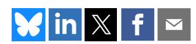
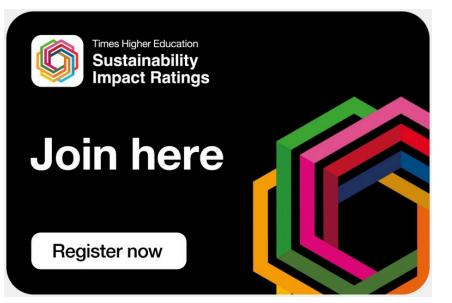
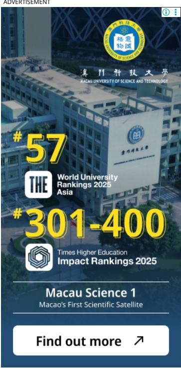
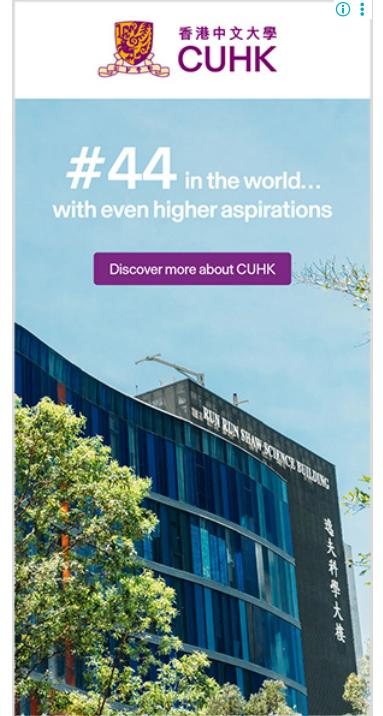
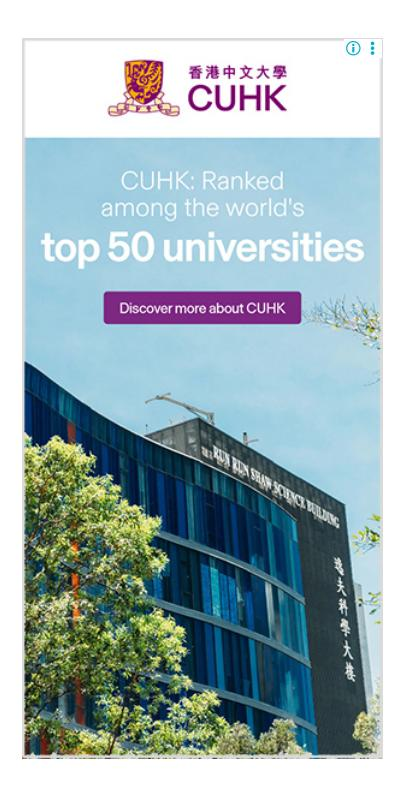

<!-- A3.R90 | source: papers_json/A3.R90/ -->

## Arab University Rankings 2024

## **Explore the top ranked universities in the Arab region**

Discover the top universities in the Arab region with the *Times Higher Education *Arab University Rankings 2024. This year we've ranked 238 institutions from 16 countries or territories. The methodology is based on the same framework as our World University Rankings, but some adjustments have been made and some new metrics have been included to reect the features and missions of universities in the Middle East and North Africa.

## **Arab University Rankings 2024: key insights**

- **KAUST** in Saudi Arabia is number one in the Arab region, thanks to strong performances in the research environment, society and research quality pillars
- **Saudi Arabian universities** take ve of the top 10 spots, including all of the top three
- **Jordan** has a university in the top 10 for the rst time. The University of Jordan has risen to ninth place with particularly strong performances in the research environment and society pillars
- **Ahlia University** in Bahrain is the highest-ranking new entrant at joint 17th thanks to high scores in the research quality and society pillars

Read more...

<!-- page 2 -->

| Rank | Name Country/Region | Overall | Research Quality | International Outlook | Environment Research | Teaching | Society |
| --- | --- | --- | --- | --- | --- | --- | --- |
| 12 | Lebanese American University (/world-university rankings/lebanese-american university) Lebanon (/location/a4zw0000000GnwrAAC) | 76.6 | 98.3 | 75.1 | 76.9 | 61.3 | 70.0 |
| 45 | Prince Sultan University (PSU) (/world-university rankings/prince-sultan university-psu) Saudi Arabia (/location/a4zw0000000GnwvAAC) Explore (/world-university rankings/prince-sultan university-psu) | 59.2 | 98.3 | 86.0 | 43.1 | 31.8 | 92.4 |
| 1 | King Abdullah University of Science and Technology (KAUST) (/world-university rankings/king-abdullah university-science-and technology-kaust) Saudi Arabia (/location/a4zw0000000GnwvAAC) | 92.1 | 95.7 | 74.6 | 98.5 | 86.7 | 96.2 |
| 71– 80 | Eat University (/world university-rankings/eat university) Saudi Arabia (/location/a4zw0000000GnwvAAC) | 47.4– 49.7 | 95.4 | 75.2 | 27.8 | 22.8 | 66.7 |
| 11 | University of Sharjah (/world university-rankings/university sharjah) United Arab Emirates (/location/a4zw0000000GnwyAAC) Explore (/world-university rankings/university-sharjah) | 77.8 | 94.0 | 92.4 | 75.9 | 60.7 | 92.1 |
| 25 | Applied Science Private University (/world-university rankings/applied-science private-university) Jordan (/location/a4zw0000000GnwpAAC) Explore (/world-university rankings/applied-science private-university) | 69.9 | 93.6 | 81.2 | 62.2 | 55.8 | 71.9 |
| =32 | Zayed University (/world university-rankings/zayed university) United Arab Emirates (/location/a4zw0000000GnwyAAC) | 64.6 | 92.8 | 65.3 | 58.2 | 47.1 | 74.1 |

<!-- page 3 -->

| Rank | Name Country/Region | Overall | Research Quality | International Outlook | Environment Research | Teaching | Society |
| --- | --- | --- | --- | --- | --- | --- | --- |
| 5 | King Abdulaziz University (/world-university rankings/king-abdulaziz university) Saudi Arabia (/location/a4zw0000000GnwvAAC) Explore (/world-university rankings/king-abdulaziz university) | 87.3 | 92.1 | 65.9 | 96.5 | 79.1 | 91.6 |
| =2 | King Fahd University of Petroleum and Minerals (/world-university rankings/king-fahd-university petroleum-and-minerals) Saudi Arabia (/location/a4zw0000000GnwvAAC) Explore (/world-university rankings/king-fahd-university petroleum-and-minerals) | 90.2 | 91.3 | 71.5 | 98.1 | 85.0 | 96.8 |
| 6 | Khalifa University (/world university-rankings/khalifa university) United Arab Emirates (/location/a4zw0000000GnwyAAC) Explore (/world-university rankings/khalifa-university) | 81.5 | 91.0 | 74.3 | 86.7 | 68.6 | 92.6 |
| 71– 80 | Taif University (/world university-rankings/taif university) Saudi Arabia (/location/a4zw0000000GnwvAAC) | 47.4– 49.7 | 91.0 | 79.2 | 38.9 | 22.2 | 15.9 |
| 81– 90 | Middle East University (/world university-rankings/middle east-university) Jordan (/location/a4zw0000000GnwpAAC) | 45.0– 47.3 | 90.7 | 72.9 | 22.7 | 20.4 | 68.0 |
| 61– 70 | Amman Arab University (/world-university rankings/amman-arab university) Jordan (/location/a4zw0000000GnwpAAC) | 49.8– 54.1 | 90.6 | 71.3 | 33.8 | 25.1 | 70.1 |
| 61– 70 | Prince Sattam Bin Abdulaziz University (/world-university rankings/prince-sattam-bin abdulaziz-university) Saudi Arabia (/location/a4zw0000000GnwvAAC) | 49.8– 54.1 | 90.6 | 79.8 | 33.2 | 33.0 | 71.8 |

<!-- page 4 -->

| Rank | Name Country/Region | Overall | Research Quality | International Outlook | Environment Research | Teaching | Society |
| --- | --- | --- | --- | --- | --- | --- | --- |
| 24 | Prince Mohammad Bin Fahd University (/world-university rankings/prince-mohammad bin-fahd-university) Saudi Arabia (/location/a4zw0000000GnwvAAC) Explore (/world-university rankings/prince-mohammad bin-fahd-university) | 70.4 | 90.4 | 80.5 | 64.6 | 53.3 | 95.0 |
| 4 | Qatar University (/world university-rankings/qatar university) Qatar (/location/a4zw0000000GnwuAAC) | 88.3 | 90.1 | 76.3 | 96.2 | 80.9 | 95.3 |
| 44 | Princess Nourah bint Abdulrahman University (/world-university rankings/princess-nourah-bint abdulrahman-university) Saudi Arabia (/location/a4zw0000000GnwvAAC) | 59.5 | 90.0 | 90.9 | 48.9 | 43.7 | 32.6 |
| 49 | Dhofar University (/world university-rankings/dhofar university-0) Oman (/location/a4zw0000000GnwsAAC) | 57.8 | 89.9 | 79.4 | 46.2 | 37.2 | 67.0 |
| 40 | Ajman University (/world university-rankings/ajman university) United Arab Emirates (/location/a4zw0000000GnwyAAC) | 60.6 | 89.8 | 93.3 | 44.9 | 43.6 | 69.0 |
| 7 | United Arab Emirates University (/world-university rankings/united-arab-emirates university) United Arab Emirates (/location/a4zw0000000GnwyAAC) Explore (/world-university rankings/united-arab-emirates university) | 81.3 | 89.4 | 76.6 | 85.3 | 69.9 | 93.8 |
| =2 | King Saud University (/world university-rankings/king-saud university) Saudi Arabia (/location/a4zw0000000GnwvAAC) | 90.2 | 88.6 | 75.4 | 98.2 | 87.8 | 87.3 |
| 14 | Abu Dhabi University (/world university-rankings/abu-dhabi university) United Arab Emirates (/location/a4zw0000000GnwyAAC) Explore (/world-university rankings/abu-dhabi-university) | 75.8 | 88.5 | 84.0 | 72.8 | 66.9 | 74.6 |

<!-- page 5 -->

| Rank | Name Country/Region | Overall | Research Quality | International Outlook | Environment Research | Teaching | Society |
| --- | --- | --- | --- | --- | --- | --- | --- |
| 10 | King Khalid University (/world university-rankings/king khalid-university) Saudi Arabia (/location/a4zw0000000GnwvAAC) | 78.3 | 87.2 | 92.9 | 71.0 | 72.6 | 90.3 |
| 51– 60 | University of Dubai (/world university-rankings/university dubai) United Arab Emirates (/location/a4zw0000000GnwyAAC) | 54.8– 57.2 | 86.5 | 76.2 | 48.1 | 45.9 | 11.8 |

1 to 25 of 351 - Page 1 of 15 Show 25 entries

[Arab University Rankings 2024: methodology](https://www.timeshighereducation.com/world-university-rankings/arab-university-rankings-2024-methodology)

[(/hub/coursera/p/how-turkeys-universities](https://www.timeshighereducation.com/hub/coursera/p/how-turkeys-universities-are-mastering-digital-transformation)[are-mastering-digital-transformation)](https://www.timeshighereducation.com/hub/coursera/p/how-turkeys-universities-are-mastering-digital-transformation)

**[How Turkey's universities are](https://www.timeshighereducation.com/hub/coursera/p/how-turkeys-universities-are-mastering-digital-transformation)** **[mastering digital transformation](https://www.timeshighereducation.com/hub/coursera/p/how-turkeys-universities-are-mastering-digital-transformation)** **[(/hub/coursera/p/how-turkeys](https://www.timeshighereducation.com/hub/coursera/p/how-turkeys-universities-are-mastering-digital-transformation)****[universities-are-mastering-digital](https://www.timeshighereducation.com/hub/coursera/p/how-turkeys-universities-are-mastering-digital-transformation)****[transformation)](https://www.timeshighereducation.com/hub/coursera/p/how-turkeys-universities-are-mastering-digital-transformation)**

A roundtable of senior leaders discussed best practice for addressing challenges and opportunities related to teaching, assessment and internationalism

**Promoted by Coursera** SPONSORED

**[Preparing universities for the](https://www.timeshighereducation.com/hub/salesforceorg/p/preparing-universities-fourth-industrial-revolution)** **[fourth industrial revolution](https://www.timeshighereducation.com/hub/salesforceorg/p/preparing-universities-fourth-industrial-revolution)** **[(/hub/salesforceorg/p/preparing](https://www.timeshighereducation.com/hub/salesforceorg/p/preparing-universities-fourth-industrial-revolution)****[universities-fourth-industrial](https://www.timeshighereducation.com/hub/salesforceorg/p/preparing-universities-fourth-industrial-revolution)****[revolution)](https://www.timeshighereducation.com/hub/salesforceorg/p/preparing-universities-fourth-industrial-revolution)**

The next era of technology in higher education is intrinsically linked to student success

**Promoted by Salesforce** SPONSORED

## **Read more about the Arab University Rankings 2024**

## **STUDENT INSIGHTS**

**Best universities in the Arab World** **[(/student/best-universities/best-universities](https://www.timeshighereducation.com/student/best-universities/best-universities-arab-world)****arab-world)**

**ACADEMIC INSIGHTS**

**Arab University Rankings 2024: results** **[announced (/world-university-rankings/arab](https://www.timeshighereducation.com/world-university-rankings/arab-university-rankings-2024-results-announced)****university-rankings-2024-results-announced)**

**Arab University Rankings 2024: success on** **many levels (/world-university-rankings/arab****[university-rankings-2024-success-many-levels)](https://www.timeshighereducation.com/world-university-rankings/arab-university-rankings-2024-success-many-levels)**

<!-- page 6 -->

Arab University Rankings 2024: a region on the rise (/world-university-rankings/arab-universityrankings-2024-region-rise)

## METHODOLOGY:

Arab University Rankings 2024: methodology (/world-university-rankings/arab-universityrankings-2024-methodology)

(https://www.timeshighereducation.com/content/in**Sturdiss**ciplinaryciones rankings participations?

(https://www.timeshighereducation.com/unijobs/listing/393973/assistantscience-rankings-participation?

utm_source=academic

website&utm_medium=link_embed&utm_campaign<del>oi</del>gterdisciplinary-

science-research-rankings-

24&utm_content=participation)

(https://www.timeshighereducation.com/content/ingpstalinability participation)

## **FEATURED JOBS **

Post-Doctoral Associate in the Division of Science [Mathematics], Dr. Mostafa Sabri

جامعـة نيويورك ابوظـي NYU ABU DHABI

(https://www.timeshighereducation.com/unijobs/listing/393978/postdoctoral-associate-in-

the-division-of-sciencemathematics-dr-

mostafa-sabri/?

trackid=10&utm source=thejobs-

service&utm_campaign=none&utm_score=0) NEW YORK UNIVERSITY ABU DHABI

Doctoral Researcher in Transcription Biology /

Cancer research

(https://www.timeshighereducation.com/unijobs/listing/394030/doctoral-

researcher-in-transcription-biology

cancer-research/?

trackid=10&utm_source=the-

jobsservice&utm_campaign=none&utm_score=0)

UNIVERSITY OF HELSINKI

Assistant Professor / Lecturer in German

professor-lecturer-in-german-studies/?

service&utm_campaign=none&utm_score=0)

MAYNOOTH UNIVERSITY

Assistant Professor / Associate Professor in **Robotics **

(https://www.timeshighereducation.com/unijobs/listing/394053/assistant-

professor-associate-professor-in-robotics/?

trackid=10&utm_source=the-

jobs-

service&utm_campaign=none&utm_score=0)

SINGAPORE INSTITUTE OF TECHNOLOGY (SIT)

Assistant Professor / Associate Professor / Professor in

Engineering (https://www.timeshighereducation.com/unijobs/listing/394049/assistant-

professor-associate professor-professor-in-

sustainability-engineering/?

trackid=10&utm source=the-

jobs-

service&utm_campaign=none&utm_score=0)

SINGAPORE INSTITUTE OF

TECHNOLOGY (SIT)

See all jobs

(https://www.timeshighereducation.com/unijobs/listings/)

Update job preferences

ADVERTISEMENT

<!-- page 7 -->

**[Digital healthcare requires a new](https://www.timeshighereducation.com/hub/huawei/p/digital-healthcare-requires-new-way-thinking-well-new-technologies)** **[way of thinking, as well as new](https://www.timeshighereducation.com/hub/huawei/p/digital-healthcare-requires-new-way-thinking-well-new-technologies)** **[technologies](https://www.timeshighereducation.com/hub/huawei/p/digital-healthcare-requires-new-way-thinking-well-new-technologies)** **[(/hub/huawei/p/digital-healthcare](https://www.timeshighereducation.com/hub/huawei/p/digital-healthcare-requires-new-way-thinking-well-new-technologies)****[requires-new-way-thinking-well](https://www.timeshighereducation.com/hub/huawei/p/digital-healthcare-requires-new-way-thinking-well-new-technologies)****[new-technologies)](https://www.timeshighereducation.com/hub/huawei/p/digital-healthcare-requires-new-way-thinking-well-new-technologies)**

Decentralisation, data sharing and federated learning have the potential reduce the cost and improve the ecacy of delivering consultations and treatments

**Promoted by Huawei** SPONSORED

ADVERTISEMENT

<!-- page 8 -->

## **FEATURED UNIVERSITIES**

[KIIT University (/world-university](https://www.timeshighereducation.com/world-university-rankings/kiit-university)[rankings/kiit-university)](https://www.timeshighereducation.com/world-university-rankings/kiit-university)

[Video (/world-university-rankings/kiit](https://www.timeshighereducation.com/world-university-rankings/kiit-university?popupvideo=true)university?popupvideo=true)

[Explore (/world-university-rankings/kiit](https://www.timeshighereducation.com/world-university-rankings/kiit-university)university)

[(/world-university-rankings/university-east](https://www.timeshighereducation.com/world-university-rankings/university-east-anglia)[anglia)](https://www.timeshighereducation.com/world-university-rankings/university-east-anglia)

[University of East Anglia (/world](https://www.timeshighereducation.com/world-university-rankings/university-east-anglia)[university-rankings/university-east](https://www.timeshighereducation.com/world-university-rankings/university-east-anglia)[anglia)](https://www.timeshighereducation.com/world-university-rankings/university-east-anglia)

[Video (/world-university-rankings/university](https://www.timeshighereducation.com/world-university-rankings/university-east-anglia?popupvideo=true)east-anglia?popupvideo=true)

[Explore (/world-university-rankings/university](https://www.timeshighereducation.com/world-university-rankings/university-east-anglia)east-anglia)

[Al-Mustaqbal University (/world](https://www.timeshighereducation.com/world-university-rankings/al-mustaqbal-university)[university-rankings/al-mustaqbal](https://www.timeshighereducation.com/world-university-rankings/al-mustaqbal-university)[university)](https://www.timeshighereducation.com/world-university-rankings/al-mustaqbal-university)

Video (/world-university-rankings/al[mustaqbal-university?popupvideo=true)](https://www.timeshighereducation.com/world-university-rankings/al-mustaqbal-university?popupvideo=true)

[Explore (/world-university-rankings/al](https://www.timeshighereducation.com/world-university-rankings/al-mustaqbal-university)mustaqbal-university)

[(/world-university-rankings/huazhong](https://www.timeshighereducation.com/world-university-rankings/huazhong-university-science-and-technology)[university-science-and-technology)](https://www.timeshighereducation.com/world-university-rankings/huazhong-university-science-and-technology)

[Huazhong University of Science and](https://www.timeshighereducation.com/world-university-rankings/huazhong-university-science-and-technology) [Technology (/world-university](https://www.timeshighereducation.com/world-university-rankings/huazhong-university-science-and-technology)[rankings/huazhong-university-science](https://www.timeshighereducation.com/world-university-rankings/huazhong-university-science-and-technology)[and-technology)](https://www.timeshighereducation.com/world-university-rankings/huazhong-university-science-and-technology)

[Video (/world-university-rankings/huazhong](https://www.timeshighereducation.com/world-university-rankings/huazhong-university-science-and-technology?popupvideo=true)university-science-and-technology? popupvideo=true)

[Explore (/world-university-rankings/huazhong](https://www.timeshighereducation.com/world-university-rankings/huazhong-university-science-and-technology)university-science-and-technology)

[FAQs (/faqs/general-faqs)](https://www.timeshighereducation.com/faqs/general-faqs)

[Contact us (/contact-us)](https://www.timeshighereducation.com/contact-us)

[About us (/about-us)](https://www.timeshighereducation.com/about-us)

[Work for THE (https://careers.timeshighereducation.com/)](https://careers.timeshighereducation.com/)

[Terms & conditions (/terms-and-conditions)](https://www.timeshighereducation.com/terms-and-conditions)

[Privacy (/privacy-policy)](https://www.timeshighereducation.com/privacy-policy)

[Cookie policy (/cookie-policy)](https://www.timeshighereducation.com/cookie-policy)

[Accessibility statement (/content/online-accessibility-statement)](https://www.timeshighereducation.com/content/online-accessibility-statement)

[THE Connect (/our-partners)](https://www.timeshighereducation.com/our-partners)

[Media Centre (/media-centre)](https://www.timeshighereducation.com/media-centre)

[Modern slavery statement (/about-us/modern-slavery-act-2015)](https://www.timeshighereducation.com/about-us/modern-slavery-act-2015)

[University Directory (https://www.timeshighereducation.com/university-directory/a)](https://www.timeshighereducation.com/university-directory/a)

Close

[English (/world-university-rankings/2024/arab-university-rankings)](https://www.timeshighereducation.com/world-university-rankings/2024/arab-university-rankings) [Simplied Chinese (](https://www.timeshighereducation.com/cn/world-university-rankings/2024/arab-university-rankings)简体中文)[ (/cn/world-university-rankings/2024/arab-university-rankings)](https://www.timeshighereducation.com/cn/world-university-rankings/2024/arab-university-rankings) Copyright © 2025 THE - Times Higher Education

<!-- page 9 -->

As the voice of global higher education, THE is an invaluable daily resource. Subscribe today to receive unlimited news and analyses, commentary from the sharpest minds in international academia, our inuential university rankings analysis and the latest insights from our World Summit series.

**[Find out more (/store)](https://www.timeshighereducation.com/store)**
