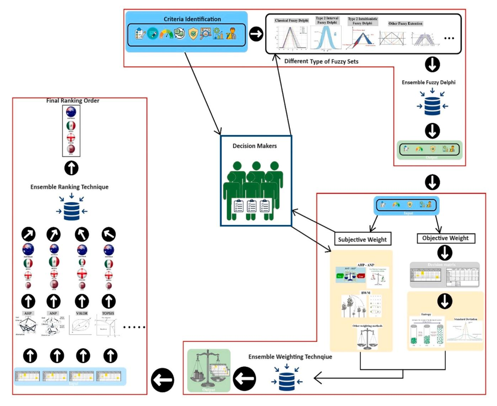
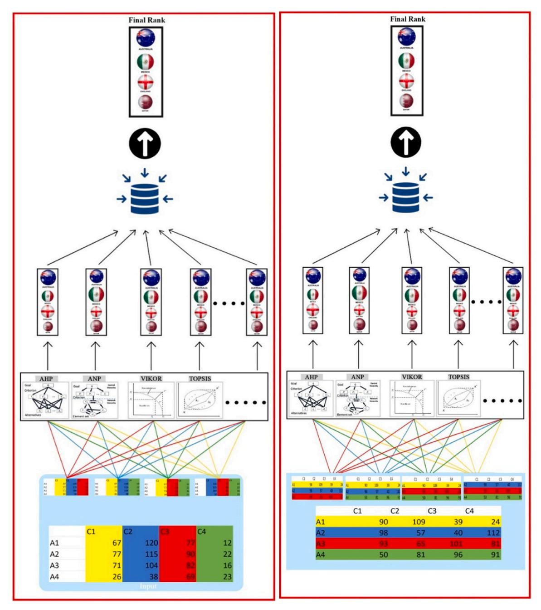
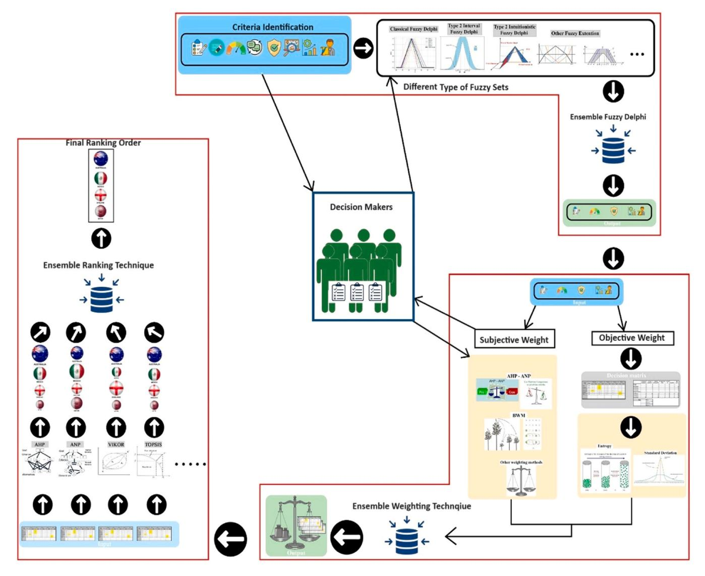
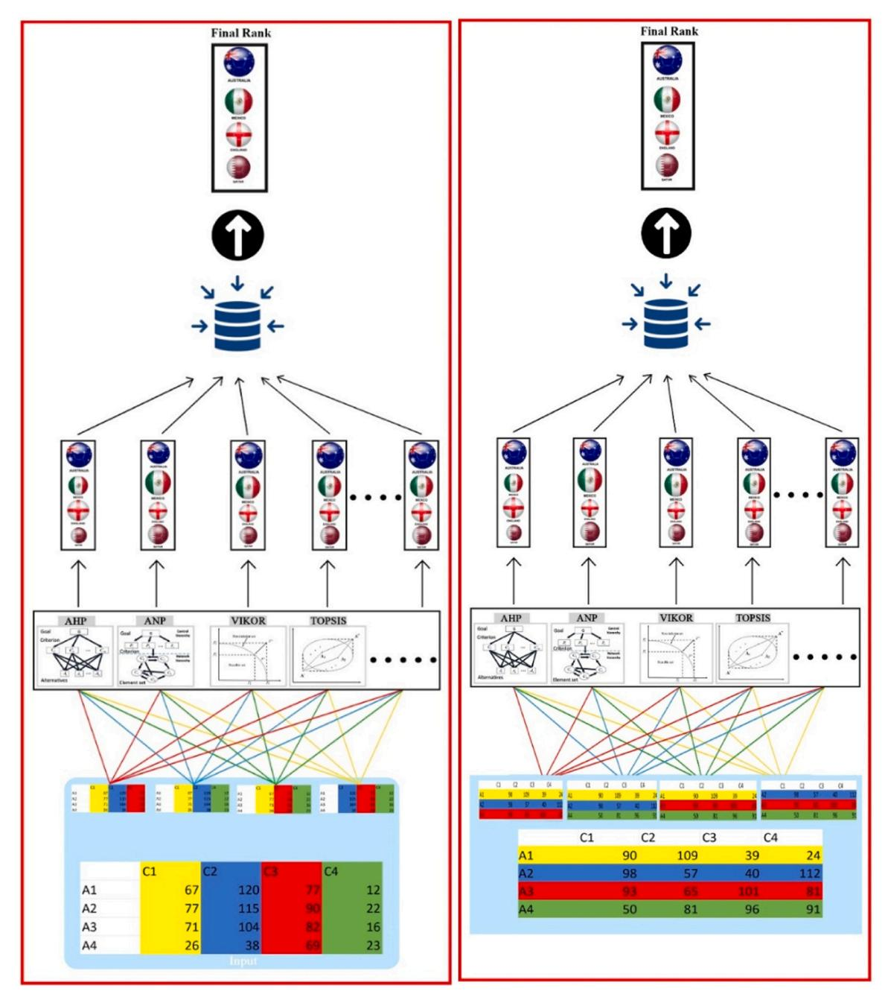

<!-- A3.R96 | source: papers_json/A3.R96/ -->

ELSEVIER

Contents lists available at ScienceDirect

## Applied Soft Computing

journal homepage: www.elsevier.com/locate/asoc

## An in-depth analysis of ensemble multi-criteria decision making: A comprehensive guide to terminology, design, applications, evaluations, and future prospects

Bilal Bahaa Zaidan a, Hassan Abdulsattar Ibrahim b,c, Nahia Mourad d, Aws Alaa Zaidan a, Hossein Pilehkouhic e, Sarah Qahtan f, Muhammet Deveci g,h,i, Dursun Delen j,k,*,1

- a SP Jain School of Global Management, Sydney, Australia
- b Research Center, Mazaya University College, Nasiriyah, Iraq
- c MEU Research Unit, Middle East University, Amman, Jordan
- d Faculty of Engineering & IT, British University in Dubai, Dubai, United Arab Emirates
- e Department of Information Management, Collage of Management, National Yunlin University of Science and Technology, Douliu City, Yunlin County 64002, Taiwan
- f Information Technology Unit, College of Health and Medical Techniques, Middle Technical University, Baghdad 10047, Iraq
- g Department of Industrial Engineering, Turkish Naval Academy, National Defence University, 34942 Tuzla, Istanbul, Turkey
- h The Bartlett School of Sustainable Construction, University College London, 1-19 Torrington Place, London WC1E 7HB, UK
- i Department of Information Technologies, Western Caspian University, Baku 1001, Azerbaijan
- j Center for Health Systems Innovation, Department of Management Science and Information Systems, Spears School of Business, Oklahoma State University, Stillwater, OK 74078. USA
- k Department of Industrial Engineering, College of Engineering and Natural Sciences, Istinye University, Istanbul 34380, Turkey

## HIGHLIGHTS

- Explanation of ensemble MCDM terminology, and mapping of the selected academic literature.
- \bullet Exploring ensembling techniques for decision-making and different levels in the MCDM.
- Propose a roadmap for researchers to advance ensemble MCDM knowledge.
- Providing a tutorial with a numerical example to illustrate ensemble MCDM processes.

## ARTICLE INFO

## Keywords: Multi-Criteria Decision-Making Ensemble MCDM Voting Technique, and Half-Quadratic Programming

## ABSTRACT

Ensemble multi-criteria decision-making (ensemble MCDM) aggregates results from various MCDM techniques into a cohesive ranking, aiming to mitigate individual technique weaknesses and provide a robust approach to MCDM challenges. However, literature lacks in-depth analysis and a comprehensive guide defining ensemble MCDM. Therefore, this study aims to clarify ensemble MCDM terminology, conduct a systematic literature review, and outline a roadmap for future research in this domain. A systematic review protocol with clear inclusion and exclusion criteria was implemented, selecting relevant articles from IEEE, ScienceDirect, Web of Science, and Google Scholar. Out of 730 collected articles, only 10 met the criteria for ensemble MCDM techniques. Four main data extraction techniques were employed: defining ensemble MCDM terminology, mapping the literature, identifying ensemble decision-making techniques, and exploring ensemble levels within the MCDM framework. From the review, three primary ensemble MCDM techniques emerged: statistical means, voting technique, and Half-Quadratic programming. These techniques were not only described theoretically but also implemented and demonstrated through a numerical example, supported by provided code. Furthermore, the study mathematically describes several other ensemble techniques for potential future applications. The implications of this

> ^* ^Correspondence to: Center for Health Systems Innovation, Department of Management Science and Information Systems, Spears School of Business, Oklahoma State University, USA.

> E-mail addresses: bilal.zaidan@spjain.edu.au (B.B. Zaidan), hassan.alsattar@uom.edu.iq (H.A. Ibrahim), nahia.mourad@buid.ac.ae (N. Mourad), aos.aljuboori@buid.ac.ae (A.A. Zaidan), h.pilehkouhi1990@gmail.com (H. Pilehkouhic), sarah.qahtan@mtu.edu.iq (S. Qahtan), muhammetdeveci@gmail.com (M. Deveci), dursun.delen@okstate.edu, dursun.delen@istinye.edu.tr (D. Delen).

> http://spears.okstate.edu/delen

<!-- page 2 -->

research establish a foundational understanding of ensemble MCDM and propose a roadmap for future investigations. By addressing individual MCDM technique weaknesses and offering a reliable aggregation method, this research serves as a fundamental reference for future studies. The accompanying codes, tutorials, and mathematical illustrations aim to advance knowledge and facilitate practical applications in the field of ensemble MCDM

## **1.** **Introduction**

In recent years, Multi-Criteria Decision-Making (MCDM) has become a crucial tool in various fields for making decisions that involve multiple, often conflicting criteria [[1](#page-15-0)–6]. Traditional MCDM methods, such as the Analytic Hierarchy Process (AHP) or Technique for Order of Preference by Similarity to Ideal Solution (TOPSIS), provide structured frameworks for evaluating and prioritizing different options. However, relying on a single MCDM method can sometimes lead to less reliable results due to inherent methodological limitations and the lack of a proper evaluation or formal benchmarking process to select one of these techniques [[7]](#page-15-0).

To address these issues, ensemble MCDM approaches have been developed. Ensemble MCDM involves combining multiple MCDM methods to leverage their individual strengths and mitigate their weaknesses. By integrating different methods, ensemble MCDM aims to enhance decision-making robustness [[8].](#page-15-0) The complexity of the MCDM environment increases when a group of decision-makers is considered due to their varied preferences and the availability of several MCDM techniques. Developers face the challenge of being unable to choose from these techniques due to the inability to validate the accuracy of decisions made by these techniques. Additionally, MCDM techniques have their own disadvantages, including the reversal ranking problem, inconsistency, uncertainty, distance measurements, weight measurements, neutrality of pairwise comparison, and subjectivity [[8].](#page-15-0) These disadvantages imply that none of the techniques is perfect. Furthermore, fuzzy sets are utilized to address uncertainty, with several fuzzy sets having been developed in academic literature to reduce uncertaint[y[9]](#page-15-0). Despite these efforts, there is no evidence to suggest that a particular fuzzy set is superior to others. Therefore, developing different versions of the same MCDM technique with different fuzzy sets does not guarantee that one version will dominate another [[10,11].](#page-15-0)

A similar situation in the context of Machine Learning (ML) has been demonstrated to achieve superior performance by employing an ensemble of multiple ML techniques [[12](#page-15-0)–14]. This strategy results in a more comprehensive ML classifier that combines the strengths of various ML techniques while mitigating their individual weaknesses. In the field of expert systems, ensembles are a well-established concept, commonly used in ensemble ML [[15]](#page-15-0). Ensemble decision-making is a more recent development. In the context of ML, an ensemble involves combining multiple techniques to create a stronger and more robust predictive technique than any individual technique on its own [[16]](#page-15-0). This technique leverages the strengths of different techniques to compensate for their individual weaknesses and enhance overall predictive performance.

Ensemble MCDM techniques address the challenge of reconciling the potentially conflicting rankings generated by various MCDM techniques. This approach significantly contributes to the field of multi-criteria decision-making by providing a systematic mechanism for aggregating rankings and improving their reliability. This methodology proves useful for reconciling divergent rankings and enhancing the robustness of decision-making processes in complex MCDM scenarios. The aggregation process is crucial in standardizing the results, considering the utility and disadvantages associated with each technique, despite the inherent unique benefits and limitations of individual techniques. In multicriteria scenarios, this comprehensive technique helps mitigate decision bias, promote more robust decision-making, and enhance the overall quality of the decision-making process [[17]](#page-15-0).

As mentioned earlier, multiple MCDM techniques can be combined

into a single ranking result through ensemble MCDM. However, there is no clear definition of ensemble MCDM. Several articles propose using ensemble MCDM by integrating weighting techniques with ranking techniques, using multiple techniques without aggregating them, or even aggregating a group of decision-makers' ranking orders. However, this process is considered as different steps within a cohesive decision framework structure. Perhaps constructing multiple frameworks that independently rank the results of two or more MCDM techniques, and then ensembling them, would better define ensemble MCDM. Therefore, a clear definition of the term ensemble MCDM is necessary. This research aims to establish a robust knowledge base and lay the groundwork for developing an ensemble MCDM framework. The originality and contributions of the study can be further described as follows:

- ➣ Explanation of ensemble MCDM terminology, and mapping of the selected academic literature
- ➣ Recognition of techniques for Ensembling decision-making, and exploration of levels of ensembles in the MCDM framework,
- ➣ Proposing a roadmap for researchers to investigate this area and contribute to the advancement of knowledge in ensemble MCDM,
- ➣ Providing a tutorial with a numerical example illustrating the process of ensemble MCDM.

The subsequent sections of this study are structured in the following manner. The method employed in this study is outlined in Section 2. [Section](#page-2-0) 3 provides the mapping of Academic Literature to the Ensemble Techniques. Ensemble leveling is explained in [Section](#page-5-0) 4. Tutorial of ensemble of MCDM techniques utilized in academic literature are presented in [Section](#page-6-0) 5. Evaluation indicators for ensembling MCDM operations are highlighted in [Section](#page-8-0) 6. Future opportunities as proposed ideas are discussed in [Section](#page-10-0) 7. Lastly, [Section](#page-13-0) 8 encompasses the presentation of the conclusions and study implications.

## **2.** **Method** **and** **Materials**

The method in this research was developed in four phases. The first phase involved identifying relevant information resources within the scope of ensemble MCDM. The second phase pertained to the searching strategy, the third phase is related to the article selection procedure, and finally, data extraction and analysis were conducted.

## *2.1.* *Information* *Sources*

A systematic review employs utilizing a range of information sources to establish a comprehensive coverage of MCDM literature, given its multidisciplinary nature. Web of Science served as a key indexing search-engine, offering access to cross-disciplinary research and a vast array of scholarly articles relevant to MCDM methodologies and applications. Additionally, this paper relied on the ScienceDirect, a prominent publisher of multidisciplinary research, renowned for its extensive collection of scholarly articles, journals, and books spanning various fields, providing valuable insights into MCDM across disciplines. Further, IEEE Xplore; a specializing in engineering, computer science, and related disciplines, was explored for cutting-edge research pertinent to ensemble MCDM methodologies and their technological applications. Considering the limited number of articles available and the need for comprehensive coverage, Google Scholar was also utilized in the search process. While not a curated database, Google Scholar's expansive

<!-- page 3 -->

search capabilities facilitated the identification of MCDM-related literature, contributing to the breadth of review. By leveraging these diverse information sources, a thorough examination of Ensemble MCDM literature across different disciplines, enriching the scope and depth of systematic review is ensured.

## *2.2.* *Searching* *Strategy*

The search was conducted in December 2023 using the advanced search features of three digital databases (IEEE Xplore, ScienceDirect, and WoS) to ensure the inclusion of the most up-to-date and recent literature. The search was limited to the last 10 years. Additionally, Google Scholar was utilized as a secondary resource to achieve more comprehensive results. The queries employed the following terms: "Ensemble MCDM," "Ensemble MADM," "Ensemble Ranking," "Ensemble multi criteria," and "Ensemble multi attribute." These terms were combined using "OR" operators. The term "Ensemble ranking" significantly increased the number of results. Although it is a common term in ensemble ML, it was important to include it, as two additional articles were identified with this term.

The initial results from ScienceDirect yielded 72 articles, of which 9 were excluded based on the specified time range (n=63). IEEE Xplore provided 8 articles meeting the criteria (n=8), while WoS returned 37 articles, with two being excluded due to publication dates (n=35). Finally, Google Scholar identified 754 articles, which were narrowed down to 624 after restricting the search to the last 10 years (n=624). The total number of articles from all the resources in the defined timeframe was 730 (n=730). Upon applying the proposed inclusion and exclusion criteria, only 15 articles were identified for the final set (n=15). Five of them were excluded because no ensemble process was observed, resulting in a final set of 10 articles (n=10).

## *2.3.* *Study* *Selection*

Two iterations of review were conducted on the set of articles, following specific inclusion and exclusion criteria. In the academic literature on ensemble decision-making, several articles suggest using ensemble decision-making or ensemble ranking techniques. To accurately characterize a technique as ensemble MCDM, it must either employ different techniques (e.g., AHP, Weighted Sum Model (WSM), Weighted Product Model (WPM)) [[18],](#page-15-0) The same technique with different fuzzy sets/Z-numbers, or different techniques with the same fuzzy set/Z-number (e.g., Additive Ratio Assessment (Z-ARAS), Combinative Distance-Based Assessment (Z-CODAS), Complex Proportional Assessment of Alternatives (Z-COPRAS), and Multi-Attributive Border Approximation Area Comparison (Z-MABAC)) [19–[23],](#page-15-0) or the same technique with different settings/operations (e.g., A-TOPSIS, H-TOPSIS) [[24]](#page-15-0). Consequently, the selection criteria are rooted in the original concept of ensemble ML, with the aim of establishing fundamental terminology to guide researchers in exploring this newly identified term.

It is important to note that the decision-making technique in this context differs from traditional ML. The MCDM process involves two main components: weighting and ranking [[25,26].](#page-15-0) Some techniques exclusively handle weighting (e.g., Best–Worst Method (BWM))[[27]](#page-15-0), while others focus on ranking such as TOPSIS [[28,29]](#page-15-0), and some perform both tasks such as AHP [[30]](#page-15-0). It is common practice to integrate two techniques to form a comprehensive decision technique [[29,31]](#page-15-0). In such cases, the term 'ensemble MCDM' might not be appropriate; instead, we may refer to these cases as integration or hybridization, emphasizing the completion of a single decision-making process and the fact that one technique is an input to the other or complementary to each other and there is a dependency relation between them. Therefore, a significant number of studies were excluded, revealing a deficiency in the correct application of terminology for ensemble MCDM.

Another misinterpretation of ensemble MCDM was observed in studies focusing on the aggregation of group decision-makers. These

studies aggregated responses from multiple decision-makers or results from different weighting techniques (using multiple decision-makers with a single weighting/ranking technique) and averaged the outcomes to obtain a final rank or an average weight. However, this approach does not qualify as ensemble MCDM. Additionally, some studies employed different techniques in parallel procedures, yet these techniques were ultimately applied individually, providing no indication of ensemble MCDM. Because of the confusion among researchers on the meaning and implications of ensemble MCDM, they erroneously labelled these techniques as ensemble MCDM. It is worth mentioning that in some articles, the ensemble process was applied to ML, while the MCDM technique was also part of the process. In such cases, the ensemble process was considered part of the ML process and was excluded from the search process. A concise summary of the inclusion and exclusion criteria is provided below:

## **Inclusion** **Criteria:**

- Employment of multiple MCDM techniques with ranking ensemble.
- Utilization of the same technique with different fuzzy sets for ranking ensemble.
- Application of the same technique with varied settings/operations for ranking ensemble.
- Ensemble of multiple weighting techniques with single or multiple MCDM methods.

## **Exclusion** **Criteria:**

- Misapplication of Ensemble MCDM terminology.
- Inappropriate use of Ensemble MCDM in group decision making.
- Lack of indication of Ensemble MCDM in parallel techniques.

## *2.4.* *Data* *Extraction* *and* *Analysis*

The authors extracted data and performed information analysis. Several text quotes were extracted from each article concerning the definition of ensemble MCDM, reasons for its adoption, techniques used for ensembling, utilized MCDM techniques, case studies, mathematical models, potential objective evaluation parameters/operators, advantages and disadvantages, and future directions. The extracted information aims to achieve the following objectives: define ensemble MCDM terminology by reviewing published research articles in this area, map academic literature to identify gaps and potential future research, identify techniques for ensembling decision-making, explore levels of ensembles in the MCDM framework, and consider other possible ensemble techniques. Additionally, it aims to provide a tutorial with a numerical example illustrating the process of ensemble MCDM as suggested by the literature.

## **3.** **Mapping** **the** **Academic** **Literature** **to** **the** **Ensemble** **Techniques**

In this section, ensemble techniques have been categorized into three groups based on the literature. First, there are those articles employing Statistical Means (SM), such as geometric mean. Second, there are articles utilizing Voting Techniques (VT), such as majority voting. Lastly, there are those employing a Half-Quadratic (HQ) technique. [Table](#page-3-0) 1 serves as a comprehensive reference, mapping these articles to their respective ensemble techniques, encompassing aspects like ensemble architecture, case study details, and the application of MCDM techniques.

The above table mapped the identified articles to their respective ensemble techniques, including other information about the study, including the name of the MCDM techniques utilized, the case study the category of the ensemble. In his article, Saaty et al. [[7]](#page-15-0) describes the process of aggregating concerning individual judgments or measurements from different experts. He emphasizes the necessity to combine

<!-- page 4 -->

| References | Case study | Ensemble Checkpoint | Technique of Ensemble | MCDM Technique |
| --- | --- | --- | --- | --- |
|  |  |  |  | Decisao Interativa Multicriterio (Z TODIM), Z MABAC, Weighted Aggregated Sum Product ASsessment (Z WASPAS) and Z ARAS |

these judgments through merging, aggregation, or consensus procedures. Consequently, the performance of criteria on the alternatives also requires combination through merging or aggregation functions to obtain an overall ranking.

In the hierarchical technique, which consists of multiple levels, ensemble MCDM can be one of these hierarchical levels. Therefore, whatever applies to MCDM aggregation techniques is also applicable to the ensembling procedure. According to Saaty, a technique is ranked low if it is synthesized by averaging weights, medium if a simple weighted technique is used, and high if a rigorous merging function with reasonable weights is applied. Hence, techniques that employ SM as aggregation techniques are considered low, while voting falls within the medium to high range, and HQ is classified as high. See [Fig.](#page-4-0) 1

## *3.1.* *Ensemble* *MCDM* *using* *SM*

One of the simplest aggregation techniques in decision making involves the use of basic SM, such as the geometric mean and mean absolute value. In this section, the articles employ various statistical operations to ensemble MCDM techniques, out of ten articles identified, there were four articles fall into this category. As mentioned earlier, these types of ensembling techniques are considered the least effective among other ensemble techniques.

In the investigation conducted by Mohammadifar et al. [[32],](#page-15-0) the AHP was utilized to compute the weights and importance of various variables. Following this, three MCDM techniques, namely CODAS, EDAS, and MOOSRA, were implemented to generate distinct flood vulnerability maps based on the calculated weights. Subsequently, an ensemble was created, namely CODAS-EDAS-MOOSRA, to bring together the results of the individual techniques. Additionally, the ensemble technique, which used average solutions to evaluate the options, showed significant positive correlations between the individual techniques. Using ensemble MCDM techniques, flood vulnerability was comprehensively evaluated, demonstrating the techniques' combined abilities.

Three different MCDM techniques AHP, WSM, and WPM were applied in the context of ensemble MCDM in another investigation [[33]](#page-15-0). The results of the three techniques were combined through an ensemble process using average absolute difference, which determined the relative significance of different parameters.

The researchers attempted to advance MCDM by using an ensemble technique, as described in [[39].](#page-16-0) Eight different MCDM techniques MOORA, GRA, CoCoSo, CODAS, TOPSIS, AHP, COPRAS, and VIKOR were incorporated with the geographic information system. The main objective was to rank the Anambra Basin's sub-watersheds according to the risk of erosion. Most importantly, before calculating the final rankings, the ensemble technique considered the contribution of all statistically significant factors. Applying the geometric mean of ranks obtained from each MCDM technique allowed for the final aggregated rank for each sub-watershed to be determined.

A different study [[34]](#page-15-0) used a fuzzy ensemble MCDM technique in a

<!-- page 5 -->

***Fig.** **1.** Ensemble MCDM Taxonomy.*

suggested decision framework. To identify possible clients for DSM and NM programs, the framework covers a complex process that includes data pre-processing, clustering analysis, segmentation of daily load profiles, and the use of the fuzzy ensemble MCDM techniques. The ensemble technique tackles the complexity that arises in complex decision-making scenarios involving multiple criteria. The framework involves weighting the input decision matrix using various techniques (e.g., STD, Entropy, CRITIC), normalizing it through methods like Max, Vector, and MinMax, and then computing rankings with VIKOR and TOPSIS. The final ranking is achieved using an ensemble technique that incorporates a fuzzy membership function from the Cauchy fuzzy distribution.

## *3.2.* *Ensemble* *MCDM* *using* *VT*

VT has been utilized to aggregate results in various academic literature within the context of MCDM. However, these techniques were typically used to aggregate group rankings into individual final ranks, not for ensemble ranking [[40]](#page-16-0). One research article was identified in proposed systematic literature review in which VT majority was utilized to ensemble different MCDM techniques [[35]](#page-15-0). VT is employed to combine preferences from multiple decision-makers into a single decision score. A parse graph from the Stanford parser was combined with various sentiment dictionaries in the context of an ensemble MCDM exploration, as reported in the study published in [[35]](#page-15-0). Client sentiment from internet reviews significantly influenced the bank rankings. AHP determined the weight of each criterion, while a FMADM technique used fuzzy sets to evaluate criteria. The final rankings were ensembled using a VT majority.

## *3.3.* *Ensemble* *using* *HQ* *Technique*

The HQ technique is an optimization technique utilized to solve optimization problems, particularly those that entail minimizing specific objective functions. In the domain of ensemble decision-making techniques, where a single technique is employed to combine various MCDM techniques, the HQ technique emerges as one of the most used and highly regarded techniques. According to Saaty [[7]](#page-15-0), the assessment of such ensemble techniques could be considered robust, given the rigorous application of a merging function with reasonable weights. Out of the 10 articles identified in the proposed systematic review, five utilized the HQ Ensembling technique.

In the investigation reported in [[24]](#page-15-0), the authors leveraged pre-trained deep transformer techniques, specifically DeiT and Swin transformer, to perform feature extraction within the context of MCDM. A distinctive contribution of the study was the introduction of an innovative ensemble ranking technique, grounded in the HQ technique, to assess and rank eight binary FOX-optimization techniques. A-TOPSIS and H-TOPSIS MCDM techniques were initially used in the evaluation process for rank assessment. The final rank was then determined by combining the results of these techniques using the ensemble technique. The study adds to the developing field of ensemble MCDM techniques with its thorough analysis of new feature extraction, dimensionality reduction, and ensemble ranking techniques.

In the context of project prioritization, as discussed in [[23]](#page-15-0), the authors introduce a novel ensemble MCDM techniques to overcome the difficulties associated with decision-making. The study's focus, the ensemble MCDM technique, combines the results of several MCDM techniques to improve prediction accuracy and strengthen the robustness of decision-making. The ARAS, CODAS, COPRAS, and MABAC are the four Z-MCDM techniques that the authors use in implementing this technique. When combined with z-numbers, these techniques act as a strategic response to reduce uncertainty and improve dependability when making decisions. The HQ technique-based ensemble ranking technique has been used for combining data and producing the result. One of the technique's most notable features is its ability to automatically determine the weight assigned to each MCDM technique, thereby removing the need for human intervention. By combining ensemble MCDM and Z-MCDM techniques, this hybrid technique marks a substantial advancement in alternatives prioritization methodologies.

The HQ technique serves as the foundation for the another ensemble ranking technique presented by the authors in [[36]](#page-15-0). The purpose of this technique is to combine rankings produced by various MCDM techniques to find the best weights for each MCDM ranking technique and then calculate a final ranking that is cohesive and aggregated. While the study does not list all the specific MCDM technique that were used, it does though highlight how flexible it is to use different techniques for the ranking problem. These include outranking techniques like ELimination and Choice Expressing REality (ELECTRE) and PROMETHEE as well as value- and utility-based techniques like AHP, Analytic Network Process (ANP), and BWM. These techniques are well-known and frequently used in MCDM for a variety of ranking and decision-making tasks.

Another ensemble ranking methodology based on the HQ technique is presented in yet another noteworthy contribution to the field of ensemble MCDM, as proposed by [[37]](#page-15-0). This methodology is implemented in two steps. The first step involves ranking under various rank dimension weights. In the second step, these rankings are then objectively combined, which serves the twofold purpose of reducing decision bias and improving decision quality overall. This is followed by the estimation of the ensemble ranking of all economies using a HQ technique. HQ technique is the key component of this methodology, which is used to simultaneously estimate the weights assigned to each ranking and efficiently aggregate the individual rankings.

The last study [[38]](#page-16-0) makes significant theoretical contributions to sustainable supplier selection. Various MCDM techniques, including Z-TOPSIS, *Z*-CODAS, *Z*-MOORA, *Z*-TODIM, *Z*-MABAC, *Z*-WASPAS, and *Z*-ARAS, have been individually employed. These techniques are then aggregated using the HQ technique. Symmetric mean absolute percentage error values are computed between the ensemble rank and the individual ranks obtained from different MCDM techniques.

It should be noted that HQ is the most used technique as an individual ensemble technique. The reason behind this is the weight procedure developed within the technique, the consensus level measurement and the developed trust index measurement.

<!-- page 6 -->

## **4.** **Ensemble** **Leveling**

In the ensemble context MCDM techniques, there are several levels at which it is possible to combine multiple techniques to create an aggregated technique for processing data into the next stage. In the initial stage, where relevant criteria are identified to construct the decision matrix, two main sources for these criteria exist: either they are identified through existing literature and expert opinions, or they are determined through further processes following literature review and expert consultation using fuzzy Delphi criteria filtering. Several versions of the Fuzzy Delphi Method (FDM) were identified in academic literature, but there is no evidence of superiority of any specific technique. Another point of ensemble can be found in the weighting process, where several objective and subjective weighting techniques are available, yet none demonstrate superiority over others. Finally, in the ranking stage, numerous MCDM ranking techniques are available, with each technique often extended to other versions using different aggregators, fuzzy sets, modified operations, or even compromised solutions of different techniques. Once again, no superiority of any developed technique over others has been established. See Fig. 2

## *4.1.* *Ensemble* *at* *the* *Criteria* *Identification* *Level* *(Fuzzy* *Delphi)*

The MCDM process initiates with the construction of a conceptual framework, also known as the decision matrix, which comprises the criteria for evaluation and the alternatives assessed against these criteria. The sources of criteria are diverse and may stem from frameworks obtained through a literature review, organizational requirements, standards such as ISO, or preliminary studies. The identification of criteria through these sources may yield a substantial

number, some of which may be suitable for a particular case while others are not. Consequently, the application of FDM emerges as a wellestablished technique to refining and finalizing the set of criteria for the purpose of utilization within the MCDM framework [[41]](#page-16-0). Academic literature mainly uses the original FDM, employing simple triangular membership. However, alternative research articles propose the adoption of an extended Delphi version equipped with more advanced fuzzy sets to address interpersonal and intrapersonal uncertainties [[42]](#page-16-0)

In [[41]](#page-16-0), the Type-2 Neutrosophic FDM (T2N-FDM) is utilized to handle the container port sustainability problem. This extended T2N-FDM version takes advantage of handling uncertainties such as ambiguity, vagueness, and inconsistency, considering the T2FSs nature to handle uncertainties. Another study utilizes T2N-FD and GRA for container vessel selection. T2N-FDM can handle and process the ambiguities existing in the evaluation process [[42]](#page-16-0). An Intuitionistic FDM is used in time estimation for the technical realization of innovative products developed in [[43]](#page-16-0) and [[44].](#page-16-0) The new approach considers the degree of non-membership values that are unavoidable during the data collection phase. Thus, it will not misinterpret experts' opinions, providing a true reflection of their responses. An interval-valued IT2Tr-FDM is used for supply chain management. They claim, IT2Tr-FDM-GRA is developed to handle vagueness, system uncertainty, and incomplete information with interdependence relations [[45]](#page-16-0). IT2Tz-FDM is used in the vehicle shredding facilities problem. T2FSs Delphi gives more degree of freedom compared to Type-1 fuzzy sets and can reflect the uncertainty and vagueness issues of available information [[46]](#page-16-0). Another research utilizes IT2Tz-FDM for solid waste valorization presented in [[47]](#page-16-0). They claim that IT2TrFS Delphi is more powerful compared to the traditional Delphi method. They also mention that the traditional method is not sufficient to handle intrapersonal uncertainty

***Fig.** **2.** MCDM Flow Framework Mapped to the levels of Ensemble.*

<!-- page 7 -->

and ambiguity in a decision environment. In [[48],](#page-16-0) Interval Type-2 Fuzzy Delphi is used in extended reality applications.

Apart from fuzzy sets, there are other approaches to handle uncertainties and ambiguities like Rough Set, Z-numbers, and other approaches. In [[49],](#page-16-0) Interval-valued Fuzzy-Rough Delphi is utilized to handle offshore wind farm problems. Interval-valued fuzzy-rough numbers take advantage of both fuzzy sets and rough sets, eliminating the disadvantages of T1FSs and interval-valued fuzzy sets. Another Rough Fuzzy based Delphi using Triangular Type 1 and rough set is utilized in project risk analysis developed in [[50]](#page-16-0). This method can reduce the level of uncertainty and subjectivity that exists in the process. Another research develops Z-Delphi using Z-number theory to overcome the optimism/pessimism bias problem, developed in [[51]](#page-16-0). According to them, Z-Delphi registers the lowest uncertainty compared to other fuzzy Delphi methods since Z-number concept is designed to capture both uncertainty and imprecision by amalgamating two distinct elements: membership degree and probability.

Despite these advancements, a potential trade-off between the complexity of implementation, computational intricacies, and a lack of empirical evidence demonstrating the superior performance of the extended FDM over its counterparts exists. To mitigate these shortcomings, one possible solution involves the development of multiple versions of FDM. This strategic technique aims to reconcile the limitations of each version, offering a more comprehensive toolkit for researchers. By doing so, researchers can benefit from a range of FDM variants, each tailored to a specific need, ultimately enhancing the applicability and effectiveness of the ensemble decision-making process in MCDM frameworks. To our knowledge, no research article has addressed or examined this problem, selected the best set to handle uncertainty issues, or compared them, let alone discussed the ensemble process of multiple Delphi versions.

## *4.2.* *Ensemble* *at* *the* *Criteria* *Weighting* *Level*

In decision-making processes, criteria weighting plays a crucial role. Criteria weights represent the decision maker's allocation of importance to each criterion in relation to the other criteria. For example, 50 % of importance may be assigned to cost, while the remaining 50 % is distributed among other evaluation criteria. Criterion weights vary from one person to another and are influenced by factors such as the decision maker's knowledge, understanding of the problem, environment, personality, and experienc[e[52]](#page-16-0). To determine these weights, decision-makers are often required to conduct pairwise or reference-based comparisons, in which case the weight is classified as a subjective weight. These methods can lead to various issues such as inconsistency and uncertainty [[11,53].](#page-15-0)

To overcome issues of uncertainty, inconsistency, and difficulties that may arise during comparisons, some researchers have suggested employing an alternative technique to weighting measurements, known as the objective weight [[54].](#page-16-0) This technique essentially removes experts or decision-makers from the decision-making process. The fundamental concept of objective weighting can be described as follows: criteria that evaluate various alternatives and yield similar evaluations among different alternatives will receive less weight compared to other criteria where significant differences exist in the achievements of the alternatives. In such cases, this variability will be reflected in a higher weight assigned to that criterion. This idea is logical, as similar, or closer evaluations for different alternatives contribute less to the final decision compared to cases where significant differences exist. For instance, consider a scenario where a decision maker wants to buy a phone, and three different phones are priced at $500, $503, and $510. In this case, the differences are not substantial enough to influence the final decision, unlike a scenario where the phones cost $400, $500, and $600.

However, some researchers criticize this technique, arguing that numbers alone cannot be interpreted without human involvement[[55]](#page-16-0). For instance, consider a scenario involving drag dosage changes, which

can have a significant impact. Even small changes, as seen in the previous example, may be affordable for some decision-makers but not for others. Additionally, some objective weight techniques do not consider the interrelationship between criteria during the weighting process. Therefore, each technique has its own drawbacks. Consequently, some researchers have decided to combine subjective and objective weights. By doing so, we can mitigate the weaknesses inherent in individual techniques and provide more comprehensive results. The weights resulting from different techniques can be ensemble at this level or processed into multiple decision matrices resulting from the original matrix multiplied by the weights derived from individual weighting techniques. In this case, we will have multiple weighted matrices to be processed individually and then combined at the ranking level. From the perspective of computational complexity, using an ensemble of multiple weights is faster and less complex, as the process results in a single matrix. In contrast, using multiple un-ensemble weights results in multiple weighted matrices that must be aggregated at the ranking level. As for the robustness of each strategy, it is unclear since no existing studies have explored the use of ensemble weights. This represents a potential future direction, where an ensemble-weighted matrix and external aggregation can be applied and compared.

## *4.3.* *Ensemble* *at* *the* *Ranking* *Level*

Assembling at the ranking level is the most common technique, and to the knowledge, it is the only ensemble level applied in academic literature. The articles selected for this research all utilized ensemble MCDM at this level, where multiple scores resulting from different individual techniques are combined. The outcome at this level typically manifests as ranking scores resulting from different MCDM techniques or ranking orders after converting the scores into ascending or descending order. Three techniques were utilized in the literature to combine these rankings, scores or orders: SM, VT, or optimization techniques such as the HQ technique. See [Fig.](#page-7-0) 3.

The above figure shows the visualization of the general ensemble framework, explaining all the ensembling points. The figure is classified into three blocks, where each block represents one level of the ensemble: criteria identification, criteria weighting, and alternative ranking. The area of ensemble MCDM is still emerging and expected to attract more attention from researchers soon, due to the nature of these techniques. Unlike optimization, where there is an objective function to minimize or maximize, and ML, which utilizes evaluation metrics to assess the outcomes of each technique, decision-making lacks an evaluation process to determine if a particular MCDM technique is superior to others. This is not to mention the inherent weaknesses of each technique. Therefore, Ensembling is a potential technique to overcome these issues.

## **5.** **Tutorial** **of** **Ensemble** **of** **MCDM** **Techniques** **Utilized** **in** **Academic** **Literature**

To maximize the utility of these review articles, a numerical example of the ensembling process is provided to clarify the procedures outlined in the presented ensemble MCDM techniques within academic literature. This example is accompanied by code intended to serve as a tutorial for those interested in initiating research in ensemble MCDM. The numerical example and step-by-step process are presented [[56,57]](#page-16-0). The numerical example involves a multi-step process for MCDM using Fuzzy-Decision-by-Opinion-Score-Method [[58]](#page-16-0) and Ensemble Techniques. This is achieved based on the below sequence of steps:

**Step** **1.** Initially, a randomly generated opinion matrix is created to assess expert opinions on the achievement of alternatives compared to ideal values for each criterion. A decision matrix comprising 20 alternatives and 8 criteria, along with randomly assigned weights for each criterion, is utilized (See [Table](#page-7-0) 2).

**Step** **2.** These opinions are then converted into Pythagorean fuzzy numbers. For *X* being the universal, it is well-known that a Pythagorean

<!-- page 8 -->

***Fig.** **3.** Multi-level assembling framework.*

<!-- page 9 -->

fuzzy set (PFS) is an object of the form \{\langle \mu(x), \nu(x) \rangle, x \in X \}, where \mu represents the membership function and \nu represents the non-membership function, satisfying the condition \mu^2(x) + \nu^2(x) \leq 1 for any x \in X. A PFN, denoted by \alpha = \langle \mu_\alpha, \nu_\alpha \rangle for simplicity, is an element of a PFS. Opinions with their associated PFNs can be found in Table 3.

**Step 3.** Three different aggregation operators—Bonferroni mean [59], Einstein aggregation [60], and Dombi aggregation [61], are applied to produce an aggregated PFN associated to each alternative (See Table 4). The mathematical equations for these operators are included in the Appendix.

**Step 4.** Scores for the aggregated PFNs are calculated. Then, a ranking process is applied. The scores and rankings are reported in Table 4. A score function for PFNs can be defined as in (1).

$$ Score(\alpha) = \mu_{\alpha}^2 - \nu_{\alpha}^2 \tag{1} $$

**Step 5.** Three ensemble techniques: HQ programming [24,23,36, 37], SM [32–34,39], and VT [35], are employed to aggregate the ranks obtained from the previous step (See Table 4).

All three techniques were employed in this example. HQ technique was utilized based on the steps proposed in [24,23,36–38], while SM employed average absolute difference as the one used in [33]. The technique using VT employed the majority [35], but in this tutorial, the Borda VT was utilized.

Following the process outlined in the preceding Step 1 up to Step 4, for the mentioned aggregations (Bonferroni Mean Aggregation, Einstein Aggregation, Dombi Aggregation), each alternative is represented by an aggregated PFN, a score value, and a ranking order as indicated in Table 3.

For HQ technique, weights are generated from the HQ technique to each MCDM technique, providing varying degrees of importance to different techniques. For example, Einstein, Bonferroni, and Dombi were assigned weights of 0.1161544, 0.5690405, and 0.3148052, respectively. However, this functionality was not applied to SM and VT. Nevertheless, it could be incorporated through weighted average techniques and weighted VT. The HQ technique Ensembling technique combined the three MCDM techniques with a trust level of 0.975636083. (See Table 5)

The correlation analysis is applied to analyse the similarity between different ensembling techniques, which found to be highly correlated in this case. However, this will not always be the ideal scenario in all cases. Additionally, researchers may prefer to use only one ensembling technique for comparison, as conducting comparisons may not necessarily lead to conclusive results. In this case, we wanted to examine how similar these techniques are in terms of the final output. One might ask, if the correlation is high between these three ensembling techniques, which one should I choose? The answer was reported in Section 2, where Saaty in his article [7] mentioned the level of trustworthiness of aggregation. In this case, HQ technique or VT. (See Table 6). The differences in the correlation of various ensembling techniques exist due to the differences in the ranking orders produced by different ensemble MCDM techniques.

There are several optimization techniques available to replace HQ technique in the ensembling of MCDM techniques. Additionally, various statistical operators can be employed to ensemble MCDM techniques. If VT are selected for ensembling MCDM techniques, there are numerous techniques explained in Section 6.1, as well as other techniques

documented in academic literature [62–66]. Furthermore, apart from these, meta-techniques, weight VT, and bagging techniques can be utilized for the same purpose (see Sections 7.2, 7.3, and 7.4).

## 6. Evaluation Indicators for Ensembling MCDM Operations

In addition to the operations and processes outlined in various sections of this manuscript, there are additional metrics defined in different articles that can be used to assess the ensembling process or analyze the correlation between ensembled techniques [28,30,32–35,23,36]. Two main operations are commonly discussed in academic literature: correlational analysis, which includes correlation coefficients, and Trust Level (TL) and Consensus Index (CI). In this section, the description and usage of these operations are elaborated upon.

Throughout this paper, MCDM_j, for j=1,...,n, represent various MCDMs. For simplicity, let \mathscr{A}=\{A_1,...,A_m\} be the universe of alternatives. Define the score and rank matrices as,

$$
S = (s_{ij}) \underset{1 \le i \le m}{1 \le i \le m} \text{ and } R = (r_{ij}) \underset{1 \le i \le m}{1 \le i \le m} 
1 \le j \le n 
(2)
$$

where s_{ij} and r_{ij} is the score and the rank given by MCDM_j to the alternative A_i \in \mathcal{A}, respectively.

## 6.1. Correlational Analysis

Correlational analysis has been widely applied in various research articles within the selected studies. The primary objective of measuring correlations among different ranking scores/orders is to assess the degree of similarity in results obtained from different MCDM techniques. These correlation coefficients serve two main purposes: selecting individual techniques for ensemble methods and calculating the weights for these techniques.

In [32], all models are well correlated with each other, leading researchers to claim that the models are suitable for ensemble modeling. Conversely, in [39], the results show that the MCDM models have both positive and negative associations with one another, indicating different rankings. Consequently, researchers suggest using all the models in these situations to determine the final prioritization ranks. In [23], the Spearman coefficient calculated for two ranking models was 0.747, which supports the claim that this represents a noticeable difference between the rankings, as it falls below the threshold of 0.8.

This raises a contradiction: should we ensemble only the highly correlated ranking orders, or should we ensemble them precisely because they are not all correlated? It is important to note that the Spearman analysis is not intended to show that one ranking is better or more accurate than another, as no basis for such a comparison exists.

The remaining question is whether consensus should be the sole criterion for selecting or giving higher weight to the correlated ranks, or whether all techniques should be considered to provide a more comprehensive and fair ranking order. From our view of point, we believe both aspects—consensus and fairness—are important, as there is no confirmed superiority, and the literature does not strongly favor one approach over the other. Therefore, both should be considered.

## 6.2. Trust Level and Consensus Index

Trust Level and Consensus Index are two measures utilized in the process of ensembling the outcomes of multiple MCDM techniques into a comprehensive single ensembled ranking. Mohammadi and Rezaei [36] introduced the minimization problem in (3) to calculate the ensemble vector R^* = (r_i^*)_{i=1,\dots,m} with entries, for i=1,\dots,m, the ensemble rank r_i^* of alternative A_i \in \mathscr{A}, based on a pre-calculated ranks by multiple MCDMs, as follows:

<!-- page 10 -->

| One to One Correlation | HQ technique | SM | VT |
| --- | --- | --- | --- |
| HQ Programming | 1 | 0.99662 | 0.9906 |
| SM | 0.99662 | 1 | 0.99285 |
| VT | 0.9906 | 0.99285 | 1 |

$$ \min_{R^*} \frac{1}{2} \sum_{j=1}^{n} g(\|R^j - R^*\|_2), \tag{3} $$

where g is a HQ function, R^i = (r_{ij})_{1 \le i \le m} and r_{ij} is the rank given by MCDM_j to alternative A_i as in (2), and \|\cdot\|_2 is the L^2-norm. Using HQ technique the optimization problem in (3) is restated as

$$
\min_{R^*, \ a^*} \! J(R^*, a^*) = \sum\nolimits_{j=1}^n \! a_j^* \left\| R^j - R^* \right\|_2^2 + \psi \Big( a_j^* \Big),
$$

$$
where a^* = \left(a_j^*\right)_{1 \leq j \leq n} \in \mathbb{R}^n is the HQ auxiliary variable.
$$

Definition: A consensus index (CI) indicates the degree to which multiple rankings resulting from various MCDM techniques align, signifying agreement on the same ranking order. This index measures the similarity between the ensemble ranking and individual rankings derived from different MCDM techniques [67].

The consensus index CI for the ensemble vector rank R^* can be computed as,

$$ CI(R^*) = \frac{1}{mn} \sum_{i=1}^{m} \sum_{j=1}^{n} q_{ij}, $$

where

q_{ij}=\frac{f_\sigma(r_{ij}-r_i^*)}{f_\sigma(0)} and f_\sigma=\frac{1}{\sigma\sqrt{2\pi}}e^{-\frac{1}{2\sigma^2}-x^2} is the probability density function of the normal distribution with mean identically zero and a STD equal to \sigma.

Definition: A trust level (TL) represents the degree to which we can

<!-- page 11 -->

rely on the ensemble ranking results. It reflects the reliability of the ensemble ranking, wherein smaller weights assigned to specific MCDM techniques result in lesser influence on the ensemble ranking, and vice versa. A higher divergence in weights leads to a lower trust level [68].

The trust level TL for the ensemble vector rank R^*, with HQ auxiliary variable a^*, can be computed as,

$$
TL(R^*) = \frac{1}{m} \sum_{i=1}^{m} \sum_{j=1}^{n} \frac{a_j^*}{\|a^*\|_1} q_{ij},
$$

where \|\cdot\|_1 is the L^1-norm.

According to [36], four possible states arise regarding the CI and TL: both CI and TL are high, CI is low, and TL is high, both CI and TL are low, and CI is high while TL is low. The last scenario is theoretically impossible since a high CI among MCDM techniques inherently results in a high TL. In cases where both CI and TL are low, it signifies significant deviation among all MCDM rankings, indicating the absence of a subset of techniques with higher weights and consequently resulting in a low TL due to the low CI.

Conversely, when CI is low and TL is high, it suggests that a subset of MCDM techniques produces rankings that deviate from the others. As a result, outlier techniques are assigned lower weights, influencing the final rank. This leads to a low CI among MCDM techniques but a high TL in the final ranking. In situations where both CI and TL are high, the techniques used are either identical or very similar, with weights being assigned close to, if not equal. This represents the optimal ensemble scenario, where no outliers are present, full agreement exists among MCDM techniques, and the ensemble technique can be trusted.

## 7. Future Direction of Ensemble MCDM Techniques

Ensemble MCDM is a relatively new research area and holds promise for overcoming the issues associated with traditional MCDM techniques, including the selection of the best MCDM technique without hesitation. Another potential advantage is the implementation of objective indicators by some ensemble techniques (e.g., trust index, ranking score correlational analysis, consensus level), which can be used as objective robustness measurements for the ensemble MCDM technique.

In addition to the described ensemble MCDM technique proposed in the academic literature, several other methods could be used to ensemble MCDM techniques, including various voting strategies, stacking, and other techniques used in ensemble ML. The nature of MCDM might require adjustments to ensembling techniques to be used effectively with MCDM. Therefore, we assume there are several ranking scores resulting from individual decision-making techniques, and we propose to ensemble them using multiple new ensemble MCDM techniques.

In fact, MCDMs can be seen as techniques with input a 4-tuple (\mathscr{A},\mathscr{C},D,W), where \mathscr{A} is a finite alternatives set, \mathscr{C} is a finite criteria set, D is an |\mathscr{A}|\times|\mathscr{C}| decision matrix with entries in a set \mathscr{F} of strictly ordered grades (grades like common language, binary elements, Likert scale, etc.), and W is a weight vector in \mathbb{R}^{|\mathscr{C}|}, which produces as output a score vector in \mathbb{R}^{|\mathscr{A}|} associated to the alternatives set \mathscr{A}, where |\cdot| is the cardinality function. Then, the alternatives are ranked either by descending or ascending order of the obtained scores depending on each MCDM_i.

## 7.1. Voting ensembling MCDM

Let \mathscr{A}=\{A_1,...,A_m\} be the universe of alternatives. Consider the ranking matrix R=(r_{ij})_{1\leq i\leq m,\ 1\leq j\leq n} defined in (2), where r_{ij} is the rank given to the alternative A_i\in\mathscr{A} after sorting the scores obtained by the MCDM_i, and n represents the number of MCDMs applied.

Define the measures \mu_k (k = 1,...,m) on \mathcal{A} = \{A_1,...,A_m\} by

$$ \mu_k(A_i) = \sum_{j=1}^n [[r_{ij} = k]], $$

where [\cdot] is the Inverson bracket defined in (4) [62–66].

$$
[\![p]\!] = \begin{cases} 1 \text{ if proposition} p \text{is true} \\ 0 \text{ otherwise} \end{cases} (4)
$$

For clarifications, \mu_k(A_i) counts the number of times A_i appears in the k-th rank. Below are different techniques, based on the VT [62–66], to aggregate the alternatives' rankings coming from various MCDMs.

• *Plurality technique*. The alternatives \{A_1, ..., A_m\} are ordered based on the first-place ranks. i.e.

$$ A_{i_1} \geqslant A_{i_2} \iff \mu_1(A_{i_1}) \ge \mu_1(A_{i_2}). $$

• *Borda Count technique*. In this technique, points are given to the alternatives according to their ranking in each technique, then they are ordered based on the total sum of the given points [63,64,66]. This is transformed into a weighted sum as in (5). i.e.

$$
A_{i_1} \geqslant A_{i_2} \Longleftrightarrow \sum_{k=1}^{m} ((m-k+1) \quad \mu_k(A_{i_1}))
\geq \sum_{k=1}^{m} ((m-k+1) \quad \mu_k(A_{i_2})). \tag{5}
$$

• *Pairwise Comparison technique*. This technique forms one-to-one matchups [65]. For each of these comparisons there will be either a winner with a point or a tie with half-point each. Then the alternatives are ranked based on the total number of points collected. For m alternatives there will be m \cdot (m-1)/2 one-to-one comparison. The one-to-one matchups are represented by the matrix in (7). The alternatives are ordered based on the scores calculated in (6), i.e.

$$
A_{i_1} \geqslant A_{i_2} \Longleftrightarrow S_{PC}(A_{i_1}) \geq S_{PC}(A_{i_2}),
$$

where,

$$
S_{PC}(A_i) = \sum_{l \neq i} \|P_{il} > \frac{n}{2} \| + \frac{1}{2} \|P_{il} = \frac{n}{2} \|, \tag{6}
$$

and,

$$
P_{il} = \sum_{j=1}^{n} [|r_{ij} > r_{lj}|] + \frac{1}{2} [|r_{ij} = r_{lj}|], \tag{7}
$$

for 1 \le i, l \le m and i \ne l. It is to be noted that, P_{ii} = 0 and P_{li} + P_{il} = n for i \ne l.

## 7.2. Weighted votes MCDM ensembling

Several VT are available in academic literature. With each of these techniques, the score of the individual can be weighted. If we assume that one technique's score is more reliable than others, or perhaps a few techniques' scores are highly correlated, the importance of a particular individual's weight is greater than other techniques. Therefore, the weights are applied to the individual's score during the voting process is implemented. One possible technique of weighting involves using weights generated from HQ techniques, which can be measured and assigned to each score. Then, VT are used to ensemble the scores as in Section 6.1, but with weighted measure defined in (8) if Plurality technique or Borda count technique is used. For k=1,\ldots,m, weighted measures on \mathscr A can be defined by

$$
\widetilde{\mu}_k(A_i) = \sum_{i=1}^n \omega_j \llbracket r_{ij} = k \rrbracket, \tag{8}
$$

where \omega_j > 0 is the weight associated with the MCDM_j, and A_i \in \mathcal{A}. Apart from the techniques defined in the previous section, a wide

<!-- page 12 -->

array of VT exists that have been mathematically proven to effectively handle voting aggregation in a robust and reliable manner. This includes both the classical schemes such as Copeland's technique, Range Voting, Approval Voting, Instant Runoff Voting, and Condorcet technique, as well as newer techniques. Researchers continually refine existing techniques and develop new ones to address emerging challenges, thereby enhancing the fairness and accuracy of decision-making processes [62–66].

## 7.3. Stacking/meta- technique MCDM ensembling

Stacking combines the predictions of multiple techniques using another technique, called the "meta- technique", that learns how to best weight the predictions of the base techniques. It involves training diverse techniques as base learners and a meta- technique on top of them.

For \mathscr{A}=\{A_1,...,A_m\} being the alternatives' set to be ranked based on specific criteria set \mathscr{C}, with weight coefficients W\in\mathbb{R}^{|\mathscr{C}|}, and decision matrix D\in M_{m\times |\mathscr{C}|}(\mathscr{F}). The Stacking technique can be completed by the following steps.

**Step 1.** Choose a collection of MCDMs: MCDM_j, for j=1,...n, to be the base techniques, each with weight \omega_j. These weights are given based on the history of the functionality of these techniques. And consider MCDM^* another MCDM to be the meta-technique.

**Step 2.** For j=1,...,n, apply technique MCDM_j with input (\mathscr{A}, \mathscr{C}, D, W) to calculate the m \times n score matrix S=(s_{ij})_{1 \le i \le m, \ 1 \le j \le n}. As in (2), the s_{ij} is the score given to the alternative A_i \in \mathscr{A} by the MCDM_i.

**Step 3.** Apply the meta-technique MCDM^* with input (\mathscr{A},\mathscr{M},S,\omega), with \mathscr{M}=\left\{MCDM_j;\ j=1,...,n\right\} and \omega=\left(\omega_j\right)_{j=1,...,n}, to get the output S^*\in\mathbb{R}^m. That is the set of the base techniques is the criteria set for the meta-technique, and S is the decision matrix. It is to be noted that, if MCDM_j sort the alternatives by descending (resp. ascending) scores, it is considered a benefit-type (resp. cost-type) criterion in the MCDM^* technique.

**Step 4.** Rank the alternatives \{A_1, ..., A_m\} based on S^* and the MCDM^* technique.

There are numerous MCDM techniques that can be applied to ensemble the output of individual MCDM techniques, forming a Meta-Decision Making (Stacking) technique. This technique offers a comprehensive decision technique, wherein the input of the Meta Decision technique comprises scores or ranking orders from different MCDM techniques. These techniques accommodate various ranking philosophies, thereby consolidating them into a single comprehensive ranking. Fig. 4 explains the proposed Meta-MCDM technique (Meta-Decision Technique).

## 7.4. Bagging (bootstrap aggregating) MCDM ensembling

Bagging, or Bootstrap Aggregating, is an ensemble ML technique that combines the predictions of multiple techniques to improve overall performance. Towards this end, multiple training techniques are applied to different subsets of the dataset, and then their predictions are averaged or voted on at the prediction stage. To apply this technique in MCDM, subsets of criteria are paired with the whole set of alternatives, and subsets of alternatives are paired with the whole set of criteria. Multiple weighting techniques are applied to different subsets, generating multiple scores for each alternative. These scores are then ensemble into a single score. Subsequently, a general description of Bagging Ensemble MCDM is provided. See Fig. 5.

For \mathscr{A}=\{A_1,...,A_m\} the universe of alternatives, and \mathscr{C} the universe of criteria with weight coefficients W\in\mathbb{R}^{|\mathscr{C}|}, and decision matrix D\in M_{m\times |\mathscr{C}|}(\mathscr{F}). The proposed Bagging technique follows the below steps.

***Step 1.** Choose an MCDM denoted by MCDM_i.*

**Step 2.** Take non-empty sets \widehat{\mathscr{A}} \subseteq \mathscr{A} and \widehat{\mathscr{C}} \subseteq \mathscr{C}. That is, \widehat{\mathscr{A}} is a subset of/equal to the alternatives' set \mathscr{A}, and \widehat{\mathscr{C}} is a subset of/equal to the criteria set \mathscr{C}.

**Step 2.1.** Restrict the decision matrix D to the pair (\widehat{\mathscr{A}},\widehat{\mathscr{C}}) to get the submatrix \widehat{D} \in M_{|\widehat{\mathscr{A}}| \times |\widehat{\mathscr{C}}|}(\mathscr{F}).

**Step 2.**2. Restrict the weight vector W to the criteria subset \widehat{\mathscr{C}} to get the sub-vector \widehat{W} \in \mathbb{R}^{|\widehat{\mathscr{C}}|}. To satisfy the condition that the weights sum to one, the sub-weight coefficients undergo a normalization as \widehat{W}/\|\widehat{W}\|_1, where \|\cdot\|_1 is the L^1-norm.

**Step 2.3.** Apply MCDM_j with input (\widehat{\mathscr{A}}, \widehat{\mathscr{C}}, \widehat{D}, \widehat{W}/\|\widehat{W}\|_1) to get the

<!-- page 13 -->

***Fig.** **5.** Bagging technique (from left to right), criteria-wise, and alternative-wise.*

alternatives' score vector denoted by ( *s* (**A**^ˆ^ *,***C**^ˆ^ *,**MCDMj*)(*A*) ) *^A^*∈**A**^ˆ^ ^∈^ ^R^^|^**A**^ˆ^ ^|^ as output. Then define the function **S** (**A**^ˆ^ *,***C**^ˆ^ *,**MCDMj*) on **A** as in (9).

$$
\mathscr{S}_{(\widehat{\mathscr{A}},\widehat{\mathscr{E}},MCDM_{j})}(A) = \begin{cases} s_{(\widehat{\mathscr{A}},\widehat{\mathscr{E}},MCDM_{j})}(A) \text{ if } A \in \widehat{\mathscr{A}} \\ 0 \text{ otherwise} \end{cases} (9)
$$

**Step** **3.** Repeat Step 2 for different couple of sets (̂**A** *,* **C** ̂).

- For subsets of criteria to be paired with the whole set of alternatives take ̂**A** = **A** and **C** ̂⊂**C** .
- For subsets of alternatives to be paired with the whole set of criteria take ̂**A** ⊂**A** and **C** ̂ = **C** .
- For subsets of criteria to be paired with subsets of alternatives take ̂**A** ⊂**A** and **C** ̂⊂**C** .

**Step** **4.** Aggregate the scores for each alternative over various sets using the arithmetic mean as in (10). ∑

$$
\overline{\mathscr{S}}_{ij} = \frac{\sum_{(\tilde{\mathscr{A}},\tilde{\mathscr{E}})} \mathscr{S}_{\left(\tilde{\mathscr{A}},\tilde{\mathscr{E}},\mathsf{MCDM}_{j}\right)}^{(A_{i})}}{\sum_{(\tilde{\mathscr{A}},\tilde{\mathscr{E}})} \|A_{i} \in \widehat{\mathscr{A}}\|} \quad \text{for } i = 1, ..., |\mathscr{A}| \text{ (10)}
$$

**Step** **5.** Repeat the above steps for various techniques *MCDMj* then aggregate the results using VT ([Sections](#page-10-0) 7.1–7.2) or Stacking ([Section](#page-11-0) [7.3)](#page-11-0) techniques.

## *7.5.* *Optimization* *technique* *to* *ensemble* *MCDM*

HQ technique (See [Eq.](#page-9-0) (3)) aims to minimize the overall discrepancies between Ensemble ranking and groups of rankings generated by other MCDM techniques. In the studies explored in [[24,23,36](#page-15-0)–38], the developed techniques comprise three parts: the first part concerns the minimizer function, the second part focuses on the objective function,

<!-- page 14 -->

and the last part deals with solution techniques. The minimizer function is utilized to adjust the error rate between the ensemble rank and the ranks of techniques, thereby assigning weights to each MCDM technique. Several minimizer formulas may be employed in the HQ- technique, each capable of modifying the weight of each technique and influencing the ensemble rank. Various minimizer formulas, such as L1-L2, Fair, Log-Cosh, Welsch, and Huber, are provided, along with potential formulas for future research areas.

The objective function in the HQ programming technique minimizes the total distance between the ensemble rank and technique ranks using the Euclidean distance to achieve a high consensus level. Other potential functions for future consideration include Manhattan distance, Minkowski distance, and Chebyshev distance. Additionally, statistical measurements such as STD may be incorporated as an objective function. Markers like Generational Distance (GD) can also be integrated for multi-objective optimization issues. Increasing the number of alternatives or criteria will make the ensemble ranking more complex, particularly when using HQ-programming. Obtaining an optimum solution for the technique will be exceedingly challenging. In future directions, when dealing with large-scale decision matrices, it is recommended to utilize approximation techniques such as genetic algorithms (GA), particle swarm optimization (PSO), and differential evolution (DE) to solve the ensemble MCDM optimization problem.

## 8. Conclusions and study implications

Ensemble MCDM or Ensemble Ranking is a relatively new area of research, where the concept has not yet been consistently applied in the literature. Ensemble MCDM aims to mitigate the inherent weaknesses of individual MCDM techniques by consolidating them into a single robust technique that addresses these weaknesses. This is particularly relevant given the nature of MCDM techniques, which currently lack in-depth analysis and a comprehensive guide defining ensemble MCDM. Therefore, this study aims to clarify ensemble MCDM terminology, conduct a systematic literature review, and outline a roadmap for future research in this domain. A systematic review protocol with clear inclusion and exclusion criteria was implemented. The paper has achieved the following objectives: defined ensemble MCDM terminology by reviewing published research articles in this area, mapped academic literature to identify gaps and potential future research, identified techniques for ensembling decision-making, explored levels of ensembles in the MCDM framework, and considered other possible ensemble techniques. The study proposes a roadmap for researchers to investigate this area and contribute to the advancement of knowledge in ensemble MCDM. Additionally, it provides a tutorial with a numerical example illustrating the process of ensemble MCDM as suggested by the literature.

Based on the review outcomes, three techniques were identified as particularly noteworthy: the HQ technique, SM, and VT. Among these, the HQ and VT were found to be more effective due to their rigorous merging functions and reasonable application, while SM was considered

the least effective. A numerical example of ensemble MCDM utilizing these three techniques is provided, along with their mathematical descriptions and corresponding code, demonstrating their practical application.

The limitations of this study, noting that several techniques inherited from ensemble ML are mathematically described within the study's context without being implemented and validated in real-life applications. It explores different scenarios to provide findings based on these descriptions. In future directions, several methods inherited from ensemble ML, such as weighted voting, stacking /meta-decision, bagging (bootstrap aggregating), and optimization technique to ensemble MCDM are mathematically described and proposed for further studies. These techniques offer promising avenues for research and development in the field of ensemble MCDM. By significantly advancing the development of ensemble MCDM in addressing the weaknesses of individual MCDM techniques and providing reliable aggregation techniques, this study lays a strong foundation for future investigations and practical applications in the field of ensemble MCDM.

## CRediT authorship contribution statement

Muhammet Deveci: Writing – review & editing, Validation, Methodology, Conceptualization. Dursun Delen: Writing – review & editing, Validation, Methodology, Conceptualization. Bilal Zaidan: Writing – original draft, Investigation, Formal analysis, Conceptualization. Hassan Ibrahim: Writing – original draft, Methodology, Investigation, Formal analysis. Nahia Mourad: Writing – review & editing, Validation, Methodology, Conceptualization. Aws Zaidan: Writing – review & editing, Methodology, Formal analysis, Conceptualization. Hossein Pilehkouhic: Writing – review & editing, Validation, Investigation, Conceptualization. Sarah Qahtan: Writing – original draft, Methodology, Investigation, Formal analysis.

## **Declaration of Competing Interest **

The authors declare that they have no known competing financial interests or personal relationships that could have appeared to influence the work reported in this paper. None of the authors have any conflict of competing interest to declare related to the research presented in this manuscript.

## **Data Availability **

Data will be made available on request.

## Acknowledgment

The authors are grateful to the British University in Dubai, Dubai, UAE, for funding this study under BUiD grant code: INF021.

## **Appendix **

Different aggregation operators for PFNs are presented in this Appendix. Let \{\alpha_i = \langle \mu_{\alpha_i}, \nu_{\alpha_i} \rangle; i = 1, ...n \} be a set of PFNs, and (\omega_i)_{i=1,...,n} be weight coefficients, that is \omega_i \geq 0 and \sum_{i=1}^n \omega_i = 1.

## • Bonferroni Mean Aggregation

Bonferroni Mean Aggregation is a statistical technique employed for consolidating multiple criteria into a singular value. This technique considers the minimum value among the input criteria, thereby preventing undue influence from outliers in the data. The process is governed by the following equation:

<!-- page 15 -->

$$
PFIPBM^{p,q}(\alpha_{1},\alpha_{2},...,\ \alpha_{n}) = \begin{bmatrix} & & & & & & & & & & & & & & & & & &
$$

where

$$
\begin{aligned} \varphi_i &= \frac{(1+T(\alpha_i))}{\sum\limits_{j=1}^n (1+T(\alpha_j))} & (i=1,2,...,n) \ & \\ T(\alpha_i) &= \sum\limits_{j=1, \quad j \neq i}^n 1 - d\big(\alpha_i,\alpha_j\big) & (i=1,2,...,n) \ & \\ d\big(\alpha_i,\alpha_j) &= \frac{1}{2} \left( \left| \mu_{a_i}{}^2 - \mu_{a_j}{}^2 \right| + \left| \nu_{a_i}{}^2 - \nu_{a_j}{}^2 \right| + \left| \pi_{a_i}{}^2 - \pi_{a_j}{}^2 \right| \right) \ & \\ \pi_{\alpha_i} &= \sqrt{1 - \mu_{a_i}{}^2 - \nu_{a_i}{}^2} \end{aligned}
$$

$$ \Gamma(\mu,\nu) = 1 - (\mu^2 + \nu^2) for \mu,\nu \in \mathbb{R}, and p,q \ge 0. $$

## • Einstein Aggregation

Einstein Aggregation is a statistical technique employed to consolidate multiple criteria into a single value. Named after the physicist Albert Einstein, this technique endeavors to capture the intricate interactions and relationships among the input factors. The process is governed by the following equation:

<!-- page 16 -->

$$
\begin{split} \text{PFEWA} \; (\alpha_{1},\alpha_{2},...,\alpha_{n}) &= \& \bigg\langle \sqrt{\prod_{i=1}^{n} \left(1 + \mu_{a_{i}}^{2}\right)^{\omega_{i}} - \prod_{i=1}^{n} \left(1 - \mu_{a_{i}}^{2}\right)^{\omega_{i}}}, \\ \sqrt{\sum_{i=1}^{n} \left(1 + \mu_{a_{i}}^{2}\right)^{\omega_{i}} + \prod_{i=1}^{n} \left(1 - \mu_{a_{i}}^{2}\right)^{\omega_{i}}}, \\ &\frac{\sqrt{2} \; \prod_{i=1}^{n} \nu_{a_{i}}^{\omega_{i}}}{\sqrt{\prod_{i=1}^{n} \left(2 - \nu_{a_{i}}^{2}\right)^{\omega_{i}} + \prod_{i=1}^{n} \left(\nu_{a_{i}}^{2}\right)^{\omega_{i}}}} \bigg\rangle \end{split}
$$

## • Dombi Aggregation

Dombi Aggregation is a mathematical technique utilized to consolidate multiple criteria into a unified value. Named after the Hungarian mathematician József Dombi, this technique is particularly useful in situations where uncertainty and fuzziness are prevalent.

$$
PFDWA(\alpha_1, \alpha_2, ..., \alpha_n) = \left\langle \sqrt{1 - \frac{1}{1 + \left(\sum\limits_{i=1}^n \omega_i \left(\frac{\mu_{\alpha_i}^2}{1 - \mu_{\alpha_i}^2}\right)^k\right)^{\frac{1}{k}}}, \sqrt{\frac{1}{1 + \left(\sum\limits_{i=1}^n \omega_i \left(\frac{1 - \nu_{\alpha_i}^2}{\nu_{\alpha_i}^2}\right)^k\right)^{\frac{1}{k}}}} \right\rangle
$$

where k > 1.

## References

- M. Aruldoss, T.M. Lakshmi, V.P. Venkatesan, A survey on multi criteria decision making methods and its applications. Am. J. Inf. Syst. 1 (1) (2013) 31–43.
- [2] K.G. Kurtay, Selection of Military Armored Vehicle Using Fuzzy EDAS method, Comput. Decis. Mak.: Int. J. 1 (2024) 134–150, https://doi.org/10.59543/ comdem.v1i.10413.
- [3] S. Mifdal, I. Saracoglu, Inventory Classification with AHP and ABC Analyses: A Case Study for Dental Products Production, Comput. Decis. Mak. Int. J. 1 (2024) 151–169. https://doi.org/10.59543/comdem.yli.10487.
- [4] K. Kara, H. Özyürek, G.C. Yalçın, N. Burgaz, Enhancing Financial Performance Evaluation: The MEREC-RBNAR Hybrid Method for Sustainability-Indexed Companies, J. Soft Comput. Decis. Anal. 2 (1) (2024) 236–257, https://doi.org/ 10.31181/jsrda21202444.
- [5] Y. Gökalp, S. Eti, Priority Strategy Development with Intuitionistic Fuzzy DEMATEL Method for Reducing Energy Costs in Hospitals, J. Soft Comput. Decis. Anal. 3 (1) (2024) 26–32, https://doi.org/10.31181/jscda31202548.
- [6] C. Yushuo, D. Ling, A Framework for Assessment of Logistics Enterprises' Safety Standardization Performance Based on Prospect Theory, J. Oper. Intell. 2 (1) (2024) 153–166, https://doi.org/10.31181/jopi21202418.
- [7] T.L. Saaty, D. Ergu, When is a decision-making method trustworthy? Criteria for evaluating multi-criteria decision-making methods, Int. J. Inf. Technol. Decis. Mak. 14 (06) (2015) 1171–1187.
- [8] A. Hafezalkotob, et al., An overview of MULTIMOORA for multi-criteria decision-making: theory, developments, applications, and challenges, Inf. Fusion 51 (2019) 145–177.
- [9] C. Kahraman, Multi-criteria decision making methods and fuzzy sets, Fuzzy multi-Criteria Decis. Mak.: Theory Appl. Recent Dev. (2008) 1–18.
- [10] E. Herrera-Viedma, Fuzzy sets and fuzzy logic in multi-criteria decision making. The 50th anniversary of Prof. Lotfi Zadeh's theory: Introduction, Technol. Econ. Dev. Econ. 21 (5) (2015) 677–683.
- [11] A. Patel, S. Jana, J. Mahanta, Construction of similarity measure for intuitionistic fuzzy sets and its application in face recognition and software quality evaluation, Expert Syst. Appl. 237 (2024) 121491.
- [12] T.G. Dietterich, Ensemble Methods in Machine learning. International workshop on multiple classifier systems, Springer, 2000.
- [13] X. Dong, et al., A survey on ensemble learning, Front. Comput. Sci. 14 (2020) 241–258.
- [14] M. Kumar, et al., A comparative performance assessment of optimized multilevel ensemble learning model with existing classifier models, Big Data 10 (5) (2022) 371–387
- [15] Huang, F., G. Xie, and R. Xiao. Research on ensemble learning. in 2009 International Conference on Artificial Intelligence and Computational Intelligence. 2009. IEEE.
- [16] L. Yang, Classifiers selection for ensemble learning based on accuracy and diversity, Procedia Eng. 15 (2011) 4266–4270.
- [17] S. Zahir, Aggregation of priorities in multi-criteria decision analysis (mcda): Connecting decision spaces in the cognitive space, Am. J. Oper. Res. 6 (04) (2016) 317
- [18] Z. Chourabi, et al., Multi-criteria decision making in workforce choice using AHP, WSM and WPM, J. Text. Inst. 110 (7) (2019) 1092–1101.
- [19] Y. Bai, D. Wang, Fundamentals of fuzzy logic control—fuzzy sets, fuzzy rules and defuzzifications, Adv. Fuzzy Log. Technol. Ind. Appl. (2006) 17–36.

- [20] N.M.F.H.N.B. Alam, et al., The application of Z-numbers in fuzzy decision making: the state of the art, Information 14 (7) (2023) 400.
- [21] S.J.H. Dehshiri, M. Amiri, Evaluation of blockchain implementation solutions in the sustainable supply chain: a novel hybrid decision approach based on Znumbers, Expert Syst. Appl. 235 (2024) 121123.
- [22] J. Fan, R. Guan, M. Wu, Z-MABAC method for the selection of third-party logistics suppliers in fuzzy environment, Ieee Access 8 (2020) 199111–199119.
- [23] H. Jafarzadeh, et al., A project prioritization approach considering uncertainty, reliability, criteria prioritization, and robustness, Decis. Support Syst. 156 (2022) 113731
- [24] R. Sharma, et al., Comparative performance analysis of binary variants of FOX optimization algorithm with half-quadratic ensemble ranking method for thyroid cancer detection, Sci. Rep. 13 (1) (2023) 19598.
- [25] B.B. Zaidan, A.A. Zaidan, Software and Hardware FPGA-Based Digital Watermarking and Steganography Approaches: Toward New Methodology for Evaluation and Benchmarking Using Multi-Criteria Decision-Making, J. Circuits, Syst. Comput. 7 (26) (2017) 1–27.
- [26] Q.M. Yas, A.A. Zaidan, B.B. Zaidan, B. Rahmatullah, H. Abdul Karim, Comprehensive insights into evaluation and benchmarking of real-time skin detectors: Review, open issues & challenges, and recommended solutions, Measurement 114 (2018) 243–260.
- [27] P. Liu, B. Zhu, P. Wang, A weighting model based on best-worst method and its application for environmental performance evaluation. Appl. Soft Comput. 103 (2021) 107168
- [28] R.A. Krohling, A.G. Pacheco, A-TOPSIS—an approach based on TOPSIS for ranking evolutionary algorithms, Procedia Comput. Sci. 55 (2015) 308–317.
- [29] F.M. Jumaah, A.A. Zaidan, B.B. Zaidan, R. Bahbibi, M.Y. Qahtan, A. Sali, Technique for order performance by similarity to ideal solution for solving complex situations in multi-criteria optimization of the tracking channels of GPS baseband telecommunication receivers, Telecom Syst 68 (2018) 425–443.
- [30] A.D. Sutadian, et al., Using the Analytic Hierarchy Process to identify parameter weights for developing a water quality index, Ecol. Indic. 75 (2017) 220–233.
- [31] K.H. Abdulkareem, N. Arbaiy, A.A. Zaidan, B.B. Zaidan, O.S. Albahri, M. A. Alsalem, M.M. Sali, A new standardisation and selection framework for real-time image dehazing algorithms from multi-foggy scenes based on fuzzy Delphi and hybrid multi-criteria decision analysis methods, Neural Comput. Appl. 33 (2021) 1029–1054
- [32] A. Mohammadifar, H. Gholami, S. Golzari, Novel integrated modelling based on multiplicative long short-term memory (mLSTM) deep learning model and ensemble multi-criteria decision making (MCDM) models for mapping flood risk, J. Environ. Manag. 345 (2023) 118838.
- [33] U. Roy, M. Majumder, Productivity yielding in shell and tube heat exchanger by MCDM-NBO approach, Meas. Control 52 (3-4) (2019) 262–275.
- [34] H. Wen, et al., An energy demand-side management and net metering decision framework, Energy 271 (2023) 127075.
- [35] V. Vyas, V. Uma, K. Ravi, Aspect-based approach to measure performance of financial services using voice of customer, J. King Saud. Univ. -Comput. Inf. Sci. 34 (5) (2022) 2262–2270.
- [36] M. Mohammadi, J. Rezaei, Ensemble ranking: Aggregation of rankings produced by different multi-criteria decision-making methods, Omega 96 (2020) 102254.
- [37] Y. Fu, et al., Inter-country comparisons of energy system performance with the energy trilemma index: An ensemble ranking methodology based on the halfquadratic theory, Energy 261 (2022) 125048.

<!-- page 17 -->

- [38] S. Sarkar, A.R. Paramanik, B. Mahanty, A Z-Number [Slacks-Based](http://refhub.elsevier.com/S1568-4946(24)01041-X/sbref37) Measure DEA [model-based](http://refhub.elsevier.com/S1568-4946(24)01041-X/sbref37) framework for sustainable supplier selection with imprecise [information,](http://refhub.elsevier.com/S1568-4946(24)01041-X/sbref37) J. Clean. Prod. 436 (2024) 140563.
- [39] Raji, S.A., et al., *Coupling* *MCDM-Based* *ensemble* *and* *AHP* *for* *the* *sustainable* *management* *of* *erosion* *risk* *in* *a* *tropical* *Sub-Saharan* *basin*. 2023.
- [40] H.-S. Shih, H.-J. Shyur, E.S. Lee, An [extension](http://refhub.elsevier.com/S1568-4946(24)01041-X/sbref38) of TOPSIS for group decision making, Math. [Comput.](http://refhub.elsevier.com/S1568-4946(24)01041-X/sbref38) Model. 45 (7) (2007) 801–813.
- [41] S.K. Kaya, P. Kundu, O.F. ¨ Gorçün, ¨ Evaluation of container port [sustainability](http://refhub.elsevier.com/S1568-4946(24)01041-X/sbref39) using WASPAS technique using on type-2 [neutrosophic](http://refhub.elsevier.com/S1568-4946(24)01041-X/sbref39) fuzzy numbers, Mar. Pollut. Bull. 190 (2023) [114849.](http://refhub.elsevier.com/S1568-4946(24)01041-X/sbref39)
- [42] S.H. Zolfani, et al., Container vessel selection for maritime shipping [companies](http://refhub.elsevier.com/S1568-4946(24)01041-X/sbref40) by using an [extended](http://refhub.elsevier.com/S1568-4946(24)01041-X/sbref40) version of the Grey Relation Analysis (GRA) with the help of Type-2 [neutrosophic](http://refhub.elsevier.com/S1568-4946(24)01041-X/sbref40) fuzzy sets (T2NFN), Comput. Ind. Eng. 171 (2022) 108376.
- [43] T.K. Roy, A. Garai, [Intuitionistic](http://refhub.elsevier.com/S1568-4946(24)01041-X/sbref41) fuzzy delphi method: more realistic and interactive [forecasting](http://refhub.elsevier.com/S1568-4946(24)01041-X/sbref41) tool, Notes Intuit. Fuzzy sets 18 (2) (2012) 37–50.
- [44] A. Garai, Weighted [intuitionistic](http://refhub.elsevier.com/S1568-4946(24)01041-X/sbref42) fuzzy Delphi method, J. Glob. Res. Comput. Sci. 4 (7) [(2013)](http://refhub.elsevier.com/S1568-4946(24)01041-X/sbref42) 38–42.
- [45] M.-L. Tseng, et al., A novel approach for [enhancing](http://refhub.elsevier.com/S1568-4946(24)01041-X/sbref43) green supply chain management using converged [interval-valued](http://refhub.elsevier.com/S1568-4946(24)01041-X/sbref43) triangular fuzzy numbers-grey relation analysis, Resour., [Conserv.](http://refhub.elsevier.com/S1568-4946(24)01041-X/sbref43) Recycl. 128 (2018) 122–133.
- [46] M. Deveci, et al., An interval type-2 fuzzy sets based Delphi [approach](http://refhub.elsevier.com/S1568-4946(24)01041-X/sbref44) to evaluate site selection indicators of [sustainable](http://refhub.elsevier.com/S1568-4946(24)01041-X/sbref44) vehicle shredding facilities, Appl. Soft [Comput.](http://refhub.elsevier.com/S1568-4946(24)01041-X/sbref44) 118 (2022) 108465.
- [47] M.A. Moktadir, J. Ren, Tannery solid waste [valorization](http://refhub.elsevier.com/S1568-4946(24)01041-X/sbref45) for achieving SDGs: An innovative [decision-making](http://refhub.elsevier.com/S1568-4946(24)01041-X/sbref45) model for critical success factors analysis and [sustainable](http://refhub.elsevier.com/S1568-4946(24)01041-X/sbref45) technology selection, Process Saf. Environ. Prot. 177 (2023) [1272](http://refhub.elsevier.com/S1568-4946(24)01041-X/sbref45)–1293.
- [48] A. Shringi, et al., Enhancing Safety Training [Performance](http://refhub.elsevier.com/S1568-4946(24)01041-X/sbref46) Using Extended Reality: A Hybrid Delphi–AHP [Multi-Attribute](http://refhub.elsevier.com/S1568-4946(24)01041-X/sbref46) Analysis in a Type-2 Fuzzy Environment, [Buildings](http://refhub.elsevier.com/S1568-4946(24)01041-X/sbref46) 13 (3) (2023) 625.
- [49] M. Deveci, et al., A study on [offshore](http://refhub.elsevier.com/S1568-4946(24)01041-X/sbref47) wind farm siting criteria using a novel [interval-valued](http://refhub.elsevier.com/S1568-4946(24)01041-X/sbref47) fuzzy-rough based Delphi method, J. Environ. Manag. 270 (2020) [110916.](http://refhub.elsevier.com/S1568-4946(24)01041-X/sbref47)
- [50] G.A. Pratama, Y. Latief, L.B. [Sihombing,](http://refhub.elsevier.com/S1568-4946(24)01041-X/sbref48) A NOVEL ROUGH FUZZY BASED DELPHI METHOD FOR HIGHWAY PROJECTS RISK ANALYSIS: THE SOE [ASSIGNMENT](http://refhub.elsevier.com/S1568-4946(24)01041-X/sbref48) SCHEME CASE STUDY, [GEOMATE](http://refhub.elsevier.com/S1568-4946(24)01041-X/sbref48) J. 23 (100) (2022) 110–117.
- [51] K. Anjaria, Z-Delphi: A [Z-Number-Based](http://refhub.elsevier.com/S1568-4946(24)01041-X/sbref49) Delphi Technique for Technological Forecasting to Reduce [Optimism/Pessimism](http://refhub.elsevier.com/S1568-4946(24)01041-X/sbref49) Bias in Experts' Convergent Opinions, Int. J. [Comput.](http://refhub.elsevier.com/S1568-4946(24)01041-X/sbref49) Intell. Syst. 16 (1) (2023) 1–25.
- [52] D. Boix-Cots, F. [Pardo-Bosch,](http://refhub.elsevier.com/S1568-4946(24)01041-X/sbref50) P. Pujadas, A hierarchical integration method under social constraints to maximize [satisfaction](http://refhub.elsevier.com/S1568-4946(24)01041-X/sbref50) in multiple criteria group decision making [systems,](http://refhub.elsevier.com/S1568-4946(24)01041-X/sbref50) Expert Syst. Appl. 216 (2023) 119471.
- [53] X. Wu, H. Liao, C. Zhang, Preference [disaggregation](http://refhub.elsevier.com/S1568-4946(24)01041-X/sbref51) analysis for sorting problems in the context of group [decision-making](http://refhub.elsevier.com/S1568-4946(24)01041-X/sbref51) with uncertain and inconsistent [preferences,](http://refhub.elsevier.com/S1568-4946(24)01041-X/sbref51) Inf. Fusion 101 (2024) 102014.

- [54] O. Pala, A new objective weighting method based on [robustness](http://refhub.elsevier.com/S1568-4946(24)01041-X/sbref52) of ranking with standard deviation and [correlation:](http://refhub.elsevier.com/S1568-4946(24)01041-X/sbref52) The ROCOSD method, Inf. Sci. 636 (2023) [118930.](http://refhub.elsevier.com/S1568-4946(24)01041-X/sbref52)
- [55] M.M. Salih, B.B. Zaidan, A.A. Zaidan, Fuzzy decision by opinion score [method,](http://refhub.elsevier.com/S1568-4946(24)01041-X/sbref53) Appl. Soft [Comput.](http://refhub.elsevier.com/S1568-4946(24)01041-X/sbref53) 96 (2020) 106595.
- [56] M. Assim Alsalem, R. [Mohammed,](http://refhub.elsevier.com/S1568-4946(24)01041-X/sbref54) O. Shihab Albahri, A. Alaa Zaidan, A. Hussein [Alamoodi,](http://refhub.elsevier.com/S1568-4946(24)01041-X/sbref54) K. Dawood, A. Alnoor, A. Shihab Albahri, B. Bahaa Zaidan, A. Uwe, H. Alsattar, M. Alazab, F. Jumaah, Rise of multiattribute [decision-making](http://refhub.elsevier.com/S1568-4946(24)01041-X/sbref54) in combating COVID-19: A systematic review of the [state-of-the-art](http://refhub.elsevier.com/S1568-4946(24)01041-X/sbref54) literature, Int. J. Intell. Syst. 37 (6) [(2022)](http://refhub.elsevier.com/S1568-4946(24)01041-X/sbref54) 3514–3624.
- [57] O.S. Albahri, A.A. Zaidan, A.S. Albahri, H.A. Alsattar, R. [Mohammed,](http://refhub.elsevier.com/S1568-4946(24)01041-X/sbref55) U. Aickelin, G. Kou, F.M. Jumaah, M.M. Salih, A.H. [Alamoodi,](http://refhub.elsevier.com/S1568-4946(24)01041-X/sbref55) B.B. Zaidan, M. Alazab, A. Alnoor, J.R. Al-Obaidi, Novel dynamic fuzzy [decision-making](http://refhub.elsevier.com/S1568-4946(24)01041-X/sbref55) framework for COVID-19 vaccine dose [recipients,](http://refhub.elsevier.com/S1568-4946(24)01041-X/sbref55) J. Adv. Res. 37 (2022) 147–168.
- [58] M.A. Alsalem, H.A. Alsattar, A.S. Albahri, R.T. [Mohammed,](http://refhub.elsevier.com/S1568-4946(24)01041-X/sbref56) O.S. Albahri, A. A. Zaidan, A. Alnoor, A.H. [Alamoodi,](http://refhub.elsevier.com/S1568-4946(24)01041-X/sbref56) S. Qahtan, B.B. Zaidan, A. Uwe, M. Alazab, F. M. Jumaah, Based on T-spherical fuzzy [environment:](http://refhub.elsevier.com/S1568-4946(24)01041-X/sbref56) A combination of FWZIC and FDOSM for prioritising COVID-19 vaccine dose [recipientsFuzzy](http://refhub.elsevier.com/S1568-4946(24)01041-X/sbref56) decision by opinion score [method,](http://refhub.elsevier.com/S1568-4946(24)01041-X/sbref56) J. Infect. Public Health 14 (2021) 1513–1559.
- [59] L. Wang, N. Li, [Pythagorean](http://refhub.elsevier.com/S1568-4946(24)01041-X/sbref57) fuzzy interaction power Bonferroni mean aggregation [operators](http://refhub.elsevier.com/S1568-4946(24)01041-X/sbref57) in multiple attribute decision making, Int. J. Intell. Syst. 35 (1) (2020) 150–[183.](http://refhub.elsevier.com/S1568-4946(24)01041-X/sbref57)
- [60] H. Garg, A new generalized [Pythagorean](http://refhub.elsevier.com/S1568-4946(24)01041-X/sbref58) fuzzy information aggregation using Einstein operations and its [application](http://refhub.elsevier.com/S1568-4946(24)01041-X/sbref58) to decision making, Int. J. Intell. Syst. 31 (9) [(2016)](http://refhub.elsevier.com/S1568-4946(24)01041-X/sbref58) 886–920.
- [61] C. Jana, T. Senapati, M. Pal, [Pythagorean](http://refhub.elsevier.com/S1568-4946(24)01041-X/sbref59) fuzzy Dombi aggregation operators and its applications in multiple attribute [decision-making,](http://refhub.elsevier.com/S1568-4946(24)01041-X/sbref59) Int. J. Intell. Syst. 34 (9) [(2019)](http://refhub.elsevier.com/S1568-4946(24)01041-X/sbref59) 2019–2038.
- [62] H. Barcelo, et al., Algebraic voting theory & [representations](http://refhub.elsevier.com/S1568-4946(24)01041-X/sbref60) of Sm≀ Sn, Adv. Appl. Math. 120 (2020) [102077](http://refhub.elsevier.com/S1568-4946(24)01041-X/sbref60).
- [63] P. [Kurrild-Klitgaard,](http://refhub.elsevier.com/S1568-4946(24)01041-X/sbref61) Trump, Condorcet and Borda: Voting paradoxes in the 2016 Republican [presidential](http://refhub.elsevier.com/S1568-4946(24)01041-X/sbref61) primaries, Eur. J. Political Econ. 55 (2018) 29–35.
- [64] M.A. Zahid, H. De Swart, The borda [majority](http://refhub.elsevier.com/S1568-4946(24)01041-X/sbref62) count, Inf. Sci. 295 (2015) 429–440.
- [65] H. Gilbert, T. Portoleau, O. Spanjaard, Beyond pairwise [comparisons](http://refhub.elsevier.com/S1568-4946(24)01041-X/sbref63) in social choice: A setwise kemeny [aggregation](http://refhub.elsevier.com/S1568-4946(24)01041-X/sbref63) problem, Theor. Comput. Sci. 904 (2022) 27–[47.](http://refhub.elsevier.com/S1568-4946(24)01041-X/sbref63)
- [66] C. Herrero, A. Villar, Group decisions from [individual](http://refhub.elsevier.com/S1568-4946(24)01041-X/sbref64) rankings: The Borda–[Condorcet](http://refhub.elsevier.com/S1568-4946(24)01041-X/sbref64) rule, Eur. J. Oper. Res. 291 (2) (2021) 757–765.
- [67] E. Filatovas, et al., A [MCDM-based](http://refhub.elsevier.com/S1568-4946(24)01041-X/sbref65) framework for blockchain consensus protocol [selection,](http://refhub.elsevier.com/S1568-4946(24)01041-X/sbref65) Expert Syst. Appl. 204 (2022) 117609.
- [68] J. Sidhu, S. Singh, Design and comparative analysis of [MCDM-based](http://refhub.elsevier.com/S1568-4946(24)01041-X/sbref66) multidimensional trust evaluation schemes for determining [trustworthiness](http://refhub.elsevier.com/S1568-4946(24)01041-X/sbref66) of cloud service [providers,](http://refhub.elsevier.com/S1568-4946(24)01041-X/sbref66) J. Grid Comput. 15 (2017) 197–218.
