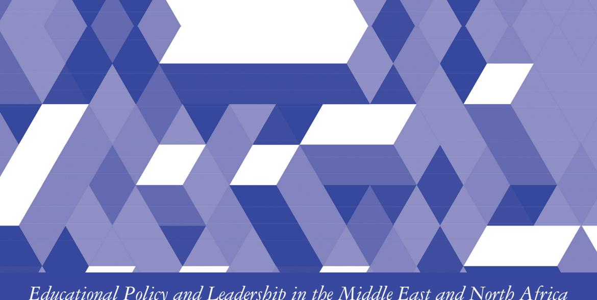
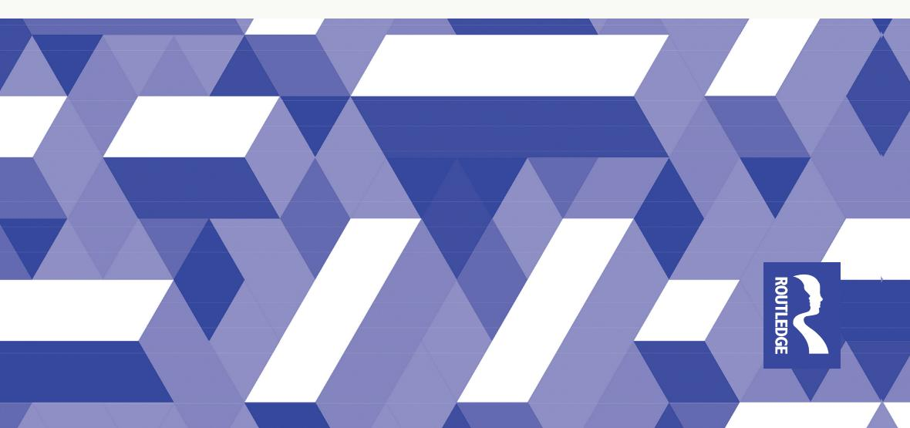

<!-- LR.R04 | source: papers_json/LR.R04/ -->

*Educational Policy and Leadership in the Middle East and North Africa*

## HIGHER EDUCATION AND SCIENTIFIC RESEARCH IN THE ARABIAN GULF STATES

OPPORTUNITIES, ASPIRATIONS, AND CHALLENGES

Abdellatif Sellami, Khalid Arar, and Rania Sawalhi

<!-- page 2 -->

## **Higher Education and Scientific ** **Research in the Arabian Gulf ** **States**

This book takes a closer look at the relation between current issues and trends in higher education and scientific research in the Arab World and in the Gulf Cooperation Council (GCC) states of Qatar and United Arab Emirates (UAE).

This thoroughly researched text traces the development of higher education in the GCC area as it continues to be positioned in an intersection of international and local factors. The text further articulates the pivotal political and cultural influences that act as real and perceived barriers toward the advancement of key fields. The chapters analyze the current policy trends, structures, and coping alternatives in addressing higher education challenges, whilst also providing comparative first-hand texts with the other Arab states in the region. By drawing focus on the GCC area, the text identifies the crucial factors that hamper learning and research performance. The book serves as an invaluable discussion on the implications for policy makers and HEIs in relation to the eponymous regions and other Arab states in the GCC area.

Enhancing understanding of the scope, scale, and complexity of higher education and scientific research in the GCC area, the book will be of interest to academics, researchers, and postgraduate students in the fields of educational policy, comparative and international education, and higher education.

**Abdellatif Sellami** is the Director of the Education Research Center, the College of Education, Qatar University, Qatar.

**Khalid Arar** is a Professor of Educational Leadership and Policy at the School Improvement Doctoral Program, College of Education, Texas State University, the United States.

**Rania Sawalhi** is currently employed at the Qatar Career Development Centre, Qatar Foundation, Qatar.

<!-- page 3 -->

## **Educational Policy and Leadership in the Middle East ** **and North Africa**

**Series editor:** Khalid Arar

**Series co-editors:** Selahattin Turan, Sedat Gümüş,

and Julia Mahfouz

This timely series addresses the need for up-to-date, current literature on educational policy, leadership, and scholarship the Middle East and North Africa (MENA) region to support the work of researchers from developing areas, and give a voice to perspectives rarely heard in the West. The series will offer important insights into the dynamics governing the interplay between global market and education forces in each local context, and will therefore further examine important political, societal, and cultural barriers that continue to hinder the development of education systems in the MENA region. Books in the series will give a critical analysis of the research undertaken and support global understanding of the scope, scale, and complexity of educational policy, politics, and leadership in MENA countries.

## **Books in the series include:** **Higher Education and Scientific Research in the Arabian Gulf States** Opportunities, Aspirations, and Challenges *Abdellatif Sellami, Khalid Arar, and Rania Swalhi*

For more information about the series, please visit[ https://www.routledge.com/](https://www.routledge.com/Educational-Policy-and-Leadership-in-the-Middle-East-and-North-Africa/book-series/EPLMENA) [Educational-Policy-and-Leadership-in-the-Middle-East-and-North-Africa/](https://www.routledge.com/Educational-Policy-and-Leadership-in-the-Middle-East-and-North-Africa/book-series/EPLMENA) [book-series/EPLMENA](https://www.routledge.com/Educational-Policy-and-Leadership-in-the-Middle-East-and-North-Africa/book-series/EPLMENA)

<!-- page 4 -->

## **Higher Education ** **and Scientific Research ** **in the Arabian Gulf States**

Opportunities, Aspirations, and Challenges

**Abdellatif Sellami, Khalid Arar, ** **and Rania Sawalhi**

<!-- page 5 -->

First published 2023 by Routledge 4 Park Square, Milton Park, Abingdon, Oxon OX14 4RN and by Routledge

605 Third Avenue, New York, NY 10158

*Routledge is an imprint of the Taylor & Francis Group, an informa business*

© 2023 Abdellatif Sellami, Khalid Arar and Rania Sawalhi

The right of Abdellatif Sellami, Khalid Arar and Rania Sawalhi to be identified as authors of this work has been asserted in accordance with sections 77 and 78 of the Copyright, Designs and Patents Act 1988.

All rights reserved. No part of this book may be reprinted or reproduced or utilised in any form or by any electronic, mechanical, or other means, now known or hereafter invented, including photocopying and recording, or in any information storage or retrieval system, without permission in writing from the publishers.

*Trademark notice*: Product or corporate names may be trademarks or registered trademarks, and are used only for identification and explanation without intent to infringe.

*British Library Cataloguing-in-Publication Data*

A catalogue record for this book is available from the British Library

*Library of Congress Cataloging-in-Publication Data*

Names: Arar, Khalid, author. | Sellami, Abdellatif, author. | Sawalhi, Rania, author.

Title: Higher education and scientific research in the Arabian Gulf states: opportunities, aspirations and challenges / Abdellatif Sellami,

Khalid Arar, and Rania Sawalhi. Description: Abingdon, Oxon ; New York, NY : Routledge, 2023. | Series: Educational policy and leadership in the Middle East and

North Africa | Includes bibliographical references and index. | Identifiers: LCCN 2022027283 (print) | LCCN 2022027284 (ebook) | ISBN 9781032120379 (hardback) | ISBN 9781032120409 (paperback) | ISBN 9781003222750 (ebook)

Subjects: LCSH: Education, Higher--Qatar. | Education, Higher--

United Arab Emirates. | Research--Qatar. | Research--United Arab Emirates. | Higher education and state--Qatar. | Higher education and state--United Arab Emirates.

Classification: LCC LA1435 .A73 2023 (print) | LCC LA1435 (ebook) |

DDC 378.5357--dc23/eng/20220824

LC record available at[ https://lccn.loc.gov/2022027283](https://lccn.loc.gov/2022027283)

LC ebook record available at[ https://lccn.loc.gov/2022027284](https://lccn.loc.gov/2022027284)

ISBN: 9781032120379 (hbk) ISBN: 9781032120409 (pbk) ISBN: 9781003222750 (ebk)

DOI: [10.4324/9781003222750](https://doi.org/10.4324/9781003222750)

Typeset in Bembo by KnowledgeWorks Global Ltd.

<!-- page 6 -->

## **Contents**

List of figures
List of Tables
Acknowledgmentsvi
vii
viiiIntroduction: The Importance of Exploring Higher
Education Leadership Experiences in Qatar and the UAE11Education, Knowledge, and Human Development
in the Arab World122Higher Education in the Arab World: Current Challenges,
Scholarship, and Future Trends443Transition from Traditional to International Education in
Qatar and the UAE734Scientific Research and Innovation in Qatar and the UAE1005National Educational Policies and Practices: Quality,
Viability, and Sustainability1216Cultural Roadblocks1367Structural, Societal, and Political Challenges1488Conclusion: Revisiting and Reimagining Higher Education185Index192

<!-- page 7 -->

## **Figures**

4950515152Type of publication, by methodology (qualitative,quantitative, mixed)52Most frequent 50 keywords in research on higher educationin the MENA region53Main themes identified in the thematic analysis53Publications in Qatar and UAE per year103Toward embracing diversity in higher education institutes189PRISMA flow diagram (Moher et al., 2010)
Publications, by year of publication
Publications, by country
Type of publication
Type of publication, by methodology (empirical, conceptual)

<!-- page 8 -->

## **Tables**

1.1Human Development Index (HDI) for Arab Countries161.2The Human Capital Index (HCI)173.1Listing of College and University Branch Campuses Based inEducation City, Doha, Qatar, by Establishment Date833.2Listing of College and University Branch Campuses BasedOutside Education City in Doha, Qatar, by Establishment Date833.3Listing of College and University Branch Campuses inDubai, UAE, by Establishment Date863.4Listing of Other International College and University BranchCampuses in Dubai, by Establishment Date883.5Listing of College and University Branch Campuses in AbuDhabi, UAE, by Establishment Date893.6Listing of College and University Branch Campuses in RAK,UAE, by Establishment Date894.1Examples of the Themes That Emerged from ReviewingSelected Studies in Chapter 21036.1Differences between Western and Non-Western Worldviews137

<!-- page 9 -->

## **Acknowledgments**

The authors owe an enormous debt of gratitude to those who provided detailed comments on one or more of the book chapters, including Professor Michael Romanowski, Professor Othmane Bouhali, and Dr. Abdelilah Arredouani.

For their insights and precious time to discuss various components of the book, we would like to thank Professor Mohammed Al-Qasimi, Dr. Fahim Akhter, Dr. Khalaf Al'Abri, Dr. Ahoud Al-Asfour, Dr. Esra Aleisa, Dr. Omar Badawood, and Dr. Abdullah. Thanks also go to Miss Ikram Sellami for editing and proofreading chapters of the book.

**Abdellatif Sellami** is the Director of the Education Research Center, the College of Education, Qatar University. Previously, he served as a research faculty at the Social and Economic Survey Research Institute (SESRI), Qatar University. Prior to joining Qatar University, he had served as an Educational Programs Manager in Education City, Qatar Foundation. He has published journal articles and book chapters in the areas of K-12 education, higher education, STEM, critical discourse analysis, and language and identity. He has a published book titled *Introduction to the art of * *debating* [2014, Bloomsbury Press (in Arabic)]. Currently, he is involved in a number of large-scale research projects on STEM, K-12 education, higher education, sociocultural impacts of FIFA 2022 in Qatar, and, more recently, the effect of online (remote) learning during the coronavirus.

**Khalid Arar**, PhD, is a Professor of Educational Leadership and Policy at the School Improvement Doctoral Program, College of Education, Texas State University, and an Associate Editor of the *International * *Journal of Leadership in Education* and Middle-East regional editor of *Journal of Education Administration and History*. For the past two decades, he conducted studies in the Middle East, Europe, the United States, and North America on the issues of equity, diversity, and social justice in K-12 and higher education. His recent books include *Migrants, * *Refugees and Global Challenges in Higher Education* (Peter Lang Publishing, with Kussai Haj-Yehia, David Ross, and Yasar Kondakci); *Education, * *Immigration and Migration: Policy, Leadership and Praxis for a Changing World* (Emerald Publishing, with Jeffrey Brooks and Ira Bogotch); *Turbulence, *

<!-- page 10 -->

*Empowerment and Marginalization in International Education Governance * *Systems* (Emerald Publishing, with Alison Taysum); and *School Leadership * *for Refugees' Education* (Routledge).

**Rania Sawalhi** completed her PhD at the University of Warwick (the United Kingdom) in Educational Leadership. She has worked as director of strategic planning and development of educational projects and currently, Dr. Sawalhi works in Qatar Career Development Center, Qatar Foundation. She has also launched Educational Leadership Lab and Educational Leadership e-platforms. She was awarded ICSEI/JPCC 2020 Innovation award and was on of study UK award finalists 2019-Qatar. Rania is also co-founder of WomenEdMENA, Co-coordinator ELN-ICSEI.

<!-- page 11 -->

<!-- page 12 -->

## **Introduction**

The Importance of Exploring Higher Education Leadership Experiences in Qatar and the UAE

By the 1990s, the belief that the future lays in a "global knowledge economy" drove governments across the globe to implement policies that help repurpose higher education (HE) to produce knowledge, skills, and graduates that would generate intellectual capital and innovative products and enable their countries to gain a competitive edge on the world scene (Arar & Chen, 2021). These reforms relied on neoliberal ideas aimed at turning universities into autonomous and entrepreneurial "knowledge organizations" by prompting competition, and opening them up to private investors, to maximize individuals' skills in global labor markets (Shore & Wright, 2017, p. 1). These policy narratives positioned universities as static entities within a market economy. An alternative narrative would see the university as a dynamic and fluid set of relations within a wider "ecology" of diverse interests and organizations (Altbach et al., 2018).

Knowledge is strategic and vital for a nation's economic performance in today's competitive and globalized economy (De Witte & López-Torres, 2017). At the same time, the forces of globalization and the influence of information and communication technology (ICT) have led to the emergence of a new economic system that is a knowledge economy largely based on the power of knowledge creation and production. According to Thurow (2000), the term "knowledge economy" refers to economies that are driven by the production, distribution, and use of knowledge and information in generating income and wealth, compared to mid-20th century economies based on commodities, raw materials, and primary processing (Levin & Greenwood, 2016).

In this book, the term "knowledge-based economy" is used to describe "societies where wealth is generated primarily through the production of goods and services that have significant intellectual content, rather than through the production of raw materials or resources" (Engelke et al., 2015, p. 635). In this sense, moving toward a knowledge-based economy requires a high-quality education system and a capable workforce, combined with high-quality educational institutions, research labs, and entrepreneurial climate that values learning, creative thinking, and risk taking (Arar et al., 2021; van't Land et al., 2021).

DOI: [10.4324/9781003222750-1](https://doi.org/10.4324/9781003222750-1)

<!-- page 13 -->

Science, technology, and innovation are crucial for addressing and providing feasible and effective solution options to global problems, as Lambrechts and Hindson (2016) suggest. These fields of knowledge and scholarship are key driving forces that play a central role in promoting sustainable development and thus achieving the development goals of many societies (Wiek, Farioli, Fukushi, & Yarime, 2012). At the same time, longterm sustainability depends on the development of human capital, where science, knowledge, and innovation are essential for developing human potential and building capacity. Therefore, the need for a knowledgeable and skilled workforce required for sustainable growth and development requires education and training, both of which are key to capacity-building (Buckler & Creech, 2014).

Because the Middle East and the Arab world are often confused, and sometimes taken to mean the same, a distinction needs to be made between the two. Comprising five percent of the world's population (i.e., 285 million people), the Arab world encompasses the 22 members states under the umbrella name of the Arab League. These include Algeria, Bahrain, Comoros, Djibouti, Egypt, Iraq, Jordan, Kuwait, Lebanon, Libya, Mauritania, Morocco, Oman, Palestine, Qatar, Saudi Arabia, Somalia, Sudan, Syria, Tunisia, the United Arab Emirates (UAE), and Yemen (see map of the Arab League Member States below). These states house distinct ethnic and religious populations living within these countries, including Druz, Kurds, Yezidis, Chaldeans, Berber-speaking indigens, and others who speak Arabic alongside their native tongues (Hillman & Baydoun, 2018).

In contrast, the Middle East is a region that consists of countries in eastern Mediterranean/southwestern Asia (Iraq, Iran, Israel, Jordan, Lebanon, Palestine, Syria, and Turkey) in addition to Egypt and the nations of the Arabian Peninsula (Bahrain, Kuwait, Oman, Qatar, Saudi Arabia, UAE, and Yemen). For comparative purposes, Djibouti, Somalia, and Sudan are sometimes considered part of the wider Middle East and North Africa (MENA) region. A rich mosaic, both regions encompass a stretch of land made up of several nations with distinct identities and different social, cultural, political, and economic systems (Held, McGrew, Goldblatt, & Perraton, 2000; Goldschmidt, 2016; Kamrava, 2011).

Although Arab nations share certain commonalities, considerable diversity exists within the region, especially between the Arabian Gulf states and Mediterranean Arab countries. Differences are particularly discernible at the levels of these countries' populations, standard of living, and economic development. For instance, the Gulf Cooperation Council (GCC) states have lower population rates, a higher GDP per capita, and higher standards of economic development, compared to other Arab countries, as measured by their respective Gross Domestic Product (GDP) per capita and Human Development Index (Nour, 2005).

The impetus for this book stems from the realization that scholarship on scientific research and innovation in the GCC and the broader Arab region is

<!-- page 14 -->

largely understudied and remains sparse. While a preponderance of scholarly research that deals with the interplay between higher education, scientific research, and innovation outside the Arab world is available, not enough is known about the complexity, extent, and scope of this area within the GCC setting and other Arab states for that matter. This book, therefore, is an endeavor to fill the gap in the literature and extend research addressing issues of relevance to higher education, research, science, and human development. Currently, most of what is available in the Arab region is work on higher education, knowledge transfer, and human development summarized in an array of reports prepared by national and international organizations, consultancy firms, think tank agencies, and research centers. Prominent examples are the UNDP, UNESCO, the World Bank, ESCWA, the League of Arab States, and the Arab Fund for Economic and Social Development.

The growing recognition of the positive social and economic impact—in both the long-run and immediately—of education, science, and innovation is very visible in Qatar and the UAE, much like it is elsewhere. For example, demand for professionals with credentials in science, technology, engineering, and mathematics (STEM) is very high in both countries and building a pipeline for the STEM workforce is a top national policy priority. In view of the role that higher education institutions (HEIs) play in the transfer of knowledge, Qatar and the UAE have invested significantly in post-secondary education and have recently witnessed a heightened proliferation of international (Western and especially American) branch campuses.

The overarching objective of this book, with its multidisciplinary coverage, is to shed light on the hindrances—political, societal, and cultural—that are shackling knowledge production and transfer, and research production and innovation, with a calling to inspire change, in the GCC—sometimes referred to as the Arabian Gulf States—(Bahrain, Kuwait, Oman, Qatar, Saudi Arabia, and the UAE). Looking at the efforts of two Arabian Gulf states, this book aims to enrich discussion of the obstacles that hamper research and innovation and clarify what and how research can contribute to the ongoing policy debates. The decision to focus on the fields of higher education and research production in Qatar and the UAE was prompted by the critical role that they play in propelling economic growth and fostering societal welfare. As the two countries brace to turn into sustainable knowledge-based societies, one chief challenge they are faced with is the shortage of a highly skilled national workforce, particularly in light of the dominant reliance on a highly skilled expatriate workforce and dependence on state welfare.

Contrary to the view of a linear route to local capacity building within the GCC, which draws mainly on higher education provision, this book advocates instead a complex array of pathways to a varied set of educational and research outcomes. As such, a whole range of different approaches to existing problems in the domains of higher education and research in both Qatar and the UAE are discussed. However, the scope of the book needed to be bounded so that a national focus is provided, drawing on current and past studies.

<!-- page 15 -->

Many reasons prompted the focus on Qatar and the UAE in this book. The two countries are members of the GCC, established in Saudi Arabia's capital, Riyadh, in May 1981 (Encyclopaedia Britannica). Second, the two countries are high-income state monarchies ranking among the most affluent nations in the world (Powell, 2014). Qatar and the UAE share the same culture, history, language, and religion and similar political and economic systems. With distinct social and economic development trajectories (Burden-Leahy, 2009), the leaders of Qatar and the UAE, more than those in other resource-rich countries in the GCC, have recently deployed significant resource wealth to overhaul their education systems.

At the core of these reforms is the need for building capacity. The two countries stand as relatively successful examples in a region that is caught up in a struggle to sustain large, vulnerable populations (Rasul, Hausler, & McCorquodale, 2016) but are still situated at the periphery of global knowledge production (Morgan, 2018). Both have similar policy preferences, similar social structures, and similar economic and political systems (McGettigan, 2013). Both also boast about their common history and glorify their cultural traditions. In addition, in both countries, the role that the state plays in the provision of public services has shrunk, allowing for a combination of regulation, performance monitoring, contracting, and the facilitation of new providers of public services (Mohamed & Morris, 2019).

To enhance and modernize their national systems of education, Qatar and the UAE currently rely immensely on policy borrowing and imported educational and teaching practices, including "educational workforce and the contracting of services and policy advice from global consultancies, edu-businesses and organization" (Morgan, 2018, p. 287). The two countries have a documented recent history of dealings with a network of international agencies, which advise on policy and provide Global Education Industry (GEI) services (Mohamed & Morris, 2019). Finally, both countries are characterized by a demographic imbalance, with a population that is overwhelmingly foreign-born and extremely heterogeneous (Dedousis & Rutter, 2016).

The Gulf States are a popular destination for migrant workers—skilled and unskilled—mainly due to their high per capita incomes (Al-Ubaydli, 2015). At the same time, high rates of underemployment amongst nationals coupled with low rates of national participation in private sector jobs are a real concern to GCC governments. Faced with the challenge of attracting and retaining highly qualified talents, GCC countries have, for many years, sought to nationalize their domestic job markets by adopting what Hertog (2014) describes as "Gulfization" policies that aim to replace foreign workers with nationals, with results that vary from one country to another. This has led to situation where the job market in the region is regarded a very vulnerable Achilles' heel of a successful and unique oil-driven regional organization in a turbulent Arab world.

Given education and training are the cornerstones for development and a driver for societal growth in the Arab world, many Arab countries are

<!-- page 16 -->

striving to develop their human capital, particularly regarding the skills and talents needed by reforming their higher education systems (Wilkens and Masri, 2011). Thus, demand for local national talent has triggered a strong surge of interest in research and innovation in the region, with notable variations among the different Arab countries. As a result, a number of Arab countries exhibit an exponential proliferation of private schools, colleges, and universities from Europe and North America. Going global has become a vogue of the time in many parts of the world.

In the face of the crisp lack of qualified citizens who possess the critical skills, knowledge, and competencies of the global economy, this book has the potential to benefit not only students and their families, but also educational institutions, government organizations, business enterprises, and society as a whole. Not enough research has explored effective measures and interventions that are likely to attract and retain local as well as foreign skills and talents in the GCC states and Qatar and the UAE more specifically. Whereas education can play a leading role in supplying STEM skills and talents in Qatar, for example, little published research has been conducted that sheds light on suggestions for improving STEM education (Said & Friesen, 2013).

## **Our Epistemology and Methodology**

In the 21st century, HEIs are continually required to adapt to new international and local challenges (e.g., the nature of learners, ever-changing curricula, market needs, information technology, pandemics) and, many times, even to contradicting demands from the public and from policy makers. Compelling issues include, among other things, increasing equitable access pathways, the success and preparation of the next Arab generation that is capable of competing and meeting global challenges. Contributing to knowledge production and sustaining social development is part of the essence of their axiological commitment, as Arab scholars, for equitable, diversified, and accessible higher education in general.

The ontology of the three researchers, whether in their research agenda, practice, or experience, reflects a commitment to expanding access to higher education among Arabs, building academia as part of an ongoing cultural enterprise and contributing to science and research as part of shaping the face of society. Specifically, researching higher education in the Arab world and the Gulf States has an important ontological, epistemological, and moral significance for each author. Epistemologically, research of this type requires a complex observation and profound understanding of Arab culture, the Arabic language and its system dynamics, and institutional structure. Such research contravenes connecting the space and the place while aspiring to allow understanding, listening, and commitment to creating a shared space of an incubator for the development of an academic and scientific reserve within the academic space in the Arab world.

<!-- page 17 -->

This present work promotes an agenda that the three authors are committed to and that is rooted epistemologically in each of the contributor's personal, practical, and scholarly commitment. At our first point of departure, we proposed to bring our collective experience as three scholars working in and researching the enterprise of higher education both in the Middle East, the Arab World, and internationally, against the background of traditional higher education structure and culture. The harsh reality of turmoil, turbulence, and the resultant disruption that the region is embroiled in, along with global changes, trigger the need to rethink and reimagine current societal needs through HEIs.

The impetus for this book stems from the realization that scientific research and innovation in the GCC and the broader Arab region is largely understudied and remains sparse. While a preponderance of scholarly research that deals with the interplay between higher education, scientific research, and innovation outside the Arab world is available, not enough is known about this area within the GCC setting and other Arab states for that matter. Therefore, this book is an endeavor to fill the gap in the literature and extend research, addressing issues of relevance to higher education, research, science, and human development. Through the book, we invite readers to a profound voyage that examines trends and current issues in the fields of higher education, scientific research, and innovation in the Arab World in general and in the GCC states of Qatar and the UAE in particular.

In so doing, the book seeks to unearth the development of higher education in the GCC region, informed by the internationalization and localization pendulum while addressing salient political, societal, and cultural influences that emerge as potential barriers—perceived and real—to the development of scientific research, scholarship, and innovation in the two countries and, where relevant, other Arab world area. *Higher Education and Scientific Research * *in the Arabian Gulf States: Aspirations, Challenges and Opportunities* provides a recent analysis of current policy trends, structures, and coping alternatives and perspective that deal with higher education challenges while providing a first-hand account, comparing these trends with those in other Arab states, a region surrounded by unrest in a turbulent era.

We invite the reader to this space of scholarly study, bearing in mind the following three guiding principles:

- 1 We agree that access to higher education has become a great equalizer for the growth of knowledge within Arab societies, and for a certain level of economic mobility, although we know this is a problematic issue, given the variables of ethnicity and gender in Arab culture and society.
- 2 COVID-19 has moved issues of access, equity, quality, and excellence to the forefront. We propose these issues have also magnified other "viruses" related to equitable access.
- 3 The book proposes extensive knowledge that can lay the base for a framework of analysis that provides a re-imagining of the ontological, epistemological, and methodological tools for an emerging a dialogical

<!-- page 18 -->

relationship between the imagination and practice as a new end of a praxis in re-shaping higher education in the Gulf States and the broader the Arab World. We argue for aligning higher education with societal needs through developing ecologies of knowing, policy design, and pedagogic practices in the current era of extensive knowledge and sophisticated technologies.

## **Chapter Overview**

The chapters included in this book shed light on different and interrelated aspects of higher education and scientific research in the GCC area. The book brings into focus the quality, importance, and extent of HEIs and research productivity in the region. Moreover, the book seeks to offer important insights into the dynamics governing the interplay between global market forces and the internationalization of HEIs in Qatar and the UAE. In doing so, the proposed work further examines important political, societal, and cultural barriers that continue to hinder the development of scientific research, scholarship, and innovation in Qatar, the UAE, and other Arab states. Providing a detailed and comprehensive examination of knowledge production in the Arab world, this book is of interest to students, scholars, and policymakers working on the issues of research practices and the status of science in contemporary developing countries. In doing this, it demonstrates the role and influence of policy, institutional, and sociocultural factors as important attributes that enhance education, scientific research, and innovation.

Reflecting on the GCC area, the book attempts to identify key factors that continue to hamper learning and research performance in the area. At the same time, it discusses key higher education and research implications for policymakers and HEIs. The book demonstrates how insights from it can inform the responses of scholars, HEIs, higher education leaders, and policymakers to different organizational contexts, cultures, circumstances, and challenges.

The book is organized as a follows: an introduction, seven main chapters, and a conclusion. The introduction provides a basis for the book by offering a brief contextual background to the themes covered in the book. The following is a brief description of the seven chapters.

Chapter 1 focuses on education, knowledge, and human development in the Arab World and sets the scene for the remainder of the book descriptively by painting a general picture of education (pre-college as well as postsecondary) in the region. The chapter also examines important developments the education sector has undergone in the region, with specific focus on Qatar and the UAE. The chapter then discusses key factors that continue to curtail efforts to improve education in the region. In addition, it highlights issues related to education, knowledge, and human development in Qatar and the UAE, shedding light on the mismatch between educational outcomes and the needs of the highly competitive job market.

<!-- page 19 -->

Chapter 2 maps the pendulum of the internationalization versus localization of HE, affecting the means and ends of HE development, including in the Arab world. Hence, there is a rapid growth and interest in higher education in the Arab World in general and the natural resource-rich states of Qatar and the UAE specifically. This chapter aims to systematically collect, document, scrutinize, and critically analyze the current challenges facing HE in the Arab region, its features, impacts, and the factors that facilitate or inhibit its current shape and development. Furthermore, we will map and identify key scholarship and research strengths and weakness to set the stage for a future research agenda. The chapter also offers a review that examines policy informing HE development in this region.

Based on a systematic literature search on Web of Science (WoS) and SCOPUS, a thematic analysis will be conducted using the Nvivo software package. This analysis allows us to identify policy, strategy and research patterns, trends, geographic origins, the scope of scholarship affecting leadership, and managerial perceptions in leading HE institutions. Our analysis will identify policies and theoretical, conceptual, and methodological limitations contributing to the nature of HE development in this region, and its connection with global trends of HE development. Conclusions and implications for future research and practice will be discussed in great detail.

Chapter 3 starts with a brief background to K-12 Education in Qatar and the UAE and looks at the transition to the modern formal system of schooling. Next, it discusses relevant education reforms against the backdrop of market-driven education and then provides an overview of the internalization of higher education in the two countries, which have become model higher education hubs, housing numerous and different models of international branch campuses (IBCs). Beyond merely describing the current state of IBCs in the two countries, an examination of the nature of each country's IBCs is provided, highlighting key differences in terms of their stages of development, rationales, priorities, strategies, sponsors, and expectations. The chapter concludes with some criticisms leveled at the deployment, ways of operation, and effects of IBCs, especially in the context of Qatar, the UAE and the other GCC member states. The chapter concludes with a discussion of relevant local reactions to IBCs.

Chapter 4 looks at scientific research in the Qatar and the UAE and presents a critical review of the current state of research productivity in the two countries. The chapter examines institutional research models in Arab countries, identifying differences between various types of research activity that reflect historical, mainly colonial, legacies. The chapter also presents successful institutional research models in the region and examines positive developments taking place in both Qatar and the UAE in alignment with the two countries' economic, social, and human development plans. Focusing on the social, economic, and cultural impacts of research, this chapter also examines the contemporary impact of Western influence, perceived by sceptics as a "colonial legacy." Furthermore, this chapter includes

<!-- page 20 -->

a discussion of cynic views opposing Western modes of research and criticisms leveled at international scientific collaboration between the colonial North and the global South.

Chapter 5 reflects on current policies and practices regulating HEIs in the two GCC states, Qatar and the UAE, within an increasingly competitive market where the scale, intensity, and direction of HEIs are subjected to market force influences. Against the background of a rapid growth of international mobility of students, teachers, course programs, curricula, materials, and degrees, this chapter attempts to provide an insider perspective into how international, regional, and national factors shape local educational policy. Primary data will be collected via personal interviews with senior management officials and focus group discussions involving graduate students at different HEIs in Qatar and the UAE. Qualitative data culled from different inside sources will yield robust and concrete evidence that shows how HEIs serve as a vehicle for accomplishing strategic national policy goals based on the beliefs, knowledge, and experiences of those officials and graduates. The data elicited through interviews and focus groups will also aid in mapping the intricate linkages between HEIs and the social and cultural environment where they operate at the micro-, meso- and macro-levels.

Chapter 6 provides a critical analysis of the main causes of the deficient state of knowledge and scientific research in Qatar, the UAE, and the larger Arab region. Chief among these impediments is the quality of education systems in the region. The chapter also examines, in detail, key societal, political, and cultural challenges that impede knowledge acquisition, research, and innovation. It discusses societal and structural barriers, including the poor quality of education, training and research, undemocratic and authoritarian regimes, brain drain, lack of good governance, lack of funding, and poor integration within the international scientific community.

Chapter 7 looks at another set of challenges that hinder knowledge development and scientific research productivity in Qatar, the UAE, and other Arab states. The chapter capitalizes on cultural differences, shedding highlight on Western versus non-Western cultural norms and values. This is then followed by a discussion of relevant cultural chasms dividing Western and non-Western (Arab) societies. The chapter also provides a detailed examination of prevalent cultural influences that continue to curtail knowledge and research production. In particular, three main factors are examined in the chapter: rentier culture, nepotism (*Wasta*), and gender-based stereotypes.

Moreover, this chapter highlights the dynamics of higher education development in the current era and analyzes higher education policy landscapes while dealing with different burning challenges (e.g., internationalization, migration, and political, economic, and learners' changes and demands). This chapter poses the following main question: what are the critical insights we gain from the current higher education trends in our era of globalization, neoliberalism, marketization, competition, and uncertainty while leading HEIs in time of emergency, uncurtaining and turbulence (e.g., COVID-19),

<!-- page 21 -->

To this end, this book aims to shed light on the opportunities and challenges that Qatar and the UAE specifically and the GCC states in general have and how they can utilize their resources to prepare nationals for a better future.

## **References**

- Altbach, P. G., Reisberg, L., Salmi, J., & Froumin, I. (2018). Accelerated Universities, Ideas and Money Combine to Build Academic Excellence. *Global Perspectives on Higher * *Education*, *40*. Leiden; Boston: Brill.
- Al-Ubaydli, O. (2015). The economics of migrant workers in the GCC. *Arab Gulf States * *Institute in Washington Issue Paper, 10*.
- Arar, K., Saiti, A., & Prokopiadou, G. (2021). Higher Education and Equitable Life-Long Learning for Diversified Students in the Digital Era, Higher Education Governance & Policy, 2(1), 19–30.
- Arar, K., & Chen, D. (2021). The Future of Higher Education: A New Paradigm Shift Addressing Students' Diversity, In: H. van't Land, A. Corcoran, & D. C. Iancu (Eds.) *The Promise of Higher Education*. Springer, Cham. [https://doi.org/](https://doi.org/10.1007/978-3-030-67245-4_55) [10.1007/978-3-030-67245-4_55](https://doi.org/10.1007/978-3-030-67245-4_55).
- Buckler, C., & Creech, H. (2014). *Shaping the Future We Want: UN Decade of Education for * *Sustainable Development; final report*. UNESCO.
- Burden-Leahy, S. M. (2009). Globalisation and Education in the Postcolonial World: The Conundrum of the Higher Education System of the United Arab Emirates. *Comparative * *Education*, *45*(4), 525–544.
- Dedousis, E. V., & Rutter, R. N. (2016). Workforce Localisation and Change Management: The View from the Gulf. In *Organizational Change Management Strategies * *in Modern Business* (pp. 301–327). Hershey, PA: IGI Global.
- De Witte, K., & López-Torres, L. (2017). Efficiency in Education: A Review of Literature and a Way Forward. *Journal of the Operational Research Society*, *68*, 339–363.
- Engelke, H., Mauksch, S., Darkow, I. L., & Heiko, A. (2015). Opportunities for Social Enterprise in Germany—Evidence from an Expert Survey. Technological Forecasting and Social Change, 90, 635–646.
- Goldschmidt, A., & Boum, A. (2016). *A concise history of the Middle East*. New York: Routledge.
- Held, D., McGrew, A., Goldblatt, D., & Perraton, J. (2000). Global Transformations: Politics, Economics and Culture. In *Politics at the Edge* (pp. 14–28). London: Palgrave Macmillan.
- Hillman, J. R., & Baydoun, E. (2018). The Future of Universities in the Arab Region: A Review. In *Universities in Arab Countries: An Urgent Need for Change* (pp. 1–53). Cham: Springer.
- Hertog, S. (2014). Arab Gulf States: An Assessment of Nationalisation Policies.
- Kamrava, M. (2011). Mediation and Qatari Foreign Policy. *The Middle East Journal*, *65*(4), 539–556.

<!-- page 22 -->

- Lambrechts, W., & Hindson, J. (2016). *Research and Innovation in Education for Sustainable * *Development*. Exploring Collaborative Networks, Critical Characteristics and Evaluation Practices, 197. Vienna: ENSI.
- Levin, L., & Greenwood, D. J. (2016). *Creating a New Public University and Reviving * *Democracy: Action Research in Higher Education*. Oxford: Berghahn.
- McGettigan, A. (2013). *The University Gamble: Money, Markets and the Future of Higher * *Education*. London: Pluto.
- Nour, S. M. (2005). Science and Technology Development Indicators in the Arab Region: A Comparative Study of Arab Gulf and Mediterranean Countries. *Science, * *Technology and Society*, *10*(2), 249–274.
- Said, Z., & Friesen, H. (2013). Topic Article: The Impact of Educational Reform on Science and Mathematics Education in Qatar. In *Proceedings of the 1st International * *Interdisciplinary Conference. Azores, Portugal* (pp. 621–635).
- Shore, C., & Wright, S., (Eds.) (2017). Privatizing the Public University: Key Trends, Countertrends and Alternatives. *Death of the Public University: Uncertain Futures for * *Higher Education in the Knowledge Economy* (pp. 2–27). New York: Berghahn.
- Thurow, L. C. (2000). Globalization: The Product of a Knowledge-Based Economy. The Annals of the American Academy of Political and Social Science, 570(1), 19–31.
- van't Land, H., Corcoran, A., & Iancu, D. C. (Eds.) (2021). *The Promise of Higher Education*. Cham: Springer. [https://doi.org/10.1007/978-3-030-67245-4_55.](https://doi.org/10.1007/978-3-030-67245-4_55)
- Wiek, A., Farioli, F., Fukushi, K., & Yarime, M. (2012). Sustainability Science: Bridging the Gap Between Science and Society. *Sustainability Science*, *7*(1), 1–4.
- Wilkens, K. & Masri, S. (2011). Higher Education Reform in the Arab World. In *The Brookings Project on US Relations with the Islamic World*. Brookings: Saban Center.

<!-- page 23 -->

## Introduction

- Altbach, P. G. , Reisberg, L. , Salmi, J. , & Froumin, I. (2018). Accelerated Universities, Ideas and Money Combine to Build Academic Excellence. Global Perspectives on Higher Education, 40. Leiden; Boston: Brill.
- Al-Ubaydli, O. (2015). The economics of migrant workers in the GCC. Arab Gulf States Institute in Washington Issue Paper, 10.
- Arar, K. , Saiti, A. , & Prokopiadou, G. (2021). Higher Education and Equitable Life-Long Learning for Diversified Students in the Digital Era, Higher Education Governance & Policy, 2(1), 19–30.
- Arar, K. , & Chen, D. (2021). The Future of Higher Education: A New Paradigm Shift Addressing Students' Diversity, In: H. van't Land , A. Corcoran , & D. C. Iancu (Eds.) The Promise of Higher Education. Springer, Cham. https://doi.org/10.1007/978-3-030-67245-4_55.
- Buckler, C. , & Creech, H. (2014). Shaping the Future We Want: UN Decade of Education for Sustainable Development; final report. UNESCO.
- Burden-Leahy, S. M. (2009). Globalisation and Education in the Postcolonial World: The Conundrum of the Higher Education System of the United Arab Emirates. Comparative Education, 45(4), 525–544.
- Dedousis, E. V. , & Rutter, R. N. (2016). Workforce Localisation and Change Management: The View from the Gulf. In Organizational Change Management Strategies in Modern Business (pp. 301–327). Hershey, PA: IGI Global.
- De Witte, K. , & López-Torres, L. (2017). Efficiency in Education: A Review of Literature and a Way Forward. Journal of the Operational Research Society, 68, 339–363.
- Engelke, H. , Mauksch, S. , Darkow, I. L. , & Heiko, A. (2015). Opportunities for Social Enterprise in Germany—Evidence from an Expert Survey. Technological Forecasting and Social Change, 90, 635–646.
- Goldschmidt, A. , & Boum, A. (2016). A concise history of the Middle East. New York: Routledge.
- Held, D. , McGrew, A. , Goldblatt, D. , & Perraton, J. (2000). Global Transformations: Politics, Economics and Culture. In Politics at the Edge (pp. 14–28). London: Palgrave Macmillan.
- Hillman, J. R. , & Baydoun, E. (2018). The Future of Universities in the Arab Region: A Review. In Universities in Arab Countries: An Urgent Need for Change (pp. 1–53). Cham: Springer.
- Hertog, S. (2014). Arab Gulf States: An Assessment of Nationalisation Policies.
- Kamrava, M. (2011). Mediation and Qatari Foreign Policy. The Middle East Journal, 65(4), 539–556.
- Lambrechts, W. , & Hindson, J. (2016). Research and Innovation in Education for Sustainable Development. Exploring Collaborative Networks, Critical Characteristics and Evaluation Practices, 197. Vienna: ENSI.
- Levin, L. , & Greenwood, D. J. (2016). Creating a New Public University and Reviving Democracy: Action Research in Higher Education. Oxford: Berghahn.
- McGettigan, A. (2013). The University Gamble: Money, Markets and the Future of Higher Education. London: Pluto.
- Nour, S. M. (2005). Science and Technology Development Indicators in the Arab Region: A Comparative Study of Arab Gulf and Mediterranean Countries. Science, Technology and Society, 10(2), 249–274.
- Said, Z. , & Friesen, H. (2013). Topic Article: The Impact of Educational Reform on Science and Mathematics Education in Qatar. In Proceedings of the 1st International Interdisciplinary Conference. Azores, Portugal (pp. 621–635).
- Shore, C. , & Wright, S. , (Eds.) (2017). Privatizing the Public University: Key Trends, Countertrends and Alternatives. Death of the Public University: Uncertain Futures for Higher Education in the Knowledge Economy (pp. 2–27). New York: Berghahn.
- Thurow, L. C. (2000). Globalization: The Product of a Knowledge-Based Economy. The Annals of the American Academy of Political and Social Science, 570(1), 19–31.
- van't Land, H. , Corcoran, A. , & Iancu, D. C. (Eds.) (2021). The Promise of Higher Education. Cham: Springer. https://doi.org/10.1007/978-3-030-67245-4_55.
- Wiek, A. , Farioli, F. , Fukushi, K. , & Yarime, M. (2012). Sustainability Science: Bridging the Gap Between Science and Society. Sustainability Science, 7(1), 1–4.
- Wilkens, K. & Masri, S. (2011). Higher Education Reform in the Arab World. In The Brookings Project on US Relations with the Islamic World. Brookings: Saban Center.

<!-- page 24 -->

## Education, Knowledge, and Human Development in the Arab World

Abouammoh, A. M. (2012). Higher Education in the GCC States: Reforms and Regulations. In S. Hertog (Ed.), National Employment, Migration and Education in the GCC (pp. 265–285). Berlin: Gerlach Press.

Abouchedid, K. , & Abdelnour, G. (2015). Faculty Research Productivity in Six Arab Countries. International Review of Education, 61(5), 673–690.

Al Kaylani, M. I. (1981). Ibn Taymiya on education: An analytical study of Ibn Taymiya's views on education [University of Pittsburgh].

http://0.search.proquest.com/docview/303030318/abstract/65E099C1326F457EPQ/117 Al Kaylani, M. U. (1985). Al Nazariyyah al Tarbiyyah al Islamiyyah: Dirasah Manhajiyyah fi al Usul al Tarikhiyyah li al Tarbiyyah al Islamiyyah. Beirut: Dar Ibn Kathir.

Allawi, A. A. (2009). The Crisis of Islamic Civilization. Yale: Yale University Press.

Al-Shobakky, W. (2008). Petrodollar Science. The New Atlantis: A Journal of Technology & Society, 22, 3–19. Retrieved from https://www.thenewatlantis.com/publications/petrodollarscience

Altbach, P. G. (2008). The Complex Roles of Universities in the Period of Globalization. In Global University Network for Innovation (GUNI) (Eds.), Higher Education in the World 3 – Higher Education: New Challenges and Emerging Roles for Human and Social Development (pp. 5–14). London: Palgrave Macmillan.

Anderson, W. , Cueto, M. , & Santos, R. V. (2016). Applying a Southern Solvent: An Interview with Warwick Anderson. História, Ciências, Saúde-Manguinhos, 23, 213–226.

Arar, K. H. (2019a). The challenges involved when Arab women forge a path to educational leadership: Context, personal cost, and coping. Educational Management Administration & Leadership, 47(5), 749–765.

Arar, K. , Haj-Yehia, K. , Ross, D. , & Kondakci (2019b) (Eds.). Higher Education Challenges for Migrant and Refugee Students in a Global World: An Introduction. In Higher Education Challenges for Migrant and Refugee Students in a Global World (pp. 1–22). New York: Peter Lang.

Arar, K. , & Chen, D. (2021). The Future of Higher Education: A New Paradigm Shift Addressing Students' Diversity. In The Promise of Higher Education (pp. 369–376). Cham: Springer. Arar, K. (2020). Educational Administration in the Middle East. In Oxford Research

Encyclopedia of Education. New York: Oxford University Press.

Arar, K. , & Chen, D. (2021). The Future of Higher Education: A New Paradigm Shift Addressing Students' Diversity. In The Promise of Higher Education (pp. 369–376). Cham: Springer. Arar, K. , Kondakci, Y. , & Streitwieser, B. (2020). Higher Education for Forcibly Displaced Migrants, Refugees and Asylum Seekers. Higher Education Policy, 33, 195–202. https://doi.org/10.1057/s41307-020-00184-z

Arar, K. , & Taysum, A. (2020). From Hierarchical Leadership to a Mark of Distributed Leadership by Whole School Inquiry in Partnership With Higher Education Institutions: Comparing the Arab Education in Israel With the Education System in England. International Journal of Leadership in Education, 23(6), 755–774.

Arjmand, R. (2018). Ijāzah: Methods of Authorization and Assessment in Islamic Education. Daun, H, 135–154. Cham: Springer.

Ashour, S. (2020). Quality Higher Education Is the Foundation of a Knowledge Society: Where Does the UAE Stand? Quality in Higher Education, 26(2), 209–223.

Aubert, J. E. , & Reiffers, J. L. (Eds.). (2003). Knowledge Economies in the Middle East and North Africa: Toward New Development Strategies. Washington DC: World Bank Publications. Badam, R. T. (2017). 'Arab world must learn sparing rod will not spoil the child.' The National. Badran, A. (1993). The Status of Science Teaching in the Gulf Countries. In M. Debs (Ed.), Proceedings of the First Scientific Conference on the Future of Science and Mathematics Teaching and the Needs of Arab Society (pp. 154–172). Beirut, Lebanon: Arab Development Institute.

Badran, A. , Baydoun, E. , & Hillman, J. R. (Eds.). (2019). Major Challenges Facing Higher Education in the Arab World: Quality Assurance and Relevance. Cham: Springer.

Badry, F. , & Willoughby, J. (2015). Higher Education Revolutions in the Gulf: Globalization and Institutional Viability. Abingdon: Routledge.

Bardsley, D. (2017). How did the Muslim world fall behind on science – and how can it thrive again? Debate comes as research and development spending rises in Gulf States. The

<!-- page 25 -->

National.

Barnett, C. (2015). Human Capital and the Future of the Gulf: A Report of CSIS Middle East Program. Centre for Strategic and International Studies (CSIS). New York: Rowman & Littlefield. Retrieved from https://csis-website-prod.s3.amazonaws.com/s3fs-

public/legacy_files/files/publication/151112_Barnett_HumanCapital_Web.pdf

Barro, R. J. , & Lee, J. W. (2001). International Data on Educational Attainment: Updates and Implications. Oxford Economic Papers, 53(3), 541–563.

Belkacem, L. (2002). Arab Competitiveness: Indicators of Arab Competitiveness. In E-Conference on Arab Competitiveness. Kuwait: The Arab Planning Institute.

Bennet, K. (2015). Towards an Epistemological Monoculture: Mechanisms of Epistimicide in European Research Publication. In R. Alastrué & C. Pérez-Llantada (Eds.), English as a Scientific and Research Language. Debates and Discourses (pp. 9–36). De Gruyter Mouton. https://doi.org/10.1515/9781614516378-004

Bradley, M. (2008). On the Agenda: North–South Research Partnerships and Agenda-Setting Processes. Development in Practice, 18(6), 673–685.

Brock, C. , & Levers, L. Z. (Eds.). (2007). Aspects of Education in the Middle East and Africa. London: Symposium Books Ltd.

Brown, P. , & Lauder, H. (2003). Globalisation and the knowledge economy: Some observations on recent trends in employment, education and the labour market. Working Paper Series Paper No. 43. School of Social Sciences, Cardiff, Wales: Cardiff University. Retrieved from http://orca.cf.ac.uk/78087/1/wrkgpaper43.pdf

Buckner, E. (2011). The Role of Higher Education in the Arab State and Society. Journal of Comparative & International Higher Education, 3, 21–26.

Bulliet, R. , Cook, D. , Euben, R. L. , Fahmy, K. , Griffel, F. , Haykel, B. , Hefner, R. W. , Kuran, T. , McAuliffe, J. , & Moosa, E. (2012). The Princeton Encyclopedia of Islamic Political Thought. New Jersey: Princeton University Press.

Currie-Alder, B. , Arvanitis, R. , & Hanafi, S. (2018). Research in Arabic-Speaking Countries: Funding Competitions, International Collaboration, and Career Incentives. Science and Public Policy, 45(1), 74–82.

Dagher, Z. R. , & BouJaoude, S. (2011). Science Education in Arab States: Bright Future or Status Quo? Studies in Science Education, 47(1), 73–101. DOI: 10.1080/03057267.2011.549622

Del Castillo, D. (2004). The Arab world's Scientific Desert: Once a Leader in Research, the Region Now Struggle to Keep up. The Chronicle of Higher Education, 50(28), A36–A38.

Edejer, T. T. T. (1999). North-South Research Partnerships: The Ethics of Carrying Out Research in Developing Countries. BMJ, 319(7207), 438–441.

El-Baz, F. (2009). Reform in Arab Countries: The Role of Education. The Journal of Education, 41–50.

ElSafty, M. (2003). Gender inequalities in the Arab world religion, law, or culture. Jura Gentium. Retrieved from https://www.juragentium.org/topics/islam/mw/en/elsafty.htm

Falagas, M. E. , Zarkadoulia, E. A. , & Samonis, G. (2006). Arab Science in the Golden Age (750–1258 CE) and Today. The FASEB Journal, 20(10), 1581–1586.

Fergany, N. (2000). Science and Research for Development in the Arab Region. In R. Eglal , & D. Craissati (Eds.), Research and Development in the Middle East and North Africa (pp. 61–103). Ottawa, Canada: The International Development Research Centre.

Foucault, M. (1991). The Foucault Effect: Studies in Governmentality. Chicago: University of Chicago Press.

Fox, J. W. , Mourtada-Sabbah, N. , & Al Mutawa, M. (Eds.). (2006). Globalization and the Gulf. London: Routledge.

Fullan, M. (1993). Change Forces: Probing the Depths of Educational Reform. London: Routledge.

Gadotti, M. (2010). Reorienting Education Practices Towards Sustainability. Journal of Education for Sustainable Development, 4(2), 203–211.

https://doi.org/10.1177/097340821000400207

Gaillard, J. F. (1994). North-South Research Partnership: Is Collaboration Possible Between Unequal Partners? Knowledge and Policy, 7(2), 31–63.

Gantman, E. R. , Yousfi, H. , & Alcadipani, R. (2015). Challenging Anglo-Saxon Dominance in Management and Organizational Knowledge. Revista de Administração de Empresas, 55,

<!-- page 26 -->

Geuna, A. (1999). The Economics of Knowledge Production: Funding and the Structure of University Research. Cheltenham: Edward Elgar Publishing.

GFH Financial Group . (2016). GCC Education Sector Report. Manama, Bahrain. Retrieved from https://www.gfh.com/wp-content/uploads/GFH-Education-Sector-Report.pdf

Goddard, H. (2012). Islam, Knowledge and Innovation: Some Basic Definitions. In Building a Shared Future: Islam, Knowledge and Innovation (pp. 4–5). British Council & University of Cambridge, Centre of Islamic Studies. Retrieved from

https://www.britishcouncil.us/sites/default/files/islam-knowledge-innovation.pdf

Greenwood, C. , Harrison, M. , & Vignoles, A. (2011). The Labour Market Value of STEM Qualifications and Occupations. London: Royal Academy of Engineering.

Haddad, M. (2001). Export competitiveness: Where does the Middle East and North Africa region stand? Economic and Social Commission for Western Asia Working Paper No. 2030. Retrieved from https://erf.org.eg/wp-content/uploads/2017/05/Microsoft-Word-2030-Haddadweb.pdf

Hanafi, S. , Arvanitis, R. , & Hanafi, O. (2013). The Broken Cycle: Universities, Research and Society in the Arab Region. Proposals for Change. Beirut, Lebanon: ESCWA. Retrieved from http://horizon.documentation.ird.fr/exl-doc/pleins_textes/divers14-04/010061071.pdf

Hatton, M. J. , & Schroeder, K. (2007). Partnership Theory and Practice: Time for a New Paradigm. Canadian Journal of Development Studies/Revue canadienne d'études du développement, 28(1), 157–162.

Herrera, L. (2002). 'The soul of a nation': Abdallah Nadim and education reform in Egypt (1845–1896). Mediterranean Journal of Educational Studies, 7(2), 1–24.

Hopkins, C. , & McKeown, R. (2002). Education for Sustainable Development: An International Perspective. Education and Sustainability: Responding to the Global Challenge (pp.13–24). Gland: International Union for Conservation of Nature and Natural Resources.

Ibarra-Colado, E. (2006). Organization Studies and Epistemic Coloniality in Latin America: Thinking Otherness from the Margins. Organization, 13(4), 463–488.

Ihsanoğlu, E. (2003). The Different Aspects of Islamic Culture (5th ed.). Lebanon: UNESCO Publishing.

Jiwaji, A. (2014). Shift in strategy required to satisfy GCC skills shortages. Business in Qatar Magazine. Retrieved from http://www.bq-magazine.com/economy/2014/08/shift-strategyrequired-satisfy-gcc-skills-shortage

Kamel, S. (2014). Education in the Middle East: Challenges and Opportunities. In N. Azoury (Ed.), Business and Education in the Middle East (pp. 99–130). London: Palgrave Macmillan. DOI: 10.1057/9781137396969_9

Kerr, C. (2001). The Uses of the University. Cambridge, MA: Harvard University Press.

Kigotho, W. (2018). Report explores tensions behind the failure of education. University World News. Retrieved from

https://www.universityworldnews.com/post.php?story=20181122120914243

Kinninmont, J. (2015). Future Trends in the Gulf (Chatham House Report). London: Royal Institute of International Affairs. Retrieved from

https://www.chathamhouse.org/sites/default/files/field/field_document/20150218FutureTrendsG CCKinninmont.pdf

Lafon, V. (2003). IMHE-Info. OECD Programme on Institutional Management in Higher Education, No. 1. Paris, France: OECD Publishing (NJ1).

Lall, S. (2002). Linking FDI and Technology Development for Capacity Building and Strategic Competitiveness. Transnational Corporations, 11(3), 39–88.

Lightfoot, M. (2011). Promoting the Knowledge Economy in the Arab World. SAGE Open, 1(2), 1–8. DOI: 10.1177/2158244011417457

Malecki, E. J. , & Ewers, M. C. (2007). Labor Migration to World Cities: With a Research Agenda for the Arab Gulf. Progress in Human Geography, 31, 467–484. DOI: 10.1177/0309132507079501

Makdisi, G. (1990). The Rise of Humanism in Classical Islam and the Christian West. Edinburgh: Edinburgh University Press

Masri, S. , & Wilkens, K. (2011). Higher Education Reform in the Arab World. The Brookings Project on US Relations with the Islamic World. Washington, D.C.: Brookings.

<!-- page 27 -->

- Mense, E. G. , Lemoine, P. A. , Garretson, C. J. , & Richardson, M. D. (2018). The Development of Global Higher Education in a World of Transformation. Journal of Education and Development, 2(3), 47–60. DOI: https://doi.org/10.20849/jed.v2i3.529
- Migge, B. , & Léglise, I. (2008). 10. Language and Colonialism. In Handbook of Language and Communication: Diversity and Change (pp. 299–332). Berlin/New York: De Gruyter Mouton.
- Miller, J. D. , & Solberg, V. S. (2012). The Composition of the STEMM Workforce: Rationale for Differentiating STEMM Professional and STEMM Support Careers. Peabody Journal of Education, 87(1), 6–15. DOI: 10.1080/0161956x.2012.642232
- Mula, I. , Tilbury, D. , Ryan, A. , Mader, M. , Dlouha, J. , Mader, C. , Benayas, J. , Dlouhy, J. , & Alba, D. (2017). Catalysing Change in Higher Education for Sustainable Development. International Journal of Sustainability in Higher Education, 18(5), 798–820. https://doi.org/10.1108/IJSHE-03-2017-0043
- Muysken, J. , & Nour, S. (2006). Deficiencies in Education and Poor Prospects for Economic Growth in the Gulf Countries: The Case of the UAE. The Journal of Development Studies, 42(6), 957–980. http://dx.doi.org/10.1080/00220380600774756
- Nagtegaal, L. W. , & de Bruin, R. E. (1994). The French connection and other neo-colonial patterns in the global network of science. Research Evaluation, 4(2), 119–127.
- Nashwan, Y. (1996). Teaching Science and the Needs of the Palestinian Society. In M. Debs (Ed.), Proceedings of the Second Scientific Conference on the Future of Science and Mathematics Teaching and the Needs of Arab Society, Tunisia, 19–22 December [In Arabic] (pp. 595–606). Beirut, Lebanon: Arab Development Institute.
- Nour, S. (2005). Science and Technology Development Indicators in the Arab Region: A Comparative Study of Arab Gulf and Mediterranean Countries. Science, Technology and Society, 10(2), 249–274.
- Nour, S. (2015). Overview of Knowledge Economy in the Arab Region. Journal of the Knowledge Economy, 6(4), 870–904.
- Ofek, H. (2011). Why the Arabic World Turned Away from Science. The New Atlantis: A Journal of Technology & Society, 30, 3–23. Retrieved from
- https://www.thenewatlantis.com/publications/why-the-arabic-world-turned-away-from-science Olssen, M. , & Peters, M. A. (2005). Neoliberalism, Higher Education and the Knowledge Economy: From the Free Market to Knowledge Capitalism. Journal of Education Policy, 20(3), 313–345. https://doi.org/10.1080/02680930500108718
- Oplatka, I. , & Arar, K. (2017). The Research on Educational Leadership and Management in the Arab World Since the 1990s: A Systematic Review. Review of Education, 5(3), 267–307. Penfield, T. , Baker, M. J. , Scoble, R. , & Wykes, M. C. (2014). Assessment, Evaluations, and Definitions of Research Impact: A Review. Research Evaluation, 23(1), 21–32. https://doi.org/10.1093/reseval/rvt021
- Peters, M. A. (2009). Education and the Knowledge Economy. In M. A. Peters , S. Marginson , & P. Murphy (Eds.), Creativity and the Global Knowledge Economy (pp. 51–69). New York, NY: Peter Lang.
- Raj, K. M. (2013). Postcolonial Feminism: Looking into Within-Beyond-to Difference. International Journal of English and Literature, 4(4), 129–134.
- Richer, R. A. (2014). Sustainable Development in Qatar: Challenges and Opportunities. QScience Connect, 2014(1), 22. http://doi.org/10.5339/connect.2014.22
- Romani, V. (2009). The Politics of Higher Education in the Middle East: Problems and Prospects. Middle East Brief, 36(1), 1–8.
- Roy, R. D. (2018). The untold story of modern science is one of empire and colonial exploitation. Quartz India, https://qz.com/india/1247577/the-untold-story-of-modern-scienceisone-of-empire-and-colonial-exploitation/
- Rugh, W. A. (2002). Arab Education: Tradition, Growth and Reform. The Middle East Journal, 396–414.
- Saliba, I. (2018). Academic Freedom in the MENA Region: Universities Under Siege. In European Institute of the Mediterranean (Ed.), IEMed. Mediterranean Yearbook 2018 (pp. 313–316). Barcelona: IEMed. Retrieved from https://www.iemed.org/observatori/areesdanalisi/arxius-
- adjunts/anuari/med.2018/Academic_Freedom_MENA_Ilyas_Saliba_Medyearbook2018.pdf Schwalje, W. (2013). A conceptual model of national skills formation for knowledge-based economic development in the Arab world (Working Paper Seri 4). The Sheikh Saud bin Saqr Al

<!-- page 28 -->

Qasimi Foundation for Policy Research. Retrieved from http://dx.doi.org/10.2139/ssrn.1809205 Schwalje, W. (2014). Knowledge-Based Economic Development as a Unifying Vision in a Post-Awakening Arab World. International Journal of Human Resources Development and Management, 14(1–3), 47–73. https://doi.org/10.1504/IJHRDM.2014.068073

Sellami, A. (2006). Slaves of Sex, Money and Alcohol – (Re-)Locating the Target Culture of TESOL. In J. Edge (Ed.), Re-) Locating TESOL in an Age of Empire (pp. 171–194). Basingstoke: Palgrave Macmillan Ltd.

Shephard, K. (2010). Higher education's Role in 'education for sustainability'. Australian Universities' Review, 52(1), 13–22.

Shephard, K. , & Furnari, M. (2013). Exploring What University Teachers Think About Education for Sustainability. Studies in Higher Education, 38(10), 1577–1590.

Skerrett, M. (2017). Countering the Dominance of a Global North in Early Childhood Education Through an Indigenous Lens in the Global South. Global Studies of Childhood, 7(2), 84–98.

Slaughter, S. , & Rhoades, G. (2004). Academic Capitalism and the New Economy: Markets, State, and Higher Education. Baltimore, MD: Johns Hopkins University Press.

Sterling, S. (2001). Sustainable Education: Re-Visioning Learning and Change. Schumacher Briefings. Darlington, UK: Green Books.

Suleiman, Y. (2003). The Arabic Language and National Identity. Edinburgh, UK: Edinburgh University Press.

Sullivan, K. (2016). The oldest university in the world may not be where you think and the founder may also surprise you. Ancient Origins. Retrieved from https://www.ancientorigins.net/ancient-places-africa/oldest-university-world-may-not-be-where-you-think-andfounder-may-also-021129

United Nations and League of Arab States (UN/LAS) . (2013). The Arab Millennium Development Goals Report: Facing Challenges and Looking Beyond 2015. Beirut, Lebanon: UN and LAS. Retrieved from

https://www.unescwa.org/sites/www.unescwa.org/files/publications/files/millenniumdevelopment-goals-arab-region-2013-english.pdf

United Nations Development Program (UNDP) & Arab Fund for Economic and Social Development (AFESD) . (2002). Arab Human Development Report 2002: Creating Opportunities for Future Generations. New York: United Nations Publications.

United Nations Development Program (UNDP) & Arab Fund for Economic and Social Development (AFESD) . (2003). Building a Knowledge Society. New York: United Nations Publications.

United Nations Development Program (UNDP) & Mohammed bin Rashid Al Maktoum Foundation (MBRF) . (2014). Arab Knowledge Report: Youth and Localisation of Knowledge. Dubai: Al Ghurair Printing & Publishing House.

United Nations Development Program (UNDP) & Mohammed bin Rashid Al Maktoum Foundation (MBRF) . (2015). Arab Knowledge index 2015. Dubai: Al Ghurair Printing & Publishing House.

United Nations Development Program (UNDP) & Mohammed bin Rashid Al Maktoum Foundation (MBRF) . (2016). Arab Knowledge index 2016. Dubai: Al Ghurair Printing & Publishing House.

United Nations Development Program (UNDP) & Mohammed bin Rashid Al Maktoum Foundation (MBRF) . (2017). Global Knowledge index 2017: Executive Report. Dubai: Al Ghurair Printing & Publishing House.

United Nations Development Program (UNDP) & Regional Bureau for Arab States (RBAS) . (2002). Arab human development report 2002: Creating opportunities for future generations. Arab Human Development Report, United Nations Development Program, 55. New York: UNDP. Retrieved from

http://hdr.undp.org/en/reports/regional/arabstates/RBAS_ahdr2002_EN.pdf.

United Nations Development Program (UNDP) & Regional Bureau for Arab States (RBAS) . (2003). Arab Human Development Report 2003: Building a Knowledge Society. New York: United Nations Publications.

United Nations Development Program (UNDP) . (2018). Human Development Indices and Indicators 2018 Statistical Update. New York: UNDP. Retrieved from http://hdr.undp.org/sites/default/files/2018_human_development_statistical_update.pdf

<!-- page 29 -->

United Nations Educational, Scientific and Cultural Organization (UNESCO) . (2010). UNESCO Science Report 2010: The Current Status of Science Around the World. Paris, France:

UNESCO. Retrieved http://unesdoc.unesco.org/images/0018/001899/189958e.pdf

United Nations Educational, Scientific and Cultural Organization (UNESCO) . (2018). UNESCO Study Report on Financing Higher Education in Arab States. Beirut, Lebanon: UNESCO. Retrieved from

http://www.unesco.org/new/fileadmin/MULTIMEDIA/FIELD/Beirut/video/Report.pdf

Vassiliev, A. (2000). The History of Saudi Arabia. New York: New York University Press.

Vessuri, H. (2008). The Role of Research in Higher Education: Implications and Challenges for an Active Contribution to Human and Social Development. In Global University Network for Innovation (GUNI) (Ed.), Higher Education in the World 3: New Challenges and Emerging Roles for Human and Social Development (pp. 119–129). London: Palgrave Macmillan.

Waast, R. , & Rossi, P. L. (2010). Scientific Production in Arab Countries: A Bibliometric Perspective. Science, Technology and Society, 15(2), 339–370. Retrieved from https://doi.org/10.1177/097172181001500207

Waterbury, J. (2018). Governance of Arab Universities: Why Does It Matter? In A. Badran , E. Baydoun , & J. R. Hillman (Eds.), Universities in Arab Countries: An Urgent Need for Change. Underpinning the Transition to a Peaceful and Prosperous Future (pp. 55–69). Cham, Switzerland: Springer.

Waterbury, J. (2019). Reform of Higher Education in the Arab World. In Major Challenges Facing Higher Education in the Arab World: Quality Assurance and Relevance (pp. 133–166). Cham, Switzerland: Springer.

Weber, A. S. (2011). The Role of Education in Knowledge Economies in Developing Countries. Procedia-Social and Behavioral Sciences, 15, 2589–2594. DOI: 10.1016/j.sbspro.2011.04.151

Whitehead, A. N. (1929). The Aims of Education & Other Essays. New York: Macmillan Co.

Wilkens, K. (2011). Higher Education Reform in the Arab World. The Brookings Project on U.S. Relations With the Islamic World. Washington D.C.: The Saban Center for Middle East Policy at The Brookings Institution.

Winckler, O. (2002). The Demographic Dilemma of the Arab World: The Employment Aspect. Journal of Contemporary History, 37(4), 617–636.

Wooldridge, A. (2006). The battle for brainpower: A survey of talent. The Economist. Retrieved from https://www.economist.com/special-report/2006/10/07/the-battle-for-brainpower

World Bank . (2008). The Road Not Travelled: Education Reform in the Middle East and North Africa. Washington, D.C.: World Bank. Retrieved from

http://web.worldbank.org/archive/website01033/WEB/IMAGES/EDU_FLAG.PDF

World Bank . (2013). Jobs for Shared Prosperity: Time for Action in the Middle East and North Africa. Washington, D.C.: World Bank. DOI: 10.1596/978-0-8213-9719-0

World Bank . (2019a). World Development Report 2019: The Changing Nature of Work.

Washington, D.C.: World Bank. Retrieved from

http://documents.worldbank.org/curated/en/816281518818814423/pdf/2019-WDR-Report.pdf#page=59

World Bank . (2019b). Expectations and Aspirations: A New Framework for Education in the Middle East and North Africa. Overview. Washington, D.C.: World Bank. Retrieved from http://documents.worldbank.org/curated/en/527931542039352771/Overview

Zahlan, A. B. (1999). Arabs and the Challenge of Science and Technology: Progress Without Change (p. 15). Beirut, Lebanon: Center for Arab Unity Studies.

Zahlan, A. (2012). Science, Development, and Sovereignty in the Arab World. New York: Springer.

## Higher Education in the Arab World

Abalkhail, J. M. (2017). Women and Leadership: Challenges and Opportunities in Saudi Higher Education. Career Development International.

Abouchedid, K. , & Abdelnour, G. (2015). Faculty Research Productivity in Six Arab Countries. In International Review of Education (Vol. 61, Issue 5, pp. 673–690). https://doi.org/10.1007/s11159-015-9518-5

<!-- page 30 -->

- Abouchedid, K. , & Eid, G. M. (2004). E-Learning Challenges in the Arab World: Revelations from a Case Study Profile. Quality Assurance in Education, 12(1), 15–27. https://doi.org/10.1108/09684880410517405
- Abuhamdia, Z. A. (1984). English Departments at Arab Universities. Language Problems and Language Planning, 8(1), 21–34. https://doi.org/10.1075/lplp.8.1.02abu
- Abushakra, A. , Khan, M. F. R. , Wahhab, R. A. , & Al Maqbali, H. (2019). Innovation in Entrepreneurship Education Through Competition Based Learning Role: Students' Perspective on the Enhancement of Soft Skills. In Humanities and Social Sciences Reviews (Vol. 7, Issue 5, pp. 862–869). https://doi.org/10.18510/hssr.2019.75112
- Adi, A. , & Scotte, C. G. (2013). Barriers to emerging technology and social media integration in higher education: Three case studies. Social Media in Higher Education: Teaching in Web 2.0.
- Akkari, A. (2004). Education in the Middle East and North Africa: The Current Situation and Future Challenges. International Education Journal, 5(2), 144–153.
- Alajmi, M. A. M. (2021). International Students' University Decision Quality: The Effect of Online Environment Quality, Information-Task Fit, Perceived Usefulness and Social Influence. Information Development. Newbury Park: SAGE Publishing.
- Al-Amri, A. Y. , Hassan, R. , Isaac, O. , & Masoud, Y. (2018). The Effect of Transformational Leadership on Organizational Innovation in Higher Education: The Case of Developing Countries. International Journal of Management and Human Science (IJMHS), 2(4), 25–37.
- Al Bandary, M. S. A. (2005). Meeting the Challenges: The Development of Quality Assurance in Oman's Colleges of Education. Higher Education, 50(2), 181–195.
- https://doi.org/10.1007/s10734-004-6348-y
- Aldaihani, M. M. , Alhussainan, A. A. , & Terro, M. J. (2017). A Framework for Implementing Six Sigma Methodology to Accredit University Campus Facilities in Kuwait. International Journal of Productivity and Quality Management.
- Aldulaimi, S. H. , & Abdeldayem, M. M. (2019). How Changes in Leadership Behaviour and Management Influence Sustainable Higher Education in Bahrain. International Journal of Scientific and Technology Research, 8(11), 1926–1934.
- Alebaikan, R. , Bain, Y. , & Cornelius, S. (2020). Experiences of Distance Doctoral Supervision in Cross-Cultural Teams. Teaching in Higher Education.
- https://doi.org/10.1080/13562517.2020.1767057 Al-Ebraheem, H. A. , & Stevens, R. P. (1980). Organization, Management and Academic Problems in the Arab University: The Kuwait University Experience. Higher Education, 9(2), 203–218. https://doi.org/10.1007/BF01680434
- Al Fadhli, S. , & Khalfan, A. (2009). Al-Fadhli, Khalfan 2009 Developing Critical Thinking in E-Learning Environment Kuwait University as a Case Study.pdf. Assessment & Evaluation in Higher Education, 34(5), 529–536. https://doi.org/10.1080/02602930802117032
- Alfarhan, U. F. , & Dauletova, V. (2019). Revisiting the Gender Academic Achievement Gap: Evidence from a Unique Environment. Gender and Education, 31(7), 827–848.
- https://doi.org/10.1080/09540253.2017.1324129
- Alhamad, B. M. , & Aladwan, R. (2019). Balancing Centralization and Decentralization Management at University of Bahrain. Quality Assurance in Education, 27(2), 237–250. https://doi.org/10.1108/QAE-01-2018-0005
- Alhammadi, M. (2016). Educational Rights for Learners with Vision Impairment in UAE Higher Education Institutions: Addressing the Gap between Federal Law No. (29), 2006, and the Reality of Practice. In British Journal of Visual Impairment (Vol. 34, Issue 2, pp. 158–168). https://doi.org/10.1177/0264619616630343
- Alhinai, R. S. , & Al-Mahrooqi, R. I. (2014). Awareness of plagiarism: Omani English Foundation students' and teachers' perspectives. Methodologies for Effective Writing Instruction in EFL and ESL Classrooms.
- Al Husari, Z. (2012). Automated enrollment in higher education in the UAE universities. Information Systems Applications in the Arab Education Sector. Hershey, PA: IGI Global. Al-Husseini, S. (2014). The Impact of Leadership style on Innovation in Iraqi'S Higher Education Institutions: The Role of Knowledge Sharing. Dissertation.
- Al-Husseini, S. & Elbeltagi, I. (2016). Transformational Leadership and Innovation: A Comparison Study Between Iraq's Public and Private Higher Education. Higher Education Studies, 41(1), 159–181. http://dx.doi.org/10.1080/03075079.2014.927848.

<!-- page 31 -->

- Ali, H. I. H. , & Alhassan, A. (2021). Fighting Contract Cheating and Ghostwriting in Higher Education: Moving Towards a Multidimensional Approach. Cogent Education, 8(1). https://doi.org/10.1080/2331186X.2021.1885837
- Ali, F. , Shet, A. , Yan, W. , Al-Maniri, A. , Atkins, S. , & Lucas, H. (2017). Doctoral Level Research and Training Capacity in the Social Determinants of Health at Universities and Higher Education Institutions in India, China, Oman and Vietnam: A Survey of Needs. In Health Research Policy and Systems (Vol. 15, Issue 1). https://doi.org/10.1186/s12961-017-0225-5 Al-Issa, A. S. M. (2020). The Language Planning Situation in the Sultanate of Oman. Current Issues in Language Planning, 21(4), 347–414. https://doi.org/10.1080/14664208.2020.1764729 Aljaber, A. (2018). E-Learning Policy in Saudi Arabia: Challenges and Successes. Research in Comparative and International Education, 13(1), 176–194. https://doi.org/10.1177/1745499918764147
- Alkaisi, M. (2018). The Role of Private Universities in Building Knowledge Society: A Case Study of Private Universities in United Arab Emirates. International Journal of Management and Business Research.
- AlKanan, A. J. (2016). Kuwait's Higher Education Libraries: A Descriptive Analysis. IFLA Journal, 42(1), 59–65. https://doi.org/10.1177/0340035215622460
- Al-Karaki, J. N. , Ababneh, N. , Hamid, Y. , & Gawanmeh, A. (2021). Evaluating the Effectiveness of Distance Learning in Higher Education during Covid-19 Global Crisis: UAE educators' Perspectives. Contemporary Educational Technology, 13(3). https://doi.org/10.30935/cedtech/10945
- Al Kaylani, M. I. (1981). Ibn Taymiya on Education: An Analytical Study of Ibn Taymiya's Views on Education [University of Pittsburgh].
- http://0.search.proquest.com/docview/303030318/abstract/65E099C1326F457EPQ/117 Almansoori, S. , & Akre, V. L. (2016). Roadmap for Enhancing Efficiency and Effectiveness of Blended E-Learning in Higher Education: A UAE Case Study. International Journal of Education and Information Technologies, 10, 176–185.
- Al-Mansoori, R. S. , & Koç, M. (2019). Transformational Leadership, Systems, and Intrinsic Motivation Impacts on Innovation in Higher Education Institutes: Faculty Perspectives in Engineering Colleges. Sustainability, 11(15), 4072.
- Almansour, S. , & Kempner, K. (2015). Princess Nourah Bint Abudulrhman University's Challenge: Transition from a Local to a Global Institution. Higher Education, 70(3), 519–533. https://doi.org/10.1007/s10734-014-9853-7
- Almansour, S. , & Kempner, K. (2016). The Role of Arab Women Faculty in the Public Sphere. Studies in Higher Education, 41(5), 874–886. https://doi.org/10.1080/03075079.2016.1147723 AlMeraj, Z. , Boujarwah, F. , Alhuwail, D. , & Qadri, R. (2021). Evaluating the Accessibility of Higher Education Institution Websites in the State of Kuwait: Empirical Evidence. Universal Access in the Information Society, 20(1), 121–138. https://doi.org/10.1007/s10209-020-00717-8 Al-Musawi, N. , & Karam, E. M. (2011). Humanistic Qualities of the Teacher as Perceived by Undergraduate Students in Bahrain and Kuwait. Journal of Education for Teaching, 37(2), 183–197. https://doi.org/10.1080/02607476.2011.558281
- Al Musawi, A. S. (2012). Current Aspects and Prospects of ICT in the Arab Higher Education Sector: Literature Review. In Information Systems Applications in the Arab Education Sector (pp. 1–22). https://doi.org/10.4018/978-1-4666-1984-5.ch001
- Alomair, M. O. (2015). Female Leadership Capacity and Effectiveness: A Critical Analysis of the Literature on Higher Education in Saudi Arabia. International Journal of Higher Education, 4(4), 81–93.
- Al-Qaysi, N. , Mohamad-Nordin, N. , & Al-Emran, M. (2021). Developing a Comprehensive Theoretical Model for Adopting Social media in Higher Education. Interactive Learning Environments. https://doi.org/10.1080/10494820.2021.1961809
- Alqudsi-Ghabra, T. M. , & Al-Bahrani, M. (2012). Educational Blogging: The Case of Graduate MLIS Students in Kuwait. Libri.
- Alsalhi, N. R. , Eltahir, M. E. , Al-Qatawneh, S. , Ouakli, N. , Antoun, H. B. , Abdelkader, A. F. I. , & Jumaili, L. A. (2021). Blended Learning in Higher Education: A Study of Its Impact on Students' Performance. International Journal of Emerging Technologies in Learning, 16(4), 249–268. https://doi.org/10.3991/ijet.v16i14.23775
- Al-Salman, S. , & Haider, A. S. (2021). Jordanian University Students' Views on Emergency Online Learning During COVID-19. Online Learning, 25(1), 286–302.

<!-- page 32 -->

- Al-Senaidi, S. , Lin, L. , & Poirot, J. (2009). Barriers to Adopting Technology for Teaching and Learning in Oman. In Computers and Education (Vol. 53, Issue 3, pp. 575–590). https://doi.org/10.1016/j.compedu.2009.03.015
- Alsufyan, N. A. M. (2017). The State of Social media Engagement in Saudi Universities. Journal of Applied Research in Higher Education.
- Altakhaineh, A. R. M. , & Zibin, A. (2021). A New Perspective on University Ranking Methods Worldwide and in the Arab Region: Facts and Suggestions. Quality in Higher Education, 27(3), 282–305. https://doi.org/10.1080/13538322.2021.1937819
- Alzeer, G. (2018). A Perspective on women's Spatial Experiences in Higher Education: between Modernity and Tradition. British Journal of Sociology of Education, 39(8), 1175–1194. https://doi.org/10.1080/01425692.2018.1478278
- Alzouebi, K. (2020). Electronic Portfolio Development and Narrative Reflections in Higher Education: Part and Parcel of the Culture? Education and Information Technologies, 25(2), 997–1011. https://doi.org/10.1007/s10639-019-09992-2
- Anadol, Y. , & Behery, M. (2020). Humanistic Leadership in the UAE Context. Cross Cultural and Strategic Management.
- Anderson, L. (2012). Fertile Ground: The Future of Higher Education in the Arab World. Social Research, 79(3), 771–784.
- Ashour, S. (2017). One or Multiple Paths to Quality Assurance of Higher Education Institutions in the United Arab Emirates. Quality in Higher Education.
- Ashour, S. (2020). The Reverse Gender Divide in the United Arab Emirates Factors Driving "him" Away from Higher Education. Journal of Applied Research in Higher Education.
- Aswad, N. G. , Vidican, G. , & Samulewicz, D. (2011a). Assessing the Impact of Socio-Economic Inequities on College Enrolment: Emerging Differences in the United Arab Emirates. Journal of Higher Education Policy and Management, 33(5), 459–471. https://doi.org/10.1080/1360080X.2011.605221
- Aswad, N. G. , Vidican, G. , & Samulewicz, D. (2011b). Creating a Knowledge-Based Economy in the United Arab Emirates: Realising the Unfulfilled Potential of Women in the Science, Technology and Engineering Fields. European Journal of Engineering Education, 36(6), 559–570. https://doi.org/10.1080/03043797.2011.624174
- Austin, A. E. , Chapman, D. W. , Farah, S. , Wilson, E. , & Ridge, N. (2014). Expatriate Academic Staff in the United Arab Emirates: the Nature of Their Work Experiences in Higher Education Institutions. Higher Education, 68(4), 541–557. https://doi.org/10.1007/s10734-014- 9727-z
- Azzi, G. (2017). The Role of Religious Organizations Running Higher Education Institutions in the Arab World in Governance Reform. In Higher Education Governance in the Arab World: Exploring the Challenges of the Education Sector and Social Realities (pp. 171–193). https://doi.org/10.1007/978-3-319-52060-5_9
- Badran, A. (2018). Landscape of Higher Education in the Arab World: Quality, Relevance, and Student Mobility. In Universities in Arab Countries: An Urgent Need for Change: Underpinning the Transition to a Peaceful and Prosperous Future (pp. 71–84). https://doi.org/10.1007/978-3- 319-73111-7_3
- Badran, A. , & Muwalla, M. (2019). Quality Assurance and Relevance for Competitive Higher Education: Context of Jordan. In Major Challenges Facing Higher Education in the Arab World: Quality Assurance and Relevance (pp. 257–276). Cham: Springer.
- Badran, A. , Baydoun, E. , & Hillman, J. R. (2020). Introduction. Higher Education in the Arab World: Building a Culture of Innovation and Entrepreneurship. Cham: Springer.
- Bailey, F. , Kavani, A. , Johnson, J. D. , Eppard, J. , & Johnson, H. (2021). Changing the Narrative on COVID-19: Shifting Mindsets and Teaching Practices in Higher Education. Policy Futures in Education. https://doi.org/10.1177/14782103211055189
- Ball, R. , & Halwachi, J. (1985). Higher Education Institutions in the Arab States: A Study of Objectives and Their Achievement. In Research in Higher Education (Vol. 23, Issue 4, pp. 339–349). https://doi.org/10.1007/BF00973684
- Bin Bakr, M. , & Alfayez, A. (2021). Transformational Leadership and the Psychological Empowerment of Female Leaders in Saudi Higher Education: An Empirical Study. Higher Education Research and Development. https://doi.org/10.1080/07294360.2021.1969538 Binyamin, S. S. , Rutter, M. J. , & Smith, S. (2020). The Moderating Effect of Gender and Age on the students' Acceptance of Learning Management Systems in Saudi Higher Education. In Knowledge Management and E-Learning (Vol. 12, Issue 1, pp. 30–62).

<!-- page 33 -->

https://doi.org/10.34105/j.kmel.2020.12.003

Bodolica, V. , Spraggon, M. , & Badi, H. (2021). Extracurricular Activities and Social Entrepreneurial Leadership of Graduating Youth in Universities from the Middle East. International Journal of Management Education, 19(2).

https://doi.org/10.1016/j.ijme.2021.100489

Buong, A. (2020). Achieving Sdgs Through Higher Educational Institutions: A Case Study of the University of Bahrain. Advances in Science, Technology and Innovation.

Burden-Leahy, S. M. (2009). Globalisation and Education in the Postcolonial World: the Conundrum of the Higher Education System of the United Arab Emirates. Comparative Education, 45(4), 525–544. https://doi.org/10.1080/03050060903391578

Chapman, D. , Austin, A. , Farah, S. , Wilson, E. , & Ridge, N. (2014). Academic Staff in the UAE: Unsettled Journey. Higher Education Policy, 27(1), 131–151. https://doi.org/10.1057/hep.2013.19

Chidambaranathan, K. , & Regha, V. S. (2016). Diagnosing the Organizational Culture of Higher Education Libraries in the United Arab Emirates Using the Competing Values Framework. In Libres (Vol. 26, Issue 2, pp. 99–112). https://doi.org/10.32655/libres.2016.2.1

Cifuentes-Faura, J. , Obor, D. O. , To, L. , & Al-Naabi, I. (2021). Cross-Cultural Impacts of Covid-19 on Higher Education Learning and Teaching Practices in Spain, Oman, Nigeria and Cambodia: A Cross-Cultural Study. Journal of University Teaching and Learning Practice, 18(5). https://doi.org/10.53761/1.18.5.8

Crist, J. T. , & Powell, J. J. (2017). Higher Education Systems and Institutions, Qatar. In Encyclopedia of International Higher Education Systems and Institutions, 1–5. Dordrecht: Springer Science and Business Media.

Dahleez, K. A. , El-Saleh, A. A. , Al Alawi, A. M. , & Abdel Fattah, F. A. M. (2021). Student Learning Outcomes and Online Engagement in Time of Crisis: the Role of e-Learning System Usability and Teacher Behavior. International Journal of Information and Learning Technology, 38(5), 473–492. https://doi.org/10.1108/IJILT-04-2021-0057

Dedoussis, E. (2004). A Cross-Cultural Comparison of Organizational Culture: Evidence from Universities in the Arab World and Japan. Cross Cultural Management: An International Journal, 11(1), 15–34. https://doi.org/10.1108/13527600410797729

Du, F. (2007). A Case Study of Teacher Leaders as Group Leaders: Implications for Research and Teacher Education. The Teacher Educator, 42(3), 185–208. https://doi.org/10.1080/08878730709555402

Elnadi, M. , & Gheith, M. H. (2021). Entrepreneurial Ecosystem, Entrepreneurial Self-Efficacy, and Entrepreneurial Intention in Higher Education: Evidence from Saudi Arabia. The International Journal of Management Education, 19(1), 100458. https://doi.org/10.1016/j.ijme.2021.100458

Elrehail, H. , Emeagwali, O. L. , Alsaad, A. , & Alzghoul, A. (2018). The Impact of Transformational and Authentic Leadership on Innovation in Higher Education: The Contingent Role of Knowledge Sharing. Telematics and Informatics, 35(1), 55–67.

El-Sayed, M. (2020). Building a Culture of Innovation and Entrepreneurship Through Holistic Development in the Arab World's Higher Education. Higher Education in the Arab World: Building a Culture of Innovation and Entrepreneurship.

El-Sayed, M. (2020). Building a Culture of Innovation and Entrepreneurship through Holistic Development in the Arab world's Higher Education. In Higher Education in the Arab World: Building a Culture of Innovation and Entrepreneurship (pp. 219–231). https://doi.org/10.1007/978-3-030-37834-9_9

Erguvan, D. (2014). Instructor's Perceptions towards the Use of an Online Instructional Tool in an Academic English Setting in Kuwait. Turkish Online Journal of Educational Technology-TOJET, 13(1), 115–130.

Falagas, M. E. , Pitsouni, E. I. , Malietzis, G. A. , & Pappas, G. (2008). Comparison of PubMed, Scopus, Web of Science, and Google Scholar: Strengths and Weaknesses. The FASEB Journal, 22(2), 338–342.

Fantazy, K. , Abdul Rahim, A. , & Al Athmay, A. A. (2014). Ethics and Religion in Higher Education: Evidence from United Arab Emirates Universities. International Journal of Commerce and Management, 24(2), 180–196. https://doi.org/10.1108/IJCoMA-02-2014-0018 Fenech, R. , Baguant, P. , & Ivanov, D. (2019). Entrepreneurial Attitudes, Self-Efficacy, and Subjective Norms Amongst Female Emirati Entrepreneurs. International Journal of Entrepreneurship, 23(1).

<!-- page 34 -->

- Findlow, S. (2006). Higher Education and Linguistic Dualism in the Arab Gulf. British Journal of Sociology of Education, 27(1), 19–36. https://doi.org/10.1080/01425690500376754
- Findlow, S. (2013). Higher Education and Feminism in the Arab Gulf. British Journal of Sociology of Education, 34(1), 112–131. https://doi.org/10.1080/01425692.2012.699274
- Franklin, A. , & Alzouebi, K. (2014). Sustainability of International Branch Campuses in the United Arab Emirates: A Vision for the Future. Journal of General Education, 63(2–3), 121–137. https://doi.org/10.1353/jge.2014.0019
- Gallagher, K. (2019). Student Voice: Perceptions of Fair Treatment in a Foundations Program. Journal of Applied Research in Higher Education.
- Getahun, D. A. , Hammad, W. , & Robinson-Pant, A. (2021). Academic Writing for Publication: Putting the 'international' into Context. Research in Comparative and International Education, 16(2), 160–180. https://doi.org/10.1177/17454999211009346
- Govender, K. K. , & Nel, E. (2021). Ranking of Universities in the United Arab Emirates: Exploring a Web-Based Technique. South African Journal of Higher Education, 35(4), 58–77. https://doi.org/10.20853/35-4-4104
- Hakiem, R. A. D. (2021). Advancement and Subordination of Women Academics in Saudi Arabia's Higher Education. Higher Education Research and Development. https://doi.org/10.1080/07294360.2021.1933394
- Hakro, A. N. , & Mathew, P. (2020). Coaching and Mentoring in Higher Education Institutions: a Case Study in Oman. International Journal of Mentoring and Coaching in Education.
- Halibas, A. S. , Mehtab. S. , Al-Attili, A. , Alo, B. , Cordova, R. , Cruz, M. E. L. T. (2020). A Thematic Analysis of the Quality Audit Reports in Developing a Framework for Assessing the Achievement of the Graduate Attributes. International Journal of Educational Management. Hallinger, P. (2020). Science Mapping the Knowledge Base on Educational Leadership and
- Management from the Emerging Regions of Asia, Africa and Latin America, 1965–2018. Educational Management Administration & Leadership, 48(2), 209–230. Hammad, W. , & Al-Ani, W. (2021). Building Educational Research Capacity: Challenges and
- Opportunities From the Perspectives of Faculty Members at a National University in Oman. SAGE Open, 11(3). https://doi.org/10.1177/21582440211032668
- Hanafi, S. (2011). University Systems in the Arab East: Publish Globally and Perish Locally vs Publish Locally and Perish Globally. Current Sociology, 59(3), 291–309. https://doi.org/10.1177/0011392111400782
- Hazzi, O. A. , & Hammami, S. M. (2019). Exploratory Factor Analysis of Technological Justice: An Evidence from the Higher Education Sector in Oman. In SAGE Open (Vol. 9, Issue 1, pp. 1–8). https://doi.org/10.1177/2158244019838923
- Hill, C. , & Lim, F. C. B. (2021). Sustainability of Transnational Education: Learning from Asia and the Gulf Cooperation Council. Quality in Higher Education. https://doi.org/10.1080/13538322.2021.1987889
- Hillman, J. R. , & Baydoun, E. (2020). Innovation, Creativity, and Entrepreneurship in Academia: A Review. Higher Education in the Arab World: Building a Culture of Innovation and Entrepreneurship.
- Hussain, S. , & Albarwani, T. (2015). Leadership for Sustainability Perceptions in Higher Education Institutions in Oman. Management in Education, 29(4), 151–157. https://doi.org/10.1177/0892020615593788
- Ibnouf, A. , Dou, L. , & Knight, J. (2014). The Evolution of Qatar as an Education Hub: Moving to a Knowledge-Based Economy. In International Education Hubs (pp. 43–61). Dordrecht: Springer Science and Business Media.
- Jabbar Alkubaisi, G. A. A. , Al-Saifi, N. S. , Al-Shidi, A. R. , & Al-Shukaili, Z. S. (2021). The Quality of Selected Online Learning Platforms and Their Effect on Education in the Sultanate of Oman. In Education Research International (Vol. 2021). https://doi.org/10.1155/2021/2570377 Jabeen, F. , Faisal, M. N. , & Katsioloudes, M. I. (2017). Entrepreneurial Mindset and the Role
- of Universities as Strategic Drivers of Entrepreneurship: Evidence from the United Arab Emirates. Journal of Small Business and Enterprise Development, 24(1), 136–157. https://doi.org/10.1108/JSBED-07-2016-0117
- Jaber, S. , Al-Rawajfeh, A. E. , & Al-Hanaktah, I. I. (2015). Arab Countries Research Activities in Engineering During 1977-2012: A Bibliometric Analysis Approach. Recent Innovations in Chemical Engineering (Formerly Recent Patents on Chemical Engineering), 8(1), 30–42. https://doi.org/10.2174/2405520407666151211220530

<!-- page 35 -->

- Jose, S. , & Chacko, J. (2017). Building a Sustainable Higher Education Sector in the UAE. International Journal of Educational Management, 31(6), 752–765.
- https://doi.org/10.1108/IJEM-05-2016-0102
- Karabchuk, T. , Shomotova, A. , & Chmel, K. (2021). Paradox of Research Productivity of Higher Education Institutions in Arab Gulf Countries: The Case of the UAE. Higher Education Quarterly. https://doi.org/10.1111/hequ.12347
- Karkouti, I. M. (2021). Integrating Technology in Qatar's Higher Education Settings: What Helps Faculty Accomplish the Job. Technology, Knowledge and Learning.
- https://doi.org/10.1007/s10758-021-09553-y
- Kelly, M. (2011). Balancing Cultures at the American University of Kuwait. Journal of Arabian Studies, 1(2), 201–229. https://doi.org/10.1080/21534764.2011.630893
- Khalifa, B. , & Ayoubi, R. M. (2015). Leadership Styles at Syrian Higher Education: What Matters for Organizational Learning at Public and Private Universities? International Journal of Educational Management, 29(4), 477–491.
- Khalifa, B. N. R. A. H. (2018). A Comparison of Students With and Without Disabilities on Their Perception of Services in Qatar's Public Higher Education System. Journal of Applied Research in Higher Education.
- Khan, S. , Kambris, M. E. K. , & Alfalahi, H. (2021). Perspectives of University Students and Faculty on remote education experiences during COVID-19 – a qualitative study. Education and Information Technologies. https://doi.org/10.1007/s10639-021-10784-w
- Khtere, A. R. , & Yousef, A. M. F. (2021). The Professionalism of Online Teaching in Arab Universities: Validation of Faculty Readiness. The Professionalism of Online Teaching in Arab Universities: Validation of Faculty Readiness, 24(3), 1–12.
- Kooli, C. , Jamrah, A. , & Al-Abri, N. (2019). Learning from Quality Audit in Higher Education Institutions: A Tool for Community Engagement Enhancement. FIIB Business Review.
- Kooli, C. (2019). Governing and Managing Higher Education Institutions: The Quality Audit Contributions. Evaluation and Program Planning, 77.
- https://doi.org/10.1016/j.evalprogplan.2019.101713
- Kuwaiti, A. A. , Bicak, H. A. , & Wahass, S. (2020). Factors Predicting Job Satisfaction Among Faculty Members of a Saudi Higher Education Institution. Journal of Applied Research in Higher Education, 12(2), 296–310. https://doi.org/10.1108/JARHE-07-2018-0128
- Lawson, F. H. (2011). Keys to the Kingdom: Current Scholarship on Saudi Arabia. International Journal of Middle East Studies, 43(4), 737–747. https://doi.org/10.1017/S0020743811000985 Liu, C. (2021). Bureaucracy in Higher Education from a Comparative Perspective. 616(Icesei), 143–147.
- Makhoul, J. , El-Alti, L. , Qutteina, Y. , Nasrallah, C. , Sakr, C. , Nakkash, R. , & Alali, K. (2014). "Protecting" or "policing": Academic researchers' View of IRBs in an Arab Context. Journal of Empirical Research on Human Research Ethics, 9(5), 25–35.
- https://doi.org/10.1177/1556264614553170
- Masoud, N. , & Bohra, O. P. (2020). Challenges and Opportunities of Distance Learning During COVID-19 in UAE. Academy of Accounting and Financial Studies Journal, 24(1), 1–12.
- Masri, T. (2020). English Medium Instruction and Human Linguistic Rights: Academic, Psychological and Cultural Suffering. International Journal on Minority and Group Rights.
- McKellar, Q. (2020). Building a culture of innovation and entrepreneurship in universities. Higher Education in the Arab World: Building a Culture of Innovation and Entrepreneurship. McMinn, M. , Dickson, M. , & Areepattamannil, S. (2020). Reported Pedagogical Practices of
- Faculty in Higher Education in the UAE. In Higher Education. https://doi.org/10.1007/s10734- 020-00663-7
- Meo, S. A. , Mahesar, A. L. , Sheikh, S. A. , Sattar, K. , & Bukhari, I. A. (2016). Research Productivity of Gulf Cooperation Council (GCC) Countries in Science and Social Sciences. Journal of the Pakistan Medical Association, 66(10), 1307–1313.
- Miller-Idriss, C. , & Hanauer, E. (2011). Transnational Higher Education: Offshore Campuses in the Middle East. Comparative Education, 47(2), 181–207.
- https://doi.org/10.1080/03050068.2011.553935
- Mishra, N. , & Gupta, S. L. (2021). Factors and Influences Contributing to the College/University Selection: A Study of Private Higher Education Institutes (HEIs) in Oman. TEM Journal, 10(2), 908–915. https://doi.org/10.18421/TEM102-53

<!-- page 36 -->

Mohamed, A. H. H. M. , Fattah, F. A. M. A. , Bashir, M. I. A. , Alhajri, M. , Khanan, A. , & Abbas, Z. (2021). Investigating the Acceptance of Distance Learning Amongst Omani Students: a Case Study from Oman. Global Knowledge, Memory and Communication.

Mohammed, A. (2019). Barriers and Enablers of Innovation in United Arab Emirates (UAE) Small and Medium Enterprises (SMEs) Sector. International Journal of Entrepreneurship, 23(3). Mohammed, N. (2017). Project-Based Learning in Higher Education in the UAE: a Case Study

of Arab Students in Emirati Studies. In Learning and Teaching in Higher Education: Gulf Perspectives (Vol. 14, Issue 2, pp. 73–86). https://doi.org/10.18538/lthe.v14.n2.294

Moher, D. , Liberati, A. , Tetzlaff, J. , Altman, D. G. , & Prisma Group . (2010). Preferred Reporting Items for Systematic Reviews and Meta-Analyses: the PRISMA Statement. International Journal of Surgery, 8(5), 336–341.

Mongeon, P. , & Paul-Hus, A. (2016). The Journal Coverage of Web of Science and Scopus: a Comparative Analysis. Scientometrics, 106(1), 213–228.

Muammar, O. M. , & Alkathiri, M. S. (2021). What Really Matters to Faculty Members Attending Professional Development Programs in Higher Education. International Journal for Academic Development. https://doi.org/10.1080/1360144X.2021.1897987

Mukundan, R. , & Narayanan, N. (2020). Research Performance of Khalifa University of Science and Technology, Abu Dhabi. Performance Measurement and Metrics.

Muneeb, D. , Tehseen, S. , & Saeed, K. (2020). A Study on Dynamic Capabilities View of Doctoral students' Research Productivity. International Journal of Organizational Analysis, 28(1), 1–17. https://doi.org/10.1108/IJOA-07-2018-1479

Muthurman, S. , Veerasamy, R. , & Hazaizi, M. A. -. (2020). E-Learning to Enhance Educational Competitiveness in the Sultanate of Oman. International Journal of Innovation, Creativity and Change, 11(2).

Nadim, Z. S. , & Mathew, B. J. (2021). Impact of Organisational Innovation on non-Financial Organisational Performance: An Exploratory Study of Higher Education Institutions in Oman. International Journal of Business and Globalisation.

Neves, K. , & Lammerst, W. J. E. P. (2007). Growth in Biomedical Publications and Scientific Institutions in the Emirates (1998-2004): An Arabian Renaissance? In Health Information and Libraries Journal (Vol. 24, Issue 1, pp. 41–49). https://doi.org/10.1111/j.1471- 1842.2007.00699.x

Noaman, Aramakafa . (2017). Higher Education Quality Assessment Model: Towards Achieving Educational Quality Standard. Studies in Higher Education.

Nour, S. S. O. M. (2011). National, Regional and Global Perspectives of Higher Education and Science Policies in the Arab Region. Minerva, 49(4), 387–423. https://doi.org/10.1007/s11024- 011-9183-1

Omar Asem S.A.S. (2020). Reserch and development challenges and opportunities in the arab world: Case study on kuwait institute for scientific research (KISR). Higher Education in the Arab World: Building a Culture of Innovation and Entrepreneurship.

Osmani, M. H. N. W. V. (2018). Developing Employability Skills in Information System Graduates: Traditional vs. Innovative Teaching Methods. International Journal of Information and Communication Technology Education.

Prabhuram, S. , Bhavani, G. , & Taramol, K. G. (2020). Entrepreneur Education, Learn Before the Leap: A Study on UAE Entrepreneurs (EELL). Journal of Sociology and Social Anthropology, 11(1), 25–31. https://doi.org/10.31901/24566764.2020/11.1-3.300

Remache, A. (2019). Changing University Governance Paradigms in the Middle East and North Africa: The UAE Example. TEM Journal, 8(3), 1046–1057. https://doi.org/10.18421/TEM83-50 Romanowski, M. H. (2020). CAEP Accreditation: Educational Neocolonialism and Non-US Teacher Education Programs. Higher Education Policy, 2014. https://doi.org/10.1057/s41307- 020-00205-x

Romanowski, M. H. (2021a). Internationalization and CAEP Accreditation: Replicating US Teacher Education Programs Abroad. Teaching Education. https://doi.org/10.1080/10476210.2021.1948991

Romanowski, M. H. (2021b). The Idolatry of Accreditation in Higher Education: Enhancing Our Understanding. Quality in Higher Education. https://doi.org/10.1080/13538322.2021.1948460 Romanowski, M. H. , & Alkhateeb, H. (2020). The McDonaldization of CAEP Accreditation and Teacher Education Programs Abroad. Teaching and Teacher Education, 90, 103028. https://doi.org/10.1016/j.tate.2020.103028

<!-- page 37 -->

- Romanowski, M. H. , Alkhateeb, H. , & Nasser, R. (2018). Policy Borrowing in the Gulf Cooperation Council Countries: Cultural Scripts and Epistemological Conflicts. International Journal of Educational Development, 60(2018), 19–24.
- https://doi.org/10.1016/j.ijedudev.2017.10.021
- Romanowski, M. H. , & Du, X. (2020). Education Transferring and Decentralized Reforms: The Case of Qatar. Prospects, 0123456789. https://doi.org/10.1007/s11125-020-09478-x
- Romanowski, M. H. , & Nasser, R. (2015). Identity Issues: Expatriate Professors Teaching and Researching in Qatar. Higher Education, 69(4), 653–671. https://doi.org/10.1007/s10734-014- 9795-0
- Rugh, W. A. (2016). Arab Education: Tradition, Growth and Reform. Middle East Journal, 56(3), 396–414.
- Rutledge, E. , & Madi, M. (2017). Parental Influence on Female Vocational Intentions in the Arabian Gulf. International Journal of Manpower, 38(2), 145–159. https://doi.org/10.1108/IJM-08-2015-0130
- Sabah, S. , & Du, X. (2018). University faculty's Perceptions and Practices of Student Centered Learning in Qatar: Alignment or Gap? Journal of Applied Research in Higher Education, 10(4), 514–533. https://doi.org/10.1108/JARHE-11-2017-0144
- Sabry, K. , & AlShawi, S. (2009). Information Systems for Higher Education: Interactive Design Perspective. Transforming Government: People, Process and Policy, 3(2), 163–180. https://doi.org/10.1108/17506160910960559.
- Saleem Basha, M. S. , Saravana Balaji, B. , Lawati, E. A. , & Abbas, A. M. (2019). Effect of Using Social media on Behaviour of Higher Education Students in Sultanate of Oman. International Journal of Engineering Research and Technology, 12(3), 419–433.
- Samier, E. (2015). Emirati women's Higher Educational Leadership Formation Under Globalisation: Culture, Religion, Politics, and the Dialectics of Modernisation. Gender and Education, 27(3), 239–254. https://doi.org/10.1080/09540253.2015.1028901
- Sardar, Z. , & Henzell-Thomas, J. (2018). Rethinking Reform in Higher Education. The International Institute of Islamic Thought (IIIT).
- Sarrab, M. , Al Shibli, I. , & Badursha, N. (2016). An Empirical Study of Factors Driving the Adoption of Mobile Learning in Omani Higher Education. International Review of Research in Open and Distance Learning, 17(4), 331–349. https://doi.org/10.19173/irrodl.v17i4.2614 Sarrab, M. , & Elgamel, L. (2013). Contextual M-Learning System for Higher Education Providers in Oman. In World Applied Sciences Journal (Vol. 22, Issue 10, pp. 1412–1419). https://doi.org/10.5829/idosi.wasj.2013.22.10.571
- Saudelli, M. G. (2012). Unveiling Third Space: A Case Study of International Educators in Dubai, United Arab Emirates. Canadian Journal of Education, 35(3), 101–116.
- Schoepp, K. , Danaher, M. , & Jololian, L. (2015). Effective Alignment of Disciplinary and Institutional Accreditation and Assessment: A UAE Computing Case Study. In Advances in Engineering Education in the Middle East and North Africa: Current Status, and Future Insights (pp. 343–363). https://doi.org/10.1007/978-3-319-15323-0_14
- Sebaaly, M. (2018). Online education and distance learning in Arab universities. Universities in Arab Countries: An Urgent Need for Change: Underpinning the Transition to a Peaceful and Prosperous Future.
- Shaban, S. F. , & Abu-Zidan, F. M. (2003). A Quantitative Analysis of Medical Publications from Arab Countries. Saudi Medical Journal, 24(3), 294–296.
- Shroff, S. H. , & Kratochvil, D. (2018). Developing national higher education indicators: Lessons and opportunities from the UAE. International Perspectives on Education and Society.
- Singh, A. (2020). Association between Organizational Norms and Employee Productivity in Higher Education. Journal of Applied Research in Higher Education.
- Tawafak, R. M. , Romli, A. , Malik, S. I. , Shakir, M. , & Al Farsi, G. (2019). A Systematic Review of Personalized Learning: Comparison between e-Learning and Learning by Coursework Program in Oman. International Journal of Emerging Technologies in Learning, 14(9), 93–104. https://doi.org/10.3991/IJET.V14I09.10421
- Vora, N. (2015). Is the University Universal? Mobile (re)constitutions of American Academia in the Gulf Arab States. Anthropology and Education Quarterly, 46(1), 19–36. https://doi.org/10.1111/aeq.12085
- Wafik, D. , & Tharwat, A. (2019). Challenges of Business Schools to Implement Accreditation Standards: Case Study. In Advances in Science, Technology and Innovation (pp. 47–54).

<!-- page 38 -->

https://doi.org/10.1007/978-3-030-01662-3_7

Wilkins, S. (2010). Higher Education in the United Arab Emirates: An Analysis of the Outcomes of Significant Increases in Supply and Competition. Journal of Higher Education Policy and Management, 32(4), 389–400. https://doi.org/10.1080/1360080X.2010.491112

Wilkins, S. , Balakrishnan, M. S. , & Huisman, J. (2012). Student Choice in Higher Education: Motivations for Choosing to Study at an International Branch Campus. Journal of Studies in International Education, 16(5), 413–433. https://doi.org/10.1177/1028315311429002

Wilkins, S. , & Huisman, J. (2013). Student Evaluation of University Image Attractiveness and Its Impact on Student Attachment to International Branch Campuses. In Journal of Studies in International Education (Vol. 17, Issue 5, pp. 607–623). https://doi.org/10.1177/1028315312472984

Wilkins, S. , & Huisman, J. (2015). Factors Affecting University Image Formation Among Prospective Higher Education Students: the Case of International Branch Campuses. Studies in Higher Education, 40(7), 1256–1272. https://doi.org/10.1080/03075079.2014.881347

Wilkins, S. , & Neri, S. (2019). Managing Faculty in Transnational Higher Education: Expatriate Academics at International Branch Campuses. Journal of Studies in International Education, 23(4), 451–472. https://doi.org/10.1177/1028315318814200

Willoughby, J. (2017). Educational Reform, Privatization, and the Challenge of Collaborative Governance in Higher Education in the Arab World. In Higher Education Governance in the Arab World: Exploring the Challenges of the Education Sector and Social Realities (pp. 131–146). https://doi.org/10.1007/978-3-319-52060-5_7

Wilson, K. , & Sy, J. (2021). A Framework for Managing Innovation in Higher Education: Lessons Learnt from the UAE Ipad Initiative. Learning and Teaching in Higher Education: Gulf Perspectives, 17(1), 16–28. https://doi.org/10.1108/LTHE-08-2020-0013

Yaghi, A. , & Alabed, N. (2021). Career Decision-Making Difficulties Among University Students: Does Employment Status Matter? Higher Education, Skills and Work-Based Learning, 11(5), 1143–1159. https://doi.org/10.1108/HESWBL-07-2020-0149

Yasin, N. , Khansari, Z. , & Sharif, T. (2020). Assessing the Enterprising Tendencies of Arab Female Undergraduate Engineering Students in the Sultanate of Oman. Industry and Higher Education.

Yousef, D. A. (2020). Leadership Styles of Uae Deans and Department Heads. Journal of International Business Education, 15, 55–74.

Zabalawi, I. , Toglaw, S. , & Alsarheed, M. (2020). The Role of Faculty Members in Building an Entrepreneurship Culture in Higher Education: The Case of the Australian College of Kuwait. In Higher Education in the Arab World (pp. 337–356). Cham: Springer.

## Transition from Traditional to International Education in Qatar and the UAE

Abdel-Moneim, M. A. (2015). A Political Economy of Arab Education: Policies and Comparative Perspectives. London: Routledge.

Abraham, R. (2015). Confronting the Challenge of Political Reforms in GCC States: Domestic Transition via Regional Integration. Doha, Qatar: Arab Center for Research and Policy Studies. Retrieved from https://www.dohainstitute.org/en/lists/ACRPS-

PDFDocumentLibrary/Confronting_the_Challenge_of_Political_Reforms_in_GCC_States_Dom estic_Transition_via_Regional_Integration.pdf

Abu-Shawish, R. K. , Romanowski, M. H. , & Amatullah, T. (2021). Policy Borrowing and Developing Knowledge Economies in GCC Countries: a Critique from a Human Capital Theory Perspective. Asia Pacific Education Review, 22(1), 77–88.

Ahmed, F. B. J. (2018). Challenges of the Knowledge Society: Exploring the Case of Qatar. Global Economic Observer, 6(1), 39–54.

Ahmed, K. (2010). The Arabic Language: Challenges in the Modern World. International Journal for Cross-Disciplinary Subjects in Education, 1(3), 196–200.

Alam, F. , Alam, Q. , Chowdhury, H. , & Steiner, T. (2013). Transnational Education: Benefits, Threats and Challenges. Procedia Engineering, 56, 870–874. Retrieved from https://doi.org/10.1016/j.proeng.2013.03.209

<!-- page 39 -->

- Alhebsi, A. , Pettaway, L. , & Waller, L. (2015). A History of Education in the United Arab Emirates and Trucial Shiekdoms. The Global eLearning Journal, 4(1), 1–6.
- Al-Shobakky, W. (2008). Petrodollar Science. The New Atlantis: A Journal of Technology & Society, 22, 3–19. Retrieved from https://www.thenewatlantis.com/publications/petrodollarscience
- Baker, D. P. , Goesling, B. , & LeTendre, G. K. (2002). Socioeconomic Status, School Quality, and National Economic Development: A Cross-National Analysis of the "Heyneman-Loxley Effect" on Mathematics and Science Achievement. Comparative Education Review, 46(3), 291–312. DOI 10.1086/341159
- Barber, M. , Mourshed, M. , & Whelan, F. (2007). Improving Education in the Gulf. The McKinsey Quarterly, 3947.
- Barnett, C. (2015). Human Capital and the Future of the Gulf. New York: Rowman and Littlefield.
- Becker, R. F. (2009). International Branch Campuses: Markets and Strategies. London, UK: The Observatory on Borderless Higher Education.
- Byrne, M. E. , & Clarke, M. C. (2020). The University Challenge. Pearson Education Chen, P. Y. (2015). Transnational Education: Trend, Modes of Practices and Development. International Journal of Information and Education Technology, 5(8), 634. DOI: 10.7763/IJIET.2015.V5.582
- Codling, A. , & Meek, L. V. (2006). Twelve Propositions on Diversity in Higher Education. Higher Education Management and Policy, 18(3), 1–24.
- Coffman, J. (2005). Higher Education in the Gulf: Privatization and Americanization (Fall 2003. In P. G. Altbach , & D. C. Levy (Eds.), Private Higher Education: A Global Revolution (pp. 255–260). Rotterdam, NL: Sense Publishers.
- Colombo, S. , & Committeri, C. (2014). Need to Rethink the EU-GCC Strategic Relations. In S. Colombo (Ed.), Bridging the Gulf: EU-GCC Relations at a Crossroads (pp. 19–45). Roma: Instituto Affari Internazionali (IAI).
- Cremonini, L. , & Taylor, J. (2018). Branding by Proxy? How Hubs Market (or Not) Higher Education Systems Globally: The Example of Qatar. In A. Papadimitriou (Ed.), Competition in Higher Education Branding and Marketing: National and Global Perspectives (pp. 197–219). London: Palgrave Macmillan.
- Crist, J. T. (2014). Innovation in a Small State: Qatar and the IBC Cluster Model of Higher Education. The Muslim World, 105(1), 93–115. Retrieved from https://doi.org/10.1111/muwo.12082
- Crist, J. T. (2015). Innovation in a Small State: Qatar and the IBC Cluster Model of Higher Education. The Muslim World, 105(1), 93–115.
- Crist, J. T. , & Powell, J. J. (2017). Higher Education Systems and Institutions, Qatar. In Encyclopedia of International Higher Education Systems and Institutions (pp. 1–5). Amsterdam, Netherlands: Springer. DOI: 10.1007/978-94-017-9553-1_484-1
- Elbanna, S. (2021). Policy and Practical Implications for Workforce Nationalization in the Gulf Cooperation Council (GCC) Countries. Personnel Review. https://doi.org/10.1108/PR-11-2020- 0835
- Ghabra, S. , & Arnold, M. (2007). Studying the American Way: An Assessment of American-Style Higher Education in Arab Countries. Policy Focus No. 71. Washington D.C.: The Washington Institute for Near East Policy. Retrieved from
- https://www.washingtoninstitute.org/uploads/Documents/pubs/PolicyFocus71.pdf
- Girdzijauskaite, E. , & Radzeviciene, A. (2014). International Branch Campus: Framework and Strategy. Procedia-Social and Behavioral Sciences, 110, 301–308.
- https://doi.org/10.1016/j.sbspro.2013.12.874
- Gonzalez, G. , Karoly, L. A. , Constant, L. , Goldman, C. A. , & Salem, H. (2008). Facing Human Capital Challenges of the Twenty-First Century: Education and Labor Market Initiatives in Lebanon, Oman, Qatar, and the United Arab Emirates (Vol. 786). Santa Monica, CA: Rand Corporation.
- Higher Colleges of Technology (2017). HCT Fact Book 2016-17. UAE: Higher Colleges of Technology. Retrieved from ---.pdf-2017-2016 (hct.ac.ae)
- Ibnouf, A. , Dou, L. , & Knight, J. (2014). The Evolution of Qatar as an Education Hub: Moving to a Knowledge-Based Economy. In J. Knight (Ed.), International Education Hubs: Student, Talent, Knowledge-Innovation Models (pp. 43–61). New York: Springer. DOI 10.1007/97894-007-7025-

<!-- page 40 -->

Kane, T. A. N. Y. A. (2013). Higher Education in Qatar: Does a US Medical School Break the Baroque Arsenal. In G. Donn , & Y. Al-Manthri , (Eds.), Education in the Broader Middle East: Borrowing a Baroque Arsenal (pp. 85–105). Oxford: Symposium Books.

Kippels, S. , & Ridge, N. (2019). The Growth and Transformation of K–12 Education in the UAE. In K. Gallagher (Ed.), Education in the United Arab Emirates. Singapore: Springer. https://doi.org/10.1007/978-981-13-7736-5_3

Knight, J. (2001). Monitoring the quality and progress of internationalization. Journal of Studies in International Education, 5(3), 228–243.

Knight, J. (2011). Education Hubs: A Fad, a Brand, an Innovation? Journal of Studies in International Education, 15(3), 221–240. Retrieved from https://doi.org/10.1177/1028315311398046

Knight, J. (2014). International Education Hubs: Student, Talent: Knowledge-Innovation Models. Amsterdam, Netherlands: Springer.

Knight, J. (2017) Global: Financing of Education Hubs. Who Are the Investors? In G. Mihut , P. G., Altbach , & H. Wit (Eds.), Understanding Higher Education Internationalization: Global Perspectives on Higher Education. Rotterdam, The Netherlands: Sense Publishers.

Knight, J. , & Morshidi, S. (2011). The Complexities and Challenges of Regional Education Hubs: Focus on Malaysia. Higher Education, 62(5), 593–606. Retrieved from https://doi.org/10.1007/s10734-011-9467-2

Kohstall, F. (2012). Free transfer, limited mobility: A decade of higher education reform in Egypt and Morocco. Revue des mondes musulmans et de la Méditerranée, (131), 91–109.

Krause, M. , Nolan, M. , Palm, M. , & Ross, A. (2008). The University Against Itself: The NYU Strike and the Future of the Academic Workplace. Philadelphia, PA: Temple University Press.

Lane, J. E. , & Kinser, K. (Eds.). (2011). Multinational Colleges and Universities: Leading, Governing, and Managing International Branch Campuses: New Directions for Higher Education (Number 155, Vol. 108). San Francisco: John Wiley & Sons.

Lane, J. E. (2011). Importing Private Higher Education: International Branch Campuses. Journal of Comparative Policy Analysis: Research and Practice, 13(4), 367–381. Retrieved from https://doi.org/10.1080/13876988.2011.583106

McGinley, S. (2010). Four Mideast universities in world's best 500'. Arabian Business. Retrieved from https://www.arabianbusiness.com/four-mideast-universities-in-world-s-best-500- 343573.html

Meek, B. A. (2006). And the Injun goes "How!": Representations of American Indian English in White Public Space. Language in Society, 35(1), 93–128.

Miller-Idriss, C. , & Hanauer, E. (2011). Transnational Higher Education: Offshore Campuses in the Middle East. Comparative Education, 47(2), 181–207. Retrieved from https://doi.org/10.1080/03050068.2011.553935

Mills, A. (2009). Failure of George Mason University's Persian Gulf Campus Sparks Concern. Chronicle of Higher Education, 55(27).

Misnad, S. (1985). The Development of Modern Education in the Gulf. London: Ithaca Press. Morgan, C. (2018). The Spectacle of Global Tests in the Arabian Gulf: A Comparison of Qatar and the United Arab Emirates. Comparative Education, 54(3), 285–308. https://doi.org/10.1080/03050068.2017.1348018

Mouwen, K. (2000). Strategy, Structure and Culture of the Hybird University: Towards the University of the Twenty-First Century. Tertiary Education and Management, 6, 47–56.

Nasser, R. (2017). Qatar's Educational Reform Past and Future: Challenges in Teacher Development. Open Review of Educational Research, 4(1), 1–19.

https://doi.org/10.1080/23265507.2016.1266693

Nasser, R. , Zaki, E. , Allen, N. , Al Mula, B. , Al Mutawaha, F. , Al Bin Ali, H. , & Kerr, T. (2014). Alignment of Teacher-Developed Curricula and National Standards in Qatar's National Education Reform. International Education Studies, 7(10), 14–24.

http://dx.doi.org/10.5539/ies.v7n10p14

Powell, J. J. (2014). University Roots and Branches between 'glocalization' and 'mondialisation': Qatar's (inter)national Universities. In A. W. Wiseman , N. H. Alromi & S. Alshumrani (Eds.), Education for a Knowledge Society in Arabian Gulf Countries: International Perspectives on Education and Society (pp. 253–276). Bingley, UK: Emerald Group Publishing. Retrieved from https://doi.org/10.1108/S1479-367920140000024019

<!-- page 41 -->

Qatar University (2019). Qatar University Book of Trends: Spring 2019. Doha, Qatar: Qatar University. Retrieved from

https://mysp.qu.edu.qa/offices/oipd/Book%20of%20Trends/Book%20of%20Trends%20(Fall%20 2018).pdf

Randeree, K. (2009). Strategy, Policy and Practice in the Nationalisation of Human Capital:

'Project Emiratisation'. Research & Practice in Human Resource Management, 17(1), 71–91.

Rasul, M. , Hausler, K. , & McCorquodale, R. (2016). Protecting education in the Middle East and North Africa region. British Institute of International and Comparative Law (BIICL)/Protect Education in Insecurity & Conflict (PEIC). Retrieved from

https://www.biicl.org/documents/1263_protecting_education_in_the_mena_region_- _full_report_-_june_2016__web_version_v2.pdf?showdocument=1

Ridge, N. (2014). Education and the Reverse Gender Divide in the Gulf States: Embracing the Global, Ignoring the Local. New York City, New York: Teachers College Press.

Roberts, D. C. (2015). Internationalizing Higher Education and Student Affairs. About Campus, 20(2), 8–15. https://doi.org/10.1002/abc.21186

Romani, V. (2009). The Politics of Higher Education in the Middle East: Problems and Prospects. Middle East Brief, 36(1), 1–8.

Seeber, M. , Meoli, M. , & Cattaneo, M. (2020). How Do European Higher Education Institutions Internationalize? Studies in Higher Education, 45(1), 145–162. Retrieved from https://doi.org/10.1080/03075079.2018.1541449

Solloway, A. J. (2016). English-medium instruction in higher education in the United Arab Emirates: The perspectives of students. (Unpublished doctoral dissertation). The University of Exeter.

The Royal Society (2010). A New Golden Age? The Prospects for Science and Innovation in the Islamic World (A Royal Society Briefing paper). London, UK: The Royal Society. Retrieved from https://royalsociety.org/˜/media/Royal_Society_Content/policy/publications/2010/4294971224.pd f

United Arab Emirates University (UAEU) . (2017). Annual report for the academic year 2017/2018. Retrieved from

https://www.UAEu.ac.ae/en/vc/uod/publications/annual_report_2018.pdf

United Nations Educational, Scientific and Cultural Organization (UNESCO) . (2018). UNESCO study report on financing higher education in Arab states. Beirut, Lebanon: UNESCO. Retrieved from http://www.unesco.org/new/fileadmin/MULTIMEDIA/FIELD/Beirut/video/Report.pdf University of Sharjah (UoS) . (2017). Fact book 2017–2018. Retrieved from

http://www.sharjah.ac.ae/en/Administration/QAIE/fb/Documents/FB/Fact%20Book%20(2017- 2018).pdf

Verbik, L. (2015). The International Branch Campus: Models and Trends. International Higher Education, 46, 14–15. http://dx.doi.org/10.6017/ihe.2007.46.7943

Vessuri, H. (2008). The Role of Research in Higher Education: Implications and Challenges for an Active Contribution to Human and Social Development. In Global University Network for Innovation (GUNI) (Ed.), Higher Education in the World 3: New Challenges and Emerging Roles for Human and Social Development (pp. 119–129). London: Palgrave Macmillan.

Weber, A. S. (2011a). Politics of English in the Arabian Gulf. In Akbarov, A. (Ed.), Proceedings of the 1st International Conference on Foreign Language Teaching and Applied Linguistics (FLTAL'11) (pp. 60–66). Sarajevo: Burch University Press.

Weber, A. S. (2014). Education, Development and Sustainability in Qatar: A Case Study of Economic and Knowledge Transformation in the Arabian Gulf. In A. W. Wiseman , N. H. Alromi & S. Alshumrani (Eds.), Education for a Knowledge Society in Arabian Gulf Countries (pp. 59–82). Book Series: International Perspectives on Education and Society, Volume 24. Bingley, UK: Emerald Group Publishing Limited.

Wilkins, S. , & Huisman, J. (2012). The International Branch Campus as Transnational Strategy in Higher Education. Higher Education, 64(5), 627–645. https://doi.org/10.1007/s10734-012- 9516-5

World Bank . (2019b). Expectations and Aspirations: A New Framework for Education in the Middle East and North Africa. Overview. Washington, D.C.: World Bank. Retrieved from http://documents.worldbank.org/curated/en/527931542039352771/Overview

Zaidan, E. , Al-Saidi, M. , & Hammad, S. H. (2019). Sustainable Development in the Arab World—Is the Gulf Cooperation Council (GCC) Region Fit for the Challenge? Development in Practice, 29(5), 670–681 https://doi.org/10.1080/09614524.2019.1628922

<!-- page 42 -->

## Scientific Research and Innovation in Qatar and the UAE

Abouchedid, K. , & Abdelnour, G. (2015). Faculty Research Productivity in Six Arab Countries. International Review of Education, 61(5), 673–690.

Bin Byat, A. , & Sultan, O. (2014). The United Arab Emirates: Fostering a Unique Innovation Ecosystem for a Knowledge-Based Economy. In Dutta, S. , & Lanvin, R. (Eds.), The Global Innovation Index 2014: The Human Factor in Innovation (pp. 101–112). Geneva: The World Intellectual Property Organization.

Bozeman, B. , & Sarewitz, D. (2011). Public Value Mapping and Science Policy Evaluation. Minerva, 49(1), 1–23. https://doi.org/10.1007/s11024-011-9161-7

Byrne, M. E. , & Clarke, M. C. (2020). The University Challenge. London, UK: Pearson Education.

Culbertson, S. , Mattock, M. G. , Nardulli, B. R. , Al-Kuwari, A. , Cecchine, G. , Harrell, M. C. , Friel, J. A. , & Darilek, R. E. (2012). Launching the Qatar National Research Fund. Santa Monica, CA: RAND Corporation. Retrieved from

https://www.rand.org/pubs/technical_reports/TR722.html

Donn, G. , & Al Manthri, Y. (2010). Globalisation and Higher Education in the Arab Gulf States. Oxford, UK: Symposium Books Ltd.

Donovan, C. (2008). The Australian Research Quality Framework: A Live Experiment in Capturing the Social, Economic, Environmental, and Cultural Returns of Publicly Funded Research. New Directions for Evaluation, 118, 47–60.

Gasmelseid, T. M. , Ahmed, S. , & Al-Eknah, M. M. (2014). An Integrated Scienceometric Information System Infrastructure for the Assessment of Scientific Impacts of Nations. Life Science Journal, 11(8), 155–164.

Graham, L. J. (2008). Rank and File: Assessing Research Quality in Australia. Educational Philosophy and Theory, 40(7), 811–815. DOI: 10.1111/j.1469-5812.2008.00478.x

Haider, H. (2015, November 17). $18b plan for UAE's innovative economy. Khaleej Times. Retrieved from $18b plan for UAE's innovative economy - News | Khaleej Times

Hanafi, S. , Arvanitis, R. , & Hanafi, O. (2013). The Broken Cycle: Universities, Research and Society in the Arab Region. Proposal for Change. Beirut, Lebanon: ESCWA. Retrieved from http://horizon.documentation.ird.fr/exl-doc/pleins_textes/divers14-04/010061071.pdf

Herrera, L. , & Torres, C. A. (Eds.) (2006). Introduction: Possibilities for Critical Education in the Arab World. Cultures of Arab Schooling: Critical Ethnographies from Egypt (pp. 1–24). New York: State University of New York Press.

Janahi, M. A. (2018). UAE most innovative Arab nation. Khaleej Times. Retrieved from UAE is leading from the front on innovation – News | Khaleej Times

Khan, T. (2015). Mars mission 'Arab world's Kennedy moon shot', says UAE Ambassador to US. The National. Retrieved from Mars mission 'Arab world's Kennedy moon shot', says UAE Ambassador to US (thenationalnews.com)

Masood, E. (2002). Arab Science: Blooms in the Desert. Nature, 416(6877), 120–122. DOI: 10.1038/416120a. Retrieved from https://www.nature.com/articles/416120a

Organization for Economic Co-operation and Development (OECD) & Khalifa Fund for Enterprise Development (KFED) . (2016). Entrepreneurship, SMES and local development in Abu Dhabi: Boosting the entrepreneurial ecosystem. Retrieved from

https://www.oecd.org/countries/unitedarabemirates/AbuDhabi-Ecosystem-Final-Web.pdf Powell, J. J. (2014). University Roots and Branches between 'glocalization' and 'mondialisation': Qatar's (inter)national Universities. In A. W. Wiseman , N. H. Alromi & S. Alshumrani (Eds.), Education for a Knowledge Society in Arabian Gulf Countries: International Perspectives on Education and Society (pp. 253–276). Bingley, UK: Emerald Group Publishing. Retrieved from https://doi.org/10.1108/S1479-367920140000024019

Qatar General Secretariat for Development Planning (QGSDP) . (2008). Qatar National Vision 2030. Doha, Qatar: General Secretariat for Development Planning. Retrieved from http://www.mdps.gov.qa/portal/page/portal/gsdp_en/qatar_national_vision/qnv_2030_document/

<!-- page 43 -->

QNV2030_English_v2.pdf

Ryan, J. C. , & Daly, T. M. (2019). Barriers to Innovation and Knowledge Generation: The Challenges of Conducting Business and Social Research in an Emerging Country Context. Journal of Innovation & Knowledge, 4(1), 47–54. https://doi.org/10.1016/j.jik.2017.10.004 Science in the Arab world (2006). Nature, 441, 1027. https://doi.org/10.1038/4411027a Stiftung, H. B. (2012, November 4). Qatar: Aspirations & realities. Perspectives, 4. Beirut, Lebanon: Heinrich Böll Stiftung, Regional Office Middle East. Retrieved from https://ma.boell.org/sites/default/files/perspectives_-_issue_4.pdf

The Australian Research Council . (2017). Engagement and impact assessment pilot 2017: Report. The Australian Research Council (ARC). Retrieved from

https://www.arc.gov.au/engagement-and-impact-assessment

The Research Excellence Framework (REF) (2014). REF Impact. Bristol, UK: Research England, UK Research and Innovation. Retrieved from https://re.ukri.org/research/ref-impact/ van Drooge, L. , van den Besselaar, P. , Elsen, G. M. F. , de Haas, M. , van den Heuvel, J. J. , Maassen van den Brink, H. , van der Meulen, B. , Spaapen, J. B. , & Estenbrink, R. (2010). Evaluating the societal relevance of academic research: A guide. ERiC.

van Vught, F. , & Ziegele, F. (2011). Design and testing the feasibility of a multidimensional global university ranking. Final report: Consortium for Higher Education and Research Performance Assessment, CHERPA-Network. Retrieved from

https://www.eurashe.eu/library/modernising-

phe/mobility/quality/WG4%20R%20multirank_en%20final.pdf

Williams, K. (2020). Playing the Fields: Theorizing Research Impact and Its Assessment. Research Evaluation, 29(2), 191–202. DOI: 10.1093/reseval/rvaa001

WordPress (2014). Ethics in research: A contextual imperative (Monthly archives, PGP13RM). Retrieved from https://pgp13rm.wordpress.com/2014/01/

## National Educational Policies and Practices

Altbach, P. , Reisberg, L. , Salmi, J. , & Froumin, I. (Eds.). (2018) Accelerated Universities: Ideas and Money Combine to Build Academic Excellence. Leiden, Netherlands: Brill. Arar, K. , Haj-Yehia, K. , Ross, D. , & Kondakci, Y. (Eds.). (2019). Higher Education Challenges for Migrant and Refugee Students in a Global World. Bern: Peter Lang.

Arar, K. , & Chen, D. (2021). The Future of Higher Education: A New Paradigm Shift Addressing students' Diversity. In The Promise of Higher Education (pp. 369–376). Springer, Cham.

Arar, K. , Kondakci, Y. , & Streitwieser, B. (2020). Higher Education for Forcibly Displaced Migrants, Refugees and Asylum Seekers. Higher Education Policy, 33(2), 195–202.

Bukamal, H. , & Mirza, C. (2017). The Mismatch between Higher Education and Labor Market Needs: A Bahrain Case Study. Gulf Affairs. Higher Education in the Gulf States: Present & Future. Spring. P, 14–16.

Coffman, J. (2003). The Gulf: Privatization and Americanization. International Higher Education, (33).

De Witte, K. , & López-Torres, L. (2017). Efficiency in Education: A Review of Literature and a Way Forward. Journal of the Operational Research Society, 68(4), 339–363.

Drucker, P. F. (1998). The Discipline of Innovation. Harvard Business Review, 76(6), 149–157. Fareh, S. (2010). Challenges of Teaching English in the Arab World: Why can't EFL Programs Deliver as Expected? Procedia-Social and Behavioral Sciences, 2(2), 3600–3604.

Hill, C. , & Sughnani, N. (2021). Student Motivations for Studying at International Branch Campuses: a Study of Transnational Education Engagement in Dubai. Quality in Higher Education, 27(2), 222–238.

Hopkins, C. , & McKeown, R. (2002). Education for Sustainable Development: An International Perspective. Education and Sustainability: Responding to the Global Challenge, 13, 13–24. Madichie, N. O. (2015). An Overview of Higher Education in the Arabian Gulf. International Journal of Business and Emerging Markets, 7(4), 326–335.

Malecki, E. J. , & Ewers, M. C. (2007). Labor Migration to World Cities: With a Research Agenda for the Arab Gulf. Progress in Human Geography, 31, 467–484. DOI: 10.1177/0309132507079501

<!-- page 44 -->

McGettigan, A. (2013) The Great University Gamble: Money, Markets and the Future of Higher Education, London: Pluto Press.

Richer, R. A. (2014). Sustainable development in Qatar: Challenges and opportunities. QScience Connect, 2014(1), 22.

Šlaus, I. , & Jacobs, G. (2011). Human Capital and Sustainability. Sustainability, 3(1), 97–154. Thurow, L. C. (2000). Globalization: The Product of a Knowledge-Based Economy. The Annals of the American Academy of Political and Social Science, 570(1), 19–31.

Tilbury, D. (2011). Higher Education for Sustainability: A Global Overview of Commitment and Progress. Higher Education in the World, 4(1), 18–28.

van't Land, H. , Corcoran, A. , & Iancu, D. C. (2021). The Promise of Higher Education: Essays in Honour of 70 Years of IAU (p. 442). Cham: Springer Nature.

## Cultural Roadblocks

Abalkhail, J. M. , & Allan, B. (2016). "Wasta" and women's Careers in the Arab Gulf States. Gender in Management: An International Journal, 31(3), 162–180. DOI: 10.1108/GM-02-2015- 0006

Abdel-Moneim, M. A. (2015). A Political Economy of Arab Education: Policies and Comparative Perspectives. London: Routledge.

Acemoglu, D. , Robinson, J. A. , & Verdier, T. (2004), Kleptocracy and Divide-and-Rule: A Theory of Personal Rule. Journal of the European Economic Association, 2(2–3), 162–192. Retrieved from https://doi.org/10.1162/154247604323067916

Ahad, J. A. , & Tzannatos, Z. (2016). We have education, where are the jobs? Job creation and returns to education in the Arab World. Silatech Brief.

Ahmed, S. (2011). Casting Arab Culture. In C. Gitsaki (Ed.), Teaching and Learning in the Arab World (pp. 119–137). Oxford, UK: Peter Lang.

Badry, F. , & Willoughby, J. (2016). Higher Education Revolutions in the Gulf: Globalization and Institutional Viability. New York: Routledge.

Beblawi, H. (1990). The Rentier State in the Arab World. In G. Luciani & H. Beblawi (Eds.), The Arab State (pp. 85–98). London: Routledge.

Beblawi, H. , & Luciani, G. (Eds.). (1987). The Rentier State. London, UK: Croom Helm.

Becker, R. (2010). International Branch Campuses: New Trends and Directions. International Higher Education, (58), 3–5.

Branine, M. , & Analoui, F. (2006). Human Resource Management in Jordan. In P. S. Budhwar & K. Mellahi (Eds.), Managing Human Resources in the Middle East (pp. 145–160). London: Routledge.

Bulte, E. , & Damania, R. (2008). Resources for sale: Corruption, Democracy and the Natural Resource Curse. The BE Journal of Economic Analysis & Policy, 8(1), 1635–1682. https://doi.org/10.2202/1935-1682.1890

Byrne, M. E. , & Clarke, M. C. (2020). The University Challenge. London, UK: Pearson Education.

Charise, A. (2007). More English, less Islam? An overview of English language functions in the Arabian/Persian Gulf. Retrieved from http://homes.chass.utoronto.ca/˜cpercy/courses/eng6365 charise.htm

Faour, M. (2011a). The Importance of Education in the Arab World. Beirut, Lebanon: Carnegie Middle East Center. Retrieved from http://carnegie-mec.org/2011/12/01/importance-ofeducation-in-arab-world-pub-46067

Faour, M. (2011b). Will the Arab Spring lead to a revolution in education? The Middle East Channel.

Faour, M. (2013). A Review of Citizenship Education in Arab Nations (The Carnegie Papers). Beirut, Lebanon: Carnegie Middle East Center. Retrieved from

https://carnegieendowment.org/files/education_for_citizenship.pdf

Findlow, S. (2013). Higher Education and Feminism in the Arab Gulf. British Journal of Sociology of Education, 34(1), 112–131.

<!-- page 45 -->

Fouad, N. A. , & Bynner, J. (2008). Work Transitions. American Psychologist, 63(4), 241.

Gatti, R. , Morgandi, M. , Grun, R. , Brodmann, S. , Angel-Urdinola, D. , Moreno, J. M. , Marotta, D. , Schiffbauer, M. , & Lorenzo, E. M. (2013). Jobs for Shared Prosperity: Time for Action in the Middle East and North Africa. Washington, D.C.: The World Bank. Retrieved from https://doi.org/10.1596/978-0-8213-9719-0

Goddard, H. (2012). Islam, Knowledge and Innovation: Some Basic Definitions. In Building a Shared Future: Islam, Knowledge and Innovation (pp. 4–5). British Council & University of Cambridge, Centre of Islamic Studies. Retrieved from

https://www.britishcouncil.us/sites/default/files/islam-knowledge-innovation.pdf

Greaves, N. M. (2017). Rebels Without a Cause? A Historicist Analysis of Iraqi Kurdistan's Current Political and Economic Development and Prospects for Independence. In A. Danilovich (Ed.), Iraqi Kurdistan in Middle Eastern Politics (pp. 57–75). London: Routledge.

Hanafi, S. , & Arvanitis, R. (2016). Knowledge Production in the Arab World: The Impossible Promise. London: Routledge.

Hertog, S. (2010). The Sociology of the Gulf Rentier Systems: Societies of Intermediaries. Comparative Studies in Society and History, 52(2), 282–318.

https://doi.org/10.1017/S0010417510000058

Hofstede, G. (1984). Culture's Consequences: International Differences in Work-Related Values (Vol. 5). London: Sage Publications.

Hofstede, G. (1991). Cultures and Organizations: Software of the Mind. Maidenhead, UK: McGraw-Hill.

Hudson, P. (2013). Tiptoeing through the minefield: Teaching English in higher educational institutes in the United Arab Emirates (Unpublished doctoral dissertation). Canterbury Christ Church University.

Karmani, S. (2011). On perceptions of the socialising effect of English medium Education on students at a Gulf Arab university with particular reference to the United Arab Emirates (Unpublished doctoral dissertation). University of Exeter.

Kjerfve, B. (2014). Op-ed: The state of higher education in the Middle East. USNews, Retrieved from Op-ed: The State of Higher Education in the Middle East | National News | US News

Kluckhohn, F. R. , & Strodtbeck, F. L. (1961). Variations in Value Orientations. New York: Row, Peterson.

Kropf, A. , & Newbury-Smith, T. C. (2016). Wasta as a Form of Social Capital? An Institutional Perspective. In M. A. Ramady (Ed.), The Political Economy of Wasta: Use and Abuse of Social Capital Networking (pp. 3–21). Cham, Switzerland: Springer.

Loewe, M. , Blume, J. , Schönleber, V. , Seibert, S. , Speer, J. , & Voss, C. (2007). The impact of favouritism on the business climate: A study on wasta in Jordan (DIE Studies 30). Bonn: German Development Institute (DIE). Retrieved from https://www.diegdi.de/uploads/media/Studies_30.pdf

Marktanner, M. , & Wilson, M. (2018). Wasta in the Arab World: An Overview. In B. Warf (Ed.), Handbook on the Geographies of Corruption (pp. 228–246). Cheltenham, UK: Edward Elgar Publishing. https://doi.org/10.4337/9781786434753.00020

Minnis, J. R. (2006). First Nations Education and Rentier Economics: Parallels With the Gulf States. Canadian Journal of Education, 29(4), 975–997.

Moaddel, M. (2002). The Study of Islamic Culture and Politics: An Overview and Assessment. Annual Review of Sociology, 28(1), 359–386.

https://doi.org/10.1146/annurev.soc.28.110601.140928

Mohamed, A. A. , & Mohamad, M. S. (2011). The Effect of Wasta on Perceived Competence and Morality in Egypt. Cross Cultural Management: An International Journal, 18(4), 412–425. DOI: 10.1108/13527601111179492

Mohammad, A. (2007, June 20). The paradox of a "Rentier State." Foreign Policy News.

Retrieved from https://foreignpolicynews.org/2017/06/20/paradox-rentier-state/

Ozyavuz, A. , & Schmid, D. (2015). Persistence and Evolutions of the Rentier State Model in Gulf Countries. Paris, France: Institut Français des Relations Internationales (IFRI). Retrieved from https://www.ifri.org/sites/default/files/atoms/files/rentier-state-final.pdf

Ramady, M. A. (Ed.). (2016). The Political Economy of Wasta: Use and Abuse of Social Capital Networking. Cham, Switzerland: Springer International Publishing.

Randeree, K. (2012). Workforce nationalization in the Gulf Cooperation Council states (CIRS Occasional Papers). http://dx.doi.org/10.2139/ssrn.2825910

<!-- page 46 -->

Razzaz, O. (2013). The treacherous path towards a new Arab social contract. Issam Fares Institute for Public Policy and International Affairs (1-22). Beirut, Lebanon: American University of Beirut. Retrieved from

http://www.aub.edu.lb/ifi/Documents/public_policy/other/20131110_omar_razzaz_paper.pdf Rostron, M. (2009). Liberal Arts Education in Qatar: Intercultural Perspectives. Intercultural Education, 20(3), 219–229. https://doi.org/10.1080/14675980903138517

Sanchez, I. , & Gunawardena, C. (1998). Understanding and Supporting the Culturally Diverse Distance Learner. In C. C. Gibson (Ed.), Distance Learners in Higher Education: Institutional Responses for Quality Outcomes (pp. 47–64). Madison, WI: Atwood.

Sandbakken, C. (2006). The Limits to Democracy Posed by Oil Rentier States: The Cases of Algeria, Nigeria and Libya. Democratisation, 13(1), 135–152.

https://doi.org/10.1080/13510340500378464

Scollon, R. , & Scollon, S. (1995). Intercultural Communication: A Discourse Approach. Oxford: Blackwell.

Sellami, A. (2006). Slaves of Sex, Money and Alcohol—(Re-)Locating the Target Culture of TESOL. In Edge, J. (Ed.), (Re-) Locating TESOL in an Age of Empire (pp. 171–194). Basingstoke: Palgrave Macmillan Ltd.

Sidani, Y. M. , & Thornberry, J. (2013). Nepotism in the Arab World: An Institutional Theory Perspective. Business Ethics Quarterly, 23(1), 69–96. DOI: 10.5840/eq20132313

Silatech & Gallup . (2010). The Silatech index: Voices of young Arabs. Doha, Qatar. Retrieved from https://www.silatech.org/docs/default-source/publications-documents/the-silatech-indexvoices-of-young-arabs91f755ea1cec6cff92deff0000037dc4.pdf?sfvrsn=6

Solloway, A. J. (2016). English-medium instruction in higher education in the United Arab Emirates: The perspectives of students. (Unpublished doctoral dissertation). The University of Exeter.

Tell, T. (2013). The Social and Economic Origins of Monarchy in Jordan. New York, NY: Palgrave Macmillan.

The World Bank . (2018). The Jobs Agenda for the Gulf Cooperation Council Countries. Washington, D.C.: World Bank. Retrieved from

https://openknowledge.worldbank.org/handle/10986/29741

To, S. M. , Yang, L. , Lau, C. D. , Wong, C. W. V. , & Su, X. (2022). Associations of Parental Variables and Youth's Career Decision-Making Self-Efficacy: A Meta-Analysis. Journal of Child and Family Studies, 31(2), 530–544.

Weir, D. , Sultan, N. , & Van De Bunt, S. (2016). Wasta: A Scourge or a Useful Management and Business Practice? In M.A. Ramady (Ed.), The Political Economy of Wasta: Use and Abuse of Social Capital Networking (pp. 23–32). Cham, Switzerland: Springer.

https://doi.org/10.1007/978-3-319-22201-1_2

Zaharna, R. S. (1995). Bridging Cultural Differences: American Public Relations Practices and Arab Communication Patterns. Public Relations Review, 21(3), 241–255.

## Structural, Societal, and Political Challenges

Abdel Ahad, J. A. , & Tzannatos, Z. (2016). We have education, where are the jobs? Job creation and returns to education in the Arab world (Silatech Brief). Retrieved from https://www.silatech.org/docs/default-source/publications-documents/policy-brief_we-haveeducation-where-are-the-jobs.pdfAbdel-Moneim

Abdel-Moneim, M. A. (2015). A Political Economy of Arab Education: Policies and Comparative Perspectives. London: Routledge.

Abu Alsuood, Y. , & Youde, A. (2018). An Exploration of Cultural Factors and Their Influence on Saudi Arabian University deans' Leadership Perceptions and Practices. Education Sciences, 8(2), 57. https://doi.org/10.3390/educsci8020057

Akkari, A. (2004). Education in the Middle East and North Africa: The Current Situation and Future Challenges. International Education Journal, 5(2), 144–153.

Albadri, F. A. (2013). Information Systems: Applications in the Arab Education Sector. Hershey, Pennsylvania: Information Science Reference, IGI Global.

<!-- page 47 -->

Alfadala, A. (2015). K-12 Reform in the Gulf Cooperation Council (GCC) Countries: Challenges and Policy Recommendations. Doha: World Innovation Summit for Education (WISE). Retrieved from http://www.wise-qatar.org/sites/default/files/asset/document/wise-research-3-wise-11_17.pdf

Al-Kuwari, D. (2013). Mission impossible? Genuine economic development in the Gulf Cooperation Council countries (Research paper No. 33). London, UK: London School of Economics & Kuwait Programme on Development, Governance and Globalisation in the Gulf States. Retrieved from

http://eprints.lse.ac.uk/55011/1/__Libfile_repository_Content_Kuwait%20Programme_Al-Kuwari_2013.pdf

Allamnakhrah, A. (2013). Learning Critical Thinking in Saudi Arabia: Student Perceptions of Secondary pre-Service Teacher Education Programs. Journal of Education and Learning, 2(1), 197–210.

Al-Sayyid, M. K. (2018). Youth Unemployment in the Arab World (Global Campus Policy Briefs). Venice: Global Campus of Human Rights. Retrieved from https://doi.org/20.500.11825/624

Al-Waqfi, M. , & Forstenlechner, I. (2010). Stereotyping of Citizens in an Expatriate-Dominated Labour Market: Implications for Workforce Localisation Policy. Employee Relations, 32(4), 364–381. DOI: 10.1108/01425451011051596

ASDA'A Burson-Marsteller . (2014). We Want to Embrace Modern Values. The 6th Annual ASDA'A Burson-Marsteller Arab Youth Survey. Dubai: ASDA'A Burson-Marsteller. Retrieved from http://arabyouthsurvey.com/pdf/whitepaper/en/2014-AYS-White-Paper.pdf

ASDA'A Burson-Marsteller . (2016). A Decade of Hopes and Fears. The 8th Annual ASDA'A Burson-Marsteller Arab Youth Survey. Dubai: ASDA'A Burson-Marsteller. Retrieved from AYS 2018 Top 10 En_Findings_0105 V2 (zawya.com)

Avato, J. (2009). Migration pressures and immigration policies: new evidence on the selection of migrants (Social Protection & Labor Discussion Paper No. 0930). Washington, D.C.: The World Bank. Retrieved from http://siteresources.worldbank.org/SOCIALPROTECTION/Resources/SP-Discussion-papers/Labor-Market-DP/0930.pdf

Badri, M. , & Khaili, M. A. (2014). Migration of P-12 Education from Its Current State to One of High Quality: The Aspirations of Abu Dhabi. Policy Futures in Education, 12(2), 200–220. Retrieved from http://dx.doi.org/10.2304/pfie.2014.12.2.200

Badry, F. , & Willoughby, J. (2016). Higher Education Revolutions in the Gulf: Globalization and Institutional Viability. New York: Routledge.

Bahout, J. , Brown, N. J. , Cammack, P. , Fakir, I. , Muasher, M. , Yahya, M. , & Yerkes, S. (2018). Arab Horizons: Pitfalls and Pathways to Renewal. Washington, D.C.: Carnegie Endowment for International Peace. Retrieved from

http://carnegieendowment.org/files/ArabHorizons_report_final.pdf

Baldwin-Edwards, M. (2006). 'Between A Rock & A Hard Place': North Africa as a Region of Emigration, Immigration & Transit Migration. Review of African Political Economy, 33(108), 311–324. DOI: 10.1080/03056240600843089

Barakat, S. , & Milton, S. (2015). Houses of Wisdom Matter: The Responsibility to Protect and Rebuild Higher Education in the Arab World. Qatar: Brookings Doha Center. Retrieved from http://www.brookings.edu/research/papers/2015/07/09-higher-education-in-the-arab-worldbarakat-milton

Barnett, C. (2015). Human Capital and the Future of the Gulf (A report of CSIS Middle East program). Centre for Strategic and International Studies (CSIS). New York: Rowman & Littlefield. Retrieved from

http://csis.org/files/publication/151112_Barnett_HumanCapital_Web.pdf

Barnett, M. N. (1996). Regional Security after the Gulf War. Political Science Quarterly, 111(4), 597–618. DOI: 10.2307/2152086

Barrett, P. (2003). Better Practice Public Sector Governance. In Proceedings of the Seminar n Better Practice Public Sector Governance. National Institute for governance. Canberra, Australia: ANAO. Retrieved from

http://citeseerx.ist.psu.edu/viewdoc/download?doi=10.1.1.644.2498&rep=rep1&type=pdf Barsoum, G. (2012). Arab Youth: The Challenges of Education, Employment and Civic Participation. OIDA International Journal of Sustainable Development, 5(10), 39–54.

Bartlett, L. , Frederick, M. , Gulbrandsen, T. , & Murillo, E. (2002). The Marketization of Education: Public Schools for Private Ends. Anthropology & Education Quarterly, 33(1), 5–29. Retrieved from https://doi.org/10.1525/aeq.2002.33.1.5

<!-- page 48 -->

- Beechler, S. , & Woodward, I. C. (2009). The Global "War for Talent". Journal of International Management, 15(3), 273–285.
- Behar, M. A. , & Mok, M. J. (2013). Does Public-Sector Employment Fully Crowd Out Private-Sector Employment? (International Monetary Fund Working Paper, WP/13/146). Washington, D.C.: International Monetary Fund. Retrieved from
- https://www.imf.org/external/pubs/cat/longres.aspx?sk=40668.0
- Beine, M. , Docquier, F. , & Rapoport, H. (2003). Brain Drain and LDCs' Growth: Winners and Losers (IZA Discussion Paper No. 819). Bonn, Germany: The Institute for the Study of Labor (IZA). Retrieved from Retrieved from https://www.iza.org/publications/dp/819/brain-drain-andldcs-growth-winners-and-losers
- Bennett, D. , Richardson, S. , & MacKinnon, P. (2015). Enacting Strategies for Graduate Employability: How Universities can Best Support Students to Develop Generic Skills. Sydney: Australian Government Office for Learning and Teaching. Retrieved from https://melbournecshe.unimelb.edu.au/—data/assets/pdf_file/0011/1874774/SP13-
- 3258_Curtin_Bennett_Graduate-Employability_Final-Report_Part-A_20163.pdf
- Benrabah, M. (2010). Language and Politics in Algeria. Nationalism and Ethnic Politics, 10(1), 59–78. Retrieved from doi.org/10.1080/13537110490450773
- Benstead, L. J. (2018). Survey Research in the Arab World: Challenges and Opportunities. PS: Political Science & Politics, 51(3), 535–542. DOI: https://doi.org/10.1017/S1049096518000112 Berrebi, C. , Martorell, F. , & Tanner, J. C. (2009). Qatar's Labor Markets at a Crucial Crossroad. The Middle East Journal, 63(3), 421–442. DOI 10.3751/63.3.14
- Biygautane, M. , & Al Yahya, K. O. (2014). Talent Management in the MENA and GCC Regions: Challenges and Opportunities. In A. Al Ariss (Ed.), Global Talent Management. Management for Professionals (pp. 197–215). Cham, Switzerland: Springer.
- Blanchard, C. M. (2008). Islamic Religious Schools, Madrasas: Background (CRS Report for Congress). Washington D.C.: Library of Congress. Retrieved from https://fas.org/sgp/crs/misc/RS21654.pdf
- Bok, D. C. (2003). Universities in the Marketplace: The Commercialization of Higher Education. Princeton, NJ: Princeton University Press.
- Bommes, M. , Fassman, H. , & Sievers, W. (2014). Migration from the Middle East and North Africa to Europe: Past Developments, Current Status and Future Potentials. Amsterdam: Amsterdam University Press.
- Bontis, N. (2004). National Intellectual Capital index: A United Nations Initiative for the Arab Region. Journal of Intellectual Capital, 5(1), 13–39. DOI 10.1108/14691930410512905 BouJaoude, S. (2003). Science and Technology Education in the Arab World in the Twenty-First Century. Connect, XXVIII, 3–4.
- Brewer, D. J. , & Goldman, C. A. (2009). An Introduction to Qatar's Primary and Secondary Education Reform. In O. W. Abi-Mershed (Ed.), Trajectories of Education in the Arab World: Legacies and Challenges (pp. 226–246). London: Routledge.
- Broder, J. (2012). Unfinished Mideast Revolts. The National Interest, (119), 49–54. Retrieved from http://www.jstor.org/stable/42896453
- Brynen, R. , Korany, B. , & Noble, P. (Eds.). (2016). The Many Faces of National Security in the Arab World. Amsterdam, Netherlands: Springer.
- Bunglawala, Z. (2011). Young, educated and dependent on the public sector: Meeting graduates' aspirations and diversifying employment in Qatar and the UAE (Brookings Doha Center Analysis Paper No. 4). Qatar: Brookings Institution. Retrieved from Young, Educated and Dependent on the Public Sector: Meeting Graduates' Aspirations and Diversifying Employment in Qatar and the UAE (brookings.edu)
- Carneiro, P. , Crawford, C. , & Goodman, A. (2007). The Impact of Early Cognitive and non-Cognitive Skills on Later Outcomes. London, UK: Centre for the Economics of Education, London School of Economics.
- Carvalho, L. M. , & Costa, E. (2015). Seeing Education With one's Own Eyes and Through PISA Lenses: Considerations of the Reception of PISA in European Countries. Discourse: Studies in the Cultural Politics of Education, 36(5), 638–646. Retrieved from https://doi.org/10.1080/01596306.2013.871449
- Carvalho, A. , Youssef, J. , & Dunais, N. (2018). Maximizing Employment of Nationals in the GCC: Benefits and Limits of Labour Policy Instruments. Dubai, UAE: Oliver Wyman. Retrieved from https://www.oliverwyman.com/content/dam/oliver-
- wyman/v2/publications/2018/october/maximizing-employment-of-nationals-in-the-gcc.pdf

<!-- page 49 -->

- Chambers, E. G. , Foulon, M. , Handfield-Jones, H. , Hankin, S. M. , & Michaels, E. G. (1998). The War for Talent. McKinsey Quarterly, 44–57.
- Chaney, E. , Akerlof, G. A. , & Blaydes, L. (2012). Democratic Change in the Arab World, Past and Present. Brookings Papers on Economic Activity, 363–414. Retrieved from https://www.jstor.org/stable/pdf/23287220.pdf
- Chapman, D. W. , & Miric, S. L. (2009). Education Quality in the Middle East. International Review of Education, 55(4), 311–344. https://doi.org/10.1007/s11159-009-9132-5
- Chidlow, A. , Ghauri, P. N. , Yeniyurt, S. , & Cavusgil, S. T. (2015). Establishing Rigor in Mail-Survey Procedures in International Business Research. Journal of World Business, 50(1), 26–35. https://doi.org/10.1016/j.jwb.2014.01.004
- Coffman, J. (2005). Higher Education in the Gulf: Privatization and Americanization (Fall 2003. In P. G. Altbach & D. C. Levy (Eds.), Private Higher Education: A Global Revolution (pp. 255–260). Rotterdam, NL: Sense Publishers.
- Collier, P. , Hoeffler, A. , & Pattillo, C. (2004). Africa's Exodus: Capital Flight and the Brain Drain as Portfolio Decisions. Journal of African Economies, 13(2), ii15–ii54. DOI: 10.1093/jae/ejh042 Common, R. (2014). The Internationalization of Performance Management and Budgeting: Limitations in the Gulf States. In C. Conteh & A. S. Huque (Eds.), Public Sector Reforms in Developing Countries: Paradoxes and Practices (pp. 159–174). London: Routledge.
- Conley, D. T. (2008). Rethinking College Readiness. New England Journal of Higher Education, 22(5), 24–26. DOI 10.1002/he.321
- Cooper, W. , Gallagher, G. , Collins, T. , & Shahir, T. (2015). How Will the GCC Close the Skills Gap? Dubai, UAE: Ernst & Young (EYGM). Retrieved from
- https://www.ey.com/Publication/vwLUAssets/EY-gcc-education-report-how-will-the-gcc-closethe-skills-gap/%24FILE/GCC%20Education%20report%20FINAL%20AU3093.pdf
- Cordesman, A. H. (2009). Saudi Arabia: National Security in a Troubled Region. Santa Barbara, CA: ABC-CLIO.
- Cordesman, A. H. (2015). Military Spending and Arms Sales in the Gulf: How the Arab Gulf States Now Dominate the Changes in the Military Balance. Washington, D.C.: Center for Strategic and International Studies. Retrieved from
- http://www.ireconomy.ir/images/page/Editor/files/150428_military_spending.pdf Cordesman, A. H. , & Toukan. A. (2017). The National Security Economics of the Middle East: Comparative Spending, Burden Sharing, and Modernization. Washington, D.C.: Center for Strategic & International Studies. Retrieved from https://csis-prod.s3.amazonaws.com/s3fspublic/publication/170323_Full_Report_National_Security_Economics_Middle_East.pdf?mQ33x yU0_hNpm7tyJ9.Da6DYHR6n5SRO
- Coutts, A. , Daoud, A. , Fakih, A. , Marrouch, W. , & Reinsberg, B. (2019). Guns and Butter? Military Expenditure and Health Spending on the Eve of the Arab Spring. Defence and Peace Economics, 30(2), 227–237. https://doi.org/10.1080/10242694.2018.1497372
- Crouch, L. , & Winkler, D. (2008). Governance, Management and Financing of Education for All: Basic Frameworks and Case Studies (The Education for All Global Monitoring Report 2009). Paris: EFA Global Monitoring Report/UNESCO. Retrieved from https://unesdoc.unesco.org/ark:/48223/pf0000178719
- Crush, J. , & Pendleton, W. (2011). Brain Flight: The Exodus of Health Professionals from South Africa. International Journal of Migration, Health and Social Care, 6(3), 3–18.
- Currie-Alder, B. , Arvanitis, R. , & Hanafi, S. (2017). Research in Arabic-Speaking Countries: Funding Competitions, International Collaboration, and Career Incentives. Science and Public Policy, 45(1), 74–82. https://doi.org/10.1093/scipol/scx048
- Dagher, Z. R. , & BouJaoude, S. (2011). Science Education in Arab States: Bright Future or Status Quo? Studies in Science Education, 47(1), 73–101. DOI 10.1080/03057267.2011.549622
- Dale, R. , & Robertson, S. (Eds.). (2009). Globalisation and Europeanisation in Education. Oxford: Symposium Books Ltd.
- Dancy, M. , & Henderson, C. (2008). Barriers and promises in STEM reform. In National Academies of Science Promising Practices Workshop. Retrieved from https://mcdb.colorado.edu/courses/5650/HendersonPromPrac.pdf
- Davidson, C. M. (2013). After the Sheikhs: The Coming Collapse of the Gulf Monarchies. Oxford: Oxford University Press.

<!-- page 50 -->

De Angelis, M. (2005). The Political Economy of Global Neoliberal Governance. Review (Fernand Braudel Center), 28(3), 229–257.

De Atkine, N. B. (1999). Why Arabs Lose Wars. Middle East Quarterly, 6(4). Retrieved from Why Arabs Lose Wars: Middle East Quarterly (meforum.org)

Docquier, F. , Lohest, O. , & Marfouk, A. (2007). Brain Drain in Developing Countries. The World Bank Economic Review, 21(2), 193–218.

Docquier, F. , & Rapoport, H. (2007). Skilled Migration: The Perspective of Developing Countries (Discussion Paper No. 2873). Bonn, Germany: The Institute for the Study of Labor (IZA). Retrieved from http://ftp.iza.org/dp2873.pdf

Donn, G. , & Al Manthri, Y. (2010, May). Globalisation and Higher Education in the Arab Gulf States. Oxford: Symposium Books Ltd.

Driouchi, A. (2014). Economics of migration of students from the Arab region to OECD countries. Munich Personal RePEc Archive. Retrieved from https://mpra.ub.unimuenchen.de/58830/1/MPRA_paper_58830.pdf

Duan, Y. , Nie, W. , & Coakes, E. (2010). Identifying Key Factors Affecting Transnational Knowledge Transfer. Information & Management, 47(7–8), 356–363. https://doi.org/10.1016/j.im.2010.08.003

Dumont, J. C. , & Lemaître, G. (2005). Counting immigrants and expatriates in OECD countries: A new perspective (OECD Social Employment and Migration Working Papers 25). OECD Directorate for Employment, Labour and Social Affairs. Retrieved from http://www.un.org/en/development/desa/population/events/pdf/other/turin/P09_Dumont-Lemaitre.pdf

Edwards, M. , Halligan, J. , Horrigan, B. , & Nicoll, G. (2012). Public Sector Governance in Australia. ANU E Press. Canberra, Australia: Australian National University (ANU) E Press. El Amine, A. (2019). Governance of Higher Education in the Arab World and the Case of

Tunisia. International Higher Education, (97), 7–9. DOI: 10.6017/ihe.2019.97.10938 El Badawi, I. , & Makdisi, S. (2007). Explaining the Democracy Deficit in the Arab World. The Quarterly Review of Economics and Finance, 46(5), 813–831. DOI:10.1016/j.qref.2006.08.009 El Ghouari, T. (2018). Recrutement: Les informaticiens mettent les voiles. L'Economiste (No. 5203).

El-Baz, F. (2017). Reform in Arab Countries: The Role of Education. Journal of Education, 188( 3 ), 41–49. https://doi.org/10.1177/002205740818800304

European Network of Education Councils (EUNEC) . (2016). Governance in Education (Report of the seminar of the European Network of Education Councils). Brussels, Belgium: EUNEC. Retrieved from

http://www.eunec.eu/sites/www.eunec.eu/files/event/attachments/report_amsterdam.pdf European University Association (EUA) . (2007). Creativity in Higher Education (Report on the EUA Creativity Project 2006-2007). Brussels, Belgium: European University Association. Fakih, A. , Haimoun, N. , & Kassem, M. (2020). Youth Unemployment, Gender and Institutions During Transition: Evidence from the Arab Spring. Social Indicators Research, 150(1), 311–336. https://doi.org/10.1007/s11205-020-02300-3

Fatić, A. (2002). Conventional and Unconventional -'hard' and 'soft' Security: The Distinction. SEER: Journal for Labour and Social Affairs in Eastern Europe, 5(3), 93–98.

Florida, R. (2006). The Flight of the Creative Class: The New Global Competition for Talent. Liberal Education, 92(3), 22–29.

Forstenlechner, I. , & Mellahi, K. (2011). Gaining Legitimacy Through Hiring Local Workforce at a Premium: The Case of MNEs in the United Arab Emirates. Journal of World Business, 46(4), 455–461. https://doi.org/10.1016/j.jwb.2010.10.006

Forstenlechner, I. , & Rutledge, E. J. (2011). The GCC's "demographic Imbalance": Perceptions, Realities and Policy Options. Middle East Policy, 18(4), 25–43. DOI:

https://doi.org/10.1111/j.1475-4967.2011.00508.x

Freire, P. (2005). Pedagogy of the Oppressed (30th Anniversary). New York: The Continuum International Publishing Group.

Frieze, C. , Hazzan, O. , Blum, L. , & Dias, M. B. (2006). Culture and Environment as Determinants of Women's Participation in Computing: Revealing the Women-CS Fit. In ACM SIGCSE Bulletin, 38(1), 22–26). https://doi.org/10.1145/1121341.112135

Gaub, F. (2014). Arab military spending: behind the figure. Issue Alert, 27. Paris: European Union Institute for Security Studies. Retrieved from

<!-- page 51 -->

- https://www.files.ethz.ch/isn/183100/Alert_27_Arab_military_spending.pdf
- Gengler, J. (2017). The dangers of unscientific surveys in the Arab world. The Washington Post. Retrieved from https://www.washingtonpost.com/news/monkey-cage/wp/2017/10/20/thedangers-of-survey-research-in-the-arab-world/
- Gengler, J. (2019). The Meaning of Public Opinion Research in the Arab World. MENA Politics Newsletter, 2(2), 9–13. Retrieved from https://apsamenaorg.files.wordpress.com/2019/12/apsamena-politics-newsletter-fall-2019-1.pdf
- Gengler, J. J. , Tessler, M. , Lucas, R. , & Forney, J. (2019). 'Why Do You Ask?' The Nature and Impacts of Attitudes Towards Public Opinion Surveys in the Arab World. British Journal of Political Science, 1–22. https://doi.org/10.1017/S0007123419000206
- Gervasoni, C. (2010). A Rentier Theory of Subnational Regimes: Fiscal Federalism, Democracy, and Authoritarianism in the Argentine Provinces. World Politics, 62(2), 302–340. https://doi.org/10.1017/S0043887110000067
- Golkowska, K. U. (2014). Arab Women in the Gulf and the Narrative of Change: The Case of Qatar. International Studies. Interdisciplinary Political and Cultural Journal, 16(1), 51–64. https://doi.org/10.2478/ipcj-2014-0004
- Gray, K. W. , & Bashir, H. (2017). The Global University in the GCC: the Transfer and Transformation of Mission and Governance. In K. W. Gray , H. Bashir , & S. Keck , (Eds.), Western Higher Education in Asia and the Middle East: Politics, Economics, and Pedagogy (pp. 31–49). London: Lexington Books.
- Greaves, N. M. (2017). Rebels Without a Cause? A Historicist Analysis of Iraqi Kurdistan's Current Political and Economic Development and Prospects for Independence. In A. Danilovich (Ed.), Iraqi Kurdistan in Middle Eastern Politics (pp. 57–75). London: Routledge.
- Gureje, O. , Hollins, S. , Botbol, M. , Javed, A. , Jorge, M. , Okech, V. , Riba, M. , Trivedi, J. , Sartorius, N. , & Jenkins, R. (2009). Report of the WPA Task Force on Brain Drain. World Psychiatry, 8(2), 115–118. https://doi.org/10.1002/j.2051-5545.2009.tb00225.x
- Halaoui, H. , Ghazaly, S. , Aly, K. , Malek, J. Y. , & Abdel Samad, R. (2017). Private-sector participation in the GCC: Building foundations for success. Strategy & and The Ideation Center. Retrieved from https://www.strategyand.pwc.com/media/file/Private-sector-participation-in-the-GCC.pdf
- Hanafi, S. , & Arvanitis, R. (2016). Knowledge Production in the Arab World: The Impossible Promise. London: Routledge.
- Hanafi, S. , Arvanitis, R. , & Hanafi, O. (2013). The Broken Cycle: Universities, Research and Society in the Arab Region. Proposal for Change. Beirut, Lebanon: ESCWA. Retrieved from http://horizon.documentation.ird.fr/exl-doc/pleins_textes/divers14-04/010061071.pdf
- Harry, W. (2007). Employment Creation and Localization: The Crucial Human Resource Issues for the GCC. The International Journal of Human Resource Management, 18(1), 132–146. https://doi.org/10.1080/09585190601068508
- Hawkes, M. , Kolenko, M. , Shockness, M. , & Diwaker, K. (2009). Nursing Brain Drain from India. Human Resources for Health, 7(1), 5.
- Hemlin, S. , Allwood, C. M. , Martin, B. R. , & Mumford, M. D. (Eds.). (2013) Creativity and Leadership in Science, Technology and Innovation. New York: Routledge.
- Herrera, L. (2007). Higher Education in the Arab World. In J. F. F. James , & G. A. Philip (Eds.), International Handbook of Higher Education (pp. 409–421). Amsterdam, Netherlands: Springer. Herrera, L. (2008). Education and Empire: Democratic Reform in the Arab World? International
- Journal of Educational Reform, 17(4), 355–374. Hertog, S. (2010). The Sociology of the Gulf Rentier Systems: Societies of Intermediaries. Comparative Studies in Society and History, 52(2), 282–318.
- https://doi.org/10.1017/S0010417510000058 Hertog, S. (2013). The Private Sector and Reform in the Gulf Cooperation Council (Research
- paper No. 30). London, UK: London School of Economics & Kuwait Programme on Development, Governance and Globalisation in the Gulf States. Retrieved from http://eprints.lse.ac.uk/54398/1/Hertog_2013.pdf
- Hess, P. , & Mullan, B. (1988). The Military Burden and Public Education Expenditures in Contemporary Developing Nations: Is There a Trade-off? The Journal of Developing Areas, 22(4), 497–514.
- Hillman, J. R. , & Baydoun, E. (2018). The Future of Universities in the Arab Region: A Review. In A. Badran , E. Baydoun , & J. R. Hillman (Eds.), Universities in Arab Countries: An Urgent

<!-- page 52 -->

Need for Change. Underpinning the Transition to a Peaceful and Prosperous Future (pp. 1–53). Cham, Switzerland: Springer.

Hinnebusch, R. (2006). Authoritarian Persistence, Democratization Theory and the Middle East: An Overview and Critique. Democratization, 13(3), 373–395.

https://doi.org/10.1080/13510340600579243

Hodgson, S. , & Hanson, D. (2014). Enforcing Nationalization in the GCC: Private Sector Progress, Strategy and Policy for Sustainable Nationalization. Middle East Journal of Business, 9(2), 17–24.

Holbrook, M. (2005). Marketing Education as Bad Medicine for Society: The Gorilla Dances. Journal of Public Policy and Marketing, 24(1), 134–145.

https://doi.org/10.1509/jppm.24.1.143.63906

Hopkins, C. D. , Raymond, M. A. , & Carlson, L. (2011). Educating Students to Give Them a Sustainable Competitive Advantage. Journal of Marketing Education, 33(3), 337–347.

Hudson, P. (2013). Tiptoeing through the minefield: Teaching English in higher educational institutes in the United Arab Emirates (Unpublished doctoral dissertation). Canterbury Christ Church University.

IMD World Competitiveness Center (2018). IMD World Competitive Yearbook 2018 Results. Lausanne, Switzerland: IMD World Competitiveness Center. Retrieved from

https://www.imd.org/wcc/world-competitiveness-center-rankings/world-competitiveness-ranking-2018/

International Labor Organization (ILO) . (2012). Rethinking Economic Growth: Towards Productive and Inclusive Arab Societies. Beirut, Lebanon: ILO Regional Office for Arab States. Retrieved from https://www.ilo.org/wcmsp5/groups/public/@arabstates/@robeirut/documents/publication/wcms_208346.pdf

International Labor Organization (ILO) . (2016). World Employment and Social Outlook: Trends for Youth 2016. Geneva: ILO. Retrieved from

https://www.ilo.org/wcmsp5/groups/public/@dgreports/@dcomm/@publ/documents/publication/ wcms_513739.pdf

International Organization for Migration (IOM) & Economic and Social Commission for Western Asia (ESCWA) . (2015). 2015 Situation Report on International Migration: Migration,

Displacement and Development in a Changing Arab Region. Beirut, Lebanon: United Nations Economic and Social Commission for Western Asia (ESCWA). Retrieved from

https://publications.iom.int/system/files/pdf/sit_rep_en.pdf

Johnsen, S. (2015). Revisiting the Concept of Social Enterprise in a Gulf Cooperation Council (GCC) Context: A Social Constructionist View (CIRIEC Working Paper No. 1516). Liège, Belgium: CIRIEC-Université de Liège. Retrieved from http://hec-

cloud01.segi.ulg.ac.be/repec/wp15-16.pdf

Johnson, R. N. (2019). The insertion of large management consultancy firms in the higher education sector of the GCC: The significance of power (Unpublished doctoral dissertation). University of Bath.

Jongbloed, B. (2003). Marketization in Higher Education, Clark's Triangle and the Essential Ingredients of Markets. Higher Education Quarterly, 57(2), 110–135.

https://doi.org/10.1111/1468-2273.00238

Kafaji, T. (2011). The Psychology of the Arab: The Influences That Shape an Arab Life. IN, Bloomington: Author House.

Kapur, D. , & McHale, J. (2005). The Global Migration of Talent: What Does It Mean for Developing Countries? (CGD Brief). Washington, D.C.: Center for Global Development. Retrieved from

https://www.cgdev.org/sites/default/files/4473_file_Global_Hunt_for_Talent_Brief.pdf Kasraoui, S. (2019). Minister: More than 600 engineers leave Morocco annually. Morocco World News.

Khalifa, B. , Nasser, R. , Ikhlef, A. , Walker, J. S. , & Amali, S. (2016). A Qualitative Study of Student Attitudes, Perceptions, Beliefs, Outlook and Context in Qatar: Persistence in Higher Education. Near and Middle Eastern Journal of Research in Education, 2016(1), 2. DOI: https://doi.org/10.5339/nmejre.2016.2

Kinninmont, J. (2015). Future Trends in the Gulf (Chatham House Report). Royal Institute of International Affairs: London. Retrieved from

https://www.chathamhouse.org/sites/default/files/field/field_document/20150218FutureTrendsG CCKinninmont.pdf

<!-- page 53 -->

- Korany, B. , Brynen, R. , & Noble, P. (1993). The analysis of national security in the Arab context: restating the state of the art. The Many Faces of National Security in the Arab World, 1–23.
- Lee, K. W. , & Chung, M. (2015). Enhancing the Link between Higher Education and Employment. International Journal of Educational Development, 40, 19–27. Retrieved from https://doi.org/10.1016/j.ijedudev.2014.11.014
- Lewis, M. , & Pettersson, G. G. (2009). Governance in Education: Raising Performance. World Bank Human Development Network Working Paper. https://doi.org/10.2139/ssrn.1992404 Lightfoot, M. (2011). Promoting the Knowledge Economy in the Arab World. SAGE Open, 1(2), 1–8. https://doi.org/10.1177/2158244011417457
- Lingard, B. , & Lewis, S. (2016). Globalisation of the Anglo-American Approach to Top-Down, Test-Based Educational Accountability. In G. T. Brown & L. R. Harris (Eds.), Handbook of Human and Social Conditions in Assessment (pp. 387–403). New York: Routledge.
- Lingard, B. , Martino, W. , & Rezai-Rashti, G. (2016). Introduction–Testing Regimes, Accountabilities and Education Policy: Commensurate Global and National Developments. In B. Lingard , W. Martino , & G. Rezai-Rashti (Eds.), Testing Regimes, Accountabilities and Education Policy (pp. 1–18). London: Routledge.
- Luciani, G. , Hertog, S. , Woertz, E. , & Youngs, R. (Eds.). (2013). The Gulf Region: Economic Development and Diversification. Middle East Journal, 67(2), 301–309. http://dx.doi.org/10.3751/67.2.3
- Lynch, K. (2006). Neo-Liberalism and Marketisation: The Implications for Higher Education. European Educational Research Journal, 5(1), 1–17. https://doi.org/10.2304/eerj.2006.5.1.1 Mahrous, A. A. , & Ahmed, A. A. (2009). A Cross-Cultural Investigation of students' Perceptions of the Effectiveness of Pedagogical Tools: The Middle East, the United Kingdom, and the United States. Journal of Studies in International Education.
- Maziak, W. (2005). Science in the Arab World: Vision of Glories Beyond. Science, 308(5727), 1416–1418. https://doi.org/10.1126/science.1114330
- Miller, M. (2009). Teaching for a New World: Preparing High School Educators to Deliver College- and Career-Ready Instruction (Policy Brief). Washington, D.C.: Alliance for Excellent Education. Retrieved from https://all4ed.org/reports-factsheets/teaching-for-a-new-worldpreparing-high-school-educators-to-deliver-college-and-career-ready-instruction/ Mirkin, B. (2010): Population Levels, Trends and Policies in the Arab Region: Challenges and
- Opportunities (Arab Human Development Report, Research paper series). New York, NY: United Nations Development Programme & the Regional Bureau for Arab States.
- Mohamed, M. , & Morris, P. (2019). Buying, Selling and Outsourcing Educational Reform: The Global Education Industry and 'policy borrowing' in the Gulf. Compare: A Journal of Comparative and International Education, 1–21.
- https://doi.org/10.1080/03057925.2019.1607255
- Mok, K. H. (2011). The Quest for Regional Hub of Education: Growing Heterarchies, Organizational Hybridization, and New Governance in Singapore and Malaysia. Journal of Education Policy, 26(1), 61–81. https://doi.org/10.1080/02680939.2010.498900
- Momani, B . (2017). Entrepreneurship: An engine for job creation and inclusive growth in the Arab world. Brookings Doha Center Policy Briefing, Brookings Institution.
- Morgan, C. (2017). Constructing Educational Quality in the Arab Region: A Bottom-up Critique of Regional Educational Governance. Globalisation, Societies and Education, 15(4), 499–517. https://doi.org/10.1080/14767724.2017.1356704
- Morgan, C. (2018). The Spectacle of Global Tests in the Arabian Gulf: A Comparison of Qatar and the United Arab Emirates. Comparative Education, 54(3), 285–308.
- https://doi.org/10.1080/03050068.2017.1348018
- Mundy, K. (2007). Global Governance, Educational Change. Comparative Education, 43(3), 339–357. https://doi.org/10.1080/03050060701556281
- National Research Council . (2013). Education for Life and Work: Developing Transferable Knowledge and Skills in the Twenty-First Century. Washington, D.C.: The National Academies Press.
- Nazih, A. (2018). Une fuite de cerveaux déjà trop douloureuse. [Abrain drain that is already too painful] L'Economiste (No. 5254). Retrieved from Une fuite de cerveaux déjà trop douloureuse | L'Economiste (leconomiste.com)

<!-- page 54 -->

Nester, W. R. (2010). Globalization, Wealth, and Power in the Twenty-First Century. New York: Palgrave Macmillan.

Newman, F. , Couturier, L. , & Scurry, J. (2004). The Future of Higher Education: Rhetoric, Reality, and the Risks of the Market. San Francisco, CA: John Wiley & Sons.

Noland, M. (2008). Explaining Middle Eastern Political Authoritarianism I: The Level of Democracy. Review of Middle East Economics and Finance, 4(1), 1–30.

Nóvoa, A. , & Yariv-Mashal, T. (2003). Comparative Research in Education: A Mode of Governance or a Historical Journey? Comparative Education, 39(4), 423–438. https://doi.org/10.1080/0305006032000162002

O'Sullivan, A. , Rey, M. E. , & Mendez, J. G. (2011). Opportunities and Challenges in the MENA Region (Arab world competitiveness report), 2012, 42–67.

Ozsoy, O. (2002). Budgetary Trade-Offs between Defense, Education and Health Expenditures: The Case of Turkey. Defence and Peace Economics, 13(2), 129–136.

https://doi.org/10.1080/10242690210968

Pefanis Schlee, R. , & Harich, K. R. (2010). Knowledge and Skill Requirements for Marketing Jobs in the Twenty-First Century. Journal of Marketing Education, 32(3), 341–352.

Pendleton, W. , Crush, J. , & Lefko-Everett, K. (2007). The haemorrhage of health professionals from South Africa: Medical opinions. SAMP Migration (Policy Series No. 47). Cape Town, Southern Africa: Southern African Migration Project (SAMP). Retrieved from

https://www.africaportal.org/publications/the-haemorrhage-of-health-professionals-from-southafrica-medical-opinions/

Pollack, K. M. (2003). Securing the Gulf. Foreign Affairs, 82(4), 2–16. https://doi.org/10.2307/20033645

Purfield, C. , Finger, H. , Ongley, K. , Baduel, B. , Castellanos, C. , Pierre, G. , Stepanyan, V. , & Roos, E. (2018). Opportunity for All: Promoting Growth and Inclusiveness in the Middle East and North Africa (International Monetary Fund Departmental Paper). Washington, D.C.: International Monetary Fund. Retrieved from https://www.imf.org/en/Publications/Departmental-Papers-Policy-Papers/Issues/2018/07/10/Opportunity-for-All-Promoting-Growth-and-Inclusiveness-in-the-Middle-East-and-North-Africa-45981

Rached, E. , & Craissati, D. (Eds.). (2000). Research for Development in the Middle East and North Africa. Ottawa, Canada: International Development Research Centre.

Randeree, K. (2012). Workforce nationalization in the Gulf Cooperation Council states (CIRS Occasional Papers). http://dx.doi.org/10.2139/ssrn.2825910

Raven, J. (2011). Emiratizing the Education Sector in the UAE: Contextualization and Challenges. Education, Business and Society: Contemporary Middle Eastern Issues, 4(2), 134–141. DOI 10.1108/17537981111143864

Resnik, J. (2012). The Denationalization of Education and the Expansion of the International Baccalaureate. Comparative Education Review, 56(2), 248–269. https://doi.org/10.1086/661770 Rice, G. (2003). The Challenge of Creativity and Culture: a Framework for Analysis With Application to Arabian Gulf Firms. International Business Review, 12(4), 461–477. https://doi.org/10.1016/S0969-5931(03)00039-8

Robertson, S. , & Dale, R. (2008). Researching Education in a Globalising Era: Beyond Methodological Nationalism, Methodological Statism, Methodological Educationism and Spatial Fetishism. In J. Resnik (Ed.), The Production of Educational Knowledge in the Global Era (pp. 17–32). Rotterdam: Sense Publishers.

Robertson, S. , & Robertson, S. L. (2007). Globalisation, Education and Development: Ideas, Actors and Dynamics (Vol. 2). London: DfID.

Romani, V. (2009). The Politics of Higher Education in the Middle East: Problems and Prospects. Middle East Brief, 36(1), 1–8.

Ross, M. L. (2015). What Have We Learned About the Resource Curse? Annual Review of Political Science, 18, 239–259. https://doi.org/10.1146/annurev-polisci-052213-040359 Ross, M. L. (2018). The Politics of the Resource Curse. In C. Lancaster & N. van de Walle (Eds.), The Oxford Handbook of the Politics of Development (pp. 200–223). Oxford: Oxford University Press.

Roudi-Fahimi, F. (2001). Population Trends and Challenges in the Middle East and North Africa. Washington, D.C.: Population Reference Bureau. Retrieved from

https://www.prb.org/populationtrendsandchallengesinthemiddleeastandnorthafrica/

<!-- page 55 -->

- Rugh, W. A. (2002). Arab Education: Tradition, Growth and Reform. The Middle East Journal, 396–414.
- Salt, J. (2005). Current Trends in International Migration in Europe. Strasbourg, France: Council of Europe.
- Sanchez-Montijano, E. , & García, J. S. (Eds.). (2019). Youth at the Margins: Perspectives on Arab Mediterranean Youth. Routledge.
- Sasley, B. , & Jacoby, T. A. (2002). Redefining Security in the Middle East. Manchester:
- Manchester University Press. DOI:10.9760/mupoa/9780719062339
- Sassen, S. (2003). Globalization or Denationalization?" Review of International Political Economy, 10(1), 1–22. https://doi.org/10.1080/0969229032000048853
- Schibrowsky, J. A. , Peltier, J. W. , & Boyt, T. E. (2002). A Professional School Approach to Marketing Education. Journal of Marketing Education, 24(1), 43–55. https://doi.org/10.1177/0273475302241006
- Schopper, H. (2006a). Islam and Science: Where Are the New Patrons of Science? Nature, 444(7115), 35.
- Schopper, H. (2006b). Where Are the New Patrons of Science? Islam and Science. Nature, 444(2), 35–36.
- Scott, M. L. , Whelan, A. , Dewdney, J. , & Zwi, A. B. (2004). "Brain Drain" or Ethical Recruitment? Medical Journal of Australia, 180(4), 174.
- Shahjahan, R. A. (2016). International Organizations (IOs), Epistemic Tools of Influence, and the Colonial Geopolitics of Knowledge Production in Higher Education Policy. Journal of Education Policy, 31(6), 694–710. https://doi.org/10.1080/02680939.2016.1206623
- Shahjahan, R. A. , & Torres, L. E. (2013). A 'global eye' for Teaching and Learning in Higher Education: A Critical Policy Analysis of the OECD's AHELO Study. Policy Futures in Education,
- 11(5), 606–620. Retrieved from https://doi.org/10.2304/pfie.2013.11.5.606 Sharrock, G. (2000). Why Students Are Not 'just' Customers. Journal of Higher Education Policy
- and Management, 22(2), 149–164. https://doi.org/10.1080/713678141 Shediac, R. , & Samman, H. (2010). Meeting the Employment Challenge in the GCC: The Need for a Holistic Strategy. Abu Dhabi & Dubai: Booz & Company. Retrieved from http://www.strategyand.pwc.com/media/file/Meeting_the_Employment_Challenge_in_the_GCC.
- pdf Silatech & Gallup . (2010). The Silatech index: Voices of young Arabs. Doha, Qatar. Retrieved from https://www.silatech.org/docs/default-source/publications-documents/the-silatech-indexvoices-of-young-arabs91f755ea1cec6cff92deff0000037dc4.pdf?sfvrsn=6
- Silatech & Gallup . (2013). The Silatech index brief. Doha, Qatar. Retrieved from https://www.silatech.org/docs/default-source/publications-documents/silatech-index-brief-july-2013.pdf?sfvrsn=6
- Snieska, V. , Valodkiene, G. , Daunoriene, A. , & Draksaite, A. (2015). Education and Unemployment in European Union Economic Cycles. Procedia-Social and Behavioral Sciences, 213, 211–216. https://doi.org/10.1016/j.sbspro.2015.11.428
- Stasz, C. , Eide, E. R. , Martorell, P. , Constant, L. , & Goldman, C. A. (2007). Post-Secondary Education in Qatar: Employer Demand, Student Choice, and Options for Policy. Santa Monica, CA: RAND Corporation.
- Steer, L. , Ghanem, H. , & Jalbout, M. (2014). Arab Youth: Missing Educational Foundations for a Productive Life. Washington, D.C.: The Center for Education at the Brookings Institution, 16. Retrieved from https://www.brookings.edu/wp-
- content/uploads/2014/02/arabworld_learningbarometer_en.pdf
- Sutrisno, A. , & Pillay, H. (2015). Knowledge Transfer Through a Transnational Program Partnership between Indonesian and Australian Universities. Asia Pacific Education Review, 16(3), 379–388.
- Symonds, W. C. , Schwartz, R. , & Ferguson, R. F. (2011). Pathways to Prosperity: Meeting the Challenge of Preparing Young Americans for the Twenty-First Century. Cambridge, MA: Pathways to Prosperity Project, Harvard University Graduate School of Education. Retrieved from https://dash.harvard.edu/bitstream/handle/1/4740480/Pathways_to_Prosperity_Feb2011- 1.pdf
- The Economist . (2016). Youth unemployment in the Arab world: The region's youth is wasting away. The Economist. Retrieved from https://www.economist.com/graphicdetail/2016/08/09/youth-unemployment-in-the-arab-world

<!-- page 56 -->

The Independent Commission on Good Governance in Public Services . (2004). The Good Governance Standard for Public Services. London: Office for Public Management (OPM)/The Chartered Institute of Public Finance and Accountancy (CIPFA)/Hackney Press. Retrieved from https://www.jrf.org.uk/report/good-governance-standard-public-services

The United Nations and International Organization for Migration (UN & IOM) (2015). International Organization for Migration (2015). Migration, Displacement and Development in a Changing Arab Region (2015 Situation report on international migration). Beirut, Lebanon: ESCWA.

The United Nations and League of Arab States (UN/LAS) . (2013). The Arab Millennium Development Goals Report: Facing Challenges and Looking Beyond 2015. Beirut, Lebanon: ESCWA. Retrieved from The Arab millennium development goals report: (un.org)

The United Nations Development Program (UNDP) & Mohammed bin Rashid Al Maktoum Foundation (MBRF) . (2014). Arab Knowledge Report: Youth and Localisation of Knowledge. Dubai: Al Ghurair Printing & Publishing House.

The United Nations Development Program (UNDP) & Mohammed bin Rashid Al Maktoum Foundation (MBRF) . (2015). Arab Knowledge index 2015. Dubai: Al Ghurair Printing & Publishing House.

The United Nations Development Program (UNDP) & Mohammed bin Rashid Al Maktoum Foundation (MBRF) . (2016). Arab Knowledge index 2016. Dubai: Al Ghurair Printing & Publishing House.

The United Nations Development Program (UNDP) & Mohammed bin Rashid Al Maktoum Foundation (MBRF) . (2017). Global Knowledge index 2017 (Executive Report). Dubai: Al Ghurair Printing & Publishing House.

The United Nations Development Program (UNDP) . (2002). Creating Opportunities for Future Generations (Arab human development report 2002). New York, NY: The United Nations Development Programme. Retrieved from rbas_ahdr2002_en.pdf (undp.org)

The United Nations Development Program (UNDP) . (2016). Human Development for Everyone (Human development report 2016). New York, NY: The United Nations Development Programme. Retrieved from

https://www.undp.org/content/dam/undp/library/corporate/HDR/HDR2016/UNDP-HDR16- Report-EN.pdf

The United Nations Development Program (UNDP) . (2017). Leaving No One Behind Towards Inclusive Citizenship in Arab Countries (Arab Human Development Report Research Paper). New York, NY: The United Nations Development Programme. Retrieved from UNDP_Citizenship_and_SDGs_report_web.pdf (arab-hdr.org)

The United Nations Development Program (UNDP) . (2018). Human Development Indices and Indicators 2018 Statistical Update. New York: UNDP. Retrieved from

http://hdr.undp.org/sites/default/files/2018_human_development_statistical_update.pdf

The United Nations Educational, Scientific and Cultural Organization (UNESCO) . (2010). UNESCO Science Report 2010: The Current Status of Science Around the World. Paris,

France: UNESCO. Retrieved http://unesdoc.unesco.org/images/0018/001899/189958e.pdf The United Nations Educational, Scientific and Cultural Organization (UNESCO) . (2013).

Skilled Migration and Brain Drain, Social Transformations and Intercultural Affairs. Paris, France: UNESCO Publishing. Retrieved from

http://www.uis.unesco.org/Library/Documents/international-student-mobility-asia-pacificeducation-2013-en.pdf

The United Nations Educational, Scientific and Cultural Organization (UNESCO) . (2015). UNESCO Science Report: Towards 2030. Paris, France: UNESCO Publishing. Retrieved from https://en.unesco.org/unesco_science_report

The United Nations Educational, Scientific and Cultural Organization (UNESCO) . (2018). UNESCO Study Report on Financing Higher Education in Arab States. Beirut, Lebanon: UNESCO. Retrieved from

http://www.unesco.org/new/fileadmin/MULTIMEDIA/FIELD/Beirut/video/Report.pdf The World Bank . (2008). The Road Not Travelled: Education Reform in the Middle East and North Africa. Washington, D.C.: World Bank. Retrieved from

http://web.worldbank.org/archive/website01033/WEB/IMAGES/EDU_FLAG.PDF

The World Bank (2010). Labor Migration from North Africa: Development Impact, Challenges, and Policy Options. Washington, D.C.: World Bank. Retrieved from

http://documents.worldbank.org/curated/en/759271468052159397/pdf/695300v10ESW0P0LIC0

<!-- page 57 -->

## 0MIGRATIONREPORT.pdf

The World Bank . (2013). Jobs for Shared Prosperity: Time for Action in the Middle East and North Africa. Washington, D.C.: World Bank. https://doi.org/10.1596/978-0-8213-9719-0

The World Bank . (2018). The Jobs Agenda for the Gulf Cooperation Council Countries.

Washington, D.C.: World Bank. Retrieved from

https://openknowledge.worldbank.org/handle/10986/29741

The World Bank . (2019a). World Development Report 2019: The Changing Nature of Work. Washington, D.C.: World Bank. Retrieved from

http://documents.worldbank.org/curated/en/816281518818814423/pdf/2019-WDR-Report.pdf#page=59

The World Bank . (2019b). Expectations and Aspirations: A New Framework for Education in the Middle East and North Africa. Overview. Washington, D.C.: World Bank. Retrieved from http://documents.worldbank.org/curated/en/527931542039352771/Overview

Trilling, B. , & Fadel, C. (2009). Twenty-First Century Skills: Learning for Life in Our Times. San Francisco, CA: John Wiley & Sons.

Tzannatos, Z. (2016). Employment and rates of return to education in Arab countries gender and public sector perspectives (Policy Brief No. 13). Giza, Egypt: Economic Research Forum. Retrieved from https://erf.org.eg/wp-content/uploads/2016/06/PB132016.pdf

Verger, A. , Fontdevila, C. , & Zancajo, A. (2016). The Privatization of Education: A Political Economy of Global Education Reform. London: Teachers College Press.

Verger, A. , Novelli, M. , & Altinyelken, H. K. (2012). Global Education Policy and International Development: An Introductory Framework. In A. Verger, M. Novelli , & H. K. Altinyelken (Eds.), Global Education Policy and International Development: New Agendas, Issues and Policies (pp. 3–32). London: Bloomsbury Publishing.

Wagner, T. (2014). The Global Achievement Gap: Why Even Our Best Schools Don't Teach the New Survival Skills Our Children Need and What We can Do About It. Philadelphia, PA: Basic Books.

Weber, A. S. (2011b). The Role of Education in Knowledge Economies in Developing Countries. Procedia-Social and Behavioral Sciences, 15, 2589–2594.

https://doi.org/10.1016/j.sbspro.2011.04.151

Welch, A. R. , & Zhen, Z. (2008). Higher Education and Global Talent Flows: Brain Drain, Overseas Chinese Intellectuals, and Diasporic Knowledge Networks. Higher Education Policy, 21(4), 519–537.

Wilkens, K. (2011). Higher Education Reform in the Arab World (The Brookings project on U.S. relations with the Islamic world). Washington D.C.: The Saban Center for Middle East Policy at The Brookings Institution.

Wilkins, S. , & Huisman, J. (2012). The International Branch Campus as Transnational Strategy in Higher Education. Higher Education, 64(5), 627–645. https://doi.org/10.1007/s10734-012- 9516-5

Wiseman, A. W. , Alromi, N. H. , & Alshumrani, S. (2014). Education for a Knowledge Society in Arabian Gulf Countries. Bingley, UK: Emerald Group Publishing Limited.

Wittes, T. C. (2016). Want to Stabilize the Middle East? Start With Governance. Washington, DC: Brookings Institute. Retrieved from

https://www.brookings.edu/blog/markaz/2016/11/22/want-to-stabilize-the-middle-east-start-withgovernance/

Wooldridge, A. (2006). The battle for brainpower: A survey of talent. The Economist: Surveys. Retrieved from

http://www.amrop.pl/upload/files/A_Battle_for_Brainpower._A_Survey_of_Talent.pdf Yang, R. , & Yao, W. (2007). Whose Knowledge Counts? A Case Study of a Joint MBA Programme between Australia and China. In L. Farrell , & T. Fenwick (Eds.), World Yearbook of Education 2007: Educating the Global Workforce: Knowledge, Knowledge Work and Knowledge Workers (pp. 41–53). Oxford: Routledge.

Yildirim, J. , Sezgin, S. , & Öcal, N. (2005). Military Expenditure and Economic Growth in Middle Eastern Countries: A Dynamic Panel Data Analysis. Defence and Peace Economics, 16(4), 283–295. DOI: 10.1080/10242690500114751

Zajda, J. (2013). Globalisation and Neo-Liberalism as Educational Policy in Australia. In H. Yolcu & D. Turner (Eds.), Neoliberal Education Reforms: A Global Analysis. New York: Taylor & Francis/Routledge

<!-- page 58 -->

Zewail, A. (2011). Reflections on Arab renaissance: A call for education reform. Cairo Review, 36–47. Cairo, Egypt. Retrieved from https://thecairoreview.com/wpcontent/uploads/2011/04/CR1-Zewail.pdf

## Conclusion

Altbach, P. G. , Reisberg, L. , Salmi, J. , & Froumin, I. (2018). Accelerated Universities, Ideas and Money Combine to Build Academic Excellence. Global Perspectives on Higher Education, 40. Boston: Brill.

Arar, K. , & Chen, D. (2021). The Future of Higher Education: A New Paradigm Shift Addressing students' Diversity, In H. van't Land , A. Corcoran , D. C. Iancu (Eds.), The Promise of Higher Education. Springer, Cham. https://doi.org/10.1007/978-3-030-67245-4_55.

Arar, K. , Haj-Yehia, K. , Ross, D. B. , & Kondakci, Y. (2019). Higher Education Challenges for Migrants and Refugee Students in a Global World. In K. Arar , K. Haj-Yehia , D. B. Ross , & Y. Kondakci (Eds.), Higher Education Challenges for Migrants and Refugee Students in a Global World (pp. 1–23). New York: Peter Lang.

Arar, K. , Kondakci, Y. , & Streitwieser, B. (2020). Higher Education for Forcibly Displaced, Migrants, Refugees and Asylum. Higher Education Policy, 33(2), 195–202.

Arar, K. , Saiti, A. , & Prokopiadou, G. (2021). Higher Education and Equitable Life-Long Learning for Diversified Students in the Digital Era. Higher Education Governance & Policy, 2(1), 19–30.

De Witte, K. , & López-Torres, L. (2017). Efficiency in Education: A Review of Literature and a Way Forward. Journal of the Operational Research Society, 68, 339–363.
