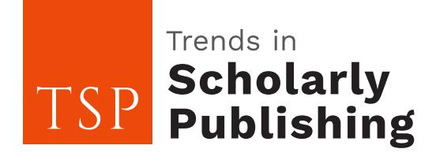
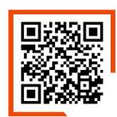

<!-- LR.R05 | source: papers_json/LR.R05/ -->

## **Unintended Consequences of Publish-or-Perish:** **Rethinking Research Evaluation Policies**

*Kaiser Jamil*

*Bhagwan Mahavir Medical Research Centre, Hyderabad, India*

*Corresponding Author*: Kaiser Jamil (Kj.bmmrc@gmail.com)

*Copyright © 2025 Kaiser Jamil. This is an open-access article distributed under the Creative Commons* *Attribution License, which permits unrestricted use, distribution and reproduction in any medium, provided* *the original work is properly cited*.

The academic world thrives on research, innovation, and the dissemination of knowledge. However, an increasing emphasis on publication metrics as a determinant of career progression, funding, and tenure has placed immense pressure on researchers. In many universities and research institutions worldwide, faculty members and scholars must publish in high-impact, peer-reviewed journals, particularly those indexed in Web of Science and Scopus. While this requirement intends to maintain high research standards, the unintended consequence has been the proliferation of unethical publishing practices as researchers struggle to meet these demands.

## **RISE OF UNETHICAL PUBLISHING PRACTICES**

Under extreme pressure to publish, some researchers resort to unethical strategies that compromise the integrity of academic publishing. Below are some of the most prevalent misconducts observed in scholarly publishing today.

**Authorship for sale:** Some researchers pay to have their names added as co-authors on already accepted or published papers. This unethical practice devalues genuine scientific contributions and exploits the loopholes in academic publishing1 .

**Paper mill collaborations:** A growing number of researchers engage with paper mills-organizations that manufacture and sell fabricated research papers for a fee. These companies guarantee publication in indexed, high-impact journals, often bypassing rigorous peer review and damaging the credibility of legitimate research. A study highlighted that between 2019 and 2023, sixteen universities increased their research output by over fifteen times the global average, suggesting a reliance on such unconventional authorship practices. A study in Quantitative Science Studies revealed how paper mills had infiltrated reputable journals by producing and selling fraudulent research papers. This widespread practice compromised the credibility of scientific literature and posed significant challenges to maintaining academic integrity2 .

**Ghostwriting services:** Some researchers hire professional ghostwriters to craft research articles on their behalf, presenting work they neither conceptualized nor contributed to. This not only misrepresents authorship but also raises serious ethical concerns regarding research integrity. A study in Pedagogy highlighted how ghostwriting undermines research integrity and challenges traditional notions of authorship. The findings emphasize the need for stricter authorship verification and stronger ethical publishing standards to curb this growing issue3 .

ISSN: 2789-9438 (Print) Received: 10 Mar. 2025

<!-- page 2 -->

## *Trends Scholarly Publ., 4 (1): 01-03, 2025*

**Manipulated peer review networks:** In some cases, researchers or fraudulent agencies manipulate the peer review process by recommending fake reviewers, creating conflicts of interest that allow low-quality or plagiarized work to be published. A study published in Accountability in Research examined instances where authors exploited the peer review system by suggesting fabricated reviewers, leading to compromised evaluation processes and the dissemination of substandard research. This manipulation undermines the credibility of scientific literature and poses significant challenges to maintaining ethical standards in publishing4 .

**Citation and impact factor manipulation:** Some researchers engage in citation cartels, where groups of scholars agree to cite each other's work excessively to inflate impact metrics. Similarly, some publishers prioritize authors willing to pay high publication fees, even at the expense of research quality.

**Plagiarism and data fabrication:** To meet publishing quotas, some researchers copy existing work, manipulate data, or fabricate results-a practice that undermines scientific credibility and misguides future research. Coercive citation practices, where editors force authors to add unnecessary citations to boost journal metrics, have also been reported. A study highlighted that approximately 20% of academics in fields like economics, sociology, psychology, and business have experienced coercive citation, where editors compel authors to include superfluous references to inflate a journal's impact factor. This manipulation not only distorts the scholarly record but also raises significant ethical concerns within the academic community5 .

**Pay-to-publish in predatory journals:** Unable to meet the stringent standards of reputable journals, some researchers turn to predatory publishers that promise quick publication for a high article processing charge (APC) but lack proper peer review and editorial oversight. These publishers exploit the open-access model for profit, often accepting articles with little to no peer review, leading to the dissemination of substandard or misleading research. Engaging with such journals not only wastes researchers' resources but also undermines the credibility of scientific literature. To combat this issue, it's essential for researchers to critically assess journals before submission and for institutions to educate their staff about the risks associated with predatory publishing6 .

## **ROLE OF POLICIES IN ENCOURAGING UNETHICAL BEHAVIOR**

At the heart of this issue lies an academic culture driven by quantitative evaluation metrics. Institutions and funding agencies often assess researchers based on the number of publications, journal impact factors, and citation counts, rather than the actual quality or real-world impact of their work. This publishor-perish mentality forces researchers to seek shortcuts, often compromising academic integrity6 .

## **A CALL FOR POLICY REFORM**

To safeguard the integrity of scholarly publishing, policymakers, academic institutions, and funding bodies must rethink their evaluation criteria. Some recommendations include.

**Prioritizing research quality over quantity:** Institutions should shift their focus from the number of publications to the significance, originality, and impact of research findings.

**Encouraging open science and transparent peer review:** Policies should support transparent publishing models, open-access repositories, and open peer review systems to enhance research credibility.

**Discouraging predatory publishing and paper mills:** Universities should implement strict ethical guidelines, educate researchers on identifying predatory journals, and penalize engagement with fraudulent publishing networks.

<!-- page 3 -->

## *Trends Scholarly Publ., 4 (1): 01-03, 2025*

**Recognizing diverse research outputs:** Beyond journal articles, institutions should acknowledge contributions such as policy papers, public engagement activities, and interdisciplinary research collaborations.

**Providing ethical research training:** Universities must train early-career researchers on ethical authorship, peer review ethics, and best practices in scholarly publishing.

## **CONCLUSION**

The pressure to publish is driving some researchers to unethical and deceptive practices, undermining the very foundation of academic integrity and scientific progress. The time has come for universities, funding bodies, and policymakers to reform research evaluation systems-moving away from impact factor-driven metrics toward ethically responsible and meaningful contributions to science and society. Academic success should not be dictated by the ability to circumvent ethical boundaries but by the genuine impact of research in advancing knowledge and solving global challenges. Only through systemic reforms and collective action we can ensure a transparent, fair, and ethical scholarly publishing ecosystem for future generations.

## **REFERENCES**

- 1. Cockle, K.L., C.C. Lima, M.G.N. Montellano, E.B. Bonaparte and D. Zaffignani *et al*., 2025. A framework for sharing power in research teams and promoting justice in scientific publication. Ornithol. Appl., 10.1093/ornithapp/duaf014.
- 2. Meho, L.I. and E.A. Akl, 2025. Using bibliometrics to detect questionable authorship and affiliation practices and their impact on global research metrics: A case study of 14 universities. Quant. Sci. Stud., 6: 63-98.
- 3. Gallagher, C.W., 2024. "This Weird Thing I'm Discovering": Toward a critical pedagogical approach to ghostwriting. Pedagogy, 24: 195-213.
- 4. Thulasingam, M. and B. Karthikeyan, 2024. Ethical pitfalls in scientific publishing. Int. J. Adv. Med. Health Res., 11: 140-144.
- 5. Hanson, M.A., P.G. Barreiro, P. Crosetto and D. Brockington, 2024. The strain on scientific publishing. Quant. Sci. Stud., 5: 823-843.
- 6. Abdullah, H.O., B.A. Abdalla, F.H. Kakamad, J.O. Ahmed and H.O. Baba *et al*., 2024. Predatory publishing lists: A review on the ongoing battle against fraudulent actions. Barw Med. J., 2: 26-30.
