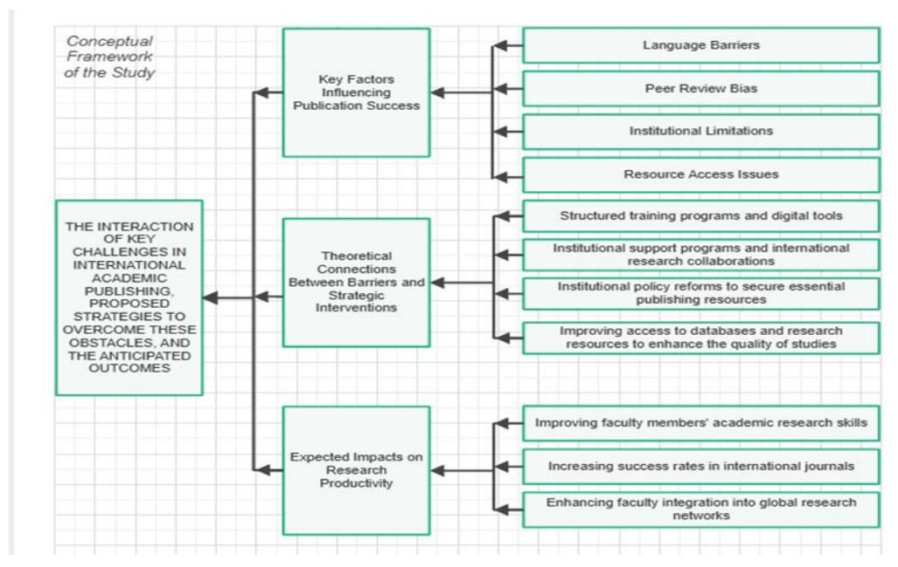
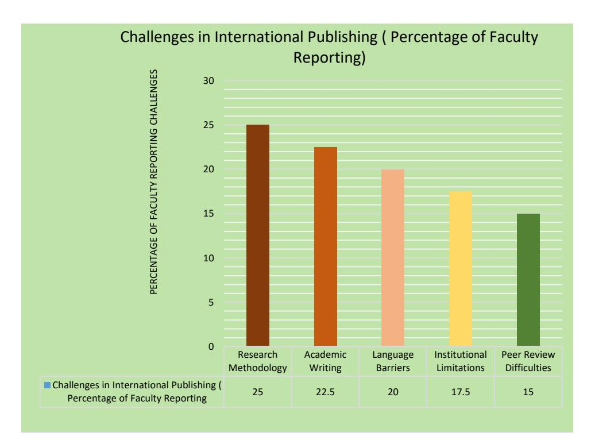
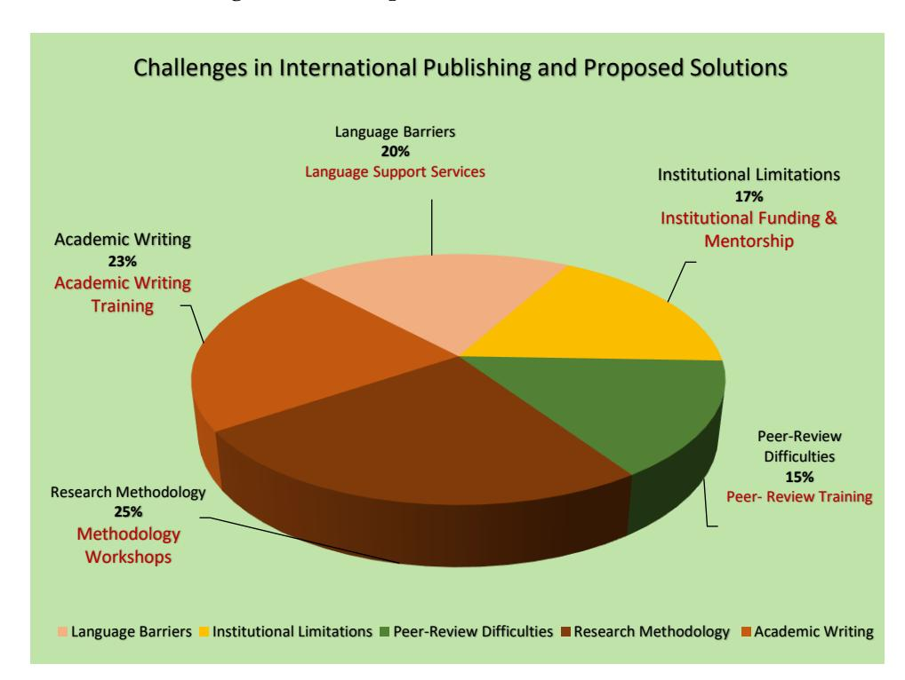
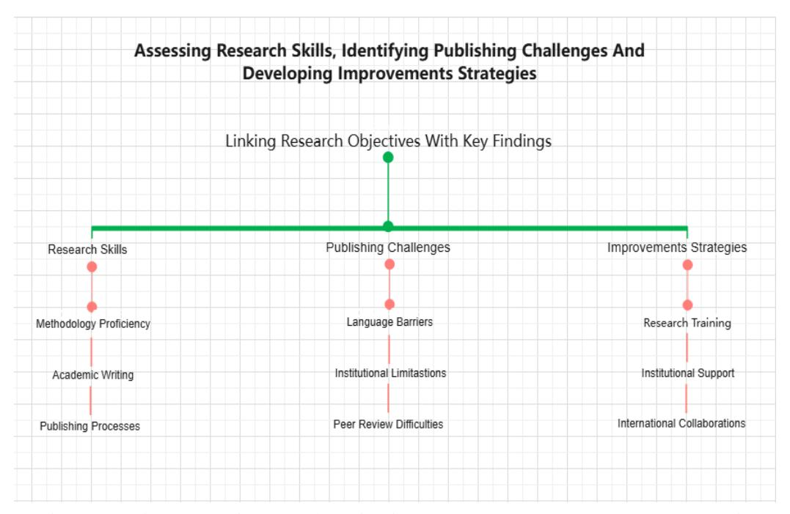
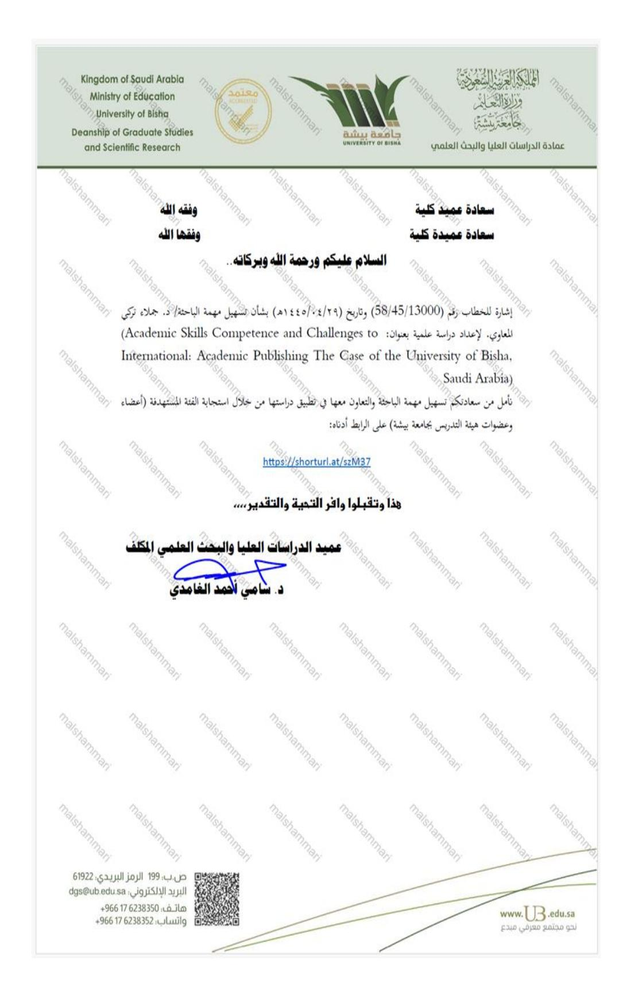
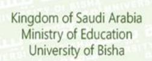
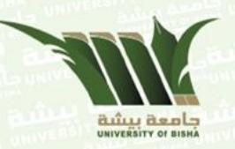
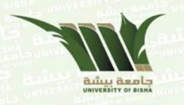
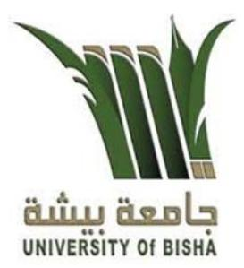

<!-- LR.R06 | source: papers_json/LR.R06/ -->

*International Journal of Learning, Teaching and Educational Research* *Vol. 24, No. 8, pp. 161-197, August 2025* *https://doi.org/10.26803/ijlter.24.8.8* *Received May* *25, 2025; Revised Jul 5, 2025; Accepted Jul 30, 2025*

## Academic Skills Competence and Challenges in International Academic Publishing: Perspectives from Faculty Members in Non-English-Speaking Higher Education

**Jamlaa Almaw****[i](#page-0-0)******* **, Amer Mutrik Sayaf** **and Hesham Fazel** College of Education, University of Bisha Bisha, Saudi Arabia, 61922, P.O. Box 551

**Abstract.** This study explores the challenges encountered by faculty members at a non-English-speaking higher education institution in Saudi Arabia in their pursuit of international academic publishing. Using a qualitative phenomenographic approach, the study examines the lived experiences of twenty academics from diverse disciplines at the University of Bisha. Data were collected through semi-structured interviews and analyzed thematically to identify key barriers and competencies influencing publication outcomes. Three major themes emerged: perceived research and writing competencies, institutional and linguistic barriers, and proposed strategies for improvement. Participants reported challenges including limited academic writing support, a lack of sustained mentorship, restricted access to international publishing platforms, and feelings of marginalization due to language expectations and cultural norms embedded in peer review systems. Despite these obstacles, many faculty members exhibited resilience and a strong motivation to meet international publishing standards. The study found that linguistic barriers were often amplified by structural inequities, such as the absence of writing centers, inadequate research funding, and unclear institutional policies regarding publication incentives. Based on these findings, the study proposes evidence-based strategies such as English for Research Publication Purposes (ERPP) programs, peer-review training, and institutional support mechanisms that are aligned with Vision 2030's goals for research excellence. The study contributes to current literature by centering the voices of scholars from peripheral academic contexts and by presenting a conceptual framework that links faculty competencies with institutional interventions. These insights offer a practical foundation for reform efforts aimed at empowering non-native English-speaking scholars in global academic dissemination.

©Authors

This work is licensed under a Creative Commons Attribution-NonCommercial-NoDerivatives 4.0 International License (CC BY-NC-ND 4.0).

> ^*^Corresponding author: Jamlaa Almawi; *jalmawy@ub.edu.sa*

<!-- page 2 -->

**Keywords: **Research skills; academic publishing; faculty development; linguistic barriers; non-native English-speaking scholars; institutional support; higher education in Saudi Arabia

## **1. Introduction**

International academic publishing has become an essential benchmark for faculty performance and institutional reputation in higher education globally (Habibie & Hyland, 2019; Hyland, 2016). Publishing in indexed journals is no longer optional but rather a requirement for academic promotion, institutional ranking, and international visibility. However, for faculty members in non-English-speaking higher education institutions, particularly in under-resourced academic systems, this requirement imposes challenges that are both linguistic and structural (Canagarajah, 2015; Curry & Lillis, 2024).

Several scholars have highlighted how researchers from linguistically marginalized regions face compounded difficulties related to limited English proficiency, unfamiliarity with the rhetorical conventions of English academic discourse, and constrained access to international publishing networks (Ferguson et al., 2011; Hanauer & Englander, 2011). These challenges are not merely technical but are embedded in deeper structural inequalities tied to knowledge production and access (Lillis & Curry, 2013). In the Arab academic context, the situation is further exacerbated by institutional limitations, including insufficient faculty development programs, limited writing support services, and bureaucratic hurdles that inhibit scholarly productivity (Elgamri et al., 2023; Hakami, 2023).

In Saudi Arabia specifically, academic publishing is central to national education goals, as reflected in Vision 2030 and the Ministry of Education's emphasis on global research visibility. Faculty members are increasingly expected to contribute to high-impact journals as a measure of academic excellence. Yet, despite this policy orientation, many universities—particularly regional or newly established ones—lack the necessary infrastructure to cultivate academic writing competence and provide sustained mentorship for early-career researchers (Alasbali et al., 2023; Alharbi & Albelihi, 2023).

This study addresses a persistent and underexplored challenge faced by faculty members at the University of Bisha: the limited success in publishing in highimpact international journals. While national policies emphasize internationalization and research excellence, many faculty members encounter recurring barriers—including language-related difficulties, insufficient institutional support, and limited exposure to global academic publishing norms. These constraints not only impede individual academic advancement but also undermine institutional goals of international engagement. Although the problem is particularly pronounced at the University of Bisha, it reflects broader systemic issues affecting scholars across Saudi Arabia and in comparable non-Englishspeaking academic contexts.

Literature on English for Research Publication Purposes (ERPP) emphasizes the importance of integrating language development with scholarly identity

<!-- page 3 -->

formation (Flowerdew, 2022; Habibie, 2022). However, most existing studies remain focused on surface-level linguistic challenges rather than addressing the lived experiences of faculty navigating complex institutional, linguistic, and epistemological barriers. Moreover, the voices of scholars from peripheral academic contexts, such as those in Saudi public universities, remain underrepresented in global conversations on academic publishing (Canagarajah, 2015; Hyland, 2016).

Recent global discussions have underscored the persistence of linguistic and epistemological inequities in academic publishing, even with the emergence of AI-driven writing tools. Lepp and Smith (2025) demonstrated that peer reviewers continue to penalize non-native scholars for subtle differences in discourse tone, regardless of surface-level language corrections. Similarly, Schnell (2024) found that multilingual scholars often face implicit resistance when deviating from dominant Anglo-centric rhetorical norms. These findings highlight the urgency of addressing not only linguistic proficiency but also structural and cultural gatekeeping in the publishing process. As Nature Human Behaviour (2023) and Stanford HAI (2025) suggest, the responsibility for linguistic equity lies not only with scholars and institutions, but also with editorial boards and peer review systems.

Accordingly, this study investigates how faculty members at the University of Bisha, a non-English-speaking institution, perceive and experience academic skills competence—including abilities related to research design, academic writing, literature review, and methodological awareness—and how these competencies intersect with the challenges of international academic publishing. Using a qualitative phenomenography approach, the study explores how individual capabilities and institutional contexts shape scholarly engagement with global publishing norms. Specifically, it aims to:

- 1. explore faculty members' perceptions and enactments of academic research competence within a non-English-speaking academic context;
- 2. identify key linguistic, institutional, and epistemological barriers that hinder successful publication in high-impact international journals; and
- 3. propose context-sensitive, evidence-based strategies to enhance research productivity and international academic visibility, in alignment with national goals under Vision 2030.

By focusing on an understudied institutional case within Saudi Arabia, this study contributes to a more nuanced understanding of faculty development in linguistically marginalized academic systems. The findings hold practical significance for institutional reform, capacity building, and policy development aligned with Vision 2030's agenda for higher education transformation. Furthermore, improving faculty publishing success has broader implications for enhancing institutional research capacity, fostering regional and international collaborations, and positioning Saudi universities as competitive participants in the global knowledge economy. Through identifying systemic barriers and advancing practical interventions, this study supports long-term goals of academic excellence and equitable global engagement.

<!-- page 4 -->

## **2. Literature Review **

Academic publishing in high-impact international journals is a benchmark for scholarly success. However, non-native English-speaking researchers, particularly in Saudi Arabia, face considerable barriers, including linguistic challenges, limited institutional support, and unfamiliarity with international publishing standards. These obstacles result in lower publication rates, limited research visibility, and reduced global academic engagement (Englander & Corcoran, 2021; Hyland, 2016). This literature review synthesizes recent studies to explore these issues, with a specific focus on systemic inequalities, language hegemony, and the need for structural reforms to enhance global research accessibility and impact.

## **2.1 Theoretical Frameworks and Research Gaps**

This study is grounded in two key theoretical frameworks: the Academic Literacies Model (Lea & Street, 1998) and Systemic Functional Linguistics (SFL) (Halliday, 1985). The Academic Literacies Model provides a lens for understanding writing as a socially situated practice that encompasses not only surface-level linguistic correctness but also issues of identity, power, and access. In parallel, the SFL framework enables analysis of how linguistic structures shape meaning and influence the construction of scholarly voice in academic texts. Both frameworks continue to inform contemporary research and remain relevant in multilingual and professional academic contexts. Recent studies have reaffirmed their applicability across diverse settings—Academic Literacies in healthcare and multilingual education (Klarare et al., 2022; Li, 2022), and SFL across disciplines and languages (Xuan et al., 2024, 2025).

Existing studies have primarily emphasized the linguistic difficulties faced by non-native English-speaking scholars in navigating academic discourse (Flowerdew, 2008; Hyland, 2016); however, fewer investigations have addressed the compounded influence of institutional and financial constraints within specific academic contexts such as Saudi Arabia. Although some research has highlighted underdeveloped infrastructure in the region (Alzahrani, 2011a; Hakami, 2023), there remains a gap in exploring how institutional structures and policy frameworks shape researchers' ability to publish internationally.

This study addresses that gap by integrating both linguistic and structural dimensions, examining how Saudi faculty members interpret and respond to the intertwined challenges of language, academic expectations, and systemic limitations. By drawing on these frameworks, the study bridges the binary between linguistic proficiency and institutional conditions, offering a more comprehensive understanding of how structural inequalities influence knowledge production and global dissemination.

Recent scholarship reinforces this need for a dual-perspective approach. For example, Schnell (2024) and Lepp and Smith (2025) argue that the publication challenges faced by multilingual scholars are rooted not only in linguistic barriers but also in editorial practices and discourse expectations that marginalize non-Western academic voices. Their findings underscore the importance of critically

<!-- page 5 -->

engaging with both language and institutional context to understand the persistent underrepresentation of scholars from peripheral academic settings.

## **2.2 Linguistic Barriers in Academic Publishing**

English remains the dominant language of global academic publishing, creating a structural disadvantage for scholars whose first language is not English. While researchers from diverse linguistic and cultural backgrounds contribute meaningfully to global knowledge production, they are often required to conform to Anglophone discourse norms and stylistic expectations imposed by highimpact journals (Corcoran & Englander, 2016; Englander & Corcoran, 2021).

Language proficiency continues to serve as a gatekeeping mechanism in the academic publishing process. Flowerdew (2008) notes that non-native English speakers frequently face higher rejection rates, often being advised to seek costly professional language editing services. Hanauer and Englander (2011) provide empirical evidence showing that writing in a second language increases cognitive load by 24% and causes 21% more anxiety compared to writing in one's native language. Furthermore, Englander (2009), applying the SFL framework, argues that the challenges faced by multilingual scholars extend beyond grammar and vocabulary to include deeper issues of voice, stance, and disciplinary positioning within the discourse community.

These linguistic constraints are not merely individual deficits but are tied to broader issues of epistemic access and inequality (AlMarwani, 2020). As Schnell (2024) observed, multilingual scholars often feel pressure to adjust their rhetorical voice to fit dominant academic templates, resulting in the erasure of cultural identity in scholarly expression. Similarly, Lepp and Smith (2025) demonstrate that even when AI tools are employed to improve surface-level English, reviewers still detect and penalize what they perceive as "non-native" voice, suggesting that linguistic barriers are embedded within the very structure of academic gatekeeping.

These findings highlight the need for tailored academic writing programs that go beyond grammar correction, offering strategic instruction in discourse structure, rhetorical variation, and academic identity formation. Without such targeted support, the pressure to conform linguistically can diminish scholarly confidence and restrict participation in global academic discourse.

## **2.3 Institutional and Financial Constraints**

In many Saudi universities, particularly those in regional or developing areas, faculty members encounter significant institutional and financial constraints that impede their academic publishing efforts. These include the absence of dedicated academic writing centers, limited access to research mentorship programs, and inadequate funding for language editing or publication fees (Hakami, 2023). Alzahrani (2011a) also highlights the restricted access to major research databases, which further limits the scope, quality, and currency of faculty research.

Such limitations are not unique to the Saudi context. Ondari-Okemwa's (2007) comparative study of Sub-Saharan Africa revealed that the region accounted for

<!-- page 6 -->

only 1.4% of global scholarly output, largely attributed to insufficient research funding and limited access to academic resources. These findings resonate with broader global patterns of inequality in research production and dissemination, particularly in non-Western academic contexts.

Recent literature suggests that institutional interventions must extend beyond surface-level training or one-off workshops. Alharbi and Albelihi (2023) emphasize the importance of long-term academic support structures, including research mentorship, strategic publishing guidance, and career-stage-specific writing programs. Their study showed that faculty in under-resourced institutions often experience "developmental isolation," wherein the lack of continuous academic accompaniment hinders scholarly progress despite high motivation.

Addressing institutional and financial barriers requires a comprehensive policy approach that includes stable research funding, subsidized access to academic resources, and the development of local infrastructures to support academic writing and publishing. Without such structural reforms, even highly motivated faculty members remain at a disadvantage in global academic arenas.

## **2.4 Peer Review and Editorial Gatekeeping**

The peer review process, while central to scholarly publishing, has also been widely critiqued for reinforcing structural inequalities, particularly for multilingual and non-Western scholars. Lillis and Curry (2006) introduced the concept of "literacy brokers" to describe individuals—editors, reviewers, translators—who mediate between the author's voice and the expectations of the target journal. This process often results in the reshaping of academic narratives to align with dominant Western discourse norms. Corcoran and Englander (2016) refer to this as a "bias gap," whereby scholars from non-English-speaking backgrounds face additional scrutiny due to linguistic and rhetorical differences. Editorial practices and journal guidelines further institutionalize this imbalance.

Geiger et al. (2022) found that journal Instructions for Authors (IFAs) function as implicit gatekeeping mechanisms, often favoring submissions that adhere to a narrow set of Anglophone conventions. Likewise, Williams and Leatham (2017) showed that most top-tier journals in mathematics education—and by extension, other fields—are predominantly English-language, limiting participation from scholars in multilingual regions.

These editorial biases are not always explicit, but they influence acceptance rates and peer review outcomes. Schnell (2024) observed that multilingual scholars frequently receive vague or culturally coded feedback that suggests "misalignment" with expected academic norms, even when their work is linguistically accurate. Lepp and Smith (2025) similarly demonstrate that even AIassisted writing is not immune to reviewer bias; texts generated or edited with tools such as ChatGPT still face rejection based on perceived "non-native" voice. These findings collectively underscore the need for more inclusive peer review policies and editorial reforms. Rather than placing the full burden on non-native scholars to adapt, journals should commit to linguistic equity by diversifying

<!-- page 7 -->

editorial boards, training reviewers on implicit bias, and rethinking submission guidelines to accommodate rhetorical diversity. Without such measures, the current system continues to privilege a narrow academic elite at the expense of global scholarly inclusivity.

## **2.5 Conceptual Framework**

The conceptual framework guiding this study integrates key insights from the literature on linguistic inequity, institutional barriers, and editorial gatekeeping in global academic publishing. Drawing from prior research (e.g., Englander & López-Bonilla, 2011; Hyland, 2019; Lepp & Smith, 2025; Schnell, 2024), the framework illustrates how structural and linguistic challenges interact with institutional interventions to shape research productivity and international visibility among faculty in non-English-speaking contexts.

At the foundation of this model lies a recognition that language barriers, such as limited proficiency in academic English and rhetorical misalignment with Anglophone discourse norms, continue to hinder manuscript clarity, voice construction, and responsiveness to reviewer feedback (Englander & Corcoran, 2021; Flowerdew, 2008). In tandem, editorial and peer-review biases often penalize non-native authors regardless of surface-level corrections, contributing to underrepresentation and diminished scholarly confidence (Lepp & Smith, 2025; Schnell, 2024). These linguistic constraints are compounded by institutional limitations, notably the absence of academic writing centers, restricted access to scholarly databases, and a lack of structured mentorship (Alzahrani, 2011a; Hakami, 2023).

To address these interlinked obstacles, the framework proposes a suite of strategic institutional interventions, including: targeted academic writing programs tailored to disciplinary conventions; provision of subsidized editing and publication resources; policy-level recognition of publishing as a faculty performance metric; and development of international research collaborations that expose scholars to global academic norms (Alharbi & Albelihi, 2023; Alhefzi et al., 2021). Such strategies not only support faculty development but also challenge prevailing models of academic gatekeeping by re-centering institutional responsibility.

The anticipated outcomes of these reforms include improved research competence, increased publication rates in indexed journals, and greater integration into international academic networks, thereby fostering both individual academic advancement and institutional alignment with national goals such as Vision 2030.

The interaction among these challenges, interventions, and outcomes is visually represented in Figure 1, which maps the conceptual logic underpinning the present study.

<!-- page 8 -->

***Figure 1. Conceptual Framework of the Study***

The reviewed literature reveals a complex and interconnected set of challenges that hinder academic publishing among non-native English-speaking faculty particularly in under-resourced contexts such as Saudi Arabia. These include linguistic barriers, peer review bias, institutional limitations, and restricted access to scholarly infrastructure (Alzahrani, 2011b; Englander & Corcoran, 2021; Hyland, 2016). These factors are not isolated but reinforce each other, contributing to reduced research visibility and global academic exclusion.

While existing research has addressed individual dimensions—particularly linguistic challenges (Englander, 2009; Flowerdew, 2008)—fewer studies have integrated these issues into a unified explanatory model. This study responds to that gap by offering a conceptual framework that synthesizes linguistic, institutional, and editorial dynamics. In doing so, it advances our understanding of how systemic constraints collectively shape publishing success and provides a basis for targeted interventions.

## **2.6 Structural Inequities in Global Publishing **

The reviewed literature highlights a complex interplay between linguistic barriers, institutional limitations, and structural inequalities in the international academic publishing landscape. For non-native English-speaking faculty particularly in under-resourced higher education systems such as those in Saudi Arabia—challenges include limited access to academic writing support, peer review bias, and restricted access to scholarly databases (Alzahrani, 2011b; Englander & Corcoran, 2021; Hyland, 2016). These obstacles contribute to lower publication output, diminished research visibility, and exclusion from global scholarly discourse.

While several studies have explored the linguistic dimensions of academic publishing (Englander, 2009; Flowerdew, 2008), fewer have addressed how

<!-- page 9 -->

institutional infrastructure and editorial policies jointly shape publishing outcomes. Recent evidence underscores the need for comprehensive reform—not only within universities but also at the level of editorial boards and journal policies (Lepp & Smith, 2025; Nature Human Behaviour, 2023; Schnell, 2024). These sources call for greater transparency, reviewer training, and systemic support to mitigate the effects of linguistic bias and gatekeeping.

This study seeks to address these gaps by focusing on the lived experiences of Saudi faculty in navigating academic publishing systems. Through its conceptual model, it connects institutional dynamics with faculty competencies and identifies targeted interventions to enhance scholarly productivity. In doing so, the study contributes to ongoing calls for a more equitable and inclusive publishing environment that values diverse academic voices and epistemologies.

These disparities are further illustrated in Table 1, which presents comparative statistics on global publishing output, rejection rates due to language barriers, and access to indexed databases across different regions. The table reinforces the systemic nature of inequality and provides a contextual foundation for the present study's empirical focus on faculty in Saudi Arabia.

*% of Global Rejection Access to Region **Publications **Rate Due to Indexed Source (2020)Language **Databases **National Science North America 16% 12% High Board, 2021-4 National Science 28-30% 14% Europe High Board, 2021-4 National Science China 23% 18% Medium Board, 2021-4 Middle East & ~6-7% Elgamri et al., North Africa 40-45% Low (estimated) 2023 (MENA) Sub-Saharan Elgamri et al., ~1.4% 50-55% Very Low Africa 2023*

*Table 1. Global Publishing Inequalities in Academic Research*

## 3. Methodology

This study employs a qualitative phenomenographic approach, which is particularly well-suited for exploring the subjective experiences and perceptions of faculty members regarding academic publishing. Phenomenography is chosen because it allows for an in-depth examination of how individuals conceptualize and navigate complex challenges. This methodology helps to uncover variations in faculty members' experiences with international publishing, highlighting structural and institutional barriers as well as potential strategies for improvement. The phenomenographic approach is particularly relevant in educational research as it focuses on how participants experience a given phenomenon, rather than merely describing it (Marton, 2004).

<!-- page 10 -->

## **3.1 Data Collection**

Data were collected through semi-structured interviews with twenty faculty members across multiple disciplines at the University of Bisha. This qualitative approach ensured that participants could express their experiences in depth while allowing for follow-up questions to clarify and expand on key themes. The University of Bisha was selected as a case study due to its representativeness of the challenges faced by Saudi faculty in global academic publishing.

The interview structure consisted of three key sections:

- 1. Demographic and Publishing Experience (16 questions): Collected information on faculty members' academic backgrounds, prior publication experiences, and familiarity with international publishing standards.
- 2. Scientific Inquiry Competence (5 questions): Assessed faculty members' ability to conduct research, structure academic papers, and engage in scholarly discourse.
- 3. Challenges in International Publishing (5 questions): Focused on obstacles related to language proficiency, institutional support, peer review, and access to publishing resources.

This structured approach ensured that both individual competencies and broader systemic barriers were explored in depth, allowing for a nuanced understanding of faculty experiences in academic publishing. (See Appendix 4 for the full interview protocol).

## *3.1.1 Validation of Research Instruments*

To ensure the validity and reliability of the interview protocol, the semistructured interview questions were reviewed by a panel of three experts in educational psychology and higher education research, each with extensive experience in qualitative research methods and faculty development. The panel assessed the content validity of the questions, ensuring alignment with the study's objectives, relevance to the research problem, and clarity in wording. Their feedback was incorporated to refine question phrasing and enhance comprehensibility.

Additionally, a pilot study was conducted with six faculty participants similar to the study's target population. Pilot participants provided feedback through follow-up discussions, focusing on question clarity and structure. Based on their input, minor refinements were made to simplify wording and ensure consistency across questions. The pilot study also served as a test for the effectiveness of the interview structure in capturing relevant data.

To enhance reliability, a standardized interview protocol was developed to ensure consistent question delivery across all participants. This validation process aligns with best practices in qualitative research and enhances the credibility and trustworthiness of the collected data (Creswell & Creswell, 2017; Maxwell, 2013).

<!-- page 11 -->

## **3.2 Sample Distribution**

Participants were purposefully selected from various faculty ranks to capture diverse perspectives on academic publishing challenges. The distribution was as follows:

This diversity in rank and experience allowed the study to capture differences in faculty members' perceptions of publishing challenges based on career progression. Ensuring a variety of perspectives helped provide a broader understanding of systemic issues affecting research productivity at different career stages.

## **3.3 Data Analysis**

Thematic analysis was conducted using NVivo software, providing a structured framework to identify recurring patterns in participant responses. The analysis followed a three-step process:

- 1. Initial Coding: Transcribed interviews were coded into broad thematic categories related to research skills, publication barriers, and institutional support.
- 2. Theme Development: Recurring patterns across responses were refined into key challenges faced by faculty members and potential strategies for improvement.
- 3. Refinement and Validation: Themes were cross-checked across transcripts to ensure reliability and alignment with the study's objectives.
- 4. Four major themes emerged from the data: a) Language Barriers Participants consistently cited difficulties in expressing academic ideas in English, often requiring paid editing services. For example, Participant P1 noted: "I rewrite each article many times and still get comments like 'language unclear.' It is exhausting." Similarly, P5 reflected: "International publications have more rigorous language expectations. It's not just grammar it's how ideas are structured." These comments highlight how linguistic expectations create cognitive and emotional burdens for non-native English-speaking scholars.b) Institutional Support Gaps: Many participants reported insufficient institutional infrastructure to support international publishing. Participant P2 shared: "We don't have a writing center or mentor support. I had to figure out everything on my own." This theme underscores the absence of systematic mentoring, writing workshops, and publication-focused training in Saudi universities.c) Publishing Pressures: There was a shared perception of performance pressure related to publishing in high-impact journals. P3 stated: "Promotion is tied to international publishing,

<!-- page 12 -->

- but we are not trained for it. It's expected without guidance." Faculty expressed concern that institutional incentives were not matched with developmental support.
- d) Peer Review Challenges: Several faculty members expressed concerns about vague and inconsistent reviewer feedback. P4 mentioned: "Sometimes reviewers say the paper is 'not academic' without saying why. It feels like a wall you can't climb." Others pointed to perceived bias: "Even when I used AI tools to improve my paper, reviewers still hinted that it didn't sound 'native' enough." (P5) This suggests that peer review processes may contain implicit language or cultural biases that disadvantage multilingual scholars.

Overall, these themes reflect both personal and structural obstacles to international academic publishing. The inclusion of direct participant voices enhances the credibility of the findings and aligns with the phenomenographic approach's emphasis on variation in lived experience.

## **3.4 Research Design and Phenomenographic Approach **

This study applies a phenomenographic research design, which seeks to explore the range of ways in which individuals experience a particular phenomenon—in this case, the challenges of publishing in international academic journals. Phenomenography focuses on capturing variations in perception, rather than aiming for generalizability (Marton, 2004). This makes it particularly relevant in educational research settings, where researchers seek to understand how context, identity, and experience shape individual responses to shared structural challenges.

The analysis process followed phenomenographic conventions by identifying both common patterns and variations across participants' experiences. The key steps involved:

- 1. Identifying Variations in Experience: The data were analyzed to uncover how participants conceptualized academic publishing—ranging from feelings of marginalization to strategic adaptation.
- 2. Categorization of Responses: Participants' responses were grouped into broader descriptive categories reflecting structural and cognitive dimensions of publishing barriers.
- 3. Pattern Recognition: Recurring yet nuanced patterns were examined to identify both individual and systemic challenges—such as peer review bias, lack of mentorship, and institutional expectations.

This design provided a framework for interpreting the depth and diversity of lived experiences among faculty members at the University of Bisha. Importantly, it enabled the research to move beyond mere enumeration of obstacles toward a theory-informed understanding of how these challenges influence scholarly behaviors, decisions, and trajectories.

<!-- page 13 -->

## **3.5 Research Objectives**

While prior studies have examined the challenges faced by non-native Englishspeaking scholars in global publishing, limited attention has been given to how faculty members in Saudi Arabia—particularly in regional institutions—perceive and enact research competence in navigating international academic publication. This study addresses this gap by pursuing the following objectives:

- 1. To explore how faculty members at the University of Bisha perceive and articulate their academic research competencies, including writing, literature engagement, and methodological understanding.
- 2. To identify the linguistic, institutional, and epistemological barriers that influence their participation in international publishing.
- 3. To propose practical, evidence-based strategies that support faculty members' publishing capacity and align with institutional development under Vision 2030.

By applying a qualitative phenomenographic approach, this study seeks to uncover variations in faculty experiences and contribute to policy, training, and institutional reforms aimed at enhancing global academic engagement.

## **4. Results**

## **4.1 Research Skills of Faculty Members**

The analysis revealed substantial variations in the research competencies of faculty members. While many demonstrated a strong grasp of theoretical foundations, practical challenges in applying these skills were consistently reported. Five critical domains of skill deficiency were identified:

- 1. Research Methodology Application: Participants exhibited familiarity with theoretical concepts but often lacked the practical proficiency to design methodologically sound studies aligned with international standards. Challenges included the application of advanced techniques and adapting to evolving editorial expectations. Several faculty members emphasized the urgent need for professional development initiatives focused on research design and methodological rigor.
- 2. Academic Writing Proficiency: Respondents reported difficulty structuring manuscripts, adhering to academic style, and aligning their work with journal guidelines. An over-reliance on translation or editing services sometimes resulted in inconsistencies in tone and clarity. Some noted the lack of interdisciplinary writing skills required to integrate knowledge from education, psychology, and policy fields to meet publication expectations in international venues.
- 3. Navigating the Peer-Review Process: Many participants described the peer review process as both technically demanding and emotionally exhausting. Repeated revisions and ambiguous reviewer comments contributed to significant stress and disempowerment. One participant (P5) articulated this uncertainty: "I have experience with empirical research, but I still feel unsure if my work meets the global standard." This sentiment underscores a broader anxiety among faculty members who

<!-- page 14 -->

possess technical research skills but lack the confidence to engage with the expectations of international reviewers. Structured mentorship programs were widely recommended to help researchers interpret reviewer feedback, revise effectively, and build resilience when facing rejection. Targeted peer-review training is also necessary to demystify editorial standards and increase publication confidence.

- 4. Language Barriers: Limited proficiency in academic English emerged as a significant obstacle. Faculty highlighted the need for university-supported writing centers and mentoring tailored to non-native speakers. As one participant (P7) expressed: "I struggle with what journals expect when they say 'academic tone'. It's not how we were trained." Another echoed the sentiment, stating: "We were taught methodology well, but we never practiced writing for global audiences. That's a separate skill." (P3) These perspectives align with recent findings from Schnell (2024) and Lepp and Smith (2025) who argue that non-native English-speaking scholars face structural disadvantages not because of poor content, but due to mismatches in rhetorical style and institutional expectations embedded in Western academic publishing.
- 5. Institutional Limitations: Participants cited a lack of access to research funding, publication incentives, and mentorship. Inadequate database subscriptions and limited institutional support for conference participation were also mentioned as barriers to publishing in high-impact journals, especially for early-career researchers.

The following bar chart presents the percentage of faculty members who reported gaps across five core research skill domains:

- i. Research Methodology (25%): Challenges in designing studies aligned with international standards.
- ii. Academic Writing (22.5%): Difficulties in structuring manuscripts and adapting to global stylistic norms.
- iii. Language Barriers (20%): Inconsistencies due to limited English proficiency and dependence on editing.
- iv. Institutional Limitations (17.5%): Gaps in access to databases, mentorship, and funding.
- v. Peer Review Difficulties (15%): Challenges in interpreting and addressing reviewer feedback effectively.

<!-- page 15 -->

***Figure 2. Distribution of Research Skills Among Faculty Members***

This distribution highlights the interconnection between academic writing, language proficiency, and methodological preparedness. Together, these dimensions reinforce the need for comprehensive institutional programs that build research capacity through integrated academic writing support, targeted mentorship, and infrastructure for global publishing readiness.

## **4.2 Challenges in International Publishing**

Faculty members identified several critical barriers that hinder their ability to publish in international academic journals. These challenges extend beyond individual limitations and reflect broader systemic and institutional issues:

- 1. Language Proficiency: Most participants reported difficulty in meeting the advanced English writing standards required by international journals. This often necessitated reliance on costly language editing services, which increased publication expenses and contributed to higher rejection rates due to linguistic clarity issues. One participant (P8) explained: "Even after editing, I'm never sure if the language is good enough. It's like we're being judged more for how we write than for what we say." This aligns with findings from Lepp and Smith (2025), who documented persistent reviewer bias even when AI tools such as ChatGPT were used to enhance language quality.
- 2. Peer Review and Procedural Challenges: Participants reported significant difficulties navigating the peer-review process, including selecting appropriate journals, understanding formatting guidelines, and addressing reviewer comments effectively. Many noted that reviewer feedback was often vague or contradictory, leading to frustration and

<!-- page 16 -->

repeated manuscript rejections. Some faculty members perceived a bias against non-native English speakers, where minor linguistic issues appeared to outweigh the academic merit of the research. As Participant 18 observed: "The rejection feedback is often vague, making it difficult to understand how to improve the manuscript." This perception reflects what Schnell (2024) describes as "linguistic resistance," where cultural discourse norms subtly shape editorial decisions. The lack of structured institutional training in academic publishing further compounded these procedural and evaluative barriers. Participants emphasized the need for structured peer-review training and editorial mentorship to improve manuscript preparation and reduce rejection rates.

- 3. Institutional Limitations: Beyond the lack of technical resources, participants emphasized structural and policy-level barriers within the university system. These included an absence of clear incentives for international publishing, limited recognition for non-English research output, and bureaucratic delays in accessing research funding. Faculty members also noted a disconnect between university strategic goals (such as internationalization) and the practical support mechanisms available to researchers. Participant 12 commented: "There is minimal institutional support in helping faculty with journal selection and manuscript editing." This reflects similar concerns raised by Alharbi and Albelihi (2023) who emphasize that institutional support should include not only technical assistance but also academic mentorship and advocacy for languageinclusion policies.
- 4. Research Methodology Barriers: Several participants highlighted a gap between their theoretical understanding of research methods and the practical ability to design studies that align with international publishing norms. Specific difficulties included operationalizing variables for crosscultural research, selecting appropriate analytical tools, and adapting research instruments to meet global expectations. These methodological limitations were often attributed to a lack of professional development programs and insufficient institutional support for research design mentoring.
- 5. Academic Writing and Linguistic Transition: Faculty members reported substantial challenges in transitioning from Arabic-medium academic conventions to the rhetorical expectations of English-language scholarly writing. This shift involved not only translating content but also rethinking how arguments are structured, evidence is presented, and disciplinary voice is conveyed. Participant 6 noted: "Even after multiple revisions, I struggle to meet the writing standards expected by international reviewers." These observations support Nature Human Behaviour (2023) which calls for a re-evaluation of linguistic expectations in peer-reviewed journals and recommends editorial reforms to reduce language-based publication inequities.

<!-- page 17 -->

The pie chart illustrates the distribution of the most commonly reported challenges faculty members encounter in international academic publishing, alongside the strategic interventions they suggested. The five key challenges identified include:

- i. Research Methodology (25%), with faculty calling for structured methodology workshops.
- ii. Academic Writing (23%), which participants linked to the need for specialized academic writing training.
- iii. Language Barriers (20%), associated with the need for institutional language support services.
- iv. Institutional Limitations (17%), requiring improved access to funding, databases, and mentorship programs.
- v. Peer-Review Difficulties (15%), where peer-review training was proposed to better navigate editorial processes.

*Figure 3. Challenges in International Publishing and Proposed Solutions*

While these percentages and charts provide an overview of recurring themes, they are not used for statistical generalization but rather as a visual aid to highlight the salience and relative prominence of specific experiences across the sample. This use of quantification in qualitative research aligns with methodological perspectives by Sandelowski (2001) and Namey et al. (2008) who argue that frequency counts and visual summaries can enhance clarity and transparency in large-scale qualitative datasets without undermining the interpretive nature of the analysis.

This figure emphasizes how closely the perceived challenges are aligned with practical solutions and reflects the importance of multi-dimensional institutional interventions in overcoming systemic publishing barriers. Importantly, these

<!-- page 18 -->

findings reinforce the call for reform in both internal university systems and external publishing ecosystems, ensuring that faculty from non-English-speaking backgrounds can participate in global academic discourse on equitable terms.

## **4.3 Strategies for Improving Research Output**

The strategies proposed in this section are grounded in the lived experiences and suggestions of faculty members during the interviews. While further institutional analysis is elaborated in the discussion, these insights reflect immediate, practicedriven needs for enhancing research productivity in non-English-speaking academic environments:

- 1. Enhanced Research Training: Participants consistently emphasized the need for targeted workshops on academic writing, journal selection, and the peer-review process. Programs focused on English for Research Publication Purposes (ERPP) were frequently recommended to improve scholarly writing and reduce reliance on external editing services. One faculty member (P9) noted: "A short course on writing for international journals would help more than a year of trial and error." This aligns with international recommendations, such as those by Alharbi and Albelihi (2023), which call for embedded ERPP mentorship within faculty development programs to support linguistic and cultural adaptation to global publishing norms.
- 2. Institutional Support Programs: Participants underscored the necessity of university-funded research grants, structured mentorship initiatives, and policies that actively promote academic publishing. Increased access to academic databases and collaboration platforms was also cited as vital. As one participant (P11) stated: "Without access to recent studies or someone to guide me, I can't improve beyond a certain point." These findings reinforce the need for institutional strategies that integrate resource access with performance-based support systems, especially for early-career faculty.
- 3. Collaboration with International Scholars: Faculty members strongly advocated for establishing partnerships with internationally recognized researchers to facilitate co-authorship and increase their chances of publishing in high-impact journals. Such collaborations were viewed not only as opportunities to enhance research quality and credibility, but also as strategic pathways to overcome geographic and linguistic isolation in the publishing landscape. This mirrors recommendations from Schnell (2024) who stresses that cross-border scholarly collaboration is one of the most effective mechanisms to empower researchers from linguistically marginalized contexts.

## **4.4 Integrated Summary of Key Findings and Strategic Responses**

To synthesize the study's empirical results, the following table connects each research objective with its corresponding findings, challenges, and proposed interventions. This integrated summary functions as a transitional bridge between the thematic analysis and the broader institutional and policy recommendations discussed in subsequent sections.

<!-- page 19 -->

***Research ** **Objective** **Key Findings** **Identified Challenges** **Proposed Solutions** Assess faculty research skill levels Strong theoretical knowledge but skill gaps in methodology, writing, and peer review Limited hands-on training, especially for faculty without international exposure Workshops on academic writing and research methodology Identify challenges in publishing Language barriers, high rejection rates, and lack of institutional support Difficulty meeting English proficiency standards, unclear reviewer feedback, minimal guidance on journal selection Mentorship programs, language support services, and journal selection guidance Develop strategies for improvement Institutional initiatives and global research collaboration can enhance research output Limited funding, weak research networks, lack of incentives for publication Research funding, collaboration with international scholars, and structured institutional support*

***Table 3: Summary of Key Findings and Proposed Solutions***

This summary highlights how faculty perceptions of barriers are directly aligned with actionable strategies that institutions can implement. By linking each challenge to a specific intervention, the table underscores the necessity of a holistic institutional framework that supports faculty at all stages of the research and publishing process.

## **4.5 Visual Representation of Key Findings**

The conceptual diagram below offers a visual synthesis of the study's core findings, linking each research objective to the corresponding challenges identified through faculty interviews and the strategic interventions proposed in response. This integrative model enhances the interpretability of results and serves as a foundation for the institutional recommendations that follow.

- 1. On the left, faculty research skills address the first research objective. Participants highlighted gaps in academic writing, research methodology, and understanding of the peer-review process, particularly among those with limited international exposure.
- 2. In the center, publishing challenges correspond to the second objective. These include linguistic barriers, unclear reviewer expectations, limited institutional support, and procedural frustrations—all of which align with global concerns regarding language inequity in scholarly publishing (Lepp & Smith, 2025; Schnell, 2024).
- 3. On the right, proposed strategies reflect the third objective. Participants recommended ERPP training, structured mentorship, improved access to databases, and partnerships with international scholars to enhance research quality and visibility.

<!-- page 20 -->

***Figure 4. Alignment of Research Objectives, Challenges, and Proposed Strategies***

This framework underscores the interconnected nature of faculty needs and systemic publishing constraints. By visually mapping the findings, it becomes evident that each set of challenges is met with corresponding, actionable responses. The results reinforce previous calls in the literature (e.g., Alharbi & Albelihi, 2023; Nature Human Behaviour, 2023) for institutional reforms that address not only language skills but also structural inequities in research environments.

Ultimately, the model illustrates how aligning institutional policies with faculty needs—through sustained capacity-building and global engagement—can contribute to a more equitable academic publishing ecosystem, particularly for scholars in non-English-speaking higher education contexts.

## **5. Discussion**

## **5.1 Interpretation of Key Findings and Theoretical Linkages**

The findings of this study align with a growing body of research on the persistent challenges faced by non-native English-speaking scholars in international academic publishing. The identified deficits in research methodology, academic writing, and navigating the peer-review process reinforce the Academic Literacies Model (Lea & Street, 1998), which conceptualizes academic writing not merely as a technical skill but as a socially situated practice embedded within disciplinary and institutional power structures.

Faculty at the University of Bisha demonstrated a need not only for improved linguistic competence but also for deeper engagement with genre awareness, rhetorical expectations, and epistemological orientations characteristic of highimpact journals. This reinforces the view that academic success in publishing

<!-- page 21 -->

requires acculturation into dominant scholarly discourses rather than mere language correction.

In addition, Systemic Functional Linguistics (Halliday, 1985) explains the linguistic challenges reported by participants, particularly the struggle to adapt meaning-making practices to the genre-specific and audience-sensitive demands of English-language journals. Participants' difficulties in organizing arguments, constructing disciplinary voice, and aligning with implicit stylistic expectations further support this theoretical view.

The theme of perseverance under adversity relates strongly to academic resilience (Cassidy, 2015). Participants described emotional fatigue, repeated rejections, and psychological pressure, yet continued to re-engage with the publishing process. This mirrors findings from Almulla (2024) at King Faisal University, where academic resilience—expressed through adaptive coping, peer learning, and institutional feedback—was found to predict higher publication success rates.

Recent work by Schnell (2024) and Lepp and Smith (2025) further confirms that even advanced tools like ChatGPT cannot eliminate editorial bias if the scholar's rhetorical style deviates from Western academic norms. Thus, this study's findings highlight the urgent need to move beyond training researchers alone and begin reforming editorial and institutional expectations alike.

These theoretical linkages collectively demonstrate that linguistic challenges are symptoms of deeper structural asymmetries in academic publishing—and that genuine inclusion requires both faculty development and systemic change.

## **5.2 Comparative Analysis with Other Academic Contexts**

The obstacles encountered by faculty members at the University of Bisha mirror trends observed in various non-English-speaking academic contexts. Prior research by Hanauer and Englander (2011) and Corcoran and Englander (2016) confirms that scholars from linguistically and economically marginalized regions often receive disproportionately high rejection rates. These rejections frequently stem from rhetorical and linguistic deviations rather than scientific merit, reinforcing implicit publishing biases.

In the Saudi context, leading institutions such as King Saud University and King Abdulaziz University have proactively implemented ERPP (English for Research Publication Purposes) programs to support international publishing goals (Hakami, 2023). These programs have significantly improved faculty publication outcomes and confidence in manuscript preparation. In contrast, the University of Bisha lacks such systematic training infrastructure, creating disparities in access to scholarly resources and mentorship.

On a global scale, successful strategies from China and Latin America provide useful benchmarks. Institutions in these regions often combine bilingual editorial support with international collaborations to overcome publishing inequities. According to Nature Human Behaviour (2023), journals are increasingly

<!-- page 22 -->

encouraged to adopt multilingual policies and diversify editorial boards to mitigate linguistic hegemony.

These cross-contextual comparisons suggest that, while challenges are global, targeted policy innovations—especially those fostering ERPP, mentorship, and open-access subsidies—can significantly narrow the gap in publication outcomes between center and periphery institutions.

## **5.3 Statistical Analysis and Visual Interpretation**

The bar and pie charts developed from participant responses reveal two dominant barriers: limited academic English proficiency and inadequate institutional support. Together, these factors compound the difficulty of meeting international publishing standards.

Participants consistently emphasized three high-impact strategies:

- 1. Structured ERPP workshops covering journal selection, manuscript design, and rhetorical conventions.
- 2. Mentorship programs offering guidance in addressing reviewer feedback and navigating submission platforms.
- 3. International collaborations to facilitate co-authorship and build disciplinary credibility.

These suggestions echo findings from Alharbi and Albelihi (2023) who advocate for longitudinal faculty development models that combine writing, mentoring, and cross-cultural navigation.

The thematic strength of these responses supports the conceptual framework proposed earlier, validating the model's emphasis on multi-dimensional, institutional, and skill-based interventions. The visual data further underscore the proportional urgency of each need as perceived by participants.

Therefore, addressing these statistically grounded themes requires not just isolated workshops but comprehensive institutional ecosystems of support.

## **5.4 Implications for Institutional Policy and Development**

The empirical insights gained from this study have several implications for institutional policy at the University of Bisha and similarly positioned universities in non-English-speaking countries:

- 1. Research Mentorship Programs: Pairing junior faculty with experienced researchers to provide longitudinal support throughout the research and publishing cycle.
- 2. ERPP Training Modules: Offering domain-specific academic English instruction tailored to publication in international peer-reviewed journals.
- 3. Open-Access Publication Support: Funding for journal submission, proofreading, and editing to alleviate financial burdens and enhance visibility.
- 4. Global Collaboration Initiatives: Facilitating scholarly exchange, coauthorship, and participation in international research networks.

These recommendations are grounded in both participant perspectives and established global practices. By adopting them, institutions can bridge current

<!-- page 23 -->

gaps in faculty publishing performance and align with Saudi Vision 2030 goals for academic excellence and global research integration.

Ultimately, institutions that invest in holistic support systems, not only technical training, are more likely to foster sustainable, equitable, and impactful research cultures.

## **6. Conclusion**

This study underscores the urgent need to support faculty members in overcoming research skill deficiencies, linguistic barriers, and institutional challenges related to international publishing. The findings, although grounded in the context of the University of Bisha, reflect broader structural obstacles that hinder faculty engagement in global academic discourse across non-Englishspeaking higher education institutions. Participants identified key barriers including limited academic writing proficiency, lack of methodological training, and insufficient institutional support—that significantly impact their ability to publish in high-impact journals. These challenges are compounded by procedural frustrations during peer review and financial burdens associated with language editing.

By implementing targeted training programs, fostering international collaboration, and revising institutional policies to prioritize research development, universities can empower faculty to navigate the complexities of academic publishing and improve research visibility. While this study focuses on a single institution, the consistency of the reported challenges—such as linguistic barriers, limited institutional support, and difficulties navigating peer review suggests that the findings are likely transferable to similar non-English-speaking universities, particularly within the MENA region. Future research should assess this transferability through comparative studies across institutions operating under comparable structural and linguistic conditions.

## **7. Limitations and Future Research**

## **7.1 Study Limitations**

While this study offers valuable insights into the challenges of international academic publishing, several limitations must be acknowledged:

1. Sample Size and Generalizability: This research focused on twenty faculty members from a single Saudi university (University of Bisha), limiting its generalizability to broader populations. However, it serves as a representative case for other non-English-speaking institutions with comparable structural and linguistic challenges. To enhance trustworthiness despite the limited sample size, the study employed expert validation of the interview guide, pilot testing, and thematic triangulation across diverse participant profiles. The analysis captured varying experiences across academic ranks and disciplines, allowing for analytical depth and conceptual variation rather than generalizability. These steps strengthen the interpretive credibility of the findings within similarly structured educational environments.

<!-- page 24 -->

- 2. Qualitative Methodology Constraints: The use of a phenomenographic approach allowed for rich, in-depth exploration of faculty perspectives but did not permit statistical generalization. Future studies could employ mixed-methods or longitudinal designs to validate and expand upon these findings.
- 3. Self-Reported Data: As with most qualitative research, this study relied on participants' self-perceptions, which may be subject to memory bias or personal framing. Future research should consider triangulating data with publication records, reviewer reports, or institutional policies for a more comprehensive analysis.

Despite these limitations, the study provides a foundational understanding of the systemic factors influencing research output in Saudi higher education and offers practical guidance for institutional reform.

## **7.2 Practical Implications and Recommendations**

To address the challenges identified in this study, and drawing on empirical findings and relevant scholarship (e.g., Lepp & Smith, 2025; Nature Human Behaviour, 2023), several institutional strategies may be considered to improve faculty publication success in international journals. These strategies are presented as follows:

- 1. Institutional Policy Enhancements i. Institutions are encouraged to establish structured academic writing programs, including ERPP workshops, peer-review training, and manuscript development initiatives.ii. It is advisable to implement faculty mentoring programs, particularly targeting early-career researchers to strengthen research productivity.iii. Institutions may consider allocating funds for professional editing and translation services to support high-stakes manuscript submissions.

## 2. Increased Research Funding

- i. It is recommended that universities provide internal grants to cover journal submission fees, open-access publishing costs, and language editing services.
- ii. Additional funding support may be offered to facilitate faculty participation in academic conferences and collaborative research projects aimed at enhancing global engagement.

## 3. Development of International Collaborations

- i. Institutions may promote international research partnerships by supporting co-authorship opportunities, participation in research clusters, and joint funding initiatives with globally recognized scholars.
- ii. Faculty exchange programs and international research fellowships are also encouraged to broaden exposure to global academic standards and networks.

<!-- page 25 -->

- 4. Peer-Review Training and Publishing Literacy i. Structured workshops may be introduced to enhance faculty capacity in journal selection, addressing reviewer feedback, and navigating editorial procedures.ii. Training in digital publishing tools—such as citation managers and plagiarism detection software—may improve manuscript quality and ensure compliance with submission requirements.

## 5. Enhancing Access to Research Resources

- i. Institutions are encouraged to ensure faculty access to international databases, e-libraries, and reputable open-access repositories to support evidence-based research.
- ii. Establishing dedicated research support centers or writing hubs may also facilitate interdisciplinary collaboration and improve the quality of manuscript preparation.

## **7.3 Future Research Directions**

To expand on the insights gained from this study, future research is encouraged to explore:

- 1. Comparative Studies Across Universities: Examine differences in faculty publishing experiences across Saudi institutions and other regional universities to identify policy gaps and best practices.
- 2. Longitudinal Studies: Assess the long-term impact of ERPP programs, mentorship models, and editorial support mechanisms on publication outcomes.
- 3. Mixed-Methods Approaches: Combine qualitative interviews with quantitative analysis of publication data, reviewer feedback patterns, or institutional resource distribution.
- 4. Disciplinary-Specific Challenges: Investigate whether scholars in different fields (e.g., STEM vs. humanities) face unique barriers related to methodological expectations, publishing timelines, or editorial criteria.

Furthermore, international comparative research between Saudi and global universities could illuminate systemic inequities in the publishing ecosystem and inspire more inclusive models of scholarly communication.

By implementing these reforms and exploring new research avenues, Saudi universities can enhance their global research impact, align with Vision 2030's goals, and contribute to a more diverse and equitable academic publishing landscape.

## **Authors' Contributions:**

- 1. JA: Conceptualized the idea, provided critical analysis, contributed to data interpretation, and improved theoretical models and conclusions.
- 2. AMS: Conducted the primary literature review, developed the research framework, and provided suggestions for improvement.
- 3. HF: Assisted in research design, reviewed and edited the manuscript for coherence and clarity.

<!-- page 26 -->

All authors have reviewed and approved the final version of the manuscript. Institutional approval was also obtained from the University of Bisha, confirming compliance with academic policies and research ethics.

**Disclosure and Conflict of Interest:** All authors have disclosed that there are no financial or other substantive conflicts of interest that could influence the results or interpretation of the manuscript.

**Funding:** This research was funded by the Deanship of Scientific Research at the University of Bisha, Saudi Arabia, under the Promising Program, Grant Number (UB-Promising-13-1445). (See Appendix 3 for official funding acknowledgment document).

**Institutional Review Board Statement**: This study was approved by the Scientific Research Ethics Committee at the University of Bisha (protocol code 58/45/13000, approval date 23-11-2023; see Appendix 1 and Appendix 2). The research adhered to ethical guidelines for social science research, ensuring voluntary participation, informed consent, and confidentiality of participant data.

The original ethical approval was granted under the study title "Academic Skills Competence and Challenges to International Academic Publishing: The Case of the University of Bisha, Saudi Arabia." The study's scope and objectives remain unchanged despite minor adjustments to the final manuscript title.

**Informed Consent Statement:** Informed consent was obtained from all participants involved in the study (Appendix 5).

**Data Availability Statement:** Due to the ethical and confidentiality agreements with participants, raw interview transcripts cannot be publicly shared. However, the anonymized thematic analysis data and coding structure are available upon request from the corresponding author.

**Acknowledgments:** The authors extend their appreciation to the Deanship of Scientific Research at the University of Bisha, Saudi Arabia, for funding this research through the Promising Program under Grant Number (UB-Promising-13-1445).

**Conflicts of Interest:** The authors declare no conflicts of interest.

## **8. References**

Alasbali, A., Baharum, H., & Zin, Z. (2023). Challenges of English academic writing among Saudi higher education students. *International Journal of Academic Research in * *Business and Social Sciences,* *13*(9), 1989-2004. [http://dx.doi.org/10.6007/IJARBSS/v13-i9/18648](http://dx.doi.org/10.6007/IJARBSS/v13-i9/18648)

Alharbi, M. A., & Albelihi, H. H. (2023). Transforming writing education: WAC faculty experiences and challenges in Saudi universities. *Asian-Pacific Journal of Second and * *Foreign Language Education*, *8*(1), 28.[ https://doi.org/10.1186/s40862-023-00199-0](https://doi.org/10.1186/s40862-023-00199-0)

Alhefzi, A. A., Alsaleem, S. A., Al Humayed, R. S., Al Khathami, M. A. M., Ali Alwalan, A. A., Saaed Al Mufarrih, W. S., Mohammed Alqarni, M. A., Khalawy Mokali, B. M., & Maghram Assiri, B. M. (2021). Challenges and difficulties in research facing by Saudi board postgraduate residents in Aseer region. *Journal of Family Medicine * *and Primary Care,* *10*(3), 1485–1488. [http://dx.doi.org/10.4103/jfmpc.jfmpc_1721_20](http://dx.doi.org/10.4103/jfmpc.jfmpc_1721_20)

<!-- page 27 -->

- AlMarwani, M. (2020). Academic writing: Challenges and potential solutions. *Arab World * *English Journal (AWEJ) Special Issue on CALL,* *(6)*. [http://dx.doi.org/10.24093/awej/call6.8](http://dx.doi.org/10.24093/awej/call6.8)
- Almulla, O. M. (2024). Academic resilience and its relationships with academic achievement among students of King Faisal University in Saudi Arabia. *RGSA: * *Revista de Gestão Social e Ambiental.* [http://dx.doi.org/10.24857/rgsa.v18n9-134](http://dx.doi.org/10.24857/rgsa.v18n9-134)
- Alzahrani, J. A. (2011a). Overcoming barriers to improve research productivity in Saudi Arabia. *International Journal of Business and Social Science*, *2*(19).
- Alzahrani, J. A. H. (2011b). Perceived barriers to research publishing in Saudi Arabia and the potential for electronic publishing*.* *International Journal of Social Sciences and * *Education, 1*(1), 235–237.
- Canagarajah, S. (2015). Clarifying the relationship between translingual practice and L2 writing addressing learner identities. *Applied Linguistics Review*, *6*(4), 415-440. [https://doi.org/10.1515/applirev-2015-0020](https://doi.org/10.1515/applirev-2015-0020)
- Cassidy, S. (2015). Resilience building in students: The role of academic selfefficacy. *Frontiers in Psychology,* *6*, 1781. [http://dx.doi.org/10.3389/fpsyg.2015.01781](http://dx.doi.org/10.3389/fpsyg.2015.01781)
- Corcoran, J. N., & Englander, K. (2016). A proposal for critical-pragmatic pedagogical approaches to English for research publication purposes. *Publications,* *4*(1), 1-10. http://dx.doi.org[/10.3390/publications4010006](https://doi.org/10.3390/publications4010006)
- Creswell, J. W., & Creswell, J. D. (2017). *Research design: Qualitative, quantitative, and mixed * *methods approach*. Sage publications.
- Curry, M. J., & Lillis, T. (2024). Multilingualism in academic writing for publication: Putting English in its place. *Language Teaching*, *57*(1), 87-100. [https://doi.org/10.1017/S0261444822000040](https://doi.org/10.1017/S0261444822000040)
- Elgamri, A., Mohammed, Z., El-Rhazi, K., Shahrouri, M., Ahram, M., Al-Abbas, A. M., & Silverman, H. (2023). Challenges facing Arab researchers in publishing scientific research: A qualitative interview study. *Research Square*, rs-3. [http://dx.doi.org/10.21203/rs.3.rs-3129329/v1](http://dx.doi.org/10.21203/rs.3.rs-3129329/v1)
- Englander, K. (2009). Transformation of the identities of non-native English-speaking scientists as a consequence of the social construction of revision. *Journal of * *Language, Identity & Education, 8*(1), 35-53. [http://dx.doi.org/ ](http://dx.doi.org/%2010.1080/15348450802619979) [10.1080/15348450802619979](http://dx.doi.org/%2010.1080/15348450802619979)
- Englander, K., Corcoran, J.N. (2021). Power, identity, and academic literacy: Englander, K., & Corcoran, J. N. (2021). Power, identity, and academic literacy: A coda. In L. M. Muresan & C. Orna-Montesinos (Eds.), *Academic Literacy Development*. Palgrave Macmillan, Cham.[ https://doi.org/10.1007/978-3-030-62877-2_17](https://doi.org/10.1007/978-3-030-62877-2_17)
- Englander, K., & López-Bonilla, G. (2011). Acknowledging or denying membership: Reviewers' responses to non-anglophone scientists' manuscripts. *Discourse * *Studies, 13*(4), 395-416. [http://dx.doi.org/10.1177/1461445611403261](http://dx.doi.org/10.1177/1461445611403261)
- Ferguson, G., Pérez‐Llantada, C., & Plo, R. (2011). English as an international language of scientific publication: A study of attitudes. *World Englishes*, *30*(1), 41-59. [https://doi.org/10.1111/j.1467-971X.2010.01656.x](https://doi.org/10.1111/j.1467-971X.2010.01656.x)
- Flowerdew, J. (2008). Scholarly writers who use English as an additional language: What can Goffman's "stigma" tell us? *Journal of English for Academic Purposes, 7*(2), 77- 86.[ http://dx.doi.org/10.1016/j.jeap.2008.03.002](http://dx.doi.org/10.1016/j.jeap.2008.03.002)
- Flowerdew, J. (2022). Models of English for research publication purposes. *World * *Englishes,* *41*(4), 571-583[. http://dx.doi.org/10.1111/weng.12606](http://dx.doi.org/10.1111/weng.12606)
- Geiger, V., Delzoppo, C., & Straesser, R. (2022). Supporting English non-dominant language authors' efforts to publish: Perspectives from the editors-in-chief of highly recognised journals in Mathematics Education*.* *Educational Studies in * *Mathematics,* *111*(3), 543-565. [http://dx.doi.org/10.1007/s10649-022-10174-0](http://dx.doi.org/10.1007/s10649-022-10174-0)

<!-- page 28 -->

- Habibie, P. (2022). Writing for scholarly publication in an interconnected disjunctured world. *Journal of Second Language Writing*, *58*, 100933. [https://doi.org/10.1016/j.jslw.2022.100933](https://doi.org/10.1016/j.jslw.2022.100933)
- Habibie, P., & Hyland, K. (2019). Novice writers and scholarly publications. *Palgrave*, *10*, 978-3.[ https://doi.org/10.1007/978-3-319-95333-5](https://doi.org/10.1007/978-3-319-95333-5)
- Hakami M. S. A. (2023). Barriers to conducting and publishing scientific research among nursing faculty members in Saudi Arabia. *Journal of Multidisciplinary * *Healthcare,* *16,* 2733–2743. [http://dx.doi.org/10.2147/JMDH.S429478](http://dx.doi.org/10.2147/JMDH.S429478)
- Halliday, M. A. K. (1985). *An introduction to functional grammar.* Arnold Publishers.
- Hanauer, D. I., & Englander, K. (2011). Quantifying the burden of writing research articles in a second language: Data from Mexican scientists. *Written Communication, 28*(4), 403–416. http://dx.doi.org[/10.1177/0741088311420056](https://doi.org/10.1177/0741088311420056)
- Hyland, K. (2016). *Academic publishing: Issues and challenges in the construction of knowledge.* Oxford: Oxford University Press.
- Hyland, K. (2019). Participation in publishing: the demoralizing discourse of disadvantage. Novice writers and scholarly publication: Authors, mentors, gatekeepers. In P. Habibie & K. Hyland (Eds.), *Novice Writers and Scholarly * *Publication* (pp. 13–33). Palgrave Macmillan, Cham[. https://doi.org/10.1007/978-](https://doi.org/10.1007/978-3-319-95333-5_2) [3-319-95333-5_2](https://doi.org/10.1007/978-3-319-95333-5_2)
- Klarare, A., Rydeman, I. B., Kneck, Å., Bos Sparén, E., Winnberg, E., & Bisholt, B. (2022). Methods and strategies to promote academic literacies in health professions: A scoping review. *BMC Medical Education*, *22*(1), 418. [https://doi.org/10.1186/s12909-022-03288-9](https://doi.org/10.1186/s12909-022-03288-9)
- Lea, M. R., & Street, B. V. (1998). Student writing in higher education: An academic literacies approach. *Studies in Higher Education, 23*(2), 157-172. [http://dx.doi.org/10.1080/03075079812331380364](https://doi.org/10.1080/03075079812331380364)
- Lepp, H., & Smith, D. S. (2025). "You cannot sound like GPT": Signs of language discrimination and resistance in computer science publishing. In *Proceedings of the * *2025 ACM Conference on Fairness*, Accountability, and Transparency (FAccT '25) (pp. 3162–3181)[. https://doi.org/10.1145/3715275.3732202](https://doi.org/10.1145/3715275.3732202)
- Li, D. (2022). A review of academic literacy research development: from 2002 to 2019. *Asian-Pacific Journal of Second and Foreign Language Education*, *7*(1), 5. [https://doi.org/10.1186/s40862-022-00130-z](https://doi.org/10.1186/s40862-022-00130-z)
- Lillis, T., & Curry, M. J. (2006). Professional academic writing by multilingual scholars: Interactions with literacy brokers in the production of English-medium texts. *Written Communication, 23*(1), 3–35. http://dx.doi.org[/10.1177/0741088305283754](https://doi.org/10.1177/0741088305283754)
- Lillis, T., & Curry, M. J. (2013). 10 English, scientific publishing and participation in the global knowledge economy. *English and Development. Multilingual Matters*, 220-42. [http://dx.doi.org/10.21832/9781847699473-014](http://dx.doi.org/10.21832/9781847699473-014)
- Marton, F. (2004). Phenomenography: A research approach to investigating different understandings of reality. In *Qualitative Research in Education* (pp. 141-161). Routledge.
- Maxwell, J. A. (2013). *Qualitative research design:* *An interactive approach.* Sage.
- Namey, E., Guest, G., Thairu, L., & Johnson, L. (2008). Data reduction techniques for large qualitative data sets. In G. Guest & K. M. MacQueen (Eds.), *Handbook for Team-**Based Qualitative Research* (pp. 137–161). AltaMira Press.
- National Science Board. (2021). *Publications output* *U.S. trends and international comparisons* (NSB-2021-4). In *Science and Engineering Indicators 2022*. National Science Foundation.[ https://ncses.nsf.gov/pubs/nsb20214/](https://ncses.nsf.gov/pubs/nsb20214/)
- Nature Human Behaviour. (2023, July 24). Scientific publishing has a language problem. *Nature Human Behaviour, 7* (7), 1019–1020.[ https://doi.org/10.1038/s41562-023-](https://doi.org/10.1038/s41562-023-01679-6) [01679-6](https://doi.org/10.1038/s41562-023-01679-6)

<!-- page 29 -->

- Ondari-Okemwa, E. (2007). Scholarly publishing in sub-Saharan Africa in the twenty-first century: Challenges and opportunities*.* *First Monday*, *12*(10). [http://dx.doi.org/10.5210/fm.v12i10.1966](https://doi.org/10.5210/fm.v12i10.1966)
- Sandelowski, M. (2001). Real qualitative researchers do not count: The use of numbers in qualitative research. *Research in Nursing & Health, 24*(3), 230–240. [https://doi.org/10.1002/nur.1025](https://doi.org/10.1002/nur.1025)
- Schnell, B. (2024). Multilingual scholarly publishing: Exploring the perceptions, attitudes, and experiences of plurilingual scholars in foreign language publication. *The * *Journal of Electronic Publishing, 27(*1).[ https://doi.org/10.3998/jep.5416](https://doi.org/10.3998/jep.5416)
- Stanford Institute for Human-Centered AI. (2025, June 16). How language bias persists in scientific publishing despite AI tools. Stanford HAI. [https://hai.stanford.edu/news/how-language-bias-persists-in-scientific](https://hai.stanford.edu/news/how-language-bias-persists-in-scientific-publishing-despite-ai-tools)[publishing-despite-ai-tools](https://hai.stanford.edu/news/how-language-bias-persists-in-scientific-publishing-despite-ai-tools)
- Williams, S. R., & Leatham, K. R. (2017). Journal quality in mathematics education. *Journal * *for Research in Mathematics Education,* *48*(4), 369-396. [http://dx.doi.org/10.5951/jresematheduc.48.4.0369](http://dx.doi.org/10.5951/jresematheduc.48.4.0369)
- Xuan, W., Matthiessen, C. & Arús-Hita, J. (2025). Broadening the appliability of systemic functional linguistics. *International Review of Applied Linguistics in Language * *Teaching*, *63*(1), 1-18. https://doi.org/10.1515/iral-2024-0286

<!-- page 30 -->

## **Appendix 1 ** Initial Institutional Review Board Approval

<!-- page 31 -->

## **Appendix 2 **

## Institutional Review Board Approval

|  | Information about the Research Pr | roject | معلومات عن المشروع البحثي |
| --- | --- | --- | --- |
| Project Title (Arabic) | بات التي تواجه النشر الأكاديمي أنة بالمملكة العربية السعودية. | كفايات المهار ات الأكاديمية والتحد الدولي: در اسة حالة على جامعة بيا | عنوان المشروع (العربية) |
| Project Title (English) | Academic Skills Competences and Challenges to International Academic Publishing: The Case of the University of Bisha, Saudi Arabia | عنوان المشروع (الانجليزية) |  |
| Project Number |  |  | الرقم المشروع |
| Applicant Name | Jamlaa Almawi چملاء ترکی المعاوي | اسم صاحب الطلب |  |
| Mobile Number | +966568827210 | رقم الجوال |  |
| Official Email | jalmawy@ub.edu.sa | البريد الإلكتروني الرسعي |  |
| جامعة بيشة | جامه | * *** |  |
| Approving Institution | University of Bisha | المؤسسة المانحة |  |
| Approval Date | 23 / 11 /202 AD | 1445 / 5 / 10 | تاريخ الموافقة |
| Approval Validity | 48 Months | صلاحية الموافقة |  |

| Chairman of the Scientific Resear | وي ch Ethics Committee | عميد الدراسات العليا والبحث العل |
| --- | --- | --- |
| Name (Arabic) | د. سامي الغامدي | الاسم (العربية) |
| Name (English) | Dr. Sami Alghamdi | الاسم (الانجليزية) |
| Date | 23-11-2023 | التاريخ |
| Signature | a P | التوقيع |

<!-- page 32 -->

## Appendix 3

Funding Acknowledgment

Kingdom of Saudi Arabia Ministry of Education University of Bisha

Deanship of Scientific Research

المُلَكِّ الْمُرَيِّيِّ الْسُعَوْدِيِّيْ مُزَّلُوِّ الْتَعَالِمُ جامعة بيشة عمادة البحث العـلمب

اقرار

## الانتماء والشكر لمشاريع برنامج واعد 2023

(Acknowledgement of projects for Promising Program 2023)

1- يجب على الباحثين والباحثات كتابة المعلومات الأتية في بحوثهم:

أولا الانتماء ويكتب كالاتي:

القسم ....................................

## Affiliation

1- The Authors should write the complete information of the **Department**, **College** and **University name** in the **affiliation** for each publication as given below:

Department of ....., College of ....., University of Bisha , Bisha (...Postal Code...), P.O. Box ....., Saudi Arabia

## For example:

Department of Physics, College of Science, University of Bisha, Bisha 61922, P.O. Box 551, Saudi Arabia.

2- كما يجب كتابة الشكر والتقدير لعمادة البحث العلي بجامعة بيشة بتمويل البحث العلي في بحوثهم المعدة للنشر كالاتي:
 وتكون صياغة الشكر والعرفان

"يقدم المؤلفون شكرهم وتقديرهم لعمادة البحث العلمي بجامعة بيشة، المملكة العربية السعودية لتمويل البحث العلمي من خلال برنامج واعد رقم المنحة (جامعة بيشة – واعد - 13 - 1445)"

## Acknowledgements

The authors extend their appreciation to the Deanship of Scientific Research at University of Bisha, Saudi Arabia for funding this research work through the Promising Program under Grant Number (UB- Promising -13 - 1445).

الباحث الرئيس عميد البحث العلمي

د. جملاء تركي سويلم المعاوي د عملاء تركي سويلم المعاوي د عملاء تركي سويلم المعاوي

التاريخ : / / المشفوعات :

ص.ب 199 الرمز البريدي 19226 البريد الإلكتروني dsr@ub.edu.sa

هاتف : 966176238450 +966176238095

الرقم:

<!-- page 33 -->

## **Appendix 4 **

Interview Protocol

*Topic:* Academic Skills Competence and Challenges to International Academic Publishing

*Location:* Study Room 2305 at University of Bisha, Saudi Arabia

*Goal:* To learn about the level of scientific inquiry skills and challenges faced by University of Bisha faculty when publishing in international journals.

## *Interview Questions*

*Today, I'd like to talk with you about your scientific inquiry skills and * *challenges you specifically faced during your experience in academic * *publication outlets. *

*Before we start fully, I want to mention the importance of your consent * *for this research. As you can see in the detailed information provided in * *the form, it ensures that I receive your consent to be part of this research, * *your responses are kept confidential, I will be in touch with you if you * *have any questions during and after the interview is completed. Could * *you please read the form and sign if you don't have any questions. If you * *have any questions, let me know, ok? *

*Wonderful. I will ask simple questions, and you do not need to answer * *them, but your responses will help me make sense of this interview in a * *holistic manner. Note that I will be recording this interview, but I will * *use a voice changer application to make sure that responses will be * *anonymous. Remember I will not share your answers with anyone else. * *This interview will be conducted in three parts. The first part includes * *questions regarding demographics and your academic publishing * *experience. The second part includes questions about your scientific * *inquiry skills. The final part includes questions about possible challenges * *you faced during your publication experience in international outlets.* *It is now that we can start the interview. Ok?*

## **Part A: Demographic Questions**

QA1: What is your gender?

QA2: What is your age?

QA3: What is your ethnicity?

QA4: What is your monthly personal income level?

QA5: What is the highest level of your education completed?

QA6: What is your marital status?

QA7: How many people live in your household?

QA8: Which languages can you write fluently?

QA9: Which country were you born in?

QA10: What is your major field of academic research?

QA11: What is your employment status?

QA12: How long have you been working in academia?

QA13: Do you have any peer-reviewed academic publishing experience?

QA14: Have you ever published in a domestic academic journal?

QA15: Have you ever published in an international academic journal?

QC16: In terms of publishing your academic studies internationally, where do you see yourself within the next five years?

<!-- page 34 -->

## **Part B: Scientific Inquiry Abilities**

QB1: What skills do scholars need when publishing their studies in academic journals?

QB2: How do you explain the role of scientific inquiry in academic publishing?

QB3: How do you perceive your theoretical knowledge when conducting scientific analysis?

QB4: How do you perceive your practical skills in conducting scientific analysis?

QB5: How would you rate your overall scientific inquiry abilities?

## **Part C: Challenges for International Publishing **

QC1: How do you explain publishing in international academic journals?

QC2: How do you perceive the difference between publishing in an international journal and domestic journal?

QC3: Given your experiences, what could be the challenges of academic publishing in general?

QC4: In your view, what could be the challenges of academic publishing in international journals?

QC5: How comfortable are you feeling yourself when dealing with the challenges in publishing international journals?

## **Wrapping up the Interview**

Do you have any questions for me?

<!-- page 35 -->

## **Appendix 5** **Informed Consent Form**

**Title of Research Study:** *Academic Skills Competence and * *Challenges to International Academic Publishing: The Case of * *University of Bisha, Saudi Arabia*

**Investigator:** *Jamlaa T. Almawi, Ph.D.*

**Department Affiliation: ***Department of Quality of Education * *and Continuing Education, Bisha University, Saudi Arabia.*

**Sponsor:** This research is supported by the Department of Education Leadership, Bisha University, Saudi Arabia.

**Brief summary about this research study:** This form ensures whether you want to participate in the study or not by showcasing the summary of the research conducted by the investigator. If you have any questions, feel free to ask at any time. The main risk of this interview for you is the loss of confidentiality of your responses. The main benefit of this interview is that you can learn about your university's scientific inquiry skills and challenges they faced given their experiences within international publication outlets.

**Aim of the research study:** This research aims to investigate academic skills competence and challenges faced by Saudi scholars by focusing on the University of Bisha faculty. I will ask several questions examining this topic during this interview. I expect that this semi-structured interview will last between 30-45 minutes.

You are requested to participate in this study because you are teaching at Bisha University, Saudi Arabia, as a full-time faculty. You will be one of twenty faculty who agreed to take part in this research.

**What you will be asked to do:** This interview is conducted in a one-to-one manner, and it can take part given your availability, at your chosen time space. If you think it is ok for you, I expect you to meet me at one of the designated private study rooms at the university library. You will be asked the following questions:

## *Part A: Demographic Questions *

QA1: What is your gender?

QA2: What is your age?

QA3: What is your ethnicity?

QA4: What is your monthly personal income level?

QA5: What is the highest level of your education

completed?

QA6: What is your marital status?

QA7: How many people live in your household? QA8: Which languages can you write fluently?

| Please provide your |  |
| --- | --- |
| initials below approving |  |
| of reading and |  |
| understanding this page |  |
| I agree | I disagree |
|  |  |
|  |  |
|  |  |
|  |  |

<!-- page 36 -->

QA9: Which country were you born in?

QA10: What is your major field of academic research?

QA11: What is your employment status?

QA12: How long have you been working in academia?

QA13: Do you have any peer-reviewed academic publishing experience?

QA14: Have you ever published in a domestic academic journal?

QA15: Have you ever published in an international academic journal?

QC16: In terms of publishing your academic studies internationally, where do you see yourself within the next five years?

## *Part B: Scientific Inquiry Abilities*

QB1: What skills do scholars need when publishing their studies in academic journals?

QB2: How do you explain the role of scientific inquiry in academic publishing?

QB3: How do you perceive your theoretical knowledge when conducting scientific analysis?

QB4: How do you perceive your practical skills in conducting scientific analysis?

QB5: How would you rate your overall scientific inquiry abilities?

## *Part C: Challenges for International Publishing *

QC1: How do you explain publishing in international academic journals?

QC2: How do you perceive the difference between publishing in an international journal and domestic journal?

QC3: Given your experiences, what could be the challenges of academic publishing in general?

QC4: In your view, what could be the challenges of academic publishing in international journals?

QC5: How comfortable are you feeling yourself when dealing with the challenges in publishing international journals?

## *Wrapping up the Interview*

Do you have any questions for me?

**Your rights to participate:** Since you accepted to participate in this research study voluntarily, you have the right to withdraw at any time. Your decisions will never be held against you. Note that the principal investigator can remove you from this research without your approval. Possible reasons for removal include not joining to the interview within the designated time and space, not answering questions honestly, and non-compliance with the study procedures.

<!-- page 37 -->

**Confidentiality and privacy:** I will not disclose your information. During the interview, I may include additional documents and sources like taking notes, audio and/or video recordings the interview, transcribing the recordings, and the like, for the purpose of conducting the study. Although I will do my best to keep your answers confidential, please note that the IRB committee at University of Bisha IRB may request your information to ensure information safety and university ethical standards.

|  |  |
| --- | --- |
| Please provide your |  |
| initials below approving |  |
| of reading and |  |
| understanding this page |  |
| I agree | I disagree |
|  |  |
|  |  |
|  |  |
|  |  |
|  |  |

## **Recommended Referees**

Robertas Damaševicius, Ph.D. Vytautas Magnus University, Lithuania, robertas.damasevicius@vdu.lt

Mehmet Onder, Ph.D. Wayne State University, Michigan, United States monder@wayne.edu

Oswaldo Teran, Ph.D. Universidad Católica del Norte, Chile oswaldo.teran@ucn.cl
