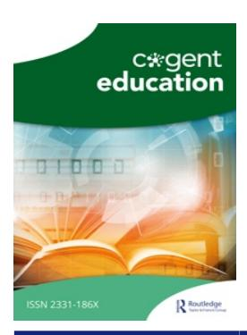

<!-- LR.R11 | source: papers_json/LR.R11/ -->

## **Cogent Education**

**ISSN: 2331-186X (Online) Journal homepage: ****[www.tandfonline.com/journals/oaed20](https://www.tandfonline.com/journals/oaed20?src=pdf)**

## **Barriers** **to** **research** **productivity** **of** **academics** **in** **Tanzania** **higher** **education** **institutions:** **the** **need** **for policy interventions**

**Abel** **Charles** **Kadikilo,** **Parameswar** **Nayak** **&** **Arunaditya** **Sahay**

**To** **cite** **this** **article:** Abel Charles Kadikilo, Parameswar Nayak & Arunaditya Sahay (2024) Barriers to research productivity of academics in Tanzania higher education institutions: the need for policy interventions, Cogent Education, 11:1, 2351285, DOI: [10.1080/2331186X.2024.2351285](https://www.tandfonline.com/action/showCitFormats?doi=10.1080/2331186X.2024.2351285)

**To** **link** **to** **this** **article:** [https://doi.org/10.1080/2331186X.2024.2351285](https://doi.org/10.1080/2331186X.2024.2351285)

| © 2024 The Author(s). Published by Informa UK Limited, trading as Taylor & Francis Group |
| --- |
| Published online: 14 May 2024. |
| Submit your article to this journal |
| Article views: 5923 |
| View related articles |
| View Crossmark data |
| Citing articles: 33 View citing articles |

<!-- page 2 -->

## HIGHER EDUCATION | RESEARCH ARTICLE

## Barriers to research productivity of academics in Tanzania higher education institutions: the need for policy interventions

Abel Charles Kadikiloa [,](http://orcid.org/0000-0002-8199-0872) Parameswar Nayakb and Arunaditya Sahay^c^

a Department of Management Sciences, The Institute of Finance Management (IFM), Dar Es Salaam, Tanzania; ^b^ Birla School of Management, Birla Global University, Bhubaneswar, India; ^c^ Strategy, Innovation, Entrepreneurship, Sustainability & CSR, Birla Institute of Management Technology, Noida, India

## ABSTRACT

Higher education institutions dominate research productivity in many parts of the world. Nonetheless, many academics in developing countries—including Tanzania perform poorly in research. This study aims to qualitatively explore the barriers to research productivity in Tanzanian public higher education institutions. Using semistructured interviews with thirty university leaders, regulatory agency officials, and academics from Tanzania's four largest public institutions and reviewing official documents on higher education, the study found that institutional and individual factors hinder academic research productivity. Institutional barriers include inadequate research funding, heavy workloads, weak collaboration, fragmented research policies, a lack of researchers with impeccable credentials, weak databases, weak mentorship, and informal rewards and incentives. Individual barriers included limited research expertise and interest. Overcoming these challenges requires strategic inter- and intra-institutional collaboration. It also requires capacity-building, instituted mentorship for young researchers, redesigned incentive and rewards programs, improved funding, policy harmonization, and strengthened institutional and national research repositories.

## ARTICLE HISTORY

Received 11 November 2023 Revised 9 April 2024 Accepted 24 April 2024

## KEYWORDS

Higher education institutions; research productivity; research promotion; research barriers; research policies

## REVIEWING EDITOR

Stephen Darwin, Universidad Alberto Hurtado, Chile

## SUBJECTS

Educational Psychology; Organizational Communication; Higher Education; Research Methods in Education; Education – Social Sciences

## Introduction

Through research, higher education institutions (HEIs) strive to create practical knowledge (Fussy, [2017](#page-16-0); Cloete et al., [2018](#page-16-0)), and in recent years, research productivity has become one of the most critical measures of the quality of HEIs (Hazelkorn, [2010;](#page-17-0) Yuan et al., [2020)](#page-19-0). As such, enhancing academic staff members' research productivity has become crucial to boosting university ranking, prestige, and teaching quality (Abe & Mugobo, [2021](#page-15-0); Desselle et al., [2018;](#page-16-0) Tuan et al., [2022](#page-19-0); Jameel & Ahmad, [2020](#page-17-0)). Due to its vital contribution to national progress and wealth creation, research productivity has a profound societal impact (Jameel & Ahmad, [2020;](#page-17-0) Porter & Toutkoushian, [2006](#page-18-0)). Research is unquestionably necessary for the growth of any society and individuals. Scientific research positively correlates with living standards (Acharya & Pathak, [2019;](#page-15-0) Badr, [2018](#page-16-0)). Today, research productivity is the basis for assessing each researcher's performance, academic merit, and contribution to the advancement of their university (Appah et al., [2020;](#page-16-0) Abe & Mugobo, [2021](#page-15-0)). Therefore, in addition to teaching and other service roles, faculty members have to excel in research-based knowledge generation (Yassinova, [2019](#page-19-0)), which is measured by the number and quality of publications (eg peer-reviewed journal articles and books published

CONTACT Abel Charles Kadikilo ackadikilo.scholar19@bgu.ac.in, abel.kadikilo@ifm.ac.tz Department of Management Sciences, The Institute of Finance Management (IFM), Dar Es Salaam, Tanzania

<!-- page 3 -->

by reputable publishers) made, research grants won, and patents registered (Akbaritabar et al., [2018](#page-15-0); Heng et al., [2020;](#page-17-0) Oyeyemi et al., [2019](#page-18-0)).

However, despite the ongoing emphasis on research productivity, developing regions, particularly those in Africa, and their academic staff insignificantly contribute to generating scientific knowledge compared to the developed world (Fussy, [2017;](#page-16-0) Heng et al., [2020](#page-17-0); Uwizeye et al., [2021)](#page-19-0). This has been confirmed by Amarante and Zurbrigg ([2021](#page-15-0)), who noted a significant gap between the scientific knowledge outputs of developing and developed nations. According to UIS-UNESCO ([2020](#page-19-0)), Africa has 17.51% of the world's population, second only to Asia. However, it produces only 3.5% of research outputs and 0.3% of researchers, the lowest of the seven continents. The continent even trails Oceania, a sparsely populated region with only 0.59% of the world's population that has 0.3% of researchers and produces 3.74% of the global research output.

Research is concentrated in North America, Western Europe (46.1%), East Asia, and the Pacific (40.6%). In comparison, the least amount of research products comes from central Asia (0.1%) and sub-Saharan Africa (0.8%) (UIS, [2019)](#page-19-0). Africa's limited research productivity is strongly evident in its publication trends. Chelwa's ([2021](#page-16-0)) study determined that 75% of the highly ranked economic journals had no publication from an African author based in Africa. Similarly, Boshoff's [(2010)](#page-16-0) study on the patterns of research collaboration in the Southern African Development Community (SADC) found that 47% of the research papers published between 2005 and 2008 had co-authors from high-income nations.

The low research output in Africa has been ascribed to inadequate funding for higher education and research and a scarcity of researchers (Chelwa, [2021)](#page-16-0). Though several nations have pledged to enhance R&D investment for the Sustainable Development Goals (SDGs), the United States (2016) reports that insufficient financing impedes Africa's research productivity. Based on the UNESCO Science Report (2019), developed nations allocated the most amount of funds towards research and development (R&D) on a worldwide scale in 2018. Based on this data, the United States had a higher expenditure of 25.25%, followed by China with 21.68%, and Japan with 8.52%. Germany accounted for 5.32% of the total, followed by South Korea with 4.03%, India with 3.80%, Turkey with 3.3%, Israel with 3.0%, Canada with 2.34%, and France with 2.25%. In contrast, African nations, except South Africa and Egypt, made the most minor investments in R&D in monetary terms (R&D Magazine, [2018)](#page-18-0). Moreover, the National Precast Concrete Association (NPCA, [2010)](#page-18-0) has revealed that the R&D spending for many African nations' accounts for less than 1% of their respective GDP. Nevertheless, knowledge generation, production of goods, and delivery of essential services for national progress depend on R&D activities (Maziku, [2021)](#page-17-0).

Limited research productivity in Africa leads to various issues, such as poor disease management, infrastructure development, hygiene and sanitation challenges, food insecurity, limited access to potable water, and failure to address climate change hazards (Kirigia & Barry, [2008](#page-17-0); Olufadewa et al., [2020](#page-18-0)). These issues are exacerbated by unreliable data for monitoring and evaluating ongoing initiatives (Nass et al., [2009](#page-18-0); Zall Kusek & Rist, [2004](#page-19-0)). As Ngongalah et al. [(2018)](#page-18-0) contends, without sufficient research productivity, Africa and other developing regions will remain underdeveloped, face high death rates and heavy disease burdens, and generally have low living standards. The research environment in Africa makes it difficult for African nations to address these challenges and hinders the growth and success of African universities (Kumwenda et al., [2017](#page-17-0); Kokwaro & Kariuki, [2001](#page-17-0); Wangenge-Ouma et al., [2015)](#page-19-0).

Therefore, it should come as no surprise that academics and government officials in low-developed nations, particularly those in Africa, are keen on identifying research output impediments and devising strategies for removing them (Ngongalah et al., [2018)](#page-18-0). However, because this subject is under-researched in Africa, there is limited empirical data to facilitate the development and implementation of effective interventions that are unique to the continent's nations and institutions (Hardr e et al., [2011;](#page-17-0) Teodorescu, [2000)](#page-19-0). As such, the empirical data gathered by this study that covered Tanzania's universities should aid in filling this literature gap.

## Research context

Like in other previously colonised countries, Tanzania's higher education took off in earnest several years after independence despite starting a university college as an appendage of the University of London in

<!-- page 4 -->

1961 after Tanganyika's political independence from Britain. Subsequently, in 1986, Tanzania formulated its first National Science and Technology Policy, a pioneering move for East Africa. According to Kohi ([2000](#page-17-0)), this also made the country the second in Sub-Saharan Africa to achieve that feat, after Ethiopia. The 1996 policy revision aligned it with global changes, including trade liberalisation. In 2010, the policy was superseded by the National Research and Development Policy, which has since been subjected to further revisions to integrate innovation in line with Tanzania's Development Vision 2025. The Tanzania Research Agenda, a comprehensive framework created to catalyse research for national economic growth, social improvement, and sustainable development, complements the research policy. Together, these frameworks strive to make Tanzania a knowledge-driven society for a better future (COSTECH, [2020;](#page-19-0) Maziku, [2021;](#page-17-0) URT, [2010)](#page-19-0).

Tanzania's higher education sector has significantly grown since the 1990s, reaching 49 institutions in 2023, some of which are private. This growth is attributable to socio-economic and political reforms in the 1990s and policy changes that liberalised higher education, allowing the private sector to participate (Mgaiwa & Ishengoma, [2017;](#page-17-0) TCU, [2019](#page-19-0)). Currently, there are 12 fully-fledged public universities, 22 private universities, and three public and private college universities, taking the number to 49 HEIs (TCU, [2021)](#page-19-0). Tanzania had 74 R&D institutions by 2017, which were categorized into public, private, international, and HEIs (COSTECH, [2017;](#page-19-0) TCU, [2017](#page-19-0)). HEIs comprise 66 percent of the nation's research institutions, demonstrating the importance of higher education in the country's research productivity (Maziku, [2021)](#page-17-0). HEIs also employ the majority of researchers (71.3%) in Tanzania, while other sectors employ the rest (28.7%) (UKaid, [2019)](#page-19-0).

Regarding governance and management systems, the University Act, Cap 346 of the Law of Tanzania and Charters, gives all institutions autonomy to make their own decisions and set institutional strategies for growth and development. It also grants institutions independence against any external forces. Through the University Act, Cap. 346 of the Tanzanian Law, and Charters, the Ministry of Education (MoEST) in Tanzania provides HE institutions autonomy to determine and establish growth and development strategies. The Ministry of Education, Science, and Technology (MoEST) is responsible for science and technology policies and formulating, monitoring, and reviewing education policies (Fussy, [2017](#page-16-0)). COSTECH, established under MoEST, coordinates and promotes research and technological developments in socio-economic development (Maziku, [2021)](#page-17-0). Through the National Fund for the Advancement of Science and Technology (NFAST), COSTECH is responsible for distributing national and external funds and managing competitive grant calls. NFAST aims to support research and facilitate R&D capacity building, focusing on national priorities (COSTECH, [2020;](#page-19-0) Maziku, [2021](#page-17-0)). However, its sustainability has been questioned due to its reliance on funds from the government and development partners.

Regarding allocating teaching and research workload, HE institutions in Tanzania allocate teaching and research responsibilities to faculty members. According to the Tanzania Commission for Universities (TCU, [2019](#page-19-0)), Annex 5.3 and 5.4 of the standards and norms for university education, faculty workload in teaching and research differs by their position level. The weekly teaching load for professors is 8 hours, whereas that for senior lecturers and lecturers is 10 hours and 7 hours for assistant lecturers. Weekly research engagement of faculty is expected to be 14 hours for professors, 18 hours for senior lecturers and lecturers, and 19 hours for assistant lecturers. Although Tanzania has no policy for rewarding research excellence, it allows each HE institution to have unique methods for honouring it. However, the MoEST has recently (in 2023) created a research excellence prize for faculty members who publish in top journals to boost research outputs (URT, [2023)](#page-19-0). This is one of the first initiatives made by the government to promote research activities at the national level. Academic staff evaluations and promotions follow institutional standards determined by the university that align with the TCU Standards and Guidelines (TCU, [2019](#page-19-0) sections 5.17 and 5.18).

Research productivity has generally remained limited in Tanzania despite the rapid increase in HEIs because most perform poorly in research (UKaid, [2019)](#page-19-0). This trend continues unabated even now that R&D activities are used to promote academic staff members to higher ranks/positions (Fussy, [2017](#page-16-0); Sulo et al., [2012](#page-18-0)). For example, in 2018, Tanzania had 1705 publications, far below the average for SSA countries (3295). Across the African continent, Tanzania accounted for 2.22 percent of the total research output despite having five percent of SSA's total population (UKaid, [2019](#page-19-0)). AU-NEPAD [(2019)](#page-15-0), and UIS

<!-- page 5 -->

([2018](#page-19-0)) report that Tanzania has 73 researchers per million people, while its neighbours Kenya and Uganda have 323 and 85 researchers per million, respectively.

## Theoretical framework and literature review

Higher education is the world's primary knowledge source (Abe & Mugobo, [2021](#page-15-0)). Faculty members produce most of this knowledge, especially in developing countries (Prathap & Ratnavelu, [2015)](#page-18-0). The complex interaction between organizational resources, the organization's ability to acquire and use them, and institutional conditions affect knowledge production capacities in Tanzania HE institutions and other developing nations. This study was guided by the institutional and Resource Based View (RBV) theories. The institutional theory by Scott [(2004)](#page-18-0), Currie and Swanson ([2009](#page-16-0)), and Aksom and Vakulenko ([2023](#page-15-0)) was used in this study to shed light on the obstacles to research productivity in HE institutions. Scott ([2004](#page-18-0)) noted that institutions are society's social structure that defines suitable behavior patterns for institutional and individual actions. According to the proponent of the institutional Theory, institutions are complex social organizations made of symbolic elements, interpersonal relationships, and material resources (Currie & Swanson, [2009](#page-16-0); Scott, [2001](#page-18-0), [2004,](#page-18-0) [2008)](#page-18-0). This Theory is instrumental in understanding global socioeconomic and institutional challenges and can help explain how institutional factors shape research-related behavior (Aksom & Vakulenko, [2023](#page-15-0)). These factors may include HE institution governance, funding structures, and how HE institutions are regulated. These factors form the framework and profoundly impact academic research (Currie & Swanson, [2009;](#page-16-0) Scott, [2001](#page-18-0)).

Similarly, the Resource-Based View (RBV) theory posits that an organization's success depends on available resources and capabilities (Peteraf, [1993)](#page-18-0). The Theory highlights that institutions have peculiar resources and competencies that can make them competitive. These resources can be regarded as tangible and intangible, giving institutions a competitive advantage: a corporation can outperform its rivals by possessing valuable, scarce, and difficult-to-duplicate resources (Barney, [1991;](#page-16-0) Harrison et al., [2001](#page-17-0)). Tangible resources may include physical, equipment, technological, and financial while intangible ones include reputation, human, and invention (Fahy & Smithee, [1999;](#page-16-0) Fahy, [2000;](#page-16-0) Mills et al., [2003)](#page-17-0).

The two theories provide frameworks for understanding the conditions and complexities involved in HE institution's research productivity. The institutional Theory provides a broad picture of the research environmental factors that shape the behaviors and actions of the individuals involved in research. At the same time, the Resources-based View (RBV) theory illuminates how resources can be outsourced, allocated, and used to facilitate research activities.

University research serves as a conduit for the intellectual, social, cultural, and economic advancement of the local community and, by extension, the global community. This is one of the reasons that universities compete with one another in terms of research output (Adetayo et al., [2023](#page-15-0); Nguyen, [2021)](#page-18-0). As a result, research productivity has increasingly drawn the attention of many scholars (Abe & Mugobo, [2021;](#page-15-0) Bland et al., [2005;](#page-16-0) Brew et al., [2016](#page-16-0); Fussy, [2018;](#page-16-0) Khalil & Khalil, [2019](#page-17-0); Nygaard, [2017;](#page-18-0) Szuflita-Zurawska et al., [2020;](#page-18-0) Tran et al., [2020;](#page-19-0) Teodorescu, [2000)](#page-19-0), who attempt to understand the challenges behind its limitedness. As UNESCO [(2010)](#page-19-0) has pointed out, R&D exists in the context of a nation's social, cultural, political, financial, and economic systems and other forms of governance that hinder productivity. Fussy [(2018)](#page-16-0) further contends that variations among these barriers depend on prevailing research contexts influenced by the socioeconomic development level, age of the higher education system, complexity and character of the national higher education policy, human resources, and physical and infrastructural resources. Some scholars (eg Jung, [2012](#page-17-0)) suggest that the variations also depend on academic disciplines. Furthermore, under the Institutional Theory, the institutional context, governance, finance, culture, and regulations determine an organisation's R&D environment and conduct (Currie & Swanson, [2009;](#page-16-0) Scott, [2001](#page-18-0)).

Research productivity in developing countries, or the Global South, is significantly lower than in developed nations (Albanna et al., [2021)](#page-15-0). From 2005 to 2014, developed nations invested 1.44% of their GDP in R&D, whereas developing countries invested only 0.38% (Blicharska et al., [2017;](#page-16-0) Maziku, [2021](#page-17-0); UNESCO, [2015)](#page-19-0). Developing nations devote less than 1% of their GDP to R&D activities, whereas rich countries invest up to over 3%. Another gap is evident in the output of scientific and technical journal

<!-- page 6 -->

articles. In 2018, the average number of scientific and technical journal articles generated by nations in the Global North was over 35,000.

In contrast, the average number for countries in the Global South was 9700, or 4000, with the exclusion of China and India (World Bank, [2020)](#page-19-0). India and China are the only countries in the Global South that produce many research articles. Excluding them from the Global South allows for a more accurate and concentrated analysis of research productivity in other countries with lower research output. Global South scholars contribute less than 2% of the top 1% of most-cited articles globally, excluding those in China and India, according to The National Science Board [(2018)](#page-18-0).

Another notable difference in the available literature is that while most industrialised countries' R&D activities rely on support from the private sector, developing nations' R&D activities heavily rely on government support (Sanyal & Varghese, [2006](#page-18-0)). Multinational corporations conduct their international research more in developed countries than in developing nations. As a result, developing countries contend with a lack of R&D financial and human resources, limited sustainable individual and institutional capacities, and those related to funding, institutional and cultural restrictions, staff credentials, research environment, and time constraints (Fussy, [2018](#page-16-0); Sanyal & Varghese, [2006](#page-18-0)). In this regard, Muia and Oringo ([2016](#page-17-0)) observed that institutional and cultural constraints and financing issues limit the University of Nairobi's research output. Similarly, Sulo et al. ([2012](#page-18-0)), who also performed their research in Kenya, found that qualifications, the research environment, funding, and a lack of time significantly impact the university staff members' research outputs.

Additionally, scholars from developing nations often migrate to the Global North due to difficulty securing research grants (Pasgaard & Strange, [2013;](#page-18-0) Salager-Meyer, [2008)](#page-18-0). Overcrowded Higher Education Institutions (HEIs) and low English language proficiency among researchers also limit the scholars' engagement in research activities (Confraria et al., [2017;](#page-16-0) Gonzalez-Brambila et al., [2016](#page-16-0); Sawyerr, [2004](#page-18-0)). These factors contribute to the limited research productivity of developing nations. As the Resource-based View (RBV) theory explains, the absence of these resources causes research productivity (Fahy & Smithee, [1999;](#page-16-0) Fahy, [2000](#page-16-0)).

Research productivity challenges in Africa also include a lack of information and expertise, limited funding, research aptitude, motivation, and institutional cooperation (Kazigo & Rickard, [2021)](#page-17-0). In Tanzania, insufficient research skills, poor collaboration between senior and junior academic staff, and a lack of proactiveness and commitment to research inhibit research activities (Kadikilo et al., [2023](#page-17-0)). Furthermore, cultural, political, institutional, and structural barriers hinder research promotion among Tanzania's universities (Kazoka & Wema, [2020)](#page-17-0), which is consistent with the institutional theory postulating that institutional factors such as regulations and governance of an organisation shape an individual's behaviours and outcomes (Scott, [2004](#page-18-0), [2008)](#page-18-0). Simisaye [(2019)](#page-18-0) identified family, financial, information accessibility, information literacy, and employers' motivation as significant factors hindering research productivity in southwest Nigeria. In Africa, research faces three main obstacles: funding, lack of enthusiasm for research, and limited adoption of research findings by governments (Ngongalah et al., [2018](#page-18-0)). Private institutions have limited participation in these countries' research systems, whereas developed nations have vital national scientific functions, stable research environments, and well-resourced HEIs (UNESCO, [2010](#page-19-0); Nguyen, [2013)](#page-18-0). In addition, funding, heavy teaching loads, human resource issues, and internet connectivity problems are limited in these countries (Fussy, [2018](#page-16-0)). From the RBV lens, financial and human resource constraints, as the literature review suggests, undermine research productivity while playing an essential role in determining faculty members' research productivity (Harrison et al., [2001)](#page-17-0).

Gonzalez et al. ([2018)](#page-16-0) divided research productivity constraints into internal and external variables. A hostile environment, lack of funding and other resources, or heavy workload for faculty members are external barriers that can undermine advanced statistical training, efficient instruction, and grant proposal writing training. On the other hand, internal influences include work-life balance, depressive moods, and individual preferences or characteristics. Overall, the literature reviewed demonstrates that diverse factors contribute to Africa's low research production. Drawing upon the two theories—institutional and RBV, the study investigated the barriers to academic research productivity in Tanzania's HE institutions. In this regard, Olufadewa et al. [(2020](#page-18-0)) study underscored the importance of comprehensively understanding each

<!-- page 7 -->

African nation's cultural, economic, and developmental viewpoints to offer solutions tailored to meet the needs and aspirations of each country.

## Research methodology

Four public universities, MOEST and COSTECH, participated in this qualitative study. The four universities were selected based on accreditation, ownership (only public universities), and location (Dar es Salaam, Morogoro, Dodoma) criteria. MOEST and COSTECH were involved because they oversee R&D operations and higher education institutions. The choice to limit participation to public institutions was motivated by Tanzania's government-funded research initiatives, which directly impact research funding, policies, and initiatives. Thirty individuals were purposefully selected to participate in this study. The participants comprised twelve faculty members, twelve deans or college principals from the four universities, four publishing directors, one MoEST policymaker, and one COSTECH senior staff member. These individuals were chosen based on their perceived strategic roles closely linked to their organisations' research endeavours.

The researchers obtained informed consent from the specific participants. During the interview process, both auditory recordings and written notes were utilised with those individuals who provided their agreement for the audio recordings. In other instances, the researcher recorded the participants' comments using handwritten notes. The researcher transcribed the responses and recorded them in audio format.

Semi-structured interviews and document analysis were used to gather data. Semi-structured interviews provided researchers with context for informant behaviours. Cohen et al. ([2007](#page-16-0)) and Kvale and Brinkmann ([2009)](#page-17-0) argue that interviewing people about their ideas, experiences, and opinions helps research. The researchers interviewed participants in their offices for convenience, and each interview lasted approximately 45–50 min. The availability and willingness of key participants influenced the scheduling of the interviews. The participants used English or Kiswahili, depending on their preference. With respondents' approval, the proceedings of the in-depth interviews were recorded and transcribed appropriately. Documentary analysis provided data in written form. The universities' prospectuses, rules, institutional research policies, Research and Development Policies (URT, [2010)](#page-19-0), and service schemes provided textual data. Some of these documents were obtained from university websites, while others were requested and later examined for relevance. The data obtained from these sources helped the researchers establish the historical and contextual background for this study while using interview findings, which allowed for triangulation to enhance the study's credibility and eliminate bias (URT, [2010](#page-19-0)).

This study adhered to all research guidelines to comply with research ethics. The researcher obtained a study permit from COSTECH, bearing the reference number 2022-611-NA-2022-178. The permit gave the researchers access to the research areas' management and research participants. Before participating, participants were given extensive details about the study, allowing them to provide informed consent. Moreover, the study has avoided naming these participants and institutions to safeguard their privacy. Codes (eg HE-1, HE-2, HE-3, HE-4, NU-1, and NU-2) have been used to identify participants verbatim. The researcher guaranteed the participant's confidentiality and the security of their information.

## Data analysis and findings

The study utilised Braun and Clarke ([2006](#page-16-0)) six-step thematic analysis approach, which involves researchers in all stages of analysis to ensure both speed and accuracy. The thematic analysis identifies, evaluates, and reports data patterns, aiding data organization and creating detailed descriptions (Boyatzis, [1998)](#page-16-0). Data was systematically arranged, categorized, and encoded to enhance the efficiency of processing and presentation. The research productivity obstacles noted include personal (poor research experience for Ph.D. students and young academics, limited research interest) and institutional (limited resources, inadequate research funding, heavy faculty workload, weak research collaboration, fragmented research policy settings, lack of human resources, weak institution and national research databases, weak peer support systems, and uncoordinated and informal rewards). These findings have allowed this

<!-- page 8 -->

study to comprehensively understand past and present human behaviour, events, and acts and how they influence research productivity.

Three researchers analysed data. Instead of dividing the data among them or giving each other spate roles in the analysis to enhance speed, each researcher handled all the stages, from data transcription to the final stage, because accuracy was considered more important than speed. Afterward, the researchers brought their results together for screening and comparison purposes. The differences that emerged from the three versions of the results prompted further analysis to ensure harmony between the analysis outputs. This action aimed to ascertain the credibility of the results and mitigate any potential inaccuracies and biases. The subsequent sections present findings on institutional and individual factors behind the limited research productivity of Tanzanian HEIs.

## Institutional factors

## Inadequate funding for research

This study has identified funding as a significant issue affecting research productivity, professional growth, networking opportunities, research incentives, lab equipment availability, and library subscriptions to international journals, books, and software. Regarding this, one participant (School Dean - HE-1) said:

The low budget set by the government for research is also manifested in the higher education institutions' research budgets. Funds set aside for research are insignificant and highly dependent on the government. Internally generated funds are limited.

Also speaking on this aspect, NUI-6 further reaffirmed the presence of this factor by saying: 'We have lowly invested in research as a country. There is a need to increase funding for research to enable us to undertake research projects and activities.' Based on this finding, this problem persists despite the government's commitment to invest at least 1% of the nation's GDP in research as required by the Abuja Declaration. These remarks draw attention to the problem of insufficient financing, untrustworthy sources, and poor internal research fund generation, which highlight the government's limited commitment to research. This continues to be an issue many years after the nation committed itself to annually set aside about 1% (the critical minimum) of its GDP for scientific research and technology development by 2000, with the prospect of raising the allocation to 1.5% (URT, [1996,](#page-19-0) p. 6) and 'create a National Research Fund (NRF)' (URT, [2010,](#page-19-0) p. 21). Tanzania became a party to this declaration in 1986 but continues to fail to honour it, as attested by the following statements:

Over the years the government has been allocating funds to R&D activities through ministries and local government authorities, and only a proportionately low amount was allocated to the national R&D coordination body through the National Fund for Advancement of Science and Technology (NFAST) (URT, [2010](#page-19-0) p. 20).

Funding remains the single most critical bottleneck in research performance… national funding has continued to be extremely low and research activities are largely development partner-driven (UNI-1 p. 4–5), for the period of ten years (1995–2004) the survey report indicated that the contribution from the government was only 14%, while the contribution from foreign sources was 51% (COSTECH, [2005](#page-19-0) p. 19).

The volume and quality of research output are impacted by limited funding since national priorities do not exclusively determine activities led by development partners. This study shows that research capacity-building initiatives at universities, such as workshops and training, are impacted by the lack of money, among other issues, as stated here:

We have an annual timetable for training, seminars and workshops. However, sometimes we do conduct them whenever the budget allows or when we get sponsored training. This is affecting our aspiration to increase research capacity to our staff (Director of Research: HEI- 3).

This remark raises questions about the capacity-building options available to institutions and the limitations of financing research training for HEIs, suggesting potential issues with training relevance if externally financed opportunities are influenced by funding agencies.

<!-- page 9 -->

## Heavy faculty workload (teaching and service provision)

The study has found that research productivity is hindered by limited time for research activities due to heavy academic and administrative workloads. Study participants indicated that they primarily dedicated their time to teaching and non-academic tasks:

Alongside our academic activities, we have many co-curricular activities: we are required to undertake as academicians such as administrative roles, setting exams and tests, marking, compiling examination results, supervising projects and research, mentorships, consultancies and community engagement. In addition to lecturing, we do prepare lecture sessions (DRP-HE-1)

For the past few years of the fifth regime, almost all higher education institutions are experiencing a shortage of academic staff because the government froze the employment of public servants. As universities, we don't have the mandate to employ the staff we need (Dean of School – HE-1).

Heavy workloads of HEIs in Tanzania are attributable to staff shortages and misallocation of responsibilities. The HEIs fail to optimize their capacities to improve research output quantity and quality, resulting in ineffective positioning of highly qualified researchers. This hinders their ability to produce sufficient and high-quality research outputs, attract funds, collaborate, and produce quality students. The National Research and Development Policy confirms that the first factor is beyond the influence of HEIs in the country:

Currently, planning for human resource is one of the weak areas within the R&D system as the decision in relation to human resource development is vested with ministries responsible for labour and public service management (URT, [2010,](#page-19-0) p. 19).

Other challenges on R&D activities include inadequate mechanism for training and hiring researchers, and a lack of a national framework for identifying research priorities and strengthening coordination of the roles of different ministries, government departments and agencies (URT, [2010](#page-19-0), p. 19).

Based on these testimonies, the Tanzania government's external factors also limit the research output of higher education institutions, affecting not only the quantity of workers but also their quality due to a lack of cooperation between stakeholders. This affects the identification and prioritisation of research productivity needs.

## Weak collaboration between and among research practitioners

The study also found a lack of collaboration between local researchers in Higher Education Institutions (HEIs), research institutes, and the public and business sectors. This limit learning opportunities for junior researchers and research projects requiring expertise and resources and weakens stakeholder links. The following participants provide evidential statements on this as follows:

We rarely collaborate with our peers from our institutions and other Tanzanian or African colleagues. Budgetary restrictions and poor networking have exacerbated this (Dean of School HE-2).

There is a weak linkage between research institutions, including universities, the government, industry, and the community, who are supposed to use research findings. You will find that much research is being done, but it is not being communicated or disseminated beyond referred publications (Dean of School HE-4).

In other words, there is limited collaboration between researchers and consumers nationally, resulting in limited usage of research outputs. This disconnection may affect the quality and relevance of research outputs to consumer needs. Additionally, there is a limited collaboration between Tanzanians at home and those living abroad, as shown in the following statement:

Despite the government's efforts to foster collaboration between R&D institutions and development partners, the involvement of the diaspora has been minimal. As a result, Tanzania has missed out on critical opportunities such as capacity building in terms of human resources and facilities; rational utilization of resources; and transfer of knowledge, technology and materials at national and international levels (URT, [2010](#page-19-0), p. 24)

Impliedly, Tanzania's institutions and researchers are missing out on crucial opportunities for knowledge, technology, and materials transfer, as well as capacity building in human resources and facilities, hence underscoring the essentiality of encouraging collaborations between researchers and institutions.

<!-- page 10 -->

## Fragmented research policy settings and practices

Even though Tanzania's higher education institutions (HEIs) are subject to regulation by the Ministry of Education, Science, and Technology (MoEST), and research activities are guided by the National Research Policy of 2010, it is essential to note that each ministry has its sector-specific regulations, which also extend to research institutions. Consequently, the responsibility of overseeing research across the country falls upon COSTECH, leading to challenges in coordination, as evidenced in this context:

This policy recognizes different sectoral policies, which are important in achieving its objectives. For the implementation of this policy, the ministry responsible for research and development will ensure that this policy is harmonized with other sectoral policies and that other stakeholders interested in Research and Development are fully involved (URT, [2010)](#page-19-0).

The above policy statement recognizes the presence of sectoral policies and insists on harmonization. However, harmonisation has been a challenge, as indicated by the participant's statement here:

The fragmented research policy system hampers the coordination of research activities. There is a need to revisit our national research policy. Every ministry has its strategies for obtaining funds and even conducting research. This is a weakness that we need to address, (Officer from NU-5).

Furthermore, the Tanzania National Research and Development Policy alluded to this anomaly by stating that:

[T]he current R&D coordination and management lacks this unified outlook and fore sighting mechanism. The ministry responsible for R&D plays a marginal role in relation to research activities conducted in other ministries. COSTECH in its present structure, level of funding and staffing has inadequate capacity to discharge its mandate. As such, there is a need to review the existing legal framework which established different R&D institutions and put in place a new legal and regulatory framework that will enhance research activities, fore sighting, effective coordination, dissemination and commercialization of research findings and monitoring and evaluation of research activities at national level (URT, [2010,](#page-19-0) p. 12).

Impliedly, there is a lack of clarity on which organisation is responsible for which research activities. The vague jurisdictions of institutions in Tanzania's research ecosystem and the failure of policies to succinctly spell out research procedures at the national level further undermines research productivity.

## Limited number of researchers

Study participants identified limited research-related human resources in terms of numbers and capacity to undertake research as another limiting factor. The following statements present data on this:

Previously, we were talking about the brain drain of academic staff migrating to other parts of the world. However, now we have an internal brain drain whereby most of the senior academic staff go into politics. Some by being appointed and others [do so] willingly (Academic staff – HE-1).

Most universities have few academic staff, and most of them lack the necessary research skills, which jeopardises the capacity to produce research. The research productivity of the few available researchers is also inhibited by other institutional factors such as inadequate funds (College Principal – HE-2)

These excerpts present two issues associated with the scarcity of researchers in Tanzania's HIEs: research competencies and headcount. Study participants consider both issues as detrimental to research productivity. The participants have also highlighted two more factors contributing to the limited number of researchers: (a) lack of recruitment and centralisation of recruitment without considering organizational priorities, and (b) faculty members leaving their teaching and research positions for other fields such as politics. In addition to what was said by the participant, the limited number of researchers is worsened by weak transfer or sharing of skills and knowledge from senior to junior staff, as discussed in this paper. This problem also shows up in the nation's research policy as stated here: '[T]here is [an] ineffective mechanism to develop, motivate and retain adequate and competent human resource… ' (URT, [2010,](#page-19-0) p.19). This admission signals an overriding need for the Tanzania government to rectify the situation to avoid further eroding the quality and quantity of researchers in HELs.

<!-- page 11 -->

## Weak institutional and national research databases

The survey participants have also highlighted the importance of research databases, particularly at the institutional and national levels, in enhancing research productivity. These databases or repositories, however, appear largely inadequate as suggested by the participants:

We do not have a national database where, where students and staff can easily get data for our research works covering the whole nation. As a result, data collection is an expensive exercise with a lot of hurdles and bureaucracy (College Principal: HEI-2).

We launched our national repository in 2017 as a responsible body; however, it is not doing well due to several factors such as weak databases in many higher education institutions. Maintaining these repositories is a challenge to most of our institutions (COSTECH Officer: Org – 6).

Our country's problem is plagiarism and duplication of similar projects or themes by neighbouring departments or universities. This is partly caused by the lack of a comprehensive database of research outputs projects or themes by neighbouring departments or universities and at the national level (Director of Research: HEI-1).

Overall, two issues have emerged from these responses regarding the apparent weakness of research databases: the lack of initiatives to establish and manage the databases and the effect of their absence on research activities. Study participants signalled that minimal efforts had been made to establish and run databases, making data collection expensive and preventing duplication of research projects increasingly difficult.

## Weak peer support system and mentorship

Weak mentorship and support systems for junior researchers emerged during interviews as another stumbling block. Specifically, the interviewees identified the absence of formal programs as one of the impediments to enhanced research productivity:

Although mentorship practices exist here, we do not have a formal mentoring arrangement. Senior academic staff members are forced to do so as to obtain SAS research funding requirements (College Principal: HEI – 2).

To enable effective mentoring exercises, we need to develop a clear policy framework that will guide the university, decision-makers, and planners to guide the faculty members and the human resources department properly (Dean of School: HEI – 4).

I would like to have an adviser who will help and guide me on how to do research. As I am a novice academic staff employed to teach and do community work, and another obligation is to undertake research. I do not know much about publishing papers (Academic Staff – HE-2).

These responses highlight the importance of support networks—which HE-2 clearly illustrates—and the causes of their absence. As evident here, the participants believe that their institutions' failure to establish formal guidelines that people should abide by is the reason this condition exists. They (HEI-4 and HEI-2) argue that frameworks and other policies must be developed to formalise these systems.

## Uncoordinated and un-formalised rewards and incentive systems

These results suggest that the reward and incentive structures of the universities under review are not up to the task and that the availability of incentives or prizes determines their provision, which discourages many researchers as stated here:

We do not have any formal arrangement for rewarding or recognizing those performing well in research activities. However, we are preparing regulations to guide us on how best we can reward them. The university has appointed a committee to design the awards regulations (Dean of School HEI -1).

We wish to consistently reward faculty members who perform better in research activities; however, the unreliability of funds is a problem. The internally generated fund is not enough. Some time we do reward when funds are available. (Dean of School HEI4)

This problem seems intractable and continues to cripple research productivity. The problem has also already been documented as stated here that 'researchers have not been adequately rewarded on the basis of their research results… ' (URT, [2010,](#page-19-0) p. 2). Apparently, the research systems of the institutions

<!-- page 12 -->

under evaluation are harmed by the absence of official rules and policies, which has resulted in inconsistent incentive schemes.

## Individual barriers related to personal characteristics

## Lack of research expertise

While speaking about limited number of researchers, the study participants addressed this issue at the individual level by indicating that Ph.D. students and young researchers usually lack requisite research skills, which limits their research productivity as explained here:

The big problem in our universities now is that most academics lack the necessary research skills. Especially the young researchers. This is caused by a poor research background from their undergraduate studies (Dean of School: HEI – 1).

In my early employment as academic staff, I could not afford to write any research paper, even after my Masters' level. I managed to do so at my Ph.D. level. In fact, the truth is that most of the academic staff who publishes articles are Ph.D. holders (Academic Staff – HEI-4).

These evidential statements suggest that study participants believe their ability to do adequate research is essential to their overall productivity. As these quotes show, junior researchers lack this aptitude. This brings us back to the issues of inadequate research funding, weak collaborations, and weak mentorships, which prevent unskilled junior scholars and senior researchers from learning from more experienced researchers how to write manuscripts and various research skills necessary to become a good researcher.

## Lack of enthusiasm for conducting research

Interviewees also mentioned interest in research activities as an individual difficulty. The following evidential statements demonstrate how some researchers only conducted research only because it was necessary for their academic or professional development:

Over the years, I have noticed a change in priorities. The immediate recognition and short-term advantages are more important to many young academics. The pursuit of new information necessitates patience, tenacity, and a sincere desire to do so. Without that passion, research comes into an uninteresting task rather than a thrilling intellectual journey (Director of Research: HEI-3).

As soon as I joined the university, I was eager to do research. However, it has been disheartening because of the lack of close and systematic mentorship and the absence of an active research community. I feel discouraged since my desire to conduct research seems to have no place here, and teaching is a priority (Academic Staff – HEI-1)

Implicitly, faculty members undertake research as a duty rather than a personal pleasure. In the absence of coercion, such an approach could reduce their research output, which could have an undesired negative effect on research productivity. In essence, efforts to cultivate a genuine passion for research within the academic community remain inadequate.

## Discussion

The study found that institutional and individual factors constrained research productivity in Tanzania's HEIs. However, Institutional barriers were dominant over individual obstacles. As such, the study corroborates Heng et al. [(2020)](#page-17-0) assertion that the research performance of researchers from developing nations can be attributable to contextual issues, particularly institutional factors. This study also confirms the arguments of institutional theorists (North, [1990;](#page-18-0) Scott, [2004](#page-18-0)) that institutional variables strongly influence an institution's activities, including research. This section discusses these findings in detail.

## Institutional factors

In line with institutional theory, the findings highlight the fundamental institutional restrictions of research financing resulting from insufficient government support. Limited research funding limits the

<!-- page 13 -->

availability of software, libraries, and other research equipment at HEIs, resulting in substantial reliance on external funding, as confirmed by Tanzania's 1986, 1996, and 2010 national research policies. These policies suggest that Tanzania's aspiration to invest 1% of its GDP in research has yet to materialise (URT, [1986](#page-19-0), [1996,](#page-19-0) [2010](#page-19-0)). Maziku [(2021)](#page-17-0) and Kazoka and Wema [(2020)](#page-17-0) similarly found research financing constraints in Tanzania to be a significant impediment. Like many other African governments, Tanzania has failed to allocate the required GDP percentage to R&D (Sanyal & Varghese, [2006](#page-18-0)). By the same token, Heng et al. ([2020](#page-17-0)) and Jameel and Ahmad ([2020](#page-17-0)) associated the unavailability of research facilities with rewards that can otherwise boost academic research pleasure and the willingness to publish prolifically with funding constraints. Nevertheless, research funding takes precedence over other resources. For instance, funding is essential for proofreading, conference fees, and open-access journal article processing (Kwanya & Onyancha, [2021](#page-17-0); Szuflita-Zurawska et al., [2020](#page-18-0)).

Because of limited research funding, Tanzania is one of the African countries, besides South Africa, that depend heavily on external funding to support their research activities (Maziku, [2021](#page-17-0)). Moreover, UNESCO Institute for Statistics (UIS, [2018](#page-19-0)) data shows that in 2010, 42% of Tanzania's R&D investment in R&D was from foreign sources. In contrast, Uganda and Kenya, also in East Africa, had 57.2% and 47.1%, respectively. Based on the Resource Theory (Barney, [1991](#page-16-0)), HEIs fail to gain or sustain a competitive advantage. The UNESCO statistics further show that the country's business sector contributed negligibly (0.1%) to research relative to neighbouring Uganda (13.7%) and Kenya (4.3%), hence making research in Tanzania donor over-reliant.

Additionally, the UNESCO ([2015](#page-19-0)) scientific report indicates that most of the country's research efforts are financed, in part, by donors, which finance between 52% and 70% of all cases of R&D in Tanzania. Over-reliance on external funding for research can negatively affect national research priorities and academic freedom. Most externally funded projects fund external organisations' interests, are short-lived, drain African researchers, irritate local researchers by denying them autonomous project control, and pose a national security threat (UKaid, [2019](#page-19-0)).

Furthermore, Aksom and Vakulenko ([2023](#page-15-0)) contend that the institution theory significantly focuses on institutional influence on research-related behaviour inside organisations and among individuals. In Tanzania's higher education institutions, scholars grapple with a heavy workload, including research, teaching, consultancy, administrative duties, and overseeing projects and students' research. However, research activities often lack prioritisation, exacerbating the already unenviable problem of insufficient time. Research productivity suffers from multiple obligations competing for time (Kwanya & Onyancha, [2021](#page-17-0)). Levitan and Ray [(1992)](#page-17-0), Tien et al. [(2019)](#page-19-0), Hu and Gill [(2000)](#page-17-0), and Mantikayan and Abdulgani ([2018](#page-17-0)) also established that the burden of teaching reduces research productivity by limiting the time spent on research. This detriment is not exclusive to Tanzania's HEIs, as various scholars (see, for example, Cocal et al., [2017;](#page-16-0) Fussy, [2017](#page-16-0); Hamlall & Van Belle, [2019](#page-17-0); Kuzhabekova & Ruby, [2018;](#page-17-0) Snowball & Shackleton, [2018)](#page-18-0) similarly found academic teaching workload to heighten with academic rank. In Tanzania, tutorial assistants have 5 teaching hours per week, whereas assistant lecturers, lecturers, senior lecturers, and professors have 7, 10, and 8 weekly teaching hours, respectively. Administrative hours for tutorial assistants, assistant lecturers, senior lecturers, and professors are 0.4, 1, 3, 4, and 2, respectively (TCU, [2019](#page-19-0)).

The institutional theory also highlights ineffective frameworks, governance structures, and policy implementations, according to Currie and Swanson ([2009](#page-16-0)) and Scott [(2001)](#page-18-0), arguing that poor institutional architecture and practices limit organisational success. In this regard, the study found weak collaborations, mentorship programmes, and disjointed policies to be hurdles to research activities. Inadequate collaboration among colleagues, researchers, the public, and the business sector causes the low efficacy of higher education institutions (HEIs) in research. Consequently, the easy absorption of research findings for problem-solving, knowledge transfer, and resource sharing took a hit. Between 2005 and 2018, 79% of research collaborations in Tanzania involved authors from outside Africa, with only 10% and 5% from within Africa and Tanzania, respectively (Maziku, [2021](#page-17-0)). Likewise, the Nature Index ([2015](#page-18-0)) reveals that international cooperation accounts for 70% of African scientific production. This lack of local collaboration deprives younger faculty of research mentorship despite the National Research Policy stressing the importance of institutional collaboration (Kwanya & Onyancha, [2021](#page-17-0); URT, [2010)](#page-19-0).

This study has further shown that Tanzania's HEIs do not have sufficient and instituted mentorship programmes. The lack of sufficient mentorship initiatives is due to the absence of official or structured

<!-- page 14 -->

programmes with rules and regulations. Senior faculty agreements or directives from university administrators are primarily responsible for the mentorship practices. Other researchers (Fussy, [2017;](#page-16-0) Mgaiwa & Kapinga, [2021;](#page-17-0) Nganga et al., [2020;](#page-18-0) Scager et al., [2017)](#page-18-0) have also found the problem of lack of mentorship and associated it with the absence of institutional frameworks in the form of policies and guidelines.

The study further found disjointed research policies to be another factor that undermines research productivity. Tanzania's lack of streamlined research policies has resulted in disjointed efforts, posing a significant hurdle for COSTECH in coordinating research endeavours successfully. Harmonising the disjointed policies is necessary, which the National Research Policy also recognises (URT, [2010](#page-19-0)). Also, UKaid ([2019](#page-19-0)) found Tanzania to have a robust framework for research policies. Nevertheless, the aims and implementation remain largely unfulfilled because of the ministerial level's inconsistent and disjointed approach to policy implementation. This state in Tanzania is unlike Vietnam, where the government and Ministry of Education and Training regulate all institutional policies (Nguyen, [2015](#page-18-0)). Studying research universities in Africa, Cloete et al. [(2018)](#page-16-0) also insisted that having well-defined and consistent national and institutional policies and coordinated knowledge economy policies among government agencies are essential to boosting African research.

Furthermore, the study findings support the RBV, which contends that the availability of tangible and intangible resources and their management determine organisational competitiveness or performance (Fahy, [2000](#page-16-0); Mills et al., [2003)](#page-17-0). Similarly, the study found that human resources constrain research activities in Tanzania's HE institutions due to a lack of training, inadequate expertise, and clear and consistent rewards and incentives, which are other constraints. This study has found that the lack of researchers undercuts the research productivity of Tanzania's HEIs. This state persists regardless of the research policy's emphasis on human resource development and management to guarantee that R&D institutions have welltrained staff in Tanzania (URT, [2010)](#page-19-0). According to Maziku ([2021](#page-17-0)), the number of researchers signals the institutional or national capacity to conduct research. Paradoxically, Tanzania has fewer researchers than other Sub-Saharan African nations (AU-NEPAD, [2019;](#page-15-0) UIS, [2018)](#page-19-0). Maziku [(2021)](#page-17-0) implores the government to proactively improve its research and innovation human resource capability to tap into the country's huge science and technology potential. In this regard, a lack of formalised institutional rewards and incentive systems further undermined research in Tanzania's HEIs. In many HEIs in Tanzania, reward and incentive schemes were unstable, lacked policy and guidelines, differed per institution, and depended on fund availability. This situation differs from China's institutionalised incentives, for example, at Zhongshan University and the University of Shandong (Zhang, [2014](#page-19-0)) where publication in Nature or Science is rewarded financially to encourage researchers to pursue higher levels of research. According to Breetzke and Hedding ([2019](#page-16-0)), South Africa's incentive model has recently helped its universities attain a global reputation.

## Individual factors

At the individual level, the study has identified the lack of research expertise among researchers as a problem that undermines research productivity. This finding aligns with Fung ([2017](#page-16-0)) and Pintrich ([2002](#page-18-0)), who established procedural, declarative, and metacognitive knowledge deficiencies in researchers. Kwiek ([2016](#page-17-0)) and Teodorescu [(2000)](#page-19-0) found that faculty members' characteristics can frustrate research initiatives. Heng et al. [(2020)](#page-17-0) linked these factors to attitudinal, demographic, psychological, and professional aspects. Insufficient experience in research also makes it hard to manage time and research funds (Azad & Seyyed, [2007)](#page-16-0) and publishing procedures (Fung, [2017](#page-16-0)). Kumwenda et al. ([2017](#page-17-0)) further contend that the inability to prepare manuscripts properly for publication hampers research operations. Several researchers (Al-Shalawy & Haleem, [2015;](#page-15-0) Cocal et al., [2017](#page-16-0); Yahui & Swaminathan, [2017](#page-19-0)) have reaffirmed the inability to properly prepare manuscripts for publications as a primary factor behind general underperformance in research. Other scholars identified a lack of self-efficacy as an obstacle to research productivity (Lertputtarak, [2008)](#page-17-0). This study further identified a lack of interest in research as a personal issue. In this regard, Bentley and Kyvik [(2012)](#page-16-0) and Migosi et al. ([2011](#page-17-0)) found research excitement to motivate academics to conduct research and increase productivity. Academic staff must be proactive and driven to conduct research successfully and efficiently. Research interest is crucial as research activities need mental energy typical of committed and passionate researchers (Sheikh et al., [2013](#page-18-0)). Research by Bentley and Kyvik [(2012)](#page-16-0), Yassinova ([2019](#page-19-0)), and Iqbal and Mahmood ([2011](#page-17-0)) have connected interest

<!-- page 15 -->

in research to productivity and motivation. This relationship between research productivity and personal research interest has also been confirmed by Allemu ([2023)](#page-15-0).

Also, the study has found that participants consider institutional variables more influential regarding research productivity. As Heng et al. [(2020)](#page-17-0) and Uwizeye et al. [(2021)](#page-19-0) argue, institutional variables affect research output more than individual ones. These variables establish work conditions, resources, and higher education regulations that benefit the institution, staff, and academic community. Institutional influences drive individual characteristics but can also induce academic research involvement, behaviour, and views. Bandara and Amarasinghe ([2023](#page-16-0)) have also found individual barriers to be controllable characteristics for researchers and that unique training programs can improve them. Similarly, Hardr e et al. ([2011](#page-17-0)) found institutional factors relevant since they can be altered through available policies, laws, and regulations and can influence individuals to increase research productivity.

Generally, the study findings are consistent with both RBV and institutional theories, which provide valuable insights into the institutional landscapes and dynamics related to optimal use and resource allocation, governance structures such as policy making and implementations, government agencies and standards, academic leadership which shapes the academic staff actions and behaviours. Regarding the RBV, tangible and intangible resources like skills and expertise, such as human capital, research databases, finances, and organizational processes, hamper research productivity (Battisti et al., [2022;](#page-16-0) Williams & Anyim, [2021](#page-19-0)). Scott [(2008)](#page-18-0) contends that institutions (in this case, HE institutions) have organisational forces whose shaping depends on their respective societal context. Similarly, this study found low research funding allocation by the government, fragmented research policies, and obscure research productivity in Tanzania HE institutions to be major institutional concerns.

## Conclusion

This study offers a basis for revising strategies and regulations in higher education institutions (HEIs) to support fruitful research. It focuses on Tanzania, an East African country, and the resources available for research, including money and materials, resource sharing, and incentive systems. Additionally, the study sheds light on the contextual nature of the barriers impeding research productivity at Tanzania's higher education institutions and offers recommendations for improving productivity. The paper proposes practical measures to assist young researchers, including collaboration programs, capacity-building training, instituted mentorship, incentive programs, and reward systems redesigning. In addition, to increase competitiveness, the Tanzania government's research spending needs to meet a minimum of 1% of GDP. This has to be accompanied by strengthening the NFAST by ensuring sustainable funding sources such as a strong triple helix relationship.

Additionally, the study suggests aligning institutional and ministerial research policies with the national research policy to improve coordination, streamline funding, and strengthen the research ecosystem. Finally, the paper suggests decisive governmental actions to enhance the government's 2017 National Integrated Institutional Repository and the institutional ones to boost researchers' access to scientific papers and databases. Understanding the factors that inhibit faculty research productivity is crucial for enhancing research output in higher education institutions.

## Research limitations and future research

This study's empirical findings should be cautionary interpreted given their limitations. First, the survey was limited to Tanzanian public higher education institutions (HEIs). Therefore, there may be limitations to the findings' applicability to the research output of private higher education institutions. Secondly, since universities are dynamic organisations that change over time, the findings' relevance may be limited to a specific timeframe. However, future research should focus on benchmarking research productivity and barriers in Tanzania HEIs against the best practices of HEIs in Africa or other countries.

## Disclosure statement

No potential conflict of interest was reported by the author(s).

<!-- page 16 -->

## About the authors

Abel Charles Kadikilo is an Assistant Lecturer in Management Studies at the Institute of Finance Management (IFM), Simiyu Campus, Tanzania. He is an experienced academician with a demonstrated history of over 25 years working in the education management industry as an academic administrator, facilitator, and consultant. He has developed expertise in higher education management, strategic management, management practices, research methodology, and customer service. He is currently the head of academic services at the IFM-Simiyu campus. Kadikilo holds a master's in education management and administration from the University of Dar es Salaam, Tanzania. Currently, he is pursuing a Ph.D. in management at Birla Global University.

Parameswar Nayak is currently working as Dean, Birla School of Management, Birla Global University, Bhubaneswar, India. He is an alumnus of University of Delhi and an ardent Professor in Human Resource Management, an academic administrator, a corporate trainer, a management consultant, and a professional social worker. He has about 33 years of work experience and vast international exposure, including about 20 years in leadership positions. He has been the guest editors of two special issues of a Scopus indexed journal and published 3 books and 32 research papers in Scopus indexed and other peer reviewed journals and edited books.

Arunaditya Sahay, presently Professor of Strategic Management and Dean (Research), is a hard-core business executive turned an academician, who is an innovator, a corporate entrepreneur, a researcher, a teacher and an institution builder. Starting his career as an academician, he turned to the corporate world early in life wading his way to become the CEO of a large Public Sector Enterprise. In industry, he worked with many reputed companies during which he innovated many products, processes and business models getting patents and design registrations. In industry, he is known as a strategist, especially a Turnaround Manager. Returning to academics, he not only bagged the best researcher award but became champion in delivering MDPs in General Management that included Corporate Strategy, Turnaround Strategy, Innovation, Entrepreneurship, Sustainability and CSR. His consulting experience includes projects sponsored by the European Union, the Government of India, and some leading companies. He serves on the Boards of various universities and companies. He has to his credit 6 books and over 220 research/ case publications.

## ORCID

Abel Charles Kadikilo http://orcid.org/0000-0002-8199-0872 Parameswar Nayak http://orcid.org/0000-0002-1202-1998 Arunaditya Sahay http://orcid.org/0000-0003-2820-7284

## References

Abe, I., & Mugobo, V. [(2021)](#page-1-0). Low research productivity: Transformation, institutional and leadership concern at a South African University. Perspectives in Education, 39(2), 113–127. [https://doi.org/10.18820/2519593X/pie.v39.i2.9](https://doi.org/10.18820/2519593X/pie.v39.i2.9)

Acharya, K. P., & Pathak, S. ([2019](#page-1-0)). Applied research in low-income countries: Why and how? Front. Frontiers in Research Metrics and Analytics, 4, 3. [https://doi.org/10.3389/frma.2019.00003](https://doi.org/10.3389/frma.2019.00003)

Adetayo, A. J., Oketunji, I., & Hamzat, S. A. [(2023)](#page-4-0). Mentoring support for librarians' research productivity in Southwestern Nigeria: A study of quantity of publications in quality outlets and online channels. The Journal of Academic Librarianship, 49(1), 102625. [https://doi.org/10.1016/j.acalib.2022.102625](https://doi.org/10.1016/j.acalib.2022.102625)

African Union Development Agency–New Partnership for Africa's Development (AU-NEPAD). ([2019](#page-3-0)). African innovation outlook III 2019. [https://au. int/sites/default/files/documents/38122-docaio %203rd% 20 edition_% 20final_](https://au.%20int/sites/default/files/documents/38122-docaio%20%203rd%%2020%20edition_%%2020final_eng_%%2020repro.pdf) [eng_% 20repro.pdf](https://au.%20int/sites/default/files/documents/38122-docaio%20%203rd%%2020%20edition_%%2020final_eng_%%2020repro.pdf)

Akbaritabar, A., Casnici, N., & Squazzoni, F. ([2018](#page-2-0)). The conundrum of research productivity: A study on sociologists in Italy. Scientometrics, 114(3), 859–882. [https://doi.org/10.1007/s11192-017-2606-5](https://doi.org/10.1007/s11192-017-2606-5)

Aksom, H., & Vakulenko, V. [(2023)](#page-4-0). Revisiting the scope and suggesting novel domains of institutional theory in the public administration research. Teaching Public Administration. 1–21. [https://doi.org/10.1177/01447394231191935](https://doi.org/10.1177/01447394231191935)

Albanna, B., Handl, J., & Heeks, R. ([2021](#page-4-0)). Publication outperformance among global South researchers: An analysis of individual level and publication level predictors of positive deviance. Scientometrics, 126(10), 8375–8431. [https://doi.org/10.1007/s11192-021-04128-1](https://doi.org/10.1007/s11192-021-04128-1)

Allemu, A. [(2023)](#page-14-0). Factors determining research productivity in Ethiopian Universities: The case of Madda Walabu University. Social Sciences and Humanities Open. [www.sciencedirect.com/journal/social-sciences-and-humanities](http://www.sciencedirect.com/journal/social-sciences-and-humanities-open)[open,](http://www.sciencedirect.com/journal/social-sciences-and-humanities-open) [https://doi.org/10.1016/j.ssaho.2023.100562](https://doi.org/10.1016/j.ssaho.2023.100562)

Al-Shalawy, F. A., & Haleem, F. A. ([2015](#page-13-0)). A knowledge attitudes and perceived barriers towards scientific research among undergraduate health sciences students in the central province of Saudi Arabia. Education in Medicine Journal, 7, e16–e21.

Amarante, V., & Zurbrigg, J. ([2021](#page-2-0)). Research on Development Issues from the Southern World. Partnership for Economic Policy Working Paper No. 2020-24. [https://ssrn.com/abstract=3903366](https://ssrn.com/abstract=3903366)

<!-- page 17 -->

- Appah, O. R., Tokede, A. M., Ahmad, O. A., & Tunde-Francis, A. A. ([2020](#page-1-0)). Predictor of research productivity among married female research scientists in Oyo State, Nigeria. J. Finance Econ, 8(5), 232–236.
- Azad, A. N., & Seyyed, F. J. [(2007)](#page-13-0). Factors influencing faculty research productivity: Evidence from AACSB accredited schools in the GCC countries. Journal of International Business Research, 6(1), 91–112.
- Badr, M. Z. ([2018](#page-1-0)). Challenges facing scientific research in developing countries: 2. Environment and resources. Egyptian Journal of Basic and Clinical Pharmacology, 8, 1–2. [https://doi.org/10.11131/2018/101388](https://doi.org/10.11131/2018/101388)
- Bandara, J. B. K., & Amarasinghe, N. T. ([2023](#page-14-0)). Factors affecting the research performance of science research institutions in Sri Lanka. EPRA International Journal of Research and Development (IJRD), 8(1), 8–15. [https://doi.org/10.](https://doi.org/10.36713/epra2016) [36713/epra2016](https://doi.org/10.36713/epra2016)
- Barney, J. B. [(1991)](#page-4-0). Firm resources and sustained competitive advantage. Journal of Management, 17(1), 99–120. [https://doi.org/10.1177/014920639101700108](https://doi.org/10.1177/014920639101700108)
- Battisti, E., Nirino, N., Leonidou, E., & Thrassou, A. ([2022](#page-14-0)). Corporate venture capital and CSR performance: An extended resource-based view's perspective. Journal of Business Research, 139, 1058–1066. [https://doi.org/10.1016/](https://doi.org/10.1016/j.jbusres.2021.10.054) [j.jbusres.2021.10.054](https://doi.org/10.1016/j.jbusres.2021.10.054)
- Bentley, P. J., & Kyvik, S. [(2012)](#page-13-0). Individual differences in faculty research time allocations across 13 countries. Research in Higher Education, 54(3), 329–348. [https://doi.org/10.1007/s11162-012-9273-4](https://doi.org/10.1007/s11162-012-9273-4)
- Bland, C. J., Center, B. A., Finstad, D. A., Risbey, K. R., & Staples, J. G. ([2005](#page-4-0)). A theoretical, practical, predictive model of faculty and department research productivity. Academic Medicine, 80(3), 225–237. [https://doi.org/10.1097/](https://doi.org/10.1097/00001888-200503000-00006) [00001888-200503000-00006](https://doi.org/10.1097/00001888-200503000-00006)
- Blicharska, M., Smithers, R. J., Kuchler, M., Agrawal, G. K., Guti errez, J. M., Hassanali, A., Huq, S., Koller, S. H., Marjit, S., Mshinda, H. M., Masjuki, H. H., Solomons, N. W., Van Staden, J., & Mikusinski, G. ([2017](#page-4-0)). Steps to overcome the North-South divide in research relevant to climate-change policy and practice. Nature Climate Change, 7(1), 21–27. [https://doi.org/10.1038/nclimate3163](https://doi.org/10.1038/nclimate3163)
- Boshoff, N. ([2010](#page-2-0)). South-South research collaboration of countries in the Southern African Development Community (SADC). Scientometrics, 84(2), 481–503. [https://doi.org/10.1007/s11192-009-0120-0](https://doi.org/10.1007/s11192-009-0120-0)
- Boyatzis, R. E. [(1998)](#page-6-0). Transforming qualitative information: Thematic analysis and code development. Sage.
- Braun, V., & Clarke, V. [(2006](#page-6-0)). Using thematic analysis in psychology. Qualitative Research in Psychology, 3(2), 77–101. [https://doi.org/10.1191/1478088706qp063oa](https://doi.org/10.1191/1478088706qp063oa)
- Breetzke, G., & Hedding, D. [(2019)](#page-13-0). The changing and challenging research landscape in South Africa. Studies in Higher Education, 45(3), 1–15. [https://doi.org/10.1080/03075079.2019.1602758](https://doi.org/10.1080/03075079.2019.1602758)
- Brew, A., Boud, D., Namgung, S. U., Lucas, L., & Crawford, K. [(2016](#page-4-0)). Research productivity and academics' conceptions of research. Higher Education, 71(5), 681–697. [https://doi.org/10.1007/s10734-015-9930-6](https://doi.org/10.1007/s10734-015-9930-6)
- Chelwa, G. [(2021)](#page-2-0). Does economics have an 'Africa problem'? Economy and Society, 50(1), 78–99. [https://doi.org/10.](https://doi.org/10.1080/03085147.2021.1841933) [1080/03085147.2021.1841933](https://doi.org/10.1080/03085147.2021.1841933)
- Cloete, N., Bunting, I., & Schalkwyk, F. ([2018](#page-1-0)). Research Universities in Africa. African Minds. Somerset West, Cape Town, South Africa.
- Cocal, C. J., Cocal, E. J., & Celino, B. ([2017](#page-12-0)). Factors limiting research productivity of faculty members of a state university: The Pangasinan State University Alaminos city campus case. Asia Pacific Journal of Academic Research in Social Sciences, 2, 43–48.
- Cohen, L., Manion, L., & Morrison, K. [(2007)](#page-6-0). Research methods in education. (6th ed.). Taylor & Francis.
- Confraria, H., Godinho, M. M., & Wang, L. ([2017](#page-5-0)). Determinants of citation impact: A comparative analysis of the Global South versus the Global North. Research Policy, 46(1), 265–279. [https://doi.org/10.1016/j.respol.2016.11.004](https://doi.org/10.1016/j.respol.2016.11.004)
- Currie, W. L., & Swanson, E. B. ([2009](#page-4-0)). Special issue on institutional theory in information systems research: Contextualizing the it. Journal of Information Technology, 24(4), 283–285. [https://doi.org/10.1057/jit.2009.17](https://doi.org/10.1057/jit.2009.17)
- Desselle, S. P., Andrews, B., Lui, J., & Raja, G. L. ([2018](#page-1-0)). The scholarly productivity and work environments of academic pharmacists. Research in Social & Administrative Pharmacy: RSAP, 14(8), 727–735. [https://doi.org/10.1016/j.sapharm.](https://doi.org/10.1016/j.sapharm.2017.09.001) [2017.09.001](https://doi.org/10.1016/j.sapharm.2017.09.001)
- Fahy, J. ([2000](#page-4-0)). The resource-based view of the firm: some stumbling-blocks on the road to understanding sustainable competitive advantage. Journal of European Industrial Training, 24(2/3/4), 94–104. [https://doi.org/10.1108/](https://doi.org/10.1108/03090590010321061) [03090590010321061](https://doi.org/10.1108/03090590010321061)
- Fahy, J., & Smithee, A. ([1999](#page-4-0)). Strategic marketing and the resource-based view of the firm. Academy of Marketing Science Review, 10, 1–21.
- Fung, J. L. [(2017)](#page-13-0). Factors impacting research productivity at a highly-ranked university [Doctoral dissertation]. ProQuest Dissertations & Theses Global Database. (Accession No. 1953257810)
- Fussy, D. S. [(2017)](#page-1-0). The development of a research culture in Tanzania's higher education system Enlighten: Theses. [http://theses.gla.ac.uk/](http://theses.gla.ac.uk/)
- Fussy, D. S. [(2018)](#page-4-0). The hurdles to fostering research in Tanzanian universities. Springer.
- Gonzalez, L. M., Wester, K. L., & Borders, L. D. ([2018](#page-5-0)). Supports and barriers to new faculty researcher development. Studies in Graduate and Postdoctoral Education, 10(1), 21–34. [https://doi.org/10.1108/SGPE-D-18-0002](https://doi.org/10.1108/SGPE-D-18-0002)
- Gonzalez-Brambila, C. N., Reyes-Gonzalez, L., Veloso, F., & Perez-Angon, M. A. ([2016](#page-5-0)). The scientific impact of devel oping nations. PLOS One, 11(3), e0151328. [https://doi.org/10.1371/journal.pone.0151328](https://doi.org/10.1371/journal.pone.0151328)

<!-- page 18 -->

- Hamlall, D., & Van Belle, J. [(2019)](#page-12-0). Research barriers experienced by South African academics in information systems and computer science. ICT Education: 47th Annual Conference of the Southern African Computer Lecturers' Association, SACLA 2018, Gordon's Bay, South Africa, June 18–20, 2018, University of Cape Town.
- Hardr e, P. L., Beesley, A. D., Miller, R. L., & Pace, T. M. ([2011](#page-2-0)). Faculty motivation to do research: across disciplines in research-extensive universities. Journal of the Professoriate, 5(1), 36–69.
- Harrison, J. S., Hitt, M. A., Hoskisson, R. E., & Ireland, R. D. [(2001)](#page-4-0). Resource complementarity in business combinations: Extending the logic to organizational alliances. Journal of Management, 27(6), 679–690. [https://doi.org/10.](https://doi.org/10.1177/014920630102700605) [1177/014920630102700605](https://doi.org/10.1177/014920630102700605)
- Hazelkorn, E. [(2010)](#page-1-0). Assessing Europe's university-based research. Publications Office of the European Union.
- Heng, K., Hamid, M. O., & Khan, A. ([2020](#page-2-0)). Factors influencing academics' research engagement and productivity: A developing countries perspective. Issues in Educational Research, 30(3), 965–987. [http://www.iier.org.au/iier30/heng.pdf](http://www.iier.org.au/iier30/heng.pdf)
- Hu, Q., & Gill, T. G. [(2000)](#page-12-0). Is faculty research productivity: Influential factors and implications. Information Resources Management Journal, 13(2), 15–25. [http://search.proquest.com.libraryproxy.griffith.edu.au/](http://search.proquest.com.libraryproxy.griffith.edu.au/)[ https://doi.org/10.4018/](https://doi.org/10.4018/irmj.2000040102) [irmj.2000040102](https://doi.org/10.4018/irmj.2000040102)
- Iqbal, M. Z., & Mahmood, A. ([2011](#page-13-0)). Factors related to low research productivity at high education level. Asian Social Science, 7(2), 188–193. [https://doi.org/10.5539/ass.v7n2p188](https://doi.org/10.5539/ass.v7n2p188)
- Jameel, A. S., & Ahmad, A. R. [(2020)](#page-1-0). Factors Impacting research productivity of academic staff at the Iraqi higher education system. International Business Education Journal, 13(1), 108–126. [https://ssrn.com/abstract=3614806](https://ssrn.com/abstract=3614806) [https://doi.org/10.37134/ibej.vol13.1.9.2020](https://doi.org/10.37134/ibej.vol13.1.9.2020)
- Jung, J. [(2012)](#page-4-0). Faculty research productivity in Hong Kong across academic discipline. Higher Education Studies, 2(4), 1–13. [https://doi.org/10.5539/hes.v2n4p1](https://doi.org/10.5539/hes.v2n4p1)
- Kadikilo, A. C., Kulshrestha, R., Sahay, A., & Nayak, P. [(2023)](#page-5-0). Research promotion strategies to enhance research productivity in Tanzanian higher educational institutions. Review of Education, 11(3),e3436. [https://doi.org/10.1002/rev3.3436](https://doi.org/10.1002/rev3.3436)
- Kazigo, A. K., & Rickard, J. [(2021)](#page-5-0). Examining the barriers and challenges impeding scientific research in COSECSA member countries. East and Central African Journal of Surgery, 25(4), 1. [https://doi.org/10.4314/ecajs.v25i4](https://doi.org/10.4314/ecajs.v25i4)
- Kazoka, J. E., & Wema, E. ([2020](#page-5-0)). An Analysis of the Factors Influencing Research Capacity Developments in Higher Education Institutions in Tanzania. University of Dar Es Salaam Library Journal, 15(1), 45–66.
- Khalil, O. E. M., & Khalil, N. [(2019)](#page-4-0). Business research productivity and barriers. International Journal of Productivity and Quality Management, 26(1), 34–57. [https://doi.org/10.1504/IJPQM.2019.096990](https://doi.org/10.1504/IJPQM.2019.096990)
- Kirigia, J. M., & Barry, S. P. [(2008)](#page-2-0). Health challenges in Africa and the way forward. International Archives of Medicine, 1(1), 27. [https://doi.org/10.1186/1755-7682-1-27](https://doi.org/10.1186/1755-7682-1-27)
- Kohi, Y. M. [(2000)](#page-3-0). Science and technology policy in Tanzania. Science and technology policy in East Africa: Country papers and comparative review (pp. 81–142). East African Communities.
- Kokwaro, G., & Kariuki, S. ([2001](#page-2-0)). Medical research in Africa: Problems and some solutions. Malawi Medical Journal, 13, 40. [https://www.ncbi.nlm.nih.gov/pmc/articles/PMC3345382/](https://www.ncbi.nlm.nih.gov/pmc/articles/PMC3345382/)
- Kumwenda, S., Niang, E. H. A., Orondo, P. W., William, P., Oyinlola, L., Bongo, G. N., & Chiwona, B. ([2017](#page-2-0)). Challenges facing young African scientists in their research careers: A qualitative exploratory study. Malawi Medical Journal: The Journal of Medical Association of Malawi, 29(1), 1–4. [https://doi.org/10.4314/mmj.v29i1.1](https://doi.org/10.4314/mmj.v29i1.1)
- Kuzhabekova, A., & Ruby, A. ([2018](#page-12-0)). Raising research productivity in a post-soviet higher education system: A case from Central Asia. European Education, 50(3), 266–282. [https://doi.org/10.1080/10564934.2018.1444942](https://doi.org/10.1080/10564934.2018.1444942)
- Kvale, S., & Brinkmann, S. [(2009)](#page-6-0). Interviews: Learning from the craft of qualitative research. Sage.
- Kwanya, A., & Onyancha, T. [(2021)](#page-12-0). Trends, patterns and determinants of research productivity at the Technical University of Kenya. SAGE Publications. [https://doi.org/10.1177/0266666920983400](https://doi.org/10.1177/0266666920983400)
- Kwiek, M. ([2016](#page-13-0)). The European research elite: A cross-national study of highly productive academics in 11 countries. Higher Education, 71(3), 379–397. [https://doi.org/10.1007/s10734-015-9910-x](https://doi.org/10.1007/s10734-015-9910-x)
- Lertputtarak, S. ([2008](#page-13-0)). An investigation of factors related to research productivity in a public university in Thailand [Doctoral dissertation]. Victoria University.
- Levitan, A. S., & Ray, R. [(1992)](#page-12-0). Personal and institutional characteristics affecting research productivity of academic accountants. Journal of Education for Business, 67(6), 335–341. [https://doi.org/10.1080/08832323.1992.10117569](https://doi.org/10.1080/08832323.1992.10117569)
- Mantikayan, J. M., & Abdulgani, M. A. ([2018](#page-12-0)). Factors affecting faculty research productivity: Conclusions from a critical review of the literature. JPAIR Multidisciplinary Research, 31(1), 1–21. [https://doi.org/10.7719/jpair.v31i1.561](https://doi.org/10.7719/jpair.v31i1.561)
- Maziku, J. W. ([2021](#page-2-0)). A scientometric analysis of the science system in Tanzania. Stellenbosch University.
- Mgaiwa, S. J., & Ishengoma, J. M. [(2017)](#page-3-0). Institutional constraints affecting quality assurance processes in Tanzania's private universities. Journal of Higher Education in Africa, 15(1), 57–67.
- Mgaiwa, S., & Kapinga, O. ([2021](#page-13-0)). Mentorship of early career academics in Tanzania: issues and implications for the next generation of academics. Higher Education Pedagogies, 6(1), 114–134. [https://doi.org/10.1080/23752696.2021.1904433](https://doi.org/10.1080/23752696.2021.1904433)
- Migosi, J. A., Migiro, S. O., & Ogula, P. ([2011](#page-13-0)). Factors that motivate business faculty in Kenya to conduct research. International Journal of Education Administration and Policy Studies, 4, 198–204. [https://doi.org/10.5897/IJEAPS11.061](https://doi.org/10.5897/IJEAPS11.061)
- Mills, J., Platts, K., & Bourne, M. [(2003)](#page-4-0). Applying resource-based theory: methods, outcomes and utility for managers. International Journal of Operations & Production Management, 23(2), 148–166. [https://doi.org/10.1108/01443570310458429](https://doi.org/10.1108/01443570310458429)
- Muia, A. M., & Oringo, J. O. [(2016](#page-5-0)). Constraints on research productivity in Kenyan Universities: Case study of University of Nairobi, Kenya. International Journal of Recent Advances in Multidisciplinary Research, 03(08), 1785–1794.

<!-- page 19 -->

Nass, S. J., Levit, L. A., & Gostin, L. O. [(2009)](#page-2-0). Rule I of M (US) C on HR and the P of HITHP. In: The value, importance, and oversight of health research. National Academies Press (US).

National Science Board. ([2018](#page-5-0)). Science and engineering indicators 2018. NSB-2018–1. National Science Foundation.

Nature Index. ([2015](#page-12-0)). Africa. Nature, 522, S28–S29. [https://doi.org/10.1038/522S28](https://doi.org/10.1038/522S28)

New Partnership for Africa's Development [NEPAD] Planning and Coordinating Agency [NPCA]. ([2010)](#page-2-0). African Innovation Outlook 2010. NPCA.

Nganga, C., Bowne, M., & Stremmel, A. [(2020)](#page-13-0). Mentoring as a developmental identity process. Mentoring & Tutoring, 28(3), 259–277. [https://doi.org/10.1080/13611267.2020.1783498](https://doi.org/10.1080/13611267.2020.1783498)

Ngongalah, L., Emerson, W., Rawlings, N. N., & Musisi, J. M. [(2018)](#page-2-0). Research challenges in Africa – an exploratory study on the experiences and opinions of African researchers. Department of Researcher Development, Collaboration for Research Excellence in Africa (CORE Africa), Douala, Cameroon. [https://doi.org/10.1101/446328.](https://doi.org/10.1101/446328)

Nguyen, H. T. [(2021)](#page-4-0). Revealing the pictures of research culture in Vietnamese higher education institutions. Journal of International and Comparative Education, 10(1), 51–70. [https://doi.org/10.14425/jice.2021.10.1.0612](https://doi.org/10.14425/jice.2021.10.1.0612)

Nguyen, Q. H. [(2015](#page-13-0)). Factors influencing the research productivity of academics at the research-oriented university in Vietnam [Unpublished PhD thesis]. Griffith University.

Nguyen, T. L. H. ([2013](#page-5-0)). The challenges of developing research resources for leading Vietnamese universities. Higher Education Management and Policy, 24(2), 115–130. [https://doi.org/10.1787/hemp-24-5k3w5pdwd7g4](https://doi.org/10.1787/hemp-24-5k3w5pdwd7g4)

North, D. C. [(1990)](#page-11-0). Institutions, institutional change and economic performance. Cambridge University Press.

Nygaard, L. P. ([2017](#page-4-0)). Publishing and perishing: an academic literacies framework for investigating research productivity. Studies in Higher Education, 42(3), 519–532. [https://doi.org/10.1080/03075079.2015.1058351](https://doi.org/10.1080/03075079.2015.1058351)

Olufadewa, I. I., Adesina, M. A., & Ayorinde, T. [(2020)](#page-2-0). From Africa to the World: Reimagining Africa's research capacity and culture in the global knowledge economy. Journal of Global Health, 10(1), 010321. [https://doi.org/10.](https://doi.org/10.7189/jogh.10.010321) [7189/jogh.10.010321](https://doi.org/10.7189/jogh.10.010321)

Oyeyemi, A. Y., Ejakpovi, D. R., Oyeyemi, A. L., & Adeniji, T. ([2019](#page-2-0)). Research Productivity of Academic Staff in a Medical School. Sahel Medical Journal, 22(4), 219–225. [https://doi.org/10.4103/smj.smj_13_19](https://doi.org/10.4103/smj.smj_13_19)

Pasgaard, M., & Strange, N. ([2013](#page-5-0)). A quantitative analysis of the causes of the global climate change research distribution. Global Environmental Change, 23(6), 1684–1693. [https://doi.org/10.1016/j.gloenvcha.2013.08.013](https://doi.org/10.1016/j.gloenvcha.2013.08.013)

Peteraf, M. [(1993)](#page-4-0). The cornerstones of competitive advantage: A resource-based view. Strategic Management Journal, 14, 33–46.

Pintrich, P. R. ([2002](#page-13-0)). The role of metacognitive knowledge in learning, teaching, and assessing. Theory into Practice, 41(4), 219–225. [https://doi.org/10.1207/s15430421tip4101_](https://doi.org/10.1207/s15430421tip4101_)

Porter, S. R., & Toutkoushian, R. K. [(2006)](#page-1-0). Institutional research productivity and the connection to average student quality and overall reputation. Economics of Education Review, 25(6), 605–617. [https://doi.org/10.1016/j.econe](https://doi.org/10.1016/j.econedurev.2006.04.002)[durev.2006.04.002](https://doi.org/10.1016/j.econedurev.2006.04.002)

Prathap, G., & Ratnavelu, K. ([2015)](#page-4-0). Research performance evaluation of leading higher education institutions in Malaysia. [https://www. Researchgate.net/publication/283169241](https://www.%20Researchgate.net/publication/283169241)

R&D Magazine. ([2018](#page-2-0)). 2018 Global R&D Funding Forecast. [https://digital.rdmag.com/research and development/](https://digital.rdmag.com/research%20and%20development/2018_global_r_d_funding_forecast?pg=1#pg1) [2018_global_r_d_funding_forecast?pg=1#pg1](https://digital.rdmag.com/research%20and%20development/2018_global_r_d_funding_forecast?pg=1#pg1)

Salager-Meyer, F. [(2008)](#page-5-0). Scientific publishing in developing countries: Challenges for the future. Journal of English for Academic Purposes, 7(2), 121–132. [https://doi.org/10.1016/j.jeap.2008.03.009](https://doi.org/10.1016/j.jeap.2008.03.009)

Sanyal, B. C., & Varghese, N. V. ([2006)](#page-5-0). Knowledge for the future: Research capacity in developing countries. International Institute for Educational Planning, 7-9 Rue Eug ene Delacroix, 75116 Paris.

Sawyerr, A. [(2004)](#page-5-0). African universities and the challenge of research capacity development. Journal of Higher Education in Africa, 2(1), 211–240.

Scager, K., Akkerman, S. F., Pilot, A., & Wubbels, T. ([2017](#page-13-0)). Teacher dilemmas in challenging students in higher education. Teaching in Higher Education, 22(3), 318–335. [https://doi.org/10.1080/13562517.2016.1248392](https://doi.org/10.1080/13562517.2016.1248392)

Scott, W. [(2004)](#page-4-0). Institutional Theory: Contributing to a Theoretical Research Program. University.

Scott, W. R. ([2001](#page-4-0)). Institutions and organizations (2nd ed.). Sage.

Scott, W. R. ([2008](#page-4-0)). Institutions and organizations (3rd ed.). Sage.

Sheikh, A. S. F., Sheikh, S. A., Kaleem, A., & Waqas, A. [(2013)](#page-13-0). Factors contributing to lack of interest in research among medical students. Advances in Medical Education and Practice, 4, 237–243. [https://doi.org/10.2147/AMEP.S51536](https://doi.org/10.2147/AMEP.S51536)

Simisaye, A. O. ([2019](#page-5-0)). A study of research productivity of the academic staff in research institutes in South-West Nigeria. Samaru Journal of information Studies, 19(2), 75–99.

Snowball, J. D., & Shackleton, C. M. ([2018](#page-12-0)). Factors enabling and constraining research in a small, research-intensive South African university. Research Evaluation, 27(2), 119–131. [https://doi.org/10.1093/reseval/rvy002](https://doi.org/10.1093/reseval/rvy002)

Sulo, T., Kendagor, R., Kosgei, D., Tuitoek, D., & Chelangat, S. [(2012)](#page-3-0). Factors affecting research productivity in public universities of Kenya: The case of Moi University, Eldoret. Journal of Emerging Trends in Economics and Management Sciences, 3(5), 475–484.

Szuflita-Zurawska, M., Basinska, B. A., & Leja, K. ([2020](#page-4-0)). Barriers to and facilitators of scientific productivity: A case study from a Polish technical university [Paper presentation]. Proceedings of the 36th IBIMA Conference: Education Excellence and Innovation Management: A 2025 Vision to Sustain Economic Development during Global Challenges, Granada, Spain.

<!-- page 20 -->

Tanzania Commission for Science and Technology (COSTECH). [(2005)](#page-7-0). A survey report of R&Dfunds flow in Tanzania government R&D institutions, 1994–2005.

Tanzania Commission for Science and Technology (COSTECH). ([2017](#page-3-0)). [Description of the page]. [http://www.costech.](http://www.costech.or.tz/?page_id=1618) [or.tz/?page_id=1618.](http://www.costech.or.tz/?page_id=1618)

Tanzania Commission for Science and Technology (COSTECH). ([2020](#page-3-0)). Research Priorities for Tanzania 2015-2020. COSTECH.

Tanzania Commission for Universities (TCU). ([2017](#page-3-0)). [http://www.tcu.go.tz/images/documents/RegisteredUniversity.pdf](http://www.tcu.go.tz/images/documents/RegisteredUniversity.pdf). Tanzania Commission for Universities (TCU). [(2019)](#page-3-0). Handbook for standards and guidelines. [http://www.tcu.go.tz/](http://www.tcu.go.tz/images/documents/RegisteredUniversity.pdf) [images/documents/RegisteredUniversity.pdf](http://www.tcu.go.tz/images/documents/RegisteredUniversity.pdf).

Tanzania Commission for Universities (TCU). ([2021)](#page-3-0). List of approved university institutions in Tanzania. [https://www.](https://www.tcu.go.tz/) [tcu.go.tz/.](https://www.tcu.go.tz/)

Teodorescu, D. [(2000](#page-2-0)). Correlates of faculty publication productivity: A cross-national analysis. Higher Education, 39(2), 201–222. [https://doi.org/10.1023/A:1003901018634](https://doi.org/10.1023/A:1003901018634)

Tien, H. T., Hai, N. T., & Viet, H. T. ([2019](#page-12-0)). A case study: Institutional factors affecting lecturers' research engagement in a university in Mekong Delta region, Vietnam. International Education and Research Journal, 5, 459–469.

Tran, T., Trinh, T. P. T., Le, C. M., Hoang, L. K., & Pham, H. H. ([2020)](#page-4-0). Research as a base for sustainable development of universities: Using the Delphi method to explore factors affecting international publishing among Vietnamese academic staff. Perspectives in Education, 39(2), 113–127. DOI: [http://dx.doi.org/10.18820/2519593X/pie.v39.i2.9](http://dx.doi.org/10.18820/2519593X/pie.v39.i2.9)

Tuan, N. A., Hue, T. T., Lien, L. T., Van, L. H., Nhung, H. T., & Luu Quoc Dat, L. Q. ([2022](#page-1-0)). Management factors influencing lecturers' research productivity in Vietnam National University, Hanoi, Vietnam: A structural equation modelling analysis. Heliyon, 8(9), e10510. [https://doi.org/10.1016/j.heliyon.2022.e10510](https://doi.org/10.1016/j.heliyon.2022.e10510)

UIS-UNESCO. [(2020)](#page-2-0). How much your country invests in R&D? [Data visualization]. Retrieved from [http://uis.unesco.](http://uis.unesco.org/apps/visualisations/research-and-development-spending) [org/apps/visualisations/research-and-development-spending](http://uis.unesco.org/apps/visualisations/research-and-development-spending)

UKaid. ([2019](#page-3-0)). Assessing the needs of the research system in Tanzania. Report for the SRIA program. [http://www.dfid.gov.uk](http://www.dfid.gov.uk) UNESCO Institute for Statistics (UIS). ([2018](#page-3-0)). [http://data.uis.unesco.org/](http://data.uis.unesco.org/) [Accessed December 2023].

UNESCO Institute for Statistics (UIS). [(2019)](#page-2-0). Research and development. UNESCO Institute of Statistics. [http://uis.](http://uis.unesco.org/en/topic/research-and-development) [unesco.org/en/topic/research-and-development](http://uis.unesco.org/en/topic/research-and-development)

UNESCO. [(2010)](#page-4-0). MEASURING R&D: Challenges faced by developing countries. UNESCO Institute of Statistics.

UNESCO. [(2015)](#page-4-0). UNESCO science report: towards 2030.

United Republic of Tanzania (URT). ([1986](#page-12-0)). The national science and technology policy. Government Printer.

United Republic of Tanzania (URT). ([1996](#page-7-0)). The national science and technology policy for Tanzania. Government Printer. United Republic of Tanzania (URT). [(2010)](#page-3-0). The national research and development policy. Ministry of Communication, Science and Technology.

United Republic of Tanzania (URT). ([2023](#page-3-0)). Guidelines for research excellence award to researchers publishing in highimpact factor journals. Ministry of Education, Science and Technology.

United Republic of Tanzania (URT). [(2016)](http://2016). Research priorities for Tanzania 2015–2020. Dar es Salaam. [http://www.](http://www.costech.or.tz/wp-content/uploads/2016/09/COSTECH-RESEARCH_FINAL_Moses-new_29-sept.compressed.pd) [costech.or.tz/wp-content/uploads/2016/09/COSTECH-RESEARCH_FINAL_Moses-new_29-sept.compressed.pd](http://www.costech.or.tz/wp-content/uploads/2016/09/COSTECH-RESEARCH_FINAL_Moses-new_29-sept.compressed.pd)

Uwizeye, D., Karimi, F., Thiong'o, C., Syonguvi, J., Ochieng, V., Kiroro, F., Gateri, A., Khisa, A. M., & Wao, H. [(2021)](#page-2-0). Factors associated with research productivity in higher education institutions in Africa: A systematic review. AAS Open Research, 4(4), 26. [https://doi.org/10.12688/aasopenres.13211.1](https://doi.org/10.12688/aasopenres.13211.1)

Wangenge-Ouma, G., Lutomiah, A., & Langa, P. [(2015)](#page-2-0). Academic incentives for knowledge production in Africa: Case studies of Mozambique and Kenya. In Knowledge Production and Contradictory Functions in African Higher Education (pp. 128–147).

Williams, G., & Anyim, K. J. [(2021)](#page-14-0). Intellectual capital and performance in organizations: An exploration of issues. International Journal of Management and Entrepreneurship, 3, 126–145.

World Bank. [(2020)](#page-5-0). Tanzania Macro Poverty Outlook. [http://pubdocs.worldbank.org/en/325071492188174978/mpo-tza.](http://pubdocs.worldbank.org/en/325071492188174978/mpo-tza.pdf) [pdf.](http://pubdocs.worldbank.org/en/325071492188174978/mpo-tza.pdf)

Yahui, H. C., & Swaminathan, N. [(2017)](#page-13-0). Knowledge, attitudes, and barriers towards evidence-based practice among physiotherapists in Malaysia. Hong Kong Physiotherapy Journal, 37, 10–18. [https://doi.org/10.1016/j.hkpj.](https://doi.org/10.1016/j.hkpj.2016.12.002) [2016.12.002](https://doi.org/10.1016/j.hkpj.2016.12.002)

Yassinova, K. [(2019)](#page-1-0). Factors impacting research productivity at higher educational institutions in Kazakhstan. Nazarbayev University Graduate School of Education.

Yuan, R., Yang, M., & Stapleton, P. ([2020](#page-1-0)). Enhancing undergraduates' critical thinking through research engagement: A practitioner research approach. Thinking Skills and Creativity, 38, 100737. [https://doi.org/10.1016/j.tsc.2020.100737](https://doi.org/10.1016/j.tsc.2020.100737)

Zall Kusek, J., & Rist, R. [(2004)](#page-2-0). Ten steps to a results-based monitoring and evaluation system: A handbook for development practitioners. The World Bank.

Zhang, X. [(2014)](#page-13-0). Factors that motivate academic staff to conduct research and influence research productivity in Chinese project 211 universities. [Doctoral dissertation, University of Canberra].
