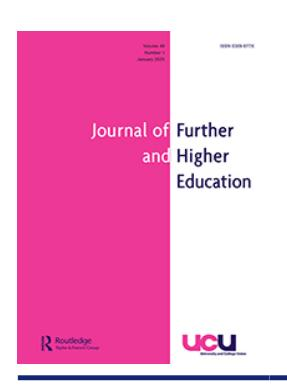
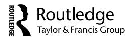

<!-- LR.R14 | source: papers_json/LR.R14/ -->

## **Journal of Further and Higher Education**

**ISSN: 0309-877X (Print) 1469-9486 (Online) Journal homepage: ****[www.tandfonline.com/journals/cjfh20](https://www.tandfonline.com/journals/cjfh20?src=pdf)**

## **Exploring the impact of publication limits on** **academic** **freedom** **and** **productivity:** **a** **qualitative** **study** **of** **Vietnamese** **EFL** **lecturers**

**Le** **Thanh** **Thao,** **Phuong** **Hoang** **Yen** **&** **Pham** **Trut** **Thuy**

**To** **cite** **this** **article:** Le Thanh Thao, Phuong Hoang Yen & Pham Trut Thuy (2025) Exploring the impact of publication limits on academic freedom and productivity: a qualitative study of Vietnamese EFL lecturers, Journal of Further and Higher Education, 49:1, 19-30, DOI: [10.1080/0309877X.2024.2427068](https://www.tandfonline.com/action/showCitFormats?doi=10.1080/0309877X.2024.2427068)

**To** **link** **to** **this** **article:** [https://doi.org/10.1080/0309877X.2024.2427068](https://doi.org/10.1080/0309877X.2024.2427068)

Published online: 10 Nov 2024.Submit your article to this journalArticle views: 164View related articlesView Crossmark dataCiting articles: 3 View citing articles

<!-- page 2 -->

## **Exploring the impact of publication limits on academic freedom ** **and productivity: a qualitative study of Vietnamese EFL lecturers**

Le Thanh Thao [a](#page-1-0) , Phuong Hoang Yen [a](#page-1-0) and Pham Trut Thuy [b](#page-1-0)

a School of Foreign Languages, Can Tho University, Can Tho, Vietnam; b Faculty of Foreign Languages, Nam Can Tho University, Can Tho, Vietnam

## **ABSTRACT**

This qualitative study investigates the effects of a publication limit policy on the research productivity and academic freedom of Vietnamese English as a Foreign Language (EFL) lecturers. Amidst growing concerns over research quality and output, the Vietnamese academic sector has implemented a policy restricting the number of publications an academic can produce annually. This study aims to explore the ramifications of this policy from the perspectives of those directly affected – the lecturers themselves. Employing semi-structured interviews, the study engaged nine Vietnamese EFL lecturers from two institutions, representing three career stages: novice, mid-career, and near-retirement. The interpretivist paradigm guided the research, enabling an in-depth exploration of the participants' subjective experiences and perceptions. Key findings revealed diverse impacts across career stages. Themes such as the perception of academic freedom, impact on research productivity, professional growth, research quality, methodology, and personal well-being emerged. The study found that while the policy aimed at enhancing research quality, it also posed challenges such as narrowed research focus, heightened stress, and the need for strategic adaptation in research practices. This research contributes to the discourse on academic policies, highlighting the need for flexible, supportive approaches that consider the diverse needs of the academic community.

## **ARTICLE HISTORY **

Received 8 February 2024 Accepted 2 November 2024

## **KEYWORDS **

Academic freedom; academic productivity; impact; publication limits; Vietnamese EFL lecturers

## **Introduction**

In recent years, the academic landscape of Vietnam has been subject to a wave of regulatory changes, one of which is the controversial policy limiting the number of publications a lecturer can produce annually. This policy, while intended to ensure the quality of academic publications, has sparked a heated debate regarding its impact on the research productivity of lecturers, particularly in the field of English as a Foreign Language (EFL) (Fuhrman, Cohen, and Mosher[ 2020)](#page-12-0). The crux of this discourse lies in whether such a restriction fosters a focus on quality over quantity, or if it inadvertently hinders the academic freedom and scholarly contributions of Vietnamese EFL lecturers.

This study aims to delve into the intricacies of this policy and its ramifications on the research outputs of Vietnamese EFL lecturers. As a qualitative exploration, it seeks to uncover the underlying perceptions, experiences, and responses of these educators to the policy. The central research questions guiding this inquiry are: How does the publication limit policy affect the research productivity of Vietnamese EFL lecturers? And to what extent does this policy represent a step back in the pursuit of academic excellence and freedom?

<!-- page 3 -->

Through a series of in-depth interviews and thematic analyses, this study endeavours to provide a comprehensive understanding of the policy's impact from the perspective of those directly affected by it. The insights garnered from this research are not only pivotal in evaluating the effectiveness and repercussions of the policy but also in offering a critical lens through which the broader implications of such regulatory measures on academic research can be understood. This exploration is particularly timely and significant, given the increasing global emphasis on both the quantity and quality of academic research, and the unique challenges faced by educators in the rapidly evolving educational landscape of Vietnam.

## **Literature review**

## *The landscape of academic publishing in Vietnam*

Vietnamese academia has been evolving rapidly, with a growing emphasis on research output and international collaboration. Vuong et al. [(2017)](#page-12-1) provided a comprehensive overview of this evolution, noting a significant increase in the quantity of research publications from Vietnamese institutions over the past decade. However, Nguyen, Ho-Le, and Le ([2017](#page-12-2)) highlighted concerns regarding the quality and impact of these publications. The government's recent policy to cap the number of publications per lecturer annually is seen as a response to these concerns, aiming to shift the focus from quantity to quality.

## *Research productivity and policy impact*

The relationship between policy interventions and research productivity has been a subject of extensive study. Ponomariov and Boardman ([2010)](#page-12-3) explored how similar policies in other contexts affected academic outputs. They found that while publication limits can reduce redundant and low-quality research, they also risk demotivating researchers and limiting academic freedom. In the context of Vietnam, Scott, Miller, and Lloyd [(2006](#page-12-4)) argued that such policies could disproportionately affect early-career researchers who are under pressure to establish their academic profiles.

## *Academic freedom and publication restrictions*

The concept of academic freedom in relation to publication caps is contentious. According to Karran, Beiter, and Appiagyei-Atua ([2017)](#page-12-5), academic freedom is fundamental for the development of innovative and critical research. However, when constrained by publication limits, this freedom may be compromised. Le Ha and Ngoc ([2020](#page-12-6)) specifically addressed this issue within the Vietnamese context, suggesting that such restrictions could undermine the autonomy and creativity of Vietnamese scholars, potentially leading to a decline in innovative research.

## *Quality vs. Quantity in academic research*

The debate over quality versus quantity in academic research is central to understanding the implications of publication limits. Peirson, Butler, and Foster ([2003](#page-12-7)) argued that an excessive focus on publication quantity can lead to a dilution of research quality. Conversely, Braun and Clarke [(2021)](#page-11-0) cautioned that stringent quality measures, such as publication caps, might discourage researchers from undertaking risky or innovative projects that do not guarantee high-impact results.

<!-- page 4 -->

## *The EFL context in Vietnam*

The field of EFL in Vietnam presents unique challenges and opportunities in research. Phan [(2021)](#page-12-8) discussed the increasing demand for English proficiency in Vietnam and its impact on EFL research. Do and Mai ([2022](#page-12-9)) suggested that this growing demand requires a robust and dynamic research environment, which might be hindered by restrictive publication policies.

The literature reveals a complex interplay between policy interventions, academic freedom, and research productivity. In the Vietnamese context, particularly in the EFL domain, the impact of publication limits is yet to be fully understood. This study aims to contribute to this understanding by exploring the perspectives of Vietnamese EFL lecturers, whose voices are crucial in evaluating the real-world implications of such policies.

## **Methods**

## *Research design*

The methodological approach of this study is rooted in a qualitative research design, specifically utilising semi-structured interviews to gather in-depth insights from Vietnamese EFL lecturers. This approach is chosen for its flexibility and responsiveness (Creswell and Poth [2016](#page-12-10)), allowing for a deeper exploration of the participants' experiences, perceptions, and responses to the policy limiting their annual publication output.

At the core of this study's design is the interpretivist paradigm, which fundamentally asserts that reality is not a fixed, objective entity but is instead subjectively experienced and shaped by individuals' social interactions and contexts (Black [2006](#page-11-1); Irshaidat [2022;](#page-12-11) Willis [2007](#page-12-12)). This paradigm is pivotal to the research as it steers the methodological approach towards a deep, empathetic understanding of the participants' perspectives. By embracing this paradigm, the study acknowledges that the experiences and perceptions of Vietnamese EFL lecturers regarding the publication limit policy are not just mere reflections of an external reality, but are intricately shaped by their individual contexts, beliefs, and interactions within the academic environment. This perspective enables the research to delve into the nuanced, personal interpretations and meanings that lecturers ascribe to the policy, shedding light on how it influences their professional lives, choices, and identities.

The theoretical framework of the study is further enriched and structured by two fundamental concepts: academic freedom (Hofstadter [2017;](#page-12-13) Russell [2002](#page-12-14)) and research productivity (Ryazanova and Jaskiene [2022)](#page-12-15). Academic freedom is a critical theoretical construct in this context. It allows for an exploration into how the publication limit policy is perceived in terms of its impact on the lecturers' intellectual independence and creative capacities in research. This concept serves as a lens to examine whether the policy is viewed as a facilitator or a barrier to intellectual exploration and innovation in the field of EFL. By focusing on academic freedom, the study seeks to understand the balance between regulatory policies and the preservation of an academic environment conducive to free thought and scholarly exploration. On the other hand, the concept of research productivity offers a different yet complementary perspective. It provides a framework for examining the tangible outcomes of the policy – specifically, how it influences the quantity and quality of scholarly work produced by the lecturers. Through this lens, the study aims to investigate whether the policy leads to a more focused and high-quality research output, or if it inadvertently results in a reduction in scholarly productivity, potentially impacting the advancement of the EFL field in Vietnam. By integrating these two concepts into its theoretical framework, the study aspires to offer a holistic understanding of the policy's multifaceted impacts on the academic landscape in Vietnam.

<!-- page 5 -->

## *Participants*

The participants of this study comprised a carefully selected group of nine Vietnamese EFL lecturers, representing a diverse range of experiences and career stages within the academic profession. These lecturers were sourced from two distinct institutions in Vietnam, ensuring a broad perspective reflective of the academic environment in the country. The selection was stratified to include three distinct career stages: three novice lecturers, who are at the beginning of their academic careers; three mid-career lecturers, who have established a foothold in the field but are still in the process of consolidating their academic reputation; and three nearend career lecturers, who possess a wealth of experience and are regarded as veterans in their field. This stratification was purposefully designed to capture a wide spectrum of experiences and perceptions regarding the impact of the publication limit policy on academic research and freedom.

The ethical considerations in conducting this study were meticulously observed. Prior to the commencement of the interviews, all participants were provided with a comprehensive explanation of the study's aims, its methodology, and the ways in which their data would be used. Informed consent was obtained from each participant, ensuring that they were participating voluntarily and had the right to withdraw from the study at any point without any consequences. To protect the participants' privacy and confidentiality, all identifying information was anonymised in the study's findings. This was particularly crucial given the sensitive nature of the topic and the potential implications of their responses on their professional standing and relationships within their institutions. The study also adhered to the ethical guidelines of the institutions involved and received the necessary ethical approvals before commencing. This adherence to ethical norms was not only a legal obligation but also a moral imperative to ensure the integrity of the research and the wellbeing of the participants.

## *Data collection*

The primary method of data collection in this study was through semi-structured interviews, a choice that allowed for both depth and flexibility in exploring the experiences and perspectives of the Vietnamese EFL lecturers. Before the full-scale interviews, a pilot study was conducted to test the effectiveness of the interview protocol. This preliminary phase involved a smaller subset of participants who fit the same criteria as the main study group. The feedback from the pilot study was instrumental in refining the interview questions, ensuring they were clear, relevant, and capable of eliciting comprehensive insights. Some of the revised interview questions included inquiries like 'How has the publication limit policy influenced your approach to research?' and 'Can you describe any changes in your research priorities or interests as a result of this policy?'. These questions were designed to probe the impact of the publication limit policy on various aspects of the lecturers' professional lives, including their research strategies, academic freedom, and overall career trajectory.

The interviews were conducted in locations chosen for their convenience and comfort for the participants, often within their own institutions or in quiet public spaces conducive to confidential discussion. Each interview lasted between 45 to 60 minutes, allowing ample time for participants to express their thoughts fully without feeling rushed. Given the native language of the participants, all interviews were conducted in Vietnamese. This choice was crucial for ensuring that participants could express themselves freely and comfortably, thereby enhancing the authenticity and depth of their responses. For participants who were not fluent in Vietnamese or preferred another language, arrangements were made to conduct the interviews in their language of choice, with the assistance of professional translation services to ensure accuracy in data interpretation.

<!-- page 6 -->

## *Data analysis*

The data gathered from the semi-structured interviews was subjected to a rigorous process of thematic analysis, a method well-suited for identifying, analysing, and reporting patterns or themes within qualitative data (Braun and Clarke[ 2012;](#page-11-2) Braun, Clarke, and Hayfield [2023](#page-11-3)). This analysis began with a meticulous transcription of the recorded interviews, converting the spoken Vietnamese into written text. The transcribed data was then read and re-read multiple times to gain a deep familiarity and an immersive understanding of the content, a process fundamental to the identification of preliminary themes.

Following this initial immersion, a more focused coding process was undertaken. This involved systematically coding segments of the data where specific ideas, concepts, or patterns were evident. These codes were not predetermined but rather emerged organically from the data, reflecting the interpretivist paradigm underpinning the study. As the coding process progressed, these initial codes were continually refined and organised into potential themes. These emerging themes were then reviewed and refined further. This stage involved a critical evaluation of how the themes fit together and how they related to the broader research questions and theoretical framework of the study. This iterative process of reviewing and refining ensured that the final themes were not only grounded in the data but also meaningful and relevant to the study's objectives. The final stage of the analysis involved defining and naming the themes, a process that required careful consideration to accurately reflect the essence of what each theme represented. Once the themes were clearly defined, the study moved towards the final reporting phase, where these themes were presented and discussed in the context of the existing literature, the study's theoretical framework, and the broader socio-cultural context of the Vietnamese academic landscape.

Throughout the data analysis process, a constant effort was made to maintain rigour and reflexivity, ensuring that the analysis remained objective and that the researchers' biases or preconceptions did not unduly influence the findings. This approach to thematic analysis was instrumental in distilling complex, nuanced insights from the data, providing a rich and textured understanding of the impact of the publication limit policy on Vietnamese EFL lecturers.

## **Findings**

## *Perception of academic freedom*

One of the prominent themes that emerged from the analysis was the perception of academic freedom among the Vietnamese EFL lecturers in relation to the publication limit policy. This theme was notably mentioned by all nine participants, encompassing different career stages: three novice teachers, three mid-career teachers, and three near-retirement teachers.

A novice teacher expressed concern about the policy's restrictive nature, stating, '*As a new * *lecturer, I feel the policy limits my opportunities to explore diverse research areas. I am compelled to * *focus on fewer, "safer" topics*.' This excerpt highlights a tension between the desire for academic exploration and the perceived constraints imposed by the policy, suggesting a potential conflict with the principle of academic freedom. From a theoretical standpoint, this reflects the idea that stringent publication limits can impede intellectual independence, particularly for early-career academics who are still shaping their research trajectories.

In contrast, a mid-career teacher provided a slightly different perspective, '*I have learned to be * *more strategic about my research choices. The policy does not limit my freedom but makes me think * *more critically about what I publish*.' This response indicates a nuanced adaptation to the policy, where the lecturer navigates the constraints to maintain productivity while also upholding a degree of academic freedom. Theoretically, this aligns with the concept that limitations can sometimes foster a more focused and thoughtful approach to research, potentially enhancing the quality of outputs.

<!-- page 7 -->

A near-retirement teacher shared a reflective viewpoint, '*Over the years, I have seen many policy * *changes. This one, though limiting, does not significantly hinder my academic freedom. My concern is * *more for the younger lecturers*.' This excerpt suggests a seasoned perspective where the policy is seen as less impactful on personal academic freedom but raises concerns about its implications for emerging academics. Theoretically, this reflects an understanding that academic freedom is not just an individual concern but a collective one, affecting the broader academic community and the future of scholarly research.

Each of these excerpts, drawn from different career stages, demonstrates the varied impacts of the publication limit policy on academic freedom. They collectively suggest a complex interplay between policy constraints and the autonomy of lecturers in their scholarly pursuits.

## *Impact on research productivity*

Another significant theme that emerged from the interviews was the impact of the publication limit policy on the research productivity of Vietnamese EFL lecturers. This theme was echoed across the career spectrum, with all nine participants commenting on it: three novice, three mid-career, and three near-end career lecturers.

A novice lecturer shared, '*The policy limits the quantity of my publications, but I am unsure if it is * *enhancing the quality. I feel pressured to produce less but more impactful work, yet I am still navigating * *what that means*.' This statement reflects a common predicament among early-career academics who are grappling with the policy's implications on their research output. Theoretically, this scenario aligns with concerns about research productivity, where the policy's emphasis on quality over quantity can lead to a paradoxical situation for novice researchers who are also striving to establish their academic presence.

From a mid-career lecturer's perspective, the sentiment was mixed: '*I understand the rationale * *behind the policy, but it sometimes feels like a barrier to maintaining a consistent research output. * *Balancing quality with quantity has become a more deliberate, yet challenging task*.' This response highlights a mid-career academic's struggle to adapt to the policy while trying to sustain their research momentum. Theoretically, this reflects the tension between the policy's intent to enhance research quality and the practical challenges it poses for maintaining productivity, especially for established researchers in the midst of their career.

A near-end career lecturer offered a broader view: '*Over my career, I have seen various policies * *impacting research. This one, while well-intentioned, might be limiting younger colleagues more than it * *affects me. I worry about its long-term impact on our field's growth*.' This perspective suggests a concern for the policy's implications on the broader academic community, particularly for emerging scholars. Theoretically, this aligns with the concept of research productivity not just as an individual metric but as a collective measure of the field's advancement and the nurturing of future academic talent.

These excerpts collectively illustrate the complex and varied impacts of the publication limit policy on the research productivity of Vietnamese EFL lecturers. They reflect a spectrum of challenges and adaptations across different career stages, underlining the nuanced balance between ensuring research quality and fostering a productive and vibrant academic environment.

## *Navigating professional growth and collaborative opportunities*

The third key finding of this study centres on how the publication limit policy influences lecturers' professional growth and their pursuit of collaborative research opportunities. This aspect was discussed across all participant groups, with each of the novice, mid-career, and near-end career lecturers providing insights into how the policy shaped their academic trajectories and collaborative endeavours.

<!-- page 8 -->

A novice lecturer highlighted the constraints imposed by the policy on career advancement: '*As * *someone early in my career, I feel the publication limit slows down my professional growth. I have to be * *very selective about what I research and publish, which can be limiting*.' This sentiment reflects a concern that the policy may stifle the career progression of early-stage academics by restricting their output and limiting opportunities for exploration and visibility. Theoretically, this situation poses a challenge to academic freedom, as it constrains the ability of novice lecturers to experiment and innovate in their field. It also impacts research productivity, as the pressure to produce fewer but more impactful publications may lead to a cautious approach to research topics.

For a mid-career lecturer, the focus shifted towards collaboration: '*The policy has pushed me * *towards more collaborative projects. Working with others allows us to pool our limited publication * *opportunities and produce more impactful work*.' This approach suggests a strategic adaptation to the policy, where mid-career lecturers leverage collaboration to maximise the impact of their limited publication slots. Theoretically, this reflects a practical exercise of academic freedom within the constraints of the policy, as lecturers find creative ways to sustain their research productivity through collaborative efforts.

A near-end career lecturer offered a perspective on mentorship and collaboration: '*I see my * *role as guiding younger colleagues through these challenges. We collaborate on projects, which * *helps them grow and also expands my own research scope*.' This view indicates an awareness of the policy's broader implications and a commitment to supporting the professional development of younger colleagues through collaborative research. Theoretically, this stance aligns with the concept of academic freedom as a collective academic responsibility, where experienced lecturers help nurture an environment that supports growth and productivity despite policy constraints.

These insights reveal the multifaceted impacts of the publication limit policy on professional growth and collaborative research. While the policy poses challenges to individual career advancement, particularly for novice lecturers, it also opens avenues for strategic collaborations and mentorship opportunities across different career stages.

## *Influence on research quality and subject choice*

The fourth finding from this study delves into how the publication limit policy influences the quality of research produced by Vietnamese EFL lecturers and the choices they make regarding research subjects. This theme was consistently brought up by participants across all career stages: the three novice, three mid-career, and three near-end career lecturers.

Novice lecturers, in particular, voiced concerns about the pressure to produce high-quality research within the confines of the policy, often at the expense of exploring diverse or innovative topics. One novice lecturer stated, '*I feel pressured to focus on safer, more conventional topics that are likely to be * *accepted in high-impact journals, which limits the scope of my research*.' This perspective underscores a conflict between the desire to innovate and the need to adhere to perceived 'safe' topics that align with the policy's emphasis on quality. Theoretically, this reflects a significant constraint on academic freedom, particularly for early-career academics who are in the process of defining their research niches. Additionally, it points to a potential risk in research productivity, where the focus on quality may inadvertently lead to a narrower range of research topics being explored.

Mid-career lecturers, having established their research agendas, discussed the challenge of balancing their established interests with the new demands for higher-quality publications. One mid-career lecturer commented, '*I have had to reevaluate my research priorities to ensure they meet * *the heightened quality expectations, which sometimes means putting aside less conventional ideas*.' This response indicates a strategic adjustment to align with the policy while trying to maintain personal research interests. Theoretically, it represents a negotiation of academic freedom within the bounds of institutional and policy constraints, alongside a conscious effort to sustain research productivity under these new conditions.

<!-- page 9 -->

Near-end career lecturers reflected on the broader implications of the policy for the field of EFL. One such lecturer noted, '*While the policy might elevate the overall quality of research, I am concerned * *about the long-term impact on the diversity and innovation in our field*.' This view points to a concern that while the policy may enhance the quality of individual publications, it could also lead to a homogenisation of research topics and methodologies. Theoretically, this raises questions about the balance between fostering high-quality research and ensuring a diverse and vibrant academic landscape that supports academic freedom and robust research productivity.

These findings collectively highlight the nuanced impact of the publication limit policy on research quality and subject choice among Vietnamese EFL lecturers. While the policy may drive a focus on producing higher-quality research, it also poses challenges in terms of narrowing the scope of topics explored and potentially limiting innovation in the field.

## *Reshaping research priorities and methodologies*

The fifth finding of this study focuses on how the publication limit policy has reshaped the research priorities and methodologies of Vietnamese EFL lecturers. This change in research approach was a theme consistently discussed by the participants, including all three novice, three mid-career, and three near-end career lecturers.

Novice lecturers, particularly, felt a significant impact on their approach to research. One novice lecturer explained, '*The publication cap has made me rethink not just what I research, but how * *I research. There is a greater emphasis now on ensuring methodological rigor to meet quality standards*.' This perspective highlights a shift towards more meticulous and potentially conservative research methods as a response to the policy. Theoretically, this represents a limitation on academic freedom, especially for new researchers who are still developing their methodological preferences. Moreover, it impacts research productivity by potentially slowing down the research process and limiting the scope of methodologies employed.

Mid-career lecturers reported a nuanced impact on their research practices. A mid-career lecturer shared, '*I have found myself focusing more on interdisciplinary research as a way to broaden the impact * *of my limited publications*.' This approach reflects an adaptive strategy to the policy, where midcareer lecturers seek to maximise the influence of their work through interdisciplinary collaboration. Theoretically, this suggests a strategic exercise of academic freedom within the constraints of the policy, as lecturers find innovative ways to sustain their research productivity and impact.

Near-end career lecturers provided insights into how they have adapted their long-established research methodologies in response to the policy. One such lecturer stated, '*I have had to be more * *selective and strategic about my research methods, ensuring they align with what is now expected in * *high-quality publications*.' This comment reflects a recalibration of research practices in light of the policy, emphasising strategic adaptation to maintain relevance and impact. Theoretically, it indicates an experienced academic's response to balancing academic freedom with the evolving demands of research quality and productivity.

These findings reveal how the publication limit policy has led to a re-evaluation and adaptation of research priorities and methodologies among Vietnamese EFL lecturers. While the policy aims to enhance research quality, it also influences the choice of research topics and methods, thereby impacting academic freedom and the nature of research productivity.

## *Impact on personal and professional well-being*

The sixth finding of this study illuminates the impact of the publication limit policy on the personal and professional well-being of Vietnamese EFL lecturers. This aspect was a recurring theme across the interviews with all three groups of lecturers: novice, mid-career, and near-end career.

Novice lecturers particularly emphasised the stress and anxiety associated with meeting the publication standards while trying to establish their careers. One novice lecturer described, '*The *

<!-- page 10 -->

*pressure to publish high-quality work within the limits has been overwhelming at times, affecting both * *my professional satisfaction and personal well-being*.' This expression of concern highlights the psychological impact of the policy, where the pressure to produce significant work within restrictive limits can lead to stress and anxiety. Theoretically, this situation poses a challenge to academic freedom, as the policy's constraints may inhibit the lecturers' ability to explore and contribute freely to their field. Furthermore, it impacts research productivity, as stress and well-being are closely tied to professional effectiveness and output.

Mid-career lecturers also voiced concerns about well-being, though their focus was more on the challenge of balancing established career paths with the new policy constraints. A mid-career lecturer noted, '*While I understand the need for quality control, the publication cap has added an * *extra layer of stress to an already demanding job*.' This perspective suggests an additional burden imposed by the policy, complicating the already complex task of sustaining an academic career. Theoretically, this reflects a tension between maintaining academic freedom and navigating institutional policies, a balance that is crucial for professional satisfaction and effective research productivity.

Near-end career lecturers expressed concerns regarding the policy's long-term impact on the academic community's well-being. One experienced lecturer observed, '*I worry about how * *this policy affects the morale and motivation of my younger colleagues. It is important to * *consider the human aspect of academic policies*.' This perspective underscores a broader concern for the policy's implications on the academic community's collective well-being and morale. Theoretically, it raises questions about the balance between fostering a productive research environment and ensuring the well-being of those who contribute to it.

Overall, these findings highlight the significant impact of the publication limit policy on the personal and professional well-being of Vietnamese EFL lecturers. They reveal the policy's broader implications, not just in terms of academic output and freedom, but also in how it affects the lecturers' psychological well-being and job satisfaction.

## **Discussion**

The findings of this study on the impact of the publication limit policy on Vietnamese EFL lecturers offer several insights that both align with and diverge from existing literature, thereby contributing novel perspectives to the field. The theme of academic freedom resonates with the broader discourse in academic research, where policies are often seen as a double-edged sword. Similar to findings in studies by Anderson ([2021](#page-11-4)) and Marshall [(2023](#page-12-16)), our research highlights the nuanced impact of publication limits on academic freedom. The varied responses from novice, mid-career, and near-retirement teachers in our study add depth to this conversation. Particularly, the novice teachers' perception of constrained exploration aligns with existing concerns about the policy's dampening effect on intellectual independence (Dewey [2011](#page-12-17)). In contrast, the adaptive strategies of mid-career and seasoned lecturers offer a new angle, suggesting that experience and career stage significantly influence how academic freedom is perceived and navigated. This diverges from a generalised view of policy impact, suggesting a more complex relationship between career stage and academic freedom.

Regarding research productivity, our findings parallel those of Lund et al. ([2022](#page-12-18)), who noted the potential for publication limits to reduce redundant research but also risk demotivating researchers. The expressions of concern from novice and mid-career lecturers in our study about the policy's barrier to maintaining a consistent research output echo these sentiments. However, the nuanced adaptations and strategic approaches to research observed among our participants, particularly the mid-career and near-end career lecturers, highlight a unique aspect of the policy's impact. This suggests that Vietnamese EFL lecturers are not merely passive recipients of policy impacts but active negotiators of their research trajectories, which is a significant addition to the existing literature.

<!-- page 11 -->

The study's insights into how lecturers navigate professional growth and collaborative opportunities under the policy constraints offer a new dimension to the discourse. Unlike existing literature that often views policy impacts in terms of restrictions (Dilling and Lemos [2011)](#page-12-19), our study illuminates how such policies can catalyse strategic collaborations and mentorship, particularly evident in the responses of mid-career and experienced lecturers. This finding underscores the potential for policies to foster unexpected positive dynamics in academic settings, a perspective not extensively covered in prior studies (Alderman [2013](#page-11-5)).

In terms of the influence on research quality and subject choice, our study aligns with Peirson, Butler, and Foster ([2003](#page-12-7)) and Ciriaci and Muscio ([2014](#page-12-20)), who discuss the trade-offs between research quantity and quality. However, the specific concerns of novice lecturers about being compelled to focus on 'safer' topics present a unique contribution, highlighting how policy impacts can differ based on career stage. This finding extends the conversation by suggesting that policies might inadvertently narrow the scope of research innovation, particularly for those at the early stages of their career.

Our study contributes new insights into how publication policies can reshape research priorities and methodologies. While existing literature often focuses on the outcomes of such policies (Henry et al. [2013](#page-12-21)), our study sheds light on the process of adaptation, highlighting the strategic shifts in research approaches across different career stages. This perspective adds a dynamic angle to the understanding of policy impacts, emphasising the evolving nature of academic work in response to policy changes.

Finally, the theme of personal and professional well-being underlines a crucial aspect often overlooked in academic policy research. The stress and anxiety reported by lecturers, especially those at the beginning of their careers, highlight the human cost of such policies (Sykes, Schneider, and Plank [2012](#page-12-22)). This finding adds a critical dimension to the conversation, advocating for a more holistic approach to academic policy assessment that considers the well-being of educators.

## **Conclusion**

This study embarked on an exploration of the impacts of the publication limit policy on Vietnamese EFL lecturers, a policy intended to regulate the quality of academic research but with potential ramifications on various aspects of academic life. Through a qualitative lens, employing semistructured interviews, the study sought to delve into the experiences and perceptions of nine Vietnamese EFL lecturers from different career stages: novice, mid-career, and near-retirement. The interpretivist paradigm underpinning this research facilitated an in-depth understanding of the subjective realities of these lecturers, offering a nuanced view of how policy intersects with academic practice.

The findings of this study were multifaceted. They revealed a significant impact on academic freedom, with lecturers at different career stages perceiving and adapting to the policy's constraints in varied ways. Research productivity was another key theme, with the policy influencing not only the quantity but also the nature and quality of research outputs. The study also uncovered the strategic adaptations lecturers employed in response to the policy, highlighting shifts in research priorities, methodologies, and collaborative practices. Importantly, the impact of the policy on the personal and professional well-being of the lecturers emerged as a critical finding, bringing to light the psychological and emotional dimensions of academic policies.

Based on these findings, the study has several implications. Firstly, it underscores the need for policy-makers to consider the diverse impacts of publication policies across different career stages. Policies need to be flexible enough to support the evolving needs of academics, from novice researchers building their careers to seasoned scholars contributing to the advancement of their fields. Secondly, the findings suggest the importance of institutional support in navigating policy constraints. Universities and academic institutions play a crucial role in providing resources, guidance, and collaborative opportunities to help lecturers adapt to and thrive under such policies.

<!-- page 12 -->

Thirdly, the study highlights the need for a holistic approach to policy evaluation, one that accounts for the personal well-being of academics alongside research productivity and quality. This approach can lead to a more sustainable and humane academic environment.

In conclusion, this study contributes to a deeper understanding of the complex dynamics at play in academic settings under restrictive policies. It offers valuable insights for policy-makers, academic leaders, and educators, emphasising the importance of nuanced and empathetic policy design and implementation that supports the diverse needs and aspirations of the academic community.

## **Limitations and recommendations for further studies**

One of the primary limitations of this study lies in its scope, particularly the focus on a relatively small and specific sample of nine Vietnamese EFL lecturers from only two institutions. While this provided in-depth insights, the findings may not be broadly generalisable across all academic contexts or disciplines in Vietnam or other countries with similar policies. Additionally, the reliance on selfreported data through interviews, while valuable for capturing personal experiences and perceptions, may be subject to biases and limitations inherent in qualitative research, such as the potential influence of the interviewer's presence or the participants' subjective interpretations of their experiences.

Given these limitations, further research is recommended to expand the scope and depth of understanding in this area. Future studies could involve a larger and more diverse sample of participants from various academic disciplines and institutions, both within and beyond Vietnam. This would enhance the generalisability of the findings and provide a more comprehensive view of the policy's impacts across different academic cultures. Quantitative studies could also be conducted to complement the qualitative insights of this research, offering a broader statistical perspective on the policy's implications for academic productivity and well-being. Moreover, longitudinal studies tracking the long-term effects of such policies on academic careers and research trajectories would be beneficial in understanding the evolving impacts over time. These recommendations aim to build a more holistic understanding of publication limit policies and their multifaceted impacts on the academic community.

## **Disclosure statement**

No potential conflict of interest was reported by the author(s).

## **ORCID**

Le Thanh Thao http://orcid.org/0000-0002-8471-8305 Phuong Hoang Yen http://orcid.org/0000-0003-0137-4795 Pham Trut Thuy http://orcid.org/0009-0005-6596-2686

## **References**

Alderman, M. K. [2013.](#page-10-0) *Motivation for Achievement: Possibilities for Teaching and Learning*. New York: Routledge. Anderson, R. [2021](#page-9-0). "Open Access and Academic Freedom: Teasing Out Some Important Nuances." *Development & * *Change *52 (6): 1503–1512. [https://doi.org/10.1111/dech.12636 ](https://doi.org/10.1111/dech.12636).

Black, I. [2006.](#page-3-0) "The Presentation of Interpretivist Research." *Qualitative Market Research: An International Journal *9 (4): 319–324. [https://doi.org/10.1108/13522750610689069 .](https://doi.org/10.1108/13522750610689069)

Braun, V., and V. Clarke. [2012](#page-5-0). *Thematic Analysis*. Washington: American Psychological Association.

Braun, V., and V. Clarke. [2021](#page-2-0). "One Size Fits All? What Counts as Quality Practice in (Reflexive) Thematic Analysis?" *Qualitative Research in Psychology *18 (3): 328–352. [https://doi.org/10.1080/14780887.2020.1769238 .](https://doi.org/10.1080/14780887.2020.1769238)

Braun, V., V. Clarke, and N. Hayfield. [2023.](#page-5-0) *Thematic Analysis: A Reflexive Approach*. London: SAGE Publications.

<!-- page 13 -->

Ciriaci, D., and A. Muscio.[ 2014.](#page-10-1) "University Choice, Research Quality and graduates' Employability: Evidence from Italian National Survey Data." *European Educational Research Journal *13 (2): 199–219. [https://doi.org/10.2304/eerj.2014.13.2.](https://doi.org/10.2304/eerj.2014.13.2.199) [199](https://doi.org/10.2304/eerj.2014.13.2.199) .

Creswell, J. W., and C. N. Poth. [2016](#page-3-1). *Qualitative Inquiry and Research Design: Choosing Among Five Approaches*. London: Sage Publications.

Dewey, J. [2011](#page-9-1). *The Sources of a Science of Education*. Redditch: Read Books Ltd.

Dilling, L., and M. C. Lemos. [2011.](#page-10-2) "Creating Usable Science: Opportunities and Constraints for Climate Knowledge Use and Their Implications for Science Policy." *Global Environmental Change *21 (2): 680–689. [https://doi.org/10.1016/j.](https://doi.org/10.1016/j.gloenvcha.2010.11.006) [gloenvcha.2010.11.006 .](https://doi.org/10.1016/j.gloenvcha.2010.11.006)

Do, H. T. H., and A. N. Mai. [2022.](#page-3-2) "Policies on University Autonomy in Vietnam." *Journal of Further and Higher Education * 46 (5): 575–585. [https://doi.org/10.1080/0309877X.2021.1986475 .](https://doi.org/10.1080/0309877X.2021.1986475)

Fuhrman, S. H., D. K. Cohen, and F. Mosher, Eds. [2020.](#page-1-1) *The State of Education Policy Research*. New York: Routledge.

Henry, M., B. Lingard, F. Rizvi, and S. Taylor. [2013](#page-10-3). *Educational Policy and the Politics of Change*. New York: Routledge.

Hofstadter, R. [2017.](#page-3-3) *Academic Freedom in the Age of the College*. New York: Routledge.

Irshaidat, R. [2022](#page-3-0). "Interpretivism Vs. Positivism in Political Marketing Research." *Journal of Political Marketing *21 (2): 126–160. [https://doi.org/10.1080/15377857.2019.1624286](https://doi.org/10.1080/15377857.2019.1624286) .

Karran, T., K. Beiter, and K. Appiagyei-Atua. [2017](#page-2-1). "Measuring Academic Freedom in Europe: A Criterion Referenced Approach." *Policy Reviews in Higher Education *1 (2): 209–239. [https://doi.org/10.1080/23322969.2017.1307093](https://doi.org/10.1080/23322969.2017.1307093) .

Le Ha, P., and D. B. Ngoc. [2020](#page-2-2). *Higher Education in Market-Oriented Socialist Vietnam: New Players, Discourses, and * *Practices*. Cham: Springer International Publishing AG.

Lund, H., K. A. Robinson, A. Gjerland, H. Nykvist, T. M. Drachen, R. Christensen, C. B. Juhl, et al. [2022.](#page-9-2) "Meta-Research Evaluating Redundancy and Use of Systematic Reviews When Planning New Studies in Health Research: A Scoping Review." *Systematic Reviews *11 (1): 241. [https://doi.org/10.1186/s13643-022-02096-y .](https://doi.org/10.1186/s13643-022-02096-y)

Marshall, B. K. [2023](#page-9-0). *Academic Freedom and the Japanese Imperial University, 1868–1939*. California: Univ of California Press.

Nguyen, T. V., T. P. Ho-Le, and U. V. Le.[ 2017](#page-2-3). "International Collaboration in Scientific Research in Vietnam: An Analysis of Patterns and Impact." *Scientometrics *110 (2): 1035–1051. [https://doi.org/10.1007/s11192-016-2201-1 ](https://doi.org/10.1007/s11192-016-2201-1).

Peirson, S. N., J. N. Butler, and R. G. Foster. [2003.](#page-2-4) "Experimental Validation of Novel and Conventional Approaches to Quantitative Real‐Time PCR Data Analysis." *Nucleic Acids Research *31 (14): e73–e73. [https://doi.org/10.1093/nar/](https://doi.org/10.1093/nar/gng073) [gng073 .](https://doi.org/10.1093/nar/gng073)

Phan, A. N. Q. [2021](#page-3-4). "Under the Impacts of Globalisation: The Rising Power of English as a Foreign Language (EFL) and the Corresponding Response of EFL Policy in Vietnam." *SN Social Sciences *1 (1): 31. [https://doi.org/10.1007/s43545-](https://doi.org/10.1007/s43545-020-00047-9) [020-00047-9 ](https://doi.org/10.1007/s43545-020-00047-9).

Ponomariov, B. L., and P. C. Boardman. [2010](#page-2-5). "Influencing scientists' Collaboration and Productivity Patterns Through New Institutions: University Research Centers and Scientific and Technical Human Capital." *Research Policy *39 (5): 613–624. [https://doi.org/10.1016/j.respol.2010.02.013 ](https://doi.org/10.1016/j.respol.2010.02.013).

Russell, C. [2002.](#page-3-3) *Academic Freedom*. New York: Routledge.

Ryazanova, O., and J. Jaskiene. [2022](#page-3-5). "Managing Individual Research Productivity in Academic Organizations: A Review of the Evidence and a Path Forward." *Research Policy *51 (2): 104448. [https://doi.org/10.1016/j.respol.2021.104448](https://doi.org/10.1016/j.respol.2021.104448) .

Scott, S., F. Miller, and K. Lloyd. [2006](#page-2-6). "Doing Fieldwork in Development Geography: Research Culture and Research Spaces in Vietnam." *Geographical Research *44 (1): 28–40. [https://doi.org/10.1111/j.1745-5871.2006.00358.x](https://doi.org/10.1111/j.1745-5871.2006.00358.x) .

Sykes, G., B. Schneider, and D. N. Plank, Eds. [2012](#page-10-4). *Handbook of Education Policy Research*. New York: Routledge.

Vuong, Q. H., M. T. Ho, T. T. Vuong, V. H. Nguyen, N. K. Napier, and H. H. Pham. [2017](#page-2-7). "Nemo Solus Satis Sapit: Trends of Research Collaborations in the Vietnamese Social Sciences, Observing 2008–2017 Scopus Data." *Publications *5 (4): 24. [https://doi.org/10.3390/publications5040024](https://doi.org/10.3390/publications5040024) .

Willis, J. [2007.](#page-3-0) *Foundations of Qualitative Research: Interpretive and Critical Approaches*. Washington DC: Sage.
