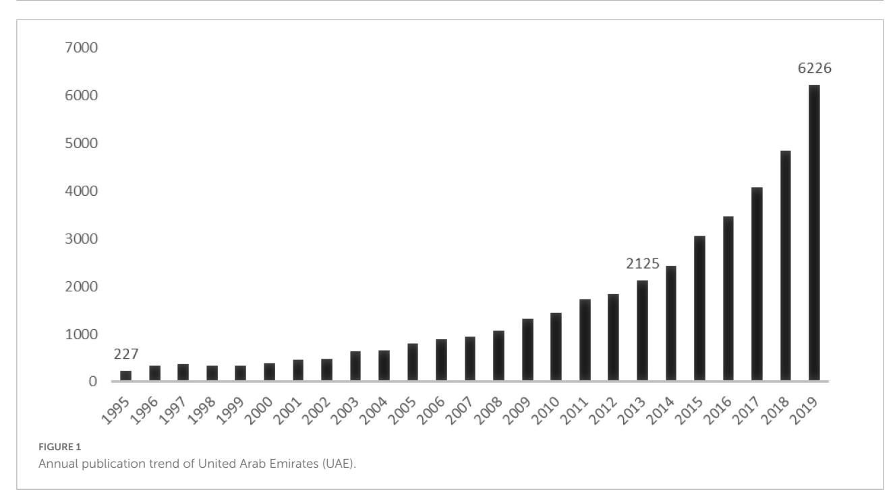
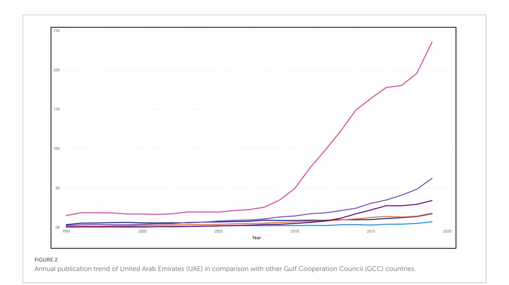

<!-- LR.R15 | source: papers_json/LR.R15/ -->

TYPE [Methods](https://www.frontiersin.org/journals/education#editorial-board) PUBLISHED [20 September 2022](https://www.frontiersin.org/journals/education#editorial-board) DOI [10.3389/feduc.2022.792548](https://doi.org/10.3389/feduc.2022.792548)

## OPEN ACCESS

University, India

EDITED BY Esmat Zaidan, Qatar University, Qatar

REVIEWED BY Isaías Martín-Ruiz, Universidad de Málaga, Spain Gangan Prathap, APJ Abdul Kalam Technological

*CORRESPONDENCE Sreejith Balasubramanian s.balasubramanian@mdx.ac.ae

SPECIALTY SECTION This article was submitted to Higher Education, a section of the journal Frontiers in Education

RECEIVED 10 October 2021 ACCEPTED 15 August 2022 PUBLISHED 20 September 2022

Ajayan S, Balasubramanian S and Ramachandran S (2022) Benchmarking the research performance of United Arab Emirates with gulf cooperation council countries – A bibliometric study.

*Front. Educ.* 7:792548. doi: [10.3389/feduc.2022.792548](https://doi.org/10.3389/feduc.2022.792548)

## COPYRIGHT

© 2022 Ajayan, Balasubramanian and Ramachandran. This is an open-access article distributed under the terms of the [Creative](http://creativecommons.org/licenses/by/4.0/) [Commons](http://creativecommons.org/licenses/by/4.0/) [Attribution](http://creativecommons.org/licenses/by/4.0/) [License](http://creativecommons.org/licenses/by/4.0/) [(CC BY).](http://creativecommons.org/licenses/by/4.0/) The use, distribution or reproduction in other forums is permitted, provided the original author(s) and the copyright owner(s) are credited and that the original publication in this journal is cited, in accordance with accepted academic practice. No use, distribution or reproduction is permitted which does not comply with these terms.

## Benchmarking the research performance of United Arab [Emirates with gulf cooperation](https://www.frontiersin.org/articles/10.3389/feduc.2022.792548/full) council countries – A bibliometric study

Shalini Ajayan^1^ , Sreejith Balasubramanian2* and Sunder Ramachandran^3^

^1^Mohammed Bin Rashid School of Government, Dubai, United Arab Emirates, ^2^Chair of Research Committee and Head, Centre for Supply Chain Excellence, Middlesex University Dubai, Dubai, United Arab Emirates, ^3^Abu Dhabi School of Management, Abu Dhabi, United Arab Emirates

The research performance of a country is an indicator of its scientific progress and benchmarking it with regional countries is critical to assess a country's regional competitiveness. This study aims to assess and benchmark the research productivity of the United Arab Emirates (UAE) against other member nations of the Gulf Cooperation Council (GCC), namely with Saudi Arabia, Oman, Kuwait, Qatar, and Bahrain, who have similar macroeconomic and socio-cultural characteristics. Scopus was used as the data source to extract the research output of each of the six countries studied for the period 1995– 2019. Bibliometric indicators covering both quantity and impact of research such as publication output, citation, and collaboration indicators were used to assess the research performance of UAE and other GCC countries. The findings indicate good progress in the UAE's overall research performance during the period of study. Also, UAE's research performance in most of the bibliometric indicators is comparable or superior to the other GCC countries. This study is the first of its kind and addresses the dearth of bibliometric studies assessing UAE's research productivity and GCC countries in general. The findings are useful for administrators and policymakers to benchmark the performance of the UAE with other GCC countries, including its impact, growth, and trajectories. For researchers, the study indicators and methods can be replicated to assess the overall research performance of other countries.

## KEYWORDS

bibliometric study, United Arab Emirates (UAE), Gulf Cooperation Council (GCC), research performance, research indicators

<!-- page 2 -->

## Introduction

Established in 1971, the United Arab Emirates (UAE) is celebrating its 50th anniversary this year. UAE is one of the sixmember states of the Gulf Cooperation Council (GCC) along with Saudi Arabia, Oman, Kuwait, Qatar, and Bahrain, who share similar characteristics in terms of their macroeconomic conditions, cultural commonalities, reliance on the nonindigenous workforce, and dependence on oil resources. Along with other member states in the GCC, the UAE has witnessed rapid economic progress over the years owing to the discovery of oil. For instance, the Gross Domestic Product (GDP) per capita of the UAE is one of the highest in the region, comparable with those of advanced economies and second-highest among the GCC countries after Qatar [(Statista,](#page-11-0) [2021)](#page-11-0). However, in order to reduce its dependence on oil and support the country's longterm sustainable growth, the UAE and other GCC countries had been aggressively pursuing knowledge-based structural reforms to transition from an oil-based economy to a knowledge-based economy [(Al Ahbabi et al.,](#page-10-0) [2019)](#page-10-0).

Among others, research and development play a significant role in advancing the economic diversification aspirations and competitiveness of nations [(Siddiqi et al.,](#page-11-1) [2016)](#page-11-1). Studies have shown a direct relationship between research pursuing behavior and the overall development of a country, including improvements in the living standards and quality of life [(Meo](#page-11-2) [et al.,](#page-11-2) [2013;](#page-11-2) [Siddiqi et al.,](#page-11-1) [2016)](#page-11-1). The UAE government has been investing in education and research to produce knowledge and advance scientifically. For instance, creating a world-class education and research ecosystem is one of the key pillars of the UAE's national agenda. This is reflected in the significant increase, in the number of higher education institutions (from 5 in 1990 to over 100 in 2020) in the UAE, including campuses of several globally reputed foreign universities [(Ajayan and](#page-10-1) [Balasubramanian,](#page-10-1) [2020)](#page-10-1). Some of the notable efforts by the UAE government in boosting the research productivity included the establishment of the National Research Foundation (NRF) to support research activities of academic staff through the disbursement of research grants [(Talib et al.,](#page-11-3) [2015)](#page-11-3); the establishment of the Mohammed bin Rashid Al Maktoum Knowledge Foundation (MBRF) with a $10 billion endowment fund to advance scientific knowledge in the region by funding research projects [(Al Yami et al.,](#page-10-2) [2021)](#page-10-2); the establishment of the Abu Dhabi Research and Development Authority [(ADEK,](#page-10-3) [2019)](#page-10-3); and the Sheikh Saud bin Saqr Al Qasimi Foundation for Policy Research to provide competitive research grants to faculty and doctoral students [(Al Qasimi Foundation for Policy](#page-10-4) [Research,](#page-10-4) [2021)](#page-10-4) among others.

Unfortunately, the extent to which the aforementioned effort of UAE has translated to tangible research outcomes is unclear. To date, only limited effort has been made to examine the overall research performance of the UAE, let alone comparison with other countries. Also, compared to Western countries, studies examining the research productivity of GCC

countries, in general, are scarce. Moreover, there is a widespread notion that there is a lack of research culture in the Arab countries, including the UAE [(Abouchedid and Abdelnour,](#page-10-5) [2015;](#page-10-5) [Jose and Chacko,](#page-11-4) [2017)](#page-11-4).

Bibliometric analysis, a widely used method to quantify and evaluate the research productivity at a country level [(Archambault et al.,](#page-10-6) [2009;](#page-10-6) [Sweileh et al.,](#page-11-5) [2014a)](#page-11-5), is utilized in this study. When looking for quantitative measures of scientific productivity and impact at a country level, administrators and policymakers often turn to bibliometric data. This is because the bibliometric indicators are essential tools to understand the growth and global spread of research. The indicators used in this study are mainly based on the number of scientific publications and their visibility and acceptance globally. Previous studies have shown that the quality and quantity of the scientific publications are a key indicator of the scientific development of a country, and measuring them facilitates benchmarking the scientific advancement of the country with a group of countries, especially in the GCC context, when there is a distinct paucity of other comparable data to benchmark the scientific progress of UAE with other GCC countries.

This study seeks to bridge the gaps in the literature by analyzing and benchmarking the research performance of the UAE with other GCC countries and empirically test the notions in the literature regarding its lack of research culture. Therefore, the study aims to investigate the UAE's research performance during the 25-year period spanning 1995–2019 and benchmark its performance against other GCC countries. The specific research objectives of this study are as follows:

- a) How has UAE's overall research productivity evolved in the last 25 years (1995–2019)?
- b) How does the research productivity UAE compare against those of other GCC during the period 1995–2019?

The remainder of the manuscript is structured as follows. In the next section, we review the literature to identify the gaps and develop the key bibliometric indicators relevant to this study. The data and methods utilized used in this study are detailed in section "Data and methods". The study findings are presented in section "Results" and further discussed in section "Discussion". We conclude in section "Conclusion" with the study implications and suggestions for future research.

## Literature review

## Review of bibliometric studies in the United Arab Emirates

The review clearly showed that there had been very limited investigation to assess the overall research performance of the UAE. Most of the studies undertaken thus far have been comparative studies of UAE's research performance in a

<!-- page 3 -->

particular discipline in comparison to other the Middle East or GCC countries. Despite the shortcomings, few studies provided an indication of how UAE's research performance compares to other countries in GCC and in the wider Arab world.

For instance, a study by [Moed](#page-11-6) [(2016)](#page-11-6) evaluated the research performance of eight countries in the Gulf region revealed that UAE, along with Qatar, recorded the largest increase in terms of publication numbers during 1980–2014. The study employed a bibliometric model which classifies countries' scientific development into one of the four phases on the basis of publication output and trend in co-authoring publications. Moed's study placed the UAE national research system in the "building up" phase indicating that the country is showing a steady increase in the number of publications and a strong positive trend in the number of internationally co-authored publications.

The study by [Gul et al.](#page-11-7) [(2015)](#page-11-7) evaluated the research performance of 15 Middle East countries over a span of 33 years starting from 1981. The results revealed that UAE contributed 1.3% of the research publications produced by the region. The study found that Israel dominated the other 14 countries in all of the six research indicators considered in the study. The UAE was ranked 8th in the publication count and stood 9th in the number of citations received and citations per document. The UAE received a score of 0.4% in the indicator "impact relative to the world," which assessed the country's performance in relation to other global countries.

With the exception of these studies by [Gul et al.](#page-11-7) [(2015)](#page-11-7) and [Moed](#page-11-6) [(2016)](#page-11-6), the remaining bibliometric studies covering UAE (mostly in comparison to other Middle East countries) have been mostly confined to a particular discipline/field such as science and social sciences [(Meo et al.,](#page-11-8) [2016)](#page-11-8), science, medicine, and technology [(Akyüz and Correia,](#page-10-7) [2017)](#page-10-7), groundwater resources [(Zyoud and Fuchs-Hanusch,](#page-12-0) [2015)](#page-12-0), tobacco use [(Zyoud et al.,](#page-12-1) [2014)](#page-12-1), biomedical research [(Benamer](#page-11-9) [and Bakoush,](#page-11-9) [2009)](#page-11-9), environmental sciences [(Meo et al.,](#page-11-2) [2013)](#page-11-2), obesity-related research [(Sweileh et al.,](#page-11-10) [2014b)](#page-11-10), public, environmental and occupational health research [(Sweileh et al.,](#page-11-11) [2015)](#page-11-11), psychology [(Biglu et al.,](#page-11-12) [2014)](#page-11-12), substance use disorders [(Sweileh et al.,](#page-11-5) [2014a)](#page-11-5), and diabetes mellitus research [(Sweileh](#page-11-13) [et al.,](#page-11-13) [2014c)](#page-11-13). It is clear from the review that there has not been any detailed investigation of the overall research performance of the UAE and other GCC countries.

However, it was evident from the review that there is a widespread notion that countries in the Arab region are generally lagging behind the rest of the world in knowledge creation and that there is a lack of research culture in these countries [(Abouchedid and Abdelnour,](#page-10-5) [2015)](#page-10-5). This notion is supported by [Austin et al.'s](#page-11-14) [(2014)](#page-11-14) study of UAE academic staff, which suggests that research is not a significant part of academic staff work in the UAE and that there are no research expectations of the staff. Another study that reflects a similar finding was by Hvdit [as cited in [Jose and Chacko](#page-11-4) [(2017)](#page-11-4)] as well

as [Ryan and Daly](#page-11-15) [(2019)](#page-11-15), who indicate that there is generally a lack of research culture and relatively low research production in the UAE. [Ryan and Daly](#page-11-15) [(2019)](#page-11-15) also reveal that a large body of research originating from the UAE is published and disseminated through journals of less repute.

## Identification of key bibliometric indicators

The second objective of the literature review was to arrive at a set of bibliometric indicators that can best assess the research output of a country and benchmark against the research performance of a chosen set of countries. Therefore, preference was given to studies that investigated the research performance of a country or comparative studies that looked at the research performance of several countries in a particular area over a period of time. The keywords used for literature search in the library database included "Bibliometric analysis", "Country research performance", "Country bibliometric analysis", "Bibliometric indicators". These keywords were used to extract bibliometric research manuscripts that dealt with country level data and to delineate a set of bibliometric indicators that are optimal for investigating country-level research performance. Content analysis of the resultant studies was then carried out to identify the key indicators. Studies published in leading journals such as the Journal of the American Society for Information Science and Technology, Scientometrics, Journal of Informetrics, and PloS one were also referred to weigh the advantages and disadvantages of different indicators.

Several studies that deal with the scientific productivity of a country in a particular discipline (e.g., [Al et al.,](#page-10-8) [2006;](#page-10-8) [Arencibia-Jorge and de Moya-Anegón,](#page-11-16) [2010)](#page-11-16) or comparing against world productivity or a group of countries (e.g., [Tian](#page-12-2) [et al.,](#page-12-2) [2008;](#page-12-2) [Miró et al.,](#page-11-17) [2009;](#page-11-17) [Glanville et al.,](#page-11-18) [2011;](#page-11-18) [Zyoud et al.,](#page-12-1) [2014)](#page-12-1) were considered to arrive at a set of indicators suitable to perform a comparative study of research performance of multiple countries. The review revealed that there are three key areas (albeit using different indicators) used in bibliometric studies to investigate the research performance in terms of quantity and quality of a country or group of countries. These three key areas are publication outputs, citation performance, and degree of collaboration.

## Publication outputs

The most commonly used bibliometric indicator for publication output is the raw count of publications [(Guan and](#page-11-19) [Ma,](#page-11-19) [2007;](#page-11-19) [Arencibia-Jorge and de Moya-Anegón,](#page-11-16) [2010)](#page-11-16). While this indicator could be used to assess the scientific performance of different units such as individual researchers, institutions, or countries, the problem with using the raw count of publications is that it does not take into account the country differences.

<!-- page 4 -->

The population of a country and GDP are likely to impact the research output of a country [(Almeida et al.,](#page-10-9) [2009;](#page-10-9) [Zyoud](#page-12-1) [et al.,](#page-12-1) [2014)](#page-12-1). Authors such as [Sweileh et al.](#page-11-5) [(2014a)](#page-11-5) and [Zacca-](#page-12-3)[González et al.](#page-12-3) [(2014)](#page-12-3) have used normalization techniques to account for national differences, wherein they adjusted the publication activity of each country by expressing them as the number of documents per million inhabitants. Some studies adjusted publication count by GDP, percentage of GDP spent on research and development, and the number of researchers [(Arencibia-Jorge and de Moya-Anegón,](#page-11-16) [2010;](#page-11-16) [Glanville et al.,](#page-11-18) [2011)](#page-11-18). In other words, publication count normalized for GDP (Adjustment index) is a good indicator to override the influences of economic power and population size on research productivity [(Zyoud et al.,](#page-12-1) [2014)](#page-12-1); and this study, therefore, has employed the following indicator for computing Adjustment Index (AI):

AI of a particular year = total number of publications for the country in that year GDP in billions (USD) ∗ 1000.

## Citation performance

Citation analysis is widely regarded as a measure of research quality or impact [(Kostoff,](#page-11-20) [1998;](#page-11-20) [Tian et al.,](#page-12-2) [2008)](#page-12-2) and is an indicator of research performance, providing comparable and objective information of research performance of a larger group (institutions, countries) over a period of time [(van Raan,](#page-12-4) [2014)](#page-12-4). Some of the more commonly used citation indicators identified from the literature include citation count, mean citation, h-index, the proportion of cited manuscripts [(Glanville](#page-11-18) [et al.,](#page-11-18) [2011;](#page-11-18) [Crespo et al.,](#page-11-21) [2012;](#page-11-21) [Biglu et al.,](#page-11-12) [2014;](#page-11-12) [Sweileh](#page-11-5) [et al.,](#page-11-5) [2014a)](#page-11-5). However, since the age of manuscripts is likely to impact citation rates, i.e., older manuscripts are likely to get more citations than recently published manuscripts [(Tian](#page-12-2) [et al.,](#page-12-2) [2008)](#page-12-2), the literature suggests the need for normalizing citation count to alleviate this issue. Some studies adopt the approach of considering citations received during a specified citation window of time [(Bornmann et al.,](#page-11-22) [2015)](#page-11-22) while some other studies have proposed using citations per year [(Lou et al.,](#page-11-23) [2018)](#page-11-23). A third approach proposed by [Chan et al.](#page-11-24) [(2016)](#page-11-24) is to normalize the citations received per manuscript per year by dividing citations received by the number of years since the publication of the article [(Chan et al.,](#page-11-24) [2016)](#page-11-24). For example, in 2002, if 31 publications received a total of 634 citations over a period of 16 years, then the average citations per year per document for 2002 is 1.28 (634/31 × 16). H-index is also a popular indicator in citation analysis as it combines both quantity (number of publications) and impact (number of citations) of publications [(Leydesdorff,](#page-11-25) [2009)](#page-11-25). [Hirsch](#page-11-26) [(2005)](#page-11-26) defined h-index as "A scientist has index h if h of his or her Np manuscripts have at least h citations each and the other (Np - h) manuscripts have ≤ h citations each." In other words, the h-index for a country is the number of articles (h) that

have received at least h citations [(Sweileh et al.,](#page-11-5) [2014a)](#page-11-5). The proportion of articles cited is also used to assess the quality and impact of articles, as better articles are likely to get more citations [(Glanville et al.,](#page-11-18) [2011)](#page-11-18). It was computed by first filtering the number of publications that received at least one (1) citation, 2– 10 cites, 11–25 cites, 26–50 cites, 51–100 cites, and 100+ cites, then dividing this count with the total publication count. The use of articles with one citation and 2–10 cites categories were computed in line with the popular i10-Index (the number of publications with at least 10 citations) used in Google Scholar [(Cornell University Library,](#page-11-27) [2020)](#page-11-27).

## Degree of collaboration

Literature suggests that collaboration increases the visibility and impact of research and that co-authored research publications are likely to receive a higher number of citations than single-authored publications [(Bornmann et al.,](#page-11-28) [2008;](#page-11-28) [Arencibia-Jorge and de Moya-Anegón,](#page-11-16) [2010;](#page-11-16) [Zyoud et al.,](#page-12-1) [2014)](#page-12-1). Several indicators for collaboration have been identified in the literature, which includes the proportion of articles singleauthored and co-authored relative to the total output [(Cano,](#page-11-29) [1999;](#page-11-29) [Guan and Ma,](#page-11-19) [2007)](#page-11-19). However, a simple proportion of single vs. co-authored articles may not capture the extent of collaboration as there can be any number of co-authors contributing to an article. One of the indicators identified from the literature that account for the extent of co-authorship is the collaboration index (CI), which is defined as the average number of authors per publication [(Karpagam et al.,](#page-11-30) [2011;](#page-11-30) [Liu et al.,](#page-11-31) [2011)](#page-11-31).

To compute collaboration, Scopus unique author IDs were counted for each document to compute the number of authors in a publication. Then the count of the number of singleauthored documents, documents with 2, 3, 4, 5+ authors, were obtained. The CI was computed using the formula [(Karpagam](#page-11-30) [et al.,](#page-11-30) [2011)](#page-11-30):

$$ CI = \frac{\sum_{j=1}^{A} jf_j}{N} $$

Where f^j^ is the number of manuscripts having j authors in collection K. N is the total number of manuscripts in K. A is the total number of authors in collection K.

However, despite the fact that it is easily computable, it is not easily interpretable since it has no upper limit [(Ajiferuke et al.,](#page-10-10) [1988)](#page-10-10). Moreover, it gives a non-zero score to single-authored manuscripts, which involve no collaboration [(Ajiferuke et al.,](#page-10-10) [1988)](#page-10-10). Ideally, it is desirable that single-authored manuscripts have a collaboration score of "0". To overcome the pitfalls of the Collaboration Index, [Savanur and Srikanth](#page-11-32) [(2010)](#page-11-32) proposed a measure called Modified Collaborative Index (MCI) for quantifying the degree of research collaboration. The MCI will have a value between 0 and 1, with 0 correspondings to single-authored manuscripts and 1 where all manuscripts are maximally authored [(Karpagam et al.,](#page-11-30) [2011)](#page-11-30).

<!-- page 5 -->

The Modified Collaboration Index (MCI) was computed using the formula [(Karpagam et al.,](#page-11-30) [2011)](#page-11-30):

$$ MCI = \frac{A}{A-1} \left\{ 1 - \frac{\sum_{j=1}^{A} (1/j) f_j}{N} \right\} $$

Where fj is the number of manuscripts having j authors in collection K. N is the total number of manuscripts in K. A is the total number of authors in collection K.

It is also equally important to identify the impact of collaboration. Studies have argued that investigators who are open to collaborations and those who seem to adequately manage their collaborations produce a superior product that results in a higher impact and higher citation rates [(Zyoud et al.,](#page-12-1) [2014)](#page-12-1). Therefore, a correlation indicator can be a good measure to assess the extent of collaboration and citations received. For computing, the correlation between Modified Collaboration Index (MCI) and Average Citation per manuscript, the values of MCI and average citation per manuscript was exported to SPSS and analyzed using Pearson Bivariate correlation.

We have summarized the relevant indicators of research performance to be employed in the study in **[Table 1](#page-5-0)**. The following section discusses the data sources used in the study and the methods used for computing the research indicators.

## Data and methods

The study obtained data from Scopus published from January 1, 1995 till December 31, 2019. The data extraction happened in the month of July 2020. The choice of the study duration was guided by the fact that research productivity in the UAE started to steadily grow from mid-1990s and also marked the initial decade of expansion of its higher education sector. Scopus was selected because it is "the world's largest abstract and citation database of peer-reviewed literature, including scientific journals, books and conference proceedings covering research topics across all scientific and technical disciplines, ranging from medicine and social sciences to arts and humanities" [(Elsevier,](#page-11-33) [2018)](#page-11-33). Previous studies have preferred Scopus because it has broader coverage than other databases such as Web of Science and more accurate than Google Scholar [(Bartol et al.,](#page-11-34) [2014;](#page-11-34) [Zyoud and Fuchs-Hanusch,](#page-12-0) [2015)](#page-12-0). This broader coverage of Scopus guarantees that the citation analysis includes more articles than Web of Science. As the UAE is a developing a young economy, the scientific production rate and quality of research output is still in its developing phase and the breadth of inclusivity of Scopus database makes it a better choice for this study in comparison to Web of Science. Further, we do not expect significant difference in the findings (research trends), because, despite the differences between Web of Science and Scopus databases in terms of their coverage and scope, macro level output data (total number of publication and citations) at the country level obtained from both the databases are highly correlated even at the level of subject specialties

[(Archambault et al.,](#page-10-6) [2009)](#page-10-6). Further, unlike Google Scholar which considers all citations, citation data pulled from Scopus are of acceptable quality since it only considers citations in Scopusindexed publications which are primarily refereed journal articles [(Yang and Meho,](#page-12-5) [2006)](#page-12-5).

The data for all the countries studied were collected from Scopus on 14th July, 2020. The search string used was as follows: AFFILCOUNTRY ("United Arab Emirates" or "UAE") AND [LIMIT-TO (PUBYEAR, 1995) OR LIMIT-TO (PUBYEAR, 1996) OR . . .. . .. . .. . .. OR LIMIT-TO (PUBYEAR, 2019)]. The same procedure was repeated for other GCC countries, Saudi Arabia, Bahrain, Oman, Qatar, and Kuwait. The search for UAE returned 62,746 documents during the period 1995– 2019, which included all publications (Journal articles, reviews, Book Chapters, Conference Proceedings, and others) indexed in Scopus. A similar search for other countries returned 213,301 for Saudi Arabia, 7,881 for Bahrain, 21,984 for Oman, 30,533 for Qatar, and 27,711 documents for Kuwait.

The data from Scopus was exported to and stored in Microsoft Excel. Each record extract from Scopus included author name(s) and ID(s), publication and journal title, publication type, volume, page information, number of citations, DOI and author affiliations. The obtained data was refined to limit the publication types to "articles" and "reviews". The remaining records (Meeting abstracts, book chapters, letters, editorials, corrections, reprints, news items, biographical items, conference proceedings) were excluded. In order to ensure that the obtained records were unique, the Excel function "Remove duplicates" was applied to journal titles. The GDP for the GCC countries available from the World Bank website [(The](#page-11-35) [World Bank,](#page-11-35) [2020a)](#page-11-35) was extracted on 21st July 2020.

Finally, before proceeding with the parametric analysis, we tested the "normality of residuals" for publication count across all countries for the given timeframe. The results from the normal Q-Q plot of standardized residuals along with the skewness and kurtosis value (well within −3 and +3) indicted that the residuals were normally distributed. Further, the Kolmogorov-Smirnov test for normality was insignificant. We also checked whether the homogeneity of variance of publication count of each country is roughly equal or not by creating side-by-side boxplots for each group to see if the boxplots of each group are roughly the same size. The results confirmed the assumption that the variance of each group is roughly equal.

## Results

## Publication outputs

**[Figure 1](#page-5-1)** shows the annual publication trend of UAE during the period 1995–2019. It shows a steady increase from 1995 to 2013 and then a sharp increase from 2014 through 2019.

<!-- page 6 -->

**[Figure 1](#page-5-1)** shows the annual publication count of UAE during the period 1995–2019 in comparison with other GCC countries. As seen in **[Figure 2](#page-6-0)**, UAE is a distant second in annual publication count among the GCC countries behind Saudi Arabia, which has witnessed an exponential increase in the number of articles published. In 2019, the annual publication

count of Saudi Arabia was more than four times that of UAE. However, the annual publication of the UAE is above other GCC countries by a fair margin. Similar to Saudi Arabia, the upward trajectory of the UAE is promising.

**[Table 2](#page-7-0)** shows the analyzed data by country for total publication count and AI during the period 1995–2019. In

<!-- page 7 -->

terms of total publication output during the period studied, in 2019, Saudi Arabia emerged as the country with the highest number of publications (174,911). UAE emerged as the country with the second-highest number of publications (40,572) among the GCC countries. In terms of the contribution of countries toward the overall research productivity of GCC, Saudi Arabia contributed the major proportion with 63%, while UAE contributed the second highest with 15% of the research output. When the relative productivity of GCC countries was computed after adjusting for GDP [Adjusted Index (AI)], Saudi Arabia (29.28) had the highest AI followed by Oman (20.42). Qatar (19.39) emerged as the country with the thirdhighest AI. UAE had the lowest AI (14.92) among the GCC countries. Still, UAE's average AI of publication count during the period 1995–2019 has improvement significantly as it grew from 3.35 in 1995 to 14.92 in 2019 with an average of 5.83 during the period, indicating an increase in research productivity.

## Citation performance

When considering the total number of citations received by documents published during the period 1995–2019, Saudi Arabia has the highest number of citations and that too four times the number of citations than UAE, who emerged as the country with the second-highest number of citations (see **[Table 3](#page-7-1)**). A higher number of citations of UAE than the other four GCC countries is expected as the number of articles published by the UAE is considerably higher than these

countries. However, after normalizing the citation count by the number of years since publication and by the number of articles published, Qatar (2.38) emerged as the country with the highest citations per document (2.38) followed by Saudi Arabia in second place (2.12). UAE emerged in the third position with 2.12 citations per document. In terms of H-index (commonly used as a measure of both quantity and impact), Saudi Arabia emerged as the country with the highest H-index (391). UAE emerged in the second position with a H-index score of 224 (see **[Table 3](#page-7-1)**).

On the other hand, as seen in **[Table 3](#page-7-1)**, the proportion of articles cited at least once relative to total output is fairly consistent across all countries, with Qatar having the highest percentage of articles (87%) cited at least once. In the case of UAE, 16% of the articles from UAE did not receive any citation, while half of the published articles received up to 10 citations. In terms of percentage of articles receiving more than 100 citations, Saudi Arabia (2.2%) and Qatar (2.2%) shared the top positions, followed by Kuwait (2%) in third position and UAE (1.9%) in the fourth position.

## Collaboration indicators

The results of collaboration indicators are reported in **[Table 4](#page-8-0)**. The multi-authorship of articles (more than one authors) over the period 1995–2019 was highest for Qatar (93.2%), which had the highest co-authorship percentage. Saudi Arabia has the second highest co-authorship (87.2%)

<!-- page 8 -->

followed by Oman (87.9%). UAE emerged in the fourth position with 86.3%, higher than Kuwait (85.1%) and much greater than Bahrain (78.8%), who had the least co-authorship during the period.

To further assess the extent of collaboration, the Collaboration Index (CI) was calculated for the six countries during 2002–2017 (see **[Table 4](#page-8-0)**). Qatar emerged with the highest

CI score of 5.1, followed by Saudi Arabia (4.25) and Oman (4.11). UAE's CI was 3.96, only better than Bahrain (3.55) and Kuwait (3.61).

To overcome the limitations of CI giving a non-zero value to single-authored manuscripts, the Modified Collaboration Index (MCI) was calculated (see **[Table 4](#page-8-0)**). However, the trend is similar to that of CI. Qatar emerged with the highest MCI (0.708),

<!-- page 9 -->

*TABLE 4 Research collaboration performance of Gulf Cooperation Council (GCC) countries (1995–2019).*

## **Number of authors**

followed by Saudi Arabia (0.636). UAE remained in 4th position with an MCI of 0.615, above Kuwait (0.589) and Bahrain (0.550).

In order to assess the relationship between collaboration and citation, a correlation between the two was tested. The correlation was found to the highest for Saudi Arabia, with as correlation coefficient (r) = 0.963 (p < 0.001). Qatar, Bahrain, and Kuwait also reported correlation greater than 0.90 and significant at p < 0.001. The UAE, although reported high correlation with r = 0.875 and p < 0.01, it emerged as the country with the lowest correlation among GCC countries.

## Discussion

The transition from a resource-based economy to a knowledge-based economy is largely reliant on a nation's ability to produce knowledge and advance scientifically. Research has a vital role to play in advancing the economic diversification aspirations and competitiveness of nations. [Siddiqi et al.](#page-11-1) [(2016)](#page-11-1) stress the need for countries to have the ability to produce new knowledge in order to achieve economic growth and broader national development.

This study used bibliometric indicators to assess UAE's research productivity during the period 1995–2019 and compared it against the remaining GCC countries. In terms of quantity, the UAE has produced the second-highest number of articles during the period in comparison to the other GCC countries. UAE has the third-highest research productivity after adjusting for GDP. The relatively good performance in research productivity is likely due to the progress made by UAE in the number of researchers in a million people, increasing from 1,981 in 2015 to 2,379 in 2018 [(UNESCO Institute for Statistics,](#page-12-6) [2020)](#page-12-6).

In terms of the quality of the publication, UAE also has done well in the citation measures. The UAE has the secondhighest number of citations in the GCC countries and third after normalizing for the number of years since publication and by the number of articles published. Also, UAE has the secondbest score for H-index, which is a measure for both quantity and quality. However, UAE has scope for improving the percentage of articles cited, although the performance is comparable.

The results of collaboration indicators of UAE are also comparable to that of other GCC countries, which had the least co-authorship during the period, though there is still room for improvement. The strong correlation between collaboration and citation shows that collaboration is resulting in a quality publication. However, this is the same for other countries as well, with all of them having comparable or greater correlation values than the UAE, which is a potential area for improvement. Past studies also suggested a similarly strong positive correlation between citation frequency and the number of co-authors [(Bornmann et al.,](#page-11-28) [2008)](#page-11-28).

Overall, it could be concluded that the UAE is doing relatively well in both quantity and quality of research output. The findings show that UAE efforts to transition to a knowledge-based economy from an oil economy. These findings corroborate with the fact that the UAE was ranked first in the Arab world and 42nd overall in the knowledge economy index created by the World Bank [(Balasubramanian](#page-11-37) [et al.,](#page-11-37) [2019)](#page-11-37). Moreover, the study findings show that the UAE government's Science, Technology and Innovation Policy and UAE's National Agenda 2021 to reduce dependence on oil revenues and transform into a knowledge-based economy by enhancing its research and development activities have been effective [(Vision 2021,](#page-12-7) [2018)](#page-12-7). For instance, significant efforts have been undertaken by governments to promote innovation, as it is one of the six pillars of the national agenda. The UAE launched the National Innovation Strategy in 2014 and the National Strategy for Advanced Innovation in 2018 [(Balasubramanian et al.,](#page-11-38) [2021)](#page-11-38).

This growth in research performance also coincides with the growth in the UAE's higher education sector, which is a significant contributor to a nation's research productivity. The UAE is also one of the largest importers of branch campuses and currently hosts more than 30 international branch campuses of foreign universities majority of which are located in the emirate of Dubai [(Cross-Border Education Research](#page-11-39) [Team,](#page-11-39) [2021)](#page-11-39). The supportive policies for attracting foreign universities are likely to have contributed to the research performance of UAE as these universities are likely to be research active and also promote international collaboration

<!-- page 10 -->

with their country of origin. Moreover, knowledge transfer conducive to scientific growth is likely to happen between foreign and local universities in the UAE, especially through local collaborations. The findings also indicate that the specific initiatives by the government to boost research productivity of the country such as the establishment of the NRF and MBRF, among others, have been effective in fostering a research culture in the UAE.

The study findings, to some extent, also dispel the erroneous stereotypes in the literature regarding the lack of research culture among GCC countries, especially for Saudi Arabia and UAE. Also, the relatively good citation performance and strong correlation coefficient between collaboration and citation of UAE reject the claim of other studies that the large body of research originating from the UAE is published and disseminated through journals of less repute [(Ryan and Daly,](#page-11-15) [2019)](#page-11-15).

Since this study did not compare the UAE research performance with the rest of the world, at this point, we are unable to reject the notion that countries in the Arab region, including UAE and other GCC countries, are generally lagging behind the rest of the world in knowledge creation [(Abouchedid and Abdelnour,](#page-10-5) [2015)](#page-10-5). However, other secondary evidence shows that UAE is lagging behind the rest of the world. As per the Scimago ranking for research productivity, the United Arab Emirates is currently ranked 59th in the world and contributes only 0.28% of the world research output [(Scimago Journal and Country Rank,](#page-11-40) [2022)](#page-11-40). This shows that at a global level, UAE still has significant scope for improvement.

## Conclusion

Scientific publications are a key indicator of the development of a country. In line with the research objectives, the study assessed the research productivity of the UAE during 1995–2019 using bibliometric indicators and compared UAE's research performance against those of other GCC countries. The GCC countries were selected for comparison with the UAE as they have similar political systems, their economy is dependent primarily on oil, and their higher education systems have followed an almost similar trajectory of growth. The overall research performance of the UAE is promising in the GCC context as its performance in most indicators is either comparable or superior to other GCC countries. The significant growth of UAE's research output and performance could be attributed to the significant increase in the number of higher education institutions (HEIs) in the last two decades, from 5 in 1990 to over a 100 including research focuses Universities such as United Arab Emirates University, New York University Abu Dhabi, and Khalifa University [(Ajayan and Balasubramanian,](#page-10-1) [2020;](#page-10-1) [Scimago Institutions Rankings,](#page-11-41) [2022)](#page-11-41). In addition, UAE

is home to leading research centers such as Masdar Institute and Petroleum Institute, two of Khalifa University's flagship research institutes [(Khalifa University,](#page-11-42) [2022)](#page-11-42). Research plays a critical in the UAE's diversification strategy, a shift toward knowledge-based economy from an oil-based economy [(Al](#page-10-0) [Ahbabi et al.,](#page-10-0) [2019)](#page-10-0). UAE National Innovation 2014 and the National Strategy for Advanced Innovation in 2018 is fostering research and innovation in various fields that are of national priority [(Balasubramanian et al.,](#page-11-38) [2021)](#page-11-38). Similarly, several Universities from the GCC are recognized as leading research Universities globally such as University of Bahrain, Kuwait University, Sultan Qaboos University (Oman), Qatar University, and King Abdullah University of Science and Technology (Saudi Arabia) [(Scimago Institutions](#page-11-41) [Rankings,](#page-11-41) [2022)](#page-11-41). Also, several research-focused non-profit foundations in GCC are also promoting research such as Al Qasimi Foundation for Policy Research in the UAE, and Qatar Foundation.

The findings corroborate well with the long-term plan of UAE, such as the 2030 Agenda for Sustainable Development, Abu Dhabi Economic Vision 2030, Environment Vision 2030 [(UAE,](#page-12-8) [2021a)](#page-12-8), and the UAE Centennial Plan 2071, which extends for five decades after 2021 [(UAE,](#page-12-9) [2021b)](#page-12-9). The plan aims at investing in the future generations, by preparing them with the skills and knowledge needed to face rapid changes and to make the UAE the best country in the world by the next centennial in 2071. Two of the four pillars of the UAE centennial plan include excellent education and a diversified knowledge economy [(UAE,](#page-12-10) [2021c)](#page-12-10). UAE's scientific research community has an important role to play in achieving these visions. However, this requires UAE to be competitive in research at a global level. Unfortunately, UAE's investment in research and development as a percentage of GDP is much below the world average, which stood at 2.27% in 2018, despite steadily increasing in the last few years with the spending almost doubling from 0.694% in 2014 to 1.30% in 2018 [(The World Bank,](#page-11-43) [2020b)](#page-11-43). UAE needs to allocate more budget for research and development.

The contributions of this study are manifold. In terms of research contributions, the study is the first of its kind and addresses the dearth of bibliometric studies assessing UAE's research productivity and GCC countries in general. The study indicators and methods can be replicated to assess the overall research performance of other countries. In terms of practical implications, the study findings provide reasonable and useful assessments of the scientific progress of UAE on a macroscale. The findings are useful for administrators and policymakers to benchmark the performance of the UAE with other GCC countries, including its impact, growth, and trajectories. Such evidence-based analysis on research performance supports strategic planning and policy formulation. Further, benchmarking research performance with regional countries is

<!-- page 11 -->

critical to assess a country's regional competitiveness and forms the basis of reform strategies.

The study has some limitations. The source data for this study was extracted from Scopus, and hence the articles published in non-Scopus journals were excluded from the study. The limitations of the Scopus database will have an impact on this study. Another limitation is that this study compares UAE's performance only against the remaining GCC countries and does not benchmark UAE's performance globally. Given that UAE is an ambitious country that sets targets to become one of the top countries in the world in several areas, including tourism, transportation, construction as well as in scientific endeavors such as space technologies, benchmarking UAE's research performance globally is very important. In addition, the indicators used in the study are not exhaustive, and this study has focused on quantitative indicators. The study has not employed higher education institutions and research centers as a co-variate as data on number of higher education institutions and granular data on their research aspects is not available for all the countries studied. Both [Al Marzouqi et al.](#page-10-11) [(2019)](#page-10-11) and [Karabchuk et al.](#page-11-44) [(2021)](#page-11-44) have cited in their respective studies about the constraints in obtaining information on higher education sector research performance in the UAE. Future studies can evaluate the research performance of UAE using other techniques such as bibliometric maps and network visualization techniques and keyword co-occurrence analysis to examine the important focus areas of research.

However, despite these limitations, the contributions of this study are novel and of significant relevance for administrators, policymakers and researchers. We anticipate that this study will encourage more bibliometric research on UAE and other countries in the Arab region.

## References

Abouchedid, K., and Abdelnour, G. (2015). Faculty research productivity in six Arab countries. Int. Rev. Educ. 61, 673–690. [doi: 10.1007/s11159-015-](https://doi.org/10.1007/s11159-015-9518-5) 95[18-5](https://doi.org/10.1007/s11159-015-9518-5)

ADEK (2019). The Abu Dhabi Government Announces the Establishment of the Abu Dhabi Research and Development Authority (ADRDA). Available online at: [https://www.adek.gov.ae/Media-Centre/News/Establishment-of-the--Abu-](https://www.adek.gov.ae/Media-Centre/News/Establishment-of-the--Abu-Dhabi-Research-and-Development-Authority)D[habi-Research-and-Development-Authority](https://www.adek.gov.ae/Media-Centre/News/Establishment-of-the--Abu-Dhabi-Research-and-Development-Authority) (accessed on March 8, 2022).

Ajayan, S., and Balasubramanian, S. (2020). "New managerialism" in higher education: the case of United Arab Emirates. Int. J. Comp. Educ. Dev. 2, 147–168. [doi: 10.1108/IJCED-11-2019-0054](https://doi.org/10.1108/IJCED-11-2019-0054)

Ajiferuke, I., Burell, Q., and Tague, J. (1988). Collaborative coefficient: A single measure of the degree of collaboration in research. Scientometrics 14, 421–433. [doi: 10.1007/BF02017100](https://doi.org/10.1007/BF02017100)

Akyüz, Z. C., and Correia, R. A. (2017). A bibliometric analysis of high impact research in the middle east using champion works. Int. Inform. Library Rev. 49, 11–18. [doi: 10.1080/10572317.2016.1227194](https://doi.org/10.1080/10572317.2016.1227194)

Al Ahbabi, S. A., Singh, S. K., Balasubramanian, S., and Gaur, S. S. (2019). Employee perception of impact of knowledge management processes on public sector performance. J. Knowledge Manag. 2, 351–373. [doi: 10.1108/JKM-08-2017-](https://doi.org/10.1108/JKM-08-2017-0348) 03[48](https://doi.org/10.1108/JKM-08-2017-0348)

## Data availability statement

The original contributions presented in this study are included in the article/supplementary material, further inquiries can be directed to the corresponding author.

## Author contributions

SA was responsible for pulling the raw data and defining the indicators and methodology. SB was responsible for the data analysis. SR contributed to the revisions of the manuscript and final editing and proofing. All authors co-wrote the discussion and conclusion, contributed to the article, and approved the submitted version.

## Conflict of interest

The authors declare that the research was conducted in the absence of any commercial or financial relationships that could be construed as a potential conflict of interest.

## Publisher's note

All claims expressed in this article are solely those of the authors and do not necessarily represent those of their affiliated organizations, or those of the publisher, the editors and the reviewers. Any product that may be evaluated in this article, or claim that may be made by its manufacturer, is not guaranteed or endorsed by the publisher.

Al Marzouqi, A. H. H., Alameddine, M., Sharif, A., and Alsheikh-Ali, A. A. (2019). Research productivity in the United Arab Emirates: A 20-year bibliometric analysis. Heliyon 5:e02819. [doi: 10.1016/j.heliyon.2019.e02819](https://doi.org/10.1016/j.heliyon.2019.e02819)

Al Qasimi Foundation for Policy Research (2021). Sheikh Saud bin Saqr Al Qasimi Foundation for Policy Research. Available online at: [http://www.](http://www.alqasimifoundation.com/) al[qasimifoundation.com/](http://www.alqasimifoundation.com/) (accessed March 8, 2022).

Al Yami, M., Ajmal, M. M., and Balasubramanian, S. (2021). Does size matter? The effects of public sector organizational size'on knowledge management processes and operational efficiency. VINE J. Inform. Knowledge Manag. Syst. [Epub ahead of Print]. [doi: 10.1108/VJIKMS-07-2020-](https://doi.org/10.1108/VJIKMS-07-2020-0123) 01[23](https://doi.org/10.1108/VJIKMS-07-2020-0123)

Al, U., ¸Sahiner, M., and Tonta, Y. (2006). Arts and humanities literature: Bibliometric characteristics of contributions by Turkish authors. J. Am. Soc. Inform. Sci. Technol. 57, 1011–1022. [doi: 10.1002/asi.20366](https://doi.org/10.1002/asi.20366)

Almeida, J. A., Pais, A. A. C. C., and Formosinho, S. J. (2009). Science indicators and science patterns in Europe. J. Inform. 3, 134–142. [doi: 10.1016/j.joi.2009.01.](https://doi.org/10.1016/j.joi.2009.01.001) 00[1](https://doi.org/10.1016/j.joi.2009.01.001)

Archambault, É, Campbell, D., Gingras, Y., and Larivière, V. (2009). Comparing bibliometric statistics obtained from the Web of Science and Scopus. J. Am. Soc. Inform. Sci. Technol. 60, 1320–1326. [doi: 10.1002/asi.21062](https://doi.org/10.1002/asi.21062)

<!-- page 12 -->

Arencibia-Jorge, R., and de Moya-Anegón, F. (2010). Challenges in the study of Cuban scientific output. Scientometrics 83, 723–737. [doi: 10.1007/s11192-009-](https://doi.org/10.1007/s11192-009-0150-7) 01[50-7](https://doi.org/10.1007/s11192-009-0150-7)

Austin, A. E., Chapman, D. W., Farah, S., Wilson, E., and Ridge, N. (2014). Expatriate academic staff in the United Arab Emirates: The nature of their work experiences in higher education institutions. High. Educ. 68, 541–557. [doi: 10.](https://doi.org/10.1007/s10734-014-9727-z) 10[07/s10734-014-9727-z](https://doi.org/10.1007/s10734-014-9727-z)

Balasubramanian, S., Al-Ahbabi, S., and Sreejith, S. (2019). Knowledge management processes and performance: The impact of ownership of public sector organizations. Int. J. Public Sec. Manag. 33, 1–21. [doi: 10.1108/IJPSM-05-](https://doi.org/10.1108/IJPSM-05-2019-0131) 20[19-0131](https://doi.org/10.1108/IJPSM-05-2019-0131)

Balasubramanian, S., Shukla, V., Sethi, J. S., Islam, N., and Saloum, R. (2021). A readiness assessment framework for Blockchain adoption: A healthcare case study. Technol. Forecast. Soc. Change 165:120536. [doi: 10.1016/j.techfore.2020.120536](https://doi.org/10.1016/j.techfore.2020.120536)

Bartol, T., Budimir, G., Dekleva-Smrekar, D., Pusnik, M., and Juznic, P. (2014). Assessment of research fields in Scopus and Web of Science in the view of national research evaluation in Slovenia. Scientometrics 98, 1491–1504. [doi: 10.](https://doi.org/10.1007/s11192-013-1148-8) 10[07/s11192-013-1148-8](https://doi.org/10.1007/s11192-013-1148-8)

Benamer, H. T., and Bakoush, O. (2009). Arab nations lagging behind other Middle Eastern countries in biomedical research: a comparative study. BMC Med. Res. Methodol. 9:26. [doi: 10.1186/1471-2288-9-26](https://doi.org/10.1186/1471-2288-9-26)

Biglu, M. H., Chakhmachi, N., and Biglu, S. (2014). Scientific study of middle east countries in psychology (1996-2010). Collnet J. Scientometr. Inform. Manag. 7, 293–296. [doi: 10.1080/09737766.2013.832900](https://doi.org/10.1080/09737766.2013.832900)

Bornmann, L., Mutz, R., Neuhaus, C., and Daniel, H. D. (2008). Citation counts for research evaluation: standards of good practice for analyzing bibliometric data and presenting and interpreting results. Ethics Sci. Environ. Politics 8, 93–102. [doi: 10.3354/esep00084](https://doi.org/10.3354/esep00084)

Bornmann, L., Wagner, C., and Leydesdorff, L. (2015). BRICS countries and scientific excellence: A bibliometric analysis of most frequently cited papers. J. Assoc. Inform. Sci. Technol. 66, 1507–1513.

Cano, V. (1999). Bibliometric overview of library and information science research in Spain. J. Am. Soc. Inf. Sci. 50, 675–680.

Chan, K. C., Fung, A., Fung, H. G., and Yau, J. (2016). A citation analysis of business ethics research: A global perspective. J. Bus. Ethics 136, 557–573. [doi: 10.1007/s10551-014-2533-9](https://doi.org/10.1007/s10551-014-2533-9)

Cornell University Library (2020). Measuring Your Research Impact: i10-Index. Available online at: [https://guides.library.cornell.edu/impact/author-impact-10](https://guides.library.cornell.edu/impact/author-impact-10) (accessed June 9, 2022).

Crespi, G. A., and Geuna, A. (2008). An empirical study of scientific production: A cross country analysis, 1981–2002. Res. Policy 37, 565–579. [doi: 10.1016/j.respol.](https://doi.org/10.1016/j.respol.2007.12.007) 20[07.12.007](https://doi.org/10.1016/j.respol.2007.12.007)

Crespo, J. A., Ortuño-Ortín, I., and Ruiz-Castillo, J. (2012). The citation merit of scientific publications. PLoS One 7:e49156. [doi: 10.1371/journal.pone.0049156](https://doi.org/10.1371/journal.pone.0049156)

Cross-Border Education Research Team (2021). C-BERT international campus listing. [Data originally collected by Kevin Kinser and Jason E. Lane]. Albany, NY: Cross-Border Education Research Team. Available online at: [http://cbert.org/](http://cbert.org/resources-data/intl-campus/) re[sources-data/intl-campus/](http://cbert.org/resources-data/intl-campus/)

Elsevier (2018). Scopus. Available online at: [https://www.elsevier.com/solutions/](https://www.elsevier.com/solutions/scopus) sc[opus](https://www.elsevier.com/solutions/scopus) (accessed September 6, 2018).

Glanville, J., Kendrick, T., McNally, R., Campbell, J., and Hobbs, F. R. (2011). Research output on primary care in Australia, Canada, Germany, the Netherlands, the United Kingdom, and the United States: bibliometric analysis. BMj 342:d1028. [doi: 10.1136/bmj.d1028](https://doi.org/10.1136/bmj.d1028)

Guan, J., and Ma, N. (2007). China's emerging presence in nanoscience and nanotechnology: A comparative bibliometric study of several nanoscience 'giants'. Res. Policy 36, 880–886. [doi: 10.1016/j.respol.2007.02.004](https://doi.org/10.1016/j.respol.2007.02.004)

Gul, S., Nisa, N. T., Shah, T. A., Gupta, S., Jan, A., and Ahmad, S. (2015). Middle East: research productivity and performance across nations. Scientometrics 105, 1157–1166. [doi: 10.1007/s11192-015-1722-3](https://doi.org/10.1007/s11192-015-1722-3)

Hirsch, J. E. (2005). An index to quantify an individual's scientific research output. Proc. Natl. Acad. Sci. 102, 16569–16572. [doi: 10.1073/pnas.0507655102](https://doi.org/10.1073/pnas.0507655102)

Jose, S., and Chacko, J. (2017). Building a sustainable higher education sector in the UAE. Int. J. Educ. Manag. 31, 752–765. [doi: 10.1108/IJEM-05-2016-](https://doi.org/10.1108/IJEM-05-2016-0102) 01[02](https://doi.org/10.1108/IJEM-05-2016-0102)

Karabchuk, T., Shomotova, A., and Chmel, K. (2021). Paradox of research productivity of higher education institutions in Arab Gulf countries: The case of the UAE. High. Educ. Q. 1–27. [doi: 10.1111/hequ.12347](https://doi.org/10.1111/hequ.12347)

Karpagam, R., Gopalakrishnan, S., Natarajan, M., and Ramesh Babu, B. (2011). Mapping of nanoscience and nanotechnology research in India: a scientometric analysis, 1990–2009. Scientometrics 89, 501–522. [doi: 10.1007/s11192-011-0477-8](https://doi.org/10.1007/s11192-011-0477-8)

Khalifa University (2022). About Us. Available online at: [https://www.ku.ac.ae/](https://www.ku.ac.ae/about) ab[out](https://www.ku.ac.ae/about) (accessed 25, 2022).

Kostoff, R. (1998). The use and misuse of citation analysis in research evaluation. Scientometrics 43, 27–43.

Leydesdorff, L. (2009). How are new citation-based journal indicators adding to the bibliometric toolbox? J. Am. Soc. Inform. Sci. Technol. 60, 1327–1336. [doi: 10.1002/asi.21024](https://doi.org/10.1002/asi.21024)

Liu, X., Zhang, L., and Hong, S. (2011). Global biodiversity research during 1900–2009: a bibliometric analysis. Biodivers. Conserv. 20, 807–826. [doi: 10.1007/](https://doi.org/10.1007/s10531-010-9981-z) s1[0531-010-9981-z](https://doi.org/10.1007/s10531-010-9981-z)

Lou, W., Zhao, Y., Chen, Y., and Zhang, J. (2018). Research or management? An investigation of the impact of leadership roles on the research performance of academic administrators. Scientometrics 117, 191–209. [doi: 10.1007/s11192-018-](https://doi.org/10.1007/s11192-018-2842-3) 28[42-3](https://doi.org/10.1007/s11192-018-2842-3)

Meo, S. A., Al Masri, A. A., Usmani, A. M., and Halepoto, D. M. (2013). Impact of GDP, spending on R&D, the number of universities and scientific journals on research publications in environmental sciences in the Middle East. Int. J. Occup. Med. Environ. Health 26, 702–709. [doi: 10.2478/s13382-013-0147-6](https://doi.org/10.2478/s13382-013-0147-6)

Meo, S. A., Mahesar, A. L., Sheikh, S. A., Sattar, K., and Bukhari, I. A. (2016). Research productivity of Gulf Cooperation Council (GCC) countries in science and social sciences. J. Pak. Med. Assoc. 66, 1307–1313.

Miró, Ò, Montori, E., Ramos, X., Galicia, M., and Nogué, S. (2009). Trends in research activity in toxicology and by toxicologists in seven European countries. Toxicol. Lett. 189, 1–4. [doi: 10.1016/j.toxlet.2009.04.029](https://doi.org/10.1016/j.toxlet.2009.04.029)

Moed, H. F. (2016). Iran's scientific dominance and the emergence of South-East Asian countries as scientific collaborators in the Persian Gulf Region. Scientometrics 108, 305–314. [doi: 10.1007/s11192-016-1946-x](https://doi.org/10.1007/s11192-016-1946-x)

Ryan, J. C., and Daly, T. M. (2019). Barriers to innovation and knowledge generation: The challenges of conducting business and social research in an emerging country context. J. Innov. Knowledge 4, 47–54. [doi: 10.1016/j.jik.2017.](https://doi.org/10.1016/j.jik.2017.10.004) 10[.004](https://doi.org/10.1016/j.jik.2017.10.004)

Savanur, K., and Srikanth, R. (2010). Modified collaborative coefficient: A new measure for quantifying the degree of research collaboration. Scientometrics 84, 365–371. [doi: 10.1007/s11192-009-0100-4](https://doi.org/10.1007/s11192-009-0100-4)

Scimago Institutions Ranking (2022). Scimago Institutions Ranking. Available online at: [https://www.scimagoir.com/rankings.php?sector=Higher%20educ](https://www.scimagoir.com/rankings.php?sector=Higher%20educ) (accessed on March 9, 2022).

Scimago Journal and Country Rank (2022). Scimago Journal & Country Rank. Available online at: [https://www.scimagojr.com/countrysearch.php?country=AE](https://www.scimagojr.com/countrysearch.php?country=AE) (accessed on March 8, 2022).

Siddiqi, A., Stoppani, J., Anadon, L. D., and Narayanamurti, V. (2016). Scientific wealth in Middle East and North Africa: Productivity, indigeneity, and specialty in 1981–2013. PLoS One 11:e0164500. [doi: 10.1371/journal.pone.0164500](https://doi.org/10.1371/journal.pone.0164500)

Statista (2021). United Arab Emirates: Gross domestic product (GDP) per capita from 1986 to 2026. Available online at: [https://www.statista.com/statistics/297659/](https://www.statista.com/statistics/297659/uae-gross-domestic-product-per-capita/) ua[e-gross-domestic-product-per-capita/](https://www.statista.com/statistics/297659/uae-gross-domestic-product-per-capita/) (accessed on March 8, 2022).

Sweileh, W. M., Zyoud, S. E. H., Al-Jabi, S. W., and Sawalha, A. F. (2014a). Substance use disorders in Arab countries: research activity and bibliometric analysis. Subs. Abuse Treat. Prev. Policy 9:33. [doi: 10.1186/1747-597X-9-33](https://doi.org/10.1186/1747-597X-9-33)

Sweileh, W. M., Zyoud, S. E. H., Al-Jabi, S. W., and Sawalha, A. F. (2014b). Quantity and quality of obesity-related research in Arab countries: assessment and comparative analysis. Health Res. Policy Syst. 12:33. [doi: 10.1186/1478-4505-](https://doi.org/10.1186/1478-4505-12-33) 12[-33](https://doi.org/10.1186/1478-4505-12-33)

Sweileh, W. M., Zyoud, S. E. H., Al-Jabi, S. W., and Sawalha, A. F. (2014c). Bibliometric analysis of diabetes mellitus research output from Middle Eastern Arab countries during the period (1996–2012). Scientometrics 101, 819–832. [doi:](https://doi.org/10.1007/s11192-014-1361-0) 10[.1007/s11192-014-1361-0](https://doi.org/10.1007/s11192-014-1361-0)

Sweileh, W. M., Zyoud, S. E. H., Al-Jabi, S. W., and Sawalha, A. F. (2015). Public, environmental, and occupational health research activity in Arab countries: bibliometric, citation, and collaboration analysis. Arch. Public Health 73:1. [doi:](https://doi.org/10.1186/2049-3258-73-1) 10[.1186/2049-3258-73-1](https://doi.org/10.1186/2049-3258-73-1)

Talib, M. A., AbuOdeh, M., Almansoori, A., and AlNauimi, A. (2015). Enhancing social science research in the UAE: An open source software solution university of Sharjah (UOS) case study. J. Comp. Sci. 11:98. [doi: 10.3844/jcssp.2015.](https://doi.org/10.3844/jcssp.2015.98.108) 98[.108](https://doi.org/10.3844/jcssp.2015.98.108)

The World Bank (2020a). GDP Per Capita. Available online at: [https://data.](https://data.worldbank.org/indicator/NY.GDP.PCAP.CD) w[orldbank.org/indicator/NY.GDP.PCAP.CD](https://data.worldbank.org/indicator/NY.GDP.PCAP.CD) (accessed on March 8, 2022).

The World Bank (2020b). Research and Development Expenditure. Available online at: [https://data.worldbank.org/indicator/GB.XPD.RSDV.GD.ZS?](https://data.worldbank.org/indicator/GB.XPD.RSDV.GD.ZS?locations=AE) lo[cations=AE](https://data.worldbank.org/indicator/GB.XPD.RSDV.GD.ZS?locations=AE) (accessed on March 8, 2022).

<!-- page 13 -->

Tian, Y., Wen, C., and Hong, S. (2008). Global scientific production on GIS research by bibliometric analysis from 1997 to 2006. J. Inform. 2, 65–74. [doi:](https://doi.org/10.1016/j.joi.2007.10.001) 10[.1016/j.joi.2007.10.001](https://doi.org/10.1016/j.joi.2007.10.001)

UAE (2021a). The Science, Technology and Innovation Policy. The Science, Technology and Innovation Policy. Available online at: [https:](https://u.ae/en/about-the-uae/strategies-initiatives-and-awards/federal-governments-strategies-and-plans/the-science-technology-and-innovation-policy) //[u.ae/en/about-the-uae/strategies-initiatives-and-awards/federal-governments](https://u.ae/en/about-the-uae/strategies-initiatives-and-awards/federal-governments-strategies-and-plans/the-science-technology-and-innovation-policy)str[ategies-and-plans/the-science-technology-and-innovation-policy](https://u.ae/en/about-the-uae/strategies-initiatives-and-awards/federal-governments-strategies-and-plans/the-science-technology-and-innovation-policy) (accessed on March 8, 2022).

UAE (2021b). 2021-2030. UAE Future. Available online at: [https://u.ae/en/more/](https://u.ae/en/more/uae-future/2021-2030) ua[e-future/2021-2030](https://u.ae/en/more/uae-future/2021-2030) (accessed on March 8, 2022).

UAE (2021c). UAE centennial 2071. UAE centennial. Available online at: [https:](https://u.ae/en/about-the-uae/strategies-initiatives-and-awards/federalgovernments-strategies-and-plans/uae-centennial-2071) //[u.ae/en/about-the-uae/strategies-initiatives-and-awards/federalgovernments](https://u.ae/en/about-the-uae/strategies-initiatives-and-awards/federalgovernments-strategies-and-plans/uae-centennial-2071)str[ategies-and-plans/uae-centennial-2071](https://u.ae/en/about-the-uae/strategies-initiatives-and-awards/federalgovernments-strategies-and-plans/uae-centennial-2071) (accessed on March 8, 2022).

UNESCO Institute for Statistics (2020). United Arab Emirates. Paris: UNESCO.

van Raan, A. F. (2014). Advances in bibliometric analysis: research performance assessment and science mapping. Bibliometr. Use Abuse Rev. Res. Perform. 87, 17–28.

Vision 2021 (2018). Vision 2021. National Agenda 2021. Available online at: [https://www.vision2021.ae/en/national-agenda-2021](https://www.vision2021.ae/en/national-agenda-2021) (accessed on March 8, 2022).

Yang, K., and Meho, L. I. (2006). Citation analysis: a comparison of Google Scholar, Scopus, and Web of Science. Proc. Am. Soc. Inform. Sci. Technol. 43:1185. [doi: 10.1002/meet.14504301185](https://doi.org/10.1002/meet.14504301185)

Zacca-González, G., Chinchilla-Rodríguez, Z., Vargas-Quesada, B., and de Moya-Anegón, F. (2014). Bibliometric analysis of regional Latin America's scientific output in public health through SCImago journal & country rank. BMC Public Health 14:632. [doi: 10.1186/1471-2458-](https://doi.org/10.1186/1471-2458-14-632) 14[-632](https://doi.org/10.1186/1471-2458-14-632)

Zyoud, S. E. H., Al-Jabi, S. W., Sweileh, W. M., and Awang, R. (2014). A bibliometric analysis of toxicology research productivity in Middle Eastern Arab countries during a 10-year period (2003–2012). Health Res. Policy Syst. 12:4. [doi:](https://doi.org/10.1186/1478-4505-12-4) 10[.1186/1478-4505-12-4](https://doi.org/10.1186/1478-4505-12-4)

Zyoud, S. H., and Fuchs-Hanusch, D. (2015). Estimates of Arab world research productivity associated with desalination: a bibliometric analysis. IDA J. Desalination Water Reuse 7, 3–16. [doi: 10.1179/2051645215Y.000000](https://doi.org/10.1179/2051645215Y.0000000001) 00[01](https://doi.org/10.1179/2051645215Y.0000000001)
