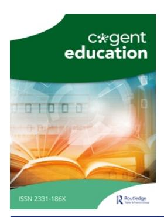

<!-- LR.R18 | source: papers_json/LR.R18/ -->

## **Cogent Education**

**ISSN: 2331-186X (Online) Journal homepage: ****[www.tandfonline.com/journals/oaed20](https://www.tandfonline.com/journals/oaed20?src=pdf)**

## **The challenges facing higher education in** **Puntland** **in** **research** **and** **academic** **publishing:** **suggestions** **for** **their** **improvement**

## **Saaid Said Jama**

**To** **cite** **this** **article:** Saaid Said Jama (2026) The challenges facing higher education in Puntland in research and academic publishing: suggestions for their improvement, Cogent Education, 13:1, 2602912, DOI:[ 10.1080/2331186X.2025.2602912](https://www.tandfonline.com/action/showCitFormats?doi=10.1080/2331186X.2025.2602912)

**To** **link** **to** **this** **article:** [https://doi.org/10.1080/2331186X.2025.2602912](https://doi.org/10.1080/2331186X.2025.2602912)

| © 2025 The Author(s). Published by Informa UK Limited, trading as Taylor & Francis Group |
| --- |
| Published online: 18 Dec 2025. |
| Submit your article to this journal |
| Article views: 766 |
| View related articles |
| View Crossmark data |

<!-- page 2 -->

## HIGHER EDUCATION | RESEARCH ARTICLE

## The challenges facing higher education in Puntland in research and academic publishing: suggestions for their improvement

Saaid Said Jama

Faculty of Medicine, University of Health Sciences, Bossaso, Puntland, Somalia

## ABSTRACT

Academic research is a core component of the role of higher education institutions (HEIs) in generating knowledge, contributing to national development, and enhancing institutional prestige. Though higher education in Puntland is relatively young, as it appeared after the civil war and collapse of the Somali Central Government, the research output of Puntland HEIs is considerably low. The present study aims to identify the challenges that hinder research and academic publishing in Puntland HEIs. Using a questionnaire, data were collected from 90 academic staff of Puntland HEIs in the period of 11–24 November 2024, utilizing a convenience sampling method. . The study found that barriers to research and academic publishing in Puntland HEIs included a lack of funding, absence of promotion linked to publications and incentives, inadequate research infrastructures, insufficient time, knowledge, and skills, limited experience in publication procedures, a poor research-oriented culture, and restricted access to literature. The author recommends enhancing academic staff capabilities by offering scholarships, training, and mentorship, reforming institutional policies, implementing reward and promotion schemes, engaging the Puntland Diaspora, collaborating with international researchers to access scientific databases and providing governmental funding to HEIs to improve the research output in Puntland HEIs.

## ARTICLE HISTORY

Received 6 May 2025 Revised 22 November 2025 Accepted 8 December 2025

## KEYWORDS

Research barriers; higher education institutions (HEIs); Puntland; capacity development; government support; quality of higher education

## SUBJECTS

Social Sciences; Education; Higher Education; Social Sciences; Education; Higher Education; Study of Higher Education; Social Sciences; Education; Higher Education; Teaching & Learning

## Introduction

Research and academic publications are crucial parts of higher education (HE). The importance of research activity and publication of the results is perhaps best illustrated by the maxima of the 'publish or perish' expression common in research circles. Academic publishing determines the scholar's reputation, career development, and standing in both local and global research communities (Weng'ua et al., [2018)](#page-9-0). In recent years, research productivity has become one of the most important metrics for evaluating the quality of higher education institutions (HEIs). Therefore, promoting the research productivity of the academic staff has become essential to raising the standing and quality of education in HEIs (Kadikilo et al., [2024](#page-8-0)).

Moreover, research is a decisive factor in the quality of higher education and teaching effectiveness. It also strengthens the skills necessary for effective knowledge transfer and contributes to institutional reputation (Wadesango, [2014)](#page-9-0).

Despite the importance of research in HE and its crucial role in the socio-economic growth and development of nations, the academic research output of HEIs in Somalia, including Puntland, has been low, with an index of 45 from 1996 to 2024 (SCImago Journal & Country Rank).

Puntland is a member state of the Federal Republic of Somalia, established in 1998. It is situated in the northeastern part of the country, bordered by the Gulf of Aden to the north and the Indian Ocean to the east. In Puntland, the number of HEIs has been increasing steadily, with about 22 universities and

<!-- page 3 -->

colleges currently operating. However, the research productivity of these institutions is comparatively low. For instance, a search conducted by the author on 10 August 2025, for scholarly outputs affiliated with Puntland Universities on Scopus revealed only 73 Scopus-indexed publications. To my knowledge, no study has evaluated the barriers in research and academic publications in Puntland HEIs. Therefore, this study aims to identify the challenges facing higher education in Puntland in research and scholarly publishing and propose suggestions for their improvement.

The current study has significant implications for strengthening research and academic publishing in HEIs in Puntland. This study offers actionable suggestions that Puntland HE policymakers and university leaders can adopt to enhance research and scholarly publishing in HEIs. The study also contributes to the existing literature on the challenges of research and scholarly publishing in Puntland and the broader context of Somalia. Moreover, this study offers valuable insights for international researchers regarding the barriers to research and academic publishing in resource-limited settings. It emphasizes the importance of collaboration, equitable partnerships, and initiatives focused on improving academic staff capacity and research infrastructure in fostering inclusive development in research in higher education.

## Objectives

- 1. To review relevant literature on the challenges of research and publication at higher education institutions.
- 2. To identify the major challenges that hinder research and academic publishing in higher education institutions in Puntland.
- 3. To propose suggestions to address these challenges and improve research and academic publishing among Puntland higher education institutions.

## Literature review

Higher education institutions (HEIs) are acknowledged as centers of knowledge generation and learning. Through education and research, HEIs are expected to develop staff and train students for future professional tasks, since students are agents for sustainability (Frantz et al., [2022)](#page-8-0). These days, HEIs around the globe are searching for ways to increase their impact through research, development, and innovation initiatives that address both present and future societal issues (Paunescu et al., [2022](#page-9-0)).

Mankind is continuously engaged in research to unravel the truth of nature and uses its results to understand the reality around him and beyond, as well as to improve his standard of living. The process involves identifying new topics and attempting new approaches to broaden the horizon of knowledge, gathering and analyzing data, drawing conclusions, and offering suggestions (Alemu, [2023)](#page-8-0). Research is considered complete only when it is published and widely disseminated in academic journals, book chapters, and conference presentations, thereby making the research output accessible to a large audience within and beyond the research community (Alehegn, [2021](#page-8-0)). In the academic community, research output serves as a global indicator for HEIs' recognition and ranking, and as a means for evaluating academic staff for career advancement and securing research funding (Ismail & Raji, [2021)](#page-8-0). Furthermore, industries frequently rely on academic institutions to conduct research that drives and fosters innovation and technology (Ghabban et al., [2019)](#page-8-0).

Various studies have previously reported challenges in research and publications in HEIs, for instance, at the individual level, lack of time, confidence, competence, and scholarly academic skills have been documented (Fawzi & Al-Hattami, [2017)](#page-8-0). Moreover, the absence of incentives, recognition, promotion, and motivation discouraged young researchers from pursuing and conducting research (Teka et al., [2017)](#page-9-0). Additionally, a lack of commitment, limited exposure to a stimulating research environment, and inadequate experience, mentorship, and access to high-impact journals have been reported (Alehegn, [2021)](#page-8-0).

Regarding the institutional-related challenges, earlier studies have identified that a shortage of funding, limited collaborative networks, inadequate research facilities, the absence of financial incentives and support, heavy workloads, poor access to information, and insufficient office spaces can influence HEIs'

<!-- page 4 -->

research productivity (Alehegn, [2021;](#page-8-0) Fawzi & Al-Hattami, [2017;](#page-8-0) Uwizeye et al., [2021)](#page-9-0). Moreover, many HEIs struggle to foster a research culture because many faculty members began their careers as teachers rather than researchers (Alhija & Majdob, [2017](#page-8-0)).

In Somalia, obstacles to research include a lack of research infrastructure, limited interest in research, inadequate training and experience, restricted access to libraries, non-merit-based recruitment, experienced researchers departing HEIs for better jobs, and the absence of recognition of research as a profession (Mursal et al., [2016;](#page-8-0) Pellini, [2020](#page-8-0)).

## Theoretical framework

This study utilized the motivation theory lens to analyze the major challenges of research and academic publishing in Puntland HEIs and propose suggestions for their improvement. Specifically, the study applied self-determination and expectancy-value theories to understand how specific challenges influence academic staff motivation and, consequently, research productivity and to inform strategies for addressing them. Self-determination theory proposes that faculty motivation in research is determined by the degree to which three basic needs are satisfied: competence, autonomy, and relatedness (Stupnisky et al., [2023)](#page-8-0). Expectancy-value theory explains how academic staff efforts are influenced by their beliefs about their capacity to succeed and the significance they attribute to the task at hand (Bandhu et al., [2024)](#page-8-0). By leveraging these theories to understand the challenges of research and academic publishing within Puntland higher education institutions, these institutions can create environments that foster academic staff engagement, cultivate a culture of research excellence, and implement tailored professional development initiatives that ultimately enhance scholarly output.

## Methodology

The methodology of this study consisted of literature investigations and data collection from the academic staff of the major HEIs in Puntland, followed by data analysis and interpretation to identify the major challenges facing higher education in research areas and scholarly publishing. A descriptive study design was employed.

The target participants of this study were academic staff members employed at Puntland HEIs during the period of data collection. Respondents with incomplete questionnaires, particularly about their employed institution, and academic staff who refused to participate were excluded. The study participants were recruited using the convenience sampling method.

Data were gathered using a structured self-administered questionnaire that consisted of two sections. The first section captured information about the respondents, including sex, HIE employed, faculty, highest degree, teaching experience, number of papers published, and percentage of time allocated to research for their contact. The second section was a 5-point Likert section about the major challenges in research and academic publishing in Puntland HEIs (insufficient research funding, lack of mentorship and guidance for doing research, lack of research facilities and equipment, lack of incentives to do research, inadequate research training and skills among academic staff, academic staff not having time for research due to teaching workload pressure, lack of time to do research due to family obligation pressure, no linkage between promotion and scholarly publication in Puntland higher education institutions, and insufficiency or absence of access to literature).

To ensure the validity of the study questionnaire, the researcher formulated the questions based on a thorough review of the relevant literature. Additionally, the draft questionnaire was presented to an expert for feedback. The reliability of the 5-point Likert section was assessed using Cronbach's alpha, which yielded a value of 0.74, indicating that the instrument is reliable.

The questionnaire was written in English and sent as a Google form to 120 academic staff employed at 12 out of 22 universities/colleges in Puntland via WhatsApp. Informed consents were obtained from all the study participants; no identifying information was collected, and their answers were kept confidential and used only for the intended purpose. In this study, 90 academic staff members responded between 11 and 24 November 2024. The response rate was 75%. The study respondents were employed at East Africa University, University of Health Sciences, University of Bosaso, Red Sea University, Puntland

<!-- page 5 -->

State University, Puntland University for Science and Technology, Garowe Teachers Education Training College, Green Hope University, City Cot University, Frontier University (Garowe), Somali National University (Puntland branch), and PIDAM University.

The data were entered, cleaned, and analyzed using Statistical Package for the Social Sciences (SPSS) version 20. Descriptive statistics, including frequencies, percentages, mean scores, and standard deviations, were performed. The five-point Likert scale responses, ranging from strongly disagree (1 point) to strongly agree (5 points), were analyzed by computing mean scores and standard deviations based on those rating scales. Thus, the mean score of any individual item was supposed to fall between 1 and 5. To estimate the degree of the opinion, mean scores of 1.00-1.80 (strong disagreement), 1.81–2.60 (disagreement), 2.61–3.40 (neutral), 3.41–4.20 (agreement) and 4.21–5.00 (strong agreement) were considered.

## Results

## Characteristics of the study participants

As reported in Table 1, most respondents (75.6%) were males, and 24.4% were females. About 78.9% had a master's degree, with less than five years of teaching experience (62.2%). Most of them either published no papers (43.3%) or only a few papers (52.5%), and the majority of participants either allocated no time (43.3%) or less than 20% of their time to research in their contracts (Table 1).

## Challenges in research and academic publication in Puntland HEIs

[Table 2](#page-5-0) presents the study participants' views on the challenges that impede research and academic publication in Puntland HEIs. These challenges are summarized in [Table 2.](#page-5-0) Most respondents do not consider family obligation pressure as a barrier to research and publication.

## Discussion

The present study identified the relevant barriers to research and academic publications in Puntland's higher education institutions and provided suggestions for improvement. These challenges include insufficient or a lack of research funding (M ¼ 4.59, SD ¼ 0.806), a major obstacle to the research output in Puntland's higher education institutions ([Table 2](#page-5-0)). This finding is comparable to the finding of another study (Musiige & Maassen, [2015)](#page-8-0). Research funding is considered a crucial driver for speeding up the

<!-- page 6 -->

M ¼ mean; SD ¼ standard deviation.

creation of knowledge, promoting scientific excellence, and guiding the direction of scientific research. Most research activities in Puntland are policy-oriented and carried out or sponsored by international NGOs and UN agencies with minimal involvement of local academicians. There is a limited amount of research conducted by the government, primarily in collaboration with external donors (Rift Valley Institute, [2018](#page-8-0)). Nowadays, international aid is facing challenges due to the recent aid cuts. Also, funds allocated through the Somali federal government are affected by the ongoing dispute between the federal government and Puntland regarding the distribution of these funds. To address the unnecessary obstacles to important social development projects, including education, the federal government and Puntland State need to find common ground to resolve their differences. Consequently, the Puntland government has launched a new initiative called Puntland Development Fund (PDF), which aims to boost the state's development agenda, including higher education. This initiative could be a promising opportunity for funding research and academic publishing in Puntland HEIs.

In this study, most of the participants have stressed that there is no linkage between promotion and scholarly publication in Puntland HEIs (M ¼ 4.49, SD ¼ 0.811), which could potentially discourage academic staff from conducting research. It is known that promotion and recognition have a significant impact on the research productivity of researchers (Henry et al., [2020](#page-8-0); Jalal, [2020](#page-8-0)). Another challenge identified by the participants in this study is the lack of incentives (M ¼ 4.34, SD ¼ 0.850), which is crucial to research activities (Table 2). A similar finding was reported in a previous study (Snowball & Shackleton, [2018](#page-8-0)). The absence of incentives can harm academic publishing. Therefore, it is relevant to establish incentive structures that encourage both quality and quantity, while acknowledging the diverse needs and motivations of academic staff (Trueblood et al., [2025](#page-9-0)).

Moreover, most respondents stated that infrastructure, such as equipment, chemical reagents, and standard laboratories (M ¼ 4.29, SD ¼ 0.986), is insufficient, inadequate, or unavailable (Table 2). These materials are critical for research activities. This barrier was identified in earlier reports (Alemu, [2023](#page-8-0); Teka et al., [2017](#page-9-0)). The majority of study participants identified a lack of mentorship and guidance (M ¼ 4.26, SD ¼ 1.001) as a barrier to scholarly productivity in Puntland HEIs. This finding aligns with another study (Myers et al., [2020)](#page-8-0). Mentorship and guidance are essential for the research and academic publishing success of academic staff. Effective mentorship can significantly enhance career satisfaction and boost research productivity among faculty (Hill et al., [2022)](#page-8-0).

The study participants also expressed that inadequate research training and skills (M ¼ 4.07, SD ¼ 1.058), insufficient understanding of publication procedures (M ¼ 3.93, SD ¼ 1.003), and heavy teaching load (M ¼ 3.88, SD ¼ 1.297) were barriers to academic publishing in Puntland HEIs. Other studies identified similar barriers (Myers et al., [2020;](#page-8-0) Ogoti, [2018;](#page-8-0) Zhang et al., [2023](#page-9-0)). These barriers could potentially

<!-- page 7 -->

reduce the motivation of academic staff and deter them from engaging in research. Thus, there is an urgent need to train them, enhance their research skills, and balance their teaching and research work.

Furthermore, the present study has identified that research and scholarly publishing in Puntland HEIs were hindered by a poor research-oriented culture among academic staff (M=3.82, SD=1.186) and an insufficient or lack of access to literature (M=3.71, SD=1.238). These findings are consistent with other studies that reported similar obstacles to research and publication (Kadikilo et al., 2024; Vyhmeister & Vyhmeister, 2007;). The research culture is crucial for academic publishing, as it fosters an excellent research environment and promotes meaningful scholarly contributions . Additionally, insufficient or absent access to literature limits the knowledge available to researchers, which can lead to an incomplete understanding of their research problems and the duplication of efforts (Appelhans, 2024).

Finally, based on the findings outlined here, the author provides suggestions to improve research output in Puntland's higher education institutions. First, it is important to introduce initiatives for fundraising to support research efforts. Funding is crucial for purchasing chemical reagents and laboratory instruments. Additionally, it would be beneficial for universities to allocate a portion of their modest income towards research activities.

Second, it is crucial to provide academic staff with capacity development through scholarships and training to equip them with the fundamentals of research methodology and skills, and enhance their ability to conduct and publish research work. The ministries of higher education for both the federal government of Somalia and Puntland State are expected to play a role in realizing these goals. Additionally, local universities should collaborate and combine their efforts to establish selected master's and PhD degree courses, thereby strengthening the capacity of their academic staff. This is useful for both the development and the country's economy.

Third, the author recommends establishing mentorship programs locally to develop and enhance research and publication skills among academic staff. This could be co-organized by the Ministry and HEIs. For instance, senior and experienced researchers may assist and guide the new researchers by providing presentations or supervising their research work and helping them with publication procedures. Also, it is important to create opportunities for collaborations with regional and international researchers to exchange knowledge and skills. This provides the option to co-publish research results with these researchers and co-apply for research grants.

Fourth, higher education institutions should develop rewarding and small-grant mechanisms that do not burden the institutions but stimulate academic staff to engage in academic research output. Additionally, HEIs should establish or strengthen their research and academic publishing policies, as well as collaborate with local academic journals, to promote research and publications among their academic staff. Also, HEIs should make research publications a strong criterion for academic staff promotions.

Fifth, enhancing research capacities in our HEIs should be a collective responsibility. Therefore, we must involve Puntland Diaspora communities as important stakeholders participating in the capacity-building processes, mentoring programs, and fundraising for research activities. Senior Diaspora experts and academic bodies in foreign countries could play a significant role in donating research equipment and establishing international networks and collaborations for Puntland HEIs.

Sixth, collaborating with international researchers to access more scientific resources, such as databases and research equipment, could strengthen research infrastructure, enhance research activity, and increase publication outputs.

Security challenges may influence on-site collaborations and mentorship programs. However, the Puntland government has recently taken significant measures to improve stability by containing terrorist groups, de-escalating clan conflicts, and reforming the security sector (UNSOM, 2024). Thus, engaging the Somali Diaspora, collaborating with regional researchers, and initiating remote mentoring and collaboration could serve as initial steps.

Seventh, the Puntland State government should play a vital role in enhancing the academic output of HEIs by providing research grants, channeling UN agencies and international NGOs' research funds through HEIs as implementing partners and establishing research publications as a criterion for awarding postgraduate scholarships to Puntland HEIs staff.

Lastly, the role of the Somali Federal Government is crucial, despite the disagreement with Puntland regarding the distribution of funds and resources. Strengthening research and innovation in higher

<!-- page 8 -->

education is a key strategy outlined in the national education sector's strategic plan for 2022-2026. Therefore, the federal government has to mobilize regional and international funding for research and its infrastructure for the HEIs.

Although this study provided novel findings on the challenges of research and academic publishing facing the higher education institutions in Puntland, it has several limitations. This study interviewed academic staff, but also interviewing university leaders and administrators could have provided comprehensive information about the issue. Also, the study employed a descriptive quantitative approach; however, this topic could be fully explored using a qualitative or mixed approach.

## Conclusion

This study contributes to the existing literature on higher education in Puntland, as it is the first study to identify the key challenges of research and academic publishing facing Puntland HEIs and offer suggestions for their improvement.

Research and academic publishing in Puntland HEIs are hindered by a lack of funding, the absence of promotion linked to publications and incentives, inadequate research infrastructures, insufficient time, knowledge, and skills, limited experience in publication procedures, a poor research-oriented culture, and restricted access to literature.

The author recommends enhancing academic staff capabilities by offering scholarships, training, and mentorship, reforming institutional policies, implementing reward and promotion schemes, engaging the Puntland Diaspora, collaborating with international researchers to access scientific databases, and providing governmental funding to HEIs to improve the research output in Puntland HEIs.

## Acknowledgments

The author would like to thank the Ministry of Education and Higher Education of Puntland, Somalia, and the study participants.

## Ethical approval

This study was approved by the ethical committee of the University of Health Sciences, Bosaso. Informed consents were obtained from all participants before they participated in this study. All data were kept confidential and used only for the intended purpose.

## Disclosure statement

No potential conflict of interest was reported by the author.

## Funding

This study was funded by the Ministry of Education and Higher Education, Puntland, Somalia, through small grants of the Higher Education Systems Strengthening in Somalia project. The funder has no role in the design, data collection, data analysis, and reporting of this study.

## About the author

Saaid Said Jama is an academician and researcher affiliated with the University of Health Sciences, Bossaso, Somalia. He holds a Bachelor of Medicine and Surgery (MBBS) degree and a fellowship in Health Professions Education and Leadership. Jama's research interests include academic faculty capacity building and development.

## ORCID

Saaid Said Jama 0000-0003-0368-9598

<!-- page 9 -->

## Data availability statement

The data collected from participants were analyzed and presented in tables in the manuscript. However, the data is accessible from the author upon reasonable request.

## References

- Alehegn, A., & Diale, B. M. (2021). Academic Staff Practices and Challenges of Publishing:: Evidence from an Ethiopian University. International Journal of African Higher Education, 8(1), 27–42. [https://doi.org/10.6017/ijahe.](https://doi.org/10.6017/ijahe.v8i1.13375) [v8i1.13375](https://doi.org/10.6017/ijahe.v8i1.13375)
- Alemu, A. ([2023](#page-2-0)). Factors determining research productivity in Ethiopian Universities: The case of Madda Walabu University. Social Sciences & Humanities Open, 8(1), 100562. [https://doi.org/10.1016/j.ssaho.2023.100562](https://doi.org/10.1016/j.ssaho.2023.100562)
- Alhija, F. M. N. A., & Majdob, A. [(2017)](#page-3-0). Predictors of teacher educators' research productivity. Australian Journal of Teacher Education, 42(11), 34–51. [https://doi.org/10.14221/ajte.2017v42n11.3](https://doi.org/10.14221/ajte.2017v42n11.3)
- Appelhans, N. ([2024](#page-6-0)). The academic publishing system in crises: Absences in international urban studies. Geographica Helvetica, 79(3), 305–309. [https://doi.org/10.5194/gh-79-305](https://doi.org/10.5194/gh-79-305)
- Bandhu, D., Mohan, M. M., Nittala, N. A. P., Jadhav, P., Bhadauria, A., & Saxena, K. K. ([2024](#page-3-0)). Theories of motivation: A comprehensive analysis of human behavior drivers. Acta Psychologica, 244, 104177. [https://doi.org/10.1016/j.](https://doi.org/10.1016/j.actpsy.2024.104177) [actpsy.2024.104177](https://doi.org/10.1016/j.actpsy.2024.104177)
- Fawzi, H., & Al-Hattami, A. [(2017)](#page-2-0). Faculty production of research papers: Challenges and recommendations. International Journal of Humanities and Social Science, 7(2), 221–228.
- Frantz, J. M., George, A., Hunter-Husselmann, M., Kapenda, H., & Yassin, Z. ( € [2022](#page-2-0)). Institutional policies, practices and initiatives impacting research productivity: The strengthening of collaboration, leadership and professionalism in research management in the Southern African Development Community (SADC) and European Union (EU) Higher Education Institutions (StoRM). Journal of Research Administration, 53(2), 40–59.
- Ghabban, F., Selamat, A., Ibrahim, R., Krejcar, O., Maresova, P., & Herrera-Viedma, E. ([2019](#page-2-0)). The influence of personal and organizational factors on researchers' attitudes towards sustainable research productivity in Saudi universities. Sustainability (Switzerland), 11(17), 4804. [https://doi.org/10.3390/su11174804](https://doi.org/10.3390/su11174804)
- Hill, S. E. M., Ward, W. L., Seay, A., & Buzenski, J. ([2022](#page-5-0)). The nature and evolution of the mentoring relationship in academic health centers. Journal of Clinical Psychology in Medical Settings, 29(3), 557–569. [https://doi.org/10.1007/](https://doi.org/10.1007/s10880-022-09893-6) [s10880-022-09893-6](https://doi.org/10.1007/s10880-022-09893-6)
- Henry, C., Md Ghani, N. A., Hamid, U. M. A., & Bakar, A. N. ([2020](#page-5-0)). Factors contributing towards research productivity in higher education. International Journal of Evaluation and Research in Education (IJERE), 9(1), 203–211. [https://](https://doi.org/10.11591/ijere.v9i1.20420) [doi.org/10.11591/ijere.v9i1.20420](https://doi.org/10.11591/ijere.v9i1.20420)
- Ismail, A., & Raji, A. A. O. [(2021)](#page-2-0). Institutional supports and research output in university of Ibadan, Nigeria. Archiever Journal of Scientific Research, 3(1), 124–136.
- Jalal, A. ([2020](#page-5-0)). Research productivity in higher education environment. Journal of Higher Education Service Science and Management, 3(1), 1–14.
- Kadikilo, A. C., Nayak, P., & Sahay, A. ([2024](#page-1-0)). Barriers to research productivity of academics in Tanzania higher education institutions: The need for policy interventions. Cogent Education, 11(1), 1–19. [https://doi.org/10.1080/](https://doi.org/10.1080/2331186X.2024.2351285) [2331186X.2024.2351285.](https://doi.org/10.1080/2331186X.2024.2351285)
- Kashif, M., Dewasiri, N. J., Rana, S., & Udunuwara, M. (2022). Editorial: Demystifying research culture in universities. South Asian Journal of Marketing, 3(1), 1–6. [https://doi.org/10.1108/SAJM-04-2022-118](https://doi.org/10.1108/SAJM-04-2022-118)
- Mursal, F., Odowa, A., & Mosley, J. ([2016](#page-3-0)). Research and knowledge systems in Somalia and Somaliland Country profile: Somali Regions. INASP. 1–20.
- Musiige, G., & Maassen, P. ([2015](#page-4-0)). Faculty perceptions of the factors that influence research productivity at Makerere University. Knowledge Production and Contradictory Functions in African Higher Education, 2001, 109–127.
- Myers, B., et al. ([2020](#page-5-0)). Motivation and perceptions of research and publication in higher education faculty: A phenomenological study. Northwestern State University, 5, 94–116.
- Ogoti, E. O. [(2018)](#page-5-0). Constraints of research productivity in universities in Tanzania: A case of Mwenge Catholic University, Tanzania. International Journal of Education and Research, 6(3), 201–210.
- Ou, G., Zhao, K., Zuo, R., & Wu, J. (2024). Effects of research funding on the academic impact and societal visibility of scientific research. Journal of Informetrics, 18 (4), 101–592. [https://doi.org/10.1016/j.joi.2024.101592](https://doi.org/10.1016/j.joi.2024.101592)
- Pellini, A., et al. [(2020)](#page-3-0). Research in Somalia: Opportunities for cooperation. Report, 1–89.
- Rift Valley Institute. [(2018)](#page-5-0). Strengthening research capacity in Somaliland and Puntland [https://riftvalley.net/news/](https://riftvalley.net/news/horn-of-africa/strengthening-research-capacity-somaliland-and-puntland) [horn-of-africa/strengthening-research-capacity-somaliland-and-puntland](https://riftvalley.net/news/horn-of-africa/strengthening-research-capacity-somaliland-and-puntland)
- SCImago Journal & Country Rank (2025). Somalia
- Snowball, J. D., & Shackleton, C. M. ([2018](#page-5-0)). Factors enabling and constraining research in a small, research-intensive South African University. Research Evaluation, 27(2), 119–131. [https://doi.org/10.1093/reseval/rvy002](https://doi.org/10.1093/reseval/rvy002)
- Stupnisky, R. H., Larivi ere, V., Hall, N. C., & Omojiba, O. ([2023](#page-3-0)). Predicting research productivity in STEM Faculty: The role of self-determined motivation. Research in Higher Education, 64(4), 598–621. [https://doi.org/10.1007/s11162-](https://doi.org/10.1007/s11162-022-09718-3) [022-09718-3](https://doi.org/10.1007/s11162-022-09718-3)

<!-- page 10 -->

- Paunescu, Carmen, & Lepik, Katri-Liis & Spencer, Nicholas. (2022). Social innovation in higher education landscape, practices, and opportunities. Springer Open, 1–316. [https://doi.org/10.1007/978-3-030-84044-0](https://doi.org/10.1007/978-3-030-84044-0).
- Teka, F., Habtamu, A., Najib, A. H., & Gemechu, F. ([2017](#page-2-0)). Publication productivity of academics in Jigjiga University, Ethiopia. Educational Research and Reviews, 12(9), 559–568. [https://doi.org/10.5897/ERR2017.3221](https://doi.org/10.5897/ERR2017.3221)
- Trueblood, J. S., Allison, D. B., Field, S. M., Fishbach, A., Gaillard, S. D. M., Gigerenzer, G., Holmes, W. R., Lewandowsky, S., Matzke, D., Murphy, M. C., Musslick, S., Popov, V., Roskies, A. L., Ter Schure, J., & Teodorescu, A. R., [(2025)](#page-5-0). The misalignment of incentives in academic publishing and implications for journal reform. Proceedings of the National Academy of Sciences of the United States of America, 122(5), e2401231121. [https://doi.](https://doi.org/10.1073/pnas.2401231121) [org/10.1073/pnas.2401231121](https://doi.org/10.1073/pnas.2401231121)
- UNSOM. [(2024)](#page-6-0). In Puntland, top UN official commends progress on local matters and urges cooperation on national challenges. [https://unsom.unmissions.org/puntland-top-un-official-commends-progress-local-matters-and-urges](https://unsom.unmissions.org/puntland-top-un-official-commends-progress-local-matters-and-urges-cooperation-national-challenges)[cooperation-national-challenges](https://unsom.unmissions.org/puntland-top-un-official-commends-progress-local-matters-and-urges-cooperation-national-challenges)
- Uwizeye, D., Karimi, F., Thiong'o, C., Syonguvi, J., Ochieng, V., Kiroro, F., Gateri, A., Khisa, A. M., & Wao, H. [(2021)](#page-3-0). Factors associated with research productivity in higher education institutions in Africa: A systematic review. AAS Open Research, 4, 26. [https://doi.org/10.12688/aasopenres.13211.1](https://doi.org/10.12688/aasopenres.13211.1)
- Vyhmeister, S., & Vyhmeister, R. ([2007](#page-6-0)). Barriers to participation in research for college faculty. International Forum Journal, 10(2), 19–34. [https://doi.org/10.63201/EGRE6604](https://doi.org/10.63201/EGRE6604)
- Wadesango, N. [(2014)](#page-1-0). Publish or perish: Impediments to research output and publication. International Journal of Educational Sciences, 6(1), 57–63. [https://doi.org/10.31901/24566322.2014/06.01.08](https://doi.org/10.31901/24566322.2014/06.01.08)
- Weng'ua, F. N., Rotich, D. C., & Kogos, E. J. ([2018](#page-1-0)). The role of Kenyan universities in promoting research and scholarly publishing. South African Journal of Libraries and Information Science, 83(2), 23–29. [https://doi.org/10.7553/83-](https://doi.org/10.7553/83-2-1705) [2-1705.](https://doi.org/10.7553/83-2-1705)
- Zhang, M., Doi, L., Awua, J., Asare, H., & Stenhouse, R. [(2023)](#page-5-0). Challenges and possible solutions for accessing scholarly literature among medical and nursing professionals and students in low-and-middle income countries: A systematic review. Nurse Education Today, 123(November 2022), 105737. [https://doi.org/10.1016/j.nedt.2023.105737](https://doi.org/10.1016/j.nedt.2023.105737)
