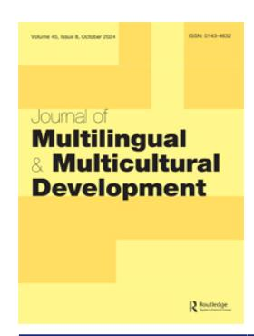

<!-- LR.R23 | source: papers_json/LR.R23/ -->

## **Journal** **of** **Multilingual** **and** **Multicultural** **Development**

**ISSN: 0143-4632 (Print) 1747-7557 (Online) Journal homepage:****[ www.tandfonline.com/journals/rmmm20](https://www.tandfonline.com/journals/rmmm20?src=pdf)**

## **Language choice and academic publishing: a** **social-ecological perspective on languages other** **than English**

**Yali** **Liu** **&** **Louisa** **Buckingham**

**To** **cite** **this** **article:** Yali Liu & Louisa Buckingham (2024) Language choice and academic publishing: a social-ecological perspective on languages other than English, Journal of Multilingual and Multicultural Development, 45:8, 2977-2991, DOI: [10.1080/01434632.2022.2080834](https://www.tandfonline.com/action/showCitFormats?doi=10.1080/01434632.2022.2080834)

**To** **link** **to** **this** **article:** [https://doi.org/10.1080/01434632.2022.2080834](https://doi.org/10.1080/01434632.2022.2080834)

| © 2022 The Author(s). Published by Informa UK Limited, trading as Taylor & Francis Group |
| --- |
| Published online: 26 May 2022. |
| Submit your article to this journal |
| Article views: 5029 |
| View related articles |
| View Crossmark data |
| Citing articles: 7 View citing articles |

<!-- page 2 -->

## Language choice and academic publishing: a social-ecological perspective on languages other than English

Yali Liua and Louisa Buckingham b

aCollege of Foreign Languages, Nankai University, Tianjin, People's Republic of China; bSchool of Cultures, Languages and Linguistics, University of Auckland, Auckland, New Zealand

## **ABSTRACT **

The choice of language for publishing is a topic of particular significance for scholars of languages other than English (LOTE) due to the importance of publishing in the professional language for maintaining expertise in the written academic register of the respective language. While the multilingual ability of such scholars means they can potentially publish in multiple languages (i.e. their first language, the professional language and English), the limited market for publications in LOTE greatly diminishes such opportunities and restricts career development. Informed by Bourdieu's theory of practice and Brofenbrenner's ecological systems theory, we explore factors that influence the choice of language for publishing among 53 Chinese academics (scholars of Russian, Japanese or Korean), and how these academics navigate the challenges of publishing in their professional language. With fieldwork conducted at 10 universities across five regions, we identify regional specificities that contribute to greater inclusiveness with regard to the status of LOTEs in academic careers. Further, we identify the productive disruptive role of returned graduates (with doctorates completed abroad) in improving the institutional ranking of journals which publish in LOTEs. Finally, we underscore the importance of protecting the investment in sophisticated linguistic proficiency attained by scholars of foreign languages.

## ARTICI E HISTORY

Received 31 March 2022 Accepted 17 May 2022

## **KEYWORDS **

Languages other than English; academic writing for publication purposes; journal rankings; minority languages; multilingual expertise

## Introduction

In contrast to the worldwide decline in teaching, learning, and/or funding languages other than English (LOTEs) (Collen 2020; Kelly et al. 2017; Lanvers 2018), China has witnessed significant growth in degree programmes for LOTEs (Han, Gao, and Xia 2019). In 2017, there were 1417 degree programmes for LOTEs at 583 universities (Han, Gao, and Xia 2019), and a further 59 higher educational institutions in China received approval to provide new undergraduate programmes for 49 LOTEs in early 2018 (Ministry of Education of the People's Republic of China 2018). Recent research on LOTEs in China has focused on the influence of language policies on the development of educational programmes in Chinese universities (e.g. Chen, Tao, and Zhao 2021; Han, Gao, and Xia 2019), and learner perspectives (e.g. Chen, Zhao, and Tao 2020; Lu and Shen 2021). Despite the expansion of professional opportunities in academia related to foreign language education (particularly of LOTEs) as a result of state-level initiatives, the professional development of university academics of LOTEs in China is under-explored.

<!-- page 3 -->

In foreign-language disciplines, the choice of language for publishing is a factor that contributes to the professional development of academics whose first language is different from their language specialisation, as the ability to write at the level required for academic publication is a specific expertise that needs to be developed and maintained (Buckingham 2014; Hyland 2016). Academics of LOTEs can potentially publish in multiple languages, such as their native language, English, and their professional language (i.e. their academic specialisation such as Russian, Japanese or Korean). Despite their multilingual capability, previous studies in China (e.g. Guo, Sit, and Bao 2020; Tao, Zhao, and Chen 2019) and elsewhere (e.g. Fuentes and Gómez Soler 2018; Gazzola 2012; Lillis and Curry 2010; Schluer 2014) have demonstrated that the ecological context (understood as the multiple levels of context related to human development) of professional development is not favourable to nurturing the multilingual capability of current and future generations of scholars, largely due to the lack of formal recognition of publications in professional languages (i.e. LOTEs).

Drawing on varied theoretical perspectives, such as possible selves theory (Tao, Zhao, and Chen 2019), managerialism (Chen, Tao, and Zhao 2021), social practice theory (Zheng and Guo 2019), the social-political approach (Gao and Zheng 2020), and the social-cultural approach (Fuentes and Gómez Soler 2018), previous studies yielded important insights into the influence of specific factors on academics' choice of language for publishing. These include internal factors such as discipline specialisation, professional identity, and language competence (Buckingham 2014; Burgess et al. 2014; Schluer 2014; Tao, Zhao, and Chen 2019); and external factors such as the institutional research performance appraisal system (Lee and Lee 2013; Chen, Tao, and Zhao 2021), and journal indexing systems (Burgess et al. 2014; Gazzola 2012; Zheng and Guo 2019). According to Hyland (2015, 35), academic writing practice is also a situated, context-specific social practice which 'cannot be distilled down to a set of cognitive or technical abilities'. In light of this, the choices available to writers, for instance, concerning publication type, language choice, writing style and topics, should thus be understood in relation to the context in which writers are embedded.

In this study, we posit that an interplay of multiple factors at different contextual levels contribute to academics' choice of language for publishing, and that the combined effect of these factors varies in accordance with the individual's career trajectory. We employ Bourdieu's (1984, 1991) theory of practice and Bronfenbrenner's ecological systems theory (Bronfenbrenner 1979) to examine how multilingual academics, 53 Chinese scholars of a foreign language (Russian, Japanese or Korean), determine their choice of language for publishing. Accordingly, we investigate how they interact with, and respond to, internal and external factors related to scholarly publishing, and the imperative to develop professionally at local, national, and international levels.

The following two research questions guide our endeavour: (a) What are the factors that influence foreign language scholars' choice of language for publishing? (b) To what extent do these scholars exercise agency with respect to the choice of language for publishing?

Our study has both theoretical and practical significance. We propose a social-ecological analytical framework and demonstrate how this may be used to examine the complex, intertwined, and dynamic nature of factors which contribute to academics' choice of language for publishing. We further draw to the attention of institutions and policymakers the importance of viewing sophisticated linguistic proficiency as an investment to be protected, and we identify structural constraints that militate against this goal.

## Bourdieu's theory of practice and the conceptualisation of agency

Bourdieu contended that individual social practice is co-constructed by an inter-dependent trio, namely, field, capital, and habitus. The relationship between practice and the three factors is illustrated in a formula: [(habitus) (capital)] + field = practice (Bourdieu 1984, 101). Field refers to a social space which has its own distinctive rules and consists of positions at different levels of power (Bourdieu 1991). Bourdieu argued that each individual simultaneously occupies agentive positions in multiple social fields (1998), which are referred to collectively as the field of power.

<!-- page 4 -->

In the context of academia, academics need to fulfil the performance expectations of the institution to which they are affiliated (e.g. Chen, Tao, and Zhao 2021; Fuentes and Gómez Soler 2018), but they also need to perform in accordance with the norms and expectations of the research communities in which they are involved beyond the institution (e.g. Zheng and Guo 2019) and with those of the publishing market (e.g. Tao, Zhao, and Chen 2019).

The languages used by academics to disseminate research constitute a form of linguistic capital, which they can employ to achieve career development goals. Nevertheless, these languages are accorded different degrees of legitimacy at regional, national and international levels (Bourdieu 1991). Bourdieu (1991) defined linguistic legitimacy as the association of social values with particular languages (and dialects), which results in the domination of some languages and the subordinate or inferior status of others. Socially dominant (or 'legitimate') languages, and by extension proficient speakers of these languages, are endowed with social prestige. English receives the highest level of legitimacy in international publishing (Schluer 2014), while local languages (if used at all) are usually restricted to local (i.e. national-level) academic publications, and even then, such opportunities may be limited to specific disciplines, such as the humanities and social sciences (e.g. Anderson 2013; Lee and Lee 2013; Schluer 2014).

Considerations of linguistic legitimacy direct academics' choice of language for publishing (e.g. Tao, Zhao, and Chen 2019). That is, due to the dominant position of English in academic publishing internationally and the favouring of English-language publications in academic performance reviews, academics of LOTEs often choose to publish in either English (Fuentes and Gómez Soler 2018; Gazzola 2012) or in their native language (Tao, Zhao, and Chen 2019). This has contributed to undermining the sustainability of LOTEs as academic disciplines.

An academic's linguistic habitus, that is, the language(s) they are accustomed to using in professional academic discourse, is a type of linguistic capital that requires considerable investment and personal agency to acquire (Lillis and Curry 2010; Zheng and Guo 2019). It is dynamic as academics can develop expertise in the written academic register in another language, or they may experience attrition in this register through disuse.

Emirbayer and Mische's (1998) conceptualisation of human agency comprises three dimensions: iterational, practical-evaluative, and projective. The iterational dimension focuses on 'the selective reactivation by actors of past patterns of thought and action' (Emirbayer and Mische 1998, 971) to sustain identities over time; the practical-evaluative dimension emphasises the ability of actors to critically evaluate the present situations and act strategically 'in response to the emerging demands, dilemmas, and ambiguities of presently evolving situations' (Emirbayer and Mische 1998, 971); and the projective dimension comprises the actors' agency in imagining the future that they desire to have and reconstructing their capabilities in anticipation of such future possibilities. Academics routinely rely on their acquired linguistic habitus to perform routine writing assignments (the iterational dimension); some occasions may call for strategic decision-making concerning language choice or discourse style to fulfil specific temporal goals (the practical-evaluative dimension); and academics may work towards extending their linguistic habitus to include an additional language, particularly if publications in this language support career development goals (the projective dimension).

Previous studies have identified that academics tend to make strategic changes to their linguistic habitus to strengthen their career pathways, such as renouncing publishing in the professional language due to its lower degree of legitimacy, and re-structuring their linguistic habitus to the native language (Fuentes and Gómez Soler 2018; Tao, Zhao, and Chen 2019) or to English (Zheng and Guo 2019); such moves correspond to the practical-evaluative dimension of human agency.

## Bronfenbrenner's ecological systems theory

Bourdieu's portrayal of field contributes to explicating the power of the different contexts that affect decisions related to academic publishing, but it neglects to account for the hierarchical nature of these contexts and the interrelations between these. To this end, we adopted Bronfenbrenner's

<!-- page 5 -->

ecological systems theory as part of the theoretical framework. Bronfenbrenner's ecological systems theory was originally intended to explain how multiple levels of contexts influence human development (manifested in the form of individual capabilities and perceptions), especially child development (Bronfenbrenner 1979). Recent research has also applied this theory to academic career trajectories (e.g. Chu, Liu, and Fang 2021).

Bronfenbrenner described the ecological environment as comprising five systems. The microsystem refers to the system closest to the person and the one in which they have direct contact, such as the family or the workplace; the mesosystem comprises the interactions between the different parts of a person's microsystem, such as the relationship between the family and workplace contexts; the exosystem represents the larger social system in which the individual does not function directly, such as government agencies; the macrosystem involves cultural elements of a particular society, such as beliefs and cultural values, and exerts influence on all other systems; the chronosystem encompasses the dimension of time, such as the trajectory from student to professional status (Bronfenbrenner 1979).

The focus of previous research on academics' choice of language for publishing has largely been limited to factors from the micro- and exosystems. It has been shown that the latter can exert considerable influence on the former. For instance, the institutional journal ranking systems used for performance appraisals are strongly influenced by factors in the exosystem, such as international journal indexing systems and journal impact analytics (e.g. Guo, Sit, and Bao 2020; Tao, Zhao, and Chen 2019; Zheng and Guo 2019). The different levels, therefore, may be interrelated.

## Methodology

This is an interview-based study with an ethnographic component that included multisited fieldwork. In our analysis of how academics of LOTEs navigate the affordances and constraints that relate to language choice and publishing, we employ an analytical framework underpinned by Bourdieu's theory of practice, Brofenbrenner's ecological systems theory, and Emirbayer and Mische's (1998) conceptualisation of human agency. Our analytic framework entails the following components: [(Linguistic habitus) (Linguistic capital) (Individual perceptions)] + [Individual agency] + [Field of power: (microsystem) (mesosystem) (exosystem) (macrosystem) (chronosystem)] = Choice of language for publishing. To illustrate, academics' choice of language for publishing is the outcome of academics' linguistic capital, linguistic habitus, individual perceptions, personal agency, and the field of power which consists of contexts at varied levels (i.e. the microsystem, mesosystem, exosystem, macrosystem, and chronosystem). In the following sub-sections, we describe the study design.

## Selection of fieldwork locations, foreign languages, and universities

The selection of diverse fieldwork locations took into account socioeconomic and linguistic regional differences and the geographic location (i.e. coastal regions, inland regions, and regions bordering with or in proximity to other countries). In doing so, we anticipated being able to consider the influence of regional, cultural, and socioeconomic factors in our analysis of language choice.

Notes: aMongolia, Russia, Kazakhstan, Kyrgyzstan, Tajikistan, Pakistan, Afghanistan, India.

> ^&^lt;sup>bAccording to GDP per capita in 2015. Sourced from the National Bureau of Statistics of China http://www.stats.gov.cn/.

<!-- page 6 -->

Three criteria guided the selection of the fieldwork locations: (1) the level of socioeconomic development, (2) the administrative division, and (3) the geographic location. As can be seen in Table 1, the five regions selected (Tianjin, Jilin, Xinjiang, Hebei, and Gansu) reflect the intended diversity with respect to these three categories.

According to Han, Gao, and Xia (2019), 98 foreign languages (other than English) were taught at 583 Chinese universities in 2017, most of these offered through dedicated degree programmes. We aimed to select the three most commonly offered LOTEs at universities in the five selected regions by consulting each university's website. Of the 110 universities in the five regions, we succeeded in identifying the pertinent information from the websites of 106 universities (Tianjin: 18; Hebei: 36; Jilin: 24; Gansu: 16 and Xinjiang: 12). Table 2 displays the foreign languages which were offered in each region, and the number of universities that offered each language. Listed separately, English is displayed for comparative purposes. The most commonly offered LOTEs in the five selected regions were Japanese, Russian, and Korean.

Two criteria guided the selection of potential fieldwork locations. Universities needed to offer at least one of the three aforenoted languages, and a range of differently ranked universities needed to be included. This resulted in an initial selectin of 22 potential universities, and of these, ten were selected as potential fieldwork sites (pending agreement by individual academics to voluntarily participate). These were distributed as follows across the regions: Hebei (3), Tianjin (2), Jilin (2), Gansu (2), and Xinjiang (1).

## **Participants **

Fifty-three academics from the ten universities located in the five selected regions volunteered to participate. As shown in Table 3, the breakdown of academics according to language is as follows: Russian (n = 22), Japanese (n = 21), and Korean (n = 10). They were at early (Lecturer n = 28), mid (Associate Professor n = 15), and senior (Professor n = 10) career stages. Over 60% of them possessed a PhD degree, 32% a Master's degree, and around 6% had a Bachelor's degree. Over 60% (n = 34) of the participants received their highest degree in China, and around 35% (n = 19) received their highest degree abroad. The majority were female. All held an academic position in their faculty with publishing requirements for academic career progression, and they all possessed publishing experience.

## Data collection and analysis

The data collection instruments comprised a questionnaire, a narrative frame, and a semi-structured interview. The whole data collection phase was conducted in person by the first author in Mandarin Chinese, and is described in greater detail in Liu and Buckingham (2023).

<!-- page 7 -->

| Category | Attributes | Hebei | Tianjin | Jilin | Gansu | Xinjiang | Total | Percent |
| --- | --- | --- | --- | --- | --- | --- | --- | --- |
| Professional language | Japanese | 5 | 6 | 3 | 7 | 0 | 21 | 39.6% |
|  | Russian | 3 | 4 | 1 | 5 | 9 | 22 | 41.5% |
|  | Korean | 2 | 3 | 5 | 0 | 0 | 10 | 18.9% |
| Academic rank | Professor | 5 | 3 | 2 | 0 | 0 | 10 | 18.9% |
|  | Associate Professor | 3 | 4 | 2 | 3 | 3 | 15 | 28.3% |
|  | Lecturer | 2 | 6 | 5 | 9 | 6 | 28 | 52.8% |
| Highest degree | Doctor | 4 | 13 | 6 | 6 | 4 | 33 | 62.3% |
| 3 | Master | 4 | 0 | 3 | 5 | 5 | 17 | 32.1% |
|  | Bachelor | 2 | 0 | 0 | 1 | 0 | 3 | 5.7% |
| Country awarded | China | 7 | 2 | 7 | 10 | 8 | 34 | 64.2% |
|  | Overseas | 3 | 11 | 2 | 2 | 1 | 19 | 35.8% |
| Gender | Male | 0 | 1 | 2 | 1 | 1 | 5 | 9.4% |
|  | Female | 10 | 12 | 7 | 11 | 8 | 48 | 90.6% |

Data collection with each participant entailed four steps. Step one involved introducing the project and explaining the content of the consent form in Chinese to each participant. In step two, participants completed the questionnaire and narrative frame (which focused on demographic information and their publishing history). The addition of the narrative frame was intended to prompt participants to recall, shape and re-shape their publishing experiences with regard to language choice throughout their career (Barkhuizen 2014). Step three involved a semi-structured interview (recorded), lasting 40–60 minutes. The publishing history of each participant and the narrative frame were used as an instrument to assist the interview. The interview guide comprised three broad topics: *Publishing venues and policies on publishing, Choice of publication language*, and *Challenges and strategies for successful publication*. Each section included 3–6 follow-up questions. Step four constituted the post-interview reciprocal stage, and entailed the choice of a gift voucher or assistance with manuscript proofreading. A third option was developed during the fieldwork in response to the participants' requests, which involved the participant interviewing the first author (that is, a reversal of roles) about education and culture in New Zealand, and assistance with academic English.

Data analysis comprised two phases. Phase one focused on developing the code system. A hybrid approach to the qualitative content analysis and thematic analysis was adopted, informed by Fereday and Muir-Cochrane (2006) and Neuendorf (2019), consisting of three stages: (1) initial deductive coding, (2) posterior inductive coding, and (3) a reliability check. Stage one was informed by the analytical framework proposed by the study which informed the initial creation of themes (or parent nodes in Nvivo parlance). Stage two included four steps: data formalisation, code development, candidate theme search, and candidate theme revision. The four steps happened recursively and sometimes simultaneously. Stage three entailed an inter-rater reliability check of the coding system. The mean values of Cohen's Kappa for both the interview transcripts and the narrative frames were 0.92 and 0.96, respectively, which corresponds to a 'perfect' level of agreement according to McHugh (2012). The codes with a Kappa value lower than 0.60, which constitute a 'weak' level of agreement (McHugh 2012), were discussed with the coding assistant and acceptable solutions were found. Phase two focused on exploring the relationships between the codes and the demographic information of the participants with the exploration data tools in NVivo 12 (i.e. Matrix coding, Crosstab, and Comparison diagram). We first explored the relationships between the publishing history and the participants' attributes (i.e. demographic information); and subsequently examined the relationships between the codes (or nodes in Nvivo parlance) and the participants' demographic information.

<!-- page 8 -->

## **Findings **

Participants' choice of language for publishing was found to be influenced by the combined effects of internal factors (i.e. linguistic capital, linguistic habitus, or perceptions such as professionalism) and external factors (i.e. microsystem, mesosystem, exosystem, and macrosystem). The abovementioned internal factors were commonly mentioned together with factors from the chronosystem (e.g. educational experiences across the lifetime). Different external factors combined to co-construct a context in which differentiations were made between languages with respect to their perceived legitimacy for publishing purposes. The participants acted in an agentive and strategic manner with respect to the choice of language for publishing in response to the language hierarchies established at different levels (i.e. micro-, meso-, etc.) in the Chinese context. We begin with an analysis of internal factors and then proceed to the external factors.

## Internal factors: linguistic capital, linguistic habitus, and perceptions

Linguistic capital and linguistic habitus. Table 4 displays the total number of publications the participants had authored. All books (n = 44) and journal articles (n = 647) were in either Chinese or the participants' respective professional language. Overall, Chinese was the dominant language, accounting for 54.5% and 74.7% of the published books and journal articles respectively. This accords with the belief expressed by all participants in interviews that Chinese and the professional language were the most viable forms of linguistic capital for publishing. No participant had yet published in English.

Table 5 displays the number of publications in each language according to the educational background of the participants (highest degree achieved abroad or locally). Returned graduates were responsible for authoring all books in Russian, half of the books written in Korean, and four out of five books written in Japanese, and they authored 120 of the 164 articles (73.2%) written in the professional language (Russian n = 44, 72.1%, Korean n = 28, 57.1%, Japanese n = 48, 88.9%). Publications in Chinese were more likely to be authored by local graduates.

According to the interview data, returned graduates perceived the professional language as their linguistic habitus for publishing because of years of training during doctoral studies, while locally-graduated participants (excepting the Korean ethnic minority participants) maintained Chinese as their linguistic habitus for publishing throughout their postgraduate studies and academic career. This is explained in Example 1 by Associate Professor GSC, who had graduated locally and had published two books and eleven journal articles in Chinese, and two articles in Russian.

## Example 1

My Master's and PhD are in Chinese ... I think my experience writing my thesis then built the basis of my ability to write academically and publish in Chinese now. [GSC/Interview]

Ethnicity and minority language status were identified as key factors contributing to the choice of a particular language as linguistic habitus for publishing. All of the Chinese-Korean ethnicity participants (n = 3) perceived Korean as their linguistic habitus for publishing. From the Yanbian autonomous region in Jilin province (where half of all residents belong to the Chinese-Korean ethnic minority), these local graduates were all first-language Korean speakers and had benefited from Korean-medium education (and media) in China. This advantage was explained by professor

<!-- page 9 -->

Note: aAll written by the academics of the Chinese Korean ethnicity.

JLG in Example 2, who had published 30 articles (in journals based in China, North Korea, and South Korea), of which 28 were in Korean and two were in Chinese.

## Example 2

I attended Korean schools for my primary education. I completed my bachelor, postgraduate, and my doctor studies in the faculty of Korean studies in Yanbian University where the dominant language is Korean ... My postgraduate and doctoral theses were all in Korean, because there was no requirement to write in Chinese at our university. All of these factors contributed to my higher competence in my professional language. [JLG/ Interview]

All participants expressed concern and anxiety about publishing in English due to their limited competence, and around 85% of participants (n = 45) had never considered English to be a realistic option. This was explained in Example 3 by Associate Professor HBE, who had published 13 articles in total, twelve in Chinese and one in Russian.

## Example 3

I only learned general English, you know, to be honest, I've almost forgotten everything I learned then ... We even stopped learning English for the first year of our undergraduate study to avoid the negative interference from English. I know that publications in English are ranked more highly, and I would also like to publish in English ... but this is impossible for me. [HBE/Interview]

Perceptions. Participants' sense of responsibility towards their professional language, and their desire to confirm their professional expertise through publications in their professional language were stronger than their impetus to publish in English. Over half of the participants (n = 28) explicitly rejected the need to publish in English. This sentiment is illustrated in Example 4 by Professor HBG.

## Example 4

I really think it is not necessary to publish in English. Why do I have to publish in English? It's neither my first language nor my professional language. If I publish in Russian, it confirms my expertise and my ability to communicate in the language and if I publish in Chinese, let's say, it will be more highly valued in China. But for English, I don't see the necessity, of course, you can reach more readers in the English-speaking world, but scholars whose research domains relate to Russian can understand Russian, and Russia is the authoritative country for Russian after all. [HBG/Interview]

## External factors: microsystem, mesosystem, exosystem, macrosystem

External factors contributed to varying degrees to legitimising specific languages in the context of academic publishing, thereby influencing participants' choice of language.

Microsystem. The factors in the microsystem affecting language choice encompassed two contexts: the participants' affiliated institution, and the participants' family environment. Five institutional factors were raised: (a) institutional journal ranking system for research performance appraisal (n = 52), (b) lack bibliographic resources in the professional language (n = 43), (c) time constraints (n = 32), (d) heavy teaching workloads (n = 25), and (e) collegial approval (n = 20).

<!-- page 10 -->

Due to space limitations, we report on the first and most frequently-mentioned factor. Most participants expressed sentiments similar to Associate Professor HBB, who referred the journal ranking system as the 'the determining factor for my language choice' [HBB/Interview].

Four of the six national top universities included in the study did not recognise publications in LOTE-medium journals that were based in the professional language heritage country (i.e. Russia, Japan, North and South Korea). For example, in Example 5 Lecturer JLB, from a (nationally) topranked university in Jilin, explains that the publications in the journals in Japan are all classified as 'Others' in the ranking system and are not recognised by academic promotion criteria.

## Example 5

In our university, the academic promotion assessment system has four levels. A level, such as, Guangming Daily, and the journals indexed in the CSCCI2 are ranked at the B or C level, and those in the Peking University Chinese Core Journal Index are ranked at the D level. However, the publications in Japan are all ranked as 'others', unless your publications are in the journals indexed in the SSCI3, but the journals in Japan are very unlikely to be indexed in the SSCI. These publications are all ranked as 'others' and they don't contribute record for academic promotion because they don't have a score. [JLB/ Interview]

However, instances of institutional autonomy were also found. For example, the four provincial universities and the remaining two national top universities included in the study recognised the publications in LOTE-medium journals that were based in the professional language heritage country for academic promotion requirements. Exceptionally, the national top university located in the Yanbian autonomous region not only recognised the journals based in North and South Korea as core journals, but also developed a supplemental directory for the journals that were not indexed, as explained by Lecturer JLC in Example 6, who had published one book and five articles (all in Korean).

## Example 6

I have no concern about publishing in South Korea. Those journals are not undervalued in our faculty like at other universities. I know most universities don't recognise these publications or rank them at a low level. Also, we have a clear ranking system for these journals which is similar to the ranking system we use in China, such as, CSSCI or the Peking University Chinese Core Journal Index. We recognise the journals indexed in the Korean Citation Index (KCI) in South Korea, and we also have a supplementary catalogue for some authoritative journals which are not indexed in the KCI. [JLC/Interview]

A second example of institutional autonomy involved institutions nominating one or two local journals, in Chinese or in the professional language, which were authoritative in their professional field but not indexed in the core journal ranking systems (i.e. the CSSCI, or the Peking University Chinese Core Journal Index) as core publications. This occurred at two of the ten universities in this study. As explained in Example 7 by Professor TJJ (author of five books and 50 articles, published in Russian or Chinese), this approach recognised the specific needs of foreign-language scholars.

## Example 7

For example, the Chinese Russian Teaching Journal is neither indexed in the CSSCI nor the Peking University Chinese Core Journal Index, but our university ranks it at D level [mid-level rank], which is similar to most journals in the index. This policy is to support us, the teachers of minor foreign languages. [TJJ/ Interview]

The family context was identified as a further factor in the microsystem that influenced the participants' choice of language for publishing. Over 90% of the participants were female academics, and almost all of them mentioned that Chinese was their preferred language of publication as they could work more efficiently in this language, and thereby better perform multiple family roles and concomitant obligations. This was explained by Lecturer JLF in Example 8.

## Example 8

... my son is in middle school, and as a mom, I need to provide a secure and stable home and be his backup anytime he needs me. I need to accompany him to different after-school tutoring classes almost every day ... Publishing in Korean is a luxury for me at this stage, although it's my personal preference. Chinese is my best choice for now; it's the safest option and a wise one. [JLF/Interview]

<!-- page 11 -->

Mesosystem. The participants' affiliated institution and the participants' family environment were interconnected and asserted influence upon one another. Participants were typically faced with the dilemma of either prioritising career development or family duties, as the two domains could not be reconciled. Almost 74% of the participants (n = 39) mentioned they had to make choices concerning their career development and their family obligations due to their gender. Nearly 70% of participants (n = 35) mentioned that they could dedicate themselves to research activities only if they were able to arrange for their husband or mother-in-law to perform caring duties as an exceptional favour. Over 40% of the participants (n = 23) had chosen to suspend their research programme for several years to give priority to family duties.

Largely on account of the combined factors at the level of the microsystem (i.e. lack of institutional recognition for professional language publications, and the family context), nearly 90% of the participants (n = 46) claimed that they were disadvantaged with respect to career development due to their professional language. They were frustrated by the amount of time needed to prepare publications in their professional language (where it was their second language), which was unrecognised in performance reviews. The preference for publishing in Chinese was thus motivated by the greater efficiency of working in this language and the greater recognition accorded to these publications.

Exosystem. Two key factors were identified in the exosystem that influenced the participants' choice of language. They were (a) the journal indexing systems in the publishing market (n = 48), and (b) the funding by governmental agencies for research projects (n = 37).

Over 90% participants (n = 48) asserted that the language(s) used by the journals in the key journal indexing systems (e.g. CSSCI) restricted their choice of language to Chinese, as their specific professional language was not foreseen by these journals. This quandary is described by Associate Professor JLH in Example 9.

## Example 9

The journals ranked as core journals by our university only accept Chinese. Several professional journals in Korean studies accept manuscripts in Korean, but these journals are not normally indexed in the core journal ranking systems … If the core journals accepted manuscripts in Korean, I would publish in Korean. Writing in Korean isn't a problem for me. [JLH/Interview]

Nearly 70% of participants (n = 37) mentioned that the government-funded research projects on which they worked required that publications from the projects appear in journals indexed in the CSSCI or the Peking University Chinese Core Journal Index, and these were Chinese-medium. The frustration with the resultant lack of choice expressed by Professor HBF in Example 10 was representative of others' sentiments.

## Example 10

Many of our publications are based on [government funded] projects … you need to show your research outcomes in order to successfully close the project at the end. For example, if you want to complete a research project funded by the Ministry of Education, you need at least two research articles indexed in CSSCI … If you don't succeed, then you don't fulfil the objectives of the project in the final report and that affects your chance of future funding and of course, ultimately, your career … These core journals [in CSSCI] are all in Chinese, so I publish in Chinese … [HBF/Interview]

Macrosystem. The most frequently mentioned factor in the macrosystem was the sense of duty to protect and preserve the academic status of Chinese. Nearly 93% participants (n = 49) perceived themselves firstly as local Chinese scholars. Publishing in Chinese was considered to be a measure to protect the Chinese academic register and a strategic response to the encroaching domination of English. This is explained in Example 11 by Professor TJJ.

## Example 11

… I am first and foremost a Chinese [rather than international] scholar of Japanese studies. Publishing in Chinese is my way to protect my language and to reach all Chinese readers. I hope that cutting-edge research can

<!-- page 12 -->

also be disseminated [internationally] through Chinese, like English. I take part of the responsibility for doing this. [TJJ/ Interview]

A similar sense of duty was expressed by the three participants from the Yanbian autonomous region with respect to their native language, Korean. This is illustrated in Example 12 by Professor JLG.

## Example 12

Our country is working hard to protect multilingualism in China. It's my social responsibility, as a teacher and a researcher from the Chinese-Korean ethnicity, to protect my native language, especially its function in academic research. [JLG/Interview]

## Agency

All participants (n = 53) exercised agency in responding to the social-ecological context of academic publishing in China. They developed strategies to improve their mastery of the Chinese-language academic register through writer agency (n = 39), and literacy brokership (n = 25), and further graduate-level studies (n = 14). They confronted the challenges related to publishing in Chinese at the micro, meso, and exo levels through, for instance, academic collaboration (n = 43) and reorienting research foci to the local context (n = 45). These moves alleviated constraints regarding access to professional-language bibliographic resources and heavy teaching workloads (microsystem), work-life balance (mesosystem), and research grant application writing (exosystem).

Due to space limitations, we report here specifically on the returned graduates, as their linguistic habitus evolved to adapt to the change of both academic and sociopolitical contexts. As the Matrix comparison in NVivo revealed, the longer the period of time since these participants had returned, the more likely they were to publish in Chinese rather than their professional language. Participants who had only recently returned to China (i.e. within the last three years) described challenges related to the process of shifting from the (previously dominant) professional language to publishing in Chinese. These challenges were largely related to the need to develop adequate proficiency in the written academic register, as their doctoral-level academic training had been through their professional language. Institutional support for developing their expertise in academic Chinese was absent, and participants typically assumed individual responsibility for developing their linguistic and rhetorical expertise by modelling their writing on the style found in respected publications in their field. As described by Associate Professor HBB in Example 13, this re-orientation process was time consuming, and entailed a (perceived) unproductive period.

## Example 13

My adaption process took around three years. During that time, it was hard to be productive in research. I wasn't confident in my academic writing in Chinese, but I was gradually drifting away from writing in Russian as well. During those three years, I read a lot of articles in Chinese, and used several publications published in the CSSCI as writing models. I learned from their wording and phrasing, the structure, logic, and their [Chinese scholars'] way of thinking. [HBB/Interview]

The change of linguistic habitus for publishing, that is, the shift from the professional language to Chinese, was typically accompanied by a redirection of their research orientation towards topics promoted in the national context by governmental policies (e.g. 'One Belt One Road' 'Going-out policy', 'Building double first-class universities', and 'National cultural soft power'), as these were more likely to receive funding and result in publications. Participants believed that research that reflected government research priorities would be more favourably viewed by China-based journals and in performance reviews. As shown in Example 14 by a newly returned graduate from Japan, the adoption of Chinese was sometimes also accompanied by a compromise with respect to the author's preferred research paradigm.

## Example 14

<!-- page 13 -->

In Chinese research papers, authors normally make claims and suggestions on the basis of their own opinions, experiences, and theories, rather than on tangible evidence or data, which is more common in Japanese research papers in my area. I don't think the opinion-based Chinese research papers are convincing, but considering the current situation, it's probably in my interest to publish in Chinese using this preferred paradigm. [JLE/Interview]

The second strategy that over 30% of the returned graduates (n = 6) pursued entailed challenging the linguistic hierarchy by attempting to educate the research committee at their affiliated institution on the status of journals in LOTEs in the heritage country(ies) of their professional language and in western countries. These participants continued to publish in their professional language in such journals and attempted to negotiate an improved ranking of these journals with the research committee on the grounds that they, as Chinese scholars of LOTEs, could contribute to the influence and reputation of China in non-English speaking countries. In one case, the participant's institution, located in Xinjiang, had agreed, as a result of this, to recognise certain journals in the inhouse journal ranking system and acknowledge publications in these journals in performance reviews.

## Discussion

China has attempted to improve the international academic standing of its universities through incentivising English-medium publications, a strategy previously documented elsewhere (e.g. Liu and Buckingham 2023; Lee and Lee 2013; Schluer 2014; Burgess et al. 2014; Gazzola 2012), while also attempting to preserve academic Chinese from domain loss due to encroachments by English as the dominant language of academic publishing. At the national level, the domain for academic Chinese has been preserved through policies which confer prestige on publications in domestic Chinese-medium journals through their inclusion in local core journal indexes (Chen, Zhao, and Tao 2020, 2021; Tao, Zhao, and Chen 2019; Zheng and Guo 2019). While this macro-level support for a multilingual academic domain is laudable, and is notably absent in other countries, e.g. South Korea (Lee and Lee 2013) or in Italy (Gazzola 2012), it does not extend to other languages.

This is detrimental to the career development of foreign language scholars (LOTE), who, in consequence, experience strong disincentives to publish in their professional language, as previous small-scale studies have also noted in China (Tao, Zhao, and Chen 2019; Zheng and Guo 2019) and elsewhere (e.g. Fuentes and Gómez Soler 2018). As maintaining academic writing skills in their professional language at a level required for publishing has become unsustainable, scholars of LOTE experience attrition of their expertise over time, which has repercussions for their professional identity and status (Tao, Zhao, and Chen 2019).

Nevertheless, in specific regions and institutions endowed with a measure of autonomy (such as Yanbian, and the four provincial universities located in the central north and northwest regions), the multilingual capability of scholars of minority languages has been preserved through policies that recognise professional-language publications, and thereby create viable and sustainable career development pathways. The support available for scholars of minority languages in China has not been documented in studies on the professional development of academics of LOTEs based in China (Chen, Tao, and Zhao 2021; Guo, Sit, and Bao 2020; Han, Gao, and Xia 2019; Tao, Zhao, and Chen 2019; Zheng and Guo 2019), which might be explained by the specific approach taken in this study to include diverse fieldwork locations.

The agency participants exercised with respect to the choice of language for publishing possessed a strong practical-evaluative dimension. That is, the participants' decision to publish in Chinese was the result of their critical examination of the context and their acknowledgement that the prevailing language hierarchy delegitimised publications in their professional language, as also reported in Tao, Zhao, and Chen (2019) and Zheng and Guo (2019).

A second form of agency we identified involved newly returned graduates (i.e. doctoral graduates from foreign institutions), whose response to the structurally disadvantageous context possessed a

<!-- page 14 -->

projective dimension. These participants challenged the current research performance appraisal system and sought to educate policymakers at the institutional level on the need for reform. This form of agentive stance-taking was not reported in previous studies in this vein (e.g. Fuentes and Gómez Soler 2018; Gazzola 2012; Lillis and Curry 2010; Zheng and Guo 2019). The potential of returned scholars to contribute to systemic reform is underexplored.

While reaffirming the detrimental impact of the institutional research performance appraisal system (Gazzola 2012; Lee and Lee 2013; Chen, Tao, and Zhao 2021), and journal indexing (Burgess et al. 2014; Gazzola 2012; Zheng and Guo 2019) on academics' choice of language for publishing and their resultant career development, we perceive that a broader range of factors contribute to decisions concerning language choice. These involve individual-level factors (such as linguistic habitus, prior educational experience, disciplinary specialisation, and ethnicity); a range of factors experienced at different levels of the ecological system, including less commonly acknowledged factors such as the relationship between the home environment and the work context (the meso-system), and societal beliefs regarding the status and legitimacy of the national language in the academic domain (the macro-system); and individual agency. This latter factor acknowledges that academics are differently motivated and display different levels of initiative with respect to mediating between individual capabilities and attributes and external expectations. As we demonstrated in this study, the cumulative influence of these factors may be represented by the formula: [(Linguistic habitus) (Linguistic capital) (Individual perceptions)] + [Individual agency] + [Field of power: (microsystem) (mesosystem) (exosystem) (macrosystem) (chronosystem)] = Choice of language for publishing.

## Conclusion

Through the lens of theory of practice and ecological systems theory, this study explored the issues affecting the choice of language for publishing among Chinese scholars of Russian, Japanese and Korean. The study provided detailed empirical evidence to support Hyland's (2015) understanding of writing as both a situated social act and a practice integral to one's identity. Language choice for publishing was found to be a dynamic process, strongly influenced by participants' self- and context-awareness. Many participants took an agentive approach in adapting internal factors (language competence, disciplinary identity, and educational background) to the institutional and national structures which determined the relative legitimacy of particular languages for publishing purposes.

Participants' agency displayed both practical-evaluative and projective dimensions (Emirbayer and Mische 1998). Participants made calculated concessions to publish in their first language (Chinese) to meet publication requirements, despite the importance of professional language publications for their scholarly identity and for the maintenance of their expertise in the written academic register. Some participants' endeavoured to disrupt the status quo which devalued or delegitimised publications in their professional language through constructive engagement with pertinent institutional entities.

Institutional and regional variations were found with respect to opportunities for professional development through publishing in LOTEs. Notably, some institutions acknowledge the important role of publications in LOTEs as a display of scholarly expertise, for the dissemination of knowledge within the discipline and, in the case of Korean, as a form of protection for a minority language with international status.

The most recent national policies4 appeal to Chinese academics to publish cutting-edge research first in Chinese to strengthen the international status and academic influence of the language. They further stipulate that the publications submitted for research performance evaluation must include a certain proportion of publications in Chinese journals. These newly issued national policies are expected to affect Chinese academics' choice of language for publishing. Future research could explore the repercussions of these external factors.

<!-- page 15 -->

The experience and influence of recently graduated returned scholars on academic policies warrants further exploration. Typically, these individuals were recipients of government scholarships, which have the purpose of exposing early-career academics to best practices at highly-ranked universities internationally (Shen and Jiang 2021). The extent to which they have to compromise their research orientation and career development in adjusting to systemic impediments in the local academic context upon return is unclear. This study has identified that the choice of language for publishing is an issue in which some newly returned academics in language-sensitive disciplines are willing to invest. Finally, we echo Zheng and Guo (2019) in recommending the provision of first-language academic writing support (i.e. Chinese), particularly for scholars with PhD degrees completed abroad.

## **Notes **

- 1. We obtained permission for this fieldwork from the University of Auckland Human Participant Ethics Committee (UAHPEC-019260).
- 2. Chinese Social Sciences Citation Index.
- 3. Social Sciences Citation Index.
- 4. For example, the 'Several Opinions on Eliminating the Bad Orientation of "Thesis Only" in the Evaluation of Philosophy and Social Sciences Research in Colleges and Universities' and the 'Fifth Round of Discipline Evaluation Work Plan' released by The Ministry of Education of the People's Republic of China in 2020, and the 'Opinions of the General Office of the State Council on Comprehensively Strengthening Language Work in the New Era' issued by General Office of the State Council of the People's Republic of China in 2021.

## Disclosure statement

No potential conflict of interest was reported by the author(s).

## **ORCID **

Louisa Buckingham http://orcid.org/0000-0001-9423-0664

## References

Anderson, L. 2013. "Publishing Strategies of Young, Highly Mobile Academics: The Question of Language in the European Context." Language Policy 12 (3): 273-288.

Barkhuizen, G. 2014. "Revisiting Narrative Frames: An Instrument for Investigating Language Teaching and Learning." System 47: 12-27.

Bourdieu, P. 1984. Distinction: A Social Critique of the Judgement of Taste. Translated by Richard Nice. Cambridge: Harvard University Press.

Bourdieu, P. 1991. Language and Symbolic Power. Cambridge: Harvard University Press.

Bourdieu, P. 1998. The State Nobility: Elite Schools in the Field of Power. Stanford: Stanford University Press.

Bronfenbrenner, U. 1979. The Ecology of Human Development. Cambridge: Harvard University Press.

Buckingham, L. 2014. "Building a Career in English: Users of English as an Additional Language in Academia in the Arabian Gulf." TESOL Quarterly 48 (1): 6-33.

Burgess, S., M. L. Gea-Valor, A. I. Moreno, and J. Rey-Rocha. 2014. "Affordances and Constraints on Research Publication: A Comparative Study of the Language Choices of Spanish Historians and Psychologists." Journal of English for Academic Purposes 14: 72-83.

Chen, X., J. Tao, and K. Zhao. 2021. "Agency in Meso-Level Language Policy Planning in the Face of Macro-Level Policy Shifts: A Case Study of Multilingual Education in a Chinese Tertiary Institution." Current Issues in Language Planning 22 (1-2): 136-156.

Chen, X., K. Zhao, and J. Tao. 2020. "Language Learning as Investment or Consumption? A Case Study of Chinese University Students' Beliefs About the Learning of Languages Other Than English." Sustainability 12 (6): 2156.

Chu, W., H. Liu, and F. Fang. 2021. "A Tale of Three Excellent Chinese EFL Teachers: Unpacking Teacher Professional Qualities for Their Sustainable Career Trajectories from an Ecological Perspective." Sustainability 13 (12): 6721.

Collen, I. 2020. Language Trends 2020. British Council.

<!-- page 16 -->

Emirbayer, M., and A. Mische. [1998.](#page-3-1) "What is Agency?" American Journal of Sociology 103 (4): 962–1023.

Fereday, J., and E. Muir-Cochrane. [2006](#page-6-2). "Demonstrating Rigor Using Thematic Analysis: A Hybrid Approach of Inductive and Deductive Coding and Theme Development." International Journal of Qualitative Methods 5 (1): 80–92.

Fuentes, R., and I. Gómez Soler. [2018.](#page-2-6) "Foreign Language Faculty's Appropriation of an Academic Publishing Policy at a US University." Journal of Multilingual and Multicultural Development 39 (3): 195–209.

Gao, X., and Y. Zheng. [2020.](#page-2-7) "Heavy Mountains' for Chinese Humanities and Social Science Academics in the Quest for World-Class Universities." Compare: A Journal of Comparative and International Education 50 (4): 554–572.

Gazzola, M. [2012.](#page-2-5) "The Linguistic Implications of Academic Performance Indicators: General Trends and Case Study." International Journal of the Sociology of Language (216): 131–156.

Guo, Y., H. Sit, and M. Bao. [2020](#page-2-8). "Sustainable Careers of Teachers of Languages Other Than English (LOTEs) for Sustainable Multilingualism in Chinese Universities." Sustainability 12 (16): 6396.

Han, Y., X. Gao, and J. Xia. [2019](#page-1-1). "Problematising Recent Developments in Non-English Foreign Language Education in Chinese Universities." Journal of Multilingual and Multicultural Development 40 (7): 562–575.

Hyland, K. [2015](#page-2-9). Teaching and Researching Writing. London: Routledge.

Hyland, K. [2016](#page-2-10). Academic Publishing: Issues and Challenges in the Construction of Knowledge. Oxford: Oxford Applied Linguistics.

Kelly, M., L. Verstraete-Hansen, D. Gramling, L. Ryan, J. Dutton, and C. Forsdick. [2017.](#page-1-2) "Do we Need Modern Language Graduates in a Globalised World?" Times Higher Education 2294: 32–39.

Lanvers, U. [2018](#page-1-2). "If They are Going to University, They are Gonna Need a Language GCSE: Co-Constructing the Social Divide in Language Learning in England." System 76: 129–143.

Lee, H., and K. Lee. [2013.](#page-2-11) "Publish (in International Indexed Journals) or Perish: Neoliberal Ideology in a Korean University." Language Policy 12 (3): 215–230.

Lillis, T. M., and M. J. Curry. [2010.](#page-2-12) Academic Writing in Global Context. London: Routledge.

Liu, Y., and L. Buckingham. [2023.](#page-5-1) "A Critical Approach to Interviewing Academic Elites: Access, Trust, and Power." Field Methods 35 (3).

Lu, J., and Q. Shen. [2021](#page-1-1). "Understanding China's LOTE Learners' Perceptions and Choices of LOTE (s) and English Learning: A Linguistic Market Perspective." Current Issues in Language Planning, 1–18.

McHugh, M. L. [2012.](#page-6-3) "Interrater Reliability: The Kappa Statistic." Biochemia Medica 22 (3): 276–282.

Ministry of Education of the People's Republic of China. [2018](#page-1-3). 教育部关于公布2017年度普通高等学校本科专业 备案和审批结果的通知. [Notice of the Ministry of Education on announcing the results of the 2017 filing and approval of undergraduate majors in colleges and universities]. Retrieved from [http://www.moe.gov.cn/srcsite/](http://www.moe.gov.cn/srcsite/A08/moe_1034/s4930/201803/t20180321_330874.html) [A08/moe_1034/s4930/201803/t20180321_330874.html.](http://www.moe.gov.cn/srcsite/A08/moe_1034/s4930/201803/t20180321_330874.html)

Neuendorf, K. A. [2019.](#page-6-2) "Content Analysis and Thematic Analysis." In Advanced Research Methods for Applied Psychology, edited by Paula Brough, 2111–2223. New York: Routledge.

Schluer, J. [2014](#page-2-13). "Writing for Publication in Linguistics: Exploring Niches of Multilingual Publishing among German Linguists." Journal of English for Academic Purposes 16: 1–13.

Shen, W., and J. Jiang. [2021.](#page-14-16) "Institutional Prestige, Academic Supervision and Research Productivity of International PhD Students: Evidence from Chinese Returnees." Journal of Sociology, 1–28.

Tao, J., K. Zhao, and X. Chen. [2019](#page-2-13). "The Motivation and Professional Self of Teachers Teaching Languages Other Than English in a Chinese University." Journal of Multilingual and Multicultural Development 40 (7): 633–646.

Zheng, Y., and X. Guo. [2019.](#page-2-5) "Publishing in and About English: Challenges and Opportunities of Chinese Multilingual Scholars' Choice of Languages in Academic Publishing." Language Policy 18 (1): 107–130.
