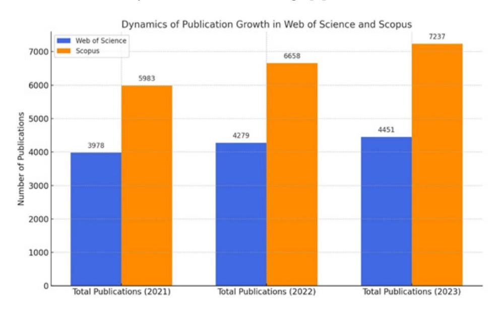
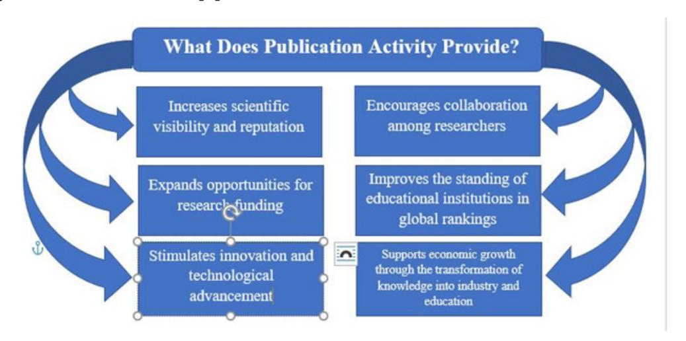
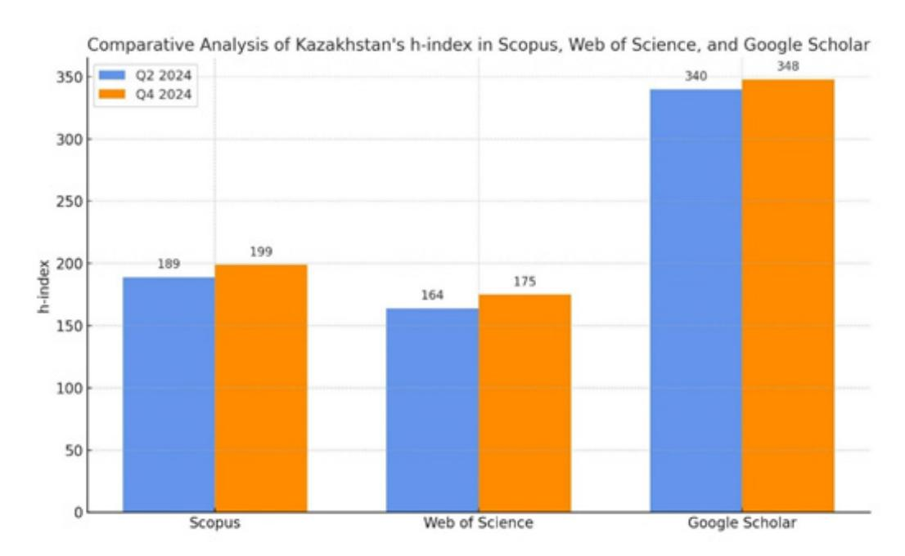
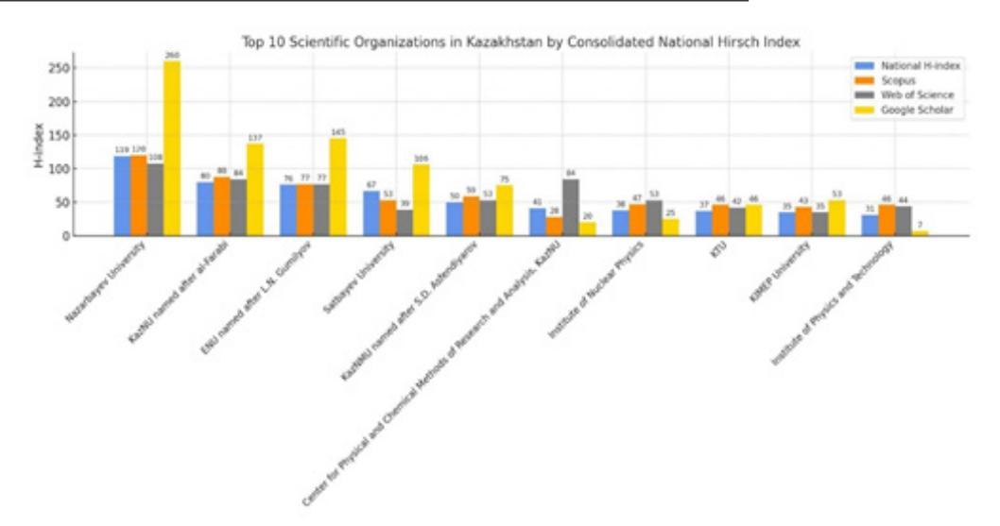
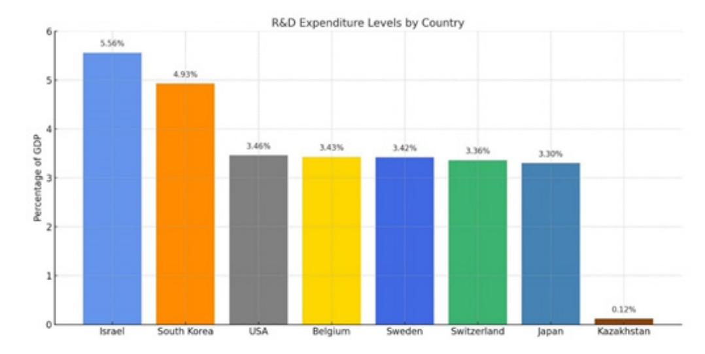
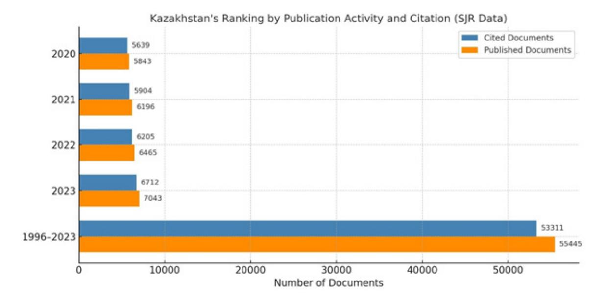
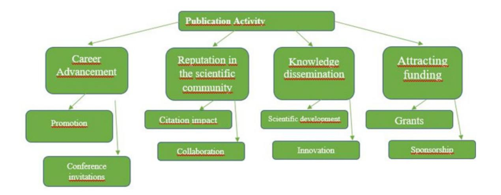
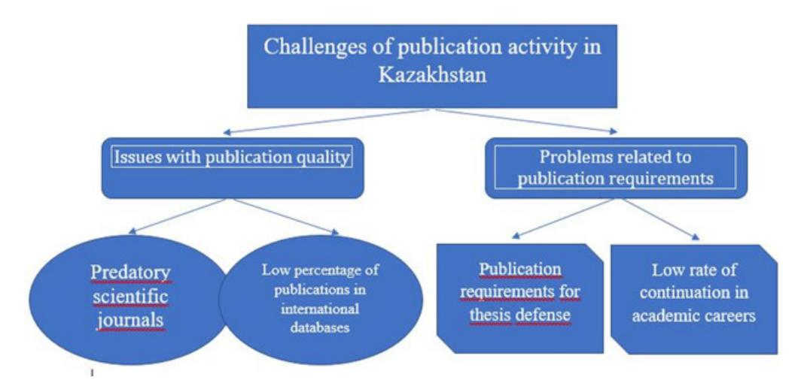
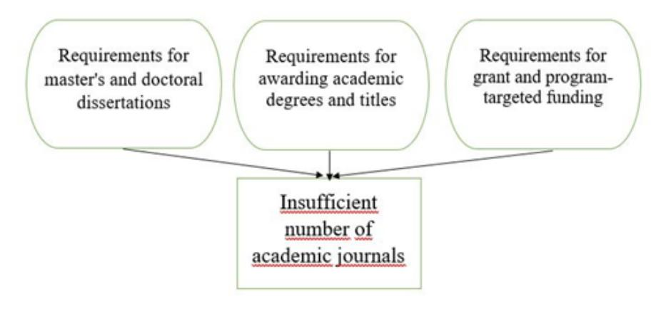

<!-- LR.R26 | source: papers_json/LR.R26/ -->

IRSTI 06.54.41 UDC 338.24.01 JEL I2, I23, O3, O38

https://doi.org/10.46914/1562-2959-2025-1-3-310-331

**MUSLIMOV R.A.,*1**

PhD student.

*e-mail: muslimov-ramil@bk.ru ORCID ID: 0009-0008-9085-1090

**ADAMBEKOVA A.A.,****^2^**

d.e.s., professor.

e-mail: ainatas0408@gmail.com ORCID ID: 0000-0003-2026-4321

**FAHLEVI H.,3**

d.e.s., professor.

e-mail: hfahlevi@usk.ac.id ORCID ID: 0000-0003-0190-1049 1 «Gylym Ordasy» RSE on the REM

Almaty, Kazakhstan

2 Al-Farabi Kazakh National University

3

Almaty, Kazakhstan Syiah Kuala University Banda Aceh, Indonesia

## **PUBLICATION ACTIVITY OF KAZAKHSTANI SCHOLARS: ** **TRENDS, CHALLENGES, AND STRATEGIES FOR ENHANCEMENT**

## **Abstract**

Scientific publication activity is a key indicator of the development of the research community and reflects both the productivity and impact of scientists. This study aims to analyze the current state of publication activity among Kazakhstani researchers, identify existing challenges, and propose recommendations to enhance the effectiveness and quality of scientific publications. The research carries significant scientific value by integrating bibliometric data and international benchmarks (UNESCO, World Bank indicators) to provide a comprehensive evaluation of Kazakhstan's research output. The practical importance is highlighted by the examination of issues such as the prevalence of lowquality journals and the mismatch between the growing number of researchers and the limited domestic publication venues. The findings underscore the dual role of publication activity: it increases the visibility and credibility of research while also serving as a basis for science policy and funding decisions. However, low citation rates and the persistence of outdated approaches in some institutions impede progress. The value of this study lies in its evidencebased recommendations to improve publication practices, including strengthening research quality, expanding international collaboration, and reforming institutional requirements. The practical outcomes of the study – such as specific measures to support journals and researchers – can guide policymakers and academic institutions in boosting the global impact of Kazakhstani science.

**Keywords:** publication activity, scientometric indicators, bibliometric analysis, scientific journals, research productivity, science policy, research evaluation, open access.

Studies in the field of scientometric indicators demonstrate that publication activity is one of the key metrics reflecting the development of the scientific community. This indicator plays a dual role: on the one hand, it provides an objective assessment of the contribution of individual researchers and research groups to the advancement of various disciplines; on the other hand, it helps to identify promising areas for further investigation. The significance of this metric becomes particularly evident in the quantitative analysis of the impact and quality of scientific work, as reflected in various bibliometric measures, including the widely used Hirsch index [1].

At the same time, scholars emphasize the need to develop new methods for assessing publication activity and to improve existing approaches to its evaluation. In the course of analyzing the publication

<!-- page 2 -->

activity of Kazakhstani researchers, experts have expressed serious concern about the growing number of articles published in predatory or pseudo-scientific journals. Between 2018 and 2022, a total of 2,644 articles published in questionable journals were retracted in Kazakhstan. Indeed, according to data from the Retraction Watch database, 2018 and 2022 marked record years for the number of retracted publications by Kazakhstani authors. The relevant ministry has highlighted the urgent need to revise methodologies for preparing scientific publications and to enhance the overall academic writing culture, as many universities still adhere to outdated approaches to evaluating research productivity.

International organizations also highlight the critical role of publication activity in the advancement of science and its contribution to a country's economic growth. According to the UNESCO Science Report (2021), scientific publications are key indicators of research productivity and a state's innovation capacity. Publication activity is recognized not only as a measure of scientific output but also as a reflection of the level of international collaboration, which enhances the quality and impact of research. Countries with high levels of scientific productivity, such as the United States and China, have achieved significant success in developing innovative economies, largely due to their intensive publication activity [2].

The World Bank, in its analytical reviews, emphasizes the importance of scientific research and publication activity as drivers of innovation and economic development. It is noted that a strong scientific and technological base, supported by high-quality publications, fosters the emergence of innovation ecosystems that stimulate the growth of key sectors such as technology and healthcare. Countries that make substantial investments in research and development tend to achieve faster economic progress and strengthen their global competitiveness. Scientific publications play a pivotal role in the knowledge economy by transforming new knowledge into technological advancements. A high level of publication activity is closely associated with accelerated economic growth and improved standings in international science and innovation rankings [3].

According to international reviews conducted by UNESCO and the OECD (Organisation for Economic Co-operation and Development), Kazakhstan experienced an increase in the number of scientific publications during the period from 2021 to 2023, particularly in the fields of energy, engineering, and environmental sciences. The primary hubs driving publication activity remain Nazarbayev University and Al-Farabi Kazakh National University. The country is intensifying its international collaboration; however, despite the growth in publication output, citation rates remain low, and Kazakhstan still does not rank among the top 50 countries in terms of scientific output. UNESCO recommends strengthening international partnerships and improving the quality of research, while the OECD highlights the urgent need to significantly increase R&D (research and experimental development) funding, as its current level remains well below the OECD average [4].

An assessment of publication activity in Kazakhstan has revealed that its relevance is closely linked to the development of new approaches to evaluating scientific performance. The present study sets out to propose strategies for enhancing the publication output of Kazakhstani researchers based on an analysis of current trends and challenges. The object of the research is the system of scientific communication in Kazakhstan, with a particular focus on the publication activity of local scholars. The subject of the study includes the indicators and influencing factors of publication productivity, as well as the mechanisms for its stimulation and regulation. In line with the stated objective, the following research tasks were identified:

- 1. To analyze the current level and dynamics of publication activity among Kazakhstani researchers within the context of global trends.
- 2. To identify key challenges and constraints affecting the quality and effectiveness of scientific publications in Kazakhstan.
- 3. To examine international experience (including UNESCO and OECD recommendations, and the successful strategies of other countries) in promoting publication activity.
- 4. To develop evidence-based recommendations aimed at increasing publication output and improving the quality of scientific publications in Kazakhstan.

The research hypothesis posits that a comprehensive set of state support measures for science, the improvement of scholarly publishing practices, and integration into the international scientific community will lead to a significant increase in both the quantity and quality of publications by Kazakhstani researchers. The research methodology includes bibliometric analysis of publication

<!-- page 3 -->

activity (using data from international scientometric databases), comparative analysis of Kazakhstan's performance indicators against those of leading scientific nations, analysis of statistical data on scientific potential (including the number of researchers, R&D expenditures, and the number of scientific journals), as well as a review of regulatory documents and expert reports concerning the evaluation of scientific performance. The practical significance of this study lies in the potential application of its findings and developed recommendations by science and education authorities to improve the evaluation criteria for researchers' work, to advance national scientific periodicals, and to enhance the global competitiveness of Kazakhstani science.

## **Materials and methods**

The study utilized both publicly available statistical data and the results of the author's own analysis of bibliometric indicators. A quantitative assessment of publication activity was conducted using data from the international scientometric databases Web of Science (InCites) and Scopus for the period 2021–2023, which made it possible to track the dynamics of the number of publications by Kazakhstani researchers and their citation rates. A comparative analysis of Kazakhstan's position in global scientific rankings–including the Global Innovation Index 2024 and UNESCO reports – was carried out to correlate national indicators with global trends. To assess the state of the scientific infrastructure, data from the Bureau of National Statistics of the Republic of Kazakhstan on the number of research institutions and personnel were analyzed, as well as information from the National Book Chamber on the number of scientific journals published in the country. An important information source included regulatory documents of the Committee for Quality Assurance in the Sphere of Science and Higher Education (CQASHE), particularly the publication requirements for applicants for academic degrees and titles [5].

The methodological framework of the study includes statistical analysis of bibliometric indicators (such as the number of publications, the Hirsch index, etc.), comparative analysis of Kazakhstan's scientometric characteristics in relation to other countries (e.g., R&D expenditure as a percentage of GDP, position in global rankings), as well as content analysis of expert reports and academic publications addressing the development of publication activity. During the course of the study, indicators were calculated to assess the burden on the national publication system–such as the number of potential authors per domestic journal and the number of articles per researcher–in order to identify imbalances between the number of researchers and available publication opportunities. In addition, international practices for supporting scientific journals and promoting publication activity were examined (using the strategies of China and several other countries as examples). This comprehensive approach enabled the formulation of well-grounded conclusions and recommendations. The research findings were reviewed by independent experts, which enhanced the reliability and validity of the conclusions. Despite the comprehensive nature of the data and methods employed, certain limitations of the study should be acknowledged. Reliance on major international databases such as Web of Science and Scopus may not fully capture the publication activity of Kazakhstani researchers, as a portion of the national output – particularly in the social sciences and humanities – appears in regional, national, or open-access journals not indexed in these systems. This may lead to a partial underestimation of overall publication output. In addition, statistical data from the Bureau of National Statistics and other official sources may contain reporting delays or differences in classification, which complicates comparability across years. The bibliometric analysis, while effective for identifying quantitative trends, does not address qualitative aspects of research, such as societal impact or thematic focus. Furthermore, the comparative analysis of international practices, though useful for identifying illustrative cases, was limited to a selection of countries and based primarily on secondary sources, which may not reflect the most recent policy developments in rapidly evolving contexts such as China. The number of consulted experts was also limited, which may constrain the representativeness of the assessment. Finally, the findings are based on data from a specific three-year period (2021–2023), which provides an important snapshot but may not capture longer-term dynamics. Recognizing these limitations ensures greater transparency of the methodological framework and highlights opportunities for future research to broaden data sources, integrate qualitative approaches, and examine longer-term trends in Kazakhstan's scientific publication landscape.

<!-- page 4 -->

## **Results and discussion**

Between 2021 and 2023, Kazakhstan demonstrated a steady increase in publication activity. According to the latest available InCites data as of May 2024, Kazakhstani researchers published 4,451 works indexed in the Web of Science in 2023, of which 3,767 (84.6%) were research articles and 278 (6.2%) were review articles. These figures represent a 4% increase compared to 2022 and a 12% increase compared to 2021. In the Scopus database, the number of publications by authors from Kazakhstan in 2023 reached 7,237 documents, including 5,830 (80.5%) research and review articles. This reflects a 9.4% increase over 2022 and a 21% increase over 2021.

Kazakhstan's recent growth in scientific publication activity can be attributed to several key factors. Government and institutional support has played a crucial role, with policies focused on funding universities and encouraging international research collaborations. This support structure has likely contributed to the steady increase in output. Additionally, expanding international partnerships – particularly with researchers from Russia, China, and European Union countries – have enhanced the global visibility of Kazakhstani publications. A strategic focus on priority fields such as engineering, energy, and materials science, which align closely with national development goals, has further reinforced this trend.

Despite these positive developments, Kazakhstan still faces significant challenges. The country continues to lag behind leading scientific nations in terms of citation impact and presence in highimpact journals. To improve its global scientific standing, Kazakhstan could benefit from policies that promote open access and initiatives aimed at raising the quality of research. These measures would help to strengthen the country's international influence and research competitiveness.

Despite the growing number of publications, Kazakhstan's overall contribution to the global scientific output remains relatively modest. The low citation rates of works by Kazakhstani researchers, along with the high standards required for publication in international databases (Scopus, Web of Science), present additional challenges for scholars. Key factors contributing to the further development and integration of Kazakhstani science into the global research landscape include government support (such as research funding and publication incentive programs) and the expansion of international collaboration. These measures have the potential to enhance the global engagement of Kazakhstani research and increase its visibility on the international stage [6].

*Figure 1 – The number of publications in both Web of Science and Scopus increased steadily between 2021 and 2023, reflecting a gradual intensification of research output in Kazakhstan.*

Note: The figure was developed by the authors.

<!-- page 5 -->

Publication activity is considered not only a quantitative indicator but also a reflection of the quality and impact of ongoing research. The Global Innovation Index (GII) 2024 notes an improvement in Kazakhstan's position: the country rose from 81st to 78th place among 133 countries. This progress is partly attributed to enhanced scientific productivity and increased publication output.

Additionally, in March 2023, Kazakhstan introduced the Kazakh National H-index Ranking – a unified system for assessing the performance of researchers and scientific organizations based on a consolidated h-index. This ranking utilizes data from Scopus, Web of Science, and Google Scholar, contributing to the identification of leading research institutions and fostering scientific competitiveness in the country [7].

At the same time, independent experts have pointed out several shortcomings of this methodology, including issues of data standardization across platforms, inaccuracies in author profiles, disregard for self-citations, and the omission of current research activity. These observations highlight the need to improve approaches to evaluating scientific performance. Nevertheless, the very introduction of a national bibliometric ranking reflects Kazakhstan's aspiration to enhance the transparency and objectivity of research evaluation [8].

*Figure 2 – The role of publication activity in science*

Note: The figure was developed by the authors.

The conceptual diagram (figure 2) illustrates the impact of publication activity on the scientific system. Regular publishing increases the visibility of research, stimulates knowledge exchange among scientific groups, and promotes the integration of interdisciplinary studies. Publications enhance the quality of education by incorporating new research findings into the teaching process, strengthen public and governmental trust in science through openness and transparency, and serve as a foundation for the development of evidence-based science policy [9].

Active publication activity reinforces the reputation of individual researchers and institutions, increases the likelihood of securing grants and funding, accelerates the dissemination of knowledge, and fosters innovation. The quantity and quality of public ations are key metrics for evaluating the contribution of researchers and universities in international rankings. Published research findings can also be transformed into practical applications, driving technological advancement and supporting economic development.

Figure 3 clearly illustrates the h-index values (maximum Hirsch index) for the collective body of work produced by Kazakhstani researchers, based on data from three scientometric databases during selected periods of 2024 [7].

There are notable discrepancies in h-index values depending on the citation database used. Specifically, h-index scores calculated using Google Scholar are often significantly higher than those obtained from Scopus or Web of Science (WoS). This variation stems primarily from differences in database coverage. Google Scholar indexes a broader and more inclusive range of sources, encompassing both peer-reviewed and non-peer-reviewed articles, conference proceedings, theses, dissertations,

<!-- page 6 -->

preprints, technical reports, and book chapters. In contrast, Scopus and WoS apply stringent selection criteria, indexing only high-quality, peer-reviewed publications from curated journals.

*Figure 3 – Comparative analysis of Kazakhstan's h-index based on Scopus, Web of Science, and Google Scholar databases (2024)*

Note: The figure was developed by the authors

This leads to a fundamental difference in how research impact is represented: while Google Scholar may suggest a more prolific output due to its inclusion of diverse materials, this can come at the expense of citation quality. Scopus and WoS, on the other hand, emphasize publications in journals with recognized impact factors and those meeting rigorous content standards, such as those defined by the Scopus Content Selection & Advisory Board (CSAB).

These differences have important implications for research evaluation. Google Scholar can be a valuable tool for early-career researchers or for disciplines where non-journal outputs, such as conference papers, are widely recognized – such as computer science. However, for formal evaluations such as university rankings, academic promotions, or grant applications, Scopus and Web of Science are generally preferred due to their quality-controlled and standardized data.For instance, in the second quarter of 2024, the h-index based on Google Scholar data was 15–20% higher than that of Scopus, and 25–30% higher than that of Web of Science.

This comparative analysis underscores the extent to which bibliometric indicators may vary depending on the database used. It highlights the importance of considering multiple data sources and indexing criteria for a more objective assessment of scientific activity.

Ultimately, the choice of database should align with the evaluation's purpose: Google Scholar provides a comprehensive overview of scholarly visibility, while Scopus and WoS offer standardized benchmarks for quality. Researchers and institutions must balance these metrics with qualitative peer assessment to ensure a fair and holistic appraisal of academic contributions.

The chart (Figure 4) presents the top ten research institutions in the Republic of Kazakhstan whose scholars demonstrate the highest citation metrics according to the national h-index ranking [10].

Nazarbayev University is the clear leader across all databases, indicating the high productivity and impact of its researchers both in international peer-reviewed journals and in a broader range of sources indexed by Google Scholar.

Al-Farabi Kazakh National University also shows strong performance, maintaining a prominent position in both the national citation index and international databases.

<!-- page 7 -->

*Figure 4 – Top ten research institutions in Kazakhstan by consolidated national h-index*

Note: The figure was developed by the authors.

Overall, leading universities exhibit higher levels of publication activity compared to sectoral research institutes. This may be attributed to differences in the scale of research projects, levels of international collaboration, and the fact that some institutes are primarily focused on applied research, with results often published in reports or patents rather than in journal articles.

The comparison of institutional indicators across different databases underscores the importance of a comprehensive approach: each database reflects scholarly impact and coverage differently, and only a combined assessment can provide an objective picture of an institution's contribution to science.

The observed discrepancies between databases also point to the need for further refinement of the national ranking system in terms of data standardization and consideration of disciplinary specificities.

The analysis of the top ten institutions confirmed the notable advantage of the university sector: leading universities demonstrate a higher consolidated h-index compared to research institutes. This indicates that publication activity is more intensive within universities, which can be partly explained by publication requirements for dissertation defense and academic career advancement. Nevertheless, a balanced development of science requires the coexistence and complementary functioning of different types of research institutions.

A significant discrepancy was observed between the indicators provided by different databases and the national index, due to variations in methodology and the frequency of data updates. The h-index based on Google Scholar is generally higher, as it includes a broader range of publications, while Scopus and Web of Science offer more conservative estimates owing to their rigorous source selection criteria.

The national index, which applies its own methodology, introduces additional differences.

This once again emphasizes the importance of considering a combination of metrics when evaluating the performance of a researcher or institution, rather than relying on a single source.

Particular attention in the course of this study was given to science funding as a key factor influencing publication activity.

Based on the most recent available comparative data, seven countries–global leaders in terms of R&D expenditure as a percentage of GDP–were analyzed (figure 5).

The graph in figure 5 illustrates the levels of investment in science across various countries.

Israel leads with a research and development (R&D) expenditure of 5.56% of GDP, followed by South Korea (4.93%), the United States (3.46%), Belgium (3.43%), Sweden (3.42%), Switzerland (3.36%), and Japan (3.30%).

In contrast, Kazakhstan lags significantly behind: according to various estimates, the country allocates only around 0.12–0.13% of its GDP to science–over 30 times less than the average level of the leading countries (~3.6%), 46 times less than Israel, and 41 times less than South Korea [11].

<!-- page 8 -->

*Figure 5 – Expenditure on Research and Development (R&D) across Various Countries as a Percentage of GDP*

Note: The figure was developed by the authors.

Such a disparity in investment levels has a substantial impact on the scientific potential of the country. Insufficient funding limits the ability to conduct advanced research, negatively affecting the development of an innovation-driven economy, as well as the volume and citation rates of scientific publications.

According to the Concept for the Development of Higher Education and Science of the Republic of Kazakhstan for 2023–2029, there are plans to gradually increase R&D expenditure to 1% of GDP by 2029 [12].

However, even if this target is achieved, the level of funding will still remain significantly below that of developed countries and will only approximate the levels of certain developing nations.

World Bank data confirm that Kazakhstan is lagging not only behind global leaders, but also behind countries with comparable levels of economic development.

The visualization in Figure 5 clearly demonstrates that high investment in science correlates with greater publication activity and international recognition of research outcomes [13].

When analyzing the share of gross domestic product (GDP) allocated by Kazakhstan to research and development (R&D), slight discrepancies in estimates are observed – either 0.12% or 0.13%. Accordingly, with a share of 0.12%, R&D expenditures amount to approximately 143.1 billion tenge, while at 0.13%, they reach around 155 billion tenge. These differences may be attributed to methodological variations in calculations and updates of statistical data.

However, according to the Concept for the Development of Higher Education and Science in the Republic of Kazakhstan for 2023–2029, there are plans to gradually increase R&D spending to 1% of GDP. Assuming that by 2029 the GDP will grow to 150,000 billion tenge, then 1% of this amount would represent 1,500 billion tenge.

For comparison, the budget of the city of Almaty for 2023 is approximately 1,000 billion tenge, and the revenue of the large national company "KTZ" (Kazakhstan Temir Zholy) for the same year reached 1,934.1 billion tenge. Thus, the planned R&D expenditures by 2029 will be comparable to Almaty's current budget, yet still fall short of KTZ's annual revenue.

This comparison highlights that the role of scientific research in the development of the national economy is just as important as that of the country's main logistics company.

According to the World Bank and Trading Economics, Kazakhstan's R&D spending in 2023 reached only 0.145% of GDP. Although this is slightly higher than previous figures of around 0.12– 0.13%, the level of funding remains extremely low. Such insignificant growth is more indicative of stagnation than real development of the industry. For comparison, leading countries such as Israel, South Korea and the United States consistently spend 3-5% of their GDP on these purposes. Achieving Kazakhstan's planned target of 1% by 2029 will require radical changes in current policy [14].

<!-- page 9 -->

According to WIPO, Kazakhstan is a leader in Central and South Asia, ranking 78th in the Global Innovation Index (GII) and among the top three countries in the region. It shows strong positions in such indicators as digital services (8th place), utility models (10th), and e-engagement (15th). However, these achievements do not have a solid research basis due to insufficient funding [15, 16].

Kazakhstan faces a persistent gap between its digital transformation and weak research infrastructure. Despite progress in digital services and growth in the GII, insufficient support for the scientific base threatens a "digital divide". Digitalization successes are not supported by corresponding R&D development, weakening innovation sustainability in the long term.

The country urgently needs to diversify science funding. It is no longer possible to limit itself to the state budget – sustainable growth requires attracting private investment, tax incentives and expanding grants. This is the only way to reduce state dependence and form a flexible scientific ecosystem.

In addition, at the current pace and structure of funding, the goal of 1% of GDP for R&D by 2029 is unattainable without systemic restructuring. Without the participation of the private sector and new financial instruments, this task will remain unresolved. Addressing these current imbalances will require systemic measures, including increased public funding and incentives for private sector investment in the field of science.

Rating agencies and scientific analytical platforms provide additional tools for evaluating publication activity and scientific impact. A comprehensive analysis employs various scientometric indicators – from traditional ones (number of publications, number of citations, journal impact factor) to more advanced metrics (H-index, g-index, share of highly cited publications, etc.). Table 1 presents a consolidated overview of the most commonly used indicators, their calculation methods, and areas of application.

Bibliometric indicators serve as a tool for quantitatively assessing scientific activity. However, an excessive focus solely on quantitative metrics can distort priorities in science. It is essential to combine various indicators and consider the qualitative dimension of research for an objective analysis. In Kazakhstan, scientometric indicators are actively used for research planning, grant allocation, and

<!-- page 10 -->

personnel certification. In particular, high impact factors and SJR scores of domestic journals are regarded as indicators of their international visibility and quality, which encourages efforts to include Kazakhstani publications in reputable databases. The Hirsch index is widely used to evaluate the productivity of individual researchers, although it is understood that it depends on the research field and the coverage of databases. Thus, each indicator has its own niche of application, and their integrated use ensures a more equitable assessment of scientific achievements.

The SJR (SCImago Journal Rank) metric warrants special attention, as it is used to rank academic journals based on their influence. SJR is calculated using Scopus data and takes into account not only the number of citations but also the prestige of the citing source: a citation from a high-ranking journal is valued more than one from a lesser-known publication. This approach allows for more accurate ranking of journals by reflecting their authority within the academic community.

The SJR calculation methodology was developed by the SCImago research group and is available through the open analytical platform SCImago Journal & Country Rank. This makes the index a convenient tool for comparing journals across different disciplines and countries. In Kazakhstan, SJR indicators are actively used in the evaluation of national journals: compliance with SJR criteria and impact factor is considered essential for inclusion in the list of recommended publications by the CQASHE.

The presented data indicate that the News of the National Academy of Sciences of the Republic of Kazakhstan, Series of Geology and Technical Sciences leads in the number of publications over the past three years (405), citations (401), and citable documents (295), reflecting a high level of engagement from the scientific community. The journals Kazakhstan Archeology and Eurasian Journal of Physics and Functional Materials demonstrate relevance in their specialized fields despite modest overall metrics [17].

<!-- page 11 -->

*Figure 6 – Kazakhstan's Ranking by Publication Activity and Citability (SJR Data)*

Note: The figure was developed by the authors.

Despite the annual increase in the number of publications and citations in Kazakhstan from 2020 to 2023, the country has consistently maintained 68th place in the ranking for the number of publications. Over the entire period from 1996 to 2023, Kazakhstan ranks 71st. Meanwhile, based on the h-index, which stands at 163 and has remained unchanged over the past four years, Kazakhstan holds the 99th position.

The publication of scientific research fosters knowledge exchange, which is critically important for technological advancement and economic development. By providing a platform for the dissemination of discoveries and innovations, scientific publications enable the transformation of research into practical applications that drive economic growth.

A notable example of a significant technological breakthrough was the invention of the steam engine. In 1698, English engineer Thomas Savery received a patent for the first steam engine, which was used to pump water out of mines. Some years later, in 1769, French engineer Nicolas-Joseph Cugnot developed the first prototype of a steam-powered vehicle. The emergence of steam engines became a major driving force of the 18th–19th century Industrial Revolution, transforming approaches to manufacturing and transportation. Steam engines began to be used in trains, ships, and early automobiles, significantly accelerating the transportation of goods and passengers. Furthermore, their application in factories and plants boosted productivity, contributing to economic growth [18].

Publication activity has a significant impact on the ranking and prestige of educational and research institutions. Universities and research centers aim to enhance their visibility and influence within the global scientific community by encouraging their staff to publish in high-impact journals. Strong publication performance helps attract students, faculty, and researchers, while also increasing funding opportunities and fostering partnerships [8].

Research shows that strategically boosting an organization's scientific output is the most effective method for increasing the citation rate of scholarly works. This, in turn, enhances their contribution to the advancement of global science.

Despite the undeniable importance of publication activity, there are gaps and issues that require more in-depth examination. It has been observed that in higher education institutions, faculty members often publish articles under the influence of external factors – such as certification requirements, incentive-based payments, or institutional regulations – rather than a genuine desire to share new knowledge. Such publications typically have limited impact on scientific progress, as the lack of experience in preparing high-quality research papers often results in compilative works with low scientific value.

<!-- page 12 -->

*Figure 7 – The Importance of Publication Activity*

Note: The figure was developed by the authors.

The issue of choosing the right journal for publication is also of considerable importance. Some journals, known as "predatory" journals, accept articles for a fee without providing proper peer review. Under institutional pressure – such as that observed in Kazakhstan – the emphasis on publishing in prestigious journals increases the likelihood of researchers turning to such outlets, which negatively impacts the quality of scientific research. This, in turn, can undermine researchers' reputations and hinder their integration into the international scientific community.

Moreover, ethical challenges faced by researchers have also been identified. These include excessive self-citation and the publication of unreliable data. Such practices damage scientific credibility and contradict the fundamental principles of research ethics. In some cases, the pressure to publish frequently and rapidly – commonly referred to as the "publish or perish" culture – contributes to a rise in questionable research practices, including salami-slicing of results and data manipulation. These systemic issues not only distort research metrics but also erode trust in academic institutions and scientific output. Addressing them requires a shift toward quality-oriented evaluation frameworks that prioritize research integrity, methodological rigor, and long-term academic contribution over mere publication counts.

*Figure 8 – Challenges of Publication Activity in Kazakhstan*

Note: The figure was developed by the authors.

<!-- page 13 -->

The analysis has revealed that Kazakhstani researchers face a number of serious challenges in the field of academic publishing, which significantly affect the volume and quality of their scientific work. The issue of publishing in fake or "predatory" journals is drawing increasing attention within Kazakhstan's scientific community. These journals, which lack strong academic reputations and rigorous peer review, offer researchers a fast-track to publication in exchange for payment. This is especially relevant for those aiming to fulfill formal requirements related to dissertation defense or the attainment of academic titles.

At the same time, a concerning trend has emerged: publications in predatory journals continue to receive citations, even after the journals have been classified as predatory. This indicates that there may be elements of fraud on the part of the journals themselves, while some of the published studies may still hold scientific relevance and interest.

Key issues include:

Quality of Publications:

- 1. Publications in Fake Journals: From 2018 to 2022, 2,644 articles by Kazakhstani scholars were labeled "fake," and the journals they were published in were subsequently delisted from Scopus indexing.
- 2. Limited Representation in International Databases: The share of Kazakhstani publications in the Web of Science database between 2020–2022 was only 0.12%, indicating a pressing need to enhance the quality and visibility of national research [19, 20].

Publication Requirements:

- 1. Publications for Dissertation Defense: Since 2011, doctoral candidates in Kazakhstan have been required to publish in international journals indexed by Scopus. This regulation places significant pressure on researchers, often leading them to opt for lower-tier journals.
- 2. Challenges in Continuing a Scientific Career: Only 38% of the 1,500 individuals who defended their doctoral dissertations in 2023 continue to work in science. The main contributing factors include high publication standards and insufficient support for early-career researchers [21].

Additional Barriers:

- 1. Language Barrier: The dominance of Russian in Kazakhstani publications hinders integration into the global scientific community, where English is the primary language. Researchers must therefore invest additional effort in improving their language skills.
- 2. Ethical Issues: There is a growing need to strengthen ethical standards in science, including tackling plagiarism, unjustified authorship claims, and weak adherence to methodological rigor.
- 3. Limited Access to International Databases: Despite progress in gaining access to resources like Scopus and Web of Science, access remains limited. Improving availability could significantly enhance Kazakhstan's scientific standing internationally [19, 20].

According to experts – a view we find valid – the best way to assess a journal's popularity and influence is not by looking at its impact factor in absolute terms, but rather by considering its position within a ranked list of journals divided into four quartiles based on impact factor (source: National Science Report).

This study has revealed a serious issue with the publication infrastructure in Kazakhstan, particularly due to the limited number of scientific journals available for researchers, graduate students, and doctoral candidates to publish their work. This shortage results in long queues and publication delays, which negatively affect researchers' academic progress and career development.

As of the end of 2024, there are 120 higher education institutions operating in the Republic of Kazakhstan, enrolling more than 642.5 thousand students. Of these, over 255.6 thousand are funded by the state. The number of graduates amounts to 182.6 thousand, including 157 thousand undergraduate students, 21 thousand master's students, more than 1.8 thousand doctoral candidates, and over 2.1 thousand medical residents.

For the 2024–2025 academic year, more than 94,200 state educational grants have been allocated in Kazakhstan. Of these, over 78,200 are designated for undergraduate programs, 13,100 for master's programs, and 2,900 for doctoral studies [21]. According to the Bureau of National Statistics, the total number of master's students stands at 39,172, while there are 7,633 doctoral candidates and 8,882 medical residents. Among master's students, 10,694 (27.3%) are studying education-related disciplines, 6,424 (16.4%) are in engineering, and 5,288 (13.5%) are pursuing economics [21].

<!-- page 14 -->

Under the requirements of the CQASHE, the successful defense of a thesis requires master's and doctoral students to publish scientific articles. Master's students must publish at least one article in a peer-reviewed academic journal, while doctoral students are required to publish no fewer than three articles, including publications in international journals indexed by Scopus and Web of Science. This places additional strain on the country's already limited publication infrastructure.

Note: The table was developed by the authors.

Currently, the number of journals available for publication across various disciplines remains limited. There are 14 journals accessible for pedagogical sciences, 7 for engineering specialties, and 17 for economic fields

According to data from the Book Chamber of Kazakhstan, approximately 300 scientific journals are published in the country. However, only 172 of these are included in the 2024 List of Publications recommended by the CQASHE for publishing key scientific research results.

The number of organizations engaged in scientific research has reached 425, and the total number of scientific personnel amounts to 25,400 individuals.

In addition to the regulatory requirements for dissertations, there is an institutional issue: the number of available scientific journals does not match the number of researchers and students. According to the data mentioned above, on average, there are 2,578 authors per journal in the field of pedagogical sciences in Kazakhstan, 4,546 authors per journal in engineering and construction specialties, and 1,805 authors per journal in economic fields. This leads to significant publication backlogs, complicating the fulfillment of dissertation defense requirements and academic advancement.

Furthermore, Kazakhstan's academic ecosystem imposes strict publication requirements for obtaining academic titles and participating in competitive grant and program-based projects. These requirements directly link career advancement and funding opportunities to publications in journals indexed in specific international databases, which increases the pressure on an already limited number of recognized academic journals. As a result, an artificial shortage of viable publishing platforms is created: the demand for such journals significantly exceeds the supply, leading to growing competition among researchers for a limited number of publication slots in reputable outlets. This systemic pressure distorts the academic environment, where administrative criteria often outweigh scientific novelty and methodological rigor. The problem is particularly acute in developing research systems, where national journals struggle to meet international indexing standards, and publishing in foreign journals requires substantial resources. Consequently, some researchers – caught between institutional expectations and the realities of academic publishing – may resort to compromise strategies that, over time, risk lowering overall scientific standards. This situation highlights the need to shift towards more balanced approaches to research assessment that recognize diverse forms of scholarly contribution and reduce dependence on quantitative metrics. One possible guiding framework is the San Francisco Declaration on Research Assessment (DORA), which calls for moving away from excessive reliance on publication-based indicators in favor of qualitative and substantive evaluation.

<!-- page 15 -->

The San Francisco Declaration on Research Assessment (DORA), launched in 2012, is a global initiative that calls for more meaningful evaluation of scientific research beyond journal impact factors. It urges institutions to assess research based on content, not where it is published, and to stop using metrics like JIF in decisions on hiring, promotions, and funding. DORA also promotes recognition of diverse outputs—such as datasets and policy work – and encourages transparency in evaluation. This approach counters problems like predatory publishing and risk-averse research, which are common in systems overly focused on publication metrics, including in Kazakhstan. DORA advocates for holistic review methods, including narrative CVs, open peer review, and responsible citation practices [22].

As a result, each of the 7,633 doctoral students and 39,172 master's students competes for a limited number of publication outlets. This creates high competition and long queues for publication, hindering the timely presentation of research results needed for dissertation defense and the maintenance of scientific status.

*Figure 9 – Factors Contributing to the Insufficient Number of Scientific Journals in Kazakhstan*

Note: The figure was developed by the authors.

Figure 10 presents the main reasons behind the shortage of journals: (1) strict publication requirements for degree seekers, academic titles, and grant applications,(2) a relatively small number of national journals, and (3) low levels of science funding. These factors together lead to an imbalance between the demand for and supply of publication platforms. Solving this issue requires a comprehensive approach – including both a revision of certain requirements (with more flexible application) and state support for the development of journals.

Nevertheless, despite the aforementioned challenges, positive shifts in Kazakhstan's publication activity are evident. In recent years, the government has increased investments in science and expanded support for the publication of academic journals. While in the 2010s the scientific output of Kazakhstani researchers was scarcely represented in high-ranking international journals, the situation had improved noticeably by 2023 [24].

An example of an effective strategy for boosting publication activity can be seen in China's experience. Not long ago, many Chinese researchers were forced to publish their work abroad, facing high costs and access barriers. However, China launched a series of state programs aimed at developing its own world-class scientific journals and promoting open access. Under the China Science and Technology Journal Excellence Action Plan (CJEAP), launched in 2019, the goal was set to establish 1,000 high-quality scientific journals by 2035.

By 2022, nearly 300 Chinese journals had entered the ranks of the world's leading publications thanks to this program. The number of Chinese journals with an impact factor above 10 rose from 4 in 2018 to 43 in 2022 (15 of which exceeded an IF of 20), and 154 Chinese journals were ranked in the top 25% (Q1) within their disciplines. To implement these goals, the China Association for Science and Technology (CAST) established partnerships with major international publishers, expanding reach and enhancing the prestige of its journals.

<!-- page 16 -->

These measures have significantly improved the accessibility of Chinese research findings for the global community and strengthened the country's position in the international scientific arena. China's experience demonstrates that comprehensive state-level support for academic publishing – including funding, quality standardization, internationalization, and open access – can lead to a dramatic increase in national researchers' publication activity and citation rates. [25]

Similar initiatives have also been implemented in other countries. For example, the Republic of Korea (South Korea) introduced a range of measures in the 2000s to encourage researchers to publish in high-ranking journals. These included monetary rewards for articles published in Q1 journals and government grants for translating research papers, among others. Within one to two decades, these efforts significantly increased the presence of Korean research in international databases [26].

Kazakhstan could adopt elements of this approach by adapting them to its own context. Naturally, simply copying foreign models does not guarantee success – a tailored national strategy is essential, one that takes into account the specific features of Kazakhstan's scientific system.

In summary, publication activity is a key indicator of a country's scientific productivity and innovation potential. It enhances the visibility of research, facilitates the integration of scientists into the global academic community, and drives economic growth by transforming knowledge into technology.

In Kazakhstan, despite the increase in the number of publications in recent years, their low citation rate and limited representation in international databases such as Scopus and Web of Science highlight the need to improve research quality.

Examples from China and South Korea demonstrate that investments in science and support for national journals lead to improved reputations and a greater number of publications in top-tier journals. The analysis also confirms that publication activity reflects the contribution of researchers and institutions to global science, promoting international collaboration, knowledge dissemination, and the application of research to the economy.

A high level of publication output contributes to university rankings, attracts funding, and fosters innovation. However, Kazakhstani researchers continue to face several challenges – including the low quality of some publications, administrative pressure to publish, limited access to international journals, and insufficient funding for science.

To address the identified issues and enhance publication activity in Kazakhstan, the following steps can be proposed:

## 1. Stimulating the Development of Scientific Journals:

Introduce tax incentives for academic publishers – such as VAT exemptions and reduced corporate income tax – to lower the cost of journal production for publishers and authors. This would make publishing more accessible for young researchers and scholars from the regions. At the same time, it would be advisable to establish grant programs to support domestic editorial offices, including funding for peer review, article translation into English, and journal promotion in international databases. Collectively, these measures would increase the number of journals published in Kazakhstan and the volume of articles they publish. As a result, the annual number of publications by Kazakhstani authors is expected to grow, with new platforms emerging for the dissemination of research findings. It is projected that implementing this package of measures could increase the total annual volume of publications by Kazakhstani scholars by 25–30% within 3-5 years, thanks to the expansion of national publishing infrastructure.

## 2. Improving the Quality of Existing Journals:

Develop and implement national quality standards for Kazakhstani academic journals, aligned with the requirements of international databases (Web of Science, Scopus). These standards may include mandatory double-blind peer review, international editorial boards, English-language abstracts and bibliographies, adherence to publication ethics, and more. Compliance with these standards – verified by independent audits – will help improve the reputation of local journals and increase the likelihood of their inclusion in prestigious international indexing services. The expected outcome is a 40–50% increase in the number of Kazakhstani journals indexed in Scopus/WoS over the next five years. This, in turn, will encourage researchers to publish in local journals, knowing that they are recognized internationally, rather than seeking to publish at all costs in questionable foreign outlets.

<!-- page 17 -->

The improved status of Kazakhstani journals will ensure their publications are reflected in global scientometric indicators, directly contributing to Kazakhstan's citation metrics.

3. Expanding International Collaboration:

Initiate joint publishing projects between Kazakhstani institutions and foreign universities or scholarly societies. For instance, co-publishing bilingual journals or special issues with international publishers, with a dedicated quota (e.g., 15% of articles per issue) reserved for Kazakhstani authors and co-financing of the publication. This will enhance the visibility of Kazakhstani research abroad and increase citation rates due to wider readership. Participation in international conferences and proceedings should also be encouraged, as it often leads to co-authorship with foreign colleagues. The state may partially subsidize article processing charges (APCs) for publications in Q1/Q2 open access journals by local authors. These measures would remove financial barriers and boost the number of publications by Kazakhstani researchers in top-tier international journals. The expected outcome is a 25–35% increase in co-authored publications with foreign scientists and a ~20% rise in the share of Kazakhstani articles in first-quartile journals. Moreover, enhanced international cooperation will facilitate knowledge transfer and elevate the prestige of Kazakhstani science.

4. Flexibility in Publication Requirements:

Reassess current certification and academic evaluation regulations to ensure they are flexible and appropriate for different fields of study. Developing a differentiated system for evaluating publication activity that accounts for disciplinary specifics would help reduce excessive pressure on researchers. For example, in technical and natural sciences, greater emphasis could be placed on patents, engineering solutions, and conference proceedings, while in the humanities, the value of monographs and national journals could be more widely recognized. Reducing the formal publication requirement while raising the quality standards of accepted articles would help avoid a quantity-over-quality race. It is proposed to decrease the required number of publications by 15–20% for dissertation defense in the humanities and social sciences, compensating with more rigorous dissertation reviews. The introduction of more flexible performance metrics – such as field-weighted citation impact (FWCI) – would also allow for fairer cross-disciplinary comparisons. As a result, the number of "forced" publications in predatory journals is expected to decline, and researchers will be able to allocate their resources more efficiently, thereby improving the overall quality and impact of published research.

## **Conclusion**

The conducted study has shown that researchers' publication activity is an essential component of the development of modern science. For Kazakhstan, enhancing publication activity is one of the key priorities of its science policy, as it directly influences the country's integration into the global scientific community and its innovation potential. The main findings of the study can be summarized as follows:

- Current Situation: Kazakhstan demonstrates a positive trend in the number of scientific publications; however, their quality and citation rates still lag behind global standards. The country holds a modest position in terms of scientific productivity, despite the growing volume of publications. Key challenges include low science funding, a shortage of high-ranking national journals, strict formal publication requirements resulting in publication bottlenecks, and a focus on quantitative metrics at the expense of research content and depth.
- Scientific Relevance: While quantitative bibliometric indicators are important for monitoring scientific progress, they must be applied thoughtfully. A comprehensive approach using diverse metrics (citation indices, impact factors, percentiles, etc.) is necessary for an objective assessment of contributions by researchers and institutions. The introduction of a national Hirsch index and alignment with international rankings reflect Kazakhstan's intent to improve scientific performance, but the identified shortcomings in evaluation methodologies need further refinement.
- International Experience: The study of practices in China, South Korea, and other countries has shown that systematic support for publication activity – financial, organizational, and regulatory – produces tangible results within a few years. China's case is particularly illustrative: investments in national journals, promotion of open access, and international collaboration have led to a dramatic rise

<!-- page 18 -->

in the visibility of Chinese science. This supports the hypothesis that with proper support, Kazakhstani researchers are capable of significantly expanding their presence on the global scientific stage.

Practical Recommendations: The proposed package of measures (stimulating journal development, improving publication quality, expanding international cooperation, and introducing flexible requirements) serves as a roadmap for improving the current situation. To ensure practical implementation, it is necessary to correlate recommendations with measurable KPIs, assign clear responsibilities (Ministry of Science and Higher Education, National Center for Scientific and Technical Expertise, and leading universities), and set implementation timelines (short-term: 1–2 years for journal incentives; medium-term: 3–5 years for international collaboration programs). Beyond existing indicators of publication growth, additional KPIs should be considered. The share of publications in Q1 and Q2 journals in Scopus and WoS will highlight not only the quantity but also the quality and visibility of research. Field-Weighted Citation Impact (FWCI) will reflect the competitiveness of Kazakhstani science at the global level, accounting for field-specific characteristics. The share of internationally co-authored publications will serve as a measure of integration into global scientific networks and strengthen international cooperation. Finally, tracking the share of R&D expenditures allocated specifically to publication support and journal development will demonstrate an institutional commitment to linking funding with concrete outcomes and creating a sustainable foundation for growth.

In conclusion, it is important to emphasize that publication activity is not an end in itself, but a means of advancing science. The growth in the number of articles must be accompanied by an increase in their scientific value and practical relevance. The correlation between the study's quantitative results (WoS and Scopus publication dynamics, h-index levels, and R&D expenditures) and the proposed measures shows that only balanced growth in both quantity and quality can raise Kazakhstan's position internationally. At the same time, potential risks must be recognized – such as overburdening researchers with formal requirements, excessive reliance on metrics, or increased formalism in reporting – and mitigated through flexible evaluation criteria and support mechanisms. Only under these conditions will research contribute to the technological and socio-economic progress of the country. The implementation of the proposed measures, combined with continuous monitoring of both existing and newly introduced indicators, will help create an environment in which Kazakhstani science becomes more competitive, open, and influential on the global stage.

## **REFERENCES**

- 1 Mikhailov O. Modern Problems of Scientometric Assessment of Publication Activity // Publications (MDPI). 2021, no. 9, p. 19. URL: https://www.mdpi.com/journal/publications/special_issues/scientometric_ assess (accessed: 13.02.2025)
- 2 Schneegans S., Straza T., Lewis J. UNESCO Science Report: the race against time for smarter development. 2021, p. 736. URL: https://www.unesco.org/reports/science/2021/en/report-series (accessed: 15.02.2025)
- 3 World Bank. Documents & Reports. 2024. URL: https://documents.worldbank.org/en/publication/ documents-reports (accessed: 10.03.2025)
- 4 Science Indicators. Informetrics & Scientometrics. URL: https://ebooks.inflibnet.ac.in/liscp10/chapter/ science-indicators/ (accessed: 05.03.2025)
- 5 Всемирная организация интеллектуальной собственности. Глобальный инновационный индекс 2024: Казахстан. URL: https://www.wipo.int/gii-ranking/en/kazakhstan (дата обращения: 12.02.2025)
- 6 Национальная академия наук Республики Казахстан. Казахстанская наука в цифрах. URL: https:// ru.qazscience.gov.kz/science-kazakhstan/informational-analytical-survey/kazakhstan-science-figures-data/ (дата обращения: 15.03.2025)
- 7 Kazakh National H-index Ranking: преимущества и недостатки // Блог компании «Научные публикации». – 2023, 14 апреля. URL: https://spubl.kz/ru/blog/kazakh-national-h-index-ranking-preimushchestvai-nedostatki (дата обращения: 10.03.2025)
- 8 Кудайбергенова Р., Смагулов К., Омиралиева Г., Узакбай С. Наукометрический анализ публикационной активности университетов Казахстана // Вестник КазНУ. Серия педагогическая. – 2022. – Т. 72. – № 3. – С. 4–22. URL: https://bulletin-pedagogic-sc.kaznu.kz/index.php/1-ped/article/view/1527 (дата обращения 10.02.2025)

<!-- page 19 -->

- 9 Majhi S., Sahu L., Behera K. Practices for enhancing research visibility, citations and impact // Aslib Journal of Information Management. 2023. Vol. 75. No. 6. P. 1234–1250. URL: https://www.emerald.com/ insight/content/doi/10.1108/ajim-11-2023-532/full/html (accessed: 20.02.2025) 10 Kazakh National H-index Ranking. URL: https://kz.h-index.com/en (accessed: 25.03.2025)
- 11 Рейтинг стран мира по уровню расходов на НИОКР. Гуманитарный портал. URL: https:// gtmarket.ru/ratings/research-and-development-expenditure (дата обращения: 26.03.2025)
- 12 Расходы на науку в Казахстане составляют всего 0,16% от ВВП. Качественный Казахстан. 2025, 31 марта. URL: https://standard.kz/ru/post/2025_03_rasxody-na-nauku-v-kazaxstane-sostavliaiutmizernye-016-ot-vvp-170 (дата обращения: 08.03.2025)
- 13 Новый доклад Всемирного банка подчеркивает важность увеличения фискальных доходов для долгосрочных инвестиций в Казахстане. Всемирный банк. – 2025, 30 января. URL: https://www. vsemirnyjbank.org/ru/news/press-release/2025/01/30/kazakhstan-economic-update (дата обращения: 01.03.2025)
- 14 Trading Economics. Research and Development Expenditure (% of GDP): Kazakhstan, Trading Economics Database, 2022. URL: https://tradingeconomics.com/kazakhstan/research-and-developmentexpenditure-percent-of-gdp-wb-data.html (accessed: 18.02.2025)
- 15 Akhmetkali A. Kazakhstan Hosts First Regional Presentation of Global Innovation Index, Highlights Region's Innovation Potential, The Astana Times, 4 October 2024. URL: https://astanatimes.com/2024/10/ kazakhstan-hosts-first-regional-presentation-of-global-innovation-index-highlights-regions-innovationpotential/?utm_source (accessed: 26.02.2025)
- 16 Ministry of Foreign Affairs of the Republic of Kazakhstan. Astana Hosts Ceremony of Unveiling the Report of the Global Innovation Index 2024 for Asian Countries. Press Centre, MFA RK, 4 October 2024. URL: https://www.gov.kz/memleket/entities/mfa/press/news/details/859030?lang=en&utm_source (accessed: 03.03.2025)
- 17 SCImago Journal & Country Rank: Казахстан. URL: https://www.scimagojr.com/journalrank. php?country=KZ (accessed: 26.03.2025)
- 18 Да будет свет: хроника научных открытий, которые перевернули мир // РБК тренды. 2021, 5 апреля. URL: https://trends.rbc.ru/trends/innovation/606b694a9a794784aac7b749 (дата обращения: 17.03.2025)
- 19 Национальный доклад по науке за 2020 год / Под ред. М.Ж. Журинова. Нур-Султан-Алматы: Национальная академия наук Республики Казахстан. – 2021. – 241 с. URL: https://nauka-nanrk.kz/ assets/2021/доклад%20гот/Нац-доклады%20ang.pdf (дата обращения: 14.02.2025)
- 20 Amirbekova D., Narbaev T., Kussaiyn M. The Research Environment in a Developing Economy: Reforms, Patterns, and Challenges in Kazakhstan // Publications. 2022. Vol. 10. No. 4. P. 37. URL: https://www. mdpi.com/2304-6775/10/4/37 (accessed: 14.02.2025)
- 21 Дарибай А. Казахстанские ученые стали чаще публиковаться в фейковых научных журналах депутат // Tengrinews.kz. – 2024, 18 апреля. URL: https://tengrinews.kz/kazakhstan_news/kazahstanskieuchenyie-stali-chasche-publikovatsya-feykovyih-532743/ (дата обращения: 03.02.2025)
- 22 The San Francisco Declaration on Research Assessment (DORA). Read the Declaration. San Francisco Declaration on Research Assessment, 2012. URL: https://sfdora.org/read/ (accessed: 10.03.2025)
- 23 National Research Council. Science and Technology in Kazakhstan: Current Status and Future Prospects. Washington, DC: The National Academies Press, 2007. 250 p. URL: https://nap.nationalacademies. org/read/11808/chapter/4 (accessed: 31.03.2025)
- 24 Kazakhstan records growth in international scientific publishing. Kazinform. 2024. 5 июля. URL: https://en.inform.kz/news/kazakhstan-records-growth-in-international-scientific-publishing-637d33/ (accessed: 27.03.2025)
- 25 Zhang N., Dyke G. Evaluating China's Science and Technology Journal Excellence Action Plan: A New Era of Research Impact and Standards? The Scholarly Kitchen. 2024. 18 декабря. URL: https:// scholarlykitchen.sspnet.org/2024/12/18/guest-post-evaluating-chinas-science-and-technology-journalexcellence-action-plan-a-new-era-of-research-impact-and-standards/ (accessed: 15.04.2025)
- 26 Как в Южной Корее поддерживают талантливых ученых. Институт статистических исследований и экономики знаний НИУ ВШЭ. – 2024, 15 декабря. URL: https://issek.hse.ru/news/803750750.html (дата обращения: 10.04.2025)

<!-- page 20 -->

## **REFERENCES**

- 1 Mikhailov O. (2021) Modern Problems of Scientometric Assessment of Publication Activity // Publications (MDPI), no. 9, p. 19. URL: https://www.mdpi.com/journal/publications/special_issues/scientometric_assess (accessed: 13.02.2025). (In English).
- 2 Schneegans S., Straza T., Lewis J. (2021) UNESCO Science Report: the race against time for smarter development, p. 736. URL: https://www.unesco.org/reports/science/2021/en/report-series (accessed: 15.02.2025). (In English).
- 3 World Bank. Documents & Reports. 2024. URL: https://documents.worldbank.org/en/publication/ documents-reports (accessed: 10.03.2025). (In English).
- 4 Science Indicators. Informetrics & Scientometrics. URL: https://ebooks.inflibnet.ac.in/liscp10/chapter/ science-indicators/ (accessed: 05.03.2025). (In English).
- 5 Vsemirnaja organizacija intellektual'noj sobstvennosti. Global'nyj innovacionnyj indeks 2024: Kazahstan. URL: https://www.wipo.int/gii-ranking/en/kazakhstan (data obrashhenija: 12.02.2025). (In Russian).
- 6 Nacional'naja akademija nauk Respubliki Kazahstan. Kazahstanskaja nauka v cifrah. URL: https:// ru.qazscience.gov.kz/science-kazakhstan/informational-analytical-survey/kazakhstan-science-figures-data/ (data obrashhenija: 15.03.2025). (In Russian).
- 7 Kazakh National H-index Ranking: preimushhestva i nedostatki // Blog kompanii «Nauchnye publikacii». 2023, 14 aprelja. URL: https://spubl.kz/ru/blog/kazakh-national-h-index-ranking-preimushchestva-i-nedostatki (data obrashhenija: 10.03.2025). (In Russian).
- 8 Kudajbergenova R., Smagulov K., Omiralieva G., Uzakbaj S. (2022) Naukometricheskij analiz publikacionnoj aktivnosti universitetov Kazahstana // Vestnik KazNU. Serija pedagogicheskaja. V. 72. No. 3. P. 4–22. URL: https://bulletin-pedagogic-sc.kaznu.kz/index.php/1-ped/article/view/1527 (data obrashhenija 10.02.2025). (In Russian).
- 9 Majhi S., Sahu L., Behera K. (2023) Practices for enhancing research visibility, citations and impact // Aslib Journal of Information Management. Vol. 75. No. 6. P. 1234–1250. URL: https://www.emerald.com/ insight/content/doi/10.1108/ajim-11-2023-532/full/html (accessed: 20.02.2025). (In English).
- 10 Kazakh National H-index Ranking. URL: https://kz.h-index.com/en (accessed: 25.03.2025). (In English).
- 11 Rejting stran mira po urovnju rashodov na NIOKR. Gumanitarnyj portal. URL: https://gtmarket.ru/ ratings/research-and-development-expenditure (data obrashhenija: 26.03.2025). (In Russian).
- 12 Rashody na nauku v Kazahstane sostavljajut vsego 0,16% ot VVP. Kachestvennyj Kazahstan. 2025, 31 marta. URL: https://standard.kz/ru/post/2025_03_rasxody-na-nauku-v-kazaxstane-sostavliaiut-mizernye-016-ot-vvp-170 (data obrashhenija: 08.03.2025). (In Russian).
- 13 Novyj doklad Vsemirnogo banka podcherkivaet vazhnost' uvelichenija fiskal'nyh dohodov dlja dolgosrochnyh investicij v Kazahstane. Vsemirnyj bank. 2025, 30 janvarja. URL: https://www.vsemirnyjbank. org/ru/news/press-release/2025/01/30/kazakhstan-economic-update (data obrashhenija: 01.03.2025). (In Russian).
- 14 Trading Economics. Research and Development Expenditure (% of GDP): Kazakhstan, Trading Economics Database, 2022. URL: https://tradingeconomics.com/kazakhstan/research-and-developmentexpenditure-percent-of-gdp-wb-data.html (accessed: 18.02.2025). (In English).
- 15 Akhmetkali A. Kazakhstan Hosts First Regional Presentation of Global Innovation Index, Highlights Region's Innovation Potential, The Astana Times, 4 October 2024. URL: https://astanatimes.com/2024/10/ kazakhstan-hosts-first-regional-presentation-of-global-innovation-index-highlights-regions-innovationpotential/?utm_source (accessed: 26.02.2025). (In English).
- 16 Ministry of Foreign Affairs of the Republic of Kazakhstan. Astana Hosts Ceremony of Unveiling the Report of the Global Innovation Index 2024 for Asian Countries, Press Centre, MFA RK, 4 October 2024. URL: https://www.gov.kz/memleket/entities/mfa/press/news/details/859030?lang=en&utm_source (data obrashcheniya: 03.03.2025). (In English).
- 17 SCImago Journal & Country Rank: Казахстан. URL: https://www.scimagojr.com/journalrank. php?country=KZ (accessed: 26.03.2025). (In English).
- 18 Da budet svet: hronika nauchnyh otkrytij, kotorye perevernuli mir // RBK trendy. 2021, 5 aprelja. URL: https://trends.rbc.ru/trends/innovation/606b694a9a794784aac7b749 (data obrashhenija: 17.03.2025). (In Russian).
- 19 Nacional'nyj doklad po nauke za 2020 god / Pod red. M.Zh. Zhurinova. Nur-Sultan-Almaty: Nacional'naja akademija nauk Respubliki Kazahstan. 2021. 241 p. URL: https://nauka-nanrk.kz/assets/2021/doklad%20got/Nacdoklady%20ang.pdf (data obrashhenija: 14.02.2025). (In Russian).
- 20 Amirbekova D., Narbaev T., Kussaiyn M. (2022) The Research Environment in a Developing Economy: Reforms, Patterns, and Challenges in Kazakhstan // Publications. Vol. 10. No. 4. P. 37. URL: https://www.mdpi. com/2304-6775/10/4/37 (accessed: 14.02.2025). (In English).

<!-- page 21 -->

- 21 Daribaj A. Kazahstanskie uchenye stali chashhe publikovat'sja v fejkovyh nauchnyh zhurnalah deputat // Tengrinews.kz. 2024, 18 aprelja. URL: https://tengrinews.kz/kazakhstan_news/kazahstanskie-uchenyiestali-chasche-publikovatsya-feykovyih-532743/ (data obrashhenija: 03.02.2025). (In Russian).
- 22 The San Francisco Declaration on Research Assessment (DORA). Read the Declaration. San Francisco Declaration on Research Assessment, 2012. URL: https://sfdora.org/read/ (accessed: 10.03.2025). (In English).
- 23 National Research Council. Science and Technology in Kazakhstan: Current Status and Future Prospects. Washington, DC: The National Academies Press, 2007. 250 p. URL: https://nap.nationalacademies. org/read/11808/chapter/4 (accessed: 31.03.2025). (In English).
- 24 Kazakhstan records growth in international scientific publishing. Kazinform. 2024. 5 ijulja. URL: https://en.inform.kz/news/kazakhstan-records-growth-in-international-scientific-publishing-637d33/ (accessed: 27.03.2025). (In English).
- 25 Zhang N., Dyke G. (2024) Evaluating China's Science and Technology Journal Excellence Action Plan: A New Era of Research Impact and Standards? The Scholarly Kitchen. URL: https://scholarlykitchen.sspnet. org/2024/12/18/guest-post-evaluating-chinas-science-and-technology-journal-excellence-action-plan-a-newera-of-research-impact-and-standards/ (accessed: 15.04.2025). (In English).
- 26 Kak v Juzhnoj Koree podderzhivajut talantlivyh uchenyh. Institut statisticheskih issledovanij i jekonomiki znanij NIU VShJe. 2024, 15 dekabrja. URL: https://issek.hse.ru/news/803750750.html (data obrashhenija: 10.04.2025). (In Russian).

## **МУСЛИМОВ Р.A.,*1**

докторант.

*e-mail: muslimov-ramil@bk.ru ORCID ID: 0009-0008-9085-1090

**АДАМБЕКОВА А.А.,****^2^**

э.ғ.д., профессор.

e-mail: ainatas0408@gmail.com ORCID ID: 0000-0003-2026-4321

**ФАХЛЕВИ Х.,3**

э.ғ.д., профессор. e-mail: hfahlevi@usk.ac.id ORCID ID: 0000-0003-0190-1049 1 «Ғылым ордасы» ШЖҚ РМК, Алматы қ., Қазақстан 2 әл-Фараби атындағы Қазақ ұлттық университеті Алматы қ., Қазақстан 3 Сийях Куала университеті, Банда-Ачех қ., Индонезия

## **ҚАЗАҚСТАНДЫҚ ҒАЛЫМДАРДЫҢ ЖАРИЯЛАНЫМДЫҚ БЕЛСЕНДІЛІГІ: ** **ҮРДІСТЕР, МӘСЕЛЕЛЕР ЖӘНЕ ДАМЫТУ СТРАТЕГИЯЛАРЫ**

## **Аңдатпа**

Ғылыми жарияланымдық белсенділік – ғалымдардың зерттеу өнімділігі мен оның ғылыми ортаға ықпалын сипаттайтын маңызды көрсеткіш. Ол ғылымның даму деңгейін айқындайтын негізгі факторлардың бірі болып табылады. Бұл зерттеудің мақсаты – Қазақстандық зерттеушілердің жарияланымдық белсенділігінің қазіргі ахуалын кешенді түрде талдау, негізгі мәселелерді анықтау және ғылыми еңбектердің тиімділігі мен сапасын арттыруға бағытталған ұсыныстар әзірлеу. Зерттеудің ғылыми маңыздылығы Қазақстанның ғылыми өнімділігіне объективті баға беру үшін библиометриялық деректер мен халықаралық көрсеткіштерді (ЮНЕСКО және Дүниежүзілік банк деректері) үйлестіре отырып, кешенді талдау жүргізу арқылы анықталады. Ал практикалық маңыздылығы – зерттеушілер санының артуы мен отандық ғылыми басылымдардың шектеулігі, сапасы төмен журналдардың таралуы сияқты өзекті мәселелерді қарастырумен ерекшеленеді. Зерттеу нәтижелері ғылыми жарияланымдық белсенділіктің екіжақты сипатын көрсетеді: бір жағынан, ол зерттеулердің көрінуін және олардың ғылыми ортадағы беделін арттырады, екінші жағынан, ғылымды басқару және қаржыландыру саясатын қалыптастыруда шешуші рөл атқарады. Алайда, қазақстандық ғылыми еңбектердің төмен цитатталуы және кейбір ұйымдарда ескі көзқарастардың сақталуы ғылыми прогрестің қарқынын тежейтін факторларға айналуда. Бұл зерттеу ғылыми зерттеулердің сапасын

<!-- page 22 -->

жақсарту, халықаралық ынтымақтастықты нығайту және институционалдық талаптарды жетілдіру бойынша негізделген ұсыныстар әзірлеуге бағытталған. Ал жұмыстың практикалық нәтижелері – ғылыми журналдарды дамыту мен ғалымдарды қолдау шаралары жөніндегі нақты ұсыныстар – Қазақстан ғылымының жаһандық ықпалын арттыру үшін басқару органдары мен академиялық мекемелерге қолданысқа енгізіледі.

**Тірек сөздер: **жарияланымдық белсенділік; ғылымды сандық бағалау көрсеткіштері; библиометриялық талдау; ғылыми журналдар; ғылыми өнімділік; ғылым саясаты; зерттеулерді бағалау; ашық қолжетімділік.

## **МУСЛИМОВ Р.A.,1** *****

докторант. *e-mail: muslimov-ramil@bk.ru ORCID ID: 0009-0008-9085-1090

**АДАМБЕКОВА А.А.,****^2^**

д.э.н., профессор. e-mail: ainatas0408@gmail.com ORCID ID: 0000-0003-2026-4321

**ФАХЛЕВИ Х.,3**

д.э.н., профессор. e-mail: hfahlevi@usk.ac.id ORCID ID: 0000-0003-0190-1049 1 РГП на ПХВ «Ғылым ордасы», г. Алматы, Казахстан 2 Казахский национальный университет им. аль-Фараби, г. Алматы, Казахстан 3 Университет Сийях Куала, г. Банда-Ачех, Индонезия

## **ПУБЛИКАЦИОННАЯ АКТИВНОСТЬ КАЗАХСТАНСКИХ УЧЕНЫХ: ** **ТЕНДЕНЦИИ, ПРОБЛЕМЫ И ПУТИ ПОВЫШЕНИЯ**

## **Аннотация**

Научная публикационная активность является важнейшим индикатором развития исследовательского сообщества, отражающим продуктивность и влияние ученых. Настоящее исследование посвящено анализу текущего состояния публикационной активности казахстанских исследователей, выявлению ключевых проблем и разработке рекомендаций по повышению эффективности и качества научных публикаций. Научная значимость работы обусловлена интеграцией библиометрических данных и международных показателей (ЮНЕ-СКО, Всемирный банк), что позволяет провести всестороннюю оценку научной продуктивности Казахстана. Практическая значимость проявляется в рассмотрении таких актуальных проблем, как распространение низкокачественных журналов, несоответствие между увеличивающимся числом исследователей и ограниченными возможностями отечественных научных изданий. Полученные результаты демонстрируют двойственную роль публикационной активности: с одной стороны, она способствует повышению видимости и авторитета научных исследований, с другой – служит инструментом формирования научной политики и распределения финансирования. Однако низкие показатели цитируемости и сохранение устаревших подходов в ряде организаций продолжают сдерживать развитие науки. Ценность исследования заключается в обоснованных рекомендациях, направленных на повышение качества научных публикаций, расширение международного сотрудничества и совершенствование институциональных требований. Практические результаты – конкретные предложения по поддержке научных журналов и ученых – могут быть использованы органами управления и академическими институтами для усиления глобального влияния казахстанской науки.

**Ключевые слова: **публикационная активность, наукометрические показатели, библиометрический анализ, научные журналы, научная продуктивность, научная политика, оценка исследований, открытый доступ.

Article submission date: 01.04.2025
