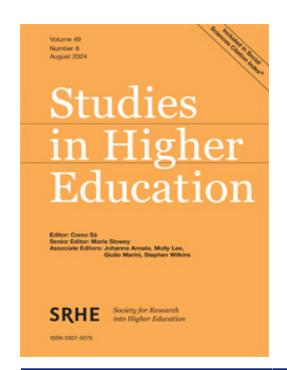
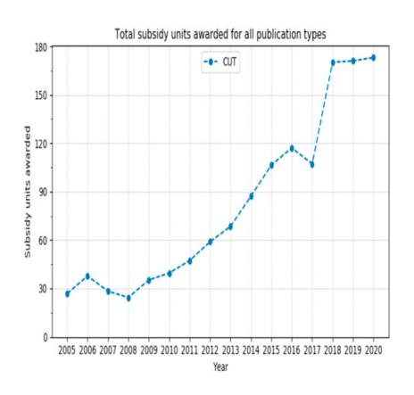
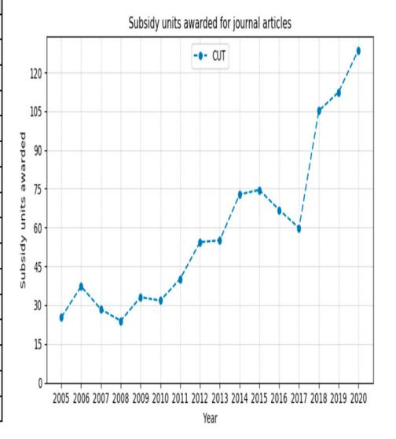
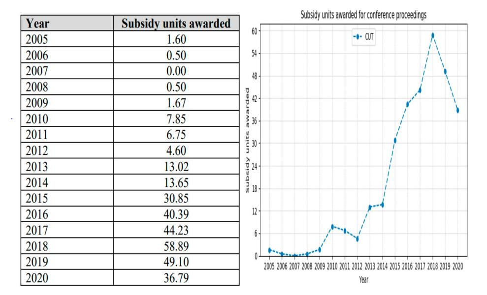
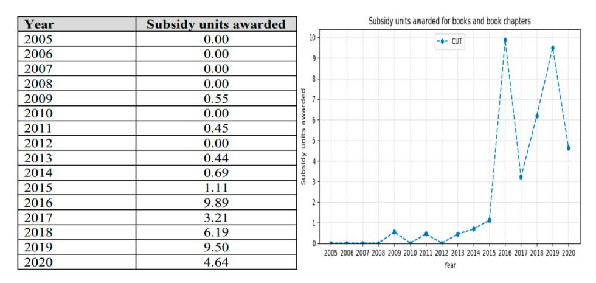
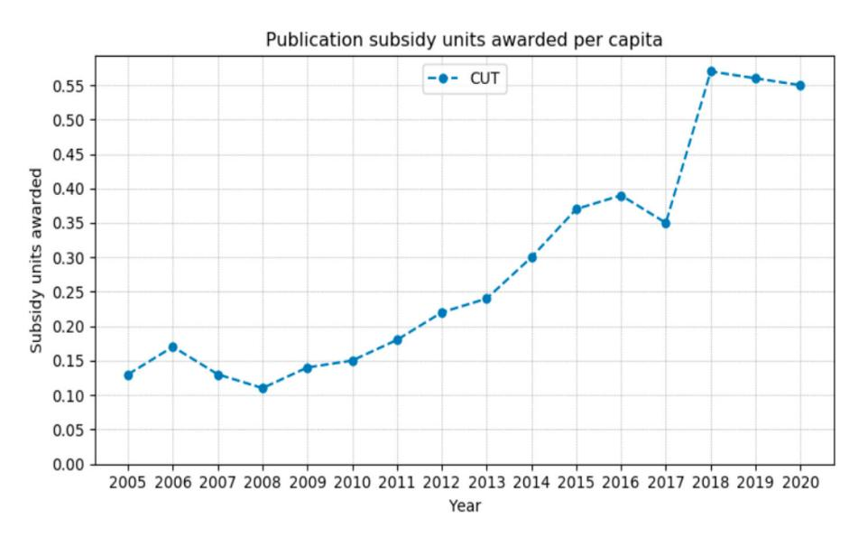
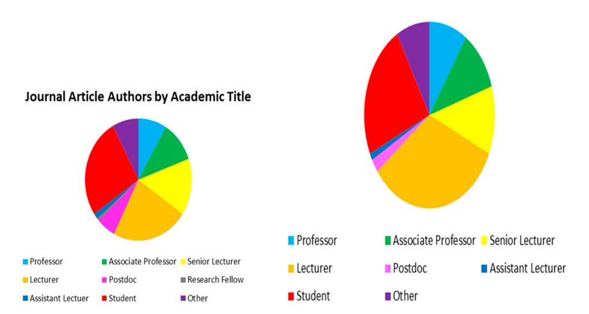
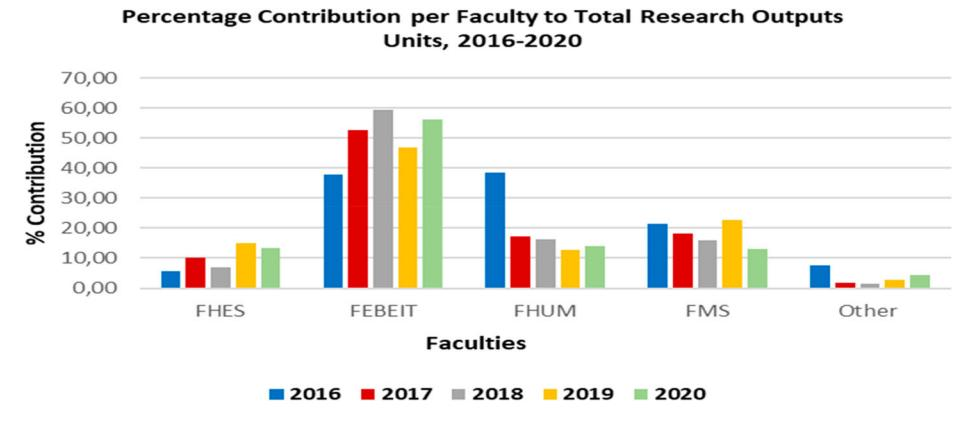
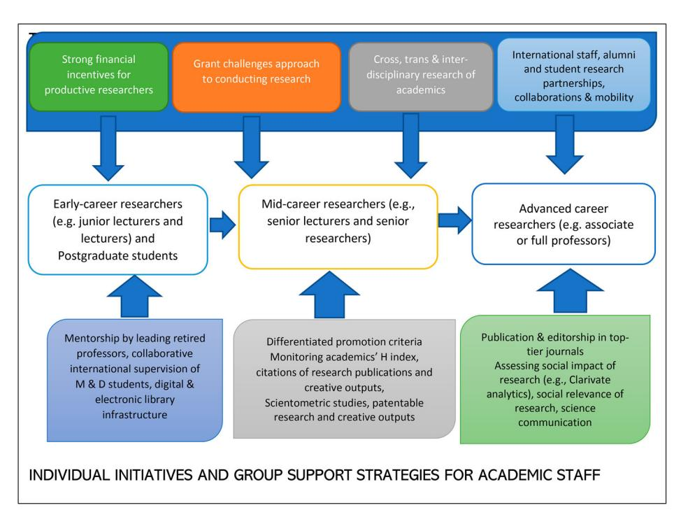

<!-- LR.R30 | source: papers_json/LR.R30/ -->

## **Studies in Higher Education**

**ISSN: 0307-5079 (Print) 1470-174X (Online) Journal homepage: ****[www.tandfonline.com/journals/cshe20](https://www.tandfonline.com/journals/cshe20?src=pdf)**

## **Research** **excellence** **and** **productivity** **for** **global** **impact at an African university**

## **Patient Rambe**

**To** **cite** **this** **article:** Patient Rambe (2024) Research excellence and productivity for global impact at an African university, Studies in Higher Education, 49:8, 1397-1424, DOI: [10.1080/03075079.2023.2265931](https://www.tandfonline.com/action/showCitFormats?doi=10.1080/03075079.2023.2265931)

**To** **link** **to** **this** **article:** [https://doi.org/10.1080/03075079.2023.2265931](https://doi.org/10.1080/03075079.2023.2265931)

| Published online: 09 Oct 2023. |
| --- |
| Submit your article to this journal |
| Article views: 640 |
| View related articles |
| View Crossmark data |
| Citing articles: 8 View citing articles |

<!-- page 2 -->

## Research excellence and productivity for global impact at an African university

Patient Rambe

Faculty of Management Sciences, Central University of Technology, Bloemfontein, South Africa

## ABSTRACT

The South African government announcement on revisiting the Policy for the Recognition of Higher Education Institutional Types has caused anxiety and ambivalence among Universities of Technology (UoTs), institutions that lack a solid foundation for conducting leading research. Most underperforming UoTs feared a possible downgrade or de-classification from being universities to becoming university colleges by the Department of Higher Education and Training (DHET), potentially triggering attrition of experienced academic staff and students to prominent research-intensive universities. Paradoxically, this ambivalence has also stimulated renewed public interest and discourse on the constitution of research excellence and productivity for greater impact and their significance in UoTs contexts, as universities compete for academic existence, space and relevance amid highly demanding multiple stakeholders in the global community. Addressing specific aspects of research excellence and productivity, this conceptual paper employs Institutional Theory, secondary data of research productivity and the researcher's reflective insights to locate specific disciplinary areas where one UoT (hereinafter called 'Protea University') demonstrated formidable strength and research excellence areas it downplayed that require improvement. The study also proposes concrete strategies for transitioning this university to become a world-class leading research university in a volatile, uncertain, complex and ambiguous (VUCA) world. The study proposes differentiated academic promotion criteria, research impact-lead international collaborations, benchmarking of the research practices and habits of research-intensive universities, innovation and consultancy-driven third-stream income generation and advancement of science communication as areas this UoT can build on to promote its image, reputation and drive of becoming a leading university on the African continent.

## ARTICLE HISTORY

Received 8 February 2023 Accepted 26 September 2023

## KEYWORDS

De-classification; researchlead university; university archetypes; research excellence; research productivity

## Introduction and context

Recently, there have been growing internal and external pressures for universities globally to optimise their research productivity and leverage research excellence irrespective of their context of operation. The louder calls for high research productivity and research excellence have been precipitated by the advent of the knowledge-based economy and the importance of manipulation and transfer of knowledge assets (Varga [2009)](#page-28-0). Other drivers include pressures from governments for greater outcome-based accountability, increasing demands from industry for market-driven innovations, burgeoning competition for domestic and international students (Bland et al. [2005)](#page-25-0), and greater public demands for the social relevance of academic research emanating from universities

<!-- page 3 -->

(Jegede and Ncube [2021)](#page-26-0). In the volatile, uncertain, complex and ambiguous (VUCA) world characterised by the Covid pandemic and its disruptions of site-based research activities, the increasing diversity of students enrolling and affiliating with higher educational institutions, and the increasing scrutiny of outcomes-driven educational delivery, calls for research excellence and increased research productivity have never been louder.

Paradoxically, the research productivity and excellence drive of universities in South Africa have been undermined by fiscal squeeze precipitated by inter alia, the redirection of money that could be allocated to higher education capacity development due to the global Covid-19 pandemic, and reduced revenue as consequence of the # Fees-Must-Fall Campaigns. Moreover, Pinheiro et al. [(2015)](#page-27-0) identify resource dependence difficulties emanating from declining state funding as another threat to research productivity and excellence.

Research excellence, which describes going beyond a superior standard in research (Tijssen [2003)](#page-28-1), has been associated with research quality given the importance of subjecting science to political demands of accountability and assessment (Macmillan Publishers [2018](#page-27-1)). Despite the complexity of measurement of what counts as a superior standard in research and how such standards can be established (Ferretti et al. [2018)](#page-26-1), internationally, the valence of research excellence has been accentuated by the global rankings of universities as manifestations of research competence, status, prestige and reputation of these institutions. The conduct of cutting-edge research has become one of the staple criteria of world ranking systems. For instance, bibliometric indicators constitute 50% 'dose' of the total indicators or metrics employed by Academic Ranking of World Universities and U.S. News Global University Ranking (Clarivate University Ranking Consultancy Service 2022). As such, the need to closely monitor and boost the quality and impact of research by universities cannot be taken for granted as it has implications for the number of local and international staff recruited and students attracted to the university.

In the South African higher education context, the renewed call for research excellence and heightened research productivity has been accentuated by the announcement and public consultation on revisiting the Policy for the Recognition of South African Higher Education Institutional Types. The South African Minister of Higher Education, Science and Innovation, Dr Blade Nzimande, made a call for public comment on this Draft Policy in the Government Gazette No. 47205, Notice 2359 on Monday, 8 August 2022 (Media Statement on Draft Policy for the Recognition of South African Higher Education Institutional Types [2022)](#page-27-2). The publication of the Draft Policy was a culmination of multiple consultations by the department with various stakeholders that started in 2018. Apart from giving effect to the institutional types provided for by the Higher Education Act (Act 101 of 1997, as amended), the policy rendered criteria for the recognition of higher education colleges; university colleges and universities based on the scope and range of their activities and governance (Mabizela [2022;](#page-27-3) Media Statement on Draft Policy for the Recognition of South African Higher Education Institutional Types [2022)](#page-27-2). Among other considerations, the Draft Policy sought to facilitate diversification of access, alignment of curriculum and qualification structure, with programmes developed and articulated within the National Qualifications Framework (NQF), encourage an open and flexible system based on credit accumulation and multiple entry and exit points for learners, thus permitting greater horizontal and vertical mobility of learners in the higher education sector (Media Statement on Draft Policy for the Recognition of South African Higher Education Institutional Types [2022](#page-27-2)).

While this intervention was largely welcomed as an ideal opportunity to locate the purpose, scope and range of activities of university colleges and higher education colleges (which were not sufficiently addressed by the Higher Education Act of 1997 which largely covered the mandate of universities), it also stirred hair-raising fears and bewilderment among South African universities regarding the institutional fate of Universities of Technology (UoTs). The Department of Higher Education, Science and Innovation's public consultation with university stakeholders cautioned against the widespread sensationalisation of this matter by print and electronic media that insinuated the possible downgrading or de-classification of underperforming UoTs into university

<!-- page 4 -->

colleges. The downgrading of these institutions would be precipitated by their lack of research excellence and poor research productivity on the local and global rankings including their limited history and culture of conducting leading research. This growing anxiety and ambivalence about the fate of UoTs cast into the limelight the discourse of research excellence and research productivity for greater social impact. Predicated on these deep concerns among UoTs including at Protea University, this study sought to address the following research questions:

- (1) With reference to research productivity and research excellence, which research outputs have Protea University consistently produced and which ones has it been struggling to leverage?
- (2) Which institutional strategies can Protea University harness to scale the research outputs it has been struggling to produce?
- (3) How can a conceptual framework for leveraging research excellence and productivity be constituted to promote the global impact of research at this university?

Broadly, the paper contributes to the wider discourse on deepening research accountability amid the growing pressure for universities to account for the costs and benefits of their research (Aguinis et al. [2020](#page-25-1)). Furthermore, in the emerging economy context where universities are financed by public money, the importance of measuring the value of scholarly knowledge and linking it to financial outcomes cannot be overstated (Radder [2010](#page-28-2)). The concepts of promoting research productivity and excellence also gels with the administrative and perceived equity benefits of employing common, verifiable, and objective measures that can be compared across researchers and academic disciplines (Aguinis et al. [2020](#page-25-1); Kula [1986)](#page-27-4).

More specifically, the paper also contributes to the growing literature on severe resource constraints and inefficiency of public institutions, which makes the need for objective, equitable and justified research outputs of UoTs necessary and non-negotiable. For instance, the reality is that despite the South African government's high investment in subsidy funding and the National Student Financial Aid Scheme (NSFAS), such funding has not greatly enhanced the research capacity of higher education (Pinheiro et al. [2015](#page-27-0)). Furthermore, evidence suggests that South Africa remains a medium knowledge-producing system (Cloete [2014)](#page-26-2), and therefore, leveraging the quantity and quality of research of UoTs has the potential to elevate the nation's global ranking in terms of research impact and relevance. Moreover, the South African government's redirection of public money to the Covid-19 pandemic, which could otherwise be allocated to higher education development, points to the deep flaws in the higher education system's continual dependence on the national government for funding its research agenda. Moreover, the need for research productivity and excellence has been necessitated by their importance in recruitment, hiring, promotion and tenure decisions as well as goal-setting activities of universities (Craig, Cosh, and Luck [2021](#page-26-3); Deborah and Harmon [1998](#page-26-4); Page and Mohr [1995](#page-27-5)).

The remainder of the paper is structured as follows: first, an overview of the theory guiding the study is presented. Next, the literature on research excellence and productivity is reviewed and the research method is presented. The research findings are subsequently presented, and a discussion is rendered. The implications of the study are presented and a conclusion is given.

## Theoretical development

## Institutional theory

To the extent that this study explores the institutional strategies for scaling research productivity and research excellence, including how institutional research productivity can be harnessed as a lever for promoting global impact of research, institutional theory provides a useful lens for undertaking such an investigation. At its core, institutional theory examines the processes by which structures including schemas, rules, norms and routines become established as authoritative guidelines for social behaviour

<!-- page 5 -->

and interaction (Negash, Lemma, and Samkin [2019](#page-27-6); Scott [2004)](#page-28-3). With reference to universities, multiple institutions (i.e. rules, norms and routines) facilitate and constrain behaviours pertaining to co-production (i.e. co-authorship) of research outputs (e.g. order of authorship, referencing guidelines, and plagiarism avoidance), managing research grants (e.g. conflict of interest declarations), supervision of postgraduate students (e.g. co-publications with students), open publication of scholarly work and engagements at local and international scientific communities such as conferences. The theory, therefore, provides a useful interpretive lens for understanding institutions as mechanisms through which organisations reduce uncertainty, increase predictability and intelligibility of their actions to their audience by enabling and constraining organizational actions and decisions (Barley and Tolbert [1997](#page-25-2); Berthod [2017)](#page-25-3). In academia, policies and procedures on promotion allow for academics' upward mobility based on academic qualifications, merit and good professional conduct. Similarly, research excellence in social sciences and humanities demands academics to demonstrate scientific rigour, critical engagement with texts, creative thinking and open scholarly inquiry. Following this logic, institutional theory is useful in identifying the structures including schemas, regulatory, social and cultural factors that ensure the survival and legitimacy of an organisation (Bruton, Ahlstrom, and Li [2010](#page-25-4)).

From an institutional theoretical perspective, institutions, are taken-for-granted beliefs, rules, and norms, that shape the creation and spreading of organisational forms, design features, and practices (Berthod [2017](#page-25-3)). In university contexts, the rules (e.g. academic conventions of referencing), norms (e.g. permissible and impermissible funding allocations for different research activities), taken-forgranted beliefs (e.g. ethical conduct in research) are the precepts that guide the conduct of academics and their behaviours as they strive to ensure research excellence and increase research productivity. As Stensaker et al. [(2014)](#page-28-4) observes, higher education institutions are professional organisations driven by values and norms associated with academia and these norms and values inform their decision-making on research matters, provision of financial support, communication process and modes of assessment. For instance, norms and practices that speak to academic excellence and exceptional research productivity among academics in the South Africa contexts include securing National Research Funding (NRF) rating in a specific field and securing competitive international funding from granting funding institutions. Other examples include being invited to be a keynote speaker at reputable international conferences such as African Academy of Management, Academy of Management and publishing in top tier (i.e. A rated) journals. Therefore, conformity to institutionalised prescriptions is considered a means for gaining legitimacy, decreasing uncertainty, and increasing intelligibility of organisation's actions and activities (Berthod [2017)](#page-25-3).

From an institutional perspective, beliefs, rules, roles, and symbolic elements can be of different nature (Scott [2013)](#page-28-5). These range from regulative (i.e. required/enforced by law), normative (i.e. enforced by a shared sense of what is appropriate), or cognitive (i.e. taken-for-granted, mental models of how work should be done, as is the case with most routinised behaviour in organisations) (Berthod [2017](#page-25-3)). Consistent with this nomenclature, academics who conducting research in governance, legal, accounting, engineering and ICT professions are guided by certain prescribed standards (e.g. the need to register with their professional bodies of practice) and must adhere with regulatory policies set by regulatory bodies (i.e. regulative dimension). Researchers are expected to prepare, design and conduct their studies and report their findings in an open, transparent and professional manner to allow for traceability, replicability and reproducibility of their research results in different contexts (i.e. normative dimension). The declaration of conflict of interest in research is a taken-for-granted assumption that academics are expected to abide by to ensure proper ethical conduct, proper interpretation of results and to liberate research from external influences (i.e. cognitive dimension).

## Literature review

## Hallmarks of research excellence

The concept of research excellence especially its meaning, constitution and how it can be enhanced, are in dispute. For instance, there is a lack of consensus on whether research excellence, quality, and

<!-- page 6 -->

impact are synonymous (Mendez [2012](#page-27-7)). While some literature conceives research excellence and impact as constitutive components of research quality (Boaz and Ashby [2003;](#page-25-5) Yule [2010)](#page-28-6), other scholars clearly distinguish quality from impact as different elements that constitute research excellence (Grant et al. [2010](#page-26-5)). While high-quality research is research that stands the test of being scrutinised by highly recognised peers within the field (Carlsson, Kettis, and Söderholm [2011)](#page-25-6), impact emphasises the societal utility of research especially its social significance and wider application in society. Research impact puts preponderance on research relevance, social innovation and broader social impact as expressions of research excellence. Nhemachena and Mawere ([2022](#page-27-8), 143) critiqued the proliferation of 'captivating academic pageantries each year [that] fail to innovatively generate vaccines and even original ideas, models and theories relevant to the African continent on which we stage the academic pageantries'. The broader conception of research excellence must target the development of new knowledge through promoting 'shifts [in] paradigms and creating new models of human understanding', emphasise 'constructively criticising perceived wisdom in a specific field' '… based on new observations, including qualitative observations or quantitative scientific evidence, or new interpretations that ultimately support logical conclusions' (Arthur [2016,](#page-25-7) 78).

Despite the definitional crass surrounding research excellence, it is easier to present the traits of excellence in the research process rather than precisely define it. Mendez ([2012](#page-27-7)) presents scientific merit, originality, conformity to research ethics, social relevance, purposivity and overall impact as critical dimensions of measuring research excellence. He elaborates that scientific merit directs attention to the design of research, which requires demonstrating the feasibility of studies, conducting research in a collaborative fashion and emphasising cost-effectiveness (i.e. the value for money for communities must be commensurate with resources, time and time expended). Conformity to research ethics requires that the research methods adopted be ethically appropriate by addressing research questions of interest, ensuring valid conceptualisation and reliable measurement of variables, and providing clearly described and explained criteria /approach for data collection and analysis. At the data analysis level, relevance would require reflective, independent, balanced and critical assessment of results through reflexive and neutral interpretation of results, development of alternative explanations for research findings, triangulation of data and developing clear inferential reasoning, clarification of assumptions and their justification, rigorous interpretation, drawing on valid theories explained thoroughly to develop logical conclusions. Mendez [(2012)](#page-27-7) elaborates that purposivity requires salience and specificity of findings, their internal validity and external generalisability. Impact requires the systematic dissemination of results in an accurate and understandable manner (Mendez [2012)](#page-27-7).

The ways of advancing research excellence are varied and contested. For instance, regarding Sigma XI, a body that recognises scientists and engineers' potential to conduct excellent research, Vernon [(2019)](#page-28-7) highlights that advancing the health of the research enterprise, fostering integrity in science and engineering and increasing the public understanding of science, were at the vortex of this enterprise. Mendez ([2012](#page-27-7)) warns that research excellence supersedes the generation of new knowledge to include the credibility of the social impact of research on people's lives, the environment, governance, or other areas of development. Other expressions of research excellence manifest in the growth of Research Excellence Initiatives (REIs). REIs are instruments designed to encourage outstanding research by providing large-scale long-term funding to designated research units that emphasise research of exceptional quality, and many countries with diverse funding systems have adopted REIs since 2005 (Salmi [2009](#page-28-8)). For Protea University, greater access to large-scale, long-term grants for conducting cutting-edge research that pushes the boundaries of knowledge and addresses complex global challenges are hallmarks of research excellence. Therefore, research excellence necessitates that research is conducted at the highest international level of quality and demonstrates its capacity to exert a significant impact on global society, through translation, innovation and policy formation (Arthur [2016](#page-25-7)).

<!-- page 7 -->

Another expression of research excellence lies in the establishment of Centres of Excellence. For example, the University of the West Indies in Kingston, Jamaica, established the Regional Centre for Research Excellence in the Caribbean in 2018. The South African Centre of Excellence (CoE) in Epidemiology Modelling and Analysis (SACEMA), established in 2006, and hosted by the University of Stellenbosch, is another perfect example. The Department of Science and Innovation in collaboration with the National Research Foundation (NRF) established several centres of research excellence in South Africa. These are physical or virtual centres of research that concentrate research excellence, capacity and resources to enable researchers to collaborate across disciplines and institutions on long-term projects that are locally relevant and internationally competitive to enhance the pursuit of research excellence and capacity development (NRF [2022)](#page-27-9). In the same vein, Wellcome Trust, Britain's largest biomedical research funder, operates a grant scheme aimed at 'Sustaining Excellence', and similarly, the United Kingdom funds universities according to a Research Excellence Framework (REF) assessment every few years (Macmillan Publisher 2018).

## Attributes of research productivity

Although the tripartite mandate of the university is teaching, research and community engagement, the conduct of high-quality research (in terms of quality and quantity) has been highlighted in literature as the most cardinal due to its capacity to generate funding for universities. Research productivity denotes the number of published articles in internationally refereed journals, books and conference proceedings, the usual channels for the dissemination of research and development research activities among researchers (Ogbogu [2009)](#page-27-10). Simply conceived, it is an expression of success in advancing the frontiers of knowledge (Brooks [1997](#page-25-8)) through publication outputs. Abe and Mugobo [(2021)](#page-25-9) highlight research productivity especially research publications (articles, books, conference proceedings, postgraduate students' theses) as the hallmark of the academic worth, value and growth of a university as such outputs influence the funding, university ranking, growth and development of industries and formulation of governmental policies, thereby enhancing national and global development. Consistent and coherent research productivity is credited as the main pillar for advancing the status and prestige of universities globally and in South Africa in particular (Chipeta and Nyambe [2012;](#page-26-6) Masaiti and Mwale [2017)](#page-27-11). Despite this axiomatic fact on the role of research productivity as a good benchmark for the global standing of universities, the recipe for success regarding increasing research productivity remains a grey area. Despite the development of scientific knowledge being the main mandate of academic departments in universities worldwide, the factors that are instrumental in increasing productivity remain little known (Goodall, McDowell, and Singell [2014](#page-26-7)). This raises perplexing questions on the combination of factors that are an ideal recipe for consistent and high-impact research proliferation among underperforming universities such as UoTs.

The main indicators of academic productivity often discussed in literature per individual scholar, per department or university or region are the number of published works (journal articles, books, conference proceedings, thesis and dissertations), the quality of such works as demonstrated by the impact factors of journals, global reputation of conferences judging from the rigour of their peer review process, research impact of collaborative partnerships, networking arrangements and the third stream income generated from consultancy research. The quantity of publications is a good indicator of academic productivity especially given the mantra of 'publish or perish', which demands continuous, quantifiable research output (Carpenter, Cone, and Sarli [2014;](#page-25-10) Ndwandwe et al. [2021)](#page-27-12). In the South Africa context, where the Department of Higher Education and Training (DHET) subsidises universities for research outputs published in accredited journals locally or internationally (Lee and Simon [2018](#page-27-13)), the pressure to increase research production has been fuelled by such guarantees for monetary incentives notwithstanding persistent concerns about some significant reductions in research quality (Tomaselli [2018](#page-28-9)). Although most South African universities have registered significant growth in their publications, paradoxically, there have been some

<!-- page 8 -->

serious concerns about predatory publishing practices. These unethical practices include academics who claim to have attended a significant number of conferences (e.g. 30 conferences per year), publishing in journals with dubious peer review processes, improperly constituted review boards and journals that publish multiple issues per year, raising concerns about the credibility of their manuscript handling and peer review processes.

Yet research productivity demands that the number of publications is considered in conjunction with their quality. Good quality research provides evidence that is robust, ethical, stands up to scrutiny, and can be used to inform policymaking (UK Safer Internet Centre [2022](#page-28-10)). Assessing research productivity in terms of quality is critical to academic institutions as it presents them with the opportunity to recognise and reward high-quality research output; (2) directs critical resources to researchers that optimise them and (3) identifies young talent with a potentially high calibre that can be mentored and developed (Ndwandwe et al. [2021)](#page-27-12). Although citations are presented as the most germane tool to estimate the scientific quality of a researcher's article (Jaffe [2014](#page-26-8); Lindsey [1989)](#page-27-14), this method is fraughted with several limitations. For instance, it does not adequately account for self-citations and cross-citations of the same research output. Moreover, the citation method tends to privilege older publications over recently published works. The argument is that while more citations may point to the greater impact of a publication, the reality is that the number of citations of a publication often correlates with the duration the paper has been in the public domain (Ndwandwe et al. [2021)](#page-27-12). However, publishing in the top basket of journals may increase the visibility and citation of a publication. Therefore, the argument that the duration in the public domain for an article has the potential to increase the number of citations is not always sustainable as that often applies to top leading and international journals. In fact, it is the reputation of journals and publishing houses that determines citations (i.e., as a measure of quality) as articles published in South African journals are rarely cited.

## Bibliometrics

Other measures of quality are bibliometrics and the H index (Hirsch [2005](#page-26-9)), which address some of the limitations of citations. Bibliometrics or research impact, is the quantitative method of citation and content analysis for scholarly journals, books and researchers – which assesses the impact of a given publication by measuring the number of times a certain work is cited by other resources (University of Maryland Libraries [2022](#page-28-11)). While bibliometrics is a widely recognised method in the social sciences and humanities, it is an inadequate measure of the scholarly and research output in disciplines not dominated by international peer-reviewed journals (Lalor [2022](#page-27-15)). Legitimate, respected and valuable scholarly works such as monographs, book chapters, reports and textbooks tend to be invisible when one limits themselves to scientific measurements of articles published in peer-reviewed journals, as is often the case with bibliometrics (Lalor [2022](#page-27-15)). As such, there is a critical need to question the underlying assumptions in the development of bibliometrics. A publication by the University of Maryland Libraries [(2022)](#page-28-11) suggests that bibliometrics should always be supplemented by qualitative peer review and a strong argument on impact using personal statements. Moreover, bibliometric data of scientific publications have also demonstrated continuous bipolar distribution, with natural sciences having highly cited publications in journals containing many articles, while social sciences show rarely cited publications in many journals containing a small number of articles (Jaffe [2014](#page-26-8)).

## The H index

Ndwandwe et al. ([2021](#page-27-12)) highlight that a researcher's h-index is the number (n) of published papers that have been cited at least n times by other papers. This demonstrates that the h index combines quality and quantity metrics as indicators of the standing of the scholar. For example, if a researcher has published 23 papers of which 16 have been cited at least 16 times, then their h-index is 16

<!-- page 9 -->

(Ndwandwe et al. [2021)](#page-27-12). Yet even the H index is not devoid of flaws. For instance, metrics related to the number of outputs and citations increase with academic level and career stage (Craig, Cosh, and Luck [2021](#page-26-3)). This means that seasoned researchers and professors will be projected more favourably by their H index than early career researchers, even though some less experienced researchers could be more prolific than their experienced counterparts. Moreover, publications from natural sciences tend to generate more readership and citations than those from humanities and social sciences. Moreover, generally, the length of scientific articles in the natural sciences tends to be significantly shorter than those in the humanities and social sciences owing to different disciplinary conventions regarding what counts as publishable research. Therefore, ceteris pari bus, natural science researchers might need comparatively less time to write their articles than social sciences and humanities researchers.

## Research method

This study drew largely on an extensive review of literature and secondary data. Secondary data such as organisational records and historical data on organisational activities are useful for tracking the performance of such organisations (Kumar [2014)](#page-27-16). The data employed in this study were extracted from the Protea University's 2020 Research Output Report generated by the South African Department of Higher Education and Training (DHET), Protea University's 2020 Research Performance Analysis, Mouton's (2018) bibliometric assessment of research at Protea University and the Department of Higher Education and Training's presentation on the Policy for the Recognition of South African Higher Education Institutional Types made in September 2022.

Since the DHET evaluates the research outputs of each university in terms of quality (e.g. whether articles, books, and conference papers were peer-reviewed, exhibited ethical integrity, and whether conference technical committees were properly constituted and research outputs were not published in predatory journals) and quantity as conditions to provide research subsidy to universities, their reports on evaluated research outputs (i.e. which secured subsidy) were deemed relevant and credible sources of information. Moreover, the Protea University's 2020 Research Performance Analysis document generated by the Research Development and Postgraduate Studies section was deemed an authentic evaluation as it was an evidence-based report. The compilation of this report required extensive verification of each research output at the faculty level and via Converis, a research management system.

Mouton's ([2018)](#page-27-17) research report was an external consultancy-based report that drew on Higher Education Management Information System (HEMIS) data on the demographics of university staff that contributed to publications from each institution. The report also used an extensive review of publications published by Protea University scholars that were publicly available on the Web of Science, Scopus, IBSS and DHET-accredited journals list. While the journal lists considered were not exhaustive of the publication options employed by academics and researchers at the institution, the report provided fact-based evidence on the research performance based on journals available. Moreover, combining this analysis with DHET's Protea 2020 Research Output Report and Protea University's 2020 Research Performance Analysis complemented the limited scope of Mouton's [(2018](#page-27-17)) bibliometric assessment of research at the institution. Moreover, these three data sources were also complemented by the researcher's critical reflections and his experiences of engaging with academics at the institution.

## Secondary data analysis

Since the study relied predominantly on secondary data, secondary data analysis was applied to the study. In secondary data analysis, the researcher employs data generated by another researcher or data collector to conduct a study with a different purpose from the original study. Secondary data can be obtained from surveys, official records, official statistics, academic studies, and archival data repositories (Bookstaver [2021)](#page-25-11). In the current study, institutionally sanctioned research output data,

<!-- page 10 -->

DHET subsidy data based on research outputs of universities and external consultancy-based data on Protea university's research outputs were used for data analysis.

Despite the contestation around the process of conducting secondary data analysis, Johnston ([2014](#page-27-18)) presents the process of secondary data analysis as involving the following steps: Developing research questions, identifying the data sets, and evaluating the data sets. The study sought to address the following research questions, namely: (1) which research outputs have Protea University consistently produced and which ones has it been struggling to leverage? (2) Which institutional strategies can Protea University harness to scale the research outputs it has been struggling to produce? (3) How can a conceptual framework for leveraging research excellence and productivity be constituted to promote the global impact of research at this university?

For Johnston [(2014)](#page-27-18), the identification of data phase requires an in-depth literature review of the areas of interest drawing on previous work in the field. The study drew on all relevant literature on research productivity and research excellence within Protea university, the Department of Higher Education and Training and Mouton's [(2018)](#page-27-17) bibliometric assessment of research at Protea University. The documents were selected as they extensively dealt with the issues under investigation and provided some comprehensive analysis of these matters.

The research evaluation phase involved establishing the following to determine the appropriate match of a dataset to a research investigation and ensure congruency, quality of the primary study and the resulting dataset: (a) what was the purpose of this study; (b) who was responsible for collecting the information; (c) what information was actually collected; (d) when was the information collected; (e) how was the information obtained; and (f) how consistent is the information obtained from one source with information available from other sources (Johnston [2014](#page-27-18) Stewart and Kamins [1993](#page-28-12)). Apart from having direct access to the secondary data sources, where possible, the researcher contacted the compilers of the information to gather firsthand information about the purpose of their research, the motivation for conducting this research, the limitations of their data collection techniques and gaps in the information they generated and their recommendations. [Table 1](#page-10-0) summarises the secondary data analysis process.

[Table 1](#page-10-0) summarises the documents reviewed, their purpose, the information collected and their consistency with other documents. The import of these documents was merged with the researcher' analysis and interpretation to ensure a more nuanced analysis.

## Presentation of findings

To address the question of disciplinary areas where Protea University was strong in terms of research productivity and research excellence and those that necessitated further development, the study drew on three data sets namely, Protea University's 2020 Research Performance Analysis Report, the DHET's Subsidy Report on Protea University's research output and Mouton's [(2018)](#page-27-17) bibliometric assessment of research at this institution.

## Overall research output

[Table 1](#page-10-0) and [Figure 1](#page-10-1) demonstrate a steady growth in total research output at Protea University from 2008 to 2019, except for the year 2017. The 170.12 subsidy units awarded by DHET represented a +500% growth since 2005 and a 59,77% growth from 2015 to 2020 (Protea University's 2020 Research Performance Analysis Report 2022). While this growth in research output is commendable given Protea's limited research culture, it does not specify which of this output was published in toptier journals, mid-range journals, and lower-range international journals. Therefore, the commendable growth in research output quantity does not necessarily reflect the quality and depth of such scholarship (i.e. the facets of research excellence) at this institution. This statistic is also silent about the distribution of contribution among the lower designations (i.e. lecturer and senior lecturer) and professoriate (associate and full professorial levels) within the university.

<!-- page 11 -->

| Year | Subsidy units awarded |
| --- | --- |
| 2005 | 26.83 |
| 2006 | 37.71 |
| 2007 | 28.30 |
| 2008 | 24.40 |
| 2009 | 35.26 |
| 2010 | 39.56 |
| 2011 | 47.31 |
| 2012 | 58.93 |
| 2013 | 68.48 |
| 2014 | 87.17 |
| 2015 | 106.48 |
| 2016 | 117.09 |
| 2017 | 107.22 |
| 2018 | 170.20 |
| 2019 | 171.00 |
| 2020 | 170.12 |

*Figure 1. Total subsidy units awarded for all publication types, 2005–2020 (Source: DHET – Protea University's 2020 Research Output Report: p. 3).*

<!-- page 12 -->

## Disaggregation of output by type

When the total research output for 2020 is disaggregated by type, published research articles dominate the publication outputs. A total of 128,68 credit units (99,8% success rate in terms of subsidy claim versus award) was awarded to published articles, 36,79 credit units (78,4% success rate for susidy claim versus award) were awarded to conference proceedings. However, only 4,64 credit units (86,9% success rate for subsidy claim versus award) were earned from chapters published in books (see [Table 2)](#page-11-0).

One infers from [Table 2](#page-11-0) that despite the explosive growth of book chapters (in terms of success rate claim), they are not the niche area of publication output as they constitute an insignificant contribution to the total publication output recorded for 2020. Although the total number of articles published was more than three times the total of papers published in conference proceedings, it is critical to contextualise such statistics. For instance, during the Covid 19 pandemic, most face-to-face conferences were either cancelled, postponed or significantly reduced due to local and international travel bans and social distancing stipulations. Therefore, a longitudinal perspective of each output might provide a clearer picture of the trajectory of each publication type over the years.

For 2020, the research publication per capita was 0.56 publication units (compared to the higher education sector per capita of 1,11 units) (Protea University's 2020 Research Performance Analysis 2022). While this output per capita is commendable, given Protea University's short academic history as a university (i.e. established as a UoT in 2004) and her second position among UoTs in terms of research per capita, this output per capita is worrisome as it implies that a significant number of academic staff and researchers especially those holding a doctoral qualification could not publish a single-authored article in a year. The total research output units of the university increased to 294,12 when master's (52) and doctoral graduations (72) units are added to the 170,12 publication units. While mid-career and seasoned academics often contribute the most to graduations, the foresaid units from graduations do not highlight the number of PhD holders who have not successfully supervised students to graduation.

## Disaggregation by years

To develop a complete picture of academics' individual contributions to published articles, conference papers, book chapters and creative outputs over the last 15 years, the contribution and trajectory of each output in the past 15 years was traced drawing on DHET research subsidy data for the university.

[Figure 2](#page-12-0) shows Protea university's institutional publication record for published journal articles between 2005-2020. [Table 3](#page-12-1) shows the subsidy units DHET awarded Protea University for journal articles between 2005 and 2020.

Evidence suggests that there was a 72,68% growth in journal publication outputs from 2015 to 2020 (Protea University's 2020 Research Performance Analysis 2022). While this could be commendable judging from the small staff complement at this university comprising 306 academic staff (from junior lecturer to professor) in 2019 (Cloete, Bunting, and van Schalkwyk [2022)](#page-26-10), a comparison with research outputs of other UoTs during the same period could provide a better image of such

<!-- page 13 -->

| Year | Subsidy units awarded |
| --- | --- |
| 2005 | 25.23 |
| 2006 | 37.21 |
| 2007 | 28.30 |
| 2008 | 23.90 |
| 2009 | 33.04 |
| 2010 | 31.71 |
| 2011 | 40.11 |
| 2012 | 54.33 |
| 2013 | 55.02 |
| 2014 | 72.83 |
| 2015 | 74.52 |
| 2016 | 66.81 |
| 2017 | 59.78 |
| 2018 | 105.13 |
| 2019 | 112.40 |
| 2020 | 128.68 |

*Figure 2. Overall institutional publication trend 2005–2020: Journal Articles (Protea University's 2020 Research Performance Analysis 2022: Slide 9).*

performance. For instance, The Durban University of Technology had a per capita research publication output of 0.58 in 2019 compared to 0.56 for Protea University (DHET [2021)](#page-26-11). This means for both UoTs, the average permanently employed academic failed to produce one research publication unit (an equivalent of a single article published in a peer-reviewed journal) in 2019.

[Figure 3](#page-13-0) shows Protea University's institutional publication record for conference proceedings between 2005 and 2020. [Table 4](#page-13-1) shows the subsidy units DHET awarded to Protea University for published conference proceedings between 2005 and 2020.

In 2020, a claim of 46.55 units was submitted for publication in conference proceedings and 36.79 units were awarded resulting in a 78,40% success rate (Sempe [2022](#page-28-13)). Relative to the 2019 output, the 2020 research output, was a decline of 33,55% (12.3431 units). This is against the overall growth of 19,25% experienced between 2015 and 2020. Although lockdown restrictions imposed by the Covid-19 pandemic partly accounted for the decline in conference publications registered in the 2019-2020 cycle, compared to journal articles, conference publications are not the strongest area of Protea

<!-- page 14 -->

*Figure 3. Overall institutional publication trend 2005–2020: Conference Proceedings (source: Protea University's 2020 Research Performance Analysis: slide 10).*

University academics. Even though the university has reported a steady rise in conference publications between 2014 and 2019, this is comparatively much lower than the journal outputs recorded during a similar period. In 2018 and 2019, the university lost a total of 41.72 credit units on account of perceived integrity issues ranging from multiple conference attendance and failure to meet Research Output Policy requirements (Sempe [2022)](#page-28-13).

[Figure 4](#page-14-0) shows Protea University's institutional publication record for books and book chapters between 2005 and 2020. [Table 5](#page-15-0) shows the subsidy units DHET awarded to Protea University for published books and book chapters between 2005 and 2020.

The publication of books has not been the strongest point of Protea University judging from the subsidy acquired from books and book chapters. For instance, in 2020, 5,33 units were claimed and submitted for book publications, and 4,64 units were awarded. In terms of trajectory, less than 1 unit was generated between 2005 and 2015 from books, pointing to stunted growth during this period.

<!-- page 15 -->

## Creative outputs

Another typical missing link for Protea University has been creative outputs. Of the three creative outputs that were submitted for 2020, only one was awarded a subsidy of 1 unit. This demonstrates that the university has not done well at increasing its type of research output and needs improvement. This demonstrates that despite some innovators and inventors having generated some creative outputs over the years, they have not demonstrated sufficient novelty, originality and credibility to secure validation by assessors and peer reviewers.

[Figure 5](#page-15-1) shows the subsidy units per capita DHET awarded to Protea University for creative outputs between 2005 and 2020.

## Disaggregation of output (by academic level)

Evidence suggests that when the 2020 research outputs are disaggregated, academic staff (especially lecturers, senior lecturers and professors) and postgraduate students contributed the bulk of the publications (see [Figure 6](#page-16-0)). The greater participation of postgraduate students in research publications was informed by Protea University's Assessment Policy for Postgraduate students which required all master's and PhD students to publish at least one research article in a DHET-accredited journal before their dissertations and theses could be submitted for external examination. Similarly, the comparatively higher research output for lecturers and senior lecturers (compared to associate and full professors) can be attributed to these academic staff's commitment to realising their next promotion compared to professors who would have attained their glass ceiling in terms of upward social mobility. Moreover, there were more lecturers and senior lecturers compared to professors and hence the variations in outputs at these different levels.

One infers that with reference to article outputs, evidence demonstrates professors, associate professors, senior lecturers and lecturers contributed 58% of the total output of articles, while students contributed 27% contribution, while post-doctoral fellows contributed only 6%. Research associates, postdoctoral fellows and assistant lecturers made the least contributions – therefore, another area that needs improvement.

While professors, associate professors, senior lecturers and lecturers contributed 65% of the research output from conferences, post-doctoral fellows contributed only 2% while students contributed only 24%. While postdoctoral fellows were PhD holders and researchers expected to contribute significantly to generating research output, their contribution was insignificant. Such low productivity was surprising as postdoctoral fellows are ordinarily appointed to boost research output at South African universities. However, this could be expected as most postdocs were part-time

*Figure 4. Protea University's 2020 Research Performance Analysis: Slide 14.*

<!-- page 16 -->

researchers, which could have severely diminished the time they invested in research at the institution.

## Research productivity per faculty

[Figure 7](#page-16-1) shows the contribution of each faculty and other research entities to research output at Protea university (Faculties of Health sciences, Engineering, Built Environment and IT, Humanities and Management Sciences) [(Table 6)](#page-17-0).

## Disaggregation of research productivity by the author

A study conducted by Mouton on research productivity at Protea University established that between 2005 and 2016, a total of 316 unique authors published papers at the institution. However, half of these papers were produced by the 40 most productive authors at the university (Mouton [2018](#page-27-17)). His study further demonstrated that the three most productive authors produced

*Figure 5. Per capita output, 2005 – 2020. (Source: DHET – Protea University's 2020 Research Output Report: p. 8.*

<!-- page 17 -->

*Figure 6. Research publications approved and submitted to DHET 2020 – disaggregation by academic designation (Protea University's 2020 Research Performance Analysis).*

an average of 63 articles over the period 2005–2016 – translating to an annual average of more than 5 papers for each of these authors. One infers that the concentration of research productivity among a few prolific researchers could mask the poor research productivity of a sizable number of researchers and academics, especially PhD holders at the institution.

## Research output as an expression of research quality

The bibliometric study of Protea University's research output published in journals between 2005– 2016 revealed that the distribution of output in the prominent journal databases shows that slightly less than half of the papers published by staff at the institution appeared in one of the citation databases (Web of Science or Scopus) (Mouton [2018)](#page-27-17). The study further revealed that a third appeared in local South African journals and 13% in IBSS-listed journals, with a significant proportion of articles published in SA journals in the early years (up to 40%) (Mouton [2018)](#page-27-17). However, this trend has been reversed in recent years, and authors from this university now publish predominantly in journals indexed either in Scopus or Web of Science.

*Figure 7. Research publications approved by and submitted to DHET 2020 (3) (Protea University 2020s Research Performance Analysis: slide 6).*

<!-- page 18 -->

(Research publications approved and submitted to DHET 2020; Protea University's 2020 Research Performance Analysis: slide 6).

## Gender representation of research output

Despite 2015 HEMIS data demonstrating that female research and instructional staff constituted 44% of all professional staff at Protea University, their limited contribution (on average 29%) to overall research output demonstrates that female engagement in research requires greater attention (Mouton [2018](#page-27-17)). The increased participation of females in research is critical since research has demonstrated that gendered cultures within universities play a significant role in shaping academic identities and careers and a strong masculine culture has continued to dominate university disciplines, especially traditional science workplaces (Bird [2011;](#page-25-12) Cetindamar and Beyhan [2019)](#page-26-12).

## Institutional strategies that protea university could harness to address the weak areas

The study proposes the following institutional strategies to address the weak areas identified: developing differentiated promotion criteria, emphasising publication and editorship in top-tier journals, conducting leading research and social impact-lead collaborations, undertaking cross-, trans – and inter-disciplinary research, the appointment of retired leading professors from research-intensive institutions and foregrounding a grant challenges approach.

## Differentiated promotion criteria

Since the research ranking, prestige and reputation of a university transcend consideration of the quantity of research output to include the quality and social impact of such outputs, differentiated promotion criteria are duly required for Protea University. For instance, while promotion to lecturer and senior lecturer positions can remain largely based on the number of research outputs, the promotion from the senior lecturer and associate professor to full professor must be premised on the consistent generation of a specific quantity of output combined with quality (e.g. publication in top tier journals), social relevance and social impact (e.g. capacity to shape policy and global debates) of research. For example, the inception of the Excellence in Research for Australia (ERA) has triggered a transition from the number of outputs as the key metric of research performance towards consideration of research quality and impact (Craig, Cosh, and Luck [2021)](#page-26-3). While the quality and impact of research outputs, in addition to output quantity, are key considerations in appointment and promotion decisions in the Australian Higher Education system, they have also become key considerations when awarding research fellowships and project grants (Australian Research Council [2019b;](#page-25-13) National Health and Medical Research Council [2019)](#page-27-19). The expectations for persistent output quantity, quality and impact for senior academics will guard against the creation of a top-heavy professorial demographic that is no longer productive and constitutes an unwarranted cost for South African universities. Scopus' SciVal (https://scival.com/home) provides new metrics of quantity, quality, and the impact that academics can use to quantify their research performance to facilitate decisions such as promotions and allocations of research grants (Craig, Cosh, and Luck [2021)](#page-26-3).

## Publication and editorship in top-tier journals

Research excellence cannot be tied to prolific publications exclusively but must include metrics of quality such as publications in the top tier journals in a specific field or discipline. Since the top

<!-- page 19 -->

tier journals tend to have high submission volumes and high rejection rates, publication in such journals exhibits not only perceived journal prestige (Wellington and Torgerson [2005](#page-28-14)) but the reputation of the scholar. For instance, a researcher with a high proportion of outputs published in highly ranked journals may indicate that their body of work is of high quality (Craig, Cosh, and Luck [2016)](#page-26-3). This is because of the depth of scholarship required by such journals and their rigorous peer review process including the relentless conformity to high ethical standards regarding the conduct of research. As such, Protea University could develop metrics that emphasise research excellence and productivity such as publication in top-tier journals and demonstrating global impact as expectations of good research scholarship. Publication in top-tier journals does not only render academics the ability to extend the frontiers of knowledge but often give them the 'rites of passage' of becoming reviewers, associate, section or regional editors and editors of these journals. Editorial and reviewer roles provide a vantage point to interact and engage with leading viewpoints that further unlock the breadth and depth of scholarship for such scholars.

## Leading research and social impact-lead collaborations

Currently, Protea University has developed many international partnerships and collaborations with multiple universities such as Massachusetts Institute of Technology (USA), Aalen University (Germany), Ho-Polytechnical University and Great Zimbabwe University in Zimbabwe, to name a few. While the signing of the Memoranda of Agreements (MOAs) is the first bold step towards establishing international partnerships, most of these collaborations have not been research output-driven or social impact directed, judging from the lack of publications or broader social impact from such collaborations. Precisely, research metrics such as publications in top-tier journals, securing of research grants and social impact of research outputs (e.g. driving regional or national policy debates) have not been evident in their mandates. To the extent that outputs emerging from international collaboration tend to attract more citations (Abramo et al. [2011)](#page-25-14) and outputs that include corporate co-authors suggest that academics are conducting work with the aim of having an impact on end-users outside of academia (Craig, Cosh, and Luck [2016](#page-26-3)), one would expect Protea University to emphasise these matters in its research development policies. There is evidence to suggest that scientometric studies (i.e. measuring science through publications and citations) have shown that, depending on the scientific discipline, research collaboration can exert a positive impact on the number of publications (Lee and Bozeman [2005](#page-27-20)) as well as the number of citations (Abramo et al. [2017;](#page-25-15) Barrantes et al. [2012)](#page-25-16). Unsurprisingly, collaboration for instance through interdisciplinary laboratory teams has become a priority in research management around the globe (Ceballos et al. [2017](#page-25-17)). Similarly, Contandriopoulos et al.'s (2016) study that employed social network analysis to examine research collaborations in Canada revealed that collaboration across faculties is a key predictor of research quantity and quality, as represented by the h-index. Moreover, universities that provide effective incentives and tools to improve academic productivity may achieve wider social impact via their research outputs (Albert, Davia, and Legazpe [2018](#page-25-18); Maria de Lourdes et al. [2016](#page-27-21)).

The co-supervision of masters' and PhD students by collaborative teams involving local and international supervisors permits supervisors with different international experiences, exposure and expertise to cross-fertilise ideas and engage on matters of relevance. International collaborations often activate synergies among scientists gifted with complementary competencies and mindsets that are sharply differentiated (Burt [1992)](#page-25-19). Moreover, collaborations in supervision enable the supervisors in training to overcome their gaps in competencies, through the activation of diverse learning processes and tacit knowledge (Abramo, D'Angelo and Murgia [2017;](#page-25-20) He, Geng, and Campbell-Hunt [2009](#page-26-13)).

## Cross-, trans – and inter-disciplinary research

Researchers' participation in trans-, cross and inter-disciplinary research has been reported to contribute to an increase in the number of citations and the greater social impact of research. For

<!-- page 20 -->

instance, a study conducted by Ponomariov and Boardman [(2010)](#page-27-22) revealed that a researcher's affiliation with large-scale and mature university research centres increased their cross-discipline and inter-institutional collaboration. For example, management researchers' affiliation and collaboration with large and mature research centres such as the Centre for Rapid Prototyping and Manufacturing (CRPM) at Protea university could contribute directly to increasing their publications and citations. Moreover, with such internal collaborations, the volume of collaborative output would improve rapidly compared to single-authored outputs (Ceballos et al. [2017)](#page-25-17). However, a cross-disciplinary approach is recognised as critical to tackling the world's greatest problems that require teams of researchers to bring their disciplinary knowledge to the challenges under investigation (Arthur [2016)](#page-25-7). Yet developing and sustaining cross-disciplinary teams is not devoid of challenges as institutional departments, funding agencies and journals are often organised according to disciplinary specialties. Research demonstrates that most external organisations such as research funders, journals and learned societies are organised by discipline, which sustains the impression that access to funding, publishing and achieving personal recognition and promotion are more feasible when one operates within disciplinary confines (Arthur [2016)](#page-25-7).

## Appointing retired leading professors from research-intensive institutions

One of the effective ways of advancing knowledge transfer for early-career and mid-career researchers is to develop a long-term research development agenda rather than use a shot-gun approach of inviting external research consultants that provide research writing workshops. While studies often emphasise the capacity of external research collaboration to trigger increases in the number of publications (Ductor [2015](#page-26-14)) and the number of citations (Abramo, D'Angelo and Murgia [2017](#page-25-20); Bidault and Hildebrand [2014)](#page-25-21), the same applies to a strong commitment to long-term mentoring of novice researchers in high impact publishing. Given the cutthroat competition underpinning publishing in leading A-Journal articles and the hurdles experienced by most universities in publishing in such journals (Certo,; David, and Brymer [2010](#page-26-15)), many faculties and schools worldwide are now emphasising the appointment of reputable scholars who publish far above the norm in A journals (Aguinis et al. [2020](#page-25-1)). If productivity can consider the quality of research mentorship in academic writing and publication in high-impact journals, then research performance should be inclusive of mentorship that positively impacts the research agenda of emerging and mid-career researchers. Research mentorship constitutes a form of collaboration that could trigger authentic ideas, drawing on synergies sourced from scientists with complementary backgrounds or from different disciplines (Rigby and Edler [2005)](#page-28-15).

## Grant challenges approach

As Arthur ([2016](#page-25-7)) observes, the University College London has adopted 'town hall meetings' involving expert panels and open discussions that crystallised into collaborative interdisciplinary discussions. The grant challenge led by senior academics culminated in the provision of small grants that catalysed academics to work on grant challenges that metamorphosed into external grant applications. The grant challenges covered global health, human well-being, intercultural interaction and sustainable cities (Arthur [2016)](#page-25-7). One could argue that similar research collaboration could be critical to not only initiating cross-disciplinary research but instituting budding international research collaborations. Successful grant applications to European Union framework funding (e.g. Horizon 2020), and the European Research Council are good sources of international funding. Similarly, national funding arrangements such as the National Institute of Health, Technology and Human Resources for Industry Programme (THRIP), and National Research Foundation Competitive funding for Rated Researchers are all national funding arrangements that require one to demonstrate expertise within their disciplinary areas as well as cross-disciplinary expertise. The Research Excellence Framework is one of the useful frameworks through which higher education is funded in the UK, where

<!-- page 21 -->

funding allocation is dependent on the assessment of research performance over the past 7 years (http://www.ref.ac.uk; Arthur [2016](#page-25-7)).

## Research productivity and excellence framework

Developing a coherent and well-nuanced conceptual framework that informs Protea University's research excellence and productivity necessitates a multi-pronged strategy that spans individual initiatives, group collaborations and systematic-wide interventions.

Individual initiatives – At the individual academic level, the initiatives that could support the advancement of cutting-edge research include academics' and students' access to digital and electronic library infrastructure, the monitoring of individual academics' H indices, emphasising increased quality of research publications (e.g. increased citations), senior academics' acceptance of editorship positions and publishing in top tier journals and emphasising patentable and creative outputs.

Group support strategies can take the form of mentorship (e.g. in article and book writing) of emerging researchers and postgraduate students (especially Masters' and PhDs) by retired leading professors, collaborative local and international supervision of postgraduate students, differentiated promotion criteria for academics and researchers, leveraging on institutional mechanisms (e.g. digital platforms) to increase wider visibility, social impact (e.g. through availing recent research through Clarivate analytics) and emphasising the social relevance of research. The use of science communication (e.g. converting articles into accessible policy briefs, and public commentary on global matters such as global health) could increase the wider impact of research work at Protea University.

Institutional-wide interventions include the provision of strong financial incentives to productive researchers, implementing grant challenges approach, supporting cross-, trans – and inter-disciplinary research and supporting international staff, alumni and student research partnerships, collaborations and mobility.

[Figure 8](#page-21-0) shows the model proposed by the researcher for increasing research productivity and excellence at Protea University.

## Discussion

Since few conferences, books and creative outputs, research fellow and postdoctoral research outputs were identified as key areas of concern, the identification of a critical mass of researchers (for research training and development) and key niche areas for advancing strategic research areas at this university could contribute to increased research output in these areas. For instance, Arthur [(2016)](#page-25-7) emphasises the importance of identifying 'peaks of excellence' around which resources can be mobilised, identifying emerging researchers' pipeline to support the next generation of cutting-edge research and the alignment of doctoral training with the provision of ongoing support at postdoctoral and junior academic careers. The development of the entire research pipeline could ensure that the conduct of leading research does not create an oligarchic research structure comprising a few prolific researchers in their advanced careers. The provision of continual training would contribute to greater awareness of research ethical practices, which contribute to credible high-impact publishing and greater conformity with DHET Research Output Policy Requirements. This will reduce the number of research outputs declined for subsidy funding by DHET.

Increasing subsidy units of creative output awarded per capita necessitates Protea University to adopt a more radical approach to creativity and innovation to accentuate creative output generation. Acknowledging the underdevelopment and under-exploitation of the creative and innovative potential of this university, Kachieng'a ([2014](#page-27-23)) once observed that Protea University is 'sitting on a technological gold mine'. This view was concretised by De Jager et al. [(2017)](#page-26-16) who exhorted this institution to develop strong 'value-capturing' linkages and collaboration with business and industrial

<!-- page 22 -->

*Figure 8. Proposed model for increasing research productivity and excellence at Protea University.*

establishments to emphasise leading research, creativity and commercialisation of technical ideas, to convert its technological assets into a productive educational advantage. As Arthur ([2016](#page-25-7)) rightly points out, to create new products, intellectual property (e.g. patents) and firms of commercial value, the formation of a dedicated team and a conducive climate for supporting and sponsoring creative ideas would be critical to deepening commercialisation strategies.

With reference to increasing the research output of postdoctoral researchers at Protea University, the importance of conducting robust research cannot be overemphasised. Since the issue of worldclass knowledge production is key to South African higher education institutions, the role of postdoctoral fellows in conducting groundbreaking discoveries, and publishing in high-impact journals would be critical to the realising 'socially robust knowledge' (CHE [2007](#page-26-17), 24). The pressure for the global competitiveness of knowledge (Albertyn and Daniels [2009)](#page-25-22) requires higher education including post-doctoral research to address the internal demands for critical inquiry, provision of empirical evidence to validate claims and the production of high calibre research in an ever-transforming context. Therefore, the success of postdoctoral education lies in the ability of universities to reconcile the persistent tensions between the internal dilemma of addressing epistemic challenges (quest for the development of high-quality knowledge) and the external dilemma of the commodification of knowledge and its dissemination (Albertyn and Daniels [2009;](#page-25-22) Le Grange [2005)](#page-27-24). In short, the increasing quality and quantity of postdoctoral research demands recourse to critical scholarship, open inquiry and promoting social impact through high-level and local-level engagement with communities.

While the heavy concentration of research outputs among experienced prolific academics and researchers can be explained by the diligence and expertise invested into publication, this phenomenon is neither ideal or sustainable for the university. This is because most of the prolific researchers and academics at the institution are over 55 years of age (Mouton [2018](#page-27-17)). The democratisation of research productivity and widening of the research output base necessitate a multi-pronged strategy that embraces rigorous mentorship in publication and creative outputs production across all

<!-- page 23 -->

academic levels, and the implementation of 'differentiated training and research programmes functionally required by complex societies' (Frank and Meyer [2007](#page-26-18), 268). Broadening the research base also requires academics to contribute to social innovations that increase the relevance of research to society. Therefore, the democratisation of research productivity necessitates not only critical inquiry for its own sake but also its capacity to benefit society through improving business organisation, capital investment, protecting the environment, preserving human rights, resolving crises of governance and promoting democracy worldwide (Waghid [2009](#page-28-16)).

The findings demonstrated the limited visibility of Protea University's research in international journals and the limited visibility of female academics' research output at the institution. Jansen ([2012](#page-26-19)) provides seven requirements for the significance of scholarship, which have the potential to increase the global impact and visibility of scholars' work. He emphasised the researcher's intimate knowledge of the subject matter, ability to recognise the class of problems in which the research topic falls, the capacity to articulate an independent argument, ability to recognise the limitations of existing research and make justificatory arguments for the research, ability to make justificatory claims in research, knowledge of what leading authorities in the field are and continual learning by young scholars (Jansen [2012](#page-26-19)). Since publishing in top journals of high impact necessitates originality, the novelty of findings, innovativeness in the conduct of research, rigor in data analysis and depth in the discussion, one could expect Jansen's heuristics to provide a good starting point for good scholarship as they are founded on breadth and depth of scholarship, critical and impartial engagement.

The grant challenges approach could take the forms of structuring and reconfiguring research in disciplines to emphasise grant (global) challenges (e.g. addressing climatic change, social justice, political participation, social inequality or global health, human rights) that the contemporary world is currently confronted with. One effective way of advancing the grant challenges approach is to source research grants from high-quality research funding agencies that use international quality peer review as an effective strategy for sharpening research proposals and research programmes (Arthur [2016](#page-25-7)). Such an approach is conceived to sharpen the need to be kept abreast with methodological advances, which feeds into promoting research activities of international quality (Arthur [2016)](#page-25-7).

## Theoretical contribution

The study makes three main theoretical contributions: First, the paper proposes a broadened conception of research productivity that incorporates quality considerations, with a stronger emphasis on the impact of research. While Protea University is currently guided by DHET's narrow conception of research productivity and excellence that emphasises availing subsidies to academics and researchers that published in DHET-accredited journals, this conception of productivity clearly privileges quantity while ignoring the quality of the publications. For instance, this subsidy policy does not give any due consideration to publishing in high-impact journals, citation indices of scholars or the social impact of scholarship. Yet broader conceptions of research productivity must emphasise the highest level of world-class performance not just at individual levels but also within and across disciplines (Arthur [2016](#page-25-7)).

The second theoretical contribution is the widening of the conception of research excellence from publication in top-tier journals, high citation indexes (e.g. H-index) to encapsulate the conducting of high-quality research across disciplines, the broader social impact of research in communities (e.g. addressing specific sustainable development goals) and science communication (especially translating of complex research findings into policy briefs and results easily accessible to communities). As Arthur ([2016](#page-25-7)) observes, world-class research (research excellence) must not only create new paradigms and engender new modes of understanding but must also unfold across disciplines to solve the world's most complex and intractable problems, in a well-coordinated manner with the support of societal partnerships and world-class institutions. Therefore, research excellence must not

<!-- page 24 -->

just emphasise the integration of teaching with research practices and processes but also use such research to communicate and engage with society outside the university.

Third, the conception of research excellence must emphasise originality, uniqueness, and innovation in the research rather than the recycling of existing ideas. Good scholarship must transcend the regurgitation of well-trodden and obvious ideas by advancing new, interesting and novel issues that create new pathways to extending the boundaries of knowledge and present new, meaningful scholarship. To accomplish good scholarship requires mastery of literature, an unending quest to grasp and create new knowledge in a field by critically evaluating existing scholarly claims (Jansen [2012](#page-26-19)). As such, excellence in scholarship must rise from the shadows of excessive reliance on leading scholars to explore new pathways and thoughts of significance that bring refreshing vistas that change existing paradigms.

## Practical implications

As the study demonstrated, the aggregation of research output of all academic ranks masks a lack of productivity of individual researchers and academics. A disaggregation of research outputs of other staff categories (e.g. assistant lecturer, teaching assistants) by type of research output (article, conference paper, books and creative outputs) would be necessary to show how these categories also contribute to research productivity. This will also locate at-risk academics and researchers that need additional research support.

To increase book publications and creative outputs, faculty assistant deans are encouraged to organise book and monograph writing training workshops facilitated by leading authors and reputable publication houses (Routledge, Oxford, Emerald, Springer, Elsevier) in South Africa. These publication roadshows can explain in detail the scope of literature they publish, and their expectations of authors of books and monographs. Seasoned academics can also share step-by-step approaches to successful book publications. Since the number of credits earned per book from DHET are dependent on the number of pages per peer-reviewed chapter (e.g. 60 pages = 1 credit), authors often consider publishing in journals that require fewer pages (per output).As such, the DHET subsidy policy on the number of book pages must be revisited. The emphasis of subsidy policy must be directed at demonstrating original scientific thought, novelty and innovation, critical engagement and extending the boundaries of knowledge with less emphasis on the number of pages published.

Since creative outputs constituted the lowest research output for 2020, Protea University must put mechanisms to make the production of creative output more rewarding to research scientists. For instance, alternative forms of rewards and recognition such as the 'highly creative award' and financial incentives must be provided to creative academics to reward them for the time and effort they invest in the generation of creative outputs. As Arthur ([2016](#page-25-7)) rightly observes, the identification, protection and exploitation of intellectual property are critical to advancing from research to innovation and enterprise. A dedicated professional team should be created to help academics identify ideas and concepts for further development into commercialisation strategies, attract investors that develop them financially and facilitate the conversion of intellectual property into products of commercial value that can be licensed and generate new spin-off companies (Arthur [2016](#page-25-7)).

The low productivity of post-doctoral fellows, researchers appointed ideally to advance the conduct of leading research, is quite concerning. Since the institution has part-time and full-time post-doctoral fellows, the disaggregation of their research output according to their full-time and part-time status could be instrumental in determining where more research output is coming from and fine-tuning the awarding of future post-doctoral fellowships accordingly. A cost-benefit analysis regarding expenses incurred in their recruitment and living allowances and the average financial benefits derived from the research outputs they generate would be critical to generating long-term investment in postdoctoral fellowships.

Since the Faculty of Engineering, Built Environment and Information Technology (FEBIT) was by far the most research-productive faculty at the University, their highly prolific academics and

<!-- page 25 -->

researchers may need to share the 'secret recipe' to their research productivity. While these research nuggets may not be easily transferable across disciplines due to variations in academic conventions, publication processes and different journal requirements, the more adaptable insights can be incorporated into the research practices, ethos and activities of other faculties to increase their research performance. Since breakthrough discoveries often arise in circumstances where different elements are merged together, the amalgamation of scholars with different skills and backgrounds can enrich the creative process, foster new ideas and transfer good practices across organisations (Holbeche [2005)](#page-26-20). As such, while FEBIT staff can take a more proactive role in training other faculty staff on what works, divisional heads of faculties (deans) and departments (HODs) must develop cross-functional, cross hierarchical and disciplinary teams that maximise the research strengths that university faculties have (Holbeche [2005](#page-26-20)).

The institution of the Scholar in Residence Programme could be useful for linking emerging female academics (whose research lacked visibility) to seasoned scholars who can mentor them to become established academics. Mentorship and coaching as expressions of research development could be critical to increasing the research productivity of such female academics. These scholars in residence could be instrumental in developing 'communities of practice' (Wenger and Snyder [2000)](#page-28-17) that drive research strategy, generate new lines of inquiry, spread the best research practices, and develop professional skills by providing intellectual and social leadership (Holbeche [2005](#page-26-20)). Since gender diversity especially at all levels of management exhibits a robust positive association with superior innovation competence (Quintana-García, Marchante-Lara, and Benavides-Chicón [2022)](#page-28-18), one would expect the greater involvement of female academics and researchers in research through training and development to leverage their research productivity and innovation capabilities.

## Research limitations

The main limitation of this study is its dependence on secondary data. Ideally, such data could be complemented by primary qualitative and qualitative data drawing on questionnaires, interviews and focus groups discussion as part of data corroboration. However, since the statistical information on research productivity and excellence developed by DHET, HEMIS and universities were based on verifiable data often developed through a series of collaborations (e.g. between faculties and research development sections), this information was deemed to be valid, reliable and sufficient.

## Conclusion

The study established research articles as the main research output that Protea university was largely excelling in while FEBIT was the main disciplinary area where the university was strong pertaining to research productivity and research excellence. However, there was room for significant improvement regarding the publication of conferences, books and creative outputs. The Management Sciences, Humanities, and Health Sciences faculties, as disciplinary areas, had comparatively less research output and needed to expand their publication output base. Differentiated promotion criteria, publication and editorship in top-tier journals, conducting leading research, social impact-lead collaborations, conducting cross-, trans – and inter-disciplinary research, appointing retired leading professors from research-intensive institutions, and adopting a grant challenges approach constituted the institutional strategies that Protea University could harness to address its weak research areas. A research productivity and excellence framework that tackles individual incentives, group support, institutional capacities and international partnerships was developed to address the weak areas identified.

## Disclosure statement

No potential conflict of interest was reported by the author(s).

<!-- page 26 -->

## References

- Abe, Isaac, and Virimai Mugobo. [2021.](#page-6-0) "Low Research Productivity: Transformation, Institutional and Leadership Concern at a South African University." Perspectives in Education 39 (2): 113–27. [https://journals.ufs.ac.za/index.](https://journals.ufs.ac.za/index.php/pie/article/view/4630/4173) [php/pie/article/view/4630/4173.](https://journals.ufs.ac.za/index.php/pie/article/view/4630/4173)
- Abramo, Giovanni., Andrea Ciriaco D'Angelo, and Gianluca Murgia. [2017](#page-18-0). "The Relationship among Research Productivity, Research Collaboration, and Their Determinants." Journal of Informetrics 11 (4): 1016–30. [https://](https://www.sciencedirect.com/science/article/pii/S1751157717301475) [www.sciencedirect.com/science/article/pii/S1751157717301475.](https://www.sciencedirect.com/science/article/pii/S1751157717301475)
- Abramo, Giovanni., Ciriaco Andrea D'Angelo, and Flavia Di Costa. [2011.](#page-18-1) "Research Productivity: Are Higher Academic Ranks More Productive Than Lower Ones?" Scientometrics 88 (3): 915–28. [https://link.springer.com/article/10.](https://link.springer.com/article/10.1007/s11192-011-0426-6) [1007s11192-011-0426-6](https://link.springer.com/article/10.1007/s11192-011-0426-6).
- Abramo, Giovanni., Ciriaco Andrea D'Angelo, and Flavia Di Costa. [2017](#page-18-2). "Do Interdisciplinary Research Teams Deliver Higher Gains to Science?" Scientometrics 111: 317–36. [https://link.springer.com/article/10.1007s11192-017-2253-x](https://link.springer.com/article/10.1007/s11192-017-2253-x).
- Aguinis, H., Chailin Cummings, Ravi S. Ramani, and Thomas G. Cummings. [2020.](#page-3-0) "An A is an A": The new Bottom Line for Valuing Academic Research." Academy of Management Perspectives 34 (1): 135–54. [https://journals.aom.org/doi/full/](https://journals.aom.org/doi/full/10.5465/amp.2017.0193) [10.5465amp.2017.0193](https://journals.aom.org/doi/full/10.5465/amp.2017.0193).
- Albert, Cecilia, María A. Davia, and Nuria Legazpe. [2018](#page-18-3). "Job Satisfaction Amongst Academics: The Role of Research Productivity." Studies in Higher Education 43 (8): 1362–77. [https://www.tandfonline.com/doi/full/10.108003075079.](https://www.tandfonline.com/doi/full/10.1080/03075079.2016.1255937) [2016.1255937.](https://www.tandfonline.com/doi/full/10.1080/03075079.2016.1255937)
- Albertyn, Ruth., and Priscilla Daniels. [2009](#page-21-1). "Research Within the Context of Community Engagement." In Higher Education in South Africa: A Scholarly Look Behind the Scenes, edited by Eli Bitzer, 409–28. Stellenbosch: Sun Media.
- Arthur, Michael. [2016.](#page-5-0) "Excellence in Research." In Becoming a World-Class University, edited by Tayeb Osama, Adnan Zahed, and Jozef Ritzen, 77–90. The case of King Abdulaziz University. Cham Heidelburg: Springer. [https://link.](https://link.springer.com/content/pdf/10.1007/978-3-319-26380-9.pdf?pdf=button) [springer.com/content/pdf/10.1007978-3-319-26380-9.pdf?pdf = button.](https://link.springer.com/content/pdf/10.1007/978-3-319-26380-9.pdf?pdf=button)
- Australian Research Council. [2019b.](#page-17-1) "State of Australian university research 2018–19." ERA National Report.
- Barley, Stephen, and Pamela Tolbert. [1997](#page-4-0). "Institutionalization and Structuration: Studying the Links Between Action and Institution." Organisation Studies 18 (1): 93–117.
- Barrantes, Bárbara, Vicente P. Guerrero Bote, Rodríguez Zaida C., and Anegón Félix de M. [2012](#page-18-2). "Citation Flows in the Zones of Influence of Scientific Collaborations." Journal of the American Society for Information Science and Technology 63 (3): 481–9. [https://onlinelibrary.wiley.com/doi/10.1002asi.21682](https://onlinelibrary.wiley.com/doi/10.1002/asi.21682).
- Berthod, Olivier. [2017](#page-4-1). "Institutional Theory of Organizations." In Global Encyclopedia of Public Administration, Public Policy, and Governance, edited by A. Farazmand, 1–5. Cham: Springer International Publishing.
- Bidault, Francis, and Thomas Hildebrand. [2014.](#page-19-0) "The Distribution of Partnership Returns: Evidence from co-Authorships in Economics Journals." Research Policy 43 (6): 1002–13. [https://www.sciencedirect.com/science/article/pii/](https://www.sciencedirect.com/science/article/pii/S0048733314000183) [S0048733314000183.](https://www.sciencedirect.com/science/article/pii/S0048733314000183)
- Bird, S. R. [2011.](#page-17-2) "Unsettling Universities' Incongruous, Gendered Bureaucratic Structures: A Case Study Approach." Gender, Work and Organisation 18 (2): 202–30.
- Bland, Carole J., Bruce A. Center, Deborah A. Finstad, Kelly R. Risbey, and Justin G. M. Staples. [2005.](#page-1-0) "A Theoretical, Practical, Predictive Model of Faculty and Department Research Productivity." Academic Medicine 80 (3): 225–37. [https://journals.](https://journals.lww.com/academicmedicine/fulltext/2005/03000/a_theoretical,_practical,_predictive_model_of.6.aspx) [lww.com/academicmedicine/fulltext/2005/03000/a_theoretical,_practical,_predictive_model_of.6.aspx.](https://journals.lww.com/academicmedicine/fulltext/2005/03000/a_theoretical,_practical,_predictive_model_of.6.aspx)
- Boaz, A., and D. Ashby. [2003](#page-5-1). "Fit for purpose? Assessing research quality for evidence-based policy and practice." ESRC UK Centre for Evidence-Based Policy and Practice: Working Paper 11. [http://www.kcl.ac.uk/content/1/c6/03/46/04/](http://www.kcl.ac.uk/content/1/c6/03/46/04/wp11.pdf) [wp11.pdf.](http://www.kcl.ac.uk/content/1/c6/03/46/04/wp11.pdf)
- Bookstaver, Megan. [2021.](#page-8-0) "Secondary Data Analysis." In The Encyclopedia of Research Methods in Criminology and Criminal Justice, edited by J. C. Barnes, and David Forde, 531–534. John Wiley.
- Brooks, Ann. [1997.](#page-6-1) Academic Women. Suffolk: Edmundsbury Press.
- Bruton, Garry, David Ahlstrom, and Han–Lin Li. [2010.](#page-4-2) "Institutional Theory and Entrepreneurship: Where are we now and Where do we Need to Move in the Future?" Entrepreneurship: Theory and Practice 34 (3): 421–40.
- Burt, Robert. S. [1992](#page-18-4). Structural Holes: The Social Structure of Competition. Cambridge: Harvard University Press.
- Carlsson, Håkan, Åsa Kettis, and Anders Söderholm. [2011](#page-5-2). "Research Quality and the Role of the University Leadership." SUHF expert group on university quality. Commissioned by the Association of Swedish Higher Education (SUHF)/ Experts´Committee on Quality, Stockholm. [https://suhf.se/app/uploads/2019/07/Expertgruppen-kvalitet-2010-](https://suhf.se/app/uploads/2019/07/Expertgruppen-kvalitet-2010-2011-Bilaga-4-Research-Quality-and-the-Role-of-the-University-Leadership.pdf) [2011-Bilaga-4-Research-Quality-and-the-Role-of-the-University-Leadership.pdf](https://suhf.se/app/uploads/2019/07/Expertgruppen-kvalitet-2010-2011-Bilaga-4-Research-Quality-and-the-Role-of-the-University-Leadership.pdf).
- Carpenter, Christopher R., David C. Cone, and Cathy C. Sarli. [2014](#page-6-2). "Using Publication Metrics to Highlight Academic Productivity and Research Impact." Academic Emergency Medicine 21 (10): 1160–72. [https://pubmed.ncbi.nlm.nih.](https://pubmed.ncbi.nlm.nih.gov/25308141/) [gov/25308141/](https://pubmed.ncbi.nlm.nih.gov/25308141/).
- Ceballos, Héctor G., James Fangmeyer, Nathalíe Galeano, Erika Juarez, and Francisco J. Cantu-Ortiz. [2017](#page-18-5). "Impelling Research Productivity and Impact Through Collaboration: A Scientometric Case Study of Knowledge Management." Knowledge Management Research and Practice 15 (3): 346–55. [https://www.tandfonline.com/doi/](https://www.tandfonline.com/doi/full/10.1057/s41275-017-0064-8) [full/10.1057s41275-017-0064-8](https://www.tandfonline.com/doi/full/10.1057/s41275-017-0064-8).

<!-- page 27 -->

- Central University of Technology (CUT). 2020. "Research Performance Analysis Report." Central University of Technology, Free State.
- Central University of Technology (CUT). 2022. "Research Performance Analysis Report". Central University of Technology, Free State.
- Certo, S. Trevis, G. Sirmon; David, and Rhett A. Brymer. [2010](#page-19-1). "Competition and Scholarly Productivity in Management: Investigating Changes in Scholarship from 1988 to 2008." Academy of Management Learning & Education 9: 591–606. [https://www.jstor.org/stable/25782048](https://www.jstor.org/stable/25782048).
- Cetindamar, D., and B. Beyhan. [2019](#page-17-2). "Unravelling Women Entrepreneurship in Technology Ventures: Gendered Organisation and Gendered Society Interactions." In Handbook of Research on Techno-Entrepreneurship Ecosystems, Innovation, and Development, edited by F. Therin, F. P. Appio, and H. Yoon, 92–122. Cheltenham: Edward Elgar.
- Chipeta, James., and Imasiku A. Nyambe. [2012.](#page-6-3) "Publish or Perish: Ushering in UNZA-JABS." Journal Of Agricultural and Biomedical Sciences 1 (1): 1–4. [https://journals.unza.zm/index.php/JABS/article/view/321.](https://journals.unza.zm/index.php/JABS/article/view/321)
- Cloete, Nico. [2014.](#page-3-1) "The South African Higher Education System: Performance and Policy." Studies in Higher Education 39 (8): 1355–68. DOI:[10.1080/03075079.2014.949533.](https://doi.org/10.1080/03075079.2014.949533)
- Cloete, Nico., Ian Bunting, and Fançois van Schalkwyk. [2022.](#page-11-1) "Analyses of the Academic Staffing of SA Public Universities. DST-NRF Centre of Excellence in Scientometrics and Science, Technology and Innovation Policy." [https://www0.sun.ac.za/scistip/wp-content/uploads/2022/04/Policy-Dialogues-Sta](https://www0.sun.ac.za/scistip/wp-content/uploads/2022/04/Policy-Dialogues-Staffing-March-2022.pdf)ffing-March-2022.pdf.
- Contandriopoulos, D., A. Duhoux, C. Larouche, and M. Perroux. 2016. "The Impact of a Researcher's Structural Position on Scientific Performance: An Empirical Analysis." PLoS ONE 11: e0161281. [https://doi.org/10.1371/journal.pone.](https://doi.org/10.1371/journal.pone.0161281) [0161281.](https://doi.org/10.1371/journal.pone.0161281)
- Council on Higher Education. [2007.](#page-21-2) "Higher Education Quality Committee (HEQC) JET Education Services (JET) and Community Higher Education Service Partnerships." Community Engagement in Higher Education. Proceedings of the Conference held in Cape Town, 3-5 September, Pretoria: CHE. [https://www.che.ac.za/sites/default/](https://www.che.ac.za/sites/default/files/publications/HEQC_Conference_Community_Engagement_HE_2007.pdf)files/ [publications/HEQC_Conference_Community_Engagement_HE_2007.pdf.](https://www.che.ac.za/sites/default/files/publications/HEQC_Conference_Community_Engagement_HE_2007.pdf)
- Craig, Belinda M., Suzanne M. Cosh, and Camilla C. Luck. [2021.](#page-3-2) "Research Productivity, Quality, and Impact Metrics of Australian Psychology Academics." Australian Journal of Psychology 73 (2): 144–56. [https://doi.org/10.1080/](https://doi.org/10.1080/00049530.2021.1883407) [00049530.2021.1883407](https://doi.org/10.1080/00049530.2021.1883407).
- Deborah F., Spake, and Susan K. Harmon. [1998.](#page-3-3) "Institutional and Individual Research Productivity: A Comparison of Alternative Approaches." Marketing Education Review 8 (3): 67–77. [https://doi.org/10.1080/10528008.1998.11488647.](https://doi.org/10.1080/10528008.1998.11488647)
- De Jager, Henk, J. Mthembu, Ngowi Thandwa Z, B. Alfred, and Crispen. Chipunza. [2017.](#page-20-0) "Towards an Innovation and Entrepreneurship Ecosystem: A Case Study of the Central University of Technology, Free State." Science Technology & Society 22 (1), [https://doi.org/10.1177/097172181770229](https://doi.org/10.1177/097172181770229).
- Department of Higher Education and Training (DHET). [2021](#page-12-2). "Report on the evaluation of the 2019 Universities' research output March 2021." Pretoria: DHET. [https://www.dhet.gov.za/Policy%20and%20Development%20Support/](https://www.dhet.gov.za/Policy%20and%20Development%20Support/Research%20outputs%20report%202021_final.pdf) [Research%20outputs%20report%202021_](https://www.dhet.gov.za/Policy%20and%20Development%20Support/Research%20outputs%20report%202021_final.pdf)final.pdf.
- Ductor, Lorenzo. [2015](#page-19-2). "Does co-Authorship Lead to Higher Academic Productivity?" Oxford Bulletin of Economics and Statistics 77 (3): 385–407. [https://onlinelibrary.wiley.com/doi/epdf/10.1111obes.12070.](https://onlinelibrary.wiley.com/doi/epdf/10.1111/obes.12070)
- Ferretti, Federico, Ângela G. Pereira, Dániel Vértesy, and Sjoerd Hardeman. [2018](#page-2-0). "Research Excellence Indicators: Time to Reimagine the 'Making of'?" Science and Public Policy 45 (5): 731–41. [https://doi.org/10.1093/scipol/scy007](https://doi.org/10.1093/scipol/scy007).
- Frank, David. J., and John W. Meyer. [2007](#page-22-0). "University Expansion and the Knowledge Society." Theory and Society 36 (1): 287–311. [https://link.springer.com/article/10.1007s11186-007-9035-z](https://link.springer.com/article/10.1007/s11186-007-9035-z).
- Goodall, Amanda H., John M. McDowell, and Larry D. Singell. [2014.](#page-6-4) "Leadership and the Research Productivity of University Departments." Forschungsinstitut zur Zukunft der Arbeit Institute for the Study of Labor (IZA) Discussion Paper Series No. 7903, January 2014. [https://docs.iza.org/dp7903.pdf.](https://docs.iza.org/dp7903.pdf)
- Grant, Jonathan, Philipp-Bastian Brutscher, Susan E. Kirk, Linda Butler, and Steven Wooding. [2010.](#page-5-3) Capturing Research Impacts: A Review of International Practice. Cambridge: Rand Europe. [https://www.rand.org/content/dam/rand/pubs/](https://www.rand.org/content/dam/rand/pubs/documented_briefings/2010/RAND_DB578.pdf) documented_briefi[ngs/2010/RAND_DB578.pdf](https://www.rand.org/content/dam/rand/pubs/documented_briefings/2010/RAND_DB578.pdf).
- He, Zi-Lin, Xue-Song Geng, and Colin. Campbell-Hunt. [2009.](#page-18-0) "Research Collaboration and Research Output: A Longitudinal Study of 65 Biomedical Scientists in a New Zealand University." Research Policy 38 (2): 306–17. [https://doi.org/10.1016/j.respol.2008.11.011](https://doi.org/10.1016/j.respol.2008.11.011).
- Hirsch, Jorge. E. [2005](#page-7-0). "An Index to Quantify an Individual's Scientific Research Output." Proceedings of the National Academy of Sciences of the United States of America 102 (46): 16569–72. [https://doi.org/10.1073/pnas.0507655102.](https://doi.org/10.1073/pnas.0507655102)
- Holbeche, Linda. [2005](#page-24-0). The High-Performance Organisation: Creating Dynamic Stability and Sustainable Success. London: Routledge. DOI[:10.4324/9780080478333](https://doi.org/10.4324/9780080478333).
- Jaffe, Klaus. [2014.](#page-7-1) "Social and Natural Sciences Differ in Their Research Strategies, Adapted to Work for Different Knowledge Landscapes." PLoS ONE 9 (11): e113901. [https://doi.org/10.1371/journal.pone.0113901.](https://doi.org/10.1371/journal.pone.0113901)
- Jansen, Jonathan. [2012.](#page-22-1) "The Quality of Doctoral Education in South Africa: A Question of Significance." In Complete Your Thesis or Dissertation Successfully: Practical Guidelines, edited by J. G. Maree, 1–11. Cape Town: Juta and Company.
- Jegede, Oluseye, and Caroline. Ncube. [2021.](#page-2-1) "Science, Technology, Innovation Management for Industrial Development in South Africa: Implications for The Fourth Industrial Revolution." International Journal of Innovation, Creativity and

<!-- page 28 -->

Change 15 (9): 673–95. [https://www.researchgate.net/publication/354249700_Science_Technology_Innovation_](https://www.researchgate.net/publication/354249700_Science_Technology_Innovation_Management_for_Industrial_Development_in_South_Africa_Implications_for_The_Fourth_Industrial_Revolution) [Management_for_Industrial_Development_in_South_Africa_Implications_for_The_Fourth_Industrial_Revolution](https://www.researchgate.net/publication/354249700_Science_Technology_Innovation_Management_for_Industrial_Development_in_South_Africa_Implications_for_The_Fourth_Industrial_Revolution).

Johnston, Melissa. [2014](#page-9-0). "Secondary Data Analysis: A Method of Which the Time has Come." Qualitative and Quantitative Methods in Libraries (QQML) 3: 619–26.

Kachieng'a, Ogembo. [2014](#page-20-1). The CUT Assessment Report on Technological Entrepreneurship & Engineering Management Technology Education. Hatfield: Independent Industrial Consultant.

Kula, Witold. [1986.](#page-3-0) Measures and men. Princeton, NJ: Princeton University Press. [https://press.princeton.edu/books/](https://press.princeton.edu/books/hardcover/9780691639079/measures-and-men) [hardcover/9780691639079/measures-and-men](https://press.princeton.edu/books/hardcover/9780691639079/measures-and-men).

Kumar, Ranjit. [2014](#page-8-1). Research Methodology: A Step-by-Step Guide for Beginners. London: Sage.

Lalor, Kelvin. [2022](#page-7-2). "My RI- Measuring your research impact- Limitations of bibliometrics." School of Social Sciences and Law, Dublin Institute of Technology. [https://www.youtube.com/watch?v = 9R79HNWuLfs](https://www.youtube.com/watch?v=9R79HNWuLfs).

Lee, Sooho, and Barry Bozeman. [2005](#page-18-2). "The Impact of Research Collaboration on Scientific Productivity." Social Studies of Science 35 (5): 673–702. [https://doi.org/10.1177/0306312705052359](https://doi.org/10.1177/0306312705052359).

Lee, Alan T.K, and Carol A. Simon. [2018](#page-6-5). "Publication Incentives Based on Journal Rankings Disadvantage Local Publications." South African Journal of Science 114: 1–3. [https://doi.org/10.17159/sajs.2018/a02890](https://doi.org/10.17159/sajs.2018/a02890).

Le Grange, Lesley. [2005](#page-21-1). "The Idea of Engagement and the African University in the 21st Century. Some Reflections." South African Journal of Higher Education 9 (special issue): 1208–19. [https://doi.org/10.4314/sajhe.v19i7.50221](https://doi.org/10.4314/sajhe.v19i7.50221).

Lindsey, Duncan. [1989](#page-7-3). "Using Citation Counts as a Measure of Quality in Science Measuring What's Measurable Rather Than What's Valid." Scientometrics 15: 189–203. [https://link.springer.com/article/10.1007BF02017198](https://link.springer.com/article/10.1007/BF02017198).

Mabizela, C. [2022.](#page-2-2) "Policy for the Recognition of South African Higher Education Institutional Types." Department of Higher Education and Training, South Africa, August – September 2022.

Macmillan Publishers. [2018](#page-2-3). "Science Needs to Redefine Excellence: The Idea of Research Excellence is Ubiquitous, but What it Means Depends on the Context." Nature 554: 403–4. [https://www.nature.com/articles/d41586-018-02183-y.](https://www.nature.com/articles/d41586-018-02183-y)

Machado-Taylor, Maria de Lourdes, Virgílio Meira Soares, Rui Brites, José Brites Ferreira, Minoo Farhangmehr. [2016.](#page-18-3) "Academic job Satisfaction and Motivation: Findings from a Nationwide Study in Portuguese Higher Education." Studies in Higher Education, 41(3): 541–59. [https://doi.org/10.1080/03075079.2014.942265](https://doi.org/10.1080/03075079.2014.942265)

Masaiti, G., and N. Mwale. [2017](#page-6-3). "University of Zambia: Contextualization and Contribution to Flagship Status in Zambia." In Flagship Universities in Africa, edited by D. Teferra, 467–505. Cham, Switzerland: Palgrave Macmillan. [https://doi.org/10.1007/978-3-319-49403-6_12.](https://doi.org/10.1007/978-3-319-49403-6_12)

Media Statement on Draft Policy for the Recognition of South African Higher Education Institutional Types. [2022.](#page-2-4) [https://pmg.org.za/blog/From%20the%20Government%20Gazette%20and%20Media%20Statements%20(15%](https://pmg.org.za/blog/From%20the%20Government%20Gazette%20and%20Media%20Statements%20(15%20August%202022) [20August%202022](https://pmg.org.za/blog/From%20the%20Government%20Gazette%20and%20Media%20Statements%20(15%20August%202022)).

Mendez, E. [2012](#page-5-4). "Evaluating Research Excellence: Main Debates." International Development Research Centre (IDRC), Canada. https://www.idrc.ca/sites/default/fi[les/2021-04/Brief-Final-English.pdf.](https://www.idrc.ca/sites/default/files/2021-04/Brief-Final-English.pdf)

Mouton, Johan. [2018](#page-8-2). "A bibliometric assessment of research at CUT." Report 15 April 2018, Stellenbosch University. National Health and Medical Research Council. [2019.](#page-17-3) "Investigator grant 2020 peer review guidelines." [https://www.](https://www.nhmrc.gov.au/sites/default/files/documents/attachments/investigator-grants-2020-peer-review.pdf) nhmrc.gov.au/sites/default/fi[les/documents/attachments/investigator-grants-2020-peer-review.pdf.](https://www.nhmrc.gov.au/sites/default/files/documents/attachments/investigator-grants-2020-peer-review.pdf)

National Research Foundation. [2022.](#page-6-6) "Centres of Excellence" [https://www.nrf.ac.za/core-mandate-business-divisions/](https://www.nrf.ac.za/core-mandate-business-divisions/risa-directorates/research-chairs-and-centres-of-excellence-rcce/centres-of-excellence/) [risa-directorates/research-chairs-and-centres-of-excellence-rcce/centres-of-excellence/.](https://www.nrf.ac.za/core-mandate-business-divisions/risa-directorates/research-chairs-and-centres-of-excellence-rcce/centres-of-excellence/)

Ndwandwe, M., D. G. Bishop, R. Wise, and R. Rodseth. [2021.](#page-6-7) "Bibliometrics to Assess the Productivity and Impact of Medical Research." South African Journal of Higher Education 35 (4): 224–36.

Negash, Minga, Tesfaye Lemma, and Grant. Samkin. [2019](#page-4-3). "Factors Impacting Accounting Research Output in Developing Countries: An Exploratory Study." The British Accounting Review 51: 170–92.

Nhemachena, Artwell, and Munyaradzi. Mawere. [2022.](#page-5-5) "Academics with Clay Feet? Anthropological Perspectives on Academic Freedom in Twenty-First Century African Universities." Journal of African American Studies 26: 142–65. [https://doi.org/10.1007/s12111-022-09584-4](https://doi.org/10.1007/s12111-022-09584-4).

Ogbogu, Christiana O. [2009](#page-6-8). "An Analysis of Female Research Productivity in Nigerian Universities." Journal of Higher Education Policy and Management 31 (1): 17–22. DOI[:10.1080/13600800802558841](https://doi.org/10.1080/13600800802558841).

Page, Chistrine., and Jakki.J. Mohr. [1995.](#page-3-3) "Individual and Institutional Productivity in Marketing: Publishing in the top Three Marketing Journals, 1989-1993." In Chicago: 1995 Proceedings of the American Marketing Association, American Marketing Association, edited by D. W. Stewart, and M. J. Vilcassim, 417–24. Chicago.

Pinheiro, Rómulo, Gerald Wangenge-Ouma, Elizabeth Balbachevsky, and Yuzhuo Cai. [2015](#page-2-5). "The Role of Higher Education in Society and the Changing Institutionalized Features in Higher Education." In In: The Palgrave International Handbook of Higher Education Policy and Governance, edited by Jeroen Huisman, Harry de Boer, David D. Dill, and Manuel Souto-Otero, 225–42. Basingstoke: Palgrave Macmillan. [https://link.springer.com/](https://link.springer.com/chapter/10.1007978-1-137-45617-5_13) [chapter/10.1007978-1-137-45617-5_13](https://link.springer.com/chapter/10.1007978-1-137-45617-5_13).

Ponomariov, Branco L., and Craig. Boardman. [2010.](#page-19-3) "Influencing Scientists' Collaboration and Productivity Patterns Through new Institutions: University Research Centers and Scientific and Technical Human Capital." Research Policy 39 (5): 613–24. [https://doi.org/10.1016/j.respol.2010.02.013.](https://doi.org/10.1016/j.respol.2010.02.013)

<!-- page 29 -->

Quintana-García, Cristina, Macarena Marchante-Lara, and Carlos G. Benavides-Chicón. [2022.](#page-24-1) "Boosting Innovation Through Gender and Ethnic Diversity in Management Teams." Journal of Organizational Change Management 35 (8): 54–6[7. DOI 10.1108JOCM-05-2021-0137.](https://doi.org/.%20DOI%2010.1108/JOCM-05-2021-0137)

Radder, Hans. [2010.](#page-3-4) The Commoditization of Academic Research. Pittsburgh, PA: University of Pittsburgh Press.

Rigby, John, and Jakob. Edler. [2005.](#page-19-4) "Peering Inside Research Networks: Some Observations on the Effect of the Intensity of Collaboration on the Variability of Research Quality." Research Policy 34 (6): 784–94. [https://doi.org/10.1016/j.](https://doi.org/10.1016/j.respol.2005.02.004) [respol.2005.02.004.](https://doi.org/10.1016/j.respol.2005.02.004)

Salmi, Jamil. [2009](#page-5-6). The Challenge of Establishing World-Class Universities. Washington, DC: World Bank. [https://](https://openknowledge.worldbank.org/handle/10986/2600) [openknowledge.worldbank.org/handle/10986/2600.](https://openknowledge.worldbank.org/handle/10986/2600)

Scott, Richard. [2004](#page-4-3). "Institutional Theory." In Encyclopedia of Social Theory, edited by Rizer. George, 408–14. Oxford: Oxford University Press.

Scott, Richard. [2013.](#page-4-4) Institutions and Organizations: Ideas, Interests, Identities. Thousand Oaks: Sage.

Sempe, Edith. [2022.](#page-12-3) "CUT 2020 Research Publication Performance Analysis Report." Research Development and Postgraduate Studies, Report presented in Senate in August 2022.

South African Department of Higher Education and Training (DHET) "Central University of Technology. 2020. Research Output Report." DHET.

Stensaker, Bjørn, Nicoline Frølich, Jeroen Huisman, Erica Waagene, Lisa Scordato, and Bótas Paulo. [2014](#page-4-5). "Factors Affecting Strategic Change in Higher Education." Journal of Strategy and Management 7 (2): 193–207.

Stewart, David, and Michael. Kamins. [1993](#page-9-1). Secondary Research: Information Sources and Methods. Newbury Park, CA: Sage.

Tijssen, Robert. J. [2003.](#page-2-6) "Scoreboards of Research Excellence." Research Evaluation 12 (2): 91–103. DOI[:10.3152/](https://doi.org/10.3152/147154403781776690) [147154403781776690.](https://doi.org/10.3152/147154403781776690)

Tomaselli, Keyan. G. [2018](#page-6-9). "Perverse Incentives and the Political Economy of South African Academic Journal Publishing." South African Journal of Science 11: 1–6. [https://doi.org/10.17159/sajs.2018/4341.](https://doi.org/10.17159/sajs.2018/4341)

United Kingdom. [2022](#page-7-4). "A guide from the UKCIS Evidence Group." [https://saferinternet.org.uk/what-is-good-quality](https://saferinternet.org.uk/what-is-good-quality-research#:~:text=Good%20quality%20research%20provides%20evidence,%2C%20transparency%2C%20accountability%20and%20auditability)[research#:~:text = Good%20quality%20research%20provides%20evidence,%2C%20transparency%2C%](https://saferinternet.org.uk/what-is-good-quality-research#:~:text=Good%20quality%20research%20provides%20evidence,%2C%20transparency%2C%20accountability%20and%20auditability) [20accountability%20and%20auditability](https://saferinternet.org.uk/what-is-good-quality-research#:~:text=Good%20quality%20research%20provides%20evidence,%2C%20transparency%2C%20accountability%20and%20auditability).

University of Maryland Libraries. [2022](#page-7-5). "Bibliometrics and Altmetrics: Measuring the Impact of Knowledge." [https://lib.](https://lib.guides.umd.edu/bibliometrBibliometrics%20and%20Altmetrics:%20Measuring%20the%20Impact%20of%20Knowledgeics/bibliometrics) [guides.umd.edu/bibliometrBibliometrics%20and%20Altmetrics:%20Measuring%20the%20Impact%20of%](https://lib.guides.umd.edu/bibliometrBibliometrics%20and%20Altmetrics:%20Measuring%20the%20Impact%20of%20Knowledgeics/bibliometrics) [20Knowledgeics/bibliometrics](https://lib.guides.umd.edu/bibliometrBibliometrics%20and%20Altmetrics:%20Measuring%20the%20Impact%20of%20Knowledgeics/bibliometrics).

Van Vught, Frans. A.. 1997. The new Academic Collegiality. An Inaugural Address as Rector Magnificus at the University of Twente. Enschede: University of Twente

Varga, Attila. [2009](#page-1-1). Universities, Knowledge Transfer and Regional Development: Geography, Entrepreneurship and Policy. Northampton, MA: Edward Elgar.

Vernon, Jamie. [2019](#page-5-7). "How do we define research excellence?" [https://www.sigmaxi.org/news/keyed-in/post/keyed-in/](https://www.sigmaxi.org/news/keyed-in/post/keyed-in/2019/05/21/how-do-we-define-research-excellence) [2019/05/21/how-do-we-de](https://www.sigmaxi.org/news/keyed-in/post/keyed-in/2019/05/21/how-do-we-define-research-excellence)fine-research-excellence (Posted, May 21, 2019).

Waghid, Yusuf. [2009](#page-22-2). "Challenges for Higher Education in Africa, Ubuntu, and Democratic Justice." In Changes in Higher Education, edited by C. Caloun, and D. Rhoten. New York: Social Science Research Council. [http://hdl.handle.net/](http://hdl.handle.net/10019.1/84868) [10019.1/84868.](http://hdl.handle.net/10019.1/84868)

Wellington, Jerry., and Carole. J. Torgerson. [2005.](#page-18-6) "Writing for Publication: What Counts as a 'High Status, Eminent Academic Journal'?" Journal of Further and Higher Education 29 (1): 35–48. DOI: [10.1080/03098770500037739.](https://doi.org/10.1080/03098770500037739)

Wenger, Etienne C., and William M. Snyder. [2000](#page-24-2). "Communities of Practice: The Organizational Frontier." Harvard Business Review 78: 139–45. [https://hbr.org/2000/01/communities-of-practice-the-organizational-frontier.](https://hbr.org/2000/01/communities-of-practice-the-organizational-frontier)

Yule, M. [2010.](#page-5-1) Assessing Research Quality. Ottawa: International Development Research Centre - Peace Conflict and Development.
