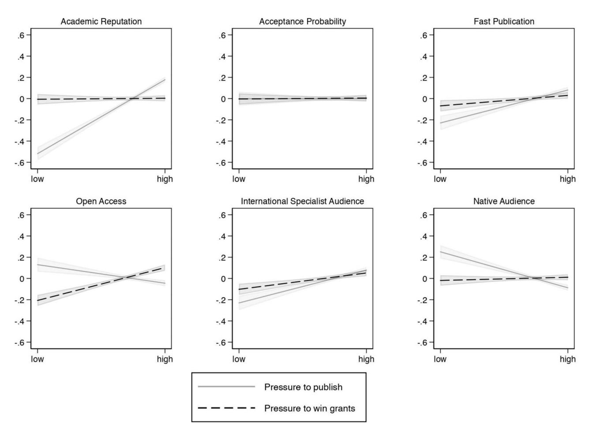

<!-- LR.R31 | source: papers_json/LR.R31/ -->

## The impact of researchers' perceived pressure on their publication strategies

## David Johann1,2,*, Jörg Neufeld4, Kathrin Thomas3, Justus Rathmann2 and Heiko Rauhut2

- 1ETH Library, ETH Zurich, Rämistrasse 101, 8092 Zurich, Switzerland
- 2Department of Sociology, University of Zurich, Andreasstrasse 15, 8050 Zurich, Switzerland
- 3School of Social Science, University of Aberdeen, King's College, Aberdeen, AB24 3FX, Scotland
- 4Independent researcher, 46147 Oberhausen, Germany
- *Corresponding author: Email: david.johann@library.ethz.ch

## **Abstract **

This article investigates researchers' publication strategies and how their perceived pressure to publish and to obtain external funding are related to these strategies. The analyses rely on data from the Zurich Survey of Academics (ZSoA), an online survey representative of academics working at higher education institutions in Germany, Austria, and Switzerland. The results suggest that academics pursue both instrumental and normative publication strategies. The main finding is that academics who perceive high pressure to publish tend to employ instrumental publication strategies rather than normative ones: they are more likely to focus on the journal's reputation and the speed of publication when selecting an outlet for peer review. Publishing results in open-access outlets or in native languages other than English is less important for those under pressure. However, the extent to which researchers' perceived pressure affects publication strategies also depends on other factors, such as the discrepancy between the time available for research and the time actually desired for research.

Keywords: Higher education research, academic outputs, research dissemination, motivations, survey

## Introduction

Scientific publications, such as articles in scientific journals and conference proceedings, are central to the job profile of academic researchers (Müller 2008; Rauhut, Winter and Johann 2018). By publishing research results, scientific knowledge is documented and made available to the public, as well as to other researchers, so that they can scrutinize and further advance this knowledge (e.g. Bernal 1939; Schein, Farndon and Fingerhut 2000; Müller 2008; Ascheron 2019, Morawski 2019).

The motivation to publish research might not only stem from normative goals, such as advancing knowledge, but also from self-interest, as researchers may also publish to improve their publication and citation records to enhance their reputation (e.g. Merton 1957; Schein, Farndon and Fingerhut 2000; Birnholtz 2006; Döring and Bortz 2016; Rauhut, Winter and Johann 2018; Johann and Mayer 2019; Johann 2022). Given an increase in scientific competition, self-interested motivations might be more prominent today than they were decades ago, because publication records have gained importance for promotion exercises and attracting external funding (Röbken 2011; Hicks 2012; Engesser and Magin 2014; Rauhut, Winter and Johann 2018; Johann and Mayer 2019; Coronel 2020; Johann, Raabe and Rauhut 2022; Johann 2022; see also Slaughter and Leslie 1999). The fittest scholars, i.e. those with a track record of an increasing number of high-quality and high-impact publications, may be the most competitive in the survival race for tenured positions, prestigious grants, and, ironically, additional publications in outlets with high reputation (e.g. Zuckerman 1967; Merton 1968; Chan, Gleeson and Torgler 2014; Bol, de Vaan and van de Rijt 2018).

While an increasing number of studies has explored researchers' publishing behavior by looking at bibliometric data/

indicators (e.g. Butler 2003; Jiménez-Contreras et al. 2003; Costas and Bordons 2007; Osuna, Cruz-Castro and Sanz-Menéndez 2011; Engels, Ossenblok and Spruyt 2012; Aagaard, Bloch and Schneider 2015; Gorraiz, Gumpenberger and Glade 2016; Kolesnikov, Fukumoto and Bozeman 2018; Mayer and Rathmann 2018), little research has focused on understanding individual researchers' underlying motivations and potential strategies for selecting publication outlets. Furthermore, whether and, if so, how these strategies might vary remains largely unknown. Systematic research tapping into these motivations by examining large-scale and high-quality survey data of scholars working at higher education institutions (HEI) seems to be missing to date.1

This article contributes to filling this gap by studying researchers' self-reported motivations for submitting manuscripts to scientific journals and investigating how their perceived pressure to publish and to obtain external funding influences those strategies. The analyses are based on data collected by the Zurich Survey of Academics (ZSoA; Rauhut et al. 2021a, 2021b), an online survey representative of academics working at higher education institutions in Germany, Austria, and Switzerland conducted in 2020.2 The ZSoA is well-suited to studying academics' motivations for selecting scientific outlets, because it contains two comprehensive batteries of questions that measure why researchers choose certain outlets. It also includes information on their individual characteristics, which allows us to better understand how scholars' perceptions of pressure regarding publications and attracting external funding varies (Johann, Raabe and Rauhut 2022).

This article is structured as follows: First, we review previous research on and trends in publication strategies and

<!-- page 2 -->

publication behavior to build a theoretical foundation for our hypotheses. Next, we present the data and methods, before reporting our findings. Finally, we discuss our results and their implications for the field of higher education and science research but also for policy makers. Our results may also directly impact academic researchers working at higher education institutions in the countries studied and beyond.

## **Publication strategies in context **

## Observed publication behavior

The previous literature on publication behavior has repeatedly described different types of scholars regarding their publication behavior (e.g. Cole and Cole 1967; Feist 1997; Moed 2000; Costas and Bordons 2008; Deutz et al. 2020). For example, Cole and Cole (1967) identified four types of American researchers in physics, whose publications varied in their quality and quantity: (1) 'the prolific' published many significant papers; (2) 'the relatively silent' released few papers with little significance; (3) 'the undiscriminating mass producers' published a lot but with little significance; and (4) 'the perfectionists' issued few publications but had a substantive impact. In addition, this research shows that it was quality that determined recognition, when quantity and quality were at odds (Cole and Cole 1967).4

Feist (1997) identified similar types in the natural sciences at top-level universities in California: 'silent', 'perfectionist', 'mass producing', and 'prolific' scholars. Furthermore, his work suggests that belonging to different types is associated with varying levels of prestige. Among scholars who published a large number of papers, the quality of publications did not significantly affect their global prestige, which may contradict the earlier work by Cole and Cole (Feist 1997, referring to Cole and Cole 1967).

Similar characterizations of researchers can be found in more recent work. For example, Moed (2000) distinguishes two groups: researchers focusing on quality and scholars emphasizing quantity. Costas and Bordons (2007) suggest that some scholars select publication outlets carefully, as they seem to publish fewer papers which achieve a high impact ('selective scientists'). Analyzing publications recorded by the Web of Science between 1994 and 2004, Costas and Bordons (2008) distinguish 'low producers', 'big producers', 'selective scientists', from 'top scientists', where 'top scientists' publish a lot and with high impact; 'big producers' have a lot of publication but with little impact; 'selective scientists' have high impact with a few publications; and 'low producers' publish little with low impact. Finally, Deutz et al. (2020) distinguish between researchers who collaborate at the local level, prefer to disseminate their knowledge in local outlets, and publish their findings in field-specific journals, from those who collaborate internationally and dedicate time and effort to publish in high impact journals in their field to achieve higher

The main commonality of these typologies are quality and quantity of publications, with variations of measures of impact and reach. One core question arising from the previous literature is what motivates different publication strategies? We aim to address this question in the following, discussing the role of science systems and observable trends in academic publishing.

## Publication strategies: the role of science systems and general trends

Previous studies suggest that researchers' publishing practices respond to science policy (e.g. Butler 2003; Liefner 2003; Bloch and Schneider 2016; Larivière and Costas 2016; Śpiewanowski and Talavera 2021; for an overview of relevant studies, see Gläser and Laudel 2016; Rijcke et al. 2016). For instance, Butler (2003) indicates researchers gravitate towards publications in low-impact journals if science policy focuses exclusively on raw publication output as a performance criterion (see also Larivière and Costas 2016). Accordingly, science policy is crucial in understanding why researchers may select specific outlets, as the scientific environment and its overarching policies may affect publication strategies on the individual level.

Generally, science systems around the globe display quite a few similarities. Many are designed for competition and encourage continuous performance evaluation of researchers (e.g. Slaughter and Leslie 1999; Nievergelt 2013; Enders, Kehm and Schimank 2015; Śpiewanowski and Talavera 2021; Johann, Raabe and Rauhut 2022). While competition and performance-based funding and promotion have always been key features of Anglo-Saxon academic systems, many European systems, including those of Germany, Austria, and Switzerland, followed a different model until the 1990s. The introduction of new public management at the time has incentivized science in Europe to become more competitive and performance-based. The policy change resulted in widely harmonized scientific systems following the Anglo-Saxon models (Johann, Raabe and Rauhut 2022; see also van Pechar 2004, 2005; De Boer, Enders, and Schimank 2007; Kehm and Lanzendorf 2007; Orr, Jaeger and Schwarzenberger 2007; Kreckel 2008; Pasternack 2008a; van Dalen and Henkens 2012; Nievergelt 2013; Schimank 2014; Enders, Kehm and Schimank 2015; Wissenschaftsrat 2018).

Three trends can be observed:

1) Researchers are expected to publish more. As a result, many scholars may adopt an instrumental publication strategy by aiming to maximize their publication records with minimum effort (e.g. Hanitzsch 2016). For instance, this could be achieved by increasing numbers of scientific collaborations with minimal contributions to the individual project (e.g. Brand et al. 2015) or publishing the 'least publishable pieces' (Hanitzsch 2016; see also Hayer et al. 2013). The latter can be viewed as a

"deliberate attempt [...] to inappropriately inflate the total of publications yielded by a particular research study (or database, survey, experiment, project or whatever) through a process of subdividing the published output into a number of thin 'slices' or 'least publishable units', thereby *either* generating a greater number of separate publications than is merited by the overall contribution to knowledge offered by that study, *or* creating a situation where the research community would instead be better served by the results being combined in a single or a smaller number of publications" (Martin 2013: 1008).

Especially, the least publishable pieces approach becomes problematic for the scientific system, as outputs may contribute very little or nothing at all to scientific

<!-- page 3 -->

knowledge ([Hanitzsch 2016)](#page-12-0). Yet, each submission must be reviewed and likely ends up being published in a scientific outlet with the effect of potentially delaying peer review and publication. Admittedly, no clear guidance on the number of papers researchers should legitimately publish from a single study is provided ([Hall and](#page-12-0) [Martin 2019](#page-12-0)).[6 ](#page-10-0)

- 2) Previous studies on publication behavior have observed a *general shift away from publishing monographs or book * *chapters towards issuing articles in academic journals*. Change towards journals being *the *central publication outlet has only started to occur more recently across disciplines (e.g. [Deutsche Forschungsgemeinschaft 2005;](#page-12-0) Pflu€[ger 2013;](#page-14-0)[ Gingras 2016](#page-12-0); Sor�[a and Dujovne 2018)](#page-14-0)[.7 ](#page-11-0) Connected to the tendency to publish in scientific journals is also the increase in publications in international, English-language journals, regardless of the authors' mother tongue (e.g. [Curry and Lillis 2004;](#page-12-0) [Lillis and](#page-13-0) [Curry 2006](#page-13-0); [Schluer 2014](#page-14-0); [Paliszkiewicz 2015)](#page-13-0). As such, English has become the generally accepted language of science ([Paliszkiewicz 2015)](#page-13-0)—also referred to as the 'academic lingua franca' [(Schluer 2014](#page-14-0)).[8 ](#page-11-0)Englishlanguage publications appear to have gained a higher status and serve as an important criterion for promotions and grant success [(Curry and Lillis 2004)](#page-12-0). In line with this, [Fanelli and Larivi](#page-12-0)�ere (2016) also observe an increase in international, English-language journals indexed by the Web of Science and a shift away from non-English, national journals with limited reach.[9](#page-11-0)
- 3) To gain reputation, academics need to publish a larger number of articles, but also have to *publish in well**ranked journals to maximize the impact of their publica**tions and to improve their career prospects *([Franzoni,](#page-12-0) [Scellato and Stephan 2011](#page-12-0); [Caulfield and Condit 2012;](#page-12-0) [Fanelli 2012](#page-12-0); �[Spiewanowski and Talavera 2021](#page-14-0)). The Journal Impact Factor (JIF) is often used as a criterion to assess the quality of researchers' work and to make decisions about salaries, hirings, and promotions ([Moed](#page-13-0) [2005](#page-13-0); [Garfield 2006](#page-12-0)). [Rushforth and de Rijcke (2015)](#page-14-0) note that the notion of taking JIF as a shortcut to evaluate journal quality might fall short in some disciplines (e.g. biomedical research), even though researchers realize that it *can *be '"the ticket" needed to secure a grant or job position' (p. 136). Other studies make similar observations for different disciplines, indicating that publishing in peer-reviewed journals, journals indexed in large citation databases, such as the Web of Science, and journals with a high JIF are preferred [(Saydam and](#page-14-0) [Kecojevic 2014)](#page-14-0).[10,11 ](#page-11-0)

## Publication strategies: differences between groups of researchers

Prior research also provides evidence on the differences across authors in their strategies to publish. Some key findings are discussed below:

For example, [Schluer (2014)](#page-14-0) suggests differences in publication behavior depending on disciplines. Papers in the Natural Sciences are almost exclusively published in English; in the Humanities and Social Sciences publications in English are less common ([Schluer 2014;](#page-14-0) for a similar argument, see also[ Deutsche Forschungsgemeinschaft 2005)](#page-12-0).

[Gorraiz, Gumpenberger and Glade (2016)](#page-12-0) identified different publication patterns within subdisciplines of Geo

Sciences: Researchers closer to the Natural Sciences mainly publish in international peer-reviewed journals, while those closer to the Social Sciences tend to focus on book chapters, reports, and monographs.

Furthermore, [Lindahl, Colliander, and Danell (2020)](#page-13-0) observe that scholarly careers are already shaped during the doctoral process: men appear to have a higher probability of attaining excellence than women, these gender differences may directly translate into publication strategies. [Mayer and ](#page-13-0) [Rathmann (2018)](#page-13-0) show that publication strategies indeed have a gender component: in Psychology, women seem to be more likely to be satisfied with publishing their work in book chapters, while men tend to publish in scientific journals. Such a difference in publication behavior may be detrimental to women's career opportunities [(Mayer and ](#page-13-0) [Rathmann 2018](#page-13-0)).

## **The impact of academic pressure on following ** **instrumental or normative publication ** **strategies**

Using data from Zurich Survey of Academics, [Johann, Raabe ](#page-12-0) [and Rauhut (2022)](#page-12-0) showed that academics' perceived pressure varies: For example, the publication pressure is somewhat greater among academics in Austria and Switzerland compared to academics in Germany. In addition, junior academics - who are often in the progress of building a reputation and struggling with precarious contracts, have little prospects for tenured jobs, and face high competition for these jobs - perceive higher pressure than established, tenured colleagues (see [Johann, Raabe and Rauhut 2022,](#page-12-0) for an overview on perceived pressure among academics in Germany, Austria, and Switzerland).

Previous research has already provided evidence that the perceived pressure to publish can influence publication behavior. For example, [Miller, Taylor and Bedeian (2011)](#page-13-0) point out that increasing publication pressure might result in a lack of relevance, creativity, and innovation in research. [Fanelli (2012)](#page-12-0) adds that predictable results are favored over groundbreaking, high-risk studies. [Baddeley (2001)](#page-11-0) emphasizes that scientists publish more conservatively, the greater the pressure is to publish articles in high-ranking journals, which means that research papers studying trendy topics and questions are more likely to be published. Moreover, conventional measurements are preferred to innovative ones, because they are more commonly accepted by journals [(Baddeley 2001](#page-11-0)). [Caulfield and Condit ](#page-12-0) [(2012)](#page-12-0) stress that drawing on publication numbers as a measure of academic productivity influences researchers' publication strategies, as researchers are forced to consider how to position and present their research in a way that is attractive to both top journals and the popular press. Moreover, they argue that this comes at the expense of creative and rewarding scientific research [(Caulfield and Condit 2012](#page-12-0)). [Coulthard and Keller ](#page-12-0) [(2016)](#page-12-0) surveyed academics in the field of information systems to find out about their opinions on the impact of journalranking systems. Their findings suggest that the prevailing system of measuring research performance through journal rankings has greatly increased publication anxiety: Respondents believed that ranking systems prevented them from conducting innovative and risky research, while similarly promoting research that they described as safe, conforming, and mainstream [(Coulthard and Keller 2016](#page-12-0); see also [Liefner 2003](#page-13-0); [Aagaard, ](#page-11-0) [Bloch and Schneider 2015)](#page-11-0).

<!-- page 4 -->

While previous evidence indicates that perceived pressure affects academics' productivity and the content of research publications, the question of how pressure influences academics' strategies when submitting manuscripts to scientific outlets has not been studied in-depth, yet. We argue that researchers may publish their results for very different motives. Referring to social-psychological research, a general distinction can be made between intrinsic and extrinsic motivations to publish: While intrinsic motivation refers to doing something because it is perceived as interesting, satisfying, or enjoyable, extrinsic motivation refers to doing something because it leads to a certain result or consequence (e.g. Ryan and Deci 2000). 'When intrinsically motivated, a person is moved to act for the fun or challenge entailed rather than because of external prods, pressures, or rewards' (Ryan and Deci 2000: 56).

According to Ryan and Deci (2000; see also Deci and Ryan 1985), the quality of performance may vary depending on the underlying motivation, i.e. whether the motivation behind the performance is intrinsic or extrinsic. Thinking about academics' publication strategies, researchers who are predominantly intrinsically motivated should work towards the normative goal of science and, thus, might be more concerned with reaching a particular audience with their research findings. This can be a wider audience, for example, by publishing articles 'open-access', or a more specialist audience, achieved by native-language publications. Extrinsically motivated researchers might pursue a very different, instrumental publication strategy. For instance, they may seek to publish in particularly well-ranked journals with high JIF, 12 more quickly, 13 or in journals with a high likelihood of acceptance, so that they are able to meet their evaluation targets regarding the quantity of publications (see Butler and Spoelstra 2020, for a discussion of different publishing strategies and the so-called 'publication game'). 14

We argue that researchers' intrinsic or extrinsic motivations with respect to their publishing behavior may depend on external constraints. Referring to the definition of extrinsic and intrinsic motivation presented above, instrumental publication strategies should be particularly pronounced among extrinsically motivated scientists. The major underlying mechanism is referred to as external regulation by the foundational work of Deci and Ryan (1985, see Noels 2001; Noels, Clément and Pelletier 2001; Ryan 2014; Ryan and Berbegal-Mirabent 2016; Peng and Gao 2019). External regulations, such as the pressure to publish and/or to acquire funding, should trigger the expectation of a tangible reward, e.g. a tenured position, promotion, etc. (Noels 2001; Noels, Clément and Pelletier 2001; Ryan 2014; Ryan and Berbegal-Mirabent 2016; Peng and Gao 2019). We assume that academics who feel intense extrinsic pressure are more likely to strategically focus on the journal's reputation, speed of publication, and outlets that have a high likelihood that articles are accepted. As such, researchers' strategy is to use specific publication outlets as an instrument to achieve the anticipated reward.

H1a: The higher the perceived pressure, the more likely it is for researchers to follow instrumental publication strategies.

H1b: The lower the perceived pressure, the more likely it is for researchers to follow normative publication strategies.

However, whether and to what extent perceived pressure affects publication strategies may depend on other factors as well. It might only translate into particular publication strategies when scholars also share other characteristics, such as similar working conditions, or time until retirement. We argue that perceived pressure is especially related to instrumental publication strategies among academics on precarious contracts, compared to tenured researchers. As the latter have a secure job situation, they should be better able to cope with external pressure effectively, be more relaxed, and resilient to these pressures. Similarly, we argue that the relationship between perceived pressure and instrumental publication strategies is more pronounced among junior academics, compared to senior scholars closer to retirement, as the latter are more experienced and have already dedicated a substantive amount of time in their career to publications and funding. Thus, established and tenured researchers may feel greater freedom than their younger and non-tenured colleagues to follow a rather intrinsically motivated normative publication strategy focusing on knowledge advancements or tackling more difficult or innovative tasks 15 even if the external conditions (high pressure) are the same for both groups of researchers.

H2a: The relationship between perceived pressure and instrumental publication strategies is more pronounced among early-career junior academics.

H2b: The relationship between perceived pressure and normative publication strategies is more pronounced among senior academics who are close to retirement.

H3a: The relationship between perceived pressure and instrumental publication strategies is more pronounced among academics on fixed-term contracts.

H3b: The relationship between perceived pressure and normative publication strategies is more pronounced among tenured researchers.

In addition to this, we hypothesize that there are also differences in the effects of the perceived pressure on publication strategies, given the time that is available to scholars to complete their research projects. We argue that scientists who feel highly pressured are more likely to be guided by a journal's reputation and acceptance probability. However, this relationship is likely to be stronger, the greater the discrepancy is between the time needed for the research and the time available for this research. When little time is available for research, academics are forced to use this time more effectively and strategically and should, thus, be more likely to publish more selectively.

H4: The relationship between the perceived pressure and instrumental publication strategies is more pronounced among academics with limited time to complete their research projects.

## Data and methods

## Data

To investigate what strategies researchers follow when submitting their manuscripts to scientific journals and test our hypotheses, we rely on data collected by the ZSoA (Rauhut et al. 2021a, 2021b), an online survey representative of academics

<!-- page 5 -->

working at HEI in Germany, Austria, and Switzerland. 16 Unlike in Austria and Switzerland, employees of universities of applied sciences were not invited to participate in the survey in Germany (Rauhut et al. 2021b). Hence, to ensure better comparability of the data across the three countries, we exclude respondents indicating that they worked at universities of applied sciences from the analysis, as do Johann, Raabe and Rauhut (2022) and Johann (2022). Furthermore, respondents with missing data on at least one of the analysed variables are dropped. The final sample for analysis includes n = 11,100 academics. Among these, 22.19% are professors, 39.42% are post-doctoral fellows, and 38.29% are academics who do not hold a doctorate. Moreover, 57.98% are male and 42.02% are female. 17 More information on the survey, data collection, sample etc. can be found in Rauhut et al. (2021b).

## Researchers' publication strategies

The dependent variables, i.e., researchers' publication strategies, are measured with two item batteries presented in Table 1.18 The first battery comprises 10 items enquiring how important different criteria are for selecting a journal for potential publication; they were measured using a five-point Likert scale ranging from 1 (= 'not important at all') to 5 (= 'very important').19 The second item battery includes six items that ask how much respondents agree or disagree with various statements regarding the submission of their manuscripts to scientific journals. The six items are measured using a six-point Likert scale ranging from 1 (= 'don't agree at all') to 6 (= 'agree completely'). We deploy exploratory factor analysis to identify the underlying dimensions of publication strategies.

## Independent and control variables

The perceived pressure (a) to publish and (b) to acquire third-party funding is measured using a six-point Likert scale ranging from 1 (= 'don't agree at all') to 6 (= 'agree completely'). The question wording is: 'How much do you agree with the following statements about your working conditions in academia? [...] [a] In my subject area, there is considerable pressure to publish. [b] In my subject area, there is considerable pressure to attract third-party funding'. Johann, Raabe and Rauhut (2022) have inspected the variation of these variables across sub-groups and reported that, overall, the perceived pressure to acquire external funding. They identified some variation by age, gender, level of academic status and tenure, as

well as academic subject area, among other things. For instance, younger scholars, women, and those in non-tenured positions seemed to suffer from a higher pressure to publish, whereas the pressure to acquire funding was higher in older age groups and among those in secure academic positions. Substantive differences were observed by academic subject areas: Researchers in Biology perceived the highest pressures to publish and to acquire funding; academics in Architecture/ Construction the lowest pressure to publish, while scholars in Law seemed to have the lowest pressure to obtain funding (Johann, Raabe and Rauhut 2022).20

Academics' working conditions are measured by a variable that distinguishes between those on fixed-term contracts (coded as 0) and those who are tenured (coded as 1). Age is measured by an ordinal variable with five categories: researchers under the age of 30, those aged 30–39, 40–49, 50–59, and 60 or older. The measure 'discrepancy between the desired time for research and actual time available for research' is taken from Johann, Raabe and Rauhut (2022) and ranges from -1 to 1. Values below 0 indicate that scientists desire less time for research than is actually available to them; values above 0 indicate that scientists need more time to complete the research than is actually available to them (see also Kessler et al. 2022).

We also consider the country in which academics work (Germany, Austria, and Switzerland); the type of HEI (full universities, technical universities, schools of medicine, colleges of education, colleges of art/music, and non-university research institutes); academic disciplines (Humanities, Social Sciences, Natural Sciences, Life Sciences, and Engineering21); as well as their academic status (professors, postdoctoral fellows, and academics who do not hold a doctorate), and gender (female and male academics) as control variables. Controlling by type of HEI seems reasonable, as the quantity and impact of publications are not equally important at all HEIs. Finally, we consider academics' propensity to take a risk, measured with a seven-point Likert scale ranging from 1 (= 'not willing to take risks at all') to 7 (= 'very willing to take risks'), because the risk academics are willing to take in publishing may vary depending on how pronounced their overall propensity to take a risk is in general.22

## Modelling strategy

To examine what group of academics tends to follow which publication strategies, and how the academics' perceived

*Table 1. Item batteries measuring publication strategies*

## Importance of various criteria

- 1) 'reputation of the journal'
- 2) 'likelihood of acceptance'
- 3) 'journal/article in native language'
- 4) 'opportunity to reach specialist audience'
- 5) 'accessible free of charge to specialist audience'
- 6) 'international character of the journal'
- 7) 'short time between submission and publication'
- 8) 'Journal Impact Factor (JIF)'
- 9) 'interdisciplinary character of the journal'
- 10) 'open access'

## Agreement with various statements

- 1) 'It's important to me that the time between submission and publication is as short as possible'
- 2) 'I first submit my manuscripts to the best possible journal, and if they're rejected I work my way through less prestigious journals, step by step, until my manuscript is accepted'
- 3) 'To get my manuscripts published in the best possible journal, I don't mind if the review process takes a long time'
- 'I submit my manuscripts to the journal where I assume I have the best chance of being accepted'
- Tm happy to risk rejection in order to get my manuscripts published in as good a journal as possible'
- 6) 'I avoid uncertain publication processes and submit to journals where there's a high probability of being able to publish my manuscripts without any complication'

<!-- page 6 -->

pressure affects their use of these strategies, the factor scores resulting from the exploratory factor analysis to identify the underlying dimensions of publication strategies are regressed on the independent variables.

We estimate three models for each dimension/strategy: The first model only includes the control variables as well as respondents' working conditions, their age, and the discrepancy between the time respondents desire to spend on their research and the time they actually have available for this research. The second model adds two variables that measure scientists' perceived pressure to publish and to attract external funding. This model allows us to test hypotheses H1a and H1b. The third model further includes interaction terms that allow us to test hypotheses H2a, H2b, H3a, H3b, and H4: We consider interaction terms between academics' perceived pressure and (a) their working conditions; (b) their age group (as an indicator for time to retirement); and (c) the discrepancy of their desired time for the research and the time they actually have available for this research, respectively. Comparing the second and third model with the initial model helps us to understand the contribution of perceived pressure in explaining the use of different publishing strategies.

For data analysis, we use Stata/SE (StataCorp, College Station, TX, USA)[.23](#page-11-0)

## **Results**

## Publication strategies

[Table 2](#page-6-0) presents the results of the factor analysis (factor loadings)[.24 ](#page-11-0)Six dimensions, i.e. publication strategies, with an eigenvalue *>*1 can be identified (for information on how to decide on an adequate number of factors, see, e.g. [Bartholomew et al. 2011](#page-11-0)). These dimensions or publication strategies can be described as the extent to which academics focus on (1) academic reputation; (2) the likelihood of acceptance; (3) getting the article published quickly; (4) open access to the articles; (5) an international specialist audience; and (6) a native audience.[25](#page-11-0)

Looking at the proportion of respondents with factor scores *>*0, we find that for 53.06% of the academics the reputation of the journal, for 50.07% the acceptance probability, for 49.86% fast publication, for 51.72% open access, for 54.05% an international specialist audience, and for 42.26% a native audience are important criteria for choosing a journal to which to submit a manuscript.

As argued above, the strategies 'reputation', 'acceptance probability', and 'fast publication' indicate rather extrinsically motivated publishing behavior, whereas the strategies 'open access', 'international specialist audience', and 'native audience' may indicate rather intrinsically motivated publishing behavior. When interpreting the results, however, it should be noted that the assignment of the individual items/ dimensions to the categories *intrinsic *and *extrinsic *may not always be entirely distinct. For instance, publishing open access may be based on intrinsic but also on extrinsic motivation, e.g. when researchers rely on open access to increase the impact of their research.

## Factors related to researchers' publication strategies

[Table 3](#page-7-0) shows the effects of the main independent variables on the propensity to pursue different publication strategies. For emphasis, the models post-scripted with 'a' are the

baseline models without perceived pressure to publish and to obtain funding. We do not discuss these in more detail but present them for completeness. Models initialized with 'b' include the control variables as well as perceived pressure to publish and to obtain funding. Finally, models labelled indicating 'c' add interaction effects. Full results are presented in [Supplementary Table A4.](https://academic.oup.com/rev/article-lookup/doi/10.1093/reseval/rvae011#supplementary-data)

With respect to our main effects of perceived pressure to publish (Models 1b–6b), we find support for hypotheses H1a and H1b: Scholars with greater perceived pressure to publish are more likely to pursue instrumental publication strategies and are less likely to pursue normative publication strategies. The results suggest that the greater the perceived pressure to publish is, the more likely are researchers to focus on journal reputation, fast publication, and an international specialist audience when selecting an outlet for peer review. Those under pressure seem less likely to focus on open access or a native readership. Contrary to our hypotheses, however, higher levels of perceived pressure to obtain funding seem to be related with a higher likelihood of employing normative publication strategies: The greater the perceived pressure to attract funding is, the more likely are scholars to focus on open access and on reaching an international specialist readership when deciding to submit their work for peer review. The effects of perceived pressure on the dependent variables (i.e., publication strategies) are visualized in [Figure 1.](#page-9-0) The solid line represents the effect of perceived pressure to publish; the dashed line the impact of perceived pressure to obtain funding. The grey shades represent 95% confidence intervals.

Turning to the interaction terms (Models 1c–6c), we find that the effect of publication pressure on the choice of the open access strategy is weaker among those who are tenured compared to those who are not tenured. In addition, the effect of the pressure to obtain external funding on the strategy to focus on the acceptance probability of journals is stronger among tenured colleagues. Apart from this, we do not find any significant differences across permanent employment and fixed contracts.

Compared to the youngest age group, publication pressure has a weaker effect on the choice of fast publication strategy among older academics, but a stronger effect on acceptance probability, open access, and native audience strategies. Furthermore, the pressure to obtain external funding has a weaker effect on the choice of the acceptance probability strategy and a stronger effect on the choice of the fast publication strategy.

If the discrepancy between the time desired and the time actually available for research is particularly large, the pressure to publish pushes researchers more strongly to focus on reputation when selecting an outlet. This finding supports hypothesis H4.

For completeness, we briefly discuss the control variables (see [Supplementary Table A4](https://academic.oup.com/rev/article-lookup/doi/10.1093/reseval/rvae011#supplementary-data)). The results suggest that researchers in Austria and Switzerland pursue different publication strategies compared to those in Germany. While the former emphasizes reputation and open access publications, academics in Germany are more reluctant to consider the likelihood of acceptance compared with academics in Switzerland. German scholars are also more eager to submit to a native readership in contrast to academics in Austria.

With respect to differences in effects across types of HEI, the most striking finding is that academics at colleges of

<!-- page 7 -->

n ¼ 11,100. Principal-component factor method. Rotation: orthogonal varimax, Kaiser normalized. Factor loadings with an absolute value *>* 0.40 are in bold and highlighted in grey.

education differ significantly from scholars at full universities. Among academics at colleges of education, the reputation of the journal and how quickly their work is published is less important, but the focus is on the likelihood of being accepted, open access, as well as a native readership.

Compared to scholars in the Humanities, researchers in other disciplines put more importance to reputation when selecting an outlet. This is especially true in the Life Sciences, where we find the greatest difference. Scholars in the Humanities focus more on an international specialist readership compared with researchers in other disciplines.

There are also differences by status: Senior researchers place a greater value on reputation and an international

specialist readership, but less so on the likelihood of acceptance, open access, and a native readership.

Compared to younger academics (*<*30years), reputation is less important among older academics when selecting an outlet for peer review, while open access and native language are more important to older academics. Only marginal differences can be observed regarding scholars' status (i.e. tenured vs. not-tenured).

Finally, women and those more prone to take a risk seem to give more importance to reputation, open access, and a native readership. Whereas for women, acceptance probability is an essential factor in the decision-making process, acceptance probability tends to be less prominent amongst risktaking scientists.

<!-- page 8 -->

(continued)

## **Discussion and conclusion **

This article proposed that researchers follow different publication strategies when deciding to submit their manuscripts to scientific journals. We summarized these under the umbrella terms instrumental publication strategy, i.e. researchers are incentivized by extrinsic motivation, and normative publication strategy, i.e. scholars are incentivized by intrinsic motivation. We further

argued that academics' perceived pressure to publish or to acquire research funding may affect these publication strategies.

Our empirical analyses of academics working at HEI in Germany, Austria, and Switzerland indicated that scholars do not seem to pursue either strategy exclusively. We found no evidence that researchers stringently follow either an intrinsically or extrinsically motivated publication strategy.

<!-- page 9 -->

OLS regression models. Control variables: Country, HEI type, discipline, status, gender, and risk propensity (see Table A4 in the Supplemental Material). Standard errors in parentheses.

However, it appears that the reputation of the journal, publishing open access, and an international specialist audience are particularly important criteria for scholars to select

outlets. We interpret this as evidence of the existence of a bandwagon effect, indicating that researchers follow general trends in publishing practices and act according to how they

> ^* ^P<0.05, ** P<0.01, *** P<0.001.

<!-- page 10 -->

***Figure 1. **Impact of researchers' perceived pressure on publication strategies. We show the regression lines and the corresponding 95% confidence intervals. Calculation based on Models M1b, M2b, M3b, M4b, M5b, and M6b (see [Table 3)](#page-7-0). Graph produced following [Jann (2014, 2017)](#page-12-0).*

perceive the publishing behavior of others (for more information on the bandwagon effect, see, e.g. [Rappa and Debackere ](#page-14-0) [1989](#page-14-0);[ Rikkers 2002](#page-14-0);[ Schmitt-Beck 2015](#page-14-0)).

Moreover, our findings indicate that academics' publication strategies differ depending on specific group characteristics, as well as external constraints and pressure they face. In this light, we consider our main finding that academics are more likely to focus on reputation, fast publication, and an international specialist audience, and are less likely to consider open access or native audiences in their choice of outlet, when the pressure to publish is high. In addition, high pressure to attract external funding seems to be rather associated with the decision to opt for open-access journals and international and specialized readership. As such, high publication pressure seems to lead to extrinsically rather than intrinsically motivated publication strategies. This further supports the idea of survival of the fittest scholar on the academic market, i.e. those scholars who are willing to invest a lot of energy into the 'publication game' in the higher education system (see [Butler and Spoelstra 2020,](#page-12-0) for a discussion of the 'publication game'). In addition, individuals' circumstances may trigger a shift towards more extrinsically or intrinsically motivated publication strategies.

However, the extent to which the perceived pressure affects publication strategies also seems to depend on other factors. For instance, when researchers have less time for research than they actually need, perceived publication pressure has a

greater effect on researchers to focus on a journal's reputation when selecting a journal than when they have enough time to complete the research. One explanation for this finding might be that academics who feel high pressure and have little time for research at the same time are forced to make more effective and strategic use of this time and thus aim for prestigious outlets with a high JIF.

Normative publication strategies appear to be more prevalent among senior researchers. Experienced and tenured scholars generally have more freedom to publish what they consider to be a good fit to their research profile, without any significant impact on their careers. However, our findings show an emphasis on extrinsically motivated instrumental publication strategies amongst very young researchers. Given that young scholars still have to build a reputation in the respective field and that the science system incentivizes instrumental publishing, this may not be a surprising but somewhat worrying finding. Junior scholars are the future of scientific research, however, if they are socialized to follow instrumental rather than normative goals in science, science may suffer from a lack of creativity, foundational, and groundbreaking work in the future. Even more so, future generations of scholars may forget about the normative scientific goal if instrumental science becomes the norm.

Our work also reveals that scientists from different disciplines vary in their publication strategies. In contrast to their colleagues in the Natural Sciences, Life Sciences, and

<!-- page 11 -->

Engineering, scholars in the Humanities tend to select journals that publish articles in their native languages. This result supports previous findings suggesting that non-native English speakers within the Humanities (and Social Sciences) are often subject to conflicting demands and interests: While they strive for international recognition and prestige through English-language publications, local networks and responsibilities often advocate publishing in the language of their home country ([Schluer 2014](#page-14-0)). This also re-emphasizes the bigger question of equality, diversity, and inclusivity of research publications. Scholars from backgrounds with fewer resources may be disadvantaged and especially challenged, given cultural or language traditions.

This research has some limitations. For example, our study relies on survey data, which allows to measure respondents' attitudes and self-reported behavior rather than to capture their actual behavior. Future research may wish to study what motivates and constrains academic publication strategies by matching whether reported strategies translate into actual behavior. This could be achieved by linking survey data with bibliometric measures that capture actual behavior.

Moreover, the way in which this study operationalized its core concepts also has some trade-offs. While our measures capture obvious decision-making factors, such as the JIF, speed of review, language, etc. other aspects, such as knowledge of the work of the editorial board members or records of past publications in an outlet, may also play a role in selecting an outlet. It is up to future research to consider these aspects as indicators for publication strategies and link them to underlying motivational facets (see, e.g. [Amabile et al.](#page-11-0) [1994,](#page-11-0) as well as[ Deci and Ryan 1985,](#page-12-0) for different conceptualisations and measurements of motivational orientations).

To conclude, our findings suggest that a large number of researchers pursue potentially short-sighted publication strategies by focusing on building a publication record and by publishing in well-ranked journals. Putting our results into perspective, the emerging principle of the survival of the fittest and most adapted scholars in the science system might pose a risk for the future of science in general. Outstanding scientists are characterized by intrinsic motivations along with a normative bond and identification with the academic profession ([Robken ](#page-14-0)€ 2011). Furthermore, creativity, curiosity, and innovative ideas—the basis of scientific knowledge—are fostered by intrinsic motivation [(Ryan and Deci 2000](#page-14-0)). If research turns towards survival of the fittest scholars guided by extrinsic goals within a science system that suffers from increasing pressure, the quality of research resulting in novel and groundbreaking knowledge is at risk (for a similar argument, see [Rauhut, Winter and Johann 2018;](#page-14-0) see also [Johann](#page-12-0) [and Neufeld 2016)](#page-12-0).

It is up to individual researchers to decide whether they want to contribute to science following extrinsic motivations and pursuing instrumental publication strategies, or if they want to excel science that protects intrinsic motivation and fosters the normative goal of scientific knowledge (for a very similar argument, see also [Rauhut, Winter and Johann 2018)](#page-14-0). However, ultimately, the question is how policymakers in the higher-education sector incentivize scientific progress.

## **Supplementary data**

[Supplementary data](https://academic.oup.com/rev/article-lookup/doi/10.1093/reseval/rvae011#supplementary-data) are available at *Research Evaluation * *Journal *online.

## **Acknowledgements**

The authors of this paper acknowledge linguistic advice and copyediting/proofreading of the text by Brian Cooper. They thank Emma Conforti for research assistance/literature research. Moreover, they would like to thank Bernhard Kittel, University of Vienna, as well as their colleagues at the University of Zurich, including Alexander Ehlert, Debora Frei, Julia Jerke, Nico Keiser, Adrien-Paul Lambillon, Vincent Oberhauser, Isabel Raabe, and Antonia Velicu, for conceptual discussions, support, and helpful suggestions for improvement. Special thanks to Julia Jerke and Antonia Velicu for their contribution to the survey design, data collection, and data preparation. Finally, the authors of this paper would like to thank the anonymous reviewers for their fruitful comments and suggestions that helped to improve this article.

## **Authors' contributions**

Idea: D.J. and J.N.; Paper structure: D.J.; Literature review: D.J., J.N., K.T., and J.R.; Survey design and data collection: D.J., J.R., and H.R.; Statistical analysis: D.J. and J.R; Writing introduction, theory section, and discussion section: D.J. and K.T.; Writing methods section and results section: D.J.; Editing: D.J.; Revisions: D.J., K.T., J.R., and H.R.; Final approval of the paper: D.J., J.N., K.T., J.R., and H.R.

## **Funding**

This research is supported by the Swiss National Science Foundation (SNSF) under the SNSF Starting Grant "CONCISE" (BSSGI0_155981).

*Conflict of interest statement. *None declared.

## **Notes**

- [01.](#page-0-0) One exception is a preliminary study on publication strategies based on data from the German Centre for Higher Education Research and Science Studies (DZHW). However, with the exception of a conference paper/presentation [(Johann and Neufeld 2016)](#page-12-0) and in-house presentations at the DZHW, the results of these analyses remain unpublished.
- [02.](#page-0-0) [Johann, Raabe and Rauhut (2022)](#page-12-0) reviewed the previous literature (e.g. [von Ungern-Sternberg 2002](#page-14-0); [Kreckel and Pasternack 2008;](#page-13-0) [Pasternack 2008a](#page-13-0), [2008b;](#page-13-0) [Schulze, Warning and Wiermann 2008](#page-14-0)) and pointed out that there are some key similarities between Germany, Austria, and Switzerland regarding their science systems (e.g. prevailing types of higher education institutions; ability to find a job outside academia; availability of permanent positions below professorial level). The most important differences include, for example, that job security among professors is higher in Germany than in Switzerland and Austria, but also that approval rates for third-party funding applications differ between the three countries, with higher approval rates in Switzerland than in Germany and Austria [(Johann, ](#page-12-0) [Raabe and Rauhut 2022](#page-12-0)).
- [03.](#page-1-0) [Cole and Cole (1967)](#page-12-0) define quality as the impact of research by the number of citations.
- [04.](#page-1-0) This is the case for the 'undiscriminating mass producers' and 'perfectionists' ([Cole and Cole 1967)](#page-12-0).
- [05.](#page-1-0) Larivi�[ere and Costas (2016)](#page-13-0) point to possible explanations why researchers adjust their behavior in relation to science policy, highlighting the so-called 'Hawthorne effect' in this context. According to [Michels and Schmoch (2014)](#page-13-0), the 'Hawthorne effect' describes the phenomenon that people, e.g. researchers, change their behavior because they are aware that they are being observed, e.g. by means of bibliometrics.
- [06.](#page-2-0) This discussion reflects on the old idea of scholars' claim priority ([Merton 1957)](#page-13-0): The 'more thoroughly scientists ascribe an unlimited value to originality, the more they are in this sense dedicated to the advancement of knowledge' (p. 659). However, [Merton (1957)](#page-13-0) critically voices the culture of science can lead scientists to develop an extreme concern with recognition, which he argues can lead to even worse

<!-- page 12 -->

- behaviors, such as academic misconduct. [Merton (1957](#page-13-0)) refers to misconduct, such as reporting only the data that support a hypothesis, false charges of plagiarism, theft of ideas or even the fabrication of data, which he suggests have previously occurred in the history of science and can be considered deviant behavior in response to a discrepancy between the pressure for original discovery and the difficulty to actually making an original discovery. Including a detailed discussion or empirical investigation of misconduct is beyond the scope of this paper.
- [07.](#page-2-0) Some fields also focus on peer-reviewed conference proceedings ensuring quick publication and acknowledge conference proceedings as equally important to journal publications (Bar-Ilan 2010; [Larsen and ](#page-13-0) [Von Ins 2010)](#page-13-0).
- [08.](#page-2-0) In line with this, [Schluer (2014)](#page-14-0), citing [Gnutzmann (2008),](#page-12-0) suggests an extension to the phrase 'publish or perish': 'publish *in English *or perish' (see also [https://magazin.tu-braunschweig.de/m-post/publish](https://magazin.tu-braunschweig.de/m-post/publish-in-english-or-perish-in-german/)[in-english-or-perish-in-german/](https://magazin.tu-braunschweig.de/m-post/publish-in-english-or-perish-in-german/); accessed on 13 April 2020). Schluer also emphasizes the advantages of English as a generally accepted scientific language, which she deems useful and efficient, and which, she argues, may facilitate dialogue within the scientific community. However, the dominance of English has led to fierce debates, e.g. in Germany, where German played an important role in several scientific disciplines at international level in the first half of the 20th century, Schluer argues. Furthermore, Schluer indicates a North-South divide in Europe when reviewing the state of research, with English publications more commonly found in the North ([Schluer 2014)](#page-14-0).
- [09.](#page-2-0) The authors argue that this is largely driven by policy indicators to measure and maximize impact and is likely to be particularly pronounced in the Social Sciences, which have traditionally had a more national and local focus [(Fanelli and Larivi](#page-12-0)�ere 2016).
- [10.](#page-2-0) While we note that the study by [Saydam and Kecojevic (2014)](#page-14-0) is hardly representative, it hints at an inclination of researchers to meet external targets.
- [11.](#page-2-0) However, with an increasing acknowledgment of the San Francisco Declaration on Research Assessment (DORA) by academic institutions, JIF may be challenged as a cue to journal quality (e.g.[ Rushforth ](#page-14-0) [and de Rijcke 2015](#page-14-0)). Related, [Dahler-Larsen (2014](#page-12-0): 983) critically notes that no indicator will ever be perfect as '[p]aradoxically, instruments to enhance visibility and transparency, such as indicators, are themselves [subject to] interpretations that set their own political effects in motion'. This may not only be problematic for science evaluations, in general, but also create further fuzz for researchers, given that metrics do appear to have an impact on minds, mentalities, debates and practices ([Dahler-Larsen 2022](#page-12-0): 143).
- [12.](#page-3-0) See, for example, �[Spiewanowski and Talavera (2021)](#page-14-0) who show that many researchers select journals strategically based on journal rankings which are based on the JIF.
- [13.](#page-3-0) [Luukkonen (1992)](#page-13-0) demonstrated that speed of publication was a low consideration factor in Natural Sciences and across different levels of seniority in the 1990s. Tying in with the idea that speed might be important,[ Mulligan, Hall and Raphael (2013)](#page-13-0) studied researchers' satisfaction with peer review and found that it varies by discipline: Those in Engineering and Technology reported that the reviewing time was generally fast, but scholars in the Arts and Humanities, who have the slowest review time according to Mulligan, Hall and Raphael, also have the joint highest percentage of researchers stating that peer review was fast [(Mulligan, Hall and Raphael 2013)](#page-13-0).
- [14.](#page-3-0) We would like to acknowledge that open access publishing could be a normative as well as an instrumental strategy. Researchers might rely on open access publication for research impact (i.e., by increasing the number of citations), which could be evaluated as an instrumental strategy, given more citations are associated with a better position or condition for them within the higher education system.
- [15.](#page-3-0) See [Noels (2001)](#page-13-0), Noels, Cl�[ement and Pelletier (2001)](#page-13-0) and [Peng and ](#page-14-0) [Gao (2019)](#page-14-0) for a more detailed account on the characteristics of intrinsically motivated behavior.
- [16.](#page-4-0) Overall response rate 17.26%. Response rate by country as follows: Austria: 14.82%, Germany: 15.47%, Switzerland: 23.53% ([Rauhut ](#page-14-0) [et al. 2021b)](#page-14-0).
- [17.](#page-4-0) Overall, professors and women are slightly overrepresented in all countries [(Rauhut et al. 2021b](#page-14-0)). Frequency tables by gender, academic status and subject area can be found in[ Supplementary Table A1.](https://academic.oup.com/rev/article-lookup/doi/10.1093/reseval/rvae011#supplementary-data)
- [18.](#page-4-0) Summary statistics and the distribution of the individual items of the batteries is presented in the [Supplementary Material](https://academic.oup.com/rev/article-lookup/doi/10.1093/reseval/rvae011#supplementary-data) ([Supplementary ](https://academic.oup.com/rev/article-lookup/doi/10.1093/reseval/rvae011#supplementary-data) [Table A2 ](https://academic.oup.com/rev/article-lookup/doi/10.1093/reseval/rvae011#supplementary-data)and [Supplementary Figure A1)](https://academic.oup.com/rev/article-lookup/doi/10.1093/reseval/rvae011#supplementary-data). We also present a correlation matrix for all items in [Supplementary Table A3](https://academic.oup.com/rev/article-lookup/doi/10.1093/reseval/rvae011#supplementary-data).
- [19.](#page-4-0) This item battery is largely identical to the item battery of the 2016 Scientist Survey of the German Center for Higher Education Research and Science Studies (DZHW), which was analyzed by [Johann and ](#page-12-0) [Neufeld (2016).](#page-12-0) In contrast to the 2016 DZHW survey, however, two additional items ('interdisciplinary character of the journal' and 'open access') were asked in the ZSoA.
- [20.](#page-4-0) For a detailed discussion of these patterns, see [Johann, Raabe and ](#page-12-0) [Rauhut (2022).](#page-12-0)

- [21](#page-4-0). We follow the DFG subject classification system ([https://www.dfg.de/ ](https://www.dfg.de/download/pdf/dfg_im_profil/gremien/fachkollegien/amtsperiode_2016_2019/fachsystematik_2016-2019_de_grafik.pdf) [download/pdf/dfg_im_profil/gremien/fachkollegien/amtsperiode_2016_](https://www.dfg.de/download/pdf/dfg_im_profil/gremien/fachkollegien/amtsperiode_2016_2019/fachsystematik_2016-2019_de_grafik.pdf) [2019/fachsystematik_2016-2019_de_grafik.pdf](https://www.dfg.de/download/pdf/dfg_im_profil/gremien/fachkollegien/amtsperiode_2016_2019/fachsystematik_2016-2019_de_grafik.pdf); accessed on 10 February 2021) to differentiate between fields/subjects; however, in deviation from the DFG subject classification system, we distinguish between the Humanities and Social Sciences, following [Hesselmann, ](#page-12-0) [Schendzielorz and Sorgatz (2021)](#page-12-0) and[ Johann (2022).](#page-12-0)
- [22](#page-4-0). The propensity of academics to take a risk is measured by asking the question: 'How do you see yourself—how willing are you in general to take risk?'.
- [23](#page-5-0). We also use several user-written commands and packages, such as *asdoc *written by Attaullah Shah ([Shah 2018](#page-14-0)), *coefplot*, *fre*, *estadd*, *estpost*, *eststo*, and *esttab *written by Ben Jann [(Jann 2007a](#page-12-0), [2007b](#page-12-0), [2014](#page-12-0), [2017](#page-12-0); see also [http://repec.sowi.unibe.ch/stata/estout/,](http://repec.sowi.unibe.ch/stata/estout/) accessed on 25 January 2022), *factortest *written by Joao Pedro Azevedo (Azevedo 2003), *fitstat *written by J. Scott Long and Jeremy Freese [(Long and Freese 2000)](#page-13-0), as well as *grc1leg *written by Vince Wiggins.
- [24](#page-5-0). In order to test whether the variables used were appropriate for factor analysis, we performed a Bartlett's test for sphericity (Bartlett 1951) and calculated the Kaiser-Meyer-Olkin Measure of Sampling Adequacy (MSA; [Kaiser 1970](#page-13-0); [Kaiser and Rice 1974)](#page-13-0). Both, the Bartlett's test (v2 ¼ 40708.413, Df ¼ 120, p *<* 0.000) and the MSA (0.720) indicate that factor analysis is appropriate (e.g. [Kaiser and](#page-13-0) [Rice 1974](#page-13-0); Azevedo 2003;[ Mooi, Sarstedt and Mooi-Reci 2018](#page-13-0)).
- [25](#page-5-0). The same latent dimensions were identified when validating the results of the factor analysis by employing categorical principal component analysis (CATPCA). CATPCA was performed using the princals-command in R's *Gifi *package ([Mair, de Leeuw and Groenen 2022](#page-13-0)). To prepare the data for use in R and export the results, respectively, we also used the *haven *([Wickham et al. 2023)](#page-14-0) and the *writexl *([Ooms and](#page-13-0) [McNamara 2023)](#page-13-0) packages.

## **References**

- [Aagaard, K., Bloch, C., and Schneider, J. W. (2015)](#page-0-0) 'Impacts of Performance-Based Research Funding Systems: The Case of the Norwegian Publication Indicator', *Research Evaluation*, 24: 106–17.
- [Amabile, T. M., Hill, K. G., Hennessey, B. A., and Tighe, E. M. (1994](#page-10-0)) 'The Work Preference Inventory: assessing Intrinsic and Extrinsic Motivational Orientations', *Journal of Personality and Social * *Psychology*, 66: 950–67.
- [Ascheron, C. (2019)](#page-0-0) *Wissenschaftliches Publizieren Und Pr*€*asentieren. * *Ein Praxisleitfaden Mit Hinweisen Zur Promotion Und * *Karriereplanung*. Berlin: Springer.
- Azevedo, J. P. (2003) 'FACTORTEST: Stata Module to Perform Tests for Appropriateness of Factor Analysis', Statistical Software Components S436001, Boston College Department of Economics, revised 27 August 2006.
- [Baddeley, A. (2001](#page-2-0)) 'So Where Should We Publish?', *Cortex*, 37: 598–9.
- Bar-Ilan, J. (2010) 'Web of Science with the Conference Proceedings Citation Indexes: The Case of Computer Science', *Scientometrics*, 83: 809–24.
- [Bartholomew, David J., Steele, Fiona, Moustaki, Irini, and Galbraith,](#page-5-0) [Jane (2011)](#page-5-0) *Analysis of Multivariate Social Science Data*, 2nd Edn. Boca Raton, FL: CRC Press.
- Bartlett, M. S. (1951) 'The Effect of Standardization on a Chi-Square Approximation in Factor Analysis', *Biometrika*, 38: 337–44.
- [Brand, A., Allen, L., Altman, M., Hlava, M., and Scott, J. (2015](#page-1-0)) 'Beyond Authorship: attribution, Contribution, Collaboration, and Credit', *Learned Publishing*, 28: 151–5.
- [Bernal, John Desmond (1939](#page-0-0)) *The Social Function of Science*. London: G. Routledge & Sons Limited.
- [Birnholtz, J. P. (2006](#page-0-0)) 'What Does It Mean to Be an Author? The Intersection of Credit, Contribution, and Collaboration in Science', *Journal of the American Society for Information Science and * *Technology*, 57: 1758–70.
- [Bloch, C., and Schneider, J. W. (2016)](#page-1-0) 'Performance-Based Funding Models and Researcher Behavior: An Analysis of the Influence of the Norwegian Publication Indicator at the Individual Level', *Research Evaluation*, 25: rvv047.

<!-- page 13 -->

- [Bol, T., de Vaan, M., and van de Rijt, A. (2018)](#page-0-0) 'The Matthew Effect in Science Funding', *Proceedings of the National Academy of Sciences*, 115: 4887–90.
- [Butler, L. (2003)](#page-0-0) 'Modifying Publication Practices in Response to Funding Formulas', *Research Evaluation*, 12: 39–46.
- [Butler, N., and Spoelstra, S. (2020](#page-3-0)) 'Academics at Play: Why the "Publication Game" is More than a Metaphor', *Management * *Learning*, 51: 414–30.
- [Caulfield, T., and Condit, C. (2012](#page-2-0)) 'Science and the Sources of Hype', *Public Health Genomics*, 15: 209–17.
- [Chan, H. F., Gleeson, L., and Torgler, B. (2014)](#page-0-0) 'Awards before and after the Nobel Prize: A Matthew Effect and/or a Ticket to One's Own Funeral?', *Research Evaluation*, 23: 210–20.
- [Cole, S., and Cole, J. R. (1967](#page-1-0)) 'Scientific Output and Recognition: A Study in the Operation of the Reward System in Science', *American * *Sociological Review*, 32: 377–90.
- [Coronel, R. (2020)](#page-0-0) 'On Publication Strategies. Another Advice to a Beginning Scientist', *Frontiers in Physiology*, 11: 1073.
- [Costas, R., and Bordons, M. (2007)](#page-0-0) 'The h-Index: Advantages, Limitations and Its Relation with Other Bibliometric Indicators at the Micro Level', *Journal of Informetrics*, 1: 193–203.
- [Costas, R., and Bordons, M. (2008](#page-1-0)) 'Is g-Index Better than h-Index? An Exploratory Study at the Individual Level', *Scientometrics*, 77: 267–88.
- [Coulthard, D., and Keller, S. (2016)](#page-2-0) 'Publication Anxiety, Quality, and Journal Rankings: Researcher Views', *Australasian Journal of * *Information Systems*, 20: 1–22.
- [Curry, M. J., and Lillis, T. (2004](#page-2-0)) 'Multilingual Scholars and the Imperative to Publish in English: Negotiating Interests, Demands, and Rewards', *TESOL Quarterly*, 38: 663–88.
- [Dahler-Larsen, P. (2014](#page-11-0)) 'Constitutive Effects of Performance Indicators: Getting beyond Unintended Consequences', *Public * *Management Review*, 16: 969–86.
- [Dahler-Larsen, P. (2022](#page-11-0)) 'Your Brother's Gatekeeper: How Effects of Evaluation Machineries in Research Are Sometimes Enhanced', in E. Forsberg, L. Geschwind, S. Levander, and W. Wermke (eds) *Peer * *Review in an Era of Evaluation. Understanding the Practice of * *Gatekeeping in Academia*, pp. 127-146. Cham: Palgrave MacMillan.
- [De Boer, H., Enders, J., and Schimank, U. (2007)](#page-1-0) 'On the Way Towards New Public Management? The Governance of University Systems in England, The Netherlands, Austria, and Germany', in D. Jansen (ed.) *New Forms of Governance in Research Organizations. * *Disciplinary Approaches, Interfaces and Integration*, pp. 137-152. Dordrecht: Springer.
- [Deci, E. L., and Ryan, R. M. (1985](#page-3-0)) 'The General Causality Orientations Scale: Self-Determination in Personality', *Journal of * *Research in Personality*, 19: 109–34.
- [Deutsche Forschungsgemeinschaft (2005)](#page-2-0) Publikationsstrategien im Wandel? Ergebnisse einer Umfrage zum Publikations-und Rezeptionsverhalten unter besonderer Beru€cksichtigung von Open Access. *<*[https://www.dfg.de/download/pdf/dfg_im_profil/geschaefts](https://www.dfg.de/download/pdf/dfg_im_profil/geschaeftsstelle/publikationen/studien/studie_publikationsstrategien_bericht_dt.pdf) [stelle/publikationen/studien/studie_publikationsstrategien_bericht_dt.](https://www.dfg.de/download/pdf/dfg_im_profil/geschaeftsstelle/publikationen/studien/studie_publikationsstrategien_bericht_dt.pdf) [pdf](https://www.dfg.de/download/pdf/dfg_im_profil/geschaeftsstelle/publikationen/studien/studie_publikationsstrategien_bericht_dt.pdf)*>* accessed 20 Nov 2021.
- [Deutz, D. B., Vlachos, E., Drongstrup, D., Dorch, B. F., and Wien, C.](#page-1-0) [(2020)](#page-1-0) 'Effective Publication Strategies in Clinical Research', *PLoS * *ONE*, 15: e0228438.
- Doring, € [N., and Bortz, J. (2016)](#page-0-0) 'Ergebnispr€asentation', in N. Doring, € and J. Bortz (eds) *Forschungsmethoden Und Evaluation in Den * *Sozial- Und Humanwissenschaften*, pp. 785-804. Berlin, Heidelberg: Springer.
- [Enders, J., Kehm, B. M., and Schimank, U. (2015](#page-1-0)) 'Turning Universities into Actors on Quasi-Markets: How New Public Management Reforms Affect Academic Research', in D. Jansen, and I. Pruisken (eds) *The Changing Governance of Higher Education and Research*, pp. 89-103. Springer, Cham.
- [Engels, T. C., Ossenblok, T. L., and Spruyt, E. H. (2012](#page-0-0)) 'Changing Publication Patterns in the Social Sciences and Humanities, 2000–2009', *Scientometrics*, 93: 373–90.

- [Engesser, S., and Magin, M. (2014](#page-0-0)) 'Die Arbeitszufriedenheit Des Kommunikations- Und Medienwissenschaftlichen Nachwuchses', *Publizistik*, 59: 307–34.
- [Fanelli, D. (2012)](#page-2-0) 'Negative Results Are Disappearing from Most Disciplines and Countries', *Scientometrics*, 90: 891–904.
- [Fanelli, D., and Larivi](#page-2-0)�ere, V. (2016) 'Researchers' Individual Publication Rate Has Not Increased in a Century', *PLoS ONE*, 11: e0149504.
- [Feist, G. J. (1997](#page-1-0)) 'Quantity, Quality, and Depth of Research as Influences on Scientific Eminence: Is Quantity Most Important?', *Creativity Research Journal*, 10: 325–35.
- [Franzoni, C., Scellato, G., and Stephan, P. (2011](#page-2-0)) 'Changing Incentives to Publish', *Science*, 333: 702–3.
- [Garfield, E. (2006](#page-2-0)) 'The History and Meaning of the Journal Impact Factor', *JAMA*, 295: 90–3.
- [Gingras, Yves. (2016](#page-2-0)) *Bibliometrics and Research Evaluation: Uses and * *Abuses*. Cambridge, MA: MIT Press.
- Gl€[aser, J., and Laudel, G. (2016](#page-1-0)) 'Governing Science: How Science Policy Shapes Research Content', *European Journal of Sociology*, 57: 117–68.
- [Gnutzmann, C. (2008)](#page-11-0) 'Fighting or Fostering the Dominance of English in Academic Communication', in: C. Gnutzmann (ed.) *English in * *Academia: Catalyst or Barrier*, pp. 73-91. Tubingen: € Gunter Narr Verlag.
- [Gorraiz, J., Gumpenberger, C., and Glade, T. (2016](#page-0-0)) 'On the Bibliometric Coordinates of Four Different Research Fields in Geography', *Scientometrics*, 107: 873–97.
- [Hall, J., and Martin, B. R. (2019)](#page-2-0) 'Towards a Taxonomy of Research Misconduct: The Case of Business School Research', *Research * *Policy*, 48: 414–27.
- [Hanitzsch, T. (2016](#page-1-0)) 'Impact Und Normalwissenschaft. Die Fachzeitschrift Als Treiber Einer Neuen Wissenschaftskultur – Ein Zwischenruf', *Publizistik*, 61: 41–50.
- [Hayer, C.-A., Kaemingk, M., Breeggemann, J. J., Dembkowski, D., ](#page-1-0) [Deslauriers, D., and Rapp, T. (2013](#page-1-0)) 'Pressures to Publish: Catalysts for the Loss of Scientific Writing Integrity?', *Fisheries*, 38: 352–5.
- [Hesselmann, F., Schendzielorz, C., and Sorgatz, N. (2021)](#page-11-0) 'Say My Name, Say My Name: Academic Authorship Conventions between Editorial Policies and Disciplinary Practices', *Research Evaluation*, 30: 382–92.
- [Hicks, D. (2012](#page-0-0)) 'Performance-Based University Research Funding Systems', *Research Policy*, 41: 251–61.
- [Jann, B. (2007a](#page-11-0)) 'Making Regression Tables Simplified', *The Stata * *Journal*, 7: 227–44.
- [Jann, B. (2007b)](#page-11-0) *fre: Stata Module to Display One-Way Frequency * *Table*. Statistical Software Components S456835, Boston College Department of Economics.
- [Jann, B. (2014)](#page-9-0) 'Plotting Regression Coefficients and Other Estimates', *The Stata Journal*, 14: 708–37.
- [Jann, B. (2017](#page-9-0)) *Plotting regression coefficients and other estimates in * *Stata*. University of Bern Social Sciences Working Paper No. 1. *<*[http:// ](http://repec.sowi.unibe.ch/files/wp1/jann-2013-coefplot.pdf) [repec.sowi.unibe.ch/files/wp1/jann-2013-coefplot.pdf](http://repec.sowi.unibe.ch/files/wp1/jann-2013-coefplot.pdf)*>* accessed 7 Mar 2022.
- Jim�[enez-Contreras, E., de Moya Anegon, ](#page-0-0)� F., and Lopez-C � ozar, � E. D. [(2003)](#page-0-0) 'The Evolution of Research Activity in Spain: The Impact of the National Commission for the Evaluation of Research Activity (CNEAI)', *Research Policy*, 32: 123–42.
- [Johann, D. (2022)](#page-0-0) 'Perceptions of Scientific Authorship Revisited: Country Differences and the Impact of Perceived Publication Pressure', *Science and Engineering Ethics*, 28: 10.
- [Johann, D., and Mayer, S. J. (2019](#page-0-0)) 'The Perception of Scientific Authorship across Domains', *Minerva*, 57: 175–96.
- [Johann, D., and Neufeld, J. (2016](#page-10-0)) 'Performance-Based Allocation of Funds, Pressure to Publish and Publication Strategies'. Paper Presentation at the 4S/EASST Conference: Science and Technology by Other Means, Barcelona, Spain.
- [Johann, D., Raabe, I. J., and Rauhut, H. (2022)](#page-0-0) 'Under Pressure: The Extent and Distribution of Perceived Pressure among Scientists in

<!-- page 14 -->

- Germany, Austria, and Switzerland', *Research Evaluation*, 31: 385–409.
- [Johann, D., Rathmann, J., and Rauhut, H. (2021)](#page-15-0) Diversity Creates Conflict: Unintended Consequences of Increasing Diversity in Scientific Collaborations. Unpublished Paper.
- Jornitz, S. (2006) 'Online Publizieren Auch in Der Erziehungswissenschaft?!', *Erziehungswissenschaft*, 17: 63–70.
- [Kaiser, H. F. (1970)](#page-11-0) 'A Second Generation Little Jiffy', *Psychometrika*, 35: 401–15.
- [Kaiser, H. F., and Rice, J. (1974](#page-11-0)) 'Little Jiffy, Mark IV', *Educational * *and Psychological Measurement*, 34: 111–7.
- [Kehm, B. M., and Lanzendorf, U. (2007](#page-1-0)) 'The Impacts of University Management on Academic Work: Reform Experiences in Austria and Germany', *Management Revue*, 18: 153–73.
- Kessler, S. H., Schafer, € [M. S., Johann, D., and Rauhut, H. (2022](#page-4-0)) 'Mapping Mental Models of Science Communication: How Academics in Germany, Austria and Switzerland Understand and Practice Science Communication', *Public Understanding of Science*, 31: 711–31.
- [Kolesnikov, S., Fukumoto, E., and Bozeman, B. (2018)](#page-0-0) 'Researchers' Risk-Smoothing Publication Strategies: Is Productivity the Enemy of Impact?', *Scientometrics*, 116: 1995–2017.
- [Kreckel, R. (2008)](#page-1-0) 'Vergleichende Analyse', in: R., Kreckel (ed.) *Zwischen * *Promotion Und Professur: Das Wissenschaftliche Personal in * *Deutschland Im Vergleich Mit Frankreich, Großbritannien, USA, * *Schweden, Den Niederlanden, O*€ *sterreich Und Der Schweiz*, pp. 323-373. Leipzig: Akademische Verlagsanstalt.
- [Kreckel, R., and Pasternack, P. (2008)](#page-10-0) 'Pr€amissen Des L€andervergleiches', in R., Kreckel (ed.) *Zwischen Promotion Und Professur: Das * *Wissenschaftliche Personal in Deutschland Im Vergleich Mit * *Frankreich, Großbritannien, USA, Schweden, Den Niederlanden, * *O*€ *sterreich Und Der Schweiz*, pp. 35-85. Leipzig: Akademische Verlagsanstalt.
- [Larsen, P. O., and Von Ins, M. (2010](#page-11-0)) 'The Rate of Growth in Scientific Publication and the Decline in Coverage Provided by Science Citation Index', *Scientometrics*, 84: 575–603.
- Larivi�[ere, V., and Costas, R. (2016)](#page-1-0) 'How Many is Too Many? On the Relationship between Research Productivity and Impact', *PLoS * *ONE*, 11: e0162709.
- [Liefner, I. (2003](#page-1-0)) 'Funding, Resource Allocation, and Performance in Higher Education Systems', *Higher Education*, 46: /: 469–89.
- [Lindahl, J., Colliander, C., and Danell, R. (2020](#page-2-0)) 'Early Career Performance and Its Correlation with Gender and Publication Output during Doctoral Education', *Scientometrics*, 122: 309–30.
- [Lillis, T., and Curry, M. J. (2006](#page-2-0)) 'Professional Academic Writing by Multilingual Scholars: Interactions with Literacy Brokers in the Production of English-Medium Texts', *Written Communication*, 23: 3–35.
- [Long, J. S., and Freese, J. (2000)](#page-11-0) 'Fitstat: Stata Module to Compute Fit Statistics for Single Equation Regression Models', Statistical Software Components S407201, Boston College Department of Economics.
- [Luukkonen, T. (1992)](#page-11-0) 'Is Scientists' Publishing Behaviour Rewardseeking?', *Scientometrics*, 24: 297–319.
- [Mair, Patrick, de Leeuw, Jan, and Groenen, Patrick H. F. (2022](#page-11-0)) *Gifi: * *Multivariate analysis with optimal scaling. Version 0.4-0.*
- [Martin, B. R. (2013](#page-1-0)) 'Whither Research Integrity? Plagiarism, Self-Plagiarism and Coercive Citation in an Age of Research Assessment', *Research Policy*, 42: 1005–14.
- [Mayer, S. J., and Rathmann, J. (2018](#page-0-0)) 'How Does Research Productivity Relate to Gender? Analyzing Gender Differences for Multiple Publication Dimensions', *Scientometrics*, 117: 1663–93.
- [Merton, R. K. (1957)](#page-0-0) 'Priorities in Scientific Discovery: A Chapter in the Sociology of Science', *American Sociological Review*, 22: 635–59.
- [Merton, R. K. (1968](#page-0-0)) 'The Matthew Effect in Science: The Reward and Communication Systems of Science Are Considered', *Science*', 159: 56–63.

- [Michels, C., and Schmoch, U. (2014)](#page-10-0) 'Impact of Bibliometric Studies on the Publication Behaviour of Authors', *Scientometrics*, 98: 369–85.
- [Miller, A. N., Taylor, S. G., and Bedeian, A. G. (2011](#page-2-0)) 'Publish or Perish: Academic Life as Management Faculty Live It', *Career * *Development International*, 16: 422–45.
- [Moed, H. F. (2005](#page-2-0)) *Citation Analysis in Research Evaluation*. Dordrecht: Springer.
- [Moed, H. F. (2000)](#page-1-0) 'Bibliometric Indicators Reflect Publication and Management Strategies', *Scientometrics*, 47: 323–46.
- [Mooi, E., Sarstedt, M., and Mooi-Reci, I. (2018)](#page-11-0). *Market Research: The * *Process, Data, and Methods Using Stata*. Springer Nature: Singapore.
- [Morawski, Roman Z. (2019)](#page-0-0) *Technoscientific Research: * *Methodological and Ethical Aspects*. De Gruyter: Berlin.
- Mu€[ller, U. T. (2008)](#page-0-0) 'Peer-Review-Verfahren zur Qualit€atssicherung von Open-Access-Zeitschriften–Systematische Klassifikation und empirische Untersuchung', Doctoral dissertation, PhD thesis, Humboldt University, Berlin. *<*[https://edoc.hu-berlin.de/bitstream/handle/18452/16537/muel ](https://edoc.hu-berlin.de/bitstream/handle/18452/16537/mueller.pdf?sequence=1&isAllowed=y) [ler.pdf?sequence=1&isAllowed=y](https://edoc.hu-berlin.de/bitstream/handle/18452/16537/mueller.pdf?sequence=1&isAllowed=y)*>* (accessed 18 Nov 2021).
- [Mulligan, A., Hall, L., and Raphael, E. (2013)](#page-11-0) 'Peer Review in a Changing World: An International Study Measuring the Attitudes of Researchers', *Journal of the American Society for Information * *Science and Technology*, 64: 132–61.
- [Nievergelt, B. (2013](#page-1-0)) 'Professionalisierungsprozesse in Der Nationalen Und Internationalen Hochschullandschaft', in P. Gautschi, and A. Fischer (eds) *Arbeitsplatz Hochschule Im Wandel*, pp. 9–19. Bern: Universit€at Bern. *<*[https://www.chess.uzh.ch/dam/jcr:ffffffff-ec7e-](https://www.chess.uzh.ch/dam/jcr:ffffffff-ec7e-5bfe-0000-000036f53173/ Zoom_ZUW_Nr3_Auszug_B_Nievergelt.pdf)[5bfe-0000-000036f53173/ Zoom_ZUW_Nr3_Auszug_B_Nievergelt. ](https://www.chess.uzh.ch/dam/jcr:ffffffff-ec7e-5bfe-0000-000036f53173/ Zoom_ZUW_Nr3_Auszug_B_Nievergelt.pdf) [pdf](https://www.chess.uzh.ch/dam/jcr:ffffffff-ec7e-5bfe-0000-000036f53173/ Zoom_ZUW_Nr3_Auszug_B_Nievergelt.pdf)*>* (accessed 17 Apr 2020).
- [Noels, K. A. (2001)](#page-3-0) 'New Orientations in Language Learning Motivation: Towards a Model of Intrinsic, Extrinsic, and Integrative Orientations and Motivation', in Z. Dornyei, € R. Schmidt, and R.W. Schmidt (eds) Motivation and Second Language Acquisition, pp. 43–68. Honolulu, HI: Second Language & Curriculum Center, University of Hawaii.
- Noels, K., Cl�[ement, R., and Pelletier, L. (2001](#page-3-0)) 'Intrinsic, Extrinsic, and Integrative Orientations of French Canadian Learners of English', *Canadian Modern Language Review*, 57: 424–42.
- [Ooms, Jeroen, and McNamara, John (2023)](#page-11-0) *writexl: Export Data * *Frames to Excel 'xlsx' Format. Version 1.4.2.*
- [Orr, D., Jaeger, M., and Schwarzenberger, A. (2007](#page-1-0)) 'Performance-Based Funding as an Instrument of Competition in German Higher Education', *Journal of Higher Education Policy * *and Management*, 29: 3–23.
- [Osuna, C., Cruz-Castro, L., and Sanz-Men](#page-0-0)�endez, L. (2011) 'Overturning Some Assumptions about the Effects of Evaluation Systems on Publication Performance', *Scientometrics*, 86: 575–92.
- [Paliszkiewicz, J. O. (2015](#page-2-0)) 'Writing Scientific Journal Articles: Motivation, Barriers, and Support', in J. Liebowitz (ed.) *A Guide to * *Publishing for Academics: Inside the Publish or Perish * *Phenomenon*, pp. 169–177. Boca Raton, FL: CRC Press.
- [Pasternack, P. (2008a)](#page-1-0) 'Osterreich', € in R. Kreckel (ed.) *Zwischen * *Promotion Und Professur: Das Wissenschaftliche Personal in * *Deutschland Im Vergleich Mit Frankreich, Großbritannien, USA, * *Schweden, Den Niederlanden, Osterreich *€ *Und Der Schweiz*, pp. 277–301. Leipzig: Akademische Verlagsanstalt.
- [Pasternack, P. (2008b](#page-10-0)) 'Schweiz', in R. Kreckel (ed.) *Zwischen * *Promotion Und Professur: Das Wissenschaftliche Personal in * *Deutschland Im Vergleich Mit Frankreich, Großbritannien, USA, * *Schweden, Den Niederlanden, Osterreich *€ *Und Der Schweiz*, pp. 302–322. Leipzig: Akademische Verlagsanstalt.
- [Pechar, H. (2004)](#page-1-0) 'Austrian Higher Education Meets the Knowledge Society', *Canadian Journal of Higher Education*, 34: 55–72.
- [Pechar, H. (2005](#page-1-0)) 'Hire and Fire? Akademische Karrieren Unter Den Bedingungen Des UG 2002', in H. Welte, M. Auer, and C. Meister-Scheytt (eds) *Management Von Universita*€*Ten. Zwischen * *Tradition Und (Post-)Moderne*, pp. 317–337. Mu€nchen, Mehring: Rainer Hampp Verlag.

<!-- page 15 -->

- [Peng, J. E., and Gao, X. (2019](#page-3-0)) 'Understanding TEFL Academics' Research Motivation and Its Relations with Research Productivity', *Sage Open*, 9: 215824401986629.
- Pfluger, € [Jessica (2013)](#page-2-0) *Qualitative Sozialforschung Und Ihr Kontext: * *wissenschaftliche Teamarbeit Im Internationalen Vergleich*. Berlin: Springer.
- [Rappa, M. A., and Debackere, K. (1989](#page-9-0)) *The Emergence of a New * *Technology: The Case of Neural Networks*, Working Paper, Alfred P. Sloan School of Management. *<*[https://dspace.mit.edu/bitstream/](https://dspace.mit.edu/bitstream/handle/1721.1/47584/emergenceofnewte00rapp.pdf?sequence=1) [handle/1721.1/47584/emergenceofnewte00rapp.pdf?sequence=1](https://dspace.mit.edu/bitstream/handle/1721.1/47584/emergenceofnewte00rapp.pdf?sequence=1)*>* (accessed 16 Feb 2022).
- [Rauhut, H., Johann, D., Jerke, J., Rathmann, J., and Velicu, A. (2021a)](#page-0-0) *The Zurich Survey of Academics: Data set*. *Version 2.0*. University of Zurich.
- [Rauhut, H., Johann, D., Jerke, J., Rathmann, J., and Velicu, A. (2021b)](#page-0-0) *The Zurich Survey of Academics: Methods, Design, and Data*. *Version 2.0*. University of Zurich.
- [Rauhut, H., Winter, F., and Johann, D. (2018](#page-0-0)) 'Does the winner take it all? Increasing inequality in scientific authorship', *Emerging Trends * *in the Social and Behavioral Sciences*, pp. 1–14. DOI: [10.1002/9781118900772.](https://doi.org/10.1002/9781118900772)
- [Rijcke, S. D., Wouters, P. F., Rushforth, A. D., Franssen, T. P., and](#page-1-0) [Hammarfelt, B. (2016](#page-1-0)) 'Evaluation Practices and Effects of Indicator Use – A Literature Review', *Research Evaluation*, 25: 161–9.
- [Rikkers, L. F. (2002](#page-9-0)) 'The Bandwagon Effect', *Journal of * *Gastrointestinal Surgery*, 6: 787–94.
- Robken, € [H. (2011)](#page-0-0) 'Forschungsproduktivit€at Von Wissenschaftlern Und Wissenschaftlerinnen – Eine Empirische Analyse Von Publikationsaktivitaten € Vor Und Nach Der Berufung', *Beitrage *€ *Zur * *Hochschulforschung*, 33: 62–81.
- [Rushforth, A., and de Rijcke, S. (2015)](#page-2-0) 'Accounting for Impact? The Journal Impact Factor and the Making of Biomedical Research in The Netherlands', *Minerva*, 53: 117–39.
- [Ryan, J. C. (2014](#page-3-0)) 'The Work Motivation of Research Scientists and Its Effect on Research Performance', *R&D Management*, 44: 355–69.
- [Ryan, J. C., and Berbegal-Mirabent, J. (2016)](#page-3-0) 'Motivational Recipes and Research Performance: A Fuzzy Set Analysis of the Motivational Profile of High Performing Research Scientists', *Journal of Business Research*, 69: 5299–304.
- [Ryan, R. M., and Deci, E. L. (2000)](#page-3-0) 'Intrinsic and Extrinsic Motivations: Classic Definitions and New Directions', *Contemporary Educational Psychology*, 25: 54–67.
- [Saydam, S., and Kecojevic, V. (2014)](#page-2-0) 'Publication Strategies for Academic Career Development in Mining Engineering', *Mining * *Technology*, 123: 46–55.
- [Schein, M., Farndon, J. R., and Fingerhut, A. (2000](#page-0-0)) 'Why Should a Surgeon Publish?', *British Journal of Surgery*, 87: 3–5.
- [Schimank, U. (2014](#page-1-0)) 'Von Governance zu "authority relations": Wie sich Regelungsstrukturen dem Forschungshandeln aufpr€agen', in R. Krempkow, A. Lottmann, and T. Mo€ller (eds) *Vo*€*llig losgelo*€*st? *

- *Governance der Wissenschaft*, pp. 15–26. iFQ-Working Paper No. 15. Berlin: iFQ. *<*[https://www.ssoar.info/ssoar/bitstream/handle/document/38277/](https://www.ssoar.info/ssoar/bitstream/handle/document/38277/ssoar-2014-Krempkow_etal-Voellig_losgeloest_Governance_der_Wissenschaft.pdf?sequence=3&isAllowed=y&lnkname=ssoar-2014-Krempkow_etal-Voellig_losgeloest_Governance_der_Wissenschaft.pdf) [ssoar-2014-Krempkow_etal-Voellig_losgeloest_Governance_der_Wissenschaft. ](https://www.ssoar.info/ssoar/bitstream/handle/document/38277/ssoar-2014-Krempkow_etal-Voellig_losgeloest_Governance_der_Wissenschaft.pdf?sequence=3&isAllowed=y&lnkname=ssoar-2014-Krempkow_etal-Voellig_losgeloest_Governance_der_Wissenschaft.pdf) [pdf?sequence=3&isAllowed=y&lnkname=ssoar-2014-Krempkow_etal-Voellig_ ](https://www.ssoar.info/ssoar/bitstream/handle/document/38277/ssoar-2014-Krempkow_etal-Voellig_losgeloest_Governance_der_Wissenschaft.pdf?sequence=3&isAllowed=y&lnkname=ssoar-2014-Krempkow_etal-Voellig_losgeloest_Governance_der_Wissenschaft.pdf) [losgeloest_Governance_der_Wissenschaft.pdf](https://www.ssoar.info/ssoar/bitstream/handle/document/38277/ssoar-2014-Krempkow_etal-Voellig_losgeloest_Governance_der_Wissenschaft.pdf?sequence=3&isAllowed=y&lnkname=ssoar-2014-Krempkow_etal-Voellig_losgeloest_Governance_der_Wissenschaft.pdf)*>* (accessed 7 Jan 2021).
- [Schluer, J. (2014](#page-2-0)) 'Writing for Publication in Linguistics: Exploring Niches of Multilingual Publishing among German Linguists', *Journal of English for Academic Purposes*, 16: 1–13.
- [Schmitt-Beck, R. (2015)](#page-9-0) 'Bandwagon Effect', in: G. Mazzoleni, K. G. Barnhurst, K. I. Ikeda, R. C. M. Maia, and H. Wessler (eds) *The * *International Encyclopedia of Political Communication*, pp. 57–61. Hoboken, NJ: Wiley Blackwell.
- [Schulze, G. G., Warning, S., and Wiermann, C. (2008)](#page-10-0) 'What and How Long Does It Take to Get Tenure? The Case of Economics and Business Administration in Austria, Germany and Switzerland', *German Economic Review*, 9: 473–505.
- [Shah, A. (2018](#page-11-0)) *asdoc: Create high-quality tables in MS Word from * *Stata output*. Statistical Software Components S458466, Boston College Department of Economics.
- [Slaughter, S., and Leslie, L. L. (1999](#page-0-0)) *Academic Capitalism: Politics, * *Policies, and the Entrepreneurial University*. Baltimore, MD: Johns Hopkins University Press:.
- Sor�[a, G., and Dujovne, A. (2018)](#page-2-0) 'Translating Western Social and Human Sciences in Argentina: A Comparative Study of Translations from French, English, German, Italian and Portuguese', in: J. Heilbron, G. Sor�a, and T. Boncourt (eds) *The Social and Human * *Sciences in Global Power Relations*, pp. 267–293. Palgrave
- Macmillan Cham. �[Spiewanowski, P., and Talavera, O. (2021)](#page-1-0) 'Journal Rankings and Publication Strategy', *Scientometrics*, 126: 3227–42.
- [van Dalen, H. P., and Henkens, K. (2012](#page-1-0)) 'Intended and Unintended Consequences of a Publish-or-Perish Culture: A Worldwide Survey', *Journal of the American Society for Information Science and * *Technology*, 63: /: 1282–93.
- [von Ungern-Sternberg, J. (2002)](#page-10-0) 'Der «Sonderfall» Schweiz', in E. Demm (ed.) *Deutscher Brain Drain, Europ*€*aische * *Universit*€*atssysteme Und Hochschulreform*, pp. 103–110. Bonn: Friedrich-Ebert-Stiftung. *<*[http://library.fes.de/fulltext/id/0144812. ](http://library.fes.de/fulltext/id/0144812.htm) [htm](http://library.fes.de/fulltext/id/0144812.htm)*>* (accessed 6 Jul 2021).
- [Wickham, Hadley., Miller, Evan., Smith, Danny., and Posit Software. ](#page-11-0) [(2023)](#page-11-0) *haven: Import and Export 'SPSS', 'Stata' and 'SAS' Files. * *Version 2.5.3.*
- [Wissenschaftsrat (2018](#page-1-0)) *Empfehlungen zur Hochschulgovernance. *Drs. 7328-18. Hannover. *<*[https://www.wissenschaftsrat.de/download/ ](https://www.wissenschaftsrat.de/download/archiv/7328-18.pdf?__blob=publicationFile&v=15) [archiv/7328-18.pdf?__blob=publicationFile&v=15](https://www.wissenschaftsrat.de/download/archiv/7328-18.pdf?__blob=publicationFile&v=15)*>* (accessed 12 Feb 2021).
- [Zuckerman, H. (1967)](#page-0-0) 'Nobel Laureates in Science: Patterns of Productivity, Collaboration, and Authorship', *American * *Sociological Review*, 32: 391–403.

<!-- page 16 -->

## **Appendix**

This paper was written as a part of the project "Social norms, cooperation and conflict in scientific collaborations" (CONCISE). It is also part of the first author's research agenda working with the ZSoA to investigate the distribution and consequences of researchers' perceived pressure. To date,

the following papers addressing, among other things, aspects of the wider research agenda on the distribution and consequences of researchers' perceived pressure have been published or submitted for peer review: [Johann, Raabe and](#page-12-0) [Rauhut (2022)](#page-12-0), [Johann, Rathmann and Rauhut (2021),](#page-13-0) [Johann (2022)](#page-12-0), and[ Kessler et al. (2022)](#page-13-0).
