<!-- LR.R34 | source: papers_json/LR.R34/ -->

## **Main barriers and possible enablers of academicians ** **while publishing**

**Abdulkerim Aydin1** ** · Süleyman Eren Yürük2** ** · İlknur Reisoğlu3** **[ ·](http://orcid.org/0000-0002-6485-254X)**** Yuksel Goktas****[4](http://orcid.org/0000-0002-7341-2466)**

Received: 24 April 2022 / Accepted: 12 September 2022 / Published online: 17 October 2022 © Akadémiai Kiadó, Budapest, Hungary 2022

## **Abstract**

This study aims to determine the cognitive, social, physical, and afective barriers that prevent academics from publishing and the enablers suggested to overcome these barriers. The study, using the phenomenological research method, involved semi-structured interviews conducted with 41 academicians difering in gender, branch, age, and experience. The deductive analysis of the obtained data showed that the academicians had cognitive difculties especially in writing the IMRAD sections and writing in English. Their social barriers were found to include the difculty of journal evaluation processes, the problems experienced in carrying out collaborative studies, and educational, administrative, and family responsibilities. The physical barriers included problems about time management, data collection process, and infrastructure. Lastly, the main afective barriers were not being in the right mood for writing, thinking that studies do not contribute to real life, fear of rejection, lack of self-confdence, and perfectionism. The academicians suggested various enablers, such as fnding a good research topic, improving one's English language skills, cooperating, and insisting on acceptance.

**Keywords** Barriers to writing · Motivation to write · Writer's block · Writing enablers · Writing for publication · Academic writing

* Yuksel Goktas yukselgoktas@gmail.com

Abdulkerim Aydin abdulkerimaydn@gmail.com

Süleyman Eren Yürük seyuruk@frat.edu.tr

İlknur Reisoğlu ilknur.reisoglu@erdogan.edu.tr

- ^1^ Faculty of Engineering, Department of Software Engineering , Atatürk University, Erzurum, Turkey
- ^2^ Faculty of Education, Department of Computer and Instructional Technologies Education, Fırat University, Elazığ, Turkey
- ^3^ Faculty of Education, Department of Computer and Instructional Technologies Education, Recep Tayyip Erdoğan University, Rize, Turkey
- ^4^ Faculty of Engineering, Department of Software Engineering, Atatürk University, Erzurum, Turkey

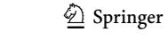

<!-- page 2 -->

## **Introduction**

Preparing an academic publication is a difcult process that requires researchers to work using all their cognitive and motivational resources (Bruning & Horn, [2000](#page-25-0); Kornuta & Germaine, [2019](#page-26-0)). While some researchers frequently publish in journals, the situation is quite complicated for others (Kempenaar & Murray, [2016](#page-26-1); Kornhaber et al., [2016](#page-26-2)). Some researchers ultimately fnd the opportunity to have their studies published in journal with high impact factor though they are rejected repeatedly until then (Çelik et al., [2014;](#page-25-1) Jusslin & Widlund, [2021](#page-25-2)), while others give up after being rejected by some journals. Even academicians who have the necessary qualifcations for a good academic publication may not reach their goals (Lo et al.,[ 2021)](#page-26-3). In short, academicians cannot start writing or publishing their completed work in a journal due to various reasons, considered as "writer's block". Writer's block (barrier to writing) refers to the inability to start or continue writing for reasons other than basic writing skills (Rose, [2009](#page-27-0)). According to Huston [(1998](#page-25-3), p. 93), writer's block is "generally considered to be a stress reaction that paralyzes the ability to put thoughts into words". Rose ([2009)](#page-27-0) claims that barriers to writing arise from not knowing that the publication should develop in a process and not having appropriate and fexible plans for writing.

The literature suggests that barriers to academic writing can be caused by institutional (Hartley, [2008)](#page-25-4), individual (Hartley, [2008)](#page-25-4), cognitive (Rose, [2009)](#page-27-0), afective, or motivational (Pajares, [2003)](#page-26-4) factors. Institutional factors include the time allocated to teaching, the time allocated to research, the support provided by the institution for research, and the number of researchers and research assistants in a department. Individual factors include knowledge, skills, and self-efcacy about academic writing, motivation, age, personality traits, and situational factors such as lack of time and energy. Cognitive and afective factors, on the other hand, refect the researcher's thoughts, beliefs, and attitudes about his/her own writing.

The literature contains many studies that defne barriers to writing based on the abovementioned categories or without any categorization and suggest enablers to overcome these barriers (Table [1](#page-2-0)) (Albert, [2017](#page-25-5); Belcher, [2019;](#page-25-6) Boice & Jones, [1984](#page-25-7); Bruning & Horn, [2000;](#page-25-0) Clapton,[ 2010](#page-25-8); Driscoll & Aquilina, [2011;](#page-25-9) Gopee & Deane, [2013;](#page-25-10) Grzybowski et al., [2003;](#page-25-11) Hartley, [2008;](#page-25-4) Johnston et al., [2014;](#page-25-12) Keen, [2007;](#page-26-5) Kornhaber et al., [2016;](#page-26-2) Morss & Murray, [2001;](#page-26-6) Murray et al., [2008](#page-26-7); Murray, [2012,](#page-26-8) [2013a](#page-26-9), [2013b;](#page-26-10) Oermann & Hays, [2015;](#page-26-11) Pajares, [2003](#page-26-4); Pololi et al., [2004](#page-27-1); Rosales et al., [2012](#page-27-2); Silvia,[ 2007](#page-27-3)). However, the number of studies examining barriers to writing within a theoretical framework is limited.

## **Theoretical framework**

This study addresses the "model for engaging with writing" developed by Murray ([2013b](#page-26-10)) as a theoretical framework. Rather than being a developmental one, this model makes suggestions for the place of writing in academic life. The model emphasizes that while some cognitive, social, and physical engagements should be avoided, responsibility should be taken for some others (Fig. [1](#page-3-0)) (Murray, [2013b](#page-26-10); Renton, [2017](#page-27-4)). No matter how busy they are, successful academicians take time for writing by dispensing with some of their responsibilities when necessary (Mayrath, [2008](#page-26-12)). Some academicians, on the other hand, cannot fnd the opportunity for academic writing, no matter how much they want. This is not due to the lack of academic writing knowledge and skills, but

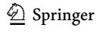

<!-- page 3 -->

## **Table** **1 **Barriers to writing

|  |  |
| --- | --- |
| Lack of Knowledge, Background Knowledge | Lack of self-confdence |
|  | Lack of knowledge about academic writing |
|  | Difculty in conducting studies conforming to the standards of the journals |
|  | Not knowing how to proceed |
|  | Not being able to decide whether one has done enough research |
|  | Not having a command of English |
| Lack of time and Time management | Busy educational and administrative activities |
|  | Not having the opportunity for academic writing |
|  | Needing long periods of time for writing |
| Emotional and Psychological state | Fear and anxiety |
|  | Depression |
|  | Lack of emotional support |
|  | Previous negative experiences |
|  | Being tired of sitting all the time |
|  | Not being in the right mode for writing |
|  | Low motivation |
| Perfectionism | Perfect frst sentence syndrome |
|  | Thinking that one's ideas are controversial |
|  | Thinking that the idea of the study is not good |
|  | Thinking that the study will not appeal to large audiences |
|  | Thinking that one will be ready to write after reading more |
|  | Thinking that one's progress is too slow |
| Fear of failure | Fear of rejection |
|  | Previous rejection letters |
|  | Fear of criticism |
| Procrastination | Cyberloafng |
|  | Dealing with household family |
|  | Inability to start writing without completing other jobs/tasks |
|  | Working on multiple studies |
| Competitive Environment | Fear of being compared to others |
|  | Fear that others will use one's idea |

due to trying to write in spaces and times when responsibilities such as family and educational activities are at the forefront. Therefore, such academicians are stuck on the left side of the model. The developed framework tries to explain how academicians can give a place to academic publication in their working environments (Murray, [2013b)](#page-26-10). In the cognitive engagement dimension, the model suggests avoiding fears and worries about writing and being ready psychologically by fnding justifed reasons for writing (Murray, [2014)](#page-26-13). Instead of fear and anxiety, it is suggested to set daily time periods for writing and make it permanent (Renton, [2017)](#page-27-4). Social engagement suggests switching to collaborative writing instead of competition in the social environment. It involves exchanging ideas for writing and engaging in co-writing by creating academic writing groups, getting peer support, and communicating with diferent academicians (Mckenna & Kyser,[ 2021;](#page-26-14) Murray, [2014](#page-26-13)).

<!-- page 4 -->

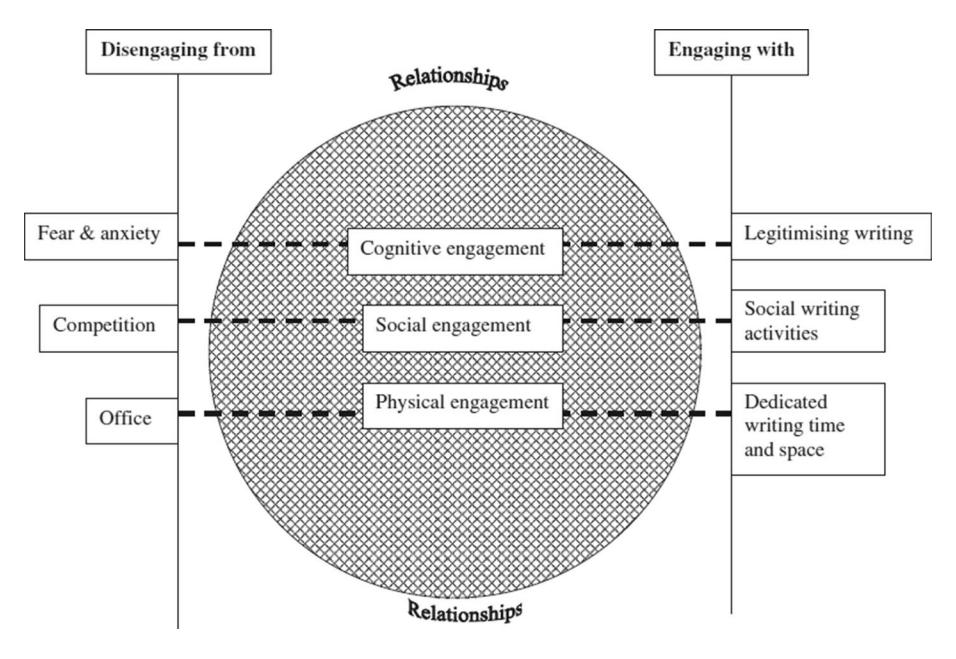
***Fig.** **1 **Cognitive, social, physical engagement (Murray, [2013b)](#page-26-10)*

The model advocates focusing on the target and ignoring the criticisms that may come from the social environment due to focusing on writing by taking time of from educational or academic work (Murray, [2013b,](#page-26-10) [2014)](#page-26-13). However, in some cases, educational work may be more necessary and at the forefront, in which case priority should be given to what requires it. In other words, engagement and disengagement suggestions may replace one another depending on the context (Murray, [2013b)](#page-26-10). Cognitive, social, and physical engagements are interrelated and not separated by clear boundaries (Murray, [2013b](#page-26-10)). Physical engagement suggests creating time and space for writing outside ofces where there is no time or focus for academic writing. Since there will be many interruptions in areas where duties or responsibilities other than academic writing are priority, writing should not be done in such spaces (Murray, [2013b](#page-26-10), [2014)](#page-26-13). In other words, time and space should be set for writing, leaving aside family and educational duties.

Since the model does not focus on afective engagements, it has limitations for the wider evaluation of barriers to writing. Bruning and Horn ([2000](#page-25-0)) state that afective engagements include beliefs, interests, and opinions about academic writing, academic writing self-efcacy, eforts to get support to improve academic writing, and positive attitude towards academic writing. They also note that studies on barriers to writing mostly focus on the cognitive dimension, and the coverage of social and afective factors is superfcial. Pajares ([2003)](#page-26-4) also highlights that individuals' self-efcacy perceptions regarding academic writing may increase their performance. Murray et al. ([2008](#page-26-7)) state that when academicians' self-efcacy increases, their eforts and attempts to improve their writing also increase. Therefore, this study focuses on afective engagements as well as cognitive, social, and physical engagements.

<!-- page 5 -->

## **Signifcance and rationale**

The literature contains various studies on the publication processes of academicians. However, studies on academic writing that explain what afects writing activities and how they can be done more efciently are limited (McGrail et al., [2006;](#page-26-15) Moore, [2003;](#page-26-16) Murray, [2013b;](#page-26-10) Wills,[ 2000](#page-27-5)). This limitation is critical for new and emerging scientists to create academic publications (Murray, [2013a)](#page-26-9). Although guidelines, publications, and books have been prepared for efective academic writing, Murray and MacKay ([1998)](#page-26-17) report that "what … technical advice cannot do is take writers through the complex, combined strategies required for productive academic writing" (p. 36). Therefore, identifying the barriers to academic publication and suggesting enablers to overcome them are of critical importance for any discipline, especially in terms of ensuring optimum productivity of researchers who are at the beginning of their careers (Johnston et al.,[ 2014](#page-25-12)).

The task of institutions in any discipline is to train academicians who have the ability, enthusiasm, and inclination to take part in the dissemination of knowledge (Yancey, [2016)](#page-27-6). However, in performance-based higher education cultures, academicians generally hold discussions focused on outputs rather than the process of producing academic publications. Countries make evaluations based on the number of qualifed journals where academicians publish and their impact values (Australian Research Council, [2012;](#page-25-13) TÜBİTAK Ulakbim, [2017)](#page-27-7). Hence, the difculty of the academic publication process is not fully understood (Kempenaar & Murray, [2016](#page-26-1)). Most academicians try to improve their academic writing skills by trial and error (Keen,[ 2007](#page-26-5)). However, this makes it difcult for them to be successful in academic writing or to achieve satisfactory results (Gopee & Deane, [2013)](#page-25-10). For this reason, it is important to reveal, within the scope of a theoretical framework, the barriers encountered in academic writing and publication processes and the enablers for them (Şimşek et al., [2022)](#page-27-8). In recent years, the increase in the number of academicians all over the world and especially in the number of publications sent to journals following the Covid-19 pandemic has made it more difcult for authors to have their publications accepted by journals (Karakuzu et al., [2020)](#page-25-14). In this regard, the purpose of this study is to explore the factors that prevent academicians from publishing and the enablers to overcome these barriers. To this end, the following research questions are addressed:

What are the (a) cognitive, (b) social, (c) physical, (d) afective barriers to academic writing encountered by academicians and the enablers suggested by them?

## **Method**

This study, which aims to reveal the factors that prevent academicians from academic publishing and the enablers suggested to overcome them, is based on the phenomenological method. Phenomenological research aims to examine the experiences and opinions of one or more individuals about a phenomenon (Creswell & Poth, [2016;](#page-25-15) Johnson & Christensen, [2004)](#page-25-16). In this method, it is important to examine in depth individuals' experiences and perceptions about a phenomenon as well as the meanings they attribute to it (Patton,[ 2002](#page-26-18)). The study employs the phenomenological method considering that the experiences and perceptions of each academician regarding the academic writing process may be diferent.

<!-- page 6 -->

## **Participants**

Within the scope of the study, 41 academicians were interviewed. The academicians were included in the study based on certain criteria, such as gender, title, h-index, number of SSCI publications, and total number of publications. Thus, it was intended to examine the phenomenon in question in a comprehensive way, taking into account different perspectives. In this direction, 19 female and 22 male researchers participated in the study. The average age of the academicians participating in the study is 38, with the standard deviation being 7. Demographic information for each participant is presented in Table[ 2](#page-6-0).

## **Data collection tool**

A semi-structured interview form was used for data collection. The semi-structured interviews were used to enable the researchers to produce alternative questions that could detail the answers of the academicians participating in the study regarding the barriers to academic writing and the enablers for them (Polit & Beck, [2010](#page-27-9)) and to clarify their answers (Louise et al., [1994](#page-26-19)). In this context, frst the studies in the Web of Science, ERIC, and Google Scholar databases were scanned with the keywords "barriers to writing", "motivation to write", "writer's block", "writing obstacles", "writing enablers", "writing for publication", "academic writing", and "academic productivity", and the 20 most cited documents were examined. Based on the literature review, a semi-structured, open-ended interview form consisting of 12 questions checked by three expert researchers was created. Thus, a broad, in-depth evaluation of barriers to academic writing and enablers to overcome them was provided. Before starting to collect data, the interview form was checked by language and feld experts. Afterwards, a pilot interview was conducted with an academician. Considering the defciencies noticed in the pilot interview, necessary adjustments were made in the form. The semi-structured interview form contained questions like "What kind of problems do you have in publishing a study you have carried out or planned? Could you please explain?", "How would you list the most important barriers to a good academic publication? Why?", and "What do you focus on more for academic publication? Why?".

## **Data collection process**

Data were collected from the academicians on a voluntary basis, and the academicians were informed about the purpose of the interview and the process. The interviews were voice recorded, and the recording of each interview took 40 min on average. The interviews focused on the academicians' barriers to academic writing and the enablers on this matter. During the interviews, after the academicians talked about the problems they experienced, Table [1 ](#page-2-0)was presented to them in order to explore in more detail whether they had similar experiences to the problems mentioned in the literature. Thus, the interviews also revealed what the academicians thought about the barriers to writing indicated in the literature that they did not express themselves.

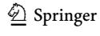

<!-- page 7 -->

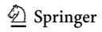

<!-- page 8 -->

| ntinued) |
| --- |
| Ö |
| 9 |
| 7 |
| ө |
| ā |
| r |

| idale z (commuca) | naca, |  |  |  |  |  |  |  |  |  |  |  |  |
| --- | --- | --- | --- | --- | --- | --- | --- | --- | --- | --- | --- | --- | --- |
| Participant- Field | Gender Title | Title | Age | H-Index | H-Index Number of SSCI publications | Total number of publica- tions | Participant- Field | Gender Title | Title | Age | H-Index | Age H-Index Number of SSCI publications | Total number of publications |
| P9- Instruc- tional Tech- nology | Female | Female Assist. Prof | 41 | 9 | 5 | 58 | P30-Turkish Language and Litera- ture | Female | Female Res. Assist | 26 | 2 | 0 | 2 |
| P10- Math- ematics Education | Female | Female Res. Assist | 31 | 4 | 0 | 29 | P31-Chem- istry | Female | Female Assist. Prof 36 | 36 | 10 | 10 | 11 |
| P11-Psy- chological Counseling and Guid- ance | Male | Assoc. Prof | 34 | 11 | 12 | 38 | P32-Instruc- tional Tech- nology | Female | Female Assist. Prof | 48 | 4 | 0 | 8 |
| P12-Instruc- tional Tech- nology | Male | Assist. Prof | 39 | 9 | 5 | 25 | P33-Turkish Language Education | Male | Assist. Prof 39 | 39 | \epsilon | 0 | 11 |
| P13-Chem- istry | Male | Prof. Dr | 51 | 19 | ∞ | 62 | P34-Instructional Technology | Male | Assist. Prof 34 | 34 | 7 | 0 | 2 |
| P14-Instruc- tional Tech- nology | Male | Assist. Prof | 36 | 9 | 3 | 26 | P35-English | Male | Assoc. Prof 42 | 42 | ∞ | 2 | 25 |
| P15-Instruc- tional Tech- nology | Male | Assist. Prof | 36 | 9 | 8 | 32 | P36-Science Education | Female | Female Assist. Prof 40 | 40 | 4 | 0 | 11 |
| P16-Instruc- tional Tech- nology | Female | Female Assoc. Prof | 35 | 18 | 26 | 54 | P37-Instruc- tional Tech- nology | Female | Female Assoc. Prof 34 | 45 | 20 | 12 | 35 |

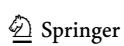

<!-- page 9 -->

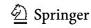

<!-- page 10 -->

## **Data analysis process**

Firstly, the interview records were transcribed. Then, the data were subjected to deductive analysis by adding the afective engagement component to the cognitive, physical, and social engagement components of the "model for engaging with writing" developed by Murray ([2013b](#page-26-10)). In deductive analysis, themes and codes are created based on a theoretical framework (Braun & Clarke, [2006](#page-25-17); Miles & Huberman, [1994](#page-26-20)). Nvivo 12 program was used for data analysis. In the data analysis, frst of all, three researchers analyzed the data of the three participants separately. Then, a common code scheme was created by taking into account the similarities and diferences in their coding and the theoretical framework on which they were based. After that, three researchers shared the data from 41 participants and performed the analysis. The analyses were then checked one by one by a feld expert. The categories and codes that emerged in the data analysis were converted into tables.

## **Findings**

## **Cognitive barriers to academic writing and suggested enablers**

In line with the data obtained from the interviews, the themes and categories of cognitive barriers and enablers are presented in Table [3.](#page-9-0) The most emphasized barriers and enablers by the academicians are listed according to the frequency of repetition.

*f* frequency

<!-- page 11 -->

The most mentioned cognitive barrier to writing was the writing of the IMRAD sections (Table [3](#page-9-0)). The academicians generally made mention of the difculties they experienced in writing the frst paragraph, synthesizing the literature, lack of knowledge about specifc methods and statistics, and writing the discussion section. Regarding these barriers, they suggested improving oneself in academic writing and feld knowledge through graduate courses and seminars. As another cognitive barrier, the problems encountered in writing in English were indicated. The academicians highlighted this barrier because it is difcult to read and write in English, it takes more time, foreign journals have diferent formats, and manuscripts may even be rejected after they are translated and proofread. To overcome the barrier of academic writing in English, they suggested receiving training and support, experiencing study abroad, and using some translation and language editing software. In the third place, they stated the problems they experienced in the design and development of a study. They attributed this problem to factors such as not being able to produce an original study mainly due to not having a good command of the feld, not being able to publish in foreign journals due to the local nature of the problems, and not planning the study appropriately in advance. To design a study, they suggested benefting from the opinions of editors, reviewers, experts, and peers, choosing current and need-oriented problem situations, specializing in a subject, making a good plan, and reviewing the study over and over. As to the last cognitive barrier, the academicians mentioned the busyness of their mind due to doing diferent things during the day. They reported that they have to deal with many tasks such as courses, academic activities, and administrative responsibilities on the same day, which makes it difcult for them to focus. As a solution, they suggested planning the day and focusing on only one task. The academicians' opinions about cognitive barriers and enablers are given below.

I think it's important to provide training on scientifc research methods, especially in graduate education. Writing training may be given. Trainings on writing in both English and Turkish may be provided to enable them to publish more easily." (P15, Male, H-Index: 6)

When we say high-quality publication, it is important that it is covered in the databases. Which indexes cover it is important. English is a must to publish in these journals. In this sense, of course, faculty members need help. Hence, trainings may be provided. (P2, Male, H-Index: 13)

If I haven't set it up well in a systematic way from the beginning … I have trouble settling it later on. I think our biggest problem is this: When we give classes or when we join an academic circle as we go somewhere, we may just think that we can collect data from there and have something out. (P3, Female, H-Index: 1)

I seek opinions when I have doubts. I ask my colleagues, academicians, people who know that stuf, who can give the most appropriate answer about it, or more precisely, who I think can provide more reliable information on it. (P2, Male, H-Index: 13)

There are too many distractions. I decide to sit down and read an article. But then there is a message on the phone, on the computer, or an e-mail. Let's say a student or someone comes to your room. All these things are always distracting. (P38, Male, H-Index: 8)

If I come for a class on a day, I have little time for publication on that day. But if I'm here for the publication, then there is a point I've planned for that day. For example, I'm going to write the introduction section today. Or I'm going to write the relevant research today and so on. Or I'm going to do the analysis very well and check it

<!-- page 12 -->

today. I set a goal accordingly. So, it's not about studying for a specifc number of hours. I have a certain purpose, a certain goal. As soon as I reach the goal, I can drink my tea that day. (P21, Male, H-Index: 10)

## **Social barriers to academic writing and suggested enablers**

The interview fndings regarding the social barriers to writing encountered by the academicians and the enablers suggested on this matter are shown in Table [4](#page-12-0). The most emphasized barriers and enablers by the academicians are listed according to the frequency of repetition.

The strongest social barrier to academic writing was seen to be the difcult journal evaluation processes (Table [4)](#page-12-0). In this regard, the academicians stated some barriers to academic writing as that the evaluation processes of the journals are long, that it is diffcult to get acceptance from journals, that revisions are compelling, that feedbacks are not qualifed, that reviewers give contradictory feedback, that journal formats are diferent, and that some journals are biased. To overcome the barriers regarding the evaluation process, they made suggestions such as examining the rules and scopes of the journals, supporting the text with images to increase intelligibility, getting information from those who sent manuscripts to similar journals, evaluating the manuscript before submission like a reviewer, examining the latest publications in the target journal, and contacting the editor. The second strongest social barrier involved problems experienced in collaborative studies. Regarding this barrier, the academicians frequently expressed the problems that their colleagues are incompetent, inefective, or overpowering, do not manage time well, work sloppily, do not fulfll their responsibilities, etc. As a solution, they suggested building an active and agreeable team that can work in harmony, dividing the labor, exchanging ideas, designing the study under the leadership of a group leader, setting a work schedule, and warning the colleagues delaying their tasks. Another frequently mentioned social barrier to writing is the excess of instructional and administrative responsibilities. The academicians think that the heavy administrative work they are exposed to and the high course load they are responsible for are important barriers to writing. To overcome them, they suggested planning time, dispensing with social life, relieving educational and administrative burdens, and teamwork. The academicians also expressed the opinion that family responsibilities such as housework, childcare, and visiting relatives are also a social barrier to writing. For this, they made suggestions such as dispensing with family and social life, using working hours efectively, and division of labor at home. The inability to create a specifc team was also indicated as a social barrier to writing. To solve this problem, building a strong academic network was suggested. The academicians working with graduate students also considered it as social barriers that students fulfll their responsibilities late, their work always requires checking, and their defciencies or mistakes need to be corrected. For such problems, they noted that graduate courses should have publication outputs and that publication awareness should be created through participation in academic seminars. The academicians having difculties in obtaining research permits were suggested to seek help from their colleagues. Finally, the academicians having problems about too many visitors were suggested to post warning signs on their doors not to be disturbed. Some academician opinions on social barriers and suggested enablers are as follows:

We have a study. It has been published online for one year. It was accepted in six months, but we have been waiting for a year and a half to get an issue. And it's likely that another year will pass like this. The originality and the trend of the study disap-

<!-- page 13 -->

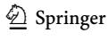

<!-- page 14 -->

| (continued) |
| --- |
| Table 4 |

| Barriers | f | Enablers | f |
| --- | --- | --- | --- |
| Inability to create a team | 9 | Building a strong academic network | 8 |
| Graduate students with incomplete academic development | 9 | Creating awareness of academic publication in graduate education | 5 |
|  |  | Graduate courses having academic publications as outputs | 3 |
|  |  | Compulsory and free participation in academic seminars | 2 |
| Difculty in obtaining research permit | 8 | Getting help from teammates for the permits in the project | 2 |
| Too many visitors | 6 | Posting a warning on the door to avoid disturbance | 3 |

*f* frequency

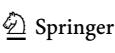

<!-- page 15 -->

pear in two years. (P1, Female, H-Index: 9)

In collaborative study, what you give importance to may not be in the sphere of importance of others. ... Therefore, they may delay the work, not sending on time or not doing the way you want it to be. (P11, Male, H-Index: 11)

I try to fnish it in the given time. For example, there was a process in which we made one or two book chapters. We prepared those books in teams of 10-15 people. Since there is a certain period of time, everyone has to comply with it. Inevitably, I made a plan accordingly and completed the necessary writing processes and delivered them on time. (P23, Male, H-Index: 2)

I have serious problems due to both course load and the problems arising from working conditions and my administrative duty. (P6, Female, H-Index: 8)

"I usually put my classes on specifc days and concentrate my studies on the days when I don't have classes. (P15, Male, H-Index: 6)

"I'm married, and I have children. Of course, I can't devote all of the time I have to take care of them to publication. (P2, Male, H-Index: 13)

## **Physical barriers to academic writing and enablers**

In line with the data obtained from the interviews, the opinions of the academicians about the physical barriers and the enablers are presented in Table [5.](#page-15-0) The most emphasized barriers and enablers by the academicians are listed according to the frequency of repetition.

Among the most common physical barriers, time management problems come frst (Table [5)](#page-15-0). The academicians attributed these problems to that they cannot fnd time to write, postpone writing, cannot plan their days and studies, cannot make long-term plans, cannot complete their work during the day, dispense with sleep, etc. To avoid time management problems, they suggested planning their educational and administrative responsibilities, continuing to work at home, starting the day early and fnishing it late, and setting a deadline for studies. The academicians mentioned the difculty of data collection process as another important problem they encountered. The main reasons for this problem were indicated as the difculty of carrying out long-term and multi-dimensional studies, not being able to fnd an experiment group, and the obsolescence of data in studies that have a long publication period. Regarding the data collection barrier, collaboration with teammates and multiple data collection were suggested by the academicians. The third physical barrier mentioned by the academicians involved inadequate infrastructure and technical defciencies such as lack of tools and equipment, fnancial limitations, unfavorable working conditions, difculties in developing materials and software, and inability to access data analysis programs, databases, and reference books. The suggested solutions to these problems were fnding funds for the study through various projects, coverage of the necessary budget for the study by the researcher, and the procurement of the needed tools and equipment by the institutions. The academicians stated that they have problems in working at home or in the ofce in some cases. For this, they suggested working in the ofce outside of working hours and fnishing work within working hours as much as possible. Some academicians stated that they cannot reach archive sources, and they suggested the use of individual relationships and ofcial protocols to overcome this barrier. As the last barrier, the academicians mentioned the problems experienced with shared equipment such as computers and experimental materials used in laboratories and the low quality of these materials. To overcome these barriers, they suggested searching for and procuring

<!-- page 16 -->

|  |
| --- |
|  |
| Physical barriers and suggested enablers |
|  |
|  |
|  |
| Table 5 |

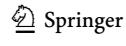

<!-- page 17 -->

high-quality materials and using them within a plan. The academicians' opinions on physical barriers are as follows:

I can honestly say that I don't consider myself very good at time management. It's generally said that this is very common, especially in Turkish society. … I have seen this very clearly, especially in my friends who have done their doctorate abroad. There is a diference between us. They come and plan the time very well and publish the article properly, which is also true for their classes and preparations, while I tend to leave them to the last days (P23, Male, H-Index: 2)

Collecting data is challenging in itself. So, I can say this very clearly. Especially collecting qualitative data as you do, conducting interviews. You make an appointment with someone, but something comes up on their part. His/her child gets sick, and you spend so much time after him/her. For one thing, qualitative data is much more difcult to collect. For example, we conduct a survey, or I apply an achievement test to the students. While doing them, maybe a problem occurs in communicating with the students, or the students are not voluntary. They say, 'sir, we don't want to fll it in'. I understand them from place to place as well. This is because when there is a bombardment of surveys from all the instructors, the student doesn't want to fll it in. I have a problem at that point as well. (P22, Female, H-Index: 2)

We have problems with sources from time to time. We can't access all sources. This could be a journal. In particular, we have trouble accessing the books. (P17, Male, H-Index: 24)

I take the lead more in access to technological devices or access to software. If a person writes a project, faster feedback can be provided about its acceptance and the needs of the person. (P12, Male, H-Index: 6)

I can't work at work. I can't do anything about academic publication. This is because the workload here is heavy enough. (P6, Female, H-Index: 8)

I have difculty in libraries. I usually have problems in borrowing more than one source at a time or fnding an issue. Or sometimes, such source may not be available in the library. Especially accessing the sources in the archives is a problem for me. (P28, Female, H-Index: 1)

## **Afective barriers to academic writing and suggested enablers**

The interview fndings regarding the afective barriers to writing encountered by the academicians and the enablers suggested on this matter are shown in Table [6](#page-17-0). The most emphasized barriers and enablers by the academicians are listed according to the frequency of repetition.

The most frequently emphasized afective barrier is not being in the right mood for writing (Table [6](#page-17-0)). The academicians attributed this problem to a lack of motivation in individual studies, taking frequent breaks, procrastination, cyberloafng, and inability to start writing. On this matter, they made suggestions such as planning the study in mind to enhance the motivation for writing, starting from where one can write, not taking long breaks, enhancing motivation through collaborative work and increasing the frequency of publication, positive thinking, sparing time for hobbies, and reducing distractions. The academicians also think that the thought that their publications do not contribute to the society because they are not read and therefore, they are not worth the efort is an important afective barrier. For this, they suggested trying to be benefcial by producing publications that deal with real problems. Among afective barriers are also fear of rejection and lack of

<!-- page 18 -->

*f* frequency

self-confdence. These fears are underlain by not trusting in the study, unfairness in the evaluation of manuscripts, and increased academic writing anxiety arising from reduced self-efcacy caused by being rejected continuously. To overcome this barrier, the academicians suggested being competitive, insisting on the publication of the study, examining studies published in journals with high impact factor, and improving the manuscript with reviewer feedback. The academicians having problems due to perfectionism were suggested to focus on research that they can do and submitting to simpler journals. The academicians having worries about their academic positions were suggested to increase their own motivation by trying to love their occupation, seeing academic publication as a necessity, targeting promotion, and sharing their problems with their peers. The academicians' opinions on this matter are as follows:

I usually publish in my mind before I publish. How will I do? First, there is a construction process in my mind. (P21, Male, H-Index: 10)

I often ask myself the question 'What will be the use of this publication I make?' I've wasted my days, I've spared so much of my time. 'Is it worth a place in this society? Will it work to touch someone's life?' Obviously, this is one of the factors I have diffculty in publishing. (P23, Male, H-Index: 2)

<!-- page 19 -->

The change in my point when I think about it is this: The qualitative part of the study rather than the quantity… How valuable is a study, how important, how useful is it? I mean, there has been a considerable change in this sense. (P13, Male, H-Index: 19) Since the article derived from my thesis has been repeatedly rejected (…), I no longer submit it because I'm afraid although I've corrected it. (P12, Male, H-Index: 6) We have to advance on fear. Otherwise, we're defeated. This is our job. We have to beat it. (P15, Male, H-Index: 6)

I improved myself thanks to the feedback from the reviewers. That is, when I wrote the article on the second day, taking into account, for example, what the previous reviewer said, I had higher self-confdence. Obviously, there is prejudice and fear at frst, but a path may be followed by starting from the highest journal with courage without fear and gradually going down. (P16, Female, H-Index: 18)

## **Discussion and conclusion**

This section discusses the fndings regarding the barriers to publishing and enablers suggested on this matter through the interviews with 41 academicians under four sub-titles: cognitive barriers and suggested enablers, social barriers and suggested enablers, physical barriers and suggested enablers, and afective barriers and suggested enablers.

## **Cognitive barriers and suggested enablers**

The cognitive barrier hindering the academicians the most was found to be writing the introduction, methodology, and discussion (IMRAD) sections of an academic paper. In addition, it was determined that the academicians had difculties in writing in English, had problems in creating publications, and moved away from writing, as various things occupied their minds during the day. The literature also suggests that writing the IMRAD sections (Albert,[ 2017](#page-25-5); Pololi et al., [2004](#page-27-1)), reading and writing in English (Belcher, [2019](#page-25-6)), and creating qualifed publications (Rose, [2009)](#page-27-0) are the factors challenging academicians.

The determined cognitive barriers may be caused by inexperience in general, and they may gradually decrease in the later years of the academic career. For this reason, academicians who want to encounter cognitive barriers less often should engage in activities that will improve their writing (Getahun et al., [2021;](#page-25-18) Keen, [2007](#page-26-5)). Participation of academicians in supportive and improving activities is critical for ensuring optimum productivity of researchers, especially at the beginning of their careers (Dwyer et al., [2015](#page-25-19); Johnston et al., [2014)](#page-25-12). In the present study, diferently from the literature, it was noted that use of academic writing tools could be benefcial for academicians having difculties in writing the IMRAD sections. The improvements in academic software may be said to be efective in this suggestion. The academicians having problems in writing in English were also suggested to improve their knowledge and skills on this matter especially by making use of the opportunities abroad. In addition to such fndings, the literature also includes suggestions that academicians having difculty in reading and writing in English should read more in English (Belcher, [2019](#page-25-6)) and participate in academic writing groups (Oermann & Hays, [2015](#page-26-11); Rose,[ 2009](#page-27-0)) to engage in activities that can support and improve them (Getahun et al., [2021;](#page-25-18) Hartley,[ 2008](#page-25-4)).

Another cognitive barrier obtained in the study involves the difculties experienced by academicians in designing and developing a study. Novice authors generally choose the

<!-- page 20 -->

trial-and-error method when trying to improve their academic writing skills (Keen, [2007](#page-26-5)). However, this makes it difcult for them to be successful in academic writing or to achieve satisfactory results (Gopee & Deane, [2013](#page-25-10)). On the other hand, even expert authors who have the necessary qualifcations to create a publication may not reach their goals from time to time (Lo et al., [2021](#page-26-3)). In the present study, to overcome the barrier about creating publications, suggestions were made to beneft from expert opinions, focus on needs, specialize, increase the quality with reviewer opinions, and review the study over and over. The main purpose of making such suggestions is to emphasize that a prepared study undergoes a development process until it is published. For this reason, academicians should persistently improve both themselves and their publications so that their studies can be completed and published in a quality manner.

The barrier of inability to focus is a fnding with limited coverage in the literature. This may be because the e-mail and social media notifcations received via mobile phones, the usage rate of which has increased recently, keep academicians busy. Moreover, the widespread use of social media and e-mail today causes some academicians to display cyberloafng behaviors in social media environments (Carrigan, [2019;](#page-25-20) Neal, [2012](#page-26-21)). As a matter of fact, the literature reports that the use of social media may reach 5–6 h a day, and this weakens self-regulation skills (Kasap, [2021](#page-26-22); Wang et al., [2013)](#page-27-10). To overcome this barrier, the participants suggested that tasks planned for a day should be completed by staying away from the things that may occupy the mind (mobile phone, social media, etc.) during the day as much as possible. For this, academicians may create daily, weekly, monthly, and yearly plans and follow them closely.

## **Social barriers and suggested enablers**

The social barrier hindering the academicians the most was determined to be journal evaluation processes. In the Covid-19 pandemic, individuals have moved away from social life and focused more on article writing (Karakuzu et al., [2020](#page-25-14)). The increasing number of publications has pushed the journals to be more selective. This, in turn, has led to the prolongation of the review processes and increased the number of rejections (Lee et al.,[ 2020](#page-26-23)). For this barrier, the academicians in the present study mainly suggested the enablers of reading the scope and rules of the journal thoroughly, using strong visuals to increase the intelligibility of the study, and getting information about the process from those who have sent publications to a similar journal. According to Rose ([2009)](#page-27-0), academicians send their publications to unsuitable journals without doing a detailed preliminary research. For this reason, when making academic publications, the journal should be selected frst, and the criteria of the selected journal should be considered during the writing process (Silvia, [2007)](#page-27-3). In this way, journal evaluation processes may be shorter and more efective. Using the right diagrams or fgures may be an efective way to reinforce the presentation of the study.

Another social barrier frequently expressed both in the present study and in the literature is the problems experienced in collaborative work (Hartley,[ 2008](#page-25-4); Jusslin & Widlund, [2021;](#page-25-2) Lo et al., [2021)](#page-26-3). Collaborative work generally creates an efective and productive ground for study. However, the successful organization of collaborative studies is not easy. This is because collaborative studies may involve situations where group members cannot fulfll their responsibilities. The reason for this may be lack of experience, not being suitable for teamwork, not feeling emotionally ready, or lack of physical infrastructure. As can be seen, the causes of social barriers can be associated with cognitive, social, physical, or

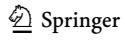

<!-- page 21 -->

afective factors. As a matter of fact, there are situations where cognitive, social, physical, and afective (Pajares, [2003](#page-26-4)) barriers cannot be separated from each other by clear boundaries and are afected by each other (Murray, [2013b)](#page-26-10). On the other hand, the proper selection and organization of team members plays a key role in overcoming these barriers. For these barriers, in the present study, suggestions were made to divide labor among group members, beneft from the opinions of group members, build a team out of people who can work in harmony, be conciliatory, assign tasks to those who can take an active role, set a calendar, choose a group leader, warn those who delay their tasks, and engage in project-based process monitoring. These suggestions stem from the search for agreeable and manageable solutions to problems that may arise before, during, and after the collaborative study. The literature suggests that competitive environments prevent collaborative work, and for efective collaborative studies, it is necessary to focus on cooperation and avoid competition (Murray, [2013a)](#page-26-9). In addition, creating academic writing groups and carrying out some writing activities periodically will support and improve young researchers in particular (Happell, [2008;](#page-25-21) Keen,[ 2007](#page-26-5)).

Another social barrier hindering the writing processes of academicians was stated to be the abundance of educational and administrative responsibilities. This barrier has a limited coverage in the literature (Gopee & Deane, [2013](#page-25-10)). Also, this barrier may difer depending on the country where the data are collected. For example, opening new universities and units is seen as a necessity in developing countries (Turkey, Brazil, India, etc.) Therefore, academicians move away from writing due to the heavy educational and administrative responsibilities. In some countries (USA, UK, etc.), there is a distinction between academicians who do research and those who have to teach courses. On the other hand, in some countries (e.g., Turkey), academicians both give courses and carry out research activities. Hence, the fact that educational and administrative responsibilities keep academicians away from writing processes may be due to institutional variables (Wills,[ 2000](#page-27-5)). Academic writing should not be done in places where administrative responsibilities are held. In the present study, suggestions were made to plan academic writing considering educational responsibilities, dispense with social life, reduce administrative duties, and work as a team. No matter how busy they are, successful academicians take time for writing by dispensing with some of their responsibilities when necessary (Mayrath, [2008)](#page-26-12). Hence, in this study, it was suggested to adjust educational and administrative responsibilities and dispense with social life.

In addition, within the scope of the study, social barriers such as family responsibilities, too many visitors in the ofce, inadequate guidance by the academic supervisor, incomplete academic development of graduate students, and difculties in obtaining research permits were mentioned. Since family responsibilities may include situations where academicians cannot make many concessions, the participants of the study made suggestions such as task sharing and efective use of working hours. Posting warning signs on the ofce doors not to be disturbed in case of too many visitors, which may afect efective time management, was suggested. However, since supervisors' inadequate guidance and graduate students' incomplete academic development may be due to the quality of the education received, the participation of both supervisors and graduate students in trainings aimed at creating awareness and producing academic publication was suggested. In addition to these, suggestions were also made to introduce the requirement of academic publication as graduate course outputs and train supervisors on efective communication.

Reasons for social barriers are generally associated with cognitive barriers (Pajares, [2003)](#page-26-4) and defciencies about writing process and time management (Silvia, [2007)](#page-27-3). In other words, academicians who lack knowledge about writing processes or who cannot organize

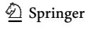

<!-- page 22 -->

their studies well may encounter social barriers more. The fndings obtained from the present study suggest that social barriers are mostly due to the inability to fnd efective teammates who can work together in harmony and speed up the process, both in universities and in felds where data collection is carried out. In this regard, academicians' creating a wide academic network and improving their communication skills may solve many barriers that may be of social origin.

## **Physical barriers and suggested enablers**

The physical barrier hindering the academicians the most was found to be time management. The literature contains various studies on the time management barrier (Kornuta & Germaine, [2019;](#page-26-0) Meadows, [2004)](#page-26-24). Based on the obtained fndings, academicians are suggested to increase the time they work at home, plan their time considering educational and administrative responsibilities, start the day early and fnish it late, and set deadlines for each work. The main purpose of providing all these suggestions is to make academicians know themselves better and produce/conduct all products and processes in academic life (academic, social, hobby, and education) within a plan and schedule. For example, plans created by Silvia ([2007)](#page-27-3) and Oermann and Hays [(2015](#page-26-11), p. 10–15) (develop manuscript, write frst draft, revise draft, revise grammar-spelling-punctuation, prepare tables-fgures, prepare fnal version, submit) may be used, or a personal plan may be created based on sample plans.

Among the physical barriers hindering academicians expressed within the scope of the study were also the difculty of the data collection process and inadequate infrastructure and technical defciencies. Since more articles are published in today's scientifc world than in the past, both bureaucratic and ethical review processes are carried out more sensitively. For this reason, academicians have more difculties in data collection processes. In addition, there is a greater need for interdisciplinary and complex studies today. This may lead to an increase in infrastructure and technical needs. Furthermore, there is no direct research link between the universities and the Ministry of National Education (MEB) in Turkey. For academicians to collect data from the MEB institutions, they need to obtain administrative permissions and contact teachers who can help them collect data at school. In addition, since schools do not have sufcient infrastructure for studies that require technological infrastructure, they need to fnd funds or cover them themselves. This poses a major obstacle to long-term, large-participation, practice-based research. Problems related to space and infrastructure are covered in the literature, albeit limited (Belcher, [2019](#page-25-6)). With regards to the difculties experienced in the data collection process, the academicians participating in the study suggested getting help from teammates for permissions. Among other suggestions were coverage of the necessary budget for the inadequate infrastructure and technical defciencies by the academician himself/herself, procurement of the tools and equipment by the institution, working with people who can provide the infrastructure, and fnding funds through various projects.

Another physical barrier indicated in the study was the inability to work at home or in the ofce. The inability to work at home may be seasonal and related to the Covid-19 pandemic. As a matter of fact, because of the Covid-19 measures taken and the processes experienced in this regard, academicians cannot continue their academic work in the same environment and experience psychological fatigue (Alparslan et al., [2021)](#page-25-22). To overcome this barrier, the participating academicians suggested working in the ofce also outside of working hours and fnishing the work in the ofce within working hours as much as

<!-- page 23 -->

possible. The reason for making these suggestions may be the desire for fexible, personalized working hours.

Other physical barriers emphasized within the scope of this study are inaccessibility to archive sources, low quality of materials, and problems with shared equipment. These barriers suggest that academicians frstly experience problems with inadequate infrastructure and technical defciencies, and after technical possibilities are provided, they have difculties in their sustainability. The continuous, high-quality provision of archive sources and materials and the smooth working of shared equipment will ensure the sustainability of the established laboratories and infrastructure. To overcome these barriers, the participants made suggestions such as using individual relationships, resorting to ofcial protocols, doing material research, and using equipment within a plan. In this way, it may be possible to both set up the necessary infrastructure and ensure sustainability.

## **Afective barriers and suggested enablers**

The afective barrier hindering the academicians the most was found to be not being in the right mood for writing. As a matter of fact, the literature contains various studies stating that academicians move away from the writing process because they are not in the right mood for writing (Morss & Murray, [2001](#page-26-6); Paliadelis et al., [2015)](#page-26-25). The main source of this afective barrier is the authors' lack of knowledge about the writing process, their past failures in writing, and their lack of self-confdence and motivation (Oermann & Hays, [2015](#page-26-11)). To overcome this, academicians were suggested to plan the study in mind, to start writing from where they can write, not to take a long break from writing, and to increase intrinsic motivation by publishing. These suggestions may enhance academicians' self-confdence and motivation.

Other afective barriers indicated both in the present study and in the literature were thinking that the articles are not read and do not contribute practically (Murray, [2012](#page-26-8)), fear of rejection (Oermann & Hays, [2015](#page-26-11)), lack of self-confdence, and perfectionism (Gopee & Deane, [2013)](#page-25-10). In general, these barriers may be caused by the lack of experience. Academicians who do not have sufcient experience miss that it is natural that articles do not always make a measurable impact. Indeed, there is a need for scientifc research that creates theoretical frameworks as well as practical knowledge (Şimşek et al., [2022](#page-27-8)). Murray et al. [(2008](#page-26-7)) state that when academicians' self-efcacy increases, their eforts and attempts to improve their writing also increase. Fear of rejection decreases, self-confdence increases, and perfectionism is kept at a more optimum level among academicians who are involved in the publication processes and increase their experience in academic writing (Keen, [2007;](#page-26-5) Pajares, [2003)](#page-26-4).

To overcome these four barriers, suggestions were made in the study to try to be benefcial to people, focus on producing publication, be persistent, examine studies published in journals with high impact factor, be motivated by academic competition, improve manuscripts with reviewer feedback, focus on research that one can do, and send unsatisfactory studies to simpler journals. The common reason for these suggestions is the aim to focus on work that can be benefcial, reduce fear, increase self-confdence, and keep perfectionism at a more optimum level. In this way, academicians can overcome afective barriers and engage in writing processes more efectively.

Another afective barrier having limited coverage in the literature (Bruning & Horn, [2000;](#page-25-0) Pajares, [2003)](#page-26-4) but highlighted in the present study is occupational worries. This barrier may result from insufcient intrinsic motivation. In the research assistant training

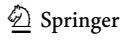

<!-- page 24 -->

systems established in some countries, young researchers have worries about the future due to the defciencies of the system, and because of such worries, they move away from academic writing. This causes qualifed individuals to move away from the world of science. In the present study, academicians having occupational worries were suggested to love their profession and maintain intrinsic motivation. In addition, to overcome this barrier, suggestions were made to target academic promotion, to see academic publication as a necessity, and to share problems with peers. However, in order to overcome this barrier, countries should frst review the criteria for appointment and promotion in universities and work towards eliminating professional future anxiety to ensure the transition of qualifed individuals to the world of science.

## **Limitations**

This study has some limitations in terms of the number of participants, data collection tools, and cultural aspects. First, the obtained results are limited to the data obtained from 41 academicians. Phenomenological research can be conducted with 5–30 participants, but the participants' status of experiencing the phenomenon in question is more important than their number (Creswell & Poth, [2016;](#page-25-15) Polkinghorne,[ 1989](#page-27-11)). In this context, the focus of the study was on individuals' real perceptions and experiences, rather than on generalizing the results to the whole population. Second, only a semi-structured interview form was used for data collection, so data triangulation was not possible. For this limitation, the interview questions were formed in line with the information stated in the most cited barrier studies in the literature. In addition, the study revealed diferent experiences by providing maximum diversity through data such as gender, marital status, title, and h-index of the participants. Third, the participants were generally academicians working in the feld of education in Turkey. For this reason, it is possible to observe changes in diferent cultural structures, as some of the fndings are likely to be directly afected by cultural factors such as the environment of upbringing, human relations, academic criteria, and management planning in Turkey. In addition, since the feld of study of the participating academicians is education, the results of the study may be a guide for researchers in the feld of social sciences and education.

## **Recommendations**

Within the scope of the study, semi-structured interviews were conducted with 41 academicians difering in gender, branch, age, feld, and experience. Based on the fndings, the following recommendations can be made for academicians to maintain academic working life more efectively and productively.

## **Cognitive**

Academicians should;

- 1. take part in academic studies all over the world.
- 2. strive to improve their language skills in accordance with the age and conditions we live in.

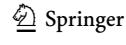

<!-- page 25 -->

- 3. pay attention to getting education and improving themselves continuously, without forgetting that all academic life is a lifelong learning process.
- 4. design their research topics based on current and need-oriented issues.
- 5. use academic writing tools when writing the IMRAD sections.

## **Social**

## Academicians should;

- 6. act as harmoniously and responsibly as possible in collaborative studies.
- 7. pay attention to the principles of making a transparent division of labor, choosing a group leader, being conciliatory, and setting deadlines in collaborative studies.
- 8. raise the awareness of academic publication by carefully designing the stages of taking courses and writing the thesis in the graduate education process, which forms the basis of academic life.
- 9. read the scope and the latest publications of the target journal and listen to the experiences of the people who have submitted publications to that journal, before entering an article submission process.
- 10. follow prestigious journals and academicians in their feld.

## **Physical**

## Academicians should;

- 11. design project-based study processes in order to overcome infrastructure inadequacy and technical defciencies and to carry out multi-dimensional interdisciplinary studies.
- 12. use detailed work schedules for more efcient study processes.
- 13. deal with all of the products and processes in academic life (academic, social, hobby, and education) within a plan and program.

## **Afective**

## Academicians should;

- 14. engage in sports and art activities that will increase their productivity by improving their mood.
- 15. try to solve problems and be benefcial to people by focusing on quality rather than quantity.
- 16. increase their self-confdence by improving their publications with reviewer feedback and should insist on completing and publishing their study.
- 17. keep their motivation high by publishing, thinking positive, loving their profession, and targeting promotion.

**Funding** No funding was received to assist with the preparation of this manuscript.

<!-- page 26 -->

## **Declarations**

**Confict of interest** The authors have no competing interests to declare that are relevant to the content of this article.

## **References**

- Albert, T. (2017). Eight questions to ask before writing an article. *British Journal of Hospital Medicine,* *78*(6), 341–343.[ https://doi.org/10.12968/hmed.2017.78.6.341](https://doi.org/10.12968/hmed.2017.78.6.341)
- Alparslan, A., Polatcı, S., & Yastıoğlu, S. (2021). Alienatıon To Acadeicianship during the covid-19 pandemic. *Journal of Mehmet Akif Ersoy Universıty Economics and Administrative Scıences Faculty,* *8*(1), 312–338. [https://doi.org/10.30798/makuiibf.805133](https://doi.org/10.30798/makuiibf.805133)
- Australian Research Council. (2012). *Excellence in research for Australia 2012: National report*.
- Belcher, W. L. (2019). *Writing your journal article in twelve weeks: A guide to academic publishing suc**cess*. Sage.
- Boice, R., & Jones, F. (1984). Why academicians don't write. *The Journal of Higher Education,* *55*(5), 567–582. [https://doi.org/10.1080/00221546.1984.11780679](https://doi.org/10.1080/00221546.1984.11780679)
- Braun, V., & Clarke, V. (2006). Using thematic analysis in psychology. *Qualitative Research in Psychology,* *3*(2), 77–101.[ https://doi.org/10.1191/1478088706qp063oa](https://doi.org/10.1191/1478088706qp063oa)
- Bruning, R., & Horn, C. (2000). Developing motivation to write. *Educational Psychologist,* *35*(1), 25–37. [https://doi.org/10.1207/S15326985EP3501_4](https://doi.org/10.1207/S15326985EP3501_4)
- Carrigan, M. (2019). *Social media for academics*. Sage.
- Clapton, J. (2010). Library and information science practitioners writing for publication: motivations, barriers and supports. *Library and Information Research,* *34*(106), 7–21.[ https://doi.org/10.29173/lirg217](https://doi.org/10.29173/lirg217)
- Creswell, J. W., & Poth, C. N. (2016). *Qualitative inquiry and research design: Choosing among fve * *approaches*. Sage publications.
- Çelik, E., Gedik, N., Karaman, G., Demirel, T., & Göktaş, Y. (2014). Mistakes encountered in manuscripts on education and their efects on journal rejections. *Scientometrics,* *98*(3), 1837–1853.[ https://doi.org/](https://doi.org/10.1007/s11192-013-1137-y) [10.1007/s11192-013-1137-y](https://doi.org/10.1007/s11192-013-1137-y)
- Driscoll, J., & Aquilina, R. (2011). Writing for publication: A practical six step approach. *International * *Journal of Orthopaedic and Trauma Nursing,* *15*(1), 41–48. [https://doi.org/10.1016/j.ijotn.2010.05.001](https://doi.org/10.1016/j.ijotn.2010.05.001)
- Dwyer, T., Friel, D., McAllister, M., Searl, K. R., & Rossi, D. (2015). The write stuf: A proactive approach to increasing academics' writing skills and outcomes. *Nurse Education in Practice,* *15*(4), 321–326. [https://doi.org/10.1016/j.nepr.2014.12.004](https://doi.org/10.1016/j.nepr.2014.12.004)
- Getahun, D. A., Hammad, W., & Robinson-Pant, A. (2021). Academic writing for publication: Putting the 'international'into context. *Research in Comparative and International Education,* *16*(2), 160–180. [https://doi.org/10.1177/17454999211009346](https://doi.org/10.1177/17454999211009346)
- Gopee, N., & Deane, M. (2013). Strategies for successful academic writing—Institutional and non-institutional support for students. *Nurse Education Today,* *33*(12), 1624–1631.[ https://doi.org/10.1016/j.nedt.](https://doi.org/10.1016/j.nedt.2013.02.004) [2013.02.004](https://doi.org/10.1016/j.nedt.2013.02.004)
- Grzybowski, S. C., Bates, J., Calam, B., Alred, J., Martin, R. E., Andrew, R., Rieb, L., Harris, S., Wiebe, C., Knell, E., & Berger, S. (2003). A physician peer support writing group. *Family Medicine,* *35*(3), 195–201.
- Happell, B. (2008). Writing for publication: A practical guide. *Nursing Standard,* *22*(28), 35–40.
- Hartley, J. (2008). *Academic writing and publishing: A practical handbook*. Routledge.
- Huston, P. (1998). Resolving writer's block. *Canadian Family Physician,* *44*, 92.
- Johnson, B., & Christensen, L. (2004). *Educational research: Quantitative and qualitative approaches*. Pearson Education Inc.
- Johnston, J., Wilson, S., Rix, E., & Pit, S. W. (2014). Publish or perish: strategies to help rural early career researchers increase publication output. *Rural and Remote Health*. [https://doi.org/10.22605/RRH2870](https://doi.org/10.22605/RRH2870)
- Jusslin, S., & Widlund, A. (2021). Academic writing workshop-ing to support students writing bachelor's and master's theses: A more-than-human approach. *Teaching in Higher Education*. [https://doi.org/10.](https://doi.org/10.1080/13562517.2021.1973409) [1080/13562517.2021.1973409](https://doi.org/10.1080/13562517.2021.1973409)
- Karakuzu, M., Canlı, Z., & Canlı, B. (2020). Efects of lockdown period of the COVID-19 pandemic on turkish academicians' academic writing productivity performance in ELT. *Journal of English Lan**guage Teaching (TOJELT),* *5*(3), 179–194.

<!-- page 27 -->

- Kasap, M. (2021). The relationship between organizational alienation and cyber loafng: a study on textile workers. *Journal of Mehmet Akif Ersoy Universıty Economics and Administrative Scıences Faculty,* *8*(1), 561–576.[ https://doi.org/10.30798/makuiibf.863155](https://doi.org/10.30798/makuiibf.863155)
- Keen, A. (2007). Writing for publication: Pressures, barriers and support strategies. *Nurse Education Today,* *27*(5), 382–388.[ https://doi.org/10.1016/j.nedt.2006.05.019](https://doi.org/10.1016/j.nedt.2006.05.019)
- Kempenaar, L. E., & Murray, R. (2016). Writing by academics: A transactional and systems approach to academic writing behaviours. *Higher Education Research & Development,* *35*(5), 940–950.[ https://doi.](https://doi.org/10.1080/07294360.2016.1139553) [org/10.1080/07294360.2016.1139553](https://doi.org/10.1080/07294360.2016.1139553)
- Kornhaber, R., Cross, M., Betihavas, V., & Bridgman, H. (2016). The benefts and challenges of academic writing retreats: An integrative review. *Higher Education Research & Development,* *35*(6), 1210–1227. [https://doi.org/10.1080/07294360.2016.1144572](https://doi.org/10.1080/07294360.2016.1144572)
- Kornuta, H. M., & Germaine, R. W. (2019). *A concise guide to writing a thesis or dissertation: Educational * *research and beyond*. Routledge.
- Lee, J. E., Mohanty, A., Albuquerque, F. C., Couldwell, W. T., Levy, E. I., Benzel, E. C., Wakhloo, A. K., Hirsch, J. A., Fiorella, D., Fargen, K. M., Burkhardt, J. K., Srinivasan, V. M., Johnson, J., Mokin, M., & Kan, P. (2020). Trends in academic productivity in the COVID-19 era: analysis of neurosurgical, stroke neurology, and neurointerventional literature. *Journal of Neurointerventional Surgery,* *12*(11), 1049–1052. [https://doi.org/10.1136/neurintsurg-2020-016710](https://doi.org/10.1136/neurintsurg-2020-016710)
- Lo, Y. Y., Othman, J., & Lim, J. W. (2021). Mapping the use of boosters in academic writing by Malaysian frst-year doctoral students. *Pertanika Journal of Social Sciences & Humanities*. [https://doi.org/](https://doi.org/10.47836/pjssh.29.3.23) [10.47836/pjssh.29.3.23](https://doi.org/10.47836/pjssh.29.3.23)
- Louise Barriball, K., & While, A. (1994). Collecting Data using a semi-structured interview: A discussion paper. *Journal of Advanced Nursing,* *19*(2), 328–335. [https://doi.org/10.1111/j.1365-2648.1994.tb010](https://doi.org/10.1111/j.1365-2648.1994.tb01088.x) [88.x](https://doi.org/10.1111/j.1365-2648.1994.tb01088.x)
- Mayrath, M. C. (2008). Attributions of productive authors in educational psychology journals. *Educational * *Psychology Review,* *20*(1), 41–56.[ https://doi.org/10.1007/s10648-007-9059-y](https://doi.org/10.1007/s10648-007-9059-y)
- McGrail, M. R., Rickard, C. M., & Jones, R. (2006). Publish or perish: A systematic review of interventions to increase academic publication rates. *Higher Education Research & Development,* *25*(1), 19–35. [https://doi.org/10.1080/07294360500453053](https://doi.org/10.1080/07294360500453053)
- Meadows, K. A. (2004). So you want to do research? 6: Reporting research. *British Journal of Community * *Nursing.,* *9*(1), 37–41. [https://doi.org/10.12968/bjcn.2004.9.1.11935](https://doi.org/10.12968/bjcn.2004.9.1.11935)
- Mckenna, K., & Kyser, C. D. (2021). Beyond academic writing: The international doctoral student writing workshop. *Innovations in Education and Teaching International*. [https://doi.org/10.1080/14703297.](https://doi.org/10.1080/14703297.2021.1878051) [2021.1878051](https://doi.org/10.1080/14703297.2021.1878051)
- Miles, M. B., & Huberman, A. M. (1994). *Qualitative data analysis: An expanded sourcebook*. Sage Publications.
- Moore, S. (2003). Writers' retreats for academics: Exploring and increasing the motivation to write. *Journal * *of Further & Higher Education,* *27*(3), 333–342. [https://doi.org/10.1080/0309877032000098734](https://doi.org/10.1080/0309877032000098734)
- Morss, K., & Murray, R. (2001). Researching academic writing within a structured programme: Insights and outcomes. *Studies in Higher Education,* *26*(1), 35–52. [https://doi.org/10.1080/03075070020030706](https://doi.org/10.1080/03075070020030706)
- Murray, R. (2012). Developing a community of research practice. *British Educational Research Journal,* *38*(5), 783–800.[ https://doi.org/10.1080/01411926.2011.583635](https://doi.org/10.1080/01411926.2011.583635)
- Murray, R. (2013a). *Writing for academic journals*. McGraw-Hill Education.
- Murray, R. (2013b). "It's not a hobby": Re-conceptualizing the place of writing in academic work. *Higher * *Education,* *66*(1), 79–91.[ https://doi.org/10.1007/s10734-012-9591-7](https://doi.org/10.1007/s10734-012-9591-7)
- Murray, R. (2014). *Writing in social spaces: A social processes approach to academic writing*. Routledge.
- Murray, R., Thow, M., Moore, S., & Murphy, M. (2008). The writing consultation: Developing academic writing practices. *Journal of Further and Higher Education,* *32*(2), 119–128. [https://doi.org/10.1080/](https://doi.org/10.1080/03098770701851854) [03098770701851854](https://doi.org/10.1080/03098770701851854)
- Murray, R. E. G., & Mackay, G. (1998). Supporting academic development in public output: Refections and propositions. *International Journal for Academic Development,* *3*(1), 54–63. [https://doi.org/10.1080/](https://doi.org/10.1080/1360144980030108) [1360144980030108](https://doi.org/10.1080/1360144980030108)
- Neal, D. R. (2012). *Social media for academics: A practical guide*. Elsevier.
- Oermann, M. H., & Hays, J. C. (2015). *Writing for publication in nursing*. Springer Publishing Company.
- Pajares, F. (2003). Self-efcacy beliefs, motivation, and achievement in writing: A review of the literature. *Reading & Writing Quarterly,* *19*(2), 139–158.[ https://doi.org/10.1080/10573560308222](https://doi.org/10.1080/10573560308222)
- Paliadelis, P., Parker, V., Parmenter, G., & Maple, M. (2015). 'Right' for publication: Strategies for supporting novice writers across health and medical disciplines. *Australian Health Review,* *39*(2), 165–168. [https://doi.org/10.1071/AH14104](https://doi.org/10.1071/AH14104)
- Patton, M. Q. (2002). *Qualitative research and evaluation methods*. Sage Publications.

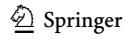

<!-- page 28 -->

- Polit, D. S., & Beck, C. T. (2010). *Essentials of nursing research. appraising evidence for nursing practice* (7th ed.). Lippincott Raven Publishers.
- Polkinghorne, D. E. (1989). Phenomenological research methods. In R. S. Valle & S. Halling (Eds.), *Exis**tential-phenomenological perspectives in psychology* (pp. 41–60). Springer.
- Pololi, L., Knight, S., & Dunn, K. (2004). Facilitating scholarly writing in academic medicine. *Journal of * *General Internal Medicine,* *19*(1), 64–68.
- Renton, L. (2017). Writing for publication; reconceptualizing disengagement. *Cadernos Brasileiros De Ter**apia Ocupacional*.[ https://doi.org/10.4322/0104-4931.ctoED2501](https://doi.org/10.4322/0104-4931.ctoED2501)
- Rosales, J., Moloney, C., Badenhorst, C., Dyer, J., & Murray, M. (2012). Breaking the barriers of research writing: Rethinking pedagogy for engineering graduate research. *Proceedings of the Canadian Engi**neering Education Association (CEEA)*. [https://doi.org/10.24908/pceea.v0i0.4663](https://doi.org/10.24908/pceea.v0i0.4663)
- Rose, M. (2009). *Writer's block: The cognitive dimension* (pp. 1–11). Southern Illinois University Press.
- Silvia, P. J. (2007). *How to write a lot: A practical guide to productive academic writing*. American Psychological Association.
- Şimşek, E. S., Atila, G., Aydın, A., Reisoğlu, İ, & Göktaş, Y. (2022). Comparison of theoretical frameworks of doctoral theses on the feld of instructional technology: The Turkey-US case. *Library & Information * *Science Research*.[ https://doi.org/10.1016/j.lisr.2022.101138](https://doi.org/10.1016/j.lisr.2022.101138)
- TÜBİTAK Ulakbim (2017). *Türkiye adresli bilimsel yayinlarin dergi performans göstergeleri * *(2016).*Retrieved from [https://cabim.ulakbim.gov.tr/wp-content/uploads/sites/4/2017/09/Dergi-incel](https://cabim.ulakbim.gov.tr/wp-content/uploads/sites/4/2017/09/Dergi-inceleme-2016_14-Eyl%c3%bcl-2017.pdf) [eme-2016_14-Eyl%c3%bcl-2017.pdf](https://cabim.ulakbim.gov.tr/wp-content/uploads/sites/4/2017/09/Dergi-inceleme-2016_14-Eyl%c3%bcl-2017.pdf)
- Wang, J., Tian, J., & Shen, Z. (2013). The efects and moderators of cyber-loafng controls: An empirical study of Chinese public servants. *Information Technology and Management,* *14*(4), 269–282. [https://](https://doi.org/10.1007/s10799-013-0164-y) [doi.org/10.1007/s10799-013-0164-y](https://doi.org/10.1007/s10799-013-0164-y)
- Wills, C. E. (2000). Strategies for managing barriers to the writing process. In P. S. Yoder-Wise (Ed.), *Nurs**ing forum* (Vol. 35, pp. 5–13). Blackwell Publishing Ltd.
- Yancey, N. R. (2016). The challenge of writing for publication: Implications for teaching-learning nursing. *Nursing Science Quarterly,* *29*(4), 277–282.[ https://doi.org/10.1177/0894318416662931](https://doi.org/10.1177/0894318416662931)

Springer Nature or its licensor holds exclusive rights to this article under a publishing agreement with the author(s) or other rightsholder(s); author self-archiving of the accepted manuscript version of this article is solely governed by the terms of such publishing agreement and applicable law.

