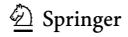
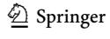
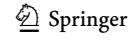
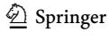
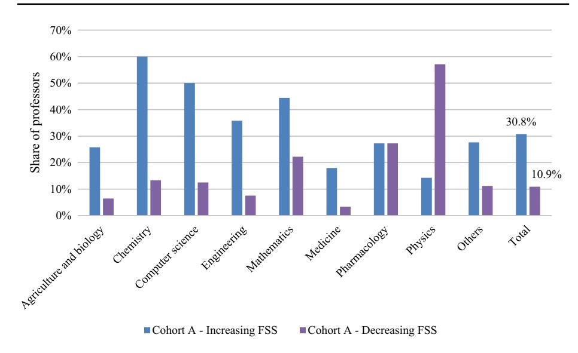
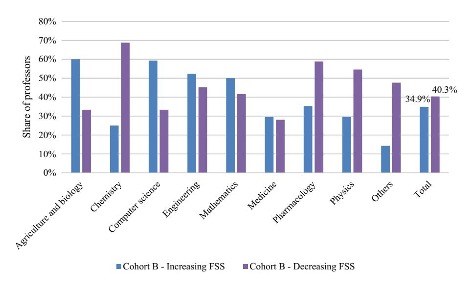
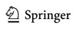
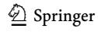
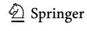
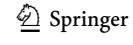

<!-- LR.R35 | source: papers_json/LR.R35/ -->

## **Assessing the efects of publication requirements ** **for professorship on research performance and publishing ** **behaviour of Ukrainian academics**

**Giovanni Abramo1** ******· Ciriaco Andrea D'Angelo1,2** ******· Myroslava Hladchenko****[3](http://orcid.org/0000-0002-2907-5124)**

Received: 24 November 2022 / Accepted: 23 May 2023 / Published online: 8 June 2023 © The Author(s) 2023

## **Abstract**

This article aims to explore the efects of Ukrainian policy reform, introducing Scopus and WoS publication requirements for professorship, on the publication behaviour and research performance of professors. Our analysis reveals a better scientifc profle, at the time of promotion, of those who obtained professorship after the reform as compared to those who obtained it before. Also, we observe a bandwagon efect since the research performance gap between the two observed cohorts decreased after the introduction of the publication requirements. The statistical diference in diferences tests revealed that in general, the incentive to produce more indexed publications worked. Nevertheless, it did not always led to higher research performance. Evidently, in several cases, the increase in research output was obtained at the expense of research impact. The efects of the reform could be far greater if combined with initiatives aimed at assessing Ukrainian professor performance regularly and extending the requirements and assessment to the impact of research.

**Keywords** Research policy · R&D management · Research evaluation · Professorship · Academia · Ukraine

## **Introduction**

Professors are expected, among others, to have a larger number of high-quality research works as compared to lower-rank academics. Nowadays most academic stakeholders tend to associate high-quality research with works published in journals indexed in Web of Science (WoS) or Scopus (Hicks, [2012](#page-18-0)). Indexed publications are those used to make world-university performance rankings. Shanghai Ranking uses WoS as a data source to measure research performance, while Times Higher Education and QS use Scopus as their

> ^*^ Myroslava Hladchenko hladchenkom@gmail.com; m.hladchenko@cwts.leidenuniv.nl

> ^1^ Laboratory for Studies in Research Evaluation, Institute for System Analysis and Computer Science (IASI-CNR), National Research Council of Italy, Rome, Italy

> ^2^ Department of Engineering and Management, University of Rome "Tor Vergata", Rome, Italy

<!-- page 2 -->

source. Consequently, several state authorities have introduced Scopus- and WoS- (S&W) indexed publication thresholds for doctoral degree, professorship, research funding allocation (Grancay et al., [2017;](#page-18-1) Hladchenko & Moed, [2021a)](#page-18-2). However, publishing in journals indexed in S&W does not necessarily imply high-quality research (Abramo et al., [2019a](#page-17-0), [2019b;](#page-17-1) Bornmann & Daniel, [2008](#page-18-3)). That is why the states that aim to increase research output without a decline in impact, give extra weight to impactful publication channels e.g. Norway (Bloch & Schneider, [2016](#page-17-2)), Spain (Jiménez-Contreras et al., [2003](#page-18-4)). Prior studies highlight that the incentive schemes linked to only the number of publications can result in academics increasing the number of publications by publishing in lower-impact journals, e.g. Australia (Butler, [2003a,](#page-18-5) [2003b](#page-18-6)), Denmark (Ingwersen & Larsen, [2014)](#page-18-7). Negative consequences of policies focused only on increasing the number of S&W publications are stronger in (semi-) peripheral scientifc countries that have recently introduced the requirements of publishing in S&W journals e.g. Ukraine (Nazarovets, [2020)](#page-19-0), Kazakhstan (Kuzhabekova & Ruby, [2018](#page-18-8)), Uzbekistan (Eshchanov et al., [2021)](#page-18-9), Vietnam (Pham-Duc et al., [2022)](#page-19-1), Turkey (Demir, [2018;](#page-18-10) Önder & Erdil,[ 2017](#page-19-2)).

This study aims to contribute to the body of knowledge on the impact of research policy reforms on the performance and publication behaviour of academics. Specifcally, it explores whether the introduction of S&W publication requirements for professorship in Ukraine resulted in increased research productivity[,1](#page-1-0) and changes in the publication behaviour of professors along several dimensions, namely intensity of publication, average impact, research collaboration, publication document type, and language. The following research questions can express the purpose of our work:

- RQ1: Had the academics who obtained professorship after the introduction of the S&W publication requirements a better scientifc profle than those who obtained it before?
- RQ2: Did the research performance gap between the two cohorts decrease after the introduction of the publication requirements (i.e. was there a bandwagon efect?)
- RQ3: Did the publication requirements determine an increase in the research performance of academics who obtained professorship after their introduction?

We focus our bibliometric analysis on professors in the STEM sciences.

The study is structured as follows. In the next section, we review the literature on the efects of research evaluation policies. In ["Ukrainian higher education system and publica](#page-3-0)[tion trends"](#page-3-0) section, we present the main traits of the higher education system in Ukraine. In ["Data and methods](#page-4-0)" section, we describe the indicators and methodologies adopted for the investigation, while the results are reported in ["Results](#page-7-0)" section. We discuss them and draw our conclusions in "[Discussion and conclusions"](#page-16-0) section.

<!-- page 3 -->

## **Efects of research assessment policies**

There is a rich literature on the efects of research evaluation policies on the individual behaviour of scientists both in Western (Abramo et al., [2019a](#page-17-0), [2019b](#page-17-1); Moher et al., [2018](#page-19-3); Schneider et al., [2016;](#page-19-4) Butler, [2003a](#page-18-5)) and non-Western societies (Grancay et al., [2017](#page-18-1); Good et al., [2015](#page-18-11); Hladchenko, [2022](#page-18-12)).

A stream of research focuses on the unintended efects often associated with the opportunistic behaviour within academies (De Rijcke et al., [2016;](#page-19-5) Pajic, [2015)](#page-19-6). Opportunistic behaviour may take diferent forms: (i) publishing more articles but of lowerquality by slicing the results of research to least publishable units (Weingart, [2005)](#page-20-0); (ii) signing papers without contributing to the research, also referred to as gift authorship (Kovacs, [2013](#page-18-13)); (iii) scientifc misconduct, i.e. altering research results to facilitate acceptance for publication; plagiarism; or inappropriate self-citation (Hazelkorn, [2010;](#page-18-14) Edwards & Roy, [2017](#page-18-15); Seeber et al., [2019](#page-19-7); Abramo et al., [2021)](#page-17-4).

Another stream of research investigates the efectiveness of research policy reforms and the relevant incentive systems put into place. Research performance evaluation schemes based on output quantity only, generally resulted in an increase in the number of publications on average in lower-impact journals e.g. Australia (Butler, [2003a](#page-18-5), [2003b](#page-18-6)), Indonesia (Rochmyaningsih, [2019)](#page-19-8), Kazakhstan (Kuzhabekova, [2019)](#page-18-16), Slovakia (Pisár & Šipikal, [2017](#page-19-9)), Turkey (Demir, [2018](#page-18-10)); of lower impact (Butler, [2003a](#page-18-5), [2003b](#page-18-6); Vanecek, [2014](#page-19-10)); and encoded in document types that are more easily published and less often cited than articles, e.g. proceedings papers (Vanecek & Pecha, [2020)](#page-19-11). In Uzbekistan, research assessment policies led the country to have the largest share of publications in journals discontinued from Scopus (59.67%) (Eshchanov et al., [2021)](#page-18-9). It has been also observed a growing trend to publishing in journals which generally use an open access mode to obtain fnancial gains without providing the expected publishing services and peer-review quality (Beall, [2015;](#page-17-5) Butler, [2013)](#page-18-17). Though this practice is more spread in scientifc (semi-)peripheral countries e.g. Turkey (Demir, [2018)](#page-18-10), Kazakhstan (Macháček & Srholec, [2021](#page-19-12)), Uzbekistan (Eshchanov et al., [2021](#page-18-9)), it is not infrequent in western scientifc countries either (Bagues et al., [2019;](#page-17-6) Moher et al.,[ 2018;](#page-19-3) NDR, [2018](#page-19-13)). Demir [(2018)](#page-18-10) revealed that 15.85% of the publications in 832 supposedly "predatory" journals explored by him were written by academics from developed countries.

Another efect is for academics to submit manuscripts to national journals or journals of neighbouring countries. This tendency is reported in Belgium (Ossenblok et al., [2012](#page-19-14)), Kazakhstan (Kuzhabekova, [2019)](#page-18-16), Central and Eastern European countries (Nazarovetz, [2020;](#page-19-0) Machacek & Srholec, [2017;](#page-19-15) Grancay et al., [2017;](#page-18-1) Pajic, [2015](#page-19-6); Pajic & Jevremov, [2014](#page-19-16)). The majority of S&W journals originate from western states but since 2000 Scopus and WoS have extended their coverage by noticeably increasing the number of the journals from non-western countries e.g. Latin America and the Caribbean (Collazo-Reyes,[ 2014;](#page-18-18) Chinchilla‐Rodríguez et al., [2015](#page-18-19)), Central and Eastern European countries (Grancay et al., [2017)](#page-18-1). Prior studies indicate that national S&W journals have a comparatively low impact (Collazo-Reyes,[ 2014;](#page-18-18) Grancay et al., [2017](#page-18-1)).

Other side-efects observed were discouraging research diversifcation, interdisciplinary and innovative research (Abramo et al., [2018;](#page-17-7) Hicks, [2012;](#page-18-0) Rafols et al., [2012;](#page-19-17) Wilsdon, [2015)](#page-20-1); and tilting time and energies from teaching to research activities (Enders et al., [2015](#page-18-20); De Philippis, [2021](#page-18-21)).

<!-- page 4 -->

## **Ukrainian higher education system and publication trends**

After the 1991 independence, the higher education system in Ukraine has gradually undergone marketisation, massifcation and internalisation (Oleksiyenko & Shchepetylnykova, [2021)](#page-19-18) but a signifcant part of the Soviet model has been preserved (Gomilko et al., [2016](#page-18-22); Oleksiyenko, [2016](#page-19-19); Shevchenko, [2019](#page-19-20).). Despite Ukraine joined the Bologna process in 2005, whereby the doctor of philosophy or PhD is the highest academic degree, the twolevel system of doctoral degrees remained unchanged. In Ukraine, PhD is the frst-level doctoral degree, obtained after four years of study by submitting and publicly defending a thesis and passing the required examinations. The second-level doctoral degree, Doctor of Sciences is comparable to "habilitation" in some western countries. It is awarded to candidates already holding a PhD, on the successful presentation and defence of the dissertation.[2](#page-3-1)

In addition to the two-level system of doctoral degrees, a two-level system of academic titles—docent (associate professor) and professor inherited from the Soviet model has also been preserved. The frst-level doctoral degree allows promotion to associate professor (docent), while the second-level doctoral degree allows promotion to professor. Doctoral degrees and academic titles involve extra payment to the salary of academics: 15% and 35% of a salary increase respectively for the PhD and Doctor of Sciences, and 25% and 33% for the scientifc titles of associate professor and professor (Ministry of Education and Science of Ukraine,[ 2005](#page-19-21)).[3](#page-3-2) Salaries of professors and other academic staf are regulated at the central level. As a rule, the salary of academics, including professors, does not depend on merit.

After 1991, publications in Ukrainian journals were required to obtain doctoral degrees and academic titles of associate professor and professor, as well as for the allocation of research funding and the state attestation of Ukrainian higher education institutions. Specifcally, publication requirements for the title of professor included textbooks and ten publications produced after the second-level doctoral thesis and published in Ukrainian journals from the list approved by the Ministry of Education and Science. An academic was required to have already the academic title of associate professor.[4](#page-3-3)

In 2013, publications in international journals and in Ukrainian journals indexed in S&W became a requirement to obtain doctoral degrees. In 2015, changes were made in publication requirements for academic titles, and it was announced that they would come into force in 2016. Specifcally, articles in S&W journals were also introduced into publication requirements for the academic titles of associate professor and professor. According to these requirements for the scientifc title of associate professor (professor), academics with a PhD (second-level doctoral degree) are required to have a fve-year (ten-year) work experience, an article (two articles) in an S&W journal, a B2 level English certifcate, and a study visit or participation in a conference or symposium in OECD countries or European

> ^2^ Part of this section has been extracted from Hladchenko ([2022)](#page-18-12).

> ^3^ Ministry of Education and Science of Ukraine [(2005](#page-19-21)). Decree on the remuneration of academics.[ https://](https://zakon.rada.gov.ua/laws/show/z1130-05#Text) [zakon.rada.gov.ua/laws/show/z1130-05#Text](https://zakon.rada.gov.ua/laws/show/z1130-05#Text), last access 16 November 2022.

> ^4^ Cabinet of Ministers of Ukraine: On the approval of the order of awarding the scientifc title of associate professor and professor,

<!-- page 5 -->

Union countries.[5](#page-4-1) The B2 level English certifcate can be substituted in both cases with 10 articles in S&W journals. Researchers afliated with the research institutes of the academies of sciences to be promoted to professor are required to have three articles in S&W journals and three successfully defended doctoral candidates.

More recently, the scope of application of publication requirements was extended. In 2018, articles in S&W journals became one of the requirements for the state attestation of Ukrainian higher education institutions.[6](#page-4-2) In 2019, publications in S&W journals were included among the criteria for assessing research projects applying for state funding[.7](#page-4-3)

A recent study on the research output of Ukrainian academics in Scopus highlights that the total number of publications has risen dramatically since 2011. However, frstly, the share of Q3+Q4 by SNIP[8](#page-4-4) exceeded Q1+Q2. Secondly, the share of publications in Ukrainian Scopus-indexed journals reached the peak of 47.3% in 2015. In the following years, it fell up to 31.8% in 2019 (Hladchenko, [2022)](#page-18-12). In 2016, Scopus indexed 47 Ukrainian journals, and in 2014–2016 publications by Ukrainian authors constituted 68.2% of overall publications in these journals (Hladchenko & Moed, [2021b](#page-18-23)).These fndings resonate with Nazarovets [(2020](#page-19-0)), who revealed that in 2015–2019, the most popular journals among Ukrainian authors, according to the number of publications, were journals of Ukrainian publishers and English-language translations of Ukrainian journals. CiteScor[e9](#page-4-5) values indicate that these are generally low impact journals. Furthermore, in 2011–2020 in the feld of Economics, Econometrics, and Finance, 47% of papers authored by Ukrainian academics were published in journals discontinued from Scopus (Nazarovets,[ 2022](#page-19-22)).

## **Data and methods**

To set up the dataset for the analysis, we performed the following steps. Initially, we extracted from the website of the Ministry of Education and Science of Ukraine[10](#page-4-6) data on all Ukrainian academics that were awarded the title of (full) professor in 2015–2018. The metadata included name, discipline based on the department of afliation, and year of awarding. We then classifed professors by discipline. From the compiled list of Ukrainian professors, we selected those in STEM disciplines (medicine, engineering,

> ^5^ Cabinet of Ministers of Ukraine (2015). Regulation on the awarding of scientifc degrees [https://zakon.](https://zakon.rada.gov.ua/laws/show/656-2015-%D0%BF#n11) [rada.gov.ua/laws/show/656-2015-%D0%BF#n11,](https://zakon.rada.gov.ua/laws/show/656-2015-%D0%BF#n11) last access 16 November 2022.

> ^6^ Cabinet of Ministers of Ukraine (2018). *Some issues of the state attestation of higher education institu**tions regarding research*, [https://zakon.rada.gov.ua/laws/show/652-2018-%2525D0%2525BF%23Text#Text,](https://zakon.rada.gov.ua/laws/show/652-2018-%2525D0%2525BF%23Text#Text) last access 16 November 2022.

> ^7^ Cabinet of Ministers of Ukraine (2019). On the approval of the order of competitive selection and fnancing by National Fund of Research of projects on research and development. [https://zakon.rada.gov.ua/laws/](https://zakon.rada.gov.ua/laws/show/1170-2019-%D0%BF#Text) [show/1170-2019-%D0%BF#Text,](https://zakon.rada.gov.ua/laws/show/1170-2019-%D0%BF#Text) last access 16 November 2022.

> ^8^ SNIP (source normalized impact per paper) is a type of measure of journal impact based on Scopus (Moed, 2010) vs the more popular JIF, journal impact factor, based on Web of Science.

> ^9^ Citescore is another type of journal evaluation metric launched in December 2016 by Elsevier as an alternative to the generally used JIF, calculated by Clarivate Analytics.

<!-- page 6 -->

computer science, physics, agricultural and biological sciences, psychology, material science, chemistry, mathematics, pharmacology, environmental science, health profession, biochemistry, genetics & molecular biology, veterinary, earth and planetary sciences). We excluded the social sciences and arts & humanities because the coverage of bibliographic repertories is still insufcient for a reliable representation of research output in these felds (Aksnes & Sivertsen, [2019](#page-17-8); Hicks, [1999](#page-18-24); Larivière et al., [2006)](#page-19-23). The fnal dataset is made of 805 professors.

Then, we manually retrieved the Scopus_ID of each professor of them. In doing so, we faced the formidable task of matching the Cyrillic name of each professor in the national register with the Latin name with which they are indexed in Scopus, e.g. Гoтькo Євгeн (Hotko Yevhen), Кaтюжинcькa Cвiтлaнa (Katyuzhynska Svitlana), Клiтинcькa Oкcaнa (Klitynska Oksana). While retrieving the Scopus_ID of each professor, we matched Ukrainian disciplines with the subject areas of Scopus. Based on Scopus_ID, we downloaded publications for each Ukrainian professor from our list. Table [1](#page-5-0) represents data on the number of academics in STEM who were awarded the

<!-- page 7 -->

title of professor in 2015 (458 in all) and 2016–2018 (347 in all) and their breakdown by discipline. For 116 professors (14.4% of the total 805) we were not able to identify any Scopus profiles. Among 2016–2018 professors, 19 show no publications in Scopus. The reason for that may be that the journals in which they published were indexed only in WoS but not in Scopus. As expected, the 2016–2018 cohort is more represented in Scopus (94.5% of awarded professors have a Scopus profile) than the 2015 one (78.8%).

At the discipline level, Medicine, Engineering, and Computer science account for over 50% of total observations. Note that in "Biochemistry, genetics and molecular biology" all 17 awarded academics have been identified in Scopus, while only 20 (out of 39) professors in Psychology have a Scopus profile.

We intend to assess each professor's research performance over a period of time and professors' publication behaviour. To the first aim, we recur to the Fractional Scientific Strength (FSS) indicator of research productivity, 11 defined as

$$ FSS = \sum_{i=1}^{N} \frac{c_i}{\bar{c}} f_i, \tag{1} $$

where c_i = citations received by publication i, \bar{c} = average of the distribution of citations received by all publications in the same year and Scopus subject area of publication i, f_i = fractional contribution of the professor to publication i, given by the inverse of the number of co-authors in the byline, N=number of publications12 of the professor in the period under observation. To investigate each professor's publication behaviour, we also measure single components of the FSS, that may be of some use in understanding which "dimension" mainly drives the performance. In particular, we will consider the following:

$$ Output = N (2) $$

$$ Fractional output = \sum_{i=1}^{N} f_i, (3) $$

$$ Average impact =\frac{1}{N}\sum_{i=1}^{N}\frac{c_i}{\overline{c}}. (4) $$

> ^&^lt;sup>11 A thorough explanation of the theory and assumptions underlying FSS can be found in Abramo and D'Angelo (2014).

> ^&^lt;sup>12 We exclude such document types as "erratum" and "retraction".

<!-- page 8 -->

Finally, we investigate the scientifc output by document type (article, review article, conference paper, book chapter), publication language, and professors' collaboration behaviour.

For each professor, we observe production in fxed publication windows of three years, before and after professorship, as shown in Table [2](#page-6-2). Publication and citation count date 30 April 2022.

To assess the efect of the 2016 publication requirement initiative in stimulating higher intensity of publication and productivity, we apply a diference in diferences statistical technique, whereby we contrast the after/before reform variations of 2015 awardees (Cohort A), not subject to the incentive, vs 2016–2018 awardees (Cohort B), subject to the incentive. For this analysis, the length of the observation periods varies according to the year the researchers obtained the professorship.

## **Results**

The 689 professors in the dataset authored in total, during their career to date, 14,679 unique publications indexed in Scopus, for a total of 15,186 authorships, obtained by multiple counting co-authorships of the same publication. Limiting the observation to the time windows shown in Table[ 2](#page-6-2), we count 5434 unique publications and 5735 authorships, 2481 (43.3%) of which relative to the period before the awarding and 3254 (56.7%) in the period after.

In the following, we report frst the descriptive analysis of research performance and publication behaviour at the aggregate and the individual levels, and then the statistical analysis to assess the cause-efect link between the publication requirement initiative and research performance.

> ^*^Those listed are all and only disciplines with at least ten observations in both cohorts

<!-- page 9 -->

## **The research performance and publication behaviour of the two cohorts ** **at the aggregate level**

Table [3](#page-7-1) reports a descriptive analysis at the aggregate level of the research performance of the two cohorts before and after promotion. It reveals that in the period before obtaining a professorship, Cohort B outperforms Cohort A in all disciplines. This means that at the time of promotion, the academics who became professors after the reform had a better scientifc profle than those promoted before (RQ1). This is evident in all disciplines, with a peak in Medicine.

Both Cohort A and B professors increased their average FSS in the three years after the professorship award in all disciplines but Physics (Cohort A) and Mathematics (Cohort B). The latter is the only discipline where Cohort A outperforms B after professorship. Among Cohort A, professors in Mathematics had the highest average FSS after. Finding the reasons for the above exceptions would require delving into the single disciplines through adhoc interviews.

Focusing attention on the variations of the performance gap between the two cohorts, we observe a bandwagon efect in most disciplines (RQ2). The performance gap between the two cohorts tends to decrease after professorship in all disciplines but Agricultural & biological sciences, Pharmacology, and Physics. As mentioned above, the interpretation of exceptions is not straightforward.

We now analyse the diferences in publication behaviour of the two cohorts along the three relevant FSS components (e.g. output, fractional output, average impact). In the next "[The efect of professorship on publication patterns"](#page-12-0) section, we move on to the other dimensions of the language of publication and collaboration behaviour.

Table [4 ](#page-9-0)shows that in the period before obtaining a professorship, Cohort B on average published more than Cohort A in all disciplines, even accounting for co-authors' contributions. Cohort B's supremacy also occurs by the average impact of publications, in all disciplines but Physics. After promotion, the same holds true per number of publications and fractional output, in all disciplines and per average impact in all disciplines but in Mathematics. The latter explains why in Mathematics, Cohorts A overcomes B per productivity (FSS) after promotion. The gap after-before between the two cohorts tends to decrease per average number of publications and fractional output in all disciplines but Pharmacology; and per average impact in all disciplines but Agriculture and biology, and Physics. Analysing the variations within the individual cohorts, it can be seen that for professors in Cohort A, output and fractional output increased in all disciplines but Pharmacology after promotion. The same applies to average impact with the exception, in this case, of Physics. As for Cohort B, after promotion the output increased on average in all disciplines but Chemistry. Fractional output decreased in Chemistry, Engineering, Medicine, and Physics. Finally, the average impact increased in all disciplines but Pharmacology.

## **The research performance and publication behaviour of the two cohorts ** **at the individual level**

In this subsection, we delve into the research performance and publication behaviour at the individual level. We analyse after-before variations on scores of research performance, output, fractional output, and average impact for each professor in the dataset.

<!-- page 10 -->

> ^*^Those listed are all and only disciplines with at least ten observations in both cohorts

<!-- page 11 -->

We start describing (Table [5](#page-9-1)) the share of professors in each "status" (productive and unproductive, by FSS)[13](#page-10-0) three years before and three after promotion. Only 19% of Cohort A professors result as productive both before and after the award, as against 55% of Cohort B professors. On the other side, the share of professors unproductive in both periods is 58.3% for Cohort A and 24.8% for Cohort B. Interestingly, 18.3% of professors in Cohort A change their status, passing from unproductive to productive after promotion. Only 4.4% of the same Cohort shows the opposite change. On the contrary, 7.8% of professors in Cohort B become productive after promotion, against 12.4% of those showing the opposite shift.

Table [6](#page-10-1) shows that referring to Cohort A professors the share of those experiencing an improvement in FSS after the promotion is higher than the share of those experiencing a worsening: 30.8% vs 10.9%, at the overall level. It must be noted that the remaining 58.3% are unproductive (FSS=0), both before and after promotion. A diferent situation emerges for Cohort B professors: at overall level 34.9% of them register an increase in FSS, against 40.3% registering a decrease (and 24.8% remaining unproductive). Looking at the single components of research performance, results are very similar: the percentage of professors in Cohort A experiencing an increase in the scores of the indicators (output, fractional output or average impact) is almost three times the percentage of those registering a decrease. At the same time, the two subsets are numerically equivalent for Cohort B. This shows a bandwagon efect of Cohort B on A.

At the discipline level, and limiting the focus to FSS, Fig. [1 ](#page-11-0)shows that for Cohort A, the share of professors experiencing an improvement in research performance is higher than the share of those experiencing a worsening in all disciplines but Physics. In Pharmacology, the percentage of professors improving their research performance is the same as those worsening it. Data in Fig. [2](#page-11-1) show that for Cohort B, in fve disciplines, the share of professors experiencing an improvement in research performance is higher than the share

<!-- page 12 -->

***Fig.** **1 **Share of professors awarded in 2015 registering an increase/decrease in FSS score after becoming professor, by discipline*

***Fig.** **2 **Share of professors awarded in 2016–2018 registering an increase/decrease in FSS score after becoming professor, by discipline*

of those experiencing a worsening. The opposite holds in the other three (Chemistry, Pharmacology and Physics).

<!-- page 13 -->

*Cohort A* professors awarded in 2015, *Cohort B* professors awarded in 2016–2018

*Cohort A* professors awarded in 2015, *Cohort B* professors awarded in 2016–2018

## **The efect of professorship on publication patterns**

We now move on to analyse the distribution of metadata of the publications in the dataset to highlight possible changes in publication patterns by professors. Table [7 ](#page-12-1)reports the breakdown of scientifc output by document type. It highlights that the increase in research output after academics were awarded the title of professor involved a significant growth in book chapters (+170.4%) and conference papers (+93.7%) and only a slight increase in articles and reviews (+12.7%). This occurs because publication requirements for promotion to professor include only S&W articles and academics are not motivated to publish any other publication types. Nevertheless, after being promoted to professor they increase their output through publications with laxer admission criteria.

Table [8 ](#page-12-2)reveals that the average number of co-authors has increased after promotion (+21.1%) from 6.49 to 7.86, mainly due to the increase recorded for cohort B

<!-- page 14 -->

(+31.3%), indicating an evident propensity for these professors to participate in larger research teams after promotion.

The share of publications resulting from international collaboration remained almost unchanged before and after the title of professor was awarded (Table [9)](#page-12-3), with a slight increase for Cohort A (from 27.4% before, to 30.2% after).

<!-- page 15 -->

Statistical signifcance: **p*-value<0.10, ***p*value<0.05, ****p*value<0.01

*Cohort A* professors awarded in 2015, *Cohort B|2017* professors awarded in 2017, *Cohort B|2018* professors awarded in 2018

Regarding the language of publication, after being awarded the title of professor, academics increased the share of publications in English and decreased the percentage of publications in Russian and Ukrainian (Table [10)](#page-13-0).

## **Impact of publications**

After obtaining the professorship, the average SNIP percentile, average CiteScore percentile, and average SJR percentile of academics' publications slightly decreased by 2.5%, 0.7%, and 1% respectively (Table [11)](#page-13-1).[14 ](#page-14-0)Conversely, the average Field-Weighted Citation Impact (FWCI) of their publications increased by 86.9%. In other words, the papers of academics published after they were awarded the title of professor received more citations than the papers that they published before, but their editorial placement slightly worsened. In particular, the share of Q1 publications decreased by 1.9% per SNIP, 3.2% per CiteScore, and 1.7% per SJR (Table[ 12)](#page-13-2).

Table [13 ](#page-13-3)shows that: i) the average FWCI increased for both cohorts after the introduction of the publication requirements; ii) it increased slightly more for Cohort A; and iii) the FWCI score recorded for Cohort B is always higher (both before and after) than that recorded for Cohort A. As for the impact of journals, for SNIP there is an average percentile increase for both cohorts, slightly higher for Cohort A (+3.9) than for Cohort B

> ^*2016–2017 ^vs 2014–2015 output of the two cohorts

> ^**2016–2018 ^vs 2013–2015 output of the two cohorts

<!-- page 16 -->

Statistical signifcance: **p*-value<0.10, ***p*value<0.05, ****p*-value<0.01

*Cohort A* professors awarded in 2015, *Cohort B|2017* professors awarded in 2017, *Cohort B|2018* professors awarded in 2018

(+1.3). Diferently, for the other two indicators (Citescore and SJR), the average percentile changes are negative for Cohort A and practically nihil for Cohort B.

## **The diference in diferences statistical analysis**

To assess the impact of the S&W publication requirements, announced in 2015 and become efective in 2016, on the intensity of publication and productivity of professors under analysis (RQ3), we adopted a diference in diferences statistical technique. In particular, we conducted an ANOVA test to verify if researchers of Cohort B (subject to the incentive of increasing S&W publications to obtain professorship), increased the number of S&W publications more than professors of Cohort A. Depending on the year of promotion, Cohort B professors can be divided into three subsets, those awarded in 2016 (B|2016), those awarded in 2017 (B|2017), and fnally those awarded in (B|2018). For Cohort B|2018, we tested diferences vs Cohort A in publication variations between the periods 2016–2018 and 2013–2015; for Cohort B|2017, between the periods 2016–2017 and 2014–2015. For robustness reasons, we run no test for Cohort B|2016, because for them the periods of analysis should have been limited to one year only, 2016 vs 2015.

Table [14 ](#page-14-1)shows the results of such two ANOVA tests and reveals that:

- All cohorts under analysis increased their S&W publications after the introduction of the publication requirements (*F*-values of the "period" variable, are high and statistically signifcant);
- The increases of Cohorts B|2017 and B|2018 were statistically higher than that of Cohort A.

> ^*2016–2017 ^vs 2014–2015 FSS, of the two cohorts

> ^**2016–2018 ^vs 2013–2015 FSS, of the two cohorts

<!-- page 17 -->

Increasing research output does not entail necessarily increasing the scholarly outcome of research activities. We, therefore, repeated the same analysis by productivity. Results reported in Table [15](#page-15-0) confrm an increase in productivity for all cohorts. The comparison between cohorts shows that the increases in productivity of Cohort B|2017 and B|2018 are higher than that of Cohort A, but statistical signifcance occurs only for Cohort B|2017 vs Cohort A.

## **Discussion and conclusions**

This study aimed to explore the efects of the introduction of S&W publication requirements for professorship in Ukraine on the research performance and publication behaviour of two cohorts of Ukrainian scholars.

The results of the study highlighted that the academics who became professors after the reform (Cohort B), at the time of promotion had a better scientifc profle than the colleagues who were promoted before it (Cohort A). In fact, before obtaining the professorship, the FSS of Cohort B professors exceeded the FSS of Cohort A, overall and in every single discipline. Both Cohorts A and B, increased their average FSS in the three years after the award of professorship, in all disciplines but Physics (Cohort A), and Mathematics (Cohort B). Cohort B outperforms Cohort A also in the years after promotion, with the only exception of professors in Mathematics. Cohort B professors outperform Cohort A also along each component of FSS, i.e. output, fractional output, and average impact. The only exceptions for this last indicator occur for professors in Physics (before promotion), and Mathematics (after promotion). As such publication requirements had negative efects on academics from Physics, whose FSS before changes in publication requirements was signifcantly higher in comparison with academics from other disciplines, maybe indicating that in this discipline, Ukrainian academic community is already highly developed and internationalised.

The bandwagon efect of Cohort B performance on that of Cohort A shows in the reduction of the performance gap after promotion in all disciplines but Agricultural & biological sciences, Pharmacology, and Physics. We ascribe it to a natural tendency to emulate better performers operating in the same institutional environment.

The analysis at the individual level reveals that the overall performance improvement is due to a small share of professors, 34.9% of Cohort B (40.3% registered a decrease) and 30.8% of Cohort A (10.9% registered a decrease). The high share of Cohort B professors experiencing a decrease in performance suggests that to avoid professors resting on their laurels and stimulate continuous improvement, periodic monitoring of performance and incentive systems based on it, should be considered by policymakers and university managers. This fndings resonate with Sasvari et al. ([2022)](#page-19-24) regarding the performance of professors in Hungary. Moreover, 24.8% of Cohort B professors, although producing enough publications to pass the quantitative requirements for promotion, produced no scholarly impact with those publications (zero citations).

The statistical diference in diferences tests revealed that in general the incentive to produce more S&W publications worked, but it did not always translate into higher research productivity which should be the ultimate aim of incentive schemes in research systems. Evidently, in several cases, the increase in S&W publications was obtained at the expense of research impact. It must be said that at the overall level, the average impact of

<!-- page 18 -->

publications authored by professors of the two cohorts increased following the awarding. Conversely, the editorial placement of the same publications slightly worsened.

We also found evidence that, before and after the introduction of S&W publication requirements, after being awarded the title of professor the production of book chapters and conference papers increased much more than the number of articles. This phenomenon too calls for the consideration of research evaluation policies involving the impact of research as the primary criterion for performance assessment.

These fndings support the earlier studies on research-evaluation policies which indicate that in order to prevent academics from increasing the number of publications at the expense of research impact, evaluation policies should give weight to impactful journals (Bloch & Schneider, [2016;](#page-17-2) Korytkowski & Kulczycki, [2019)](#page-18-25).

Finally, after introducing the S&W publication requirements, the percentage of publications resulting from international collaborations registered a slight increase. Still, a signifcant shift to publishing mainly in truly international English journals occurred.

To conclude, we warn the reader that all assumptions and limits of the bibliometric analysis apply when interpreting the results. First, the new knowledge produced is not only embedded in publications, and the bibliographic repertories (such as Scopus, used here) do not register all publications. Furthermore, the measurement of the value of publications using citation-based indicators is a prediction, not defnitive. Also, citations can also be negative or inappropriate; in any case they certify only scholarly impact, forgoing other types of impact.

**Open Access** This article is licensed under a Creative Commons Attribution 4.0 International License, which permits use, sharing, adaptation, distribution and reproduction in any medium or format, as long as you give appropriate credit to the original author(s) and the source, provide a link to the Creative Commons licence, and indicate if changes were made. The images or other third party material in this article are included in the article's Creative Commons licence, unless indicated otherwise in a credit line to the material. If material is not included in the article's Creative Commons licence and your intended use is not permitted by statutory regulation or exceeds the permitted use, you will need to obtain permission directly from the copyright holder. To view a copy of this licence, visit [http://creativecommons.org/licenses/by/4.0/.](http://creativecommons.org/licenses/by/4.0/)

## **References**

- Abramo, G., & D'Angelo, C. A. (2014). How do you defne and measure research productivity? *Scientomet**rics,* *101*(2), 1129–1144.
- Abramo, G., D'Angelo, C. A., & Di Costa, F. (2019a). When research assessment exercises leave room for opportunistic behaviour by the subjects under evaluation. *Journal of Informetrics,* *13*(3), 830–840.
- Abramo, G., D'Angelo, C. A., & Di Costa, F. (2018). Diversifcation versus specialization in scientifc research: Which strategy pays of? *Technovation,* *82–83*, 51–57.
- Abramo, G., D'Angelo, C. A., & Felici, G. (2019b). Predicting long-term publication impact through a combination of early citations and journal impact factor. *Journal of Informetrics,* *13*(1), 32–49.
- Abramo, G., D'Angelo, C. A., & Grilli, L. (2021). The efects of citation-based research evaluation schemes on self-citation behaviour. *Journal of Informetrics,* *15*(4), 101204.
- Aksnes, D. W., & Sivertsen, G. (2019). A criteria-based assessment of the coverage of Scopus and Web of Science. *Journal of Data and Information Science,* *4*(1), 1–21.
- Bagues, M., Sylos-Labini, M., & Zinovyeva, N. (2019). A walk on the wild side: 'Predatory' journals and information asymmetries in scientifc evaluations. *Research Policy,* *48*(2), 462–477.
- Beall, J. (2015). Criteria for determining predatory open-access publishers. *Scholarly Open Access*.
- Bloch, C., & Schneider, J. (2016). Performance-based funding models and researcher behaviour: An analysis of the infuence of the Norwegian publication indicator at the individual level. *Research Evaluation,* *25*(4), 371–382.

<!-- page 19 -->

- Bornmann, L., & Daniel, H. D. (2008). What do citation counts measure? A review of studies on citing behaviour. *Journal of Documentation,* *64*(1), 45–80.
- Butler, L. (2003a). Explaining Australia's increased share of ISI publications-the efects of a funding formula based on publication counts. *Research Policy,* *32*(1), 143–155.
- Butler, L. (2003b). Modifying publication practices in response to funding formulas. *Research Evaluation,* *12*(1), 39–46.
- Butler, D. (2013). The dark side of publishing. *Nature,* *495*(7442), 433–435.
- Chinchilla-Rodríguez, Z., Miguel, S., & de Moya-Anegón, F. (2015). What factors afect the visibility of Argentinean publications in humanities and social sciences in Scopus? Some evidence beyond the geographic realm of research. *Scientometrics,* *102*, 789–810.[ https://doi.org/10.1007/s11192-014-1414-4](https://doi.org/10.1007/s11192-014-1414-4)
- Collazo-Reyes, F. (2014). Growth of the number of indexed journals of Latin America and the Caribbean: The efect on the impact of each country. *Scientometrics,* *98*(1), 197–209.
- Demir, S. (2018). Predatory journals: Who publishes in them and why? *Journal of Informetrics,* *12*(4), 1296–1311.
- De Philippis, M. (2021). Multi-task agents and incentives: The case of teaching and research for university professors. *The Economic Journal,* *131*(636), 1643–1681.
- Edwards, M. A., & Roy, S. (2017). Academic research in the 21st Century: Maintaining scientifc integrity in a climate of perverse incentives and hypercompetition. *Environmental Engineering Science,* *34*(1), 51–61.
- Enders, J., Kehm, B. M., & Schimank, U. (2015). Turning universities into actors on quasi-markets: How new public management reforms afect academic research. In D. Jansen & I. Pruisken (Eds.), *The * *changing governance of higher education and research higher education dynamics. *Springer.
- Eshchanov, B., Abduraimov, K., Ibragimova, M., & Eshchanov, R. (2021). Efciency of "publish or perish" policy—Some considerations based on the Uzbekistan experience. *Publications,* *9*(3), 33.
- Gomilko, O., Svyrydenko, D., & Terepyschyi, S. (2016). Hybridity in the higher education of Ukraine: Global logic or local idiosyncrasy? *Philosophy and Cosmology,* *17*, 177–1999.
- Grancay, M., Vveinhardt, J., & Sumilo, E. (2017). Publish or perish: How Central and Eastern European economists have dealt with the ever-increasing academic publishing requirements 2000–2015. *Sci**entometrics,* *111*(3), 1813–1837.
- Good, B., Vermeulen, N., Tiefenthaler, B., & Arnold, E. (2015). Counting quality? The Czech performancebased research funding system. *Research Evaluation, 24*(2), 91–105.
- Hazelkorn, E. (2010). Pros and cons of research assessment. In *World social science report, 2010: * *knowledge divides,* pp. 255–258. Paris: UNESCO Press. ISBN 978-92-3-104131-0.
- Hicks, D. (2012). Performance-based university research funding systems. *Research Policy,* *412*, 251–326.
- Hicks, D. (1999). The difculty of achieving full coverage of international social science literature and the bibliometric consequences. *Scientometrics,* *44*(2), 193–215.
- Hladchenko, M., & Moed, H. F. (2021a). The efect of publication traditions and requirements in research assessment and funding policies upon the use of national journals in 28 post-socialist countries. *Journal of Informetrics,* *15*(4), 101190.
- Hladchenko, M., & Moed, H. F. (2021b). National orientation of Ukrainian journals: Means-ends decoupling in a semi-peripheral state. *Scientometrics,* *126*(3), 2365–2389.
- Hladchenko, M. (2022). Implications of publication requirements for the research output of Ukrainian academics in Scopus in 1999–2019. *Journal of Data and Information Science,* *7*(3), 71–93.
- Ingwersen, P., & Larsen, B. (2014). Infuence of a performance indicator on Danish research production and citation impact 2000–12. *Scientometrics,* *101*, 1325–1344.
- Jiménez-Contreras, E., de Moya Anegón, F., & López-Cózar, E. D. (2003). The evolution of research activity in Spain: The impact of the National Commission for the Evaluation of Research Activity (CNEAI). *Research policy, 32*(1), 123–142
- Korytkowski, P., & Kulczycki, E. (2019). Examining how country-level science policy shapes publication patterns: The case of Poland. *Scientometrics,* *119*(3), 1519–1543.
- Kovacs, J. (2013). Honorary authorship epidemic in scholarly publications? How the current use of citation-based evaluative metrics make (pseudo) honorary authors from honest contributors of every multi-author article. *Journal of Medical Ethics,* *39*(8), 509–512.
- Kuzhabekova, A. (2019). The development of university research in Kazakhstan during 1991–2013: A bibliometric view. In I. Silova & S. Niyozov (Eds.), *Globalization on the margins Education and * *post-socialist transformations in Central Asia. *Palgrave Macmillan.
- Kuzhabekova, A., & Ruby, A. (2018). Impact factor publication requirement in Kazakhstan. *European * *Education,* *50*(3), 266.

<!-- page 20 -->

- Larivière, V., Archambault, É., Gingras, Y., & Vignola-Gagné, É. (2006). The place of serials in referencing practices: Comparing natural sciences and engineering with social sciences and humanities. *Journal of the American Society for Information Science and Technology,* *57*(8), 997–1004.
- Machacek, V., & Srholec, M. (2017). *Local journals in Scopus*. [https://knihovna.upce.cz/sites/default/](https://knihovna.upce.cz/sites/default/files/idea_studie_17_2017_mistni_casopisy_ve_scopusu_92793.pdf) [fles/idea_studie_17_2017_mistni_casopisy_ve_scopusu_92793.pdf.](https://knihovna.upce.cz/sites/default/files/idea_studie_17_2017_mistni_casopisy_ve_scopusu_92793.pdf) Aaccess 16 November 2022
- Macháček, V., & Srholec, M. (2021). RETRACTED ARTICLE: Predatory publishing in Scopus: Evidence on cross-country diferences. *Scientometrics,* *126*(3), 1897–1921.
- Ministry of Education and Science of Ukraine. (2005). *Decree on the remuneration of academics*. [https://zakon.rada.gov.ua/laws/show/z1130-05#Text.](https://zakon.rada.gov.ua/laws/show/z1130-05#Text) Access 16 November 2022
- Moher, D., Naudet, F., Cristea, I. A., Miedema, F., Ioannidis, J. P., & Goodman, S. N. (2018). Assessing scientists for hiring, promotion, and tenure. *PLoS Biology,* *16*(3), e2004089.
- Nazarovets, S. (2022). Analysis of publications by authors of Ukrainian institutes in Scopus-delisted titles. *Learned Publishing*. [https://doi.org/10.1002/leap.1464](https://doi.org/10.1002/leap.1464)
- Nazarovets, S. (2020). Letter to the editor: Controversial practice of rewarding for publications in national journals. *Scientometrics,* *124*(1), 813–818.
- NDR. (2018). More than 5,000 German scientists have publishedpapers in pseudo-scientifc journals [Web log post]. Retrieved from [https://www.ndr.de/der_ndr/presse/More-than-5000-German-scien](https://www.ndr.de/der_ndr/presse/More-than-5000-German-scientists-have-published-papers-in-pseudo-scientific-journals,fakescience178.html) [tists-have-published-papers-in-pseudo-scientifc-journals,fakescience178.html](https://www.ndr.de/der_ndr/presse/More-than-5000-German-scientists-have-published-papers-in-pseudo-scientific-journals,fakescience178.html)
- Oleksiyenko, A. (2016). Higher education reforms and center-periphery dilemmas: Ukrainian universities between neo-Soviet and neo-liberal contestations. In *Globalisation and higher education * *reforms* (pp. 133–148). Springer, Cham.
- Oleksiyenko, A. V., & Shchepetylnykova, I. (2021). International students and ukrainian universities: Dilemmas of agency and change. *International Studies in Sociology of Education*, [https://doi.org/10.](https://doi.org/10.1080/09620214.2021.1995777) [1080/09620214.2021.1995777](https://doi.org/10.1080/09620214.2021.1995777)
- Önder, Ç., & Erdil, S. E. (2017). Opportunities and opportunism: Publication outlet selection under pressure to increase research productivity. *Research Evaluation,* *26*(2), 66–77.
- Ossenblok, T. L., Engels, T. C., & Sivertsen, G. (2012). The representation of the social sciences and humanities in the Web of Science: A comparison of publication patterns and incentive structures in Flanders and Norway (2005–9). *Research Evaluation,* *21*(4), 280–290.
- Pajic, D. (2015). Globalization of the social sciences in Eastern Europe: Genuine breakthrough or a slippery slope of the research evaluation practice? *Scientometrics,* *102*, 2131–2150.
- Pajic, D., & Jevremov, T. (2014). Globally national—locally international: Bibliometric analysis of a SEE psychology journal. *Psychologija,* *47*(2), 263–277.
- Rijcke, S. D., Wouters, P. F., Rushforth, A. D., Franssen, T. P., & Hammarfelt, B. (2016). Evaluation practices and efects of indicator use: A literature review. *Research Evaluation,* *25*(2), 161–169.
- Pham-Duc, B., Tran, T., Trinh, T. P. T., Nguyen, T. T., Nguyen, N. T., & Le, H. T. T. (2022). A spike in the scientifc output on social sciences in Vietnam for recent three years: Evidence from bibliometric analysis in Scopus database (2000–2019). *Journal of Information Science,* *48*(5), 623–639.
- Pisár, P., & Šipikal, M. (2017). Negative efects of performance based funding of universities: The case of Slovakia. *Nispacee Journal of Public Administration and Policy,* *10*(2), 171–189.
- Rafols, I., Leydesdorf, L., O'Hare, A., Nightingale, P., & Stirling, A. (2012). How journal rankings can suppress interdisciplinary research: A comparison between Innovation Studies and Business & Management. *Research Policy,* *41*(7), 1262–1282.
- Rochmyaningsih, D. (2019). How to shine in Indonesian science? *Game the System. Science,* *363*(6423), 111–112.
- Sasvari, P., Bakacsi, G., & Urbanovics, A. (2022). Scientifc career tracks and publication performancerelationships discovered in the Hungarian academic promotion system. *Heliyon,* *8*(3), e09159.
- Schneider, J., Aagaard, K., & Bloch, C. (2016). What happens when national research funding is linked to diferentiated publication counts? a comparison of the australian and norwegian publication-based funding models. *Research Evaluation, 25*(3), 244–256.
- Seeber, M., Cattaneo, M., Meoli, M., & Malighetti, P. (2019). Self-citations as strategic response to the use of metrics for career decisions. *Research Policy,* *48*(2), 478–491.
- Shevchenko, V. V. (2019). The reform of the higher education of Ukraine in the conditions of the militarypolitical crisis. *International Journal of Educational Development,* *65*, 237–253.
- Vanecek, J. (2014). The efect of performance-based research funding on output of R&D results in the Czech Republic. *Scientometrics,* *98*, 657–681.
- Vanecek, J., & Pecha, O. (2020). Fast growth of the number of proceedings papers in atypical felds in the Czech Republic is a likely consequence of the national performance-based research funding system. *Research Evaluation,* *29*(3), 245–262.

<!-- page 21 -->

Weingart, P. (2005). Impact of bibliometrics upon the science system: Inadvertent consequences? *Sciento**metrics, 62*(1), 117–131. [https://doi.org/10.1007/s11192-005-0007-7](https://doi.org/10.1007/s11192-005-0007-7)

Wilsdon, J. (2015). The metric tide: Independent review of the role of metrics in research assessment and management. *Sage*. [https://doi.org/10.4135/9781473978782](https://doi.org/10.4135/9781473978782)

