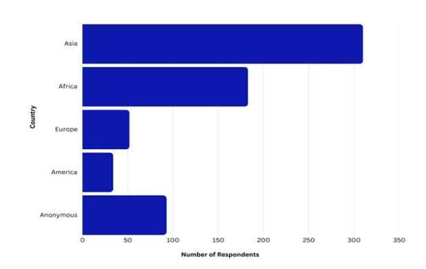
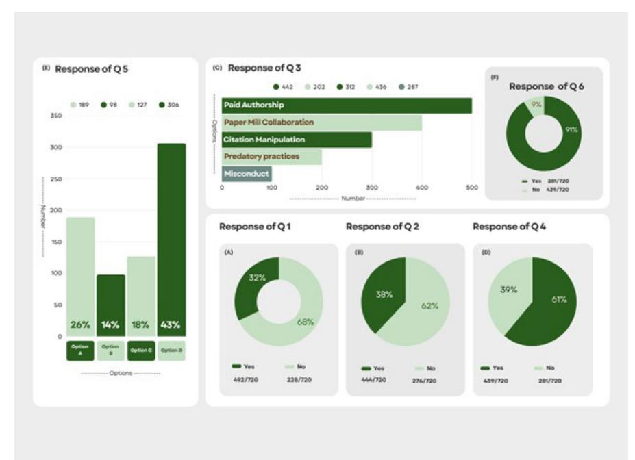

<!-- LR.R39 | source: papers_json/LR.R39/ -->

## Publication Pressure vs Research Integrity: Global Insights from an Asian Council of Science Editors Survey

## Maryam Sayab, Lisa M DeTora, and Muhammad Sarwar

## Abstract

A survey conducted by the Asian Council of Science Editors (ACSE) investigates how publication metrics may influence academic research integrity. With input from 720 researchers worldwide, the findings highlight a critical tension between metric-driven academic pressures and ethical research conduct. A notable proportion of respondents reported feeling compelled to compromise ethical standards, citing practices such as paid authorship, predatory publishing, and data falsification. Institutional incentives and publication requirements emerged as major contributing factors. Despite these concerns, there is strong momentum for reform, especially toward quality- and impact-based research evaluations. This article frames the findings in the broader context of academic culture and offers actionable recommendations for stakeholders, researchers, institutions, and publishers to collaboratively restore integrity at the heart of scholarly work.

## Introduction

The academic imperative to publish, often captured by the phrase "publish or perish," has become a global phenomenon, exerting significant pressure on researchers at every career stage.1 From graduate students to senior

Maryam Sayab (https://orcid.org/0000-0001-7695-057X) is with Asian Council of Science Editors, Lisa M DeTora (https:// orcid.org/0000-0001-5348-2638) is with Hofstra University, and Muhammad Sarwar (https://orcid.org/0000-0001-9537-2541) is with Asian Council of Science Editors.

Opinions expressed are those of the authors and do not necessarily reflect the opinions or policies of their employers, the Council of Science Editors, or the Editorial Board of Science Editor.

https://doi.org/10.36591/SE-4803-05

faculty, the volume and frequency of publications are frequently tied to hiring decisions, promotions, funding, and institutional rankings. While these expectations aim to promote productivity and visibility, they can also blur the line between ethical scholarship and opportunistic behavior.1-4

In environments where institutional metrics reward quantity over quality, researchers may find themselves navigating a landscape fraught with ethical dilemmas. Practices such as guest authorship, submitting to predatory journals, or even manipulating data can arise not from a lack of awareness, but from systemic pressures embedded in academic evaluation structures.5-8 While much of the existing literature has explored these dynamics in the context of Western institutions, there is a growing need to examine how these forces manifest in more diverse global settings, particularly in regions where research ecosystems are still evolving or under-resourced.

To fill this gap, the ACSE initiated a global survey to capture the perspectives of researchers on the impact of publication-driven metrics on research integrity. With 720 responses spanning multiple countries and disciplines, the survey offers a rare and timely look at how structural incentives, publication practices, and ethical considerations intersect. This article unpacks those findings, highlighting both the challenges and opportunities for reform, and proposes actionable pathways for institutions, publishers, and policymakers to recenter integrity within the scholarly publishing ecosystem.

## Methodology

## *Survey Instrument Development and * *Content*

The authors deployed an anonymous online survey to investigate the perceived influence of publication pressure on research integrity. The survey instrument consisted of 6 questions (Table), grouped thematically: influence of

<!-- page 2 -->

metrics, ethical compromises, prevalence of misconduct, institutional drivers, and reform solutions.

## *Survey Respondents*

The survey was distributed through the official communication channels of the ACSE, targeting its members and affiliates, including sister organizations and scholarly publishing networks. The majority of ACSE members are researchers, editors, and professionals actively engaged in academic publishing. To help contextualize responses and ensure data quality, participants were asked to provide their name and institutional affiliation. While formal identity verification was not conducted, this information allowed us to reasonably verify that the majority of respondents were affiliated with research institutions or scholarly roles.

## *Participant Recruitment and Data Collection*

Data were collected from February 15 to March 31, 2025, through a Zoom global online survey platform. Participants were recruited via the following:

- Direct email invitations sent to ACSE membership
- Scholarly mailing lists of ACSE contacts
- Professional social media outreach (via LinkedIn)

Participation was voluntary, with informed consent obtained online. The survey materials clearly stated that all responses would be kept anonymous and confidential.

## Results

The survey received 720 completed responses. Respondents represented diverse disciplines (e.g., life sciences,

engineering, medicine, humanities), multiple regions (notably South Asia, Middle East, Africa) (Figure 1), and various career stages from early-career researchers to senior faculty.

## *Geographic Distribution of Respondents*

The distribution of responses by region reveals a strong representation from Asia (310) and Africa (183), indicating significant engagement from these areas, as consistent with ACSE membership. In contrast, participation from Europe (52) and the Americas (34) was less pronounced. Notably, 93 responses were categorized as "Anonymous" due to a lack of provided location information. The regional disparities in response rates warrant consideration when interpreting the overall findings.

The most represented nations were India (128) and Nigeria (86). Responses were also provided by researchers in Bahrain, Benin, Cambodia, Chile, Colombia, Croatia, Czechia, Gabon, Georgia, Ghana, Greece, Guinea, Guyana, Hong Kong, Ireland, Japan, Jordan, Libya, the Netherlands, Norway, Oman, Portugal, the Republic of Korea, Rwanda, Serbia, Sierra Leone, Slovakia, Slovenia, Switzerland, Syria, Taiwan, Tanzania, Thailand, Togo, Ukraine, UK, United States, Yemen, and Zimbabwe (Figure 2, online only).

## *Survey Questions Overview*

The visual representation of survey responses shown in Figure 3 highlights both the strength and the consistency of the trends observed.

The survey results (Total Responses = 720, Duration = 46 days, Anonymous = 93, Countries = 88) highlight a complex interplay of factors related to publication pressure

<!-- page 3 -->

## *CONTINUED*

***Figure 1. **Geographic distribution of survey respondents, grouped by region (n = 720). This bar chart displays the total number of respondents from each major geographic region. The "Anonymous" category indicates responses where the country of affiliation was not provided.*

and research integrity. While a majority of respondents did not perceive a negative influence of publication metrics on their research approach (A: 68% No) and did not report feeling pressured to compromise integrity (B: 62% No), a significant minority expressed concerns in both areas (A: 32% Yes; B: 38% Yes). Awareness of unethical practices was widespread, particularly concerning "Paid Authorship" and "Predatory Practices" (C), and a majority of researchers believed that institutional requirements contribute to these unethical behaviors (D: 61% Yes). The most favored change to reduce pressure was a shift toward research quality and real-world impact (E), and there was overwhelming support

for a global reform initiative (F: 91% Yes). These findings underscore the need to address systemic issues within the research environment to promote ethical conduct and prioritize impactful scholarship

## Discussion

The ACSE survey collected a total of 720 responses from a globally diverse community of researchers, editors, and professionals in the scholarly publishing ecosystem. The results offered valuable insights into participant awareness, opinions, and perceptions surrounding ethical publishing practices. While the survey achieved a broad international reach, the geographic distribution of respondents was skewed toward certain regions, with a notably high number of responses originating from India and Nigeria.

Our study revealed significant pressure to publish among respondents, with a notable proportion reporting pressure to compromise ethical standards to meet publication demands. The strong representation of researchers from India and Nigeria, as highlighted in Figure 1, provides valuable insights into settings that are often underrepresented in the existing literature on this subject. This global survey also explores the perceived influence of publication pressure on research integrity, revealing a multifaceted and concerning picture of how academic pressures shape research behavior, integrity, and attitudes toward ethical practices.

As illustrated in Figure 3A, a substantial proportion of respondents (32%, 228/720) acknowledged that the emphasis on publication metrics, such as journal impact

***Figure 3. **Visual representation of survey responses.*

<!-- page 4 -->

factor and indexing, negatively influenced their research approach. This finding underscores a growing concern that metric-driven evaluation systems may distort academic priorities, shifting focus from genuine inquiry to performancebased outputs.4 This perception validates longstanding critiques of metric-centric academic environments, which many argue foster superficial output rather than meaningful scholarly contributions.5-7

Furthermore, 38% of respondents (276/720) admitted to feeling pressured to compromise research integrity due to publication demands (Figure 3B). This substantial minority reflects a worrying trend that merits serious attention. This finding aligns with existing literature suggesting that the "publish or perish" culture, often driven by funding criteria and career advancement metrics, may encourage shortcuts or unethical research practices.8,9 Such pressures can lead to a normalization of deviant practices, ultimately undermining the reliability of the scholarly record.10,11

A widespread awareness of unethical practices within the academic community was also evident. More than half of participants reported awareness of practices such as paying for authorship (62%, 432/720), submitting to predatory journals (60%, 423/720), and data fabrication/falsification (40%, 282/720) (Figure 3C). This normalization of unethical conduct suggests a systemic issue within the scholarly ecosystem, where exposure can lead to desensitization and eventual acceptance.12 The prominence of predatory journals is especially troubling, given their role in undermining peer review and disseminating unvetted research.13,14

The study also sheds light on the role of institutional culture in shaping researcher behavior.15 A majority of respondents (61%, 439/720) believed that institutional publication requirements have contributed to unethical practices in academia (Figure 3D). This suggests that evaluation systems designed to reward quantity over quality may unintentionally encourage questionable research practices.16 As Healey notes, performance-based funding models often intensify these pressures, calling for a critical reevaluation of how institutions assess academic merit.17

Despite these concerns, the survey revealed a strong appetite for reform. When asked about potential solutions to reduce publication pressure, the most favored response was a shift toward prioritizing research quality and realworld impact (42%, 297/720) (Figure 3E). This preference aligns with broader efforts in the scholarly community, such as the San Francisco Declaration on Research Assessment (DORA),18 which advocates abandoning journal-based metrics in favor of more holistic and meaningful research evaluation.6

Support for reform extends beyond individual preferences, as demonstrated by the overwhelming

majority of respondents endorsing a global initiative aimed at revising academic evaluation criteria (91%, 636/720) (Figure 3F). This broad consensus underscores the urgency of structural change to foster an ethical, transparent, and impactful research culture.19,20

Interestingly, respondents favored a phased approach to reform, recognizing the complexities involved in transforming entrenched academic systems (69%, 482/720). Gradual implementation allows for inclusive stakeholder engagement, systematic learning, and long-term sustainability.21-23

## *Key Implication*

The current academic environment, with its heavy emphasis on publication metrics, appears to be generating pressures that can compromise research integrity. This reinforces the urgent need for institutions to reassess how performance is measured and rewarded, ensuring these mechanisms will promote ethical behavior rather than incentivize misconduct.

Encouragingly, the research community appears both aware of and supportive toward reform initiatives that prioritize research quality and societal impact over sheer publication volume.

## *Further Considerations*

While this survey provides a valuable global snapshot, further analysis could yield even deeper insights. Exploring how variables like career stage, research discipline, or geographic location influence pressures and ethical compromises would deepen our understanding. Moreover, the qualitative data collected through open-ended survey responses offer an untapped opportunity to understand the nuanced, lived realities behind the statistics, particularly the specific forms of pressure researchers encounter and the coping strategies they employ. Future research might also consider cross-disciplinary comparisons and targeted case studies to supplement these findings.

## Conclusion

The ACSE Global Survey reveals some serious concerns among the researchers and editors who responded to our survey. While the majority of researchers remain committed to ethical principles, a significant minority report facing pressures that threaten to undermine the integrity of scientific inquiry. These pressures are not isolated missteps, but rather the byproducts of deeply embedded systemic factors, especially institutional evaluation practices that elevate publication metrics above meaningful scholarly contribution.

Researchers are sending a clear message: the academic reward system is overdue for reform. Sustaining research excellence requires shifting priorities toward quality, societal value, and ethical rigor.

<!-- page 5 -->

## *CONTINUED*

To realize this vision, the following actions must guide future efforts:

- Reform academic evaluation systems to reward quality over quantity.
- Integrate ethics and research integrity training across all career stages.
- Strengthen policies against predatory publishing.
- Support global initiatives such as DORA and COPE for responsible research assessment.
- Recognize and value methodological rigor, replication studies, and negative results.

Scientific integrity is not self-sustaining; it is a collective responsibility that demands continuous commitment from researchers, institutions, funders, and publishers alike. The ACSE's findings offer both a warning and an invitation to rethink how academic success is defined and to ensure that integrity remains the cornerstone of scholarly progress.

## References and Links

- 1. Lubowitz JH, Matzkin E, Rossi MJ. Troubling trends in biomedical research publication:"publish or perish" results in a propensity for ethical violations. Arthroscopy. 2025;41:859–862. https://doi. org/10.1016/j.arthro.2024.12.017.
- 2. O'Rorke R, White C, Bhujel N. The rise of predatory publishing and journals. British Dental Journal. 2024;237:699–700. https://doi. org/10.1038/s41415-024-8006-3.
- 3. Nazarovets S. Dealing with research paper mills, tortured phrases, and data fabrication and falsification in scientific papers. In: Joshi PB, Churi PP, Pandey M, editors. Scientific publishing ecosystem: an author-editor-reviewer axis. Springer; 2024. p. 233–254. https:// doi.org/10.1007/978-981-97-4060-4_14.
- 4. Şener HS, Kaya İS, Köksal MS, Taşkın Z. Closing the door behind: metric-based research evaluation systems and gatekeeping towards young researchers. Scientometrics. 2025;130:2291–2310. https://doi.org/10.1007/s11192-025-05282-6.
- 5. Smith R. Medical journals are an extension of the marketing arm of pharmaceutical companies. PLOS Med. 2005;2:e138. https://doi. org/10.1371/journal.pmed.0020138.
- 6. Kalita D. Research metrics: trends and opportunities. In: Ahuja VK, Baishya K, editors. Research and publication ethics. National Law University and Judicial Academy; 2024. 362–383.
- 7. Öztürk O, Taşkın Z. How metric-based performance evaluation systems fuel the growth of questionable publications? Scientometrics. 2024;129:2729–2748. https://doi.org/10.31219/osf.io/8xbgj.
- 8. Kearney M, Downing M, Gignac EA. Research integrity and academic medicine: the pressure to publish and research

- misconduct. J Osteopath Med. 2024;124:187–194. https://doi. org/10.1515/jom-2023-0211.
- 9. Sørensen MP, Lambert M, Ravn T. "Whoever has the most publications win": time pressure, accelerated research processes and research integrity in contemporary academia. Research Square. 2024. https://doi.org/10.21203/rs.3.rs-4467477/v1.
- 10. Fanelli D. How many scientists fabricate and falsify research? A systematic review and meta-analysis of survey data. PLOS ONE. 2009;4:e5738. https://doi.org/10.1371/journal.pone.0005738.
- 11. Muthanna A, Chaaban Y, Qadhi S. A model of the interrelationship between research ethics and research integrity. Int J Qual Stud Health Well-being. 2024;19:2295151. https://doi.org/10.1080/174826 31.2023.2295151.
- 12. Ayala-Enríquez P, Guerrero-Dib J. Moral disengagement leading to social acceptance of academic misconduct: a predictor of behavior. In: Eaton SE, editor. Second handbook of academic integrity. Springer International handbooks of education. Springer; 2024. p. 409–432. https://doi.org/10.1007/978-3-031-54144-5_102.
- 13. Grudniewicz A, Moher D, Cobey KD, Bryson GL, Cukier S, Allen K, Ardern C, Balcom L, Barros T, Berger M, et al. Predatory journals: no definition, no defence. Nature. 2019;576:210–212. https://doi. org/10.1038/d41586-019-03759-y.
- 14. Dano G. Spotting predatory journals: a review. CMU J Sci. 2024;28:108–116. https://doi.org/10.52751/cmujs.2024.v28i2.b5xhb546.
- 15. Arabdji I. The effectiveness of cultural values in shaping the organizational behavior of workers in the institution. El-ihyaa J. 2024;24:505–518.
- 16. Gärtner A, Leising D, Schönbrodt FD. Towards responsible research assessment: how to reward research quality. PLOS Biology. 2024;22:e3002553. https://doi.org/10.1371/journal.pbio.3002553.
- 17. Shattock M. The change from private to public governance of British higher education: its consequences for higher education policy making 1980–2006. Higher Educ Qual. 2008;62:181–203. https://doi.org/10.1111/j.1468-2273.2008.00392.x.
- 18. https://sfdora.org/
- 19. Asogwa VC. Global best practices in education: a conceptual definition and criticisms. J Res Initiatives. 2024;8(3):9.
- 20. Scheiner T, Brodie K, Planas N, Darragh L, Halai A, Potari D, Santos-Trigo M, Walkoe J. Addressing equity, diversity and inclusion in academic publishing: key initiatives from JMTE. J Math Teacher Educ. 2024:1–11. https://doi.org/10.1007/s10857-024-09636-4.
- 21. Tangwe AT, Benyin PK. Reimagining critical interdisciplinarity. Shifting from the traditional to the transformative paradigm in higher education research and learning. 2025;8:65–98. http://doi. org/10.37502/IJSMR.2025.8104.
- 22. Kaiser M, Gluckman P. Are scientific assessments and academic culture impeding transformative science? Sustain Sci. 2025;20:1109–1116. https://doi.org/10.1007/s11625-025-01631-9.
- 23. Vieira Nunhes T, Espuny M, Lauá Reis Campos T, Santos G, Bernardo M, Oliveira OJ. Guidelines to build the bridge between sustainability and integrated management systems: a way to increase stakeholder engagement toward sustainable development. Corporate Soc Respons Environ Manag. 2022;29:1617–1635. https:// doi.org/10.1002/csr.2308.
