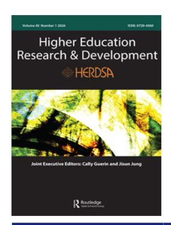

<!-- LR.R42 | source: papers_json/LR.R42/ -->

## **Higher** **Education** **Research** **&** **Development**

**ISSN: 0729-4360 (Print) 1469-8366 (Online) Journal homepage:****[ www.tandfonline.com/journals/cher20](https://www.tandfonline.com/journals/cher20?src=pdf)**

## **The** **impact** **of** **the** **'publish** **or** **perish'** **culture** **on** **research** **practices** **and** **academic** **life** **in** **Kazakhstan: challenges and consequences in the** **age** **of** **global** **university** **rankings**

## **Aigerim** **Bayanbayeva**

**To** **cite** **this** **article:** Aigerim Bayanbayeva (2026) The impact of the 'publish or perish' culture on research practices and academic life in Kazakhstan: challenges and consequences in the age of global university rankings, Higher Education Research & Development, 45:1, 1-15, DOI: [10.1080/07294360.2025.2526051](https://www.tandfonline.com/action/showCitFormats?doi=10.1080/07294360.2025.2526051)

**To** **link** **to** **this** **article:** [https://doi.org/10.1080/07294360.2025.2526051](https://doi.org/10.1080/07294360.2025.2526051)

| © 2025 The Author(s). Published by Informa UK Limited, trading as Taylor & Francis Group |
| --- |
| Published online: 10 Jul 2025. |
| Submit your article to this journal |
| Article views: 4601 |
| View related articles |
| View Crossmark data |
| Citing articles: 13 View citing articles |

<!-- page 2 -->

## **The impact of the 'publish or perish' culture on research ** **practices and academic life in Kazakhstan: challenges and ** **consequences in the age of global university rankings**

Aigerim Bayanbayeva

Centre for Higher Education Transformations, School of Education, University of Bristol, Bristol, United Kingdom

## **ABSTRACT **

Global university rankings (GURs) prioritise research output and citations, shaping how research excellence is defined worldwide. In Kazakhstan, where higher education institutions (HEIs) are undergoing rapid reforms to align with global standards, this emphasis has significantly influenced institutional priorities and academic practices, fuelling pressure to publish. This case study explores how the pervasive 'publish or perish' culture shapes research practices and academic life in Kazakhstan. It draws on semi-structured interviews (N = 17) with academics and university leadership at one of the top-ranked universities in Kazakhstan. The findings indicate that the pressure to publish has permeated institutional cultures, leading to a paradigm shift where academic success is increasingly equated with publication metrics. Despite systemic barriers, a growing sense of institutional responsibility toward research excellence is evident. This study contributes new insights into the challenges of balancing publication demands.

## **ARTICLE HISTORY**

Received 9 October 2024 Accepted 27 May 2025

## **KEYWORDS **

Pressure to publish; global university rankings; research performance; Kazakhstan; perish

## **Introduction**

Over the last few decades, GURs have become a major feature of higher education (HE) and their role and influence have been growing (Adam,[ 2023](#page-12-0); Stack,[ 2021](#page-14-0)). GURs are one part of a New Public Management (NPM) paradigm for HE and reflect the ubiquity of performance management and evaluation in universities, their neoliberalisation and organisation according to market logic (Shore & Wright, [2020](#page-14-1); Watermeyer & Tomlinson, [2022)](#page-14-2). Despite numerous critiques of GURs, including rankings-associated policymaking and practices, governments and HEIs around the world actively employ GURs as a policy instrument in striving for excellence and implement various strategies such as national excellence initiatives and focus on research performance in response to GURs (Hazelkorn, [2018](#page-13-0); Kang & Mok, [2023)](#page-13-1).

**CONTACT **Aigerim Bayanbayeva [di18366@bristol.ac.uk](mailto:di18366@bristol.ac.uk) Centre for Higher Education Transformations, School of Education, University of Bristol, 35 Berkeley Square, Bristol BS8 1JA, United Kingdom

> ^© 2025 ^The Author(s). Published by Informa UK Limited, trading as Taylor & Francis Group

<!-- page 3 -->

In Kazakhstan, the HE sector is undergoing a transformative phase, with a strategic focus on enhancing its global visibility and competitiveness. Since gaining independence from the Soviet Union in 1991, a number of HE reforms have been introduced, with recent efforts focusing on internationalisation and alignment with European standards following the country's accession to the Bologna Process in 2010 (Huisman et al., [2018](#page-13-2); Lodhi & Ilyassova-Schoenfeld, [2022](#page-13-3)). Central to this ambition is the country's efforts to secure prominent positions for its universities in GURs, which are viewed as key indicators of institutional and national progress (Anafinova, [2020;](#page-12-1) Lee & Naidoo, [2020](#page-13-4)). National strategic documents, including The State Programme for the Development of Education and Science of the Republic of Kazakhstan for 2020–2025 establish ambitious goals and benchmarks for national universities, aiming to propel at least three national universities into the top 200 of the QS World University Rankings (QS WUR) by 2025. The heightened focus on GURs has been paralleled by a strong governmental push towards research excellence, investments in research initiatives and a notable rise in the number of articles published in international peer-reviewed journals (Jonbekova, [2020)](#page-13-5). Currently, Kazakhstan surpasses other Central Asian countries in both the quantity and quality of published articles (Jonbekova, [2020](#page-13-5); Lovakov et al., [2022](#page-13-6)). Nevertheless, recent data indicate that publications from Kazakhstan are dominant in predatory journals, with about one out of every six articles being published in such journals (Kurambayev & Freedman, [2021](#page-13-7); Marina & Sterligov, [2021)](#page-14-3). This raises significant concerns about the integrity and reliability of the research output of Kazakhstani HEIs, particularly considering the pervasive pressure to publish faced by researchers.

The 'publish or perish' culture in Kazakhstan's higher education HE system is a relatively new phenomenon compared to its long-standing presence in Western academic systems. While in Western countries this culture has established over several decades as part of broader academic norms, in Kazakhstan it has emerged more recently as part of the government's efforts to reform HE and align it with international standards, especially after joining the Bologna Process (Agbo et al., [2023](#page-12-2); Lodhi & Ilyassova-Schoenfeld, [2022)](#page-13-3). These reforms have set new standards for research productivity, internationalisation, and academic mobility. In this context, publications in Scopus and Web of Science-indexed journals have become key requirements for academic promotion and degree completion, often without the parallel development of research infrastructure and mentoring systems (Kuzhabekova, [2025](#page-13-8); Yelibay et al., [2022](#page-15-0)). Thus, within the Kazakhstan HE context, 'research excellence' is predominantly interpreted through the measurable outputs such as publication quantity and citations. Kazakhstan has incorporated Western-centric definitions of research excellence into its national HE policies, requiring HEIs to participate in GURs and align their research activities accordingly.

Although participation in GURs is highly prioritised by government and institutional policies, there is a gap in understanding the impact of GURs on the national HE system of Kazakhstan, including fuelling the 'publish or perish' in academia. By exploring the perspectives of academics and university leadership, the study offers nuanced insights into the multifaceted challenges and consequences associated with the intensified focus on research output and publication metrics in the pursuit of global recognition. The significance of this study lies in its potential to inform policymakers, university leadership and

<!-- page 4 -->

other stakeholders about the unintended consequences of a singular focus on GURs and publication metrics.

## **The role of global university rankings in shaping research performance ** **and publication demands**

The growing role of GURs is associated with processes of globalisation and increased competition in HE worldwide (Brankovic et al., [2018;](#page-12-3) Lee & Stensaker, [2021](#page-13-9)). To survive in a highly competitive environment, HEIs have to focus on results, performance and effectiveness (Bleiklie, [2020](#page-12-4); Mintz,[ 2021](#page-14-4)). In a globalised and highly competitive HE sector, GURs provide universities with the opportunity to gain global reputation (Blackmore,[ 2016](#page-12-5); Hazelkorn, [2018)](#page-13-0). The three most influential and prestigious GURs are Academic Ranking of World Universities (ARWU), the QS WUR and Times Higher Education World University Rankings (THE WUR) (Moed, [2017)](#page-14-5). GURs differ in their scope, methodological basis, indicators and data sources. For example, six methodological indicators of the ARWU are based on four criteria – quality of education, quality of faculty, research output and per capita performance. Since the indicators of this ranking system mainly measure the achievements of the university in terms of highly cited researchers, publications in specialised journals and receiving prestigious awards and medals by alumni and academic staff, the ARWU is mainly considered as research-focused ranking (Kaiser et al., [2022](#page-13-10); Shin & Shin, [2020](#page-14-6)).

In fact, one of the most criticised limitations of GURs is their emphasis on evaluating the excellence of research activities (Selten et al., [2020;](#page-14-7) Williams & de Rassenfosse,[ 2016](#page-14-8)). The availability of abundant comparable data such as bibliometric and citation data, and number of Nobel laureates makes research indicators attractive in GURs (Marginson, [2014](#page-14-9); Williams & de Rassenfosse, [2016](#page-14-8)). Shore and Wright [(2020](#page-14-1)) explain this trend by the lack of reliable metrics to assess the quality of teaching. Meanwhile, GURs that pretend to assess the quality of teaching mainly rely on faculty–student ratios as a proxy for quality of teaching (Buckner & Zhang, [2021)](#page-12-6). In a study by Blackmore [(2016](#page-12-5)), leaders of teaching-led institutions in the UK expressed concern about their disadvantaged position in GURs that evaluate institutional achievements not related to their mission. For example, 60% of the weighting of the THE WUR methodology assesses research performance (30% for research and 30% for citations). In response to GURs, universities tend to focus on particular indicators such as citation metrics, and this can result in neglecting other important aspects of HE such as teaching. As the indicators of most GURs prioritise the research performance of universities, this has led HEIs to focus on research activities and the pressure to publish (Marginson, [2022](#page-14-10); Yang et al., [2021](#page-14-11)). The pressure to publish is driven by various factors that collectively emphasise research output. These factors are a reflection of the complex dynamics within academia, institutional expectations, and wider trends in the academic landscape (Aprile et al., [2021](#page-12-7); Chatio et al., [2023)](#page-12-8). In particular, GURs have increased this pressure since they place a lot of emphasis on research productivity and output, with publications as the primary measures of academic excellence (Marginson, [2022;](#page-14-10) Robinson-Garcia et al., [2019](#page-14-12); van Dalen, [2021)](#page-14-13). As a result, universities face increasing pressure to produce and publish research in high-quality journals in order to enhance their research output and ranking position.

<!-- page 5 -->

The phrase 'publish or perish' is often used to describe the pressure on academics to produce and publish research in order to maintain or advance their careers (Aprile et al., [2021](#page-12-7); Chatio et al., [2023](#page-12-8)). Although 'publish or perish' conveys a universal culture of academic productivity and competition, the exact expectations and experiences differ widely across academic disciplines (van Dalen, [2021](#page-14-13)). Numerous studies have indicated that there is an increasing pressure to publish in various national contexts (Allen, [2021;](#page-12-9) Chatio et al., [2023;](#page-12-8) Lu,[ 2022)](#page-13-11). While publishing is important for research excellence, the pressure to publish can have various negative consequences such as plagiarism or data fabrication (Holtfreter et al., [2019;](#page-13-12) Paruzel-Czachura et al., [2021)](#page-14-14). Furthermore, in this context, predatory journals exploit the growing demand for quick publication by offering fast-track services for a fee, often at the expense of quality, peer review and editorial standards (Marina & Sterligov,[ 2021](#page-14-3); Nielsen & Davison,[ 2020](#page-14-15)). The rise of predatory journals reflects not only flaws in academic publishing but also the broader consequences of a metrics-driven culture that values publication output over scholarly contribution.

## **Methodology**

This qualitative study adopted a case study research design. Qualitative methods are particularly effective in investigating the perceptions, experiences, and insights of individuals, resulting in a comprehensive and detailed understanding of the phenomenon being investigated (Creswell & Creswell, [2022](#page-12-10); Merriam & Tisdell, [2016](#page-14-16)). The choice of the case study approach for this study is determined by its effectiveness in a deeper understanding of the processes occurring within a setting (Yin, [2014](#page-15-1)). The selected case university is among the top-ranking universities in Kazakhstan featured in GURs.

A purposeful sampling strategy was employed to ensure the inclusion of participants with direct experience and insight into the institution's engagement with GURs and pressure to publish (Onwuegbuzie & Collins, [2017](#page-14-17)). A total of 17 participants took part in the study. The sample comprised 8 tenured academics and 9 senior management members, including 1 vice-rector, 3 deans, and 5 heads of departments.

Semi-structured interviews were the primary method of data collection. Interviews with established interview protocol in this study allowed the researcher to conduct a more conversational interview with participants. The interview protocol covered questions such as the influence of GURs on research priorities, academic performance expectations, and institutional strategies.

The qualitative data in this study was analysed using thematic analysis with the primary aim of systematically identifying, exploring, and interpreting patterns, themes, and meaningful insights inherent in the dataset (Braun & Clarke, [2021](#page-12-11)). To facilitate this process, NVivo 12, specialised qualitative data analysis software, was utilised. The study adopted an inductive approach to data analysis. The first step was data familiarisation, which involved repeated readings of the interview transcripts, followed by the initial coding of meaningful units of text. The codes were produced manually and iteratively and then grouped into candidate themes based on their conceptual similarity and shared meaning. An iterative process was used to review and refine the themes, with constant comparison between the coded data and the dataset as a whole. To ensure coherence and distinctiveness, this stage involved collapsing overlapping themes and clarifying thematic boundaries.

<!-- page 6 -->

The research process was conducted with a strict adherence to ethical considerations. All participants provided informed consent, ensuring their voluntary participation. To comply with ethical guidelines, pseudonyms were used to ensure the anonymity of participants.

## **Findings**

Based on thematic analysis of interview data, four major themes were identified: 1) perceived institutional pressure to publish linked to GURs, 2) doctoral publishing requirements, 3) disciplinary differences in publishing experiences, and 4) structural and individual barriers to research productivity.

## **Perceived institutional pressure to publish linked to GURs**

A large number of responses indicate that participation in GURs has led to pressure to publish while their university applies a 'carrot and stick' approach in implementing its intention to improve research performance. There was common agreement that the pressure to publish was intensified as a result of rankings' influence and strategic intention of their university to participate in GURs. The majority of participants highlighted that 'the pressure to publish' had become an integral part of their institutional culture and that in many cases academic promotion and tenure depend on publication metrics. The following comment showcases how the pressure to publish is linked to the ambition of the university to improve its ranking position:

This year our university set a strategic goal to improve its position in the QS ranking. To do so, the Hirsch index of our academic staff should be high. Academic staff must publish more articles in international journals that are indexed in Scopus. Citations are also important. **(P3, Dean – STEM)**

Some participants expressed disagreement with such requirements and indicated that they increasingly feel pressure by working under this culture. They were concerned about the implications of the coercive policy of the government with respect to participation in GURs:

National HE policy, including the Strategy for 2020-2025, legally fixed the participation of national universities in GURs. This means that universities have to develop only within the framework of this established system, and there are no other alternatives. **(P4, Academic – ** **Non-STEM)**

Moreover, the financial burden of meeting publishing requirements has become a common concern among participants, revealing the significant impact of the 'publish or perish' culture on academics. This culture has financial implications that extend beyond individual academics, impacting their families' budgets and adding an extra layer of stress:

I paid $1200 when I published the article in Scopus while my salary is very low. Publishing articles seriously affect my family's budget. **(P11, Academic – Non-STEM)**

Other participants further elaborated on the financial burden of the 'publish or perish' culture and openly admitted that they publish articles primarily to meet institutional demands rather than to contribute meaningful research:

<!-- page 7 -->

This pressure from university administration requires academics to publish at least one article in Scopus-indexed journals annually, with publication costs often ranging from $1000 to $2000. Many lack the funds and face a significant language barrier, leading to publications done solely to meet this requirement. **(P4, Academic – Non-STEM)**

Thus, several participants stressed that their research productivity in the last years was driven by external pressure from the university and HE policy rather than personal motivation.

On the other hand, most interview participants admitted that they feel a personal responsibility to improve the research performance of the university. These interview excerpts shed light on the complex interplay between managerial demands and academic compliance in meeting expectations for increased research productivity:

I sense a strong expectation to publish more, but my goal extends beyond personal success; I aim to enhance the university's reputation and feel a responsibility to improve its research performance. **(P17, Academic – Non-STEM)**

There is constant pressure to publish, and resisting it is challenging. Despite my efforts to deny it, I recognize that publishing ultimately holds more significance, and currently, research is more rewarding than teaching. **(P10, Academic – STEM)**

Even participants who resist the pressure to publish conceded that this requirement has strengthened the research culture and contributed to the growing significance of research at universities in Kazakhstan which are historically more teaching-oriented:

While it may be unrealistic to claim that every article published by our researchers advances research, it has undeniably contributed to integrating our work and researchers into the global research landscape. I believe we are moving in the right direction, as academics in Kazakhstan are increasingly familiar with terms like Scopus and Q1 journals, reflecting a growing awareness and engagement with international research standards. **(P12, Head of ** **Department – Non-STEM)**

## **Doctoral publishing requirements**

Another important issue mentioned by participants was the requirement to publish articles for awarding the PhD degree. Currently, according to the Rules for awarding degrees from 31.03.2011, doctoral candidates must publish at least 2 articles in international peer-reviewed journals with Q1 or Q2 quartiles that are indexed in Scopus or Web of Science. There was consensus that this requirement stems directly from the government's ambitions to improve research performance and enhance the ranking positions of national HEIs. The participants stressed that many doctoral students who have completed their dissertations are unable to defend it because of this requirement:

Many doctoral students face delays in obtaining their degrees for several years after completing their dissertations, primarily due to challenges in publishing articles in Scopus or Web of Science journals. I believe there should be alternatives; if students cannot publish in Scopus, they should have the option to publish in prestigious journals at the level of Kazakhstan, Central Asia, or the CIS. **(P7, Academic – Non-STEM)**

Another major issue related to the pressure to publish is the requirement to have at least 1 article in the journals with Q1 or Q2 quartiles that are indexed in Scopus or Web of

<!-- page 8 -->

Science databases in the last 5 years in order to supervise postgraduate students. Most participants expressed their concern on this requirement:

To supervise master's and doctoral students, faculty must publish in journals indexed by Scopus or Web of Science, making eligibility dependent on having a designated impact factor. This requirement disqualifies many experienced professors despite their extensive knowledge, while younger researchers who have studied abroad can attain leadership positions, such as rectors and vice-rectors, based on their publication records alone, even with limited experience. I believe it is inappropriate to rely solely on these criteria to determine a supervisor's qualifications. **(P17, Head of Department – Non-STEM)**

In this regard, some interviewees highlighted more recent alternative changes that were introduced by the ministry in 2021, which reflect a shift towards encouraging highimpact publications over traditional dissertation formats. These changes were generally viewed positively, particularly among academics in STEM fields who saw them as a more efficient and motivating pathway to obtaining a doctoral degree:

I personally support publishing requirements for doctoral students. A recent positive development in Kazakhstan is that students who publish two articles in Q1 journals can earn their PhD without needing to write a 200–300 page dissertation. I believe this serves as a great incentive. **(P6, Academic – STEM)**

Most participants stated that this is a 'great opportunity' for researchers. They stressed that these changes could reduce the number of poor-quality articles and encourage researchers to focus on prestigious journals:

I fully support these changes. The PhD defence system in Kazakhstan has become a weak imitation of the former Soviet procedures, resulting in many poor-quality dissertations. In my view, publishing an article in a prestigious international journal is far more effective for advancing research. **(P12, Head of Department – Non-STEM)**

I see this as a positive trend, as it shows that the government is encouraging researchers to publish in high-quality journals. Consequently, I believe the quality of research in our academic community will gradually improve. **(P17, Head of Department – Non-STEM)**

As the next section shows, these institutional pressures are not evenly experienced. While policy mandates are universal, disciplinary differences contribute to unequal capacities to respond – particularly among non-STEM academics.

## **Disciplinary differences in publishing experiences**

One notable observation regarding the pressure to publish pertains to the varying perceptions of this pressure among researchers from STEM and non-STEM fields. Some participants expressed the view that the requirement for publishing articles fails to take into account the differences between STEM and non-STEM disciplines. They spoke of the numerous differences in conducting research in STEM and non-STEM areas:

Our university seeks to improve its position in GURs by requiring articles to be published in Scopus-indexed journals. However, I believe imposing this requirement on all academics overlooks the differences between disciplines. Researchers in non-STEM disciplines face significant challenges. In contrast, STEM researchers produce universally relevant results, making it easier to publish and earn degrees. **(P7, Academic – Non-STEM)**

<!-- page 9 -->

STEM and non-STEM disciplines differ in their publication dynamics. For instance, researchers in fields such as medicine tend to have higher Hirsch Index scores and publish more articles, while achieving a high index in non-STEM is more challenging. **(P14, Head of Department – STEM)**

When establishing publication requirements, it is essential to consider the differences between STEM and non-STEM fields. As a member of a non-STEM faculty, I find it particularly difficult to publish without incurring costs, and the process takes significantly longer. **(P15, Dean – Non-STEM)**

Although researchers across both domains acknowledge the growing pressure to publish stemming from participation in GURs, their responses revealed contrasting attitudes toward this pressure. STEM researchers were more likely to view the publication requirements as a necessary and even beneficial development for the academic community:

I believe this trend positively impacts the research community. While experienced researchers are present in other Central Asian countries, these publication requirements have allowed us to surpass them in publication activity. No system is perfect, and evaluating researchers based on publication activity is no exception. Nonetheless, it remains one of the few ways to assess research success. **(P9, Head of Department – STEM)**

In contrast to the more optimistic views held by STEM researchers, most non-STEM researchers shared concerns that the increased pressure to publish, driven by GURsrelated policies, has not translated into genuine improvements in their university's research performance. Instead, they highlighted a growing disconnect between institutional goals and actual academic capacity:

Our university has aimed to improve its ranking position, leading to tougher publication requirements. All significant areas in HE are now tied to research output. Academics without articles in a Scopus-indexed journal cannot supervise doctoral and master's students or participate in research projects. Even some experienced professors have even been dismissed for lacking publications. However, the research performance of our university has not actually improved. While there may be some advancements in STEM fields, research productivity in non-STEM disciplines remains very low. **(P17, Head of Depart****ment – Non-STEM)**

This perceived stagnation in research performance can be linked to several structural and individual barriers. The findings revealed several common barriers faced by researchers in Kazakhstan.

## **Structural and individual barriers to research productivity**

The findings have identified several barriers faced by researchers in enhancing the research productivity in Kazakhstan, including limited English proficiency, tension between teaching and research, and insufficient research funding. Participants consistently stressed how low English skills impede research activities:

Although I have expertise in my field, my lack of proficiency in English hinders my participation in international lectures and conferences, as well as my ability to publish in international journals. **(P8, Academic – STEM)**

Despite government and university mandates for publications in English, many researchers lack the necessary language skills. As a result, they often resort to questionable practices,

<!-- page 10 -->

such as publishing low-quality articles in predatory journals. **(P17, Head of Department – ** **Non-STEM)**

Our older generation of researchers, who have significantly contributed to research development in our country, is being left behind due to their lack of English proficiency. As someone with limited English skills, I feel that the requirement to publish in English undermines the value of my research, which has been published in Russian and Kazakh. **(P2, Aca****demic – Non-STEM)**

Interviewees also reported a heavy teaching load that leaves insufficient time for research, despite high expectations for research productivity. This imbalance is exacerbated by administrative demands and responsibilities, which detract further from research time. Both academic and senior management staff emphasised the challenge of balancing teaching and research responsibilities:

My teaching load is 40 hours per week, plus advisory duties, practical assignments, collaborations with employers, and various administrative responsibilities. With such demanding commitments, finding time for research becomes exceedingly challenging. **(P4, Academic – ** **Non-STEM)**

Participants also expressed concerns over inadequate funding and poor laboratory facilities, which significantly restrict the scope and quality of research. The lack of support is seen in both financial terms and the physical infrastructure available for research:

We are expected to publish articles in Scopus, deliver high-quality teaching, and participate in research projects, yet the university fails to allocate adequate funds and salary. **(P4, Aca****demic – Non-STEM)**

Academics who have studied abroad struggle to advance their research careers in Kazakhstan due to the lack of appropriate infrastructure and necessary laboratories. This issue also poses challenges in attracting international staff. **(P14, Head of Department – STEM)**

Additionally, participants consistently highlighted the financial disadvantage experienced by the majority of HEIs in Kazakhstan compared to Nazarbayev University. Nazarbayev University, established in 2010 as a flagship institution in Kazakhstan, is often perceived as an elite university due to its substantial state funding, international partnerships, and English-medium instruction. Participants elaborated on the significant disparities in resources and opportunities across these institutions:

Nazarbayev University maintains a competitive edge over other institutions in Kazakhstan due to its English-language programmes, foreign faculty members, and distinctive curriculum. **(P3, Dean – STEM)**

Nazarbayev University holds a privileged position compared to other universities. Recent figures from the Association of Rectors reveal that its funding exceeds the combined funding for all other universities in Kazakhstan. **(P17, Head of Department – Non-STEM)**

Overall, these barriers create a challenging environment for faculty, limiting their ability to engage effectively in high-quality research.

## **Discussion**

The findings indicate that participation in GURs has fuelled the pressure to publish in the sampled university. It is not surprising given that the methodology of most GURs mainly

<!-- page 11 -->

focus on research outputs and HEIs around the world are increasingly pushing their faculty to produce more research (van Dalen, [2021](#page-14-13); Yang et al., [2021](#page-14-11)). Driven by GURs, Kazakhstani HEIs put even greater emphasis on the importance of publishing by gradually turning the articles published in international peer-reviewed journals into a decisive factor in the promotion and retention of academic staff. However, it had little impact on the research performance of the university. It shows the potential misguidedness and lack of success in stimulating better research cultures in HEIs of Kazakhstan.

It became evident from the interviews that publishing articles becomes essential for promotion in academia, supervision of doctoral and master students and securing research funding, and the requirements to publish were strengthened as their institution focused on improving its ranking position in GURs. This finding is in line with previous studies that highlighted the influence of GURs on 'publish or perish' culture in academia (Allen,[ 2021](#page-12-9); Huang & Xu, [2020;](#page-13-13) van Dalen, [2021)](#page-14-13). Overall, it shows how the government and HEIs in Kazakhstan highly prioritise publishing in an attempt to enhance the research excellence and ranking position.

In contrast to numerous studies predominantly conducted in Western nations, this study revealed that the pressure to publish was imposed not only on the tenured academic staff of the university but also on doctoral candidates. This finding aligns with the results from Chinese studies highlighting the pervasive influence of the 'publish or perish' culture on doctoral education (Horta & Li, [2023;](#page-13-14) Lei, [2021)](#page-13-15). Lei ([2021)](#page-13-15) explains this trend through neoliberal ideologies and argues that requirements to publish exemplify a managerial accountability regime. The pressure to publish mainly stems from universities' intention to pursue research excellence in order to raise their ranking position and reputation. In this regard, Watermeyer and Olssen ([2016)](#page-14-18) argue that in academia's hyper competitive and performative work culture, designations of 'excellence' as a positional good becomes the priority of many HEIs. In the context of Kazakhstan, as per the Rules for awarding degrees since March 31, 2011, doctoral candidates are required to publish a minimum of two articles in international peer-reviewed journals indexed in the Web of Science and Scopus databases. This requirement stems from the wider educational reforms initiated after joining the Bologna Process in 2010 (Agbo et al., [2023;](#page-12-2) Lodhi & Ilyassova-Schoenfeld,[ 2022](#page-13-3)). In fact, the HE sector of Kazakhstan has undergone active reforms and modernisations over 30 years of independence and the evolution of HE reforms in Kazakhstan reflects a strategic shift towards modernisation and alignment with global educational practices. However, Kazakhstan has largely resorted to policy borrowing from developed nations by replicating their social, cultural, and structural characteristics without properly considering the local socio-cultural context and this has resulted in difficulties in effectively implementing some borrowed HE policies (Agbo et al., [2023)](#page-12-2). Although the publication requirement for doctoral students in Kazakhstan increased article numbers, it did not enhance research quality, highlighting the need for better research training and support (Kuzhabekova, [2025;](#page-13-8) Yelibay et al., [2022](#page-15-0)).

Furthermore, the findings related to varying perceptions among STEM and non-STEM fields suggest a need for tailored approaches to address the diverse challenges posed by the 'publish or perish' paradigm. This finding complements previous studies that highlighted different attitudes and experiences in publishing practices in STEM

<!-- page 12 -->

and non-STEM fields (de Silva & Wickramasinghe, [2022)](#page-13-16). This observation calls for a reconsideration of the uniform application of metrics-driven criteria and emphasises the value of contextual considerations in academic evaluation.

Another important finding indicates that managerial demands for increased research productivity have mostly been met with compliance by academics in the sampled institution and that they feel responsible for improving the research performance of their university. Even those who resist the pressure to publish have admitted that publishing articles becomes more rewarding than teaching. It shows how neoliberal self-responsibilisation and professional anxiety are embedded and are normalised features of academics' professional praxis (Aprile et al., [2021;](#page-12-7) Feldman & Sandoval, [2018)](#page-13-17). Shore [(2017)](#page-14-19) argues that responsibilisation is linked to audit culture and the politics of accountability and it has become a defining feature of countries that embrace neoliberal policy agendas. In other words, neoliberalism reinforces a sense of personal responsibility. This finding has important implications because it suggests that neoliberal ideas influenced not only HE policy in Kazakhstan but also academics' identities, and they prioritise publication metrics as a measure of success. However, it is worth noting that although study participants recognised the responsibility to produce more publications, various barriers such as limited English language proficiency are serious obstacles for them. Furthermore, it is important to acknowledge the limitations imposed by the lack of access to the global literature. Many authors stress the significant barriers and challenges that researchers from non-Western contexts face in accessing and participating in global knowledge dissemination (Kuzhabekova, [2020;](#page-13-18) Sukirman & Kabilan, [2023)](#page-14-20). Without access to the relevant global literature, the ability to contextualise the research within the broader international literature and ongoing global debates is severely hindered and it directly affects the quality and competitiveness of manuscripts of Kazakhstani researchers. A crucial factor contributing to this issue is insufficient funding, including access to global databases. Thus, it is essential to recognise the dichotomy between the government's expectation of a robust publication record from academics in the context of limited access to resources and the systemic barriers they face. Moreover, these challenges may contribute to the prevalence of publishing in predatory journals as researchers seek alternative avenues to disseminate their work (Kurambayev & Freedman, [2021](#page-13-7); Marina & Sterligov, [2021](#page-14-3)). Addressing these challenges requires concerted efforts from HEIs and policymakers to improve the research environment.

## **Conclusion**

This study reveals the profound impact of GURs and the 'publish or perish culture' on academic life and research practices in the HE context of Kazakhstan. It extends beyond the mere recognition of the influence of GURs on HEIs as it critically examines the consequences of GURs, revealing potential pitfalls, such as the pressure to publish, and the effect on research performance. This detailed exploration contributes valuable insights to the broader discourse about how GURs impact academic behaviour.

The findings suggest that an overemphasis on publication metrics may foster an environment where the quantity of output is prioritised over the rigour and impact of research. In light of these findings, it is crucial for HEIs and policymakers in Kazakhstan to reevaluate the criteria used to assess academic success. A shift towards valuing the

<!-- page 13 -->

quality and societal implications of research, rather than merely counting publications, is essential. Additionally, addressing systemic barriers that limit research productivity, such as inadequate access to global knowledge and resources, is crucial for fostering a more supportive research environment. Policymakers should consider strategies that enhance access to international databases, promote high-quality research initiatives, and foster collaborations with global partners. By prioritising these changes, the academic community can work toward establishing a more balanced and effective research culture that values both quantity and quality, ultimately enhancing HE in Kazakhstan.

## **Disclosure statement**

No potential conflict of interest was reported by the author(s).

## **ORCID**

*Aigerim Bayanbayeva *[http://orcid.org/0009-0006-9738-4881](http://orcid.org/0009-0006-9738-4881)

## **References**

- Adam, E. [(2023](#page-1-0)). A reappraisal of global university rankings' influence in Canada: A senior university leaders' perspective. *Journal of Further and Higher Education*, *48*(1), 56–69. [https://doi.](https://doi.org/10.1080/0309877X.2023.2253430) [org/10.1080/0309877X.2023.2253430](https://doi.org/10.1080/0309877X.2023.2253430)
- Agbo, S. A., Pak, N., Abdrasheva, D., & Karimova, B. ([2023](#page-2-0)). Modernizing Kazakhstan's higher education: Challenges of policy borrowing and doctor of philosophy graduation requirements. *International Journal of Educational Reform*, [https://doi.org/10.1177/10567879231191500](https://doi.org/10.1177/10567879231191500)
- Allen, R. [(2021)](#page-4-0). Commensuration of the globalised higher education sector: How university rankings act as a credential for world-class status in China. *Compare: A Journal of Comparative and * *International Education*, *51*(6), 920–938. [https://doi.org/10.1080/03057925.2019.1686607](https://doi.org/10.1080/03057925.2019.1686607)
- Anafinova, S. ([2020](#page-2-1)). The role of rankings in higher education policy: Coercive and normative isomorphism in Kazakhstani higher education. *International Journal of Educational Development*, *78*, 102246. [https://doi.org/10.1016/j.ijedudev.2020.102246](https://doi.org/10.1016/j.ijedudev.2020.102246)
- Aprile, K. T., Ellem, P., & Lole, L. ([2021)](#page-3-0). Publish, perish, or pursue? Early career academics' perspectives on demands for research productivity in regional universities. *Higher Education * *Research & Development*, *40*(6), 1131–1145. [https://doi.org/10.1080/07294360.2020.1804334](https://doi.org/10.1080/07294360.2020.1804334)
- Blackmore, P. ([2016)](#page-3-1). *Prestige in academic life: Excellence and exclusion *(1st edition). Routledge. Bleiklie, I. ([2020)](#page-3-2). New public management or neoliberalism, higher education. In Pedro Nuno Teixeira & Jung Shin (Eds.), *The international encyclopedia of higher education systems and * *institutions *(pp. 2097–2102). Dordrecht: Springer.
- Brankovic, J., Ringel, L., & Werron, T. [(2018](#page-3-3)). How rankings produce competition: The case of global university rankings. *Zeitschrift für Soziologie*, *47*(4), 270–288. [https://doi.org/10.1515/](https://doi.org/10.1515/zfsoz-2018-0118) [zfsoz-2018-0118](https://doi.org/10.1515/zfsoz-2018-0118)
- Braun, V., & Clarke, V. [(2021)](#page-4-1). *Thematic Analysis: A Practical Guide*. London: SAGE Publications LTD.
- Buckner, E., & Zhang, Y. [(2021)](#page-3-4). The quantity-quality tradeoff: A cross-national, longitudinal analysis of national student-faculty ratios in higher education. *Higher Education*, *82*(1), 39– 60. [https://doi.org/10.1007/s10734-020-00621-3](https://doi.org/10.1007/s10734-020-00621-3)
- Chatio, S. T., Tindana, P., Akweongo, P., & Mills, D. [(2023](#page-3-5)). Publish and still perish? Learning to make the 'right' publishing choices in the Ghanaian academy. *Higher Education Research & * *Development*, *43*(2), 284–297. [https://doi.org/10.1080/07294360.2023.2246396](https://doi.org/10.1080/07294360.2023.2246396)
- Creswell, J., & Creswell, J. D. [(2022](#page-4-2)). *Research design: Qualitative, quantitative and mixed methods * *approaches*. SAGE Publications.

<!-- page 14 -->

- de Silva, T., & Wickramasinghe, V. [(2022](#page-11-0)). STEM vs non-STEM differences in university teaching and research during the COVID-19 pandemic: The case of Sri Lanka. *International Journal of * *Educational Management*, *36*(5), 678–693. [https://doi.org/10.1108/IJEM-07-2021-0272](https://doi.org/10.1108/IJEM-07-2021-0272)
- Feldman, Z., & Sandoval, M. ([2018)](#page-11-1). Metric power and the academic self: Neoliberalism, knowledge and resistance in the British university. *TripleC*, *16*(1), 214–233. doi:[10.31269/triplec.v16i1.](https://doi.org/10.31269/triplec.v16i1.899) [899](https://doi.org/10.31269/triplec.v16i1.899)
- Hazelkorn, E. [(2018](#page-1-1)). Reshaping the world order of higher education: The role and impact of rankings on national and global systems. *Policy Reviews in Higher Education*, *8*(1), 1–6. doi:[10.1080/](https://doi.org/10.1080/23322969.2024.2367848) [23322969.2024.2367848](https://doi.org/10.1080/23322969.2024.2367848)
- Holtfreter, K., Reisig, M. D., Pratt, T. C., & Mays, R. D. ([2019)](#page-4-3). The perceived causes of research misconduct among faculty members in the natural, social, and applied sciences. *Studies in * *Higher Education*, *45*(11), 2162–2174. [https://doi.org/10.1080/03075079.2019.1593352](https://doi.org/10.1080/03075079.2019.1593352)
- Horta, H., & Li, H. [(2023)](#page-10-0). Nothing but publishing: The overriding goal of PhD students in mainland China, Hong Kong, and Macau. *Studies in Higher Education*, *48*(2), 263–282. [https://doi.](https://doi.org/10.1080/03075079.2022.2131764) [org/10.1080/03075079.2022.2131764](https://doi.org/10.1080/03075079.2022.2131764)
- Huang, Y. T., & Xu, J. [(2020](#page-10-1)). Surviving the performance management of academic work: Evidence from young Chinese academics. *Higher Education Research & Development*, *39*(4), 704–718. [https://doi.org/10.1080/07294360.2019.1685946](https://doi.org/10.1080/07294360.2019.1685946)
- Huisman, J., Smolentseva, A., & Froumin, I. ([2018](#page-2-2)). *25 years of transformations of higher education * *systems in post-soviet countries*. Palgrave Macmillan.
- Jonbekova, D. [(2020)](#page-2-3). Educational research in Central Asia: Methodological and ethical dilemmas in Kazakhstan, Kyrgyzstan and Tajikistan. *Compare: A Journal of Comparative and * *International Education*, *50*(3), 352–370. [https://doi.org/10.1080/03057925.2018.1511371](https://doi.org/10.1080/03057925.2018.1511371)
- Kaiser, F., Melo, A. I., & Hou, A. Y. C. ([2022)](#page-3-6). Are quality assurance and rankings useful tools to measure 'new' policy issues in higher education? The practices in Europe and Asia. *European * *Journal of Higher Education*, *12*(S1), 391–415. [https://doi.org/10.1080/21568235.2022.2094816](https://doi.org/10.1080/21568235.2022.2094816)
- Kang, Y., & Mok, K. H. [(2023)](#page-1-1). China's policy responses to university ranking: Changes and new challenges. *Scandinavian Journal of Educational Research*, *68*(1), 67–78.[ https://doi.org/10.1080/](https://doi.org/10.1080/00313831.2023.2211987) [00313831.2023.2211987](https://doi.org/10.1080/00313831.2023.2211987)
- Kurambayev, B., & Freedman, E. [(2021)](#page-2-4). Publish or perish? The steep, steep path for Central Asia journalism and mass communication faculty. *Journalism and Mass Communication Educator*, *76*(2), 228–240. [https://doi.org/10.1177/1077695820947259](https://doi.org/10.1177/1077695820947259)
- Kuzhabekova, A. [(2020)](#page-11-2). Invisibilizing Eurasia: How North–South dichotomization marginalizes post-Soviet scholars in international research collaborations. *Journal of Studies in International * *Education*, *24*(1), 113–130. [https://doi.org/10.1177/1028315319888887](https://doi.org/10.1177/1028315319888887)
- Kuzhabekova, A. [(2025](#page-2-5)). Ph.D. publication requirement and its effects on research productivity trends in Kazakhstan. *Higher Education Quarterly*, *79*(1), [https://doi.org/10.1111/hequ.12590](https://doi.org/10.1111/hequ.12590)
- Lee, J.T., & Naidoo, R. [(2020)](#page-2-1). *Complicit reproductions in the Global South: Courting world class * *universities and global rankings*. [https://doi.org/10.1007/978-981-15-7598-3_6](https://doi.org/10.1007/978-981-15-7598-3_6)
- Lee, J. J., & Stensaker, B. [(2021)](#page-3-3). Research on internationalisation and globalisation in higher education-reflections on historical paths, current perspectives and future possibilities. *European * *Journal of Education*, *56*(2), 157–168. [https://doi.org/10.1111/ejed.12448](https://doi.org/10.1111/ejed.12448)
- Lei, J. [(2021)](#page-10-0). Neoliberal ideologies in a Chinese university's requirements and rewards schemes for doctoral publication. *Studies in Continuing Education*, *43*(1), 68–85. [https://doi.org/10.](https://doi.org/10.1080/0158037X.2019.1672638) [1080/0158037X.2019.1672638](https://doi.org/10.1080/0158037X.2019.1672638)
- Lodhi, I., & Ilyassova-Schoenfeld, A. [(2022](#page-2-6)). The Bologna Process and its impact on the higher education reforms in Kazakhstan: A case of policy transfer and translations. *Studies in * *Higher Education*, *48*(1), 204–219. [https://doi.org/10.1080/03075079.2022.2124244](https://doi.org/10.1080/03075079.2022.2124244)
- Lovakov, A., Chankseliani, M., & Panova, A. [(2022](#page-2-3)). Universities vs. research institutes? Overcoming the Soviet legacy of higher education and research. *Scientometrics*, *127*(11), 6293–6313. [https://doi.org/10.1007/s11192-022-04527-y](https://doi.org/10.1007/s11192-022-04527-y)
- Lu, X. ([2022)](#page-4-4). What drives Chinese scholars to publish in international journals? Motivations and implications. *Higher Education Research & Development*, *41*(6), 1977–1991. [https://doi.org/10.](https://doi.org/10.1080/07294360.2021.1971162) [1080/07294360.2021.1971162](https://doi.org/10.1080/07294360.2021.1971162)

<!-- page 15 -->

- Marginson, S. [(2014](#page-3-7)). University rankings and social science. *European Journal of Education*, *49*(1), 45–59. [https://doi.org/10.1111/ejed.12061](https://doi.org/10.1111/ejed.12061)
- Marginson, S. ([2022](#page-3-8)). What drives global science? The four competing narratives. *Studies in Higher * *Education*, *47*(8), 1566–1584. [https://doi.org/10.1080/03075079.2021.1942822](https://doi.org/10.1080/03075079.2021.1942822)
- Marina, T., & Sterligov, I. ([2021)](#page-2-4). Prevalence of potentially predatory publishing in Scopus on the country level. *Scientometrics*, *126*(6), 5019–5077. [https://doi.org/10.1007/s11192-021-03899-x](https://doi.org/10.1007/s11192-021-03899-x)
- Merriam, S., & Tisdell, E. [(2016)](#page-4-2). *Qualitative research: A guide to design and implementation *(4th edition). Jossey-Bass.
- Mintz, B. [(2021](#page-3-2)). Neoliberalism and the crisis in higher education: The cost of ideology. *The * *American Journal of Economics and Sociology*, *80*(1), 79–112.[ https://doi.org/10.1111/ajes.12370](https://doi.org/10.1111/ajes.12370)
- Moed, H. F. ([2017](#page-3-9)). A critical comparative analysis of five world university rankings. *Scientometrics*, *110*(2), 967–990. [https://doi.org/10.1007/s11192-016-2212-y](https://doi.org/10.1007/s11192-016-2212-y)
- Nielsen, P., & Davison, R. M. [(2020](#page-4-5)). Predatory journals: A sign of an unhealthy publish or perish game? *Information Systems Journal*, *30*(4), 635–638. [https://doi.org/10.1111/isj.12289](https://doi.org/10.1111/isj.12289)
- Onwuegbuzie, A. J., & Collins, K. M. T. ([2017)](#page-4-6). The role of sampling in mixed methods-research. *KZfSS Kölner Zeitschrift Für Soziologie Und Sozialpsychologie*, *69*(S2), 133–156. [https://doi.org/](https://doi.org/10.1007/s11577-017-0455-0) [10.1007/s11577-017-0455-0](https://doi.org/10.1007/s11577-017-0455-0)
- Paruzel-Czachura, M., Baran, L., & Spendel, Z. [(2021](#page-4-3)). Publish or be ethical? Publishing pressure and scientific misconduct in research. *Research Ethics*, *17*(3), 375–397. [https://doi.org/10.1177/](https://doi.org/10.1177/1747016120980562) [1747016120980562](https://doi.org/10.1177/1747016120980562)
- Robinson-Garcia, N., Torres-Salinas, D., Herrera-Viedma, E., & Docampo, D. ([2019](#page-3-8)). Mining university rankings: Publication output and citation impact as their basis. *Research Evaluation*, *28*(3), 232–240. [https://doi.org/10.1093/reseval/rvz014](https://doi.org/10.1093/reseval/rvz014)
- Selten, F., Neylon, C., Huang, C. K., & Groth, P. ([2020](#page-3-10)). A longitudinal analysis of university rankings. *Quantitative Science Studies*, *1*(3), 1109–1135. [https://doi.org/10.1162/qss_a_00052](https://doi.org/10.1162/qss_a_00052)
- Shin, D., & Shin, H.-D. ([2020](#page-3-6)). Demystifying university rankings and their impact on reputation among consumers of higher education. *Journal of Tourism, Heritage & Services Marketing*, *6*(3), 35–45.
- Shore, C. [(2017](#page-11-1)). Audit culture and the politics of responsibility: Beyond neoliberal responsibilization? In S. Trnka, & C. Trundle (Eds.), *Competing responsibilities: The ethics and politics of con**temporary life *(pp. 96–117). Duke University Press.
- Shore, C., & Wright, S. [(2020)](#page-1-2). The Kafkaesque pursuit of 'world class': Audit culture and the reputational arms race in academia. In T. Besley, S. Rider, M. A. Peters, & M. Hyvönen (Eds.), *World * *class universities. Evaluating education: Normative systems and institutional practices *(pp. 59– 76). Springer.
- Stack, M. [(2021](#page-1-0)). *Global university rankings and the politics of knowledge*. University of Toronto Press.
- Sukirman, M. K., & Kabilan, M. K. ([2023)](#page-11-2). Indonesian researchers' scholarly publishing: An activity theory perspective. *Higher Education Research & Development*, *42*(8), 2030–2047. [https://doi.org/10.1080/07294360.2023.2209522](https://doi.org/10.1080/07294360.2023.2209522)
- van Dalen, H. P. [(2021](#page-3-11)). How the publish-or-perish principle divides a science: The case of economists. *Scientometrics*, *126*(2), 1675–1694. [https://doi.org/10.1007/s11192-020-03786-x](https://doi.org/10.1007/s11192-020-03786-x)
- Watermeyer, R., & Olssen, M. [(2016)](#page-10-2). 'Excellence' and exclusion: The individual costs of institutional competitiveness. *Minerva*, *54*(2), 201–218. [https://doi.org/10.1007/s11024-016-9298-5](https://doi.org/10.1007/s11024-016-9298-5)
- Watermeyer, R., & Tomlinson, M. [(2022](#page-1-3)). Competitive accountability and the dispossession of academic identity: Haunted by an impact phantom. *Educational Philosophy and Theory*, *54*(1), 92–103. [https://doi.org/10.1080/00131857.2021.1880388](https://doi.org/10.1080/00131857.2021.1880388)
- Williams, R., & de Rassenfosse, G. [(2016](#page-3-7)). Pitfalls in aggregating performance measures in higher education. *Studies in Higher Education*, *41*(1), 51–62. [https://doi.org/10.1080/03075079.2014.](https://doi.org/10.1080/03075079.2014.914912) [914912](https://doi.org/10.1080/03075079.2014.914912)
- Yang, L., Yang, J., & Wang, C. ([2021)](#page-3-12). The research-intensive university in a glonacal higher education system: The creation of the world-class university in China. *Journal of Higher Education * *Policy and Management*, *43*(4), 415–434. [https://doi.org/10.1080/1360080X.2021.1884512](https://doi.org/10.1080/1360080X.2021.1884512)

<!-- page 16 -->

Yelibay, M., Karabassova, L., Mukhatayev, Z., & Yermukhambetova, A. ([2022)](#page-2-5). The perception and experience of young researchers in doctoral programmes in the context of recent reforms in Kazakhstan. *European Journal of Education*, *57*(3), 484–496. [https://doi.org/10.](https://doi.org/10.1111/ejed.12513) [1111/ejed.12513](https://doi.org/10.1111/ejed.12513)

Yin, R. K. ([2014)](#page-4-7). Case study research: Design and methods. In *Thousand Oaks *(5th ed.). SAGE Publications.
