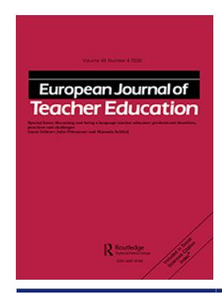

<!-- LR.R44 | source: papers_json/LR.R44/ -->

## **European** **Journal** **of** **Teacher** **Education**

**ISSN: 0261-9768 (Print) 1469-5928 (Online) Journal homepage:****[ www.tandfonline.com/journals/cete20](https://www.tandfonline.com/journals/cete20?src=pdf)**

## **English language teacher educators' identity** **tensions: academic publishing struggles and** **agency in Chile**

## **Leonardo** **Veliz** **&** **Bedrettin** **Yazan**

**To** **cite** **this** **article:** Leonardo Veliz & Bedrettin Yazan (2026) English language teacher educators' identity tensions: academic publishing struggles and agency in Chile, European Journal of Teacher Education, 49:4, 845-871, DOI: [10.1080/02619768.2026.2639305](https://www.tandfonline.com/action/showCitFormats?doi=10.1080/02619768.2026.2639305)

**To** **link** **to** **this** **article:** [https://doi.org/10.1080/02619768.2026.2639305](https://doi.org/10.1080/02619768.2026.2639305)

| © 2026 The Author(s). Published by Informa UK Limited, trading as Taylor & Francis Group. |
| --- |
| Published online: 05 Mar 2026. |
| Submit your article to this journal |
| Article views: 1713 |
| View related articles |
| View Crossmark data |
| Citing articles: 2 View citing articles |

<!-- page 2 -->

## **English language teacher educators' identity tensions: ** **academic publishing struggles and agency in Chile**

Leonardo Veli[za](#page-1-0) [*](#page-1-1) and Bedrettin Yazan[b](#page-1-0)

a Curriculm Department, University of New England, Armidale, Australia; b Department Bicultural-Bilingual Studies, The University of Texas at San Antonio, San Antonio, Texas, USA

## **ABSTRACT**

Drawing on qualitative data from semi-structured interviews with six early-career teacher educators working in English language teacher education (ELTE) programs in Chilean universities, the research explores how these educators navigate the pressures to publish in English-language journals while simultaneously engaging with local pedagogical, linguistic, and community commitments. Conceptually framed by decolonial theory, knowledge production, and teacher education, the study demonstrates that teacher educators are frequently caught in a double bind: they must meet institutional demands for international visibility and research output – defined by neoliberal and Euro-American norms – while remaining responsive to the sociocultural realities of teaching in Spanish-dominant, under-resourced contexts. These publishing pressures intersect with broader hierarchies of language, power, and coloniality that shape knowledge production in global ELT. Despite these constraints, teacher educators resist dominant epistemic paradigms through following agentive practices: drawing on locally grounded knowledges, fostering collaborative scholarly networks, and asserting alternative conceptions of academic impact and relevance.

## **ARTICLE HISTORY **

Received 7 July 2025 Accepted 4 February 2026

## **KEYWORDS **

English language teacher educators; identity tensions; publish or perish; Englishdominant academic publishing; Chilean teacher educators

## **Introduction**

In the neoliberal knowledge economy era, universities in the Global South have started engaging more in the production of knowledge and innovation that can contribute to economic development and global competitiveness (Bleiklie and Byrkjeflot [2002)](#page-23-0). This increased engagement is driven mainly by the forces of globalisation (Mufwene [2010](#page-25-0)), nurtured by the widespread impact of English as a global, colonial language (Crystal [2003](#page-23-1); Kramsch [2019;](#page-24-0) Meighan [2022;](#page-24-1) Meighan and Veliz [2026](#page-24-2)). As English increasingly becomes the medium of academic exchange, research publication, and policy discourse, Global South institutions and academics face growing pressures to align with Euro-American epistemologies, norms, and metrics of success (Barnawi and R'boul[ 2023)](#page-23-2). These pressures

**CONTACT **Leonardo Veliz lveliz@une.edu.au School of Education, University of New England, E11, HASSE Building, Armidale, NSW 2351, Australia

This article has been republished with minor changes. These changes do not impact the academic content of the article.

This is an Open Access article distributed under the terms of the Creative Commons Attribution License (http://creativecommons.org/ licenses/by/4.0/), which permits unrestricted use, distribution, and reproduction in any medium, provided the original work is properly cited. The terms on which this article has been published allow the posting of the Accepted Manuscript in a repository by the author(s) or with their consent.

> ^*^Additional affiliation: Facultad de Educación, Universidad San Sebastián, Concepción, Chile.

> ^© 2026 ^The Author(s). Published by Informa UK Limited, trading as Taylor & Francis Group.

<!-- page 3 -->

have generated both opportunities and tensions for researchers of English language teaching (ELT) who mostly work as teacher educators in university-based teacher education programs and face the pedagogical and ideological dimensions of English dominance in their professional lives (Guardado [2018](#page-24-3); Phyak [2021;](#page-25-1) Scarino and Papademetre [2001)](#page-25-2). From a decolonial perspective (Mignolo [2011](#page-24-4); Walsh [2018](#page-26-0)), these dynamics are part of the ongoing coloniality of knowledge, the persistence of Eurocentric systems that continue to define what counts as legitimate knowledge, whose voices are heard, and in which languages.

In this context, early-career English language teacher educators are particularly vulnerable to institutional and epistemic marginalisation (Kubota [2020;](#page-24-5) Phyak [2021](#page-25-1)). Often positioned at the intersection of internationalisation discourses and agendas, heavy teaching loads, and local educational policies, these educators must navigate multiple, and sometimes conflicting, expectations (Trent [2024;](#page-26-1) Yuan [2017](#page-27-0)). They are expected to produce internationally recognised research, effectively respond to heavy teaching demands, and support the professional development and competencies of future English language teachers, while often lacking institutional recognition or adequate structural support. Moreover, many are situated within academic cultures shaped by dominant Euro-American centric ideologies that validate and perpetuate 'nativespeakerism' ideologies (Aneja [2016;](#page-22-0) Holiday [2006)](#page-24-6). In turn, not only do these ideologies silence the Southern perspectives and linguistic heterogeneity of these academics but also continue to frame and foster Euro-American centric scholarship as legitimate and more valuable.

As a result, English language teacher educators from the Global South frequently position themselves, and are positioned, as linguistically and epistemically deficient (Veliz et al. [2026](#page-26-2)), even though they are multilingual, professionally qualified, and deeply embedded in complex linguistic and cultural ecologies. That positioning along with contextual expectations lead to identity tensions educators navigate in their professional lives. These global pressures are acutely experienced in Chile, where the English language has been historically positioned as a gateway to social mobility and international recognition, yet remains tied to enduring inequalities in access, language policy, and academic production. The Chilean higher education system reflects the broader contradictions of the neoliberal knowledge economy (Barahona, Veliz, and Darwin [2025;](#page-22-1) Veliz, Slaughter, and Ndhlovu [2025](#page-26-3)). It promotes global competitiveness and English-medium scholarship, while offering limited institutional support for early-career academics to engage in such work. This context makes Chile a salient site for examining how early-career English language teacher educators navigate the complexities of the interplay between global expectations, local realities, and personal/professional aspirations. Taking the Chilean context as our focus in this study, we examine how early-career language teacher educators experience and respond to their identity tensions. We investigate how those educators negotiate their professional positioning within higher education systems that simultaneously demand global engagement and academic production while reproducing epistemic inequities. Through a critical lens (Kubota[ 2020;](#page-24-5) Pennycook[ 2021)](#page-25-3), we seek (a) to illuminate the ways in which these educators resist marginalising structures and reimagine their roles by asserting agency, and (b) to offer insights into the complexities of professional identity construction in postcolonial and multilingual contexts of language

<!-- page 4 -->

teacher education. More specifically, our study addresses the following research questions:

- (1) How do early-career university-based English language teacher educators navigate tensions for academic publishing and global visibility?
- (2) How do these tensions influence their professional trajectories and identities as emerging scholars?

Before moving forward, we would like to clarify our use of the term 'Global South' to position the Chilean context and the potential dichotomy invoked in that use. Scholars acknowledged the 'challenges and contradictions' (Pennycook and Makoni [2019](#page-25-4), 1) that come with the use of Global South when approaching the global inequities. In our understanding of Global South, we attend to 'the people, places, and ideas that have been left out of the grand narrative of modernity' (1). Our focus is on 'histories of exclusion and disenfranchisement' (2) that lead to ongoing inequitable conditions suffered by 'excluded, silenced and marginalized populations, such as undocumented immigrants, the unemployed, ethnic or religious minorities, and victims of sexism, homophobia and racism' (de Sousa Santos [2012](#page-23-3), 51). Those populations are geographically found in the North as much as in the South. From this standpoint, Chile is geographically in the Global South and includes people, places, and ideas excluded from epistemic technologies and architectures of modernity, but we acknowledge that it might include populations considered as 'wealthy elites [of] the southern hemisphere' (Pennycook and Makoni [2019,](#page-25-4) 2). Considering the colonial histories of epistemic erasure, exclusion and marginalisation, we see university researchers in Chile representative of Global South conditions as they are forced to align their knowledge generation with neoliberal ideologies of global academia characterised by Euro-American dominance.

## **Teacher educators' identity, identity tensions and agency**

Research on identity in English language education has been a rapidly growing and evolving field. Since the 1990s, especially with the work by Norton (Early and Norton [2012](#page-23-4); Norton Pierce [1995;](#page-25-5) Norton and Toohey [2011)](#page-25-6) there has been increasing attention to identity as a prominent research agenda in applied linguistics. A major breaking point was a significant shift in the theorisation of identity. Informed by premises of poststructuralist theory, Early and Norton ([2012)](#page-23-4) pointed out that identity is 'not a fixed construct but must be understood with respect to a learner's relationship to the broader social, political and economic world' (195). Following this line of inquiry, identity has been defined in various ways. From the premise that identity is not static or fixed, Early and Norton ([2012)](#page-23-4) adds the changing nature of identity 'as a site of struggle' across space and time and the role of situated social interactions in its construction. Similarly, with an emphasis on social dimension of identity, Darvin and Norton ([2014)](#page-23-5) pointed out that 'identity, being a person's sense of self and relation to the world, is understood as dynamic, multiple, diverse and even contradictory' (57). Adopting a poststructuralist perspective towards teacher identity, Aneja ([2016)](#page-22-0) recognises the agentive dimension in identity construction by stating that 'individuals' identities are dynamic and encompass

<!-- page 5 -->

individual agency and the local community context as well as connections to global discourses and ways of making sense of the world' (574). This orientation calls for a critical examination of how ELT professionals and learners negotiate their identities through engagement with both local practices and transnational discourses. In Chile, these identity negotiations are intensified by a neoliberal education system that positions English as a key driver of economic mobility and global competitiveness (Barahona, Veliz, and Darwin [2025](#page-22-1); Matear [2008](#page-24-7)). English language teachers and teacher educators often navigate contradictory expectations underpinned by competing ideologies, to embody 'global' standards of English proficiency while addressing local sociolinguistic realities shaped by inequality and linguistic diversity (Gómez [2025](#page-24-8)).

The growing literature also reflects a deeper concern with the intersectionality of identity, recognising how race, gender, sexuality, class, language, and migration status co-constitute the experiences of learners and educators (Åkesson [2024](#page-22-2); Coda and Moser [2025](#page-23-6); Kayı-Aydar, Varghese, and Vitanova [2022;](#page-24-9) Kubota and Lin [2006](#page-24-10); Weng et al. [2024;](#page-26-4) Yazan [2025)](#page-26-5). Scholars have argued that English language education is deeply entangled with structures of linguistic imperialism, racialisation, and colonial legacies (e.g. Canagarajah [2013](#page-23-7), [2023](#page-23-8); Meighan [2022](#page-24-1); Pennycook [2001](#page-25-7), [2021](#page-25-3)) which intersect with multiple identity categories. This argument has led to a broader conceptualisation of identity that acknowledges not only social positioning and discourse but also structural inequalities that shape who gets to speak, teach, and be recognised as 'legitimate' within the field. Research into non-native English-speaking teachers (NNESTs) has problematised the native speaker ideology and highlighted how professional identities are both constrained and reimagined in response to dominant discourses (Holiday [2006](#page-24-6); Selvi, Yazan, and Mahboob [2024](#page-25-8)).

Previous studies on teachers' intersectional identities have paved the way for exploring teacher identity as a site of resistance, transformation, and negotiation. Scholars, for instance, discuss identity as a practice that emerges from teacher narratives, situated social interactions, and broader sociopolitical contexts (Mathews et al. [2025;](#page-24-11) Tajeddin and Yazan [2024;](#page-25-9) Yazan and Lindahl [2020](#page-26-6)). The professional work of academics and practitioners, then, is not solely pedagogical but deeply political, shaped by ideological battles over language, legitimacy, and educational reform. Decisions about language policies, curriculum, teacher preparation, and classroom practices are embedded in larger ideological projects, including neoliberalism, nationalism, and global English dominance (Canagarajah [2023](#page-23-8); Pennycook [2007](#page-25-10), [2021)](#page-25-3). As a result, identity work is, in education and language education, in particular, both personal and political, deeply connected to broader questions of justice, equity, and representation.

More recent scholarship of identity particularly focused on language teacher educators' identity work. Scholars conceptualise that identity work as the ongoing, situated process through which language teacher educators negotiate their multiple and sometimes competing roles, as scholars, advocates, and community actors (Barkhuizen [2021a](#page-22-3), [2021b](#page-22-4); Uştuk and Yazan [2025;](#page-26-7) Yuan [2017;](#page-27-0) Yuan et al. [2022)](#page-27-1). Following Uştuk and Yazan ([2025](#page-26-7)), we adapted Olsen's [(2016)](#page-25-11) definition of teacher identity to theorise language teacher educator identity as:

<!-- page 6 -->

The collection of influences and effects from immediate contexts, prior [and concurrent] constructs of self, social positioning, and meaning systems (each itself a fluid influence and all together an ever-changing construct) that become intertwined inside the flow of activity as a [language] teacher [educator] simultaneously reacts to and negotiates given contexts and human relationships at given moments. (139)

This definition highlights 'immediate contexts', 'social positioning, and meaning systems' as salient in identity work while acknowledging the dynamic and relational nature of identity influenced by institutional structures, sociopolitical contexts, and personal commitments. It also underscores teacher educators' agency in reacting to and negotiating demands of human relationships and sociopolitical contexts within which they are situated.

Identity work occurs at the nexus of personal, professional, and political dimensions of being and becoming an ELT practitioner and identity tensions tend to emerge at that nexus (Farias and Veliz [2025;](#page-23-9) Mathews et al. [2025;](#page-24-11) Riffo-Salgado [2024](#page-25-12); Veliz, Chen, and Véliz-Campos [2025)](#page-26-8). Representing 'internal struggles' (Pillen, Den Brok, and Beijaard [2013)](#page-25-13), identity tensions are inevitable for teacher educators in making decisions, taking actions, and reflecting on those actions which are influenced by competing and 'conflicting subject positions and ideologies' (Alsup [2006](#page-22-5), 6). Focusing on identity tensions helps understand 'the feelings of internal turmoil that many teacher educators experience' in their professional lives 'as they find themselves pulled in different directions by competing concerns, and the difficulties for teacher educators in learning to recognize and manage these opposing forces' (Berry [2007](#page-23-10), 32). Particularly Global South contexts, identity work involves navigating tensions between institutional demands for academic productivity and commitments to social justice, equity, and community engagement. These identity tensions are not experienced in isolation but are closely intertwined with structural conditions in the academic publishing landscape, where English-dominant norms, performance metrics, and hierarchical gatekeeping shape who is recognised as a legitimate scholar. While much of this system reproduces Global North epistemic dominance, there are also emerging initiatives within global publishing that seek to support multilingual scholars and promote more inclusive, context-sensitive research practices.

As they navigate identity tensions, teacher educators assert agency in engaging in professional practices that align with their imagined identities. From Emirbayer and Mische's ([1998)](#page-23-11) temporal-relational perspective introduced to teacher education by Priestley, Biesta, and Robinson [(2015)](#page-25-14), agency refers to actors' 'temporarily constructed engagement' with 'different structural environments . . . which, through the interplay of habit, imagination, and judgment, both reproduces and transforms those structures in interactive response to the problems posed by changing historical situations' (970). Guiding and guided by identity, teacher educators' agency involves (a) selectively triggering certain 'past patterns of thought and action . . . to sustain identities, interactions, and institutions over time' (971), (b) imaginatively producing 'possible future trajectories of action' based on their 'hopes, fears, and desires for the future' (971), and (c) strategically responding to 'emerging demands, dilemmas, and ambiguities of presently evolving situations' by deliberating and choosing from 'alternative possible trajectories of action' (971). In this conceptualisation, teacher educators' agency is iterational, projective, and practical evaluative, which reflects the recent studies on language teacher educators. That

<!-- page 7 -->

is, language teacher educators exercise agency when constructing an advocacy orientation for social justice and equity (Warren et al. [2025)](#page-26-9), engaging in critical self-reflexivity through pedagogical practices (Peercy et al. [2019](#page-25-15)), designing a critically-oriented ELT curriculum in a teacher education program (López-Gopar, Sughrua, and Huerta Cordova [2024)](#page-24-12), incorporating comprehensive sexuality education in teacher education praxis (Banegas and Gerlach [2021)](#page-22-6), and navigating marginalisation, legitimacy, and sense of belonging in negotiating identities as critical language teacher educators (Tezgiden-Cakcak and Ataş [2024)](#page-26-10). Our study contributes to this conversation by exploring English language teacher educators' identity tensions and agency under the pressures of neoliberal ideologies of publishing as university faculty.

## **Decolonising academic publishing in the Global South**

While the field of identity research in ELT has expanded significantly, it is important to critically examine who gets to produce knowledge, whose voices are legitimised, and under what conditions. For language teacher educators and academics working in the Global South, the process of academic publishing is deeply fraught with structural inequities, epistemic injustice, and geopolitical marginalisation (Canagarajah [2005](#page-23-12); Fricker [2018;](#page-24-13) Meighan [2023](#page-24-14)). The production and dissemination of research in ELT and applied linguistics continue to be dominated by institutions, editorial boards, and publishing outlets located in the Global North, often privileging English-medium scholarship, dominant research paradigms, and neoliberal metrics of academic success (Tupas [2019)](#page-26-11).

From a decolonial perspective (Mignolo [2011;](#page-24-4) Mignolo and Santino-Bussmann [2023](#page-24-15); Mignolo and Walsh [2018)](#page-25-16), these hierarchies reflect the ongoing coloniality of power and knowledge that continues to shape global academia. Decolonial theories urge us to interrogate not only who produces knowledge but also how and for whom that knowledge circulates. The modern academic system, largely rooted in Euro-American epistemological traditions, perpetuates a colonial matrix of power that privileges certain languages, methodologies, and theoretical frameworks while rendering others peripheral or invisible. In this sense, the Global South's marginal position in academic publishing is not accidental but historically produced and epistemologically maintained.

One central tension lies in the linguistic hegemony of English in academic publishing, which places disproportionate pressure on multilingual scholars from non-Anglophone contexts to publish in English-language journals to gain international visibility and academic legitimacy. As Canagarajah [(2002)](#page-23-13) argues, the global circulation of knowledge is not neutral but regulated by ideologies of language, legitimacy, and centre – periphery dynamics. For many Global South scholars, publishing in English involves not only linguistic challenges but also the translation of local knowledge into globally recognisable frameworks, often at the expense of context-specific epistemologies (Kubota [2020)](#page-24-5).

This dynamic illustrates what decolonial theorists describe as epistemic coloniality, i.e. the persistence of colonial power structures in determining what counts as legitimate knowledge and in what language it must be expressed (Grosfoguel [2011](#page-24-16); Quijano [2000](#page-25-17)). Within this framework, English operates not merely as a global lingua franca but as a mechanism of epistemic dominance that disciplines multilingual scholars into adopting Eurocentric forms of reasoning, argumentation, and evidence. Decolonising academic publishing, therefore, requires dismantling these linguistic hierarchies and reimagining

<!-- page 8 -->

multilingualism as a resource for intellectual pluralism rather than a deficit to be overcome.

Moreover, researchers in postcolonial and peripheral contexts frequently encounter the gatekeeping practices of mainstream journals, where methodological, theoretical, or even ideological orientations are subtly policed through peer review and editorial standards (Alatas [2000;](#page-22-7) Castañeda-Peña, Gamboa, and Kramsch [2024)](#page-23-14). These dynamics contribute to the erasure or devaluation of locally rooted research traditions, particularly those that challenge Eurocentric knowledge systems or that prioritise social justice, decoloniality, or Indigenous perspectives. As de Sousa Santos ([2007)](#page-23-15) explains, epistemologies from the Global South are often sidelined and discredited due to an 'invisible line' that parts the world into 'North' and 'South'. This divide, evident in the unequal power relations in conventional ways of conducting and disseminating scholarly research, reinforces a one-way, unilateral, hierarchical and imbalanced flow of what is considered valid and legitimate knowledge from North to South.

Furthermore, academics from the Global South face the dominant ideological culture of 'publish or perish'. The publish-or-perish culture refers to the pervasive pressure within academia, particularly in the Global South, for scholars to produce a continuous stream of publications to secure employment, promotion, funding, and professional recognition and academic standing (Canagarajah [2002](#page-23-13); Salager-Meyer [2014](#page-25-18)). This culture is a direct product of neoliberal reforms in higher education, which have introduced marketoriented logics of productivity, accountability, and competition. To this end, this pressure is particularly burdensome for non-Anglophone scholars, who must publish in Englishdominant, high-impact journals whose Euro-American discourses often disregard local research agendas and alternative epistemologies (Salager-Meyer [2014](#page-25-18)).

In response to these tensions, a growing body of scholarship has called for the decolonisation of academic publishing and the recognition of pluriversal knowledge systems, i.e. frameworks that value the coexistence of multiple epistemologies rather than privileging a singular, dominant Western canon (Mignolo and Walsh [2018](#page-25-16); Veliz, Diaz, and Heinrichs [2024](#page-26-12)). This decolonial turn challenges the epistemic hierarchies that position Global North, English-dominant scholarship as universally normative, while marginalising knowledge production rooted in local, Indigenous, and multilingual contexts (Meighan [2023;](#page-24-14) Meighan and Veliz [2026;](#page-24-2) Phyak [2021;](#page-25-1) Pongiglione [2024;](#page-25-19) Siegel [2006](#page-25-20); Veliz [2024](#page-26-13)). Research has advocated for more inclusive, multilingual, and reflexive publishing practices, those that welcome alternative voices, hybrid writing genres, and research agendas grounded in situated, sociocultural realities (Kubota [2020;](#page-24-5) Meighan [2022;](#page-24-1) Tupas [2019)](#page-26-11). From a decolonial standpoint, this impetus for an equitable publishing agenda critiques the gatekeeping mechanisms of Anglophone journals, including rigid peer review standards and linguistic expectations, which often silence scholars from the Global South or compel them to conform to dominant norms of expression and knowledge framing (Canagarajah [2002](#page-23-13), [2018](#page-23-16); Salager-Meyer [2014](#page-25-18)). Others have highlighted the need to rethink research impact and academic success beyond citation indexes and journal rankings, towards relational, ethical, and community-engaged forms of scholarship (Maldonado-Torres[ 2011](#page-24-17)). Importantly, these structural challenges have direct implications for the identity formation and professional trajectories of language teacher educators in the Global South. Ultimately, decolonising academic publishing involves

<!-- page 9 -->

transforming it from a hierarchical, extractive system into a dialogic, relational, and justice-oriented space of knowledge co-creation. For language teacher educators in the Global South, such decolonial praxis opens pathways for reclaiming narrative authority, legitimising local knowledges, and cultivating solidarities that transcend the colonial boundaries of academia.

## **Rationale for the study**

This study is situated in a convoluted linguistic, socio-cultural and political environment of Chile. Being the very first country in Latin America to embrace capitalist and neoliberal ideologies in the 1980s (Beltrán and Preller [2003;](#page-23-17) Cruz-Coke [2004](#page-23-18)), Chile has aspirationally endeavoured to make efforts to become a bilingual country (Barahona, Veliz, and Darwin [2025;](#page-22-1) Veliz, Barahona, and Darwin [2025a](#page-26-14), [2025b](#page-26-15)) through a sustained focus on further strengthening English language instruction and English language teacher education programs. Neoliberalism's entrenchment in Chile has profoundly shaped the country's approach to public education, particularly in its push towards competitiveness, marketisation, and alignment with global norms. Positioning Chile within the Global South allows us to foreground both the geopolitical and epistemological dimensions that shape the experiences of early-career English language teacher educators. Drawing on de Sousa Santos ([2014](#page-23-19)), we understand the Global South not merely as a geographic designation but as a site of structural and epistemic marginalisation within global knowledge production. This lens highlights how Chilean academics confront Euro-American publishing norms, institutional metrics prioritising global visibility, and local sociolinguistic realities simultaneously. Thus, the Chilean context is not merely a backdrop: it actively structures the tensions participants experience, shaping their professional identities, linguistic positioning, and forms of agency in ways that carry relevance for comparable Global South contexts internationally.

Within this neoliberal paradigm, the English language has gained symbolic and material value, seen as a key asset for accessing global markets, improving employability, and enhancing national competitiveness (Abrahams and Silva-Ríos [2017](#page-22-8); Barahona [2016](#page-22-9); Barahona, Veliz, and Darwin [2025)](#page-22-1). These efforts have manifested in national policies such as the 'Inglés Abre Puertas' (English Opens Doors) program and curriculum and assessment reforms aimed at increasing English proficiency across schooling as is the case of 'SIMCE' [National Evaluation System of Learning Outcomes] to be administered to a sample of Year 8 students in 2026 for the first time.

However, this push for an idealised bilingual country is neither neutral nor apolitical. It reflects deeper ideological investments in English as a gatekeeper of knowledge, mobility, and global participation, often at the expense of Chile's linguistic and cultural diversity (Veliz, Slaughter, and Ndhlovu [2025](#page-26-3)). The privileging of English, framed through discourses of a bilingual country, globalisation and economic development, has reinforced colonial language hierarchies and marginalised Indigenous and local language practices in both education and society. For (early-career) language teacher educators in Chile, these dynamics are further compounded by the structural and epistemic demands of academic labour in a globalised higher education system. Institutions increasingly require academics to publish in highly ranked, Englishmedium journals, and adhere to global research metrics, which, in most cases, is

<!-- page 10 -->

incentivised by monetary contributions for publications in Indexed journals. In this context, this study critically examines how early-career English language teacher educators serving as academics in Chilean universities experience and respond to these multilayered pressures. By exploring their identity negotiations, tensions, and acts of agency, the study contributes to global conversations on academic knowledge production, linguistic justice, and the politics of teacher educators' professional identity in the Global South.

This study also builds on and contributes to a growing body of Latin American scholarship that foregrounds teacher educators' lived tensions, reflexivity, and situated knowledge production. Recent work in the region has demonstrated how identity struggles, ethical dilemmas, and epistemic negotiations are constitutive of English language teacher education rather than peripheral to it (Mora and Herrera [2026)](#page-25-21). In particular, autoethnographic and tension-based approaches in Latin America have shown how teacher educators navigate contradictions between institutional demands, pedagogical commitments, and decolonial aspirations within structurally constrained contexts. While the present study does not adopt an autoethnographic design, it aligns with this tradition by foregrounding early-career teacher educators' narrated tensions as analytically productive sites for understanding identity formation, agency, and resistance in Global South English language teacher education (ELTE) contexts.

## **Researcher positionality**

Leonardo: As a Global South scholar working within and across Global North academic spaces, I acknowledge that my own experiences of navigating professional and ideological tensions in academia, particularly around issues of language, legitimacy, and scholarly voice, deeply inform my interest in this study. My positionality is grounded in a critical and relational understanding of knowledge production, where I view research not as a neutral or detached activity, but as one entangled with power, identity, and advocacy. Adopting an 'advocacy role' (Appleby [2016](#page-22-10)) during data collection, I sought to foster dialogic, respectful, and reciprocal exchanges with participants, recognising them not merely as data sources but as co-constructors of knowledge. My decision to share aspects of my own academic trajectory during initial Zoom meetings was guided by a desire to disrupt traditional hierarchical researcher-participant dynamics and create space for mutual trust. This stance aligns with my decolonial commitment to challenge epistemic hierarchies and re-centre Southern voices in the production of academic knowledge.

Bedrettin: Leonardo invited me to this research study since we shared the critical orientation towards epistemic injustices that emerge with the dominance of English in academic knowledge generation. Using mostly autoethnographic methods, I have explored identities and practices of transnational language teacher educators since 2018 and been intrigued by the identity tensions they experience due to the competing ideologies and demands of research, teaching, and service requirements. Although my mentoring relationship with colleagues exposed me to the context of Chile's English language teacher education, I see myself an outsider in this study and have relied on Leonardo's experience and expertise to make sense of the data and share my interpretations to contribute to the analysis.

<!-- page 11 -->

## **Collaborative and ideological positioning**

Throughout the project, we maintained regular virtual collaborative meetings to design the study, discuss emerging themes, review the data analysis, discuss theoretical orientations and assign tasks to each other. Leonardo led participant recruitment and preliminary coding, while Bedrettin contributed to thematic synthesis and theoretical framing. Although our perspectives were largely aligned in our critical orientation, interpretive differences occasionally emerged, particularly regarding the balance between structural critique and agentic narratives. These differences prompted rich reflexive discussions that ultimately deepened our analysis. We approached such moments not as disagreements to be resolved but as opportunities to interrogate our assumptions and enhance interpretive rigour. Our virtual collaboration was thus guided by mutual respect, dialogic reflexivity, and a shared decolonial commitment to unsettling hierarchies of knowledge production between North and South.

## **Research design**

In this qualitative inquiry (Atkins and Wallace [2016](#page-22-11); Braun and Clarke [2013](#page-23-20)), we sought to develop an understanding of the professional and ideological tensions around academic publishing faced by early-career English language teacher educators in Chilean universities as they construct and negotiate their professional identities and exercise their agency. The 'advocacy role' assumed by Leonardo (Author#1) allowed for space to share his own academic trajectory as a Global South scholar navigating challenges and identity tensions in Global North contexts. Rather than aiming to capture stable or observable teaching practices, we focused on participants' narrated reflections as sites where identity tensions, agency, and ideological positioning are discursively constructed. We treated the interviews as situated moments of sense-making that illuminate how early-career teacher educators interpret and negotiate institutional and epistemic pressures at a particular point in their professional trajectories.

## *Participants and data collection*

Focusing on early-career academics in this study, we relied on Frandsen and Nicolaisen's ([2024](#page-23-21)) definition: individuals who are at the initial stages of their research careers and are actively working to build their academic profile through publishing, seeking research funding, and developing professional networks within their field. We acknowledge the ambiguity of the term, which is consistent with previous research, operationalising 'earlycareer academic' by quantitatively defining them as individuals who are within 0–5 years of completing their PhD and have three or fewer academic publications.

We purposively selected the participants to ensure diversity in institutional affiliation, geographic location, and academic background, offering a rich and varied account of the professional and ideological tensions encountered in their scholarly work. All participants were engaged in teaching and research within the field of ELT and were in the early stages of their academic careers, navigating the expectations and pressures of academic publishing along with the local community demands. Importantly, participants were not selected on the basis of having pre-

<!-- page 12 -->

|  |  | Table 1. Participant information. |
| --- | --- | --- |

| Pseudonyms | Years since PhD completion | Number of publications | Type of university |
| --- | --- | --- | --- |
| Loreto | 5 | 2 | Private |
| Gabriela | 3 | 1 | Private |
| Eduardo | 4 | 3 | Public |
| José | 5 | 2 | Private |
| Andrea | 1 | 3 | Public |
| Carlos | 1 | 1 | Public |

identified or explicitly articulated tensions related to academic publishing or professional identity. Rather, eligibility was determined by career stage, institutional affiliation, and engagement in teaching and research within ELT. While existing literature suggests that early-career academics in English-dominant systems often encounter such tensions, we did not assume or pre-determine these experiences during participant recruitment. Instead, the nature and extent of identity tensions and agentive responses emerged inductively through the interview process as participants reflected on their academic trajectories and everyday professional practices.

To gain in-depth insights into participants' lived experiences and evolving professional identities, Leonardo conducted semi-structured interviews with six English teacher educators, each of whom represented six different universities across three regions in Chile (see [Table 1 ](#page-11-0)for participant information). These interviews provided the flexibility to explore themes while allowing participants to reflect on their unique trajectories and institutional contexts. Interviews lasted between 60 and 90 minutes and were conducted via Zoom at times convenient to participants. They were primarily held in English, with occasional translanguaging into Spanish, which participants used to express nuanced experiences and emotions. All interviews were audio-recorded and transcribed using Zoom's automatic transcription functionality, followed by manual verification to ensure accuracy.

We prepared theory-driven and literature-informed interview questions by drawing on critical applied linguistics, decolonial theory, and identity research in ELT (e.g. Kubota [2020;](#page-24-5) Pennycook [2021](#page-25-3); Varghese et al. [2005)](#page-26-16). For instance, we framed questions about 'voice', 'visibility', and 'epistemic legitimacy' to have a conversation about how power and ideology shape participants' academic trajectories. Interviews served as dialogic spaces where participants could openly discuss their academic journeys, research interests, and teaching contexts and the challenges they face around academic publishing.

We designed the interview protocol to explore two broad areas aligned with our research questions: (1) how early-career teacher educators navigate the pressures and opportunities of academic publishing and global visibility, and (2) how these processes shape their emerging professional identities. Accordingly, the guiding themes included:

- Academic publishing experiences and challenges
- Perceptions of legitimacy and recognition in academic spaces
- Institutional expectations and workload pressures
- Negotiation of multilingual and cultural identities in academic work, and
- Acts of resistance, agency, and reimagining of scholarly practice

<!-- page 13 -->

## *Data analysis*

In our study, we did not conceptualise agency as individual autonomy or resistance unconstrained by structure, but as a situated, relational, and ideologically mediated capacity to act within and against institutional constraints (Barkhuizen [2021a;](#page-22-3) Darvin and Norton [2014;](#page-23-5) Emirbayer and Mische [1998;](#page-23-11) Priestley, Biesta, and Robinson [2015](#page-25-14); Veliz et al. [2025](#page-26-17)). Drawing on poststructuralist and critical perspectives on identity, we conceptualised agency as emerging through moments of tension, contradiction, and negotiation, particularly where educators' professional values conflicted with dominant institutional and epistemic expectations. Analytically, we paid attention to how participants enacted agency discursively and relationally through collaborative practices, strategic alignments, and the rearticulation of academic purpose rather than through overt opposition or individualised acts of resistance. This framing allowed us to examine agency as an integral dimension of identity work, shaped by power relations, language ideologies, and the material conditions of academic labour in the Chilean higher education context.

We analysed the interview data thematically through an iterative, interpretive process informed by principles of qualitative inquiry (Braun and Clarke [2013)](#page-23-20). Our analysis attended not only to what participants said, but also to moments of contradiction, affective intensity, and hesitation across narratives, recognising these as analytically productive instances rather than as inconsistencies. In this way, we used thematic analysis to surface tensions and identity negotiations, rather than to generate fixed or declarative accounts of experience. Initial coding involved close reading of transcripts to identify recurring themes, patterns, and tensions related to identity construction, institutional pressures, and ideological negotiations within academic publishing. We then refined these initial codes through constant comparison, allowing for more abstract, theoretically informed categories. Our analysis was guided by a critical lens that foregrounded issues of power, positionality, and voice in the production of academic knowledge. We maintained reflexive memos throughout the process to trace researchers' analytical decisions and to acknowledge how our own experiences as Global South scholars shaped our interpretation of participants' narratives. We thus generated thematic patterns related to identity tensions and agency through iterative engagement with the data rather than imposed as predefined analytical categories.

## **Findings**

## *Bridging personal aspirations and external expectations*

Participants' accounts revealed three interrelated tensions that shape their academic work: the struggle to balance quantity and quality in publication output, the challenge of reconciling local relevance with global prestige, and the emotional negotiation between social justice commitments and institutional performance metrics. Together, these tensions illustrate how Chilean English teacher educators navigate the dissonance between personal purpose and systemic expectations.

When asked about how academics balance professional aspirations for scholarly publications and institutional demands, it became clear that while there seems to be a disconnect between professional goals and institutional expectations, this tension is navigated in complex and often emotionally taxing ways. Participants highlighted how

<!-- page 14 -->

institutional metrics and performance indicators often prioritise quantity over quality and pressure early-career academics to publish rapidly rather than meaningfully.

## *Balancing quantity and quality*

Eduardo, for instance, indicated that while he managed to publish his paper in a Scielo journal, his other two publications in the last two years have come out in non-refereed journals.

The pressures to publish are huge and sometimes you like doing anything to write another paper. But, you're not thinking about impact, or the type of journal, you're just thinking about getting another paper out but at the expense of other things. It's the institution's requirement and expectation that you publish and produce research not just teach.

Eduardo describes the tension between his commitment to fulfilling institutional mandates about publishing and personal and professional compromises. With 'other things', he implies how the affective dimensions of academic research such as passion, purpose, meaningfulness and impact, are subsumed or effaced under the structural and mechanistic demands of 'quantity' and measurable outputs. Eduardo also refers to the research production requirement as part of his professional responsibilities along with teaching teachers.

## *Relevance versus prestige*

While Eduardo's experience highlights the toll of quantitative imperatives, Carlos brings attention to another kind of tension: the struggle to pursue relevance and local epistemic integrity amid global hierarchies of prestige of research journals. Sharing a similar concern about the systemic demands for an increase in research productivity, Carlos has a more balanced perspective that speaks to both 'relevance' and 'productivity'. Carlos indicates that:

It's important to write research that is relevant to our contexts; that's my first priority when I think of a project or a collaborative idea. What's happening in our context. What do we need?, but also we need to think about researching more because Chilean academics are not doing enough research.

Adding to the point about relevance, Carlos shares an imagined identity pointing to the importance about 'translating' research (findings) to local contexts and realities.

My dream is to make a contribution to Chilean research and produce articles or chapters that speak to the realities or teachers and students, not necessarily in the top journals. Research that is translatable to the issues that teachers and students face all the time.

Cognisant of the need for a growing and more sustainable research agenda in the Chilean context, Carlos speaks to a desire for epistemic relevance and local impact, resisting the lure of international prestige often associated with publishing in high-ranking Englishmedium journals. Within this context, Carlos asserts that 'publishing in a top journal takes about 2 years, and the reviews are always so harsh, also because our English is not perfect'.

<!-- page 15 -->

## *Social justice versus output*

Chilean English teacher educators acknowledge the importance of publishing. However, they also put their advocacy for students first who are preparing to become English language teachers. Beyond the question of prestige, some participants, like Andrea and José, foreground a more ethically charged tension – between their social justice commitments and institutional demands for measurable output. They share a similar sentiment for social justice-oriented education especially for disadvantaged and marginalised students. For example, Andrea commented:

I became a teacher educator because I believe in transforming education, especially for marginalized students. But the system wants me to prioritize outputs over impact on my students, but we have to keep trying publishing. That's the tension I live with every day.

While Andrea articulates a strong sense of purpose tied to educational transformation and equity for marginalised students, this is set against a backdrop of neoliberal accountability regimes that measure academic success through quantifiable outputs such as publications, funding, and rankings (Salager-Meyer[ 2014)](#page-25-18). Andrea's commitment reflects the kind of identity work, where teacher educators navigate their roles not only as scholars but also as advocates and community actors.

Similarly, José feels a tension at the intersection of a passion for equity in education, a desire to engage in more research and a system that does not prepare teachers and future educators for scholarly writing.

I love my students and I love being in the classroom. I always wanted to be a teacher and now I am in the classroom but also in the office doing lots of admin work and trying to research. When I started my PhD, I found academic writing quite challenging because I rarely did it in my masters or undergraduate. We are not really equipping students and future teachers for extensive academic writing, and most importantly to do the critical thinking around it.

José's reflection shows the intersecting pressures faced by early-career teacher educators in navigating teaching, administrative duties, and research within structurally constrained environments. His experience illustrates a key identity tension: a passion for equitable, student-centred education conflicts with institutional expectations around research output and academic writing proficiency. His comment points to a systemic gap in the preparation of teachers and teacher educators for scholarly engagement, particularly in terms of developing academic writing and critical thinking skills, often taken for granted in dominant (western-ized) academic cultures.

## *Deficit views of early-career researchers*

As early-career researchers, participants often grapple with dominant perceptions, discourses, and institutional practices that de-legitimise their contributions to the academic field. Rather than as valuable members of scholarly communities with fresh perspectives and situated expertise, they are frequently positioned through deficit lenses, as lacking experience, credibility, or the necessary academic capital to lead or innovate. These perceptions are reinforced through hierarchical structures in academia that privilege

<!-- page 16 -->

seniority and alignment with established norms of research production and dissemination.

Carlos alluded to the mindset associated with the 'new generations' in leadership positions with no research experience; 'it's that mindset in academic contexts that more young people or the new generations in leadership positions like Head of English take these positions because they "can't research" or have no expertise is disappointing'. Carlos's comment points to a broader epistemic injustice that frames younger leaders as unqualified or tokenistic, rather than acknowledging their pedagogical contributions, leadership capacities, alternative forms of expertise or potential for producing meaningful research.

Loreto similarly reflects on the constraining logics that shape how early-career researchers are viewed and positioned within the academic hierarchy:

There's a perception that because we're early in our careers, we're dependent on mentors, on funding, on institutional validation on more senior colleagues or on international networks, yes, it's true in some ways but it makes it hard to push back or propose alternative ways of doing research.

Her reflection exhibits the double bind many early-career academics find themselves in. While it is often true that they rely on senior mentorship or institutional support to navigate the structural complexities of academia, this reliance is frequently interpreted as intellectual dependency or lack of autonomy. This perception can restrict their capacity to assert novel or critical research approaches, particularly those that challenge dominant paradigms, such as community-based inquiry, decolonial methodologies, or collaborative research with teachers.

Andrea's statement offers a pointed critique of academic hierarchies and their effects on early-career teacher educators, particularly in contexts where mentoring is absent or withheld. She reflects:

The fact that we don't have or receive any form of mentoring is something that marks the top-down hierarchies rather than mutual or collaborative learning with peers and colleagues, this means that others are at the top and we are at the bottom.

Andrea's statement serves as a powerful critique of institutional hierarchies that reproduce exclusionary practices in academic and professional contexts, particularly affecting early-career language teacher educators and researchers. Her comment reveals how the absence of mentoring is not merely a logistical oversight but a structural feature of topdown academic cultures that undermine relationality, care, and mutual learning. Andrea, however, highlights during the conversation that not having formally established mentorship programs does not preclude her from pursuing alternative avenues. She points out that 'Not having a mentor or a "role model" is not a weakness for me but an opportunity to create and build my own'.

## *Overcoming competing demands*

While English language teacher educators navigate personal aspirations, external expectations along with deficit discourses in academia, they assert agency to create meaningful

<!-- page 17 -->

opportunities to overcome competing demands around teaching and administration workloads to make a meaningful contribution to teaching, learning, and research.

While Loreto brings up the issue of time constraints, she indicates that being a part of an informal collaborative team with colleagues across two other universities makes her feel connected, motivated and energised to keep pursuing new paths of research.

Time is always a problem for us as I said before but with the connections I have and the informal groups of collaboration with a couple of colleagues in two other universities, we try to share ideas, find new ways of innovating in teaching and do some research together. We've done a couple of action research projects together but we'd like to explore more empirical research together with clear implications for our context. These connections really keep us motivated.

Similar to Loreto's strategic connections which foster her impetus for improved teaching and research is Eduardo's observation about his agentive moves around keeping himself 'on top of recent scholarship' by maintaining collegial relationships with his former doctoral supervisors.

For me one way of keeping myself on top of recent scholarship and what's happening out there, of course through the journals, readings, and things like that, but keeping connected with my PhD supervisors. Every now and then we catch up on zoom, share new research ideas, they tell me what they're doing, new explorations, which also give me ideas. I'd like to set up like a reading group in the future to get deeper in the conversations.

Eduardo's narrative highlights a form of agentive professional identity work grounded in relational and intellectual sustenance. By actively maintaining collegial connections with his former doctoral supervisors, Eduardo demonstrates how early-career academics can resist institutional isolation and academic precarity through translocal networks of scholarly exchange (Canagarajah [2011](#page-23-22)).

Gabriela holds a similar view on the importance of collaborative networks as an avenue that not only resists normative practices around teacher education and research but most importantly stimulates her intellectual thinking.

Having teaching and research networks locally and globally is so important because we are all in the game, we understand each other, we're all fighting the same issues of publishing, being time poor, lots of admin, not enough resources, but at the end of the day, meeting with colleagues in conferences, online, seminars or publishing together really pushes your thinking to have much richer conversations, envision new opportunities and new explorations for new ideas.

Gabriela also mentioned other formal avenues for networking through established professional associations, institutional partnerships, and research-driven initiatives that bring together educators and scholars across regions. Gabriela indicated that 'RICELT, which is a Chilean network of researchers in English language teaching, is a community I'm part of and we have conferences, events, and things like that'. For Gabriela, participation in such networks is not only about sharing ideas but about cultivating a supportive intellectual community that challenges dominant discourses in academic work and opens new possibilities for collaborative inquiry.

Echoing this sentiment, Carlos emphasised that collaborative networks are not merely spaces for the exchange of knowledge but are critical in fostering a collective sense of

<!-- page 18 -->

academia. He challenged the notion of the solitary researcher and highlighted the emotional and intellectual benefits of working alongside others:

It's not just about sharing your work, it's about not doing it alone. When you build something with others, there's this sense that research doesn't have to be isolating. That makes it more manageable, and also more meaningful. You start thinking of research as a shared pursuit rather than an individual burden.

For Carlos, the value of these communities lies in their potential to reshape academic research into a more collective, dialogic process, one that not only mitigates the isolating pressures of the neoliberal academy but also enables deeper, more sustained engagement with complex issues. The importance of community networks, then, lies not only in logistical support or professional visibility but in their capacity to sustain intellectual growth, emotional resilience, and collaborative creativity.

Collectively, these reflections expose how neoliberal logics of accountability reshape academic subjectivities, compelling teacher educators to measure their worth through productivity rather than impact. Yet, their narratives also reveal moments of ideological clarity, an awareness of how such pressures marginalise local knowledge and how socially responsive scholarship might resist them.

## **Discussion and conclusion**

In this study, we distinguish between *language teacher identity*, which is typically associated with classroom-based pedagogical practice, and *language teacher educator identity*, which encompasses the broader professional roles of teaching, research, supervision, and academic knowledge production (Barkhuizen [2021a](#page-22-3); Yazan [2022)](#page-26-18). While these identities overlap, the latter is shaped by additional institutional, epistemic, and publishing-related demands that are central to the tensions examined here, especially in contexts where language teacher education is housed in universities.

This study set out to explore how early-career English language teacher educators in Chile experience, negotiate, and make sense of the demands for academic publishing and global visibility within the structural and ideological constraints of higher education. It specifically addressed these research questions: *How do early-career university-based * *English language teacher educators navigate tensions for academic publishing and global * *visibility? How do these tensions influence their professional trajectories and identities as * *emerging scholars? *The findings showed that participants encounter significant tensions at the intersection of institutional expectations, linguistic and epistemic hierarchies, and personal commitments to socially meaningful pedagogy of teacher education.

Importantly, we interpret these tensions not only as sources of constraint but also as productive sites of agency. Drawing on poststructuralist understandings of identity as a 'site of struggle' (Norton[ 2013)](#page-25-22), we argue that the identity tensions experienced by earlycareer English language teacher educators function as generative conditions through which agency is enacted. In this sense, agency does not operate in opposition to structural pressures but emerges within them, as teacher educators negotiate, rework, and sometimes resist imposed professional identities and epistemic norms. The findings thus show how identity tensions and agency are mutually constitutive: tensions expose the limits of institutional expectations, while agentive practices – such as collaborative

<!-- page 19 -->

networking, redefinition of academic impact, and epistemic alignment with local contexts – enable educators to sustain professional purpose and continuity. The discussion that follows elaborates this identity – agency nexus through three interconnected dimensions: identity conflict, linguistic identity and epistemic vulnerability, and strategic agency and collaborative resistance. Similar to autoethnographic accounts of teacher educators in Latin America, participants' agentive responses were not oriented towards full resistance or exit from the system but towards strategic navigation, relational solidarity, and ethical continuity within constrained institutional spaces (Mora and Herrera [2026)](#page-25-21).

Overall, participants' voices illustrate the deeply politicised and emotionally charged terrain in which early-career teacher educators in Chile navigate their professional identities. Set within a Global South academic landscape shaped by neoliberal reforms, Euro-American publishing norms, and institutional performance pressures (Barahona [2016](#page-22-9); Veliz et al. [2025)](#page-26-17), participants' narratives reflect tensions between their personal, ethical commitments to socially transformative research and institutionally imposed expectations for productivity and international visibility. Our findings identified three interconnected themes: (a) identity conflict, (b) linguistic identity and epistemic vulnerability, and (c) strategic agency and collaborative resistance. These themes reflect the tensions participants described between institutional demands and personal aspirations, their struggles with publishing in English-dominant journals, and the strategies they enacted to assert agency. Each theme informs a corresponding dimension of the being and becoming of language teacher educators in Chile, offering a lens through which we interpret the data relative to our research questions.

Identity Conflict and Linguistic Identity sections directly address RQ1, showing how institutional expectations, language hierarchies, and epistemic vulnerability shape participants' navigation strategies. Similarly, Strategic Agency and Collaborative Resistance addresses RQ2, illustrating how teacher educators enact agency, build networks, and reimagine their professional roles.

## *Identity conflict: navigating imposed and imagined professional roles*

First, language teacher educators' professional identities are multiple and multifaceted especially when they are situated within sociopolitical university contexts where research production is part of their job description (Barkhuizen [2021a](#page-22-3); Uştuk and Yazan [2025;](#page-26-7) Yuan et al. [2022](#page-27-1)). That multiplicity pulls them into competing directions in the way they invest their time and energy as part of their professional commitments (Barkhuizen [2021b](#page-22-4); Dinkelman [2011](#page-23-23)). Their agency in setting their own priorities in that investment is limited by the pressure to publish more research studies (Yuan [2017](#page-27-0)). For example, Andrea and José construct their identities as language teacher educators whose priority includes contributing to the preparation of future English language teachers with social justice orientation. They foreground the transformative nature of their teacher education practices as part of their identity work, but the identity position institutionally framed for and imposed on them compels teacher educators to prioritise the number of research studies they publish in 'top-tier' English-only academic journals. Language teacher educators felt the tension between their aspired or imagined identity and the institutionally imposed identity. Due to this tension, they were unable to devote as much time to their teacher preparation work as they wished, and the emphasis on quantity and metrics-oriented

<!-- page 20 -->

impact directly contradicted their desired identity as researchers committed to meaningful engagement and community-grounded scholarship.

Additionally, this dissonance between their professional aspirations and institutional expectations generated a significant degree of emotional labour. Participants reported feelings of fatigue, inadequacy, and moral compromise. These affective dimensions reflect the cost of performing identities in conflict with their values, aligning with literature on academic precarity and the emotional toll of neoliberal audit cultures in higher education. The inability to balance research, teaching, and care-oriented work also placed them at risk of burnout, exacerbated by the absence of structural support for identity-affirming academic practices. These findings resonate with Latin American research that conceptualises identity conflict not as individual failure but as a structurally produced tension embedded in the everyday practices of English language teacher educators who are expected to operate under neoliberal and audit-driven regimes (Barahona, Veliz, and Darwin [2025](#page-22-1); Mora and Herrera [2026)](#page-25-21).

## *Linguistic identity and epistemic vulnerability*

English language teacher educators' linguistic identity is integral to their professional identity and could be source of emotionally charged tension especially when they have learned English as an additional language (; Mathews et al. [2025;](#page-24-11) Song, [2022](#page-25-23); Yazan and Lindahl [2020;](#page-26-6) Yuan et al. [2022](#page-27-1)). In seeking to publish in international academic outlets, participants were compelled to position themselves as globally legible scholars while grappling with linguistic insecurities and unequal access to epistemic legitimacy. Their identity as writers in English was consistently interrogated and, in many cases, undermined by gatekeeping mechanisms embedded within peer-reviewed publishing systems.

Trying to gain that acknowledgement, they face the colonising and dehumanising review process in those journals, which tends to marginalise writing practices and research content reflecting Global South epistemologies (Canagarajah [2023)](#page-23-8). Their identity as writers of English is questioned in that process, while at the same time, they probably teach pre-service English teachers to write academically and teach writing in their teacher education classes. They are forced to view themselves professionally less than or ever-lacking.

These tensions were especially pronounced among women teacher educators, who not only navigated linguistic insecurity and racialised perceptions of academic legitimacy but also performed disproportionate emotional and administrative labour within their institutions. The intersections of gender, language, and professional role, although underexplored in much of the literature, were evident in how some participants described being called upon for student support and committee work, often at the expense of research time.

## *Strategic agency and collaborative resistance in constrained spaces*

language teacher educators' professional identity work involves agency in responding to contextual demands and charting their professional contours (Banegas and Gerlach [2021](#page-22-6); Veliz et al. [2025)](#page-26-17). Despite the weight of institutional pressures to publish in Englishdominant, high-impact journals and meet neoliberal performance indicators, early-

<!-- page 21 -->

career university-based teacher educators are not passive recipients of structural impositions. Rather, they devise nuanced strategies to maintain a sense of professional purpose and continuity, enacting identities that align with both personal values and communityoriented goals (Tezgiden-Cakcak and Ataş [2024](#page-26-10)). In the cases of Chilean teacher educators, such strategies mostly included relying on the existing established relationships with colleagues and branching out to meet new groups of researchers for solidarity and support in navigating the peer-reviewed publication arena. Participating in those groups, they also enact their teacher educator identity since their collaborative learning included innovating their teacher education practices, too. They bring their three-dimensional beings to those networks where they share ideas and experiences in juggling multiple professional demands in their under-resourced contexts. These networks enabled them to theorise from their context, share classroom practices, and challenge prevailing assumptions about what counts as 'rigorous' or 'impactful' scholarship. In doing so, they resisted the marginalisation of local knowledge and repositioned themselves as active contributors to an emerging counter-hegemonic academic discourse.

In closing, as two transnational language teacher educators ourselves having been involved in academic publishing in different roles (author, reviewer, and editor), we would like to renew the call for increased decolonising efforts in academic research and publishing. These efforts might vary but we chose to bring to the front early-career teacher educators' voices from Chile in an article to be considered for an academic journal. We hope to reach out to colleagues that way and perhaps start a critical reflection or conversation at the micro level. The movement or shift towards more humanising practices that are inclusive of Southern epistemologies is happening gradually, one step at a time in different parts of the worlds with brave actions of colleagues in power or authority contributing to the direction of each step. Our study offers a humble push to that direction.

## **Contribution to ELT and ELTE**

While grounded in the Chilean context, the analytical lens of identity – agency – tension offers conceptual transferability to other Global South and peripheral academic contexts where English-dominant publishing regimes and neoliberal accountability similarly shape teacher educators' professional lives. This study makes several contributions to research in ELT and ELTE. First, it provides an in-depth, Chilean-specific account of how early-career teacher educators navigate the pressures of English-dominant publishing and neoliberal accountability, highlighting the unique structural and ideological constraints of the Global South. Second, it illuminates the intersectional dimensions of linguistic, gendered, and epistemic vulnerabilities, revealing patterns of marginalisation that remain underexplored in the literature. Third, the study identifies contextually grounded strategies of agency and collaborative resistance, offering practical insights for scholars, institutions, and journal editors to support more equitable participation in knowledge production. Finally, it extends decolonial conversations by demonstrating how local epistemologies can be translated, legitimised, and sustained in global academic spaces without reproducing North – South hierarchies, contributing both theoretically and practically to the ongoing project of decolonising academic publishing.

<!-- page 22 -->

## **Implications and further research**

This study highlighted the importance of examining the complex identity work of earlycareer English language teacher educators within contexts marked by epistemic, linguistic, and institutional asymmetries. The findings suggest several implications for future research in the fields of applied linguistics, ELTE, and higher education, particularly in and from the Global South.

First, future research should continue to explore the intersectional nature of identity tensions – not only in terms of language and professional role but also as they relate to gender, race, class, and migration status. While this study touched on some of these dynamics, more in-depth, intersectional analyses are needed to understand how multiple axes of marginalisation shape academic trajectories and forms of belonging (Kayi-Aydar [2015;](#page-24-18) Kubota and Lin [2006](#page-24-10)). Such research would benefit from engaging with feminist, decolonial, and critical race frameworks that foreground embodied and lived experiences of marginalisation and resistance.

Second, there is a need for comparative studies that examine how identity struggles and agentive responses manifest across different geopolitical, linguistic, and institutional contexts. How do teacher educators in other Global South regions navigate similar or divergent pressures in relation to publishing norms, language ideologies, and performance metrics? Comparative research would help reveal context-specific forms of agency and solidarity, while also deepening our understanding of the global dimensions of academic inequity and resilience (Canagarajah [2023;](#page-23-8) Tupas [2019](#page-26-11)).

Third, further research is needed to investigate the roles of institutions and gatekeeping structures – such as university leadership, journal editors, peer reviewers, and funding bodies – in either reinforcing or disrupting epistemic hierarchies. While much of the current research focuses on the experiences of individual educators, there is a gap in our understanding of how system-level actors and policies shape the conditions under which scholarly identities are constructed. Ethnographic or critical policy studies of academic publishing processes, performance evaluation systems, and doctoral training programmes could shed light on the structural mechanisms that perpetuate or challenge the dominance of Euro-American epistemologies.

Fourth, research should pay closer attention to collaborative and collective practices of resistance and knowledge co-production. The findings from this study highlight the significance of informal writing groups, collegial mentorship networks, and solidarity-based collaborations as spaces of affirmation, resilience, and counter-hegemonic practice. Future studies might investigate how these communities function over time, what forms of emotional and epistemic labour they entail, and how they contribute to a reimagining of what counts as legitimate academic work (Banegas and Gerlach [2021](#page-22-6); Meighan [2022)](#page-24-1). Such work could also explore how digital platforms and transnational collaborations support plurilingual and pluriversal modes of scholarly engagement.

Finally, there is a critical need to examine how early-career scholars themselves envision alternative academic futures. Participatory and narrative-based methodologies (e.g. collaborative autoethnography, digital storytelling, dialogic inquiry)

<!-- page 23 -->

could be used to foreground educators' aspirational imaginaries and everyday acts of hope, care, and transformation. Rather than focusing solely on survival within existing structures, research must also illuminate how teacher educators are prefiguring new academic cultures rooted in epistemic justice, relational ethics, and social responsibility (Maldonado-Torres [2011;](#page-24-17) Mignolo and Walsh [2018)](#page-25-16).

## **Disclosure statement**

No potential conflict of interest was reported by the author(s).

## **Notes on contributors**

*Leonardo Veliz *is an Associate Professor in Language and Literacy in the School of Education at the University of New England, Australia. His research centres on language education, multilingualism, language ideologies and identity. He has edited and published several volumes and journal articles in reputable journals.

*Bedrettin Yazan *is a scholar of identity and critical autoethnography focusing on educator preparation at the nexus of ideologies, emotions, and agency. He is professor in the department of Bicultural-Bilingual Studies at the University of Texas at San Antonio.

## **References**

Abrahams, M. J., and P. Silva-Ríos. [2017](#page-8-0). "What Happens with English in Chile? Challenges in Teacher Preparation." In *English Language Teaching in South America: Policy, Preparation and Practices*, edited by L. D. Kamhi-Stein, G. DÍAZ. Maggioli, and L. C. de Oliveira, 109–122. Bristol: Multilingual Matters.

Åkesson, E. [2024.](#page-4-0) "The Longing to Just Be – A Belonging Body in Teacher Education." *European * *Journal of Teacher Education*: 1–18. [https://doi.org/10.1080/02619768.2024.2311709 ](https://doi.org/10.1080/02619768.2024.2311709).

Alatas, S. H. [2000](#page-7-0). "Intellectual Imperialism: Definition, Traits, and Problems." *Asian Journal of Social * *Science *28 (1): 23–45.

Alsup, J. [2006](#page-5-0). *Teacher Identity Discourses Negotiating Personal and Professional Spaces*. London: Lawrence Erlbaum Associates, Inc.

Aneja, G. [2016](#page-2-0). "(Non)native Speakered: Rethinking (Non)nativeness and Teacher Identity in TESOL Teacher Education." *Tesol Quarterly *50 (3): 572–596. [https://doi.org/10.1002/tesq.315 ](https://doi.org/10.1002/tesq.315).

Appleby, R. [2016.](#page-9-0) "Researching Privilege in Language Teacher Identity." *Tesol Quarterly *50 (3): 755–768. [https://doi.org/10.1002/tesq.321 .](https://doi.org/10.1002/tesq.321)

Atkins, L., and S. Wallace. [2016.](#page-10-0) *Qualitative Research in Education*. Thousand Oaks: Sage.

Banegas, D., and D. Gerlach. [2021](#page-6-0). "Critical Language Teacher Education: A Duoethnography of Teacher educators' Identities and Agency." *System*: 98. [https://doi.org/10.1016/j.system.2021.](https://doi.org/10.1016/j.system.2021.102474) [102474 .](https://doi.org/10.1016/j.system.2021.102474)

Barahona, M. [2016](#page-8-0). *English Language Teacher Education in Chile: A Cultural Historical Activity Theory * *Perspective*. London and New York: Routledge.

Barahona, M., L. Veliz, and S. Darwin.[ 2025.](#page-19-0) "Introduction - Exploring Avenues for the Transformation of Teaching and Learning English in Chile." In *Critiquing the Teaching and Learning of English in * *Chile: Challenges and Opportunities for Transformative Practice*, edited by L. Veliz, M. Barahona, and S. Darwin, 1–10. Oxon and New York: Routledge.

Barkhuizen, G. [2021a](#page-4-1). "Identity Dilemmas of a Teacher (Educator) Researcher: Teacher Research versus Academic Institutional Research." *Educational Action Research *29 (3): 358–377. [https://doi.](https://doi.org/10.1080/09650792.2020.1842779) [org/10.1080/09650792.2020.1842779](https://doi.org/10.1080/09650792.2020.1842779) .

Barkhuizen, G. [2021b.](#page-4-1) *Language Teacher Educator Identity*. Cambridge: Cambridge University Press.

<!-- page 24 -->

- Barnawi, O. Z., and H. R'boul. [2023](#page-1-2). "Colonizability and Hermeneutical Injustice in Applied Linguistics Research: (Im)possibilities for Epistemological Delinking." *Applied Linguistics *44 (5): 865–881. [https://doi.org/10.1093/applin/amad047](https://doi.org/10.1093/applin/amad047) .
- Beltrán, A., and J. Preller. [2003.](#page-8-1) "Impacto de la dictadura militar (1973-1990) en la nueva narrativa Chilena. Análisis de casos." Tesis para optar al título de Periodista, Facultad de Filosofía y Humanidades, Universidad Austral de Chile. [http://cybertesis.uach.cl/tesis/uach/2003/ffb548i/](http://cybertesis.uach.cl/tesis/uach/2003/ffb548i/doc/ffb548i.pdf) [doc/ffb548i.pdf](http://cybertesis.uach.cl/tesis/uach/2003/ffb548i/doc/ffb548i.pdf) .
- Berry, A. [2007.](#page-5-1) *Tensions in Teaching About Teaching: Understanding Practice as a Teacher Educator*. Dordrecht: Springer.
- Bleiklie, I., and H. Byrkjeflot. [2002](#page-1-3). "Changing Knowledge Regimes: Universities in a New Research Environment." *Higher Education *44 (1/2): 519–532. [https://doi.org/10.1023/A:1019898407492 ](https://doi.org/10.1023/A:1019898407492).
- Braun, V., and V. Clarke. [2013](#page-12-0). *Successful Qualitative Research: A Practical Guide for Beginners*. Thousand Oaks: Sage.
- Canagarajah, S. [2002.](#page-6-1) *A Geopolitics of Academic Writing*. Pittsburgh: University of Pittsburgh Press.
- Canagarajah, S. [2005](#page-6-2). "Reconstructing Local Knowledge, Reconfiguring Language Studies." In *Reclaiming the Local in Language Policy and Practice*, edited by A. S. Canagarajah, 3–24. Mahwah, New Jersey: Lawrence Erlbaum Associates Publishers.
- Canagarajah, S. [2011.](#page-16-0) "Translanguaguing in the Classroom: Emerging Issues for Research and Pedagogy." *Applied Linguistics Review *2 (2011): 1–28. [https://doi.org/10.1515/9783110239331.1](https://doi.org/10.1515/9783110239331.1) .
- Canagarajah, S. [2013.](#page-4-2) *Literacy as Translingual Practice: Between Communities and Classrooms*. New York and London: Routledge.
- Canagarajah, S. [2018](#page-7-1). "The Unit and Focus of Analysis in Lingua Franca English Interactions: In Search of a Method." *International Journal of Bilingual Education and Bilingualism *21 (7): 805–824. [https://doi.org/10.1080/13670050.2018.1474850 .](https://doi.org/10.1080/13670050.2018.1474850)
- Canagarajah, S. [2023](#page-19-1). "Decolonizing Academic Writing Pedagogies for Multilingual Students." *Tesol * *Quarterly *58 (1): 280–306. [https://doi.org/10.1002/tesq.3231 .](https://doi.org/10.1002/tesq.3231)
- Castañeda-Peña, H., P. Gamboa, and C. Kramsch, eds. [2024](#page-7-0). *Decolonizing Applied Linguistics Research * *in Latin America: Moving to a Multilingual Mindset*. New York and London: Routledge.
- Coda, J., and K. M. Moser. [2025](#page-4-3). "This is Your Safe space': The Intersections of Rurality, Ethnicity, and LGBTQIA+ Language Educator Identity in the Southeastern US." *Tesol Quarterly *59 (3): 1154–1175. [https://doi.org/10.1002/tesq.3290 .](https://doi.org/10.1002/tesq.3290)
- Cruz-Coke, R. [2004](#page-8-1). "The Evolution of Chilean Universities from 1981 to 2004." *Revista Médica de * *Chile *132 (12): 1543–1549. [https://doi.org/10.4067/s0034-98872004001200014](https://doi.org/10.4067/s0034-98872004001200014) .
- Crystal, D. [2003.](#page-1-4) *English as a Global Language*. 2nd ed. Cambridge: Cambridge University Press.
- Darvin, R., and B. Norton.[ 2014.](#page-12-1) "Transnational Identity and Migrant Language Learners: The Promise of Digital Storytelling." *Education Matters *2 (1): 55–66.
- de Sousa Santos, B.[ 2007.](#page-7-2) "Beyond Abyssal Thinking: From Global Lines to Ecologies of Knowledges." *Review *30 (1): 45–89.
- de Sousa Santos, B. [2012](#page-3-0). "Public Sphere and Epistemologies of the South." *Africa Development * 37 (1): 43–67.
- de Sousa Santos, B. [2014](#page-8-2). *Epistemologies of the South: Justice Against Epistemicide*. Routledge.
- Dinkelman, T. [2011.](#page-18-0) "Forming a Teacher Educator Identity: Uncertain Standards, Practice and Relationships." *Journal of Education for Teaching *37 (3): 309–323.
- Early, M., and B. Norton. [2012.](#page-3-1) "Language Learner Stories and Imagined Communities." *Narrative * *Inquiry *22 (2): 194–200. [https://doi.org/10.1075/ni.22.1.15ear](https://doi.org/10.1075/ni.22.1.15ear) .
- Emirbayer, M., and A. Mische. [1998.](#page-5-2) "What is Agency?" *The American Journal of Sociology *103 (4): 962–1023. [https://doi.org/10.1086/231294](https://doi.org/10.1086/231294) .
- Farias, M., and L. Veliz. [2025](#page-5-3). "An Exploration of Pre-Service Teacher Identity Construction Through Visual and Textual Metaphors." *Literatura y Lingüistica *52:479–503. [https://doi.org/10.29344/](https://doi.org/10.29344/0717621X.52.3875) [0717621X.52.3875 ](https://doi.org/10.29344/0717621X.52.3875).
- Frandsen, T. F., and J. Nicolaisen. [2024.](#page-10-1) *Defining the Early Career Researcher: A Study of Publication-**Based Definitions*. *Defining the Early Career Researcher: A Study of Publication-Based Definitions *37 (4): e1621. [https://doi.org/10.1002/leap.1621](https://doi.org/10.1002/leap.1621) .

<!-- page 25 -->

- Fricker, M. [2018.](#page-6-3) "Epistemic Injustice and Recognition Theory: A New Conversation —Afterword." *Feminist Philosophy Quarterly *4 (4). [https://doi.org/10.5206/fpq/2018.4.6235 .](https://doi.org/10.5206/fpq/2018.4.6235)
- Gómez, E. [2025](#page-4-4). "Is English Teacher Preparation in Chile Culturally Relevant? A Critical Analysis of Course Structures." In *Critiquing the Teaching and Learning of English in Chile: Challenges and * *Opportunities for Transformative Practice*, edited by L. Veliz, M. Barhona, and S. Darwin, 105–119. New York: Routledge.
- Grosfoguel, R. [2011.](#page-6-4) "Decolonizing Post-Colonial Studies and Paradigms of Political-Economy: Transmodernity, Decolonial Thinking, and Global Coloniality." *Transmodernity: Journal of * *Peripheral Cultural Production of the Luso-Hispanic World *1 (1). [https://doi.org/10.5070/](https://doi.org/10.5070/T411000004) [T411000004](https://doi.org/10.5070/T411000004) .
- Guardado, M. [2018.](#page-2-1) *Discourse, Ideology and Heritage Language Socialization*. De Gruyter Mouton. Holiday, A. [2006.](#page-2-0) "Native-Speakerism." *ELT Journal *60 (4): 385–387. [https://doi.org/10.1093/elt/](https://doi.org/10.1093/elt/ccl030) [ccl030](https://doi.org/10.1093/elt/ccl030) .
- Kayi-Aydar, H. [2015](#page-21-0). "Multiple Identities, Negotiations, and Agency Across Time and Space: A Narrative Inquiry of a Foreign Language Teacher Candidate." *Critical Inquiry in Language * *Studies *12 (2): 137–160. [https://doi.org/10.1080/15427587.2015.1032076 .](https://doi.org/10.1080/15427587.2015.1032076)
- Kayı-Aydar, H., M. Varghese, and G. Vitanova. [2022.](#page-4-3) "Intersectionality for TESOL Education: Connecting Theory and Justice Pedagogy." *CATESOL Journal *33 (1): 1–10. [https://doi.org/10.](https://doi.org/10.5070/B5.35903) [5070/B5.35903](https://doi.org/10.5070/B5.35903) .
- Kramsch, C. [2019](#page-1-5). "Between Globalization and Decolonization: Foreign Languages in the Crossfire." In *Decolonizing Foreign Language Education: The Misteaching English and Other Colonial * *Languages*, edited by D. Macedo, 50–72. New York: Routledge.
- Kubota, R. [2020](#page-11-1). "Confronting Epistemological Racism, Decolonizing Scholarly Knowledge: Race and Gender in Applied Linguistics." *Applied Linguistics *41 (5): 712–732. [https://doi.org/10.1093/applin/](https://doi.org/10.1093/applin/amz033) [amz033 .](https://doi.org/10.1093/applin/amz033)
- Kubota, R., and A. Lin. [2006.](#page-4-3) "Race and TESOL: Introduction to Concepts and Theories." *Tesol * *Quarterly *40 (3): 471–493. [https://doi.org/10.2307/40264540](https://doi.org/10.2307/40264540) .
- López-Gopar, M. E., W. M. Sughrua, and V. Huerta Cordova.[ 2024.](#page-6-5) "The Journey of a Critical-Oriented ELT Curriculum and the Identities of Teacher Educators: A Collaborative and Analytic Autoethnography." *Teachers & Teaching *30 (2): 152–165. [https://doi.org/10.1080/13540602.](https://doi.org/10.1080/13540602.2022.2062733) [2022.2062733 .](https://doi.org/10.1080/13540602.2022.2062733)
- Maldonado-Torres, N.[ 2011.](#page-7-3) "Thinking Through the Decolonial Turn: Post-Continental Interventions in Theory, Philosophy, and critique—An Introduction." *Transmodernity *1 (2): 1–15. [https://doi.org/](https://doi.org/10.5070/T412011805) [10.5070/T412011805 .](https://doi.org/10.5070/T412011805)
- Matear, A. [2008](#page-4-5). "English Language Learning and Education Policy in Chile: Can English Really Open Doors for All?" *Asia Pacific Journal of Education *28 (2): 131–147. 2. [https://doi.org/10.1080/](https://doi.org/10.1080/02188790802036679) [02188790802036679](https://doi.org/10.1080/02188790802036679) .
- Mathews, J., L. Veliz, R. Gunawardane, and D. Patridge. [2025](#page-19-2). "Mapping Professional Identities of Teachers of English as an Additional Language from Sri Lanka and Australia: Identifying Commonalities Across Contexts." *Language Teaching Research*: 1–25. [https://doi.org/10.1177/](https://doi.org/10.1177/13621688251317247) [13621688251317247](https://doi.org/10.1177/13621688251317247) .
- Meighan, P. [2022.](#page-7-4) "Colonialingualism: Colonial Legacies, Imperial Mindsets, and Inequitable Practices in English Language Education." *Diaspora, Indigenous, and Minority Education: Studies * *of Migration, Integration, Equity, and Cultural Survival *17 (2): 146–155. [https://doi.org/10.1080/](https://doi.org/10.1080/15595692.2022.2082406) [15595692.2022.2082406](https://doi.org/10.1080/15595692.2022.2082406) .
- Meighan, P. [2023.](#page-7-5) "Transepistemic English Language Teaching for Sustainable Futures." *ELT Journal * 77 (3): 294–304. [https://doi.org/10.1093/elt/ccad004 .](https://doi.org/10.1093/elt/ccad004)
- Meighan, P., and L. Veliz, eds. [2026.](#page-1-5) *Countering Colonialingualism in Language Education: Research * *Practices and Pedagogies from the Global South*. Routledge.
- Mignolo, W. D. [2011](#page-6-6). "Epistemic Disobedience and the Decolonial Option: A Manifesto." *Transmodernity *1 (2). [https://doi.org/10.5070/T412011807](https://doi.org/10.5070/T412011807) .
- Mignolo, W. D., and F. Santino-Bussmann. [2023](#page-6-6). "Coloniality and the State: Race, Nation and Dependency." *Theory Culture and Society *40 (6): 3–18. [https://doi.org/10.1177/](https://doi.org/10.1177/02632764221151126) [02632764221151126](https://doi.org/10.1177/02632764221151126) .

<!-- page 26 -->

- Mignolo, W. D., and C. Walsh. [2018](#page-22-12). *On Decoloniality: Concepts, Analytics, Praxis*. Durham: Duke University Press.
- Mora, R. A., and L. J. P. Herrera, eds. [2026](#page-19-0). *English Language Teacher Education in Latin America: * *Autoethnographic Insights*. London and New York: Bloomsbury.
- Mufwene, S. [2010](#page-1-6). "Globalization and the Spread of English: What Does it Mean to Be Anglophone?" *English Today *26 (1): 57–59. [https://doi.org/10.1017/S0266078409990605](https://doi.org/10.1017/S0266078409990605) .
- Norton, B. [2013.](#page-17-0) *Identity and Language Learning*. Bristol: Multilingual Matters.
- Norton, B., and K. Toohey. [2011.](#page-3-2) "Identity, Language Learning, and Social Change." *Language * *Teaching *44 (4): 412–446. [https://doi.org/10.1017/S0261444811000309 .](https://doi.org/10.1017/S0261444811000309)
- Norton Pierce, B. [1995.](#page-3-2) "Social Identity, Investment, and Language Learning." *Tesol Quarterly *29 (1): 9–31. [https://doi.org/10.2307/3587803](https://doi.org/10.2307/3587803) .
- Olsen, B. [2016](#page-4-6). *Teaching What They Learn, Learning What They Live: How teachers' Personal Histories * *Shape Their Professional Development*. London: Routledge.
- Peercy, M. M., J. Sharkey, L. Baecher, S. Motha, and M. Varghese. [2019.](#page-6-7) "Exploring TESOL Teacher Educators as Learners and Reflective Scholars: A Shared Narrative Inquiry." *TESOL journal *10 (4): e482. [https://doi.org/10.1002/tesj.482](https://doi.org/10.1002/tesj.482) .
- Pennycook, A. [2001](#page-4-2). *Critical Applied Linguistics*. Mahwah, New Jersey: Lawrence Erlbaum.
- Pennycook, A. [2007.](#page-4-7) "ELT and Colonialism." In *International Handbook of English Language Teaching*, edited by J. Cummins and C. Davison, 13–24. Boston, MA: Springer.
- Pennycook, A. [2021](#page-2-2). *Critical Applied Linguistics: A Critical Re-Introduction*. London: Routledge.
- Pennycook, A., and S. Makoni. [2019.](#page-3-3) *Innovations and Challenges in Applied Linguistics from the Global * *South*. London: Routledge.
- Phyak, P. [2021](#page-2-3). "Epistemicide, Deficit Language Ideology, and (de)coloniality in Language Education Policy." *International Journal of the Sociology of Language *2021 (267–268): 219–233. [https://doi.](https://doi.org/10.1515/ijsl-2020-0104) [org/10.1515/ijsl-2020-0104](https://doi.org/10.1515/ijsl-2020-0104) .
- Pillen, M. T., P. J. Den Brok, and D. Beijaard. [2013.](#page-5-4) "Profiles and Change in Beginning teachers' Professional Identity Tensions." *Teaching & Teacher Education *34:86–97. [https://doi.org/10.1016/j.](https://doi.org/10.1016/j.tate.2013.04.003) [tate.2013.04.003 ](https://doi.org/10.1016/j.tate.2013.04.003).
- Pongiglione, F. [2024.](#page-7-5) "The Epistemic Requirements of Solidarity." *Critical Horizons: A Journal of * *Philosophy and Social Theory *25 (1): 1. [https://doi.org/10.1080/14409917.2024.2313434 ](https://doi.org/10.1080/14409917.2024.2313434).
- Priestley, M., G. Biesta, and S. Robinson. [2015.](#page-12-1) *Teacher Agency: An Ecological Approach*. London and New York: Bloomsbury Academic.
- Quijano, A. [2000.](#page-6-4) "Coloniality of Power and Eurocentrism in Latin America." *International Sociology * 15 (2): 215–232. [https://doi.org/10.1177/0268580900015002005 .](https://doi.org/10.1177/0268580900015002005)
- Riffo-Salgado, P. [2024](#page-5-3). "EFL Preservice teachers' Language Teacher Identity Dilemmas During the Practicum: The Case of Chile." *TESOL in Context *32 (2): 41–61. [https://doi.org/10.21153/tesol2024](https://doi.org/10.21153/tesol2024vol32no2art1939) [vol32no2art1939 ](https://doi.org/10.21153/tesol2024vol32no2art1939).
- Salager-Meyer, F. [2014](#page-14-0). "Writing and Publishing in Peripheral Scholarly Journals: How to Enhance the Global Influence of Multilingual Scholars?" *Journal of English for Academic Purposes *13:78–82. [https://doi.org/10.1016/j.jeap.2013.11.003 .](https://doi.org/10.1016/j.jeap.2013.11.003)
- Scarino, A., and L. Papademetre. [2001](#page-2-1). "Ideologies, Languages, Policies: Australia's Ambivalent Relationship with Learning to Communicate in 'Other' Languages." In *Australian Policy Activism * *in Language and Literacy*, edited by J. LO. Bianco and R. Wickert, 307–325. South Australia: Language Australia.
- Selvi, A. F., B. Yazan, and A. Mahboob. [2024.](#page-4-8) "Research on "Native" And "Non-Native" English-Speaking Teachers: Past Developments, Current Status, and Future Directions." *Language * *Teaching *57 (1): 1–41. [https://doi.org/10.1017/S0261444823000137 ](https://doi.org/10.1017/S0261444823000137).
- Siegel, H. [2006](#page-7-5). "Epistemological Diversity and Education Research: Much Ado About Nothing Much?" *Educational Researcher *35 (2): 3–12. [https://doi.org/10.3102/0013189X035002003](https://doi.org/10.3102/0013189X035002003) .
- Song, J. [2022](#page-19-2). "The Emotional Landscape of Online Teaching: An Autoethnographic Exploration of Vulnerability and Emotional Reflexivity." *System *106:102774.
- Tajeddin, Z., and B. Yazan, eds. [2024.](#page-4-9) *Language Teacher Identity Tensions: Nexus of Agency, Emotion, * *and Investment*. London: Routledge.

<!-- page 27 -->

- Tezgiden-Cakcak, Y., and U. Ataş.[ 2024.](#page-20-0) "Becoming and Being a Critical Language Teacher Educator: A Duoethnography." *TESOL journal *15 (4): e855. [https://doi.org/10.1002/tesj.855](https://doi.org/10.1002/tesj.855) .
- Trent, J. [2024.](#page-2-4) "To Prosper You Must Be Willing to pivot': The Career Construction Journeys of Language Teacher Educators in Hong Kong." *TESOL journal *15 (4): e874. [https://doi.org/10.1002/](https://doi.org/10.1002/tesj.874) [tesj.874 ](https://doi.org/10.1002/tesj.874).
- Tupas, R. [2019](#page-21-1). "Undoing Linguistic Imperialism: Language Justice and Multilingual Education in the Philippines." In *The Multilingual Global Citizen*, edited by L. Lim, A. Pakir, and L. Wee, 225–238. Bristol: Multilingual Matters.
- Uştuk, O., and B. Yazan. [2025.](#page-18-1) "Two TESOL Teacher educators' Identity Work Through Transnational Collaboration to Pedagogize Identity in a Practicum Course." *Tesol Quarterly *59 (S3). [https://doi.](https://doi.org/10.1002/tesq.70000) [org/10.1002/tesq.70000 .](https://doi.org/10.1002/tesq.70000)
- Varghese, M., B. Morgan, B. Johnston, and K. A. Johnson. [2005](#page-11-2). "Theorizing Language Teacher Identity: Three Perspectives and Beyond." *Journal of Language, Identity & Education *4 (1): 22–44. [https://doi.org/10.1207/s15327701jlie0401_2](https://doi.org/10.1207/s15327701jlie0401_2) .
- Veliz, L. [2024.](#page-7-6) "Recognizing Indigenous Knowledges: The Imperative of Decolonization in Higher Education in Chile." *International Journal of Multidisciplinary Perspectives in Higher Education *9 (2): 1–10.
- Veliz, L. [2025b](#page-8-3). "Navigating the Challenges and Opportunities for Equipping Pre-Service English Language Teachers for Diverse Contexts." In *Critiquing the Teaching and Learning of English in * *Chile: Challenges and Opportunities for Transformative Practice*, edited by L. Veliz, M. Barahona, and S. Darwin, 57–71. Routledge.
- Veliz, L., M. Barahona, and S. Darwin, eds. [2025a.](#page-8-3) *Critiquing the Teaching and Learning of English in * *Chile: Challenges and Opportunities for Transformative Practice*. New York: Routledge.
- Veliz, L., J. Chen, and M. Véliz-Campos. [2025.](#page-5-4) "An Exploration of Language teachers' Multilingual Identities in Australia." *International Journal of Multilingualism *22 (3): 1741–1757. [https://doi.org/](https://doi.org/10.1080/14790718.2025.2460473) [10.1080/14790718.2025.2460473](https://doi.org/10.1080/14790718.2025.2460473) .
- Veliz, L., A. Diaz, and D. Heinrichs. [2024](#page-7-7). "Introduction to the Special Issue: Pluriversilizing the Teaching and Learning of Spanish." *Critical Multilingualism Studies *11 (2): i–xvi. [https://cms.](https://cms.arizona.edu/index.php/multilingual/article/view/313/345) [arizona.edu/index.php/multilingual/article/view/313/345](https://cms.arizona.edu/index.php/multilingual/article/view/313/345) .
- Veliz, L., P. Meighan, W. A. Shah, and X. Gao. [2026](#page-2-5). *The Routledge Handbook of Race and Equity in * *Applied Linguistics*. London: Routledge.
- Veliz, L., and M. H. Nguyen, I Slaughter, and G Bonar, eds. [2025](#page-12-2). *Language Teacher Agency: Navigating * *Complex and Diverse Educational Contexts*. London/New York: Bloomsbury Academic.
- Veliz, L., Y. Slaughter, and F. Ndhlovu. [2025](#page-8-4). "Challenging Monolingual Discourse for Agentic Space: Constraints and Opportunities for Language Educators in the Chilean Education System." In *Language Teacher Agency: Navigating Complex and Diverse Educational Contexts*, edited by L. Veliz, M. H. Nguyen, Y. Slaughter, and G. Bonar, 189–209. London/New York: Bloomsbury Academic.
- Walsh, C. E. [2018](#page-2-6). "Shifting the Geopolitics of Critical Knowledge: Decolonial Thought and Cultural Studies "Others" In the Andes." *Cultural Studies *21 (2–3): 224–239. [https://doi.org/10.1080/](https://doi.org/10.1080/09502380601162530) [09502380601162530](https://doi.org/10.1080/09502380601162530) .
- Warren, A. N., N. A. Ward, B. Çermikli Ayvaz, M. J. A. Dias, H. A. Linville, and J. Whiting. [2025](#page-6-8). "Advocacy-Oriented Language Teacher Educator Identity as Ethical Self-Formation: A Polyvocal Exploration." *TESOL journal *16 (1): e891. [https://doi.org/10.1002/tesj.891](https://doi.org/10.1002/tesj.891) .
- Weng, Z., F. J. Troyan, L. Fernández, and M. McGuire. [2024.](#page-4-10) "Examining Language Teacher Identity and Intersectionality Across Instructional Contexts Through the Experience of Perezhivanie." *Tesol * *Quarterly *58 (2): 567–599. [https://doi.org/10.1002/tesq.3237 .](https://doi.org/10.1002/tesq.3237)
- Yazan, B. [2022.](#page-17-1) "Language Teacher Educator Identity." In *TESOL Encyclopedia of English Language * *Teaching*, edited by J. Liontas, 1–7. Hoboken, New Jersey: Wiley-Blackwell Publishing.
- Yazan, B. [2025.](#page-4-10) "Emotional Entanglements and Intersectional Language Teacher Identities in Critical Autoethnographic Narratives." *International Journal of Applied Linguistics *35 (3): 1007–1018. [https://doi.org/10.1111/ijal.12697](https://doi.org/10.1111/ijal.12697) .
- Yazan, B., and K. Lindahl, eds. [2020](#page-19-3). *Language Teacher Identity in TESOL: Teacher Education and * *Practice as Identity Work*. New York: Routledge.

<!-- page 28 -->

Yuan, R. [2017.](#page-18-2) ""This Game is Not Easy to Play": A Narrative Inquiry into a Novice EFL Teacher educator's Research and Publishing Experiences." *Professional Development in Education *43 (3): 474–491. [https://doi.org/10.1080/19415257.2016.1182936](https://doi.org/10.1080/19415257.2016.1182936) .

Yuan, R., I. Lee, P. De Costa, I. Yang, and M. S. Liu. [2022](#page-19-3). "TESOL Teacher Educators in Higher Education: A Review of Studies from 2010 to 2020." *Language Teaching *55 (4): 434–469. [https://](https://doi.org/10.1017/S0261444822000209) [doi.org/10.1017/S0261444822000209.](https://doi.org/10.1017/S0261444822000209)
