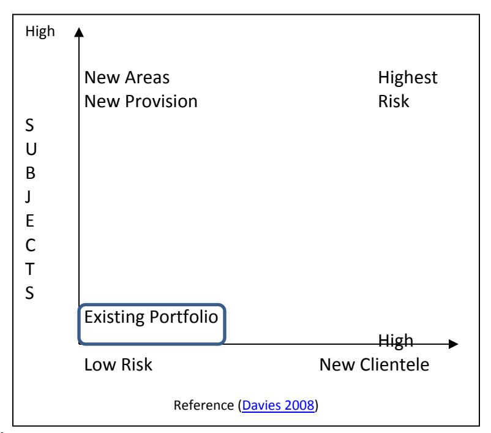
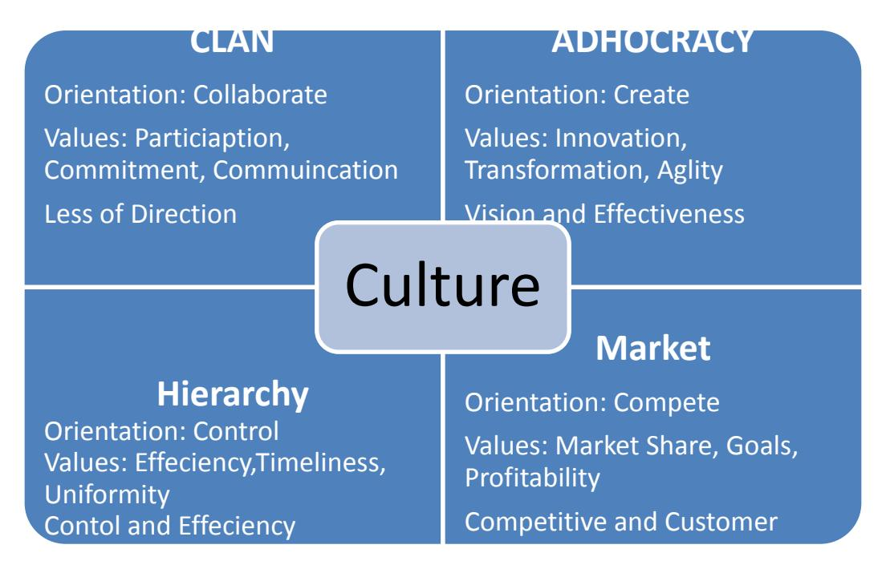

<!-- TH.R01 | source: papers_json/TH.R01/ -->

## **DOCTOR OF BUSINESS (DBA)**

**Entrepreneurialism in Higher Education Institutions (HEIs) in UAE and its Implications** **for State and HEIs**

Bhayani, Alimohommed

Award date: 2013

Awarding institution: University of Bath

Link to publication

## **Alternative formats**

If you require this document in an alternative format, please contact: openaccess@bath.ac.uk

Copyright of this thesis rests with the author. Access is subject to the above licence, if given. If no licence is specified above, original content in this thesis is licensed under the terms of the Creative Commons Attribution-NonCommercial-NoDerivs 4.0 International (CC BY-NC-ND 4.0) Licence (https://creativecommons.org/licenses/by-nc-nd/4.0/). Any third-party copyright material present remains the property of its respective owner(s) and is licensed under its existing terms.

**Take down policy**

If you consider content within Bath's Research Portal to be in breach of UK law, please contact: openaccess@bath.ac.uk with the details. Your claim will be investigated and, where appropriate, the item will be removed from public view as soon as possible.

Download date: 11. Oct. 2025

<!-- page 1 -->

## **Entrepreneurialism in Higher Education Institutions ** **(HEIs) in UAE and its Implications for State and HEIs**

## **Ali Mohamed Bhayani**

A thesis submitted for the degree of Doctor of Business Administration (Higher Education Management)

University of Bath School of Management

May 2013

## **COPYRIGHT**

Attention is drawn to the fact that copyright of this thesis rests with its author. A copy of this thesis has been supplied on condition that anyone who consults it is understood to recognise that its copyright rests with the author and they must not copy it or use material from it except as permitted by law or with the consent of the author.

This thesis may be made available for consultation within the University Library and may be photocopied or lent to other libraries for the purposes of consultation.

Ali Mohamed Bhayani

<!-- page 2 -->

<!-- page 3 -->

## **Table of Contents**

Acknowledgements

6

Abstract

7

List of Abbreviations

8

Chapter 1 Introduction

11

1.1 Reasons for undertaking this study 1.2 Why another study on change in higher education?

12 14

1.3 Statement of problem 1.4 Definition of terms

15 17

1.5 Contribution of this study Chapter 2 - Literature Review

18 20

2.1 What is entrepreneurialism? 2.2 The concept of an entrepreneurial university 2.3 Drivers of Entrepreneurialism

22 25 30

2.4 Attributes of Entrepreneurial Universities 2.4.1 Strengthened Steering Core (Internal Organisation and Management)

34 35

2.4.2 Expanded Development Periphery (Interaction with external stakeholders)

42

2.4.3 Entrepreneurialism in Teaching and Research

44

2.4.4 Diversified Funding base (Financial Management and Resource Allocation)

55

2.4.5 The Integrated Entrepreneurial Culture

58

2.4.6 State facilitation of Entrepreneurialism

64

2.5 Should Universities be Entrepreneurial? Chapter 3 -Landscape of Higher Education in the UAE

70 74

3.1 Drivers of Entrepreneurialism in UAE

75

3.2 Higher education and its governance and funding in the UAE 3.3 Teaching in UAE

78 83

3.4 Research in UAE

86

3.5 Conclusion

87

Chapter 4 Research Methods

90

4.1 Introduction 4.2 Research Objectives and Research Questions

91 91

4.3 Research Philosophy

93

4.4 Research Methodology

97

4.5 Research Design

100

4.6 Sampling Issues 4.7 Ethical Issues concerning this Research

101 103

4.8 Validity and Reliability

104

4.9 Limitations

105

Chapter Five - Findings of the Research

107

<!-- page 4 -->

5.1 Data Collection 5.2 Characteristics of Entrepreneurial Universities in the UAE Context 5.3 Level of Entrepreneurialism in UAE Universities 5.4 Barriers and Enablers of Entrepreneurial Universities in UAE Chapter 6 Analysis of the Research

108 111 122 137 142

6.1 Drivers of entrepreneurial universities in the UAE context 6.2 Strengthened steering core 6.3 Development Periphery 6.4 Entrepreneurialism in Teaching and Research

144 147 153 156

6.5 Diversified Funding Base 6.6 Entrepreneurial Culture 6.7 Response to State facilitation to Entrepreneurialism 6.8 Summary of the analysis

162 165 168 171

Chapter 7 - Recommendations to Make UAE Universities More Entrepreneurial

175

7.1 Recommendations for Higher Education Institutions 7.1.1 Steering of the university

176 176

7.1.2 Human Resources Strategy

177

7.1.3 Expand the development periphery

179

7.1.4 University-Industry Collaboration and Research Centres

181

7.1.5 Development of Enterprise Education

182

7.1.6 Diversification of Funding Base and Devolved Budgets

182

7.1.7 Entrepreneurial Culture

183

7.2 Recommendations for State 7.2.1 Research Development

185 185

7.2.2 Teaching

187

7.2.3 Internationalisation

187

7.2.4 Human Resources Management

188

7.2.5 Steering Mechanism

189

7.2.6 Training and Development

189

7.2.7 Funding Mechanism:

190

7.3 Planning and Managing Change 7.4 Summary Findings and Future Research Chapter 8 Reflections of the author

190 192 195

8.1 Introduction 8.2 The DBA Programme 8.2.1 The Residential Period

196 197 197

8.2.2 The Assignments

198

8.2.3 The Thesis

200

<!-- page 5 -->

References Appendices Appendix 1 – Brief Profile of Case Study Institutions 227 Appendix 2 - Email Correspondence Seeking Permission 233 235 Appendix 3 -Interview Questions Appendix 4 - Relevance of ET attributes in UAE context 237 238 Appendix 5 – Category wise relevance of ET Attributes in UAE context Appendix 6 – Level of ET in UAE universities – Institutional Analysis 239 Appendix 7 – Level of ET attributes in UAE universities – Category Analysis

8.3 Conclusion

200

202

226

240

<!-- page 6 -->

## Acknowledgements

I am extremely grateful to the case study institutions and individuals that assisted me in this study. Thanks are also due to my thesis supervisors, Professor Jeroen Huisman and Professor John Davies, for their continued support, advice and feedback during the course of my pursuit of DBA.

My wife and children deserve mention as they supported me throughout the DBA and provided constant support to undertake the research though it severely affected the work-life balance.

My most respected gratitude is reserved for the Imam (the leader) Mahdi (peace be on him), who along with Jesus Christ (peace be on him), will fill this earth with justice and equity as it would have been filled with injustice.

It is to Imam Mahdi that this thesis is dedicated.

<!-- page 7 -->

## Abstract

The field of higher education has attracted less action with regard to Gulf countries in general and the UAE in particular with remarkably little empirical data available on the topic. This study explores entrepreneurialism in UAE universities. It examines the attributes of entrepreneurial universities in the UAE context.

First, the different meanings and interpretations of entrepreneurial universities are examined, alongside the explanations of drivers of entrepreneurial behaviour in universities. A list of thirty key attributes spanning over six key areas is drawn from literature.

Using a qualitative approach the study tries to understand the perceptions of higher education practitioners about their understanding of entrepreneurialism and its relevance in the UAE context, and then empirically assess the level of entrepreneurialism in each of the institutions.

In-depth, qualitative and multiple case studies are used to assess the level of entrepreneurialism using survey and semi-structured interviews covering respondents from branch campuses, public and private universities.

Most of the entrepreneurial attributes were found to be relevant in UAE context, but the level of entrepreneurialism is low. UAE universities possess some inherent qualities necessary for entrepreneurialism like steerage, concern for economic surplus and performance driven environment that allows quick response to the dynamic external environment and capitalise on opportunities. However, there are some areas that require further development like devolvement, culture of innovation, incentive to take risks and support from the State. The study concludes with broad recommendations at both the system and institutional level to make universities more entrepreneurial. Areas of further research are identified and finally there is a summary of the author's personal and professional development during the DBA course.

<!-- page 8 -->

## List of Abbreviations

HEI Higher Education Institutions

UAE United Arab Emirates

CBFS College of Banking and Financial Studies

IBC International Branch Campuses

KAUST King Abdullah University of Science and Technology

NYU New York University GER Gross Enrolment Ratio GCC Gulf Cooperation Council

MOSHER Ministry of Higher Education and Scientific Research KHDA Knowledge and Human Development Authority

ADEC Abu Dhabi Education Council

REZ RAK Educational Zone SEZ Sharjah Education Zone

UAQIB University Quality Assurance International Board

CAA Commission of Academic Accreditation

WEF World Economic Forum

KFUPM King Fahad University of Petroleum and Minerals

DIAC Dubai International Academic City

KV Knowledge Village UOB University of Bradford

KTP Knowledge Transfer Partnerships MIT Massachusetts Institute of Technology

ICT Information and Communication Technology

RAE Research Assessment Exercise REF Research Excellence Framework

The Association to Advance Collegiate Schools of

AACSB Business

ABET Accreditation Board for Engineering and Technology

EQUIS European Quality Improvement System

TAMU Texas A & M University

ERM Enterprise Risk Management SBU Strategic Business Units

CIPD The Chartered Institute of Personnel and Development

PEST Political Economic Social and Technology

SWOT Strengths Weaknesses Opportunities and Threats

FTE Full Time Equivalent

TQM Total Quality Management SERVQUAL Service Quality Model BS Balance Scorecard

BCG Boston Consulting Group

CPD Continuous Professional Development

<!-- page 9 -->

QA Quality Assurance

GE General Electric company

AMBA Association of MBA HWU Heriot Watt University

IMT Institute of Management and Technology

ADU Abu Dhabi University UD University of Dubai UAEU UAE University

ET

Attributes Entrepreneurial Attributes HCT Higher College of Technology

CERT Centre of Excellence for Applied Research and Training

UC University of California

SML School of Management and Languages

EFMD European Foundation for Management and Development

MOU Memorandum of Understanding NRF National Research Foundation CSR Corporate Social Responsibility

VC Venture Capital

WTO World Trade Organisation

IP Intellectual Property NSS National Student Survey MSU Michigan State University

<!-- page 10 -->

Figure 1 Clark's Triangle of Coordination (Clark 1983) 35 Figure 2: University Management (I.McNay 1995)36 Figure 3 Strategic Management 39 Figure 4 University Directional Policy Matrix (Davies 2008)40 Figure 5: Academic Heartland (Davies 2001)46 Figure 6 Triple Helix Model 48 Figure 8 Competing Values Framework61 Figure 9 Types of Governance Modes (Capano 2011) 67 Figure 10 Regulatory Bodies in UAE81 Figure 11: University Management (McNay 1995)148 Figure 12 Means and Style - Applied 166 List of Tables Table 1 Diversified Income Sources of Universities (Davies 2008)57 Table 2 Attributes of Entrepreneurial Universities 68 Table 3 Demographics and Socio-Economic Indicators in Gulf 78 Table 4 Number of Higher Education Institutions in GCC 79 Table 5 Ranking of GCC Universities in World80 Table 6 Student Enrollment in GCC Countries83 Table 7 Higher Education and Innovation Index of Select Countries (WEF 2008)85 Table 8 Features of Higher Education Systems of UAE88 Table 9 Relavance of ET Attirbutes - Institutional Analysis111 Table 10 Relevance of ET Attributes by Category of Respondent117 Table 11 Level of Entrepreneurialism in UAE - Institutional Analysis122 Table 12 Level of Individual ET Attributes in UAE128 Table 13 Level of Entrepreneurialism - Category Analysis133 Table 14 Barriers and Facilitators (Enablers) of Entrepreneurialism in UAE137 Table 15 Drivers and its Relevance in UAE Context145 Table 16 Characteristics of Case Study Universities146 Table 17 Attributes Pertaining to the Steering Core147 Table 18 Attributes Pertaining to Development Periphery154 Table 19 Attributes Pertaining to Teaching and Research156 Table 20 Attributes Pertaining to Diversified Funding Base 162 Table 21 Attributes Pertaining to the Entrepreneurial Culture165 Table 22 Attributes Pertaining to Response to State Facilitation 169 Table 23 Attributes Present and Those that can be developed in the UAE 172 Table 24 Key Entrepreneurial Attributes that can be developed in the UAE173

List of Figures

<!-- page 11 -->

## Chapter **1** **Introduction**

<!-- page 12 -->

## **1.1 Reasons for undertaking this study**

Recently there has been considerable debate about higher education institutions (HEIs) being entrepreneurial1 in order to remain sustainable in today's fast-changing landscape of higher education (Kirby 2005a). Several factors have led to changes in steering and funding mechanisms with prominent being fiscal tightening, the massification of higher education and the desire to develop knowledge economy. Under the influence of neo-liberal ideology, the governments in the developed world have adopted market based steering mechanism with the aim of making universities efficient and effective (Ferlie et al. 2008). The market based steering model is expected to make universities competitive, creative, innovative and entrepreneurial. Sensing the opportunity provided by the market based steering model, some universities adopted an entrepreneurial spirit while others reluctantly submitted to it.

The concept of an entrepreneurial university has different connotations according to different authors. The concept was first introduced by (Davies 1987) and then further developed by (Clark 1998) and was centered around transferring the research output to the industry termed as 'Knowledge Transfer' (KT) or 'Knowledge Exchange' (KE). Later on the concept was expanded to include a host of activities associated with diversifying the funding base and working with wider society for the economic development of the country. This research explores entrepreneurialism in universities in general and UAE in particular with the purpose of developing an agenda for change based on successful experience of some universities in Europe.

Three previous papers on higher education topics by this author have stressed some aspects of change sweeping through the higher education

^ ^^1^ The term 'Entrepreneurial' will be expounded later in the study. To begin with, it means a university that understands the external environment and adapts itself to the changes facing the higher education landscape.

<!-- page 13 -->

sector. One of these papers was *Managing Change at CBFS* that endeavoured to explain the strategy adopted by a higher education institution in Oman. CBFS, the case study institution, shifted from statefunding by diversifying the funding base which is one of the key attributes of entrepreneurial universities. My other article assessed the use of market based steering in Oman and evaluated the use of market in response to the massification of higher education. The third paper explored the options of funding higher education and its impact on the market of higher education in Oman. The underlying conclusion from the aforementioned studies was that the higher education institutions in the Gulf cannot remain isolated from the changes sweeping the sector. This research is a sequel to the three aforementioned papers and explores the concept of entrepreneurial universities and their strategies to cope with the dynamic environment.

The entrepreneurial university concept is essentially an American and European concept (Clark 1998; Davies 1987; Shattock 2009), but this study focuses on the UAE context. This study assumes importance due to the desire of the UAE government, as part of its Vision 2021 strategy, to transform from investment based economy to innovation and knowledge based economy. This would require universities in UAE to play an active role in the transformation of the economy from resource dependency to the one based on entrepreneurial drive of its citizens. Universities, therefore, need to institute change in order to become entrepreneurial after analyzing the gaps between the desired state and actual state. This journey starts with analysing the perceptions of those working in the higher education sector about the current level of entrepreneurialism and the changes needed to make universities contribute towards the national and societal goals.

The study is broad-based to include the perceptions of faculty members, leaders and State officials about the relevance of the concept in UAE context, which in turn, would help in understanding different opinions on the subject. This knowledge can then be used to determine the level of entrepreneurialism, in light of several global studies, and help us in

<!-- page 14 -->

developing a roadmap of changes required at the system and institutional level to make universities entrepreneurial.

There are numerous studies on the subject of entrepreneurial universities in western countries like USA, UK and Europe with some recent studies focusing on Asia, as well (Shattock 2012). However, there is hardly any study on this topic with regards to Gulf in General and UAE in particular and; therefore, this thesis aims to study the concept in a different setting. Moreover, the set of issues facing universities in the developed world is different as compared to those in Gulf countries where higher education is in the nascent stage. It is, therefore, essential to determine whether the means adopted by universities elsewhere can be relevant to a region with different systems and steering mechanism. The changes needed to bridge the gap would, therefore, be different, as well.

The vast majority of research on this topic are about the process of change (Levin 2001) as opposed to the contents. However, this research would focus more on the contents of the change rather than the process.

## **1.2 Why another study** **on change in higher education?**

An initial review of the literature revealed several studies on this topic with regard to regions and countries. For instance, Michael Shattock studied the topic from a European perspective (Shattock 2009) while there are numerous studies with regards to USA. The search did not reveal any study analysing the entrepreneurial university concept in a Middle Eastern setting, with considerable investments in higher education development. Further, the UAE has a strong desire to develop the knowledge based economy (UAE-Government 2013) and is expecting universities to play a significant role in this development by expanding their research profile. Towards this end, UAE government has also invited elite research based universities to establish branch campuses and have provided them with generous State funding. In this backdrop, it is necessary to examine the concept in a different context with different systems, steering and funding mechanisms.

<!-- page 15 -->

Apart from an interest in the field of higher education, there were three main reasons for pursuing the study on entrepreneurial universities in the Gulf setting. First, it was to address the issue of relevance of the entrepreneurial university concept to the Gulf region. Second, it is vital to develop a regional perspective about what constitutes entrepreneurialism, as opposed to the neo-liberal view of an entrepreneurial university. What works in the developed world with a different higher education system and structure, might not work here. Third, the most compelling reason for doing this research is the desire to guide policy-making in UAE. By adopting the entrepreneurial attributes, universities in the region can support the development of knowledge based economy. UAE government, on the other hand, can support the development of the attributes that are not only underdeveloped by are also relevant in UAE context.

## **1.3 Statement of problem**

As pointed out earlier, Gulf economies are now focusing on the development of the knowledge economy and its diversification away from oil. Towards this end, UAE government is trying to encourage collaboration between universities, industry and government (UAE-Government 2013). UAE and Qatar are leading the initiative by inviting world-class universities to set up branch campuses funded by liberal State subsidies. The strategy is to develop these branch campuses as hubs of technology transfer and intellectual discourse. Even Saudi Arabia, which is considered as a conservative State, has established KAUST (King Abdullah University of Science and Technology), which is the first coeducational institution, modelled on the lines of research-intensive universities in the developed world.

The IBCs are expected to create a competitive environment inspiring change in local universities. It is expected that national universities would benefit from the expertise of IBC's in developing research-driven agenda with emphasis on collaboration with the industry. UAE University, a State-

<!-- page 16 -->

funded federal university, recently launched its first doctoral programme in the country to drive the culture of research. In order to encourage KT and KE, there are some allocations to the research funding via National Research Foundation (NRF).

The universities in the developed world, with an established higher education system, have instituted changes in response to steering and funding mechanism adopted by the government (Ferlie et al. 2008). The reduction of State funding in several European countries, especially the UK, due to the financial crisis of 2008, has forced universities to trim program offerings, compete in the market, enroll more students with less funding, collaborate with industry and generate research valued by the society and industry. This has led universities to think out of the box to secure funding and adjust to the State funding mechanism by changes in their organisational structure and processes.

Apart from the funding and steering mechanism, the State expects UAE universities to increase their ranking in league tables of the world's leading universities by focusing on research. This would require both funding support and autonomy. The generously funded public universities geared towards teaching might need autonomy to be creative and innovative. On the other hand, private universities and branch campuses have considerable autonomy and are subjected to market based steering with little funding support. Entrepreneurialism here would require a different response and; therefore it is worthwhile to examine the concept in UAE context. The study aims to build a model of entrepreneurialism relevant to the Gulf region and one that informs the practice of senior managers.

Specifically, the study addresses the following research questions:

1. What are the predominant characteristics / attributes of an entrepreneurial university as espoused in emerging literature?

2. What are the perceptions of the State and HEIs about the relevance of entrepreneurial universities in the UAE context?

<!-- page 17 -->

3. What is the level of entrepreneurialism in public HEIs, private HEIs and IBCs in the UAE?

4. What are the enablers and barriers in making universities entrepreneurial?

5. What measures can be taken by the HEIs and State in order to make UAE universities entrepreneurial?

The journey of answering the above research questions would commence with understanding the concepts of entrepreneurialism and an entrepreneurial university. This analysis will help us to draw a list of key entrepreneurial attributes, which can then, be presented to university leaders and other stakeholders, to assess their relevance in the UAE context. The respondents can then be asked to assess the level of entrepreneurialism in their HEI. This is significant and potentially interesting data in its own right.

## **1.4 Definition of terms**

A detailed explanation of the concept of an entrepreneurial university will be expounded in section 2.2. However, a brief mention of some terms would not be out of context. Worthy of mention is that many a times terms *entrepreneurial university*, *adaptive university*, *innovative* *university* or *an * *excellent* *university* are used interchangeably in the literature. This is because several studies have indicated that these terms are ways to describe a university that demonstrates excellence in teaching, research and third stream activities and the one that takes risks, develops itself and then relies on external non-state funding to cope with the dynamic environment.

For the purpose of this study, entrepreneurial university is defined as *a university* *that understands the environment* *and responds promptly* *with commercially viable and innovative solutions to manage teaching, * *learning* *and research infrastructure by developing a risk-taking culture* *and reduced reliance on State* *funding.*

<!-- page 18 -->

The word 'State' refers to the government authorities responsible for controlling, licensing and steering the higher education sector in a country.

## **1.5 Contribution of this study**

This study intends to contribute towards the literature but, more importantly, towards the professional practice. As mentioned earlier, this study arises, from a professional desire, to see higher education institutions in the UAE and the wider Gulf, contribute to the development of the knowledge economy. It aims to make following contributions:

Professional practice of HEIs: As discussed later, in chapter 3, the universities in the UAE are lagging behind on the research front. By analysing the best practices at entrepreneurial universities in some OECD countries, this study aims to assess changes that can be replicated, in UAE, to encourage universities to contribute to the economic development. Vision 2021, a UAE policy planning document, envisages a move to the knowledge economy and utilising the potential of universities in economic development (UAE-Government 2013). HEIs can use this study to assess the relevance of entrepreneurial attributes and its implementation in UAE context. It will also help prospective HEIs desiring to establish in the UAE, to understand the higher education landscape and devise strategies to confirm to the State steering and funding mechanism.

Reforming the regulatory framework in UAE: In many countries, the State is steering the higher education sector from a distance rather than getting involved in micromanagement resorting to the use of market-based steering mechanisms (Marginson 1997). The study seeks to understand the steering mechanism of higher education in the

<!-- page 19 -->

UAE and makes an attempt to assess the level of entrepreneurialism. The UAE government can use this study to understand the gaps, guide the steering mechanism, take into account the views of stakeholders and design policies to promote entrepreneurialism.

• Literature: Furthermore, this study can help to fill a gap in the literature on what constitutes an effective entrepreneurial university by offering the perspectives of all stakeholders specific to a Middle Eastern setting. The results obtained, and implications drawn could be of benefit to HEIs already in UAE or those desiring to establish in UAE. Further, it will expand on the work of (Shattock 2009) which gave European perspective on entrepreneurial universities.

In addition, this study will hopefully contribute, first, to the development of theories that can link entrepreneurial universities to change in HEIs. Second, it may contribute to guiding those involved in the management of HEIs. Towards this end, we will first study the concept of entrepreneurialism in general and in the higher education sector in particular. Moving from there, we will understand the UAE higher education landscape and also learn how the context of higher education is different in UAE. In addition to that, we will scrutinize the drivers of entrepreneurial universities in general and UAE in particular.

<!-- page 20 -->

## **Chapter** **2** **-** **Literature Review**

<!-- page 21 -->

A logical starting point for research on entrepreneurial universities is identifying the known before researching what is unknown. The literature review is a form of exploratory research identifying the current best practices in entrepreneurial universities, and then help in preparing a template for comparison. The analysis will not be limited to (Clark 1998) but will evaluate other aspects of entrepreneurialism that can make universities innovative and creative. Primarily, the objective of the literature review is to critically survey the field, identify best practices and prepare a template for data collection and analysis.

The results generated will then be used to assess the relevance of entrepreneurial universities in the UAE. This template will be a benchmark to determine the level of entrepreneurialism. Finally, the literature will be used to create a road map of change in higher education institutions in the UAE.

<!-- page 22 -->

## **2.1 What is entrepreneurialism?**

Entrepreneurialism is a very broad concept, and it encompasses many aspects of today's management. Traditionally, the term 'entrepreneurialism' was associated with the risk-taking ability of organisations to maximise profits (Cantillon 1931). Prominent scholars (Drucker 2007; Schumpeter and Opie 1951) have defined entrepreneurialism as the process of creating innovative solutions to solve societal or economic problems by being innovative and creative. Recently, however, the term has also been used to describe innovative strategies that create social value, as opposed to wealth creation and is termed as 'social entrepreneurship' (Bornstein 2004). Entrepreneurship has wider applications in disciplines like management, economics, psychology, public policy, sociology, science and higher education (Bygrave and Zacharakis 2007)

Innovation, integral to entrepreneurialism, originated in the writings of Joseph Schumpeter (1934) who used the term for new technology and techniques to replace labour in order to maximise profit (Schumpeter 2010). Creativity and innovativeness, driven by university research and knowledge transfer, are critical in the development of the knowledge economy (Valimaa and Hoffman 2008). Entrepreneurship can be defined as '*risk-taking * *behaviour* *that drives innovation and creativity in a dynamic environment and * *enables organisations to capitalise on opportunities in the marketplace*'.

Economic conditions in the eighteen century prompted Richard Cantillon to develop an initial work on entrepreneurship on the premise of risk-taking to maximise profits (Drucker 2007). Based on this premise, it can be construed that all actors in society displaying risk-taking behaviour can be classified as entrepreneurs. University activities like knowledge transfer, internationalisation and incubation, can be classified as entrepreneurial as they involve some elements of risk (Link and Scott 2007).

Schumpeter expanded the concept of entrepreneurship to include innovation and creativity as driving forces to transform the economy (Schumpeter 2010). An innovative society can drive economic growth by

<!-- page 23 -->

efficiently providing the resources, to both public and private sectors, to foster creativity and out-of-the-box thinking. Increasing transition of higher education from public good to the capitalist domain (Slaughter and Rhoades 2004) prompted universities to adopt creative solutions to manage this transition. A group of academics has capitalized this opportunity while others have questioned the very basis of change and still others have reluctantly embraced this transition.

Schultz further emphasised the need of entrepreneurship as a means to restore the economic equilibrium after the recession (Schultz 1980). Schultz, as opposed to Schumpeter, believes that entrepreneurship involves innovativeness and creativity even in stable conditions. Universities, therefore, can use their human capital to generate innovative ideas, not only in times of turbulence, but also in an era of stability.

Risk-taking behaviour, an integral part of entrepreneurialism, can also result in failed attempts. However, an organisation with an entrepreneurial culture pursues opportunities in untested domains even in the face of failure (McGrath and MacMillan 1995) and are able to handle resistance to change (Bhide 2000). Adaptation to the new domains, change in work practices and the ability to manage resistance are a recipe of success in the pursuit of entrepreneurial drive (McGrath and MacMillan 1995).

Another facet of entrepreneurialism is strategic adaptability to exploit opportunities and the ability to adapt to the dynamic environment (Dean and Thibodeaux 1994). Steerage, with a focus on setting priorities, can play a significant role in strategic adaptability and quick adjustments to the plans (Barringer and Bluedorn 1999). Organisation structure, mechanistic or organic (Burns and Stalker 1961), can also have a significant impact on strategic adaptability. While evaluating a new business opportunity, mechanistic structure relies on authority, rules, procedures and quantitative data. On the other hand, organic structures are informal and emphasise sharing of knowledge, and use intuitions to make decisions about business ventures. Entrepreneurial organisations typically adopt an organic structure

<!-- page 24 -->

and rely on the experience and intuition of senior managers in decisionmaking (Schoemaker and Russo 1993), avoiding comprehensive data analysis (Miller and Ireland 2005). However, quick reactions can result in failure as well, but not acting on opportunities and threats can pose bigger risks. Universities need to find the right balance between quick reactions and formal decision-making. Organic structures are effective when organisations have 'internal coherence' (Miller et al. 2002), aligning of structure and decision-making (Porter and Kramer 2006). Universities, subject to mechanistic structures, might need to relax formal decision-making process based on consensus as it can not only cause delays but can also stifle entrepreneurial drive.

In conclusion, it can be said that the essential characteristics of entrepreneurialism are the risk-taking ability, innovation, exploiting the dynamic environment, managing change and making smart decisions. When organisations are inherently entrepreneurial, they are said to have supplyside entrepreneurialism. However, if they are reacting to the environment, they are classified as demand-side entrepreneurialism. In both cases, organisations need to have structures and processes in place accompanied by internal coherence.

In the next section, the topic of entrepreneurialism in the higher education context will be analysed.

<!-- page 25 -->

## **2.2 The concept** **of an entrepreneurial university**

As discussed in the last section, the entrepreneurial drive is either in response to the external environment or is internally driven based on resources and capabilities. The external 'environmental factors' like neoliberalism, a reduction in state funding, globalisation and steering mechanisms have created challenges for the universities (Currie 1998) and are amongst the factors driving entrepreneurial behaviour. Many authors have written on the subject of entrepreneurial universities (Etzkowitz 2004; Kirby 2005a; Sporn 2001), but the concept was conceived by John Davies (Davies 1987) and became prominent when Burton Clark (Clark 1998) published case studies of five entrepreneurial universities.

Entrepreneurial activities were triggered by the Bayh-Dole Act of 1980 (USA) allowing universities to own the patents arising from the government sponsored research (Mowery et al. 2001; Shane 2004b). Later, several OECD countries adopted measures encouraging universities to commercialise research. Some universities capitalised this opportunity of generating additional income and registered patents and commercialised the knowledge (ibid) while others joined the league, as the result of, State steering and funding mechanism. Entrepreneurial drive to capitalise on the opportunities or react to changes in the external environment has assumed several names to signify the expanding role of universities like '*the adaptive * *university*', '*proactive university*', and '*innovative university'* (Clark 1998; Clark 2004); '*university technology transfer*' (Dill and Sporn 1995), '*market * *universities*' (Slaughter and Leslie 1997), '*service universities*' (Cummings 1997), '*Mac-university*' (Ritzer 2002), '*corporate university*' (Nowotny et al. 2001).

Entrepreneurial universities possess some inherent characteristics like the encouragement of innovative academic behaviour, forging partnerships with external bodies, generating non-state funding to gain autonomy and steerage (Clark 1998). Michael Shattock has defined entrepreneurialism in universities as "*a drive* *to identify* *and sustain* *a *

<!-- page 26 -->

*distinctive* *institutional* *agenda* *which is institutionally determined, not one * *(which is) effectively a product* *of a State funding formula*" (P.17) (Shattock 2010)

Initially, the entrepreneurialism involved collaboration with the industry to commercialise the research (KT/KE), thereby, transforming the university from Mode 1 to Mode 2 knowledge creation (Gibbons et al. 1994). Initially the knowledge transfer activities were voluntary, and some universities opportunistically used it to generate non-state funding (Etzkowitz 1983). Realising the potential of the knowledge transfer activities and its impact on economic development, the State started to use steering and funding mechanism to encourage university-industry collaboration (Etzkowitz 2003; Etzkowitz 2004) thereby expanding the role of universities to support regional economic development (Audretsch and Lehmann 2005; Ferlie et al. 2008; Schulte 2004; Shane 2004a). At a later stage, the scope of researchbased entrepreneurialism was widened to include the ability of faculty members to create start-ups by commercialising the research (Chrisman et al. 1995) and being innovative and creative in the teaching arena, as well (Fiet 2001; Kirby 2005b; Vesper and Gartner 1997).

Entrepreneurial drive needs enabling structures and systems like revamped governance model, strong leadership and strategic planning (Middlehurst 2004; Subotzky 1999) and 'Technology Transfer Offices' (TTO) (Dill and Sporn 1995; Link and Scott 2007). However, one of the key ingredients of entrepreneurialism was the cultivation of entrepreneurial culture making universities innovative and creative in research and teaching (Clark 1998; Jacob 2000; Kirby 2002; Laukkanen 2000; Sporn 2001).

The degree of entrepreneurialism is classified as 'soft' and 'hard' (Barnett 2000). 'Soft' entrepreneurialism entails the desire of universities to act within the open market framework, often reluctantly, to mitigate the loss of financial support from the State. 'Hard' entrepreneurialism, on the other hand, means to maximise financial return (Barnett 2000) and be commercially viable (Davies 1987).

<!-- page 27 -->

Encapsulating the aforementioned definitions and the concepts, a working definition of entrepreneurial university can be formulated as **a ** **university** **that understands the environment** **and responds promptly** **with commercially viable and innovative solutions to manage teaching, ** **learning** **and research infrastructure by developing a risk-taking culture** **with** **reduced reliance on State funding.**

The concept of an entrepreneurial university has wide acceptance in the academic community, but it has its own set of critics. Some scholars feel that this concept threatens the very mission and integrity of universities (Slaughter and Leslie 1997) while others contend it has resulted in the neglect of the academic heartland (Marginson and Considine 2000). Others, like Deem, feel that entrepreneurialism in universities has led to the introduction of '*managerialism*' (functional managers involved in decision making) and '*corporate style* *management*' (Deem 2001), leading in turn to the loss of freedom due to the dependence on corporate funding. Wende and Huisman claim that the drive to be entrepreneurial has resulted in the sacrifice of "*critical pedagogy, disinterested* *research and personal and * *cultural development*" P.195 (Van der Wende and Huisman 2003).

It is also contended that expecting universities to contribute to the economic development of the nation has resulted in the neglect of the cultural and social transformational role of universities (Amaral and Magalhaes 2009) and loss of its mission and identity (Slaughter and Leslie 1997) and eventually might result in a loss of international competitiveness.

It is agreed that the pressure on the universities is intense due to its expanded mission. However, in many cases, universities might be forced to adapt to the changing market conditions and steering mechanisms of the State. There might be some cases of voluntary entrepreneurialism to capitalise on the opportunities. However, many a times it is as a response to State steering and the funding mechanism (Etzkowitz 2003). Critics have failed to understand that more often entrepreneurialism is adopted involuntarily, and organisations might not have much choice but to re-

<!-- page 28 -->

organise themselves and become competitive (Ferlie et al. 2008; Pettigrew 2003). Universities might not desire to generate economic profit, but the State nowadays expects universities to adhere to the market-based steering and become efficient and effective (Williams 2002). The role of the State in diluting the essential character of the university and forcing them to transfer their resources from research to marketisation (Slaughter and Leslie 1997) is an acknowledged fact. Universities, on the other hand, are increasingly adjusting to the dwindling funding from the State and have adopted demand side entrepreneurialism. This can cause the transfer of resources to subjects that have a higher economic value (ibid) raising the question of externalities. However, it is necessary to understand that the funding of externalities is the responsibility of the State (Becher and Kogan 1992). Universities, on the other hand, are expected to allocate resources based on the State funding and steering mechanisms.

There are many instances of universities adopting entrepreneurial behaviour voluntarily to capitalise on the opportunities in the hope of gaining autonomy from the State. The reduced reliance on the State funding might help universities in building their independent identities and charting their future rather than remain passive recipients of the State funding (Clark 1998; Williams 2002). It is far-fetched to say that entrepreneurialism dilutes teaching and research. Rather, entrepreneurialism entails competition forcing out sub-standard teaching and research from the market place. The focus on the regional and economic development might not lead to losing international competitiveness (Lazzeretti and Tavoletti 2005) but would bring out creativity and innovation through research and teaching.

Entrepreneurialism, whether voluntary or imposed (due to depletion of the resource base), demands that universities assume the risk and be innovative to facilitate economic growth and be financially viable. It is not required to achieve economic gains at the expense of academic values but by safeguarding those values (Barnett 2003). Entrepreneurial universities have societal dimensions and are market-oriented, possess a risk-taking

<!-- page 29 -->

culture, foster innovation, support regional development and facilitate the building of the knowledge society (Williams 2002). Every concept and tool normally have a positive aspect and a negative side. It is, therefore, incumbent on the universities to make use of the positive aspects and devise policies to help mitigate the negative effects of the concept. Based on the State's expectations the entrepreneurialism in universities is no longer a matter of choice but an imperative.

Again, in the end, it is necessary to repeat the definition of the entrepreneurial university used in this study as **a university** **that ** **understands the environment** **and responds promptly** **with ** **commercially viable and innovative solutions to manage teaching, ** **learning** **and research infrastructure by developing a risk-taking culture** **with** **reduced reliance on State funding.**

In the next section, I will explore the drivers of entrepreneurial universities before moving on to understand the changes brought about by these universities to become entrepreneurial.

<!-- page 30 -->

## **2.3 Drivers of Entrepreneurialism**

Why universities might adopt entrepreneurialism, is a logical next question? The drive to be entrepreneurial can comprise of internal forces, enacted under a stable environment, or as a response to the State steering and funding mechanism. Based on the above there are two broad drivers of entrepreneurialism.

## Entrepreneurialism in a stable environment (voluntary)

The drive to be entrepreneurial can be internal and voluntary (Schultz 1980) and mostly undertaken in a capitalist society to maximise profit even when there is no turbulence in the economy (Gartner and Shane 1995). A capitalist society encourages entrepreneurs to take risks and be innovative and creative (Shane 1993). This quest for risk, innovation and creativity also depends on the entrepreneurial culture of the organisation or the country (Lounsbury and Glynn 2001). An entrepreneurial culture can encourage academics, as was the case with MIT (Etzkowitz 2003), to take initiative in attracting the research funding and pursuing knowledge transfer activities. Leadership can also play a significant role in steering entrepreneurial behaviours and nurturing individuals with entrepreneurial drive.

## Entrepreneurialism in a dynamic environment

The external pressures can also compel universities to adopt entrepreneurial behaviour. Market based steering and funding mechanisms have driven universities to explore revenue streams emanating from crossdisciplinary research and knowledge transfer (Thornton 1999). This can also lead to competing in the market for students and funding (Levin 2001). Other factors like austerity measures and depleting resources of the State have also resulted in universities relying on diversified funding base by being creative and innovative.

Entrepreneurial action can boost the economic development and progress of a nation (Audretsch 1995). Summarised lists of the drivers, as derived from the relevant literature are as follows:

<!-- page 31 -->

Knowledge economy: The creation and dissemination of knowledge has become a driver of economic development and the knowledge society (Etzkowitz et al. 2000). In many OECD countries, governments now desire universities to carry out cutting edge research that can be commercialised and contribute to the economic growth (Shattock 2009). One of the manifestations of this expectation is a shift from pure scientific fields to applied research in areas like biotechnology, ICT and green technology (Delanty 2001). The emergence of these new fields is considered critical to the development of the knowledge economy and commercialization of research (Wong et al. 2007). Barnett has defined this situation as "*from higher education* *in society to higher * *education of society*".P.21 (Barnett 1994)

Globalisation: A saturated domestic market, increasing competition at home, globalisation, ICT, lowering of trade barriers and a quest for knowledge exchange has stimulated universities to adopt an internationalisation strategy (Enders 2004). As part of the internationalisation strategy, universities enter into agreements with international universities for global knowledge exchange (Lazzeretti and Tavoletti 2005). In many countries, for instance UK, the government expects universities to attract international students, research funding and contribute to knowledge exchange (Witte 2004) and also provides support structures.

New education providers: New players in the form of corporate and for-profit universities have changed the competitive landscape and have driven traditional universities to be creative and customer-centric. In response to the student's demand, many traditional courses are restructured to incorporate training for employable skills. Universities are now competing with new education providers as well as other traditional universities for

<!-- page 32 -->

students in line with the market-based steering and funding measures adopted by the government (Fiet 2001).

Austerity measures: State finances have been strained in most of the OECD countries, leading to austerity measures and reduction in higher education funding. These reductions have challenged universities to diversify their funding base and become entrepreneurial (Chrisman et al. 1995; Keast 1995).

Market-based steering: Use of market, a form of neoliberal ideology, has made higher education landscape competitive with the involvement of private and corporate universities (Bernasconi 2005) driving universities to be entrepreneurial. Universities are expected to be creative, competitive and possess a strategic competitive advantage to succeed in the marketplace of higher education (Currie 1998). Moreover, public universities in countries like Canada, United States, Australia and United Kingdom have received autonomy from State accompanied by accountability measures like collaboration with industry, knowledge transfer and commercialisation of the research (Ferlie et al. 2008). On the teaching front, voucher-based funding is exerting pressures on universities to compete in the market for students (Jongbloed 2007). Market pressures are, therefore, pushing universities to change (Fuller 2003) and become economically viable (Cowen 1991).

Student as a customer: Students are seen as customers or consumers who can influence the course design and delivery (Slaughter and Leslie 1997). Market route to higher education has put students in the driving seat (Marginson 2000) and have compelled universities to be customer-centric, provide a vibrant learning environment and invest in infrastructure and teaching aids. Moreover, universities have adjusted their product offerings to match the changing customer preferences and have slowly

<!-- page 33 -->

shifted to cost-effective distance learning and eLearning courses (Van Vught 1988).

Mass higher education: Swelling student numbers and static funding per student have pushed universities to do more with less and be efficient in serving students. Universities have used a creative approach by delivering programs using ICT, offering blended learning opportunities and affiliations with further education colleges.

Regional development: Universities are expected to use technology transfer and start-up mechanisms to drive regional development (Kirby 2002). Public funding is now dependent on the explicit expectations to develop technologies that aid regional development (Ferlie et al. 2008).

Internal drivers: Some universities inherently possess an entrepreneurial culture, encouraging their faculty and staff to be entrepreneurial (Clark 1998). Leadership at such institutions actively encourages departments to shed boundaries and pursue interdisciplinary research leading to knowledge transfer and expanding their academic offering in the market of higher education.

Multiplicities of factors, as discussed above, drive entrepreneurialism like the free market, globalisation, marketisation, new public management, stakeholder management and the reduction of public funding (Deem 2001). However, the State remains the main driving force behind this drive and has created a competitive market-driven culture (Ferlie et al. 2008; Mok 2005).

To sum up, universities have responded to the external environment by instituting changes to their organisational structure, governance, culture, leadership, teaching and research. In the next section, these changes will be discussed

<!-- page 34 -->

## **2.4 Attributes of Entrepreneurial Universities**

The changes adopted by entrepreneurial universities will be discussed in detail, in this section. Apart from Clark's (1998) work, which has become very prominent in higher education literature with 2720 academic citations on Google Scholar in Feb 2013, I have used the works of other prominent scholars in the field and have given more clarity to the list provided by the Clark. These broad areas of entrepreneurialism are:

1 *Steerage of the university* has enabled universities to react quickly to the dynamic environment (Clark 1998; Slaughter and Leslie 1997). This is backed by increasing use of the strategic management tools in order to remain competitive in the market place (O'Shea et al. 2008).

2 Entrepreneurial activities are supported by creation of academic and support structures termed as *expanded development * *periphery* (Clark 1998).

3 Research, at the heart of universities, is expected to be used for economic development and wider society (Etzkowitz 2004; Schulte 2004). The state expects the use of research for economic development and teaching to enhance graduate employability (Schulte 2004). Enterprise education can help achieve both these goals (Benneworth and Charles 2005; Etzkowitz 2004).

4 Concern for financial viability is an essential characteristic of entrepreneurialism calling for *diversified funding base* and robust financial management and resource allocation system.

5 The *organisational culture* is an essential ingredient of entrepreneurialism requiring continuous organisational change and collective understanding of the change agenda (Kezar and Eckel 2002).

6 Last but not the least, universities are adapting to changes in State steering mechanism (Davies 2001). This is an additional attribute where entrepreneurial universities have responded positively to the State facilitation of entrepreneurialism.

In coming sub-sections, we will critically analyse these changes in more detail.

<!-- page 35 -->

## **2.4.1** **Strengthened Steering Core (Internal Organisation and ** **Management)**

One of the predominant areas of change in entrepreneurial universities is with regard to internal governance structure and management. Internal governance explains the 'who', 'what' and 'when' of the decisionmaking process (Gayle et al. 2003). The governance structure has undergone substantial changes that include steerage of the university, strategizing human resources management, adoption of transformational leadership style and use of strategic management tools. This sub-section will endeavour to assess the steerage, leadership and strategic management of the universities.

Traditionally, universities were managed by an academic oligarchy on the lines of professional *self-governance* whereby the academic community

> *Figure 1* *Clark's Triangle of Coordination (Clark 1983)*

governed themselves (Parsons and Platt 1973). On the other hand, shared governance and *representative* *democracy,* increasingly adopted after 1970's in many Western democracies, involved faculty and students in the decision-making process. *State* also played a dominant role by making

<!-- page 36 -->

appointments to the key leadership positions in public universities (Schimank 2005) but recently it is the 'market' that plays an ever increasing role in determining the governance (de Boer et al. 2008). Clark (1983) has labelled the interplay of Academic oligarchy, Market and State as 'triangle of coordination'. Governance structures in post-communist era invariably include all three entities (Temple 2008).

Recently, the State has started to give more prominence to the 'market' to make universities more agile and responsive to the dynamic environment. In response to this, central leadership has started to steer the universities by setting priorities and adoption of a systematic approach to capitalise on the market opportunities (Clark 1998).

A strengthened steering core, with the responsibility to set direction, enhances responsiveness, and it is an essential feature of an entrepreneurial university (Clark 1998; Etzkowitz and Leydesdorff 2000; Powers and McDougall 2005). The traditional structure of professional selfgovernance and representative democracy was presumed to be incompatible with an entrepreneurial culture and incapable of being

|   |   | Policy Definition Tight |
| --- | --- | --- |
|   | Corporation The Plan Strategic Management officer Planning | Enterprise The Profit / Market Entrepreneur / Products Operational Control |
| Tight | Bureaucracy The Rules The Administration Processes / Procedures | Loose Collegial The Discipline Professors People-Oriented Loose |

> *Figure 2:* *University Management (I.McNay* *1995)*

<!-- page 37 -->

responsive to the market needs (Jarvis 2000; Subotzky 1999; Yokoyama 2006) due to the decision making based on consensus. *Entrepreneurial * *management* *structure* (McNay 1995) involving steerage (de Boer et al. 2007) is expected to result in improved communication and a shorter span of control. Apart from this, the steerage is helpful in aligning the purpose, goals and strategies of teaching, research and community outreach (Etzkowitz et al. 2000). Design of strategic directions is centralised with the involvement of the *governing boards* (Schuster et al. 1994). However, the implementation part is delegated to the academic department with clear performance and accountability measures (de Boer et al. 2005; Sporn 2001).

Academic departments and colleges used to chart their own strategies, goals and objectives (Collegial as in Figure 2), but in entrepreneurial universities there is a central goal (Enterprise as in Figure 2) (Sporn 2001). The essential elements of the enterprise model it to have tight 'Policy Definitions' and loose 'Operational Control' termed as *devolved * *entrepreneurial management.* This devolved management structure has self-motivated and empowered individuals (Clark 2003) as the head of departments or deans with responsibilities of resource allocation and business development on lines of Strategic Business Units (SBUs) (Davies 2001). Centralised leadership actively steers the SBUs to adhere to the vision, mission and strategies of the organisation and have systems in place for quality controls, financial management, business development and partnerships development (Middlehurst 2004). Universities can adopt 'umbrella strategy' (Mintzberg and Waters 1985) drawing up the strategic boundaries and then giving freedom within those strategic boundaries (Grigg 1994).

The above setup results in dilution of consensual decision-making thereby *reducing the role of committees* in entrepreneurial universities. Often committees are there to protect the status quo as explained by Blank (Blank 2012):

<!-- page 38 -->

*"Everyone who has a reason to say 'No' is represented. Dealing with * *disruption is not solved* *by committees.* *New market* *problems call for * *visionary* *founders, not consensus* *committee members".*P.2

Many a times it is not the committee that is to be blamed for lack of decision but the lack of the owner to implement the decision made by the committee.

Change in the governance structure, as discussed above, from the collegial to the enterprise model has brought into sharp focus the role of leadership in actively steering the university (Bolden et al. 2009). However, there are concerns, for example, in some HEI's in UK, about leadership in universities being dislocated, disengaged and dysfunctional (Bolden et al. 2009) where the accountability shifts from the individual to the group. In an entrepreneurial university where the achievement of the vision is of central importance, a dissipated leadership with no clear goals would become a liability. Academics have traditionally valued collegiality and consensual decision-making (Bellamy et al. 2003) while entrepreneurial universities value role of leadership role in decision making to reduce the gestation period between the idea and its commercialisation (Beise and Licht 1996). Department heads, devoid of authority and incentives (Bryman 2007), are unable to make decisions and; therefore, an empowered devolved structure is needed to react quickly.

Entrepreneurial universities grappling with change need *transformational leaders* to steer the universities (Dill and Sporn 1995; Sporn 2001; Yokoyama 2006) and implement constant change (Bass 1999) (Ramsden 1998). Transformational leaders possess certain intrinsic qualities like knowledge, honesty and charisma (Bolden et al. 2009) and implements change using a pre-determined approach (Kouzes and Posner 2003). These leaders need to convince faculty and staff about the new entrepreneurial mission (Yokoyama 2006). One of the Options is to create a strategic management group with a few ardent supporters (Rindfleish 2003) like VP's

<!-- page 39 -->

with functional portfolio related to R&D, Internationalisation, Corporate affairs etc. (Davies 2001). This group can then institute change by convincing other stakeholders (Kezar and Eckel 2002). However, the success depends on the framework that includes senior leadership support (people in positional power), collaborative leadership (involvement of individuals throughout the campus), robust design (vision and mission) and visible action (staff development) (Kezar and Eckel 2002; Yokoyama 2006).

The aforementioned change requires the use of *strategic * *management practices* to create differential advantage (de Boer et al. 2007; Ryu 1998). Universities also use strategic models like PEST, and Porter's Five Forces to understand the external environment and key stakeholders. As part of the situation audit, universities analyse the life cycle of educational activity (Davies 2008) to define strategies and make judgements about the extent of developmental activities and risks that can be undertaken (See Figure 3). Expanding into new subject areas in search for funding and working with totally new clientele can risky. It is, therefore,

prudent to use piecemeal approach to change, in response to the State's expectation, and contribute towards the economic development (Ferlie et al. 2008; Shattock 2009). The strategic direction adopted needs to be selected carefully, and one of the options is to use 'University

> *Figure 3* *Strategic Management*

<!-- page 40 -->

2008). The tool is powerful in the sense that it allows universities to assess their strengths and match the same with market requirements and needs.

|   | g | y | y ( Subject Area Attractiveness | ) |
| --- | --- | --- | --- | --- |
|   |   | High | Medium | Low |
| University Strengths in the subject Area | High m Mediu | Growth Selective Growth or Consolidation | Selective Growth or Consolidation Consolidation | Consolidation Planned Withdrawal and Redeployment |
|   | w Lo | Consolidation or Planned witthdrawal And Redeployment | Planned Withdrawal and Redeployment | Planned Withdrawal and Redeployment |

> *Figure 4* *University Directional Policy Matrix (Davies 2008)*

The university policy matrix identifies the strengths of the universities like the size of the department, market share, market position, the number of applications, the quality of student intake, graduate employment, cost per FTE student, reputation, the quality and age of the staff, research record, research capability, image, publications record and resource availability (Davies 2008). These strengths can then be matched with the 'subject area attractiveness' factors like competitive structure, PEST factors and market growth. This helps in creating strategic FIT between the organisation, capabilities and the environment.

One of the key strengths is to have talented academics and, therefore, it is critical to have *human resources strategy* in place to attract and retain faculty members with active research agenda, capable of generating external revenue from grants and other third stream activities (Powers and McDougall 2005). The hiring and compensation structure are aligned with the strategic plans of the university (Shattock 2009) with somewhat marked shift to the non-tenure track system with flexible fixed

<!-- page 41 -->

term teaching and research contracts (Oliver 2012). The commitment of such contract based faculty is questionable, and a high staff turnover would create an impediment in strategy implementation. As part of HR strategy, universities have used employee engagement programs (CIPD 2011) to retain and motivate faculty members. The reward structure has also become more flexible and includes bonuses and revenue-sharing apart from basic salary (Kirby 2005a; Shattock 2009), promotions and recognition (Kirby 2005a).

The use of entrepreneurial style of management with emphasis on steerage, leaderships and strategic management has been a source of concern amongst the academic fraternity (Deem 2001; Subotzky 1999). The president and provost are getting involved in setting strategic directions, resource usage, changes to academic programmes and restructuring of the departments (Jongbloed 2007). These decisions were the sole purview of academics, and it is argued that alienating the academics from the decision making is leading to the intense battle between faculty members and executives (Deem 2001) and will eventually lead to lower quality output and decreasing of competitiveness in the market.

However, these fears are unfounded because entrepreneurial management involving steerage and leadership serves to enhance competitiveness of the universities by integrating various departments of the universities (Shattock 2000) under the umbrella of the strategic vision and goals. The loss of autonomy with regard to steerage is compensated by the empowered SBU structure with authority to allocate resources and chart their own future (Shattock 2009). Centralized strategic planning can lead to efficiency and impact (Neave and Van Vught 1991) with greater coherence amongst departments and colleges (Sporn 2001). The reduced role of committees cannot be condoned, and it is necessary to emphasize their role as it encourages diversified opinion. Leadership, on the other hand, plays an effective role in a situation that requires quick reaction or implementation of disruptive changes in response to the dynamic environment. Here, the

<!-- page 42 -->

central leadership cannot sit back and rely on an endless cycle of slow decision making by the committees. Whether it is exploiting a new opportunity or reacting to a crisis situation, the universities might need transformation in the structure, leadership, and strategies (Subotzky 1999; Todorovic et al. 2005).

In conclusion, it can be said that the entrepreneurial universities have central leadership setting the strategic direction of the university as a response to the dynamic environment facing higher education. This allows for setting priorities, direction and quick reaction to opportunities. The collegial model where departments were loosely linked to the central unit with no direction or priorities would have been tenable in an environment of stable funding. However, in the changed environment there is devolvement under the strategic framework with set accountability measures (Shattock 2009). Faculties, with financial sense, pursue research in intra-disciplinary research centres rather than in silos of the departments with the research agenda being shaped by the industry (Jansen 2007). Leadership is responsible to not only to set directions but integrate various departments of universities and involve them in policy design and implementation (Shattock 2002). However, this needs elaborate academic and support structures in the form of an expanded development periphery discussed in the next section.

## **2.4.2 Expanded Development Periphery (Interaction with external ** **stakeholders)**

The academic and support structures needed to pursue entrepreneurial mission termed as expanded development periphery will be discussed in this section along with the stakeholder engagement.

In a traditional collegial setup, the academic departments were responsible for deciding their agenda and interaction with external stakeholders. However, many a times this interaction is undertaken to suit the academic departments rather than the need of the market (Matkin 1997). It is, therefore, appropriate that non-core activities like market

<!-- page 43 -->

assessments, sourcing the funding, interaction with industry and State, preparation of bids are performed by professionals who are experts in these activities. On the other hand, academic can concentrate on things that they can do better rather than devoting time to administrative activities involving a lot of paperwork (Matkin 1997). Peripheral departments work with academic departments and facilitate *interaction with stakeholders* like State, industry, students, suppliers, local community, alumni and the international community.

As part of the above process, entrepreneurial universities establish *support structures to facilitate* *activities *like spotting of opportunities, collaboration for knowledge transfer, alumni relations, industry funded research and fundraising. These sorts of departments are termed as "development periphery'' by (Clark 1998) or "satellite organisations" by Davies (Davies 1987) and are normally more pro-active and customerfriendly. One of the key support structures enacted by entrepreneurial universities is the Technology Transfer Office (TTO) which serves as the interface between university and industry. The TTO's are expected to have an appropriate policy framework, dedicated resources, supporting structures and explicit incentives to encourage meaningful engagement with the industry (Feldman et al. 2002). However, it is observed that TTO's often suffer from lack of financial and human resources and also face resistance from the faculty who are reluctant to disclose their inventions (Siegel et al. 2003). In order to make TTO's successful, universities are supposed to devise structures with appropriate reward systems that encourage faculty to disclose their inventions (Siegel et al. 2003). Effectiveness of TTO's is enhanced by the informal and formal social network (Lee 2000) to source market opportunities. TTO's can be a cause of friction and in order to avoid conflicts it is essential to keep the role of the researcher and role of the entrepreneur separate (Vestergaard 2007). Apart from TTO's, the Universities have augmented the *academic departments with functional* *expertise* like financial management, human resources and business

<!-- page 44 -->

development to support academics in entrepreneurial domains. These changes are undertaken to support the academic heartland of teaching and research discussed in the next sub - section. .

## **2.4.3 Entrepreneurialism in** **Teaching and Research**

The research and teaching are key pillars of entrepreneurial activity. Research at universities has transformed to include active pursuit of knowledge transfer, commercialisation and incubation activities (Laukkanen 2003; Siegel and Phan 2006) thereby driving economic growth (Feldman and Desrochers 2003; Keast 1995). On the other hand, teaching has become customer-focused with the academic model to suit the needs of the student - customer. This section will discuss the innovation and creativity with regard to research before moving on to teaching.

Universities have undertaken several changes to facilitate entrepreneurial drive like forming *interdisciplinary research centres* bringing the knowledge from across the university to deliver application oriented outputs to the industry (Marginson 2000). These interdisciplinary clusters and centres, serving as matrix organisation, engaged in collaborative research spanning national and international boundaries (Currie 1998) to gain funding. It is expected, as part of the new entrepreneurial mission of the universities that faculties come out of the traditional departmental boundaries and work in these research centres to deliver research that is aligned with university's strategic mission.

Entrepreneurial universities have moved beyond publications of the research output to active *commercialisation of the research* in following ways (Etzkowitz 2004):

1. Emerging entrepreneurs develop small and medium enterprises (SME) in collaboration with faculty members, backed by innovative research;

<!-- page 45 -->

2. Specialised research centres having cross functional teams with supporting infrastructure for the research, industry links and professional managers for analysing the financial viability;

3. Development of research groups or quasi-firms engaged in making research available to the industry;

4. Special liaison offices to work in collaboration with industry trying to understand the research needs and explore funding opportunities;

5. Establishment of TTOs that can work on patents, licenses and development of intellectual property; and

6. Formation of business incubator and technology parks to assist graduates in commercialising the research by starting new ventures.

Entrepreneurial universities integrate the knowledge transfer into the very fabric of the university and make adjustments in the governance structure, entrepreneurship education, industry collaboration and financial management (Siegel et al. 2003; Witte 2004). In addition to this, entrepreneurial professors work in collaboration with industry, faculties and doctoral students; to produce economically viable research (Lam 2007) by registering patents and license agreements (Campbell and Slaughter 1999; Etzkowitz 2003). As part of the research strategy, universities encourage graduate students and faculty members to establish ventures (Bains 2005; Van Vught 1999) by being creative, innovative and entrepreneurial (Mok 2005). This emphasis can be created by *teaching entrepreneurship and * *business* *planning at all levels* (*Enterprise education)* including, among others, undergraduate, Master's and doctoral level (Jack and Anderson 1999; Katz 2003; Kirby 2005b). It is expected that the creation of the entrepreneurial mindset will encourage students to purse startups that can drive economic growth (Krueger and Brazeal 1994; Vesper and Gartner 1997). Some scholars have underscored the importance of enterprise

<!-- page 46 -->

education by stating that this is regarded as the entrepreneurial university's positive contribution to the society (Elton 2003; Fiet 2001).

In order for the entrepreneurship to succeed, universities need to identify the departments with potential to be entrepreneurial. Universities can then facilitate the departments based on their potential for development or their current performance in pursuing entrepreneurialism. An academic heartland matrix (like BCG -Boston Consulting Group) can be used to identify departments with entrepreneurial potential and can help guide investment strategy (Davies 2001).

| School's Potential for EA Low | High |   |
| --- | --- | --- |
| A | B |   |
| Performance in EA |   |   |
| C | D |   |
| High |   | High |

> *Figure 5:* *Academic Heartland (Davies 2001)*

The matrix in Figure 5, similar to the BCG matrix (Jobber 2010), can be used to devise investment strategies to achieve a balanced portfolio of departments and colleges based on entrepreneurial potential and performance. The following strategies can be used for each of the above types of departments and colleges:

**Quadrant A**: As per BCG matrix, these colleges and department are 'dogs' with a low potential for entrepreneurial activity, which is reflected in their

<!-- page 47 -->

current low performance. Either these departments have reached the end of their product life cycle (PLC), or have subjects that are not in demand so it is better phasing out such departments or merge them with other departments to make them viable and effective.

**Quadrant B**: Departments with strong potential but have still not demonstrated any entrepreneurial performances are classified as 'question marks'. There are continued investments in such departments due to their potential for entrepreneurial activity. The reasons for the low performance can include lack of academics with entrepreneurial drive, leadership or culture within the department. Either the department is merged, or an exhaustive change management plan is implemented.

**Quadrant C**: Schools with low future potential and current high performance can be treated like 'cash cows' by diverting the surplus to the departments with higher potential i.e. 'question marks'. The additional surpluses generated can be retained to fund new activities, new courses or research collaboration.

**Quadrant D**: Schools with a high potential backed by a current high performance are coveted from an entrepreneurial perspective. These schools and departments are highly competitive and generate innovative industry-backed research and excellence. Such departments are able to generate surpluses and invest it back. These departments take risks and are innovative.

Once the departments with potential are identified, universities can facilitate the creation of spin-offs, spin-out, or spillover as part of their knowledge transfer strategy. A spin-off is a business incubator for high-tech startups using the university's research (Link and Scott 2005; Lockett et al. 2005). On the other hand, spin-out is the new company created by using the university's license or patent (Lockett and Wright 2005). Dissemination of knowledge in the form of publications, blogs and other methods without any direct economic return is termed as spillover (Lockett and Wright 2005). Entrepreneurial universities work collaboratively with industry partners to

<!-- page 48 -->

pursue a knowledge transfer strategy and create spin-offs and spin-outs (Clark 1998; Lockett et al. 2005; Sporn 2001). Which of the three options is more attractive to universities? Spillover is practiced by mostly all research intensive universities while entrepreneurial universities prefer spin-off or spin-out, licensing and collaborative research (Lowe 1993). The chosen path depends upon internal and external appropriability.

The technology transfer to the industry needs *active collaboration * *between government,* *industry and university;* termed as a triple helix

model (Etzkowitz and Leydesdorff 2000) and would lead to innovative products and transformation of the university from Mode 1 to Mode 2 knowledge production discussed earlier (Cohen et al. 2002; Gibbons et al. 1994; Segal 1996). This collaboration includes networking with the venture capital firms that provide risk capital for the university's inventions (O'Shea et al. 2008). The collaboration

> between university and industry can be undertaken in four ways (Shane 2002):

> *Figure 6* *Triple Helix Model*

1. Industry-sponsored contract research, a popular mode, but with limited funding potential as compared to government (Shane 2002) with exclusive rights to the knowledge (Zhao 2004).

2. Consulting is another means of transferring the knowledge by the faculty members to the industry. Many a times start-

<!-- page 49 -->

up firms prefer to pay the faculty with equity instead of cash (Tornatzky et al. 1999).

3. Technology licensing uses the inventions by university faculty for fixed royalty payments. The process is more complementary to their research and development activities.

4. Technology development and commercialization have seen active involvement of universities in the establishment of spin-off companies, either by establishing incubation facilities or science parks located in and around the universities (Lockett et al. 2005).

The aforementioned university-industry relationship would necessitate the management of culture clash, unattractive reward systems, over the involvement of bureaucratic systems and procedures (Siegel et al. 2003) and giving importance to the professional staff at TTO's in comparison to academics (Van Dierdonck et al. 1990). To overcome these problems, universities need to impart appropriate corporate culture training, use of flexible policies accompanied by an attractive reward system for both faculty and TTO's staff (ibid). Apart from this, marketing, negotiations and interpersonal skills for academics and professional staff would also act as a facilitator in the process (Siegel et al. 2004).

There are several concerns with regards to KT/KE and universityindustry relationship. One of the concerns is restrictions on dissemination of knowledge generated from corporate-funded research (Fuller 2003) as it can have negative consequences for the society (Amaral and Magalhaes 2009). However, there are evidences that even the patented research used for technology transfer is published (Narin et al. 1997; Van Looy et al. 2004). On the other front, there are concerns about the tremendous pressure on academics to perform in a highly competitive funding marketplace thereby transforming the role of an academic to that of business development manager in a corporate setting (Ylijoki 2003). This pressure becomes

<!-- page 50 -->

intense when faculty is expected to adjust to the corporate culture which is remarkably different from the university culture (Siegel et al. 2003). To overcome this issue, universities might need to enact an elaborate policy framework to shift the burden of business development to development periphery and allow academics to focus on their core research activities.

Another concern with regards to the university-industry relationship is the *shift* *in the research agenda,* in favour of disciplines that have a higher market value (Slaughter and Leslie 1997) resulting in neglect of disciplines like humanities and fine arts (Campbell and Slaughter 1999; Deem 2001; Etzkowitz et al. 2000). As a result, the research agenda is no longer based on inquisitiveness or externalities but on the availability of funding (Rosenberg and Nelson 1994). Further, it drives secretive behaviours amongst rent seeking faculty members and might threaten academic freedom (Anderson 2001; Lee 1996). These concerns are understandable, but it is natural for faculty members to prefer science with higher economic value to comply with the market based steering and funding mechanism adopted by the State. Funding of externalities, on the other hand, is the responsibility of the State (Becher and Kogan 1992). As far as knowledge transfer is concerned, there is evidence that even faculty of social sciences and humanities are actively involved in KT/KE (Martinelli et al. 2008).

Apart from the restriction on dissemination, it is becoming difficult to maintain an independent research agenda due to corporate funding of research and, therefore,, academic community prefers government funding (Anderson 2001; Brown 1992). However, this is becoming increasingly difficult due to emphasis of State on a collaborative research agenda that benefits both society and the economy (Feldman and Desrochers 2003; Reitan 1997; Thanki 1999) and, therefore, university have no choice but to adapt to these changes (Grigg 1994; Kuhn 1970). Universities, on their part, are developing policies to balance the basic and applied research and that the evidence of shift from basic to applied sciences is not noticeable (Ranga et al. 2003; Van Looy et al. 2004). Many a times, leadership gets involved in

<!-- page 51 -->

maintaining this balance by setting performance indicators. Faculty members understand the expectations of the State and society and are able to see the broader picture beyond their individual research interests and concerns (Thursby and Thursby 2004) and have got used to the environment where expectations are high (Jacob et al. 2003; Lam 2007).

It is a wrong notion that entrepreneurial activities harms the traditional mission of the universities rather they complement it (Etzkowitz et al. 2000; Van Looy et al. 2004). The knowledge transfer and commercialisation activities (Feller 1990) involving university-industry collaboration drives regional development and overall economic growth (Etzkowitz and Klofsten 2005; Wallmark 1997). However, its impact is dependent academic resources, R&D expenditure of the university and concentration of the industry in the vicinity (Mansfield 1995).

To sum up, research forms the core of the entrepreneurial activities of the universities and this process is facilitated by instituting an appropriate reward system for the academics involved in technology transfer (Henrekson and Rosenberg 2001), devolved entrepreneurial management and development periphery (Collins and Wakoh 2000). Apart from this, clear framework on ownership titles and property rights would help reduce conflict in university-industry relationship.

The domain of entrepreneurial activities is not limited to research but encompasses *teaching and learning.* The knowledge economy, as discussed previously, needs a continuous flow of graduates with multiple and higher order skills in order to perform complex tasks (Castells 2000). However, the market based steering adopted by the State in response to the massification of higher education has increased pressure on universities to compete in the market for students and made universities responsive to the needs of the student-customer. Use of the market has empowered the students giving them choice and control and at the same time made universities responsive to the need of the student-consumer (Shattock 2000). This empowerment of students has accompanied the implementation

<!-- page 52 -->

of stringent and comprehensive curricula to enhance graduate employability (Shattock 2009) and attract even more students.

In order to attract students, *universities have changed the * *academic* *model* by instituting modular programs allowing students to pick up short and neatly packaged modules, which are disconnected from the larger field of knowledge, and might limit their intellectual development (Naidoo and Jamieson 2005). Abiding by the preferences of students can lead to offering of programmes aligned to the labour market and might result in closure of less attractive faculties and departments. The strategic direction of the universities is set based on the steering and funding mechanism and, therefore, universities have left the funding of externalities to the State as discussed earlier.

Another development on the teaching front is the creation of neatly packaged modular courses in the form of executive education, short courses and management development programmes with options to transfer credits to the academic programmes. These programmes not only generate third stream income but can impart lifelong learning skills to the students. Many of such programmes are now delivered via eLearning or distance learning with decreased costs, increased access and comparable to the ones offered by corporate universities (Castells 2000).

The tendency to think out of the box has resulted in adoption of internationalization as a key component of university strategy by tapping international opportunities via offshore activities, branch campuses, strategic partnerships (Altbach and Knight 2007) international students and faculty (Echevin and Ray 2002).

Internationalisation is done either to augment the budgets (Davies 2001) or for the prestige of having an international profile (Johnston and Edelstein 1993). However, there is a concern that the quality of the exported programmes might not be the same as the one offered on the home campus harming the long-term reputation of the university in both international and domestic markets and consequently the revenue stream (Kivinen and Rinne

<!-- page 53 -->

1996). To overcome this, universities need to prevent the dilution of the admission standards, exercise caution with respect to partners and commit sufficient resources. Internationalisation opportunities can be broad based to include research to enhance knowledge exchange (Knight 2004).

Internationalisation efforts, as part of development periphery, are largely leadership-driven rather than faculty-driven (Shattock 2009). It is critical to involve faculty members at the school level or departmental level (Knight 2004) and actively encourage them to be entrepreneurial. To support the internationalisation, universities have formed international office (market facing unit) to provide institutional support and infrastructure. Leadership at central level, on the other hand, actively allocates funds to support international activities and at the same time effectively communicates the motives and benefits of internationalisation (Knight 2007). However, care needs to be taken to sustain the image and reputation of the university by paying close attention to *quality assurance* *(QA)* *and accreditation*.

Various methods, used by entrepreneurial universities, to undertake QA includes total quality management (TQM), SERVQUAL (Service Quality), balanced scorecard (BS), benchmarking, accreditation, and enterprise risk management (ERM). Apart from the local accreditation, universities also opt for additional international accreditations such as AACSB, ABET and EQUIS either to gain prestige and status or to give an indication of quality. As part of the quality control and customer focus, it would not be a far-fetched idea to involve consumers in the design and review of the programmes (Akao 1990). However, entrepreneurial universities have to be cautious about too much emphasis on quality control so as not to demoralise and drive out the faculty from the academia (Morley 2003).

From the above discussions, it is clear that the competition, as envisaged by market based steering, is expected to make universities more responsive. However, the application of the consumer model to students can have long-term pedagogical consequences such as the alienation of students from the learning process, a lack of responsibility on the part of

<!-- page 54 -->

students, resistance to challenging assessments and a call for routine and predictable course work (Shumar 1997).

While it might be prudent to attract students by offering market- based product, which enhances employability, its long-term effects can be detrimental to society as a whole (Brew 1999). The narrow approach, adopted by some private universities, to focus on one field (for example accountants) might be helpful in generating short-term employment but with possible long-term consequences. In his inaugural address as the rector of the University of Glasgow, Jimmy Reid explained that the object of education "*must be to equip and educate people for life, not solely* *for work or a * *profession*" p.2 (Docherty 2012).

Again, granting of academic credits to narrow skills-based teaching activities, could result in individuals who might not have a broader view of the society (Boyer 1990). It is, therefore, noteworthy that entrepreneurial universities take these concerns on board while changing the academic model. Another concern connected to teaching is that the universities might sacrifice teaching to focus on knowledge transfer and commercialisation activities (Fairweather 1996). It is feared that instead of bringing research to the classrooms; the research-active faculties subcontract the teaching to the adjuncts, thereby threatening the commitment to undergraduate education (Fairweather 1996; Leslie and Gappa 2002; Slaughter and Leslie 1997). Research is always more prestigious than teaching and gets more attention and recognition as compared to those concentrating on teaching activities (Campbell and Slaughter 1999). It is essential for entrepreneurial universities to balance teaching and research by instituting 'excellence in teaching' awards.

From the above discussions, it can be concluded that the academic heartland of the entrepreneurial universities has been stimulated and has become externally oriented. Research with impact on society and teaching responsive to the student-customer is key changes resulting in diversified

<!-- page 55 -->

funding base for universities that are independent of State funding mechanism. This will be explored in the next section.

## **2.4.4 Diversified Funding base** **(Financial Management and Resource ** **Allocation)**

A key characteristic of the entrepreneurial universities is to have a concern for generating financial surplus by having *a diversified funding * *base*. In the face of declining State funding, financial strategy is no longer an option but a necessity (Ziderman and Albrecht 1995) and, therefore, universities have enacted several measures that include encouraging academics to take risks, use performance based budgeting, resource allocation based on profit potential and ability to retain surpluses for reinvestment. In this section, various facets of the financial management strategy adopted by entrepreneurial universities will be analysed.

Risk-taking is an essential characteristic of entrepreneurialism but universities with substantial financial resources might not take risks, as is the case with universities with too little financial resources (Shattock 2009). The empowered SBU structure allows department heads to take risks and manage their own budgets and resources. This is augmented by giving considerable budget-related autonomy and an ability to retain the surpluses in their departments for further development. Some of the financial management attributes of entrepreneurial universities according to (Shattock 2009) are:

Regular core income provided by the State can be either a line item or generous funding with little accountability;

Additional competitive funding based on effective and innovative research similar to the United Kingdom's RAE (now REF) funding;

Universities proactively generating third stream income in the form of technology transfer, contract teaching, corporate funded research and consulting activities; and

<!-- page 56 -->

• **Resource allocation** mechanisms to ensure departments with high growth potential receive higher allocations.

State funding formula in many countries is either based on student enrolments or internationally competitive research or combination of both (Ziegele 1998) and; therefore, the departments are under pressure to have measurable outcomes on both teaching and research fronts. In response to this, entrepreneurial universities normally try to generate income from all three streams and avoid excessive reliance on either State funding or tuition income.

Entrepreneurial missions require the use of **performance***-based and * *devolved budgeting systems* aligned with strategic and competitive objectives and offer incentives for taking risks. Departments, acting like SBUs, are able to influence their own futures and are given intrinsic and extrinsic rewards backed by an entrepreneurial culture (Williams 2002) discussed in the next section. The focus on giving incentives to functional experts at development periphery was more effective than offering monetary rewards to academics and scientists (Markman et al. 2004).

Another aspect of financial strategy is to allow *departments to retain* *surpluses* to reward the 'intrapreneurs' (internal entrepreneurs) and/or reinvest for development and expansion of the department. Intrapreneurs are designated as profit centre heads and are given the freedom to invest the surpluses and assume risks rather than transferring them to central budgets (Davies 1987). As part of the financial strategy, aligned to the State funding measures; universities are increasingly *allocating resources based * *on profit potential* of the department (Shattock 2009) resulting in closure of faculties and departments with low student numbers or lack of research income. To avoid closure, many departments and faculties are augmenting the budgets with 'third stream' income like executive education programmes, and consultancy services thereby selling their academic expertise. At the corporate level, as well, there are efforts to diversity income by soliciting

<!-- page 57 -->

donations, gifts and sponsorships by alumni, corporate donors and other philanthropic individuals and organisations (Table 1)

> **Table 1** **Diversified Income Sources of Universities** **(Davies 2008)**

| Student fees | Home and overseas students |
| --- | --- |
|   | Students on international campuses, distance learning, e-learning |
|   | Local funding council subsidies / scholarships / vouchers |
| Research income | Block grants from the government based on research output or other criteria |
|   | Patents / Licensing |
|   | Commercialisation of products |
|   | Applied research with industry |
| Selling academic expertise | Short Courses / executive education |
|   | Consultancy |
|   | Selling research data and findings |
|   | Franchising of programmes / joint degrees |
| Gifts / Donors / Sponsorships | Alumni |
|   | Philanthropic individuals and organisations |
|   | Corporate |
| Facilities | Renting out facilities |
|   | Organising events / conferences on campus |
| Government grants | Block grants from government to support HEI |

The pressure on the academic departments to implement financial strategies of the university is exacerbated due to due to the lack of financial management and people management skills (Davies 1987). It is increasingly common to appoint deans and department heads who have financial and management skills accompanied personal authority to implement change (ibid).

<!-- page 58 -->

Diversification of activities and venturing into unknown domains can be risky and; therefore, it is critical for entrepreneurial universities to carry out risk assessment exercises to analyse strategic, financial, operational, technological and reputational risks facing organisations (Frigo and Anderson 2011). Universities, for instance Texas A & M University (TAMU), have elaborate plans to identify and mitigate risks covering areas like research, student affairs, facilities, finance, external affairs, development, communications, teaching, college (department level) and enrollment of professionals (TAMU 2011).

Concern for financial viability is an inevitable part of the entrepreneurialism and involves taking risks to venture into new areas to diversify the funding base. Devolvement of the financial empowerment would require academics with financial and leadership skills and at some stage might also need the support the academic by appointing functional managers. This would need to be supported by an entrepreneurial culture which will be discussed in the next section.

## **2.4.5 The Integrated Entrepreneurial Culture **

In the foregoing sections, we discussed various attributes of entrepreneurial universities ranging from internal organisation to stakeholder management including changes in teaching, research and financial management structure. However, all these changes require the presence of an entrepreneurial culture without which the implementation of changes would be highly improbable (Jacob et al. 2003; Sporn 2001). In this section, there will be discussions pertaining to the role of organisational culture in driving innovation, creativity and risk taking. Let's start with the definition of culture.

Culture is defined as "*the deeply embedded patterns of organisational * *behaviour and the shared values, assumptions, beliefs, or ideologies that * *members have* *about their organisation or its work*" p.142 (Peterson and Spencer 1991).

<!-- page 59 -->

Higher education institutions have a distinct culture as compared to that of a corporate or for-profit institutions (Baldridge et al. 1977; Birnbaum 1998). Academic departments operate with a high degree of freedom with divergent and ambivalent goals, ambiguous decision making process (Baldridge 1971) making it difficult to implement performance standards (Sporn 1996). Even supporting the academics with functional expertise is a challenge to former focusing on the contents and later stressing the process (Sporn 1996).

Development of entrepreneurial culture results in change of management style at universities (Dill and Sporn 1995; Grigg 1994; O'Shea et al. 2008) resulting in closer integration of the independent units that had been loosely connected with each other (Clark 1998; Dill and Sporn 1995). Entrepreneurial culture so developed is expected to have strength (common goals with informal rules), adaptability (responds to the dynamic environment) and aligned to the strategies (Sporn 1996). To achieve its entrepreneurial mission it is critical to develop alignment in goals of both administrators and faculty members (Kotter and Heskett 1992) as divergence in goals would severely restrict the ability to anticipate or quickly react to changes in the external environment (Denison and Mishra 1995; Schein 2004; Sporn 1996).

External focus involving university-industry partnership requires adaptation on the part of academics to work in highly demanding environments with shorter time spans, quick decision making and clearly identifiable output measures (Goddard 1999). Competition for funding and students has resulted, as part of market-based steering, (Cowen 1991) has made universities customer-oriented (Marginson 2000; Ritzer 2002) and have helped in the development of performance-driven environment. As part of the entrepreneurial culture, universities are expected to motivate individuals to take risks, be creative and innovative (Davies 2001). Leadership, in an entrepreneurial culture, endeavour to spread the learning from entrepreneurial initiatives across the organisation by creating informal

<!-- page 60 -->

networks and continuous encouragement to individuals to try new ventures (Kotter and Heskett 1992).

The above process of enacting entrepreneurial culture can be developed by using 'Means and Style of Development of Entrepreneurial Culture' Davies (2001) as explained in Figure 7. Success of entrepreneurial culture would require systematic, and continuous change, encompassing the whole organisation with results taking longer to realise. Systematic approach highlights the role of steerage, unified goals and strategic planning. On the other hand, the degree of entrepreneurialism is dependent upon the risk appetite of the organisation and drives to become entrepreneurial amongst departments. .

The process of culture change involves the reduction of the organisational hierarchy and empowerment of faculty to be innovative as outlined in the 'Competing Values Framework' model (see Figure 8) (Quinn and Rohrbaugh 1983). University culture resembles 'Clan' culture with internal focus and less of directed behaviour. Movement is towards 'Adhocracy' involving strategic direction, implicit vision to be more creative and adapting to the market, external focus but with freedom of implementation. Slowly and steadily, more controls are put in place with clear expectations, benchmarks and performance measures to allow universities to compete in marketplace transforming the culture to 'Market'. In the 'Market Culture', academics are expected to work like other staff members and are required to be flexible, customer oriented and contribute towards the university's bottom line (Grigg 1994; Scott 2003).

<!-- page 61 -->

The process of change from 'Clan' to 'Adhocracy' to 'Market' would need a change in the norms, behaviour, values and philosophy of the staff and academics (Enders 2004) facilitated by incentives, rewards and motivation (Shattock 2000). The role of staff initiative cannot be

> *Figure 7* *Competing Values Framework*

underestimated even in an imposed change resulting from external focus. This initiative includes academics shedding the 'Clan' culture of their department and work in the interdisciplinary research Centre facilitated by departmental leadership. This can be done by making the academics understand the opportunity and the inherent reward associated with it. Another way to convince the academics is to communicate the impact of change, for instance, redundancy, due to steering and funding mechanism. While fear of redundancy might act as a motivator; it might not lead to creativity and innovation required for entrepreneurialism to thrive.

A normative approach can also encourage academics to get involved in entrepreneurial activity by providing them with both intrinsic and extrinsic rewards (Davies 2001) like monetary benefits, facilitation to get external funding, recognising achievement, autonomy, challenging work and

<!-- page 62 -->

environment of excitement (Amabile 1997). However, the care should be taken to avoid the environment of control as this would harm the creativity.

"… *if entrepreneurs find themselves in circumstances where their * *sense of self-determination is undermined…they* *may well begin to * *cognitively and emotionally disengage* *from the specific problems to * *be solved, and their creativity may decline*." P.24 (Amabile 1997).

Both intrinsic and extrinsic motivation would not be effective in an environment of control. Entrepreneurial steering therefore is a broad direction and expectations and empowers academic to make them creative, innovative and assume risks with minimum rules. The intrinsic motivation, for instance sense of achievement from a successful funding bid, leads to sustainability of entrepreneurial culture.

Sustainability of culture also requires a *climate* *of continuing * *change* *and organisational renewal* discussed extensively in literature (Kezar and Eckel 2002; Tierney 1988). The piecemeal approach to change was identified earlier with regards to transformational leadership highlighting the role of 'Strategic Management Group' who subscribe to the changed vision and mission of the organisation (Yokoyama 2006). The change management can then move to the middle rank leadership at the department, division or business unit level (Smith 2003) by adopting a normative approach (Henrekson and Rosenberg 2001). Here, the stress is on moving from one department to another based on their potential and readiness.

Another approach is 'Big Bang Approach' that includes grand strategy involving the whole organisation (Davies 2001) but can create substantial resistance with quick impact on the organisation as a whole. The choice of approach depends on the urgency based on the external environment and institutional traditions. In both the approaches, universities are expected to take into account people management aspects. This crucial element is ignored by a sizeable minority, with a third of senior managers

<!-- page 63 -->

acknowledging that people aspects ignored in their change programmes (Woodward and Hendry 2004). People management aspects require the communication of the change to staff and convince them about the need for change. Getting staff on board can be done by adopting the *'rational'* explaining the drivers and implications of change. Another approach is '*normative*' and involves intrinsic and extrinsic rewards, while the third approach relies on power i.e. the '*coercive'* approach (Davies 2001). A blend of all three might be needed in entrepreneurial universities.

The instruments needed in the development of entrepreneurial culture are important, as well, and are related to personnel, financial and quality (Davies 2001). Personnel policy instruments would include contractual recruitment, flexible timetabling and allow buying out of teaching time for entrepreneurial activities. Intrinsic and extrinsic rewards along with training of staff in areas like consulting, international marketing and innovative pedagogy, would be critical as well. Financial instruments for culture change would include the inculcation of surplus oriented mentality, institution of profit centers, retention of surpluses and developmental funds. Quality instruments would like QA and accreditation, discussed earlier, would serve to prevent cutting of corners to generate a surplus (ibid).

The downside of adopting an entrepreneurial culture is that it becomes too competitive and might lead to faculties withholding their knowledge to gain financial benefits (Deem 2001). Another downside is the sacrifice of collegiality close to the heart of the academic community (Deem 2001). Others have argued against collegiality on the premise that it is a barrier to the development of an entrepreneurial culture (Hay et al. 2003). Leadership in universities does not have many options but to sacrifice collegiality to be responsive to the environment in times of change (Shattock 2010). However, leadership needs to maintain a balance between an academic (weak) culture and a market- oriented (strong) culture.

<!-- page 64 -->

## **2.4.6 State facilitation of Entrepreneurialism**

State steering and funding mechanism are a crucial driver for change in higher education. The State steering, making universities competitive, aims to encourage universities to use research grants to generate cutting edge research that is beneficial for the industry and society. In this last subsection, the discussions will revolve around the support given by governments to encourage entrepreneurial activities.

Traditionally, public universities were managed through the bureaucratic State steering involved in the appointment of top leadership, prescribing funding and laying down resourcing allocation rules with nominal accountability and evaluation. However, *the state is slowly allowing * *universities to govern themselves and steer* *the sector from the * *distance* (Ferlie et al. 2008; Van Vught 1988) though the degree of autonomy varies from country to country. Entrepreneurial universities are enjoying some independence from the State but at the same time are interdependent (Etzkowitz 2004) to share academic, physical and financial resources with other HEIs (Van Vught 1989).

As part of the 'New Public Management' policy, the governments in some countries have allowed greater freedom to university in return of higher expectations in a bid to increase efficiency and effectiveness (Ferlie et al. 2008). These expectations include using teaching and research functions for the development of the knowledge society (Delanty 2001; Wong et al. 2007) by being creative and innovative. Towards this end, universities receive support in the form of research grants and support programmes, for example in the UK, HEFCE (Higher Education Funding Council of England) allocates substantial funding for research based on the quality and cost of the research. Apart from this, there is funding available for postgraduate research students and support for research careers aimed at promoting research in academia. The funding is backed by support programmes like HEIF (Higher Education Innovation Fund) to encourage knowledge exchange. These allocations are based on funding generated from non-core

<!-- page 65 -->

activities like consultancy, non-credit bearing education programmes, contract research and knowledge transfer. Moreover, there is an active encouragement given to universities to work towards social entrepreneurship by funding projects that can be beneficial to the wider society. Apart from this, there is funding and support for teaching, widening participation, enhancing graduate employability, improving leadership, governance and management. Above are some of the examples from UK (HEFCE 2013). However, there are similar programmes in other countries as well to encourage universities to work with wider society

As is evident from above, universities are expected to work collaboratively with the wider society (Carnoy 1994) and use innovative research to start up new ventures and generate employment (Laukkanen 2003) and thereby contribute to the economic development (Laukkanen 2003; Wu 2007).

Autonomy and support are often accompanied by accountability measures making universities "responsiblised" (Neave 2000). But the academics are critical of the autonomy as it has enacted corporate style performance measures. The State has, in fact, limited the autonomy of universities by attaching strings to contractual funding and increased accountability in the form of quality assessments (Ferlie et al. 2008; Shattock 2009). The trust, which was implicit in the previous arrangement, has given way to more control in the form of auditing of teaching and research outputs.

The Figure 9 illustrates various governance modes used by the State. In some countries, State has gradually shifted from 'procedural mode' to 'steering at distance' giving freedom to the universities along with provision of incentives. It is argued that the use of market route to higher education is expected to make universities responsive in the hope of empowering students and enhancing the quality (Naidoo 2005) thereby exerting indirect market pressure on the universities. However, the market pressure, it is argued, has resulted in the 'commodification' of knowledge and the replacing of the inquisitiveness-based research agenda (Mode 1) with one that has a

<!-- page 66 -->

market value (Mode 2) (Lee 1996). As a consequence of this change, universities are concentrating on income generation (Naidoo 2005) by producing economically sustainable knowledge in place of pure sciences effecting externalities. Further, the industry-driven research can harm the dissemination of knowledge (Lee 1996; McSherry 2001) making it an economic currency to be sold in the market place, resulting in its demise (Jacob 2000).

Apart from this, universities are expected to shoulder social responsibility to transfer knowledge transfer and create jobs. The dual role of scientific development and social construction is putting strains on universities and can result in its failure (Nowotny et al. 2001). In this environment, it seems that the State virtually dictates the vision, mission and the goals of the universities (Delanty 2001) and has impounded the freedom even to generate knowledge in the name of new public management (Marginson 2000; Scott 2003). These concerns are legitimate, and that State in the name of market based steering has limited the freedom of the universities and has enacted elaborate accountability measures. Universities are making structural changes in response to the demands of various stakeholders and are trying to maintain balance (Clark 1998) and are trying to preserve the dilution of their mission (Nowotny et al. 2001) as discussed in earlier sections.

<!-- page 67 -->

*Figure 8* *Types of Governance Modes (Capano 2011)* In conclusion, it can be said that the State, with its steering and

funding policies, has made universities market-focused, creative and competitive. The external environment has made universities adapt to the changes by enacting structures, systems and policies. The excessive pressures and demand on universities in the form of reduced funding and change in the funding formula has made universities entrepreneurial.

Based on the above discussions, we can now draw a list of the key attributes of the entrepreneurial universities. This list can serve as a benchmark to assess the level of entrepreneurialism. The list contains attributes and best practices adopted by entrepreneurial universities, to survive, grow and thrive in a dynamic environment of higher education:

<!-- page 68 -->

> **Table 2** **Attributes of Entrepreneurial Universities**

|   | A. The Strengthened Steering Core |   |
| --- | --- | --- |
| 1 | Steering of the university | Universities moving away from an emphasis on representative democracy and collegiality to a predominant orientation of a strategic style of management – steerage and a project management focus |
| 2 | Devolved management | Department head has more authority for resource allocation and manages the department like a Strategic Business Unit / Profit Centre with strong accountability |
| 3 | Pro-active governing boards | Governing boards are actively involved in setting vision, mission and strategic directions of the university and monitors performance and providing relevant external market perspectives |
| 4 | Human Resources Strategy | Universities have an active HR strategy to attract and retain the talent with considerable investment in appointment and training of staff with strong commercial and entrepreneurial skills. |
| 5 | Use of Strategic Management Tools | HEI's use strategic planning tools like Vision and Mission statements , Situation analysis, BCG, Ansoff, GE Market attractiveness, risk analysis etc. |
| 6 | Transformational leadership | Leadership at universities are empowered to institute change at all levels, directed to entrepreneurial endeavours |
| 7 | Movement from committee based decision making | Leadership takes important decisions or delegates it to project group consultation rather than committee cycles. |
|   | B. The expanded developmental periphery |   |
| 8 | Stakeholder engagement and consumer orientation | Identification, analysis and management of needs of external commercial consumer and market stakeholders , and strong focus on consumer and customer care |
| 9 | Support structures to facilitate entrepreneurial endeavours | Provision of strong central professional support to departments and individuals to facilitate entrepreneurial endeavours by creating market facing units like Technology Transfer Offices (TTO), alumni office, research grant office, development office, IP Protection, science parks, incubators, marketing and university relations to facilitate interface with external stakeholders. |
|   |   | C. Entrepreneurialism in Teaching and Research |
| 10 | Academic structures to deliver market related services | Interdisciplinary research and R&D centres pulling faculty from various academic departments to develop application oriented research |
| 11 | University - Industry Collaboration | There is a collaboration between university and industry for research, R&D, knowledge transfer. |
| 12 | Commercialization of the Research | Universities transfer knowledge generated by the research to the industry thereby contributing to the economic |

<!-- page 69 -->

|   |   | development. |
| --- | --- | --- |
| 13 | Shift in Research Agenda | Research agenda has shifted from pure sciences to application oriented sciences with higher commercial value demanded by the industry with restrictions on dissemination of research. Central management expects that the research agenda is in line with strategic goals of the university. |
| 14 | Academic model to suit student customer | Academic programs of universities are geared towards employability with the introduction of credit based course structures, work based learning, shift towards application oriented subjects with higher market value, employability skills empowering student customer. |
| 15 | Entrepreneurship Education | The curriculum actively encourages teaching of entrepreneurship at all levels |
| 16 | Attraction of International Students | Universities compete in international market to attract international students |
| 17 | Accreditation and Market oriented QA | Seeks statutory and optional (Equis, AMBA, AACSB) accreditation to enhance image, reputation, and give indication of quality and engagement of stakeholders in quality review of programmes and activities; impact measures |
| 18 | Internationalization | Realisation of international objectives via offshore activities, branch campuses and strategic partnerships |
|   | D. Diversified Funding Base |   |
| 19 | Diversification of the funding base | Universities are not dependent on one source of income like tuition or State funding but sell academic expertise to generate income from other sources like corporate funded research, commercialisation of research output etc. |
| 20 | Resource Allocation | Resources are allocated based on profit potential of the department and their investment needs with goals of achieving efficiency and effectiveness |
| 21 | Devolved Budgets | Departments heads are trained to take responsibility for the resource allocation and are accountable for results and balancing the books or generating a surplus (budget centre status) |
| 22 | Realistic costing and commercial pricing processes | Universities undertake elaborate exercise to use various costing methods to arrive at realistic costing for various courses and services and this is then used to charge market based prices |
| 23 | Risk Assessment | Identifies and mitigates risks with the help of comprehensive Enterprise Risk Management solutions |
| 24 | Retention of Surpluses | A proportion of surpluses gained either through efficiency or productivity is retained in the department/faculty/budget centre for development, as an |

<!-- page 70 -->

|   |   | incentive to generate income. |
| --- | --- | --- |
|   |   |   |
|   | E. The Integrated Entrepreneurial Culture |   |
| 25 | Innovation, Creativity and Risk Taking Culture | HR policies and practices like selection, staff development and incentives are geared to the entrepreneurial needs to encourage innovation, creativity and encourages staff to undertake new ventures accompanied by risk analysis and evaluative processes directed at organisational learning. |
| 26 | Performance driven environment | Incentives and rewards are given for performance and effectively competing in the market place. Promotions are not based on length of service but quality of output and other relevant HR policies and processes |
| 27 | A climate of continuing change and organisational renewal | Continuing cycle of the plan – implement – monitor, and managers at all levels capable of embracing and diffusing change in response to external opportunities. |
| 28 | Strong customer / consumer focus | Market research; consumer engagement in planning and design and structured performance review |
|   |   | F. Response to the State Facilitation of Entrepreneurialism |
| 29 | Autonomy from state in setting institutional agenda | Universities receive autonomy from government to manage their own affairs with the context of broad strategic planning agreements, with block grants and performance based accountability. Universities utilise this operational freedom towards entrepreneurial endeavours. |
| 30 | Research Grants and support programs | Universities make use of the national support programmes to enhance stakeholder engagement, regional economic development, and internationalisation via competitive and collaborative bidding processes. |

The above template in *Table 2* will be used to assess the relevance of these attributes in UAE context, as well as, its level. Before this exercise is undertaken, it is important to conclude this section of the literature review with the question whether universities need to be entrepreneurial?

## **2.5 Should Universities be Entrepreneurial?**

Discussions about entrepreneurial universities have sought to analyse the drivers, effects and attributes of an entrepreneurial university. The process that started in the United States (Davies 1987) is now spreading to other parts of the world as well, especially in Europe (Shattock 2009). Entrepreneurialism in universities has now caught the attention of many

<!-- page 71 -->

universities. This section will analyse the question whether universities should adopt entrepreneurialism.

Universities now have multiple stakeholders in the form of the State, students, parents, businesses, regional communities, local authorities, funding bodies, international funding bodies, multilateral organisations, faculties and staff. Management of a multiplicity of stakeholders can create challenges for universities and might divert universities from their original mission (Barnett 2000). The expanded mission of universities, it is argued, strains the university's capacity and therefore it is necessary to prioritise its activities. The priorities can either be determined based on university's own strategic visions and mission, academic department's agenda or based on steering and funding mechanism of the State. Universities invariably adapt to the State's steering and funding policies due the fact that the State is not only responsible for licensure but steers the direction of the university and retains the authority to make laws. As a result of this, the State steering and funding mechanism assumes the number one priority for the universities. As discussed in the earlier sections, State has facilitated and encouraged entrepreneurial activities in universities and even altered the funding to steer universities towards this goal (Etzkowitz et al. 2000). Use of market, as part policy measures, has led to active competition amongst universities for funding and students.

Towards this end, universities have changed their vision, mission, goals and objectives to ensure that they comply with the State steering and funding mechanism. This has impacted internal governance, research and teaching, resource allocations, creation of development periphery, internationalisation and has also resulted in diversifying the university's income. Reduced funding from State and the loss of financial support pushes organizational renewal and fosters competitiveness (Pettigrew 2003) in universities. The encouraging outcome from the recent HEIF (Higher Education Innovation Fund) clearly demonstrates the diversified funding generated by universities in UK (HEFCE 2013).

<!-- page 72 -->

There were downsides to the adoption of entrepreneurialism like shift towards economically rewarding science and business subjects or in other words the subjects that generate economic rent (Slaughter and Leslie 1997). The subjects that generate externalities but unable to generate economic rent are neglected in this new arrangement. As mentioned earlier, funding externalities are the responsibility of the State. Universities, on the other hand, neither have the choice nor funding to take care of externalities (Delanty 2001).

Use of the market is one of the drivers leading to the steerage of the academic departments, to make them competitive and be successful in attracting funding and students. This resulted in the loss of the traditional independence enjoyed by the academic departments and inculcated performance driven culture. Some universities reluctantly adopted these changes while entrepreneurial universities adopted steerage accompanied by managerial and financial devolvement putting academics in the driving seat.

Entrepreneurialism, as a response to State steering, might have benefited the society (Shattock 2009) but has resulted in the stratification and segmentation of the universities (Marginson 2000). Some universities, using their research capacity, utilised State funding to drive knowledge transfer activities while others focusing on teaching showed remarkable progress in widening participation. This segmentation has resulted in elite universities benefiting at the expense of others and got a huge chunk of State funding. This concern, though legitimate, is logically not tenable as it is always better for policy makers to fund universities based on their capacities. Use of market based funding has resulted in higher enrollments in joboriented programmes and lower enrollments in programmes that are beneficial for society but not attractive from the labour market perspective. It is expected that the State funds the departments with higher externalities but have lower enrollments.

<!-- page 73 -->

State funding for teaching is increasingly tied to the accountability measures instituted by the government like quality assurance, accreditation, student numbers and graduate employability (Shattock 2009). On the research front, evaluation is based on concrete measures like knowledge transfer, job creation assessment of social, economic and cultural impact as envisaged in the revised REF framework by 2014 (Smith et al. 2011). Universities have started to abide by these accountability measures and are starting to adjust to this environment of low trust and high accountability.

The question about whether there is a need for universities to be entrepreneurial has no longer remained a matter of choice but has become an imperative based on the State steering and funding mechanism. Adoption of entrepreneurial mission might not necessary in many instances as the State might not have mandated or steered universities in that direction and are given full funding to the universities. Even in such instances, it is better to be pro-active in being innovative and creative as it is difficult to predict the quantum or mechanism of State funding or the direction of government policies. Universities receiving partial or no funding and are normally expected to compete in the market of higher education might not have much choice but to adopt entrepreneurialism.

In conclusion, it can be said that universities are adjusting to the funding and steering mechanism of the State and as a result expanded their mission and activities. This is creating immense pressures on the universities to be competitive and has resulted in the way teaching and research is managed, resulting in a diversified funding base, and made universities, performance oriented. In the next section, we will chart the UAE higher education landscape and see how the context of higher education in the UAE is different. In addition to that, we will scrutinize the drivers of entrepreneurial universities in the UAE context.

<!-- page 74 -->

## **Chapter** **3** **-Landscape of Higher ** **Education in the UAE**

<!-- page 75 -->

The higher education environment in UAE is different from the United States and European countries where the concept of entrepreneurialism emerged, and therefore it is important to understand the UAE context before assessing the phenomenon of entrepreneurialism. The drivers of entrepreneurialism were discussed in section 2.3, but in this section the drivers relevant to the UAE will be analysed. The subsequent discussion in this section will revolve around understanding the funding, steering, teaching and research in UAE.

## **3.1 Drivers of Entrepreneurialism in UAE**

The predominant driver of entrepreneurialism in UAE is the aspiration of the UAE government to transform the economy from investment-led growth to innovation-led growth and thereby reduce dependence on oil income. Initiatives in this direction include development of alternative sources of energy and promotion of SME (Small and Medium Enterprises) in a bid to diversify the economy. Summarised list of the drivers in UAE context are discussed below:

• Knowledge economy: UAE government, realising the importance of the knowledge economy, has enacted several measures to drive innovation-based growth (UAE-Government 2013). Universities are expected to play a greater role in such a drive by developing research profile and using it for economic development. In many European countries, the State has used steering and funding policies to push the university's involvement in KT/KE. However, the preoccupation of the government with the training of nationals has resulted in steering and funding mechanism geared towards teaching. Therefore, research and knowledge transfer has not been the prime focus of the steering and funding policies of the government. However, this might need to change, in line with the aspirations of the UAE government, to develop knowledge economy, and stimulate shift research.

<!-- page 76 -->

Globalisation: Increase in international trade, in recent years, has led to the emergence of the UAE in general and Dubai in particular as a hub for finance, trade and services. The proliferation of free zones has increased international trade and serves as an attractive destination for the international firms. Apart from finance and trade, UAE aspires to project itself as an academic hub of the region and has attracted international branch campuses, faculty members and students from across the world. Towards this end, Dubai International Academic City (DIAC) actively organises road shows across the globe to attract international students and branch campuses making the higher education market increasingly competitive. Universities, therefore, need to be creative and innovative to survive and grow in this competitive landscape.

New education providers: Proliferation of the e-learning and blended learning degrees from reputed universities has broken down the geographical boundaries and limitations. The emergence of these new providers would make the higher education landscape more competitive posing a challenge for UAE universities to protect their market share. Currently, government policies regulations restrict offering of non-traditional degrees outside the free zones. Creativity and innovation would therefore be needed to confront this challenge.

Austerity measures: On the back of strong oil prices, UAE finances have remained stable and, therefore, there is no pressure to cut back on spending. Public universities, therefore, can still rely on stable funding from the government. However, in long run oil prices might not be sustainable (Sharma 2013) to support the spending on the various social programmes like education, housing, healthcare and social development (Murtada 2012). Therefore, it is better to be pro-active in being creative and

<!-- page 77 -->

innovative to diversify the income sources away from State funding.

Market-based steering: The higher education sector in UAE is predominantly private, and universities compete in the marketplace for funding and students. There is freedom of entry, both inside and outside the free zones, making the higher education landscape highly competitive. Students are increasingly treated like customers, by being conscious of their needs and preferences. Being innovative and creative may help in creating a competitive advantage in this highly competitive market.

Mass higher education: Massification of higher education is putting pressure on the institutions to cater for a larger and arguably more diverse student body. Currently, the system is presumably able to handle increasing number of national students (Zaman 2012). However, there are emerging strains on the capacity of public institutions forcing many national students to seek admissions in fee paying higher education institutions (Swan 2011). Public universities might be expected to become effective and efficient by asking them to provide education to a larger number of students within the confines of current allocations. In such a situation, public universities would be expected to focus on research and knowledge transfer, to have a diversified funding base compensating for reduced funding per student.

The above factors are the driving forces to make universities competitive, creative and innovative. The State would be a predominant driver which would make universities entrepreneurial. In the next subsection, exploratory research, using secondary sources, is undertaken to understand the higher education landscape in the GCC countries in general and the UAE in particular. An attempt will be made to give a brief overview of the higher education systems, governance, funding, research and teaching.

<!-- page 78 -->

## **3.2 Higher education and its governance and funding in the UAE**

The higher education landscape in GCC (Gulf Cooperation Council) countries has undergone a sea change with both quantitative as well as qualitative expansion. Use of the petro dollars, accompanied by marketisation, has enabled GCC States to expand the system even though they were late entrants to the higher education arena.

In 1940, there were just 10 universities and colleges, but their number had increased to 140 by 2000 and grew rapidly to 260 by 2007 (Krieger 2007)a. The UAE enjoys a stable economic environment with an exceptionally high GDP per capita and can, therefore, spend considerable sums on higher education (Table 3 provides an indication of demographics and socio-economic indicators).

| Table 3 Demographics and Socio-Economic Indicators in Gulf |   |   |   |   |   |   |
| --- | --- | --- | --- | --- | --- | --- |
|   | Bahrain | Kuwait | Oman | Qatar | Saudi | UAE |
| Population (millions) | 0.73 | 2.69 | 3.42 | 0.83 | 28.69 | 4.80 |
| Labour Force | 0.60 | 2.04 | 0.97 | 0.46 | 6.92 | 3.17 |
| Age Structure (%) |   |   |   |   |   |   |
| 0-14 years | 25.90 | 26.40 | 42.70 | 21.80 | 38.00 | 20.40 |
| 15-64 years | 70.10 | 70.70 | 54.50 | 76.80 | 59.50 | 78.70 |
| 65 years and above | 4.00 | 3.00 | 2.80 | 1.40 | 2.50 | 0.90 |
| Literacy (%) | 86.50 | 93.30 | 81.40 | 89.00 | 78.80 | 77.90 |
| Per Capita GDP (USD) | 38,400 | 54,100 | 23,900 | 121,700 | 20,400 | 42,000 |

Citizens of the GCC countries used to travel to Egypt or Iraq or to the western world in order to acquire higher education. However, since 1980, the GCC countries have invested considerable funds in expanding the higher education sector. After 1990, most of the GCC States adopted the use of market for higher education in the face of swelling student numbers. While Saudi Arabia continues to focus on establishing and developing local higher education institutions; Qatar and the UAE have invited IBCs to fill the void. Saudi Arabia, still the largest player, has invested $15 billion in the development of the higher education sector to develop 100+ universities and community colleges catering to 23 million citizens and residents in the country (ibid). The main driving force of these investments is the social

<!-- page 79 -->

contract with citizens that bestows benevolent social benefits and serves as an implicit contract between the rulers and the ruled (Paterson 2012). This implicit social contract would necessitate continuation of these spending on higher education.

Quantitative expansion was undertaken by the use of market resulting in proliferation of universities in the Gulf countries (see Table 4). The quantitative expansion was backed by qualitative initiative by opening State supported branch campuses of elite western universities in a bid to close the knowledge gap between the west and the Middle East.

> **Table 4** **Number of Higher Education Institutions in GCC**

| Country | 2001/2002 | 2002/2003 | 2003/2004 | 2007/2008 | 2009/2010 |
| --- | --- | --- | --- | --- | --- |
| Bahrain | 8 | 9 | 10 | 15 | 15 |
| Kuwait | 6 | 6 | 6 | 6 | 10 |
| Oman | 4 | 4 | 4 | 5 | 29 |
| Qatar | 3 | 4 | 5 | 7 | 9 |
| Saudi Arabia | 8 | 8 | 11 | 25 | 53 |
| UAE | 8 | 8 | 8 | 15 | 69 |
| Total | 37 | 39 | 44 | 73 | 185 |

The UAE has three distinct types of higher education institutions with 100+ HEIs in 2012 (KHDA 2012).

A. Public universities and colleges: State universities, free for national students, were established in the early eighties and enjoy the largest portion of the higher education budget outlay. These universities are the first choice of the national students, but their capacities are limited. There are three federal public universities, namely the UAE University (Al Ain), Zayed University (Abu Dhabi and Dubai) and Higher Colleges of Technology (HCT in all the emirates). Apart from federal universities, there are some public universities established at emirate level, mostly in Abu Dhabi, like Khalifa University, Masdar Institute and the Emirates College of Advanced Education. Most of these are specialised institutions targeting a particular sector.

<!-- page 80 -->

B. Private universities and colleges: These are for-profit institutions established by investors to supplement the public universities to tackle massification of higher education. The State has strict control over licensing, accreditation, fees, programmes and to some extent, even governance. In UAE, there are more than 50 private HEIs and some semi-government universities, like the University of Dubai, working on commercial principles.

C. International branch campuses (IBC): UAE with its liberal regulatory environment is host to 37 branch campuses (Lawton and Katsomitros 2012). Some of these elite IBC's are subsidised by State, like New York University (NYU) and Paris Sorbonne in Abu Dhabi (ibid). Dubai International Academic City (DIAC) and Knowledge Village (KV) are the free zones in Dubai for branch campuses.

| Table 5 | Ranking of GCC Universities in World |   |
| --- | --- | --- |
| SCImago Institutions Rankings | Times Higher Education | Shanghai Jiatong |
| 1 Kuwait University: 847 | King Saud University :247 | King Saud University: 428 |
| 2 King Saud University: 880 | King Fahad University:266 | Ranking available up to 500 only |
| 3 King Fahad University of Petroleum and Minerals: 938 | United Arab Emirates University: 374 |   |
| 4 Sultan Qaboos University: 1227 | King Abdul Aziz University: 501-600 |   |
| 5 United Arab Emirates University:1321 | Ranking available up to 600 |   |
| 6 King Saud bin Abdul Aziz University for Health Sciences:1757 |   |   |
| 7 American University of Sharjah:1844 |   |   |
| 8 King Faisal University : 2002 Ranking Available till 2124 |   |   |

<!-- page 81 -->

The quantitative expansion has been somewhat tackled by removing barriers for private players and investing in public higher education systems. However, the qualitative gap remained, and this is highlighted in league tables ranking world universities where the GCC universities lag behind (See Table 5). In order to focus on quality, the UAE has changed the steering measures which are defined as "*externally derived instruments and * *institutional arrangements,* *which seek to,* *govern organisational and * *academic behaviours within higher education institutions*" (Ferlie et al. 2008). These changes mainly revolve around the use of market for steering of private higher education.

As part of the steering measures, it is mandatory to seek licensure and accreditation, but, the market remains fairly open with the proliferation of universities and colleges. Market based steering, adopted to provide choice to students, is a pre-dominant aspect but at the same time there are elaborate measures to assess quality and outcomes.

The primary body for the control of Higher Education is the Ministry of Higher Education and Scientific Research (MOSHER). Licensure and accreditation are the responsibility of Commission of Academic Accreditation (CAA) that reports to MOSHER (See Figure 10). Institutions in free zones in Dubai are required to obtain licensure from KHDA (Knowledge and Human Development Authority) (KHDA 2010).

| Federal Level |   |   |   |
| --- | --- | --- | --- |
|   | Ministry of Higher Education and Scientific Research (MOSHER) |   |   |
|   |   | Emirate Level |   |
| Dubai | Abu Dhabi | Ras Al Khaimah | Sharjah |
| Knowledge and | Abu Dhabi | RAK Educational | Sharjah Educational |
| Human | Education Council | Zone (REZ) | Zone (SEZ) |
| Development | (ADEC) |   |   |
| Authority (KHDA) |   |   |   |

> *Figure 9* *Regulatory Bodies in UAE*

Dubai has established free zones, primarily, to attract IBCs and are licensed by the KHDA while the quality control is undertaken by UAQIB

<!-- page 82 -->

(University Quality Assurance International Board). One of the requirements of the KHDA license is that the programmes at branch campuses should be similar to those offered on the home campus.

Private universities outside the free zones have substantial autonomy but are expected to undergo rigorous programme accreditation, follow student admissions standards and seek faculty approval from CAA broadly following 'Self-governance' model in Figure 9 (Capano 2011). Many a times, CAA needs to be consulted whether an academic is qualified to teach a subject or not. Board of directors, comprising of investors, take key decisions and actively manage the show. On the other hand, public universities have less autonomy with the federal government making appointments to senior leadership positions, controls programme offerings and sets accountability measures; broadly following the 'hierarchy' model in Figure 9 (Capano 2011). In both public and private universities, there is hardly any evidence of a faculty-driven shared governance model. There are restrictions on researching, publishing or teaching of sensitive topics like politics, sociology, religion, international relations and liberal arts (Mazawi 2005).

The State actively works towards providing access to national students (Fox 2007) and has recently worked towards expanding capacity by admitting approximately 15,000 students in 2012-13 (Zaman 2012). However, there are no such facilities for the expatriates forcing them to migrate to western countries.

The State uses market route for the private universities but does get involved in governance and management. With regards to public universities, the State maintains tight control over the universities but provides generous funding.

However, the funding of higher education is limited to national students who receive undergraduate education at no cost (Fox 2007). However, the system has started to see strains (Swan 2011) with many national students not able to secure admissions at public institutions and forced to enroll in private universities thereby gradually shifting the burden

<!-- page 83 -->

of higher education to the students. Inability of the State to accommodate an increasing number of national students in public higher education system (Swan 2011) is an indication that sooner or later fiscal measures might reduce the funding. Rather, some public institutions have even started to borrow to offset the deficit (ibid).

In conclusion, it can be said that higher education in the UAE is tightly controlled by the State though there is some degree of autonomy in free zones. State exerts control over higher education and governance structure that is marked by centralised decision making. Funding is limited to national students at increasingly declining rates, and there are concerns about long term funding of higher education.

## **3.3 Teaching in UAE**

The higher education sector is dominated by teaching-intensive public universities imparting skills and education to the national workforce to reduce unemployment. In addition to that, it helps in decreasing the reliance on the expatriate workforce, which makes up to 85% of the skilled workforce in UAE (Jabeen et al. 2012). Private universities and IBCs mainly attract expatriate and international students and account for 70% of the 120,000 students in UAE as of 2012. Table 6 gives a snapshot of the student numbers in UAE and other Gulf countries.

> **Table 6** **Student Enrollment** **in GCC Countries**

|   |   |   |   |   |
| --- | --- | --- | --- | --- |
| Country | 2001/2002 | 2004/2005 | 2008/2009 | % |
| Bahrain | 14,187 | 18,867 | 41,997 | 4.64 |
| Kuwait | 17,211 | 19,742 | 19,318 | 2.13 |
| Oman | 36,238 | 47,769 | 61,752 | 6.82 |
| Qatar | 7,337 | 9,760 | 7,819 | 0.86 |
| Saudi Arabia | 444,800 | 603,767 | 699,076 | 77.21 |
| UAE | 63,854 | 69,578 | 75,455 | 8.33 |
| Total | 583,627 | 769,483 | 905,417 |   |

Use of market was helpful in tackling the massification of higher education, but the quality might need further improvement (Bhayani 2010;

<!-- page 84 -->

Ghabra and Arnold 2007). A list of leading indicators about higher education, research and innovation (WEF 2012); indicates that the Gulf countries are much better off than the traditional Arab centers of learning like Egypt and Jordan and, in many cases, even when compared with China and India. This is due to massive investments of petrodollars into higher education. But the teaching model is still traditional due to the restrictions of CAA on offering via eLearning or distance learning due to quality concerns of such programmes. Only, Hamdan bin Mohammed University, a semi-government university, has been allowed to offer a blended learning programme.

However, the Gulf countries are lagging far behind their western counterparts on the gross enrollment ratio (GER) (WEF 2012). The United States with an enrollment of 82.90% leads the table while Saudi Arabia and Bahrain with 29.9% have the highest in the Gulf, closely followed by Oman (26.9%) and the UAE (25.2%). The UAE has a large expatriate population and, therefore, many students go to their home countries for higher education, and that distorts the GER. On the quantitative front, Iran and Jordan have a much higher GER as compared to Gulf countries.

However, on business education, the Gulf countries have demonstrated excellent performance with Qatar (6.1) and UAE (5.0) scoring a higher ranking due to the presence of branch campuses of western universities and that approximately 50% of the students enrolled in higher education pursue business and management degrees. However, most of these programmes at elite universities are normally pursued by an elite class of the society who are educated at private schools. This might have led to UAE remaining highly dependent on short-term expatriate workforce (Jabeen et al. 2012) and many nationals educated at private universities unable to find jobs (Bhayani 2013).

To sum up the higher education system is focused on teaching and training the national workforce. However, there is increasing emphasis on the research and development of the knowledge economy.

<!-- page 85 -->

> **Table 7** **Higher Education and Innovation Index of Select Countries (WEF 2008)**

|   |   | g |   |   | p |   |   |   |   |
| --- | --- | --- | --- | --- | --- | --- | --- | --- | --- |
|   | Tertiary | Quality of | Quality of |   | Brain Drain | Quality of | University - | Availability of | Patents for |
|   | Sector | Educational | Business Schools | Availability of | (on scale of | Scientific | Industry | Scientist / | invention |
|   | Enrolment | System (on scale | (on scale of 7) | Research (on | 7) | Research Ins (on | Collaboration | Engineers (on | (Per Million |
| Country | Rate (%) | of 7) |   | scale of 7) |   | scale of 7) | (on scale of 7) | scale of 7) | people) |
| Australia | 77.00 | 5.20 |   | 5.30 | 4.80 | 5.60 | 5.10 | 4.50 | 57.30 |
| Bahrain | 29.90 | 4.40 | 4.60 | 3.90 | 5.00 | 2.80 | 3.30 | 4.60 | 0.01 |
| China | 22.70 | 4.00 | 4.20 | 4.40 | 4.30 | 4.30 | 4.60 | 5.50 | 1.20 |
| Egypt | 28.50 | 2.50 | 3.30 | 4.10 | 2.50 | 2.90 | 2.80 | 4.90 | 0.01 |
| India | 13.50 | 4.30 | 5.10 | 4.40 | 4.30 | 4.70 | 3.70 | 5.20 | 0.60 |
| Iran | 36.10 | 3.10 | 3.80 | 4.10 | 2.70 | 4.00 | 3.20 | 4.60 | 0.10 |
| Jordan | 40.70 | 3.90 | 3.90 | 4.40 | 3.40 | 3.10 | 3.10 | 4.90 | 0.20 |
| Kuwait | 18.90 | 3.30 | 3.70 | 4.00 | 4.10 | 3.50 | 3.20 | 4.30 | 5.00 |
| Oman | 26.90 | 4.20 | 4.00 | 3.80 | 4.80 | 3.90 | 3.90 | 3.80 | 0.40 |
| Qatar | 11.00 | 5.70 | 6.10 | 4.10 | 6.00 | 5.10 | 4.50 | 5.30 | 1.40 |
| Saudi Arabia | 29.90 | 4.30 | 4.30 | 4.70 | 5.00 | 4.40 | 4.30 | 4.60 | 0.90 |
| Singapore | 60.00 | 6.10 | 5.70 | 5.30 | 5.80 | 5.50 | 5.40 | 5.30 | 92.80 |
| Switzerland | 49.40 | 6.00 | 6.10 | 6.50 | 6.30 | 6.20 | 5.70 | 5.30 | 158.90 |
| UAE | 25.20 | 4.70 | 5.00 | 5.10 | 5.50 | 4.10 | 4.10 | 5.00 | 2.00 |
| United Kingdom | 57.40 | 4.70 | 5.50 | 5.80 | 5.20 | 6.00 | 5.60 | 4.80 | 51.50 |
| United States | 82.90 | 4.80 | 5.50 | 5.70 | 5.90 | 6.00 | 5.80 | 5.70 | 261.70 |
| Average |   | 4.00 | 4.20 | 4.10 | 3.50 | 3.80 | 3.70 | 4.00 |   |

<!-- page 86 -->

## **3.4 Research in UAE **

After focusing the quantitative expansion of higher education, the focus in the early part of this millennium shifted to branch campuses and research. However, on the research front, the success is not so encouraging. The Table 7, highlighting the WEF rankings, points towards this lag.

Research indicators like scientific research institutions in UAE (4.1) are lower as compared to Qatar (5.1) and Saudi Arabia (4.4) mainly due to teaching focused higher education. Also, about two third of higher education is dominated by private universities that are not supported by government research funding. Another reason attributed to this low figure is more than about half of the students pursue business related degrees. Engineering and scientific degrees have lower demand compared to business and finance due to the lack of a manufacturing base in the country, resulting in less attractive labour market for such degrees. A closely associated measure of the research is *university**industry collaboration* that has also lagged behind due to lower quality of research output and lack of focus on knowledge transfer. The collaboration with industry requires adequacy of the research infrastructure and/or the availability of scientists to carry out the research relevant to the industry due to inadequate State facilitation of the research. National Research Foundation (NRF) has started moving in this direction with by awarding research grants to UAE national faculty working in federal universities in 2010 and 2011. These awards were in areas of scientific research, university-industry collaboration, and encouragement of the young national researcher. So while, the government has a vision to transform the higher education and make it play an active role in economic development (UAE-Government 2013) there is little support given to universities in the form of research funding. If the research funding increases, there is a distinct possibility of transformation of the economy to innovation based economy. However, it should be noted that the majority of private HEI's in UAE is dominated by expatriate students and; therefore, it would be very difficult to fund the research in these universities. The government can be selective, rather than

<!-- page 87 -->

totally ignore the private universities and IBCs that have strong research potential.

Another key indicator of research quality is the number of registered patents where the United States, Switzerland, Singapore and Australia are leading the world. However, the performance of the Gulf countries can be best described as dismal. Gulf countries are in no way even near the western world and are classified alongside the developing or under-developed world indicating underdeveloped research (See Table 7 ).

In another study, conducted by *The Economist *in 2010, on education, research infrastructure, patents and research policy did not have any GCC countries in the top 25 for the period of 2004-2008. However, UAE was amongst the top 50 of the league table due to the education and teaching development (Cisco 2010). This indicates the need to develop research infrastructure and focus on knowledge transfer.

## **3.5 Conclusion**

To sum up, it might be said that higher education in the UAE has developed in recent years and evident by rising literacy rates, increasing GER and proliferation of universities and colleges. This has helped in the development of national workforce to contribute to the economy. However, the economy is still heavily dependent on expatriate workforce making up 80% of the workforce (Jabeen et al. 2012).

Theoretically, private universities and IBC's are expected to be more entrepreneurial as they are subjected to market based steering and also enjoy autonomy. However, this is not the case in the UAE, and the situation is same in Europe, as well. State funded universities, in Europe, have displayed more entrepreneurialism as compared to the private ones (Shattock 2009) due to the State funding and focus on research. Private universities, on the other hand, are too dependent on tuition income. In order for entrepreneurialism to thrive, the State needs to facilitate teaching as well as research in line with the social contract discussed earlier.

<!-- page 88 -->

In the following Table 8, the state of the art regarding developments in the UAE higher education system is presented

> **Table 8** **Features of Higher Education Systems of UAE**

|   |   |
| --- | --- |
| Development | Nascent and is only three decades old focuses heavily on teaching |
| Steering | Tight control on academic activities with private HEI's expected to submit to market based steering. Public universities controlled by State |
| Licensure and Accreditation | All universities outside free zones need licensure and accreditation from CAA while those inside free zones in Dubai are licenced by respective local body of the emirate |
| Funding | Public universities receive block funding grant and private HEIs catering to expatriate students do not receive funding. Massification of higher education has resulted in capacity constraints and declining funding per student. |
| Internal Governance | Key appointments and decisions at Public HEI's are taken by the State and at private HEI's by investors with little involvement of faculty in any governance structure. Faculty appointments are monitored by the State |
| State Support | Public universities receive State support for teaching activities along with some support for research. Private universities are not supported by the State. |
| Quality Control | IBC's are required to offer programmes offered at the home campus while licenced institutions have to undergo rigorous programme accreditation and inspections. CAA controls both programmes offered by the HEI's and the contents of the programme. |
| Degree of Freedom | Research cannot involve politically sensitive subjects |
| Fiscal Condition | Fiscal condition is highly stable with no urgent need to implement austerity measures. However, there are limitations on expanding capacity at public universities. |
| Research Development | Research infrastructure is underdeveloped with very limited availability of faculty and laboratories. Some limited research grants are available. |
| Mass Higher Education | Student numbers are growing at a faster pace than capacity of public universities forcing national students to enroll at fee-paying private universities |

<!-- page 89 -->

As the table shows, there are some trends and developments in the system(s) that provide stimuli for entrepreneurial action, for instance, Emirate of Dubai has been commended for creating a favourable environment conducive for fostering entrepreneurial activity. This environment comprises of relatively free movement of people and funds with low tax regime backed by free port. The free market model, aggressively adopted by Dubai, has seen 40+ IBC's (Currently 37) coming and setting up their operations in Dubai. The favourable environment also includes state of the art infrastructure, ample supply of labour and technology suitable for start-ups while serving as an attractive hotspot for expatriate workforce and branch offices of foreign companies. Also, there are initiatives taken by NRF to provide grants to foster University-Industry collaboration as evident in 2013 research grant awards (NRF 2013).

At the same time, there are potential inhibiting trends and developments, such as excessive reliance on expatriate workforce and the attitude amongst national students to give preference for stable government jobs rather than work in the private sector or starting their own businesses (Shaheen 2009). In addition to the above, the State has to go beyond the publication of vision statement on the transformation to the knowledge based economy and actively engage in educating the nationals by imparting enterprise education and providing research grants to the universities. Further, the active encouragement of universityindustry relationship may also play a critical role.

The landscape of higher education is still evolving and there are efforts to drive the transformation of the economy by fostering of entrepreneurialism. However, there are areas where the change might be required to drive entrepreneurialism which will be explored in subsequent sections. The next section deals with the research methodology to assess the relevance and levels of entrepreneurialism in UAE.

<!-- page 90 -->

## **Chapter** **4** **Research Methods**

<!-- page 91 -->

## **4.1 Introduction**

This section explains the research design and methodology used I this thesis for data collection and analysis. In the journey of understanding or exploring the 'unknown', it is important to begin with exploring, what is already known (Trauth 2001). In the process of knowing the 'known', an extensive literature review has been conducted to identify the key underpinnings of entrepreneurialism in general and in the field of higher education in particular which will form the basis of research on the subject (Webster and Watson 2002). The literature review has helped to develop a list of characteristics of entrepreneurialism and entrepreneurial universities from both business and education literature.

This section will also discuss the data collection methods and how the data was interpreted. It also discusses the ethical issues surrounding the research.

## **4.2 Research Objectives and Research Questions**

The main objective of the research, as identified in earlier sections, is to develop a conceptual model to identify similarities and dissimilarities relating to entrepreneurial universities, as derived from literature and perceived by leaders and faculty members in the UAE. The research is concerning the level of entrepreneurialism in UAE universities is gaining traction in some countries. The purpose of the research is to identify the attributes of entrepreneurial universities and its implications for the policy making and strategy development in UAE.

The research will also determine the current level of entrepreneurialism in the UAE and recommend changes to make universities more entrepreneurial. These recommendations can then be used by stakeholders in the UAE and the wider Gulf (as the higher education environment in the Gulf is more or less homogenous2 ). Most of the research in the area of entrepreneurialism in higher education has analysed the phenomenon from the perspective of the western world. However, this research is an effort to look at it in a different context. The

research. HEIs in all Gulf States are relatively new and small.

91

^ 2^ As discussed in section 2, HE in all six Gulf States is nascent with focus on teaching and less emphasis on

<!-- page 92 -->

set of issues facing universities in the western world is arguably different, as the higher education there has been established for more than five centuries whereas higher education in the UAE is a very recent phenomenon. As discussed in section 3, strong steering mechanism, emphasis on teaching, different funding formula, centralised governance model, strong state control of the universities, limited research development are some of the differences which makes the UAE higher education system distinct from the many western countries.

There are many findings which have shed light on the characteristics of an entrepreneurial university and change in higher education, but all of these have been done looking at the western world. Additionally, most research has focused on the process rather than on the contents of the change (Levin 2001). Furthermore, literature indicates that most of the studies have tried to focus on the perception of either government or executive leadership, while paying less attention to other stakeholders like faculty members. One of the points that emerged from the literature review (Section 2.4.1) was that faculty members might be resistant to change in the development of entrepreneurial universities and therefore it is important to include them as well in the research design.

Moreover, most studies, as evidenced by the literature review, have not attempted to study the mental models of higher education leaders or how they use these models in practice. . It was, therefore, felt necessary to undertake research to answer questions around entrepreneurialism from a different perspective.

The research conducted on entrepreneurialism generally focuses on analyses of the capabilities of organisations to adopt entrepreneurialism. These studies were based on a positivist epistemology, which used either large-scale surveys or longitudinal case studies (Gartner and Birley 2002; Hindle 2004; Zahra et al. 2006). There were studies that used conceptual analysis (Covin and Miles 1999; Kuratko et al. 2004; Lumpkin and Dess 1996). The work of Clark (1998), Davies (1987) and Shattock (2009) have mostly adopted an interpretivist stance. As will be explained later, this research will also adopt an interpretivist

<!-- page 93 -->

stance. The research seeks to study the implications of policy, strategy and practice in universities in the UAE by collecting data from five universities.

Specifically, the study addresses the following research questions:

1. What are predominant characteristics / attributes of an entrepreneurial university as espoused in emerging literature?

2. What are the perceptions of the state and HEIs about the relevance of entrepreneurial universities in the UAE context?

3. What is the level of entrepreneurialism in public HEIs, private HEIs and IBCs in the UAE?

4. What are the enablers and barriers in making universities entrepreneurial?

5. What measures can be taken by the leaders of HEIs and State officials in order to make the universities in the UAE entrepreneurial?

The study started with the concepts of entrepreneurialism, and the entrepreneurial university extracted and synthesised from the literature. These concepts will be presented to experienced university managers, stakeholders and related experts in the Ministry of Higher Education in the UAE to understand the relevance of these concepts in the UAE context. In the process, it will elicit the perceptions that those senior university practitioners and state respondents currently hold to inform and drive their own practice. The study will also seek to assess the level of entrepreneurialism in UAE universities. As such, the search for barriers and enablers will inform the analysis and this can be used to improve entrepreneurial practice in higher education in the UAE and wider Gulf.

## **4.3 Research Philosophy**

A positivist epistemology envisages a neutral and detached researcher, while an interpretivist epistemology is aware of personal biases potentially impacting on research (Krieger 1991). Pather and Remenyi feel that the beliefs of the researcher have a definite impact on research and his or her view of the world influences the research (Pather and Remenyi 2004).

<!-- page 94 -->

This researcher's philosophy is manly interpretivist. This view acknowledges that the reality is subjective, multiple and socially constructed (Guba and Lincoln 1994). It is not rigid but influenced by the context and therefore data gathering methods needs to be sensitive to the context (Neuman and Kreuger 2003; Yin 2003) and gives importance to the involvement of the researcher in any research (Mutch 2005). This will be further elaborated in the subsequent sections, where it is explained how this research philosophy has shaped the research methodology for the proposed study.

Apart from the research context, it is also necessary to have a sound philosophical base which can match the research context. Collier states that

*"The alternative to philosophy is not 'no philosophy', but bad* *philosophy. The 'unphilosophical' person has an unconscious philosophy, * *which they* *apply in their practice -* *whether of science or politics or daily life".* *(Collier 1994)**p.17*

The researcher's perception of the world plays a crucial role in selecting the epistemology for the research (Myers 1997). This awareness of underlying assumptions about the world provides the researcher with a chance to recognise and control personal bias in the research and improve the validity of the research as a whole (Dey 2002). It, therefore, implies that developing a view about the world is crucial.

In the field of educational administration, emphasis is now placed on humanistic and ideology-embedded perspectives (Heck and Hallinger 2005). This is because although reality exists, it is tempered by human actions and perceptions (Guba and Lincoln 1998). Especially in the case of entrepreneurialism, it is important to document the personal viewpoints of faculty, managers and the state officials. These stakeholders are the ones who will eventually interpret entrepreneurialism, in their own context, and apply it in their daily life and therefore it is necessary to understand their viewpoints.

Research on entrepreneurialism in universities is, generally speaking, ontologically positivistically-oriented. However, this researcher believes that the

<!-- page 95 -->

observer cannot be separated from the study. As it will not be an attempt to study all HEIs of the UAE and draw a scientific account of what is happening across the higher education sector, it is proposed to use an interpretivist epistemology, focusing on a limited set of cases. The interpretivist stance of this study relies on understanding a certain organisational phenomenon and understanding the ways and thinking of those who participate in the study. It offers an interpretation of meanings both by the social actors and the researcher (Miles and Huberman 1994).

The proposed research project can also be qualified as a co-operative inquiry as it will elicit views of respondents and engage them in a dialogue in order to refine the model of entrepreneurialism and entrepreneurial university in a (UAE) context. Very little research has been done until now on how senior leaders in higher education think about entrepreneurship and what effect it has on their practice. Further, limited knowledge is available on the 'internal models' of these leaders and about how the concept of entrepreneurialism is applied in the corporate world and its application in the higher education arena. It is, therefore, proposed to combine a theoretical and cooperative inquiry in order to make theoretical models available to respondents and then soliciting their views on the subject. This is only possible by using interpretive research as positivist research will be unable to comprehend how these capabilities are conceptualised (Miles and Huberman 1994).

The study is of a conceptual and practical in nature; the aim will be to develop a contextually situated model of practice rather than deepening the knowledge of the precise theoretical constructs and relationship. The interpretivist methodology acknowledges this, and adds therefore to the model-building process.

One of the key characteristics of positivist research is that it separates variables in causal chains, trying to understand cause and effect relationships. An interpretive research project, however, attempts to study the phenomena as a whole in its environment, taking into account the context in which the phenomena occurs (Denzin and Lincoln 1998): "*the meaning of a part* *can only be understood * *if it is related* *to the whole*" p.53 (Alvesson and Skoldberg 2000). Bygrave and

<!-- page 96 -->

Hindle have opined that entrepreneurship research needs to be sensitive to the specific context as the context has a considerable influence on the perception of practitioners (Bygrave 1989; Hindle 2004).

This study will not make an attempt to explore in detail how and why the elements are connected with each other. Therefore, the work is not about theory building or refining the theory, but it will connect various elements related with entrepreneurialism. The model building does not seek to elaborate on all the complex connections, but rather to assemble a list of the key capabilities. This will enable practitioners to perceive the whole picture of the diverse aspects of entrepreneurialism in universities and use it in their workplace.

This analysis of the perceptions of key players is done by qualitative research. Qualitative research will help explore the richness, depth and complexity of the phenomenon in the Middle Eastern setting rather than focusing on abstract numbers. Qualitative research is "*any kind of research that produces findings not * *arrived at by means of statistical procedures or other means of quantification"* p.17 (Strauss and Corbin 1994).

The underlying assumption of qualitative research is that the whole needs to be analysed in order to comprehend the phenomenon (Guba and Lincoln 1998). Quantitative research seeks to collect and analyse the data from parts of the phenomena. This approach, it is argued, can miss important aspects of a comprehensive understanding of the whole. Furthermore, qualitative research assumes that there are multiple realities and that these realities can differ across time and place. The current research attempts to understand entrepreneurialism as perceived in a different place so that a modified version of the concept and its constitutive elements may be arrived at. The variety of senior leaders from across the higher education sector will have different perspectives, and it is presumed that this diverse range of views will help to form an encompassing picture from self-reported data that has its own inherent validity. The perceptions of senior leaders and faculty members on entrepreneurialism in their context can, therefore, be valid data.

<!-- page 97 -->

To some extent this study focuses on theory verification (Punch 2005). Characteristics and attributes of entrepreneurial universities derived from the literature review have been taken to the field for validation, improvement and extension. This will allow insights on the relevance and accuracy of these models in the context of HEIs in the UAE. In this process it will also help to ascertain the level of the current state of entrepreneurialism in UAE HEIs from the viewpoints of both state representatives and respondents from HEIs. Both analyses will help to generate enhanced practice models and frameworks to strategically manage universities by suggesting a change agenda. It is suggested that this enhanced model can be used by leaders in other HEIs in Middle Eastern countries.

To sum up, the study is a qualitative analysis as it will strive to comprehend the subjective world of human experience and its strength lies in the ability to reflect the whole range of human experience, taking into account the researcher's role (Miles and Huberman 1994). Interaction between the researcher and researched forms the basis of their world, and is the fundamental pillar of constructivist inquiry through qualitative research (Crabtree and Miller 1999). It reflects the unique values and judgments of the people within the contexts under scrutiny, and the research will be trustworthy (Cohen et al. 2000; Miles and Huberman 1994). Guba and Lincoln, while supporting a constructivist philosophy, stress that human intellect alone has the innate flexibility and adaptability to carry out the process of deriving the meaning with integrity (Guba and Lincoln 1998).

## **4.4 Research Methodology **

Explaining the research methodology is the logical next step after defining the research philosophy and approach. It refers to the procedure to be followed in terms of data collection methods (Remenyi 1998).

As has been mentioned earlier, there is a wealth of information from the existing literature on entrepreneurialism in general, and higher education in particular and this research has not started from a blank page like a pure

<!-- page 98 -->

grounded theory research approach (Luke and Verreynne 2006). The literature review done so far has provided a model. As senior leaders are involved in the research and they will have limited time to spare for interviews, it was thought appropriate to prepare a list and present it to them so that they can select the attributes and assign the level of importance to them. It was envisaged that the senior leaders would not be able to spare more than one hour for the interview purpose.

A traditional interpretivist methodology would have relied on an ethnographic study where detailed observation could have been carried out. However, as the respondents are senior leaders, it would be almost impossible to get sufficient access. A longitudinal ethnographic study would have yielded the opportunity to have a deeper understanding and observation of behaviour but the constraints of access limited this (Punch 2005). The study will focus on the views of respondents (Silverman 2006). Action research would have required working with individual HEIs and it would have been highly unlikely for a researcher to gain access to HEIs looking at a closed and conservative society such as the Gulf region. Furthermore, it was not possible to assemble all participants as an action research community although there are some elements of cooperative research where participants are expected to work with the researcher in order to build an improvised model that will help their and others' work in the future.

Case study method adopted for this research was found to be most suitable for this study as it can help us understand a complex issue already discussed in the literature. Comparative case studies can help us understand the relevance of entrepreneurialism in UAE and its level at particular institutions. Case study can help us understand the issue in the context of UAE and has been widely used as a means of inquiry in the social sciences. Using multiple case studies to understand the phenomena from different angles and perspective and can help make the methodology more robust (Herriott and Firestone 1983; Merriam 1988; Yin 2003). However, some critics have questioned the robustness of the case study research on the premises that it works with too small a sample size and therefore it is difficult to ascertain its reliability or generalise the results. But,

<!-- page 99 -->

careful design of the research can help us understand the issues and problems in the context. By taking a sample that represents all three types of HEI's in UAE, as mentioned in chapter 3, it is possible to view the phenomena from different perspectives. Furthermore, for a case study design to be robust it is necessary to define the time, place (Creswell 2003), activity (Stake 1995) and by definition and context (Miles and Huberman 1994). I have clearly defined the entrepreneurialism in universities and the attributes of the entrepreneurial universities in chapter 2 thereby putting boundaries on the subject of research. Further, the research is undertaken with regards to entrepreneurialism in all three types of HEIs in UAE at fixed point of time.

The multiple case studies also help us in understanding differences within and between the cases. Some universities are more entrepreneurial in one area while others might display entrepreneurialism in some other areas. As this involves comparisons between the case studies, it is necessary to take care in the selection of cases allowing the researcher to highlight similarities and dissimilarities in results based on theory (Yin 2003). The case study design used in this study is instrumental (Stake 1995) in gaining understanding of the theory in the UAE context and cases play a supportive role in helping us understand the phenomenon of entrepreneurialism in UAE.

The issue of how universities in the UAE have developed entrepreneurial behaviour can be understood in the context and many a times it is difficult to separate the context and phenomena, rendering the case study as a useful tool.

As will be set out below, the study was undertaken in three phases. In phase 1, the literature review was undertaken to extract a comprehensive list of the attributes of an entrepreneurial university. In phase 2, the survey instrument consisting of the list of attributes developed in phase 1 was emailed to the respondents before the interview, which allowed them to reflect and understand the attributes of entrepreneurialism as espoused in the literature. During the interviews clarifications were provided on some of the concepts and perceptions of the respondents elucidated. The questionnaire was sent to the respondents in advance, and they were requested to fill in the questionnaire and were asked to

<!-- page 100 -->

return it before the interviews, but most of the respondents did not fill up the questionnaire before the interview. Respondents were requested to fill the questionnaire after the interviews as time during the interview was limited. A follow-up call after the interview was needed to remind the respondents to return the questionnaire and finally all the responses were collected.

A representative sample consisting of leaders of public and private campuses and IBCs combined with senior higher education managers at the MOHE will be interviewed.

## **4.5 Research Design**

The proposed research was done in three phases as follows:

Phase 1: *Literature review* to develop a listing of characteristics of entrepreneurialism and an entrepreneurial university (RQ1).

Phase 2: *Interviews *to study the *perception* of senior leaders and faculty members of public HEIs, private HEIs and IBC including the State respondent to assess the presence of attributes of entrepreneurial universities in the UAE derived in Phase 1 (RQ 2). Five HEIs were selected for the purpose of this study as identified in 4.6 below. The HEIs are a mix of public, private and branch campuses, which will help an enriched analysis of entrepreneurialism from different perspectives (RQ 3). Added to this list is a senior manager of the MOHE.

A comprehensive list of entrepreneurial attributes developed in phase 1 was sent to the respondents in advance of the interview to make them aware of the various facets of entrepreneurial universities in the western world. A predetermined set of questions about key attributes helped to assess the perception of respondents about the attributes of entrepreneurial universities, its level and barriers faced in the pursuit of entrepreneurialism in the UAE (RQ 4). The interviews helped identify which facets of an entrepreneurial university are most prevalent in their own institutions. In the process, it helped elicit the perception of those senior university practitioners and faculty currently hold to inform and drive their own practice. Respondents were also asked to identify the barriers and facilitators to entrepreneurialism in the UAE. The questionnaire was

<!-- page 101 -->

sent to the respondents in advance and they were requested to fill in the questionnaire and were asked to return it before the interviews, but most of the respondents did not fill up the questionnaire before the interview. Respondents were requested to fill the questionnaire after the interviews as time during the interview was limited. A follow-up call after the interview was needed to remind the respondents to return the questionnaire and finally all the responses were collected.

Unstructured interviews would allow the respondents, the freedom to tell their own story and for the researcher to listen, but for this study it was considered more appropriate to develop questions in advance and use a semi-structured format to guide the interview. It was a two-way communication process in which the researcher started with general questions about an entrepreneurial university (ET) and then moved on to specific attributes of an ET. A semi-structured interview helps in steering the interview by means of a pre-prepared interview guide that provides a framework of the interview (Morse and Richards 2002).

Phase 3: *Develop a change agenda*, which can be used by both HEIs and the state in order to reform the higher education sector in the UAE (and possibly beyond) (RQ 5).

For triangulation purposes, faculty members and administrative leaders were also included in the research. A shortcoming of the current approach was that there was no direct physical observation of the user behaviour. Instead, it would need to be indirectly observed through the users' own self-evaluation. This means that the research had to rely on respondents' accounts without much verification about what actually happens on the campus..

## **4.6 Sampling Issues**

In qualitative research, it is not always the intention to collect a fully representative sample of a larger population. This research endeavoured to ensure that a sufficiently representative sample mirrors the higher education sector in the UAE. In this process, three distinct types of HEIs were selected to ensure allow the analysis of similarities and dissimilarities between case studies

<!-- page 102 -->

in multiple case study design discussed earlier. This increases the validity and reliability of the data:

a. Public universities

b. Private universities

c. International branch campuses (IBCs)

In each institution, a selection was made of four distinct officials. These officials include an academic leader, an administrative leader, research active faculty and non-research active faculty. The state plays a major role in the UAE as it controls a substantial number of HEIs and has strict norms prescribed for private HEIs and IBCs in the region. As the UAE has only one federal body, i.e. the MOHE, one of officials from the MOHE was selected, as well.

Of the three types of the universities mentioned above, the sample consisted of one public HEI (there are only three federal ones), two private HEIs (69 in total) and two IBCs (37 in total). While selecting the institutions, attention was paid to the selection of both research- and teaching-focused HEIs (See section 2.1 for details of HEIs). Owing to constraints pertaining to funding, time, viability, only five HEIs were selected to represent the UAE.

The careful selection3 of senior leaders and faculty members4 will yield a comprehensive view of the HEIs selected for case study. The selection of both administrative and academic leaders as well as faculty members in a particular higher education institution might ensure that the sample is representative (Maxwell 2005). The sample consisted of four officials from each of the case study institutions:

a. A senior academic leader, as they are able to express their opinion with sufficient authority about the issues under examination;

b. A senior administrative leader who is actively involved in strategy development and implementation at the institutional level;

c. A faculty member actively involved in either research or coordination of academic activities in the HEIs; and

^ 3^ Either Provost, President, Vice Chancellor with significant decision making authority was included in the sample.

^4^ Both research active and teaching faculty were selected to get a comprehensive view

<!-- page 103 -->

d. A faculty member who is not research-active but focuses on teaching.

As the sample will be sufficiently representative, the proposed research might be able to generalise some findings. More faculty members could have been included but owing to the culture of the UAE society, which is rather closed and characterised by a general reluctance of officials and faculty members to speak openly, the sample size was limited.

The three constraints were faced in the sampling phase. The research is selffunded; therefore, there is a limit on expenses, and; therefore, the study had to be undertaken on a relatively small scale. However, the sample has been selected which represents all types of HEIs commonly found in the UAE.

The second constraint relates to access to participants. This was met by seeking support from the Ministry of Higher Education and using personal contacts. The researcher has worked in the region for more than 15 years. In addition, one of the institutions selected is where this researcher is visiting faculty (Heriot Watt University).

The third constraint was asking permission to conduct the case study. Choosing senior leaders was in a way a suitable approach, to alleviate concerns on access, as they are able to self-authorise their participation in the research and are directly approachable. On the other hand, junior participants will require clearance from their managers, which could be difficult to obtain. In fact, the focus of the study on the models of practice built and understood by senior managers did allow the sample to be comprised mostly of people who can provide insightful responses.

## **4.7 Ethical Issues concerning this Research**

With any research, there will be ethical issues. To ensure that the ethical standards are maintained, all opinions given by respondents will be confidential and the data will be merged in categories in order to maintain anonymity. This secures the confidentiality of responses. An e-mail sent to respondents confirming that the data will be confidential. Neither the names nor designations of respondents will be made public unless with their explicit permission.

<!-- page 104 -->

Permission was obtained from each university's provost or administrative leader to use the name of the HEI in the study.

Names of interviewees are kept confidential and only the respondents' designations are used to make the reader understand the significance of the quote (e.g. Whether it is a quote from an academic or administrative leader). Consent was obtained from the provost in using his/her designation in the analysis. The quotes intended to include in the thesis, were sent to the respondents for their final approval.

## **4.8 Validity and Reliability**

An important aspect of the proposed research is to assure that the research is valid. Validity and reliability of results will help in generalisation of the research to the wider population. Following are the four levels of validity that a researcher may wish to establish (Pandit 1996; Rowley 2002).:

*Construct validity* refers to the correct design and use of data collection instruments. This is important when secondary data are constructed from primary data to create new data sets as part of the analysis. Through the literature review, it will be ensured that all relevant characteristics of entrepreneurialism and an entrepreneurial university are represented.

*Internal validity* refers to tests to determine any relationships between parts of the phenomena.

*External validity* is required when the research results need to be generalised to the wider population. As the sample would be representative in the proposed research, it would be possible to generalise – in a limited sense, bearing in mind differences between GCC states and their HEIs – the results to other GCC countries.

*Reliability* is established by using a credible and consistent line of inquiry and data collection, i.e. repeating the data collection would produce the same results in a similar setting.

The research design plays a pivotal role in making sure that research results are valid and reliable, which in turn refers to correct methods to collect and analyse the data. The proposed research design discussed above would ensure

<!-- page 105 -->

that all participants were given a consistent set of questions and interviews, and this would help clarify any doubts in the minds of respondents while answering questions. Construct validity is necessary for all research. However, if a researcher does not attempt to establish a relationship between two variables, then internal validity is not needed, which is the case with this research.

## **4.9 Limitations**

The study under consideration faced some limitation because of the selective sample of leaders of HEIs and senior managers from HEIs. It might, therefore, not represent the viewpoint of other leaders or lower level staff. However, the sample so selected is highly representative owing to the inclusion of respondents from public and private campuses as well as branch campuses and the state.

Another limitation is that in each HEI only a few respondents were chosen which might limit the ability to generalise the results gathered from the study. However, the responses from respondents were triangulated with responses from other respondents.

Another limitation with soliciting perceptions of leaders is that the mental maps of capabilities are not necessarily what actually is practised. There might well be a tendency to disguise a university's poor performance or lack of capability, or to protect one's commercial advantage by not disclosing a 'secret' capability idea. Furthermore, it might also be that the participants are selfdeluding to some extent. Perhaps they think they are more capable, and that their institutions are more capable than they really are, when judged by others. University websites were used to collect information beforehand to make an assessment about the universities. Leading and probing questions were asked in order to extract the information that respondent might not be ready to divulge. Further, the opinion of a faculty member was taken to supplement the view of leaders in order to have a balanced approach.

There might be an issue of the researcher's bias as the author has worked in the higher education sector of the Gulf for the last fifteen years. This could prejudice the study. While some bias is evident as the researcher cannot be separated from the research in interpretive research. To overcome this bias,

<!-- page 106 -->

respondents were allowed to fill the ET attribute sets, standard questions were used in interviews with regard to the ET attributes and the interviews were allowed to take place at the respondents' own institutions. The purpose of the research study was clearly defined as academic in nature and that before putting any quotes from their own institutions approval was sought. This helped in reducing the bias to some extent.

The reason for not including the students' perspective was that it would be difficult to identify one student who could be representative of the student body. This would have required the selection of many students, which would be difficult given constraints on time and resources.

The next section presents the findings and Section 6 will discuss those findings in the context of the relevant literature.

<!-- page 107 -->

## **Chapter** **Five** **-** **Findings of the ** **Research**

<!-- page 108 -->

## **5.1 Data Collection**

The data collection focused on collecting qualitative data from the five case study institutions and from MOSHER (Ministry of Higher Education and Scientific Research) (state official). In total, 21 interviews were conducted. The following case study institutions were selected:

UAE University (UAEU) Federal public university,

University of Dubai (UD) Private university,

Abu Dhabi University (ADU) Private university,

Institute of Management and Technology (IMT) Branch campus (IBC) from India, and

Heriot Watt University (HWU) Branch campus (IBC) from the United Kingdom.

For each of the case study institutions, approval was sought from the provost or the head of the branch campus and a formal clearance was obtained from an ethics committee where applicable. All case study institutions allowed the university to be named in the study. In the first instance, the researcher had a look at the university information through its website and made an analysis of the institution. The information collected pertained to governance, programmes, students, faculty, staff, international affiliations, accreditations, state funding, research activeness and the like.

A brief profile of the above universities is presented in Appendix 1. As per the agreement, respondents will remain anonymous, except where the consent has been obtained to mention their position and their university. Each respondent has been assigned a number.

As explained in Chapter 4, four categories of respondents were selected:

Academic leader (AL),

Administrative leaders (ADL),

Research active faculty (RF), and

Faculty (F).

<!-- page 109 -->

These groups of respondents were closest to the study of an entrepreneurial university. The faculty (F) here denotes non-research active faculty and the reason for selecting them was to find out their perspective on entrepreneurialism in universities (ET). Although they are not connected to the majority of the ET aspects, it is important to understand why they are less connected. Interviews with a diverse group of respondents helped in understanding and triangulating the HEIs' responses to entrepreneurialism. Four individuals at each institution were selected in order to enable the researcher to gather views on ET from various angles. The semi-structured interviews helped the researcher in gaining insights into the issue of ET and its relevance in the UAE context while the selection of respondents from different categories helped in triangulating the data. The data collected by desk research on the HE landscape in the Gulf in general and the UAE in particular was helpful in triangulation, as well.

All respondents were contacted via e-mail in order to obtain their consent. In order to make the interviews effective and efficient, the objective of the research was set out in a message to the interviewees (see Appendix 2). A brief definition of entrepreneurial universities and a survey instrument consisting of the list of attributes was emailed to the respondents before the interview, which allowed them to reflect and understand the attributes of entrepreneurialism as espoused in the literature. During the interviews clarifications were provided on some of the concepts and perceptions of the respondents elucidated. The questionnaire was sent to the respondents in advance and they were requested to fill in the questionnaire and were asked to return it before the interviews, but most of the respondents did not fill up the questionnaire before the interview. Respondents were requested to fill the questionnaire after the interviews as time during the interview was limited. A follow-up call after the interview was needed to remind the respondents to return the questionnaire and finally all the responses were collected.

Furthermore, a brief explanation of entrepreneurial universities was given at the start of the interviews. All interviews were in English, recorded, and transcribed for further analysis.

<!-- page 110 -->

The interview questions followed a protocol based on key attributes to ensure that the respondent did not omit any key aspect (See Appendix 3). All interviews were conducted at the premises of the case study institutions. The length of interviews varied from 40 minutes to 75 minutes. Respondents were assured of anonymity and permission was sought to record interviews.

It was important to get an overall idea of the level of entrepreneurialism in the UAE and the ET attributes relevant to the UAE. Perceptions of the respondents were aggregated by calculating percentages. Two types of analysis of the findings were conducted: first, an institution-level analysis to understand whether the HEIs differed significantly. The second analysis was conducted across the types of respondents to see whether there was any difference in the perceptions of leaders and faculty members across HEIs. Quantitative analysis was used to inform broad trends and patterns supplemented by quotes of respondents, which is qualitative data.

The data was categorised, aggregated and tabulated to answer the research questions about the relevance of ET attributes in the UAE context and the level of ET in the UAE HEIs. 5

Interview data was used to identify where the respondents agree or disagree on the relevance of ET attributes in the UAE context, thereby identifying crosscutting themes to draw comparisons and conclusions. The scores of each institution were prepared separately and shared with the leader of the HEI, along with the overall level of ET in the UAE as part of the final report given to the institutions after the deleting the data of other case study institutions to maintain the confidentiality.

^ 5^ As part of the revision to thesis, the numbers of attributes were brought down from 80 to 30 key attributes. Some of the scores required merger as it was covered in two or more attributes in the old table of attributes. This was done for the attributes number 1, 5, 17, 18, 25 and 27. The new scores were arrived at after merging and averaging out.

^&#^x27;Commercial costing and pricing' was one new attribute that was added to the list which required additional data collection. However, the interviewees were not responsive as the issue of pricing and costing was considered as confidential information of the organisation.

<!-- page 111 -->

## **5.2 Characteristics of Entrepreneurial Universities in the UAE Context**

The first objective was to analyse whether the characteristics of entrepreneurial universities extracted from the literature review are relevant in the UAE context. Respondents were asked to indicate whether each characteristic was important or not by saying either 'Yes' or 'No'. The findings are divided into two parts. First, at the level of institutions to detect differences by type of institutions and second by category to see if there differences between faculty and leadership.

## **Institutional Analysis**

Overall, the respondents from universities in the UAE agreed on the characteristics of entrepreneurial (ET) universities extracted from literature as

> **Table 9** **Relavance of ET Attirbutes -** **Institutional Analysis**

|   | UAEU | UD | ADU | IMT | HWU | State | Total |
| --- | --- | --- | --- | --- | --- | --- | --- |
| Overall | 81 | 83 | 80 | 81 | 83 | 93 |   |
| A. The Strengthened Steering Core | 86 | 71 | 79 | 86 | 71 | 71 | 79 |
| B. The expanded developmental periphery | 50 | 50 | 38 | 63 | 63 | 100 | 62 |
| C. Entrepreneurialism in Teaching and Researc | 78 | 86 | 83 | 75 | 86 | 100 | 82 |
| D. Diversified Funding Base | 80 | 95 | 85 | 85 | 100 | 100 | 90 |
| E. The Integrated Entrepreneurial Culture | 94 | 88 | 94 | 94 | 88 | 100 | 92 |
| F. Response to the State Facilitation of |   |   |   |   |   |   |   |
| Entrepreneurialism | 88 | 100 | 75 | 75 | 75 | 100 | 83 |
|   |   |   |   |   |   | (All figures in percentages) |   |

seen from *Table 9*. The State respondent, as well, agreed with most of the ET characteristics with the score of 93%.

*Table 9* is prepared by calculating percentages for each HEI by totalling the scores of all respondents from the same HEI. This was done for each of the 30 key attributes. A sub-total was arrived for each key heading, for instance 'The strengthened steering core'. The last column totals the percentages for each attribute across all 21 respondents. Please refer to the Appendix 4 for the detailed results.

<!-- page 112 -->

The attribute, which was found, to be most critical is the '*The Integrated * *entrepreneurial culture*' and was designated essential by all types of HEIs and the State with 92% agreement. On the other hand, '*the development* *periphery*' scored the lowest with 62% agreement. Though 62% acceptance is a high score, but comparatively it is a low score probably because the supporting structures for entrepreneurialism is underdeveloped and its importance is not very well understood. Another important characteristic was '*Diversified funding base'* with a score of 90%. Not far behind were scores of '*Entrepreneurship in * *Teaching and Research*' (78%) and '*Response to state facilitation of * *entrepreneurship'* (83%).

The federal public university scored low on '*expanded development * *periphery*' (50%). Part of the explanation is that the UAEU is funded by the federal government and has very low levels of commercialisation, internationalisation and patenting activities and; therefore, might not require elaborate focus on development of supporting structures to facilitate stimulated teaching and research. As part of its mandate, UAEU is expected to teach national students with very little focus on research or commercialisation activities. The provost of the university commented:

"*Our* *mandate is to teach Emirati students,* *and* *we have very* *limited * *opportunity to think out of the box* *and look for international students or * *diversify our income sources*" (AL, UAEU).

Even though the importance of development periphery was not particularly evident the need for university-industry collaboration, commercialisation and development of teaching and research was considered highly relevant to the UAE. One possible explanation of the phenomenon can be that the respondents come from research-active universities of the United States where the areas like IP, technology transfer and industry-university collaboration are particularly common. Most of the respondents felt the need for an active research agenda at the UAEU.

<!-- page 113 -->

Apart from the entrepreneurial culture, the respondents at UAEU also accorded highest agreement with the attribute of *strengthened steering core* (86%). This can be explained by the presence of corporate management, centralisation, less dependence on committee structures and strong steering from the top. Again quoting the provost of the UAEU:

"*We are traditional in nature structured from decrees from the ruler and * *law. We have very* *limited individual autonomy and a very* *little inducement* *to take risks. People stay very* *much within the confines of the decrees. * *We are developing a policy framework* *with delegation of authority to * *encourage creative risk-taking and people will develop programs in a more * *entrepreneurial way* *and not be punished* *for failure*." (AL, UAEU).

Private local universities overall showed broad agreement about ET characteristics relevant to the UAE. However, areas like 'Expanded Development Periphery' (50% and 38%) recorded lower scores like public universities. However, 'Diversified Funding Base' (95% and 85%) recorded one of the highest scores as the financial management remains at the heart of private universities. This financial sense is limited to getting student numbers in the absence of research funding from the state. One of the respondents of the private universities commented:

"*One thing that has happened to* *private universities is the 'Pressure'. * *Our* *admissions standards are low. We admit all students who apply for * *admission"(ADL,* *ADU).*

The branch campuses (IBC) do not differ much from public and private universities in overall agreement about ET characteristics. IBCs responded most favourably to 'Diversified Funding Base' (85% and 100%) apart from entrepreneurial culture. This underlines the fact that IBCs are extremely conscious about generating economic rent and their operations in UAE are there to augment the budget. Respondents at both branch campuses scored low on State facilitation and were also wary of the State control of the universities.

<!-- page 114 -->

"*Licensure requirements of the Ministry* *are cumbersome and do not add * *any value. Rather,* *they hinder the* *ability to manoeuvre*" (RF, IMT).

In addition to discussing the overall picture, it is essential to discuss some individual characteristics on which there may be broad agreement or disagreement.

The major disagreement was about the relevance of ET characteristic i.e. 'Support structures to facilitate entrepreneurial endeavours' (52%). Many respondents felt that these support structures would lead to the sidelining of the faculty and put professional staff in the driving seat. Respondents also expressed concerns about 'Movement away from committee based decision making' (62%) as it can lead to alienation of the staff and reduce empowerment. Respondents, especially faculty members, wanted collegiality and felt that eliminating the role of the committee is not appropriate for universities. On the same lines, steerage (67%) was construed to encroach upon the freedom of the academic community. Respondents also expressed concerns with regard to 'Restructuring of the academic model to suit student customer' (71%) as it might lead to labour market oriented programmes at the cost of pure science programmes that would generate externalities. It was thought that narrow and application-oriented programmes would harm their universities in the long run. The provost of the ADU, emphasising the importance of board-based education, commented thus:

*"We do a lot of the modular programs aligned towards workplace * *especially at the graduate level* *but* *we don't* *skip anything. Students are * *expected* *to pursue general education courses. I am a big* *believer in * *general education courses and* *if these courses hadn't* *been there, I would * *not have the job that I am doing today. By profession, I was an * *oceanographer and* *if I would not have been broadly educated, I would not * *be able to do* *the* *job. I am a big* *believer in this as people should be able * *to change jobs. Having a good* *general education program is good* *for *

<!-- page 115 -->

*entrepreneurialism. It would not have been there it would* *not have opened * *up your mind if you* *would* *strictly be in the discipline" (AL, ADU).*

Some attributes, related to the steerage, had broad acceptance as being relevant in a UAE context like 'Devolved Management' (100%), 'Human Resource Strategy' (95%), 'Use of Strategic Management Tools' (86%) and 'Transformation Leadership' (81%). The reason can be attributed to the existence of corporate culture with a strong steering from the top in UAE universities. While the support structures were resented, there was strong support for 'Academic Structures to Deliver Market Related Services' (100%). Cross—disciplinary application oriented research is an opportunity for academics to work together in research centers and be innovative.

On the academic front, the 'University-Industry Collaboration' (95%), 'Entrepreneurship Education' (95%), 'Attraction of International Students' (95%) was considered highly relevant. Research, an under-developed area, was considered crucial in the development of the knowledge economy. In keeping with the desire to diversify the economy from its dependence on oil and develop the knowledge-based economy, the State's support was considered crucial. Respondents, therefore, laid a lot of emphasis on commercialisation of research and involvement of industry in research initiatives of the universities. Development of enterprise education was also considered highly relevant and one of the RFs at the UAEU commented:

*"It is important* *to change the mind-set of the graduates not to look for * *high paying government jobs but to encourage them to start their own * *business,* *and* *this can be achieved only by making it compulsory to * *learn ET as part of all programs be it medical, business or engineering" * *(RF, UAEU).*

A faculty member at HWU commented that:

<!-- page 116 -->

"*Entrepreneurship education should not be taught as a separate * *module but should become an important* *component of all modules*" (F, UAEU).

Financial management strategy was also considered essential, as academic success complements financial prudence, and therefore attributes like 'Diversification of Funding Base' (100%) was considered relevant. This consensus is understandable as UAE universities are too reliant on either State funding (in the case of public universities) or tuition income (in the case of private universities). Closely related attributes like 'Resource allocation based on profit potential' (90%) and 'Retaining of surpluses' (95%) were also considered essential ET characteristics in UAE context. Explaining this, the provost of public university commented thus:

*"What you* *are describing is responding to the market reality,* *and* *for that * *matter public universities are no different. We are not going to have faculty * *members in an area where there are fewer* *students.* *The government* *gives us the amount of money per student,* *so* *we are going to put money * *where students are. If there is significant* *interest in any area* *we are going * *to hire faculty in* *those areas,* *like business programs,* *and we have more * *faculty in that area.* *This is an appropriate response." (AL, UAEU).*

As stated earlier, attributes related to the entrepreneurial culture like risktaking, innovation, creativity, performance-driven environment and climate of continuous change were considered critical by nearly all respondents. The role of State in supporting ET (81%) and research grants (86%) were also considered critical in the overall development of ET in UAE.

From the above, it can be concluded that there is a high degree of convergence in ET characteristics found in the developed world and the UAE. This can also be attributed to the fact that many of the respondents have been educated and have worked in the developed world before coming to the UAE.

<!-- page 117 -->

## **Category Analysis**

Another way of looking at the relevance of entrepreneurial characteristics is to assess its relevance by the category of the respondent. Here, also the entrepreneurial culture was considered indispensable by more or less all the respondents (see Table 10). Please refer to Appendix 5 for detailed analysis of the Table 10.

> **Table 10** **Relevance of ET Attributes by Category of Respondent**

|   | AL | ADL | RF | F | State |
| --- | --- | --- | --- | --- | --- |
| Overall | 85 | 86 | 73 | 82 | 93 |
| A. The Strengthened Steering Core | 91 | 83 | 62 | 82 | 71 |
| B. The expanded developmental periphery | 50 | 70 | 33 | 50 | 100 |
| C. Entrepreneurialism in Teaching and Research | 76 | 82 | 80 | 86 | 100 |
| D. Diversified Funding Base | 96 | 96 | 80 | 90 | 100 |
| E. The Integrated Entrepreneurial Culture | 95 | 90 | 88 | 94 | 100 |
| F. Response to the State Facilitation of Entrepreneur | 90 | 90 | 75 | 50 | 100 |

Administrative leaders (ADL) were found to be in broad agreement with ET characteristics (86%) and were just behind the State respondent (93%) while research active faculty (RF) found the concept comparatively less relevant in the UAE context (73%). The reasons for the skepticism of the research active faculty can be attributed to lack of systems available in UAE to commercialise research.

Most of the respondents found 'Expanded Development Periphery' to be less relevant as compared to other attributes, except for Administrative Leaders. Academics thought that development periphery would put professional staff in the driving seat at their expense. With regards to steering core, the RF's again expressed concerns about too much involvement of governing boards (33%), and strong steering from the top (33%). On the other hand, RF felt that the devolved management (100%) is critical for the entrepreneurialism. One of the RF from ADU commented thus:

*"Faculty members are left* *out of the decision-making process,* *and* *there is hardly any communication due to the culture of the country * *which prefers closed environment" (RF, ADU).*

<!-- page 118 -->

The above opinion demonstrates why there might be some ET attributes which RF perceives to be irrelevant to the UAE. The reason could be the country's culture of top-bottom approach, which might make it difficult for faculty to get involved. One of the AL commented thus:

"*It is part of the culture in Gulf countries, used to autocracies,* *to keep * *decision* *making* *at the top. At the top, there is a sheikh. If sheikh says * *something you do it.* *It is like the president* *of the US* *who is a chairman * *of your board. We are trying to institute autonomy but culture here is to * *do what you* *are told* *to do and,* *therefore,* *they will not take risks,* *and* *there will be no creativity. We are trying to fight* *it and give* *more * *autonomy*" (AL, Confidential).

## Another leader justified steerage and commented thus:

*"This University has a perfect format of a top to bottom. Somebody has * *to take leadership and ownership,* *and I make it happen, mobilize * *resources, faculty resources, academic resources, financial resources, * *support staff and then plan for the years ahead,* *and I firmly believe * *that entrepreneurship, if we are discussing the issue of * *entrepreneurship, it requires leadership,* *and it requires direction it * *cannot be consensual situation where you get from all concerned * *stakeholders and call for their opinions and views on various issues * *and try to reach consensus.* *It doesn't* *happen this way. You* *find* *mostly * *somebody* *has got vision* *and make it happen" *(ADL, IMT).* *

RFs were apprehensive of the underdeveloped research infrastructure; therefore, felt that many of the attributes relating to the research are not particularly relevant in UAE. One of the RFs from the UD expressed his opinion as follows:

*"There is neither support from the organization,* *nor* *there is a culture in * *the country to encourage industry-sponsored research" (RF, UD).*

<!-- page 119 -->

RFs also pointed that over reliance on teaching income results in satisfying student- customer at the cost of quality. The interference with the academic work leads the Faculty (F) to believe that Support Structures (25%) and Proactive Governing boards (25%) are not highly relevant. They also expressed concerns about change in academic model or treatment of students like customers as this would dilute academic standards. One of the faculty members at HWU commented thus:

"*Student is a customer* *in expecting that teaching infrastructure, * *student services and instructions are* *of high quality but the student* *is * *not a customer in getting certificate*"(F, HWU).

## Another faculty member at UD commented:

"*Department head asked me to set assessments which are easier so * *students can pass,* *and* *this is dishonesty with education*" (F, UD).

The treatment of students as customer leading to dilution of academic standards was rejected by all categories. One of the RFs said:

"*But at the end of the day the student is a customer in the university * *there is no issue at all without that* *one. However, the student has * *certain rights we have certain rights,* *as well. The students have* *rights * *and expectations that we will provide a quality* *teaching experience,* *and* *we will provide the best* *learning experience in terms of the * *infrastructure and the things that they can get. Well the student does * *not have the right to get a degree* *without the work. That is where the * *difficulty comes. Because many students feel that, they can get the * *degree with payment. I am sorry no. You* *have paid for is for the entry * *on to a program which allows you an opportunity to achieve an award. * *It does* *not* *offer you* *an award by paying cash." *(RF, HWU).

<!-- page 120 -->

However, all groups agreed that this does not mean shying away from providing quality student service or for that matter having customer focus and orientation.

There were some attributes for which both RF and F expressed their nonrelevance to the UAE. This included autonomy from State in setting institutional agenda at 67% and 50% respectively as the HEI's already have a lot of autonomy and; therefore, the issue was considered less relevant. Further, most of the institutions are either private universities or branch campuses and; therefore they enjoy considerable freedom in appointments of faculty, student admissions and programme development. However, this does not mean that State agencies are not concerned with the quality of programmes offered. There are elaborate QA and accreditation procedures at MOSHER while KHDA allows branch campuses to offer programmes similar to those offered at the home campus.

With regards to the shift in the academic agenda (33%), RFs felt that discussion is not relevant and that faculty members should decide the research topic. On the other hand, AL felt that the research should be able to create an impact like the revised REF framework. The AL's interpretation of impact was the relevance of research in the UAE. The IMT's director commented thus:

*"We have two major* *policies in terms of research.* *One is * *relevance to the business environment of this region. In other words,* *if * *a faculty member has to write a case study and I take the example* *of * *case study because it* *is* *easier for the purpose of our* *discussions.* *If * *there are two options General* *Electric in the USA or group in the UAE,* *then the* *preference is for the case study on* *UAE. Because we are * *living in this part of the world and we are training students to take * *managerial responsibility;* *therefore,* *they have to know about the * *business practices here rather than back in the States or in the UK" * *(ADL, IMT).*

<!-- page 121 -->

On the financial management aspect, there was a high level of agreement on the need to have diversified funding base, resource allocation, retention of surpluses and risk assessment. On the other hand, devolved budgets (50%) were found to be less relevant, and the possible reason might be the lack of expertise in budgetary planning amongst RF or lack of devolvements. One of the RF expressed concern that too much emphasis on financial planning results in higher teaching loads. One of the faculty members at UD commented as follows:

*"Excessive* *teaching loads are an impediment to* *exploration of the * *research contracts" (F, UD). *

Another faculty member at UAEU concurred with the UD respondent by expressing the following view:

*"Faculty is expected* *to teach* *4 courses a semester or 8 in an * *academic year leaving them devoid* *of any opportunity to generate * *income" (F, UAEU). *

On the human resources management front, all categories agreed with having a strategy to attract and retain the talent but expressed concern over the lack of tenure in UAE. Faculty members felt that lack of tenure results in lower commitment. On the strategic management front, there was widespread agreement amongst all categories. The provost of ADU said:

*"We spend a lot of time on strategy development and implementation. * *The country itself does strategic planning like Vision 2030. We make * *sure that people are doing what they should be doing and also * *incentives them. It is done* *very* *well here" (AL, ADU).*

Summing up the above discussion, it can be concluded that most of the ET attributes were found to be relevant by all categories including the State. However, there are some disagreements as well, especially in the areas of steering and development periphery. There were many attributes, which respondents felt, were relevant to the UAE but were less evident, and those will be assessed in the next section.

<!-- page 122 -->

## **5.3 Level of Entrepreneurialism in UAE Universities**

After assessing the relevance of the ET attributes extracted from the literature review in UAE context, it is important to know the level of entrepreneurial attributes. Table 11 provides an overall picture about the level of ET in UAE (detailed analysis in appendix 6):

> **Table 11** **Level of Entrepreneurialism in UAE -** **Institutional Analysis**

| Level of Entrepreneurialism | UAEU | UD | ADU | IMT | HWU | State | Total |
| --- | --- | --- | --- | --- | --- | --- | --- |
| Overall | 31 | 48 | 47 | 53 | 46 | 59 |   |
| A. The Strengthened Steering Core | 54 | 57 | 57 | 64 | 64 | 71 | 65 |
| B. The expanded developmental periphery | 54 | 25 | 63 | 50 | 25 | 50 | 57 |
| C. Entrepreneurialism in Teaching and Research | 19 | 53 | 36 | 42 | 47 | 44 | 44 |
| D. Diversified Funding Base | 10 | 35 | 35 | 45 | 25 | 100 | 43 |
| E. The Integrated Entrepreneurial Culture | 25 | 63 | 56 | 75 | 50 | 25 | 57 |
| F. Response to the State Facilitation of Entrepreneuria | 25 | 25 | 63 | 38 | 38 | 8 | 45 |
|   |   |   |   |   |   | All figures in percentages |   |

Overall, level of entrepreneurialism is low in UAE. IMT scored highest (53%) amongst the case study institutions while UAEU scored the lowest (31%). The State respondent, on the other hand, felt that the level of entrepreneurialism is 59%. A major difference between the viewpoint of State respondent and universities was on the issue of diversified funding base. State respondent felt that UAE HEI's have diversified funding base while respondents feel that this is not the case. Commenting on the issue the State respondents opined that:

"*There are several research grants given to federal universities and their * *partnerships with other universities have allowed them to raise funds as is * *the case with HCT (Higher Colleges of Technology). State universities are * *also allowed* *to attract fee paying graduate students. On the other hand, * *private universities are generating income* *from executive education * *courses and consultancy apart from tuition fees*." (State)

The State respondent enumerated several grants to drive research like NRF, Mohammed Bin Rashid Foundation and Khalifa Fund to drive research in

<!-- page 123 -->

UAE. Universities, on the other hand, feel that there are several strings attached to these grants, for example, finding an Emirati as a principal investigator (PI).

Public universities like UAEU scored high in the area of Development Periphery (54%) and Steering Core (54%). The administrative support structure was construed as development periphery. The absence of committee decision making coupled with pro-active governing boards, appointed by the State, are the key feature of the steering at UAEU. Another area where the level of ET is high is QA and accreditation (50%), indicating that there is considerable focus on accreditation and maintaining the quality. UAEU has AACSB and ABET accreditation for its programmes.

It was surprising to see the low score of UAEU in the domain of research (19%) even though UAEU take prides in having the first doctoral degree programme in the UAE and projects itself as the research active university. One of the reasons for this low score can be attributed to the frustration of faculty members in getting funding for research either the State or from the industry. The provost of the UAEU explained:

*"University is far away from research,* *and* *it will take a long time to * *change the mind-set of the governing board to move away from * *teaching and focus on research. One research initiative that was * *funded* *by half faculty time was also closed* *this year" (AL, UAEU). *

Entrepreneurial culture (25%), regarded crucial, was lacking with nonprevalence of attributes like risk taking, innovation, and creativity and performance orientation.

The UAEU being a public university entirely funded by the State also does not have active financial management strategy (10%). There are no incentives to diversify the resources or attraction of international students. One of the faculty members at UAEU commented as follows:

*"At the undergrad level* *there is practically all Emiratis,* *and* *at* *postgraduate level there might be 2-3% expatriate students. *

<!-- page 124 -->

*International students do not want to study in* *an environment * *dominated by national students" (F, UAEU).*

Private local universities, on the other hand, were better placed as compared to public universities with UD (48%) and ADU (47%) demonstrating higher levels of entrepreneurialism. The UD scored better compared to ADU on ET culture (63%), steering core (57%) and teaching and research (53%).

It is significant to mention that UD scored high with regards to QA and Accreditation (100%), amongst the HEIs, as it has both local and international accreditation for its programmes making UD focus heavily on publications in peer reviewed journals. The provost of the UD commented that

*"All faculty members* *are expected* *to publish as we are AACSB * *accredited. University funds its faculty members for presenting papers * *at conferences and performance evaluation is strictly based* *on * *research activeness" (AL, UD). *

In addition, owing to its affiliation with the Dubai Chamber of Commerce, helps UD in getting some consulting projects from industry and has some university-industry collaboration. However, internationalisation (25%) was low due to restrictions imposed by the board on sponsoring of student visas. Though there are resident expatriate students in the university, but the focus, as part of the strategy, is to focus on the local population.

The steering mechanism (57%) at both UD and ADU was considered with active steerage and proactive governing boards. ADU also has some university-industry collaboration in an arena of joint research, contract teaching and consultancy. However, the success at commercialisation and knowledge transfer was limited. The provost of the university commented that

"*There is no research culture but* *the Chancellor uses the* *connections * *with Sheikhs to get funding for entrepreneurial activities like Etihad * *Airways-sponsored incubator*" (AL, ADU).

<!-- page 125 -->

One of the other respondents lamented about the issue of grants thus:

*"Grants are there but* *very very* *little. We need to really struggle* *to find * *one like Emirates Foundation.* *There is money available,* *but* *you* *need * *to find* *it. But, if the question is whether the country is investing in * *entrepreneurial research, the answer is 'No' " (ADL, ADU).*

Entrepreneurial Culture at ADU (56%), a key component of ET, was reasonably well placed as compared to other attributes due to the presence of performance-driven environment (100%) and strong customer focus (75%). On the other hand, the financial strategy (35%) scored low marks due to lower incidence of diversified funding and devolved budgets. The Provost explained that there is no policy on income generation and incentives:

*"Our* *department heads have no control of the budget right now. * *I am trying for this from the time I have been here,* *but* *it is not * *happening. All budgets are allocated* *centrally to colleges and not to * *the departments resulting. Departments are not able to retain the * *surpluses* *either. I wanted to change the way budgeting is carried* *out,* *and* *it would not have been difficult,* *but* *I am finding it pretty tough to * *change it here. I am trying for* *last two years,* *but* *it did not happen. I * *called meeting just before you* *got here with finance* *people* *and wanted * *to get it done this time. I want them to put a course in the summer* *which would generate income,* *but* *there is no incentive for that. The * *real incentive would be to give some profit back to the faculty* *members" (AL, ADU).*

IBCs were more or less at the same level as their private counterparts with IMT at 53% and HWU at 46%. A significant aspect of both IMT (75%) and HWU (50%) was entrepreneurial culture. IMT has recorded a remarkably high score on innovation and risk taking culture amongst the sample institutions. Except for IMT, practically, all other HEIs indicated that their culture was not risk-taking. According to the president of IMT,

<!-- page 126 -->

*"We encourage our* *staffs to be creative and innovative. And* *this is * *easier for us as we are a very* *small organization at this stage and,* *therefore,* *a lot of things happen on an informal basis. We have regular * *faculty meetings,* *for example,* *when we go into brain storming about * *everything and faculty has its informal discussion and faculty* *can come * *with all sorts* *of proposals all sorts* *of ideas and so forth." (ADL, IMT).*

One of the respondents at the UD mentioned that *"Leadership actively discourages taking risk" (RF, UD).*

IMT primarily focuses on teaching in line with its home campus but trying to catch up with research in order to comply with the accreditation requirements of the UAE. On the other hand, HWU is a research-active university in the United Kingdom, but its branch campus is a mere teaching outpost. The director of the Dubai campus feels that

"*HWU is at a very* *nascent stage in Dubai. We focused on teaching in * *the initial phase,* *and* *now there is a gradual shift towards REF*" (AL, ADU).

Human resources strategy (75%) at both HWU and IMT received an exceptionally high score. The director of the Dubai campus puts it this way:

*"We are a boutique business school* *and;* *therefore,* *we take great* *care in* *recruiting staff. The staff turnover rate* *is quite low".* *(AL, * *IMT). *

Response to the State facilitation was low at both universities because respondents felt that even though there is autonomy from the State, but there are no incentives. Respondents at both IBCs were apprehensive about the role of the MOHE and felt that it is not doing enough to promote entrepreneurial activity in the UAE.

HWU scored reasonably well on internationalisation (100%) while IMT lagged behind with its expansion limited to Dubai. HWU is fairly successful in

<!-- page 127 -->

attracting international students and faculty and actively augments its budget thanks to its international activity. According to the Director of the Dubai campus,

"*Doubling our* *international student numbers is part of our global * *strategy adopted in Edinburgh and towards this end we are * *expanding in Malaysia*" (ADL, HWU).

Department heads at HWU are empowered and are expected to build relationships with various stakeholders in order to recruit corporate-sponsored students. Faculty members enjoy considerable freedom, but most of them are appointed on contract. HWU has an active human resources strategy and conducts an employee engagement survey every year and as the director says,

*"Participation in Dubai was unusually* *high,* *and* *we implemented most * *of the areas highlighted in the survey" (ADL, HWU).*

However, it is surprising that HWU scored extremely low on the financial management front (25%), even though it is one of the most successful IBCs in Dubai. This is mainly due to 100% reliance on tuition income with no efforts to diversify income, selling of academic expertise or allowing departments to retain surpluses.

Apart from the overall picture, it is essential to discuss some individual characteristics identifying broad agreements and disagreements as mentioned in *Table 12*.

<!-- page 128 -->

> Table 12 Level of Individual ET Attributes in UAE

| Level of Indivdual ET Attributes in UAE Universities |   |   |   |
| --- | --- | --- | --- |
| Attributes Available | % | Attributes Not-Available | % |
| Steering of the university | 100 | Devolved management | 38 |
| Pro-active governing boards | 71 | Use of Strategic Manage | 48 |
| Human Resources Strategy | 62 | Internationalization | 43 |
| Transformational leadership | 62 | University - Industry Co | 38 |
| Movement from committee based decision making | 71 | Commercialization of the | 29 |
| Support structures to facilitate entrepreneurial endea | 62 | Shift in Research Agend | 33 |
| Academic structures to deliver market related service | 67 | Entrepreneurship Educa | 43 |
| Accreditation and Market oriented QA | 57 | Attraction of Internatio | 38 |
| Academic model to suit student customer | 52 | Diversification of the fu | 33 |
| Resource Allocation | 71 | Devolved Budgets | 43 |
| Performance driven environment | 67 | Risk Assessment | 33 |
| A climate of continuing change and organisational ren | 52 | Retention of Surpluses | 33 |
| Strong customer / consumer focus | 67 | Innovation, Creativity a | 43 |
| Autonomy from state in setting institutional agenda | 57 | Research Grants and su | 33 |
| Stakeholder engagement and consumer orientation | 52 |   |   |

Respondents were unanimous about the presence of **steerage in** **university** (moving away from collegiality and representative democracy and setting priorities). The steerage is distinct from control and bureaucracy and involves setting directions. Appointments of rectors are controlled by the State. Further, faculty appointments, both at public and private universities, need approval from government authorities. It is a far-fetched idea to think about representative democracy and shared governance in the UAE as the culture of country emphasises control. Most of the institutions have appointed some committees appointed for communicative purposes. One of the RF faculties at HWU commented that

"Decision-making remains at the top. There is a scant communication about those decisions for us. Even those visiting from Edinburgh, in a meeting, refused to answer any questions. Rather, he said that I have come to ask questions and not to answer questions" (RF, HWU).

## The provost of the ADU commented:

"There are committees here, but they do not necessarily make decisions but strong recommendations. Even in United States, they just make recommendations. For example, a decision to increase the

<!-- page 129 -->

*English language requirement for admission* *came from faculty.* *There * *are committees here that just rubber stamped* *the decisions already * *made." (AL, ADU). *

The non-involvement of faculty in management was defended thus by one of the respondents:

*"…faculty should be confined to their main* *mission.* *It is about research * *and training of students that* *is* *where their expertise lies. Their * *expertise is not* *to* *manage* *a university or a department or managing a * *function" (ADL, IMT).*

One of the academic leaders blamed this on the culture of the region:

*"Well I have seen both sides, I have worked in the bottom-* *up * *universities and then work in top-bottom universities. Each one has * *advantages. In this part of the world usually they have the top-down * *approach; in this part of the world you* *will never see any university * *here that is bottom-up" (AL, UD).*

**Proactive** **governing boards** (71%) in public universities are appointed by the State while, at private universities, they are comprised of investors and in both cases they are actively involved in steerage. On the other hand, **devolved management** (38%) recorded lower scores as decisions are taken at the top with little involvement of faculty and staff.

On the **internationalisation** front, there was mixed results with some success at incoming internationalisation with regards to students and faculty but outgoing internationalisation was at very low level (43%) due limited expansion beyond UAE. On the **financial management** front, resource allocation (71%) was practised by all, including public universities. Resources are allocated based on profit potential, and if a department is not viable then it will be closed down. The director of the HWU Dubai campus said:

<!-- page 130 -->

*"If a department is incurring losses, it has to justify its existence". * *(ADL, HWU). *

On the other hand, the provost of UD commented that

*"College of Computer Science has incurred losses from last * *three years,* *but* *we have not closed it down due to its strategic * *importance to us" (ADL, UD).*

However, the underlying message of the provost was that management would take cognisance of the situation eventually. Another academic leader mentioned:

*"You* *have to serve the community but at least achieve break**even point" (AL, UD).*

**Diversification of the funding base** (33%) was one of the major drag areas. Public universities to a large extent rely on State-funding, but there is some movement to diversify as expressed by the provost:

*"We are working very* *hard to increase the diversity of the funding * *sources like industrial research money, graduate level fees, * *philanthropic support, development of endowment because it is very* *crucial for long term future. These are principal avenues that we are * *pursuing. I see these as useful adjuncts to the appropriate public * *investments". (AL, UAEU).*

The provost of the UD mentioned the existence of CPD and executive education adding to some diversification of the funding base. On the other hand, IMT and HWU rely entirely on tuition income.

When looking at **entrepreneurial culture**, there was a relatively high degree of conformity in the performance-driven environment (67%). But faculty or staffs are not encouraged to take risks (43%). However, one of the administrative leaders commented on risk taking:

<!-- page 131 -->

*"In principle yes,* *but practically it does not happen. It is there in our* *policy,* *but* *in practice it does not happen. For example, * *internationalisation is good* *for the university,* *but* *the faculty feels that * *they are not going to be here after two years so why care for it" (ADL, * *Confidential).*

Another aspect of culture is that lagged behind was the **encouragement given for** **taking risks**, being innovative and creative (43%). One of the faculties commented thus:

*"…risk taking can only be there when they are independent* *to do * *something,* *and* *they are responsible for their own actions. Right now * *we are not on that model and get dictated everything from the central * *authority". (F, UAEU).*

**Committees (71%) **are less relevant in the UAE as compared to their western counterparts, with most of the decisions being taken at the top. Even where committees do exist they are only for consultative or communicative purposes. For that matter, even the parliaments in UAE are consultative. One of the faculty members expressed his opinion thus:

*"After a long wait the committee was formed,* *and* *the main purpose is * *to communicate the strategy, rules and regulations" (F, HWU). *

The provost of the UD, defending the existence of the committee, said: *"Committee has full authority in* *academic matters,* *and* *we accept their * *recommendation 100%" (ADL, UD). *

The Director of the IMT was more dismissive about the committee, saying *"Committees slow* *down* *the decision making process and are against * *the entrepreneurial spirit". *

However, the provost of ADU defended the role of committees and said that:

<!-- page 132 -->

*"There are committees here,* *but* *they do* *not* *necessarily make* *decisions but strong recommendations. Even in United States, they * *just make recommendations. For example, a decision* *to increase the * *English language requirement for admissions came from faculty. There * *is* *a committee* *which just rubber stamps* *the decisions already made.". * *(ADL, ADU).*

**Transformational leadership** (leaders charged with change management) also received high scores (62%). This should be read in the context of the financial crisis, which saw dwindling student numbers and where leadership was expected to embark on change management. Another significant area is **customer focus** (67%), which was practised, by many HEIs. Given the smaller size of the HEIs, maintaining a personal touch with customers is feasible. Nevertheless, hardly any HEIs have implemented scientific tools for customer service, such as SERVQUAL.

**Human Resources Strategy** (62%) is active in all case study institutions as universities working actively to attract and retain the talent. However, employee engagement levels are low as most of the faculty are expatriates recruited on two- or three-year contracts and have lower loyalty towards the organisation. According to the provost of ADU:

*"In the States* *(US),* *the Faculty is there for the long term* *and is * *engaged* *in research,* *but* *here it is more about 'Faculty for Hire'. If they * *see a better opportunity in other university,* *they are going to go for it.* *There is not much loyalty to the institution" (AL, ADU).*

Several aspects of research which are at the core of entrepreneurial activities like **university-industry collaboration** (38%) and **commercialisation of research** (29%) recorded lowest score as the research is not a focal area of many universities in the UAE.

Most of the case study universities have a business school and; therefore it is expected that these universities would use **strategic **

<!-- page 133 -->

**management tools**. However, its usage was found to be lacking with the score of 38%.

In conclusion, it can be said that there are some inherent attributes present UAE HEIs, but there is a great deal of scope to transform the economy from investment driven to the knowledge driven. The State can also play a role, which will be discussed in forthcoming chapters.

## **Category Analysis**

Apart from institutional analysis, it is also important to look at the viewpoint of different categories of respondents about the presence of the ET attributes. Overall RFs were most skeptical with the score of 31%, and this is due to their frustration with the lack of research infrastructure creating an impediment to pursue their research agenda (see Table 13 and Appendix 7 for detailed analysis).

Overall, both AL (50%) and ADL (49%) were relatively more positive **Table 13** **Level of Entrepreneurialism -** **Category Analysis**

|   | AL | ADL | RF | F | State |
| --- | --- | --- | --- | --- | --- |
| Overall Score | 50 | 49 | 31 | 47 | 57 |
| A. The Strengthened Steering Core | 66 | 69 | 50 | 54 | 71 |
| B. The expanded developmental periphery | 30 | 50 | 67 | 63 | 50 |
| C. Entrepreneurialism in Teaching and Research | 44 | 47 | 26 | 44 | 44 |
| D. Diversified Funding Base | 52 | 28 | 10 | 25 | 100 |
| E. The Integrated Entrepreneurial Culture | 60 | 60 | 33 | 69 | 25 |
| F. Response to the State Facilitation of Entrepreneuri | 40 | 40 | 8 | 50 | 8 |
|   |   |   |   |   | All figures in percentages |

about the presence of ET attributes in their institutions. The State (57%) respondent also had a positive impression about the UAE HEIs. The differences between State and HEIs with regards to D,E and F have been explained earlier.

With regards to **steering core**, both RFs and Fs recorded lowest score (50%) due to their perception about the absence of devolved management and active human resources strategy. However, both academic and

<!-- page 134 -->

administrative leadership felt that this is not the case. ALs and ADLs are possibly looking at the overall picture, whereas, RFs and Fs are taking into account their department's perspectives. However, most of the respondents agreed about the steerage of the university. Another area of disagreement was the devolved management where ADL felt that there was hardly involvement of staff but ALs felt otherwise (60%). This might be because the ALs gave more freedom to the faculty, whereas the ADLs were more involved in micro-management. Importance of empowerment of faculty was underlined by one of the administrative leaders thus:

*"There is a high degree* *of freedom given to faculty members to look for * *projects* *and* *I encourage department heads and faculty members to * *communicate this by organising informal meetings" (ADL, HWU).*

On the issue of **leadership,** ADL (80%) felt that the leadership is transformational, but other three categories were not very positive. With regards to the response to the **State facilitation of entrepreneurial ** **activities,** almost all categories of respondents agreed that the State is not doing enough to support universities. However, State feels that there are adequate incentives for research activities like Khalifa Fund for Enterprise Development, Mohammed Bin Rashid Foundation, Emirates Foundation, National Research Foundation, Grand Hamdan International Award for excellence in Medical and Health sciences, Mohammed Bin Rashid Establishment for Young Leaders, Arab Fund for Social and Economic Development etc. However, the respondents from HEI's feel that State provides very little incentives with a host of strings attached to it. This is one of the major points of difference between State and HEI's.

All categories agreed that the State has accorded fair autonomy to HEIs to pursue their mission. Demands from State on HEIs are much lower and are centred on QA and accreditation. Many of the HEIs are in free zones enjoying considerable freedom and are not even subjected to accreditation. IBCs are merely expected to deliver programmes similar to those of the home

<!-- page 135 -->

campus, and this was resented by some faculty members. One of the faculty members of HWU commented:

*"Program design happens in Edinburgh,* *and* *many a times it is not * *relevant to the UAE* *and change of program* *is* *a lengthy process".* *(F, * *HWU).*

Another area where there was a high level of agreement is the underdevelopment **of research and teaching** especially with regards to the university-industry collaboration. The main reason for this was explained by the dean of the UD as follows:

*"Most of the leading* *multinationals here have branch operations,* *and,* *therefore,* *the main research activities are undertaken* *at corporate * *offices outside UAE" (ADL, UD).*

The government-owned firms are involved in some sort of research with universities, but that too is limited to public universities. Other local companies are SMEs (small and medium enterprises) that cannot afford research, and many are trading enterprises. The State respondent pointed to the Masdar City where research is happening on renewable and clean energy resources funded by the State.

With regards to teaching, all categories agreed that teaching is the focus area of HEIs with key areas like enterprise education, attraction of international students, internationalisation and innovative course offerings requiring further development. Apart from HWU, all universities indicated that e-Learning and distance learning is underdeveloped owing to MOHE restrictions. Explaining this, one of the respondents commented thus:

*"Well two reasons (E-learning and Distance learning not developed) * *one is the ministry does* *not* *allow it second you* *need to have particular * *set-up to achieve it.* *For example, during my visit to the University of * *Edinburgh, I was very* *pleased to see what they are doing. But you * *need that type of capacity to develop these things.* *They had 300 *

<!-- page 136 -->

*faculty sitting and developing the materials for e-learning,* *and* *they are * *paying their salary to develop material and programs. I do* *not* *think * *there is any university in this part of the world that is* *doing this here" * *(AL, UD).*

HWU, being an IBC located in a free zone, is not affected much by MOHE restrictions.

Except for Fs, all felt that outgoing internationalisation was not on the agenda. Both RFs and Fs were of the opinion that their HEIs were not able to attract enough international students. On the other hand, the State (100%) feels that there is enough internationalisation happening in the UAE. The commissioner of the CAA states,

*"We have IBCs* *here,* *and* *UAE institutions have gone out to tap * *international market. We are able to attract international students and * *faculty members here publish in international journals" (State).*

**Financial management** was another area where there was some disagreement among the four groups. RFs (10%) felt that their HEIs were not financially prudent while the ADL (28%) and AL (52%) are of the opinion that they are actively planning their financial strategy, albeit at relatively low levels. While the RFs felt that surplus cannot be retained at the department level, and there were no devolved budgeting but, on the other hand, ADL and AL felt that there was some level of devolvement. There were high levels of agreement on the lack of diversified funding base.

While the RFs (33%) and the State (25%) felt that there is hardly any **culture of entrepreneurialism** in the HEIs, the ADLs (60%), ALs (60%) and Fs (69%) felt that there is some culture of entrepreneurialism. There was disagreement on practically all areas. This is a contested area and therefore would be dealt with in detail in the next chapter.

<!-- page 137 -->

## **5.4 Barriers and Enablers of Entrepreneurial Universities in UAE**

As we are reaching towards the end of the analysis, it is time to discuss barriers and enablers identified by respondents at the conclusion of the interview process. First, the barriers to entrepreneurial in universities, in the UAE, will be discussed (see Table

14)

The most significant barrier was the lack of research funding (20%) that is restricting the development of ET in UAE universities. As discussed earlier, the research infrastructure is underdeveloped and many respondents felt that there is neglect both from the business community as well as the State. Lack of industry-funded research (13%) and meager State support (4%) accompanied by country and business environment aggregates to 37%. According to one of the administrative leaders,

*"To a large extent * *the environment also * *determines the level of * *entrepreneurialism. *

*Environment in UAE* *is *

> **Table 14** **Barriers and Facilitators ** **(Enablers) of Entrepreneurialism in ** **UAE**

| Barriers and Enablers | % |
| --- | --- |
| Barriers |   |
| Corporate Management | 13 |
| Lack of Research Funding | 20 |
| Organisation Culture | 13 |
| Management Style | 11 |
| Accreditation | 4 |
| Centralization | 7 |
| Leadership | 4 |
| Country / Business Envrionment | 13 |
| Resistance to Change | 2 |
| Lack of State Support | 4 |
| Human Resource Strategy | 2 |
| Diversifcation of Funding | 4 |
|   |   |
| Facilitators | % |
| Organisation Culture | 27 |
| Leadership | 23 |
| Governing Board | 3 |
| Diversification of Funding | 3 |
| Resource Allocation based on profit p | 13 |
| Human Resource Strategy | 3 |
| Strategic Planning | 17 |
| Country / Business Envrionment | 7 |
| Less Steering | 3 |

*difficult with regards* *to income generation* *or entrepreneurship. I have * *faculty members who made a lot* *of attempts to set* *up short or* *executive courses in their area. They could not. You know because of *

<!-- page 138 -->

*the credit crisis the companies didn't* *want to spend on training of their * *staff members" (ADL, IMT).*

The lack of research in the UAE was also explained by an academic leader as follows:

*"Yes because most of the industry here are simply like branches and * *most operations here includes only trading, logistics and support. The * *research is done* *at headquarters and not done in Dubai" *(AL, UD).

The issue of the lack of support was highlighted by one respondent from the UAEU where he said:

*"Yes we have the centre,* *and* *that has been traditionally been* *funded by ADWEA (Abu Dhabi Water and Electricity Authority). It is not * *something government has encouraged us to do,* *nor has the * *government funded us for that.* *It is not something that is consistent * *with the strategic vision of the leaders of the country. We initiated the * *centre,* *as we believe it's* *something that is beneficial for the country. I * *cannot pretend that it is a key* *driving force for the university. It is a nice * *center* *to have,* *and* *we are struggling to find funding to pay one * *director half time for the centre. It is not something that nation values" * *(AL, UAEU). *

Another area identified as a barrier was corporate management (13%). However, this was a barrier identified mostly by the RFs and Fs as they felt that top-down management was hindering academic freedom. Closer to this was organisational culture (13%), management style (11%) and centralisation (7%) of authority aggregating to an internal governance barrier of 44%.

One academic leader commented:

*"See when you have it that way you are running the university * *like a corporation that has to look at revenue* *maximisation* *and cost * *minimisation. This* *does work for us at least. We don't* *receive any * *money from the government or any other body. We are* *self-funded,* *so* *we have to find the ways*" (AL, UD).

<!-- page 139 -->

Another academic leader commented thus:

*"Top-Down management is a key barrier i.e. corporate* *management. It is autocratic and gets to a point where you* *expect to * *be told what to do. That destroys entrepreneurialism. We do not tell * *people to do what we say them to* *do. But they are here* *for long and * *have adapted to the culture" (AL, ADU).*

Overall, there are barriers external to the organisation like support of country / state and industry for research funding and the barriers internal to the organization for example devolved management. These will be expounded in chapter seven.

The respondents were asked to identify the enablers that are helping them to be entrepreneurial in the current environment. **Organisational ** **culture** was identified as the top enabler with 27% votes. Enabling organisational culture encourages risk-taking behaviour, creativity and innovation.

Leadership was another factor that was identified as an enabler in driving entrepreneurial behaviour in UAE universities with a score of 23%. If organisational culture and leadership are grouped together then, the figure comes to 50%. It means the leadership and culture constitute half of the enablers in the UAE context. If this is read in the wider context of prevalence of corporate management, centralisation and strong steering from the top, it can be concluded that leadership is one of the key factors in the current higher education environment in the UAE.

Another area for consideration is the resource allocation based on profit potential (13%) as one of the enablers. This was mainly identified by the ADLs who felt that resources need to be allocated purely on profit potential. Closely related to this is the strategic planning (17%) which involves identifying the best performing units for allocating resources. In combination,

<!-- page 140 -->

the strategic planning and resource allocation is 30%. Two key issues that can act as enablers are leadership and strategic planning.

Summing up the discussion on findings of the research, we can say that there was a broad agreement on the need of entrepreneurialism in UAE. Further, the respondents agreed with the relevance of most of the attributes of entrepreneurialism in UAE context. Universities of the UAE have distinct characteristics that are needed to react quickly to the environment like strategic steering of the university, active role played by the governing boards, lesser role of committees, flexible human resources strategy, transformational leadership, focus on customer needs and performance driven environment. These characteristics are critical in making organisations responsive to changes in the environment (Dean and Thibodeaux 1994). Strategic adaptability to the dynamic environment requires governance structures that can react quickly to the environment (Barringer and Bluedorn 1999). The governance structure of the UAE HEI's gives them unique advantage and strategic adaptability. To some extent these HEI's are able to manage change, as well as was evident in their adapting strategies after the financial crisis that reduced the student numbers. Strategic adaptability, ability to manage change and transformational leadership are essential characteristics of an entrepreneurial organisation (Bhide 2000). However, just being responsive to the environment would not foster entrepreneurialism. It is the culture of creativity, innovation and ability to take risks that are equally essential aspects of an entrepreneurial organisation (McGrath and MacMillan 2000). Here, the UAE HEI's have not demonstrated encouraging results. Organisation culture that drives creativity, innovation and risk taking behaviour is lacking in most of the case study institutions. The college deans and department heads, in the case study institutions, are not empowered to allocate resources, take operational decision making in their hands, devise their own budgets or are able to retain and invest the surplus generated by their departments. This lack of devolved entrepreneurial management and a culture of control do not provide an incentive to be creative and innovative.

<!-- page 141 -->

Further, the case study institutions were not prone to taking risks by investing resources in new ideas, research or projects and remaining insular by focusing on the traditional income sources of State support or tuition fees. This is one of the significant impediments in the path of entrepreneurialism. The fostering of new ideas either requires support from the HEI's or State. In UAE, the State facilitation and support for research funding is limited thereby hindering the entrepreneurialism. Therefore, the UAE HEI's even after possessing the ability to be responsive to the dynamic environment have not been able to demonstrate success in being entrepreneurial due to the culture of the organisation and higher education funding mechanisms in UAE. In the next section, we shall dwell in detail on these aspects.

<!-- page 142 -->

## **Chapter 6** **Analysis of the ** **Research**

<!-- page 143 -->

After analysing the empirical data, lets have a re-look at five research questions (RQs), identified in chapter 1:

1. What are the predominant characteristics / attributes of an entrepreneurial university as espoused in emerging literature?

2. What are the perceptions of the state and HEIs about the relevance of entrepreneurial universities in the UAE context?

3. What is the level of entrepreneurialism in public HEIs, private HEIs and IBCs in the UAE?

4. What are the enablers and barriers in making universities entrepreneurial?

5. What measure can be taken by the leaders of HEIs and state officials in order to make the universities entrepreneurial in the UAE?

Various aspects of entrepreneurial universities were discussed in Chapter 2 and keeping in mind the context, the research methods were identified in Chapter 4. The case study findings were reported in Chapter 5. This section will provide answers to the research questions and link these to the literature review. Chapter 7 will then offer recommendations and a framework for future research.

Before proceeding, it is important to mention that all findings have been derived from interviews with academic leaders, administrative heads and faculty at selected HEIs in the UAE (see Sections 4.5, 4.6 and 5.1).

RQ1 was answered when the list of thirty attributes was prepared and presented towards the end of the literature review in chapter 2. The relevance of ET attributes to the UAE context (RQ 2) will be discussed first before analysing the differences between public HEIs, private HEIs, IBCs and the State concerning the relevance of these attributes (RQ 3). Comparison between the current levels of ET with the expected level will help in finding the gaps (RQ4). Finally, recommendations to bridge those gaps will be made in Chapter 7 (RQ 5). Before proceeding to the discussion of the six key attributes, it is important to analyse key drivers of ET, in the UAE context. Finally, towards the end, I will present a coherent summary of answers to all the above RQs.

<!-- page 144 -->

## **6.1 Drivers of entrepreneurial universities in the UAE context**

Before discussing the relevance of ET attributes in the UAE context, it is important to understand the drivers of ET (Table 15) discussed in chapter 3. One of the key drivers of ET is the *diversification of funding* *base* either to gain autonomy from the State or as a result of encouragement from the State. Apparently in UAE, public HEIs are not under pressure to institute change to diversify the funding base, as the State's financial situation is stable. However, it is advisable to be pro-active as oil prices might not remain at the current levels (Arnold 2012) and this could affect State-funding and lead to austerity measures. Private Universities, on the other hand, are anyway subjected to *market based steering* encouraging universities to be entrepreneurial. However, some public universities have taken initiatives to become entrepreneurial; for instance, HCT has forged international alliances and has an active continuing professional department in the form of CERT to diversify its funding sources. This diversification of funding, however, did not bestow autonomy from the State. This was rightly pointed out by one of the academic leaders:

*"The diversification of funding in UC (University of California) did not * *result in more autonomy. Rather, the government reacted with funding * *cut when it was seen* *that UC was able to generate its own funding with * *the same level* *of steering and governance" (AL, UAEU).*

Debate around *externalities* has resulted in shifting part of the higher education costs to the public. This reduced funding was a driver for many universities to augment their budgets from other sources. Currently, the government in the UAE maintains a generous social funding programme from oil revenue and, therefore, no serious consideration has been given to this issue. UAE nationals receive free education at three public universities and several other specialised HEIs such as the College of Advanced Education. Slippery oil price can bring the debate of externalities to the UAE shores, as well.

<!-- page 145 -->

*Massification* *of higher education* and changing demographics is another driver connected to externalities resulting in reduced funding per student. Population of UAE has not expanded and still the nationals form a minor percentage of the population as explained in chapter 3.

> **Table 15** **Drivers and its Relevance in UAE Context**

|   |   |
| --- | --- |
| Drivers Relevant in UAE Context | Drivers Less Relevant in UAE Context |
| Diversification of Funding base - Private Universities and IBCs | Diversification of Funding base - Public Universities |
| Market Based Steering - Private Universities and IBC's | Market Based Steering - Public Universities |
| Transformation to the Knowledge Economy | Externalities |
| Student as customer | Massification of Higher Education |
|   | Demands from Industry |
|   | New Education Providers |
|   | Austerity Measures |

Another driver pertains to the desire of the UAE to *transform its * *economy from investment based to innovation driven* (UAE-Government 2013). Universities are expected to play a significant role in this transformation. In many cases, *the industry* itself cab drives the universities toward entrepreneurialism by using the research for the larger benefit of the society. However, currently the role of universities in forging alliances with industry, commercialisation of research and incubation is limited.

In subsequent sections, the attributes of entrepreneurial universities will be analysed in UAE context. But, before we discuss these attributes in detail, it is beneficial to present the characteristics of the case study institutions (Table 16) which will help us in understanding the discussions.

<!-- page 146 -->

> **Table 16** **Characteristics of Case Study Universities**

|   |   |   |   | Characteristics of Case Study Universities |   |   |   |   |   |
| --- | --- | --- | --- | --- | --- | --- | --- | --- | --- |
|   | Establish |   |   |   |   |   |   |   | ET Score |
| Name | ed (Year) Size |   | Location Focus |   |   | Autonomy Governance Scope |   | Funding | (%) |
|   |   |   |   |   | Limited |   |   |   |   |
| United Arab |   |   |   | Multi | State |   | National |   |   |
| Emirates University |   | 1976 12000 Al Ain |   | disciplinary | Control | Bureaucracy | Students | State | 31 |
|   |   |   |   |   | Limited - |   | National + |   |   |
|   |   |   |   |   | DCCI |   | Resident |   |   |
| University of Dubai | 2000 |   | 1200 Dubai | IT | Control | Corporate | Expatriates Fees |   | 48 |
|   |   |   |   |   |   |   | National + |   |   |
|   |   |   | Abu |   |   |   | International |   |   |
| Abu Dhabi University | 2003 | 3000 | Dhabi | Engineering Full |   | Corporate | Students | Fees | 47 |
| Institute of |   |   |   |   | Full - |   | International |   |   |
|   |   |   |   |   | Free |   | + Resident |   |   |
| Technology | 2007 |   | 750 Dubai | Business | Zone | Corporate | Expatriates Fees |   | 53 |
|   |   |   |   |   |   |   |   |   |   |
|   |   |   |   |   | Full - |   | International |   |   |
|   |   |   |   |   | Free |   | + Resident |   |   |
| Heriot Watt University | 2006 |   | 2000 Dubai | Engineering | Zone | Corporate | Expatriates Fees |   | 46 |

<!-- page 147 -->

## **6.2 Strengthened steering core**

The six attributes of the entrepreneurial universities that were identified in literature and later presented to the respondents is analysed in this section. The discussion will commence with the attributes pertaining to the strengthened steering core.

> **Table 17** **Attributes Pertaining to the Steering Core**

|   | Attributes pertianing to the Strengthened Steering Core |   |
| --- | --- | --- |
|   |   | Universities moving away from an emphasis on representative democracy and |
|   | 1 Steering of the | collegiality to a predominant orientation of a strategic style of management – |
|   | university | steerage and a project management focus |
|   |   | Department head has more authority for resource allocation and manages the |
| 2 | Devolved | department like a Strategic Business Unit / Profit Centre with strong |
|   | management | accountability |
|   |   | Governing board are actively involved in setting vision, mission and strategic |
|   | 3 Pro-active governing | directions of the university and monitors performance and providing relevant |
|   | boards | external market perspectives |
|   |   | Universities have an active HR strategy to attract and retain the talent with |
| 4 | Human Resources | considerable investment in appointment and training of staff with strong |
|   | Strategy | commercial and entrepreneurial skills. |
|   | 5 Use of Strategic | HEI's use strategic planning tools like Vision and Mission statements , Situation |
|   | Management Tools | analysis, BCG, Ansoff, GE Market attractiveness, risk analysis etc. |
|   | Transformational | Leadership at universities are empowered to institute change at all levels, |
| 6 | leadership | directed to entrepreneurial endeavours |
|   | Movement from |   |
| 7 | committee based | Leadership takes important decisions or delegates it to project group consultation |
|   | decision making | rather than committee cycles. |

Strengthened steering core represents a crucial attribute of the entrepreneurial universities and comprises of several attributes (see Table 17).

In our sample institutions, there are different forms of universities including public, private, semi-government and IBC's. The pre-dominant model of governance in these institutions is 'Corporate Model' as indicated in figure 11. There is insignificant presence of collegial culture or a shared governance model. The governing boards are pro-active (in both public and private HEIs) and are actively involved in steerage. The presidency has an executive role in managing the university and is appointed by the governing board. Entrepreneurial universities as mentioned in section 3.4.1 have moved from college to an entrepreneurial style of governance that involves steerage

<!-- page 148 -->

accompanied by devolvement. In the UAE, however, the private universities have a board comprising of the owners in case of IMT and ADU. On the other hand, UAEU has a board appointed by the government and is predominantly

|   |   | Policy Definition Tight |   |
| --- | --- | --- | --- |
|   | Corporation | Enterprise |   |
|   | The Plan | The Profit / Market |   |
|   | Strategic Management | Entrepreneur / Products |   |
|   | officer Planning |   |   |
| Control |   | Operational |   |
| Tight |   |   | Loose |
|   | Bureaucracy | Collegial |   |
|   | The Rules | The Discipline |   |
|   | The Administration | Professors |   |
|   | Processes / Procedures | People-Oriented |   |
|   |   | Loose |   |

> **Figure 10:** **University Management (McNay 1995)**

tasked with taking key decisions and effectively controlling it on bureaucratic lines. HWU is controlled partly by the direct guidance of the home campus and partly by the private local partner of the university. Overall, there is excessive control in the UAE HEIs.

One of the reasons for the change from collegial to enterprise, as mentioned in the literature review, was to allow universities to respond faster to changes in the external environment. Organisational alignment would allow universities to organise the complex decentralised structure and make it efficient and effective. Operational control still remained devolved to colleges and departments, but there was tighter control over policy. Universities in the UAE, on the other hand, with their corporate style management has strong steerage as well control and very little devolvement and empowerment given to academic departments. Even branch campuses of western universities, where the shared governance is a norm on their home campuses, are managed with extensive control. While steerage would allow universities to be

<!-- page 149 -->

responsive (Shattock 2000), it might prove detrimental if the academic departments are not given the freedom to be creative and be entrepreneurial. These departments are unable to develop the research or get involved in knowledge transfer due to the underdeveloped research infrastructure in UAE and directions from the top management to focus on teaching.

Many faculty members who have worked in the developed world are not used to the corporate style of management and there resent it. RFs, therefore, have expressed concerns about the managerialism concept (Deem 2001) that emphasize control. The provost of UAEU commented that:

*"Faculty is expected* *to be told what is to be done rather than * *being innovative" (AL, UAEU).*

One of the faculty members commented thus:

*"If* *the university academics had flexibility they would develop* *contacts with industry and devote their time to research. But, heavy * *teaching loads accompanied by little freedom restricts my ability to do * *anything" (F, UD).*

This excessive control can be harmful to the entrepreneurial drive of the universities (Davies 2008), and it is also cited as a barrier. Issues related to internal governance were identified as one of the biggest barrier (44%). As Clark (2003) rightly points out, universities need entrepreneurs who are selfmotivated and are empowered to make decisions, and it is the leadership that can make it happen. SBU structure accompanied by use of strategic tools like balanced scorecards and KPIs can empower the academics and at the same time make them accountable. The dean of the UD, while explaining how strong steering from the top can harm the growth of HEI, said:

*"Leadership and faculty members,* *after conducting research,* *came to the conclusion that Media College can be added to the UD * *portfolio. However, the governing board shot it down. We are left* *with * *no other option but to expand vertically" (ADL, UD).*

<!-- page 150 -->

In the case study institutions, both UD and ADU have empowered structure at the top level and to a certain extent at the level of dean. But, the devolvement at the departmental level is missing, with president micromanaging the organisation. More or less similar results were reported by the UAEU and HWU. In HWU, the academic decision-making is devolved at the college level while all strategic and operational decision-making is executed at the head of campus level. The enterprise model involving direction from the leadership but execution freedom to the departments was not seen in any case study institutions. *Devolved management,* therefore, is one of the predominant attribute that needs to be developed in the UAE context.

Collegiality and consensual *decision-making via committees* got impacted in entrepreneurial universities. In the UAE, however, the role of committees is marginal. The leadership favoured the diminished role of committees as it allowed quick decision making as the university are nascent and need a quick reaction to opportunities and threats. However, faculty members expressed concerns over the limited role of committees in the management of universities and especially with regard to the academic affairs. While IBCs and UAEU respondents accepted the movement away from committees, the UD and ADU respondents felt that academic matters should be decided by a committee comprising faculty and that it is not appropriate for administrators to get involved in academic decision-making. Absence of committee based decision making was widespread across the case study institutions and even if the committees are there then their role is more or less communicative. Empowered committees would play a significant role in devolved management structure discussed earlier.

Both steerage and devolvement can be accomplished by leadership that can unite diverse departments under a common vision and mission and lead from the front during the time of crisis. For instance, during the financial meltdown of 2009, private HEIs had to cope with dwindling student numbers due to the exodus of the expatriate population. In such situations, the

<!-- page 151 -->

leadership's role is expected to be transformational. It is apparent that the *transformational leadership* is closely linked to change management and continuous organisational renewal (Sporn 2001; Yokoyama 2006). In the UAE, some universities displayed transformational leadership role in managing the crisis like HWU and UD. Both of these universities expanded their student base during a crisis while other private case study institutions struggled.

Most of the time entrepreneurialism demands creativity, innovation and out of the box thinking and; therefore universities have an active HRM strategy to attract and retain the talent. The system in the UAE is agile as compared with western countries with the use of contract based faculty in place of tenure (Oliver 2012). This is complemented by the presence of active *human resource management strategy* to engage, motivate and reward the faculty and staff. However, excessive use of contract faculty might reduce loyalty and was cited as an impediment to entrepreneurialism by respondents. Expatriate faculty on short term contract would struggle with their research, as the cycle to publish in high quality peer-reviewed journals is spread over two years. Another associated issue identified by respondents was difficulty in recruitment of faculty in the aftermath of the Arab Spring (revolutions in Arab countries taking place in 2011) due to visa restrictions on some nationalities. The culture of control, as elaborated earlier, vests the decision about appointments of faculty with the top management. In ADU, the process is centralised, but the provost said,

*"Chancellor has to approve all faculty appointments, but it has * *hardly happened that the recommendations* *of department heads have * *been overruled" (ADL, ADU).*

Another issue with regards to HR strategy is the criteria for appointments and promotions. Though, almost all case study institutions, are engaged in teaching, but the criteria for appointments at many institutions are purely based on the research. UAEU, ADU and UD, lay a lot of emphasis on

<!-- page 152 -->

research output while making appointments and deciding on promotions. The teaching based criteria can include engagement with schools, facilitation of student exchange, student evaluation and participation in internationalisation initiative.

Universities in the UAE have worked towards keeping their faculty and staff engaged as part of their human resource strategy. Zayed University, a public university, has 'Investor in People' accreditation. In one of the case study institution, the staffs were found to be somewhat dismissive of the staff engagement process and one of the at HWU disagreed and said,

*"Employee engagement process is limited* *to surveys* *and * *publication of results without any implementation and;* *therefore,* *I no * *longer fill those surveys" (RF, HWU).*

Strategically managing the human resources is part of the overall *strategic management techniques* and the relevance of these techniques was accepted by a majority of the respondents. One of the respondents at the UAEU, however, said that in the current environment where there is limited strategic freedom, the use of these tools is meaningless (Faculty, UAEU). Amongst all the categories, RFs were more skeptical about the relevance of these tools in the UAE due to the absence of research infrastructure.

Amongst the case study institutions, UD and IMT were the most strategically managed institutions and made some use of these tools like market positioning, situation audit, and financial modelling. In IMT, there is a separate vision and mission of the Dubai campus according to the director of the campus. However, they do not seem to have used tools like business process re-engineering (BPR) and benchmarking. UD is another institution that has used strategic management like situation audit, PEST and SWOT and has a distinct vision and mission statements backed up by the strategic plans. HWU regularly benchmarks itself against competitors, according to the head of the campus. The UAEU, on the other hand, does not use any

<!-- page 153 -->

significant strategic tools. Overall, the UAE HEIs have made limited use of the strategic management tools.

From the above discussions, it is clear that the style of management and steering within the universities in the UAE is based on corporate lines with little devolvement leaving faculty members alienated. Both, steerage and control, are vested at the top while the committees are more communicative in nature. The steerage of the universities has allowed universities to set priorities and adopt a systematic approach based on the external environment whilst allowing it to react quickly to the dynamic environment and capitalise on the opportunities. This is regarded as a key feature of entrepreneurialism as identified in section 2.1. However, the discussion of entrepreneurialism does not only mean quick reaction but to have a sense of financial consciousness and generating surplus. As elaborated in section 6.5 below, the UAE universities are financially conscious as resource allocation is done based on profit potential. But, the impact of these strong entrepreneurial attributes is diluted by the lack of devolvement in implementation as faculty and staff might feel alienated, and this would result in lowering their productivity (Grigg 1994), creativity and innovation which is another essential characteristic. Therefore, the steerage using strategic management tools accompanied by devolvement is a perfect recipe for the development of entrepreneurialism in UAE.

## **6.3 Development Periphery**

The literature review laid significant stress on stakeholder engagement and establishment of departments to facilitate the link with the outside world. The development periphery represents a crucial link with the outside world and comprises of market facing structures enumerated in Table 18.

<!-- page 154 -->

> **Table 18** **Attributes Pertaining to Development Periphery**

|   |   | Attributes pertianing to the expanded developmental periphery |
| --- | --- | --- |
|   | Stakeholder | Identification, analysis and management of needs of external commercial |
| 8 | engagement and | consumer and market stakeholders , and strong focus on consumer and customer |
|   | consumer orientation | care |
|   |   | Provision of strong central professional support to departments and individuals to |
|   | Support structures to | facilitate entrepreneurial endeavours by creating market facing units like |
| 9 | facilitate | Technology Transfer Offices (TTO), alumni office, research grant office, |
|   | entrepreneurial | development office, IP Protection, science parks, incubators, marketing and |
|   | endeavours | university relations to facilitate interface with external stakeholders. |

The case study institutions were found to be inward looking with limited links with the industries. At public universities, there is the presence of an elaborate administrative structure to manage universities but limited presence of critical entrepreneurial units like TTO, development office, international office, science parks or incubators. This has resulted in the limited research impact of the universities and lesser engagement with industry. Even though, the opportunities to develop engagement with the industry are limited, there were some initiatives undertaken by the faculty members and these initiatives were effective as explained by the provost of the UAEU:

*"Here aerospace industry wants* *to* *develop* *maintenance capabilities * *that can help in training* *national* *pool* *of technicians and managers. * *UAEU is playing an active role in this endeavour,* *and the initiative* *was * *faculty* *driven"*

The picture is not different in private universities, and many of the support units are practically absent. There are teaching outreach centers like continuing education departments, alumni relations, international office and marketing units in private case study institutions. For example, ADU has one of the most active continuing education departments called 'The Abu Dhabi University Knowledge Group'. UD also has an active professional courses department, but both IBC's have little to demonstrate by way of teaching outreach departments. Stakeholder management is a critical

<!-- page 155 -->

component of entrepreneurialism and the administrative leader of the ADU commented that

*"It is our stakeholder* *management strategy that has led to start of the * *business incubator. Our engagement* *with Etihad airlines has led to the * *successful launch* *of aviation management program" (ADL, ADU).*

The author was informed about the launch of incubator to facilitate the entrepreneurial drive of the ADU as an example of development periphery. However, its impact is difficult to assess as there are examples of many such initiatives being announced but difficult to take it off the ground.

In conclusion, it can be said that there is limited development periphery in the case study institutions limiting their collaboration with industry, alumni and the international community. Market facing structures would enable universities to generate third stream income, organise guest lectures, enable campus placements, and provide opportunities for consultancy work. This requires considerable investment in the development periphery with a long term view as the results from these structures might take some time to materialise. In the absence of these structures, universities would not be able to engage with the outside world and or capitalise on the opportunities.

<!-- page 156 -->

## **6.4 Entrepreneurialism in Teaching and Research **

Teaching and research are at the heart of any HEI's and have been stimulated by universities in response to the opportunities provided by the dynamic environment or as a response to the State's steering mechanism. These changes are depicted in Table 19.

> **Table 19** **Attributes Pertaining to Teaching and Research**

|   |   | Attributes pertaining to Entrepreneurialism in Teaching and Research |
| --- | --- | --- |
|   | Academic structures |   |
| 10 | to deliver market | Interdisciplinary research and R&D centres pulling faculty from various academic |
|   | related services | departments to develop application oriented research |
|   | 11 University - Industry |   |
|   | Collaboration | knowledge transfer. |
|   | Commercialization of | Universities transfer knowledge generated by the research to the industry |
| 12 | the Research | thereby contributing to the economic development. |
|   |   | Research agenda has shifted from pure sciences to application oriented sciences |
|   | Shift in Research | with higher commercial value demanded by the industry with restrictions on |
| 13 | Agenda | dissemination of research. Central management expects that the research agenda |
|   |   | be in line with strategic goals of the university. |
|   |   | Academic programs of universities are geared towards employability with the |
|   | Academic model to | introduction of credit based course structures, work based learning, shift towards |
| 14 | suit student customer | application oriented subjects with higher market value, employability skills |
|   |   | empowering student customer. |
|   | 15 Entrepreneurship |   |
|   | Education | The curriculum actively encourages teaching of entrepreneurship at all levels |
|   | Attraction of |   |
| 16 |   |   |
|   |   | International Students Universities compete in international market to attract international students |
|   | Accreditation and | Seeks statutory and optional (Equis, AMBA, AACSB) accreditation to enhance |
| 17 | Market oriented QA | image, reputation, and give indication of quality and engagement of stakeholders |
|   |   | in quality review of programmes and activities; impact measures |
|   | 18 Internationalization | Realisation of international objectives via offshore activities, branch campuses |
|   |   | and strategic partnerships |

We will first assess the research and knowledge transfer activities of the universities in the UAE. Weak research strategy is the biggest area of concern amongst the respondents while this is at the heart of an entrepreneurial university. Rather, the entrepreneurial drive of universities was centered around making meaningful use of research to develop knowledge economy (Feldman and Desrochers 2003). As pointed out earlier, commercialisation of research, technology transfer, regional development and industry collaborations are all key attributes of entrepreneurialism (Etzkowitz

<!-- page 157 -->

and Klofsten 2005). However, this is the area where HEIs in UAE have scored the lowest. There is unanimity amongst the respondents that the research is under-developed and is attributed to an obsession with teaching as pointed out by the provost of the UAEU, or with the corporate culture as pointed by the dean of the UD.

The provost of the university commented:

"*Our* *mandate is to teach Emirati students,* *and* *we have very* *limited* *opportunity to think* *out of the box* *and look for international students or * *diversify* *our income* *sources*" (AL, UAEU).

*"Most of the leading* *multinationals here* *have branch operations,* *and;* *therefore,* *the main research activities are undertaken* *at corporate * *offices outside UAE". (ADL, UD).*

The underdevelopment of research is also as a result of insularity from the industry accompanied by limited funding from the universities. There is hardly any pull factor from the industry or government to encourage research. This can also be explained by the fact that the vast majority of the corporate are SMEs with limited ability to fund research. On the other hand, leading multinationals are not sure about the research capabilities of HEIs.

Entrepreneurial universities, as explained in the literature, have academic structures like interdisciplinary research centers transcending traditional academic departments (Marginson 2000). These research centers conduct more application oriented research and, therefore, are able to attract higher levels of funding (Shattock 2009) from the industry. Except for UAEU, there is hardly any prevalence of research centers and even in UAEU, there are no targets to bring in revenues due to lack of urgency in diversifying the funding. Academic units like research centers, with the support of the TTO, can result in knowledge transfer (Feldman et al. 2002).

The majority of the respondents underlined the importance of research and related activities like knowledge transfer, industry collaboration, and

<!-- page 158 -->

interdisciplinary research. From amongst these, the *university-industry * *collaboration* is at heart of the knowledge transfer activities (Shane 2002; Wallmark 1997), and this is one of the most neglected areas in UAE. Main reasons attributed to this phenomenon are the meagre research funding and the underdevelopment of support structures (development periphery) to facilitate engagement with the industry. Intellectual property is considered crucial by respondents, but, there are hardly any patents registered by universities. One of the academic leaders commented that:

*"The top leadership, business leaders and leadership in* *government do not see* *us as a medium* *to deliver* *IP. They regard* *us * *as an educational institution* *geared to teach. They do* *not* *see* *us as an * *institution* *that can be creative. We do* *not* *make* *students creative * *because here* *the form* *of learning* *is decidedly* *traditional i.e. group* *learning and memorisation" (AL, UAEU).*

One of the reasons for the lack of scientific patents might be that half of the students registered in UAE pursue business-related courses. Science and engineering are not popular areas here. While spin-offs and spinout are rare in the UAE, the faculty members are involved in spillover and many universities require faculty members to be research-active for appointments and promotions.

In the absence of the research funding, most of the case study institutions focus on teaching, and it is an essential component of entrepreneurialism as identified by Clark (1998) and involves expansion of student numbers, entrepreneurship education, attracting international students and pursing internationalisation by the opening of the branch campuses abroad. Areas like teaching entrepreneurship at all levels, attraction of international students and internationalising outside UAE was considered highly relevant in UAE context.

Clark propounded *changing the academic* *models* to suit the student's needs (Clark 2004). These might include a shift to courses that have

<!-- page 159 -->

higher market value and geared towards development of employability skills and this change needs to be handled carefully (Naidoo and Jamieson 2005) to preserve academic rigour. Private higher education, traditionally, is entrepreneurial in teaching arena (Bok 2003) and can lead to dilution of standards expressed as a concern by many respondents. Lowering of admissions standards and involvement of lecturers in student recruitment drive was cited as the main driver of growth by one of the respondents. UD, on the other hand, expands the student numbers with a focus on innovative course design which are more aligned to student needs. Provost of UD commented:

"*Our new MBA program can be completed on a part time basis* *in 15 * *months as opposed to 24 months for other universities" (ADL, UD)*

UD was the only case study institution that accepted experiential learning by giving credits based on the outcome of challenge test. IMT allowed transfer for up to 12 credits from its executive education to the MBA programme. However, there were concerns expressed to awarding of credits to executive and management development programmes. One of the RFs said:

*"Experiential learning is different because experiential* *learning is * *normally* *judged* *through reflected practice* *or something they have * *been doing. They show what they learn from their experience at * *managerial positions. Academic learning* *is totally* *different. * *Qualification of* *the university goes* *through a validation process, * *meeting* *benchmark descriptors* *and approved by* *the senate.* *The * *whole process is incredible.* *But,* *if it* *is* *the training course, I could sit * *down on the Sunday afternoon and deliver* *it on Monday. It* *is* *not the * *same" (RF, HWU). *

Another avenue to expand student numbers is to *attract international * *students* (Davies 2001), but success in the UAE is limited as UAE might be considered as a shopping destination but not so much as an education hub.

<!-- page 160 -->

Under-allocation of resources for internationalisation was another reason identified by the respondents. Other factors like students' work permits and security clearance of students from certain countries were also cited as a barrier in attracting international students. UD is not very keen to attract international students due to the restrictions imposed by their governing board concerning visas while the predominant Emirati student body acts as a deterrent for international students in the UAEU. Others have an active internationalisation strategy in place but have limited success in doing so. UAE HEIs have not opened any branch campuses outside the UAE even though there are added opportunities in the region for export of higher education to countries like Iraq, Libya, Tunisia. In the case study institutions, only UD displayed internationalisation effort by undertaking projects on behalf of USAID for the development of the Iraqi Business School.

*Enterprise education* considered essential by many respondents has a low incidence in UAE. Except for UD, all other institutions reported insignificant importance given to entrepreneurship education. The dean of the UD cited the use of Capstone (http://www.capsim.com) competition as a means to inculcate entrepreneurship amongst students. The director of the IMT explained the use of guest lectures (bringing successful business people on campus) to encourage students to look for start-up opportunities. The provost of the UAEU, while explaining the efforts to set-up an entrepreneurship development center, commented as follows:

*"Yes we have the centre,* *and* *that has been traditionally being * *funded* *by ADWEA (Abu Dhabi Water and Electricity Authority). It is not * *something government has encouraged us to do* *and* *nor has the * *government has funded us for that. It is not something that is * *consistent with the strategic vision of the leaders of the country. We * *initiated the center* *as we believe* *it* *is* *something that is beneficial* *for * *the country. I cannot pretend that it is a significant* *driving force for the * *university. It is a nice* *center* *to have,* *and* *we are struggling to find *

<!-- page 161 -->

*funding to pay one director half time* *for the center. It is not something * *that* *nation* *values" (AL, UAEU).*

On the whole, the academic model needs to be aligned to the market with updated course contents with the latest knowledge. IMT imparts a series of training to the students like presentation skills, public speaking, and social networking to prepare students for the labour market. UAEU maintains the academic rigour by adopting highly selective admission criteria. Respondents felt that private higher education needs to go through quality assurance, accreditation and involvement of industry, to ensure its effectiveness.

*Accreditation* and league tables are indicators of quality used, in western universities, to attract students and corporate research funding. The UAE does not have league tables. The MOSHER requires all universities to be accredited by the CAA (Commission of Academic Accreditation). All case study institutions were accredited by the CAA except the UAEU and HWU. The UAEU is a federal institution that does not require accreditation according to law while HWU operates in a free zone. The UD has sought additional accreditation from AACSB, ABET and EFMD. The UAEU is also accredited by AACSB and ABET. The IMT is in the process of acquiring accreditation from the EFMD. These measures help project a positive image of the university in the minds of the students and can help in expanding student numbers.

In conclusion, there are several aspects of the ET identified as crucial by the respondents but are underdeveloped in UAE like university-industry collaboration, knowledge transfer activities, attracting international students, imparting of enterprise education and exploring the possibility of expanding in the region. The reasons for this underdevelopment are attributed to the absence of research grants, lack of development periphery that can facilitate university – industry collaboration, doubts about UAE as an education hub and restrictive visa regulations. The academic model in UAE cannot be aligned with the student-customer or labour market due to the restrictive regulations imposed by the CAA. Limited development periphery, steering

<!-- page 162 -->

mechanism of the CAA and lack of State support can be counted as significant impediments to entrepreneurialism.

## **6.5 Diversified Funding Base**

Entrepreneurialism involves creativity and innovation and a concern to generate a financial surplus. Attributes pertaining to diversified funding base are depicted in Table 20. All case study institutions regarded financial strategy as a driving force that has kept them on edge. A lack of financial resources and an abundance of financial resources can both act as barriers to entrepreneurialism (Shattock 2009). Furthermore, relying too much on one source of income can be risky, as well.

> Respondents indicated that HEIs in UAE are too dependent on either **Table 20** **Attributes Pertaining to Diversified Funding Base**

|   |   | Attributes pertaining to Diversified Funding Base |
| --- | --- | --- |
|   |   | Universities are not dependent on one source of income like tuition or State |
| 19 | Diversification of the | funding but sell academic expertise to generate income from other sources like |
|   | funding base | corporate funded research, commercialisation of research output etc. |
|   |   | Resources are allocated based on profit potential of the department and their |
|   | 20 Resource Allocation | investment needs with goals of achieving efficiency and effectiveness |
|   |   | Departments heads are trained to take responsibility for the resource allocation |
|   | 21 Devolved Budgets | and are accountable for results and balancing the books or generating a surplus |
|   |   | (budget centre status) |
|   | Realistic costing and | Universities undertake elaborate exercise to use various costing methods to |
| 22 | commercial pricing | arrive at realistic costing for various courses and services and this is then used to |
|   | processes | charge market based prices |
|   |   | Identifies and mitigates risks with the help of comprehensive Enterprise Risk |
|   | 23 Risk Assessment | Management solutions |
|   |   | A proportion of surpluses gained either through efficiency or productivity are |
| 24 | Retention of | retained in the department/faculty/budget centre for development, as an |
|   | Surpluses | incentive to generate income. |

State funding or tuition fees and that it is critical to diversify funding sources.

One of the respondents indicated that his HEI generated only 5% of the total income from sources other than tuition fees. The situation is more or less similar to other case study institutions. The provost of the UAEU, while explaining his efforts to diversify the income, commented as follows:

*"We are working extremely* *hard to increase the diversity of the * *funding sources like industrial research money, graduate level fees, *

<!-- page 163 -->

*philanthropic support, development* *of endowment* *because it is * *extremely* *crucial for long term future. These are principal avenues that * *we are pursuing. I see these as useful adjuncts to the appropriate * *public investments. Private universities can be very* *successful in * *pricing their courses appropriately and improve the quality. Private * *universities can have substantial endowments to make them viable* *in * *the long term. This gives them buffer against economic fluctuations * *and enables them to attract* *exceptionally* *high quality students at lower* *prices than their competitors. This is a long term strategy to maintain * *quality" (AL, UAEU).*

At one of the private universities, the administrative leader commented:

*"The university* *is highly dependent on tuition income,* *and* *this puts * *pressure* *on management. There are hardly any funds for any other * *activity" (ADL, ADU)*

. Many respondents opined the need for some initial investments, but there is a dearth of funding for entrepreneurial ventures. Strategic business units (SBU) model, discussed earlier, and adopted by some universities (Williams 2002) would require resource allocation based on profit potential, empowerment of department heads, a performance-based budgeting system, and the involvement of faculty in the budgeting process (Davies 2008). Practically all these aspects were considered crucial by respondents in the UAE. Respondents, at UAEU, felt that the devolved budgets would not work as State funding does not depend on the project but upon the size of student enrolment. This was the case with other case study institutions, as well. Other aspects of the SBU structure, namely the *resource allocation based on the * *profit potential*, are evident in all case study institutions except in UAEU. The respondents at UAEU disagreed with the provost and said that there are programmes which are conducted for the national good (externalities) and are sustained even though there are few students in those programmes. The provost, on the other hand, felt that if there are too few registrations in a

<!-- page 164 -->

programme, it might lead to eventual closure. This contrast was also discernible in HWU. The head of the campus felt that a department that is not viable would need to justify its continuity, but other respondents, from the successful business school (SML) of HWU, felt that other departments are sustained with profits generated from the SML. Resource allocation based on profit potential was regarded as a facilitator by 13% of the respondents. Overall, the respondents opined that resource allocation model is decidedly dependent on the potential to generate economic profit.

*Devolved budgets*, closely linked to the devolved management, were considered vital to empower SBU heads, but its prevalence was found lacking in UAE. Budgets are centralised at UAEU, while, in other institutions, there is some involvement of department heads in the planning process. One of the respondents at ADU felt that department heads might not have the necessary financial acumen to draw up a budget. This was a concern expressed by Davies (1987).

A closely connected issue to SBU is the *retention of surpluses* at the department level for further development rather than transferring it to the central budget (Davies 1987). Department heads might feel empowered as it provides resources for creative expansion. Again, the culture of control is the main reason that requires transfer of the surpluses to the central budgets. UAEU, though a public university, allows tuition-fee income to be retained at the school level but not at the departmental level. Retention of surpluses, an intrinsic motivator, can induce academics to be creative and innovative in tapping the opportunities rather than wait for allocations from the central budgets.

*Risk assessment,* emanating from reliance on a single source of income, was considered crucial by all HEIs except the UAEU. This might be because the UAEU is funded by the State from oil revenue and, therefore, does not have to worry about funding. Both IBCs had limited risk assessment strategies in place. On the other hand, the UD, ADU and UAEU did not report any such strategy in place

<!-- page 165 -->

It is evident from the above discussions that the case study institutions have not been very successful in diversifying the funding base or instituting a financial management strategy to facilitate entrepreneurial activities. There is a lack of diversification of income and very little encouragement to take risks by non-prevalence of devolved budgets or retention of surpluses. Other factors like limited research funding and the absence of the support structures (development periphery) also act as barriers in diversification of funding. The culture of control with little development is also restricting the implementation of budgetary control or retention of surpluses.

## **6.6 Entrepreneurial Culture**

One of the most important attributes of the entrepreneurial universities is to have a culture that drives staff to be creative and innovative (Sporn 2001). The attributes pertaining to this key aspect are depicted in Table 21.

> **Table 21** **Attributes Pertaining to the Entrepreneurial Culture**

|   |   | Attributes pertianing to the Integrated Entrepreneurial Culture |
| --- | --- | --- |
| 25 | Innovation, Creativity and Risk Taking Culture | HR policies and practices like selection, staff development and incentives are geared to the entrepreneurial needs to encourage innovation, creativity and encourages staff to undertake new ventures accompanied by risk analysis and evaluative processes directed at organisational learning. |
| 26 | Performance driven environment | Incentives and rewards are given for performance and effectively competing in market place. Promotions are not based on length of service but quality of output and other relevant HR policies and processes |
| 27 | A climate of continuing change and organisational renewal | Continuing cycle of plan – implement – monitor, and managers at all levels capable of embracing and diffusing change in response to external opportunities. |
|   | 28 Strong customer / consumer focus | Market research; consumer engagement in planning and design and structured performance review |

The organisational culture in UAE was considered as the most important facilitator of creativity and innovation. There was almost unanimity amongst the respondents that organisational culture plays a significant role and that the bureaucracy discourages opportunism as underlined by Clark (1998). The culture of open communications, frankness and collectively solving the issues are crucial in encouraging faculty and staff to be innovate,

<!-- page 166 -->

creative and take risks (Davies 2001). ET universities display a strong culture, uniting disparate group of faculties under a common umbrella which is an issue in large universities. However, UAE universities, smaller in size than their western counterparts, can easily create informal relationship amongst members and allow organisational learning. The size of the organisation can, therefore, act as facilitator in the development of entrepreneurial culture.

Overall, the culture at UAE HEIs can be termed as highly systematic but marginal in terms of the adoption of ET (see figure 12 based on the model given by (Davies 2001)). The systematic aspect of culture inherited from steerage provides good ground for the development of ET in the future. Universities can capitalise on their systematic approach and spread the entrepreneurial culture across the university.

|   |   |   | Degree of systematisation |
| --- | --- | --- | --- |
|   |   | Ad-Hoc | Systematic |
|   | Marginal | UAEU Universty , Abu Dhbai University | Herriot Watt University, Institute of Management and Technoolgy |
|   |   |   |   |
| Degree of importance of Entrepreneurialism permeation and penetration | Extensive | University of Dubai |   |

> **Figure 11** **Means and Style -** **Applied**

The entrepreneurial culture is marked by *risk, innovation and * *creativity *across the organisation and this was considered critical by almost all the respondents, but there was near unanimous verdict that this aspect is absent in UAE. In all case study institutions except for IMT, the culture did not encourage creativity, innovation or risk-taking. In IMT, it is the leadership that encourages the faculty to take risks and is responsible for the developing an entrepreneurial culture. The UD, HWU and ADU had an under-developed

<!-- page 167 -->

culture of risk-taking with very strong management from the top and faculty being too overloaded with teaching to allow any time or space to be creative. The faculty respondent at UAEU felt that they are overloaded with teaching hours and have limited time to do anything creative. The provost of UAEU, on the other hand, felt that the work load is not a barrier as faculty are teaching only 2 subjects with multiple sections. Faculty were expected to display conformity with directions from top and are not allowed or encouraged to take any academic or financial risks. One of the Academic Leader stated thus:

*"There is a non-supportive climate* *for taking any initiative* *either * *academic or non-academic"* (AL, Confidential)

Except for the UAEU, all other case study institutions have a *performance-driven environment* with a strong emphasis on marketorientation. The UAEU, a public institution, is not market- oriented, while, other HEIs rely on student numbers to remain viable and, therefore, have a strong emphasis on market orientation. Figure 12 plots the five case study institutions based on culture and strategic management (see figure 7 for details of the model)

Last but not the least, the organisational culture is expected to have *a * *climate* *of continuous* *change and organisational* *renewal* (Tierney 1988). UAEU and ADU appeared to have been less responsive to change. On the other hand, UD appeared to have implemented a lot of change initiatives like re-organisation, changes in human resources strategy, programmes rationalization and change in leadership. The organisation has been in red for several years due to the implementation of change, and as per the administrative leadership it might come out of red in the current year. These changes have resulted in a very high faculty turnover, and many term these changes as uncalled for. ADU, being a private university, is expected to be responsive but has seen very little changes. One of the faculty members said:

"*The culture and system* *of the university is too bureaucratic,* *and* *there * *is too much control* *from the top*" (F, ADU).

<!-- page 168 -->

UAEU, on the other hand, has no immediate drive to change and culture has remained static. The provost commented:

"*Culture is one of the main impediments to change. We were * *established* *three decades ago. The* *humans within the institutions * *have to adapt and change* *in order to be entrepreneurial. You cannot * *be entrepreneurial by policy instruments*" (AL, UAEU)

From the above discussions, it is evident that culture of creativity, innovation and risk taking is a critical attribute of the entrepreneurial universities. The literature is replete with studies that have identified the criticality of culture as a key attribute for entrepreneurial development. However, the organisational culture in UAE HEIs is not conducive to foster innovation or creativity. Nor does the culture encourage active risk –taking by the faculty or staff. The main reason cited by the respondents was the lack of devolved management and the management style that encourages excessive control. Steering of the organisation to set the strategy is acceptable but to micro-manage the organisation is not acceptable to most of the respondents especially the faculty respondents. This micro-management style is creating one of the significant barriers to the development of culture and thinking out of the box. This coupled with lack of support structures; limited research funding and meager investment on the part of HEIs harms the development of an entrepreneurial culture. One of the positive aspects is the presence of a performance driven environment. But, if the environment is restrictive then faculty or staff will not be able to perform in such an environment where expectations are high, but support is lacking.

## **6.7 Response to State facilitation to Entrepreneurialism**

<!-- page 169 -->

Last but not the least, the university's response to the encouragement from State to become entrepreneurial has been depicted in Table 22. The state steering mechanism has a significant impact on the functioning of HEIs and can act as a barrier or facilitator in the drive towards entrepreneurialism.

> Current literature identifies two aspects: first, public universities gaining **Table** **22** **Attributes Pertaining to Response to State Facilitation**

|   |   | Response to the State Facilitation of Entrepreneurialism |
| --- | --- | --- |
| 29 | Autonomy from state in setting institutional agenda | Universities receive autonomy from government to manage their own affairs with the context of broad strategic planning agreements, with block grants and performance based accountability. Universities utilise this operational freedom towards entrepreneurial endeavours. |
| 30 | Research Grants and support programs | Universities make use of the national support programmes to enhance stakeholder engagement, regional economic development, internationalisation via competitive and collaborative bidding processes. |

autonomy from the State accompanied by less steering (Van Vught 1988) and second, facilities and support for universities (HEFCE 2013). Western public universities are steadily moving towards a less funding-more autonomy model. On the other hand, the UAE public universities have not been affected by the funding cuts but are highly regulated. Other institutions are either private or IBC's, having substantial autonomy and managed on lines of market based steering.

Critical aspects of change in external governance include *autonomy* *from the State*, increased accountability, evaluation based on financial criteria, state incentives and mass higher education (Neave and Van Vught 1991). On all fronts, respondents expressed their desire for change and mentioned that all ET attributes are relevant in the UAE. The provost of the UAEU commented thus:

*"As far as this university* *is concerned, the State does not impede* *any * *faculty member to be entrepreneurial nor does it support* *it. One of the * *best way to encourage entrepreneurial activity is to have well-funded * *research agency* *in the country* *that would allow researchers to * *generate new ideas and drive* *entrepreneurial activity.* *We do* *not* *have * *the funding agency* *and,* *therefore,* *we are limited* *in our capacity to * *generate new ideas" (AL, UAEU).*

<!-- page 170 -->

Concerning private HEIs and IBCs, the external governance in the UAE is more about licensure, accreditation and quality control. The State does not fund private HEIs or provide any incentives. Respondents from private HEIs feel that the State needs to take the lead and provide incentives, especially for research. There is general agreement that the steering mechanism of the State needs change in terms of autonomy, incentives, accountability and evaluation. Even the MOHE commissioner feels that the change is warranted. Autonomy is a contentious issue and according to Shattock (2009), the universities have seen more regulation, not less. The provost of the UAEU has the following view:

*"The universities* *have to abide by the increasing number* *of laws and * *regulations of* *the State. Reduction in State funding is not matched* *by * *increased in autonomy. Ideally it should happen,* *but* *in reality it does not * *happen. The state* *retains its control* *with the help of law and at the same * *time it decreases funding. What you* *said was a nice* *idealised business * *model,* *but* *it is not matched* *with reality." (AL, UAEU).*

One of the administrative leaders in a private university commented:

*"The freedom* *is limited* *to raising and using the financial* *resources. In * *other matters, the* *ministry* *dictates what universities ought to do." (ADL, * *ADU).*

A respondent from IBC's in the free zone experiencing one of the highest levels of autonomy from state commented that:

"*The freedom* *enjoyed by us has helped us to react quickly and change* *and this was evident in our adjusting the strategies during the credit * *crisis of Dubai. This freedom* *has helped us in introducing new * *programmes at the time other universities were cutting back on their * *programmes" (AL, HWU).*

<!-- page 171 -->

The State support to entrepreneurialism in the form of *research * *funding and national programmes* was limited with most of the respondents expressing dissatisfaction over the issue.

Autonomy from the state regulations has considerable impact as can be seen from the case study institutions. Private universities were able to use this autonomy to recruit students and grow their organisations, but the impact on the research front was limited. On the other hand, public universities are facing constraints due to the bureaucratic control as identified in section 6.2. Another aspect impacting entrepreneurialism is the limited availability of the research funding even though the State respondents feel that there are several organisations to support this endeavour. The State has provided the autonomy to private universities especially in free zones, but in the absence of research funding and industry collaboration the impact of this autonomy is limited.

## **6.8 Summary of the analysis**

I would like to conclude the discussion by mentioning that there are some differences in perceptions of what constitutes ET in UAE context amongst public HEIs, private HEIs and IBCs. Overall, there is an agreement on the need to be entrepreneurial but the level of entrepreneurialism varied public and private universities. There were some attributes that are common across our case study institutions like steering of the university to plan, set directions and prioritise to capitalise on the opportunities. This is backed by a strong financial sense and need to generate a surplus. However, the leadership, though transformational and empowered, has not been able to achieve considerable success in making the universities entrepreneurial. The main reasons for this phenomenon can be attributed to lack of interest amongst faculty due to the feeling of alienation. Pursuance of entrepreneurial projects is hindered by a limited development periphery and culture of control. The appalling internal situation has been exacerbated by lack of external research funding support. Performance and accountability of faculty and staff is limited to teaching quality and student satisfaction or to generate an even

<!-- page 172 -->

greater number of students. The universities in the UAE have strong potential to become entrepreneurial due to their small size and can quickly diffuse entrepreneurial thinking amongst staff. But they need to create appropriate support and academic units that can meaningfully engage with the industry. This will benefit the society and help develop knowledge driven economy away from oil. The government support will play a crucial role in this transformation.

Based on the above, we can now present a list of key attributes largely present in UAE as compared to those that have less significant presence in Table 23. The attributes are derived from the findings in chapter 5. On the other hand, the attributes that need development in UAE context are derived from the literature. These are further classified into those that are expected to be developed on a priority basis and those that can be developed later. The table 23 lists critical attributes that can be developed on an immediate basis based on the relevance and practicality of implementation in UAE context. Attributes that can be developed at a later stage are the ones that would require regulatory change, which would not be, immediately possible. Others were not found to be too relevant in UAE context.

> **Table 23** **Attributes Present and Those that can be developed in the UAE**

| Attributes Largely Present | Crucial Attributes that can be Developed Immediately |
| --- | --- |
| • Steering from top | • Devolved Entrepreneurial Management |
| • Pro-active governing board | • Development periphery |
| • Movement from Committee Based Decision Making | • Fine Tuning of the Human Resources Strategy |
| • Performance Driven Environment | • University - Industry Collaboration |
| • Resource Allocation based on Profit Potential | • Entrepreneurship Education |
| • Strong Consumer / Customer Focus | • Diversification of the Funding Base |
| • Human Resources Strategy | • Devolved Budgeting and Retention of Surpluses |

<!-- page 173 -->

| • Transformational leadership | • Culture of Creativity, Innovation and Risk Taking |
| --- | --- |
| • Accreditation and Market Oriented QA | • Research Grant and Support Programmes |
| Attributes Present to Some Extent | Attributes that can be developed at a later stage |
| • Academic Model to Suit Customer Needs | • Internationalisation |
| • A Climate of Continuous Change Management | • Changes in the Academic Model |
| • Autonomy from State in setting Institutional Agenda | • Commercialisation of the Research |
| • Stakeholder Engagement | • Use of Strategic Management Tools |
| • Support Structures to Facilitate Entrepreneurial Endeavours | • Risk Assessment |
| • Attraction of International Students |   |

The attributes that were designated as crucial for development has been taken for further development are presented in Table 24 with further explanations as to which of those attributes need to be paying attention to a priority basis based on practicality and relevance.

> **Table 24** **Key Entrepreneurial Attributes that can be developed in the ** **UAE**

| Key Areas | Characteristics that can be developed further |
| --- | --- |
| Steering | Developed management where department heads have |
|   | authority for resource allocation and manages the |
|   | department like an SBU (Strategic Business Unit) within |
|   | an accountability framework |
| Human | Appointments and Promotions based not only research |
| Resources | outputs but teaching on performance |
| Strategy |   |
| Development | Support structures to facilitate interaction with industry, |
| Periphery | driving start-ups, collaboration amongst universities, |
|   | internationalisation etc. |

<!-- page 174 -->

| Research | University-Industry collaboration and development of |
| --- | --- |
|   | research centres |
| Teaching | Entrepreneurship Education at all levels |
| Academic Model | Continuous updating of course structures to suit the |
|   | needs of students and market |
| Diversification | Development of other sources of income to support core |
| of Funding Base | income |
| Devolved | Academic departments responsible for their own |
| Budgeting | budgets and are allowed to retain surpluses for further |
|   | development |
| Organisation | Culture of organisation encourages creativity, innovation |
| culture | and taking of risk with a strong focus on customers |
| Research | Support for research is available booth from state and |
| Support | HEI's |

In the next chapter, we shall analyse the recommendations for HEI's in UAE and the State to develop entrepreneurial ability based on the Table 23 and also considering Table 24.

<!-- page 175 -->

## **Chapter 7** **-** **Recommendations to ** **Make UAE Universities More ** **Entrepreneurial**

<!-- page 176 -->

## **7.1 Recommendations for Higher Education Institutions**

The discussion is reaching its final stages with drawing up of the key attributes of entrepreneurial universities in UAE that can be developed further in UAE context (Table 24). Now the fifth RQ pertaining to changes at institutional and system level will be discussed that would contribute to the effectiveness of the universities.

At the very onset, it is important to understand the risks of generalising the recommendations to other HEIs as this study was limited to the analysis of five UAE institutions based in Dubai and Abu Dhabi. Every effort was made to select a diverse group of institutions found in the Gulf. Readers would have now realized that most of the universities here are teaching-focused with little emphasis on research lending some sort of homogeneity. Furthermore, most of the universities are small with 1000 to 3000 students with the exception of public universities having over 10,000 students.

Based on the foregoing discussions, the following broad recommendations can form part of the change agenda.

## **7.1.1 Steering of the university**

As discussed earlier, the universities here have strong steering from the top which is suitable for development of entrepreneurialism. However, the universities lack devolved entrepreneurial management restricting operational freedom of the academic departments.

The re-organisation of universities along the lines of strategic business units (SBU) can help drive entrepreneurialism. Smaller universities can have colleges as SBUs while the larger ones can have departments as SBUs. Resources can then be allocated to SBUs based on their profit potential, longterm prestige of the organisation or based on loss leader strategy, thereby creating a competitive environment. Deans or HODs, in their capacity as SBU heads, are able to define strategic objectives, set expansion targets, retain surpluses, re-invest resources, monitor quality and ensure the long-term

<!-- page 177 -->

success of the SBU. In UAE, with small department size, it is worthwhile to consider mergers to bring in efficiency.

The SBU structure of the organisation is managed within the strategic framework and governed by set accountability standards thereby eliminating the need of micro-management. It is then management by exception where central management intervenes when there is an opportunity or a threat. This requires robust leadership at both central and departmental level equipped with skills in university governance and management of SBU's. This would enable SBU heads to take risks and think like 'intrapreneurs' (internal competitiveness amongst deans for resources). However, to make it successful, universities would need to provide both intrinsic and extrinsic rewards to academics and professional managers at development periphery.

A core team of the senior executives comprising of presidents and VP's with adequate training in leadership and strategic planning would be an invaluable part of the steerage that can prioritise keeping in mind the dynamic external environment.

## **7.1.2 Human Resources Strategy **

As human resources flexibility is available to all case study institutions, it is important to set the appointments and evaluation criteria based on both teaching and research output. Currently, the criteria are heavily tilted towards research. Teaching based criteria can include measures like:

Student evaluation of teaching experience

Development of student exchange programmes

Internationalisation of teaching

Executive and management development courses and workshops

The teaching quality can be assessed by The Office of Institutional Effectiveness using performance measures like self-evaluation, feedback from students and employers, statistical analysis of graduate employability, salary levels, dropout ratio and academic grades. Apart from these indicators,

<!-- page 178 -->

it is critical to pay attention to the 'Educational Processes' that evaluates the student experience and learning. Evaluation should not focus only on assessing the subject knowledge but the basic cognitive capability of students as well as their affective development (values and social development). Technology can play a role in assessing student learning and collection of institution-wide data with solutions like iWebfolio and TracDat. Assessment of learning needs to be on-going and not episodic.

Apart from the above, excellence in teaching award would help provide prestige to the teaching faculties as normally research is considered more prestigious.

On the research front, public universities can create competitive advantage by attracting, retaining and developing talented research active faculty members by offering them competitive pay structure. Private universities would find it difficult to implement this in the absence of governmental support for research. While recruiting support staff at development periphery emphasis should be to recruit personnel with industrially and R&D background.

One way of attracting research-active faculty is to have a flexible salary structure. Apart from base (B) salary and benefits (S), universities can add a third component i.e. incentives (I). Incentives can be structured around research, consulting or third stream income and can be more flexible and performance-oriented based on KT/KE. Universities grappling with budget issues can have a smaller base component and a higher incentive component. However, this would be effective when supported by an entrepreneurial culture and market-facing structures. Even the contract renewal can include specific KT/KE measures. Universities can support the faculty involved in research by reduced teaching hours and appointment of teaching fellows to facilitate research.

On the other front, universities have to invest in training and development to ensure that faculty and staffs possess entrepreneurial skills. Faculty from science, engineering, liberal arts and even business need

<!-- page 179 -->

guidance on topics such as start-ups, UAE commercial law, resources for funding, enterprise education, IP laws, the business environment and getting articles published. A series of seminars, guest lectures and workshops on these issues can be organised. Additionally, a website can be created with links to resources, articles and lectures on the topic.

## **7.1.3 Expand the development** **periphery**

The entrepreneurial development at universities would require the creation of departments that would allow better coordination with external stakeholders and gives universities ability to react to changes in the environment. New tasks would demand new supporting structures and some of the critical ones in the UAE context are:

Consultancy Offices: An interface of the university that formalises the free-lance work of the faculty members with formal rules about income sharing and use of university facility. This small scale entrepreneurialism can facilitate knowledge exchange to the industry, government and NGO's. The role of the office is not only to monitor the consultancy contracts but actively work with external stakeholders and pitch for the consultancy work of the faculty. This office can serve as the focal point between university-industry.

International Office: Currently UAE universities have very low percentage of international students and a virtual absence of studyabroad programmes. International office can participate in international exhibitions, organise road shows and use social media marketing techniques to reach international students. Further, the office can develop links with universities in the region and abroad to develop study-abroad programmes and student exchange.

Research Grant Office: There are some research grants available through various organisations in UAE and the region including those provided by international agencies. Grant office identifies these opportunities and helps faculty members in preparing the grant proposal allowing faculty members to concentrate on the work that they

<!-- page 180 -->

are better at i.e. teaching and research, and leave the administrative aspects to professionals.

Marketing and University Relations: Most of the universities in the UAE are subjected to market competition and, therefore, marketing office would play a crucial role in understanding customers, competition and carry out a strategic analysis to position the university in the minds of the customers.

Alumni Offices: Alumni serve as an important link with the industry and can help develop connections both locally and internationally. Many of the alumni of UAE universities are based overseas and can help the university to internationalise, provide placement of graduates, provide gifts and participate in continuing education.

Professional Development Centre: Lifelong learning in the form of executive education, management development programmes and continuing education can help bridge the skills and knowledge gap in the dynamic job market. This has increasingly been a lucrative field to generate third stream income. A separate office that works with industry to identify their training needs can play an effective role in utilising the talent and knowledge of the faculty members. Both open enrollment programs and custom programs can form part of the strategy.

Business Parks: Delivery unit that can actively facilitate the commercialisation of research in the form of spin-outs can be developed as a joint venture with other universities.

Universities will need to develop 'Expanded Development Periphery' in consisting of the above market-facing units to support SBUs. Furthermore, universities might consider using an organic structure, as opposed to a mechanistic structure. Organic structures rely less on rules and elaborate procedures and gives freedom of execution to the periphery.

<!-- page 181 -->

## **7.1.4 University-Industry Collaboration and Research Centres**

Research, an underdeveloped area, can be developed by having research centres targeted to specific industry. For example, UAEU has developed five research centres in areas like water, date palm, transportation, strategic management etc. Research centres can draw faculty from across the universities and can also rope in international faculty to bring in innovative and cutting edge research. However, this would require research grants from the government or active participation from industry backed by strong IP laws.

The development of industry link faces an uphill task due to industry structure dominated by SME that have limited or no budgets for research. Universities can explore the possibility of collaborative arrangements to conduct 'Omnibus Research'. This can be possible by having non-competitive firms coming together and pooling in their resources.

Another avenue is collaboration amongst universities to commercialise the research output. Dubai International Academic City (DIAC) can spearhead such an initiative of collaborative research in Dubai while Abu Dhabi Education Council (ADEC) can take a similar initiative in Abu Dhabi. There is some movement on this front where some universities have tried to form a collaborative arrangement in the form of a 'University Leadership Council' to develop collaborative research in UAE.

Interdisciplinary research centres are quasi-autonomous with a focus on one industry or an issue facing the society and, are more flexible in delivering both the research output for the industry and conducting programmes for specific industry. Individuals that have a novel idea or expertise can work in these centres and break the departmental boundaries. These centres are normally set-up in response to specific grant or a contract and can be staffed by non-tenured faculty members. These research centers can attract more grant money from the industries and even state bodies as they focus on a single problem faced by the society.

<!-- page 182 -->

## **7.1.5 Development of Enterprise Education**

Fostering entrepreneurialism can encompass the delivery of 'Enterprise Education' to enable young people to be creative and start their own businesses. Enterprise education gives opportunities to students to experience real business-like situations whereby they can learn through hands on participation. This can be undertaken by arranging internships and/or working with industry to assign live projects that can benefit both student and the business entity.

Universities can institute enterprise education across the curriculum in the form of business challenges, business simulations, case studies and guest lectures. The first step towards enterprise education is to engage lecturers in enterprise education and increase opportunities for graduate entrepreneurship. It also means reconstruction of the curriculum and assessments and aligning the same with the industry. Enterprise education can form part of all modules at the graduate level by asking faculty showcase opportunities to student about starting new businesses.

Seminars and guest lectures by successful entrepreneurs can help motivate students to think about new businesses and careers by showcasing examples of successful ventures.

## **7.1.6 Diversification of Funding Base and Devolved Budgets**

In many cases, financial aspects forced universities to become entrepreneurial and avoid dependence on a single source of income. In the short term, faculty members can be encouraged to pursue consulting assignments with the support of consulting office accompanied by incentive programs. Universities can also consider raising revenue from other third stream income sources like renting out facilities, lifelong learning and contract teaching. These can be short-term measures in the absence of research funding from the State and industry.

In addition to the above, universities can consider the development of endowments as a long-term financial strategy. Endowments can protect a university from fluctuations in income due to business cycles. Many of the

<!-- page 183 -->

world's renowned universities generate substantial income from endowments. Another course of action is the development of collaborative capacity with international faculty from western countries to facilitate research projects with multinationals in their home country. Many multinationals only have branch offices in the UAE, while the research is undertaken in their home country.

Devolved budgets and retention of surplus would encourage department heads and deans to take initiative and thereby develop entrepreneurial ventures. This creates a sense of empowerment, an intrinsic motivator, and encourages taking of risks to develop the departments.

## **7.1.7 Entrepreneurial Culture**

As discussed, organisational culture is performance driven but lacks creativity, innovation and encouragement to take risks. Many of the respondents identified the lack of supportive organisational culture as a barrier. Culture change is essential and is relatively easy to implement it in a corporate environment as compared to collegial environment.

Change in culture would entail open and frank discussions across the organisation about the importance of the strategic direction and its impact on survival and/or growth of the university. Once the implications are articulated and understood then the leadership can encourage faculty members to collaborate with external partners, generate extra resources, be financially prudent or search for research or consulting contracts with support from development periphery. Effective articulation of this thought would require changes in how faculty and staff think, feel and behave, and one of ways for doing so is to narrate case studies of the successful entrepreneurial universities. Another way to articulate the culture is to relax the structures and making it flexible and allowing information to flow within the organisation to enable learning. Yet another way to diffuse entrepreneurial mentality is to create internal competition amongst the units for funds and resources and rewarding the individuals and units that are creative and innovative (Normative approach).

<!-- page 184 -->

Many a times it would be more advisable for universities to create satellite institutions that can be more proactive and responsive as was the case with University of Wollongong (UOW) that established a separate company to take care of branch campuses abroad. This allows for piecemeal approach not requiring an immediate change across the university. In case of UOW, the faculty members with an interest to work on internationalisation can work with the satellite organisation located at development periphery.

Slowly and steadily, culture change would involve leading people to participate in an entrepreneurial venture rather than micro-managing them. A culture of control, criticism, procedures and bureaucracy acts as a barrier to entrepreneurialism. On the other hand, an entrepreneurial team is built by developing self-confidence amongst people, encouraging them to take risks, motivating them on the failures and rewarding them for success. Universities can use 'Competing Values Framework' (see figure 8), and try to move the culture towards 'Adhocracy' where academics and staff take risks and are dynamic and entrepreneurial. Leadership can facilitate organisational growth and the acquisition of new resources by developing a supportive culture.

One of the ways of developing a supportive organisational culture is to institute some sort of shared governance by involving faculty in decisionmaking. Respondents were unanimous in voicing their concern about noninvolvement of faculty in the decision-making process. Adhocracy, as discussed above, can work in an environment where faculty members feel that they are important. An academic committee (AC), with authority over teaching and research, can help alleviate this sense of non-involvement. Rather, leadership can use AC to move towards a 'Market' culture (see figure 8) on the Competing Values Framework where the emphasis is not just on being entrepreneurial but on creating strategies to dominate the market place as well. Long-term strategy in a market culture is about competitive actions, market share, penetration; possible with the collective efforts of faculty and staff. Removal of inhibiting regulations in the universities and giving greater autonomy would provide necessary culture to develop entrepreneurialism.

<!-- page 185 -->

It would be prudent to use the instruments of culture change in personnel, financial and quality domain. These instruments include contractual recruitment, flexible timetabling and buying out of teaching to allow faculty to pursue entrepreneurial projects. Intrinsic and extrinsic rewards along with staff development would play a prominent role in moulding the behaviour. Further, financial instruments like inculcation of the surplus oriented mentality, designation of profit centres, creating internal competition, retention of surpluses and provision of developmental funds would also play an instrumental role in culture change.

To sum up the discussion, it can be said that the UAE universities, both public and private, possess some inherent entrepreneurial characteristics like steerage, systematic approach to culture change and financial mind-set to generate profit. However, by instituting some of the above recommendations like development periphery, a culture of risk and focus on KT/KE can make universities more entrepreneurial. The impediments towards this drive lie in an environment of strong control, lack of democracy, restrictions on speech and micro management. The change in culture can be instituted on a piecemeal basis as discussed in section 7.3. The drive towards entrepreneurialism cannot be pursued alone, and universities would need State support as highlighted in the next section.

## **7.2 Recommendations for State **

The desire of the UAE government to transform from investment based economy to the knowledge-based economy was highlighted earlier. No doubt, higher education plays a crucial role in this transformation, but it needs a joint effort by both universities and State. The support required from the State is highlighted in this section emanating from the literature review and case study findings:

## **7.2.1 Research Development**

State funding, with appropriate incentives, can encourage universities to engage in entrepreneurial activities centered around the research (Shattock 2009). The National Research Foundation (NRF), established in 2008, can

<!-- page 186 -->

become more active by inviting research proposals from rather than restricting it to public universities or Emiratis nationals. This will help capitalise on the research competencies of international universities present in UAE.

NRF can also try and convince the government to institute 'Research Levy' on corporates to fund research. This would not pose a substantial burden on the corporate as the UAE is a tax free country.

To support commercialisation activities, the federal government can create a subsidised incubation village, serving as a platform for collaboration between students, faculty and industry. Startups in incubation village would need venture capital (VC) support with the involvement of private equity and investment firms. The venture capital based on Public Private Partnerships (PPP) can get matching contributions from the federal government through companies like Mubadla6 . In this way, expertise of financial institutions in the evaluation of proposals can be utilised along with private contributions. Khalifa Fund, involved in funding startups, has limited disbursements for UAE nationals and is funded by the Abu Dhabi government. Its effectiveness is limited due to its narrow scope and funding capacity. On the other note, the government can support KT/KE by development of proper intellectual property (IP) framework. UAE, a signatory to the WTO, has laws to protect IP but needs to provide support the faculty and students about its use, registration and enforcement.

UAE government can create a competitive research framework, similar to REF in UK, by giving grants to universities based on the publication in international refereed journals. This would facilitate quality research and recruitment of research-active faculty.

Last but not the least, government departments can initiate knowledge exchange projects to encourage industry players and academics to come together and develop creative ideas in health, information technology, biotechnology and engineering arenas. There are many such examples in the western world like The Creative Exchange (http://thecreativeexchange.org) in

^ 6^ An investment arm of the Abu Dhabi government

<!-- page 187 -->

the United Kingdom or ERRIN (http://www.errin.eu/en/) in Europe. The State can even sponsor PhD studentship along the above themes.

## **7.2.2 Teaching **

The State can make use of market based steering by adopting a voucher system to fund national students allowing them to pursue their education either at federal universities, private universities or IBCs. The competitive higher education landscape would make public universities efficient and also reward private universities for their efficiency and effectiveness.

The market-based steering can become more transparent with the publication of data with regards to registration, graduation, employability, dropout ratio and faculty-student ratio. At present, there is a paucity of such data inhibiting stakeholders from making informed decisions. One of the measures is to institute a National Student Survey (NSS) comparable to the one in the UK (http://www.thestudentsurvey.com/). The NSS will enable students to air their opinion about their learning and make universities more pro-active about their teaching quality and customer service.

Teaching and learning can be enhanced by the use of ICT in learning. But the exorbitant bandwidth rates, charged by the state-owned telecommunications companies, are preventing the use of video-conferencing to deliver eLearning programmes. The subsidised rates for universities would enable lectures delivered by international faculty. Regulations with regard to distance learning and eLearning programmes need a review. MOSHER can allow the offering of such programmes by instituting proper checks and balances. Further, CAA can work towards having a common credit system across universities to allow for credit transfer accompanied by a rigorous QA system across HEIs.

## **7.2.3 Internationalisation **

Internationalisation is now recognised as an essential part of the higher education strategy with the State providing active support for such initiatives like British Council in UK. 'Higher Education Internationalisation Strategy',

<!-- page 188 -->

framed by the federal government, outlining support for internationalisation, student exchange, study abroad and faculty exchange would help foster internationalisation.

As part of the internationalisation policy, the State can play an active role in promoting UAE as a higher education destination with a supportive legal framework. This can be done by liberalising student visas, allowing limited part-time working for international students, and promoting UAE at international exhibitions and road shows. The educational free zone entities like DIAC, ADEC and RAKFZ can promote the UAE as an academic hub, by organizing road shows, participation in exhibitions and using social media.

Outward internationalisation to countries, like Iraq, Egypt and Libya, can be facilitated at governmental level by encouraging opening up of branch campuses, blended learning courses, consultancy projects and KT/KE partnerships at international level.

## **7.2.4 Human Resources Management**

Attracting and retaining the talent would require liberalised visa regime that allows free movement of faculty on a short term basis as well as longterm contracts. In order to recruit and retain talent, Bahrain and Saudi Arabia have recently changed their laws to allow skilled and qualified professionals to remain in the country once they have completed five years of continuous residency. This ensures the stability of the faculty and long-term engagement with HEI. Quick movement of academics and scholars can be facilitated by new short term visa enabling the use of visiting faculty, research collaboration.

On the other front, both public and private universities can be allowed to recruit national faculty members on contract with performance measure rather than bestowing them with tenure by default. Liberalising the faculty approval process would give freedom to universities in the recruitment of international faculty members without having to undergo time consuming process. Last but not the least, government at the federal level can organise

<!-- page 189 -->

staff development activities to impart skills and competencies essential for fostering entrepreneurialism.

## **7.2.5 Steering Mechanism**

One of the key functions of the State is to provide oversight of the higher education institutions operating in the country. Granting internal autonomy to public universities can facilitate entrepreneurialism (Shattock 2009). The State can participate in joint strategic planning and agree on KPIs for the public universities giving them operational flexibility within the domain of the strategy.

CAA can assume the central role of licensing and accreditation both inside and outside the free zones across emirates to ensure consistency in the application of standards, incentives and accountability.

A strategic plan outlining policies with regard to quantitative and qualitative expansion, teaching, research, internationalisation, scholarship and leadership development would serve as a guiding document for both policy makers and universities. The MOSHER, as part of this strategic plan, can consider reforming the funding mechanism and shifting to a voucher system where funding follows the students.

New public management and steering from a distance, would allow macro-management of public universities by setting objectives, KPIs and goals. This would allow independence whilst requiring accountability. On the other hand, private universities enjoy autonomy with regards to governance, pricing, leadership and management feels that restricting on multiple campuses across emirates be removed.

## **7.2.6 Training and Development **

The State can actively promote entrepreneurialism by providing enterprise education training (similar to http://www.lfhe.ac.uk/) for leaders and faculty members via semi-government institutions like The Dubai School of Governance or Abu Dhabi Educational Institute. Continuous promotion of enterprise education via workshops, seminars, conferences and competition

<!-- page 190 -->

would make the idea popular amongst the UAE academic and business community.

## **7.2.7 Funding Mechanism**:

The policy of State towards funding might need to be reevaluated in order for universities to be entrepreneurial. Funding can be based on measureable output measures covering teaching, research and knowledge transfer. Private universities in the UAE, devoid of government funding, can be supported by pump-priming grants for research and KTP projects.

A special funding to encourage universities to diversify the funding can be set-up on the lines of HEIF (Higher Education Innovation Fund) in the UK. The disbursement is dependent upon the progress shown by universities in collaborating with industry in areas like income from contract research, income from consulting, income from non-credit bearing programmes, income from IP, SME income and income from knowledge transfer. This would encourage universities to engage with industry and develop meaningful partnerships.

Summing up the above discussion, UAE government can play a vital role in stimulating entrepreneurialism in universities. Rather, we can safely say that fostering of entrepreneurialism is next to impossible without the State support. Apart from giving autonomy to the public and private universities it is important to provide incentives based on output measures.

## **7.3 Planning and Managing Change**

Discussions with regards to planning and managing change are closely related to the change model suggested in previous sections. Though, the topic exhaustive, we will confine ourselves to some key aspects relevant to our discussion.

At the very onset, it can be stated that being entrepreneurial is not 'just ticking the boxes'. Rather, it is a consciously planned change as compared to emergent change adopted by some organisations in response to dynamic environments. The transition to being entrepreneurial can be evolutionary change rather than being revolutionary. A piecemeal approach is more likely

<!-- page 191 -->

to succeed in a university setting to avoid chaos, cynicism and burnout (Abrahamson 2000).

To start with, universities need to identify change agents (a group or individuals that are tasked to bring about change). More often than not, the change agent has been the entrepreneurial leader who leads the change (Bornstein 2004). First, the leader needs to assemble a team of key people who subscribe to the idea of making universities entrepreneurial. The next step would involve strategic planning by laying down the outcomes of change before moving on to the alignment of structure and systems (Oxman and Smith 2003).

As discussed earlier, the organisational culture, though critical for entrepreneurialism, normally takes a long time to change. The starting point of the culture change can commence from one department that has entrepreneurial ability and then the experience can be useful for other departments. The middle rank leadership at the department level needs to be allies in the management of the change (Schein 2004).

The open communication channel would help avoid uncertainty and speculation amongst staff and can also explain the strategic direction and its impact on survival and/or growth of the university.

The dilemma facing universities trying to become entrepreneurial is how to find the right balance between the quest for academic freedom, a quasi- market model with a directed approach and a teaching-lead model focused on training national students. Often these approaches can be contradictory. If the focus shifts to research and knowledge transfer then possibly teaching fellows are treated as second-class (less prestigious) citizens at the university. It is feared that universities might adopt a competitive posture in order to survive in the academic market and become less responsive to society. Entrepreneurial universities are expected to be more responsive to the demands of the society (Shattock 2009).

Several facets of entrepreneurialism in universities were highlighted in this study using the entrepreneurial university framework of Burton Clark and

<!-- page 192 -->

other authors. Entrepreneurialism as a concept involves innovation and creativity for the benefit of the society by engaging in knowledge transfer, regional development, supporting mass higher education, increasing national competitiveness and actively supporting the national economy. All these activities are critical for society and are the source of externalities. To conclude, it can be said that the entrepreneurialism is a comprehensive concept and can be used by universities in the UAE and the wider Gulf.

## **7.4 Summary Findings and Future Research**

Universities in UAE possess some essential characteristics of entrepreneurial universities like steerage, financial concern to generate a surplus and allocation of resources based on organisational vision and mission.

The study was able to highlight predominant characteristics of the entrepreneurial universities from the literature thereby answering the Research Question 1 (RQ). The list of attributes is not only based on Clark's model but has taken into account several other authors who had written extensively on the topic. A list of 30 key attributes was drawn after extensive study of the literature.

Second RQ pertained to the relevance of the concept and its attributes in UAE context. The study found most of the ET attributes to be relevant in the UAE context with a strong emphasis being put on devolved management, entrepreneurial culture, development periphery, diversification of funding base and support from the government. The predominant drivers in UAE are transformation to knowledge based economy and markets based steering.

Third RQ focused on assessing the level of entrepreneurialism. The UAE universities possess some key attributes of entrepreneurial universities but needs to develop further. There are differences in level of entrepreneurialism in public and private universities as well as IBCs in the UAE. These dissimilarities are predominantly in areas of steering, funding, internationalisation, financial management and government support.

<!-- page 193 -->

However, there were some similarities like corporate management, reliance on one source of income, being teaching-focused, a lack of research and under-developed university-industry collaborations.

Fourth RQ was about identifying barriers and enablers to the concept of entrepreneurialism. Respondents while enumerating barriers attributed internal organisation, management and culture as the biggest barrier to entrepreneurialism. This includes the corporate style of management emphasising control with little devolvement. Another major barrier was the lack of support from the State and culture and business environment of the UAE. From amongst the facilitators it was the organisational culture and leadership as driving entrepreneurialism in the universities. Strategic management with active financial strategy was regarded as another facilitator. Overall, it boils down to reform of culture with empowerment at the departmental level.

Fifth RQ pertained to developing change model consisting of the measures taken by universities and State to develop entrepreneurialism in UAE context. Changes, both at the system and institutional level were discussed in section 7.1 and 72.

Universities can use this study as a guide to expand and grow, attract international students, increase their research profile and become more prestigious. The smaller size of the universities in the UAE can present an opportunity as it can change very quickly. However, it also presents a threat, as they are too small to spend resources on becoming more researchoriented.

The study will be abridged to make it more specific to the case study institution and data aggregated to maintain confidentiality of scores. The report will be then sent to the case study institution with a request for a debriefing session after finalisation of the report. Summarised reports without the case study institution data will be sent to the MOSHER, as well.

The study can be repeated in the future to map the development of entrepreneurialism since 2012. Furthermore, this study can be repeated in

<!-- page 194 -->

other Gulf countries, and the data compared to find out the differences and similarities. For future research, it would be worthwhile to include a bigger sample and include universities from Sharjah, RAK and Ajman, as well. The same respondents can be contacted again in five years to determine whether there were any developments in the field. The future study can also include additional attributes like realistic pricing and costing in public universities.

The study focused on understanding the relevance of ET attributes in UAE context. However, there might be some practices which were not in the list but identified in UAE. The ET table of thirty attributes could be expanded by other exploratory research.

<!-- page 195 -->

## **Chapter** **8** **Reflections of the ** **author**

<!-- page 196 -->

## **8.1 Introduction**

According to the guidelines of the DBA requirements, the candidates are expected to present a personal development account as part of the thesis. I am presenting my account of professional and intellectual development over the DBA programme:

One of the main reasons for pursuing the DBA (HEM) programme was to augment my practice with knowledge. Business and management qualifications with a blend of knowledge about higher education would enhance my career. Knowledge about the best practices in the western world would help me in applying the knowledge to the nascent higher education sector in the Middle East and would immensely benefit the institutions that I work with. The Bath DBA, pursued on a part-time basis, was an ideal choice. Even before my commencement of the DBA programme, I used to augment my knowledge and reflect on various issues affecting higher education in the Middle East.

Professional doctorates are more application oriented and, therefore, more relevant for me than a PhD qualification as the knowledge so gained can be transferred to my workplace and shared with my colleagues. The international cohort of DBA was particularly important as it helped me in gaining knowledge about other higher education systems around the world. Both instructor-led learning and peer learning played a crucial role in augmenting my knowledge.

Prior to joining the DBA in May 2008, I worked as Director of Undergraduate Programmes at the College of Banking and Financial Studies -- CBFS (which was an affiliate college of the University of Bradford, United Kingdom). Early in my career, I was involved in setting up of a Further Education College in Oman. The KPI's at CBFS involved in making the college market-oriented and increasing the student numbers from approximately 250 to over 1600 in just three years.

After starting my DBA, I joined Michigan State University's branch campus in Dubai as Chief Operating Officer and was able to use resource

<!-- page 197 -->

allocation methods learnt during residential of DBA programme. I was also involved in restructuring the operations of the MSU in Dubai that led to the overhauling of the degree portfolio. Implementation of austerity measures and downsizing of the operations was a difficult task from the change management perspectives. Decisions taken by me included the closure of undergraduate programmes and focusing on graduate programmes with a blended learning approach to reducing the cost of delivery.

I was able to appreciate the risks involved in lack of income diversification during residential in Bath. I was able to apply this concept at MSU and also developed an interest in the topic of entrepreneurial universities. My experience of working with branch campuses helped me to study how operations of branch campuses are different from home campuses and how the concept of entrepreneurial universities can be applied in UAE context.

The demands of the thesis stage required focus and, therefore, I returned to the academia by taking up the faculty of marketing position at Herriot Watt University's Dubai campus. Lighter teaching loads were quite helpful in my completion of DBA fully funded by me. The time and resources spent on this programme was one of the best investments and was a rewarding experience both intellectually and professionally.

## **8.2 The DBA Programme**

The DBA programme was made up of residential periods, assignments and a thesis.

## 8.2.1 The Residential Period

The residential periods comprised of lectures that discussed key higher education topics. These lectures played a key role in building the framework and foundations that served as a guide for further research on the topic. The academics who presented the lectures encouraged lively debates on various topics.

<!-- page 198 -->

The discussions, facilitated by experienced lecturers, allowed peer learning about issues of policy, steering, funding and strategic management of HEI's. I was able to appreciate that the issues affecting higher education in UAE closely resemble those in Africa, United Kingdom, Ireland, Canada, Italy and Sri Lanka. The informal discussions during breaks clarified issues pertaining to higher education management in different cultures and countries. The lectures, in the residential period, covered key topics of higher education and were taught giving examples from higher education literature making me realise the dearth of literature from the Gulf perspective.

The tutorials during the residential period focused on personal development needs and were very effective. The encouragement received by me during these tutorials was helpful in overcoming several obstacles faced by me in pursuit of DBA.

## 8.2.2 The Assignments

There were a total of four assignments during Phase 1 of the DBA programme. Brief outlines of these assignments follow:

| DBA Phase 1 Unit | Assignment Title |
| --- | --- |
| Strategic Organisational | Change Management experience in a public |
| Change in Higher Education | higher education college outlining planning |
|   | and implementation of change. |
| Strategic Issues in Higher | Marketisation of Higher Education in Oman |
| Education Development and | and its impact on Quality. Use of market |
| Management | forces and its impact on the higher education |
|   | system of Oman. |
|   | Higher Education Funding in Oman during |
|   | times of recession. A study of Oman's current |
|   | funding model for higher education and |
|   | implications for the future |
| Research Methods | A Qualitative Study of Entrepreneurialism in |
|   | Higher Education Institutions in the UAE. |

<!-- page 199 -->

My first assignment was a study of change management experience at CBFS, the institution where I worked. Apart from studying the drivers of change at CBFS, I outlined how the change was planned and implemented. Transformation of CBFS from a government organisation to a higher education institution was done by affiliating with the University of Strathclyde for graduate programmes and the University of Bradford for undergraduate programmes. The effectiveness of change was evaluated with respect to increased student numbers, expansion of programme portfolio and growth in revenues.

The second assignment dealt with the marketisation of higher education in Oman. Since 1997, the government of Oman has started involving private players to handle the massification of higher education resulting in proliferation of universities and colleges and concerns about the quality of education provided by the private players. The assignment explored the effects of marketisation by analysing the graduate employability. Preference given by employers to graduates from western and public universities in comparison to private universities has resulted in generating educated unemployed people. Employers mentioned the practice of grade inflation by private HEIs as the main reason for their avoiding graduates from such institutions. The assignment concluded with recommendations for the change in the steering mechanism.

The third assignment was closely related to the second one and handled the issue of funding higher education in Oman. The financial crisis of 2009 and declining oil prices posed a threat to public finances. Massification of higher education and improvement in GER prompted the government to use market due to austerity measures in the face of declining oil prices. The government shifted part of the higher education burden to private players, but the rate of funding for private players was substantially lower compared to the public universities. Private operators had no choice but to cut corners by lowering the quality of higher education. Recommendations included a loan scheme to fund higher education and implementation of the voucher system.

<!-- page 200 -->

The voucher system would create a level playing field for both public and private universities and colleges.

The fourth assignment was on the research methods that enabled me to plan for my thesis. The empirical foundation of the thesis was laid in this assignment and was imported into the fourth section of the thesis with some modifications.

## 8.2.3 The Thesis

The response to the dynamic environment comprising of change in steering and funding mechanisms created a drive amongst universities to be entrepreneurial. I wanted to assess whether this predominantly European concept would be relevant in UAE context. The level of entrepreneurialism, its barriers and enablers would inform practice and help me suggest changes needed are systems and institutional level. There were some studies that focused on the process of change but very few that focused on the contents of the change.

## **8.3 Conclusion**

The DBA programme has left a deep impact on my professional life and has also enhanced my knowledge about the concepts and practices in higher education. I was able to learn various aspects of the higher education like steering, funding, marketisation, change, strategic management and entrepreneurialism which would add value to my employers and the country in which I work. I was able to lead and manage change at the MSU, which would not have been possible without the knowledge gained from the programme. Thanks to the programme, I was able to open a higher education consulting firm that actively provides consultancy services to higher education institutions in the region.

Restructuring of the MSU operations in Dubai and the diversification of income undertaken by me demonstrated my leadership skills. The collegial environment, in US University, required gaining support from various internal stakeholders like provosts, deans and faculties. There was considerable

<!-- page 201 -->

resistance to change both at the home campus and in Dubai. I had to change my style of corporate management to collegial, to restructure.

MSU operations not only became lean, but we were able to achieve diversification of income sources The DBA programme played a crucial role in helping me comprehend the diversification of income sources and importance of third stream activities. I was able to use the higher education literature to inform my practice.

To sum it up, the DBA programme was helpful in my professional life, both in Oman and UAE. It amplified my comprehension of concepts and theories. Overall, I benefited considerably from the DBA programme. I would like to pursue the post-doctoral programme in higher education management.

<!-- page 202 -->

## **References**

Abrahamson, E. (2000). "Change without pain." *Harvard Business Review*, 83(4), 75-79.

Akao, Y. (1990). *Quality Function Deployment. Integrating Customer * *Requirements into Product Design*, Cambridge, MA: Productivity Press.

Altbach, P. G., and Knight, J. (2007). "The internationalization of higher education: Motives and Realities." *Journal of Studies in International * *Education*, 11(3-4), 290-305.

Alvesson, M., and Skoldberg, K. (2000). *Reflexive methodology: New vistas for * *qualitative research*, London: Sage Publications.

Amabile, T. (1997). "Entrepreneurial creativity through motivational synergy." *Journal of Creative Behaviour*, 31(1), 18-26.

Amaral, A., and Magalhaes, A. (2009). "The Triple Crisis of the University and its Reinvention." *Higher Education Policy*, 16(2), 239-253.

Anderson, M. S. (2001). "The complex relations between the academy and industry – Views from the literature." *Journal of Higher Education*, 71(2), 226-246.

Arnold, T. (2012). "Slippery oil prices put emphasis on budgets". City: The National: Abu Dhabi.

Audretsch, D. B. (1995). *Innovation and Industry Evolution*, Cambridge, MA.: MIT Press.

Audretsch, D. B., and Lehmann, E. E. (2005). "Do University policies make a difference?" *Research Policy*, 34(3), 343-347.

Bains, W. (2005). "How academics can make (extra) money out of their science." *Journal of Commercial Biotechnology*, 11(4), 353-363.

Baldridge, V., J. (1971). *Power and conflict in the university: Research in the * *sociology of complex organizations.*, New York, NY: John Wiley & Sons, Inc.

<!-- page 203 -->

Baldridge, V., J., Curtis, D. V., Ecker, G. P., and Riley, G. L. (1977). "Diversity in higher education: professional autonomy." *The Journal of Higher * *Education*, 48(4), 367-388.

Barnett, R. (1994). "Academic Community Discourse or Discord?". City: The Society for Research into Higher Education and Open University Press: Buckingham.

Barnett, R. (2000). *Realizing the University in an Age of Super complexity*, Buckingham: The Society for Research into Higher Education and Open University Press.

Barnett, R. (2003). *Beyond All Reason: Living With Ideology in the University*, Buckingham, UK.: Society for Research into Higher Education and the Open University Press.

Barringer, B. R., and Bluedorn, A. C. (1999). "Corporate entrepreneurship and strategic management." *Strategic Management Journal*, 20, 421-444.

Bass, B. M. (1999). "Two Decades of Research and Development in Transformational Leadership." *European Journal of Work and * *Organizational Psychology*, 8(1), 9-32.

Becher, T., and Kogan, M. (1992). *Process and Structure* *in Higher Education*, London and New York: Routledge.

Beise, M., and Licht, G. (1996). "Innovations verhalten der deutschen Wirtschaft." *Zentrum fuer Europaeische Wirtschaftforschung (ZEW) * *Mannheim*(January).

Bellamy, A., Morley, C., and Watty, K. (2003). "Why Business Academics Remain in Australian Universities Despite Deteriorating Working Conditions and Reduced Job Satisfaction: An Intellectual Puzzle." *Journal * *of Higher Education Policy and Management*, 25(1), 13-28.

Benneworth, P. S., and Charles, D. R. (2005). "University spin off companies and the territorial knowledge pool: building regional innovation competencies?" *European Planning Studies*, 13(4), 537-557.

<!-- page 204 -->

Bernasconi, A. (2005). "University entrepreneurship in a developing country: the case of the P. Universidad Católica de Chile, 1985–2000." *Higher * *Education Management and Policy*, 50(2), 247-274.

Bhayani, A. (2010). "Funding of Higher Education in Oman"*Higher Education * *Conference*. City: Muscat, Oman.

Bhayani, A. (2013). "Marketisation of Higher Education in UAE and its impact on quality.", E. Freedman, (ed.) *The Dubai International Conference in Higher * *Education: Succeeding in the Pursuit of Quality*. City: Michigan State University: Dubai, UAE.

Bhide, A. V. (2000). *The Origin and Evolution of New Businesses*, Oxford, UK: Oxford University Press.

Birnbaum, R. (1998). *How colleges work: The cybernetics of academic * *organization and leadership*, San Francisco: Jossey-Bass.

Blank, S. (2012). "Why innovation dies."*The Berkeley Blog*. City.

Bok, D. (2003). *Universities in the Marketplace: The Commercialization of Higher * *Education.*, Princeton: Princeton University Press.

Bolden, R., Petrov, G., and Gosling, J. (2009). "Distributed leadership in higher education: rhetoric and reality." *Educational Management, Administration * *and Leadership*, 37(2), 257-277.

Bornstein, D. (2004). *How to change the world, social entrepreneurs and the * *power of new ideas*, New York, NY: Oxford University Press.

Boyer, E. L. (1990). *Scholarship reconsidered: Priorities of the professoriate*, Princeton, NJ: Carnegie Foundation for the Advancement of Teaching.

Brew, A. (1999). "Towards autonomous assessment", in S. a. G. Brown, A, (ed.), *Assessment Matters in Higher Education*. Maidenhead: Society for Research into Higher Education and Open University Press, pp. 159-171.

Brown, G. E. (1992). "The Objectivity Crisis." *American Journal of Physics*, 60(9), 779-781.

Bryman, A. (2007). "Effective leadership in higher education: a literature review." *Studies in Higher Education*, 32(6), 693-710.

<!-- page 205 -->

Burns, T., and Stalker, G. M. (1961). *The management of innovation*, London: Tavistock Publications.

Bygrave, W. D. (1989). "The entrepreneurship paradigm: a philosophical look at its research methodologies." *Entrepreneurship Theory and Practice*, 14(1), 7-27.

Bygrave, W. D., and Zacharakis, A. (2007). *Entrepreneurship*, New York, NY: John Wiley & Sons.

Campbell, T. I. D., and Slaughter, S. (1999). "Faculty and administrators' attitudes toward potential conflicts of interest, commitment, and equity in university-industry relationship." *Journal of Higher Education*, 70(3), 309- 331.

Cantillon, R. (1931). "Essai sur la nature du commerce en general", J. a. V. Laubscher, N., (ed.) *Entrepreneurship in Five Steps*. City.

Capano, G. (2011). "Government continues to do its job: A Comparative study of the governance shifts in the higher education sector." *Public * *Administration*, 89(4), 1622-1642.

Carnoy, M. (1994). "Universities, technological change and training in the information age", in J. Salmi and A. M. Verspoor, (eds.), *Revitalizing * *Higher Education*. New York: Pergamon / IAU Press.

Castells, M. (2000). *The Information Age: Economy, Society and Culture*, Oxford: Blackwell Publishers.

Chrisman, J., Hynes, T., and Fraser, S. (1995). "Faculty Entrepreneurship and Economic Development: The Case of the University-of-Calgary'." *Journal * *of Business Venturing*, 10(4), 267-281.

CIPD. (2011). "Factsheet: Employee Engagement", T. C. I. o. P. a. Development, (ed.). City.

Cisco. (2010). "A New Ranking of Thinkers Convenes in Abu Dhabi", E. I. Unit, (ed.). City.

Clark, B. R. (1998). *Creating entrepreneurial universities: Organizational * *pathways of transformation.*, Oxford: Pergamon for International Association of Universities & Elseveier Science Ltd.

<!-- page 206 -->

Clark, B. R. (2003). "Sustaining change in universities: Continuities in case studies and concepts." *Tertiary Education and Management*, 9(2), 99-116.

Clark, B. R. (2004). "Delineating the character of the entrepreneurial university." *Higher Education Policy*, 17(4), 355-371.

Cohen, L., Manion, L., and Morrison, K. (2000). *Research methods in education*, London: Routledge Falmer.

Cohen, W. M., Nelson, R. R., and Walsh, J. P. (2002). "Links and impacts: the influence of public research on industrial R&D." *Management Science*, 48(1), 1-23.

Collier, A. (1994). *Critical realism: an introduction to the philosophy of Roy * *Bhaskar*, London: Verso.

Collins, S., and Wakoh, H. (2000). "Universities and technology transfer in Japan: recent reforms in historical perspective." *Journal of Technology Transfer*, 25(2), 213-222.

Covin, J. G., and Miles, M. P. (1999). "Corporate entrepreneurship and the pursuit of competitive advantage." *Entrepreneurship Theory and Practice*, 23(3), 47-63.

Cowen, R. (1991). "The Management and Evaluation of the Entrepreneurial University: The Case of England." *Higher Education Policy*, 4(3), 9-13.

Crabtree, B. F., and Miller, W. L. (1999). *Doing Qualitative Research*, Thousand Oaks, CA: Sage.

Creswell, J. W. (2003). *Research design: Qualitative, quantitative, and mixed * *methods approaches*, Thousand Oaks CA: Sage.

Cummings, W. K. (1997). "The service university in comparative perspective." *Higher Education*, 35(1), 1-8.

Currie, J. (1998). "Globalization practices and professoriate in Anglo-Pacific and North American universities." *Comparative Education Review*, 42(1), 15- 29.

Davies, J. L. (1987). "The Entrepreneurial and Adaptive University: Report of the Second U.S. Study Visit." *International Journal of Institutional * *Management in Higher Education, OECD/IMHE*, 11(1).

<!-- page 207 -->

Davies, J. L. (2001). "The emergence of entrepreneurial cultures in European universities." *Higher Education Management*, 13(2), 67-75.

Davies, J. L. (2008). "The entrepreneurial university: International perspectives"*Lecture Notes of University of Bath DBA Programme*. City: Bath.

de Boer, H., Enders, J., and Leisyte, L. (2007). "Public sector reform in Dutch higher education: The organizational transformation of the university." *Public Administration*, 85(1), 27-46.

de Boer, H., Enders, J., and Schimank, U. (2005). "Orchestrating Creative Minds. The Governance of Higher Education and Research in Four Countries Compared.". City: CHEPS: Enschede.

de Boer, H. F., Enders, J., and Schimank, U. (2008). "Comparing Higher Education Governance Systems in Four European Countries", in N. C. Soguel and P. Jaccard, (eds.), *Governance and Performance of Education * *Systems*. Dordrecht: Springer, pp. 35-54.

Dean, C. C., and Thibodeaux, M. S. (1994). "Corporate entrepreneurship: U.S. firms operating in the Middle East and the Arab world." *Advances in * *international comparative management*, 9(1), 193-222.

Deem, R. (2001). "Globalization, new managerialism, academic capitalism and entrepreneurialism in universities; is the local dimension still important?" *Comparative Education*, 37(1), 7-20.

Delanty, G. (2001). *Challenging knowledge. The university in the knowledge * *society*, Buckingham: Society for Research into Higher Education and Oxford University Press.

Denison, D. R., and Mishra, A. K. (1995). "Toward a theory of organizational culture and effectiveness." *Organization Science*, 6(2), 204-223.

Denzin, N. K., and Lincoln, Y. S. (1998). *The landscape of qualitative research: * *Theories and issues*, Thousand Oaks, CA: Sage.

Dey, C. (2002). "Methodological issues The use of critical ethnography as an active research methodology." *Accounting, Auditing & Accountability * *Journal*, 15(1), 106-121.

<!-- page 208 -->

Dill, D. D., and Sporn, B. (1995). *Emerging Patterns of Social Demand and * *University Reform: Through a Glass Darkly*, Oxford: Pergamon.

Docherty, T. (2012). "Zero sum game"*The Times Higher Education*. City.

Drucker, P. F. (2007). *Entrepreneurial Strategies, Innovation and * *Entrepreneurship Practice and Principles*, New York: Harper & Row.

Echevin, C., and Ray, D. (2002). "Measuring internationalization in educational institutions. Case study: French Management Schools." *Higher education * *management and Policy*, 14(1), 292-296.

Elton, L. (2003). "New ways of learning in higher education: Managing the change." *Tertiary Education and Management*, 5(1), 207-225.

Enders, J. (2004). "Higher education, internationalisation, and the nation-state: Recent developments and challenges to governance theory." *Higher * *Education*, 47(3), 361-383.

Etzkowitz, H. (1983). "Entrepreneurial Scientists and Entrepreneurial Universities in American Academic Science." *Minerva*, 21(2-3), 198-233.

Etzkowitz, H. (2003). "Research groups as 'quasi-firms': The invention of the entrepreneurial university." *Research Policy*, 32(1), 109-121.

Etzkowitz, H. (2004). "The evolution of the entrepreneurial university." *Journal of * *Technology and Globalisation*, 1(1), 64-77.

Etzkowitz, H., and Klofsten, M. (2005). "The innovating region: Toward a theory of knowledge-based regional development." *R & D Management*, 35(3), 243-255.

Etzkowitz, H., and Leydesdorff, L. (2000). "The dynamics of innovation: from National Systems and ''Mode 2'' to a Triple Helix of university–industry– government relations." *Research Policy*, 29(2), 109–123.

Etzkowitz, H., Webster, A., Gebhardt, C., and Cantisano, T. B. R. (2000). "The future of the university and the university of the future: Evolution of ivory tower to entrepreneurial paradigm." *Research Policy*, 29(2), 313-330.

Fairweather, J. S. (1996). *Faculty work and public trust: Restoring the value of * *teaching and public* *service in American academic life*, San Francisco: Jossey-Bass.

<!-- page 209 -->

Feldman, M., and Desrochers, P. (2003). "Research universities and local economic development: lessons from the history of Johns Hopkins University." *Industry and Innovation*, 10(1), 5-24.

Feldman, M., Feller, I., Bercovitz, J., and Burton, R. (2002). "Equity and the technology transfer strategies of American Research Universities." *Management Science*, 48(1), 105-121.

Feller, I. (1990). "Universities as engines of R&D-based economic growth: they think they can." *Research Policy*, 19(4), 335-348.

Ferlie, E., Musselin, C., and Andresani, G. (2008). "The Steering of Higher Education Systems: A Public Management Perspective." *Higher * *Education*, 56(3), 325-348.

Fiet, J. (2001). "The theoretical side of teaching entrepreneurship." *Journal of * *Business Venturing*, 16(2), 1-24.

Fox, W. (2007). *THE UNITED ARAB EMIRATES: Policy Choices Shaping the * *Future of Public Higher Education*. University of California, Berkley.

Frigo, M., and Anderson, R. (2011). "Strategic risk management: A foundation for improving enterprise risk management and governance." *The Journal of * *Corporate Accounting and Finance*, 22(3), 81-88.

Fuller, S. (2003). "The university: A social technology for producing universal knowledge." *Technology in Society*, 25(2), 217-234.

Gartner, W. B., and Birley, S. (2002). "Introduction to the special issue on qualitative methods in entrepreneurship research." *Journal of Business * *Venturing*, 17(5), 387-395.

Gartner, W. B., and Shane, S. A. (1995). "Measuring entrepreneurship over time." *Journal of Business Venturing*, 10(4), 283-301.

Gayle, D. J., Tewarie, B., and White Jr., A. Q. (2003). "Governance in the twentyfirst-century university: Approaches to effective leadership and strategic management." *ASHEERIC Higher Education Report*, 30(1), 233-238.

Ghabra, S., and Arnold, M. (2007). *Studying the American way: An assessment * *of American-style higher education in Arab countries*. Washington Institute for Near East Policy.

<!-- page 210 -->

Gibbons, M., Limoges, C., Nowotny, H., Schwartzman, S., Scott, P., and Trow, M. (1994). *The new production of knowledge: the dynamics of science and * *research in contemporary societies*, London: Sage.

Goddard, J. B. (1999). "Universities and regional development: an overview", in D. Gray, (ed.), *Universities and the Creation of Wealth*. Milton Keynes: Open University Press.

Grigg, T. (1994). "Adopting an entrepreneurial approach in universities." *Journal * *of Engineering and Technology Management*, 11(3-4), 273-298.

Guba, E., and Lincoln, Y. (1994). "Competing paradigms in qualitative research", in N. a. L. Denzin, Y., (ed.), *Handbook of Qualitative Research*. California: Sage, pp. 105-117.

Guba, E., and Lincoln, Y. (1998). "Competing paradigms in social research", N. a. L. Denzin, Y., (ed.) *The landscape of* *qualitative research*. City: Sage: London, pp. 195-220.

Hay, D. B., Butt, F., and Kirby, D. A. (2003). "Academics as entrepreneurs in a UK University.", W. G., (ed.) *The enterprising university: Reform, * *excellence, and equity*. City: SRHE and Open University Press: Buckingham.

Heck, R. H., and Hallinger, P. (2005). "The study of educational leadership and management: Where does the field stand today." *Educational * *management Administration and Leadership*, 33(2), 229-244.

HEFCE. (2013). "Higher Education Funding Council For England". City.

Henrekson, M., and Rosenberg, N. (2001). "Designing efficient institutions for science based entrepreneurship: lesson from the US and Sweden." *Journal of Technology Transfer*, 26(3), 207-231.

Herriott, R. E., and Firestone, W. A. (1983). "Multisite qualitative policy research: Optimizing description and generalizability." *Educational Researcher*, 12(2), 14-19.

Hindle, K. (2004). "Choosing qualitative methods for entrepreneurial cognition research: A canonical development approach." *Entrepreneurship Theory & * *Practice*, 28(6), 575-598.

<!-- page 211 -->

Jabeen, F., Cherian, J., and Pech, R. (2012). "Industrial Leadership within the United Arab Emirates: How Does Personality Influence the Leadership Effectiveness of Indian Expatriates." *International Journal of Business and * *Management*, 7(18), 12-24.

Jack, S., and Anderson, A. R. (1999). "Entrepreneurship Education within the enterprise culture producing reflective practitioners." *International Journal * *of Entrepreneurial Behaviour and Research*, 5(3), 110-125.

Jacob, M. (2000). "Mode 2 in context: The contract researcher, the university and the knowledge society", M. a. H. Jacob, T., (ed.) *The future of knowledge * *production in the academy.* City: SRHE and Open University Press: Buckingham.

Jacob, M., Lundqvist , M., and Hellsmark, H. (2003). "Entrepreneurial transformations in the Swedish university system: The case of Chalmers University of Technology." *Research Policy*, 32(9), 1555-1568.

Jansen, D. (2007). "The Role of the State and Private Actors in Governance", D. Jansen, (ed.) *New forms of governance in research organizations. * *Disciplinary approaches, interfaces, and integration*. City: Springer: Dordrecht.

Jarvis, P. (2000). "The changing university: Meeting a need and needing to change." *Higher Education Quarterly*, 54(1), 43-67.

Jobber, D. (2010). *Principles and practice of marketing*, London: McGraw Hill.

Johnston, J. S. J., and Edelstein, R. J. (1993). *Beyond borders: Profiles in * *international education*, Washington, D.C: Association of American Colleges.

Jongbloed, B. (2007). "On governance, accountability and the evaluative state", J. V. V. Enders, F., (ed.) *Towards cartography of higher education policy * *change. A festschrift in honour of Guy Neave*. City: CHEPS, University of Twente: Twente.

Katz, J. (2003). "The chronology and intellectual trajectory of American entrepreneurship education:1876–1999." *Journal of Business Venturing*, 18(2), 283-300.

<!-- page 212 -->

Keast, D. (1995). "Entrepreneurship in universities: Definitions, practices and implications." *Higher Education Quarterly*, 49(3), 248-266.

Kezar, A., and Eckel, D. (2002). "The effect of institutional culture on change strategies in higher education: Universal principles or culturally responsive concepts?" *The Journal of Higher Education*, 73(4), 435-460.

KHDA. (2010). *The higher education landscape in Dubai 2010*. KHDA, Dubai.

KHDA. (2012). *Higher Education in Dubai*. Knowledge and Human Development Authority, Dubai.

Kirby, D. A. (2002). "Creating entrepreneurial universities: A consideration. School of Management". City: University of Surrey.

Kirby, D. A. (2005a). "Creating entrepreneurial universities in the UK: Applying entrepreneurship theory to practice." *Journal of Technology Transfer*, 31(5), 599-603.

Kirby, D. A. a. (2005b). "A Case for Teaching Entrepreneurship in Higher Education." *Education and Training*, 31(4), 9-10.

Kivinen, O., and Rinne, R. (1996). "Changing higher education policy. Three western models", Z. A. Morsy, P.G., (ed.) *Higher education in international * *perspective. Critical issues*. City: Garland Publishing: New York, pp. 169– 177.

Knight, J. (2004). "Internationalization remodelled: Definition, approaches, and rationales." *Journal of Studies in International Education*, 8(1), 5-31.

Knight, J. (2007). "Internationalization: Concepts, Complexities and Challenges", in J. J. F. Forest and P. G. Altbach, (eds.), *International Handbook of * *Higher Education Part One: Global Themes and Contemporary * *Challenges*. Amsterdam, Netherlands: Springer, pp. 207–227.

Kotter, J. P., and Heskett, J. L. (1992). *Corporate culture and performance*, New York: Free Press.

Kouzes, J. M., and Posner, B. Z. (2003). *The leadership challenge*, San Francisco: Jossey-Bass.

Krieger, S. (1991). *Social science and the self: Personal essays on an art form*, New Brunswick: Rutgers University Press.

<!-- page 213 -->

Krieger, Z. a. (2007). "Dubai, aiming to be an academic hub"*The Chronicle of * *Higher Education*. City.

Krueger, N. F., and Brazeal, D. (1994). "Entrepreneurial potential and potential entrepreneurs." *Entrepreneurship: Theory and Practice*, 18(3), 91-104.

Kuhn, T. S. (1970). *The structure of scientific revolutions*, Chicago,IL: University of Chicago Press.

Kuratko, D. F., Ireland, R. D., and Hornsby, J. S. (2004). "Corporate Entrepreneurship Behaviour Among Managers: a Review of Theory, Research and Practice", D. A. K. Shepherd, J. A, (ed.) *Corporate * *Entrepreneurship: Advances in entrepreneurship, firm emergence and * *growth*. City: Elsevier, pp. 7-45.

Lam, A. (2007). "Knowledge networks and careers: academic scientists in industry-university links." *Journal of Management Studies*, 44(6), 87-99.

Laukkanen, M. (2000). "Exploring alternative approaches in high-level entrepreneurship education: Creating micro-mechanisms for endogenous regional growth. Entrepreneurship and Regional Development." *Entrepreneurship and Regional Development*, 12(25-47), 25.

Laukkanen, M. (2003). "Exploring academic entrepreneurship: Drivers and tensions of university-based business." *Journal of Small Business and * *Enterprise Development*, 10(4), 372-382.

Lawton, W., and Katsomitros, A. (2012). *International Branch Campuses Data * *and Developments.*, The Observatory on Borderless Higher Education.

Lazzeretti, L., and Tavoletti, E. (2005). "Higher education excellence and local economic development: The case of the entrepreneurial University of Twente." *European Planning Studies,*, 13(3), 475-493.

Lee, Y. S. (1996). "Technology transfer and the research university: a search for the boundaries of university-industry collaboration." *Research Policy*, 25(6), 843-863.

Lee, Y. S. (2000). "The sustainability of university-industry research collaboration: an empirical assessment." *Journal of Technology Transfer*, 25(2), 111-121.

<!-- page 214 -->

Leslie, D., and Gappa, J. (2002). "Part-time faculty: Competent and committed." *New Direction for Community Colleges*, 118(Summer), 59-67.

Levin, J. S. (2001). *Globalizing the community college: Strategies for change in * *the twenty-first century*, New York: Palgrave.

Link, A. N., and Scott, J. T. (2005). "Opening the ivory tower's door: An analysis of the determinants of the formation of U.S. university spin-off companies." *Research Policy*, 34(7), 1106-1112.

Link, A. N., and Scott, J. T. (2007). "The economics of university research parks." *Oxford Review of Economic Policy*, 23(4), 661-674.

Lockett, A., Siegel, D., Wright, M., and Ensley, M. D. (2005). "The creation of spin-off firms at public research institutions: managerial and policy implications." *Research Policy*, 34(7), 981-993.

Lockett, A., and Wright, M. (2005). "Resources, capacities, risk capital and the creation of university spinout companies." *Research Policy*, 34(7), 1043- 1057.

Lounsbury, M., and Glynn, M. A. (2001). "Cultural entrepreneurship: Stories, legitimacy, and the acquisition of resources." *Strategic Management * *Journal*, 22(6-7), 545-564.

Lowe, J. (1993). "Commercialization of university research: a policy perspective." *Technology Analysis & Strategic Management*, 5(1), 21-27.

Luke, B., and Verreynne, M. L. "Strategic entrepreneurship in the public sector: Fact or farce?" *Presented at Third AGSE International Entrepreneurship * *Research Exchange*, Auckland.

Lumpkin, G. T., and Dess, G. G. (1996). "Clarifying the entrepreneurial orientation construct and linking it to performance." *Academy of * *Management Review*, 21(1), 135-172.

Mansfield, E. (1995). "Academic research underlying industrial innovations: sources, characteristics, and financing." *Review of Economics and * *Statistics*, 77(1), 55-65.

Marginson, S. (1997). *Markets in Education*, Sydney: Allen and Unwin.

<!-- page 215 -->

Marginson, S. (2000). "Competition in Australian higher education since 1987 – intended and unintended effects", T. a. A. Seddon, L., (ed.) *Beyond * *nostalgia: reshaping Australian education*. City: ACER Press: Melbourne, pp. 48-69.

Marginson, S., and Considine, M. (2000). *The enterprise university: Power, * *governance and reinvention*, Cambridge: Cambridge University Press.

Markman, G. D., Gianiodis, P. T., Phan, P. H., and Balkin, D. B. (2004). "Entrepreneurship from the Ivory tower: do incentive systems matter?" *Journal of Technology Transfer*, 29(3-4), 353-364.

Martinelli, A., Meyer, M., and Von Tunzelmann, N. (2008). "Becoming an entrepreneurial university? A case study of knowledge exchange relationships and faculty attitudes in a medium-sized, research-oriented university." *The Journal of Technology Transfer*, 33(3), 259-283.

Matkin, G. (1997). "Organizing University Economic Development: Lessons from Continuing Education and Technology Transfer." *New Directions for * *Higher Education*, 97(3), 27-41.

Maxwell, J. A. (2005). *Qualitative research design : an interactive approach*, Thousand Oaks, Calif. ; London: Sage Publications.

Mazawi, A. (2005). "The academic profession in a rentier state: The professoriate in Saudi Arabia." *Minerva*, 43(3), 221-244.

McGrath, R. G., and MacMillan, I. C. (1995). "Discovery-driven planning." *Harvard Business Review*, 73(4), 44-54.

McGrath, R. G., and MacMillan, I. C. (2000). *The entrepreneurial mindset : * *strategies for continuously creating opportunity in an age of uncertainty*, Boston, Mass. ; [Great Britain]: Harvard Business School Press.

McNay, I. (1995). "From collegial academy to corporate enterprise: the changing cultures of universities", in T. Schuller, (ed.), *The Changing University*. Buckingham: SRHE/Open University Press.

McSherry, C. (2001). *Who owns academic work? : battling for control of * *intellectual property*, Cambridge, Mass. ; London: Harvard University Press.

<!-- page 216 -->

Merriam, S. B. (1988). *Case study research in education : a qualitative approach*, San Francisco ; London: Jossey-Bass.

Middlehurst, R. (2004). "Changing internal governance: A discussion of leadership roles and management structures in UK universities." *Higher * *Education Quarterly*, 58(4), 258-279.

Miles, M. B., and Huberman, A. M. (1994). *Qualitative data analysis : a * *sourcebook of new methods*, Beverly Hills ; London: Sage.

Miller, C. C., and Ireland, R. D. (2005). "Intuition in strategic decision making: Friend of foe in the fast-paced 21st century?" *Academy of Management * *Executive *19(1), 19-30.

Miller, D., Eisenstat, R., and Foote, N. (2002). "Strategy from the inside out: Building capability-creating organizations." *California Management Review * 44(3), 37-54.

Mintzberg, H., and Waters, J. A. (1985). "Of Strategies Deliberate and Emergent." *Strategic Management Journal *6(2), 257-272.

Mok, K. (2005). "Fostering entrepreneurship: Changing role of government and higher education governance in Hong Kong." *Research Policy*, 34(4), 537- 554.

Morley, L. (2003). *Quality and power in higher education*, Maidenhead: Society for Research into Higher Education & Open University Press.

Morse, J. M., and Richards, L. (2002). *Readme first for a user's guide to * *qualitative methods*, Thousand Oaks, Calif. ; London: Sage.

Mowery, D. C., Nelson, R. R., Sampat, B. N., and Ziedonis, A. A. (2001). "The growth of patenting and licensing by the U.S. universities: an assessment of the effects of the Bayh-Dole act of 1980." *Research Policy*, 30(1), 99- 119.

Murtada, A. (2012). "UAE: $12.14 billion budget to improve social welfare, investment climate"*Global Arab Network*. City: Abu Dhabi.

Mutch, C. (2005). *Doing Educational Research: A Practitioner's Guide to Getting * *Started.*, Wellington: NZCER Press.

<!-- page 217 -->

Myers, M. D. (1997). "Qualitative research in information systems." *MIS * *Quarterly*, 21(2), 241-242.

Naidoo, R. (2005). "Universities for sale: Transforming relations between teaching and research", in R. Barnett, (ed.), *Reshaping Universities: New * *relationships between research, scholarship and teaching*. Maidenhead: MacGraw-Hill/Open University Press, pp. 27-36.

Naidoo, R., and Jamieson, I. M. (2005). "Empowering participants or corroding learning?: Towards a research agenda on the impact of student consumerism in higher education." *Journal of Education Policy*, 20(3), 267-281.

Narin, F., Kimberley, S., Hamilton, S., and Olivastro, D. (1997). "The increasing linkage between U.S. technology and public science." *Research Policy*, 26(3), 317-330.

Neave, G. (2000). "Introduction", in G. Neave, (ed.), *Universities' responsibilities * *to society: An historical exploration of an enduring issue*. Oxford: Pergamon, pp. 1-28.

Neave, G., and Van Vught, F. A. (1991). *Prometheus bound : the changing * *relationship between government and higher education in Western * *Europe*, Oxford: Pergammon.

Neuman, W. L., and Kreuger, L. (2003). *Social work research methods : * *qualitative and quantitative approaches*, Boston: Allyn and Bacon.

Nowotny, H., Scott, P., and Gibbons, M. (2001). *Re-thinking science : knowledge * *and the public in an age of uncertainty*, Cambridge: Polity Press.

NRF. (2013). "University-Industry research collaboration". City: National Reserach Foundation: Abu Dhabi.

O'Shea, R., Chugh, H., and Allen, T. J. (2008). "Determinants and consequences of university spin-off activity: A conceptual framework." *Journal of * *Technology Transfer*, 33(6), 653-666.

Oliver, E. A. (2012). "Living flexibly? How Europe's science researchers manage mobility, fixed-term employment and life outside work." *The International * *Journal of Human Resource Management*, 23(18), 3856-3871.

<!-- page 218 -->

Oxman, J. A., and Smith, B. D. (2003). "The limits of structural change." *MIT * *Sloan Management Review *45(1), 77-82.

Pandit, N. R. (1996). "The creation of theory: A recent application of the grounded theory method." *The Qualitative Report*, 2(4).

Parsons, T., and Platt, G. M. (1973). *The American university [by] Talcott * *Parsons and Gerald M. Platt, with the collaboration of Neil J. Smelser. * *Editorial associate: Jackson Toby*: Cambridge, Harvard University Press.

Paterson, J. E. (2012). *The GCC States: Participation, Opposition and the * *Fraying of the Social Contract*. London School of Economics, Kuwait.

Pather, S., and Remenyi, D. "Some of the philosophical issues underpinning research in information systems: from positivism to critical realism." *Presented at Annual Research Conference of the South African Institute of * *Computer Scientists and Information Technologists on IT Research in * *Developing Countries *Stellenbosch, Western Cape, South Africa.

Peterson, M. W., and Spencer, M. (1991). "Understanding academic culture and climate ", in P. M.W., (ed.), *Organization and governance in higher * *education*. Needham Heights, MA: Ginn Press.

Pettigrew, A. M. (2003). *Innovative forms of organizing : international * *perspectives*, London ; Thousand Oaks: Sage Publications.

Porter, M. E., and Kramer, M. R. (2006). "Strategy and society: The link between competitive advantage and corporate social responsibility." *Harvard * *Business Review*, 84(12), 78-92.

Powers, J., and McDougall, P. (2005). "University start-up formation and technology licensing with firms that go public: A resource based view of academic entrepreneurship." *Journal of Business Venturing*, 20(3), 291- 311.

Punch, K. (2005). *Introduction to social research : quantitative and qualitative * *approaches*, London: SAGE.

Quinn, R. E., and Rohrbaugh, J. (1983). "A Spatial Model of Effectiveness Criteria: Towards a Competing Values Approach to Organizational Analysis." *Management Science*, 29(3), 363-377.

<!-- page 219 -->

Ramsden, P. (1998). "Managing the effective university." *Higher Education * *Research and Development*, 17(3), 337-370.

Ranga, L. M., Debackere, K., and Von-Tunzelmann, N. (2003). "Entrepreneurial universities and the dynamics of academic knowledge production: A case study of basic vs. applied research in Belgium." *Scientometrics*, 58(2), 301–320.

Reitan, B. (1997). "Fostering technical entrepreneurship in research communities: granting scholarships to would-be entrepreneurs." *Technovation*, 17(6), 287-296.

Remenyi, D. (1998). *Doing research in business and management : an * *introduction to process and method*, London: SAGE.

Rindfleish, J. M. (2003). "Segment profiling: reducing strategic risk in higher education management." *Journal of Higher Education Policy and * *Management*, 25(2), 147-159.

Ritzer, G. (2002). "Enchanting McUniversity: Toward a spectacularly irrational university quotidian", in D. a. W. Hayes, R. , (ed.), *The McDonaldisation of * *Higher Education*. Westport, CT and London: Bergin & Garvey, pp. 19-32.

Rosenberg, N., and Nelson, R. R. (1994). "American universities and technical advance in industry." *Research Policy*, 23(3), 323-348.

Rowley, J. (2002). "Using case studies in research." *Management Research * *News*, 25(1), 16-27.

Ryu, M. (1998). "A muted voice in academe: The Korean version of entrepreneurial scholarship." *Higher Education*, 35(1), 9-26.

Schein, E. H. (2004). *Organizational culture and leadership*, San Francisco, Calif. ; [London]: Jossey-Bass.

Schimank, U. (2005). "New public management and the academic profession: Reflections on the German situation." *Minerva*, 43(4), 361-376.

Schoemaker, P. J. H., and Russo, J. E. (1993). "A pyramid of decision approaches." *California Management Review *36(1), 9-31.

Schulte, P. (2004). "The entrepreneurial university: A strategy for institutional development." *Higher Education in Europe*, 29(2), 187-191.

<!-- page 220 -->

Schultz, T. W. (1980). "Investment is entrepreneurial ability." *Scandinavian * *Journal of Economics*, 82(4), 437-448.

Schumpeter, J. A. (2010). *Capitalism, socialism and democracy*, London: Routledge.

Schumpeter, J. A., and Opie, R. (1951). *The Theory of Economic Development*, Cambridge: Harvard University Press.

Schuster, J., Smith, D., Corak, K., and Yamada, M. (1994). *Strategic academic * *governance: How to make big decisions better*, Phoenix, AZ: Oryx.

Scott, W. R. (2003). *Organizations : rational, natural, and open systems*, Upper Saddle River, N.J.: Prentice Hall.

Segal, N. S. (1996). "Universities and technological entrepreneurship in Britain: some implications of the Cambridge phenomenon." *Technovation*, 4(3), 189-204.

Shaheen, K. (2009). "Students prefer jobs in public sector"*The National*. City: Abu Dhabi.

Shane, S. (1993). "Cultural influences on national rates on innovation." *Journal of * *Business Venturing*, 8(1), 59-73.

Shane, S. (2002). "Executive forum: university technology transfer to entrepreneurial companies." *Journal of Business Venturing*, 17(6), 537- 552.

Shane, S. (2004a). *Academic entrepreneurship : university spinoffs and wealth * *creation*, Cheltenham: Edward Elgar.

Shane, S. b. (2004b). "Encouraging university entrepreneurship? The effect of the Bayh-Dole act on university patenting in the United States." *Journal of * *Business Venturing*, 19(1), 127-151.

Sharma, R. (2013). "Such a good fall: Oil & gold booms are over, good for global economy"*The Economic Times*. City: Bennett, Coleman & Co. Ltd: India.

Shattock, M. (2000). "Strategic management in European universities in an age of increasing institutional self-reliance." *Tertiary Education and * *Management*, 6(2), 93-104.

<!-- page 221 -->

Shattock, M. (2002). "Re-balancing modern concepts of university governance." *Higher Education Quarterly*, 56(3), 235-244.

Shattock, M. (2009). *Entrepreneurialism in universities and the knowledge * *economy : diversification and organizational change in European higher * *education*, Maidenhead: Open University Press.

Shattock, M. (2010). *Managing successful universities*, Maidenhead: Open University Press.

Shattock, M. (2012). "Academic entrepreneurship in Asia: the role and impact of universities in national innovation systems." *London Review of Education*, 10(3), 335-336.

Shumar, W. (1997). *College for sale : a critique of the commodification of higher * *education*, London: Falmer Press.

Siegel, D. S., and Phan, P. (2006). *The effectiveness of university technology * *transfer*, Boston: Now.

Siegel, D. S., Waldman, D. A., Atwater, L. E., and Link, A. N. (2004). "Toward a model of the effective transfer of scientific knowledge from academicians to practitioners: qualitative evidence from the commercialization of university technologies." *Journal of Engineering & Technology * *Management*, 21(1-2), 115-142.

Siegel, D. S., Waldman, L. E., Atwater, D. A., and Link, A. N. (2003). "Commercial knowledge transfers from universities to firms: improving the effectiveness of university-industry collaboration." *Journal of High * *Technology Management Research*, 14(1), 111-133.

Silverman, D. (2006). *Interpreting qualitative data : methods for analysing talk, * *text and interaction*, London: SAGE.

Slaughter, S., and Leslie, L. L. (1997). *Academic capitalism : politics, policies, * *and the entrepreneurial university*, Baltimore, Md. ; London: Johns Hopkins University Press.

Slaughter, S., and Rhoades, G. (2004). *Academic capitalism and the new * *economy : markets, state, and higher education*, Baltimore: Johns Hopkins University Press, 2010.

<!-- page 222 -->

Smith, M. E. (2003). "Changing an organisation's culture: Correlates of success and failure." *Leadership and Organisation Development Journal*, 24(5), 249-261.

Smith, S., Ward, W., and House, A. (2011). "Impact in the proposals for the UK's Research Excellence Framework: Shifting the boundaries of academic autonomy." *Research Policy*, 41(7), 1369-1379.

Sporn, B. (1996). "Managing university culture: an analysis of the relationship between institutional culture and management approaches." *Higher * *Education*, 32(1), 41-61.

Sporn, B. (2001). "Building adaptive universities: Emerging organizational forms based on experiences of European and US universities." *Tertiary * *Education and Management*, 7(2), 121-134.

Stake, R. E. (1995). *The art of case study research : perspectives on practice*, Thousand Oaks, Calif. ; London: Sage.

Strauss, A., and Corbin, J. (1994). "Grounded theory methodology: An overview", in N. K. a. L. Denzin, Y.S., (ed.), *Handbook of qualitative research*. Thousand Oaks, Calif. ; London: Sage.

Subotzky, G. (1999). "Alternatives to the entrepreneurial university: New modes of knowledge production in community service programs." *Higher * *Education*, 38(4), 401-440.

Swan, M. (2011). "Fewer places for students at federal universities"*The National*. City: Abu Dhabi.

TAMU. (2011). "University Wide Risk Management Premier". City: Texas A & M University: Texas.

Temple, P. (2008). "The integrative university: Why university management is different." *Perspectives*, 12(4), 99-102.

Thanki, R. (1999). "How do we know the value of higher education to regional development?" *Regional Studies*, 3(1), 84-88.

Thornton, P. H. (1999). "The sociology of entrepreneurship." *American * *Sociological Review*, 25(1), 19-46.

<!-- page 223 -->

Thursby, J. G., and Thursby, M. C. (2004). "Are faculty critical? their role in university-industry licensing." *Contemporary Economic Policy*, 22(2), 162- 178.

Tierney, W. G. (1988). "Organisational culture in higher eduication: Defining the essentials." *Journal of Higher Education *59(1), 2-21.

Todorovic, W., McNaughton, R., and Guild, P. (2005). "Making University Departments more Entrepreneurial: The Perspective from within." *The * *International Journal of Entrepreneurship and Innovation*, 6(2), 115-122.

Tornatzky, L., Waugaman, P., and Gray, D. (1999). "Industry–University Technology Transfer: Models of Alternative Practice, Policy and Program Southern Technology Council"*Research Triangle*. City: NC.

Trauth, E. M. (2001). *Qualitative research in IS : issues and trends*, Hershey, PA: Idea Group Pub.

UAE-Government. (2013). "Vision 2021 : UAE government strategy on Development ". City: UAE Government: Abu Dhabi.

Valimaa, J., and Hoffman, D. (2008). "Knowledge society discourse and higher education." *Higher Education*, 56(3), 265-285.

Van der Wende, M. C., and Huisman, J. (2003). "The Role of Europe in Higher Education Policy: Expansion across Borders and Levels"*Higher Education * *Institutions' Responses to Europeanisation, Internationalisation and * *Globalisation. Developing International Activities in a Multi-Level Policy * *Context*. City: European Comission: Twente, pp. 30-47.

Van Dierdonck, R., Debackere, K., and Engelen, B. (1990). "University-industry relationships: how does the Belgian academic community feel about it?" *Research Policy*, 19(6), 551-566.

Van Looy, B., Ranga, M., Callaert, J., Debackere, K., and Zimmermann, E. (2004). "Combining entrepreneurial and scientific performance in academia: towards a compounded and reciprocal matthew-effect?" *Research Policy*, 33(3), 425-441.

Van Vught, F. A. (1988). "A New autonomy in European higher education? An exploration and analysis of the strategy of self-regulation in higher

<!-- page 224 -->

education governance. ." *International Journal of Institutional Management * *in Higher Education*, 12(1), 16-26.

Van Vught, F. A. (1989). *Governmental strategies and innovation in higher * *education*. Jessica Kingsley Publishers, London.

Van Vught, F. A. (1999). "Innovative Universities." *Tertiary Education and * *Management*, 5(4), 347-354.

Vesper, K. H., and Gartner, W. B. (1997). "Measuring progress in entrepreneurship education." *Journal of Business Venturing*, 12(5), 403- 421.

Vestergaard, J. (2007). "The Entrepreneurial University Revisited: Conflicts and the Importance of Role Separation." *Social Epistemology *21(1), 41-54.

Wallmark, J. T. (1997). "Inventions and patents at universities: the case of Chalmers university of technology." *Technovation*, 17(3), 127-139.

Webster, J., and Watson, R. T. (2002). "Analysing the past to prepare for the future. Writing A Literature Review." *MIS Quarterly*, 26(2), xiii-xxiii.

WEF. (2012). *The Global Competitiveness Report *WEF, Davos.

Williams, G. (2002). "An honest living or dumbing down? ", in G. Williams, (ed.), *The enterprising university. Reform, excellence and equity*. Buckingham: SRHE & Open University Press, pp. 3-19.

Witte, J. (2004). "The Introduction of two-tiered study structures in the context of the Bologna Process: A theoretical framework for an international comparative study of change in higher education systems." *Higher * *Education Policy*, 17(4), 405-425.

Wong, P. K., Ho, Y. P., and Singh, A. (2007). "Towards an 'entrepreneurial university' model to support knowledge-based economic development: The case of the national university of Singapore." *World Development*, 35(6), 941-958.

Woodward, S., and Hendry, C. (2004). "Leading and coping with change." *Journal of Change Management*, 4(2), 155-184.

Wu, W. (2007). "Cultivating research universities and industrial linkages in China: The case of Shanghai." *World Development *35(6), 1075-1093.

<!-- page 225 -->

Yin, R. K. (2003). *Case study research : design and methods*, Thousand Oaks, Calif. ; London: SAGE.

Ylijoki, O. (2003). "Entangled in academic capitalism? A case-study on changing ideals and practices of university research." *Higher Education *45(3), 307- 335.

Yokoyama, K. (2006). "Entrepreneurialism in Japanese and UK Universities: Governance, management, leadership and funding." *Higher Education*, 52(3), 523-555.

Zahra, S. A., Harry, J. S., and Per, D. (2006). "Entrepreneurship and Dynamic Capabilities: a Review, Model and Research Agenda." *Journal of * *Management Studies*, 43(4), 917-955.

Zaman, S. (2012). "Nearly 15,000 Emiratis accepted at federal universities"*Gulf * *News*. City: Dubai.

Zhao, F. (2004). "Academic entrepreneurship: Case study of Australian universities." *The International Journal of Entrepreneurship and * *Innovation*, 5(2), 91-97.

Ziderman, A., and Albrecht, D. (1995). *Financing universities in developing * *countries*, Washington, D.C. ; London: Falmer Press.

Ziegele, F. (1998). *Financial autonomy of higher education institutions: The * *necessity and design of an institutional framework*, CHE: Gütersloh.

<!-- page 226 -->

## **Appendices**

<!-- page 227 -->

## Appendix 1 – Brief Profile of Case Study Institutions

## **1.** **UAE University (UAEU)**

UAE University (http://www.uaeu.ac.ae/) was established in 1976 as a public federal university with nine faculties, including business and medical. Governance structure is predominantly statecontrolled with all top appointments managed by the state. Strategy is decided at the top. Academic departments undertake faculty appointments. The UAEU has accreditation from AACSB and ABET.

The UAEU is based in Al Ain (120 km from Dubai) and has over 12,000 students and 650 faculty members. The university has a predominantly female population, accounting for 75% of the student body. The most popular faculties are Humanities and Business with approximately 3000 students each. Engineering is the next most popular subject at the UAEU with over 1000 students. Most of the students are Emirati national students who are granted 100% scholarships to pursue undergraduate education. All students pay for their own postgraduate studies.

The UAEU has one of the most advanced campuses in the UAE. It is funded by the federal government, and its mission is to teach Emirati students and prepare them for employment. Ninety-five per cent (95%) of the university's revenue comes from state funding and the rest from graduate fee-paying programmes. The University, with its generous pay package, attracts quality international faculty.

There is an international office at the UAEU to assist international students, but there are very few as it is not an attractive proposition for international students since the student body consists

<!-- page 228 -->

predominantly of female Emiratis who come from a conservative background. Furthermore, the university is located in Al Ain whereas Dubai is considered more attractive.

The UAEU encourages research and allows faculty members to submit research proposals. However, there is a paucity of proposals and very stringent requirements, resulting in very few research projects being approved. There are no research centres to encourage cross-disciplinary research. Faculty promotions are based on their research-activeness and publications in peerreviewed journals.

## **2.** **University of Dubai (UD)**

The UD (www.ud.ac.ae/) is a semi-government (private) university managed by the Dubai Chamber of Commerce and Industry (DCCI) located in the heart of Dubai. It has two colleges i.e. business and information technology. It's business school is accredited by AACSB and the IT school by ABET, giving it at an edge over other universities in Dubai. The UD is managed by a Board of Trustees, drawn from a Board of Directors of DCCI, who decide on senior appointments and the university's strategy.

The UD has more than 1200 students with the majority in the College of Business. Forty per cent (40%) of the student population comprises Emirati national students. The male population (60%) is higher than the female (40%) population. It has a healthy studentfaculty ratio of 20:1. With fees of AED 33,000 per annum, it is one of the most competitively priced programmes in the UAE. The UD has stricter entry standards compared to those of other private colleges.

<!-- page 229 -->

Faculty members are required to engage in research, and all faculty members are expected to publish in refereed journals according to the AACSB standards. Appointments and promotions are based on research publications. Faculty members receive grants from the UD to present papers at conferences.

The main source of funding for the university is tuition fees, amounting to 95% of the revenue. The remaining 5% comes from continuing professional development programmes and other third mission activities.

The UD does not have a very high number of international students who come to UD just for studies. This is because there is a restriction placed by the Board on sponsoring visas for international students. The tuition fees per annum are in the range of AED 39,000 to 42,000, which is comparable to those of other private colleges.

## **3.** **Abu Dhabi University (ADU)**

ADU (http://www.adu.ac.ae/en) is the only leading private university in Abu Dhabi. Unlike the UD, it is a purely for-profit HEI in the UAE. With prominent members of the Abu Dhabi royal family as investors or board members, it enjoys considerable influence in Abu Dhabi. The governance structure includes the chancellor, appointed directly by the Board and the Board of Directors takes an active interest in managing the day-to-day affairs of ADU.

<!-- page 230 -->

ADU has a large campus on the outskirts of Abu Dhabi and a student population of over 3000. It has three colleges that include a business school, an engineering school and the Humanities College. It has a satellite campus in Al Ain, as well. ADU has more than 80 faculty members.

ADU actively recruits international students and participates in educational exhibitions. It provides several services for international students, including visa sponsorships. However, its recruitment of international students has not shown positive results. This might be because of its location in Abu Dhabi as Dubai is a more preferred destination of international students.

Most of ADU's revenue is derived from tuition fees. It has an active CPD programme group that contributes 5% to the overall budget of ADU.

## **4.** **Institute of Management and Technology (IMT)**

The IMT (http://www.imtdubai.ac.ae/) is an Indian university ranked amongst the top ten business schools in India. It is an IBC from the south and was, therefore, selected to give a different perspective on ET. It is based in a Dubai free zone and not required to seek accreditation from the MOHE. However, the IMT decided to pursue accreditations. It also has a membership of the EFMD (Europe). IMT is privately owned in India, and the governance structure is investor-oriented with deans and directors directly appointed by the Board. The Board also takes an active interest in the strategic planning and management of the University.

The IMT has a massive campus in DIAC (Dubai International Academic City) with student housing facilities. It is a boutique

<!-- page 231 -->

business school with over 750 students and a strong industry interface. It has a very strong market- facing structure in the form of placement cells, which maintain close contacts with industry to place its students.

The IMT is predominantly a teaching institution, like other HEIs in the UAE. Faculty members are encouraged to pursue research and conference presentations are funded.

The IMT has been able to attract a sizeable number of international students, predominantly from India. One of the reasons for its success in attracting international students is its location in Dubai and the fact that there is student housing on the campus. Furthermore, its home campus in India markets and recruits students for the Dubai campus.

## **5.** **Heriot Watt University**

HWU is an IBC from Scotland (United Kingdom), established in Dubai in 2006. It operates in DIAC (free zone). HWU is the only HEI in the study that is not accredited by the MOHE. It is a non-profit organisation with a strong international focus. HWU is also opening a campus in Malaysia after its successful venture in Dubai. The Dubai campus is strategically managed by the home campus. The head of the campus is appointed by the home campus in Edinburgh. HWU has a local administrative partner, namely EIKON Holding.

HWU recently shifted to a purpose-built campus in DIAC. It has a student population of more than 2000 and has four faculties in

<!-- page 232 -->

Dubai. HWU is one of the most successful IBCs in Dubai. The fees are comparable to the middle-end of the market, ranging from AED 39,000 to AED 45,000. It has an open policy regarding student admissions and has a strong and effective student recruitment office.

HWU is successful in attracting international students, comprising 10% of its student population. It has a very active office catering to international students. Almost all its faculty is international. Tuition fees account for almost all the income of the HWU Dubai campus.

Most of the faculties are teaching fellows, and there are no requirements to publish in journals. There are no research centres at the Dubai campus and, therefore, no cross-disciplinary research.

<!-- page 233 -->

## Appendix 2 - Email Correspondence Seeking Permission

## Dear..

As a doctoral student at the University of Bath, I am seeking your consent to participate in a study on entrepreneurial universities in the gulf region. This is a pioneering study in the region which will benefit universities and higher education institutions to be innovative, adaptive and entrepreneurial. My thesis will also help policy makers to devise steering mechanisms that will help develop the higher education sector in line with expectations of the knowledge economy.

**UAE University's** Office of Research has cleared this project (Reference Number UAEU12-004-F)

The research will largely focus on the level of entrepreneurialism at your university. This is a benchmarking exercise where we have prepared a list of 'Eighty Attributes/ Characteristics' of entrepreneurial universities that emerged from research conducted in the United States, European Union and Australia.

I wish to meet you for about an hour and discuss these attributes of entrepreneurial universities. With your permission, the interviews will be recorded in audio form to facilitate the collection of information and later transcribed for analysis. The location and time can be adjusted to match your convenience.

Participation in this study/interview is voluntary. You may decline to answer any of the interview questions. Further, you may decide to withdraw from the interview at any time without any negative impact. In the event that you wish to withdraw from the interview no information collected to that point will be used for this research.

<!-- page 234 -->

Shortly after the interview has been completed, I will send you a copy of the transcript to give you an opportunity to confirm the accuracy of our conversation and to add or clarify any points discussed.

All information you provide is considered completely confidential. Your name will not appear (a pseudonym will be used) in the final paper for the course. However, with your permission, anonymous quotations may be used. I will leave you with a copy of this consent letter and retain one copy for my own records. The only people with access to this consent letter (in addition to you) and access to the interview notes are me and representatives from the University of Bath Ethics Review Office.

The collected information will only be used for the final paper in the course. Yours Sincerely Ali Bhayani

<!-- page 235 -->

## Appendix 3 -Interview Questions

a. Given the list of attributes sent to you, what – in your view – are characteristics of an entrepreneurial university in UAE context?

b. What is the governance structure at your institution?

c. Are the departments having authority to manage raise and manage resources? What type of empowerment is given to the department heads?

d. What is the role of governing boards are they involved in strategy making?

e. What is the role of government in providing support (incentives) to your institution and are there any accountability measures?

f. Who sets the research agenda at your institution?

g. Does the researcher at your institutions work in collaboration with industry and are there any impediments?

h. Is student a customer or can we say that the student is increasingly being treated as a customer?

i. Is entrepreneurship education imparted to students to prepare them to open their own business?

j. Are there any changes to academic model like giving credits to experience or executive education programmes or applied courses conducted at the workplace or giving transferable skills?

k. What is the level of internationalisation at your university in terms of students, programmes, and faculty and research collaboration?

l. Is above internationalisation carried out to augment the budget and whether leadership is involved in such initiatives or it is faculty driven?

m. What are sources of income at your institution fee, government grants, industry, and third stream?

n. Are departments involved in budgetary planning, management of finance and retention of surpluses for development?

o. How can you describe the culture at your institution? Risk taking, innovative, creative?

p. What is the emphasis of performance at your institution and whether faculty and staff have KPI's?

<!-- page 236 -->

q. Were there any change management initiatives at your institution and what were the result? Whether the leadership drives transformations?

r. What is the role of the committee in decision making or it is done centrally by the leadership?

s. Is there an active human resource strategy at your organisation and what is its effectiveness?

t. Does your organisation use any strategic management or quality management tools? And if so what are those?

u. Does your institution have structures in place to identify and manage the stakeholders?

v. Is there a risk assessment and management strategy in place at your organisation?

w. What are barriers/ opportunities to entrepreneurialism in your view?

<!-- page 237 -->

## **Appendix 4 - Relevance of ET attributes in UAE context **

|   |   | UAE | ·U |   |   |   |   | 1. | ID |   |   |   |   | ΑĽ | OU |   |   |   | IMT |   |   | T |   | HWL | J | T |   | MOHE | Score |   |
| --- | --- | --- | --- | --- | --- | --- | --- | --- | --- | --- | --- | --- | --- | --- | --- | --- | --- | --- | --- | --- | --- | --- | --- | --- | --- | --- | --- | --- | --- | --- |
| Interviewee Number | 1 | 2 | 1 2 | 1 | R | % |   |   | 7 | ٥ | R ^6^ | % | 9 | 10 |   | 12 F | R % | 13 |   | 5 16 | R % | + | 17 1 |   |   | 20 R | % | 21 |   | ╆ |
| A. The Strengthened Steering Core |   |   | - | - | 11 | 76 | _ | + | , , | - 0 | IX . | /0 | - | 10 | 11 | 12|| | 1 /0 | 13 | 14 1 | .5 10 | 10 /0 | + | 1/ 1/ | - | 15 2 |   | 70 | 21 |   | Н |
|   |   | - | _ | _ |   | 3 75 |   |   |   | _ | 3 | 75 |   | - 4 | _ | _ | 2 50 | _ | 4 |   | 4 10 | 20 | _ |   | 4 |   | 2 50 |   |   |   |
| Steering of the university | 2 | 1 | 1 | 1 |   |   |   | 1 1 | . 2 | 1 | - |   | 1 | 1 | 2 |   |   | 1 | 1 | 1 1 |   |   | 2 | 1 | 1 | _ | 2 50 |   | 14 |   |
| Devolved management | 1 | 1 | 1 | 1 |   | 4 100 |   | 1 1 | 1 | 1 | 4 | 100 | 1 | 1 | 1 | 1 | 4 100 | 1 | 1 | 1 1 | 4 10 |   | 1 | 1 | 2 | _ | 4 100 | 1 | 21 |   |
| Pro-active governing boards |   | 1 | 1 4 | 1 |   | 2 50 |   | 1 : | . 2 |   | 2 | 50 | 1 | 1 | 1 | -4 | 3 75 | 1 | 1 | 2 1 | 3 7 |   | 1 . | 2 |   |   | 1 25 | 1 | 13 |   |
| Human Resources Strategy | 1 | 1 | 1 | 1 |   | 4 100 |   | 1 : | L 2 | 1 | 3 | 75 | 1 | 1 | 1 | _1 | 4 100 | 1 | 1 | 1 1 | 4 10 |   | 1 | 1 | 1 | _ | 4 100 | 1 | 20 | - |
| Use of Strategic Management Tools | 1 | 1 | 1 | 1 |   | 4 100 |   | 1 1 | 1 2 | 1 | 3 | 75 | 1 | 1 | 2 | 1 | 3 75 | 1 | 1 | 1 1 | 4 10 |   | 2 | 1 | 1 |   | 3 75 | 1 | 18 |   |
| Transformational leadership | 1 | 1 | 1 | 1 |   | 4 100 | : | 1 : | 1 2 | 1 | 3 | 75 | 1 | 1 | 1 | 1 | 4 100 | 2 | 1 | 2 1 | 2 5 | 50 | 1 | 1 | 2 | 1 | 3 75 | 1 | 17 | ╙ |
| Movement from committee based decision |   |   | Ι. |   |   |   |   |   |   |   |   |   |   |   |   |   |   |   |   |   |   |   |   |   |   |   |   |   |   |   |
| making | 1 | 1 | . 1 | 2 |   | 3 75 |   | 1 1 | 1 2 | 2 | 2 | 50 | 2 | 2 | 1 | 1 | 2 50 | 2 | 1 | 1 1 | 3 7 | _ | 2 | 1 | 1 | _ | 3 75 | 2 | 13 | - |
| B. The expanded developmental periphery |   |   |   |   |   | 3 86 | õ |   |   |   | 3 | 71 |   |   |   |   | 3 79 |   |   |   | 3 8 | 36 |   |   |   |   | 3 71 | 71 | 17 |   |
| Stakeholder engagement and consumer |   |   |   |   |   |   |   |   |   |   |   |   |   |   |   |   |   |   |   |   |   |   |   |   |   |   |   |   |   |   |
| orientation | 1 | 2 | 1 | 2 |   | 2 50 |   | 1 1 | 1 2 | 1 | 3 | 75 | 1 | 1 | 2 | 2 | 2 50 | 1 | 1 | 1 1 | 4 10 | 00 | 1 | 1 | 2 | 1 | 3 75 | 1 | 15 | ₽ |
| Support structures to facilitate |   |   | Ι. |   |   |   |   |   |   |   |   |   |   |   |   |   |   |   |   |   |   |   |   |   |   |   |   |   |   |   |
| entrepreneurial endeavours | 2 | 1 | 1 | 2 |   | 2 50 | ) 2 | 2 2 | 2 2 | 1 | 1 | 25 | 2 | 2 | 1 | 2 | 1 25 | 1 | 2 | 2 2 | 1 2 | 25 | 1 : | 2 | 1 | 2 | 2 50 | 1 | 11 | L |
| C. Entrepreneurialism in Teaching and |   |   |   |   |   |   |   |   |   |   |   |   |   |   |   |   |   |   |   |   |   |   |   |   |   |   |   |   |   |   |
| Research |   |   |   |   |   | 2 50 | 2 | _ |   |   | 2 | 50 |   |   |   | _ | 2 38 |   | _ |   | 3 6 | 53 |   | 4 |   | _ | 3 63 | 100 | 13 | L |
| Academic structures to deliver market related |   |   | l |   |   |   |   |   | 1 | l |   |   |   |   |   |   |   |   |   |   |   |   |   |   |   |   |   |   |   |   |
| services | 1 | 1 | . 1 | 1 |   | 4 100 |   | 1 : | 1 | 1 | 4 | 100 | 1 | 1 | 1 | 1 | 4 100 | 1 | 1 | 1 1 | 4 10 | 00 | 1 | 1 | 1 | 1 | 4 100 | 1 | 21 | - |
| University - Industry Collaboration | 1 | 1 | 1 | 1 |   | 4 100 |   | 1 1 | 1 | 1 | 4 | 100 | 1 | 1 | 1 | 1 | 4 100 | 1 | 1 | 1 2 | 3 7 | 75 | 1 | 1 | 1 | _ | 4 100 | 1 | 20 | J |
| Commercialization of the Research | 1 | 1 | . 1 | 1 |   | 4 100 | ) : | 1 : | 1 | 1 | 4 | 100 | 1 | 2 | 1 | 1 | 3 75 | 2 | 1 | 2 2 | 1 2 | 25 | 1 | 1 | 1 | 1 | 4 100 | 1 | 18 | , |
| Shift in Research Agenda | 2 | 1 | . 1 | 2 |   | 2 50 | ) : | 1 2 | 2 2 | 1 | 2 | 50 | 1 | 1 | 1 | 2 | 3 75 | 1 | 1 | 1 1 | 4 10 | 00 | 1 | 1 | 2 | 1 | 3 75 | 1 | 15 | , |
| Academic model to suit student customer | 2 | 1 | . 2 | 2 |   | 1 25 | 5 2 | 2 : | 1 1 | 1 | 3 | 75 | 2 | 1 | 1 | 2 | 2 50 | 1 | 2 | 1 2 | 2 5 | 50 | 2 : | 1 | 2 | 2 | 1 25 | 1 | 12 | Г |
| Entrepreneurship Education | 1 | 1 | . 1 | 1 |   | 4 100 | ) : | 1 : | 1 | 1 | 4 | 100 | 1 | 1 | 1 | 1 | 4 100 | 1 | 2 | 1 1 | 3 7 | 75 | 1 | 1 | 1 | 1 | 4 100 | 1 | 20 | 1 |
| Attraction of International Students | 1 | 2 | 1 | 1 |   | 3 75 | : | 1 : | 1 | 1 | 4 | 100 | 1 | 1 | 1 | 1 | 4 100 | 1 | 1 | 1 1 | 4 10 | 00 | 1 | 1 | 1 | 1 | 4 100 | 1 | 20 | , |
| Accreditation and Market oriented QA | 1 | 1 | 2 | 1 |   | 3 75 | 5 | 1 2 | 2 1 | 1 | 3 | 75 | 1 | 1 | 2 | 1 | 3 75 | 1 | 1 | 2 1 | 3 7 | 75 | 1 | 1 | 2 | 1 | 3 75 | 1 | 16 | , |
| Internationalization | 1 | 2 | 1 | 1 |   | 3 75 | 5 2 | 2 1 | L 1 | 1 | 3 | 75 | 1 | 1 | 1 | 2 | 3 75 | 2 | 1 | 1 1 | 3 7 | 75 | 1 | 1 | 1 | 1 | 4 100 | 1 | 17 |   |
| D. Diversified Funding Base |   |   |   |   |   | 3 78 |   |   |   |   | 3 | 86 |   |   |   | _ | 3 83 |   |   |   | 3 7 |   | 1 |   |   |   | 3 86 | 100 | 17 | r |
| Diversification of the funding base | 1 | 1 | 1 | 1 |   | 4 100 |   | 1 . | 1 1 | 1 | 4 | 100 | 1 | 1 | 1 | 1 | 4 100 | 1 | 1 | 1 1 | 4 10 | 10 | 1 | 1 | 1 | 1 | 4 100 | 1 | 21 | - |
| Resource Allocation | 1 | 1 | 1 | 1 |   | 4 100 |   | 1 - | 1 1 | 1 | 4 | 100 | 1 | 1 | 2 | 1 | 3 75 | 1 | 1 | 2 1 | 3 7 |   | 1 | 1 | 1 | _ | 4 100 | 1 | 19 | - |
| Devolved Budgets | 2 | 1 | 1 | 2 |   | 2 50 |   | 1 1 | 1 1 | 1 | 4 | 100 | 1 | 1 | 1 | 2 | 3 75 | 1 | 1 | 1 1 | 4 10 |   | 1 | 1 | 1 |   | 4 100 | 1 | 18 |   |
| Costing and Pricing |   |   |   |   |   | 2 50 | 1 | 1 | 1 - |   | - | 100 | - |   |   | Ť | 3 /3 |   | ╅ | 1 - | 7 10 | \sim- | 1 | 1 | _ | Ė | 7 100 |   | 10 | t |
| Risk Assessment | 2 | 1 | 1 | 2 |   | 2 50 | - | , , | 1 1 | 1 | 3 | 75 | 1 | 1 | 2 | 1 | 3 75 | 1 | 1 | 1 2 | 3 7 | ,_ | 1 | 1 | 1 | 1 | 4 100 | 1 | 16 | H |
| Retention of Surpluses | 1 | 1 | 1 | 1 |   | 4 100 |   | 1 1 | 1 1 | 1 | 4 | 100 | 1 | 1 | 1 | 1 | 4 100 | 1 | 2 | 1 1 | 3 7 |   | 1 | 1 | 1 |   | 4 100 | 1 | 20 |   |
| E. The Integrated Entrepreneurial Culture |   |   | - |   |   | 3 80 |   | + | 1 | _ | 4 | 95 | Ť | Ť |   | + | 3 85 | ┿ | ┿ | 1 | 3 8 |   | 1 | ╁ | _ | _ | 4 100 | 100 |   | - |
| E. The integrated Entrepreneural Curtain |   |   |   |   |   |   | 1- | 1 | 1 |   |   | - 33 | l t |   |   | \dashv | 3 03 |   | + |   | - 7 | ~ | +- | +- | _ | + | 7 100 | 100 | 15 | - |
| Innovation, Creativity and Risk Taking Culture | 1 | 1 | . 1 | 1 |   | 4 100 | ) : | 1 1 | 1 | 1 | 4 | 100 | 1 | 2 | 1 | 1 | 3 75 | 1 | 1 | 1 1 | 4 10 | 00 | 1 | 1 | 1 | 1 | 4 100 | 1 | 20 | į |
| Performance driven environment | 1 | 1 | 1 | 1 |   | 4 100 | ) : | 1 : | 1 1 | 1 | 4 | 100 | 1 | 1 | 1 | 1 | 4 100 | 1 | 1 | 1 1 | 4 10 | 00 | 2 | 1 | 1 | 1 | 3 75 | 1 | 20 | 1 |
| A climate of continuing change and |   |   |   |   |   |   |   |   |   |   |   | l |   |   |   |   |   |   |   |   |   |   |   |   |   |   |   |   |   | Γ |
| organisational renewal | 1 | 1 | . 1 | 1 |   | 4 100 |   | 1 2 | 2 1 | 2 | 2 | 50 | 1 | 1 | 1 | 1 | 4 100 | 2 | 1 | 1 1 | 3 7 |   | 2 | 1 | 1 |   | 3 75 | 1 | 17 |   |
| Strong customer / consumer focus | 2 | 1 | 1 | 1 |   | 3 75 | 5 | 1 : | l 1 | 1 | 4 | 100 | 1 | 1 | 1 | 1 | 4 100 | 1 | 1 | 1 1 | 4 10 | 00 | 1 | 1 | 1 | 1 | 4 100 | 1 | 20 | Ļ |
| F. Response to the State Facilitation of |   |   |   |   |   |   |   |   |   |   |   |   |   |   |   |   |   |   |   |   |   |   |   |   |   |   |   |   |   | Ĺ |
| Entrepreneurialism |   |   |   |   |   | 4 94 | 1 |   |   |   | 4 | 88 |   |   |   |   | 4 94 |   |   |   | 4 9 | 94 |   |   |   |   | 4 88 | 100 | 19 | L |
| Autonomy from state in setting institutional |   |   |   |   |   |   |   |   |   |   |   |   |   |   |   |   |   |   |   |   |   |   |   |   |   |   |   |   |   | ı |
| agenda | 2 | 1 | 1 | 1 |   | 3 75 |   | 1 1 |   | 1 |   | 100 | 1 | 1 | 1 | 2 | 3 75 | 1 |   | 1 2 | 2 5 |   | 1 | - | 1 | _ | 4 100 | 1 | 17 |   |
| Research Grants and support programs | 1 | 1 | . 1 | 1 |   | 4 100 |   | 1 1 | l 1 | 1 | 4 | 100 | 1 | 1 | 1 | 2 | 3 75 | 1 | 1 | 1 1 | 4 10 |   | 1 : | 2 | 1 | _ | 2 50 | 1 | 18 | - |
|   |   |   |   |   |   | 4 88 | 3 |   |   |   | 4 | 100 |   | [ |   |   | 3 75 |   |   |   | 3 7 | 75 |   |   |   |   | 3 75 | 100 | 18 | Ĺ |
| Attributes of Entrepreneurial Universities | 20 | 26 | 26 | 22 |   |   | 25 | 5 25 | 20 | 26 |   |   | 26 | 25 | 23 | 19 |   | 24 | 24 2 | 3 23 |   | T : | 23 2 | 6 | 23 2 | 4 |   | 27 |   | ſ |
| Attributes of Entrepreneurial Universities (%) | 69 | 90 | 90 | 76 |   |   | 86 | 5 86 | 69 | 90 |   |   | 90 | 86 | 79 | 66 |   | 83 | 83 7 | 9 79 |   |   | 79 9 | 0 | 79 8 | i3 |   | 93 |   |   |
| Institution specific score |   | 23. | 5 |   |   |   |   | 2 | 4 |   |   |   |   | 23. | 25 |   |   |   | 24 |   |   |   |   | 24 |   |   |   | 27 |   | Г |
| Institution specific score (%) |   | 81 |   |   |   |   | 1 | Я | 3 |   |   |   |   | 8 | n |   |   |   | 81 |   |   |   |   | 83 |   |   |   | 93 |   | П |

<!-- page 238 -->

## <u>Appendix 5 – Category wise relevance of ET Attributes in UAE context</u>

|   |   |   |   | AL |   |   |   |   |   |   | ADL |   |   |   |   |   | F | RF |   |   |   |   |   | F | : |   |   |   | MOHE |
| --- | --- | --- | --- | --- | --- | --- | --- | --- | --- | --- | --- | --- | --- | --- | --- | --- | --- | --- | --- | --- | --- | --- | --- | --- | --- | --- | --- | --- | --- |
|   | Interviewee Number | 2 | 6 | 5 9 | 16 | 19 | R | % | 3 |   | 10 | 13 2 | 20 R | % | 1 | 4 | 1 7 | 12 | 15 | 17 | R | % | 8 | 12 | 14 | 18 | R | % | 21 |
|   | A. The Strengthened Steering Core |   |   |   |   |   |   | , - | Ť |   |   |   |   |   |   |   |   |   |   |   |   |   |   |   |   |   |   |   |   |
| 1 | Steering of the university | 1 |   | 1 1 | 1 | 1 | - | 100 | 1 | 1 | 1 | 1 | 2 | 4 80 | 2 | 1 | 2 | 2 | 1 | 2 | 2 | 33 | 1 | 2 | 1 | 1 | 3 | 75 | 2 |
|   | Devolved management | 1 | - | 1 1 | 1 | 1 | _ | 100 |   |   | 1 | 1 | 1 | 5 100 | 1 |   | 1 | 1 | 1 | 1 |   | 100 | 1 | 1 | 1 | 1 | 4 | 100 | 1 |
|   | Pro-active governing boards | 1 | - | 1 1 | 1 | 2 | _ | 80 | _ | - | 1 | 1 | 늵 | 3 60 | 2 | _ |   | 2 | 2 | 1 | 2 | 33 | 2 | 2 | 1 |   | 1 | 25 | 1 |
|   | Human Resources Strategy | 1 |   | _ | 1 | 1 | - | 100 | - | - | 1 | 1 | 1 | 5 100 | 1 |   | 2 | 1 | 1 | 1 | 5 | 83 | 1 | 1 | 1 | - | 4 | 100 | 1 |
|   |   |   |   | 1 1 | 1 |   | _ |   | - | _ |   | 1 | - |   | 1 | H- | 2 | 1 | 1 | 1 | э 4 |   | _ |   | 1 |   | - |   | 1 |
|   | Use of Strategic Management Tools Transformational leadership | 1 |   |   | 1 | 1 |   | 100 | - | 1 | 1 |   | 1 | 5 100 | _ | 1 | 2 | 1 | 1 | 1 | 4 | 67 67 | 1 | 1 | 1 | 1 | 4 4 | 100 | 1 |
| _ | Movement from committee based decision making | 1 | - |   | 1 |   | 4 | 80 80 |   | 1 | 2 | 2 | 1 | 4 80 3 60 | 1 | 2 | 2 | 1 | 1 | 2 | 3 | 50 | 2 | 1 | 1 | 1 | 3 | 100 75 | 1 |
|   | 9 | 1 | - | L 2 | 1 | 1 | _ | 91 | _ | 1 |   |   | 1 |   |   |   | | - | 1 | 1 |   |   |   |   | 1 |   |   |   | _ | 74.42 |
|   | B. The expanded developmental periphery |   |   |   |   | _ |   |   | _ |   | _ | _ |   | 1.1 83 |   |   | H |   |   |   | 4 | 62 |   |   |   |   | 2.1 | 82 | 71.43 |
| 8 | Stakeholder engagement and consumer orientation | 2 |   | 1 1 | 1 | 2 | 3 | 60 | 1 | 1 | _1 | 1 | 1 | 5 100 | 1 | 2 | 2 | 2 | 1 | 1 | 3 | 50 | 1 | 2 | 1 | 1 | 3 | 75 | 1 |
| _ | Support structures to facilitate entrepreneurial |   | _ |   | _ |   | _ |   | ١. |   |   |   |   |   | _ | _ | ا ا | _ | _ |   |   |   | _ | _ | _ |   |   |   | _ |
| 9 | endeavours | 1 | - | 2 2 | 2 | 1 | 2 |   |   | 2 | 2 | 1 | 2 | 2 40 |   | 2 | 2 | 2 | 2 | 1 | 1 | 17 | 1 | 2 | 2 | 2 | 1 | 25 | 1 |
|   | C. Entrepreneurialism in Teaching and Research |   |   |   |   |   | 3 | 50 | 4 |   | _ |   | + | 4 70 |   |   | Н |   |   | Ш | 2 | 33 |   |   |   | \sqcup | 2 | 50 | 1 |
|   | Academic structures to deliver market related | إ |   |   |   | _ | _ |   |   | ا ا | إ |   |   |   |   |   | ا ا |   |   |   | _ |   |   |   | **l** . | ارا |   |   | l . |
|   | services | 1 |   | 1 1 | 1 | 1 | _ | 100 | - | 1 | _1 | - | 1 | 5 100 | 1 | 1 | - | 1 | 1 | 1 |   | 100 | 1 | 1 | 1 | 1 |   | 100 | 1 |
| 11 | University - Industry Collaboration | 1 | _ : | 1 1 | 2 | 1 | 4 |   |   | 1 | 1 | 1 | 1 | 5 100 | 1 | _ | 1 | 1 | 1 | 1 | - | 100 | 1 | 1 | 1 | 1 | 4 | 100 | 1 |
| 12 | Commercialization of the Research | 1 |   |   | 2 | 1 | 4 | 80 | - | 1 | 2 | 2 | 1 | 3 60 | 1 | 1 | 1 | 1 | 2 | 1 | 5 | 83 | 1 | 1 | 1 | 1 | 4 | 100 | 1 |
| 13 | Shift in Research Agenda | 1 | 2 | 2 1 | 1 | 2 | 3 | 60 | 1 | 1 | 1 | 1 | 1 | 5 100 | 2 | 2 | 2 | 2 | 1 | 1 | 2 | 33 | 1 | 2 | 1 | 1 | 3 | 75 | 1 |
| 14 | Academic model to suit student customer | 1 | - | 1 2 | 2 | 2 | 2 | 40 | 2 | 2 | 1 | 1 | 2 | 2 40 | 2 | 2 | 1 | 2 | 1 | 2 | 2 | 33 | 1 | 2 | 2 | 1 | 2 | 50 | 1 |
|   | Entrepreneurship Education | 1 |   | 1 | 1 | 1 |   | 100 |   | 1 | 1 | 1 | 1 | 5 100 | 1 |   | 1 | 1 | 1 | 1 |   | 100 | 1 | 1 | 2 | 1 | 3 | 75 | 1 |
| _ | Attraction of International Students | 2 | _ | 1 1 | 1 | 1 | 4 | 80 | - | 1 | 1 | 1 | 1 | 5 100 | 1 | - | 1 | 1 | 1 | 1 | - | 100 | 1 | 1 | 1 | 1 | 4 | 100 | 1 |
| 17 | Accreditation and Market oriented QA | 1 | - 2 |   | 1 | 2 | 3 |   |   | _ | 1 | 1 | 1 | 4 80 | 1 | 1 | 1 | 1 | 2 | 1 | 5 | 83 | 1 | 1 | 1 | 1 | 4 | 100 | 1 |
| 18 | Internationalization | 2 | - 1 | 1 1 | 1 | 1 | 4 | 80 | _ | 2 | 1 | 2 | 1 | 3 60 | 1 | 1 | 1 | 2 | 1 | 1 | 5 | 83 | 1 | 2 | 1 | 1 | 3 | 75 | 1 |
|   | D. Diversified Funding Base |   |   |   |   |   | 4 | 76 |   |   |   |   |   | 4 82 |   |   |   |   |   |   | 5 | 80 |   |   |   |   | 3 | 86 | 100 |
| 19 | Diversification of the funding base | 1 | - 1 | 1 1 | 1 | 1 | 5 | 100 | 1 | 1 | 1 | 1 | 1 | 5 100 | 1 | 1 | 1 | 1 | 1 | 1 | 6 | 100 | 1 | 1 | 1 | 1 | 4 | 100 | 1 |
| 20 | Resource Allocation | 1 | ٠, | 1 1 | 1 | 1 | 5 | 100 | 1 | 1 | 1 | 1 | 1 | 5 100 | 1 | 1 | 1 | 1 | 2 | 1 | 5 | 83 | 1 | 1 | 1 | 1 | 4 | 100 | 1 |
| 21 | Devolved Budgets | 1 |   | 1 1 | 1 | 1 | 5 | 100 | 1 | 1 | 1 | 1 | 1 | 5 100 | 2 | 2 | 1 | 2 | 1 | 1 | 3 | 50 | 1 | 2 | 1 | 1 | 3 | 75 | 1 |
| 22 | Costing and Pricing |   |   |   |   |   |   |   |   |   |   |   |   |   |   |   |   |   |   |   |   | l |   |   |   |   |   |   |   |
|   | Risk Assessment | 1 |   | 1 1 | 2 | 1 | 4 | 80 | 1 | 2 | 1 | 1 | 1 | 4 80 | 2 | 2 | 1 | 1 | 1 | 1 | 4 | 67 | 1 | 1 | 1 | 1 | 4 | 100 | 1 |
|   | Retention of Surpluses | 1 |   | 1 1 | 1 | 1 | 5 | 100 |   | - | 1 | 1 | 1 | 5 100 | 1 | _ | 1 | 1 | 1 | 1 |   | 100 | 1 | 1 | 2 | _ | 3 | 75 | 1 |
|   | E. The Integrated Entrepreneurial Culture |   |   |   |   |   |   | 96 |   | H | - | 7 | - | 1.8 96 |   | H | H |   |   | H | 5 | 80 |   |   | ┢ |   | 3.6 | 90 | 100 |
|   | Innovation, Creativity and Risk Taking Culture | 1 |   | 1 1 | 1 | - 1 |   | 100 | 1 | 1 | 2 | 1 | 1 | 4 80 | _ | 1 | 1 | 1 | 1 |   |   | 100 | - 1 | 1 | 1 |   | 4 | 100 | 1 |
|   | Performance driven environment | 1 | - | 1 1 | 1 | 1 | _ | 100 |   |   | 1 |   | 1 | 4 80 5 100 | 1 | _ |   | 1 | 1 | 7 | 5 | 83 | 1 | 1 | 1 | 1 | - | 100 | 1 |
| 20 | A climate of continuing change and organisational | 1 | - | 1 | 1 |   | э | 100 | Ή | 1 |   | 1 | ÷ | 3 100 | - | 一 | H | 1 | 1 | | - | Э | 03 | 1 | 1 | 1 |   | 4 | 100 | 1 |
| 27 | renewal | 1 | 5 | , 1 | 1 | 1 | 4 | 80 | 1 | 1 | 1 | 2 | 1 | 4 80 | 1 | 1 | 1 1 | 1 | 1 | 2 | 5 | 83 | 2 | 1 | 1 | 1 | 3 | 75 | 1 |
|   | Strong customer / consumer focus | 1 |   | 1 1 | 1 | 1 |   | 100 |   | _ | 1 | 1 | 1 | 5 100 | 2 |   | 1 | 1 | 1 | 1 | 5 | 83 | 1 | 1 | 1 |   | 4 | 100 | 1 |
|   | F. Response to the State Facilitation of |   |   |   |   |   |   |   |   |   |   |   |   |   |   |   | H |   |   |   |   |   |   |   |   |   |   |   |   |
|   | Entrepreneurialism |   |   |   |   |   | 4.8 | 95 |   |   |   |   | 4 | 1.5 90 |   |   |   |   |   |   | 5 | 88 |   |   |   |   | 3.8 | 94 | 100 |
| 29 | Autonomy from state in setting institutional agenda | 1 | - | 1 1 | 2 | 1 | 4 | 80 | 1 | 1 | 1 | 1 | 1 | 5 100 | 2 | 1 | 1 | 2 | 1 | 1 | 4 | 67 | 1 | 2 | 2 | 1 | 2 | 50 | 1 |
|   | Research Grants and support programs | 1 |   |   | 1 | 1 | - | 100 |   |   | 1 |   | 2 | 4 80 |   | _ |   | 2 | 1 | 1 | 5 | 83 | 1 | 2 | 1 | _ | 2 | 50 | 1 |
|   |   | -1 |   |   |   |   |   | 90 |   | _ | 0 | _ | _ | 1.5 90 |   | Ħ | H |   |   | HĨ | 5 |   |   | _ |   |   | 2 |   | 100 |
|   | Attributes of Entrepreneurial Universities | 26 | 2" | 26 | 23 | 23 | Ť |   | - | 25 | _ |   | 24 |   |   | 22 | 20 | 19 | 23 | 23 |   |   | 26 | 19 | 24 | 26 |   |   | 28 |
|   | Attributes of Entrepreneurial Universities (%) | 90 |   | 5 90 |   | 79 |   |   |   |   |   | 83 8 |   |   |   |   |   | 66 |   |   |   |   | 90 |   | 83 | _ |   |   | 97 |
|   | Category Specific Score |   |   | 24.6 |   |   |   |   | 1 |   | 24.8 |   | Ť |   |   |   |   | 21 |   |   |   |   |   | 23. |   |   |   |   | , |
|   | Category Specific Score (%) |   |   | 85 |   |   |   |   |   |   | 86 |   | -1- |   |   |   |   | 73 |   |   |   |   |   | 8 |   |   |   |   | 82 |

<!-- page 239 -->

**Appendix 6 – Level of ET in UAE universities – Institutional Analysis **

|   | openaix 6 - Level of E1 in |   |   |   |   |   | 1010 |   |   | 131 | ILU | tio | 110 |   |   | ti y s | 713 |   |   |   |   |   |   |   |   |   |   |   |   |   |
| --- | --- | --- | --- | --- | --- | --- | --- | --- | --- | --- | --- | --- | --- | --- | --- | --- | --- | --- | --- | --- | --- | --- | --- | --- | --- | --- | --- | --- | --- | --- |
| Ш |   |   | UAI |   |   |   |   |   | UD |   | \boldsymbol{\boldsymbol{\boldsymbol{\boldsymbol{\boldsymbol{\boldsymbol{\boldsymbol{\boldsymbol{\boldsymbol{\boldsymbol{\boldsymbol{\boldsymbol{\boldsymbol{\boldsymbol{\boldsymbol{\boldsymbol{\boldsymbol{\boldsymbol{\boldsymbol{\boldsymbol{\boldsymbol{\boldsymbol{\boldsymbol{\boldsymbol{\boldsymbol{\boldsymbol{\boldsymbol{\boldsymbol{\boldsymbol{\boldsymbol{\boldsymbol{\boldsymbol{\boldsymbol{\boldsymbol{\boldsymbol{\boldsymbol{\boldsymbol{\boldsymbol{\boldsymbol{\boldsymbol{\boldsymbol{\boldsymbol{\boldsymbol{\boldsymbol{\boldsymbol{\boldsymbol{\boldsymbol{\boldsymbol{\boldsymbol{\boldsymbol{\boldsymbol{\boldsymbol{\boldsymbol{\boldsymbol{\boldsymbol{\boldsymbol{\boldsymbol{\boldsymbol{\boldsymbol{\boldsymbol{\boldsymbol{\boldsymbol{\boldsymbol{\boldsymbol{\boldsymbol{\boldsymbol{\boldsymbol{\boldsymbol{\boldsymbol{\boldsymbol{\boldsymbol{\boldsymbol{\boldsymbol{\boldsymbol{\boldsymbol{\boldsymbol{\boldsymbol{\boldsymbol{\boldsymbol{\boldsymbol{\boldsymbol{\boldsymbol{\boldsymbol{\boldsymbol{\boldsymbol{\boldsymbol{\boldsymbol{\boldsymbol{\boldsymbol{\boldsymbol{\boldsymbol{\boldsymbol{\boldsymbol{\boldsymbol{\boldsymbol{\boldsymbol{\boldsymbol{\boldsymbol{\boldsymbol{\boldsymbol{\boldsymbol{\boldsymbol{\boldsymbol{\boldsymbol{\boldsymbol{\boldsymbol{\boldsymbol{\boldsymbol{\boldsymbol{\boldsymbol{\boldsymbol{\boldsymbol{\boldsymbol{\boldsymbol{\boldsymbol{\boldsymbol{\boldsymbol{\boldsymbol{\boldsymbol{\boldsymbol{\boldsymbol{\boldsymbol{\boldsymbol{\boldsymbol{\boldsymbol{\boldsymbol{\boldsymbol{\boldsymbol{\boldsymbol{\boldsymbol{\boldsymbol{\boldsymbol{\boldsymbol{\boldsymbol{\boldsymbol{\boldsymbol{\boldsymbol{\boldsymbol{\boldsymbol{\boldsymbol{\boldsymbol{\boldsymbol{\boldsymbol{\boldsymbol{\boldsymbol{\boldsymbol{\boldsymbol{\boldsymbol{\boldsymbol{\boldsymbol{\boldsymbol{\boldsymbol{\boldsymbol{ol}}}}}}}}}}}}}}}}}} |   |   | ADU |   | \perp |   |   | IMT |   |   |   | _ | WU |   |   | MOI | _ | core | % |
| _ | Interviewee Number | 1 | 2 | 3 | 4 | R ' | % | 5 | 6 | 7 8 | 3 R | % | 9 | 10 | 11 12 | 2 R | % | 13 | 14 15 | 16 | R % | 17 | 18 | 3 19 | 20 | R % |   | 21 |   | [ |
| \sqcup | A. The Strengthened Steering Core |   | Ш |   |   |   |   |   | Ш |   |   |   |   |   |   |   |   | \perp |   |   |   |   | 1 | 1 |   | ш |   |   |   | ! |
| 1 | Steering of the university | 1 | 1 | 1 | 1 | 4 | 100 |   | 1 | 1 1 | _ | 100 | 1 | 1 | 1 1 | 1 4 | 100 | 1 | 1 1 | 1 | 4 10 |   | 1 1 | 1 1 | . 1 | 4 1 |   | 1 | 21 | 100 |
| 2 | Devolved management | 2 | 2 | 2 | 2 | 0 | 0 | 2 | 1 | 2 1 | 1 2 |   | 2 | 2 | 1 2 | 2 1 | 25 | 2 | 2 2 | 1 | 1 2 |   | 2 1 |   |   | 2 | 50 | 2 | 8 | 38 |
|   | Pro-active governing boards | 1 | 1 | 1 | 2 | 3 | 75 | 1 | 2 | 2 2 | 2 1 | 25 | 1 | 1 | 1 2 | 2 3 | 75 | 1 | 1 1 | - | 4 10 |   | 2 1 | 1 2 | 2 |   | 25 | 1 | 15 | 71 |
| 4 | Human Resources Strategy | 2 | 1 | 2 | 2 | 1 | 25 | 2 | 1 | 2 1 | 2 | 50 | 1 | 1 | 2 2 | 2 2 | 50 | 1 | 2 1 | . 1 | 3 7 | 5 1 | 1 2 | 2 1 | . 1 | 3 | 75 | 1 | 13 | 62 |
|   | Use of Strategic Management Tools | 2 | 2 | 2 | 2 | 0 | 0 | 1 | 2 | 1 1 | 1 3 | 75 | 1 | 1 | 2 2 | 2 2 | 50 | 1 | 1 1 | . 2 | 3 7 |   | 1 2 | 2 1 | . 2 |   | 50 | 2 | 10 | 48 |
| _ | Transformational leadership | 2 | 1 | 1 | 1 | 3 | 75 | 1 | 2 | 2 2 | 1 | 25 | 2 | 1 | 2 1 | 1 2 | 50 | 2 | 2 1 |   | 1 2 |   | 2 1 | 1 1 | . 1 | _ | 75 | 1 | 13 | 62 |
|   | Movement from committee based decision making | 1 | 1 | 1 | 1 | 4 | 100 | 1 | 2 | 1 1 | 1 3 | 75 | 2 | 1 | 2 1 | 1 2 | 50 | 1 | 2 2 | 1 | 2 5 |   | 1 2 | 2 1 | . 1 |   | 75 | 1 | 15 | 71 |
| - | B. The expanded developmental periphery |   |   |   |   | 2 | 54 |   | Ш |   | 2 | 57 |   |   |   | 2 | 57 | _ |   |   | 3 6 | _ |   |   | _ |   | 64 | 71 | 14 | 65 |
|   | Stakeholder engagement and consumer orientation | 1 | 2 | 2 | 1 | 2 | 50 | 1 | 2 | 2 2 | 2 1 | 25 | 2 | 1 | 2 1 | 1 2 | 50 | 2 | 1 1 | . 2 | 2 5 | 0 1 | 1 2 | 2 2 | 2 | 1 | 25 | 1 | 11 | 52 |
|   | Support structures to facilitate entrepreneurial |   |   |   |   |   |   |   |   |   |   |   |   |   |   |   |   |   |   |   |   |   |   |   |   |   |   |   |   |   |
|   | endeavours | 1 | 1 | 1 | 1 | 4 | 100 |   | 2 | 2 1 |   |   | 1 | 1 | 2 1 | 1 3 | 75 | 1 | 1 2 | 2 | 2 5 |   | 2 2 | 2 1 | . 2 |   | 25 | 2 | 13 | 62 |
|   | C. Entrepreneurialism in Teaching and Research |   |   |   |   | 3 | 75 |   |   |   | 1 | 25 |   |   |   | 3 | 63 |   |   |   | 2 5 | 0 |   |   |   | 1 | 25 | 50 | 12 | 57 |
|   | Academic structures to deliver market related |   |   |   |   |   |   |   |   |   |   |   |   |   |   |   |   |   |   |   |   |   |   |   |   |   |   |   |   |   |
|   | services | 1 | 1 | 2 | 2 | 2 | 50 | 1 | 1 | 1 2 | - |   | 1 | 1 | 2 2 | _ |   | - | 1 2 | - | 3 7 | _ | _ | _ | _ | _ | 75 | 1 | 14 | 67 |
|   | University - Industry Collaboration | 2 | 2 | 2 | 2 | 0 | 0 | 1 | 2 | 2 2 | 1 | 25 | 1 | 1 | 2 2 | 2 2 | 50 | 1 | 1 2 | _ | 2 5 |   |   |   |   |   | 25 | 2 | 8 | 38 |
|   | Commercialization of the Research | 2 | 2 | 1 | 2 | 1 | 25 | 1 | 2 | 2 2 | 1 | 25 | 1 | 2 | 2 2 | 2 1 | 25 | 2 | 2 2 | _ | - | 0 2 | 2 2 | 2 2 | 2 | 0 | 0 | 2 | 6 | 29 |
| 13 | Shift in Research Agenda | 2 | 2 | 2 | 2 | 0 | 0 | 1 | 2 | 2 1 | 1 2 | 50 | 2 | 2 | 2 2 | 2 0 | 0 | 1 | 2 2 | _ | 1 2 | 5 1 | . 1 | 1 1 | . 2 | 3 | 75 | 2 | 7 | 33 |
|   | Academic model to suit student customer | 2 | 2 | 2 | 2 | 0 | 0 | 1 | 1 | 1 1 | _ |   | 1 | 2 | 1 2 | 2 2 | 50 | 1 | 2 2 | 1 | 2 5 | _ | 1 1 | 1 2 | 2 |   | 50 | 1 | 11 | 52 |
| - | Entrepreneurship Education | 2 | 1 | 2 | 2 | 1 | 25 | 1 | 1 | 2 1 | 1 3 | 75 | 2 | 2 | 2 2 | 2 0 | 0 | 1 | 2 1 | . 2 | 2 5 | _ | 2 1 | 1 2 | 2 2 |   | 25 | 2 | 9 | 43 |
| - | Attraction of International Students | 2 | 2 | 2 | 2 | 0 | 0 | 2 | 2 | 2 2 | 0 | 0 | 2 | 1 | 1 2 | 2 2 | 50 |   | 1 2 | - | 2 5 | _ | 2 | 2 1 | . 1 | - | 75 | 1 | 8 | 38 |
|   | Accreditation and Market oriented QA | 1 | 1 | 2 | 1 | 3 | 75 |   | 1 | 1 1 | 4 | 100 | 1 | 2 | 2 1 | 1 2 | 50 | 1 | 1 2 | 1 | 3 7 | 5 2 | 2 2 | 2 2 | 2 | 0 | 0 | 2 | 12 | 57 |
| 10 | Internationalization | 2 | 2 | 2 | 2 | 0 | 0 | 2 | 2 | 2 1 | 1 | 25 | 2 | 1 | 2 1 | 1 2 | 50 | 2 | 2 2 | 2 | 0 ( | 0 1 | 1 1 | 1 1 | . 1 | 4 1 |   | 1 | 9 | 43 |
| Ш | D. Diversified Funding Base |   |   |   |   | 1 | 19 |   |   |   | 2 | _ |   |   |   | 1 | 36 | _ |   |   | 1 4 | _ |   |   |   | 2 | 47 | 44 | 8 | 44 |
|   | Diversification of the funding base | 2 | 2 | 2 | 2 | 0 | 0 | 2 | 1 | 1 2 |   |   | 2 | 1 | 2 2 | _ | 25 | 2 | 2 2 | _ | 1 2 |   | 2 2 | 2 2 |   | 0 | 0 | 1 | 7 | 33 |
| 20 | Resource Allocation | 2 | 1 | 2 | 2 | 1 | 25 | 1 | 1 | 2 1 | 3 | 75 | 1 | 1 | 1 2 | 2 3 | 75 | 1 | 1 1 | . 1 | 4 10 | 0 2 | 2 2 | 2 1 | . 2 | 1 | 25 | 1 | 15 | 71 |
| 21 | Devolved Budgets | 2 | 2 | 2 | 2 | 0 | 0 | 2 | 2 | 2 1 | 1 | 25 | 2 | 2 | 1 2 | 2 1 | 25 | 2 | 1 2 | 1 | 2 5 | 0 2 | 2 2 | 2 1 | . 1 | 2 | 50 | 1 | 9 | 43 |
| 22 | Costing and Pricing |   |   |   |   |   |   |   |   |   |   |   |   |   |   |   |   |   |   |   |   |   |   |   |   |   |   |   |   |   |
| 23 | Risk Assessment | 2 | 2 | 2 | 2 | 0 | 0 | 2 | 2 | 2 2 | 0 | 0 | 1 | 2 | 2 2 | 2 1 | 25 | 2 | 1 1 | . 2 | 2 5 | 0 2 | 2 2 | 2 1 | . 1 | 2 | 50 | 1 | 7 | 33 |
| 24 | Retention of Surpluses | 2 | 1 | 2 | 2 | 1 | 25 | 2 | 1 | 2 2 | 2 1 | 25 | 2 | 1 | 2 2 | 2 1 | 25 | 2 | 2 2 | 2 | 0 ( | 0 2 | 2 2 | 2 2 | 2 | 0 | 0 | 1 | 7 | 33 |
|   | E. The Integrated Entrepreneurial Culture |   |   |   |   | 0 | 10 |   |   |   | 1 | 35 |   |   |   | 1 | 35 |   |   |   | 2 4 | 5 |   |   |   | 1 | 25 1 | 100 | 9 | 43 |
| 25 | Innovation, Creativity and Risk Taking Culture | 2 | 2 | 2 | 2 | 0 | 0 | 1 | 1 | 2 2 | 2 2 | 50 | 1 | 2 | 2 2 | 2 1 | 25 | 1 | 1 2 | 1 | 3 7 | 5 2 | 2 1 | 1 2 | 2 | 1 | 25 | 2 | 9 | 43 |
| 26 | Performance driven environment | 2 | 2 | 2 | 2 | 0 | 0 | 1 | 1 | 2 1 | 3 | 75 | 1 | 1 | 1 1 | 1 4 | 100 | 1 | 1 1 | . 1 | 4 10 | 0 2 | 2 1 | 1 1 | . 1 | 3 | 75 | 2 | 14 | 67 |
| 27 | renewal | 1 | 2 | 2 | 2 | 1 | 25 | 1 | 1 | 2 1 |   | 75 | 2 | 1 | 2 2 | 2 1 | 25 | 1 | 1 2 | 2 | 2 50 | 0 1 | . 2 | 2 1 | 2 | 2 | 50 | 2 | 11 | 52 |
|   | Strong customer / consumer focus | 1 | 2 | 1 | 1 | 3 | 75 | 2 | 1 | 2 1 | 1 2 | 50 | 2 | 1 | 1 1 | 1 3 | 75 | 1 | 2 1 | . 1 | 3 7 | 5 2 | 2 1 | 1 1 | . 2 | 2 | 50 | 1 | 14 | 67 |
|   | F. Response to the State Facilitation of |   |   |   |   |   |   |   |   | T |   |   |   |   |   |   |   | П | T |   |   |   |   |   |   |   |   |   |   |   |
| Ш | Entrepreneurialism |   |   |   |   | 1 | 25 |   | Ш |   | 3 | 63 |   |   |   | 2 | 56 |   |   |   | 3 7 | 5 |   |   |   | 2 | 50 | 25 | 12 | 57 |
| 29 | Autonomy from state in setting institutional agenda | 2 | 2 | 1 | 2 | 1 | 25 | 2 | 1 | 2 1 | 1 2 | 50 | 1 | 1 | 1 2 | 2 3 | 75 | 1 | 1 2 | 2 | 2 5 | 0 2 | 2 1 | 1 1 | . 1 | 3 | 75 | 2 | 12 | 57 |
| 30 | Research Grants and support programs | 1 | 2 | 2 | 2 | 1 | 25 | 2 | 2 | 2 2 | 2 0 | 0 | 1 | 2 | 1 2 | 2 2 | 50 | 2 | 1 2 | 2 | 1 2 | 5 2 | 2 2 | 2 2 | 2 | 0 | 0 | 1 | 7 | 33 |
|   |   |   |   |   |   | 1 | 25 |   |   |   | 1 | 25 |   |   |   | 3 | 63 |   |   |   | 2 3 | 8 |   |   |   | 2 | 38 | 8 | 10 | 45 |
|   | Level of Entrepreneurialism | 10 | 11 | 8 | 7 |   |   | 17 | 15 | 7 17 | 7 |   | 16 | 19 | 11 9 | 9 |   | 18 | l7 11 | 15 |   | 11 | 13 | 3 18 | 11 |   |   | 17 |   |   |
|   | Level of Entrepreneurialism (%) | 34 | 38 | 28 | 24 |   |   | 59 | 52 | 24 59 | 9 |   | 55 | 66 | 38 31 | 1 |   | 62 | 59 38 | 52 |   | 38 | 45 | 62 | 38 |   |   | 59 |   |   |
|   | Institutions Specific Score |   | 9 |   |   |   |   |   | 14 |   |   |   |   | 13.7 | 5 |   |   |   | 15 |   |   |   |   | 3.25 |   |   |   |   |   |   |
| Ш | Institutions Specific Score (%) |   | 31 | L |   |   |   |   | 48 |   |   |   |   | 47 |   |   |   |   | 53 |   |   |   | 4 | 46 |   |   |   |   |   |   |

<!-- page 240 -->

## Appendix 7 – Level of ET attributes in UAE universities – Category Analysis

|   |   |   |   | AL |   |   |   |   |   |   | ADL |   |   |   | I |   |   | RF | - |   | 1 |   | 1 |   | F |   |   |   | MOHE |
| --- | --- | --- | --- | --- | --- | --- | --- | --- | --- | --- | --- | --- | --- | --- | --- | --- | --- | --- | --- | --- | --- | --- | --- | --- | --- | --- | --- | --- | --- |
|   | Interviewee Number | 2 | 6 |   | 16 | 19 | R | % | 3 | 5 | 10 | 13 | 20 | R % | 6 | 1 | 4 | 7 1 |   | 5 1 | 7 R | % | ١, | 3 12 | 14 | 18 | R | % | 21 |
|   | A. The Strengthened Steering Core |   |   |   | -10 |   | Ë | 70 |   |   | 10 |   | -20 | . , |   | Ť |   | ᢡ | - | 7 - | , I. | 70 |   | 1 | 17 | 10 |   | /0 |   |
| 1 | Steering of the university | 1 | 1 | 1 | 1 | 1 | _ | 100 | 1 | 1 | 1 | 1 | 1 | 5 : | 100 | 1 | 1 | 1 | 1 | 1 | 1 6 | 100 | ١. | 1 1 | 1 | 1 | 4 | 100 | 1 |
|   | Devolved management | 2 | 1 | 2 | 1 | 1 | 3 | 60 | 2 | 2 | 2 | 2 | 2 | 0 | 001 | 2 |   | 2 | _ | 2 | 2 0 | 100 | - | 1 2 | _ | 1 | 2 | 50 | 2 |
|   | Pro-active governing boards | 1 |   |   | 1 | 1 | 3 | 60 | 1 | 1 |   | 1 | 2 | 4 | 80 | 1 | 2 | 2 | 2 | 1 | 2 2 | 33 | , — | 2 2 |   | 1 | 2 | 50 |   |
|   |   | 1 | 1 | 1 | 1 |   | 5 | 100 | 2 | 2 | 1 | 1 |   | 3 | 60 | 2 |   | 2 | 2 | 1 | 1 2 | 33 | _ | 1 2 | _ | 1 | 1 | 25 | 1 |
| 4 | Human Resources Strategy | _ |   | _ |   |   | _ |   | - | _= | - |   | 1 | _ |   |   |   | - | - | - | = = |   | _ | +- | _ |   | _ | _ |   |
| 5 | Use of Strategic Management Tools | 2 | 2 | 1 | 2 | 1 | 2 | 40 | 2 | 1 | 1 | 1 | 2 | 3 | 60 | 2 |   | 1 |   | 1 | 1 3 | 50 |   | 1 2 |   | 2 | 2 | 50 | 2 |
| _ | Transformational leadership | 1 | 2 | 2 | 2 | 1 | 2 | 40 | 1 | 1 | 1 | 2 | 1 | 4 | 80 | 2 |   | 2 | 1 | 1 | 2 3 | 50 |   | 2 1 |   | 1 | 2 | 50 | 1 |
|   | Movement from committee based decision making | 1 | 2 | 2 | 1 | 1 | 3 | 60 | 1 | 1 | 1 | 1 | 1 | ) | 100 | 1 | 1 | 1 | 1 | 2 | 1 5 | 83 |   | 1 1 | 2 | 2 | 2 | 50 | 1 |
| - | B. The expanded developmental periphery |   |   |   |   |   | 3 | 66 |   |   |   |   |   | 2 | 69 |   |   | _ |   |   | 3 |   |   |   |   |   | 1 |   |   |
| 8 | Stakeholder engagement and consumer orientation | 2 | 2 | 2 | 2 | 2 | О | О | 2 | 1 | 1 | 2 | 2 | 2 | 40 | 1 | 1 | 2 | 1 | 1 | 1 5 | 83 | 3 . | 2 1 | 1 | 2 | 2 | 50 | 1 |
|   | Support structures to facilitate entrepreneurial |   |   |   |   |   |   |   |   |   |   |   |   |   |   |   |   |   |   |   |   |   |   |   |   |   |   |   |   |
| 9 | endeavours | 1 | 2 | 1 | 2 | 1 |   |   |   | 2 | 1 | 1 | 2 |   | 60 | 1 | 1 | 2 | 1 | 2 | 2 3 |   |   | 1 1 | 1 | 2 | _ | 75 | 2 |
|   | C. Entrepreneurialism in Teaching and Research |   |   |   |   |   | 0 | 30 | Ш |   |   |   |   | 0 | 50 |   |   | \perp |   |   | 0 | 67 | 7 |   |   |   | 0 | 63 |   |
|   | Academic structures to deliver market related |   |   |   |   |   |   |   |   |   |   |   |   |   |   |   | - 1 |   |   |   |   |   |   | 1 |   |   |   |   |   |
| 10 | services | 1 | 1 | 1 | 1 | 1 | 5 | 100 | 2 | 1 | 1 | 1 | 1 | 4 | 80 | 1 | 2 | 1 | 2 | 2 | 2 2 | 33 | 3 : | 2 2 | 1 | 1 | 2 | 50 | 1 |
| 11 | University - Industry Collaboration | 2 | 2 | 1 | 2 | 2 | 1 | 20 | 2 | 1 | 1 | 1 | 2 | 3 | 60 | 2 | 2 | 2 | 2 | 2 | 1 1 | 17 | 7 : | 2 2 | 1 | 2 | 1 | 25 | 2 |
| 12 | Commercialization of the Research | 2 | 2 | 1 | 2 | 2 | 1 | 20 | 1 | 1 | 2 | 2 | 2 | 2 | 40 | 2 | 2 | 2 | 2 | 2 | 2 0 | ( | ) : | 2 2 | 2 | 2 | О | О | 2 |
| 13 | Shift in Research Agenda | 2 | 2 | 2 | 2 | 1 | 1 | 20 | 2 | 1 | 2 | 1 | 2 | 2 | 40 | 2 | 2 | 2 | 2 | 2 | 1 1 | 17 | 7 | 1 2 | 2 | 1 | 2 | 50 | 2 |
| 14 | Academic model to suit student customer | 2 | 1 | 1 | 1 | 2 | 3 | 60 | 2 | 1 | 2 | 1 | 2 | 2 | 40 | 2 | 2 | 1 | 2 | 2 | 1 2 | 33 | 3 | 1 2 | 2 | 1 | 2 | 50 | 1 |
|   | Entrepreneurship Education | 1 | 1 | 2 | 2 | 2 | 2 | 40 | 2 | 1 | 2 | 1 | 2 | 2 | 40 | 2 | 2 | 2 | 2 | 1 | 2 1 | 17 | 7 | 1 2 | 2 | 1 | 2 | 50 | 2 |
| 16 | Attraction of International Students | 2 | 2 | 2 | 1 | 1 | 2 | 40 | 2 | 2 | 1 | 2 | 1 | 2 | 40 | 2 | 2 | 2 | 2 | 2 | 1 1 | 17 | 7 : | 2 2 | 1 | 2 | 1 | 25 | 1 |
| 17 | Accreditation and Market oriented QA | 1 | 1 | 1 | 1 | 2 | 4 | 80 | 2 | 1 | 2 | 1 | 2 | 2 | 40 | 1 | 1 | 1 | 1 | 2 | 2 4 | 67 | 7 | 1 1 | 1 | 2 | 3 | 75 | 2 |
| 18 | Internationalization | 2 | 2 | 2 | 2 | 1 | 1 | 20 | 2 | 2 | 1 | 2 | 1 | 2 | 40 | 2 | 2 | 2 | 1 | 2 | 1 2 | 33 | 3 | 1 1 | 2 | 1 | 3 | 75 | 1 |
|   | D. Diversified Funding Base |   |   |   |   |   | 2 | 44 |   |   |   |   |   | 2 | 47 |   |   |   |   |   | 2 | 26 | 5 |   |   |   | 2 | 44 |   |
| 19 | Diversification of the funding base | 2 | 1 | 2 | 1 | 2 | 2 | 40 | 2 | 2 | 1 | 2 | 2 | 1 | 20 | 2 | 2 | 1 | 2 | 2 | 2 1 | 17 | 7 : | 2 2 | 2 | 2 | 0 | 0 | 1 |
| 20 | Resource Allocation | 1 | 1 | 1 | 1 | 1 | 5 | 100 | 2 | 1 | 1 | 1 | 2 | 3 | 60 | 2 | 2 | 2 | 2 | 1 | 2 1 | 17 | 7 | 1 2 | 1 | 2 | 2 | 50 | 1 |
| 21 | Devolved Budgets | 2 | 2 | 2 | 1 | 1 | 2 | 40 | 2 | 2 | 2 | 2 | 1 | 1 | 20 | 2 | 2 | 2 | 2 | 2 | 2 0 | C | o[: | 1 2 | 1 | 2 | 2 | 50 | 1 |
| 22 | Costing and Pricing |   |   |   |   |   |   |   |   |   |   |   |   |   |   |   |   |   |   |   |   |   |   |   |   |   |   |   |   |
| 23 | Risk Assessment | 2 | 2 | 1 | 2 | 1 | 2 | 40 | 2 | 2 | 2 | 2 | 1 | 1 | 20 | 2 |   | 2 | 2 | 1 | 2 1 | 17 | 7: | 2 2 | 1 | 2 | 1 | 25 | 1 |
| 24 | Retention of Surpluses | 1 | 1 | 2 | 2 | 2 | 2 | 40 | 2 | 2 | 1 | 2 | 2 | 1 | 20 | 2 | 2 | 2 | 2 | 2 | 2 0 | ( | , | 2 2 | 2 | 2 | 0 | 0 | 1 |
|   | E. The Integrated Entrepreneurial Culture |   |   |   |   |   | 3 | 52 |   |   |   |   |   | 1 | 28 |   |   |   |   |   | 1 | . 10 | 0 |   |   |   | 1 | 25 |   |
| 25 | Innovation, Creativity and Risk Taking Culture | 2 | 1 | 1 | 1 | 2 | 3 | 60 | 2 | 1 | 2 | 1 | 2 | 2 | 40 | 2 | 2 | 2 | 2 | 2 | 2 0 | ( | o : | 2 2 | 1 | 1 | 2 | 50 | 2 |
| 26 | Performance driven environment | 2 | 1 | 1 | 1 | 1 | 4 | 80 | 2 | 1 | 1 | 1 | 1 | 4 | 80 | 2 | 2 | 2 | 1 | 1 | 2 2 | 33 | 3 : | 1 1 | 1 | 1 | 4 | 100 | 2 |
| 27 | renewal | 2 | 1 | 2 | 2 | 1 | 2 | 40 | 2 | 1 | 1 | 1 | 2 | 3 | 60 | 1 | 2 | 2 | 2 | 2 | 1 2 | 33 | 3 | 1 2 | 1 | 2 | 2 | 50 | 2 |
| 28 | Strong customer / consumer focus | 2 | 1 | 2 | 1 | 1 | 3 | 60 | 1 | 2 | 1 | 1 | 2 | 3 | 60 | 1 | 1 | 2 | 1 | 1 | 2 4 | 67 | 7 : | 1 1 | 2 | 1 | 3 | 75 | 1 |
|   | F. Response to the State Facilitation of |   |   |   | \neg |   |   |   |   |   |   |   |   |   |   | \neg | T | T |   |   |   |   |   |   |   |   |   |   |   |
|   | Entrepreneurialism |   |   |   |   |   | 3 | 60 |   |   |   |   |   | 3 | 60 |   |   | ┸ |   |   | 2 | 33 | 3 |   |   |   | 2.8 | 69 |   |
| 29 | Autonomy from state in setting institutional agenda | 2 | 1 | 1 | 2 | 1 | 3 | 60 | 1 | 2 | 1 | 1 | 1 | 4 | 80 | 2 |   | 2 |   | 2 | 2 0 | C | o : | 1 2 |   | 1 | 3 | 75 | 2 |
| 30 | Research Grants and support programs | 2 | 2 | 1 | 2 | 2 | 1 | 20 | 2 | 2 | 2 | 2 | 2 | 0 | О | 1 | 2 | 2 | 2 | 2 | 2 1 | 17 |   | 2 2 | 1 | 2 | 1 | 25 | 1 |
|   |   |   |   |   |   |   | 2 | 40 |   |   |   |   |   | 2 | 40 |   |   |   |   |   | 1 |   |   |   | 匚 |   | 2 | 50 |   |
|   | Level of Entrepreneurialism | 11 | 15 | 16 | 15 | 18 |   |   | 8 | 17 | 19 | 18 | 11 |   |   | 10 | 7 | 7 | 9 1 | 1 1 | 1 8 | ( | 0 1 | 7 9 | 17 | 13 |   |   | 17 |
|   | Level of Entrepreneurialism (%) | 37 | 50 | 53 | 50 | 60 |   |   | 27 | 57 | 63 | 60 | 37 |   |   | 33 | 23 2 | 23 3 | 30 3 | 37 | 7 27 | ' ( | 5 | 7 30 | 57 | 43 |   |   | 57 |
|   | Category Specific Score | 15 |   |   |   |   | 14.6 | 5 |   | 9 |   |   | 14 |   |   |   |   |   |   |   |   |   |   |   |   |   |   |   |   |
|   | Category Specific Score (%) |   |   | 50 |   |   |   |   |   |   | 49 |   |   |   |   |   |   | 31 |   |   |   |   |   |   | 17 |   |   |   |   |

<!-- page 241 -->
