<!-- TH.R02 | source: papers_json/TH.R02/ -->

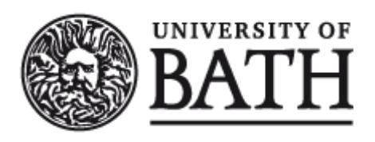

## **DOCTOR OF BUSINESS (DBA)**

**Ethical Higher Education Management: The Role of Ethical Leadership in Shaping** **Employee Work Outcomes**

Moussa, Amine

Award date: 2023

Awarding institution: University of Bath

Link to publication

## **Alternative formats**

If you require this document in an alternative format, please contact: openaccess@bath.ac.uk

Copyright of this thesis rests with the author. Access is subject to the above licence, if given. If no licence is specified above, original content in this thesis is licensed under the terms of the Creative Commons Attribution-NonCommercial-NoDerivs 4.0 International (CC BY-NC-ND 4.0) Licence (https://creativecommons.org/licenses/by-nc-nd/4.0/). Any third-party copyright material present remains the property of its respective owner(s) and is licensed under its existing terms.

**Take down policy**

If you consider content within Bath's Research Portal to be in breach of UK law, please contact: openaccess@bath.ac.uk with the details. Your claim will be investigated and, where appropriate, the item will be removed from public view as soon as possible.

Download date: 11. Oct. 2025

<!-- page 1 -->

## **Ethical Higher Education Management:** **The Role of Ethical Leadership** **in Shaping** **Employee Work Outcomes**

Volume 1 of 1

Amine Moussa

A thesis submitted for the degree of Doctor of Business Administration (Higher Education Management)

University of Bath School of Management (ICHEM)

September 2022

<!-- page 2 -->

## **COPYRIGHT**

Attention is drawn to the fact that copyright of this thesis/ portfolio rests with the author and copyright of any previously published materials included may rest with third parties. A copy of this thesis/ portfolio has been supplied on condition that anyone who consults it understands that they must not copy it or use material from it except as licenced, permitted by law or with the consent of the author or other copyright owners, as applicable.

## **DECLARATION OF ANY PREVIOUS SUBMISSION OF THE WORK**

The material presented here for examination for the award of a higher degree by research has not been incorporated into a submission for another degree.

Signed…Amine N. Moussa

## **DECLARATION OF AUTHORSHIP**

I am the author of this thesis, and the work described therein was carried out by myself personally.

Signed…Amine N. Moussa

<!-- page 3 -->

## **Table of Contents **

List of Figures

7

List of Tables

8

Acknowledgements

9

Abstract

10

Chapter 1: Introduction

11

1.1 Research Motivation

12

1.2 Research Background

14

1.2.1 Leadership versus Management

14

1.2.2 Followers' Role in Leadership Research

15

1.2.3 The Ethical Aspect of Leadership

15

1.2.4 Ethical Leadership in Higher Education

16

1.3 Research Context

17

1.4 Definition of Key Terms

19

1.5 Significance of Key Terms

20

1.5.1 Significance of Ethical Leadership

20

1.5.2 Significance of Ethical Climate

21

1.5.3 Significance of Knowledge Sharing

22

1.5.4 Significance of Organizational Tenure

23

1.6 Research Aims

24

1.7 Research Questions

25

1.8 Potential Contribution to Knowledge

25

1.9 Potential Contribution to Professional Practice

26

1.10 Structure of the Thesis

27

1.11 Summary

28

Chapter 2: Literature Review

29

2.1 Literature Search Process

29

2.1 Current State of Leadership Literature in Higher Education

30

2.2 A Theoretical Lens

31

2.2.1 Social Learning Theory

31

2.2.2 Social Exchange Theory

32

2.3 Extended review of the main concepts

34

2.3.1 Ethical Leadership

34

2.3.1.1 Pillars of Ethical Leadership

36

2.3.1.2 Trickle-down Effect of Ethical Leadership

40

2.3.1.3 Ethical Leadership versus Transformational Leadership

41

<!-- page 4 -->

2.3.1.4 Ethical Leadership versus Authentic Leadership and Servant Leadership

42

2.3.1.5 Ethical Leadership Across Societal Cultures44

2.3.1.6 Ethical and Unethical Leadership in Lebanon 45

2.3.1.7 Critiques of Ethical Leadership46

2.3.2 Ethical Climate47

2.3.2.1 Ethical Climate in Lebanese Higher Education Institutions 49

2.3.2.2 Organizational Ethical Climate versus Departmental Ethical Climate

49

2.3.2.3 Distinguishing between Ethical Climate and Ethical Culture50

2.3.2.4 Operationalisation and Measurement of Ethical Climate 51

2.3.2.5 Critique of the Ethical Climate Questionnaire 53

2.3.2.6 New Conceptualization of the Ethical Climate55

2.3.3 Knowledge Sharing57

2.3.3.1 Organizational Knowledge Sharing 58

2.3.3.2 Channels of Knowledge Sharing59

2.3.4 Employee Organizational Tenure 60

2.4 Relationships between the Main Concepts 61

2.4.1 Ethical Leadership and Employee Knowledge Sharing61

2.4.2 Mediating Role of Ethical Climate between Ethical Leadership and Employee Knowledge

Sharing Behaviour 63

2.4.2.1 Ethical Leadership and Ethical Climate63

2.4.2.2 Ethical Climate and Employee Knowledge Sharing Behaviour 64

2.4.2.3 Mediating Role of Ethical Climate 66

2.4.3 Moderating Role of Employee Organizational Tenure 67

2.5 Proposed Conceptual Framework 69

2.5 Summary69

Chapter 3: Methodology and Methods

70

3.1 Research Philosophy70

3.1.1 Ontology 70

3.1.2 Epistemology 71

3.1.3 Methodology73

3.2 Research Design73

3.2.1 Survey Research74

3.2.2 Advantages and Limitations of Cross-Sectional Survey Design 75

3.2.3 Advantages and Limitations of Longitudinal Survey Design 76

3.2.4 Choice of the Cross-sectional Survey Design for This Study77

3.3 Research Setting77

3.3.1 The Study Population78

3.3.2 Required Participant Sample Size80

<!-- page 5 -->

3.3.3 The Study Sample

80

3.4 Research Instruments

81

3.4.1 Control Variables

81

3.4.2 Ethical Leadership Measurement Instrument

82

3.4.3 Knowledge-Sharing Behaviour Measurement Instrument

82

3.4.4 Ethical Climate Measurement Instrument

83

3.5 Ethical Considerations

83

3.5.1 Privacy

84

3.5.2 Anonymity

84

3.5.3 Consent and Voluntary Participation

84

3.5.4 Protection from Harm

85

3.5.5 Ethical Approval

86

3.6 Data Collection and Analysis

87

3.6.1 Survey Layout

87

3.6.2 Email Invitation

88

3.6.3 Research Hypotheses

89

3.6.4 Data Analysis

89

3.7 Summary

91

Chapter 4: Findings

92

4.1 Frequencies of the Demographic Variables

92

4.2 Treatment of missing data due to survey item removal

94

4.3 Descriptive statistics for the study variables

94

4.4 Normality of the study variables

95

4.5 Reliability Analysis

97

4.6 Confirmatory Factor Analysis of Scales

98

4.6.1 CFA for the Ethical Leadership Scale

99

4.6.2 CFA for the Knowledge Donating Scale

99

4.6.3 CFA for the Knowledge Collecting Scale

100

4.6.4 CFA for the Ethical Organizational Climate Scale

100

4.7 Common Method Variance

101

4.8 Control Variables

102

4.9 Correlation Analysis

103

4.10 Hypotheses Testing

105

4.10.1 Mediation Analysis

109

4.10.2 Moderation Analysis

114

4.10.3 Moderated Mediation Analysis

118

4.11 Summary

119

<!-- page 6 -->

Chapter 5: Discussion, Implications, and Recommendations

121

5.1 Discussion of Findings against Previous Research121

5.1.1 The relationship between ethical leadership and knowledge sharing behaviour

121

5.1.2 The mediating role of the ethical climate123

5.1.2.1 Ethical Leadership and Ethical Climate123

5.1.2.2 Ethical Climate and Knowledge Sharing Behaviour 124

5.1.2.3 Mediation Effect of the Ethical Climate on the Relationship between Ethical Leadership and Knowledge Sharing 125

5.1.3 The Moderating Role of Employee Organizational Tenure126

5.2 Contribution to Knowledge128

5.3 Implications for Practice and Policy 132

5.4 Limitations and Recommendations for Future Research 135

5.5 Reflection and Conclusion137

References

140

APPENDICES

164

APPENDIX A Ethical Leadership Scale 164

APPENDIX B Knowledge Sharing Scale165

APPENDIX C Ethical Organizational Climate166

APPENDIX D Demographic Questionnaire167

APPENDIX E Ethical Approval: Notre Dame University – Louaize168

APPENDIX F University of Bath: Application Route Checklist 169

APPENDIX G Ethical Approval: University of Bath171

APPENDIX H Email Sent to University Research Boards 172

APPENDIX I University Requesting Removal of a Scale Item 173

APPENDIX J Ethical Approval: Université Saint Joseph (USJ) De Beyrouth 174

APPENDIX K Email Sent from MUBS To The University Community175

APPENDIX L Email Sent From Haigazian University To The University Community176

APPENDIX M Email Correspondence with Arab Open University 177

APPENDIX N Email Received From MEU Confirming Dissemination of The Survey178

APPENDIX O Email Sent From University Of Balamand To The University Community

179

APPENDIX P Opening Introduction To The Survey And The Consent Form 180

APPENDIX Q Personalised Reminder Email 181

<!-- page 7 -->

## **List of Figures**

Figure 1. The two pillars of ethical leadership38

Figure 2. Ethical leadership reputation matrix39

Figure 3. Theoretical ethical climate types52

Figure 4. Emergent ethical climate types53

Figure 5. A Multisystem Ethical Culture Framework55

Figure 6. Proposed Conceptual Framework69

Figure 7. Normal P-P Plot of Regression Standardized Residuals for Knowledge Collecting96

Figure 8. Normal P-P Plot of Regression Standardized Residuals for Knowledge Donating96

Figure 9. Path coefficients for ethical leadership, knowledge collecting, and knowledge donating 109

Figure 10. Simple mediation model with a single mediator variable M located between an independent

variable X and a dependent variable Y. 109

Figure 11. Conceptual diagram of ethical leadership as a predictor of knowledge collecting mediated

by the ethical climate. 112

Figure 12. Conceptual diagram of ethical leadership as a predictor of knowledge donating mediated

by ethical climate. 114

Figure 13. Conceptual diagram of organizational tenure as moderator of the relationship between

ethical leadership and ethical climate 115

Figure 14. Moderating effects of ethical leadership and organizational tenure on ethical climate118

Figure 15. Proposed Conceptual Framework with Supported Hypotheses128

<!-- page 8 -->

## **List of Tables**

Table 1: Ontology and Epistemology 72

Table 2: Profile of universities included in the study 79

Table 3: Respondents' Demographic Profile 93

Table 4: Descriptive Statistics for the study variables94

Table 5: Skewness and kurtosis of the study variables95

Table 6: Normality tests for the study variables 97

Table 7: Reliability of the Study Scales97

Table 8: Estimated Standardized Regression Weights for the Ethical Leadership Scale 99

Table 9: Estimated Standardized Regression Weights for the Knowledge Donating Scale 100

Table 10: Estimated Standardized Regression Weights for the Knowledge Collecting Scale 100

Table 11: Estimated Standardized Regression Weights for Ethical Organizational Climate Scale101

Table 12: Respondents per university103

Table 13: Pearson Correlations Among the Study Variables104

Table 14: Regression coefficients of control variables and main effects of Ethical Leadership on

Knowledge Collecting 106

Table 15: Regression coefficients of control variables and main effects of Ethical Leadership on

Knowledge Donating 108

Table 16: Detailed direct effects of ethical leadership on knowledge collecting via ethical climate 111

Table 17: Total, direct and indirect effects of ethical leadership on knowledge collecting via ethical

climate112

Table 18: Detailed direct effects of ethical leadership on knowledge donating via ethical climate 113

Table 19: Total, direct and indirect effects of ethical leadership on knowledge donating via ethical

climate113

Table 20: Regression coefficients for control variables, main effects, and interaction effects116

Table 21: Conditional effects of the moderator variable organizational tenure117

Table 22: Conditional indirect effects of the moderator variable and index of moderated mediation

119

<!-- page 9 -->

## **Acknowledgements**

*"For I can do everything through Christ, who gives me strength." Philippians 4:13*

The past two years, during which this thesis was written, have been a period of intense learning and challenge for me. I have learned a lot about the topic of this thesis, but above all I have learned a lot about myself. The time and effort I have placed in this thesis have shaped my thinking and personality, and have given me a new perspective on what big goals, progress, setbacks, consistency, endurance, and ultimately achievement truly look like. All praise be to God for his unconditional love and mercy. He has given me the strength and encouragement through the challenging moments of completing this dissertation.

Words cannot describe my appreciation for the special people who have taken part, both directly and indirectly, in helping me successfully reach the end of this project. I am very grateful for the continuous support I have received from my research supervisors, Prof. Gina Wisker and Dr. Daniel Davies. Your encouragement, guidance, and dedication have really given me the inspiration to keep going. I am thankful for your very thorough and thoughtful feedback and for holding me to high quality research standards. This accomplishment would not have been possible without you. It was an honour to work with you.

Many thanks to all the academic and administrative staff of the DBA in Higher Education Management at the University of Bath who have made this programme a unique and memorable experience. Your teaching, knowledge, support, and care are invaluable.

I would like to thank my parents for their patience and endless love, and for believing in me and always encouraging me to aim higher.

Finally, I am deeply grateful to my fellow peers in the programme, members of the DBA16 cohort. You have made the residentials extremely enjoyable and memorable. I will always look back on the amazing times we spent together with joyful thoughts and nostalgia.

Thank you. Amine Moussa

<!-- page 10 -->

## **Abstract**

Private higher education in Lebanon is facing mounting challenges from recent economic shocks; the increasing demand for higher education; the numerous players in the market and the resulting fierce competition; an absence of government regulation; and lack of consistent quality and accreditation standards. It can be argued that these unprecedented challenges require Lebanese private universities to bolster their reputation through attracting and retaining transparent and responsible leaders who behave ethically, engage fairly with stakeholders, honour their duties, are zealous in enforcing their principles, and make morallybased decisions. However, the benefits extend beyond building a robust reputation. Previous research suggests that ethical leadership and ethical institutional climates breed trusting relationships among employees which promote desirable work outcomes - such as knowledge sharing in the workplace - leading to higher performance and greater innovation at the individual, team, and organizational levels. However, little research has examined how leaders' ethicality and the organizational climate in higher education institutions (HEIs) affect the knowledge sharing behaviour of academic and professional staff. Drawing on social learning and social exchange theories, this quantitative study therefore empirically examines the direct and indirect relationships among ethical leadership, ethical climate, and the bidirectional process of knowledge sharing (knowledge collecting and knowledge donating), as well as the moderating role of employee organizational tenure. In total, 585 responses from academic and non-academic staff employed in nine private HEIs in Lebanon were collected between April and July 2021 via a web-based questionnaire. Hierarchical regression analysis and Hayes' Process macro for SPSS were used to test a series of hypotheses concerning the above relationships. Findings reveal that ethical leadership positively influences employee knowledge-sharing behaviour in Lebanese private HEIs. Specifically, the study presents evidence that perceptions of the ethical climate serve as a mechanism through which ethical leadership affects knowledge collecting and knowledge donating. In addition, the study highlights the moderating role of employee organizational tenure in the relationship between ethical leadership and ethical climate and consequently with knowledge sharing. The findings encourage deeper consideration of ethics in higher education leadership and demonstrate the role that universities' organisational climates can play in creating the conditions that facilitate knowledge sharing and hence more effective knowledge production and societal contribution.

<!-- page 11 -->

## **Chapter** **1: Introduction**

This thesis addresses an issue of theoretical and practical significance in higher education management: ethical leadership and its implications for academic and professional knowledge sharing behaviour. This first chapter lays out the motivation of the research, an overview of the research context, the relevance of the research to the Lebanese private HE sector, the research objectives, and research questions. The chapter discusses the contribution of the study, defines the key terms used throughout, and finally outlines the structure of the thesis.

In general, ethical leadership is the manner in which leaders behave with respect to moral issues, and the consequent process in which they convey that behaviour and persuade others to conduct themselves ethically. Ethical leadership underscores fairness and morality when dealing with others, and an ethical behaviour that is characterized by integrity and altruism (Brown et al., 2005).

This research proposes a theoretical framework (Figure 6) that examines the role of ethical leadership in shaping employee knowledge sharing behaviour by drawing on social learning theory (Bandura, 1986) and social exchange theory (Blau, 1964). Social learning frames the positive influence that ethical leaders have over their followers. Through observing the leader as a role model and learning what behaviour is expected and what practice is considered as misconduct, followers emulate the learned ethicality and adapt their behaviour to meet the moral standards in place. Social exchange theory (Blau, 1964) is also drawn upon in this thesis to further explain the reciprocation of moral behaviour that employees practice (e.g., sharing their knowledge) in return for the behavioural integrity of the leader. Social exchange theory thus uncovers the bases for the positive transactions between the leader and followers.

In addition, the research also examines the role of the ethical organizational climate in the above relationship through the lens of social learning theory (Bandura, 1986). As such, how employees learn the directions of their workplace ethical climate and interpret this learning to guide their behaviour is explained through a social learning process. Besides, the impact of employee organizational tenure on the mentioned relationships is also examined in this thesis. Organizational tenure is a time-related factor that influences employee social learning and

<!-- page 12 -->

social exchange as these require time for any learning to take place and reciprocal behaviour to be developed.

In sum, the theoretical model depicted in Figure 6 will be empirically tested in this research. To understand each of the constructs and the direct and indirect relationships of the model, both social learning and social exchange theories will be employed to inform the relationships between ethical leadership, ethical organizational climate, employee organizational tenure, and knowledge sharing behaviour.

## **1.1** **Research Motivation**

This research has been inspired by personal observations of how university leaders are appointed and influence the behaviour of their followers, and a professional motivation to research and understand the dynamics of leadership in this sector. Additionally, my long-held beliefs about the importance of ethics in leading others and the outcomes that can be achieved as a result have galvanized this study.

Throughout the years I have spent working in higher education, I have observed how institutions have occasionally promoted charismatic and influential individuals into leadership positions without scrutinizing their professional ethics as part of the routine selection process. These candidates have been perceived as the best fit for their new leadership roles considering the emphasis placed upon their work experience, success, and personality traits, however, without careful regard to their record of ethical conduct in the workplace.

With time, I have noticed that some of these appointments have regularly displayed the expected strong leadership skills, hard work attitudes, and focused thinking but have repeatedly revealed questionable personal and leadership ethics. Over the years, such leaders would grow unrestrained, learn how to 'game the system', manipulate their way to the top, and consequently gain increasing authority. As they have climbed their career ladder, they have sometimes abused the power they acquired and mistreated their subordinates through discrimination, bullying, and offensive behaviour.

Institutional accountability for such unethical leadership behaviour has been limited for several reasons, among which has been the deliberate downplaying of the bad behaviour in favour of departmental results. Another reason was the power that the leader has gained by the time the behaviour took place. I have observed how accumulated power granted a covert permission to behave unethically and escape any consequences, whereas understating

<!-- page 13 -->

employee complaints about the mistreatment became the typical avoidance strategy for the leader. This has resulted in normalizing unfair leadership that has gone unrectified, and fearbased approaches that have remained undetected or intentionally hidden under 'good departmental results.'

The 'popular' styles of leadership such as transformational leadership (Bass, 1985) have gained a history of attention that have made them the preferred styles when looking to hire or promote employees to leadership positions. However, such styles have arguably masked the behaviour of unethical, narcissistic, or inauthentic individuals (Dasborough and Ashkanasy, 2002). I strongly believe that ethical leadership can be a viable alternative and can lead to the same desired outcomes as other types of leadership without the incurred costs of behaviour deviance and power abuse. Therefore, examining what impact ethicality can have on leadership effectiveness in higher education has become a personal motivation for this research.

Consistent with my aim to research the effectiveness of ethical leadership in higher education, I intend to examine one of its moral-based follower outcomes that is highly relevant to this work environment, that of knowledge sharing. In this regard, I have observed how some university staff hide their knowledge from colleagues so they can be perceived as the experts on their team. I have also observed how others freely share what they know with colleagues who, in turn, present the knowledge as theirs and take the credit for it. Such behaviour has consistently resulted in further hesitation by the affected employees to share their knowledge thereafter.

In terms of researching ethical climate in this thesis, I am curious as to whether a leader's organizational surrounding - that is the organizational climate - can influence the leadership outcomes. My personal experience has been that organizations which are concerned for the welfare of their members can augment the positive impact of their ethical leaders - by providing them with the support they need through endorsing the necessary policies and procedures - and to an extent deter the occurrence of unethical behaviours. In other words, I seek to understand the role that an ethical climate has in the relationship between a leader's ethicality and its resulting outcomes.

Furthermore, I aim to probe the effect that the duration of employment at an institution may have on employees' perceptions of ethicality and consequently their knowledge sharing behaviour. In this regard, I have observed that employees who had been employed for longer periods at their organizations had better interactions with their leaders and colleagues and more

<!-- page 14 -->

positive impressions of their organization's ethical policies than those who had been employed for shorter periods.

## **1.2** **Research Background**

This section presents the background to the research. It firstly compares leadership with management in workplaces such as universities. Secondly, it highlights the role of followers in leadership research. Third, it introduces the ethical aspect of leadership. Finally, it justifies the focus on ethical leadership in higher education.

## **1.2.1 Leadership versus Management**

Leadership and management are both fundamental to a successful workplace (Kotterman, 2006). Yet, the debate whether both terms are distinct or not remains unresolved (Gordon and Yukl, 2004). Despite strong beliefs that there are differences between the two terms, both are still used interchangeably in the workplace, blurring the distinction between them (Kotter, 2008). Kotterman (2006) agrees that the functions of leadership and management are conceptually different, however he concludes that there is no common agreement of what the differences are. Thus, workplace leadership and management are highly intertwined. This is evidenced in the ample research into the differences between leadership and management which confirms that at times leaders may manage while at other times managers may lead (Bass and Stogdill, 1990). Acknowledging this overlap between the two roles, Yukl (1989) used the term managerial leadership in his research.

The academic literature on higher education tends not to differentiate between 'management', 'leadership', and 'administration' either (Middlehurst, 2008). In fact, most organizations including higher education institutions (HEIs), use the terms interchangeably and consider that managing and leading are two sides of the same coin (Tett et al., 2000; Raelin, 2004; Yielder and Codling, 2004; Bryman, 2007). In line with the above literature, this thesis does not attempt to make a distinction between management and leadership, regarding the two constructs as intertwined (Kotterman, 2006). Therefore, the thesis uses the term 'leadership behaviour' in the context of higher education to refer to the behaviour of managers at all levels of the institution and not only that of top leaders. Managers in higher education are those responsible for managing physical and financial resources, teaching programmes, research and consultancy services, and academic and professional staff.

<!-- page 15 -->

## **1.2.2 Followers'** **Role in Leadership Research**

According to Stogdill (1948), the leadership process encompasses the context *(in this * *thesis it is Lebanese private higher education institutions)*, the leader *(university managers at * *all levels)*, the followers *(academic and professional staff)*, and the outcomes *(in this case with * *a focus on knowledge* *sharing behaviour)*. Among these four elements of the leadership process, many scholars have emphasized the substantial role of followers in legitimizing leadership. Eden and Leviatan (1975) argue that leadership only truly exists in the minds of followers while Yukl (1989) advocates that follower perceptions are strongly considered when defining leadership. Bass and Stogdill (1990) add that the authority of leaders is derived from the acceptance of their followers. Moreover, Hollander and Julian (1969) identify followers as the most significant constituent of the leadership process and describe them as non-passive players. Their attitudes and motivation can determine the required leadership style (House, 1996). Their needs can determine what is required from a leader (Heifetz and Linsky, 2002)**. ** Ultimately, followers are capable of accepting or rejecting a leader (Northouse, 2018).

## **1.2.3 The Ethical Aspect of Leadership**

In an organizational context, leaders are looked to for direction, and their behaviour is frequently emulated by followers (Yukl, 2002). It can be argued that their decisions and actions should display consistent altruism and integrity so that employees may follow suit (Wolmarans, 2014). Accordingly, leadership behaviours play a pivotal role in shaping staff attitudes and behaviour in the workplace (Walumbwa, 2005; Mayer et al., 2012; Choi et al., 2016).

The ethical and moral aspects of leadership, in particular, have attracted increasing public attention over the past two decades, due in part to the many scandals caused by ethical backslides of senior leaders in the corporate sector (e.g., Enron, Tyco, WorldCom, Adelphia, Uber, and Volkswagen), public sector (e.g., Malta's "Golden Visa" scheme and Norway's state welfare agency), and higher education (e.g., University of Illinois, University of Colorado, Eastern Michigan University, etc.). This attention has put organizations under scrutiny from the public demanding their leaders to behave more ethically (Den Hartog, 2015).

Consequently, ethical behaviour has become seen as crucial to leaders' integrity, credibility, and potential to influence their followers (Brown, Treviño and Harrison, 2005; Piccolo et al., 2010) to the extent that leadership and ethics have become impossible to separate (Burns, 2004; Northouse, 2018). Therefore, not only have ethical scandals demonstrated the

<!-- page 16 -->

negative repercussions that unethical behaviour can have on organizations (De Vise, 2011), but they have ultimately revealed a crisis in leadership ethics (Winston, 2007).

The benefits of ethical leadership can be well illustrated by its absence. Unethical leaders are perceived as egocentric, power-driven, and lacking in moral values (Bass and Steidlmeier, 1999). Their unfair treatment of followers can be detrimental for the teams they manage, and their employing organization. Employee misconduct can be a direct result of perceived injustice, ranging from regular absenteeism, staff turnover, lower production, lack of commitment and cooperation, to knowledge-hoarding (Schyns and Schilling, 2013).

Gasparski (2005) argues that organizations and leaders who ignore the seriousness of cultivating an ethical climate are partly to blame for employee misconduct. Research by Rok (2009) indicates that employees with problematic attitudes can be compelled to behave ethically when they are placed in an environment that exhibits an operational ethical infrastructure which restrains deviant tendencies and behaviours.

## **1.2.4 Ethical Leadership in Higher Education**

Kuther (2003) argues that many of the challenges facing HEIs are triggered by their own practices, including tolerance of unethical or incompetent leadership; favouritism and discrimination between staff; conflict of interest in recruiting suitably-qualified faculty; lack of transparency in monitoring and assessment of employees; and weak communication. Many institutional objectives cannot be realized without having leaders who are able to maintain an ethical culture that encourages accountability and advocates uncompromised integrity. Dziminska, Fijalkowska, and Sulkowski (2018) point out that the impact of ethical leadership practices in HE reaches far beyond the university and may even impact the economic objectives of a whole nation.

Following the above-mentioned scandals in higher education, there has been an upsurge in focus on leadership skills and managerial competencies across institutions at top management and even at previously overlooked departmental levels (Meek at al., 2010). However, little accompanying research has been conducted to determine what types of leadership are effective in this specific context (Bryman, 2007). The available leadership studies on higher education have tended to focus at the senior level, whilst research on middle and lower managers remains scarce (De Boer, Goegedebuure and Meek, 2010). It can certainly be argued that creating an ethical infrastructure in HEIs, as well as in any other organization,

<!-- page 17 -->

begins with leaders at the top. Mayer et al. (2009) assert that top leaders play the biggest part in cultivating ethical leadership and setting the tone for the ethical organizational culture through a trickle-down effect that impacts behaviour in the lower hierarchical levels. However, leaders at every level are responsible for modelling ethical conduct to their subordinates and should be aware of the implications of their actions on the behaviour, performance, and outcomes of their immediate teams and the wider organization. As ethics are pertinent to every individual in an organization, this thesis seeks to assess the practice of ethical leadership as perceived by leaders and their followers at all levels.

## **1.3 Research Context**

This study will focus on the Lebanese private higher education sector, which is the context of my own professional experience in teaching and management and is of particular relevance to the topic of ethical leadership for the reasons outlined below. In this section I will highlight the historical development of this sector, its challenges and current status with respect to the study.

The Lebanese higher education sector dates back to 1866 and is characterized by its diversity, openness to market entry, and competitiveness (El-Ghali and Ghalayini, 2016). Most HEIs in Lebanon are private and have been founded by political or religious entities (mainly missionaries) (Fincham, 2020) which makes the Lebanese private higher education landscape of particular interest in the expression of its moral values. At one end of its spectrum are large, well-established, historical, and elite institutions such as the American University of Beirut (1866), Saint Joseph University (1875), Lebanese American University (1947), Haigazian University (1955), Beirut Arab University (1960), Notre Dame University (1987), and University of Balamand (1988). At the other end is a large number of small, recentlyestablished for-profit HEIs emerging in response to massification, whose characteristics are described below.

Higher education in Lebanon has historically been provided by private institutions (Fincham, 2020). The only public university in Lebanon, the Lebanese University, was established in 1951, and was subject to the country's segregation, which resulted in an abundance of branches, that were erected to answer the needs for equity among the Lebanese regions that are under the influence of distinct political and religious groups. The segregation and strong political influence over the public university has polarized the different branches to which political parties regularly assign their supporters. This patronage system has led to

<!-- page 18 -->

various forms of nepotism and favouritism in recruiting, promoting, and managing employees to the detriment of the university's overall competence and quality (Abou Arraj, 2018).

Lebanon's recent history has been marred by its 15-year civil war which extended from 1975 until 1990 and set the country on a downhill track socially, economically, and academically. Even after the war, Lebanon's economic, social, and political recovery has been problematic. Large incidents have devastated the economy and halted its comeback several times, such as the assassination of Lebanese businessman and prime minister Rafik Al Hariri in 2005; the 2006 war with Israel which caused massive damage to Lebanon's infrastructure including highways, power plants, and cellular transmission towers, leaving some regions unreachable (Hamieh and Mac Ginty, 2010); the influx of Syrian refugees crisis (2011-present) and its impact on the fragile security situation at the Lebanese border, (Buckner, Spencer and Cha, 2018, p. 447); and most recently the 2019 financial collapse which is anticipated to take years to recover. Besides the difficult and volatile political climate in Lebanon, complex financial realities loom large alongside economic concerns, all of which place additional pressure on university leaders at all levels.

After the civil war ended in 1990, the rapid massification of the private higher education sector in Lebanon began taking shape with the establishment of a large number of new universities. According to the Ministry of Education and Higher Education in Lebanon, there are currently 48 private higher education institutions operating in more than 80 branch campuses (MEHE, 2021). This number of institutions is considered huge relative to the country's small geographical area (10452 km^2^ ) and population of just over 6.5 million (The World Bank Group, 2021). The surge in the number of licensed universities came as a response to the increase in demand for higher education, especially after the year 2000.

The vast majority of the younger universities are smaller in size, capacity, and resources than the traditional ones, and are associated with religious groups or political parties. Due to their lower tuition fees and widely scattered campuses, they draw students from narrow social demographics and geographical areas. Political influence in these private institutions is much less visible compared to that in the public university, as they are mainly funded by student fees and are therefore compelled to provide quality services and seek better reputation through competitiveness and retaining a politically neutral position. The current private HEIs, especially the younger ones, mostly have a teaching-oriented focus with accordingly less emphasis on research.

<!-- page 19 -->

The private higher education sector in Lebanon is facing enormous challenges from the adverse economic situation; the increasing demand for higher education (Jammal, 2015); the numerous players in the market and the resulting fierce competition; absence of government regulation; and lack of unified quality and accreditation standards (National Tempus Office, 2016). These challenges arguably require Lebanese private universities to strengthen their reputations (Chedrawi, Howayeck and Tarhini, 2019) through attracting and retaining transparent and responsible leaders who behave ethically, engage fairly with stakeholders (Hansen et al., 2016), honour their duties, and make morally-based decisions.

## **1.4 Definition of Key Terms**

For the purposes of this thesis:

*Ethics *are defined as the code of values and moral principles that guide individual or group behaviour with respect to what is right or wrong (Mihelic, Lipicnik and Tekavcic, 2010).

*Leadership* is defined as the ability of an individual to influence, motivate, and enable others to contribute toward the effectiveness and success of the organizations of which they are members (House et al., 2004, p.14).

*Ethical Leadership *is defined as the demonstration of normatively appropriate conduct through personal actions and interpersonal relationships, and the promotion of such conduct to followers through two-way communication, reinforcement, and decision-making (Brown, Treviño and Harrison, 2005, p. 120).

*Ethical Climate* is defined as the prevailing perceptions of typical organizational practices and procedures that have ethical content (Victor and Cullen 1988, p. 101).

*Knowledge Sharing* is defined as the dissemination of ideas, information, expertise, and suggestions among individuals in organizations to solve problems, develop new ideas, or implement policies or procedures (Liu and Li, 2018).

*Knowledge Collecting* is defined as the act of consulting colleagues in order to get them to share their intellectual capital (Van Den Hoof and De Ridder, 2004).

*Knowledge Donating *is defined as the act of communicating to others what one's personal intellectual capital is (Van Den Hoof and De Ridder, 2004).

<!-- page 20 -->

*Organizational Tenure* is defined as the length of time that an employee has spent in the employment of an organization (McEnrue, 1988).

## **1.5** **Significance** **of Key Terms**

This section discusses the significance to the field of higher education leadership studies of the different constructs that constitute this research.

## **1.5.1 Significance of Ethical Leadership**

In general, the leadership literature calls for more research into leadership ethics (Sendjaya, 2005; Northouse, 2018). Sendjaya (2005), argues that ethics is overlooked in leadership studies due to the preoccupation of the corporate world with the effectiveness of leadership and how firms can achieve higher profits. Nevertheless, ethical behaviour can be considered to lie at the heart of any effective leadership (Burns, 2004; Rhode, 2006; Northouse, 2018), particularly within higher education. Any discussion about leadership in higher education would be incomplete without a discourse on ethics and ethical challenges in the field. In fact, ethics are present in all aspects of higher education, and they are at the heart of its main goal of knowledge production for the good of society (Wang, 2020). As Frost (2016) puts it, ethical values are fundamental to the reason higher education exists.

The importance of ethical practices in higher education management reaches far beyond the survival and success of the institution. Since HEIs are in the business of knowledge production, their influence over society is substantial and in the same manner their ethical values influence those of the wider society. When observing higher education, societies expect to find strong ethical leadership among university leaders (Wong, 1998, p. 113). Considering the influence that higher education leaders have on others and the implications of their actions, Trent and Pollard (2019) demand that the present and future of higher education be viewed from an ethics perspective.

Universities typically have multiple goals and particular organizational complexity which makes leadership studies in higher education a highly contested field (Spendlove, 2007). This view is supported by Dopson et al. (2019) who assert that as universities grow in size and complexity, they become multi-functional organizations that face several uncommon challenges. University leadership increasingly needs to collaborate with strategic alliances requiring more cooperative and lateral leadership styles that extend beyond managing the traditional single vertically- integrated institutions.

<!-- page 21 -->

Wang (2020) argues that the complexity of higher education institutions presents leaders and administrators with unique challenges, some of which are traditional to higher education while others are novel and pose great challenges that even experienced leaders in the field are perplexed by their enormity. Traditional challenges are characterized by the diversity of stakeholders that higher education leaders deal with such as students, research and accrediting bodies, and political leaders at all national levels. Novel challenges, on the other hand, are the result of economic uncertainty, globalization, rising competitive pressures, and social change.

In some contexts, such pressures can lead to corruption, which is sometimes masked since it is culturally endemic. Individuals may unknowingly engage in corruption with the aim of improving efficiency, for example, without realizing that they are crossing ethical boundaries (Chapman and Lindner, 2016). It is often facilitated, rather than invited, by the immense pressures from economic and social conditions (Nabaho and Turyasingura, 2019) such as exaggerated competition, unreasonable rewards, unfair treatment, and unchecked concentration of power (Shaw, 2013). Corruption can be as prevalent in higher education as it is in corporate organizations but may be more challenging to uncover in higher education because of the intricate nature of operations and the diverse network of stakeholders involved (Chapman and Lindner, 2016).

## **1.5.2 Significance of Ethical Climate**

An ethical climate has been found to predict ethical conduct in an organization and is linked to employee ethical behaviours, (and possibly unethical behaviours such as absenteeism, slack performance) and turnover (Victor and Cullen, 1987, 1988). Schwepker (2001) describes the organizational ethical climate as the informal institutional environment through which employees perceive the ethics of the managers, the ethical standards of the organization, and the corresponding system for punishing violations. Ethical climates provide members, especially those at lower levels, with a lens to diagnose ethical issues and a guide to solve them, especially amid situations that involve moral dilemmas (Cullen, Parboteeah and Victor, 2003).

Organizations that enforce a clear code of ethics have been found to maintain higher levels of ethical climate and ethical behaviour among their employees (Ferrell and Skinner, 1988). Outlining ethical policies and procedures indicates to employees that the organization values and supports them (Zagenczyk et al., 2020). In addition, effectively communicated ethical codes and practices that become engrained in a staff member's working knowledge are

<!-- page 22 -->

much more likely to influence the individual's reasoning for decision-making (Hegarty and Sims, 1979; Weeks and Nantel, 1992).

Ethical practices are tangible indicators of an ethical climate and an organization's strong commitment to ethics. They act as the gauge for what attitudes and behaviours are expected and valued. Ethical practices that are apparent and easily observed by employees establish their perceptions of the ethical climate (Kuenzi, Mayer and Greenbaum, 2020). An ethical climate along with organizational policies and supervisory direction that cultivate honesty and trust are likely to reduce confusion towards managing ethical situations and result in a congenial work environment (Schwepker, 2001).

Ethical climates are equally important for higher education institutions as they are for any organization. In this particular context, faculty and professional staff are at the front line as they provide the supervision, leadership, and administration of their institutions' services and affairs. Ethical climates can thus serve as a gauge for developing effective strategy at the leadership level as well as for managing employees' ethical behaviour. The need for effective ethical climates in this context is further underscored by instances of ethical transgressions involving faculty and professional staff in the form of misappropriation of funds, corrupt admission practices, fraud, etc. all of which have received little attention in the literature (Osipian, 2012; Keenan, 2015).

## **1.5.3 Significance of Knowledge Sharing**

Knowledge can be considered the most valuable resource in an organization (Spender and Grant, 1996) and an essential source of sustainable competitive advantage and innovation capacity in a highly competitive and unstable economy (e.g., Grant, 1996; Spender and Grant, 1996; Davenport and Prusak, 1998; Foss and Pedersen, 2002). This is particularly relevant to knowledge-intensive organizations such as HEIs, where intellectual capital is pivotal to sustainable and effective competitive advantage (Swart and Kinnie, 2003). Crucially, knowledge can only be made effective use of by an organization once it is shared (Swart et al., 2014).

Knowledge sharing has been researched in various business and industry settings, yet there is a paucity of research investigating this behaviour among employees in higher education institutions (Wang and Noe, 2010; Fullwood, Rowley and Delbridge, 2013; Howell and Annansingh, 2013). Dopson et al. (2019) argue that universities have not studied their own

<!-- page 23 -->

knowledge-sharing effectiveness seriously, despite being an integral part of the knowledgebased economy. These institutions are unique, since their primary function is generating and disseminating knowledge, where knowledge is their principal input and output (Rowley, 2000; Seonghee and Boryung, 2008; Fullwood, Rowley and Delbridge, 2013; Howell and Annansingh, 2013; Jolaee et al., 2014).

Considering the strong reliance of HEIs on knowledge assets to gain competitive advantage, care should be taken when relying solely upon the hiring and training systems which focus on knowledge and skills to select competent employees (Brown and Duguid, 1991). These hiring systems should not be trusted to bring about the desired competitive advantage by themselves. Effort should be placed on effectively exploiting and capitalizing on knowledge-based resources (Davenport and Prusak, 1998) through transferring the acquired knowledge, practices, skills, and expertise from the experienced employees inside the organization to the newcomers from outside (Hinds, Patterson and Pfeffer, 2001). When knowledge sharing is properly developed within the organization, it can expect to realize the return on investment in its human resources (Swart et al, 2014).

In the exceptionally competitive higher education sector where competitive advantage strongly relies on each institution's knowledge assets, universities should pay particular attention to the implications that knowledge sharing practices have for improving educational programs, enhancing research output and teaching activities, and consequently improving the universities' overall performance.

## **1.5.4** **Significance of Organizational Tenure**

Organizational tenure is an important time-related factor that encourages the development of social exchange and social learning between members of an organization (Guest, 2004). Longer tenured employees tend to develop long-term relationships with their employing organization, as well aslong-term career plansthat are ingrained in the organization. Consequently, they take more heed of the effectiveness of their organization's human resource management compared to short-tenured employees (Hu et al., 2019). They also accumulate greater conceptual knowledge about their organization's formal and informal practices and power structures (Gavin and Greenhaus, 1976).

Organizational tenure is also a distinctive employee characteristic. According to Ng and Feldman (2013), employees with different organizational tenure tend to differ in their experience, cognitive level, psychological characteristics, and career strategies. Compared to

<!-- page 24 -->

their colleagues with short organizational tenure, employees with long organizational tenure acquire more skills and experience, whilst tending to display higher levels of in-role performance and citizenship behaviour (McEnrue, 1988; Ng and Feldman, 2010). This positivity, however, has been challenged by Wright and Bonett (2002) who argued that highly tenured employees who do not leave their job, may actually respond with negative attitudes towards the organization. These attitudes are increasingly demonstrated in the employees' withdrawal from work commitment, or worse, in their psychological retirement at work.

Section 1.5 introduced the significance of ethical leadership, ethical climate, knowledge sharing, and organizational tenure for this thesis. Each of these constructs will be considered in greater detail in the next chapter.

## **1.6 Research Aims**

This thesis is concerned with the managerial aspects of Lebanese private HEIs at all levels of the institution, particularly the development in leadership practices and organizational behaviour. HEIs in Lebanon, like in every other country, are under continuous pressure to improve their performance, build their competitive advantage, survive the fierce competition for students, and meet private sector expectations that graduates should be appropriately trained and ready to enter the labour force. It draws upon personal conviction and observation, together with a body of literature emphasizing the importance of ethical leadership – outlined above – to investigate the effects of such leadership on the behaviours of the workforce in private Lebanese HEIs. This area of research has yet to be addressed in the Lebanese setting and is of primary significance to the organizational wellbeing of HEIs.

As leaders do in every other field, higher education leaders ingrain their beliefs and values into the institution they belong to. To date, there appears to be a dearth of research that explores the implications of leadership for the crucial behaviour of knowledge sharing between staff in HEIs worldwide. Moreover, there has been little empirical attention to the implications of ethical leadership in higher education management - particularly within a Lebanese context - and whether it can contribute towards positive change in work outcomes. Specifically, this thesis aims to examine follower perceptions of ethical leadership amongst academic and professional staff in Lebanese private HEIs and its implications for an extremely important employee behaviour, that of knowledge-sharing. It also aims to understand the role that the ethical climate may play in mediating any relationship between ethical leadership and

<!-- page 25 -->

employee knowledge-sharing. Additionally, the study aims to examine the effect of employee organizational tenure on that relationship.

## **1.7** **Research Questions**

The following central research questions underpin this study:

1- What is the relationship between ethical leadership and employee knowledge sharing in higher education institutions?

2- Is the relationship between ethical leadership and employee knowledge sharing mediated by the ethical climate in higher education institutions?

3- To what extent does organizational tenure moderate the relationship between ethical leadership and ethical climate in higher education institutions?

The research questions will be detailed in chapter two in accordance with the theoretical and conceptual frameworks adopted for this thesis, and corresponding hypotheses will be formulated.

## **1.8 Potential Contribution to Knowledge**

From a theoretical perspective, the thesis aims to bridge a gap existing in the current field of HE leadership studies. Through integrating ideas specific to ethical leadership, ethical climate, knowledge sharing, and organizational tenure in the proposed conceptual model (see Figure 6 in Chapter 2) and connecting different literature, the research aims to make significant contributions to the underlying theories. Specifically, the study proposes a conceptual framework offering a mechanism for how ethical leadership influences knowledge sharing. This conceptual framework combines elements of social exchange and social learning theories.

The research highlights the role of knowledge sharing as a valid exchange outcome of ethical leadership and the underlying ethical climate as a social learning medium that shapes the experience of employees and influences their behaviour. Through examining bidirectional knowledge sharing as an outcome of ethical leadership, the study also offers a novel perspective for the literature on knowledge management. It adopts a moral lens which accounts for knowledge sharing as a morally induced phenomenon and ethical leadership as its predictive variable.

<!-- page 26 -->

This research proposes the mediating role of the ethical climate in the process through which ethical leadership affects knowledge sharing behaviour. It incorporates social exchange and social learning theories in the leadership and knowledge sharing domainsthrough assessing how the underlying institutional ethical climate can contribute to this relationship by proposing a mediation role. It also extends our knowledge of the ethical climate by examining whether longer exposure to organizational norms and values affects the association between employee perceptions of ethical leadership and ethical climate.

In summary, the findings of this research will expand our understanding of the potential role of ethical leadership in enhancing knowledge sharing among employees within higher education institutions; advance the literature on ethical climate as a mediator and organizational tenure as moderator; and bring new insights into the role of social exchange and social learning theories within the leadership field. Through addressing the elements that make up the research questions, the study aims to provide a new lens to examine the interaction of these institutional aspects and understand the mechanisms by which institutions can achieve an ethically-led higher education workforce.

## **1.9** **Potential Contribution to Professional Practice**

The thesis aims to advance leadership practice in the particular context of Lebanese private higher education by tapping into the deeds and actions that go beyond the mere presence of a statement of ethics in university documents or webpages, as well as the implications of ethical leadership for employee outcomes. The topic is addressed from a followers' point of view and aims to inform higher education leaders and policy makers. It is consistent with my high regard for ethical leadership, specifically in a sector that is increasingly shaped by economic tensions, mounting competition for resources, and sudden fluctuations in student supply and demand. It will advance the argument for ethical leadership and its positive consequences for higher education managers and institutions at all levels.

From a practical perspective, this research assesses the state of ethical leadership and ethical climate in Lebanese private higher education institutions. A major potential contribution to practice lies in tackling the topic not only through drawing upon the perceptions of the academic body of institutions, but also through acknowledging the perceptions of a vital yet frequently overlooked element of the higher education workforce, that of professional staff.

<!-- page 27 -->

It will support the role that ethical leaders can play in promoting knowledge sharing among such employees, and the importance of developing and maintaining an ethical climate across the institution to mediate the influence of individual leaders over such behaviour. It contributes to the managerial practice of knowledge sharing through helping policy makers formulate knowledge sharing strategies that are well informed and tailored to their respective institutions.

The implications of this positive influence for HEIs are extensive, especially in retaining invaluable knowledge assets through information exchange. Also, the thesis aims to provide a clearer lens through which to look at the role of employee organizational tenure in the relationship between ethical leadership, ethical climate, and knowledge sharing.

The outcomes from this research study will provide valuable empirical input to stakeholders when making recommendations for institutional policy development. It will contribute to enhancing the higher education workforce through offering insight into the importance of fostering ethical leadership at all levels, and accounting for ethical behaviour when recruiting, evaluating, and promoting employees. In all, this thesis aims to develop a platform for stimulating profound consideration of ethical leadership in higher education management and recognizing the benefits derived from it.

## **1.10** **Structure of the Thesis**

This thesis has been organised into five chapters. After this introductory chapter, the second chapter provides an outline of social learning and social exchange theories, and a thorough review of the literature on ethical leadership, ethical climate, knowledge sharing, and the moderating role of organizational tenure. The literature review presents the theoretical and conceptual frameworks, enables the identification of several key research gaps, and the development of hypotheses for this study.

In the methodology chapter, the research philosophy is outlined, including the epistemology, the methodology, and approach taken to execute the research. In this chapter, the research design is described with its advantages and limitations, the research population is presented, and the instruments used to measure the different constructs are laid out. The chapter provides an outline of the analytical strategies adopted and concludes with an overview of the ethical considerations and data collection procedures.

<!-- page 28 -->

In chapter four, the quantitative analytical strategies are applied, and the detailed results and findings of the main study are presented, including the measures of validity, the associations between ethical leadership and knowledge sharing, the mediating effect of the ethical climate, and the interaction of employee organizational tenure. The chapter concludes by discussing which hypotheses support the quantitative results.

Chapter five aims to derive meaning from the results discussed in chapter four. It restates the purpose of the study and discusses the findings based on the conceptual framework presented in chapter two thereby explaining the impact of the ethical leadership on employee knowledge sharing behaviour and considering the role of ethical climate and organizational tenure. In addition, it elaborates on the thesis' contribution to knowledge and implications for policy and practice. The chapter concludes with directions for future research and a reflection on the thesis journey.

## **1.11 Summary**

Chapter 1 identified the research project, and detailed the scope, and purpose of the study. It specified the motivation behind conducting this research, gave an overview of the research context, emphasized the relevance of the research and its objectives, and underlined the research questions. It provided information on the significance of the constructs that make up this research. Finally, this chapter described the thesis' potential contribution to knowledge, practice, and policy and outlined the structure of this document.

<!-- page 29 -->

## **Chapter 2: Literature Review**

The first part of this chapter identifies the research gap in the literature which this study aims to address and provides the background for social learning and social exchange theories. It explains the relevance of these theories to the study of leadership, knowledge sharing, and ethical climate, and provides the logic for how these constructs fit into the theoretical framework adopted in this research. The second part of the chapter provides a review of the literature related to the core concepts of the thesis: ethical leadership, ethical climate, knowledge sharing, and organizational tenure. Literature related to research addressing these constructs in a higher education context will also be covered. Drawing upon the underpinning theoretical framework of social learning and social exchange theories – together with the research questions - a conceptual framework of the relations between these concepts will be delineated, which contains a number of specific hypotheses concerning these relationships.

## **2.1** **Literature Search Process**

The review of the literature was performed using the University of Bath Library discovery service Primo and the available databases of electronic resources and academic peerreviewed journals. The databases used for the search were: Web of Science Core Collection, Taylor and Francis Online, ProQuest One Business, Emerald Insight, Business Source Complete, and Education Resources Information Center.

The search used the combination of key search terms: "ethical leadership", "ethical climate", "knowledge sharing", "higher education" or "universities", and "Lebanon" or "Lebanese", and looked into all the searchable fields (e.g., title, abstract, keywords, all text) within the journal articles in the targeted databases. The search returned no results indicating that no study has been conducted among Lebanese higher education institutions that investigates the influence of ethical leadership on employee knowledge sharing behaviour and role of the ethical climate. In fact, even when the terms ("Lebanon" and "ethical climate") were removed from the search keywords, only one result was returned (i.e. Xia and Yang, 2020) which shows the scarcity of research that has focused on the relationship between ethical leadership, as a particular style of leadership, and knowledge sharing behaviour as its outcome in the context of higher education institutions. Additional search results were retrieved when a combination of fewer key terms was used such as "ethical leadership" AND "knowledge sharing", or "ethical leadership" AND "ethical climate". The next section of this chapter will

<!-- page 30 -->

introduce the theoretical framework underlying this research and will cover the available literature surrounding each of the study's main constructs, in addition to studies that have examined the relationships between them.

## **2.1** **Current State of Leadership Literature** **in Higher Education**

It is important to understand the current state of knowledge in higher education leadership to build a better perspective of the need for general leadership research in this context as well as research that examines specific styles of leadership. To date, little research in the higher education context has investigated styles, behaviours, and practices of leadership as well as the impact of leadership on organizational effectiveness and culture (Bryman, 2007). Bryman and Lilly (2009) highlight the lack of systematic research on leadership in higher education and the dearth of publications examining leadership effectiveness in this context. Gmelch (2013, p. 26) contrasts the paucity of leadership research in higher education with that in the corporate world by stating that 'The corporate world complains that they have simply progressed from the Bronze Age of leadership to the Iron Age. Institutions of higher education may still be in the Stone Age'.

In their literature review on leadership development in higher education, Dopson et al. (2019) highlighted the fragmented state of research in this field. Similarly, a recent systematic review of leadership literature in higher education that reviewed papers published between 1995 and 2014 (Esen, Bellibas and Gumus, 2020) indicated that only about two percent of scholarly articles have focused on leadership in higher education with most articles originating from three countries namely, the U.S.A, the UK, and Australia. Hence, scholars from these three countries have mostly shaped academic work on leadership in higher education.

Esen, Bellibas and Gumus (2020) noted that leadership studies in higher education have either focused on the leadership of senior university administrators such as vice chancellors, presidents, or rectors (e.g., Bargh et al., 2000) or academic personnel such as deans and department chairs (e.g., Bellibas et al., 2016; Alonderiene and Majauskaite, 2016). This limitation was also reflected in De Boer, Goegedebuure and Meek's research (2010) in which they critiqued the focus of leadership studies on senior higher education executives while there is need to better understand how middle and lower-level managers exercise their leadership. Earlier studies (e.g., Spendlove, 2007) made similar alarming statements to De Boer, Goegedebuure and Meek's points that little is known about leadership styles and skills at other levels and in other university offices.

<!-- page 31 -->

## **2.2 A Theoretical** **Lens**

In order to build a conceptual framework and hypothesize the relations between ethical leadership, ethical climate, knowledge sharing, and organizational tenure in this thesis, a theoretical framework was developed from a review of literature (section 2.3) examining the theoretical base of the different constructs. Following Brown, Treviño and Harrison (2005) who have created the most commonly accepted formal definition of ethical leadership to date (see section 1.4) and validated an instrument to evaluate it (see section 3.4.2), this thesis relies on social learning theory and social exchange theory to explain the outcomes of ethical leadership (Mayer et al., 2009; Kacmar et al., 2011; Avey et al., 2012). Together social learning theory and social exchange theory guide this research as a powerful theoretical lens to study ethical leadership outcomes in a higher education context. The next sections will review and discuss social learning theory and social exchange theory, and detail how each theory serves to explain the interactions that occur between the constructs of this thesis.

## **2.2.1** **Social Learning Theory**

Social learning theory (Bandura, 1986) suggests that through observational learning, individuals mimic the behaviours of significant role models. Bandura (1986) contends that anything which can be learned through direct experience can also be learned through observing others' behaviours and noticing their consequences. With regards to ethical leadership, social learning theory is recognized as "an important explanatory framework" that justifies why ethical leaders influence their followers positively (Kalshoven et al., 2013, p. 166). It also clarifies why some leader characteristics and actions, such as concern for others and fair treatment, are linked to followers' perceptions of the leader as an ethical leader. Pircher Verdorfer et al. (2015) maintain that leaders are viewed as striking role models in this social learning process considering their power, status, and visibility. Accordingly, in a work environment, employees observe their leaders and learn what behaviour is accepted and how it gets rewarded versus what behaviour is condemned and how it gets penalized.

Therefore, a strong theoretical foundation that explicitly and fundamentally defines the ethical leadership construct is found in social learning theory (Brown, Treviño and Harrison, 2005) which demonstrates its relationship to and distinguishes it from other constructs. Ethical leaders, in particular, influence employee outcomes because they are attractive, credible, and legitimate role models who catch followers' attention, and through their ethical conduct they deliberately reinforce the ethics message (Brown, Trevino, Harrison, 2005). Most individuals

<!-- page 32 -->

look to others for ethical guidance (Treviño, 1986). In this aspect, ethical leaders are assuring role models and sources of guidance and learning due to their attractiveness and credibility which direct their followers' attention to their behavior.

Furthermore, ethical leaders are perceived by their followers as social learning models particularly because they emphasize ethical standards followed by rewarding desired conduct, and disciplining misconduct (Treviño, Brown and Hartman, 2003). Social learning theory suggests that learning occurs from people with whom one regularly associates (Bandura, 1977). Thus, in addition to leaders, role models include other members in the work group. Therefore, employees will emulate the ethical behaviours of their supervisors and other members in the team to make sure their own behaviour is in line with accepted norms and ethical standards (Heng and Zucheng, 2018).

Besides explaining the influence of ethical leadership, social learning theory explains the employees' shared perceptions of an ethical climate in a work environment. An ethical climate can be interpreted as a set of socially construed indications of desired behaviour that is practiced by top management and supervisors simultaneously. As employees observe how their leaders and co-workers comply with the ethical guidelines of their organization, they interpret the observed actions as "the way things are [ethically] done here". Interpretation then offers specific predictable directions for employees to abide by (Kuenzi, Mayer and Greenbaum, 2020).

## **2.2.2 Social Exchange Theory**

In addition to social learning theory, a social exchange lens has been used to examine relationships between ethical leadership and employee behavior (Mayer et al., 2009; Kacmar et al., 2011). Social exchange theory goes beyond social learning theory in explaining the dyadic relationships between ethical leaders and their followers (Blau, 1964). In contrast to economic exchange, which explains social transactions from a contract-like quid quo pro perspective, relationships according to social exchange depend on trust, gratitude, and norms of reciprocity (Gouldner, 1960). As a result of the fair and caring treatment of the ethical leader, followers perceive themselves in a social exchange relationship and therefore go beyond the call of duty in terms of job dedication and helping the team and the organization (Brown and Treviño, 2006).

Social exchange theory explains the emergence of social relationships between exchange parties based on positive transactions and models of reciprocity. According to Blau

<!-- page 33 -->

(1964, p. 94) "social exchange tends to engender feelings of personal obligation, gratitude and trust." Individuals engaged in social exchange develop an informal or non-contractual obligation to repay the party on the other end of the exchange with what they believe is of equivalent value. This reciprocity serves the purpose of fairness in the relationship and ensures the continuation of the exchanges into the future (Blau, 1964).

In an organizational context, social exchange theory clarifies why employees generally feel attached to their leaders, work teams, and the employing organization. Concerning ethical leadership, when followers feel trusted and respected, and when they perceive the organization's practices (i.e., ethical climate) as concerned for their well-being (Al Halbusi et al., 2020), they view the relationship with the leader as one of social exchange (Brown, Treviño and Harrison, 2005; Brown and Treviño, 2006) and convey eagerness to reciprocate the leader's ethical behaviours (Umphress and Bingham, 2011; Hansen et al., 2013).

Followers of ethical leaders repay them with greater investment in the relationship, and increased trust in the leader. Ruiz, Ruiz and Martinez (2011) hold that trust is especially deepened when followers grow confident that the leader does not intend to take advantage of them. In line with this elevated investment, followers will increasingly display favourable and constructive job attitudes (Ng and Feldman, 2015, p. 949) such as less cynicism and enhanced loyalty to the leader (Gouldner, 1960; Mayer, Kuenzi and Greenbaum, 2010). A high-quality social exchange relationship characterized by transparency, openness, and dignity (Cottrill, Lopez and Hoffman, 2014) is thus expected between an ethical leader and those employees on the receiving end of the supportive treatment.

Social exchange theory has also been used to explain knowledge sharing behaviour between leaders and team members as well as among members of the same team as a reciprocation of gratitude and trust (Bock et al., 2005; Wu and Lee, 2017). Individuals may build social relationships with others by sharing their knowledge with an expectation of future returns (Wang and Noe, 2010). The nature of knowledge sharing is bidirectional and relates to personal qualities. It is always controlled by individuals and not the organization (Empson, 2001). Individuals willingly choose to exchange knowledge with others and obtain knowledge they deem relevant from sources they trust. Organizations may facilitate knowledge sharing behaviour through emphasis on contextual factors such as an organizational culture (Lam, 2005) that encourages and supports the exchange of knowledge.

<!-- page 34 -->

## **2.3** **Extended review of the main concepts**

This section of chapter two consists of a review of the literature on ethical leadership, ethical climate, knowledge sharing, and organizational tenure.

## **2.3.1 Ethical Leadership**

A brief discussion of ethics and ethical theory is necessary before discussing ethical leadership theory. The Merriam-Webster dictionary defines ethics as "the principles of conduct governing an individual or a group" (Merriam-Webster, 2022). From this definition, it can be inferred that an ethical leader is a leader who is governed by certain principles of conduct. Three ethical theories emerge from the definition of ethics: virtue, deontology, and utilitarianism.

Virtue states that a person would do the right thing if s/he knows what the right thing is. Virtue was first proposed by Aristotle who suggested that a person's chief end is to pursue happiness, which is achieved through seeking one's full potential. In the process of pursuing happiness and fulfilling his or her potential, a person first identifies a set of virtues, acts on it by behaving ethically, and then continues to grow in it (Audi, 2012).

Deontology, on the other hand, states that a person bases their choices on moral rules that are part of a recognized moral code. Unlike virtue ethics, deontology does not require a person to fulfil their potential through acting on virtuous traits. In addition, the consequences of one's moral decisions are not taken into consideration. Thus, choices become intrinsically ethical if they follow commonly accepted rules when making the choice and taking the corresponding action (Brunk, 2012).

Utilitarianism calls for the decision-maker to assess the consequences of their decision on others by making the decision that advances the most positive outcome to the largest number of people while minimizing any negative outcomes. Utilitarianism does not require following a set of morally accepted rules, as deontology does. However, if followed, the rule that maximizes the good should be employed when taking the action. Also, in contrast to virtue ethics, growing in virtue through developing ethical traits is not a requirement in utilitarian ethics (Brunk, 2012).

Ethics in primary leadership research has been mostly discussed in terms of the ethical characteristics of particular leadership theories, most commonly, transformational leadership

<!-- page 35 -->

(Kanungo and Mendonca, 1996; Yukl, 2002). In 2003, Treviño, Brown, and Hartman conducted seminal qualitative research that examined the ethical leadership of senior executives. This research formed the basis of treating ethical leadership as a distinct leadership style with its most common traits being integrity, honesty, and trustworthiness. Treviño, Brown and Hartman (2003) asserted that ethical executive leaders displayed elements of transactional and transformational leadership. Similar to transactional leaders, ethical executive leaders set ethical standards, conduct performance appraisals, and hold followers accountable for their ethical conduct. They also display individualized consideration (i.e., people orientation), and are inspirational in role-modelling ethical conduct which are both elements of transformational leadership.

However, ethical leadership theory was formally defined in the work of Brown, Treviño, and Harrison (2005) as the "demonstration of normatively appropriate conduct through personal actions and interpersonal relationships, and the promotion of such conduct to followers through two-way communication, reinforcement, and decision-making" (Brown, Treviño and Harrison, 2005, p. 120). These authors drew upon the research by Treviño, Brown and Hartman (2003) and characterized ethical leadership as a distinctive style of leadership that is distinguished from transformational and transactional leadership, although it overlaps in some elements with both theories. Using seven interlocking studies, Brown, Treviño and Harrison (2005) validated an instrument that evaluates ethical leadership quantitatively which they called the Ethical Leadership Scale (see section 3.4.2).

Brown and Treviño (2006) have advocated the two theoretical frameworks discussed in sections 2.2.1 and 2.2.2, namely social learning theory and social exchange theory. The elements of ethical leadership that are based in social learning theory and social exchange theory explain why ethical leadership predicts certain employee outcomes such as perceived leader effectiveness, employee job dedication, and reporting problems to management (Brown, Treviño and Harrison, 2005). Through social learning, employees discern the norms of expected conduct in two ways: their own experience, and by observing others whom they consider role models and adopting their behaviour (Bandura, 1986). Combining the rolemodelling element of social learning theory with elements of transformational leadership and transactional leadership, as discussed above, provide followers with a learning model in which they watch and mimic behaviour. Furthermore, through social exchange, an employee learns the expected way to behave in an organization and reciprocates a leader's positive exchange

<!-- page 36 -->

with pro-social behaviour. Employees feel their commitment to reciprocity more strongly when both the leader and the organization's climate are perceived as ethical (Brown and Treviño, 2006).

## **2.3.1.1 Pillars** **of Ethical Leadership**

A reputation for ethical leadership rests upon two main pillars: perceptions of the leader as a moral person *and* a moral manager (see Figure 1) (Treviño, Hartman and Brown, 2000). The ethical leader must be strong in both pillars, that is, s/he needs to be a deeply ethical person and one who prioritizes their ethics and values on their leadership agenda.

## **2.3.1.1.1 Moral Person**

A leader's character attributes and traits constitute the moral person pillar that influences the observer's perception of an ethical leader. Traits are the terms that observers use to describe an individual. They are stable characteristics that pronounce the predictable ways in which individuals behave across different contexts. Moral persons exhibit strong levels of integrity, honesty, and trustworthiness (Treviño, Brown and Hartman, 2003). While integrity and honesty describe a person's character, trustworthiness is related to a person's relationships with others as it forms the basis of a relationship's credibility, consistency, and predictability (Treviño, Hartman and Brown, 2000).

In addition to traits, behaviours play an even more important role in influencing perceptions of an ethical leader. Showing concern for others, treating people with dignity and respect, being approachable, and demonstrating personal morality by having greater standards than an average person, are all visible actions that send a powerful message without the need for words.

Ethical leaders encourage voice, welcome open communication (Brown, Treviño and Harrison, 2005), and engage their followers in decision making which signals power sharing (Kalshoven, Den Hartog and De Hoogh, 2011). They allow their followers to share bad news with them and treat it as a challenge to be addressed rather than a behaviour to be punished. When followers feel their ethical leaders trust them, they tend to take that trust seriously and try not to break it (Treviño, Hartman and Brown, 2000). Employees reporting to these leaders are thus encouraged to take part in otherwise risky behaviours like bringing forth their problems and presenting their opinions without fear, knowing that they will be heard (Kalshoven, Den Hartog and De Hoogh, 2011; Den Hartog, 2015).

<!-- page 37 -->

Den Hartog (2015) notes that when employees do not fear retaliation from their leader or peers and expect support instead of dismissal, they tend to speak up about ethical concerns, decision quality, and team performance (Treviño and Nelson, 2017) as well as offer constructive feedback and suggestions for change (Kalshoven et. al, 2013). Speaking up has been recognized as a main driver of organizational effectiveness and high-quality decisions (Burris, 2012) and employees who speak up have been rated as better performers (Whiting, Podsakoff and Pierce, 2008). Through social learning, employees know that such exchange is welcome and encouraged (Chen and Hou, 2016) and does not entail hidden risks (Brown and Treviño, 2006; Brown and Mitchell, 2010). On the contrary, when speaking up is deemed to be pointless and accompanied with feelings of fear and habituation to silence in situations of authority, employees tend to remain silent, keep their awareness of ethical problems to themselves (Schaubroeck et al., 2012), and withdraw from the honest exchange (Den Hartog, 2015).

Moral persons continuously exercise their ethical values and principles in decisionmaking and consider the consequences of their actions (Den Hartog, 2015). They are objective and fair with their followers, and sensitive to community standards. Ethical leaders perceive themselves as being highly vital for their immediate group, their organization, and society. In this regard, they have a wider perspective that considers the broader impact of their decisions on society (Treviño, Hartman and Brown, 2000). Being value-driven, ethical leaders have the capacity to influence their followers significantly. They are able to shape their followers' beliefs, motivation, attitude, self-concept, and behaviours (Den Hartog and Belschak, 2012).

They clarify the 'right path' of doing things through admitting their own mistakes and holding themselves accountable for their actions. In doing so, they encourage fair and balanced decision making that is shaped by an ethical mindset (Brown, Treviño and Harrison, 2005). They respect the employees' need for belonging and uniqueness thereby improving their sense of inclusion among team members (Boekhorst, 2015). Consequently, they create a psychologically safe work environment through which they gain their subordinates' trust, accept their diverse opinions, and heed their concerns (Walumbwa and Schaubroeck, 2009).

<!-- page 38 -->

> *Figure 1.* *The two pillars of ethical leadership* *(Treviño, Hartman and Brown, 2000, p.131)*

## **2.3.1.1.2 Moral Manager**

Disseminating the moral person's ethical values and principles to subordinates and the rest of the organization requires moral managing. The moral manager pillar is made up of the ethical leader's actions that increase the salience of ethics in the workplace through establishing and promoting ethical standards. As moral managers deliberately model ethical conduct, they emphasize visible action to their followers. Moral managers understand that employees learn what is important through watching their leaders for cues. Such managers also recognize the words and actions that deliver the intended impact as well as how employees interpret them. Their actions shape the subordinates' perceptions of their organization (Fernandez, 2008), autonomy and job significance (Piccolo et al., 2010). In addition, Piccolo et al. (2010) suggest that as followers become intrinsically motivated, they begin to see their jobs as meaningful and thus display productive behaviour. Effective moral managers influence the manners of their followers to the extent that in an ethically neutral surrounding, moral managers emerge as

<!-- page 39 -->

socially significant (Treviño, Hartman and Brown, 2000; Treviño, Brown and Hartman, 2003; Brown and Treviño, 2006; Brown and Mitchell, 2010).

Moral managers are notably zealous in enforcing ethics. They ensure their standards are followed, and emphasize accountability using discipline and rewards that help their followers distinguish between desirable and undesirable behaviour. To uphold their standards, moral managers consistently reward ethical conduct and discipline unethical conduct. Notably, they do so at all levels of the organization according to their position and authority (Treviño, Hartman and Brown, 2000).

Discussing ethics and values with followers is another important component of the moral manager pillar. Moral managers clarify the values that govern critical decisions and actions. If messages about ethics are not received from the top, employees remain unclear about the importance of ethics in the workplace. However, this communication is not performed in a didactic manner. Rather, moral managers talk about ethics with their employees in a comfortable way that persuades them to adopt the set of values that are important to the leader and the organization (Treviño, Hartman and Brown, 2000).

Cross tabulating the two pillars produces a matrix (see Figure 2) that demonstrates how an ethical leader is the product of a strong moral person and a strong moral manager. The matrix also details what other types of leadership are produced when the two pillars are combined in varying strengths.

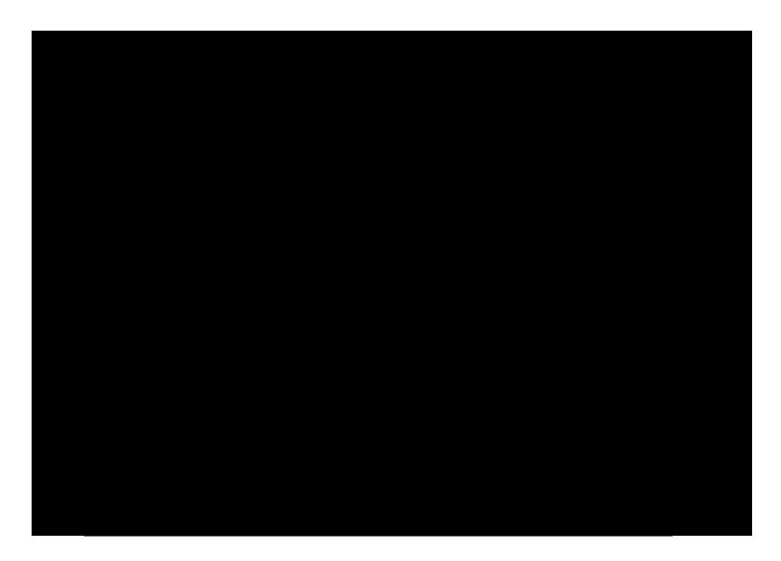

> *Figure 2.* *Ethical leadership reputation matrix* *(Treviño and Nelson, 2011, p.159)*

<!-- page 40 -->

Unethical leaders are weak on the moral person level as well as the moral manager level. They are emotionally abusive, profane, and violent. When dealing with their subordinates, they are known to be arrogant and disrespectful. Hypocritical leaders, on the hand, are strong in communicating their ethical values (moral management aspect) but in contrast to their "talk", engage in unethical behaviour (moral person aspect) and encourage others to do the same. The last quadrant of the matrix describes ethically "silent" or ethically "neutral" leadership. Leaders in this category are not explicit about their ethical values but rather silent on these matters. Either they do not recognize the importance of ethics in an organization's culture, are not confident discussing ethics, or they just don't care. They may be strongly moral persons, however, due to their ethical neutrality in the workplace, they are perceived as self-centred rather than people-oriented (Treviño and Nelson, 2017).

## **2.3.1.2 Trickle-down Effect of Ethical Leadership**

According to social learning principles, the effects of ethical leadership propagate across organizational hierarchies in a trickle-down manner from top management to an employee's immediate supervisor. In a study of a large sample of business leaders in the United States, Mayer et al. (2009) point out that top managers act as role models for lower-level managers, who in turn act as role models for their subordinates, and this can best be maintained through coaching systems. Direct supervisor ethical behaviour had a stronger influence over employee behaviour than the ethical behaviour of top leaders and thus played an essential role in this trickle-down effect.

Conversely, Ruiz, Ruiz and Martinez (2011) studied a sample of Spanish insurance and banking industries and observed that leadership behaviour at the top had a stronger influence over lower-level employee behaviour than the behaviour of immediate supervisors. Hence, when employees perceive a good top manager's moral image, they sense and strongly appreciate the value placed on ethics throughout the entire organization, which extends beyond the narrow perception of their immediate team or department. Consequently, in an ethical environment, top managers must be watchful of their duties that encompass modelling ethical behaviour and setting ethical standards.

Overall, top managers' ethical leadership, whether mediated by supervisors' leadership or through direct impact, can have a greater positive influence on employees' outcomes affecting their job satisfaction, organizational commitment, turnover intention (Demirtas and Akdogan, 2015), organizational citizenship, and knowledge sharing (Bavik et al., 2018).

<!-- page 41 -->

## **2.3.1.3 Ethical Leadership versus Transformational Leadership**

Ethical leadership appears to share some common ground with other 'moral' leadership styles, the most adjacent of which is transformational leadership. Bass and Avolio (1994) identified four components of transformational leadership: idealized influence, inspirational motivation, intellectual stimulation, and individualized consideration. Idealized influence refers to behaviours that indicate trustworthiness, respect, and charismatic role modelling. It instils admiration and highlights accomplishments. Inspirational motivation refers to the capacity to inspire and engage followers with a vision. Intellectual stimulation encourages creativity and challenges follower assumptions about values and old problem-solving methods. Individual consideration emphasizes awareness of individual needs and builds supportive relationships with followers.

In particular, the idealized influence dimension of transformational leadership has been interpreted as having a prominent ethical component. In the idealized influence dimension, transformational leaders act as role models and display high moral norms (Avolio, 1999, p. 43). Ethical leadership thus appears to strongly resemble the idealized influence dimension of transformational leadership, leading observers to wrongfully consider it a subset style of the latter. The distinction between the two styles of leadership is further blurred when differentiating between ethical leadership and authentic transformational leadership.

According to Bass and Steidlmeier (1999), authentic transformational leadership, characterized by high idealized influence and high inspirational motivation, is largely rooted in ethics and morals, and prioritizes the collective good over oneself. Authentic transformational leaders present a moral compass to their followers and hold them accountable for prearranged ethical standards therefore appearing strikingly identical to ethical leaders. Nonetheless, ethical leadership does not focus on articulating a vision or providing intellectual stimulation to employees, as transformational leadership does (Ng and Feldman, 2015).

In the study conducted by Brown, Treviño and Harrison (2005), ethical leadership was found to predict critical group-level outcomes such as satisfaction with the supervisor, extra effort at work (job dedication), and a willingness to report problems, while the idealized influence component of transformational leadership did not. Also, in a study conducted in South Korea, Ng and Feldman (2015) demonstrated that ethical leadership was significantly related to followers' commitment even after controlling for the effects of transformational

<!-- page 42 -->

leadership providing further evidence that ethical leadership is conceptually distinct from transformational leadership.

Moreover, although the two leadership styles may often appear as hardly distinguishable (Brown, Treviño and Harrison, 2005), highly regarded transformational leaders could still behave unethically as much as they would ethically. In general, ethical and unethical leaders are differentiated by their use of power and the integrity of their means and ends. According to Bass (1985), transformational leaders can use their captivating influence to chase moral ends or immoral ones. Hence, the clear differentiation in literature between what is labelled authentic (i.e., socialized, ethical, or charismatic) leadership and what is referred to as pseudo-transformational (i.e., personalized, or unethical) leadership (Bass and Steidlmeier, 1999, Howell and Shamir, 2005).

Unethical transformational leadership, known as pseudo-transformational leadership and characterized by high inspirational motivation and low idealized influence, pursues immoral and self-serving goals over collective ones. Leaders that belong to this division are manipulative, abusive, and politically motivated. They conceal illegitimate goals and actively seek self-glorification above all. Pseudo-transformational leadership is justly linked to increased follower fear, job insecurity, obedience, and perceptions of abuse (Brown, Treviño and Harrison, 2005).

Furthermore, manipulative behaviours can be hard to distinguish as authentic transformational and pseudo-transformational leaders may display similar behaviours. The line between good and bad thus becomes blurry for followers making it hard to recognize the leader's true intentions (Dasborough and Ashkanasy, 2002). Whether perceived behaviours are a genuine expression of leader morality remains uncertain (Den Hartog, 2015), nonetheless, ethical leaders, in particular, can be trusted to continually behave with the collective good in mind.

## **2.3.1.4 Ethical Leadership versus Authentic Leadership** **and Servant Leadership**

Ethical leadership is commonly grouped together with styles that have moral approaches to leadership such as authentic leadership and servant leadership (Lemoine, Harnell and Leroy, 2019). Ethical, authentic, and servant leadership styles may share common ground and display characteristics such as honesty, fairness, and respect. However, they are distinguished by their emphasis on different criteria.

<!-- page 43 -->

Authentic leaders are "persons who have achieved high levels of authenticity in that they know who they are, what they believe and value, and they act on those values and beliefs while transparently interacting with others" (Avolio et al., 2004, p. 802). They are described as free and independent in making their moral judgements without being concerned about possibly conflicting with normative social pressures (Guignon, 2004). Whereas ethical leadership focuses on complying with expectations, authentic leadership uniquely revolves around the leader's self-awareness, self-concordance, self-regulation, and displaying these characteristics to followers (Luthans and Avolio, 2003).

Moreover, in contrast to ethical leadership which has two dimensions (moral person and moral manager), authentic leadership is composed of four dimensions: self**-**awareness, balanced processing of information (i.e., objectively analysing all data before making a decision), relational transparency (i.e., presenting one's authentic self rather than acting with fake manners), and an internalized moral perspective (i.e., internalized form of moral selfregulation) (Walumbwa et al., 2008).

Another moral values-based leadership is servant leadership which puts the needs of followers and stakeholders first (Greenleaf, 1970). Greenleaf emphasized that "the servantleader is servant first. It begins with the natural feeling that one wants to serve. Then conscious choice brings one to aspire to lead" (1970, p. 13). Based on Greenleaf's philosophy, Spears (2010) posited that servant leaders are characterized by empathy, healing, listening, awareness, persuasion, foresight, stewardship, conceptualization, building community, and commitment to the growth of others.

Refining Greenleaf's conceptual focus, Ehrhart (2004) defined servant leadership as the leader's moral responsibility to the success of his or her subordinates as well as the success of the organization's customers, and other stakeholders. The emphasis on stakeholders is common among many definitions of servant leadership such as "a group-oriented approach to leadership that emphasizes serving others" (Schaubroeck, Lam and Peng, 2011, p. 865) and "a model that identifies serving others – including employees, customers, and community – as the numberone priority" (Spears, 2002, p. 4).

With regards to their measurement items, all three constructs appear to overlap in asking respondents to assess the extent to which their leader makes decisions based on high ethical standards. However, according to their conceptual definitions, the operational distinctions among ethical, authentic, and servant leadership are evident. These are compliance

<!-- page 44 -->

with normative standards, focus on self-concordance and self-awareness, and benefitting multiple stakeholders, respectively. In particular, ethical leadership, stands out in holding followers accountable for complying with organizational standards and values and the consequent use of reward and punishment (Lemoine, Harnell and Leroy, 2019).

## **2.3.1.5** **Ethical Leadership Across Societal Cultures**

Societal cultures can shape individuals' beliefs about the value of ethics in forming outstanding leaders (Resick, Mitchelson, Dickson and Hanges, 2009). In the cross-cultural leadership study, known as Project GLOBE (Global Leadership and Organizational Behaviour Effectiveness), House et al. (2004) find that some leadership aspects are globally approved whereas others differ widely among societal cultures. Notably, some of the universallyaccepted characteristics of leadership identified in the above study are those of ethical leadership, such as trustworthiness, honesty, and justice.

In several interesting articles, Resick et al. examined ethical leadership across different cultures. In 2006, the authors observed that integrity, altruism, motivation, and encouragement were widely endorsed across cultures, whereas when examining different societal clusters, the degree of that endorsement varied significantly (Resick et al., 2006). In a 2009 study, they found out that elements of organizational culture like performance orientation and uncertainty avoidance explained how beliefs about the significance of ethical leadership are shaped (Resick et al., 2009).

In addition, a more recent study across Eastern and Western cultures (Republic of China, Germany, Hong Kong, the United States, Ireland, and Taiwan) by Resick et al. (2011) concluded that the meaning of ethical leadership is likely to be attributed to particular characteristics and behaviours that vary across cultures. In China, Germany, and Hong Kong, themes of consideration, collective orientation, respect for others, and fairness predominated beliefs about ethical leadership. In contrast, themes of character and accountability were dominant in the U.S., Ireland, and Taiwan. Eisenbeiss and Brodbeck (2014) agree with Resick at al.'s (2011) view that in Eastern cultures, as opposed to Western cultures, ethical leadership is linked to nonmaterialism, an inner calling, and being deeply connected with others on a spiritual level.

<!-- page 45 -->

## **2.3.1.6** **Ethical and Unethical Leadership in Lebanon**

Lebanon has a reputation that is characterized by civil war, sectarianism, political tensions, corruption, and governmental chaos (Hazbun, 2016) which has been exacerbated after the 2019 public protests and economic collapse that resulted in breaking the country's political and financial systems. This has been recently translated in Lebanon's international rating for country risk which was strongly negative (Coface, 2022). The economic collapse in Lebanon has been a direct result of the flagrant corruption in public administration. According to Transparency International (2021), Lebanon ranked 154th on the Corruption Perceptions Index among the 180 countries included in a study on corruption in the public sector.

In such a country, developing a recognized base for ethical leadership is challenging. Although the definition of ethical leadership is universal, finding leaders that can lead ethically and enforce moral values in a drastically corrupt context, such as Lebanon, becomes complicated. Unethical leadership in Lebanon is exemplified in a lack of integrity and accountability, and shady immoral practices such as favouritism, exploitation, discrimination based on religion and sect, and violation of rights. Other forms of unethical leadership include power abuse and favouring self-interest over the collective good (Sarkis and Daou, 2013).

Nevertheless, despite the rampant unethical practices in the Lebanese political and economic contexts, the Lebanese cultural context presents an interesting desire for establishing norms based on ethical considerations and an aspiration for true ethical leadership. According to Hofstede Insights (2020) on cultural dimensions, Lebanon is described as a country with high power distance (62%), low individualism (43%), high uncertainty avoidance (57%), and very low indulgence (10%).

With high power distance, the Lebanese people accept a hierarchical order in which centralization is popular, the manager is a benevolent autocrat, and subordinates naturally expect to be told what to do. Low individualism, on the other hand, indicates a collectivistic society where loyalty is paramount and can override societal regulations. Relationships between employers and employees have moral grounds and are perceived as family links. High uncertainty avoidance indicates rigid codes of belief and intolerance of unorthodox behaviour. Low indulgent societies do not emphasize leisure time and control the fulfilment of their personal desires.

<!-- page 46 -->

These properties form the basis of ethical leadership in Lebanon that is characterized by a strong tendency to establish norms based on what is truthful and moral, and that value the interest of the group over the individual. Ethical leadership in Lebanon comprises the opposite of all immoral practices mentioned above backed by a longing to raise the country from the economic and political abyss that corruption and unethical leadership have thrown it in.

## **2.3.1.7** **Critiques** **of Ethical Leadership**

Although ethical leadership can have a positive influence on the ethical conduct of employees and consequently on an organization's performance, it has received some criticism from scholars who warned about its downsides when practiced rigidly. Leaders who are perceived as strongly ethical may surprisingly present themselves as unappealing role models. Followers feel morally admonished by these leaders when they perceive them as regularly evaluating their morality (Stouten et al., 2013). In addition, followers feel the pressure to continuously focus on avoiding deviant behaviour so much so that displaying positive behaviour becomes hardly noticeable. Similarly, Den Hartog (2015) argues that strongly ethical leaders aim to firmly advance the ethical norms and behaviours of employees, but this exaggerated behaviour can overshadow the leaders' focus on being caring and developing good relationships with their followers.

Moreover, ethical leaders may occasionally encourage controversial behaviour. Kalshoven, Van Dijk and Boon (2016) examined whether ethical leaders can evoke unethical follower behaviour that benefits the organization, known as Unethical Pro-organizational Behaviour (UPB). The authors found out that in jobs with high autonomy, where followers are less dependent on the leader to provide instructions on how tasks are executed, and are free to adhere to societal norms, engagement in UPB was less likely. On the contrary, in low autonomy jobs which are highly structured and prescribed, and where followers have a direct relationship with the ethical leader and little freedom in choosing tasks and methods, engagement in UPB tended to be higher. Followers justified their behaviour with "I'm just doing my job", or "The organization needs this" (Umphress and Bingham, 2011) and thus were more prone to unethical conduct.

In the same line, Eisenbeiss (2012) challenged Brown, Treviño and Harrison's (2005) definition of ethical behaviour as it focuses on 'normatively appropriate' conduct which the authors intentionally left vague considering that norms can vary across organizations, industries, and cultures. Eisenbeiss (2012) doubted whether compliance with organizational

<!-- page 47 -->

norms would still be perceived as ethical when these norms demand behaviour that is against the generally accepted moral values*.* Eisenbeiss (2012) thus called for a benchmark of normative points against which ethicality of conduct can be evaluated since what is considered fitting in one context may be deemed harmful in another.

The Ethical Leadership Scale used to measure ethical leadership in this study has also had its share of criticism. Drawing on the work of De Hoogh and Den Hartog (2008), Kalshoven, Den Hartog and De Hoogh (2011) targeted the uni-dimensionality of the ELS arguing that the underlying behaviours of ethical leadership are theoretically distinct and each has different antecedents and outcomes. Thus, they suggested that ethical leadership has several behavioural dimensions that should be measured separately. Their development of a new multidimensional scale included the dimensions of fairness, power sharing, role clarification, people orientation, integrity, ethical guidance, and concern for sustainability.

The next section and its following subsections will focus on the second major concept within this thesis, the ethical climate.

## **2.3.2 Ethical Climate**

An organizational climate refers to "a set of characteristics that (a) describe the organization and distinguish it from other organizations, (b) are relatively enduring over time, and (c) influence the behaviour of people in the organization" (Forehand and Von Haller, 1964, p.362). It forms the atmosphere in which members help, judge, reward, restrain, and perceive each other. An ethical climate, on the other hand, refers to a subset of the broader organizational climate. A widely accepted definition of an ethical climate is that of Victor and Cullen (1988, p.101) 'the prevailing perceptions of typical organizational practices and procedures that have an ethical content'.

Ethical climates emerge when members of an organization collectively perceive certain forms of ethical behaviour as the expected proper behaviour. Ethical climates consist of the normative values and beliefs involving moral issues shared by members of an organization (Weber, 1995). This common understanding sets the conventional norms and bases for decision making at all levels in the organization (Sims 1992). Importantly, ethical climates do not reflect the members' own ethical standards or moral development but rather depict elements of the members' work environment (Cullen, Parboteeah and Victor, 2003). Ethical climates can thus be perceived as strong or weak depending on the concerned organization or department (Victor

<!-- page 48 -->

and Cullen, 1987). Hence, multiple ethical climates may be present in a single organization (Weber, 1995).

In strong ethical climates, unethical behaviours such as deviant behaviours of narcissistic leaders (for example) are more salient and detectable due to clear and enforced policies against unethical practices and violations. As the deviance becomes obvious to followers, their ratings of their leaders' ethicality and effectiveness drop significantly (Hoffman et al., 2013). Thus, contexts with strong ethical climates can constrain narcissistic behaviour among unethical leaders, or reveal such behaviour identifying them as ineffective and unfit in the organization (Den Hartog, 2005).

On the other hand, an unethical climate may develop when an organization neglects enforcing codes of ethics and policies which are supposed to monitor, identify, and correct unethical behaviour (Ferrell and Gresham, 1985). Unethical climates may go unchallenged because the organizational practices they permit are advantageous to certain powerful forces within the organization. Practices such as favouritism, subjective performance appraisals, and nepotism can prove beneficial to some shrewd employees who learn how to take advantage of them (Zagenczyk et al., 2020).

Nonetheless, ethical climates alone should not be seen as the antidote for misbehaviours especially those of narcissistic leaders but can be cultivated to readily expose such behaviours that are otherwise blurred out or even seen permissible in neutral organizational climates that do not reinforce ethics. In fact, a combination of these neutral climates and unethical leaders can prove to be toxic, if not lethal, to an organization considering the unending harm that these leaders might cause with time (Hoffman et al., 2013).

Importantly, ethical practices can be successfully encouraged among employees through conducting regular ethics training programs that fit well within the organizational culture and are consistent with its constituents (Ritter, 2006; Weber, 2007). Mayer et al. (2013) emphasize that not all employees should receive the same training but advise that different groups be exposed to different content. For example, leaders need to become familiar with what it means to become an ethical leader while employees at lower levels may need to understand their crucial role in facilitating ethical behaviour among their peers.

Compared to the body of knowledge on ethical climate in the business sector (Martin and Cullen, 2006, Simha and Cullen, 2012), little is known about ethical climate in higher education. For example, Malički et al. (2019) examined perceptions of the ethical climate from

<!-- page 49 -->

three schools at the University of Split in Croatia. Acar et al. (2016) explored the ethical climate perceptions of administrative and academic staff members working in Usak University in Turkey. Al-omari (2013) determined the types of ethical climates as perceived by faculty members in the Hashemite University in Jordan.

## **2.3.2.1 Ethical Climate** **in Lebanese Higher Education Institutions**

The ethical climate in the Lebanese higher education sector is a reflection of the Lebanese ethical climate that is characterized by sectarianism, and political and religious conflicts. This is expressed in a culture of deception and moral violations in some universities in Lebanon (Hazbun, 2016). In their study on the functional management in various Lebanese universities, ElZein and Alameddine (2012) noted that ethical practices will not be embraced across an institution unless they are established and enacted by top management. They also emphasized the need for a continuous dialogue about ethics between an institution's upper management and all other functions, as this would eliminate distinct interpretations and perceptions of what an ethical climate is.

Amid fierce competition between them, Lebanese HEIs face mounting pressures to maintain an ethical organizational climate and an overall ethical standing. The challenge increases as government interventions are weak, and institutional accreditation requirements which would drive comprehensive ethical scrutiny are very costly (Hazbun, 2016; Brin and Nehme 2018). Nevertheless, few of those large, aspiring, and financially able universities have sought and acquired institutional and programmatic accreditation from American accrediting bodies such as New England Commission on Higher Education (NECHE, 2021), and Association to Advance Collegiate Schools of Business (AACSB, 2020) that demand universitiesto subscribe to and advocate high ethical standards in their management and affairs. Having acquired these internal badges, these universities have demonstrated, among other things, their financial transparency, accountability, and ethical and responsible management, all of which are precursors to an ethical organizational climate.

## **2.3.2.2** **Organizational Ethical Climate** **versus** **Departmental Ethical Climate**

Weber (1995) suggests that it is possible for multiple ethical climates to exist in different functions or departments within the same organization despite the overarching set of values that is shared by its members. Weber (1995) concluded that these ethical sub-climates are relatively stable and influenced by varying factors such as the function of the department

<!-- page 50 -->

(e.g., finance, HR, IT), its distinct tasks, and the stakeholders it serves. In a more recent study, Weber and Seger (2002) found contradicting results in which ethical sub-climates evidently existed in organizations and were stable over time however, they were less influenced by a department's function rather by the strength of an organization's ethical climate.

The varying sub-climates across dissimilar departments suggest inconsistencies in employee ethical decision-making. Employees ethical decision-making in boundary-spanning departments, such as customer service, can be influenced by external forces (e.g., professional associations, or regulatory agencies) advocating a behaviour that reflects a concern for the rights of individuals in society (Weber, 1995). In contrast, employees in the same organization who belong to departments that are insulated from these external forces, such as IT, and whose services are offered internally, perceive ethical decision-making as oriented towards the interest of the organization.

In the higher education context, few studies have attempted to examine institutional sub-climates. McMurray (1994) confirmed that different sub-climates exist among faculty and staff functions in the same institution indicating that groups in a shared climate may experience different sub-climates. In this regard, McMurray (1994) discussed how faculty reporting to deans who were closely aligned with university leadership had more positive perceptions of their sub-climate. These findings were later supported by Tranby (2012) who noted that this distinction was related to the extent of autonomy, cohesiveness, trust, recognition, and fairness that an individual had as well as the perception of the leader. Regardless of context, the existence of sub-climates and the inconsistency they present additional challenges to organizations that are exerting an enormous effort to advance ethical behaviour and control unethical conduct.

## **2.3.2.3** **Distinguishing between Ethical Climate and Ethical Culture**

Ethical climate and ethical culture are two closely related yet distinct constructs of the larger ethical context (Treviño, Beutterfield and McCabe, 1998; Kish-Gephart, Harrison and Treviño, 2010). They are distinguished by their focus on different organizational aspects. Culture, for instance, focuses on the profound organizational structure which encompasses employees' values, beliefs, and assumptions. It is revealed through organizational parables, symbols, and traditions. Climate, on the other hand, is concerned with how employees perceive and experience their environment. It focuses on the outward display of values such as how certain things are done in the organization. This 'way of doing things' is established by top

<!-- page 51 -->

management through devolving practical policies and procedures across the organization (Denison, 1996).

Ethical climates prevail in literature as the most popular and solid conceptualization of an organization's ethical context (Cullen, Parboteeah and Victor, 2003). Treviño, Butterfield and McCabe (2001) assert that ethical climates, as explicit value systems, play a primary role in forming the larger context in which employees work, and in shaping their commitment and experiences (Cullen, Parboteeah and Victor, 2003). Furthermore, Kuenzi, Mayer and Greenbaum (2020) claim that organizations can use their ethical climate to help employees distinguish what is proper behaviour; and in combination with the existing ethical culture, form a better picture of the work environment. Since climate is more concrete, perceptible to employees, and easier to change than culture (Kuenzi, Mayer and Greenbaum, 2020), this research focuses on the ethical climate.

## **2.3.2.4** **Operationalisation and Measurement of Ethical Climate**

Victor and Cullen originally defined the ethical climate as "a shared perception of what is correct behaviour and how ethical situations should be handled in an organization" (1987, p. 51). Based on this definition, they developed the Ethical Climate Questionnaire which has become the most widely used measure of ethical climate in literature (Kish-Gephart, Harrison and Treviño, 2010; Newman et al., 2017) making it the predominant framework for evaluating the ethical environment in organizations (Arnaud, 2010). In fact, Arnaud (2010) describes Victor and Cullen's work as the "gold standard" in ethical climate research.

Based on the theory of cognitive moral development (Kohlberg, 1981), Victor and Cullen (1987) performed a study using a two-dimensional theoretical typology of ethical climates (see Figure 3). The first dimension (vertical axis) represents the ethical criterion used in organizational decision making, while the second dimension (horizontal axis) represents the locus of analysis which is a referent group identifying the source of moral reasoning used for applying ethical criteria to organizational decisions (e.g., individual interest). Each locus is an entity that has needs and preferences and encompasses considerations of the greater social or economic interest.

The authors grouped climates on the criteria dimension into three major classes: egoism, benevolence, and principle. In an egoistic climate, organizational norms are assumed to encourage the pursuit of self-interest. In a benevolent climate, more consideration is given to maximizing the interests of certain social groups, and the welfare of others is the reference

<!-- page 52 -->

for solving ethical problems. Finally, in a principled climate, organizational norms support following codes, rules and principles as a prescription for ethical reasoning irrespective of situational outcomes.

Regarding loci of analysis, these are used to further dissect the organizational climate types. The loci include individual, local, and cosmopolitan referents. The individual locus refers to moral reasoning that is based on the needs and preferences of one's own self (e.g., self-defence, personal interest). The local locus prioritizes considerations of the social system within which the employee is located and which stem from the organization's interests. The cosmopolitan locus refers to the greater social or economic system that lies outside the group or organization.

Cross tabulating the two dimensions produces nine ethical climate types: three egoistic; three benevolent; and three principled. The nine cells represent nine ethical criteria that would guide decision making in a unit or an organization. For instance, in an egoistic-individual climate (such as in car dealerships) decisions are mostly based on self-interest. In a principlecosmopolitan climate (such as in public accounting firms) decisions are based on certain professional codes. The resulting measure – the Ethical Climate Questionnaire – consisted of 26 questions designed to capture the nine ethical climate types.

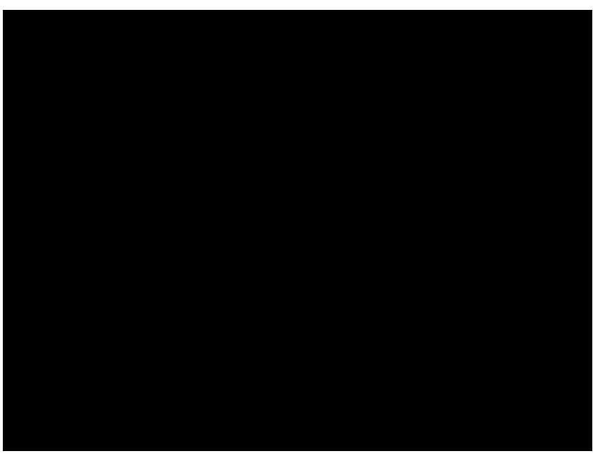

> *Figure 3.* *Theoretical ethical climate* *types* *(Victor and Cullen, 1987, 1988)*

<!-- page 53 -->

Victor and Cullen (1988) then identified the five prevalent ethical climates among the nine categories: Instrumental, Caring, Independence, Rules, Law and Code (see Figure 4). The climate types are not considered as mutually exclusive, nor are they assumed to be uniform across an organization's subgroups (Wyld and Jones, 1997).

> *Figure 4.* *Emergent* *ethical climate* *types* *(Victor and Cullen, 1987, 1988; Neubaum et al., 2004)*

## **2.3.2.5** **Critique** **of the Ethical Climate Questionnaire**

At the time of its inception, ECQ was a pioneering step in measuring ethics. However, throughout the past three decades, this tool has been subject to criticism that targeted its operationalization and measurement, rendering it outdated and incompatible with current research trends (Kuenzi, Mayer and Greenbaum, 2020). Several weaknesses have been pointed out regarding the theory's capability of predicting behaviour, and the ECQ's ability to diagnose consistent factors of the ethical climate.

Arnaud (2010) warns that the most significant drawback of Victor and Cullen's (1987, 1988) theory is its inability to empirically validate the climate types it theorized given the various distinct groups of climate types that have appeared in research since its inception (Wimbush, Shepard and Markham, 1997; Fritzsche, 2000; Peterson, 2002). Arnaud (2010) rightly demonstrates how the inconsistency in Victor and Cullen's theory is logically justified since the two dimensions (ethical criteria and loci of analysis) used to generate the nine climate types are not fully independent to begin with (Victor and Cullen, 1988: 106) but closely tied to moral judgement. Accordingly, cross-classifying them cannot produce distinct climate types.

<!-- page 54 -->

Arnaud (2010) concludes that Victor and Cullen's renowned theory, in effect addresses only a single element of the ethical work climate, that is morally right decision making.

In a more recent criticism to Victor and Cullen's theory, Kuenzi, Mayer and Greenbaum (2020) assert that ECQ is not the proper measure for ethical climate as it is operationalized today. They argue that the tool only measures perceptions of organizational principles utilized in ethical decision-making. Kuenzi, Mayer and Greenbaum (2020) maintain that decisionmaking is but one component of the overarching climate construct which comprises a range of practices rooted in the formal system of any organization, and which are equally critical to maintaining an ethical climate (Treviño and Nelson, 2017). Kuenzi, Mayer and Greenbaum (2020) identify four major reasons warranting the need for a totally new measure of ethical climate eventually replacing ECQ (Victor and Cullen, 1988).

First, the definition that Victor and Cullen used to describe ethical climate as "a shared perception of what is correct behaviour and how ethical situations should be handled in an organization" (1987, p. 51) focuses mainly on the decision-making processes in organizations. This definition falls far short of a comprehensive conceptualisation of an organizational climate. The definition overlooks main elements of the organizational climate such as the shared perceptions of policies, procedures, and practices, and how these are encouraged and supported (Schneider and Reichers, 1983).

Second, in their approach to categorizing ethical climates, Victor and Cullen (1987, 1988) cross-tabulated three types of moral reasoning (egoism, benevolence, principle) with three loci of analyses (individual, local, cosmopolitan) producing nine types of ethical climates, five of which (instrumental, caring, law and code, rules, and independence) are claimed to be the most prevalent. However, as Arnaud (2010) argues, numerous other variations of ethical climates were produced in literature using the ECQ indicating that this measure lacks robustness.

Third, studies using ECQ have detected inconsistencies in factor loadings (Smith, Thompson and Iacovou, 2009) even with the five common climate types. This resulted in a proliferation of alternative new measures that attempted to correctly assess the ethical climate. For instance, Deshpande (1996a, 1996b), Joseph and Deshpande (1997), Deshpande, George and Joseph (2000), Deshpande, Joseph and Shu (2011), and Zagenczyk et al., (2020) used a modified six-item scale based on ECQ to measure ethical climate. Others, like Stewart et al. (2011) have used a separate two-item scale, while Schwepker (2001) used a seven-item scale.

<!-- page 55 -->

David et al. (2020) based their measurement on Mayer et al.'s (2013) popular three-item scale. One group of marketing researchers (Schwepker and Hartline, 2005; Valentine, Greller and Richtermeyer, 2006; DeConinck, 2010, 2011) used a four-item measure which was later criticized for being too specific to marketing and sales contexts (Simha and Cullen, 2012) and cannot be generalized elsewhere. Altogether, the multitude of scales and inconsistencies suggests that what was originally measured was not strictly ethical climate, thereby posing a real challenge when attempting to compare different studies.

Fourth, most research that was conducted using the ECQ has measured the ethical climate at the psychological level, that is the individual's perception of the work environment's effect on their own well-being, which entails an internal affective state. A more objective measure would address the ethical climate at the organizational level that is the shared perceptions of the work environment (Martin and Cullen, 2006). This weakness of the ECQ was previously confirmed by Cullen, Victor, and Bronson (1993) who concluded that the tool was less stable when measuring organizational climates.

## **2.3.2.6** **New Conceptualization of the Ethical Climate**

To address the above-mentioned weaknesses, Kuenzi, Mayer and Greenbaum (2020) presented a new conceptualization of the ethical climate based on Treviño and Nelson's (2017) Multisystem Ethical Culture Framework (see Figure 5). This framework characterizes ethical culture as a complex interplay of formal systems: Selection Systems, Orientation and Training, Policies and Codes, Performance Management, Authority Structure, and Decision Processes; and informal systems: Norms, Rituals, Myths and Stories, and Language. The formal systems are detailed next, illustrating how each impacts the ethical culture of an organization.

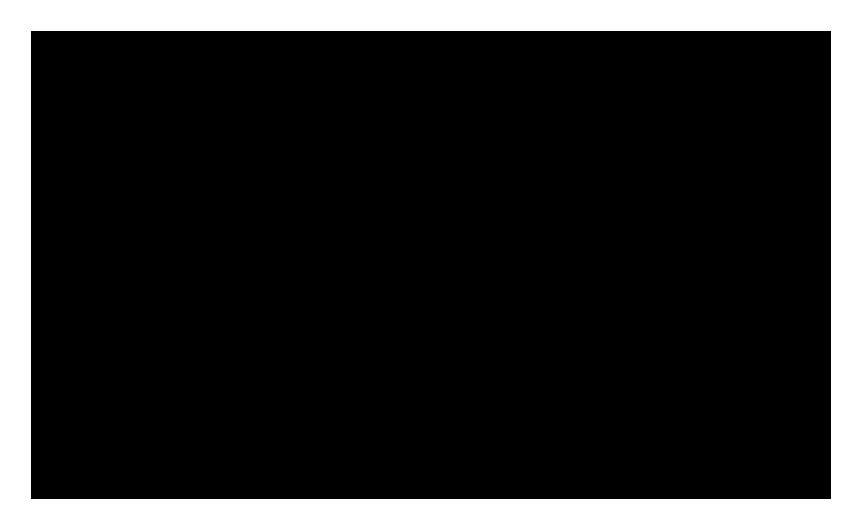

> *Figure 5.* *A Multisystem Ethical Culture Framework* *(Treviño* *and Nelson, 2017)*

<!-- page 56 -->

Selection systems are the procedures by which new employees who fit the organizational culture and values are recruited. Organizations can avert ethical issues through considering the candidates' moral character and ethical standards prior to recruitment which can be achieved by performing background checks and conducting integrity tests. For instance, organizations may proceed with caution when hiring candidates having a Machiavellian personality when the culture they are expected to fit in is one of cooperation and mutual support.

Formal orientation and training programs are the starting point for socializing employees into the organization's ethical culture. Values and principles can be conveyed during the initial training sessions, but they need to be reinforced in subsequent ones. These sessions can include demonstrations of possible ethical dilemmas and how to handle them. The training sessions should be aligned with the actual ethical culture, otherwise they would be perceived as non-serious and nothing but a chance to break from work.

Policies and codes would typically address ethical practices and matters of respectful treatment among members of the organization. Codes are expected to be strictly enacted and should cover conflicts of interest, expense reporting, and the standard procedure regarding giving and receiving gifts, among other ethical issues. Furthermore, codes can include items which guarantee that reporting unethical behaviour will result in taking an appropriate immediate action with specific clear penalties. Codes of conduct are historically present in HEIs where honour codes are meant to guide behaviour such as dealing with plagiarism and test cheating. Treviño and Nelson (2017) report less cheating in institutions that adopt honour codes, but also observe that perceptions of cheating being unethical can influence the actual cheating behaviour more than the existence of codes would. As for policy manuals, they serve a similar purpose to codes of conduct, but they are usually lengthier, more detailed, and address industry- and organization-specific settings.

Performance management systems play a fundamental role in strengthening the ethical culture through showing members what behaviours are valued, rewarded, and disciplined. Ideally, performance metrics identify compensation while performance problems are rectified through disciplinary action that is taken quickly and fairly. An ethical culture is properly promoted when hard-working, upright employees are given chances to excel while unethical ones are disciplined. Discipline should be proportional to the position held by the employee.

<!-- page 57 -->

Members belonging higher in the organizational hierarchy receive harsher penalties that reflect the position's greater authority and responsibility.

An organizational authority structure defines each member's responsibility and accountability at all levels of the organization. An ethical culture gets ingrained within that authority system when employees are directed to take responsibility for their actions, report misconduct, and feel comfortable questioning and reporting orders from their superiors to behave unethically.

In an ethical decision-making system, ethical concerns are an established part of decision making at all levels. A properly aligned ethical culture expects concerns to be addressed in all management reports from purchasing new products, for example, to conducting new business deals. Even when immediate decisions should be taken, ethical concerns are discussed before proceeding.

Kuenzi, Mayer and Greenbaum (2020) drew on Treviño and Nelson's (2017) established framework to examine perceptions of the ethical climate in work units. They addressed the limitations of prior research by employing a unit- as well as an organizationallevel ethical framework. Since studying the ethical climate at an organizational level, has become common in related literature, the authors went deeper to examine unit-level antecedents and consequences of the ethical climate. The resulting theoretically derived tool – the Ethical Organizational Climate – reflects ethical practices that are related to the six formal components of Treviño and Nelson's (2017) model. Specifically, it measures perceptions of ethics-related practices, policies, and procedures at the organizational-level as well as the unitlevel. The tool will be further discussed in chapter 3. The next section and its following subsections will focus on the third major concept within this thesis, knowledge sharing.

## **2.3.3** **Knowledge Sharing**

Knowledge is defined as "the fluid mix of framed experiences, values, contextual information and expert insight that provides a framework for evaluating and incorporating new experiences and information" (Swart et al., 2014). Knowledge is not static but changes dynamically as it gets shared with others and interpreted by its providers and receivers (Watzlawick, 1976). Formal, organisational knowledge is often typically found in an organization's documents, databases, and repositories. Tacit knowledge, however, may be found in daily routines, norms, and practices (Davenport and Prusak, 1998). This part of the thesis focuses on understanding the dynamics of knowledge sharing behaviour between

<!-- page 58 -->

employees given the impact it has on accumulating team and organizational knowledge (Tsoukas and Vladimirou, 2001; Cabrera and Cabrera, 2005).

Every act of knowledge-sharing is made up of both donating (providing) knowledge and collecting (obtaining) knowledge (Van Den Hoof and De Ridder, 2004). Knowledge sharing processes can be seen in different perspectives: supply of and demand for new knowledge (Ardichvili, Page and Wentling, 2003), an exchange between a knowledge source and a knowledge receiver, or an interaction between a knowledge carrier and a knowledge requester (Van Den Hoof and De Ridder, 2004). Consistent with the literature on knowledge sharing, this thesis labels the bidirectional process of knowledge sharing as:

(1) knowledge donating, actively providing others with one's personal knowledge and skills.

(2) knowledge collecting, actively consulting others to obtain from them the knowledge and skills they have.

## **2.3.3.1 Organizational Knowledge Sharing**

In an organizational context, knowledge sharing is characterized by donating or collecting task information and knowledge assets (know-how and know-what) that enable collaboration with others to solve existing problems or introduce changes, new ideas, policies, and procedures (Cummings, 2004). It includes the implicit coordination of expertise (Faraj and Sproull, 2000) and recognizing who knows what in a workgroup (Rulke and Galaskiewicz, 2000). Importantly, sharing knowledge is always within the control of the individual, and not the organization, making the process of sharing highly interpersonal (Empson, 2001). Being interpersonal and in the control of employees, knowledge sharing has been increasingly recognized as a moral challenge within organizations (Jarvenpaa and Staples, 2001; Van den Hooff and de Leeuw van Weenen, 2004). Employees' refusal to adopt knowledge sharing as a standard behaviour may violate an organization's moral norm and even jeopardize its survival (Lin, 2007). Given the moral and practical importance of knowledge sharing and the distinct nature of its constituents (collecting and donating), it is essential to understand the mechanism by which employees adopt and practice these behaviours (Bock et al., 2005), and how they are influenced by ethical leadership and ethical climate.

In comparison with the corporate sector, the higher education sector is arguably behind in terms of implementing comprehensive knowledge sharing programs (Rowley, 2000; Fullwood, Rowley and Delbridge, 2013). The available research on knowledge sharing in

<!-- page 59 -->

higher education focuses primarily on faculty and students' perspectives (e.g. Fullwood, Rowley and Delbridge, 2013; Goh and Sandhu, 2014; Xia and Yang, 2020) while there is little research focusing on an essential yet almost unexplored constituent of universities, that of professional or non-academic staff (e.g., Rahman et al., 2016; Rahman, Daud and Hassan, 2017). These staff members include executives, directors, managers, assistant managers, department heads, supervisors, librarians, etc. This thesis aims to examine the knowledge sharing behaviours of this specific group, in addition to that of academic staff, in light of the previously mentioned constructs: ethical leadership, and ethical climate in the Lebanese context.

HEIs aspiring to compete in the global market should be keen on maximizing their intellectual capital which primarily occurs through knowledge sharing (Swart and Kinnie, 2003; Fullwood, Rowley and Delbridge, 2013). They need to effectively capitalize on knowledge-based resources that lie within the organization through transferring expertise from specialists who have it to novices who need it (Hinds, Patterson and Pfeffer, 2001). However, the act of sharing knowledge between members of the same organization can face numerous obstacles. Some of the factors that hinder organizational knowledge sharing in higher education include the trust culture, knowledge sharing culture, job security (Al-Kurdi, El-Haddadeh and Eldabi, 2018), absence of systems and policies that protect intellectual assets among academics, the solitary nature of research (Seonghee and Boryung, 2008), the complexity of academic departments, and the commitment of faculty to their discipline rather than the institution (Fullwood, Rowley and Delbridge, 2013).

## **2.3.3.2** **Channels of Knowledge Sharing**

Knowledge can be shared through various channels such as written communication, face-to-face networking, as well as capturing knowledge and documenting it in manuals (Cummings, 2004) stored in knowledge management systems. The actual knowing, nonetheless, does not occur centrally within the organization or in specific departments but is the result of complex linkages between the different parties that make up the social and organizational structure (Swart, 2006).

From the perspective of social exchange theory, knowledge sharing is a bidirectional and multilevel process. It can take place at the individual, intra-organizational, and interorganisational levels (Wilkesmann, Fischer and Wilkesmann, 2009) among individuals, teams, and units who exchange and obtain knowledge, and are impacted by the experience of other

<!-- page 60 -->

players (Argote and Ingram, 2000). Social exchange theory suggests that individuals assess the benefits and costs before sharing their knowledge and decide whether to proceed based on calculated benefits like reputation, respect, and concrete incentives (Blau, 1964). Perceived benefits stimulate knowledge sharing behaviours whereas perceived costs discourage them. (Wang and Noe, 2010).

## **2.3.4 Employee Organizational Tenure**

Organizational tenure measures the elapsed time between the date when an employee was hired and when data about this variable was collected. As such, it is an important timerelated factor that affects social learning and social exchange, both of which typically require individuals to be exposed to their environment over a period of time for their learning to be influenced, and to the other party for their exchange or reciprocity to be developed. As discussed earlier, through social learning, leaders play a significant role in shaping employee climate perceptions (Mayer, Kuenzi and Greenbaum, 2010; Zohar and Luria, 2005). Thus, the time that an employee spends in an organization defines their perception of their leaders and consequently shapes their learning about the work environment and their perception of the organizational climate.

Studies on organizational tenure in higher education institutions are of strategic importance as they guide our understanding of performance in this context (Atatsi, Stofers and Kil, 2021) and enable these institutions to fulfil their stated missions (Dirican and Erdil, 2016). An awareness of tenure's importance supports institutions when developing their strategies as well as when interpreting the dynamics behind their employees' behaviour (Uçanok, 2008). As such, organizational tenure is considered by some to be a critical element in predicting how different employees react to the same situation and adapt their behaviour positively or negatively (Chen et al., 2011; Chan and Mak, 2014). This is deemed to be related to a deeper knowledge about social norms and human resource practices that long-tenured employees accrue compared to newcomers. Long-tenured employees tend to react more strongly to stressors such as unethical supervision (Rollag, 2004) since they would have been exposed to different types of stressors over a longer period (Mroczek and Almeida, 2004). Other research has found that long-tenured employees are indeed better at handling and navigating through workplace politics (Valle, Harris and Andrews, 2004).

Organizational tenure is also related to the compatibility between people and their employing organizations. Long tenured employees tend to have higher work motivation,

<!-- page 61 -->

stronger organizational commitment, job engagement, job security, acceptance of organizational policies, values, and authority structure. They are also seldom attracted to the job market (Rhoades and Eisenberger, 2002). This view is supported by the Attraction-Selection-Attrition Theory (Schneider, Goldstein and Smith, 1995). The attraction process states that people find certain organizations more attractive than others based on their implicit judgement of the alignment between their personalities and an organization's culture, processes, and structure. Selection refers to the recruitment procedures that organizations use when hiring people that have attributes they desire. Attrition suggests that people will leave an organization they do not fit. Hence, through self-selection, employees with longer tenure at the organization are those with better person-organization fit. They perceive a stronger alignment between their personal values and those of the organization. Employees with a poor personorganization fit, on the other hand, would have likely left the organization in their early years of tenure (Bal, De Cooman and Mol, 2013).

It is worth noting that the above views on organizational tenure and its impact on employee attitudes have been challenged in literature. In contrast to the aforementioned research that supports a positive impact of long organizational tenure over employee attitudes and behaviours, Cropanzano, James and Konovsky (1993), Helmreich, Sawin and Carsrud (1986), Wright and Bonett (2002) contradict this stance and suggest that employees with a short organizational tenure tend to demonstrate greater acceptance of the new work environment than those with a longer tenure. These employees also display higher levels of motivation and enthusiasm towards work especially in their "honeymoon period" which spans the first few months in a new job. With time, longer tenured employees become tired, distrustful (Rainey, 2009), and less accepting of the organization's decisions and policies (Coyle-Shapiro, 2002).

## **2.4 Relationships between the Main Concepts**

The next section will review the literature concerning the relationships between the main concepts. It will identify gaps in existing literature and set the basis for answering the research questions of this study. The section will lead to the study's research hypotheses and conceptual framework.

## **2.4.1 Ethical Leadership and Employee Knowledge Sharing**

The leadership literature has repeatedly reported the central role of leaders in facilitating knowledge sharing through implementing norms that advocate positive prosocial

<!-- page 62 -->

behaviours (Srivastava et al., 2006; Xue, Bradley and Liang, 2011; Han et al., 2016; Park and Kim, 2018). As mentioned earlier, ethical leadership, in particular, is characterized by morality displayed in desirable behaviours such as fair treatment, encouraging voice, and building trust among the different exchange parties (Brown and Treviño, 2006; Le and Lei, 2018). These behaviours have been shown to positively influence the attitude toward knowledge sharing and the intention to share knowledge (Bock et al., 2005) through providing the motivation to do so and the opportunities that elicit this behaviour. Ethical leaders strive to eliminate the barriers that restrict the sharing of knowledge and resources among team members through enforcing policies that emphasize morality, such as codes of ethics, fair rewards, and ethical decisionmaking processes. Another contributor to eliminating barriers and facilitating knowledge sharing behaviours is the leader's role modelling element. Through their appropriate conduct, ethical leaders exhibit the organization's values of mutual care, justice, trust, and goodwill (Bavik et al., 2018).

The available research has mostly taken a social capital perspective which argues that social relationships are resources that can be employed to accumulate human capital (e.g.: Yang and Farn, 2009; Hu and Randel, 2014). The current research, however, takes a moral perspective through adopting a social learning lens, in addition to social exchange, to examine knowledge sharing in a unique way, where the leader's ethicality is the predictor of this moral behaviour. This view has been recently adopted by Su et al. (2021) in their study of ethical leadership and knowledge sharing in Chinese firms. In the higher education context, the study by Xia and Yang (2020) stands out with respect to taking this perspective. However, the study examined the knowledge sharing behaviour among postgraduate students. Considering the above, there remains a knowledge gap in the higher education literature where ethical leadership and knowledge sharing have not been examined among academic and professional staff. This gap will be bridged by answering the first research question of this study:

**Research Question 1:** What is the relationship between ethical leadership and employee knowledge sharing in higher education institutions?

To answer this research question, it is hypothesized that ethical leadership promotes employee knowledge sharing (collecting and donating) through eliminating the barriers that obstruct the sharing of knowledge. In an exchange fashion, employees involved in relationships that are characterized by trust expect their contribution of knowledge and sharing of resources

<!-- page 63 -->

to be fairly and equally reciprocated within the team (Mayer et al., 2012; Kacmar et al., 2013). Thus, I hypothesize:

*H1a.b.* Ethical leadership has a positive association with employee (a) knowledge collecting and (b) knowledge donating in higher education institutions.

## **2.4.2** **Mediating Role of Ethical Climate** **between Ethical Leadership and Employee ** **Knowledge Sharing Behaviour**

Drawing on social exchange theory (Blau, 1964) and social learning theory (Bandura, 1986) this thesis examines how the ethical climate acts as a mediator between ethical leadership and knowledge sharing. By doing so, this research opens an avenue to better understand this mechanism in the higher education context. To address the mediation that the second research question probes, the relationship between ethical leadership and ethical climate will be explored next, followed by an elaboration on the influence of ethical climate on knowledge sharing behaviour.

## **2.4.2.1** **Ethical Leadership and Ethical Climate**

Social learning theory (Bandura, 1977, 1986) posits that employees learn suitable behaviour through their ethical leaders' role modelling and use of rewards and punishments. Ethical leaders enforce ethical standards and discipline employees according to their ethical compliance. This process forms employee perceptions of the policies and procedures that their leaders set and how they are implemented.

According to Zohar and Luria (2005), top managers set the strategic goals and procedures pertinent to these goals. Through implementing practices, ethical leaders then interpret these broad strategies. Consequently, practices establish clear directions for employees on expected ethical conduct. The interpretation and implementation processes are rooted in the two pillars of ethical leadership: moral person (interpretation) and moral manager (implementation). Evidently, leaders' ethicality shapes their ethical practices in numerous areas. When recruiting employees, ethical leaders seek high moral standards. They implement ethics training and define acceptable behaviours as part of their active management of ethics (Brown and Mitchell, 2010). They also interpret policies and codes through discussing organizational ethics with employees (Brown, Treviño and Harrison, 2005) and emphasizing

<!-- page 64 -->

the morality of processes used to achieve goals instead of focusing only on end results (Greenbaum, Quade and Bonner, 2015).

As for reward and punishment systems, ethical leaders are determined to clarify what constitutes ethical behaviour and the corresponding rewards as well as what violates it and how violators are disciplined (Ng and Feldman, 2015). Ethical leaders underline accountability through openly admitting their mistakes when they misbehave according to the set ethical standards as well as provide an environment that allows employees to question the ethical conduct of others (Brown, Treviño and Harrison, 2005). Concerning balanced decisionmaking, ethical leaders urge employees to strongly favour the right thing to do when making decisions (Xu, Loi and Ngo, 2016).

Accordingly, leaders play a major role in shaping the work environment and more precisely employee climate perceptions (Mayer, Kuenzi and Greenbaum, 2010; Zohar and Luria, 2005). They ensure a consistent message pertaining to ethical conduct is disseminated across the organization through creating formal systems in their immediate work environment that reflect top management directions. In contrast, when there is misalignment between the leader's genuine ethicality and that of the organization, employees tend to perceive the ethical environment as unauthentic, superficial, and temporary. They also regard it as motivated by strategy rather than compassion, and merely intended to raise their productivity and increase profit (Myer, Thoroughgood and Mohammed, 2016).

## **2.4.2.2** **Ethical Climate** **and Employee Knowledge Sharing Behaviour**

Prior research has indicated that the ethical climate plays a significant role in reducing employees' self-interest and perceived ambiguity, and in forging cooperation, compassion, morality, and trust (Victor and Cullen, 1988; Martin and Cullen, 2006). Ethical climates have also been regarded as having high potential to positively prompt employees' ethical behaviour (Deshpande and Joseph, 2009; Lu and Lin, 2014)*.* This section explores the mechanism by which the ethical climate influences employee knowledge sharing behaviour which is a salient form of cooperation and morality (Bavik et al., 2018).

Social learning theory (Bandura, 1977, 1986) holds that individuals mimic the behaviour of their role models. Robinson and Bennett (1977) assert that ethical unit members act as role models as well as actively take part in observing ethical norms through rewards and punishments. Additionally, they may make positive or negative comments, involve complying employees in activities, and ostracize disobedient ones from their group. As employees witness

<!-- page 65 -->

these sanctions imposed for improper behaviour on one hand, and rewards offered for positive conduct on the other, they shape their shared perceptions towards ethical expectations.

Employees interpret their observations as the characteristic way ethics operate in that specific organization and model their behaviour accordingly. If the ethical climate is strong, employees will repeatedly observe their colleagues behaving ethically and will seek to mimic this behaviour (Kuenzi, Mayer and Greenbaum, 2020). Employees who perceive a strong ethical climate can easily make the connection between actions and consequences. Developing this mental link assures them that their work environment is stable and predictable, and that their efforts will not be overlooked but instead will lead to achieving their goals (Kacmar et al., 2009; Erez and Judge, 2001).

In addition, when employees perceive that their leaders and employing organization equally embrace ethical practices, they regard the treatment they are receiving as honest and in their best interest. It reflects the integrity of the direct leader and the organization alike (Fritz et al., 2013). Strong ethical climates persuade employees to believe that the organization takes ethics seriously. They tend to identify themselves with the organization and feel the duty to make it successful (DeConinck, 2010; DeConinck, 2011). Knowledge sharing is perceived as one of many meaningful contributions to the organization's success in this case (Piccolo et al., 2010). It is influenced by the organizational culture that not only shapes how employees perceive the act of sharing knowledge but also whether they participate in it (Tseng and Fan, 2011).

An organizational climate that is characterized by open communication, trust, cooperation, and fair decision-making (Cabrera and Cabrera, 2005) enhances knowledge sharing by minimizing the perceived costs of that behaviour (Wang and Noe, 2010; Willem and Scarbrough, 2006). Consequently, this strong ethical climate creates a general feeling of certainty about one's activities and a sense of control over the environment (Johnson et al., 2015). Collective ethical behaviour will ease the pressure to jeopardize the organization's ethical standards in reaching its objectives (Kuenzi, Mayer and Greenbaum, 2020). Also, individuals who trust their management and team members, believe that the organization has rights to the knowledge they have acquired (Jarvenpaa and Staples, 2001) and more so as an exchange for their organizational membership (Kelloway and Barling, 2000).

As for weak ethical climates, Mayer et al. (2013) assert that in unethical organizational cultures, employees fail to develop and maintain ethical behaviours, practice ethical decision-

<!-- page 66 -->

making, and encourage their peers to behave ethically. Such an environment generates a strong sense of uncertainty where employees are always sceptical of information shared by their peers. In fact, knowledge sharing has been found to be almost lacking among employees within organizational cultures of mistrust and competition (Lam, 2005).

Stressful contexts lead individuals to hide their knowledge from others therefore jeopardizing the efficiency and progress of their teams (Chan Kim and Mauborgne, 1998). Furthermore, the absence of clear cultural values would gradually instil fear of sharing knowledge and with time lead to knowledge hoarding (De Long and Fahey, 2000). The influence of the ethical climate is seen more vividly when an employee faces an ethical problem such as a trust violation, witnessing questionable behaviour of peers or superiors, or how others are treated (Fournier et al., 2010).

## **2.4.2.3** **Mediating Role of Ethical Climate**

The previous sections have demonstrated that there is evidence from the non-higher education literature that ethical leaders positively influence employee perceptions of the ethical climate through implementing and enforcing relevant practices, which in turn positively influence and encourage different forms of employee moral behaviour in the workplace (Mayer et al., 2009) such as knowledge sharing. The second research question addresses this knowledge gap about the mentioned relationship in the higher education context:

**Research Question 2:** Is the relationship between ethical leadership and employee knowledge sharing mediated by the ethical climate in higher education institutions?

Indeed, past research has found that organizational climates play an important mediating role in the relationship between organizational variables such as leadership and unitlevel outcomes (Kuenzi, Mayer and Greenbaum, 2020; Schminke et al., 2005; Zohar and Luria, 2005). Litwin and Stringer (1968) proposed that leadership generates organizational climates that drive the attitudes and behaviours of employees. Furthermore, Kuenzi and Schminke (2009) pointed out that the mediating role of climate is illustrated in "facilitating the processes by which organizational activities translate to outcomes".

Concerning the mediating role of ethical climates in particular, support is also found in the literature. For example, researchers have asserted that the relationship between ethical leadership and enhancing positive workplace attitudes is mediated by the ethical climate of the organization (Mayer, Kuenzi and Greenbaum, 2010; Kalshoven, Den Hartog and De Hoogh,

<!-- page 67 -->

2013; Lu and lin 2014; Demirtas and Akdogan, 2015). Ethical climate has also been found to mediate the relationship between ethical leadership and the financial performance of the organization (Shin et al., 2015). Research on the mediating role of ethical climate in the higher education sector is limited. Ramos, Mata and Nacar (2021) have argued that the ethical climate mediates the effect of individual differences, measured using personality traits, on the state of mindfulness. Their sample included faculty, administrators, and staff of higher education institutions in the Philippines. Awais-e-Yazdan and Hassan (2020) have found a mediating role of the ethical climate between human resource management practices and employee turnover intention among faculty members in public universities in Pakistan.

The aforementioned arguments suggest that the ethical climate is expected to be a mechanism through which ethical leadership is related to employee ethical conduct, demonstrated through knowledge sharing behaviour in this research, in higher education institutions. Therefore, the following hypothesis is presented:

*H2a.b.* The ethical climate mediates the relationship between ethical leadership and employee (a) knowledge collecting and (b) knowledge donating in higher education institutions.

## **2.4.3 Moderating Role of Employee Organizational Tenure**

Since leadership is a time-dependent phenomenon based on mutual trust that develops gradually over time (Bluedorn and Jaussi, 2008), employees' perceptions of their leaders and subsequently their environment may differ depending on the length of their tenure in the organization. The longer employees stay at an organization, the more they witness their ethical leaders enforcing ethical standards and disciplining other employees. Expected ethical conduct becomes engrained in their understanding of the organization, and cues about the ethical climate become increasingly consistent. Clark et al. (1996) argue that organizational tenure allows employees a deeper understanding of their work environment while Rollag (2004) posits that knowledge about one's work environment includes knowledge about social norms and human resources practices.

Organizational tenure has also been associated with a higher level of social links that employees compile throughout their tenure in addition to their long-term career plans within the organization (Hu et al., 2019). In fact, the longer employees stay in their current organization, the more strongly they become embedded in it (Lee et al., 2004) and the higher

<!-- page 68 -->

justice they perceive in the system's management practices (Magoshi and Chang, 2009). Accordingly, perceptions of long tenured employees become more nuanced with time.

In view of the importance of the organizational tenure factor, this thesis explores it as a moderator in the relationship between perceptions of ethical leadership and ethical climate, and subsequently knowledge sharing. In doing so, the thesis treats organizational tenure as a contextual condition and gives it the status of moderator rather than treating it as a control variable as has been commonly employed (Mayer et al., 2012; Hansen et al., 2013; Bavik et al., 2018).

The third research question explores the role of organizational tenure in the relationship between ethical leadership and ethical climate:

**Research Question 3:** To what extent does employee organizational tenure moderate the relationship between ethical leadership and ethical climate in higher education institutions?

Considering the above literature and related evidence, this thesis argues that the strength of the association of perceptions of ethical leadership with perceptions of the ethical climate could vary depending on the length of organizational tenure. More specifically, the thesis posits that the relationship will be stronger at longer tenure. The following third hypothesis is thus presented:

*H3.* Employee organizational tenure moderates the relationship between ethical leadership and ethical climate such that this relationship is stronger when organizational tenure is longer.

Taken together, hypotheses *H2.a.b.* and *H3* suggest a first-stage moderated mediation model (see Figure 6) which leads to the fourth hypothesis:

*H4a.b.* Employee organizational tenure moderates the indirect relationship between ethical leadership and employee (a) knowledge collecting and (b) knowledge donating through ethical climate such that the indirect relationship is stronger when organizational tenure is longer.

<!-- page 69 -->

## **2.5 Proposed Conceptual Framework**

The proposed conceptual framework, which is drawn from the review presented in the previous sections, and the above hypotheses discussed for each of the depicted relationships (arrows), is presented in Figure 6.

> *Figure 6.* *Proposed Conceptual Framework* *Abbreviation: OT, Organizational Tenure*

## **2.5** **Summary**

This chapter has shed light on a number of major studies contributing to the literature on ethical leadership, ethical climate, knowledge sharing, and organizational tenure. This review indicated that little attention has been given to the influence of ethical leadership on employee outcomes in the higher education sector, and less so to the roles of the ethical climate and employee organizational tenure in that relationship. Knowledge gaps in the higher education literature are thus identified, which this thesis aims to address in the Lebanese private higher education sector. The research questions of this thesis revolve around the relationship between ethical leadership and employee knowledge sharing and the role of the ethical climate and organizational tenure in that relationship. A theoretical lens through which the research questions of this thesis will be examined is laid out by adopting social learning and social exchange theories. An extended review of the main concepts of this thesis is then presented after which the hypotheses are formulated. The literature review covered in this chapter will serve as a guideline for the thesis contribution to knowledge and recommendations for practice that are considered in the discussion chapter.

<!-- page 70 -->

## **Chapter 3: Methodology and Methods**

This chapter describes the methodology applied towards understanding the role of ethical leadership in influencing knowledge sharing among employees, the mediating role of the ethical climate, and the moderating role of the organizational tenure in the context of higher education. It commences by presenting the ontological and epistemological assumptions underlying the research study. A description of the research design is elaborated, followed by an overview of the research setting, the study sample, instruments used, and research ethics covering issues of confidentiality, anonymity, potential ethical risks, and how the study seeks to mitigate those risks. The chapter ends with a discussion of the data collection methods and procedures followed to analyse the collected data.

## **3.1 Research Philosophy**

Research is guided by a set of assumptions, beliefs, and feelings about the social world which determine the researcher's perspectives and practices, and direct how the research is conducted and how the relation to respondents, data collection techniques, and results interpretation are practiced (Denzin, 2005; Punch, 2016). These references form the research philosophy or interpretive framework (Guba, 1990: 17). The three main principles that distinguish a research philosophy are the researcher's views about the nature of reality (ontology), assumptions about the most appropriate ways to enquire into knowledge (epistemology), and the process of accumulating knowledge about the world (methodology) (Bell, Bryman and Harley, 2018).

## **3.1.1 Ontology**

This research investigates the behaviour of people in the realm of management as opposed to investigating inanimate objects. The researcher believes that reality in this realm is truly independent of himself as an observer, however it cannot be accessed through direct means, and thus the assumptions of the natural sciences cannot be directly applied in this study. This position towards reality has been labelled 'internal realism' which holds that when dealing with perceptions, truth is uncertain and cannot be directly revealed as it is a function of the human mind and requires additional investigation to uncover. Internal realism expects that only indirect evidence of occurrences can be gathered within an environment. Realism, on the other hand, considers that the world exists independently of human perception, where objective reality is revealed by scientific observations (Easterby-Smith et al., 2018). Other ontological

<!-- page 71 -->

positions that Easterby-Smith et al. (2018) discuss are relativism and nominalism. Relativism acknowledges that there are many truths and that facts depend on the observer while nominalism goes a step further and holds that there is no truth and facts are all human creations.

The essence of this research is to examine human perceptions of ethical leadership in the context of higher education and investigate how these perceptions impact human behaviour in order to draw conclusions from the investigation. The research thus adopts the internal realism ontology from a human behaviour perspective (Easterby-Smith et al., 2018). It treats concepts like ethical leadership, ethical climate, and knowledge sharing as observable phenomena that have a measurable impact with real consequences on individuals' lives and careers in different occupational contexts. In addition, the research presumes that these concepts exist independently and that efforts to measure these concepts do not alter the concepts in any form, nor have any effect on the participants' perceptions of these concepts (Easterby-Smith et al., 2018).

## **3.1.2 Epistemology**

The research examines and quantitavely represents follower perceptions of ethical leadership through the theoretical perspectives of social exchange and social learning theories by using surveys and subjecting the collected data to statistical analysis to measure the impact those perceptions have on employee knowledge sharing in the higher education context. The research also observes the role that organizational characteristics (the ethical climate) and personal factors (employee organizational tenure) play in determining employee knowledge sharing behaviour. Considering the nature of the research questions and associated hypotheses, the thesis adopts the positivist epistemological paradigm (Easterby-Smith et al., 2018) within the ontology of internal realism.

Positivists hold a deterministic philosophy of the realm they are researching in which causes affect outcomes (Creswell and Creswell, 2017). They distil complete ideas into discrete testable sets of variables that make up the hypotheses and questions under research. The derived knowledge is thus based on detailed observation that is associated with quantitative measurement of the relationship between these variables. Positivists also focus on refining the laws and theories that control the world in order to better interpret it (Creswell and Creswell, 2017).

Easterby-Smith et al. (2018) distinguish among positivist philosophies. They classify the traditional positivist philosophy which is commonly applied to experimental studies as

<!-- page 72 -->

'Strong Positivism' whereas positivist philosophy that is applied to social-scientific studies, like the one at hand, is defined as 'Positivism'. They emphasize four epistemological positions that are situated on a continuum extending from Strong Positivism to Strong Constructionism where strong positivism and strong constructionism are linked to realist and nominalist ontologies while positivism and constructionism are linked to internal realist and relativist ontologies. Table 1 summarizes the links between ontologies and epistemologies.

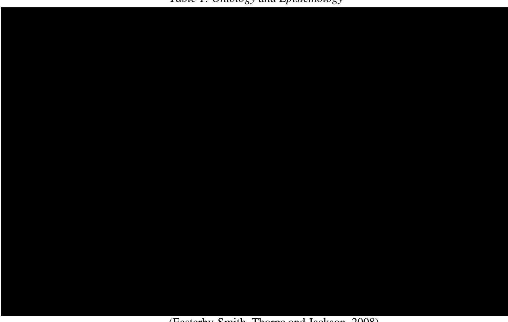

> *Table 1: Ontology and Epistemology*

(Easterby-Smith, Thorpe and Jackson, 2008)

Positivism challenges the traditional view of the absolute truth that strong positivism holds in the search for knowledge. It emphasizes that the investigation of human behaviour, such as the objective of this study, could not be an absolute science and researchers cannot be positive about their claims of knowledge (Creswell and Creswell, 2017). As mentioned in section 3.1.1, the researcher holds that when dealing with perceptions, truth is obscure and requires additional investigation to uncover as it is a function of the human mind. Therefore, a strong positivist epistemology would not fit the researcher's ontological views and cannot be applicable to this study.

<!-- page 73 -->

The positivist paradigm combines deductive logic with empirical observations of human behaviour and makes it possible to execute quantitative research in a social science environment. The primary method followed in positivist research is the survey method which uses cross-sectional surveys and presents data in quantitative values to demonstrate relationships between the observed variables. The positivist study presumes that the researcher is independent from the measured variables (Easterby-Smith et al., 2018) through maintaining minimal interaction with research participants when executing the research (Wilson, 2014) and preventing human bias from influencing its outcomes (Easterby-Smith et al., 2018).

Following the deductive approach, this research first defines the underlying theory, develops hypotheses, collects data, analyses the data to confirm or reject the formulated hypotheses and finally revises the initial theory (Bryman, 2016). By connecting the proposed research questions with the formulated hypotheses and the analysed data, this research design draws the research out of the theoretical world into the empirical state (Punch, 2016). In doing so, the research affirms the role of human judgement and the precision of measurement in the work environment.

## **3.1.3 Methodology**

Conforming to the research philosophy outlined in the previous section, this study adopts a quantitative, correlational methodology with a survey-based research design. By drawing on a large sample, the research provides a statistical overview of the quantitative relations between the variables. The quantitative measurements of a relatively large sample of employees' experience is assumed to support the research in arriving at generalized relations between ethical leadership, ethical climate, employee organizational tenure, and knowledge sharing.

## **3.2 Research Design**

Research design is a framework that the researcher adopts to answer research questions. It guides the methods of data collection and analysis (Zickmund, 2013). Research design can take three forms: exploratory, descriptive, and explanatory or causal (Babbie, 2020). Exploratory research focuses on examining a relatively new issue that is unstudied, whereas descriptive research observes and details a previously-established phenomenon. Explanatory research, on the other hand, has bases in exploratory and descriptive research, and aims to identify causeand-effect relationships between certain variables (Babbie, 2020).

<!-- page 74 -->

This research uses an explanatory design. It examines whether the perceptions of respondents towards their ethical leaders have any role in their knowledge sharing behaviours. The role of the respondents' perceptions of the ethical climate in mediating the relationship is also scrutinized as well as the moderating role of the organizational tenure. Hence, the research is explanatory in nature. The conceptual model developed in the previous chapter (see Figure 6) is tested to find out whether it fits the sample data using powerful statistical procedures and tools such as hierarchical regression and Hayes Process Macro (see section 3.6).

## **3.2.1 Survey Research**

Survey research is widely used in the social sciences (Bryman, 2016). It is dependent on a structured approach to data gathering and an understanding of the kind of data required to quantify variables. The questions used in survey research need to be standardized such that they convey the same meaning for different participants in the study. Therefore, the reliability and validity of the measures used are primary challenges when the researcher attempts to draw conclusions from the study (Bryman, 2016). In this regard, potential concerns regarding validity were ruled out in this study as the concepts used have well established measures in previous research (see section 3.4).

Survey research can be classified using the time dimension into cross-sectional and longitudinal. In a cross-sectional design, data about all variables is collected at the same time, whereas in a longitudinal design, data collection would take place over a period of time to observe any change in responses that is affected by the passage of time (Shaughnessy and Zechmeister, 2000).

To expose existing relationships between the variables in this study, an inferential cross-sectional survey research methodology was adopted. Applying this methodology involves selecting groups of respondents that share a common context, analysing their data to test prior hypotheses and compare their current experiences, and arriving at knowledge that is indicative of the relations between the examined variables. The methodology of inferential cross-sectional surveys is underpinned by the ontology of internal realism and the epistemology of positivism. This approach enables the researcher to remain independent of the research outcome as well as test hypotheses derived from theories in the social science as opposed to applying experimental designs. In an experimental design, the independent variable is manipulated, and the dependent variable is measured before and after the experimental manipulation (Creswell and Creswell, 2017; Easterby-Smith et al., 2018). Since this is not the

<!-- page 75 -->

main purpose of this research, adopting a correlational design was considered the most appropriate for the study.

## **3.2.2 Advantages and Limitations of Cross-Sectional Survey Design**

A cross-sectional survey research study has several advantages. It consumes relatively less time to conduct and to complete**, **since it resembles taking a snapshot of a continuous phenomenon (Collis and Hussey, 2013). It can reach a potentially large group of respondents from multiple organizations. The larger the sample that fills the same standard survey, the better the population is represented. Surveys also allow the researcher to perform comparisons between different groups of respondents.

Advantages of choosing the survey method in this research also include the availability of reliable and previously validated survey instruments that measure ethical leadership, ethical climate, and knowledge sharing (see section 3.4). Preserving the anonymity of respondents is another advantage of the survey method used in this study. The survey does not ask the respondents for any personal information, nor does it match responses from the same participant over time. Anonymity increases respondents' confidence that their answers cannot be traced back to them. Thus, they tend to answer the questions more honestly without having to choose responses based on what they believe is socially desirable (Audette, Hammond and Rochester, 2020). In addition, since the survey was sent to all academic and professional staff in the participating universities, there was no bias resulting from distributing the instrument to any particular age, gender, occupation, ethnicity, or disability.

As for the limitations of using the cross-sectional survey method, these include the potential non-response resulting from recipients choosing not to take part in the survey. A large non-response ratio limits the representation and validity of the research. Also, different groups may respond to different extents, potentially skewing the sample. Moreover, the survey used in this study comprises close ended questions and is therefore unable to reveal motivations behind the reported answers. Qualitative research designs, on the other hand, which may take several forms such as case study, cohort, ethnographic, action, surveys, and observational research are able to reveal underlying motivations. However, a qualitative design was not adopted for this research because it was inappropriate for an empirical investigation of quantitative correlations between variables (Castellan, 2010). It is also incompatible with the researcher's ontological and epistemological assumptions.

<!-- page 76 -->

Further limitations of the cross-sectional survey method lie in the common method bias resulting from self-report questions (Podsakoff et al., 2003). Employee knowledge sharing behaviour in this study (knowledge collecting and knowledge donating) is a self-reported measure from the same source. Therefore, it can be subject to common method bias. However, this limitation is tested for using Harman's one-factor (see sections 3.2.4 and 4.7).

A final limitation of the cross-sectional survey method is its inability to detect the direction of causality and measure causal relations (Gerring, 2011). Measuring constructs at one point in time enables quantitative correlations to be deduced and associations to be formed but cannot confirm causality unless it is clearly guided by theory. In other words, this study would have been unable to confirm whether ethical leadership, for instance, leads to more or less knowledge sharing but only confirm whether ethical leadership is strongly or weakly correlated with the knowledge sharing behaviour and to what extent the two variables co-vary (Creswell and Creswell, 2017). However, assumptions of causality were made despite this limitation since the hypotheses in this research were formulated from theory and past empirical research. Moreover, since neither knowledge collecting nor knowledge donating are mandatory tasks, reverse causality is not a major issue.

## **3.2.3 Advantages and Limitations of Longitudinal Survey Design**

A research design that involves repeated measures at different times or provides temporal separation between measuring the independent and dependent variables would be able to overcome the limitations of cross-sectional designs and support a better understanding of the correlations between the variables (Podsakoff et al., 2003). Longitudinal designs offer better nuanced inferences about the researched phenomena than cross-sectional studies, but these come at a cost.

Compared to cross-sectional designs, longitudinal designs require multiple measurements which cost more in the time, effort, and resources required to track and retain participants for the multiple waves of data collection. The burden on participants and the potential for fatigue is greater in longitudinal designs which require a compromise between collecting fewer measures more times, or more measures fewer times. Importantly, participants' fatigue causes the response rate to diminish over time which poses a threat to the validity and reliability of inferences drawn from such studies (Wright and Markon, 2016).

Another limitation of longitudinal designs is the measurement interval or the period between measurements. A poor choice of measurement intervals introduces two risks to the

<!-- page 77 -->

accuracy of the inferred results. It may weaken the potential to find any real change between measurements and may result in spurious findings or even opposite results (Pelz and Lew, 1970). Further limitations of longitudinal designs lie in the delusion of meaningful correlations simply because the measurements are separated by a time interval.

## **3.2.4 Choice of the Cross-sectional Survey Design** **for This Study**

Considering the sensitive nature of this study which involves distributing the survey to anonymous respondents thus preventing access to the same respondents for a second or third wave of the research questions, as that would require identifying them; and the potential threat of non-response to a second wave of questions, longitudinal design was deemed less feasible.

In addition, despite the inherent shortcomings of a cross-sectional study, it remains possible to draw conclusions based on logical inferences. Indeed, cross-sectional designs have been widely adopted in research examining relationships among constructs related to leadership, knowledge sharing, and organizational climate variables (e.g., Valentine, Godkin and Lucero, 2002; Ruiz, Ruiz and Martínez, 2011; Den Hartog and Belschak, 2012; Fullwood, Rowley and Delbridge, 2013; Yalabik et al., 2017; Mulki and Lassk, 2019). These studies have used several remedies to overcome the limitations of cross-sectional surveys.

Among these remedies are those used to reduce social desirability, which include: a) asking respondents to assess the morality of other individuals instead of using self-reporting, b) preserving the confidentiality and anonymity of both respondents and organizations, and c) including reverse score items in the survey as recommended by Podsakoff et al. (2003). Moreover, common method bias, which occurs when variations in responses are induced by the instrument itself rather than the actual opinion of respondents, is tested using statistical remedies such as Harman's single-factor test (Podsakoff et al., 2003) which confirms whether a single factor accounts for most of the covariance between measures indicating a problem with the instrument. In line with previous research, this study has implemented these remedies to overcome the limitations of cross-sectional design and counter for any social desirability bias and common method bias.

## **3.3 Research Setting**

In section 1.3, the specific characteristics of the Lebanese private higher education sector were described along with the researcher's rationale for examining private universities over the public university. Further to this, it should be noted that the research outcomes include

<!-- page 78 -->

recommendations and proposed changes to private higher education management. In this regard, Lebanese private universities are self-governed, self-financed, and dependent upon their resources rather than the government which makes introducing change to their organizational structure and management culture attainable. Similar change is laborious to impose and difficult to implement in the public university system as it requires governmentlevel laws and decrees besides the resistance to change in a politically divided and nepotismrich environment.

In this section the research setting is further explained in terms of the study population, the required sample size, and the actual sample that this research examines.

## **3.3.1 The Study Population**

The target population of this study includes academic and professional staff employed in private higher education institutions in Lebanon. The reason behind targeting academic and non-academic staff in the study is to examine the institution as one whole and involve all the employed workforce in it. At the time the research was conducted there were 48 private higher education institutions operating in Lebanon, among which are 36 universities and 12 colleges (Ministry of Education and Higher Education [MEHE], 2021). Involving all members of a population in a study is desirable but often not feasible due to obvious practical reasons. It was thus crucial to determine an accessible population from which the research sample would be derived.

The researcher employed purposeful sampling which refers to a non-probability sampling technique in which units (universities in this case) are selected because they have certain characteristics that are needed in the sample. The main characteristic that would distinguish the private universities targeted in this study is their size. The researcher desired that universities of all sizes be represented in the sample. Large well-established universities in Lebanon offer a wide number of majors including engineering, nursing, and medicine, and have branch campuses spread across the country. They have highly equipped engineering labs (e.g., electrical, mechanical, construction) and are affiliated with university medical centres (i.e., hospitals) for student practicums. Smaller and more recently established universities offer a limited number of majors (e.g., business management, education, computer science) that essentially do not require affiliations with medical centres or labs equipped with cutting-edge technology.

<!-- page 79 -->

Initially, the researcher contacted 16 universities requesting permission to conduct the research among their staff. Five of the contacted universities represented the large institutions while the remaining nine represented the smaller ones*. *This was the maximum number that the researcher could reach within a reasonable period considering the long ethical procedures taken by some university research boards before granting approval. Of the 16 universities, nine approved the researcher's request to take part in the research (further details of this step can be found in section 3.5 Ethical Considerations). Three of these nine universities were among the large institutions while the remaining six represented the smaller ones. The profile of the universities included in this study is shown in Table 2.

The remaining seven universities either did not respond to the request or required the researcher to secure an internal research collaborator (co-author) from the university academic body who would apply for ethical approval on the researcher's behalf and take part in conducting the study, which was inappropriate for a single author doctoral thesis. Eventually, the accessible population or the sampling frame of this research was the academic and nonacademic staff of the nine universities whose identities are not disclosed when discussing the results to guarantee the confidentiality of information which might affect their reputation.

> *Table 2: Profile of universities included in the study*

| University | Type | Year Founded | Size |
| --- | --- | --- | --- |
| Univ A | Private | 2000 | Small |
| Univ B | Private | 1994 | Small |
| Univ C | Private | 1988 | Large |
| Univ D | Private | 1996 | Small |
| Univ E | Private | 1955 | Small |
| Univ F | Private | 2001 | Small |
| Univ G | Private | 2000 | Small |
| Univ H | Private | 1987 | Large |
| Univ I | Private | 1875 | Large |

As far as the sampling framework is concerned, the researcher had requested in his email to university research boards that the survey be disseminated to the full employee list in each university directory, and was assured that his request was fulfilled. However*, *statistics about the total number of academic and non-academic staff working in these institutions was not available to the researcher in a single location. Obtaining an approximate total number was achieved either through aggregating data from the participating institution's websites when such data was publicly available or requesting these numbers from the participating

<!-- page 80 -->

universities. Even then, some institutions did not provide this information and only collaborated by sending the survey to their communities. The total accessible population comprised approximately 5,000 academic and non-academic staff.

## **3.3.2 Required Participant Sample Size**

The sample size affects the generalizability of the research results to the population of nine Lebanese Private Higher Education Institutions. Determining the sample size is critical to achieve confidence in testing the hypotheses. According to Krejcie and Morgan (1970), the formula for calculating the required minimum sample size based on the confidence level desired from the target population is:

s = X^2 NP(1-P) / d^2 (N-1) + X^2 P(1-P) where

s = required sample size

X ^2^ = the table value of chi-square for 1 degree of freedom at the desired confidence level (0.05) which is 3.841

N = the population size

P = the population proportion (assumed to be 0.50 since this would provide the maximum sample size)

d = the degree of accuracy expressed as a proportion (0.05)

Therefore the required sample size for this study is: s = 3.841(5000)(0.50)(1-0.5) / 0.05^2^ (5000- 1) + 3.841(0.5)(1-0.5) = **357 **respondents.

## **3.3.3 The Study Sample**

Of the 5,000 employees surveyed in the 9 institutions, 663 survey responses were registered on the University of Bath Qualtrics System which amounted to a 13% response rate and constituted double the minimum required sample size calculated above.

It is worth noting that data collection took place during the COVID19 pandemic and repetitive lockdowns which prohibited the researcher from meeting in person with the points of contact at each university and explaining the importance of the research. Instead, this task was either performed by email or over the phone. However, in-person meetings may have conveyed the importance of the research in a much clearer way and encouraged the university communities to answer the survey on a larger scale.

<!-- page 81 -->

The researcher speculates that the fully online activity of the universities (online classes, meetings, and working from home) due to the COVID19 had already burdened the university community with too much on-screen work at the time of data collection for this study. More employees may have participated in the survey, however deciding to take an additional, yet optional task (completing an anonymous survey received through the university email) would have likely resulted in declining that extra effort and screen time.

Despite these circumstances, the total number of usable surveys after eliminating participants who did not consent to taking part in the survey and the incomplete responses (see section 4.1) was 585 which exceeded by far the required minimum of 357 and thus fulfilled Krejcie and Morgan (1970) calculation.

## **3.4 Research Instruments**

With the exception of the demographic part of the survey, which has been developed by the researcher specifically for this study, the remaining instruments have been developed and validated in previous research and have good psychometric properties (high internal reliability coefficients). The instruments were used in their original language, which is English, as the respondents of the study all worked for institutions which either used English as the formal language of communication or approved the survey without asking for any changes in its language. All measurement scales are available in the public domain, free to use, and do not require a specific release.

## **3.4.1** **Control** **Variables**

In order to rule out the possibility that pre-existing demographic differences may account for the observed relationships and to test whether and how they affect the results, several exogenous variables will be included in the analysis. In line with the literature, gender, age, and education level will be controlled for because these factors have all been associated with knowledge sharing and shown to influence the amount of information employees had to convey (Ojha, 2005; Lin, 2006; Bartol et al., 2009) and could thus act as confounding variables. In addition, the university name is included as a control variable to take into account universityspecific contexts. However, to preserve the anonymity of the involved universities, their names have been coded as University A, University B, University C, etc.

The complete demographic survey can be found in Appendix E.

<!-- page 82 -->

## **3.4.2** **Ethical Leadership** **Measurement Instrument**

Perceived ethical leadership was measured using the Ethical Leadership Scale (ELS) developed by Brown, Treviño and Harrison (2005) which captures a combination of behaviours and characteristics such as demonstrating high ethical standards, fair treatment of subordinates, and accountability for ethical conduct. Brown, Treviño and Harrison (2005) developed and validated the scale in seven interlocking studies through which they demonstrated its predictive validity for critical employee outcomes. Four studies examined the trait validity and internal coherence of the measure while the remaining three studies examined the nomological validity of the construct. The reported internal reliability was high (Cronbach's alpha=.93). The authors were able to show that the measurable characteristics of ethical leadership are distinct from those associated with other leadership theories such as transformational leadership.

The Ethical Leadership Scale consists of ten items (Brown, Treviño and Harrison, 2005). Participants were asked to rate their understanding of the ethical leadership behaviour of their leader using a seven-point Likert-type scale (1 = "Strongly Disagree," and 7 = "Strongly Agree"). The seven-point scale was used to address potential restricted variance. The total score is calculated by determining the mean of the responses with a higher score indicating stronger ethical leadership. Example items on the ELS include, "My supervisor disciplines employees who violate ethical standards" and "My supervisor can be trusted". The complete items of the Ethical Leadership Scale can be found in Appendix A.

## **3.4.3** **Knowledge-Sharing Behaviour** **Measurement Instrument**

This thesis adopts the view of Van Den Hoof and De Ridder (2004) whereby knowledge sharing is divided into knowledge donating–actively providing others with one's personal knowledge and skills; and knowledge collecting–actively consulting others to obtain from them the knowledge and skills they have. The scale developed by Van Den Hooff and De Ridder (2004) consists of 10 items. Items 1 to 6 measure Knowledge Donating, whereas items 7 to 10 measure Knowledge Collecting.

In its validating empirical study, the knowledge sharing scale (10 items) had a Cronbach's alpha of .85 for knowledge donating and .78 for knowledge collecting (Van Den Hoof and De Ridder, 2004). The study was conducted in five Dutch organizations from different industries: technical services, educational services, governmental department, financial services, and a consultancy firm. The scale was also used in another study which

<!-- page 83 -->

involved a specialty staffing agency that provides organizations with highly educated experts, and a consultancy firm that specialises in organizational communication.

Scale items in this study were ranked using a seven-point Likert-type scale for all survey items (1 = "Strongly Disagree," and 7 = "Strongly Agree"). The total score of each dimension is calculated by determining the mean of the responses relating to that dimension. A higher score in each dimension denotes a greater tendency to donate or collect knowledge. Sample items include: "I share the information I have with colleagues within my department" and "Colleagues within my department tell me what they know when I ask them about it." The complete items of the Knowledge Sharing Scale can be found in Appendix B.

## **3.4.4** **Ethical Climate** **Measurement Instrument**

The ethical climate was measured using a newly developed and validated instrument, the Ethical Organizational Climate (Kuenzi et al., 2020). The scale consists of 12 items that measure ethical practices in organizations related to Treviño and Nelson's (2017) six formal organizational systems (see section 2.3.2.4) with two items per formal system: decisionmaking (measured using items 1 and 2), orientation and training (items 3 and 4), policy and codes (items 5 and 6), recruitment and selection (items 7 and 8), reward and punishment (items 9 and 10), and accountability and responsibility (items 11 and 12). Kuenzi et al. (2020) administered the survey to 545 participants from 109 organizations. In its empirical analysis, the scale demonstrated a strong reliability of 0.88. As mentioned earlier, the Ethical Organizational Climate scale is new and has limited appearances in empirical research which adds to the differentiation of this study from others.

A seven-point Likert-type scale (1 = "Strongly Disagree," and 7 = "Strongly Agree") was used in this study to measure agreement with each of the 12 items. Example items include, "A good effort is made to measure and track ethical behaviours." and "When an unethical act occurs, employees take responsibility for their actions." The complete item of the Ethical Organizational Climate scale can be found in Appendix C.

## **3.5** **Ethical Considerations**

Any research that involves human participants entails major ethical concerns which relate to the safety of the participants and the confidentiality of their identities and answers. In planning this research and in recruiting the participants several considerations were made. The ethical review process as outlined by the Social Sciences Research Ethics Committee (SSREC)

<!-- page 84 -->

at the University of Bath (see Appendix F) was adhered to throughout the research process. Ethical directions pertinent to respondents' rights to privacy, anonymity, consent and voluntary participation, and protection from harm and deception as stated by Bryman (2003) also guided the operation of this research.

## **3.5.1 Privacy**

Privacy of the participants was addressed through distributing the survey in an electronic format that is compatible with computers and mobile phones. Participants were not constrained to a single location or time when completing the survey, rather they had the freedom to choose the time and space that they consider private and use their own devices if they wished to.

## **3.5.2 Anonymity**

The researcher foresaw some potential risks or discomfort in conducting the study through surveying employees about their supervisors' ethical leadership and integrity, and their institutions' ethical climate, with the possible negative consequences that employees may endure for doing so. These concerns were however alleviated through ensuring full confidentiality and anonymity of the results which would be utilized to test hypothesized relationships between variables, and not to explore or judge the performance of managers as, according to this research, the identity of the person being rated did not matter.

In addition, the questionnaire was designed to ask for general information only. All participants were ensured full anonymity and were not obliged to disclose any personally identifiable information against their will such as their names, email addresses, or phone numbers. Also, they were not asked to provide any financial information (credit card numbers) that could result in financial loss. Data collected for this research has therefore remained fully anonymous with regards to the respondents' identity and was not shared with any party outside the context of the study.

## **3.5.3 Consent and Voluntary Participation**

The first page of the survey included a confidentiality notice and an informed consent form. The text used in the informed consent (see Appendix P) contained information about the objective and purpose of the study, the affiliation of the researcher and his contact information, and the approximate time required to complete the survey – 8 minutes. The consent also included an explanation regarding the use of the collected data. Respondents were informed

<!-- page 85 -->

that the information is part of the researcher's doctoral dissertation and that it will be used solely for academic research purposes. They were also informed that they could refuse to participate in the survey or discontinue their participation at any time without giving a reason, and that there were no negative consequences, penalties, or loss of benefits for choosing to do so. The guarantees presented in the text encouraged participants to provide honest and unbiased answers.

Before proceeding to the survey questions, participants willing to take part in the study ticked the "I understand and want to participate in the study" checkbox on the first page of the online questionnaire. Those who read the research description but still wished not to participate ticked the "I do not want to participate in the study" checkbox which directly took them to the end of the survey. As such, the researcher obtained informed consent from all participants and guaranteed their voluntary participation.

## **3.5.4 Protection from Harm**

Throughout the research and survey, there has been no attempt to cause psychological or physical harm to participants, nor to reduce their values and dignity. The survey was approved by the participating universities, and the data provided was done so optionally and voluntarily and without any material incentive. Possible benefits to the individual may have been anticipated as a result of the eminence of the topic being investigated and the results and recommendations thereafter.

Another ethical matter that the researcher considered was whether the right of the supervisor to be informed upfront about the evaluation was being infringed. This issue was addressed by acknowledging the follower as the unit of analysis in the research. The hypotheses that were examined were based upon followers' own perceptions of the leaders' ethical leadership. As such, there were methodological reasons why managers were not aware beforehand that they were being rated. First, it assures followers that they would not be victimized by their supervisors, thus raising the chances of offering valid, unbiased ratings. Second, had managers been aware that they were being rated on ethicality, for instance, they could have behaved unnaturally during the data collection period.

Other than the above withholding of information to managers, there has been no deception at any stage of the study as the aim of the research was not to provide an individualised report that judges supervisors or managers without their knowledge or consent, but rather to determine followers' perceptions of ethical leadership practices and their

<!-- page 86 -->

implications for certain behaviours. In addition, the survey was sent to employees at all levels in an institution, that is supervisors that were being rated had the chance to rate their own superiors as well. In other words, everyone was aware of the survey that was being conducted.

Moreover, the researched institutions have had no access to the data and the research results are presented in an aggregate manner (means, standard deviations, correlations, etc.) which eliminates the risk of individual participants being identified. This also applies to the researcher who has been equally unable to identify the respondents. Therefore, it is deemed that the study did not impose any increased risk to participants that is more than the normal risk of living. Following this strict procedure of collecting data, there were no reports of ethical issues, abuse, or harassment during the data collection phase, and any ethical issues in the publishing of results are unlikely to arise.

Furthermore, the researcher considered the potential sensitivity of evaluating the ethical climate of participating institutions. This was directly addressed by acquiring ethical clearance and institutional permission from the participating universities to conduct the research. Institutional permission indicated that any part of the research process which, at any later stage and for any reason, would have been labelled as an invasion of institutional privacy was in fact deliberately ignored by the institutions when they had agreed to collaborate in the study

## **3.5.5** **Ethical Approval**

The researcher followed the University of Bath SSREC Application Route Checklist (See Appendix F). Section 2-A which indicates that applying for ethical review and approval from the university can be done through the submission of evidence of approval from another university ethics committee. Following this route, the researcher applied for ethical approval from the Institutional Review Board (IRB) of his home institution. After reviewing the researcher's application and the survey questions, IRB approval was granted (see Appendix E).

IRB approval was then submitted to the University of Bath SSREC for review. Approval was granted by the University of Bath (see Appendix G), and the application was then sent to the Office of Institutional Research and Assessment at the researcher's home university to initiate the data collection process.

It is worth noting that according to professional practice, IRB approval issued by the researcher's home institution which is accredited by the New England Commission on Higher Education is generally acknowledged by other institutions in Lebanon. Therefore, the

<!-- page 87 -->

researcher sought to request ethical permission to collect data from the remaining universities in this study through presenting the IRB approval of his home institution in addition to that issued by the University of Bath (see Appendix H). Including both approvals in the request made a strong case for the research, encouraged the contacted universities to take part in it, and accelerated the approval process.

Most universities did not require the researcher to seek further approvals and directly disseminated the survey among their communities after receiving the researcher's email, while others still requested that the complete ethical process be followed. Note that some universities in this research did not have an established IRB process and approval was granted either by the university president or the person in charge of campus research (see Appendix J to Appendix O) for approvals and email correspondences. Note that two universities did not reply to the researcher's request but sent the survey directly to the community. No significant issues arose during any stage of this procedure except for one university (University I) which requested that question 3 from the Ethical Leadership Scale ("My Supervisor conducts his/her personal life in an ethical manner") be removed from the survey (see Appendix I). The question was removed as requested and the survey was approved and disseminated normally (see Appendix J). Treatment for the resulting missing data is explained in section 4.2.

## **3.6** **Data Collection** **and Analysis**

After receiving ethical approval from the relevant universities, an online anonymous survey was created for each university using the researcher's account on the Bath Qualtrics system which is used for research purposes. The surveys were identical but with a different ID assigned to each participating university to gain insight into the different response rates and to enable the researcher to conduct future comparative research between institutions. Data collection using the survey was conducted between April 23rd, 2021, and July 31st , 2021.

## **3.6.1 Survey Layout**

The survey (see Appendices A-D) is built using the researchers' account on the Bath Qualtrics system. It comprises 4 sections and 38 obligatory questions. Section A consists of 6 questions relating to demographic information. Section B is composed of 10 questions about the follower's perception of ethical leadership. In section C, there are 12 items about the ethical organizational climate. Section D enquires about the respondent's knowledge sharing behaviour in 10 items.

<!-- page 88 -->

The questions were spread over 12 pages: Introduction and consent (1 page), demographics (1 page), ethical leadership (2 pages), ethical climate (2 pages), commitment (4 pages), knowledge collecting (1 page), and knowledge donating (1 page). The pages progressed automatically after answering all the questions on a given page. Spreading the questions over several pages served two purposes: eliminating respondent fatigue resulting from endless scrolling through a single page, especially when the survey is being viewed on a mobile device; and displaying short sets of related questions on each new page so respondents can focus on answering the questions at hand.

The researcher designed the survey to be user friendly in terms of font sizes, choice of buttons, matrix tables, the browsing mechanism between the pages, and a blank background to eliminate distraction. The result was a proper and clear display across various browsers and devices. A percentage progress bar that informs the respondent approximately how much more time is required to finish the survey was also added at the bottom of each page of the survey.

## **3.6.2 Email Invitation**

Respondents of each participating university were invited to take part in the study through an email that was sent by the university's research board or person in charge of campus research. Upon receiving the email, the respondent would read it and click the provided link. A consent form is first displayed (see Appendix Q) which upon approving advances the page to the survey questions. Upon completion, the survey would be electronically submitted to the University of Bath Qualtrics system. All responses were private and only accessible by the researcher. This method of online data collection made the questionnaire easily accessible to the participants, automated the data collection process, and was cost-effective.

To maximise the response rate, the researcher sent personalized follow-up emails (see Appendix R) two weeks after the first wave was sent by the university. These emails were addressed to each member by title and name. Email addresses were retrieved whenever university website directories were publicly available. The personalized emails asked the recipients to fill the survey if they hadn't done so already and contained an explanation why a reminder was being sent. The explanation emphasized that the survey was sent during the past two weeks by the university and because it is anonymous, the researcher is unable to trace the identity of the respondents who have already completed the survey.

Notably, the response rate increased after personalized emails were sent. The researcher often received replies commending the research topic and confirming that the survey was

<!-- page 89 -->

completed. This indicated that personalized emails induce higher engagement between the respondent and the survey when the emails address each recipient by their name compared to when they were sent by the university without personally addressing respondents. However, this step was tedious and time consuming, as the researcher needed to manually retrieve thousands of email addresses from the university websites considering that some universities do not have a single university directory that includes all members but rather grouped them under different departments and offices.

## **3.6.3** **Research Hypotheses**

*H1a.b.* Ethical leadership has a positive association with employee (a) knowledge collecting and (b) knowledge donating in higher education institutions.

*H2a.b.* The ethical climate mediates the relationship between ethical leadership and employee (a) knowledge collecting and (b) knowledge donating in higher education institutions.

*H3.* Employee organizational tenure moderates the relationship between ethical leadership and ethical climate such that this relationship is stronger when organizational tenure is longer.

*H4a.b.* Employee organizational tenure moderates the indirect relationship between ethical leadership and employee (a) knowledge collecting and (b) knowledge donating through ethical climate such that the indirect relationship is stronger when organizational tenure is longer.

The next section will refer to these hypotheses in relation to the statistical analyses used to test them. However, the complete steps that the study will follow to perform the data analysis and apply statistical techniques and reach the results will be detailed in the next chapter.

## **3.6.4** **Data Analysis**

I downloaded the raw data from Qualtrics into the IBM Statistical Package for the Social Sciences (SPSS version 25) software for cleaning, screening, and analysis. The data were stored on the researcher's University of Bath personal cloud drive where only the researcher had access. Descriptive statistics were run on all the variables to determine the frequencies, mean, median, and standard deviation.

Scale mean imputation was then used to replace the missing data resulting from removing the third item of the Ethical Leadership Scale from the survey run at University H. On the other hand, data relating to respondents who opted out of the survey as well as those who left more than 10% missing data were discarded. According to Hair et al. (2014), missing

<!-- page 90 -->

data of under 10% would not create problems, however when the missing data exceeds 10%, no remedies can be used. When the data screening and cleaning is done, confirmatory factor analysis will be performed on all the used instruments to confirm their construct validity.

Next, hierarchical multiple regression is conducted on the data to test hypotheses 1a and 1b. This is the most appropriate method when analysing the relationship between multiple independent variables and a dependent variable (Higgins, 2006), which complies with the focus of the first hypothesis (H1.a.b.) in this study and can separate the effect of the independent variable and the control variables.

Hierarchical multiple regression assumes that the data is normally distributed. Tests for data normality will be conducted in the next chapter. In case of non-normality of the parameters, bootstrapping will be used. Bootstrapping is a technique that resamples a single dataset by randomly redrawing subsamples with replacement from the original dataset to create many simulated samples (Hair et al., 2021). According to Hayes (2013), bootstrapping corrects the violations of the standard regression model and produces more accurate values as it does not assume any underlying distribution of the data.

Knowledge sharing behaviour is thus predicted in a two-stage regression model. First, the control variables are added to eliminate any effect they might have on the dependent variable, then the independent variable (Ethical Leadership) will be included in the analysis. Moreover, since knowledge sharing is made up of two separate dependent variables: knowledge collecting and knowledge donating, the analysis is performed in two separate regression models. Therefore, the results will address each dimension at a time giving a deeper insight into the knowledge sharing behaviour.

For the remaining hypotheses, a multivariate statistical analysis technique known as path analysis will be used to examine the direct and indirect relationships among these variables. This research will use path analysis to link the independent variables of ethical leadership to the mediating variable of ethical climate and the moderating variable of employee organizational tenure and then to the dependent variable of knowledge sharing.

Path analysis can be performed using Hayes Process Macro which was introduced by Hayes (2013) and is available as an add-on for SPSS. It is a computational tool with predefined models that are pre-programmed into the macro itself (Hayes et al., 2017). The macro performs path analyses and is used to generate the required statistics for mediation, moderation, and moderated mediation. It will be used in this research to evaluate the mediation effect of the

<!-- page 91 -->

ethical climate (H2a.b.) and the moderating effect of the employee organizational tenure (H3) and the resulting moderated mediation (H4a.b.) in the relationship between ethical leadership and employee knowledge sharing.

## **3.7 Summary**

This chapter addressed the research philosophy, design, setting, population, instruments, ethical considerations, data collection method, and analysis plan for the study. The research uses the survey method to collect the data from academic and non-academic staff working in higher education institutions in Lebanon. Validated research instruments and measurements scales are used to measure how participants perceive each of the constructs. The survey is designed to respect the privacy and anonymity of the respondents.

In terms of ethical considerations, the researcher acquired full ethical approval from the University of Bath to conduct the survey and collect the data. Further ethical approvals were required by some of the involved institutions. The survey link was sent by email to the points of contact at the nine universities that granted their approval, and they distributed the survey to their communities. This chapter also included the statistical methods that will be applied to analyse the collected data, answer the research questions, and test the associated hypotheses. Chapter 4 will report the findings obtained from the data analysis.

<!-- page 92 -->

## **Chapter 4: Findings**

The purpose of the current quantitative study is to examine the relationships among academic and professional staff perceptions of ethical leadership in private universities in Lebanon, the ethical climate in these universities, staff knowledge sharing behaviour, and their organizational tenure. In the previous chapter, the methods and survey measures were outlined. In this chapter, the following hypotheses which were developed in chapter two, will be tested.

*H1a.b.* Ethical leadership has a positive association with employee (a) knowledge collecting and (b) knowledge donating in higher education institutions.

*H2a.b.* The ethical climate mediates the relationship between ethical leadership and employee (a) knowledge collecting and (b) knowledge donating in higher education institutions.

*H3.* Employee organizational tenure moderates the relationship between ethical leadership and ethical climate such that this relationship is stronger when organizational tenure is longer.

*H4a.b.* Employee organizational tenure moderates the indirect relationship between ethical leadership and employee (a) knowledge collecting and (b) knowledge donating through ethical climate such that the indirect relationship is stronger when organizational tenure is longer.

This chapter starts with descriptive analysis for the demographic variables as well as the survey instruments. Assumptions of normality will be tested and the confirmatory factor analysis (CFA) results for each of the measures will be presented. A hierarchical multiple regression analysis will be performed to test hypothesis H1 for Research Question 1. Hayes Process macro (see Chapter 3, section 3.6.4) will be used to test the mediation hypothesis H2 for Research Question 2, the moderation hypothesis H3 for Research Question 3, and the moderated mediation hypothesis H4 for Research Question 4.

## **4.1 Frequencies** **of the Demographic Variables**

Following the data collection procedure outlined in the previous chapter, a total of 663 individuals attempted to access the survey. Of these, 10 individuals did not consent to taking part in the survey after reading the information sheet. The remaining 653 surveys included 68 cases with missing data (minimum missing of 16%). All the missing data were the result of incomplete surveys and found towards the end of the survey as the respondents were able to proceed through the survey only after they had fully completed each successive section. These 68 cases with missing data were removed, leaving a final sample size of 585 cases.

<!-- page 93 -->

The study's participants represented a relatively broad range of age groups, educational levels, positions, and tenure lengths. The demographics of the respondents are presented in Table 3 below. Despite the fact that the demographic profile of the population from which the sample is drawn – that is the total number of staff employed in all private higher education institutions in Lebanon – is unknown to the researcher, the wide range of demographics represented in this study adds to the strength of the findings, rendering them more generalizable across the larger population.

> *Table 3: Respondents'* *Demographic Profile*

| Demographic | Category | Frequency | Percentage |
| --- | --- | --- | --- |
| Gender | Male | 210 | 35.9 |
|   | Female | 371 | 63.4 |
|   | Prefer not to say | 4 | 0.7 |
| Age Group | 21-25 | 8 | 1.4 |
|   | 26-30 | 46 | 7.9 |
|   | 31-35 | 92 | 15.7 |
|   | 36-40 | 115 | 19.7 |
|   | 41-45 | 103 | 17.6 |
|   | 46-50 | 73 | 12.5 |
|   | 51-55 | 70 | 12.0 |
|   | 56-60 | 41 | 7.0 |
|   | 61-65 | 23 | 3.9 |
|   | >65 | 14 | 2.4 |
| Education (Highest |   |   |   |
| Level) | High School | 1 | 0.2 |
|   | Technical/Vocational Degree | 11 | 1.9 |
|   | Bachelor's Degree (or equivalent) | 64 | 10.9 |
|   | Postgraduate Qualification (Non-Master's Degree) | 16 | 2.7 |
|   | Master's Degree (or equivalent) | 228 | 39.0 |
|   | Doctorate Degree (or equivalent) | 265 | 45.3 |
| Position | Academic | 307 | 52.5 |
|   | Non-academic / Administrative | 162 | 27.7 |
|   | Both | 116 | 19.8 |
| Organizational |   |   |   |
| Tenure | Less than 1 year | 19 | 3.2 |
|   | 1-5 years | 123 | 21.0 |
|   | 6-10 years | 146 | 25.0 |
|   | 11-15 years | 109 | 18.6 |
|   | 16-20 years | 70 | 12.0 |
|   | 21-25 years | 64 | 10.9 |
|   | More than 25 years | 54 | 9.2 |

The largest group of participants (*n*=371, 63.4%) were female and the largest age group was between 36 and 40 years (*n*=115, 19.7%). For the level of education, the largest group

<!-- page 94 -->

(*n*=265, 45.3%) reported holding a doctorate degree while the second largest group was master's degree holders (*n=*228, 39.0%). The survey targeted all the workforce of the higher education institutions involved, of which 52.7% (*n*=307) described their role as 'Academic' while 27.7% (*n=*162) described it as 'Non-academic / Administrative (Professional) Staff'. The remaining 116 respondents (19.8%) described their role as involving both academic and professional work, what is referred to in the literature on higher education management as the 'Third Space' (Whitchurch, 2008). In terms of tenure, the largest group (*n=*146, 25.0%) reported being part of the organization for the last 6 to 10 years.

## **4.2** **Treatment of missing data due to survey item** **removal**

Among the institutions that approved the survey, one institution requested that question 3 of the Ethical Leadership Scale "My supervisor conducts his/her personal life in an ethical manner" be removed before the survey can be approved and disseminated. 154 out of 585 responses were submitted from that institution with no reported values for question 3.

Considering the unidimensionality of the scale which consists of 10 questions, I used case-mean imputation for the missing values of the omitted question (Bono et al., 2007). Thus, the case-mean of the nine remaining items of the ethical leadership scale corresponding to each of the 154 respondents (cases) was imputed to question 3. Since case-mean imputation results in different imputations for each case with missing items, it does not artificially reduce the measure's variability because it does not substitute a constant value for all cases (Bono et al., 2007).

## **4.3 Descriptive statistics for the study variables**

Table 4 presents the descriptive statistics for the study variables including the minimum, maximum, mean and standard deviation for each variable.

> **Min** **Max** **Mean** **Std. Dev.** Ethical Leadership 1.00 7.00 5.4580 1.2722 Knowledge Donating 1.33 7.00 5.4171 1.0535 Knowledge Collecting 1.00 7.00 5.1855 1.0814

Ethical Climate 1.00 7.00 4.9547 1.1369 Organizational Tenure 1.00 7.00 3.8478 1.6590

> *Table 4: Descriptive Statistics for the study variables*

<!-- page 95 -->

## **4.4** **Normality of the study variables**

Normality is checked primarily as a basis for reliable correlations and multivariate regression. Although, as Ghasemi and Zahediasl (2012) asserted, violation of normality is not a major concern with large enough samples (N > 30) as the sample in this study, the researcher decided to test for normality in order to have a better understanding of the data being analyzed. Also, as mentioned earlier, in the case of non-normality bootstrapping will be used.

The use of skewness and kurtosis tests provides good insight as to whether the data are normally distributed. According to Hair et al. (2014), issues of skewness and kurtosis are present if the test values are greater than +1 or less than -1. The data is said to be not normally distributed if skewness and kurtosis are present.

> *Table 5: Skewness and kurtosis of the study variables*

|   | Skewness | Kurtosis |
| --- | --- | --- |
| Ethical Leadership | -1.169 | 1.306 |
| Knowledge Donating | 847 | .869 |
| Knowledge Collecting | 971 | 1.795 |
| Ethical Climate | 789 | .570 |
| Organizational Tenure | .426 | 826 |

Table 5 shows that some data – namely those pertaining to ethical leadership and knowledge collecting questions - had skewness and/or kurtosis issues indicating non-normality. This was further confirmed by visually inspecting the P-P plots of regression standardized residuals that were generated for the two dependent variables, knowledge collecting (Figure 7) and knowledge donating (Figure 8) and revealed that the data is not completely normally distributed with points that were slightly off the line.

<!-- page 96 -->

> *Figure 7.* *Normal P-P Plot of Regression Standardized Residuals for Knowledge Collecting*

> *Figure 8.* *Normal P-P Plot of Regression Standardized Residuals for Knowledge Donating*

Furthermore, two main tests can be used to examine data normality: the Kolmogorov-Smirnov test and the Shapiro-Wilks test. These two tests compare the data to a normal distribution of the mean and provide an indication of whether the data is normally distributed.

<!-- page 97 -->

If the significance value (Sig.) is greater than the alpha value (.05 in this research), then there is no evidence that the data differs significantly from a normal distribution.

> *Table 6: Normality tests for the study variables*

|   | Kolmogorov-Smirnov | Shapiro-Wilk |   |   |   |   |
| --- | --- | --- | --- | --- | --- | --- |
|   | Statistic | df | Sig. | Statistic | df | Sig. |
| Ethical Leadership | .113 | 585 | .000 | .905 | 585 | .000 |
| Knowledge Collecting | .135 | 585 | .000 | .930 | 585 | .000 |
| Knowledge Donating | .114 | 585 | .000 | .949 | 585 | .000 |
| Ethical Climate | .082 | 585 | .000 | .959 | 585 | .000 |
| Organizational Tenure | .188 | 585 | .000 | .919 | 585 | .000 |

Table 6 shows that the significance value for the study variables in both tests is less than 0.05 indicating that they are not normally distributed. However, as mentioned earlier, this violation of normality is not a major concern in the current analysis, although it adds to the researcher's understanding of the data properties used in the research.

## **4.5 Reliability Analysis**

Internal reliability testing was performed using Cronbach's alpha to determine whether the survey instruments were internally reliable. Cronbach's alpha value usually varies between 0 and 1. According to Nunnally (1978), a Cronbach's alpha value of .70 indicates acceptable reliability of the measured construct (Nunnally, 1978). George and Mallery (2019) suggest that a Cronbach's alpha value of .90 or more is excellent, .80-.89 is good, .70-.79 is acceptable, .60- .69 is questionable, .50-.59 is poor, and less than .50 is unacceptable.

Examining the dataset used in this study, all constructs were reliable (Table 7) and exceeded the acceptable threshold value of 0.70 (Nunnally, 1978).

> *Table 7: Reliability of the Study Scales*

| Scale | Items | Cronbach's alpha |
| --- | --- | --- |
| Ethical Leadership | 10 | .953 |
| Ethical Organizational Climate | 12 | .931 |
| Knowledge Donating | 6 | .889 |
| Knowledge Collecting | 4 | .867 |

<!-- page 98 -->

## **4.6 Confirmatory Factor Analysis of Scales**

To confirm the construct validity of the instruments used in this research, I conducted confirmatory factor analysis (CFA) using the Analysis of Moment Structures (AMOS version 25) program. CFA assesses whether the measurement items load significantly onto the scales with which they are associated.

Traditionally, the absolute index of the Chi-square statistic (Bartlett, 1954), which measures the extent to which the sample data deviates from the hypothesized model, is used as the most popular test to examine the goodness-of-fit of that model (Hair et al., 2014; Shook et al., 2004). A non-significant value (p > 0.05) of the Chi-square statistic indicates that the hypothesized model does not differ significantly from the sample data which confirms that the model fits well (Streiner, 2006). However, the Chi-square test has a major drawback which is its sensitivity to sample size. In large samples (N > 200), like the one used in this research, a significant difference (p < 0.05) may be found which results in a faulty rejection of the proposed model (Hair et al., 2014). Therefore, this research uses multiple fit indices to examine the goodness-of-fit of the measures and does not rely on the Chi-square.

The most widely used fit indices for CFA include the Comparative Fit Index (CFI), the Tucker-Lewis Index (TLI), the Root Mean Square Error of Approximation (RMSEA), and the Standardized Root Mean Square Residual (SRMR) (Taasoobshirazi and Wang, 2016). Hu and Bentler (1999) recommend using one or more of the fit indices along with SRMR. Accordingly, the researcher relied upon all four indices.

The CFI and TLI are incremental fit indices that evaluate the improvement in the fitness of a model over a baseline model without a relationship among the model variables. The fit indices CFI and TLI range between 0 and 1 with values closer to 1 (especially greater than 0.9) representing better fit (Kline, 2015). RMSEA indicates the extent to which the hypothesized model fits approximately well in the population. In other words, RMSEA reveals information about the 'badness-of-fit' with lower values indicating a good fit. The RMSEA index is considered among the most informative and recommended indices due to its sensitivity to model misspecification (Garver and Mentzer, 1999; MacCallum and Austin, 2000; Kline, 2015). According to Hair et al. (2014), the RMSEA overcomes the problem of rejecting the model due to large sample sizes. RMSEA values ranging between 0.05 and 0.08 are considered acceptable (Hair et al., 2014). Values less than 0.05 indicate a close fit between the hypothesized model and the data while a value of 0 suggests a perfect fit (Brown and Cudeck,

<!-- page 99 -->

1993; Byrne, 2013). The SRMR is another 'badness-of-fit' statistic and measures the mean absolute correlation residual, that is the overall difference between the observed correlations and the predicted ones with smaller values (<0.08) indicating a good model fit (Kline, 2015).

## **4.6.1 CFA for the Ethical Leadership Scale**

I performed CFA on the ten items of the Ethical leadership Scale (Brown, Treviño and Harrison, 2005). Estimated standardised regression weights ranged from .569 to .931 (Table 8) which were greater than the cut-off value of 0.50. The CFI (.994) and TLI (.987) were well above the .9 required minimum. The SRMR (.0145) and the RMSEA (.053) were well below the .08 threshold. Since all index values were within their acceptable thresholds and the estimated standardized regression weights met the cut-off value of 0.50 (Table 8), the construct validity of this construct was established and its fitness with the data was confirmed.

> *Table 8: Estimated Standardized Regression Weights for the Ethical Leadership Scale*

| Item | Estimate |
| --- | --- |
| 1. Listens to what employees have to say | .689 |
| 2. Disciplines employees who violate ethical standards | .569 |
| 3. Conducts his or her personal life in an ethical manner | .688 |
| 4. Has the interests of employees in mind | .767 |
| 5. Makes fair and balanced decisions | .774 |
| 6. Can be trusted | .858 |
| 7. Discusses business ethics or values with employees | .865 |
| 8. Sets an example of how to do things the right way in terms of ethics | .931 |
| 9. Defines success not just by results but also the way that they are obtained | .916 |
| 10. When making decisions, asks, "What is the right thing to do?" | .917 |

## **4.6.2 CFA for the Knowledge Donating** **Scale**

The Knowledge Donating Scale consists of six items (Van Den Hoof and De Ridder, 2004). CFA (Table 9) showed that estimated standardised regression weights ranged from .508 to .903 which were greater than the threshold of .50. The CFI (.995) and TLI (.980) were well above the .9 minimum. The SRMR (.0156) and the RMSEA (.076) were below the .08 threshold. Since all index values were within their acceptable thresholds and the estimated standardized regression weights met the cut-off value of 0.50 (Table 9), the construct validity of this construct was established and its fitness with the data was confirmed.

<!-- page 100 -->

> *Table 9: Estimated Standardized Regression* *Weights for the Knowledge Donating Scale*

| Item | Estimate |
| --- | --- |
| 1. When I've learned something new, I make sure that colleagues in my department can | .836 |
| learn it as well. |   |
| 2. I share the information I have with colleagues within my department. | .903 |
| 3. I share my skills with colleagues within my department. | .857 |
| 4. When I've learned something new, I make sure that colleagues outside of my department | .565 |
| can learn it as well. |   |
| 5. I share the information I have with colleagues outside of my department. | .508 |
| 6. I share my skills with colleagues outside of my department. | .517 |

## **4.6.3 CFA for the Knowledge Collecting** **Scale**

The Knowledge Collecting Scale consisted of four items (Van Den Hoof and De Ridder, 2004). CFA (Table 10) showed that the estimated standardised regression weights ranged from .567 to .954 which were greater than the threshold of .50. The CFI (.998) and TLI (.988) were well above the .9 minimum. The SRMR (.0053) and the RMSEA (.076) were below the .08 threshold. Since all index values were within their acceptable thresholds and the estimated standardized regression weights (Table 10) met the cut-off value of .50, the construct validity of this construct was established and its fitness with the data was confirmed.

> *Table 10: Estimated Standardized Regression Weights for the Knowledge Collecting Scale*

| Item | Estimate |
| --- | --- |
| 1. Colleagues within my department tell me what they know, when I ask them about it. | .826 |
| 2. Colleagues within my department tell me what their skills are, when I ask them about it. | .954 |
| 3. Colleagues outside of my department tell me what they know, when I ask them about it. | .591 |
| 4. Colleagues outside of my department tell me what their skills are, when I ask them about it. | .567 |

## **4.6.4 CFA for the Ethical Organizational Climate** **Scale**

The Ethical Organizational Climate Scale consists of 12 items (Kuenzi et al., 2020). CFA (Table 11) showed that estimated standardised regression weights ranged from .522 to .818 which were greater than the threshold of .50. The CFI (.991) and TLI (.986) were well above the .9 minimum. The SRMR (.0222) and the RMSEA (.042) were well below the .08 threshold. Since all index values were within their acceptable thresholds and the estimated

<!-- page 101 -->

standardized regression weights (Table 11) met the cut-off value of .50, the construct validity of this construct was established and its fitness with the data was confirmed.

> *Table 11:* *Estimated Standardized Regression Weights for* *Ethical Organizational Climate Scale*

| Item | Estimate |
| --- | --- |
| 1. Ethical issues are taken into consideration when decisions are made. | .724 |
| 2. When decisions are made, we talk about whether something is the "right thing to do." | .704 |
| 3. Ethics training is consistent with how employees actually perform their jobs. | .738 |
| 4. All employees are required to attend ethical training. | .522 |
| 5. Employees strictly follow the written code of ethics. | .717 |
| 6. The behaviour of employees is consistent with the company's ethical codes. | .725 |
| 7. An effort is made to search for applicants of a high moral standard. | .718 |
| 8. When we hire employees, we try to assess how they would handle ethical issues. | .745 |
| 9. A good effort is made to measure and track ethical behaviours. | .818 |
| 10. Employees receive positive feedback for making ethical decisions. | .728 |
| 11. When an unethical act occurs, employees take responsibility for their actions. | .749 |
| 12. Employees at all levels take responsibility for the outcomes of their actions. | .719 |

## **4.7 Common Method Variance**

Common Method Variance is defined as "variance that is attributable to the measurement method rather than to the construct the measures represent" (Podsakoff et al., 2003). CMV results in inflated relationships between variables. The bias generated by CMV is known as common method bias (CMB). However, this bias problem cannot be detected using tests of convergent or discriminant validity (Straub et al., 2004). As this research is quantitative, conducted at a single time-period, using a single method of data collecting, and based on selfreported measures, CMB needed to be examined.

I conducted Harman's Single Factor test in SPSS to detect whether CMB is present. In Harman's test, all items are analyzed by a single factor without rotation. If the variation amount of the first principal component does not account for the majority of the variance - that is it explains less than 50% of the total variance - CMV would not be considered a problem (Gefen, Rigdon and Straub, 2011). In this research, the result showed that the first factor accounted for

<!-- page 102 -->

35.05% of the variance which does not account for half of the total variation explanation indicating that the influence of common method bias is not obvious in this study.

Common Method Bias can be controlled using procedural remedies as recommended by Podsakoff et al. (2003) such as separating the measurement of the independent and dependent variables or introducing a time lag between the measurement of each of set of variables. However, this procedure was not feasible in this study as the survey was distributed to anonymous respondents which made it impossible to reach the same respondents again after a period of time. Yet, the research applied other procedural remedies recommended by Podsakoff et al. (2003). It ensured the protection of the respondents' identity through anonymous participation and guaranteed that no consequences would result from the way respondents answered the survey questions. These measures were designed to elicit more honest responses to the questions. An additional procedural remedy that this research applied was adopting validated scales that are well researched and tested in literature.

## **4.8** **Control Variables**

As mentioned in the previous chapter, the control variables for this research are age, gender, education level, and university name. For gender, respondents indicated theirs as 'male', 'female', or 'prefer not to say' therefore three groups are created for the three answer choices. According to Hayes (2013), k-1 dummy codes (k being the number of groups) are needed to identify group membership in SPSS. The largest group is chosen to be the reference category (Field, 2013). Thus, two dummy variables were constructed, with 'female' being the reference category.

For age and education, respondents chose between predefined options for their age group and education level. These variables were treated as continuous since I am interested in the correlation between each of age and education with the dependent variables rather than the absolute value of age or education.

As for the fourth control variable, university name, nine groups were assigned for the nine universities that were included in the survey. These were coded as Univ A to Univ I. Table 12 indicates the total number of respondents per university.

It is worth noting that position was not chosen as a control variable as it wasn't as significantly related to the dependent variables as the other controls (Table 13). Moreover, regression tests did not show any significant effect of position on knowledge collecting or

<!-- page 103 -->

knowledge donating. Since including additional nonsignificant control variables would erode the degrees of freedom (Atinc, Simmering and Kroll, 2012), I did not control for position.

> *Table 12: Respondents per university*

| University | Respondents |
| --- | --- |
| Univ A | 42 |
| Univ B | 48 |
| Univ C | 112 |
| Univ D | 14 |
| Univ E | 10 |
| Univ F | 15 |
| Univ G | 35 |
| Univ H | 155 |
| Univ I | 154 |

Eight dummy variables (k-1) were created for these groups with the largest group, Univ H, being the reference category.

## **4.9 Correlation Analysis**

Bivariate correlation analysis was conducted on the study variables to examine the degree of association between the variables. Examining the independent and dependent variables, the following can be noticed. The independent variable ethical leadership exhibited a significant positive correlation with the dependent variables, knowledge collecting (r = .307, p < .01) and knowledge donating (r = .204, p < .01), which was expected. Ethical leadership was also found to have a significant positive correlation with the ethical climate (r = .618, p < .01). The ethical climate also exhibited a significant positive correlation with the dependent variables, knowledge collecting (r = .244, p < .01) and knowledge donating (r = .419, p < .01). Table 13 shows the intercorrelations of the study variables.

<!-- page 104 -->

> Table 13: Pearson Correlations Among the Study Variables

|   | Age | Gender (M) | Gender (F) | Gender (pns) | Edu | Pos (ac) | Pos (non-ac) | Pos (Both) | Univ A | Univ B | Univ C | Univ D | Univ E | Univ F | Univ G | Univ H | Univ I | EL | EC | KC | KD | от |
| --- | --- | --- | --- | --- | --- | --- | --- | --- | --- | --- | --- | --- | --- | --- | --- | --- | --- | --- | --- | --- | --- | --- |
| Age | 1 |   |   |   |   |   |   |   |   |   |   |   |   |   |   |   |   |   |   |   |   |   |
| Gender (M) | .194** | 1 |   |   |   |   |   |   |   |   |   |   |   |   |   |   |   |   |   |   |   |   |
| Gender (F) | 203** | 985** | 1 |   |   |   |   |   |   |   |   |   |   |   |   |   |   |   |   |   | | | | |
| Gender (pns) | .059 | 062 | 109** | 1 |   |   |   |   |   |   |   |   |   |   |   |   |   |   |   |   |   |   |
| Education | .120** | .098* | 093* | 031 | 1 |   |   |   |   |   |   |   |   |   |   |   |   |   |   |   |   |   |
| Pos (ac) | .116** | .020 | 026 | .037 | .461** | 1 |   |   |   |   |   |   |   |   |   |   |   |   |   |   |   |   |
| Pos (non-ac) | 205** | 073 | .073 | 005 | 593** | 650** | 1 |   |   |   |   |   |   |   |   |   |   |   |   |   |   |   |
| Pos (Both) | .084* | .057 | 050 | 041 | .087* | 523** | 308** | 1 |   |   |   |   |   |   |   |   |   |   |   |   |   |   |
| Univ A | 016 | .082* | 091* | .057 | 177** | 133** | .153** | 005 | 1 |   |   |   |   |   |   |   |   |   |   |   |   |   |
| Univ B | 065 | .088* | 083* | 025 | 005 | 015 | .010 | .008 | 083* | 1 |   |   |   |   |   |   |   |   |   |   |   |   |
| Univ C | .039 | .016 | 018 | .012 | .062 | .045 | 049 | 002 | 135** | 145** | 1 |   |   |   |   |   |   |   |   |   |   |   |
| Univ D | 080 | 094* | .096* | 013 | 043 | 075 | .078 | .006 | 044 | 047 | 076 | 1 |   |   |   |   |   |   |   |   |   |   |
| Univ E | .100* | 016 | .018 | 011 | 169** | 112** | .154** | 033 | 037 | 039 | 064 | 021 | 1 |   |   |   |   |   |   |   |   |   |
| Univ F | .028 | .082* | 079 | 013 | .009 | .024 | 004 | 026 | 045 | 048 | 079 | 025 | 021 | 1 |   |   |   |   |   |   |   |   |
| Univ G | 136** | 054 | .057 | 021 | 048 | 121** | .118** | .019 | 070 | 075 | 123** | 040 | 033 | 041 | 1 |   |   |   |   |   |   |   |
| Uni H | 109** | 029 | .022 | .044 | 079 | 003 | .087* | 095* | 167** | 180** | 292** | 094* | 079 | 097* | 151** | 1 |   |   |   |   |   |   |
| Univ I | .186** | 051 | .059 | 050 | .219** | .165** | 275** | .102* | 166** | 179** | 291** | 094* | 079 | 097* | 151** | 359** | 1 |   |   |   |   |   |
| EL | 093* | 042 | .049 | 038 | 072 | 097* | .076 | .037 | .030 | 021 | 125** | .032 | 001 | .023 | .108** | .048 | 018 | 1 |   |   |   |   |
| EC | 048 | .008 | 002 | 036 | 147** | 151** | .124** | .050 | .090* | .017 | 103^*^ | .028 | 026 | .024 | .127** | 084* | .034 | .618** | 1 |   |   |   |
| KC | .011 | .012 | 022 | .057 | 035 | 083* | .065 | .031 | .034 | .047 | 051 | 002 | 041 | .072 | .027 | .000 | 031 | .307** | .419** | 1 |   |   |
| KD | .048 | .008 | 017 | .053 | .031 | 077 | .000 | .096* | .017 | 062 | 012 | .046 | 081* | .088* | .039 | 021 | .016 | .204** | .244** | .453** | 1 |   |
| ОТ | .604** | .116** | 121** | .033 | .000 | 003 | 054 | .064 | 046 | 066 | .053 | 114** | .052 | 057 | 190** | .013 | .156** | 096* | 020 | 045 | .033 | 1 |

Notes: *p < 0.05, **p < 0.01. Abbreviations: EL, ethical leadership; EC, ethical climate; KC, knowledge collecting; KD, knowledge donating, OT, organizational tenure; Gender(M), Male; Gender (F), Female; Gender (pns), Prefer Not To Say; Edu, Education; Pos (ac), Position - Academic; Pos (non-ac), Position - Non-Academic; Pos (Both), Position - Both; Univ [x], University [x].

<!-- page 105 -->

## **4.10 Hypotheses Testing**

In this section, I provide a detailed discussion of the tests I employed to evaluate the hypotheses of this study which is consistent with the methodology discussed in Section 3.6.4 of the previous chapter.

Hierarchical multiple regression was used to examine the effects of the independent variable on a single outcome variable at a time, and to evaluate the proportion of variance that is explained by the independent variable. According to Hair er al. (2014), the total variance explained by independent variables account for the changes in R^2^ where higher values of R^2^ refer to greater variance explained.

The following regression analyses examine the hypothesis H1.a.b relating to research question 1: What is the relationship between ethical leadership and employee knowledge sharing in higher education institutions?

H1a.b. Ethical leadership has a positive association with employee (a) knowledge collecting and (b) knowledge donating in higher education institutions.

H1a: The correlation analysis showed a significant correlation between ethical leadership and knowledge collecting. Therefore, I conducted a hierarchical multiple regression to explore the relationship that included the control variables, ethical leadership as the independent variable and knowledge collecting as the dependent variable (Table 14). In step one of the regression analyses, the control variables were included and explained 1.8% of the total variance in knowledge collecting and the model was found to be statistically insignificant with *F* (12,572) = 0.873, *p* = .574. After ethical leadership was entered in step two, the total variance explained was 11.1% with *F* (13,571) = 5.506, p = .000. Ethical leadership thus explained an additional 9.3% of the variance (∆R^2^ ) in knowledge collecting after controlling for age, gender, education, and employing university. The analysis indicated that ethical leadership is a statistically significant predictor (β = .311, p = .000) of knowledge collecting. Thus, hypothesis H1a was supported.

<!-- page 106 -->

> *Table 14: Regression coefficients of control variables and main effects of Ethical Leadership on Knowledge Collecting*

| Variable |   |   | Step 1 |   |   |   | 95% CI |   |   | Step 2 |   |   | 95% CI |   |
| --- | --- | --- | --- | --- | --- | --- | --- | --- | --- | --- | --- | --- | --- | --- |
|   | B | SE B | β | t | Sig. | LL | UL | B | SE B | β | t | Sig. | LL | UL |
| Age | .014 | .024 | .026 | .597 | .551 | 033 | .061 | .025 | .023 | .046 | 1.088 | .277 | 020 | .070 |
| Gender (Male) | .007 | .101 | .003 | .065 | .948 | 191 | .204 | .021 | .096 | .009 | .224 | .823 | 167 | .210 |
| Gender (prefer not to say) | .742 | .565 | .055 | 1.312 | .190 | 369 | 1.852 | .896 | .539 | .066 | 1.663 | .097 | 162 | 1.954 |
| Education | 036 | .047 | 034 | 764 | .445 | 128 | .056 | 020 | .045 | 019 | 454 | .650 | 108 | .068 |
| Univ A | .104 | .197 | .024 | .526 | .599 | 283 | .490 | .095 | .187 | .022 | .509 | .611 | 273 | .463 |
| Univ B | .189 | .185 | .046 | 1.018 | .309 | 175 | .552 | .240 | .176 | .059 | 1.359 | .175 | 107 | .586 |
| Univ C | 111 | .139 | 039 | 799 | .424 | 385 | .162 | 005 | .133 | 002 | 035 | .972 | 267 | .258 |
| Univ D | 002 | .313 | 000 | 007 | .994 | 612 | .616 | 025 | .298 | 003 | 082 | .934 | 609 | .550 |
| Univ E | 410 | .372 | 048 | -1.103 | .271 | -1.141 | .320 | 379 | .354 | 044 | -1.071 | .285 | -1.075 | .317 |
| Univ F | .497 | .303 | .071 | 1.639 | .102 | 099 | 1.092 | .462 | .289 | .066 | 1.602 | .110 | 104 | 1.029 |
| Univ G | .137 | .210 | .029 | .653 | .514 | 275 | .549 | .028 | .200 | .006 | .140 | .888 | 365 | .421 |
| Univ I | 043 | .132 | 017 | 330 | .741 | 302 | .215 | 022 | .125 | 009 | 172 | .863 | 268 | .225 |
| Ethical Leadership |   |   |   |   |   |   |   | .273 | .035 | .311*** | 7.747 | .000 | .204 | .342 |
| 2 R |   |   |   | .018 |   |   |   |   |   |   | .111 |   |   |   |
| ∆R2 |   |   |   | .018 |   |   |   |   |   |   | .093 |   |   |   |
| Adjusted R2 |   |   |   | 003 |   |   |   |   |   |   | .091 |   |   |   |
| F-value |   |   |   | F (12,572) = .873, P=.574 |   |   |   |   |   | F (13,571) = 5.506***, P=.000 |   |   |   |   |

*Notes. N = *585, B *= *unstandardised beta coefficient, SE B = standard error of the unstandardized beta coefficient, β = standardised beta coefficient; CI = confidence interval for unstandardized beta coefficients; LL = lower limit, UL = upper limit; *p ≤ .05, **p ≤ .01, *** p ≤ 0.001 Adjusted R^2^ is a corrected goodness-of-fit (model accuracy) measure for linear models. Adjusted R^2^ = 1 - (x * y) where x = 1 - R 2 , y = (N-1) / (n-p-1), N = number of records in the data set, and p = number of independent variables.

<!-- page 107 -->

H1b: The correlation analysis showed a significant correlation between ethical leadership and knowledge donating. Therefore, I conducted a hierarchical multiple regression to explore the relationship that included the control variables, ethical leadership as the independent variable and knowledge donating as the dependent variable (Table 15). In step one of the regression analyses, the control variables explained 2.8% of the total variance in knowledge donating and the model was found to be statistically insignificant with *F* (12,572) = 1.380, *p* = .171. After ethical leadership was entered in step two, the total variance explained was 7.0% with *F* (13,571) = 3.324, p = .000. Ethical leadership thus explained an additional 4.2% (∆R^2^ ) of the variance in knowledge donating after controlling for age, gender, education, and employing university. The analysis indicated that ethical leadership is a statistically significant predictor (β = .209, p = .000) of knowledge donating. Thus hypothesis H1b was supported.

<!-- page 108 -->

> *Table 15: Regression coefficients of control variables and main effects of Ethical Leadership on Knowledge Donating*

| Variable |   |   | Step 1 |   |   | 95% CI |   |   |   | Step 2 |   |   | 95% CI |   |
| --- | --- | --- | --- | --- | --- | --- | --- | --- | --- | --- | --- | --- | --- | --- |
|   | B | SE B | β | t | Sig. | LL | UL | B | SE B | β | t | Sig. | LL | UL |
| Age | .028 | .023 | .055 | 1.248 | .213 | 016 | .072 | .035 | .022 | .068 | 1.575 | .116 | 009 | .070 |
| Gender (Male) | .001 | .095 | .001 | .014 | .989 | 185 | .187 | .011 | .093 | .005 | .116 | .908 | 171 | .210 |
| Gender (prefer not to say) | .643 | .532 | .050 | 1.209 | .227 | 402 | 1.687 | .741 | .521 | .058 | 1.422 | .156 | 283 | 1.954 |
| Education | .018 | .044 | .018 | .405 | .686 | 069 | .105 | .028 | .043 | .028 | .642 | .521 | 057 | .113 |
| Univ A | .095 | .185 | .023 | .512 | .609 | 269 | .458 | .090 | .181 | .022 | .494 | .621 | 266 | .445 |
| Univ B | 175 | .174 | 046 | -1.003 | .316 | 517 | .167 | 142 | .171 | 037 | 833 | .405 | 477 | .193 |
| Univ C | 007 | .131 | 003 | 051 | .959 | 264 | .251 | .061 | .129 | .023 | .474 | .636 | 192 | .315 |
| Univ D | .376 | .294 | .055 | 1.278 | .202 | 202 | .954 | .359 | .298 | .052 | 1.247 | .213 | 207 | .925 |
| Univ E | 638 | .350 | 079 | -1.824 | .069 | -1.325 | .049 | 618 | .343 | .076 | -1.805 | .072 | -1.291 | .054 |
| Univ F | .592 | .285 | .089* | 2.078 | .038 | .032 | 1.152 | .571 | .279 | .086* | 2.044 | .041 | .022 | 1.119 |
| Univ G | .231 | .197 | .052 | 1.169 | .243 | 157 | .618 | .161 | .194 | .036 | .834 | .405 | 219 | .541 |
| Univ I | .035 | .124 | .015 | .280 | .779 | 208 | .278 | .049 | .121 | .020 | .401 | .689 | 189 | .287 |
| Ethical Leadership |   |   |   |   |   |   |   | .173 | .034 | .209*** | 5.092 | .000 | .107 | .240 |
| 2 R |   |   |   | .028 |   |   |   |   |   |   | .070 |   |   |   |
| ∆R2 |   |   |   | .028 |   |   |   |   |   |   | .042 |   |   |   |
| Adjusted R2 |   |   |   | .008 |   |   |   |   |   |   | .049 |   |   |   |
| F-value |   |   |   | F (12,572) = 1.380, P=.171 |   |   |   |   |   | F (13,571) = 3.324***, P=.000 |   |   |   |   |

*Notes. N = *585, B *= *unstandardized beta coefficient, SE B = standard error of the unstandardized beta coefficient, β = standardized beta coefficient; CI = confidence interval for unstandardized beta coefficients; LL = lower limit, UL = upper limit; *p ≤ .05, **p ≤ .01, *** p ≤ 0.001

<!-- page 109 -->

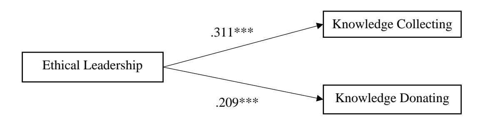

> *Figure 9.* *Path coefficients for ethical leadership, knowledge collecting,* *and knowledge donating* *Notes:* ** p < 0.05, ** p < 0.01, *** p < 0.001*

## **4.10.1 Mediation Analysis**

Mediation, or indirect effect, occurs when the causal effect of an independent variable (X) on a dependent variable (Y) is transmitted by a mediator (M) where X affects Y because X affects M (path a), and M, in turn, affects Y (path b) (Figure 10). Path c represents the total effect of X on Y in the absence of M. Path c' represents the direct effect of X on Y, while the indirect effect is traditionally derived as: c-c'. The total effect c is also equivalent to: ab + c'

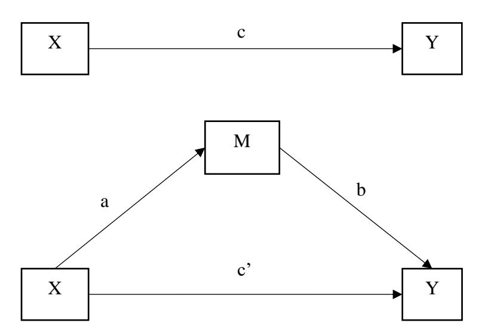

> *Figure 10.* *Simple mediation model with a single mediator variable M located between an * *independent variable X and a dependent variable Y.*

Traditionally, according to Baron and Kenny (1986), four conditions need to be met for establishing mediation:

1. The independent variable must be significantly associated with the mediator.

2. The independent variable must be significantly associated with the dependent variable.

<!-- page 110 -->

3. The mediator and dependent variable must be significantly associated; and

4. The relationship between the independent variable and dependent variable should be nonsignificant or weaker when the mediator is introduced.

However, Preacher and Hayes (2004) introduced a macro script for SPSS called Process that is superior to Baron and Kenny's (1986) testing of mediation and that overcomes its shortcomings including its low statistical power (Hayes, 2009). Process, on the other hand, produces more accurate results as it utilizes the bootstrapping approach (Preacher, Rucker and Hayes, 2007) and does not assume that data is normally distributed.

Bootstrapping is, in essence, a resampling strategy that is used for estimation and hypotheses testing (Preacher et al., 2007). It aims at constructing a confidence interval around the examined effect and does not assume that the data are normally distributed (Hayes, 2013). It corrects violations of the standard regression model and produces more accurate conclusions (Field, 2013). Bootstrapping achieves accurate results by conceptualizing the current sample as a pseudo-population which represents the wider population from which the sample is derived. The algorithm selects a random bootstrap sample of observations from the original sample (pseudo-population) with replacement, which implies that some observations may be randomly selected multiple times or not at all within each bootstrap sample selection.

The algorithm reiterates this process thousands of times, with each selected bootstrap sample being different. According to Hayes (2013), 10,000 bootstrap samples are recommended. Analysis is then performed on each of these bootstrap samples to obtain the desired statistic for that sample. Results are then sorted in ascending order to establish the lower and upper bounds of the confidence interval (CI). A CI which includes zero within its bounds (e.g.: -0.045 to 0.322) indicates that zero is in fact among the possible values for that effect at the chosen α level of significance, and thus the effect would be deemed insignificant. A CI that is entirely above or below zero e.g.: -0.212 to -0.155 indicates that the effect significantly differs from zero. The macro also allows for further improved CIs through bias-correction and acceleration (MacKinnon, Lockwood and Williams, 2004).

The hypothesized mediation in this research, H2a.b., was tested using the Process script macro (Preacher and Hayes, 2004) for SPSS. Model 4 of the Process macro (mediation model) was chosen with 10,000 bootstrap samples as recommended by Hayes (2013).

<!-- page 111 -->

*H2a.b. *The ethical climate mediates the relationship between ethical leadership and employee (a) knowledge collecting and (b) knowledge donating in higher education institutions.

To test Hypothesis H2a, the mediating role of the ethical climate in the relationship between ethical leadership and knowledge collecting is examined. Model 1 of Table 16 shows that ethical leadership was significantly and positively related to the ethical climate (B = .543, p < 0.001). Model 2 of Table 16 reveals that the ethical climate was significantly and positively related to knowledge collecting (B = .374, p < 0.001).

In addition, by comparing the total effect of ethical leadership on knowledge collecting (B = .273, p < .001) in Table 17 with the direct effect (B = .070, p > .05), we find that the direct effect of ethical leadership has become lower and insignificant (95% CI [-.0135, .1535]) after controlling for the effect of the ethical climate which suggests the full mediation of ethical climate. Furthermore, the bootstrapping analyses showed that the indirect effect of ethical leadership on knowledge collecting via ethical climate was significant .20, and the 95% confidence interval did not contain zero (CI = [.1369, .2701]) as shown in Table 17. Thus, hypothesis H2a was supported.

> *Table 16: Detailed direct effects of ethical leadership on knowledge collecting* *via ethical climate*

|   |   | Ethical Climate |   | Knowledge Collecting |
| --- | --- | --- | --- | --- |
|   |   | Model 1 |   | Model 2 |
|   | Coefficient | 95% CI | Coefficient | 95% CI |
| Variables |   |   |   |   |
| Age | .0068 | 0304, .0439 | .0224 | 0204, .0652 |
| Male | .0940 | 0617, .2496 | 0136 | 1932, .1659 |
| Prefer not to say | 1327 | -1.0068, .7414 | .9452 | 0621, 1.9525 |
| Education | 1337*** | 2064,0609 | .0296 | 0552, .1144 |
| Univ A | .4215** | .1175, .7254 | 0621 | 4146, .2905 |
| Univ B | .3270* | .0406, .6133 | .1176 | 2138, .4490 |
| Univ C | .1778 | 0388, .3944 | 0710 | 3212, .1791 |
| Univ D | .2825 | 2007, .7657 | 1300 | 6875, .4274 |
| Univ E | 1795 | 7507, .3990 | 3136 | 9762, .3490 |
| Univ F | .2770 | 1914, .7454 | .3590 | 1814, .8994 |
| Univ G | .4917** | .1670, .8164 | 1556 | 5326, .2215 |
| Univ I | .3617*** | .1583, .5650 | 1567 | 3935, .0802 |
| Ethical Leadership | .5428*** | .4856, .5999 | .07000 | 0135, .1535 |
| Ethical Climate |   |   | .3736*** | .2789, .4683 |
| 2 R | .4173 |   | .1960 |   |
| F | 31.4600*** |   | 9.9275*** |   |

The results are based on Process macros Model 4. CI = Confidence Interval. Beta coefficients not standardized. * p < 0.05, ** p < 0.01, *** p < 0.001

<!-- page 112 -->

> *Table 17: Total, direct and indirect effects of ethical leadership on knowledge collecting* *via ethical climate*

| Mediation results | B | SE B | t | Sig. | LLCI 95% | ULCI 95% |
| --- | --- | --- | --- | --- | --- | --- |
| EL → EC → KC |   |   |   |   |   |   |
| Total Effect | .2728 | .0352 | 7.7467 | .000 | .2036 | .3419 |
| Direct Effect | .0700 | .0425 | 1.6457 | .1004 | 0135 | .1535 |
|   | B | BootSE | BootLLCI | BootULCI |   |   |
| Indirect Effect | .2028 | .0340 | .1369 | .2701 |   |   |

LLCI = lower limit within 95% confidence interval of boot indirect effect. ULCI = upper bound within 95% confidence interval of boot indirect effect. Bootstrap sample size = 10,000. Beta coefficients not standardized. Abbreviations: EL, ethical leadership; EC, ethical climate; KC, knowledge collecting

> *Figure 11.* *Conceptual diagram of ethical leadership as a predictor of knowledge collecting * *mediated by the ethical climate.*

*Notes:* *All presented effects are unstandardized. *p < .05, **p < .01, ***p < .001. The bootstrapped * *confidence interval for the indirect effect is bias-corrected and accelerated.*

To test Hypothesis H2b, the mediating role of the ethical climate in the relationship between ethical leadership and knowledge donating is examined. Model 1 of Table 18 shows that ethical leadership was significantly and positively related to the ethical climate (B = .543, p < 0.001). Model 2 of Table 18 reveals that the ethical climate was significantly and positively related to knowledge donating (B = .182, p < 0.001).

In addition, by comparing the total effect of ethical leadership on knowledge donating (B = .173, p < .001) in Table 19 with the direct effect (B = .074, p > .05), we find that the direct effect of ethical leadership has become lower and insignificant (95% CI [-.0095, .1583]) after controlling for the effect of the ethical climate which suggests the full mediation of ethical climate. Furthermore, the bootstrapping analyses showed that the indirect effect of ethical leadership on knowledge donating via ethical climate was significant .099, and the 95%

<!-- page 113 -->

confidence interval did not contain zero (CI = [.0421, .1576]) as shown in Table 19. Thus, hypothesis H2b was supported.

> *Table 18: Detailed direct effects of ethical leadership on knowledge donating* *via ethical climate*

|   |   | Ethical Climate |   | Knowledge Donating |
| --- | --- | --- | --- | --- |
|   |   | Model 1 |   | Model 2 |
|   | Coefficient | 95% CI | Coefficient | 95% CI |
| Variables |   |   |   |   |
| Age | .0068 | 0304, .0439 | .0336 | 0093, .0766 |
| Male | .0940 | 0617, .2496 | 0064 | 1867, .1740 |
| Prefer not to say | 1327 | -1.0068, .7414 | .7648 | 2468, 1.7763 |
| Education | 1337*** | 2064,0609 | .0522 | 0329, .1374 |
| Univ A | .4215** | .1175, .7254 | .0127 | 3414, .3667 |
| Univ B | .3270* | .0406, .6133 | 2018 | 5346, .1310 |
| Univ C | .1778 | 0388, .3944 | .0288 | 2225, .2800 |
| Univ D | .2825 | 2007, .7657 | .3074 | 2524, .8673 |
| Univ E | 1795 | 7507, .3990 | 5863 | -1.2518, .0791 |
| Univ F | .2770 | 1914, .7454 | .5200 | 0227,1.0627 |
| Univ G | .4917** | .1670, .8164 | .0716 | 3071, .4503 |
| Univ I | .3617*** | .1583, .5650 | 0174 | 2552, .2205 |
| Ethical Leadership | .5428*** | .4856, .5999 | .0744 | 0095, .1583 |
| Ethical Climate |   |   | .1824*** | .0873, .2775 |
| R2 | .4173 |   | .0929 |   |
| F | 31.4600*** |   | 4.1711*** |   |

The results are based on Process Model 4. CI = Confidence Interval. Beta coefficients not standardized. ** p < 0.05, ** p < 0.01, *** p < 0.001

> *Table 19: Total, direct and indirect effects of ethical leadership on knowledge donating* *via * *ethical climate.*

| Mediation results | B | SE B | t | Sig. | LLCI 95% | ULCI 95% |
| --- | --- | --- | --- | --- | --- | --- |
| EL → EC → KD |   |   |   |   |   |   |
| Total Effect | .1734 | .0340 | 5.0921 | .000 | .1065 | .2403 |
| Direct Effect | .0744 | .0427 | 1.7415 | .0821 | 0095 | .1583 |
|   | B | BootSE | BootLLCI | BootULCI |   |   |
| Indirect Effect | .0990 | .0296 | .0421 | .1576 |   |   |

LLCI = lower limit within 95% confidence interval of boot indirect effect. ULCI = upper bound within 95% confidence interval of boot indirect effect. Bootstrap sample size = 10,000. Abbreviations: EL, ethical leadership; EC, ethical climate; KD, knowledge donating

<!-- page 114 -->

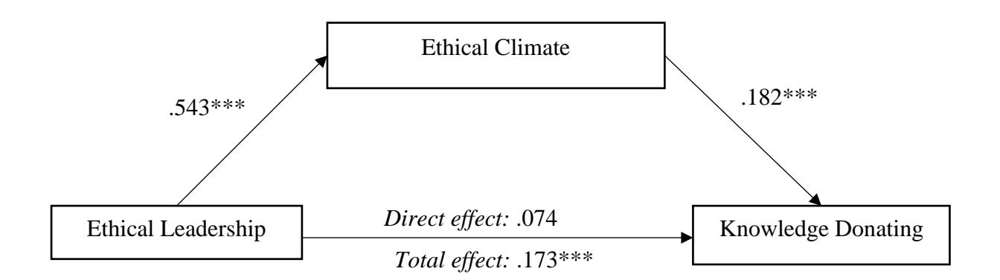

> *Figure 12.* *Conceptual diagram of ethical leadership as a predictor of knowledge donating * *mediated by ethical climate. *

*Notes: All presented effects are unstandardized. *p < .05, **p < .01, ***p < .001. The * *bootstrapped confidence interval for the indirect effect is bias-corrected and accelerated.*

## **4.10.2 Moderation Analysis**

According to MacKinnon (2011, p. 678), "a moderator is a variable that modifies the form or strength of the relation between an independent and a dependent variable". The moderator variable is not part of the causality between the independent and dependent variables but qualifies the relation between them. Moderator variables play an essential role in understanding the generalizability of research findings to subgroups. In fact, investigating aspects of individuals (e.g., sex, race, age, etc.) as moderating variables in a research study acknowledges the complexity of human behaviour, experiences, and relationships (MacKinnon, 2011).

The analyses in the previous section showed a positive relationship between ethical leadership and the ethical climate. Hypothesis H3 extends this relationship by adding a moderating variable – organizational tenure – and proposing that the relationship between ethical leadership and ethical climate is stronger for individuals with a longer organizational tenure, thus acknowledging an important individual difference among respondents. Figure 13 depicts the proposed moderating role of organizational tenure in the relationship between ethical leadership and ethical climate.

<!-- page 115 -->

> *Figure 13.* *Conceptual diagram of organizational tenure as moderator of the * *relationship between ethical leadership and ethical climate*

The moderating variable effect model shown in Figure 13 is summarized in the following equation:

Y = i_1 + c_1 X + c_2 Z + c_3 XZ + e_1

Y is the dependent variable (ethical climate), X is the independent variable (ethical leadership), Z is the moderator variable (organizational tenure), and XZ is the interaction of the moderator and the independent variable. It is the product of X and Z. X and Z are often centred where the average of the values of a variable is subtracted from each observed value of that variable. c1, c2, and c3 represent the relation between the dependent variable and the independent variable, moderator variable, and moderator by independent variable interaction, respectively and e1 is a residual (MacKinnon, 2011).

To test the moderation effect of organizational tenure on the relationship between ethical leadership and ethical climate, I used Model 1 of the Hayes' Process macro for SPSS. Table 20 shows that the interaction of ethical leadership and organizational tenure had a significant positive effect on ethical climate (B = .0507, p < 0.01) and its inclusion in the regression equation explained significant variance in the ethical climate (∆R^2^ =.0074).

<!-- page 116 -->

> *Table 20: Regression coefficients for control variables, main effects, and interaction effects*

|   |   |   |   | Ethical Climate |   |
| --- | --- | --- | --- | --- | --- |
|   | Variable | B | SE | t | 95% CI |
| Control Variables | Age | 0149 | .0231 | 6446 | 0602, .0304 |
|   | Gender (Male) | .0905 | .0787 | 1.1503 | 0641, .2451 |
|   | Gender (Prefer not to say) | 1321 | .4420 | 2988 | -1.0003, .7361 |
|   | Education | 1232** | .0371 | -3.3204 | 1961,0503 |
|   | Univ A | .4704** | .1574 | 3.0407 | .1666, .7743 |
|   | Univ B | .3586* | .1453 | 2.4685 | .0733, .6439 |
|   | Univ C | .1946 | .1097 | 1.7751 | 0207, .4100 |
|   | Univ D | .3701 | .2463 | 1.5023 | 1138, .8539 |
|   | Univ E | 1075 | .2915 | 3686 | 6800, .4651 |
|   | Univ F | .3261 | .2384 | 1.3682 | 1421, .7943 |
|   | Univ G | .5843** | .1673 | 3.4916 | .2556, .9129 |
|   | Univ I | .3698** | .1029 | 3.5939 | .1677, .5718 |
| Main Effects | Ethical Leadership | .5383*** | .0290 | 18.5583 | .4813, .5953 |
|   | Organizational Tenure | .0448 | .0282 | 1.5917 | 0105, .1002 |
| Interaction | Ethical Leadership * Organizational Tenure | .0507** | .0186 | 2.7202 | .0141, .0873 |
| 2 R |   | .4273 |   |   |   |
| ∆R2 (due to interaction) |   | .0074 |   |   |   |
| F-value |   | 28.298*** |   |   |   |
| F-value (interaction) |   | 7.3992** |   |   |   |

*^*^Regression effect is significant at the 0.05 level (2-tailed), ** Regression effect is significant at the * *0.01 level (2-tailed), *** Regression effect is significant at the 0.001 level (2-tailed).*

The estimated conditional effects are presented in Table 21. Following Aiken and West (1991) recommendations, the independent variable (ethical leadership), and moderator variable, (organizational tenure), were mean-centred prior to calculating the interaction term which was created by multiplying the centred variables. Thus, the three levels of high, medium, and low (for both the continuous main effect of ethical leadership as well as the continuous moderating variable, organizational tenure), are computed using the mean as the medium value, one standard deviation above the mean as the high value, and one standard deviation below the mean as the low value (Aiken and West, 1991). Consistent with H3, the ethical leadershipethical climate link was stronger and significant when the organizational tenure value was high (effect = .6224) compared to when the organizational tenure value was low (effect = .4542).

<!-- page 117 -->

> *Table 21: Conditional effects of the moderator variable organizational tenure*

| Conditional Effect | OT Value | Effect | Std. error | t-value | p-value | 95% CI |
| --- | --- | --- | --- | --- | --- | --- |
| Low OT (Mean -1 SD) | -1.6591 | .4542 | .0440 | 10.3149 | .0000 | .3677, .5407 |
| Medium OT (Mean) | .0000 | .5383 | .0290 | 18.5583 | .0000 | .4813, .5953 |
| High OT (Mean +1 SD) | 1.6591 | .6224 | .0407 | 15.3021 | .0000 | .5425, .7022 |

*CI = confidence interval of indirect effect. Abbreviations: OT, organizational tenure.*

The graph of the significant interaction plotted at +1/-1 SD from the mean of organizational tenure (Figure 14) signifies the extent to which the positive relationship between ethical leadership and ethical climate is contingent upon employee organizational tenure. The simple slopes test indicated that the positive relationship between ethical leadership and ethical climate is stronger when levels of organizational tenure are high (at +1 SD; β = .6224, p < .001) than low (at -1 SD; β = .4542, p < .001). Therefore, Hypothesis H3 was supported.

For both levels of organizational tenure, a positive relationship appears, meaning that when employees have a stronger perception of ethical leadership, they will be more likely to perceive the organizational climate as ethical. However, these relationships differ significantly between low and high values of organizational tenure, in that the effect is much stronger in high organizational tenure. When employees have high organizational tenure, their perception of the ethical climate is significantly and positively affected by their perception of ethical leadership. In contrast, perception of the ethical climate when employees have low organizational tenure is less positively yet still significantly affected by their perception of ethical leadership.

<!-- page 118 -->

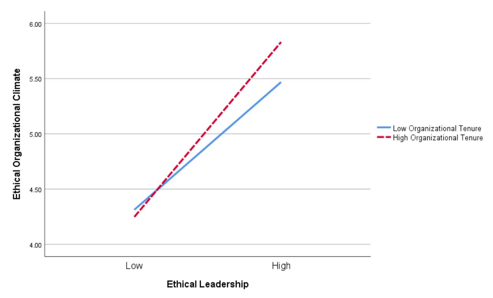

> *Figure 14.* *Moderating effects of ethical leadership and organizational tenure* *on ethical climate*

## **4.10.3 Moderated Mediation Analysis**

In hypothesis 4, I predicted a first-stage moderated mediation effect of ethical leadership on knowledge sharing (knowledge collecting and knowledge donating) via the ethical climate and moderated by employees' organizational tenure. To test hypothesis 4, I inspected the indirect effects at one standard deviation above the mean, at the mean, and one standard deviation below the mean of organizational tenure (with 10,000 bootstrap samples) as well as the index of moderated mediation following Hayes (2015). The results are shown in Table 22.

<!-- page 119 -->

> *Table 22: Conditional indirect effects of the moderator variable* *and index of moderated mediation*

|   |   |   | Knowledge Collecting |   |
| --- | --- | --- | --- | --- |
| Conditional indirect effect via Ethical Climate | OT Value | Effect | Boot SE | 95% CI |
| Low OT (Mean -1 SD) | -1.6591 | .1697 | .0330 | .1089, .2384 |
| Medium OT (Mean) | .0000 | .2011 | .0338 | .1366, .2680 |
| High OT (Mean +1 SD) | 1.6591 | .2325 | .0402 | .1556, .3117 |
| Index of moderated mediation |   | .0189 | .0087 | .0035, .3117 |
|   |   |   | Knowledge Donating |   |
| Conditional indirect effect via Ethical Climate | OT Value | Effect | Boot SE | 95% CI |
| Low OT (Mean -1 SD) | -1.6591 | .0829 | .0265 | .0342, .1384 |
| Medium OT (Mean) | .0000 | .0982 | .0297 | .0418, .1580 |
| High OT (Mean +1 SD) | 1.6591 | .1135 | .0345 | .0483, .1824 |
| Index of moderated mediation |   | .0092 | .0048 | .0013, .0202 |

*Notes: Unstandardized coefficients. Abbreviations: OT, organizational tenure, CI, confidence interval*

Although the indirect effects of ethical leadership on knowledge collecting and knowledge donating via the ethical climate were significant at both levels of organizational tenure, these indirect effects were stronger when the value of organizational tenure was high (effect = .2325, .1135, for knowledge collecting and knowledge donating respectively) and weaker when the value of organizational tenure was low (effect = .1697, .0829, for knowledge collecting and knowledge donating respectively).

Evidence for a moderated mediation can be derived from the bootstrap results in the index of moderated mediation for knowledge collecting and knowledge donating. The index revealed no zero in the confidence intervals (knowledge collecting index = .0189, 95% CI [.0035, .3117], knowledge donating index = .0092, 95% CI [.0013, .0202]). Thus, organizational tenure positively moderates the indirect relationship between ethical leadership and knowledge sharing (collecting and donating) through the ethical climate. Together, the results suggest that employees with longer organizational tenure are more likely to be affected by ethical leadership and that in turn, is positively associated with their knowledge collecting and knowledge donating behaviour, thus supporting hypothesis H4a.b.

## **4.11 Summary**

The purpose of this quantitative non-experimental study was to explore the relationships between perceived ethical leadership, ethical climate, knowledge sharing, and organizational tenure in the Lebanese private higher education sector. The findings of the data

<!-- page 120 -->

collection were presented in this chapter. Results of the analysis have addressed the three research questions of the thesis and their corresponding hypotheses.

A total of 653 potential responses that engaged with the study survey were collected from academic and non-academic (professional) staff in nine private higher education institutions in Lebanon. After eliminating 68 cases with missing data, 585 participants were included in the analyses that addressed the research questions. Descriptive statistics provided a profile of the sample. The participants were generally between 36 and 40 years of age including a majority of doctorate degree holders. Professional and 'Third Space' staff were also represented in the sample despite the majority reporting their role as academic.

Hierarchical multiple regression and Hayes Process for SPSS were used to test the four main hypotheses of the study. The data sample was found to be non-normally distributed and thus bootstrapping was employed while conducting the statistical tests. Results of the analysis provided evidence that supported the proposed hypotheses. Based on the results and findings, these conclusions can be reached about study participants' perceptions and behaviour in Lebanese private higher education institutions:

1. Perceived ethical leadership positively influences the two aspects of employee selfreported knowledge sharing (collecting and donating).

2. Perceived ethical climate fully mediates the relationship between ethical leadership and the two aspects of employee knowledge sharing (collecting and donating).

3. Employee organizational tenure moderates the relationship between ethical leadership and ethical climate, such that the relationship is stronger when organizational tenure is longer.

4. Employee organizational tenure moderates the indirect relationship between ethical leadership and the two aspects of employee knowledge sharing (collecting and donating) through ethical climate such that the indirect relationship is stronger when organizational tenure is longer.

Chapter 5 interprets and discusses the results of the study, acknowledges its limitations, identifies its contribution to knowledge and practice, and provides recommendations for future research.

<!-- page 121 -->

## **Chapter 5: Discussion, Implications, and Recommendations**

The purpose of this chapter is to discuss findings based on data drawn from this research in order to contribute to the body of knowledge on higher education management surrounding ethical leadership, ethical climate, knowledge sharing, and organizational tenure. Discussions presented in this chapter are derived from comparing the findings outlined in Chapter 4 with the relevant literature in Chapter 2 in order to develop a deeper, theory-informed understanding of ethical leadership and its relationship with staff knowledge sharing behaviour in universities. The results of testing each of the study hypotheses are compared with findings from previous research, following which the research contribution to the body of knowledge in this field is defined and recommendations for practice and further research are developed. The next section discusses the findings of the previous chapter after which the research's contribution to literature, practice, and policy is laid out in detail.

## **5.1** **Discussion of Findings** **against Previous Research**

This section discusses the quantitative findings outlined in Chapter 4 against findings of previous research studies conducted within a range of organizational contexts, including higher education.

## **5.1.1** **The relationship between ethical leadership and knowledge sharing** **behaviour**

The significance of leader ethicality is underscored in the general leadership literature. Emphasis is strongly placed on the effectiveness of the ethical leader in eliciting desirable employee behaviour such as knowledge sharing (Brown, Treviño and Harrison, 2005; Piccolo et al., 2010; Den Hartog and Belschak, 2012). Furthermore, the competitive advantage of knowledge intensive organizations such as higher education institutions relies heavily on the strength of their knowledge management (Le and Lei, 2018) which can be maintained through enhancing knowledge sharing activities among employees (Bavik et al., 2018). Ethical leadership is ideally positioned to enhance such activities through motivating employees to increasingly participate in an otherwise personally driven behaviour. However, the ethical leader's effectiveness is essentially dependent upon employees' perception of the leader which eventually determines the leader's ability to influence behaviour (Brown, Treviño and Harrison, 2005; De Hoogh and Den Hartog, 2008). Research question 1 identifies this proposed relationship between ethical leadership and knowledge sharing behaviour in higher education institutions.

<!-- page 122 -->

Hypothesis (H1a.b.) stated that "*Ethical leadership has a positive association with * *employee (a) knowledge collecting and (b) knowledge donating in higher education * *institutions."* As predicted by this hypothesis, ethical leadership had a significant, positive, and direct effect on employees' likelihood to engage in the two processes of knowledge sharing in the context of Lebanese private higher education. Specifically, statistical analysis yielded values of .311 (p < 0.001) and .209 (p < 0.001) for ethical leadership's influence on knowledge collecting and knowledge donating respectively (see section 4.10). This finding is consistent with the study results by Le and Lei (2018) who found a direct positive relationship between ethical leadership and each of knowledge collecting and knowledge donating. Le and Lei's (2018) study was conducted among Chinese firms and their sample consisted of deputy directors, department heads, team leaders, and clerks in various departments (e.g.: administration, operation, accounting, marketing, and sales). Similarly, the study results by Su et al. (2021), Ma et al. (2013) found a significant influence of ethical leadership on knowledge sharing, however these studies have assessed knowledge sharing a single process.

In the higher education context, Xia and Yang (2020) conducted a study among postgraduate students at three universities in the city of Suzho, China. In their study, students rated the ethical behaviour of their supervisors, and after a 4-week interval, supervisors rated the knowledge sharing behaviour (as a single process) of the students in their teams. The results also showed that ethical leadership was significantly and positively related to knowledge sharing. This underscores the impact of ethical leadership on employee knowledge sharing behaviour regardless of the nature of the scale used to measure the behaviour. In addition, knowledge sharing has been examined with other styles of leadership in a higher education context, namely transformational leadership. Al-Husseini and Elbeltagi (2018) found a significant positive relationship between each of the four components of transformational leadership (idealized influence, inspirational motivation, intellectual stimulation and individualized consideration) and the two processes of knowledge sharing in a study conducted among 250 academic staff members of eight higher education institutions in Iraq.

Ethical leaders express honest concern toward their followers and display moral behaviours such as fairness and trust building (Brown and Treviño, 2006; Le and Lei, 2018). Among their many desirable qualities, ethical leaders are considerate, compassionate, sincere, and noble which is conveyed in their behaviour and reflected in their followers' performance. They promote ethical standards in accordance with their moral convictions which provides the appropriate atmosphere for employees to repay the treatment through reciprocation. Drawing

<!-- page 123 -->

on the principles of social exchange theory (Blau, 1964), followers recognize the benefits of reciprocating the moral behaviour they receive from the leader and engage in similar ethical behaviour that benefits the leader, the team, and the organization (Newman et al., 2014; Wang and Sung, 2016; Bhatti, 2020). This authentic exchange promotes honest communication between leaders and followers, and among followers themselves. The exchange includes communicating values, ideas, and taking part in decision-making, and provides the proper conditions that endorse knowledge sharing.

Also, according to social learning theory (Bandura, 1986), followers observe and classify the ethical leader as a role model, incorporate the model's attitude with their own, and then mimic the modelled behaviour (Brown, Treviño and Harrison, 2005). Through the process of learning the intricacies of ethical leadership, followers improve their moral efficacy and willingness to act ethically (Heng and Zucheng, 2018). They are encouraged to express their valuable ideas freely and openly, and consequently engage in knowledge sharing behaviour. In this regard, acquiring or collecting knowledge becomes a necessary practice for employees to preserve and potentially advance their position, authority, rendering knowledge sticky. Making one's accumulated knowledge accessible to others inside an organization is therefore regarded as an act of ethical worth. Knowledge sharing thus becomes a morally desirable act of donation (Bhatti, 2020) that is very likely shaped by learning ethical leadership.

## **5.1.2** **The mediating role of the ethical climate**

In research question 2, emphasis is placed on assessing the role of the ethical climate in the relationship addressed in the first research question. A mediating role is proposed based on prior evidence that the ethical leadership can instil positive perceptions of the ethical climate, which in turn can influence moral behaviour. This research question extends our knowledge of the ethical climate through focusing on knowledge sharing as an outcome of the relationship and higher education as its context. In discussing the findings related to the second research question, this section will evidence the mediating role of the ethical climate through first detailing the influence of ethical leadership on the ethical climate, and later that of the ethical climate on knowledge sharing behaviour.

## **5.1.2.1 Ethical Leadership and Ethical Climate**

The relationship between ethical leadership and ethical climate in this study is positive and significant (.543, p < 0.001) (see Section 4.10.1). This finding corroborates the empirical findings of various studies conducted in different contexts and populations: chief executive

<!-- page 124 -->

officers and their employees in South Korean companies (Shin, 2012); management and engineering staff in aviation maintenance centres in Turkey (Demirtas and Akdogan, 2015); civil servants in a local government agency in Indonesia (Aryati et al., 2018); Iraqi manufacturing, medical, and insurance organizations (Al Halbusi et al., 2020); teachers in primary, secondary, and high schools in Istanbul (Cansoy, Parlar and Türkoğlu, 2021); and postgraduate student workers in Portuguese universities (Freire and Pinto, 2022). In the higher education sector, the positive relationship between ethical leadership and ethical climate has been supported in a study conducted among academic and administrative staff working at public and private universities in the Federation of Bosnia and Herzegovina (Dinc, 2018).

In their conceptualization of ethical leadership, Brown, Treviño and Harrison (2005) emphasized two main components that make up an ethical leader: the moral person and the moral manager. Through embodying positive characteristics and managing ethical conduct, ethical leaders set the ethical tone for the environment they operate in through enforcing policies and procedures that advance ethical behaviour and reduce misconduct (Mayer, Kuenzi and Greenbaum, 2010). In this way, ethical leaders show employees that endorsing ethics is a primary organizational target that influences their perceptions of the organizational climate.

Social learning theory (Bandura, 1986) suggests that leaders are commonly considered as legitimate role models that followers observe to identify what is expected of them as normative behaviour. Through this learning process, ethical leaders demonstrate how acting ethically and morally is expected and valued, and that maintaining business objectives should not come at the detriment of ethical conduct (Mayer, Kuenzi and Greenbaum, 2010). Often, leaders have a direct influence over their followers who may only perceive their work environment as ethical if fair treatment exists across the organisation. Empirical research suggests that perceptions of organizational fair treatment are rooted in the leader's ethicality and consistency in managing responsibilities (Neubert, Carlson, Kacmar, Roberts and Chonko, 2009; Mayer et al., 2010).

## **5.1.2.2** **Ethical Climate** **and Knowledge Sharing Behaviour**

The findings in section 4.10.1 reflect previous findings in the literature on the positive impact of ethical climate on knowledge sharing as a single process in Portuguese nongovernmental organizations (Curado et al., 2021), organized industrial zones in Turkey (Şehitoǧlu and Bilgetürk, 2020) as well as related knowledge sharing behaviour such as knowledge management engagement among in-service employees (Tseng and Fan, 2011).

<!-- page 125 -->

However, the current study extends existing findings through examining knowledge sharing from a bidirectional perspective on one hand, and in a higher education context on the other. The findings show that the ethical climate in higher education institutions has a significant positive influence on knowledge collecting (.374, p < 0.01) as well as knowledge donating (.182, p < 0.001). This detailed analysis clearly demonstrates how the organizational climate affects employee behaviour on both sides of the knowledge sharing phenomenon.

Indeed, ethical climates have been found to exert a positive influence over desirable employee behaviour as well as a negative influence over employee misbehaviour. According to social exchange theory (Blau, 1964), when individuals perceive the organization's climate as ethical, caring, and concerned for them, they become strongly committed to reciprocate their feelings of trust and fairness towards the organization with positive behaviour. In addition, by means of their social learning in the organizational environment, employees make interpretations and exhibit attitudes that align with the social environment (Boekhorst, 2015). For instance, Schwepker (2001) asserted that an ethical climate improves employee job satisfaction and organizational commitment, whereas Deshpande et al., (2000) found evidence that an ethical climate impacts managerial success. Conversely, Mayer et al. (2010) and Piccolo et al. (2012) indicated that an ethical climate reduced employee misconduct.

## **5.1.2.3 Mediation Effect of the Ethical Climate** **on the Relationship between Ethical ** **Leadership and Knowledge Sharing**

In line with the body of literature outlined in sections 5.1.2.1 and 5.1.2.2 and considering the morality of knowledge sharing as a desirable behaviour, I hypothesized a mediating role of the ethical climate in the relationship between ethical leadership and the two aspects of knowledge sharing: knowledge donating (hypothesis H2a) and knowledge collecting (hypothesis H2b).

*H2a.b. The ethical climate mediates the relationship between ethical leadership and * *employee (a) knowledge collecting* *and (b) knowledge donating* *in higher education * *institutions.*

The findings of the mediation analysis provided evidence that the ethical climate indeed played a full mediating role between ethical leadership and knowledge collecting (indirect effect = .203, 95% CI) and between ethical leadership and knowledge donating (indirect effect = .099, 95% CI). The mediating role of the ethical climate is reinforced in other studies and various contexts such as in the technology, insurance, financial, government, manufacturing,

<!-- page 126 -->

retail, and medical sectors in southeast United States (Kuenzi, Mayer and Greenbaum, 2020) and Iraqi insurance, medical, and manufacturing industries (Al Halbusi et al., 2020).

Based on the above finding, it becomes clear that besides the direct influence of ethical leadership over employee knowledge sharing behaviour in higher education institutions (section 5.1.1), there is a significant indirect influence through the ethical climate which has substantial impact on knowledge collecting and knowledge donating. When the ethical climate is examined as a mediator in this relationship, the direct impact of ethical leadership diminishes and becomes insignificant. This finding is consistent with previous findings in the literature which found a mediating role of the ethical climate in the relationship between ethical leadership and employee behaviour (Mayer, Kuenzi and Greenbaum, 2010; Kalshoven, Den Hartog and De Hoogh, 2013; Lu and lin 2014; Demirtas and Akdogan, 2015).

Thus, when assessing the potential impact of ethical leadership over knowledge sharing in a higher education context, it is crucial to understand the major role of the ethical climate as an important key facilitator of the relationship between ethical leadership and employee knowledge sharing behaviour. It is also important to recognize the role of the ethical climate in eliciting such moral behaviour besides recognizing the role of leaders in isolation.

## **5.1.3** **The Moderating Role of Employee Organizational Tenure**

Research question 3 explores the role of the organizational tenure in the relationship investigated in the second research question. Based on evidence from literature, the proposed role is that of a moderation which predicts that the time employees spend at a certain institution affects their perceptions of ethical leadership and ethical climate. This third research question extends our understanding thus far of the above supported findings and relationships. It provides an additional perspective through incorporating an individual factor related to followers' length of employment with the organization and suggests a moderating role in the relationship between ethical leadership and ethical climate.

Previous research in organizational behaviour provides evidence of the role employee organizational tenure plays in shaping employee social links (Hu et al., 2019) as well as in employees' understanding of their work environment (Clark et al., 1996) and social norms (Rollag, 2004). Therefore, it was imperative to explore the role of this human related factor in influencing employee perceptions relevant to this research and thus hypothesize a moderating role of this variable (H3) and a consequent moderated mediation (H4).

<!-- page 127 -->

*H3. Employee organizational tenure moderates the relationship between ethical leadership * *and ethical climate such that this relationship is stronger when organizational tenure is longer.*

The findings related to the third research question extend the weight of evidence supported in the second question, by examining *when* ethical leadership is more strongly related to the ethical climate in private higher education institutions in Lebanon. A moderating effect of the organizational tenure is evident according to the analysis reported in section 4.10.2 Moderation Analysis. The effect of ethical leadership on the ethical climate was stronger when organizational tenure was long (effect = .6224) compared to when it was short (effect = .4542) supporting hypothesis 3. These findings demonstrate that the interaction of ethical leadership with employee organizational tenure produces stronger perceptions of the ethical climate for employees with longer tenure than those with shorter tenure.

The significance of this interaction is conveyed not only in the actual values of the interaction index and the consequent conditional effects analysis outlined in Chapter 4, but also in the presence of the interaction itself. In a series of simulations, McClelland and Judd (1993) showed that while interaction effects might frequently occur in experimental studies, they are much harder to notice in field studies like the one considered in this research. Field studies have non-optimal distributions of the predictor (e.g., ethical leadership) and the moderator variables (e.g., organizational tenure). According to McClelland and Judd (1993), this distribution reduces the efficiency of the moderator parameter estimate and consequently lowers the statistical power, rendering it hardly detectable. Therefore, successfully detecting a moderator in a field study highlights a strength of that study. Hence, the moderating role of organizational tenure in the third hypothesis is supported and its significance is emphasized.

Considering the support found for a mediating role of the ethical climate (H2) and a moderating role of the employee organizational tenure (H3), a subsequent moderated mediation is hypothesized in H4:

*H4a.b.* *Employee organizational* *tenure moderates the indirect relationship between ethical * *leadership on employee (a) knowledge collecting* *and (b) knowledge donating through ethical * *climate such that the indirect relationship is stronger when organizational tenure is longer.*

The findings derived in the previous chapter (Table 21) show that the indirect effects of ethical leadership on knowledge colleting and knowledge donating through the mediating role of ethical climate were enhanced as employee organizational tenure increased, therefore supporting H4. This finding emphasizes the role of employee organizational tenure and how

<!-- page 128 -->

its variation affects perceptions of the ethical climate and consequently, knowledge sharing behaviour. Past studies examined a moderating role of the organizational tenure in the relationship between supervision and knowledge sharing. In their sample of employees and their supervisors, working in appliance manufacturing companies in South Korea, Kim, Son and Yun (2018) argued that organizational tenure moderates the negative relationship between abusive supervision and employee's knowledge sharing behaviour. Their findings indicated that this negative relationship is strengthened when organizational tenure is high than when organizational tenure is low.

The proposed conceptual framework presented earlier in Figure 6 is updated with the supported hypotheses discussed in sections 5.1.1, 5.1.2, 5.1.3, and presented in Figure 15 below.

> *Abbreviation: OT, Organizational Tenure* *Figure 15. Proposed Conceptual Framework with Supported Hypotheses*

## **5.2** **Contribution to Knowledge**

This research makes considerable theoretical contributions to the literature on leadership, organizational climate, and knowledge management, specifically in the context of higher education. First, it echoes the significance of ethical leadership and its influence on employee attitudes and behaviours, thereby acting as a robustness test of existing research on the subject. It also answers the need for a comprehensive understanding of the mechanism by which employees adopt these attitudes and behaviours, and how they are altered by different aspects and styles of leadership (Bock et al., 2005). Previous research has concluded that ethical leadership positively influences knowledge sharing (Bavik et al., 2018; Lu et al., 2019; Xia and Yang, 2020). The present study extends our understanding of that relationship by proposing a

<!-- page 129 -->

conceptual model (see Figure 6) that links ethical leadership to knowledge sharing through the mediating role of the ethical climate – explained through social learning and social exchange theories – within a knowledge-rich organisational environment such as a university.

The study emphasizes that leader behaviour is critical in promoting discretionary behaviour such as knowledge sharing and thus advances our understanding of the antecedents of this behaviour. For instance, through the use of social exchange theory, the findings predict that employees who are treated ethically reciprocate the proper treatment and engage in knowledge sharing. The study provides further support that ethics-based leadership contributes to a large extent to altering employee behaviour and producing desirable results. The provided support gains further importance as it relates directly to the Lebanese cultural context where ethical decision making and leadership are impeded, and unethical behaviour is overlooked. As such, Lebanese universities should use this knowledge to prioritize the ethical aspect of their leadership at all levels.

Second, this research contributes to the knowledge sharing literature in multiple ways. It adopts a social exchange perspective and uses a moral lens to examine the influence of ethical leadership on employee knowledge sharing behaviour as suggested by Bavik et al. (2018). The fact that knowledge sharing is, in itself, a personal behaviour that is in the control of individuals and not the organization (Empson, 2001), makes enhancing this behaviour at the individual level a challenging one. As a morally driven behaviour, knowledge sharing involves an aspect of risk-taking for the good of others because it entails shrinking one's competitiveness as a result of loss of proprietorship of the donated knowledge (Spender and Grant, 1996). Hence, employees may not take part in such risk-taking behaviour unless they perceive their relationship with their leader as positive and the treatment they are receiving as ethical. The findings of this research indicate that, based on social exchange theory, ethical leadership matters significantly in cultivating a positive reciprocity of knowledge sharing among employees in higher education, extending our understanding of the predictors of knowledge sharing behaviour and providing further evidence that knowledge sharing indeed has moral grounds.

The research also contributes to the theoretical understanding of such knowledge sharing behaviour by examining its two distinct behavioural components: knowledge collecting (actively consulting others to obtain knowledge), and knowledge donating (actively providing others with one's knowledge). This distinction is important when attempting to understand how

<!-- page 130 -->

ethical leadership affects each process separately and how to increase the efficiency of the overall knowledge sharing behaviour.

Third, this research adds to the literature on organizational climates in general and more specifically to the literature on ethical climates in higher education. It draws on social learning theory to provide a rationale that explains why an ethical climate is related to socially desirable employee behaviour and why it mediates the relationship between ethical leadership and that behaviour. It also addresses an issue in the ethical climate literature where the most commonly used conceptualization (i.e., ECQ; Victor and Cullen, 1988) focuses on principles of moral decision making at the psychological level, and overlooks important climate constituents such as policies, procedure, and practices. This research uses the novel Ethical Organizational Climate conceptualization (Kuenzi, Mayer and Greenbaum, 2020) which draws on Treviño and Nelson's (2017) theoretical framework of formal organizational practices that provides a more comprehensive understanding of the ethical climate. By doing so, the research examines a range of ethics-related organizational systems (e.g.: recruitment and selection, orientation and training, policy and codes, reward and punishment, accountability and responsibility, and decision-making) and asserts that perceptions of these different policies, practices, and procedures indeed inform the shared perception of the ethical climate (Kuenzi, Mayer and Greenbaum, 2020). This study thus contributes to the theoretical work of the Ethical Organizational Climate through examining its linkages to knowledge sharing behaviour in a higher education context.

Through this perspective, the research highlights the role of the ethical climate in the relationship between ethical leadership and different aspects of knowledge sharing. The findings empirically confirm that the ethical climate serves as an effective mediator between ethical leadership and knowledge sharing behaviour. This validation fills a theoretical gap in the general leadership literature in exploring the mediating role of ethical climates between ethical leadership and other dependent variables as suggested by Kuenzi, Mayer and Greenbaum (2020). The findings thus highlight the role of the ethical climate in facilitating knowledge collecting and knowledge donating and the direct and indirect effects of ethical leadership on these behaviours. Therefore, they provide a better theoretical understanding of the process underlying the relationship between ethical leadership and employee knowledge sharing behaviour. This understanding reveals that when employees operate in an ethical climate that is aligned with the two aspects of their ethical leader (i.e. moral person and moral manager), they are more likely to engage in discretionary, yet desirable behaviour such as

<!-- page 131 -->

knowledge sharing. Consequently, the findings call for renewed attention to the institution and its role in providing the climate necessary for leaders to influence the behaviour of employees, besides the long-established focus laid on the leaders' shoulders and their responsibility in effecting the desired change. As such, higher education institutions are entrusted to create the right conditions according to Treviño and Nelson's (2017) framework of formal systems. Furthermore, this study extends our understanding of the Ethical Organizational Climate through application in a culture that has not been researched before. The results thus bridge a particular knowledge gap and emphasize the need for maintaining ethical climates in Lebanese HEIs.

Fourth, this study incorporates the contingent effect of a human factor, that of employee organizational tenure, on the relationship between ethical leadership, ethical climate, and knowledge sharing. It accounts for the important role of employee organizational tenure and provides evidence-based insight into the proposed relationships. Although organizational tenure is a form of human capital investment, its role has not been given much attention in the knowledge sharing literature (Kim, Son and Yun, 2018). A significant contribution lies in the understanding that the relationship between ethical leadership and ethical climate is not evenly distributed when employee organizational tenure is considered, where the effect is stronger for employees with longer organizational tenure. Employees with longer organizational tenure tend to have a deeper familiarity with organizational procedures and structures, which justifies the stronger interactive effects between ethical leadership and ethical climate as opposed to those employees with shorter tenure.

Furthermore, this research confirms the relationships between ethical leadership, ethical climate, and knowledge sharing by analysing the boundary condition of employee organizational tenure. It provides empirical evidence of how the mediating role of the ethical climate between ethical leadership and knowledge sharing is conditional on employee organizational tenure. The indirect influence of ethical leadership on knowledge sharing through ethical climate is stronger when organizational tenure is longer; that is, in higher education institutions where ethical leadership exists, knowledge sharing is improved when employee organizational tenure is long. This research thus acknowledges employee organizational tenure as an individual difference that is linked to behavioural outcomes, and more specifically to knowledge sharing behaviour. To summarize, simultaneously including ethical climate and employee organizational tenure in the hypothesized relationships facilitates the understanding of ethical leadership, as well as its links to knowledge sharing.

<!-- page 132 -->

Finally, this research has explored the impact of ethical leadership on knowledge sharing in the unique context of higher education, which answers Bavik et al.'s (2018) call to examine ethical leadership in different contexts and industries. In doing so, this research enriches previous research on leadership in the context of higher education promoting the value of ethical leadership and climate in this knowledge intensive sector and ethically challenging context. Also, it contributes to the increasing development of the knowledge management discipline in knowledge intensive organizations, precisely higher education institutions.

## **5.3** **Implications for Practice and Policy**

The findings of this study provide useful practical recommendations that have value to directors and managers in private higher education institutions in Lebanon and beyond. They serve as a reference for ethical leadership practices, ethical climate promotion, and knowledge sharing activities in the context of higher education. Specific implications for practice and policy include the following:

First, considering the benefits of ethical leadership in promoting knowledge sharing behaviour, higher education institutions should seek to hire and train ethical leaders. These institutions can benefit from tools that assess integrity, morality and moral standards, and empathy for others. Such tools can be in the form of integrity tests or case studies that put a fictitious department on the verge of failing unless urgent yet unethical decisions are made. Other forms may include structured interviews or assessment exercises that tap into the moral person and moral manager aspects of the interviewee. They can present potential leaders with ethical dilemmas that are relevant to the higher education context and observe how they approach, manage, and solve those dilemmas. With the Lebanese context in mind – the growing economic crisis, and the volatile financial situation – future interviews can include dynamic ethical challenges that derive from the present complex circumstances.

Types of training, on the other hand, can be varied and addressed to employees at different positions and with different responsibilities across the institution. They can be aimed at improving the moral manager side of leaders through raising awareness on the importance of institution-wide ethical practices as well as the implications of serving as ethical role models. This needs to be coupled with practically demonstrating how ethical management not only affects immediate subordinates but reaches far beyond the concerned department to the whole institution. Further practical applications can be through requiring higher education managers to balance their words and deeds in their daily management practices in order to reach an

<!-- page 133 -->

alignment of promises, directions, and corresponding action. On the moral person side of ethical leadership, training can emphasize the importance of honesty, trustworthiness, care, and fairness.

In all its forms, training should successfully push leaders to communicate values and ethics clearly, understand the code of ethics in place, and be able to explain it to subordinates whenever needed. Further training outcomes include awareness and fair application of the reward and punishment system, and normalizing voice in the workplace where leaders and employees can share their concerns without fear. Training can be complemented with clear incentive mechanisms that aim to develop ethical leadership and that are integrated within performance appraisals in dedicated sections that measure morality and ethical behaviour. Instances of malpractice and unethical behaviour should not be tuned down during periodical employee performance reviews.

A key policy priority for recruiting, developing, promoting, and retaining ethical leaders should therefore ensure that these individuals are trustworthy, display adamant integrity, and treat their followers with fairness and respect. The policy should clearly state that these characteristics take priority in hiring new employees, along with the other skills required for the job thereby preventing possible acts of prejudice that favour skills and experience over character. The policy should also comprise a clause that defines what course of action is taken in the case of unethical behaviour or malpractice such that the agreement between the two parties is made clear at the early stages in the hiring process.

Second, higher education institutions need to continuously exert efforts to internalize ethical values in their work culture through creating and maintaining a solid ethical climate, should they aspire to see the results they desire from hiring ethical leaders. An office that focuses on this endeavour can be dedicated by the institution's upper management. This sends a clear message to all stakeholders about the importance of ethics for that institution, thereby further enhancing perceptions of the ethical climate through a tangible element (e.g. the said office) compared to a climate that remains an abstract idea in the minds of employees. In a Lebanese HEI located within a national culture that may pay little attention to unethical practices, erecting such an office would multiply the effects mentioned above.

The task of creating or maintaining an ethical climate can be challenging to the institution. Such a climate needs to optimize the six formal systems that constitute an efficient ethical climate: recruitment and selection, orientation and training, policy and codes, reward

<!-- page 134 -->

and punishment, accountability and responsibility, and decision-making (Treviño and Nelson's, 2017). As such, human resource practices, policies, and procedures should reflect a transparent ethical climate through emphasizing the ultimate value of being an ethical employee and complying with the institution's regulations. For instance, properly written and enforced policies can guarantee that a highly visible system is in place where employees are not be left to learn about their expected ethical behaviour from their own experiences but through the reward and punishment of others.

Institutional accreditation can be another path for Lebanese HEIs to maintain an ethical climate. Despite being costly, and requiring enormous effort and time, such accreditation can, among other benefits, enforce ethical policies and procedures if they are already in place and call for new ones if they are absent in a university's system. Having an external or international body accredit a Lebanese university restricts personal, subjective interpretations of what an ethical climate is and sets a norm of challenging unethicality at the risk of losing accreditation.

Third, considering the importance of ethical leadership in improving knowledge sharing behaviour, leaders are urged to consistently adopt a strong ethical stance. By doing so, they encourage employees to participate in collecting and donating knowledge, and consequently benefitting the institution through making their intellectual capital accessible to other colleagues. The significance of this practice lies in encouraging employees to overcome the fear of losing their expert power and motivating them to take an otherwise risky step. In addition, ethical leaders need to be cautioned that their behaviour significantly influences both processes of knowledge sharing, although its impact on employee knowledge collecting is stronger than on knowledge donating. However, the fact that they are able to cultivate the more challenging process among their employees, that is the willingness to donate knowledge, should in itself be a strong indicator of the importance of this style of leadership and a reminder of its impact.

Taken together, the preceding two points imply that ethical leadership in higher education institutions not only enhances employee knowledge sharing behaviour in a direct manner, but when that influence is situated within an ethical climate, consequences of ethical leadership are transmitted in an indirect manner through the mediating effect of the ethical climate. By demonstrating that the ethical climate is a mediator, this research signals that, when establishing policies concerning how knowledge sharing behaviour can be developed among employees, managers and institutions should devote equal effort to developing ethical

<!-- page 135 -->

leadership as well as strengthening and maintaining a consistent ethical climate. Therefore, focus should not be limited to the recruitment, and promotion of ethical managers at all levels of the institution, but rather extend beyond the individual to ensure a consistent ethical climate through cultivating the six formal systems adopted in this research. Considering the particular national context of this thesis, Lebanese HEIs need to make every effort to maintain a combination of ethical leaders and ethical climates in order to reach the resulting positive outcomes discussed earlier including enhanced employee knowledge sharing.

Finally, this study suggests that employees with longer tenure have a better appreciation of the managerial environment and thus form better perceptions of the ethical climate. It could be argued that these employees deserve better consideration as their tenure plays a distinguished role in how they perceive ethicality and how their perceptions affect their behaviour. In line with this thinking, a young higher education institution would not expect to observe identical benefits when hiring ethical leaders and implementing an ethical climate compared to a more established institution where employees are likely to have served much longer.

An extrapolation of this finding indicates that newcomers may not feel equally aware of and adapted to institutional norms as long tenured employees. They naturally take more time to comprehend all the elements of the organizational climate and adjust their behaviour to the new work environment norms. Realizing this disparity, human resource managers in higher education institutions should tailor different practices to suit the distinct needs of employees helping them to align their perceptions of the ethical climate with that desired by the institution.

One way to address this gap would be through clearly communicating the institutional structures and procedures, i.e., the formal systems pertinent to the ethical climate. This practice can send consistent messages to all employees, especially short tenured ones, about the behaviours that the organizational climate endorses as well as the boundaries within which employees may operate. According to the findings, regulating routine practices that acknowledge the difference in perceptions between short tenured and long tenured employees, provides the necessary conditions that encourage all staff to take part in collecting and donating knowledge.

## **5.4** **Limitations and Recommendations for Future Research**

The researcher acknowledges that the present study is not without limitations and proposes recommendations to overcome them in future research. First, with regards to

<!-- page 136 -->

measurement, this research has taken a cross-sectional survey approach to measure its constructs. This was due to the nature of the research and the limited time given to complete it. Despite the advantages of cross-sectional surveys (see section 3.2.2), causal inferences from the research model cannot be clearly drawn unless guided by theory as is the case in this study. Still, future research may consider a longitudinal design that measures constructs repeatedly at different points in time to better expose the causality between constructs.

Second, considering the quantitative nature of the research, the survey used closedended questions with a Likert scale of answers. Whilst drawn from validated instruments that can claim to measure respondents' opinions about the topics covered, such questions are unable to uncover the motivations behind the chosen answers. Future research can consider investigating these motivations through adopting a different methodology.

Third, this study has been limited to the higher education context of Lebanon. Future research may choose to replicate this study and compare findings concerning the effects of ethical leadership on knowledge sharing behaviour and the influence mechanisms of ethical climate and organizational tenure in higher education institutions in other countries, or cultural contexts.

Fourth, with regards to climate, the findings suggested that the ethical climate was a full mediator indicating that the elements of the formal systems can facilitate employee knowledge sharing behaviour. However, it is not clear whether other mediating factors may play a similar role in promoting knowledge sharing. Future studies should explore whether other variables such as job satisfaction or trust in the supervisor mediate the relationships examined herein. Future work should also explore whether different ethical climates exist at the departmental level of these institutions (i.e.: sub-climates) and examine how they differ from the ethical organizational climate in their relationship with other variables.

Fifth, this research explored knowledge sharing in a bidirectional process to measure the effects of ethical leadership on each process separately. Future work should extend the knowledge provided in this study by adopting different approaches to examining knowledge sharing such as considering the types of the knowledge being shared (explicit versus tacit knowledge) or the context where the knowledge is being shared such as inside or outside one's department.

Finally, the empirical results for the moderating role of organizational tenure suggest that further work in this area should consider investigating the role of other tenure-related

<!-- page 137 -->

human factors, such as dyadic tenure (the length of the leader-follower relationship) on the proposed links investigated here. Further work in this area can benefit from the particular context of Lebanon used in the study to compare organizational tenure in other countries with diverse properties such as a different retirement age, a stronger economy in which remaining in a certain job is less affected by external factors, and different benefits packages that normally affect employee tenure.

## **5.5** **Reflection and Conclusion**

This final part of the thesis constitutes a necessary element of reflection on the challenges, learnings, and achievements faced while undertaking the research. Reflection on learning and research has become common in recent years (White, Fook and Gardner, 2006) as it entails looking back over the research experience, evaluating findings to discover new meaning and question previously held assumptions (Bray et al., 2000). It is through this reflection exercise that the researcher is able to replay successes for the future and learn from past mistakes.

First, the topic of this research is timely and essential to the higher education context of Lebanon as it is to every other context. Ethical leadership and knowledge sharing are both of great interest to the researcher as they are the embodiment of many of the researcher's values in the areas of leadership and management practice. Throughout the study, the researcher has become even more confident in the importance of ethical leadership and the practice of knowledge sharing and has been persuaded to spread the lessons learned here on a broader extent. Indeed, higher education institutions can set the pace for others in the sector in providing a notable example of ethical leadership and efficient knowledge sharing across their communities.

Second, in conducting the literature review, the researcher had to undergo a thorough process of searching for relevant articles that can be the foundation on which to build the thesis and support its arguments throughout. This phase included critical reflection on the relevance of ideas encountered in the literature, the dependability and comprehensiveness of the adopted theories to explain the proposed links and phenomena. Also, an essential reflection involved the identification of gaps in the existing literature that would justify the undertaking of this research and the filling of which would advance knowledge and practice. Analysing and synthesising the disparate pieces of knowledge spread across the large body of literature has

<!-- page 138 -->

broadened the researcher's cognitive skills through higher-order thinking and discovering new perspectives to engage with the topic.

Third, during data collection and analysis, the researcher had to acquire new skills in statistics and learn systematic ways to conduct the analysis in SPSS and AMOS. Building the necessary knowledge required to use SPSS and AMOS was not a straightforward path. Considering the multitude of statistical tests and analysis methods available, the researcher had to become familiar with the software tools themselves in addition to the statistical features they provide. For mediation and moderation, the researcher had to learn the theory behind these concepts as well as the complicated Hayes Process tool that automates the generation of results. Although the results are generated instantly after configuring the tool using the required parameters, making sense of these results was another bold task. Since this was the first time the researcher had dealt with the concepts of mediation and moderation, a lot of material had to be covered that would eventually explain what the many values that the tool generated actually mean and how the existence of mediation or moderation is confirmed.

Learning AMOS was another challenging and time-consuming task, as the software is based on structural equation modelling which is a multivariate statistical analysis technique used to analyse structural relationships. With his scientific background, the researcher was keen to understand the details behind this technique and how it produces the results. This was necessary as the numerical output produced by AMOS is rich with values, indexes, and indicators that can be complex to understand if an adequate background in this area is not acquired. Moreover, through the learning phase, the researcher was able to find few plugins for the AMOS software that would automate some parts of the manual work required.

Fourth, the significant amount of writing required for the thesis had to be achieved through a disciplined approach of critically reviewing ideas, assessing their strengths and weaknesses, comparing their different sources, and synthesising the many pieces into a single new whole. The researcher's writing style had already been properly established and raised to academic levels during the taught phase of the doctorate. This initial phase served as a foundation for writing the thesis through training the researcher to write several large pieces of academic work, become a critical thinker, learn to situate himself in the literature, take a stance from the researched topic, and above all acquire the endurance that would eventually lead to completing the thesis.

<!-- page 139 -->

Finally, finishing the thesis with all the challenges it involved and the time and effort it took has shaped the researcher's personality and thinking as a researcher, a hard worker, and high performer. In addition, the thesis has added a new role to the researcher, that of a contributor to knowledge and practice through rigorous applicable research. The researcher has added to the existing body of knowledge on ethical leadership, ethical climate, organizational tenure, and knowledge sharing and has made recommendations towards advancing practice in these areas in the context of higher education management. The considerable effort laid out here has affirmed the researcher's ability and built his confidence in undertaking large projects the size of this thesis, and thereafter aiming for bigger achievements.

<!-- page 140 -->

## **References**

AACSB, 2020. *Publications* [Online]. 2020 Guiding Principles and Guidelines. Available from: https://www.aacsb.edu/-/media/documents/accreditation/2020-aacsb-businessaccreditation-standards-july-2021.pdf [Accessed 05 February 2023].

Abou Arraj, H., 2018. Professionalism among employees in Lebanon: the Lebanese University. *World Journal of Entrepreneurship, Management and Sustainable * *Development*.

Acar, G., Karabulut, N., Sahin, A., Musa, M. and Ozer, M., 2016. University staff's perceptions on ethical climate in their workplaces. *The Anthropologist*, *24*(3), pp.685-693.

Aiken, L.S., West, S.G. and Reno, R.R., 1991. *Multiple regression: Testing and interpreting * *interactions*. sage.

Al Halbusi, H., Williams, K.A., Ramayah, T., Aldieri, L. and Vinci, C.P., 2020. Linking ethical leadership and ethical climate to employees' ethical behavior: the moderating role of person–organization fit. *Personnel Review*.

Al-Husseini, S. and Elbeltagi, I., 2018. Evaluating the effect of transformational leadership on knowledge sharing using structural equation modelling: the case of Iraqi higher education. *International Journal of Leadership in Education*, *21*(4), pp.506-517.

Al-Kurdi, O., El-Haddadeh, R. and Eldabi, T., 2018. Knowledge sharing in higher education institutions: a systematic review. *Journal of Enterprise Information Management*.

Al-omari, A.A., 2013. The perceived organizational ethical climate in Hashemite University. *The Asia-Pacific Education Researcher*, *22*(3), pp.273-279.

Alonderiene, R. and Majauskaite, M., 2016. Leadership style and job satisfaction in higher education institutions. *International Journal of Educational Management*.

Ardichvili, A., Page, V. and Wentling, T., 2003. Motivation and barriers to participation in virtual knowledge‐sharing communities of practice. *Journal of knowledge management*, *7*(1), pp.64-77.

Argote, L. and Ingram, P., 2000. Knowledge transfer: A basis for competitive advantage in firms. *Organizational behavior and human decision processes*, *82*(1), pp.150-169.

Arnaud, A., 2010. Conceptualizing and measuring ethical work climate: Development and validation of the ethical climate index. *Business & Society*, *49*(2), pp.345-358.

Aryati, A.S., Sudiro, A., Hadiwidjaja, D. and Noermijati, N., 2018. The influence of ethical leadership to deviant workplace behavior mediated by ethical climate and organizational commitment. *International Journal of Law and Management*.

Atatsi, E.A., Stoffers, J. and Kil, A., 2021. Work tenure and organizational citizenship behaviors; a study in Ghanaian technical universities. *Sustainability*, *13*(24), p.13762.

<!-- page 141 -->

Atinc, G., Simmering, M.J. and Kroll, M.J., 2012. Control variable use and reporting in macro and micro management research. *Organizational Research Methods*, *15*(1), pp.57-74.

Audette, L.M., Hammond, M.S. and Rochester, N.K., 2020. Methodological issues with coding participants in anonymous psychological longitudinal studies. *Educational and * *Psychological Measurement*, *80*(1), pp.163-185.

Audi, R., 2012. Virtue ethics as a resource in business. Business Ethics Quarterly, 22(2), pp.273-291.

Awais-e-Yazdan, M. and Hassan, Z., 2020. The impact of HRM practices on turnover intention with the mediation effect of ethical climate: an empirical evidence from higher educational sector of pakistan. *PalArch's Journal of Archaeology of Egypt/Egyptology*, *17*(11), pp.12- 28.

Avey, J.B., Wernsing, T.S. and Palanski, M.E., 2012. Exploring the process of ethical leadership: The mediating role of employee voice and psychological ownership. *Journal of * *Business Ethics*, *107*(1), pp.21-34.

Avolio, B.J., 1999. *Full leadership development: Building the vital forces in organizations*. Sage.

Avolio, B.J., Gardner, W.L., Walumbwa, F.O., Luthans, F. and May, D.R., 2004. Unlocking the mask: A look at the process by which authentic leaders impact follower attitudes and behaviors. *The leadership quarterly*, *15*(6), pp.801-823.

Babbie, E.R., 2020. *The practice of social research*. Cengage learning.

Bal, P.M., De Cooman, R. and Mol, S.T., 2013. Dynamics of psychological contracts with work engagement and turnover intention: The influence of organizational tenure. *European * *journal of work and organizational psychology*, *22*(1), pp.107-122.

Bandura, A., 1986. Social foundations of thought and action. *Englewood Cliffs, NJ*, *1986*, pp.23-28.

Bandura, A. and Walters, R.H., 1977. *Social learning theory* (Vol. 1). Englewood Cliffs, NJ: Prentice-hall.

Bargh, C., Bocock, J., Scott, P. and Smith, D., 2000. *University leadership: The role of the * *chief executive*. Open University Press.

Baron, R.M. and Kenny, D.A., 1986. The moderator–mediator variable distinction in social psychological research: Conceptual, strategic, and statistical considerations. *Journal of * *personality and social psychology*, *51*(6), p.1173.

Bartlett, M.S., 1954. A note on the multiplying factors for various χ 2 approximations. *Journal of the Royal Statistical Society. Series B (Methodological)*, pp.296-298.

Bartol, K.M., Liu, W., Zeng, X. and Wu, K., 2009. Social exchange and knowledge sharing among knowledge workers: The moderating role of perceived job security. *Management * *and Organization Review*, *5*(2), pp.223-240.

<!-- page 142 -->

Bass, B.M., 1985. *Leadership and performance beyond expectations*. Free Press, New York, NY

Bass, B.M. and Avolio, B.J. eds., 1994. *Improving organizational effectiveness through * *transformational leadership*. Sage.

Bass, B.M. and Steidlmeier, P., 1999. Ethics, character, and authentic transformational leadership behavior. *The leadership quarterly*, *10*(2), pp.181-217.

Bass, B.M. and Stogdill, R.M., 1990. *Bass & Stogdill's handbook of leadership: Theory, * *research, and managerial applications*. Simon and Schuster.

Bavik, Y.L., Tang, P.M., Shao, R. and Lam, L.W., 2018. Ethical leadership and employee knowledge sharing: Exploring dual-mediation paths. *The Leadership Quarterly*, *29*(2), pp.322-332.

Bell, E., Bryman, A. and Harley, B., 2018. *Business research methods*. Oxford university press.

Bellibas, M. S, Ozaslan, G, Gumus, E, & Gumus, S., 2016. Examining department chairs' needs in performing academic leadership in turkish universities. *Education and Science*, *41(184),* pp. 91-103

Blau, P., 1964. *Exchange and power in social life*, New York, NY: Wiley.

Bluedorn, A.C. and Jaussi, K.S., 2008. Leaders, followers, and time. *The Leadership Quarterly*, *19*(6), pp.654-668.

Bock, G.W., Zmud, R.W., Kim, Y.G. and Lee, J.N., 2005. Behavioral intention formation in knowledge sharing: Examining the roles of extrinsic motivators, social-psychological forces, and organizational climate. *MIS quarterly*, pp.87-111.

Boekhorst, J.A., 2015. The role of authentic leadership in fostering workplace inclusion: A social information processing perspective. *Human Resource Management*, *54*(2), pp.241- 264.

Bray, J.N., Lee, J., Smith, L.L. and Yorks, L., 2000. *Collaborative inquiry in practice: Action, * *reflection, and making meaning*. Sage.

Brin, P.V. and Nehme, M.N., 2018. Corporate and governmental social responsibility: possible approaches to unemployment reduction.

Brown, J.S. and Duguid, P., 1991. Organizational learning and communities-of-practice: Toward a unified view of working, learning, and innovation. *Organization science*, *2*(1), pp.40-57.

Brown, M.W. and Cudeck, R., 1993. Alternative ways of assessing model fit. *Testing structural * *equation models*, *154*, pp.136-162.

Brown, M.E. and Mitchell, M.S., 2010. Ethical and unethical leadership: Exploring new avenues for future research. *Business Ethics Quarterly*, pp.583-616.

<!-- page 143 -->

Brown, M.E., Treviño, L.K. and Harrison, D.A., 2005. Ethical leadership: A social learning perspective for construct development and testing. *Organizational behavior and human * *decision processes*, *97*(2), pp.117-134.

Brown, M.E. and Treviño, L.K., 2006. Ethical leadership: A review and future directions. *The * *leadership quarterly, 17(6), pp.595-616.*

Brunk, K.H., 2012. Un/ethical company and brand perceptions: Conceptualising and operationalising consumer meanings. Journal of business ethics, 111(4), pp.551-565.

Bryman, A., 2007. Effective leadership in higher education: A literature review. *Studies in * *higher education*, *32*(6), pp.693-710.

Bryman, A., 2016. *Social research methods* 5th ed., Oxford: Oxford University Press.

Buckner, E., Spencer, D. and Cha, J., 2018. Between policy and practice: The education of Syrian refugees in Lebanon. *Journal of Refugee Studies*, *31*(4), pp.444-465.

Burns, J.M., 2004. *Transforming leadership: A new pursuit of happiness* (Vol. 213). Grove Press.

Burris, E.R., 2012. The risks and rewards of speaking up: Managerial responses to employee voice. *Academy of Management Journal*, *55*(4), pp.851-875.

Byrne, B.M., 2013. *Structural equation modeling with Mplus: Basic concepts, applications, * *and programming*. routledge.

Cabrera, E.F. and Cabrera, A., 2005. Fostering knowledge sharing through people management practices. *The international journal of human resource management*, *16*(5), pp.720-735.

Cansoy, R., Parlar, H. and Türkoğlu, M.E., 2021. The Effect of School Principals' Ethical Leadership on Teacher Job Satisfaction: The Mediating Role of School Ethical Climate. *International Journal of Psychology and Educational Studies*, *8*(4), pp.210-222.

Castellan, C.M., 2010. Quantitative and qualitative research: A view for clarity. *International * *journal of education*, *2*(2), p.1.

Chan Kim, W. and Mauborgne, R., 1998. Procedural justice, strategic decision making, and the knowledge economy. *Strategic management journal*, *19*(4), pp.323-338.

Chan, S.C. and Mak, W.M., 2014. The impact of servant leadership and subordinates' organizational tenure on trust in leader and attitudes. *Personnel Review*.

Chapman, D.W. and Lindner, S., 2016. Degrees of integrity: The threat of corruption in higher education. *Studies in Higher Education*, *41*(2), pp.247-268.

Chedrawi, C., Howayeck, P. and Tarhini, A., 2019. CSR and legitimacy in higher education accreditation programs, an isomorphic approach of Lebanese business schools. *Quality * *Assurance in Education*.

<!-- page 144 -->

Chen, A.S.Y. and Hou, Y.H., 2016. The effects of ethical leadership, voice behavior and climates for innovation on creativity: A moderated mediation examination. *The Leadership * *Quarterly*, *27*(1), pp.1-13.

Chen, G., Ployhart, R.E., Thomas, H.C., Anderson, N. and Bliese, P.D., 2011. The power of momentum: A new model of dynamic relationships between job satisfaction change and turnover intentions. *Academy of Management Journal*, *54*(1), pp.159-181.

Choi, S.B., Kim, K., Ullah, S.E. and Kang, S.W., 2016. How transformational leadership facilitates innovative behavior of Korean workers. *Personnel Review*.

Clark, A., Oswald, A. and Warr, P., 1996. Is job satisfaction U‐shaped in age?. *Journal of * *occupational and organizational psychology*, *69*(1), pp.57-81.

Coface, 2022. *Publications* [Online]. Country Risk assessment Map Q3 2022. Available from: https://www.coface.com/News-Publications/Publications/Country-Risk-Assessment-Map-Q3-2022 [Accessed 24 January 2023].

Collis, J. and Hussey, R., 2013. *Business research: A practical guide for undergraduate and * *postgraduate students*. Macmillan International Higher Education.

Cottrill, K., Lopez, P.D. and Hoffman, C.C., 2014. How authentic leadership and inclusion benefit organizations. *Equality, Diversity and Inclusion: An International Journal*, *33*(3), pp.275-292.

Coyle-Shapiro, J.A.M., 2002. A psychological contract perspective on organizational citizenship behavior. *Journal of Organizational Behavior: The International Journal of * *Industrial, Occupational and Organizational Psychology and Behavior*, *23*(8), pp.927-946.

Creswell, J.W. and Creswell, J. David, 2017. *Research design: qualitative, quantitative, and * *mixed methods approaches* 5th edition; international., Thousand Oaks, Calif.: SAGE.

Cropanzano, R., James, K. and Konovsky, M.A., 1993. Dispositional affectivity as a predictor of work attitudes and job performance. *Journal of organizational behavior*, *14*(6), pp.595- 606.

Cullen, J.B., Victor, B. and Bronson, J.W., 1993. The ethical climate questionnaire: An assessment of its development and validity. *Psychological reports*, *73*(2), pp.667-674.

Cullen, J.B., Parboteeah, K.P. and Victor, B., 2003. The effects of ethical climates on organizational commitment: A two-study analysis. *Journal of Business Ethics*, *46*(2), pp.127-141.

Cummings, J.N., 2004. Work groups, structural diversity, and knowledge sharing in a global organization. *Management science*, *50*(3), pp.352-364.

Curado, C., Henriques, P., Oliveira, M. and Martins, R., 2021. Organisational culture as an antecedent of knowledge sharing in NGOs. *Knowledge Management Research & Practice*, pp.1-13.

<!-- page 145 -->

Dasborough, M.T. and Ashkanasy, N.M., 2002. Emotion and attribution of intentionality in leader–member relationships. *The Leadership Quarterly*, *13*(5), pp.615-634.

Davenport, T.H. and Prusak, L., 1998. *Working knowledge: How organizations manage what * *they know*. Boston, MA: Harvard Business School Press.

David, E.M., Kim, T.Y., Farh, J.L., Lin, X. and Zhou, F., 2020. Is 'be yourself' always the best advice? The moderating effect of team ethical climate and the mediating effects of vigor and demand–ability fit. *Human Relations*, p.0018726719894054.

De Boer, H., Goedegebuure, L. and Meek, V.L., 2010. The changing nature of academic middle management: A framework for analysis. In *The changing dynamics of higher education * *middle management* (pp. 229-241). Springer, Dordrecht.

De Hoogh, A.H. and Den Hartog, D.N., 2008. Ethical and despotic leadership, relationships with leader's social responsibility, top management team effectiveness and subordinates' optimism: A multi-method study. *The leadership quarterly*, *19*(3), pp.297-311.

DeConinck, J.B., 2010. The influence of ethical climate on marketing employees' job attitudes and behaviors. *Journal of Business Research*, *63*(4), pp.384-391.

DeConinck, J.B., 2011. The effects of ethical climate on organizational identification, supervisory trust, and turnover among salespeople. *Journal of Business Research*, *64*(6), pp.617-624.

De Long, D.W. and Fahey, L., 2000. Diagnosing cultural barriers to knowledge management. *Academy of Management Perspectives*, *14*(4), pp.113-127.

Demirtas, O. and Akdogan, A.A., 2015. The effect of ethical leadership behavior on ethical climate, turnover intention, and affective commitment. *Journal of Business Ethics*, *130*(1), pp.59-67.

Den Hartog, D.N., 2015. Ethical leadership. *Annu. Rev. Organ. Psychol. Organ. Behav.*, *2*(1), pp.409-434.

Den Hartog, D.N. and Belschak, F.D., 2012. Work engagement and Machiavellianism in the ethical leadership process. *Journal of Business Ethics*, *107*(1), pp.35-47.

Denison, D.R., 1996. What is the difference between organizational culture and organizational climate? A native's point of view on a decade of paradigm wars. *Academy of management * *review*, *21*(3), pp.619-654.

Denzin, N.K., 2005. The discipline and practice of qualitative research. In. NK Denzin & YS Lincoln. *Handbook of qualitative research*, pp.1-42.

Deshpande, S.P., 1996a. Ethical climate and the link between success and ethical behavior: An empirical investigation of a non-profit organization. *Journal of Business Ethics*, *15*(3), pp.315-320.

<!-- page 146 -->

Deshpande, S.P., 1996b. The impact of ethical climate types on facets of job satisfaction: An empirical investigation. *Journal of Business Ethics*, *15*(6), pp.655-660.

Deshpande, S.P., George, E. and Joseph, J., 2000. Ethical climates and managerial success in Russian organizations. *Journal of Business Ethics*, *23*(2), pp.211-217.

Deshpande, S.P. and Joseph, J., 2009. Impact of emotional intelligence, ethical climate, and behavior of peers on ethical behavior of nurses. *Journal of Business Ethics*, *85*(3), pp.403- 410.

Deshpande, S.P., Joseph, J. and Shu, X., 2011. Ethical climate and managerial success in China. *Journal of Business Ethics*, *99*(4), pp.527-534.

De Vise, D., 2011. Eight scandals that ended college presidencies. *Washington Post. * *November*, *21*.

Dinc, M.S., 2018. Direct and indirect effect of ethical leadership on employee behaviours in higher education. *International Journal of Management in Education*, *12*(3), pp.201-222.

Dirican, A.H. and Erdil, O., 2016. An exploration of academic staff's organizational citizenship behavior and counterproductive work behavior in relation to demographic characteristics. *Procedia-Social and Behavioral Sciences*, *235*, pp.351-360.

Dopson, S., Ferlie, E., McGivern, G., Fischer, M.D., Mitra, M., Ledger, J. and Behrens, S., 2019. Leadership development in Higher Education: A literature review and implications for programme redesign. *Higher Education Quarterly*, *73*(2), pp.218-234.

Easterby-Smith et al., 2018. *Management and business research* 6th ed., Los Angeles, Calif.: SAGE.

Eden, D. and Leviatan, U., 1975. Implicit leadership theory as a determinant of the factor structure underlying supervisory behavior scales. *Journal of Applied Psychology*, *60*(6), p.736.

Ehrhart, M.G., 2004. Leadership and procedural justice climate as antecedents of unit‐level organizational citizenship behavior. *Personnel psychology*, *57*(1), pp.61-94.

Eisenbeiss, S.A., 2012. Re-thinking ethical leadership: An interdisciplinary integrative approach. *The Leadership Quarterly*, *23*(5), pp.791-808.

Eisenbeiss, S.A. and Brodbeck, F., 2014. Ethical and unethical leadership: A cross-cultural and cross-sectoral analysis. *Journal of Business Ethics*, *122*(2), pp.343-359.

El-Ghali, H.A. and Ghalayini, N., 2016. Why Doesn't Lebanon Have a National Quality Assurance Agency for Higher Education Yet?. *Education and Youth Policy Research*.

ElZein, H. and Alameddine, M., 2012. Development of sustainable ethics education in business: A framework. *American Academic & Scholarly Research Journal*, *4*(5).

<!-- page 147 -->

Empson, L., 2001. Fear of exploitation and fear of contamination: Impediments to knowledge transfer in mergers between professional service firms. *Human relations*, *54*(7), pp.839- 862.

Erez, A. and Judge, T.A., 2001. Relationship of core self-evaluations to goal setting, motivation, and performance. *Journal of applied psychology*, *86*(6), p.1270.

Esen, M., Bellibas, M.S. and Gumus, S., 2020. The evolution of leadership research in higher education for two decades (1995-2014): A bibliometric and content analysis. *International * *Journal of Leadership in Education*, *23*(3), pp.259-273.

Faraj, S. and Sproull, L., 2000. Coordinating expertise in software development teams. *Management science*, *46*(12), pp.1554-1568.

Fernandez, S., 2008. Examining the effects of leadership behavior on employee perceptions of performance and job satisfaction. *Public Performance & Management Review*, *32*(2), pp.175-205.

Ferrell, O.C. and Gresham, L.G., 1985. A contingency framework for understanding ethical decision making in marketing. *Journal of marketing*, *49*(3), pp.87-96.

Ferrell, O.C. and Skinner, S.J., 1988. Ethical behavior and bureaucratic structure in marketing research organizations. *Journal of marketing research*, *25*(1), pp.103-109.

Field, A., 2013. *Discovering statistics using IBM SPSS statistics*. sage.

Fincham, K., 2020. Rethinking higher education for Syrian refugees in Jordan, Lebanon and Turkey. *Research in Comparative and International Education*, *15*(4), pp.329-356.

Forehand, G.A. and Von Haller, G., 1964. Environmental variation in studies of organizational behavior. *Psychological bulletin*, *62*(6), p.361.

Fournier, C., Tanner Jr, J.F., Chonko, L.B. and Manolis, C., 2010. The moderating role of ethical climate on salesperson propensity to leave. *Journal of Personal Selling & Sales * *Management*, *30*(1), pp.7-22.

Freire, C. and Pinto, M.I., 2022. Clarifying the mediating effect of ethical climate on the relationship between ethical leadership and workplace bullying. *Ethics & Behavior*, *32*(6), pp.498-509.

Fritz, J.H., O'Neil, N.B., Popp, A.M., Williams, C. and Arnett, R.C., 2013. The influence of supervisory behavioral integrity on intent to comply with organizational ethical standards and organizational commitment. *Journal of business ethics*, *114*(2), pp.251-263.

Fritzsche, D.J., 2000. Ethical climates and the ethical dimension of decision making. *Journal * *of Business Ethics*, *24*(2), pp.125-140.

Frost, M., 2016. *Universities' role in providing ethical leadership *[Online]. Available from https://www.universityworldnews. com/post.php?story=20160923111709132 [Accessed 10 June 2021].

<!-- page 148 -->

Fullwood, R., Rowley, J. and Delbridge, R., 2013. Knowledge sharing amongst academics in UK universities. *Journal of knowledge management*.

Garver, M.S. and Mentzer, J.T., 1999. Logistics research methods: employing structural equation modeling to test for construct validity. *Journal of business logistics*, *20*(1), p.33.

Gasparski, W. 2005. Business expectation beyond profit. In Habisch, A., Jonker, J., Wegner, M and Schmidpeter, R., eds., *Corporate Social Responsibility across Europe*. Springer Verlag, Heidelberg.

Gavin, J.F. and Greenhaus, J.H., 1976. Organizational tenure, work environment perceptions, and employee mental health. *Journal of vocational behavior*, *8*(2), pp.247-258.

Gefen, D., Rigdon, E.E. and Straub, D., 2011. Editor's comments: an update and extension to SEM guidelines for administrative and social science research. *Mis Quarterly*, pp.iii-xiv.

George, D. and Mallery, P., 2019. *IBM SPSS statistics 26 step by step: A simple guide and * *reference*. Routledge.

Ghasemi, A. and Zahediasl, S., 2012. Normality tests for statistical analysis: a guide for nonstatisticians. *International journal of endocrinology and metabolism*, *10*(2), p.486.

Gmelch, W.H., 2013. The development of campus academic leaders. *International Journal of * *Leadership and Change*, *1*(1), p.7.

Goh, S.K. and Sandhu, M.S., 2014. The Influence of Trust on Knowledge Donating and Collecting: An Examination of Malaysian Universities. *International Education * *Studies*, *7*(2), pp.125-136.

Gordon, A. and Yukl, G., 2004. The future of leadership research: Challenges and opportunities. *German Journal of Human Resource Management*, *18*(3), pp.359-365.

Gouldner, A.W., 1960. The norm of reciprocity: A preliminary statement. *American * *sociological review*, pp.161-178.

Greenbaum, R.L., Quade, M.J. and Bonner, J., 2015. Why do leaders practice amoral management? A conceptual investigation of the impediments to ethical leadership. *Organizational Psychology Review*, *5*(1), pp.26-49.

Greenleaf, R.K., 1970. The servant as leader. Newton Centre. *MA: Robert K. Greenleaf Center*.

Guba, E. G., 1990. The Alternative Paradigm Dialog. In E. G. Guba (Ed.), The Paradigm Dialog (pp. 17-27). London: Sage Publications.

Guest, D., 2004. Flexible employment contracts, the psychological contract and employee outcomes: an analysis and review of the evidence. *International journal of management * *reviews*, *5*(1), pp.1-19.

Guignon, C., 2004. *On being authentic*. Routledge.

<!-- page 149 -->

Hair, J.F., Black, W.C., Babin, B.J. and Anderson, R.E., 2014. Multivariate data analysis: Pearson new. *International edition. Harlow, UK: Pearson Education Limited*.

Hair Jr, J.F., Hult, G.T.M., Ringle, C.M. and Sarstedt, M., 2021. *A primer on partial least * *squares structural equation modeling (PLS-SEM)*. Sage publications.

Hamieh, C.S. and Mac Ginty, R., 2010. A very political reconstruction: governance and reconstruction in Lebanon after the 2006 war. *Disasters*, *34*, pp.S103-S123.

Han, S.H., Seo, G., Yoon, S.W. and Yoon, D.Y., 2016. Transformational leadership and knowledge sharing. *Journal of Workplace Learning*.

Hansen, S.D., Alge, B.J., Brown, M.E., Jackson, C.L. and Dunford, B.B., 2013. Ethical leadership: Assessing the value of a multifoci social exchange perspective. *Journal of * *business ethics*, *115*(3), pp.435-449.

Hansen, S.D., Dunford, B.B., Alge, B.J. and Jackson, C.L., 2016. Corporate social responsibility, ethical leadership, and trust propensity: A multi-experience model of perceived ethical climate. *Journal of Business Ethics*, *137*(4), pp.649-662.

Hayes, A.F., 2013. Introduction to mediation, moderation, and conditional process analysis: A regression-based approach. 2013. *New York: Guilford*, *1609182308*.

Hayes, A.F., Montoya, A.K. and Rockwood, N.J., 2017. The analysis of mechanisms and their contingencies: PROCESS versus structural equation modeling. *Australasian Marketing * *Journal (AMJ)*, *25*(1), pp.76-81.

Hazbun, W., 2016. Assembling security in a 'weak state:'the contentious politics of plural governance in Lebanon since 2005. *Third World Quarterly*, *37*(6), pp.1053-1070.

Hegarty, W.H. and Sims, H.P., 1979. Organizational philosophy, policies, and objectives related to unethical decision behavior: A laboratory experiment. *journal of Applied * *Psychology*, *64*(3), p.331.

Heifetz, R. and Linsky, M., 2002. Leadership on the Line: Staying Alive through the Dangers of Leading (Harvard Business School Press).

Helmreich, R.L., Sawin, L.L. and Carsrud, A.L., 1986. The honeymoon effect in job performance: Temporal increases in the predictive power of achievement motivation. *Journal of Applied Psychology*, *71*(2), p.185.

Heng, F. and Zucheng, Z., 2018. Ethical leadership and employee discretionary behavior: A social learning perspective. *Management Review*, *30*(9), p.164.

Higgins, J., 2006. The radical statistician: A beginners guide to unleashing the power of applied statistics in the real world. *Jim Higgins Publishing*.

Hinds, P.J., Patterson, M. and Pfeffer, J., 2001. Bothered by abstraction: The effect of expertise on knowledge transfer and subsequent novice performance. *Journal of applied psychology*, *86*(6), p.1232.

<!-- page 150 -->

Hoffman, B.J., Strang, S.E., Kuhnert, K.W., Campbell, W.K., Kennedy, C.L. and LoPilato, A.C., 2013. Leader narcissism and ethical context: Effects on ethical leadership and leader effectiveness. *Journal of Leadership & Organizational Studies*, *20*(1), pp.25-37.

Hofstede Insights, 2020. *Country Comparison* [Online]. What About Lebanon?. Available from: https://www.hofstede-insights.com/country-comparison/lebanon/ [Accessed 24 January 2023].

Hollander, E.P. and Julian, J.W., 1969. Contemporary trends in the analysis of leadership processes. *Psychological bulletin*, *71*(5), p.387.

House, R.J., 1996. Path-goal theory of leadership: Lessons, legacy, and a reformulated theory. *The leadership quarterly*, *7*(3), pp.323-352.

House, R.J., Hanges, P.J., Javidan, M., Dorfman, P.W. and Gupta, V. eds., 2004. *Culture, * *leadership, and organizations: The GLOBE study of 62 societies*. Sage publications.

Howell, J.M. and Shamir, B., 2005. The role of followers in the charismatic leadership process: Relationships and their consequences. *Academy of management review*, *30*(1), pp.96-112.

Howell, K.E. and Annansingh, F., 2013. Knowledge generation and sharing in UK universities: A tale of two cultures?. *International Journal of Information Management*, *33*(1), pp.32- 39.

Hu, L.T. and Bentler, P.M., 1999. Cutoff criteria for fit indexes in covariance structure analysis: Conventional criteria versus new alternatives. *Structural equation modeling: a * *multidisciplinary journal*, *6*(1), pp.1-55.

Hu, L. and Randel, A.E., 2014. Knowledge sharing in teams: Social capital, extrinsic incentives, and team innovation. *Group & Organization Management*, *39*(2), pp.213-243.

Hu, B., Hou, Z., Mak, M.C.K., Xu, S.L., Yang, X., Hu, T., Qiu, Y. and Wen, Y., 2019. Work engagement, tenure, and external opportunities moderate perceived high-performance work systems and affective commitment. *Social Behavior and Personality: an international * *journal*, *47*(5), pp.1-16.

Jammal, A., 2015. Towards Quality Assurance in HE. *Towards Quality Assurance in HE in * *Lebanon*, pp.1-10.

Jarvenpaa, S.L. and Staples, D.S., 2001. Exploring perceptions of organizational ownership of information and expertise. *Journal of management information systems*, *18*(1), pp.151-183.

Johnson, R.E., Rosen, C.C., Chang, C.H.D. and Lin, S.H.J., 2015. Getting to the core of locus of control: Is it an evaluation of the self or the environment?. *Journal of Applied * *Psychology*, *100*(5), p.1568.

Jolaee, A., Nor, K.M., Khani, N. and Yusoff, R.M., 2014. Factors affecting knowledge sharing intention among academic staff. *International Journal of Educational Management*.

Joseph, J. and Deshpande, S.P., 1997. The impact of ethical climate on job satisfaction of nurses. *Health care management review*, *22*(1), pp.76-81.

<!-- page 151 -->

Kacmar, K.M., Collins, B.J., Harris, K.J. and Judge, T.A., 2009. Core self-evaluations and job performance: the role of the perceived work environment. *Journal of Applied Psychology*, *94*(6), p.1572.

Kacmar, K.M., Bachrach, D.G., Harris, K.J. and Zivnuska, S., 2011. Fostering good citizenship through ethical leadership: Exploring the moderating role of gender and organizational politics. *Journal of applied psychology*, *96*(3), p.633.

Kacmar, K.M., Andrews, M.C., Harris, K.J. and Tepper, B.J., 2013. Ethical leadership and subordinate outcomes: The mediating role of organizational politics and the moderating role of political skill. *Journal of Business Ethics*, *115*(1), pp.33-44.

Kalshoven, K., Den Hartog, D.N. and De Hoogh, A.H., 2011. Ethical leadership at work questionnaire (ELW): Development and validation of a multidimensional measure. *The * *leadership quarterly*, *22*(1), pp.51-69.

Kalshoven, K., Den Hartog, D.N. and De Hoogh, A.H., 2013. Ethical leadership and followers' helping and initiative: The role of demonstrated responsibility and job autonomy. *European * *Journal of Work and Organizational Psychology*, *22*(2), pp.165-181.

Kalshoven, K., van Dijk, H. and Boon, C., 2016. Why and when does ethical leadership evoke unethical follower behavior?. *Journal of Managerial Psychology*.

Kanungo, R.N. and Mendonca, M., 1996. *Ethical dimensions of leadership* (Vol. 3). Sage.

Keenan, F.J.F., 2015. *University ethics: How colleges can build and benefit from a culture of * *ethics*. Rowman & Littlefield.

Kelloway, E.K. and Barling, J., 2000. Knowledge work as organizational behavior. *International journal of management reviews*, *2*(3), pp.287-304.

Kim, S.L., Son, S.Y. and Yun, S., 2018. Abusive supervision and knowledge sharing: the moderating role of organizational tenure. *Personnel Review*.

Kish-Gephart, J.J., Harrison, D.A. and Treviño, L.K., 2010. Bad apples, bad cases, and bad barrels: meta-analytic evidence about sources of unethical decisions at work. *Journal of * *applied psychology*, *95*(1), p.1.

Kline, R.B., 2015. *Principles and practice of structural equation modeling*. Guilford publications.

Kohlberg, L., 1981. *The philosophy of moral development: moral stages and the idea of * *justice.*, San Francisco; London: Harper & Row.

Kotter, J.P., 2008. *Force for change: How leadership differs from management*. Simon and Schuster.

Kotterman, J., 2006. Leadership versus management: What's the difference. *The Journal for * *Quality and Participation*, *29*(2), pp.13-17.

<!-- page 152 -->

Kuenzi, M., Mayer, D.M. and Greenbaum, R.L., 2020. Creating an ethical organizational environment: The relationship between ethical leadership, ethical organizational climate, and unethical behavior. *Personnel Psychology*, *73*(1), pp.43-71.

Kuenzi, M. and Schminke, M., 2009. Assembling fragments into a lens: A review, critique, and proposed research agenda for the organizational work climate literature. *Journal of * *management*, *35*(3), pp.634-717.

Kuther, T.L., 2003. A profile of the ethical professor: Student views. *College teaching*, *51*(4), pp.153-160.

Lam, W., 2005. Successful knowledge management requires a knowledge culture: a case study. *Knowledge Management Research & Practice*, *3*(4), pp.206-217.

Le, P.B. and Lei, H., 2018. Fostering knowledge sharing behaviours through ethical leadership practice: the mediating roles of disclosure-based trust and reliance-based trust in leadership. *Knowledge Management Research & Practice*, *16*(2), pp.183-195.

Lee, T.W., Mitchell, T.R., Sablynski, C.J., Burton, J.P. and Holtom, B.C., 2004. The effects of job embeddedness on organizational citizenship, job performance, volitional absences, and voluntary turnover. *Academy of management journal*, *47*(5), pp.711-722.

Lemoine, G.J., Hartnell, C.A. and Leroy, H., 2019. Taking stock of moral approaches to leadership: An integrative review of ethical, authentic, and servant leadership. *Academy of * *Management Annals*, *13*(1), pp.148-187.

Lin, C.P., 2006. Gender differs: Modelling knowledge sharing from a perspective of social network ties. *Asian Journal of Social Psychology*, *9*(3), pp.236-241.

Litwin, G.H. and Stringer, R.A., 1968. *Motivation and organizational climate*. Harvard University, Oxford, England

Liu, H. and Li, G., 2018. Linking transformational leadership and knowledge sharing: the mediating roles of perceived team goal commitment and perceived team identification. *Frontiers in psychology*, *9*, p.1331.

Lu, C.S. and Lin, C.C., 2014. The effects of ethical leadership and ethical climate on employee ethical behavior in the international port context. *Journal of Business Ethics*, *124*(2), pp.209-223.

Lu, X., Zhou, H. and Chen, S., 2019. Facilitate knowledge sharing by leading ethically: The role of organizational concern and impression management climate. *Journal of Business * *and Psychology*, *34*(4), pp.539-553.

Luthans, F. and Avolio, B.J., 2003. Authentic leadership development. *Positive organizational * *scholarship*, *241*, p.258.

Ma, Y., Cheng, W., Ribbens, B.A. and Zhou, J., 2013. Linking ethical leadership to employee creativity: Knowledge sharing and self-efficacy as mediators. *Social Behavior and * *Personality: an international journal*, *41*(9), pp.1409-1419.

<!-- page 153 -->

MacCallum, R.C. and Austin, J.T., 2000. Applications of structural equation modeling in psychological research. *Annual review of psychology*, *51*(1), pp.201-226.

MacKinnon, D.P., 2011. Integrating mediators and moderators in research design. *Research on * *social work practice*, *21*(6), pp.675-681.

MacKinnon, D.P., Lockwood, C.M. and Williams, J., 2004. Confidence limits for the indirect effect: Distribution of the product and resampling methods. *Multivariate behavioral * *research*, *39*(1), pp.99-128.

Magoshi, E. and Chang, E., 2009. Diversity management and the effects on employees' organizational commitment: Evidence from Japan and Korea. *Journal of world business*, *44*(1), pp.31-40.

Malički, M., Katavić, V., Marković, D., Marušić, M. and Marušić, A., 2019. Perceptions of ethical climate and research pressures in different faculties of a university: Cross-sectional study at the University of Split, Croatia. *Science and engineering ethics*, *25*(1), pp.231-245.

Martin, K.D. and Cullen, J.B., 2006. Continuities and extensions of ethical climate theory: A meta-analytic review. *Journal of business ethics*, *69*(2), pp.175-194.

Mayer, D.M., Aquino, K., Greenbaum, R.L. and Kuenzi, M., 2012. Who displays ethical leadership, and why does it matter? An examination of antecedents and consequences of ethical leadership. *Academy of management journal*, *55*(1), pp.151-171.

Mayer, D.M., Kuenzi, M., Greenbaum, R., Bardes, M. and Salvador, R.B., 2009. How low does ethical leadership flow? Test of a trickle-down model. *Organizational behavior and * *human decision processes*, *108*(1), pp.1-13.

Mayer, D.M., Kuenzi, M. and Greenbaum, R.L., 2010. Examining the link between ethical leadership and employee misconduct: The mediating role of ethical climate. *Journal of * *business ethics*, *95*(1), pp.7-16.

Mayer, D.M., Nurmohamed, S., Treviño, L.K., Shapiro, D.L. and Schminke, M., 2013. Encouraging employees to report unethical conduct internally: It takes a village. *Organizational Behavior and Human Decision Processes*, *121*(1), pp.89-103.

McEnrue, M.P., 1988. Length of experience and the performance of managers in the establishment phase of their careers. *Academy of Management Journal*, *31*(1), pp.175-185.

McClelland, G.H. and Judd, C.M., 1993. Statistical difficulties of detecting interactions and moderator effects. *Psychological bulletin*, *114*(2), p.376.

McMurray, A.J., 1994. The Relationship between Organisational Culture and Organisational Climate with Reference to a University Setting.

Meek, V.L., Goedegebuure, L., Santiago, R. and Carvalho, T. eds., 2010. *The changing * *dynamics of higher education middle management* (Vol. 33). Springer Science & Business Media.

<!-- page 154 -->

MEHE, 2021. *Lebanese Private Universities *[Online]*.* Lebanon. Available from http://www.higher-edu.gov.lb/arabic/privuniv/personal_univ.html [Accessed 17 July 2021].

Merriam-Webster.com Dictionary, 2022. [Online]. Available from: https://www.merriamwebster.com/dictionary/ethic [Accessed 28 August 2022].

Middlehurst, R., 2008. Not enough science or not enough learning? Exploring the gaps between leadership theory and practice. *Higher Education Quarterly*, *62*(4), pp.322-339.

Mihelic, K.K., Lipicnik, B. and Tekavcic, M., 2010. Ethical leadership. *International Journal * *of Management & Information Systems (IJMIS)*, *14*(5).

Mroczek, D.K. and Almeida, D.M., 2004. The effect of daily stress, personality, and age on daily negative affect. *Journal of personality*, *72*(2), pp.355-378.

Myer, A.T., Thoroughgood, C.N. and Mohammed, S., 2016. Complementary or competing climates? Examining the interactive effect of service and ethical climates on company-level financial performance. *Journal of Applied Psychology*, *101*(8), p.1178.

Nabaho, L. and Turyasingura, W., 2019. Battling Academic Corruption in Higher Education: Does External Quality Assurance (EQA) Offer a Ray of Hope?. *Higher Learning Research * *Communications*, *9*(1), p.2.

National Tempus Office, 2016. *Higher Education in Lebanon *[Online]. Lebanon: Education, Audio-visual and Cultural Executive Agency. Available from: http://www.tempus-lb.org [Accessed 26 June 2021].

NECHE, 2021. *Publications* [Online]. 2021 Standards for Accreditation. Available from: https://www.neche.org/resources/standards-for-accreditation [Accessed 05 February 2023].

Neubert, M.J., Carlson, D.S., Kacmar, K.M., Roberts, J.A. and Chonko, L.B., 2009. The virtuous influence of ethical leadership behavior: Evidence from the field. *Journal of * *Business Ethics*, *90*(2), pp.157-170.

Newman, A., Kiazad, K., Miao, Q. and Cooper, B., 2014. Examining the cognitive and affective trust-based mechanisms underlying the relationship between ethical leadership and organisational citizenship: A case of the head leading the heart?. *Journal of business * *ethics*, *123*(1), pp.113-123.

Newman, A., Round, H., Bhattacharya, S. and Roy, A., 2017. Ethical climates in organizations: A review and research agenda. *Business Ethics Quarterly*, *27*(4), pp.475-512.

Ng, T.W. and Feldman, D.C., 2013. A meta‐analysis of the relationships of age and tenure with innovation‐related behaviour. *Journal of occupational and organizational * *psychology*, *86*(4), pp.585-616.

Ng, T.W. and Feldman, D.C., 2015. Ethical leadership: Meta-analytic evidence of criterionrelated and incremental validity. *Journal of Applied Psychology*, *100*(3), p.948-965

<!-- page 155 -->

Ng, T.W., Feldman, D.C. and Lam, S.S., 2010. Psychological contract breaches, organizational commitment, and innovation-related behaviors: A latent growth modeling approach. *Journal of applied Psychology*, *95*(4), p.744.

Northouse, P.G., 2018. *Leadership: Theory and practice*. Thousand Oaks, CA: Sage.

Nunnally, J.C., 1978. *Psychometric theory*. McGraw-Hill New York.

Ojha, A.K., 2005. Impact of team demography on knowledge sharing in software project teams. *South Asian Journal of Management*, *12*(3), p.67.

Osipian, A.L., 2012. Grey areas in the higher education sector: Legality versus corruptibility. *BYU Educ. & LJ*, p.141.

Park, S. and Kim, E.J., 2018. Fostering organizational learning through leadership and knowledge sharing. *Journal of Knowledge Management*.

Peterson, D.K., 2002. The relationship between unethical behavior and the dimensions of the ethical climate questionnaire. *Journal of Business Ethics*, *41*(4), pp.313-326.

Piccolo, R.F., Greenbaum, R., Hartog, D.N.D. and Folger, R., 2010. The relationship between ethical leadership and core job characteristics. *Journal of organizational behavior*, *31*(2‐ 3), pp.259-278.

Piccolo, R.F., Greenbaum, R.L. and Eissa, G., 2012. Ethical leadership and core job characteristics: Designing jobs for employee well-being. In *Work and quality of life* (pp. 291-305). Springer, Dordrecht.

Pircher Verdorfer, A., Steinheider, B. and Burkus, D., 2015. Exploring the socio-moral climate in organizations: An empirical examination of determinants, consequences, and mediating mechanisms. *Journal of Business Ethics*, *132*(1), pp.233-248.

Podsakoff, P.M., MacKenzie, S.B., Lee, J.Y. and Podsakoff, N.P., 2003. Common method biases in behavioral research: a critical review of the literature and recommended remedies. *Journal of applied psychology*, *88*(5), p.879.

Preacher, K.J. and Hayes, A.F., 2004. SPSS and SAS procedures for estimating indirect effects in simple mediation models. *Behavior research methods, instruments, & computers*, *36*(4), pp.717-731.

Preacher, K.J., Rucker, D.D. and Hayes, A.F., 2007. Addressing moderated mediation hypotheses: Theory, methods, and prescriptions. *Multivariate behavioral research*, *42*(1), pp.185-227.

Punch, K., 2016. *Developing effective research proposals* 3rd ed., London: SAGE.

Raelin, J.A., 2004. Don't bother putting leadership into people. *Academy of Management * *Perspectives*, *18*(3), pp.131-135.

<!-- page 156 -->

Rahman, M.S., Daud, N.M. and Hassan, H., 2017. Generation "X" and "Y" knowledge sharing behaviour: The influence of motivation and intention on non-academic staff of higher learning institutions. *Journal of Applied Research in Higher Education*.

Rahman, M.S., Osmangani, A.M., Daud, N.M. and AbdelFattah, F.A.M., 2016. Knowledge sharing behaviors among non academic staff of higher learning institutions: Attitude, subjective norms and behavioral intention embedded model. *Library Review*.

Rainey, H.G., 2009. *Understanding and managing public organizations*. John Wiley & Sons.

Resick, C.J., Hanges, P.J., Dickson, M.W. and Mitchelson, J.K., 2006. A cross-cultural examination of the endorsement of ethical leadership. *Journal of Business Ethics*, *63*(4), pp.345-359.

Resick, C.J., Mitchelson, J.K., Dickson, M.W. and Hanges, P.J., 2009. Culture, corruption, and the endorsement of ethical leadership. In *Advances in global leadership*. Emerald Group Publishing Limited.

Resick, C.J., Martin, G.S., Keating, M.A., Dickson, M.W., Kwan, H.K. and Peng, C., 2011. What ethical leadership means to me: Asian, American, and European perspectives. *Journal of Business Ethics*, *101*(3), pp.435-457.

Rhode, D.L., 2006. Introduction: Where is the leadership in moral leadership. *Moral * *leadership. The theory and practice of power, judgment, and policy*, pp.1-53.

Rhoades, L. and Eisenberger, R., 2002. Perceived organizational support: a review of the literature. *Journal of applied psychology*, *87*(4), p.698.

Ritter, B.A., 2006. Can business ethics be trained? A study of the ethical decision-making process in business students. *Journal of Business Ethics*, *68*(2), pp.153-164.

Rok, B., 2009. Ethical context of the participative leadership model: taking people into account. *Corporate Governance: The international journal of business in society,* *9*(4), pp. 461-472.

Rollag, K., 2004. The impact of relative tenure on newcomer socialization dynamics. *Journal * *of Organizational Behavior: The International Journal of Industrial, Occupational and * *Organizational Psychology and Behavior*, *25*(7), pp.853-872.

Rowley, J., 2000. Is higher education ready for knowledge management?. *International journal * *of educational management*.

Ruiz, P., Ruiz, C. and Martínez, R., 2011. Improving the "leader–follower" relationship: Top manager or supervisor? The ethical leadership trickle-down effect on follower job response. *Journal of Business Ethics*, *99*(4), pp.587-608.

Rulke, D.L. and Galaskiewicz, J., 2000. Distribution of knowledge, group network structure, and group performance. *Management Science*, *46*(5), pp.612-625.

<!-- page 157 -->

Sarkis, N. and Daou, L., 2013. "Giving back to the community, an obligation or an option today?"—Case of the educational sector in Lebanon. *International Strategic Management * *Review*, *1*(1-2), pp.59-64.

Schaubroeck, J.M., Hannah, S.T., Avolio, B.J., Kozlowski, S.W., Lord, R.G., Treviño, L.K., Dimotakis, N. and Peng, A.C., 2012. Embedding ethical leadership within and across organization levels. *Academy of management Journal*, *55*(5), pp.1053-1078.

Schaubroeck, J., Lam, S.S. and Peng, A.C., 2011. Cognition-based and affect-based trust as mediators of leader behavior influences on team performance. *Journal of applied * *psychology*, 96(4), p.863.

Schminke, M., Ambrose, M.L. and Neubaum, D.O., 2005. The effect of leader moral development on ethical climate and employee attitudes. *Organizational behavior and * *human decision processes*, *97*(2), pp.135-151.

Schneider, B., Goldstiein, H.W. and Smith, D.B., 1995. The ASA framework: An update. *Personnel psychology*, *48*(4), pp.747-773.

Schneider, B. and Reichers, A.E., 1983. On the etiology of climates. *Personnel psychology*, *36*(1), pp.19-39.

Schwepker Jr, C.H., 2001. Ethical climate's relationship to job satisfaction, organizational commitment, and turnover intention in the salesforce. *Journal of business research*, *54*(1), pp.39-52.

Schwepker Jr, C.H. and Hartline, M.D., 2005. Managing the ethical climate of customercontact service employees. *Journal of Service Research*, *7*(4), pp.377-397.

Schyns, B. and Schilling, J., 2013. How bad are the effects of bad leaders? A meta-analysis of destructive leadership and its outcomes. *The Leadership Quarterly*, *24*(1), pp.138-158.

Şehitoǧlu, Y. and Bilgetürk, M., 2020. The Moderating Role of Ethical Climate in the Relationship Between Total Quality Management and Knowledge-Sharing Behavior. *Is * *Ahlakı Dergisi*, *13*(2), pp.191-202.

Sendjaya, S., 2005. Morality and leadership: Examining the ethics of transformational leadership. *Journal of Academic Ethics*, *3*(1), pp.75-86.

Seonghee, K. and Boryung, J., 2008. An analysis of faculty perceptions: Attitudes toward knowledge sharing and collaboration in an academic institution. *Library & Information * *Science Research*, *30*(4), pp.282-290.

Shaughnessy, J.J., Zechmeister, E.B. and Zechmeister, J.S., 2000. *Research methods in * *psychology*. McGraw-Hill.

Shaw, M.A., 2013. Impacts of globalisation on the academic profession: emerging corruption risks in higher education.

Shin, Y., 2012. CEO ethical leadership, ethical climate, climate strength, and collective organizational citizenship behavior. *Journal of business ethics*, *108*(3), pp.299-312.

<!-- page 158 -->

Shin, Y., Sung, S.Y., Choi, J.N. and Kim, M.S., 2015. Top management ethical leadership and firm performance: Mediating role of ethical and procedural justice climate. *Journal of * *Business Ethics*, *129*(1), pp.43-57.

Shook, C.L., Ketchen Jr, D.J., Hult, G.T.M. and Kacmar, K.M., 2004. An assessment of the use of structural equation modeling in strategic management research. *Strategic * *management journal*, *25*(4), pp.397-404.

Simha, A. and Cullen, J.B., 2012. Ethical climates and their effects on organizational outcomes: Implications from the past and prophecies for the future. *Academy of Management * *Perspectives*, *26*(4), pp.20-34.

Sims, R.R., 1992. The challenge of ethical behavior in organizations. *Journal of Business * *Ethics*, *11*(7), pp.505-513.

Smith, H.J., Thompson, R.L. and Iacovou, C.L., 2009. The impact of organizational climate on reporting behaviors in information systems projects. Journal of Business Ethics, 90(4), pp.577-591.

Spears, L.C., 2002. Tracing the past, present, and future of servant-leadership. Focus on leadership: Servant-leadership for the 21st century, pp.1-16.

Spears, L.C., 2010. Character and servant leadership: Ten characteristics of effective, caring leaders. *The journal of virtues & leadership*, *1*(1), pp.25-30.

Spender, J.C. and Grant, R.M., 1996. Knowledge and the firm: Overview. *Strategic * *management journal*, *17*(S2), pp.5-9.

Spendlove, M., 2007. Competencies for effective leadership in higher education. *International * *Journal of Educational Management*.

Srivastava, A., Bartol, K.M. and Locke, E.A., 2006. Empowering leadership in management teams: Effects on knowledge sharing, efficacy, and performance. *Academy of management * *journal*, *49*(6), pp.1239-1251.

Stewart, R., Volpone, S.D., Avery, D.R. and McKay, P., 2011. You support diversity, but are you ethical? Examining the interactive effects of diversity and ethical climate perceptions on turnover intentions. *Journal of business ethics*, *100*(4), pp.581-593.

Stogdill, R.M., 1948. Personal factors associated with leadership: A survey of the literature. *The Journal of psychology*, *25*(1), pp.35-71.

Stouten, J., Van Dijke, M., Mayer, D.M., De Cremer, D. and Euwema, M.C., 2013. Can a leader be seen as too ethical? The curvilinear effects of ethical leadership. *The Leadership * *Quarterly*, *24*(5), pp.680-695.

Straub, D., Boudreau, M.C. and Gefen, D., 2004. Validation guidelines for IS positivist research. *Communications of the Association for Information systems*, *13*(1), p.24.

Streiner, D.L., 2006. Building a better model: an introduction to structural equation modelling. *The Canadian Journal of Psychiatry*, *51*(5), pp.317-324.

<!-- page 159 -->

Su, X., Lin, W., Wu, J., Zheng, Q., Chen, X. and Jiang, X., 2021. Ethical leadership and knowledge sharing: the effects of positive reciprocity and moral efficacy. *Sage * *Open*, *11*(2), p.21582440211021823.

Swart, J., 2006. Intellectual capital: disentangling an enigmatic concept. *Journal of Intellectual * *capital*.

Swart, J. and Kinnie, N., 2003. Sharing knowledge in knowledge‐intensive firms. *Human * *resource management journal*, *13*(2), pp.60-75.

Swart, J., Kinnie, N., Van Rossenberg, Y. and Yalabik, Z.Y., 2014. Why should I share my knowledge? A multiple foci of commitment perspective. *Human Resource Management * *Journal*, *24*(3), pp.269-289.

Taasoobshirazi, G. and Wang, S., 2016. The performance of the SRMR, RMSEA, CFI, and TLI: An examination of sample size, path size, and degrees of freedom. *Journal of Applied * *Quantitative Methods*, *11*(3), pp.31-39.

Tett, R.P., Guterman, H.A., Bleier, A. and Murphy, P.J., 2000. Development and content validation of a" hyperdimensional" taxonomy of managerial competence. *Human * *performance*, *13*(3), pp.205-251.

The World Bank Group, 2021. *Population, total -* *Lebanon* [Online]. Washington, DC: The World Bank. Available from: https://data.worldbank.org/indicator/SP.POP.TOTL?locations=LB [Accessed 01 March 2021].

Tranby, P.A., 2012. *Assessing the impact of the Academic Quality Improvement Project on the * *organizational climate of a comprehensive community college: A case study approach* (Doctoral dissertation, Colorado State University).

Transparency International, 2021. *CPI* [Online]. Corruption Perceptions Index. Available from: https://www.transparency.org/en/cpi/2021 [Accessed 24 January 2023].

Trent, M.P. and Pollard, D.P., 2019. Implementing Ethical Decision‐Making: Strategies for Today's Community College Presidents. *New Directions for Community * *Colleges*, *2019*(185), pp.65-74.

Treviño, L.K., 1986. Ethical decision making in organizations: A person-situation interactionist model. *Academy of management Review*, *11*(3), pp.601-617.

Treviño, L.K., Butterfield, K.D. and McCabe, D.L., 2001. The ethical context in organizations: Influences on employee attitudes and behaviors. In: J.W., Dienhart et al., eds. *The next * *phase of business ethics: Integrating psychology and ethics*. Emerald Group Publishing Limited, pp. 301-337

Treviño, L.K., Brown, M. and Hartman, L.P., 2003. A qualitative investigation of perceived executive ethical leadership: Perceptions from inside and outside the executive suite. *Human relations*, *56*(1), pp.5-37.

<!-- page 160 -->

Treviño, L.K., Hartman, L.P. and Brown, M., 2000. Moral person and moral manager: How executives develop a reputation for ethical leadership. *California management review*, *42*(4), pp.128-142.

Treviño, L. K., and Nelson, K. A., 2017. *Managing business ethics: Straight talk about* *how to * *do it right*. Hoboken, NJ: John Wiley & Sons

Treviño, L.K. and Nelson, K.A., 2011. *Managing business ethics: Straight talk about how to * *do it right*. John Wiley & Sons. Inc.

Tseng, F.C. and Fan, Y.J., 2011. Exploring the influence of organizational ethical climate on knowledge management. *Journal of business ethics*, *101*(2), pp.325-342.

Tsoukas, H. and Vladimirou, E., 2001. What is organizational knowledge?. *Journal of * *management studies*, *38*(7), pp.973-993.

Uçanok, B., 2008. The effects of work values, work-value congruence and work centrality on organizational citizenship behavior. *International Journal of Humanities and Social * *Sciences*, *2*(10), pp.1179-1192.

Umphress, E.E. and Bingham, J.B., 2011. When employees do bad things for good reasons: Examining unethical pro-organizational behaviors. *Organization Science*, *22*(3), pp.621- 640.

Valentine, S., Godkin, L. and Lucero, M., 2002. Ethical context, organizational commitment, and person-organization fit. *Journal of business ethics*, *41*(4), pp.349-360.

Valentine, S., Greller, M.M. and Richtermeyer, S.B., 2006. Employee job response as a function of ethical context and perceived organization support. *Journal of Business * *Research*, *59*(5), pp.582-588.

Valle, M., Harris, K. and Andrews Martha, C., 2004. An examination of tenure in negative organizational environments. *Journal of management Research*, *4*(2), pp.113-119.

Van den Hooff, B. and de Leeuw van Weenen, F., 2004. Committed to share: commitment and CMC use as antecedents of knowledge sharing. *Knowledge and process management*, *11*(1), pp.13-24.

Van Den Hooff, B. and De Ridder, J.A., 2004. Knowledge sharing in context: the influence of organizational commitment, communication climate and CMC use on knowledge sharing. *Journal of knowledge management*.

Victor, B. and Cullen, J.B., 1987. A theory and measure of ethical climate in organisations. *Research in Corporate Social Performances and Policy*, 9, 51-57.

Victor, B. and Cullen, J.B., 1988. The organizational bases of ethical work climates. *Administrative science quarterly*, pp.101-125.

<!-- page 161 -->

Walumbwa, F.O., Avolio, B.J., Gardner, W.L., Wernsing, T.S. and Peterson, S.J., 2008. Authentic leadership: Development and validation of a theory-based measure. *Journal of * *management*, *34*(1), pp.89-126.

Walumbwa, F.O., Lawler, J.J., Avolio, B.J., Wang, P. and Shi, K., 2005. Transformational leadership and work-related attitudes: The moderating effects of collective and selfefficacy across cultures. *Journal of Leadership & Organizational Studies*, *11*(3), pp.2-16.

Walumbwa, F.O. and Schaubroeck, J., 2009. Leader personality traits and employee voice behavior: mediating roles of ethical leadership and work group psychological safety. *Journal of applied psychology*, *94*(5), p.1275.

Wang, S. and Noe, R.A., 2010. Knowledge sharing: A review and directions for future research. *Human resource management review*, *20*(2), pp.115-131.

Wang, V., 2020. *Handbook of research on ethical challenges in higher education leadership * *and administration*, Hershey, Pennsylvania: IGI Global.

Wang, Y.D. and Sung, W.C., 2016. Predictors of organizational citizenship behavior: Ethical leadership and workplace jealousy. *Journal of Business Ethics*, *135*(1), pp.117-128.

Weber, J., 1995. Influences upon organizational ethical subclimates: A multi-departmental analysis of a single firm. *Organization Science*, *6*(5), pp.509-523.

Weber, J.A., 2007. Business ethics training: Insights from learning theory. *Journal of Business * *Ethics*, *70*(1), pp.61-85.

Weber, J. and Seger, J.E., 2002. Influences upon organizational ethical subclimates: A replication study of a single firm at two points in time. *Journal of Business Ethics*, *41*(1-2), pp.69-84.

Weeks, W.A. and Nantel, J., 1992. Corporate codes of ethics and sales force behavior: A case study. *Journal of Business Ethics*, *11*(10), pp.753-760.

Whitchurch, C., 2008. Shifting identities and blurring boundaries: The emergence of third space professionals in UK higher education. *Higher education quarterly*, *62*(4), pp.377- 396.

White, S., Fook, J. and Gardner, F., 2006. Critical reflection: a review of contemporary literature and understandings.

Whiting, S.W., Podsakoff, P.M. and Pierce, J.R., 2008. Effects of task performance, helping, voice, and organizational loyalty on performance appraisal ratings. *Journal of Applied * *Psychology*, *93*(1), p.125.

Wilkesmann, U., Fischer, H. and Wilkesmann, M., 2009. Cultural characteristics of knowledge transfer. *Journal of Knowledge Management*.

Willem, A. and Scarbrough, H., 2006. Social capital and political bias in knowledge sharing: An exploratory study. *Human relations*, *59*(10), pp.1343-1370.

<!-- page 162 -->

Wilson, J., 2014. *Essentials of business research: A guide to doing your research project*. Sage.

Wimbush, J.C., Shepard, J.M. and Markham, S.E., 1997. An empirical examination of the relationship between ethical climate and ethical behavior from multiple levels of analysis. *Journal of Business Ethics*, *16*(16), pp.1705-1716.

Winston, M.D., 2007. Ethical leadership and ethical decision making: A meta-analysis of research related to ethics education. *Library & information science research*, *29*(2), pp.230- 251.

Wolmarans, J., 2014. *The effect of core ethical values on ethical leadership, organisational * *justice, ethical climate and leader effectiveness* (Doctoral dissertation, Stellenbosch: Stellenbosch University).

Wong, K.C., 1998. Culture and moral leadership in education. *Peabody journal of education*, *73*(2), pp.106-125.

Wright, T.A. and Bonett, D.G., 2002. The moderating effects of employee tenure on the relation between organizational commitment and job performance: a meta-analysis. *Journal of applied psychology*, *87*(6), p.1183.

Wright, A.G.C. and Markon, K.E., 2016. Longitudinal designs. In: Norcross, J.C., Vandenbos, G.R., Freedheim, D.K., Olatunji, B.O., Norcross, J.C., Vandenbos, G.R., Freedheim, D.K. and Olatunji, B.O., eds. *APA handbook of clinical psychology: Theory and research*, Vol. 2. Washington, DC, US: American Psychological Association, 419-434

Wyld, D.C. and Jones, C.A., 1997. The importance of context: The ethical work climate construct and models of ethical decision making--an agenda for research. *Journal of * *Business Ethics*, *16*(4), pp.465-472.

Xia, Z. and Yang, F., 2020. Ethical leadership and knowledge sharing: the impacts of prosocial motivation and two facets of conscientiousness. *Frontiers in Psychology*, p.3068.

Xu, A.J., Loi, R. and Ngo, H.Y., 2016. Ethical leadership behavior and employee justice perceptions: The mediating role of trust in organization. *Journal of Business Ethics*, *134*(3), pp.493-504.

Yalabik, Z.Y., Swart, J., Kinnie, N. and Van Rossenberg, Y., 2017. Multiple foci of commitment and intention to quit in knowledge-intensive organizations (KIOs): what makes professionals leave?. *The International Journal of Human Resource Management*, *28*(2), pp.417-447.

Yang, S.C. and Farn, C.K., 2009. Social capital, behavioural control, and tacit knowledge sharing—A multi-informant design. *International Journal of Information Management*, *29*(3), pp.210-218.

Yielder, J. and Codling, A., 2004. Management and leadership in the contemporary university. *Journal of higher education policy and management*, *26*(3), pp.315-328.

<!-- page 163 -->

Yukl, G., 1989. Managerial leadership: A review of theory and research. *Journal of * *management*, *15*(2), pp.251-289.

Yukl, G., 2002. Leadership in organisations. New Jersey: Prentice Hall.

Zagenczyk, T.J., Purvis, R.L., Cruz, K.S., Thoroughgood, C.N. and Sawyer, K.B., 2020. Context and social exchange: perceived ethical climate strengthens the relationships between perceived organizational support and organizational identification and commitment. *The International Journal of Human Resource Management*, pp.1-20.

Zohar, D. and Luria, G., 2005. A multilevel model of safety climate: cross-level relationships between organization and group-level climates. *Journal of applied psychology*, *90*(4), p.616.

<!-- page 164 -->

## **APPENDICES**

## **APPENDIX A** **Ethical Leadership Scale**

Instructions: The following statements describe the ethical leadership behaviour of your **direct ** **supervisor**. Please indicate to what extent you believe your **direct supervisor **displays these behaviours:

**1 = Strongly Disagree, 2 = Disagree, 3 = Somewhat** **Disagree, 4 = Neutral, 5 = Slightly ** **Agree, 6 = Agree, 7** **=** **Strongly Agree**

|   |   | 1 | 2 | 3 | 4 | 5 | 6 | 7 |
| --- | --- | --- | --- | --- | --- | --- | --- | --- |
| 1 | Listens to what employees have to say |   |   |   |   |   |   |   |
| 2 | Disciplines employees who violate ethical standards |   |   |   |   |   |   |   |
| 3 | Conducts his or her personal life in an ethical manner |   |   |   |   |   |   |   |
| 4 | Has the interests of employees in mind |   |   |   |   |   |   |   |
| 5 | Makes fair and balanced decisions |   |   |   |   |   |   |   |
| 6 | Can be trusted |   |   |   |   |   |   |   |
| 7 | Discusses business ethics or values with employees |   |   |   |   |   |   |   |
| 8 | Sets an example of how to do things the right way in terms of ethics |   |   |   |   |   |   |   |
| 9 | Defines success not just by results but also the way that they are obtained |   |   |   |   |   |   |   |
| 10 | When making decisions, asks, "What is the right thing to do?" |   |   |   |   |   |   |   |

<!-- page 165 -->

## **APPENDIX B** **Knowledge Sharing Scale**

Instructions: Thinking about how you share knowledge, skills, and expertise with others within the organization, please indicate the degree of your agreement with each statement:

## **1 = Strongly Disagree, 2 = Disagree, 3 = Somewhat** **Disagree, 4 = Neutral, 5 = Slightly ** **Agree, 6 = Agree, 7** **=** **Strongly Agree**

|   |   | 1 | 2 | 3 | 4 | 5 | 6 | 7 |
| --- | --- | --- | --- | --- | --- | --- | --- | --- |
| 1 | When I've learned something new, I make sure that |   |   |   |   |   |   |   |
|   | colleagues in my department can learn it as well. |   |   |   |   |   |   |   |
| 2 | I share the information I have with colleagues within my |   |   |   |   |   |   |   |
|   | department. |   |   |   |   |   |   |   |
| 3 | I share my skills with colleagues within my department. |   |   |   |   |   |   |   |
| 4 | When I've learned something new, I make sure that |   |   |   |   |   |   |   |
|   | colleagues outside of my department can learn it as well. |   |   |   |   |   |   |   |
| 5 | I share the information I have with colleagues outside of |   |   |   |   |   |   |   |
|   | my department. |   |   |   |   |   |   |   |
| 6 | I share my skills with colleagues outside of my |   |   |   |   |   |   |   |
|   | department. |   |   |   |   |   |   |   |
| 7 | Colleagues within my department tell me what they |   |   |   |   |   |   |   |
|   | know, when I ask them about it. |   |   |   |   |   |   |   |
| 8 | Colleagues within my department tell me what their |   |   |   |   |   |   |   |
|   | skills are, when I ask them about it. |   |   |   |   |   |   |   |
| 9 | Colleagues outside of my department tell me what they |   |   |   |   |   |   |   |
|   | know, when I ask them about it. |   |   |   |   |   |   |   |
| 10 | Colleagues outside of my department tell me what their |   |   |   |   |   |   |   |
|   | skills are, when I ask them about it. |   |   |   |   |   |   |   |

<!-- page 166 -->

## **APPENDIX C** **Ethical Organizational Climate**

Instructions: Thinking about the culture of the organization for which you are currently working or in other words "how things are done here", please indicate the degree of your agreement with each of the following statements:

## **1 = Strongly Disagree, 2 = Disagree, 3 = Somewhat** **Disagree, 4 = Neutral, 5 = Slightly ** **Agree, 6 = Agree, 7** **=** **Strongly Agree**

|   |   | 1 | 2 | 3 | 4 | 5 | 6 | 7 |
| --- | --- | --- | --- | --- | --- | --- | --- | --- |
| 1 | Ethical issues are taken into consideration when decisions are made. |   |   |   |   |   |   |   |
| 2 | When decisions are made, we talk about whether something is the "right thing to do." |   |   |   |   |   |   |   |
| 3 | Ethics training is consistent with how employees actually perform their jobs. |   |   |   |   |   |   |   |
| 4 | All employees are required to attend ethical training. |   |   |   |   |   |   |   |
| 5 | Employees strictly follow the written code of ethics. |   |   |   |   |   |   |   |
| 6 | The behaviour of employees is consistent with the company's ethical codes. |   |   |   |   |   |   |   |
| 7 | An effort is made to search for applicants of a high moral standard. |   |   |   |   |   |   |   |
| 8 | When we hire employees, we try to assess how they would handle ethical issues. |   |   |   |   |   |   |   |
| 9 | A good effort is made to measure and track ethical behaviours. |   |   |   |   |   |   |   |
| 10 | Employees receive positive feedback for making ethical decisions. |   |   |   |   |   |   |   |
| 11 | When an unethical act occurs, employees take responsibility for their actions. |   |   |   |   |   |   |   |
| 12 | Employees at all levels take responsibility for the outcomes of their actions. |   |   |   |   |   |   |   |

<!-- page 167 -->

## **APPENDIX D**

## **Demographic Questionnaire**

Age was coded as a categorical variable as follows: 1 = 21-25 years old, 2 = 26-30 years old, 3 = 31-35 years old, 4 = 36-40 years old, 5 = 41-45 years old, 6 = 46-50 years old, 7 = 51-55 years old, 8 = 56-60 years old, 9 = 61-65 years old, 10 = Older than 65 years.

Gender was coded as: Male = 1, Female = 2, Prefer not to say = 3.

Education was coded as follows: 1 = High School; 2 = Technical / Vocational Degree; 3 = Bachelor's Degree (or equivalent); 4 = Postgraduate Qualification (Non-Master's Degree); 5 = Master's Degree (or equivalent); 6 = Doctorate Degree (or equivalent); 7 = Other.

Role in the institution was coded as follows: 1 = Academic, 2 = Non-academic / Administrative Staff, 3 = Both.

Organizational tenure was measured by the number of years the respondents had been employed by the current institution. Organizational tenure was measured as follows: 1 = less than 1 year, 2 = 1-5 years, 3 = 6-10 years, 4 = 11-15 years, 5 = 16-20 years, 6 = 21-25 years, 7 = More than 25 years.

**How old are you?** **[**21-25**] [**26-30**] [**31-35**]** **[**36-40**]** **[**41-45**]** **[**46-50**] [**51-55**] [**56-60**] [**61-65**] [**>65**]**

**Gender:** **[**Male**] [**Female**] [**Prefer not to say**]**

## **What is the highest level of education that you have received?**

**[**High School**]**

**[**Technical / Vocational Degree**]**

**[**Bachelor's Degree (or equivalent)**]**

**[**Postgraduate Qualification (Non-Master's Degree)**]**

**[**Master's Degree (or equivalent)**]**

**[**Doctorate Degree (or equivalent)**]**

**[**Other**]**

## **What best describes your position within this organization?**

**[**Academic**] [**Non-academic / Administrative Staff**] [**Both**]**

## **How long have you worked for this organization?**

**[**Less than 1 year**] [**1-5 years**] [**6-10 years**] [**11-15 years**] [**16-20 years**]** **[**21-25 years**] [**More than 25 years**]**

<!-- page 168 -->

## APPENDIX E Ethical Approval: Notre Dame University – Louaize

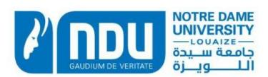

## **Notice of Institutional Review Board Approval **

To : Amine Moussa,

Library Information Systems, Mariam & Youssef (Main) Library, NDU Business Administration in Higher Education Management at the University of Bath, UK.

From: Dr. Pauline Aad, chair IRB

Date : April 1, 2021 / Ref N IRB2021_April012020 AM

**Protocol title:** The Role of Ethical Leadership in Shaping Employee Work

**Outcomes **

**Review Comments:** The above-mentioned research proposal received full Institutional Review Board approval

The Institutional Review Board at NDU reviewed the research proposal entitled "The Role of Ethical Leadership in Shaping Employee Work Outcomes" and all submitted documents and found no ethical concerns with the research methodology and therefore grants this proposal full approval.

Any changes to the submitted protocols/questionnaires, completion or amendments to the proposal itself will need to be communicated to the IRB chair via email at <a href="mailto:paad@ndu.edu.lb">paad@ndu.edu.lb</a>

Sincerely,

Dr. Pauline Aad, IRB Chair

Dr. Ghazi Asmar, AVPRGS

M. A. Ghazi Asmar

<!-- page 169 -->

## **APPENDIX F** **University of Bath: Application Route Checklist**

**Application Route Checklist submitted to University of Bath SSREC** **after receiving ** **NDU IRB Approval:**

## **ANNEX ONE*** Faculty of H&SS* *Checklist for all researchers* *Social Sciences Research Ethics Committee*

The Faculty of H&SS requires all members of staff and students who are planning research or consultancy projects to consider the ethical implications of the work that they undertake. This is important in all research and consultancy projects, but is *essential* in those projects that involve human participants.

The Faculty has agreed on an ethical review process that has a fast track for those projects which either do not have ethical implications and thus do not require full scrutiny, or where scrutiny will be given by another body (either an NHS Research Ethics Committee or another university).

**Projects that fall outside of these categories will need to make a full submission to the Social Sciences ** **Research Ethics Committee.**

|   |   | SECTION ONE |   |   |   |
| --- | --- | --- | --- | --- | --- |
| Name (PI or | Student and Supervisor) | Student: Amine Moussa Lead Supervisor: Gina Wisker |   |   |   |
| Department | Second supervisor: Dan Davies School of Management Programme: DBA in Higher Education Management |   |   |   |   |
| Project Title | Ethical Higher Education Management |   |   |   |   |
|   |   | The Role of Ethical Leadership in Shaping Employee Work Outcomes |   |   |   |
|   | Please tick the description that applies to your project: |   |   |   |   |
|   | Externally funded research project | Consultancy |   | Unfunded research project |   |
| Other (please specify) |   |   |   |   |   |
|   | Please tick the description that applies to you: |   |   |   |   |
| Staff |   | PhD | Masters |   |   |

## **SECTION TWO**

**Determining the nature of your research and the route for ethical approval you need to follow**

Described below are 3 routes for ethical approval with corresponding research project features. Please read through all and **tick** the description that applies to your project.

Provide the completed and signed documents as detailed to the REACH Secretary. If you have any queries as to which option to select, please contact the SSREC Secretary for guidance.

<!-- page 170 -->

## **A.** **SUBMISSION OF EVIDENCE OF APPROVAL FROM ANOTHER UNIVERSITY ETHICS COMMITTEE ** **FOR REVIEW BY SSREC **

**1** My research has received approval from another University Ethics Committee

_

,

٠

_

•

## **DOCUMENTS TO SUBMIT TO SSREC:**

This form

Application and Approval letter from other University Ethics Committee

N.B. Form B is not required

## **B.** **FULL CONSIDERATION IS REQUIRED BY SSREC**

| 2 | My research involves human subjects and does not take place in an NHS context |   |
| --- | --- | --- |
| 3 | My research involves the collection human tissue that will be destroyed within a matter of hours or |   |
|   | days and certainly no longer than a week. |   |
| 4 | My research project involves analysis of secondary data originating from human subjects |   |
| 5 | My research involves human subjects and takes place outside of the UK, and for which particular |   |
|   | consideration needs to be given |   |
| 6 | My research involves working with children and/or vulnerable adults |   |
| 7 | My project takes place in an NHS context but has been categorised by NHS local R&D as a service |   |
|   | evaluation, clinical audit, surveillance or usual practice. |   |

## **DOCUMENTS TO SUBMIT TO SSREC:**

This form

Form B & attachments

Form C (Option 3 only)

Evidence of consent to use secondary data for the purpose of the proposed project (Option 4 only)

Confirmation the University Child Protection and Safeguarding Policy will be followed (Option 6 only)

Confirmation of approval that study can be conducted at a specific NHS site (Option 7)

## **C.** **FULL NHS REC CONSIDERATION IS REQUIRED BY THE APPROPRIATE NHS REC,** **SUBMISSION OF DOCUMENTS FOR NOTING BY SSREC **

**8** My research meets the requirements for submission through the HRA IRAS system, that is, includes: access to NHS patients adults lacking capacity collection and storage of human tissue (i.e. human tissue **not **destroyed within a matter of hours or days and certainly no longer than a week). the use of ionising radiation a clinical trial of an investigation medicinal product (CTIMP)

## **DOCUMENTS TO SUBMIT TO SSREC:**

This form

NHS REC approved study protocol, Participant information sheet and Consent form

Formal confirmation of NHS REC approval

Form C (if study involves collection and storage of human tissue)

Details of who is Sponsoring this project

<!-- page 171 -->

## **APPENDIX G**

**Ethical Approval: University of Bath**

## **Email received** **from University of Bath SSREC** **on 08-APR-2021 @ 9:45 PM**

Dear Amine

**Full title of study**: Ethical Higher Education Management: The Role of Ethical Leadership

in Shaping Employee Work Outcomes **SSREC reference number**: S21-055

On behalf of the Committee, I am pleased to confirm that the Committee has noted the above research and the supporting documentation.

Your application has received a favourable ethical opinion. However please be aware that a researcher (or supervisor in the case of UG or Masters students) is responsible for ensuring full GDPR compliance. Please seek further advice from dataprotectionqueries@lists.bath.ac.uk if you have any concerns.

If you intend to display recruitment posters/materials, please ensure you obtain the appropriate permission to do so from those who manage the location(s) you choose.

Please inform SSREC about any substantial amendments made to the study if they have ethical implications.

Please make sure you quote your unique SSREC code, S21-055, in any future correspondence.

Kind regards

On behalf of SSREC

<!-- page 172 -->

## **APPENDIX H** **Email Sent to University Research Boards**

Dear Dr. XXX,

I hope you are doing well and staying safe.

My name is Amine Moussa. I am the head of Library Information Systems at NDU Lebanon and I am pursuing my Doctorate of Business Administration in Higher Education Management at the University of Bath, UK.

I am currently working on my thesis titled **Ethical Higher Education Management: ** **The Role of Ethical Leadership in Shaping Employee Work Outcomes**.

The aim of the thesis is to explore the relationship between ethical leadership, ethical organizational climate, the multiple targets of employee commitment (supervisor, team, organization, and profession), and the knowledge sharing behaviour of employees in the higher education context.

I am surveying academic and non-academic employees working in Lebanese higher education institutions and I am writing to you to request your help in sharing the survey link with all [University Name] academic and non-academic staff.

The attached survey is in English and should take no more than eight minutes to finish. Note that the research has received ethical approval from the University of Bath Social Science Research Ethics Committee (attached) and from the NDU Institutional Review Board (attached).

Here is the link to the electronic survey: https://bathmanagement.az1.qualtrics.com/jfe/form/SV_aghwK2jglTBC4D4

Thank you very much for your assistance.

Best wishes,

Amine Moussa

<!-- page 173 -->

## **APPENDIX I**

## **University Requesting Removal of a Scale Item**

Anonymised email received from University I on 09-JUN-2021 @ 5:00 PM requesting the removal of the third item in the Ethical Leadership Survey "My Supervisor conducts his/her personal life in an ethical manner":

Dear M. Moussa,

Hope you are doing well as well. Your survey had a positive response from the Committee with 2 recommendations:

1- Present yourself in the introductory paragraph ( I…. invite you to …)

2- Remove point 3 of q11

You will receive the official letter on Friday by mail. You can send me the modifications once done so I can validate the document.

The next step will be to submit your request (the same first mail you sent me) along with the letter and the validated questionnaire to the Secrétaire general of the university [XXXXXXX].

Best regards,

## **[XXXXXXXXX]**

Chargée d'analyse éthique des projets de recherche

<!-- page 174 -->

## APPENDIX J

## Ethical Approval: Université Saint Joseph (USJ) De Beyrouth

Comité d'éthique de la recherche

لجنة أخلاقيّات الأبحاث العلميّة Beyrouth, le 10 juin 2021

Monsieur Amine MOUSSA

Nos réf.: USJ -2021-194 (numéro à rappeler dans toute correspondance)

Titre: The Role of Ethical Leadership in Shaping Employee Work Outcomes.

Cher collègue,

Lors de sa réunion du 8 juin, le Comité a étudié ce dossier introduit dans le cadre d'une demande de diffusion d'un questionnaire au sein de l'USJ. Le Comité a pris acte de votre courriel daté du 27/05, ce courriel était accompagné de votre lettre de demande, du questionnaire en version anglaise ainsi que des accords du Comité d'Ethique de la NDU et du Comité d'Ethique de l'University of Bath Social Science Research.

Après en avoir délibéré, le Comité estime à l'unanimité que ce projet ne soulève aucune objection d'ordre éthique ; il vous notifie donc bien volontiers son accord. Par ailleurs, je vous invite (1) à vous présenter dans le paragraphe introductif, (2) à supprimer le point 3 de la question 11, (3) à faire parvenir au secrétariat du Comité la version modifiée du questionnaire et du paragraphe introductif pour validation. Par ailleurs, je vous confirme que l'accord du Comité d'éthique de la recherche ne vous dispense pas d'obtenir l'autorisation du secrétaire général de l'Université afin de pouvoir diffuser le questionnaire au sein de la communauté universitaire.

Avec tous mes vœux pour le succès de ce projet, je vous prie de croire, Cher collègue, en l'assurance de mes sentiments dévoués.

cc.

N.B. Compte-tenu de la situation, le Comité vous invite vivement à privilégier les entretiens en visioconférences et les questionnaires en ligne après l'obtention de l'accord des responsables concernés. Veuillez aviser le CÉR de toute modification au protocole de recherche pouvant avoir une incidence sur le plan éthique et de l'informer des conclusions générales et des résultats de l'étude.

Campus des sciences médicales, rue de Damas B.P. 11-5076 Riad el Solh, Beyrouth 1107 2180 - Liba

خزم العلوم الطبيّة، طريق الشام ص.ب.: ٥٠٧٦، رياض الصلح - بيروت هاتف ٩٦١-١-٤٢١٢٩

www.usj.edu.lb

<!-- page 175 -->

**APPENDIX K**

**Email Sent from MUBS To The University Community**

Email sent from the Modern University for Business and Science research office to the

university community on Thursday, April 29, 2021 @ 10:35 AM

Dear MUBS community,

We hope this e-mail finds you well.

We would like to share with you an academic research that is part of a Doctorate of

Business Administration in Higher Education Management at the University of Bath, UK

entitled Ethical Higher Education Management: The Role of Ethical Leadership in Shaping

Employee Work Outcomes.

The aim of this study is to explore the relationship between ethical leadership, ethical

organizational climate, employee commitment, and knowledge sharing behavior in the higher

education context.

You are asked to complete a survey which should take around 8 minutes to complete. Your

responses will remain confidential and will be used for research purposes. Your participation

is greatly appreciated.

Here is the link to the electronic survey

https://bathmanagement.az1.qualtrics.com/jfe/form/SV_bBkrsFx515uGvZk

Thank you for your contribution.

175

<!-- page 176 -->

## **APPENDIX L** **Email Sent From Haigazian University To The University Community**

Email sent from Haigazian University Human Resources Office on Friday, April 23, 2021 @11:22 AM confirming dissemination of the survey.

Good morning,

The survey has been shared with our staff this morning.

## Good luck!

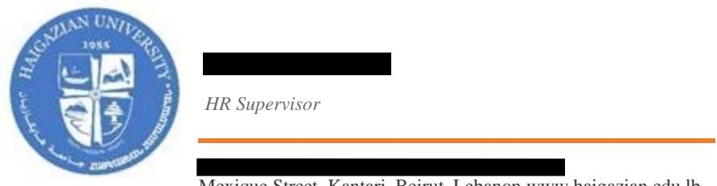

Mexique Street, Kantari, Beirut, Lebanon www.haigazian.edu.lb

<!-- page 177 -->

## **APPENDIX M** **Email Correspondence with Arab Open University**

Email correspondence with the Arab Open University on Tuesday, April 13, 2021

**From:**

**Sent:** Tuesday, April 13, 2021 12:38 PM

**To:** Amine Moussa

**Subject:** RE: Survey for Doctoral Thesis

Yes I will

**From:** Amine Moussa

**Sent:** Tuesday, April 13, 2021 12:37 PM

**To:**

**Subject:** RE: Survey for Doctoral Thesis

Thank you very much for your assistance. Is it possible to send it to all staff as well?

Best wishes, Amine

**From:**

**Sent:** Tuesday, April 13, 2021 12:35 PM

**To:** Amine Moussa <amoussa@aou.edu.lb> **Subject:** RE: Survey for Doctoral Thesis

Dear Mr. Moussa

Kindly note that I sent the survey to all our full-timers and part-timers,

Good luck

Best Regards,

Deputy Director for Academic Affairs Head of Antelias Study Center Arab Open University – Lebanon

<!-- page 178 -->

## **APPENDIX N** **Email Received From MEU Confirming Dissemination of The Survey**

Email received from Middle East University Library Director confirming the dissemination of the survey on Tuesday 12-May-2021 @ 9:04 AM

Dear Amine,

The survey reached the destination, and we are waiting for replies in the coming days.

Best regards,

Library Director **T:** +961 1 685800 x 121

M: +961 70 274874

Ferdous Street, Sabtieh, Lebanon PO Box 90-481, Metn 1202-2040

farid.khoury@meu.edu.lb http://meu.edu.lb

<!-- page 179 -->

## **APPENDIX O** **Email Sent From University Of Balamand To The University Community**

Email sent from the University of Balamand acting provost to the university community on 28-APR-2021. Screenshot sent from a colleague at the university confirming the reception of the broadcast email.

<!-- page 180 -->

## **APPENDIX P** **Opening Introduction To The Survey And The Consent Form**

(THE FIRST PAGE OF THE SURVEY)

Ethical Higher Education Management The Role of Ethical Leadership in Shaping Employee Work Outcomes

I, Amine Moussa, invite you to participate in this independent, academic research that is part of my Doctorate of Business Administration in Higher Education Management at the University of Bath, UK.

The aim of this study is to explore the relationship between ethical leadership, ethical organizational climate, employee commitment, and knowledge sharing behaviour in the higher education context.

You will be asked to complete a survey which should take around 8 minutes to complete. I guarantee that you cannot be identified from your responses as the survey is anonymous and has been designed to ask for general information only. Your responses will remain confidential and will be used for research purposes. Your participation is greatly appreciated.

If you have any questions or concerns about the survey, please contact me, Amine Moussa (am3186@bath.ac.uk).

## Respondent's Consent:

I hereby certify that by responding to this survey, I have given my full consent to participate in the research study and that my participation is voluntary. Any refusal to participate will involve no penalty or loss of benefits to which I am entitled. I may as well discontinue my participation at any time without giving a reason.

[ ] I understand and want to participate in the study.

[ ] I do not want to participate in the study.

<!-- page 181 -->

## **APPENDIX Q** **Personalised Reminder Email**

Dear Dr. XXX,

I hope you are doing well.

I am currently pursuing my doctoral degree in Higher Education Management at the University of Bath, UK.

After receiving approval from [Recipient's University Name] Ethics Committee, my thesis survey about 'Ethical Leadership in Higher Education' was sent two weeks ago to all [Recipient's University Name] faculty and staff, but since it is anonymous, I cannot know who completed it.

Would you please complete it if you haven't already? It should take around eight minutes and I appreciate every reply I can get because I need a large number of respondents.

Here is the link to the survey: https://bathmanagement.az1.qualtrics.com/jfe/form/SV_aghwK2jglTBC4D4

Thank you very much, Amine Moussa

<!-- page 182 -->
