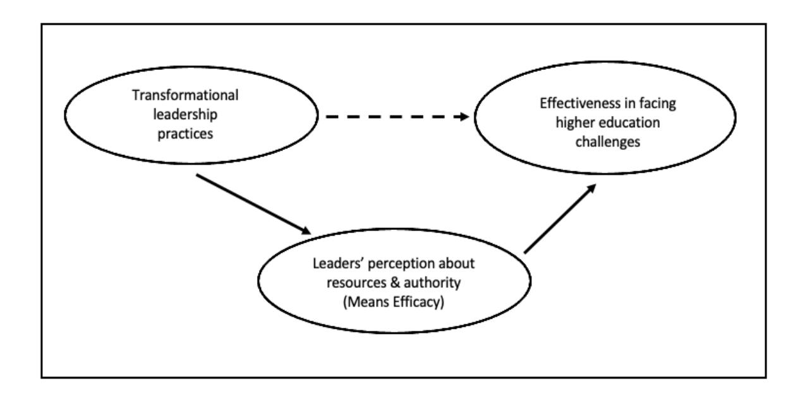
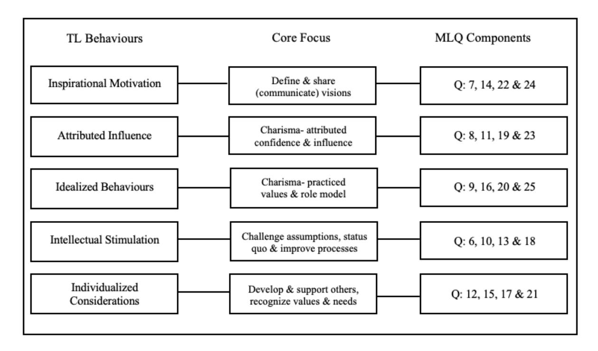

<!-- TH.R03 | source: papers_json/TH.R03/ -->

## **DOCTOR OF BUSINESS (DBA)**

Higher Education in Jordan: Senior Leadership Practice and Challenges

Odat, Mohammed

Award date: 2021

Awarding institution: University of Bath

[Link to publication](https://researchportal.bath.ac.uk/en/studentTheses/b17e7752-2a82-438d-a725-2beef372bf16)

## **Alternative formats**

If you require this document in an alternative format, please contact: openaccess@bath.ac.uk

Copyright of this thesis rests with the author. Access is subject to the above licence, if given. If no licence is specified above, original content in this thesis is licensed under the terms of the Creative Commons Attribution-NonCommercial-NoDerivs 4.0 International (CC BY-NC-ND 4.0) Licence (https://creativecommons.org/licenses/by-nc-nd/4.0/). Any third-party copyright material present remains the property of its respective owner(s) and is licensed under its existing terms.

**Take down policy**

If you consider content within Bath's Research Portal to be in breach of UK law, please contact: openaccess@bath.ac.uk with the details. Your claim will be investigated and, where appropriate, the item will be removed from public view as soon as possible.

Download date: 11. Oct. 2025

<!-- page 2 -->

## **DOCTOR OF BUSINESS (DBA)**

**Higher Education in Jordan: Senior Leadership Practice and Challenges**

Odat, Mohammed

Award date: 2021

Awarding institution: University of Bath

Link to publication

## **Alternative formats**

If you require this document in an alternative format, please contact: openaccess@bath.ac.uk

## **General rights**

Copyright and moral rights for the publications made accessible in the public portal are retained by the authors and/or other copyright owners and it is a condition of accessing publications that users recognise and abide by the legal requirements associated with these rights.

- Users may download and print one copy of any publication from the public portal for the purpose of private study or research.
- You may not further distribute the material or use it for any profit-making activity or commercial gain
- You may freely distribute the URL identifying the publication in the public portal ?

## **Take down policy**

If you believe that this document breaches copyright please contact us providing details, and we will remove access to the work immediately and investigate your claim.

Download date: 04. Mar. 2021

<!-- page 3 -->

## **Higher Education in Jordan: Senior ** **Leadership Practice & Challenges **

Volume 1 of 1

Mohammad Odat

A thesis submitted for the degree of Doctor of Business Administration (Higher Education Management)

University of Bath School of Management (ICHEM)

December 2020

<!-- page 4 -->

## **COPYRIGHT**

Attention is drawn to the fact that copyright of this thesis/portfolio rests with the author and copyright of any previously published materials included may rest with third parties. A copy of this thesis/portfolio has been supplied on condition that anyone who consults it understands that they must not copy it or use material from it except as licensed, permitted by law or with the consent of the author or other copyright owners, as applicable.

## **DECLARATION OF ANY PREVIOUS SUBMISSION OF THE WORK**

The material presented here for examination for the award of a higher degree by research has not been incorporated into a submission for another degree.

Signed…Mohammed A. Odat

## **DECLARATION OF AUTHORSHIP**

I am the author of this thesis, and the work described therein was carried out by myself personally.

Signed…Mohammed A. Odat

<!-- page 5 -->

## **Table of Contents**

List ofFiguresviiList of TablesviiiAcknowledgementsxAbstractxiChapter One: Introduction
11.1Statement of the Problem11.2Personal Motivation11.3Purpose of the Study31.4Research Questions31.5Significance of the Study41.6Definition of Terms51.7Organization of the Study6Chapter Two: Context of the Study82.1Introduction82.2Higher Education in Jordan82.2.1Structure of the Jordanian Higher Education System92.2.2Student Enrollments102.2.3Political Factors112.2.4Financial Factors132.2.5Societal Factors142.3Challenges Facing Higher Education in the Middle East162.3.1Market Demands16

<!-- page 6 -->

2.3.2Demographics182.3.3Resources192.3.4Governance202.3.5Summary of the Challenges Facing Higher Education in the Middle East212.4Challenges Facing Higher Education in Jordan222.4.1Introduction222.4.2Shortages in Funding232.4.3Access and Admissions232.4.4Accreditation and Quality Assurance252.4.5Leadership and Governance262.4.6Syrian Refugees282.5Relevance of these Challenges to Higher Education Outcomes292.6Summary of Chapter Two31Chapter Three: Review
of the Literature323.1Introduction323.2Introduction
to Leadership Scholarship323.3The Importance of Effective Leadership in Higher Education343.4Overview of Leadership Studies393.4.1Organizational Culture403.4.2Leadership Effectiveness403.5Summary & Critique of Major Leadership Theories423.5.1Trait Theory433.5.2Behavioural Theory44

<!-- page 7 -->

3.5.3Skills
Theory453.5.4Transactional
Theory463.5.5Contingency Theory473.5.6Situational
Theory493.5.7Servant
Theory503.5.8Path-Goal Theory513.5.9Leader-Member Exchange
Theory523.5.10Connective
Theory533.5.11Complexity Theory543.5.12Relational Theory553.5.13Authentic
Theory573.5.14Adaptive Theory583.5.15Transformational Theory593.6Application of Transformational Leadership to Higher Education613.7Rationale for Transformational Leadership as Theoretical Framework673.8Summary of the Review of Literature73Chapter Four: Research Design and Methodology754.1Introduction754.2Ontological Assumptions754.3Epistemological Assumptions764.4Rationale for Choice of Mixed Methods Research Design774.4.1Advantages of a Mixed Methods Research Design774.4.2Disadvantages of a Mixed Methods Research Design77

<!-- page 8 -->

4.5Research Questions784.6Conceptual Framework794.6.1Inspirational Motivation824.6.2Attributed Influence834.6.3Idealized Behaviour844.6.4Intellectual Stimulation854.6.5Individualized Consideration864.7Data Collection
Methods874.7.1Introduction: Quantitative874.7.2Survey: Application of the Multifactor Leadership Questionnaire to the
Quantitative Research904.7.3Quantitative Instrumentation934.7.4Quantitative Research Sample954.7.5Introduction: Qualitative974.7.6Application of Semi-structured Interviews to Qualitative Research994.7.7Qualitative Sampling Strategy 1004.8Data Analysis1024.9Ethical Considerations1054.10Validity and Reliability1054.11Assumptions1094.12Summary109Chapter Five: Findings1115.1Introduction111

<!-- page 9 -->

5.1.1Research Questions1125.2Description of the Quantitative Survey
Sample1135.3Research Question #1: Participants' Perceptions of the Main Challenges FacingHigher Education in Jordan1165.3.1Quantitative Analysis1175.3.2Qualitative Analysis1195.4Research Question #2: Participants' Self-ratings Against TransformationalLeadership Behaviours1265.4.1Quantitative Analysis1275.4.1.1Correlation Analysis1285.4.1.2Tests of Normality
for Scores on Measures of Transformational Leadership1335.4.2Qualitative Analysis1355.5Research Question #3: Relationship Between Participants' Self-ratedTransformational Leadership Behaviours and Perceived Difficulty in MeetingParticular Challenges1385.5.1Quantitative Analysis1385.5.1.1Analyses of Variance (ANOVA)1425.5.1.2Pearson Product-Moment Correlations: Relationship Between TransformationalLeadership Behaviours and Perceived Difficulty of Challenges1505.5.1.3Multivariate Analysis of Variance (MANOVA)1555.5.1.4Standard Multiple Regression Analysis: Predictive Value of TransformationalLeadership Behaviours and Perceived Difficulty of MeetingChallenges157

<!-- page 10 -->

5.5.2Qualitative Analysis1595.6Summary165Chapter Six: Discussion, Implications
and Recommendations1726.1Introduction1726.2Re-Statement of the Problem1726.3Purpose of the Study1736.4Research Questions1736.5Significance of the Study
and Contributions1746.6Discussion of the Findings1756.7Implications
of the Study
for Future Practice1826.8Recommendations for Future Research1846.9Limitations of the Study1866.10Reflections on the
Study1876.11Conclusion187References190Appendices223Appendix
A:SURVEY INSTRUMENT223Appendix B:MULTIFACTOR LEADERSHIP QUESTIONNAIRE
LETTER OF
PERMISSION228Appendix C:LIST OF INSTITUTIONS230Appendix D:EMAIL SENT TO PROSPECTIVE SURVEY PARTICIPANTS233Appendix E:LETTER OF INFORMED CONSENT235Appendix F:LIST OF INTERVIEW PARTICIPANTS237Appendix G:INTERVIEW GUIDE239

<!-- page 11 -->

Appendix H:INTERVIEW QUESTIONS242List of FiguresviiiFigure 1:Jordan Higher Education System Enrollment11Figure 2:Higher Education by Country25Figure 3:Percentage of Unemployed Citizens by Level of Education30Figure 4:Conceptual Framework80Figure 5:Transformational Leadership Behaviours and the MLQ82List of TablesviiiTable 1: Demographic Profile of Respondents115Table 2: % Rank Most Important Issues Facing Higher Education in Jordan117Table 3: % Rank Second Most Important Issues Facing Higher Education in Jordan117Table 4: % Rank Third Most Important Issues Facing Higher Education in Jordan118Table 5: Leadership Behaviours –
Descriptive Statistics
127Table 6: Correlations by Gender and Leadership Behaviour128Table 7: Correlations by Age and Leadership Behaviour
129Table 8: Correlations by Position and Leadership Behaviour
130Table 9: Correlations by Years' Experience and Leadership Behaviours
132Table 10: Correlations by Institutional Affiliation and Leadership Behaviour
133Table 11: Tests of Normality for Scores on Measures of Transformational Leadership134Table 12:Mean and 5% Trimmed Means for Measures of Transformational Leadership
135Table 13: % Agreement by Questions Assessing Resources, Authority & Challenges139Table 14: Levene's Test of Homogeneity of Variances142Table 15: One-way ANOVA Results-Most Important Issues by Position143

<!-- page 12 -->

Table 16: One-way ANOVA Results-Necessary Resources by Position
144Table 17: One-way ANOVA Results-Necessary Authority by Position144Table 18: One-way ANOVA Results -Effective Responding to Challenges by Position144Table 19: Levene's Test of Homogeneity of Variances146Table 20: One-way ANOVA Results-Most Important Issues by Experience147Table 21: One-way ANOVA Results-Necessary Resources by Experience147Table 22: One-way ANOVA Results-Necessary Authority by Experience147Table 23: One-way ANOVA Results-Effectiveness Responding to Challenges/Experience148Table 24: Correlations by Resources and Leadership Behaviours151Table 25: Correlations by Authority and Leadership Behaviours152Table 26: Correlations by Effectiveness and Leadership Behaviours153Table 27:
Correlation Coefficients Between Challenges and Transformational Leadership154Table 28: Levene's Test of Homogeneity of Variances -
MANOVA155Table 29: MANOVA –
Tests Between Subjects Effects by Dependent Variable156Table 30: Multiple Regression Results-Predictive Capacity of Individual Variables158

<!-- page 13 -->

## **Acknowledgements**

First and foremost, praises and thanks to the God, the Almighty Allah, for His showers of blessings throughout my research work. I would like to express my sincere gratitude to my research supervisor, Dr. Daniel Davies, PhD and Director of Higher Education Management Programs at the School of Management, University of Bath, for giving me the support and encouragement needed and for providing invaluable guidance throughout this research. His dedication, constant follow up, enthusiasm, and sincerity have deeply inspired me. It was a great privilege and honor to learn from him.

Thanks to the School of Management and the Board of Studies for supporting my research and for the understanding. Thanks to all fulltime faculty, adjunct professors and administrative staff who have taught me or helped me in the higher education management degree program and to all people who have supported me to complete the research work directly or indirectly.

My very special thanks go to my dear colleague Sadiq, for his friendship, inspiration, support and encouragement. I am glad that his belief in me and his continuous support and encouragement have finally led to a prideful work and ended forming a very special and meaningful milestone in my life.

Thank you, dad, for planting the "achievement" and "sense of mission" values in me and for that you always made me feel special. Finally, I would like to express my deep and sincere gratitude to my family; my beloved mom, my wife Sonya and my daughters Raya, Sara and

<!-- page 14 -->

Salma, for their love, prayers, care and sacrifices during the period I spent in research. Without them being around and in support, this research would not have been successfully completed.

## **Abstract**

Colleges and universities in Jordan face several important immediate and long-term challenges which in turn underscore the need for exemplary senior leadership. The purpose of this research is to provide insights useful to help addressing the question about the type of leaders Jordanian higher education needs to effectively overcome the current long-standing challenges, and to examine the relationship between transformational leadership practices and perception of leaders about the resources and authority (means efficacy) available for them to face these particular challenges. The theoretical framework for the study is based upon transformational leadership theory where a mixed method approach is adopted. The findings for research was determined from a self-rating survey distributed to 195 university presidents, vice presidents and academic deans from Jordan along with interviews conducted with 10 survey respondents. The findings suggest that Jordan needs more transformational leaders in the higher education institutions to effectively overcome some of the sector's challenges. Those leaders should be particularly skilled in Inspirational Motivation (IM) and Intellectual Stimulation (IS) so that their perception about the difficulty of facing these challenges is enhanced and their effectiveness is improved. This finding has implications for leadership development and future research in Jordanian Higher Education.

Key Words: Leadership, Transformational Leadership, Jordan, Challenges

<!-- page 15 -->

<!-- page 16 -->

## **CHAPTER** **I: INTRODUCTION**

## **1.1 Statement of the Problem**

Colleges and universities in Jordan and throughout the Middle East region perform a critical role and service in supporting and furthering the public good by educating their students and by contributing to and advancing the institutional aspirations of government agencies, industry, foundations and other sectors of society through their policies and best practices (Kezar, Carducci, & Contreras-McGavin, 2006).

The higher education sector in Jordan and throughout the region is faced with a number of significant challenges including funding shortages; limited access to higher educational opportunities; the lack of standardized and competitive admissions systems; inadequate accreditation and quality assurance systems and ineffective governance systems. Middle East colleges and universities are increasingly in need of senior leaders who are highly competent in modeling and encouraging effective engagement; defining and leading others to a shared vision; improving organizations through better processes; instilling a sense of trust and teamwork; and emphasizing mutual respect and accountability (Bass & Avolio, 1995, 2000, 2004). By better understanding of these critical leadership practices and behaviours, institutions of higher education and their senior leaders may in turn enhance their understanding and efficacy in addressing the major challenges facing the Middle East higher education sector.

## **1.2 Personal Motivation**

The foundation for my interest in the subject of this study is based upon two separate, but interrelated professional experiences. Earlier in my career, I served as General Manager of a branch campus of a Western university in Jordan. It was through this experience that I developed an in-depth understanding of many of the key elements involved in higher education

<!-- page 17 -->

administration and operations, along with a range of challenges associated with those operations, both internal and external. This experience also provided me with the opportunity to observe and assess a range of leadership styles within the senior leadership team and with our partner institutions.

Through this experience, I was exposed to discussions between higher education leaders about the challenges facing higher education in Jordan and it was always a surprise to me that these challenges are the same across a long period of time. Many discussions referenced the lack of effective leadership in Jordanian higher education. The appointment of university presidents over the past 10 years was also a subject of national debates and I was always concerned about the type of leaders we need in Jordan to face the current long-standing challenges. The higher education sector in Jordan is crucial to the country's socioeconomic development especially in the light of scarce natural resources, turbulent political climate in the region and the relatively high unemployment rate. It became like a national calling to me to contribute to finding a solution that could liberate this important sector from boundaries and unleash the potential it holds to leave an impact on many Jordanian lives.

As I moved on in my career, I transitioned to leading the Middle East operations for one of the world's largest training and development organizations. This experience representing one of the world leading leadership training providers offered me the chance to train and interact with more than 4,000 leaders across many sectors in Jordan. I became more concerned about the quality of leaders we have in many instrumental positions and about the extent to which these leaders are equipped by current leadership tools, adopting an appropriate mindset and conducting the right practices with their teams. I believe that leaders in higher education are not an exception. My concern about the practices of leaders in Jordanian higher education increased due

<!-- page 18 -->

to the importance of the impact of these practices not only on teams led, but also based on the learning outcomes of certain colleges and on the national economy in general.

This experience has allowed me to acquire and develop a deeper understanding of a significant portfolio of management and leadership development programmes, inclusive of their underlying pedagogy, thus furthering my motivation to broaden my knowledge of leadership behaviours within the higher education sector.

## **1.3** **Purpose of the Study**

The purpose of this research is to provide useful insights to help addressing the question about the type of leaders Jordanian higher education needs to effectively overcome the current long-standing challenges, and to examine the relationship between transformational leadership practices and the difficulty leaders perceive, using measures of resources and authority (means efficacy), in facing these particular challenges.

## **1.4** **Research Questions**

The following research questions were examined in this study, in response to the problem outlined above and based on five primary leadership practices as a means for assessing leadership effectiveness: behaviours that define and lead others to a shared vision; behaviours that refer to the attribution of charisma to the leader and a focus on instilling a sense of trust and teamwork; behaviours that model and encourage effective engagement, emphasizing a collective sense of mission and values, as well as acting upon these values; behaviours that improve organizations through better processes, challenging the assumptions of followers` beliefs, their analysis of problems they face and solutions they generate; and behaviours that emphasize mutual respect and accountability defined by considering individual needs of followers and developing their individual strengths (Bass & Avolio, 1995, 2000, 2004).

<!-- page 19 -->

- 1. What are the current major higher education challenges facing Jordan, as perceived by senior leaders in that space?
- 2. How do senior higher education leaders in Jordan rate their strengths and weaknesses in Transformational Leadership behaviours?
- 3. What relationships exist between respondents' self-rated Transformative Leadership behaviours and the difficulties they perceive in meeting particular challenges?

These research questions will be addressed through a mixed-method design consisting of an analysis of the quantitative data derived from responses to a survey which will capture personal and institutional demographic information of Jordanian university leadership and interviews with a sub-sample of leaders. The survey will provide a self-assessment of leadership practices based upon the individual respondent's personal and professional background, the type of higher educational institution, and their perceptions of the major challenges facing institutions of higher education in Jordan, together with their sense of self-efficacy in meeting these challenges. In addition, qualitative interviews will be conducted with a selected number of the respondents to develop a deeper understanding of participants' perceptions concerning leadership and agency.

## **1.5** **Significance of the Study**

Effective leadership within Jordanian colleges and universities is critical to the sustainability and growth of this nation's higher educational system and is important to a broad set of stakeholders including students, faculty, administrators, college trustees, unions, and education policy makers (Kolodny, 1998). Heifetz (1998) stated that leaders who are adept at innovating, problem solving, who inspire without being authoritative, and who possess a clear sense of values are rare.

<!-- page 20 -->

The senior leadership at colleges and universities play a critical role in advancing the mission and values of their respective institutions, be they public or private (Rumsey, 2012). Literature on the relationship between the effectiveness of senior leadership behaviours and practices, and the challenges faced by institutions of higher education in Jordan is limited. Additional research is required on the role that certain leadership competencies influence or direct the effectiveness of how senior leaders address these challenges.

## **1.5 Definition of Terms**

*Behaviour: *The observable demonstration of a skill or set of skills by performing some task or function.

*Effectiveness: *The degree to which something is successful in producing a desired result or goal; in obtaining needed resources; in leading high-quality internal processes; in satisfying important stakeholders (Cameron, 2015).

*Effective Leadership:* The expression or pattern of leadership behavior that is evidenced when leaders accomplish 'above average' outcomes in organizations as described by five primary leadership practices: behaviours that model and encourage effective engagement; behaviours that define and lead others to a shared vision; behaviours that improves organizations through better processes and change management; behaviours that focus on instilling a sense of trust and teamwork; and behaviours that emphasize mutual respect and accountability (Bass & Avolio, 1995, 2000, 2004).

*Leadership:* A process whereby an individual influences a larger group of individuals to achieve a common goal (Northouse, 2009).

*Mixed Methods Research*: An approach to inquiry and research that combines quantitative and qualitative methods into one study in order to provide a broader perspective.

<!-- page 21 -->

Instead of focusing on one type of methodology, mixed methods research emphasizes the research problem and uses all approaches available in order to come to a better understanding (Creswell & Creswell, 2017).

*Organizational Culture:* A pattern of shared basic assumptions invented, discovered, or developed by a given group as it learns to cope with its problems of external adaptation and internal integration that have worked well enough to be considered valid and, therefore, are to be taught to new members as the correct way to perceive, think, and feel in relation to those problems (Schein, 2004).

*Private Institution:* An independent college or university that sets its own policies and goals, and is privately funded (Petersons.com, 2013).

*Public Institution:* A college or university founded by a state government that, in turn, contributes to the cost of operating the institution and provides oversight through appointed boards and trustees (Petersons.com, 2013).

## **1.7** **Organization of the Study**

This study is organized into six chapters. Chapter I provides an introduction, problem statement, purpose of the study, research questions, significance of the study, and definition of terms. Chapter II presents a contextual review concerning higher education in the Middle East, and more specifically, Jordan inclusive of the leadership challenges facing colleges and universities in Jordan; Chapter III presents a review of the related literature concerning why effective leadership is important, a summary of relevant leadership theories, with a specific focus on transformational leadership.

Chapter IV provides a summary of the research design and methods utilized to implement the study and presents the research questions, instrumentation, research sample, variables, data

<!-- page 22 -->

collection and analysis procedures, and ethical protection of human subjects. Chapter V includes the results of the data collection and analysis. Chapter VI provides a summary of the findings, implications, and recommendations for future research and practice.

<!-- page 23 -->

## **CHAPTER II: THE CONTEXT OF THE STUDY**

## **2.1 Introduction**

This chapter presents an overview of the Jordanian higher education system; a contextual review of student enrollments in Jordan; the various political controls that guide and at times impede higher education in the country; an overview of the role that finances play in the sector; and the societal factors that impact higher education in the country. The challenges facing education in the Middle East are addressed from a market, demographic, resource and governmental policy perspective. Finally, the chapter will examine the challenges facing higher education in Jordan specifically, shortages in funding, access and admissions, accreditation and quality assurance, leadership and governance and the relevance of these challenges to higher education outcomes.

## **2.2 Higher Education in Jordan**

The modern history of higher education in Jordan is rather short. The country was a British protectorate whose current borders were established as part of the redrawing of territories following World War I. Shortly after the end of that conflict, the early form of a national system of education began to take shape. Following the 1953 coronation of His Majesty King Hussein bin Talal, the father of modern Jordan, a Royal Education Commission was established to make recommendations to the Crown for the development of the education system. After initially focusing on improving basic literacy, the commission established compulsory minimums of education while expanding the secondary education sector, creating a platform for training college educators.

<!-- page 24 -->

## **2.2.1 Structure of the Jordanian Higher Education System**

In response to the demand for higher education, the Jordanian government initially began licensing private universities while the country's first public university, the University of Jordan, was established in 1962, and the second, Yarmouk University, in 1976 (Ministry of Higher Education, 2017). In 1981 these were joined by Muíta University and in 1995 by Hashemite University and Al Alíbyt University. The public institutions also include the Jordan University of Science and Technology, which was separated from Yarmouk University in the late 1980s at a time of political unrest in the north of Jordan, and the Amman University for Applied Engineering, which evolved from a technical college.

Over the subsequent quarter of a century, Jordanian higher education continued to grow in a steady and demand-based manner, resulting in the establishment of three other public universities by 1987 (Owais, 2009). The Jordanian higher education system reflected elements of both the American and English models.

An international dimension was integral from the beginning and was represented in the system in a limited way through the adoption of English language for teaching, the utilization of foreign faculty expertise in certain disciplines where local faculty were in shortage and by a number of academic partnerships with international institutions. Perhaps the most notable sign of the keenness of Jordanian policymakers to engage the higher education system internationally was the adoption of the American model of the university as the primary foundation for the ease of exchanging faculty and students with the country that represented the largest source of funding to the development of Jordan at that time (Ministry of Higher Education, 2017).

Since 2000, Jordan, with its severely scarce natural resources, has aspired to build the knowledge economy of which highly skilled labour forces represent the aspirational

<!-- page 25 -->

characteristics. This aspiration was the focus of a comprehensive macroeconomic governmentsponsored 2002 study, the Socio-Economic Transformation Programme. Among the five key goals of the Socio-Economic Transformation Programme was human resources development, to which reforming education and higher education was central (Al-Jaghoub & Westrup, 2003).

The intended reform was designed to build a highly competent human capital that could serve the local development needs and successfully be exported to the demanding job market in the region. Jordanian universities were, therefore, encouraged to develop ways to attract increasing numbers of students from the neighboring countries to support certain regional positioning and to assure constructive academic, social and cultural diversity among the student community (Ministry of Higher Education, 2017).

## **2.2.2 Student Enrollments**

Currently, the Jordanian higher education system is comprised of a total of 83 institutions (51 two-year community colleges and 32 four-year universities) which together enroll close to 300,000 students. Of this total, less than 10 percent of these students are non-Jordanian (Ministry of Higher Education, 2017). Slightly more than half (54 percent) of those students are female. Enrollments at public institutions far exceed those of the private colleges and universities, with over 75 percent of students opting for the public option. The reasons for this are both financial and reputational with the public sector representing better overall value for most students. The community college segment is roughly evenly-divided between private and public institutions and also includes more specialized institutions aligned with the government, military and the NGOs such as the United Nations*. *Summary data are provided in Figure 1.

<!-- page 26 -->

Source: Ministry of Higher Education, 2020

## **2.2.3 Political Factors**

The past decade has represented a new era of development in the Jordanian higher education sector. It has gained considerable attention from the Jordanian government especially after the official declaration of the country's intention to build a knowledge-based economy that serves its comprehensive development (Socio-Economic Transformation Program, 2002). That attention has been affirmed through various initiatives such as the National Strategy of Higher Education and Scientific Research (2005 - 2010), the National Agenda (2006 - 2015) and the Higher Education Reform for Knowledge Economy Project (2009). All of these initiatives have been seen as a new ambitious and revitalizing vision by the country's monarch, King Abdullah II. King Abdullah II assumed the leadership of the country after the death of his father, the late King Hussein bin Talal (Badran, 2019). The change in leadership is both historically important but also relevant to the evolution of the country's higher education strategy given the political and social support reforms that followed the beginning of a new political reign.

The political system in Jordan is a monarchy and semi-democratic where the people are represented in an elected Parliament, but where the actual executive authority (the government) is under the direct control of the King who assigns/approves the members and key staff of the government. In such political systems, the reform agenda is essentially top-down. The adoption

<!-- page 27 -->

by the highest leadership level of a certain reform strategy assures a certain buy-in and a level of seriousness that cannot be opposed or delayed. The political environment constantly affects policy formation in Jordanian higher education (Reiter, 2002).

For example, the appointment of the president of any Jordanian public university requires a royal decree from His Majesty the King. The royal court interferes with the universities' admissions process by distributing annual lists of students to be exempt from regular admissions rules, on the declared basis of achieving equality. These students mostly get royal scholarships and are not required to pay the tuition and fees regular students are paying (Ministry of Higher Education, 2017). There are other exempted students the system absorbs as well such as dependents of veterans, schoolteachers and students from underprivileged areas and students who lost a parent killed in war.

Conflict has been a constant in the region surrounding Jordan for some time. Jordan exists and has survived in a vibrant sea of conflicts, turbulent politics, ethnic tensions and religious extremism. The underlying tensions associated with the Israel-Palestinian conflict coupled with the more recent rise of radical Iran in Middle East politics has an indirect effect on what is a relatively stable political climate and has also had a considerable negative impact on Jordan's attractiveness to foreign higher education institutions (Reiter, 2002).

Jordan has a renowned higher education reputation among Arab countries. The Jordanian higher education system stands out in terms of infrastructure, number of universities, size, diversity of academic degrees offered and the maturity of procedures and policies (Zlatkin-Troitschanskaia, Shavelson & Kuhn, 2015).

<!-- page 28 -->

In recent years, Jordanian universities started to advance over other regional rivals. According to the 2020 report of the QS World University Ranking system, 11 Jordanian universities were ranked among the top 100 Arab universities and 16 were among the top 130. A few public universities were ranked among the top 1000 universities worldwide indicating an increased attention paid to quality, internationalization and competitiveness. Another indicator to quality in higher education is the student-faculty ratio. The average student-faculty ratio among Jordanian universities is 26 to 1, while the average ratio among other universities in the Arab world is 38 to 1 according to 2019 numbers. This attractiveness is evidenced by the increasing percentage of non-Jordanians the system attracted over the past few years that reached, according to the Ministry of Higher Education statistics, over 12 percent (Ministry of Higher Education, 2020).

Additionally, Jordan enjoys a more attractive profile to foreign students and visitors in terms climate and weather, the proximity of the main Middle East touristic attractions and leisure spots, openness and friendliness of the Jordanian people and the ease of obtaining an entry visa.

## **2.2.4 Financial Factors**

Expenditures on higher education in Jordan has reached more than U.S. $900 million a year. The public sector contributes by nearly U.S. $660 million and the private sector nearly U.S. $240 million. At the same time, the government contribution to public universities has been less than U.S. $75 million a year for the past five years. (El-Araby, 2011). Public universities in Jordan rely almost entirely on tuition fees for their revenue. Therefore, they have created what is referred to as a so-called parallel system that allows them to admit students, in many occasions above their permitted capacity, based on applicants' Tawjihi score, the national higher education admissions test.

<!-- page 29 -->

In order to meet the gap between the government contribution and their operating costs, public universities are encouraged to sign partnerships with foreign providers to jointly offer programmes at significantly higher tuition fees to generate revenues, especially when the last permitted raise of tuition they received from the government was 9 years ago.

The under-financing of higher education also has implications for scientific research in Jordan, in both scope and scale. The Scientific Research Fund at the Ministry of Higher Education has received only around U.S. $12 million a year since 2011 (Kannan, Al-Salamat & Hanania, 2010). However, other factors such as the teaching-led internal culture of universities, the overwhelming students' numbers in classes, the lack of collaboration between institutions within the higher education market, insufficient financial remunerations to faculty members, loose quality assurance processes and many others are further mitigating factors (Dundar & Lewis, 1998).

## **2.2.5 Societal Factors**

Jordanian society is considered among the typical conservative Arab societies that still hold some traditional values embedded in the personality of members over generations. These collective values are derived from the tribal nature of the community in some cases, the harsh geographic nature and from misunderstandings related to religion in some cases. For example, many students leave university holding a rigid mindset that is challenged by accepting the differences of others, respecting ethnic, religious or tribal diversity, expressing one's own thoughts freely and having the confidence to lead change and take decisions in one's own life (Moaddel, 2002).

Jordanian universities are challenged by creating an experience that shifts students' thinking and engages their emotions so that they are more intentional about their actions,

<!-- page 30 -->

decisions and the consequences that result from those actions or decisions. Universities, especially in the West, can do that in different ways and can always amend their strategic perspective to developing distinctive, proactive and well-prepared human capital instead of intentionally graduated a pre-limited group of technically skilled professionals who can simply perform tasks and handle jobs (Badran, 2014).

Since the foundation of the University of Jordan, the country has aspired to create and sustain a knowledge-based economy centered around a highly skilled labour force in order to compete globally, given the nation's scarcity of other natural resources. In fact, some would say that this is the only option for Jordan as it is one of the world's most water and energy insufficient countries (World Bank, 2007). That results in extreme difficulties in developing manufacturing-based industries that require abundant supplies of power and water. Agriculture, which is especially dependent on water resources and fertile soil is also constrained given the fact that this is a country which is almost 80 percent desert (World Bank, 2001).

Jordan, with its scarce resources, has initiated various ways to build a knowledge-based economy that provides services to neighbouring markets. The Jordanian government projected a vision to build a powerful service and knowledge-based economy in 2002 (Al-Jaghoub & Westrup, 2003). The official declaration came through the highest level of leadership in the kingdom; His Majesty King Abdullah II, that symbolized a strong sign of willpower and determination of the political leadership team.

That speech centered around the nation's *Socio-Economic Transformation Program* (2002) which was established to strengthen the country's human resources development capabilities and recognized the integral role of higher education in achieving that objective.

<!-- page 31 -->

The programme recognized that certain reforms would be required to build a highly competent human capital capacity that could serve the local development needs and successfully be exported to the demanding job market in the region. As part of this initiative, Jordanian universities were encouraged to develop ways to attract increasing numbers of students from the neighboring countries to support certain regional positioning and to assure constructive academic, social and cultural diversity among the student community (UNESCO, 2017).

## **2.3** **Challenges Facing Higher Education in the Middle East**

Colleges and universities throughout the world have been dealing with a number of pressing issues for some time which impact their sustainability and future growth. Amongst the most significant are the pressure of increasing numbers of students in need of and expecting equitable access to higher education; institutional funding and other resource constraints; demands for greater transparency and accountability; dramatic changes in the demographic of the populations they serve; and the impact of emerging technologies, among others (Altbach & Davis, 1999).

## **2.3.1 Market Demands**

Throughout the world, access to higher education has become increasingly important in meeting the demands of populations and in supporting developing markets (Lenn, 2000). A further contributing factor prevalent in the developing world is that higher education remains largely limited to urban centres, and gender, ethnicity, and social class remain issues impacting access. Furthermore, advances in technology have served to exponentially improve access to higher education, but this progress carries important implications to quality assurance as institutions come to rely on extended connections with their students (Altbach & Peterson, 1999).

<!-- page 32 -->

According to UNESCO Institute of Statistics, there were more than 100,000 students seeking their education outside the Middle East in 2014. Most of this number targeted the US and UK universities (Altbach, Reisberg & Rumbley, 2009). This number is slowly increasing, leading to an estimated 300,000 students studying overseas at any one time. Consequently, a simple calculation of money these students are spending on their education abroad, using an average amount of U.S. $25,000 per year results in U.S. $7.5 billion annually (Barsoum & Mryyan, 2014). This ultimately makes the market for Western higher education in the Middle East, a very lucrative one. These numbers represent strong motives for higher education policymakers in the Middle East to innovate, in order to grasp this economic opportunity and to stop this hard currency drain tapping into the region's exceptional demand to higher education.

These increases in the demand for access to higher education and subsequent enrollments of students has in turn put increasing pressure on the ability for institutions to secure necessary funding, as resources have not kept pace with these trends (Altbach, 2013). Funding sources have also increased pressures on institutions of higher education to provide greater access and transparency in measuring resource allocations and productivity. These demands oftentimes exceed the administrative capabilities of the existing governance systems (MacGregor, 2010).

Across the Middle East region, a number of factors have served to contribute to a weakening of attention to the critical role and strategic imperative of high quality and globally competitive higher education. These include financial and other resource shortfalls and inequities, intra and inter-regional conflicts, worries over personal and institutional security, and the negative effects of foreign interventions over a longer period of time (Mir, 2013). As other world powers have asserted their influence within and over the region, these interventions have had the perhaps unintended effect of diminishing domestic responsibility and ownership toward

<!-- page 33 -->

resolving these issues (Massadeh, 2010). Finally, the nature of public and private investment in higher education within the region, which sometimes involves accruing private returns to individuals, has raised serious concerns over the integrity of higher education-related funding (El-Ghali, Chen, & Yeager, 2010).

## **2.3.2 Demographics**

The demographic profile of the Arabic-speaking countries in Middle East region (Excluding Turkey, Iran and Cyprus) is rapidly getting younger. Throughout this globallyimportant region, there are over 108 million youth under the age of 29 representing nearly 50 percent of the region's population. This growth has been accompanied by a comparable acceleration in the demand for knowledge and globally-competitive human capital, which to date has outstripped the abilities and capacities of the higher education sector (Masri & Wilkens, 2011).

Over the course of the past 15 years, the region has seen an exponential growth in the number of institutions of higher education, more than 700 universities accommodating nearly 13 million students, along with significantly higher overall enrollment and an increasing percentage of female students. Despite this impressive growth, or perhaps because of it, colleges and universities in the region continue to fall short of addressing the needs of students, employers, governments, and the broader societies (Khasawneh, 2011). The well-intentioned institutions of higher education and ministries of higher education in the region have made good faith efforts to educate their citizens, yet the results have been largely disappointing. With relatively few exceptions, colleges and universities have failed in their efforts to ensure that their graduates have the marketable skills they need to compete on a global basis (Masri & Wilkens, 2011).

<!-- page 34 -->

Certainly, the Middle East region is not alone in dealing with the many challenges facing the institutions of higher education; however certain issues have significantly impacted the competitiveness of colleges and universities in the region. Primary amongst these are challenges related to academic quality, good governance practice, and positive student outcomes. And while these challenges may not be unique to the region and are present in many institutions worldwide, what makes the Middle East higher education sector particularly problematic are the negative effects of demand and capacity (Krafft & Alawode, 2016).

## **2.3.3 Resources**

The accelerating demand for higher education across the region has stretched the response and resource capacity of institutions, resulting in significant internal and external environmental pressures. Governments budgets are suffering in a region that experienced at least one war every ten years for the past 50 years. When one considers those limitations of capacity with a less-than-adequately prepared pool of undergraduate applicants, institutions can quickly become overwhelmed in adequately onboarding and supporting their students with the essential services so critical to student retention and success (Khasawneh, 2011).

Significant shortcomings in the academic preparedness of an institution's students can have a dramatic effect on academic quality. When students fall short in the form of language skills; science, mathematical and critical thinking abilities upon admission, institutions are often spending disproportionate and otherwise critically needed resources to address these deficiencies, oftentimes having to rely heavily on public resources (UNESCO, 2011).

According to the Agenda for Sustainable Development 2030 (UNESCO Project, 2017) lack of resources available to scientific research in the Arab world has led to declining quality of both graduates and research outcomes. For example, there were only 370 industrial patents

<!-- page 35 -->

produced in the Arab world for the period between 1980 and 2000, whereas nearly 16,000 industrial patents were produced in the same period in a country such as South Korea.

When one then adds in related factors such as overcrowding and other resource shortages, the combined effect can result in serious and negative consequences to the key determinants of quality. These include being able to develop and deliver well-constructed pedagogy, curriculum, academic support services, funding, and properly credentialed and qualified faculty (Lenn, 2000).

## **2.3.4 Governance **

All institutions of higher education require effective governance systems and the Middle East is no exception, however this functionality is disproportionately challenging at many public institutions in the region (Wagfi, 2014). Many public colleges and universities in this region are led by government-appointed bureaucrats whose backgrounds may not necessarily stem from academic career tracks and who may be directed or motivated by political goals.

As such, these public institutions are oftentimes guided by autocratic policies and practices that may be lacking in shared governance and in turn, slow in responding to needed changes (Romani, 2009). On a practical level, the impact of governmental bureaucracies and political influences can affect such critical academic cornerstones as the design of curricula, decisions and criteria for the approval of new academic programs and degrees, guidelines and policies for faculty credentials, qualification and certification.

As with any highly bureaucratic system, the ability to recognize and respond to needed changes and reforms is understandably limited, a condition that does not lend itself to either market orientation or global competitiveness. In contrast, private colleges and universities may be more adept at responding to changes and demands in the external environment in a timely

<!-- page 36 -->

manner and with greater inclusiveness and transparency. These qualities can serve to establish or strengthen the public's faith and confidence in the accountability of higher education systems (Masri & Wilkens, 2011).

## **2.3.5 Summary** **of the Challenges Facing Higher Education in the Middle East**

With such a significant set of challenges facing colleges and universities in the region, it is entirely understandable that these bodies need to concentrate their efforts on institutional and national priorities; however, according to the Organization for Economic Cooperation and Development, many institutions are also recognizing the need to move away from a focus on purely national needs, as they become more aware of the impact of global issues (MacGregor, 2010).

Colleges and universities exist in part to serve the needs of society, inclusive of supporting the development of human capital. Institutions of higher education have a symbiotic relationship with local, regional and global labour markets and contribute to those in many ways. These include undergirding broad societal goals, creating knowledge bases, and in furthering the theoretical and applied research essential in driving and insuring the sustainability of economic development (Ana, Amin, & Qudah, 2018). Across the Middle East region, thousands of students graduate each year less than adequately prepared to meet the needs of local, regional and global employers (Alzyoud & Bani-Hani, 2015). The World Bank records of the unemployment in the Middle East for the year 2019 shows relatively high percentages that ranged from around 11% in Egypt and Iraq to around 19% in Jordan, Lybia and Yemen (The World Bank Report, 2019). These high unemployment ratios questions the extent to which higher education options represent good return on investment to most parents who hardly can secure tuition fees for their sons and daughters.

<!-- page 37 -->

Colleges and universities in the region may be at risk of underserving their students by not providing them with the critical skills and experience they need to effectively compete in regional markets that aspire to transition to more globally oriented, knowledge-based economies. Institutions of higher education perform an instrumental role as the incubators of this knowledge and as producers of the human capital aligned to societal needs (Assaad, Krafft, & Salehi-Isfahani, 2014). This relationship between the higher education sector and business is critical in today's ever-increasing knowledge-based and globally interconnected economy (International Labor Organization, 2014).

## **2.4** **Challenges Facing Higher Education in Jordan **

## **2.4.1 Introduction**

According to the latest strategic plan for Jordanian higher education, the sector faces several key challenges that Jordanian policymakers need to address to further develop the sector and strengthen its competitiveness (UNESCO, 2017). These included:

- A lack of standardized and competitive students' admissions system
- Shortages in higher education funding
- Poor quality scientific research
- Ineffective accreditation and assessment systems
- The absence of proper higher education governance systems
- A lack of alignment between higher education outcomes and market needs
- Insufficient priority given to instilling environments for human development Of these seven findings, primary attention was given in the plan to shortages in funding, the lack of access and a standardized and competitive admissions system, inadequate accreditation and quality assurance systems, and ineffective governance systems (Badah, 2012).

<!-- page 38 -->

## **2.4.2** **Shortages in Funding**

The financial resources of the public universities in Jordan consist of tuition and fees, government appropriations in the annual national budget, gifts and grants, and income gained from consultation and research outcomes and results. Universities in Jordan are legally designated as "financially independent" institutions. Historically, the Jordanian government imposed a special university tax, which was collected by the relevant governmental departments on a number of services and paid to universities through the Ministry of Finance. The amount of this tax was reasonable when Jordan had just one public university, but given the expansion of the system of institutions, the revenues associate with this tax are almost insignificant compared with the needs of the universities. The situation became worse in 2011 when this tax was merged with other taxes, without any direct reference to higher education. Broadly speaking, approximately sixty percent of the budget of public universities comes from tuition fees while governmental funding covers only 10%-15% of the overall operational expenses. The situation within private universities, which do not receive governmental support, can be even more critical (European Commission, 2017).

## **2.4.3** **Access and Admissions**

Each year, over 140,000 high school students sit for the General National Exam, the Tawjihi, which is the sole instrument used to assess the potential of a student to be accepted by a university. Only 90,000 of them achieve a passing (greater than 50 percent) score, thus making them theoretically eligible to access the higher education system. However, by governmental decree, universities are only permitted to admit students with Tawjihi scores above 65% which equates to approximately 60,000 students per year (Zlatkin-Troitschanskaia, Shavelson & Kuhn, 2015). As a result, 30,000 students who otherwise passed the exam are denied access to higher

<!-- page 39 -->

education institutions based on their Tawjihi scores. The problem is further compounded by the fact that at full capacity, Jordanian universities can accommodate approximately 45,000 students out of the nearly 60,000 with scores above 65% (Ministry of Higher Education, 2017). Thus, the higher education system denies admission to additional 15,000 students each year due to lack of capacity. The total number of students denied access to Jordanian higher education is around 45,000 students each year.

In comparison with other countries, Jordan is roughly middle ranking in terms of universities per one million residents, with less than several more developed nations and more than many other Middle East/North Africa nations. However, the number of universities - while a valuable metric - is limited in that it does not fully take into consideration demand reflective of broader societal or governmental objectives. As reflected in Figure 2, Jordan scored higher than such majority population Arab countries as Sudan, Iraq, Algeria, Morocco and Egypt in terms of the number of universities per 1 million of population, yet still stands way behind other developed countries such as the U.S. (12.6), Japan (6.1) and Germany (4.6) (Ministry of Higher Education, 2019).

<!-- page 40 -->

** ****Source:** Economics of Higher Education in Jordan and the role of Private Universities; Badran, 2019

As a consequence of these imbalances, many Jordanian students each year are being denied access to a higher education, either based upon admissions assessment or institutional capacity. Ongoing limitations in institutional capacity serve to critically undermine the national strategy of building human capital competitiveness.

## **2.4.4** **Accreditation and** **Quality Assurance**

The Jordanian Higher Education Accreditation Commission (HEAC) was founded in 2007 and serves as the nation's governing body. While it was originally granted financial and administrative autonomy from the Ministry of Higher Education to assure objectivity and transparency of decisions, the Higher Education Council - the highest level of authority in Jordanian higher education - has directed the HEAC to primarily focus on private universities. The implementation of accreditation and quality assurance standards on public universities was initially postponed for years, then the HEAC advised that the application of these standards was left optional to universities to comply. The argument at the time was whether it was a feasible

<!-- page 41 -->

idea for the public universities to comply or not, in the light of the increasing higher education demand (Zlatkin-Troitschanskaia, Shavelson & Kuhn, 2015).

It has been widely argued that the accreditation standards the HEAC adopted are entirely input-based and that they are insufficient to assess the quality of outcomes. The absence of a nationwide ranking system contributed to problem as well. Due to pressures by various stakeholders involved in the higher education sector, the HEAC became reactive rather than proactive. It undertook several attempts to introduce outcome-based measures such as the National Competency Test to graduates of all universities in order to establish some form of local ranking to universities. The standards were in many occasions revised, lowered or bent to allow exemptions (Zlatkin-Troitschanskaia, Shavelson & Kuhn, 2015).

Where things currently stand, accreditation and quality assurance standards for public universities are self-regulated and left up to each university as to whether and to what degree they choose to comply (Al-Dmour & Al-Shamaileh, 2010). Compounding this inequity is the absence of any nation-wide assessment or ranking system. The HEAC has more recently taken additional steps to implement an outcome-based National Competency Test to graduates of all universities in order to establish some form of competitive comparison, however related standards have in many occasions continue to be revised and/or lowered to allow for institutional exemptions (Sabree, 2009).

## **2.4.5** **Leadership and Governance**

Effective governance at the institutional level of the public higher education sector in Jordan is one of the major responsibilities of the office of the president. The efficacy of that governance is affected by the recruitment and selection process of its senior institutional leadership. The current process for identifying presidents does not include an open search where

<!-- page 42 -->

vacancies are publicly announced, search committees formed and empowered, and qualifiedinterested parties apply. Rather, college and university presidents are literally assigned to institutions by the Higher Education Council.

The Higher Education Council members identify a few nominations through their networks, the nominees' profiles are discussed and sent to the country's intelligence agency for security check, resulting in a list of three nominees is sent to the Royal Court with hiring recommendations (Azmeh, 2017). Another major drawback that has appeared in higher education-related debates over the past few years is the lack of empowerment of the Boards of Trustees of the public universities and the extent to which these boards are autonomous in leading their respective universities towards setting their own institutional goals.

As is the case with many developing countries, Jordan is challenged in meeting the everrising demand for both higher education and the related employment of college graduates. The higher education system in Jordan accommodates a fraction of the secondary students that qualify for and who wish to pursue their education at the collegiate level. As a consequence of these limitations, approximately 25,000 Jordanian students study abroad each year. This has an immediate effect of pulling tuition and other related revenues out of the system and the longerterm economic effect as many of those students seek to pursue their professional lives outside of Jordan causing what is called a "Brain Drain" phenomenon. On a going forward basis, this phenomenon serves to deprive the nation of a well-educated populace that might otherwise contribute to the economic, political and social goals of the country (Burke and Al-Waked, 2005). The Brain Drain is also manifested in faculty leaving Jordan to pursue more attractive opportunities in the Arabian gulf states seeking mainly better financial renumeration, and to the US and other Western countries seeking more research support and career progression. As a

<!-- page 43 -->

consequence, retaining those faculty represents a key challenge to higher education institutions leadership and governance (Al-Omari, Qablan, & Khasawneh, 2008).

## **2.4.6** **Syrian Refugees**

The focus of this study is on specific, systemic and long-term challenges facing the Jordanian higher education system. These include a lack of a standardized admissions system, shortages in funding, ineffective accreditation and assessment systems and less-than-effective governance. However, no contemporaneous study of this country along with the broader near-Middle East region would be complete if it did not reflect the current crisis at Jordan's northern border in Syria. For thousands of Syrian refugees living in Jordan, higher education is a unattainable (Turnbell, 2019). Given Jordan's limited financial resources and pressures in meeting domestic demand, the government has yet to develop clear and effective policies to accommodate for the influx of Syrian refugee students to the higher education sector. A related lack of communication and coordination between the higher education sector, international organizations and policy makers has only compounded the issue (UNESCO, 2018).

According to various estimates, the number of Syrian refugees displaced by that country's civil war in Jordan has ranged between 600,000 and up to one million in recent years, with more than 500,000 living in Jordanian communities outside camps. The Syrian refugee population in Jordan represents roughly 10 percent of the total population of Jordan and has placed extreme pressure on the Jordanian society, economy and higher education system. The greatest concentration of Syrian refugees is located in the northern governorates of Amman, Irbid and Mafraq with these governorates hosting more than 75 percent of all the Syrian refugees in Jordan (Avery & Said 2017).

<!-- page 44 -->

The influx of refugees has had a significant impact on Jordan's budget deficit, debt levels and labour markets as working-age Syrians accept lower wages without contributions to the nation's social security system or through payroll taxes. This situation has had a negative effect on infrastructure, social services and schools. Refugees that burden these systems without contributing to them further serve to impact employment opportunities for Jordanian citizens and draw critically needed funding away from higher education (Assaad, Ginn & Saleh 2018).

The refugee crisis is also a crisis in higher education. Access to higher education is a strategic issue for refugees, both as individuals and for long term processes of post-conflict recovery and peacebuilding. While the future education of these refugees remains in doubt, higher education may be the key to supporting sustainable socio-economic development in the region (Regional Conference on Higher Education in Crisis Situations, 2017).

## **2.5** **Relevance of these Challenges to Higher Education Outcomes**

For decades, unemployment has been a major challenge to the government of Jordan. Government officials believe that the inability of local job market to absorb higher education graduates is a key factor behind losing them to foreign countries as emigrants or long-term residents. Recently, it became a global concern that unemployment and economic pressures targeting college-age citizens is contributing to increases in depression, hopelessness and eventually towards radicalization, extremism and terrorism. From the government's perspective, the Jordanian higher education system is expected to reform itself to prepare graduates to handle jobs of high demand in local and regional market (Al-Jaghoub & Westrup, 2003).

This has widespread implications including re-examining major subjects of study and curricular revisions synchronized with market requirements. The latest National Competency Test (NCT) results in 2015 showed that graduates across all the public and private universities in

<!-- page 45 -->

Jordan scored low in the fundamental skills most employers are seeking. Examples included English language proficiency, communication and presentation skills, time management, critical thinking and business writing (Zlatkin-Troitschanskaia, Shavelson & Kuhn, 2015).

According to the Jordanian Ministry of Education, unemployment for high school graduates and below has remained relatively steady over the course of the past five years. By contrast, unemployment for those individuals with a Bachelor's degree increased approximately 24 percent in that same period while individuals holding a Master's or higher degree saw their unemployment increase from 15.9 percent to 21 percent, a 32 percent jump (Ministry of Higher Education, 2019). With respect to the higher education segment, several conclusions may be drawn from these findings.

First, there may be some areas of study that are of minimal market demand that continue to inject increasing numbers of graduates into the potential workforce each year. Second, graduates may be insufficiently prepared in the critical work skills mentioned earlier and third, they may lack effective technical and vocational education options that could provide the requisite skills and knowledge to contribute to the marketplace. Figure 3 summarizes the distribution of unemployed citizens by level of education.

Source: Ministry of Higher Education, 2019

<!-- page 46 -->

Regardless of the underlying causal factor(s) – market mismatches, inadequate preparations, or a lack of technical/vocational options – having such a significant, underutilized segment of the country's population is problematic. A highly educated populace unable to make meaningful contributions to the nation's societal and economic needs due to high unemployment represents a real threat to the development and sustainability of the country.

## **2.6 Summary** **of Chapter Two **

The Jordanian higher education sector faces several key challenges that serve to limit the development of the sector - and by extension - opportunities for a range of stakeholders. These include shortages in funding, issues related to access and admissions, ineffective accreditation and quality assurance, less-than-effective leadership and governance and the impact of hundreds of thousands of refugees from Syria. All of these challenges have implications for higher education outcomes in ways related to quality of graduates and their employability, the attainment and development of infrastructure needed to the quality education, applied research and innovation that could contribute in finding solutions to the country's long-standing problems and the role HE plays in the national socioeconomic development.

<!-- page 47 -->

## **CHAPTER III: REVIEW OF THE LITERATURE**

## **3.1 Introduction**

This literature review reports on a search for articles and studies written primarily in recent years in order that it might ensure greater currency to the topic. Searches were conducted using online databases such as EBSCO, ERIC, JSTOR and SCOPUS using the following key search terms: leadership and higher education; leadership and effectiveness; and college or university senior leadership and effectiveness.

The review of the related literature is organized into two main sections. The first section covers research on the nature of leadership and its importance in higher education, whilst the second section presents a summary of various leadership theories, particularly as they relate to higher education.

## **3.2 Introduction to Leadership Scholarship**

Research on leadership and related theories to aid in its definition and application has been the pursuit of academics for well over a century. Many scholars have acknowledged the subject of leadership as something we all recognize in its application, but one that is nevertheless challenging to define in a universally accepted manner. Definitions of leadership have evolved over time and have been influenced by a broad range of external factors inclusive of geopolitical considerations that have helped to frame a variety of perspectives through which the topic has been examined. It is a complex subject as Rost (1991) confirmed in his analysis of leadership research from 1900 to 1990, finding more than 200 different definitions for leadership.

In the early twentieth century, leadership was considered in terms of an ability to exert dominant control as a means of centralizing power by impressing the will of the leader on their followers resulting in obedience, respect, loyalty, and cooperation (Moore, 1927). The 1930's

<!-- page 48 -->

witnessed an emerging view of leadership as influence rather than domination, defining it as the interaction of an individual's specific personality traits with those of a group. The 1940's and 50's saw leadership being defined both in terms of power through coercion (Copeland, 1942) or more subtly as a relationship that developed shared goals in influencing group effectiveness (Hemphill, 1949).

The dominant perspective of scholars in the 1960's and 70's was one of defining leadership as behavior that influences people toward shared goals (Seeman, 1960) and one where "Leadership is the reciprocal process of mobilizing by persons with certain motives and values, various economic, political, and other resources, in a context of competition and conflict, in order to realize goals independently or mutually held by both leaders and followers" (Burns, 1978 p. 425).

From 1980 to 2000, research was predominantly focused on themes on persuasive, noncoercive influence, a re-examination of traits theory as inspired by the national best seller *In * *Search of Excellence* (Peters & Waterman, 1982) and transformation theory, largely credited to Burns (1978) who began to see leadership as a transformational process, stating that leadership occurs "when one or more persons engage with others in such a way that leaders and followers raise one another to higher levels of motivation and morality" (p. 83). Since the turn of the century, scholars have continued to examine the distinctions of leadership and management and have explored emerging themes of authentic leadership, in which the authenticity of individual leaders are emphasized; servant leadership, with a focus on valuing and supporting followers' needs; and adaptive leadership, whereby leaders encourage followers to adapt by confronting and solving problems, challenges, and changes.

<!-- page 49 -->

## **3.3** **The Importance of Effective Leadership in Higher Education**

The culture of higher education is distinct from other organizational environments in at least two important ways. Firstly, central to the mission of higher education is a commitment to academic freedom where individuals are encouraged to express their positions without fear of reprisal and secondly, the practice of shared governance requires that multiple constituencies are involved in decision-making if those decisions are to be successful. These inherent values oftentimes lead to competing views between administrators and faculty members, professional programmes and the liberal arts, and between corporate or government values and academic values. (Tierney, 2008).

Typically, higher education institutions are also highly collaborative in their organizational culture. Yet, in any environment that includes highly educated and widely distributed opinions, leadership can be challenging, change is frequently resisted, and authority cannot be universally assumed (Brown, 2000). Change in pedagogies, market conditions, student expectations, faculty roles and authority, and the emergence of new technologies are but just a few of these conditions and are representative of an environment with unique challenges and opportunities for approaches to leadership.

The senior leadership teams at colleges and universities perform important and vital roles in operationalizing and advancing the mission and values of their respective institutions and are called upon to influence and enable a diverse set of internal and external stakeholders in support of that mission. Aspirationally, these leaders can then move to enhance their institution's mission including student learning, knowledge generation, and service to the community (Yielder & Codling, 2004).

<!-- page 50 -->

Senior leaders in higher education also need to be visionary as they lead their institutions in developing and executing future strategies. Such leadership involves creating and sustaining positive organizational change by developing the strategic planning process for the future of the institution, communicating that vision and then motivating the institution's various internal and external stakeholders to attaining the vision (Yukl, 2009).

Colleges and universities require senior leaders who can provide clarity about the future; instill a sense of collaboration, teamwork and trust; motivate their employees to operationalize the tactical elements of a strategy while accomplishing more than they thought possible; and imbue a sense of innovation and entrepreneurial spirit that rewards taking chances and effecting needed change. In many ways, effective senior leadership is perhaps the single most essential factor needed to move colleges and universities forward (Mead-Fox, 2009).

The 21st century is presenting a set of new and emerging challenges for institutions of higher education. These include changes in the demographics of student populations; individual and institutional access to connective technology, information and learning management systems; and the progressive integration of knowledge-based economies between the developed and developing world. All these trends represent significant implications for educational opportunity, national and regional governance and international conflict (Friedman, 2005).

In Friedman's research he suggests that the higher education sector has the opportunity to assume a critical leadership position in assisting in the development of students who are equipped to compete on a global scale; in fostering the innovative research and development essential to guiding the proper allocation of resource management and driving economic integration; and in assisting the global community in identifying and actualizing improved societal benefits for their citizens. Finally, senior higher education leaders have a sobering

<!-- page 51 -->

responsibility to their constituencies, both students and the broader society, to ensure that the solutions to these important issues are addressed in an ethical and responsible manner (Knapp, 2007).

Recent research on higher education leadership also embodies certain societally-focused responsibilities (Johnson, 2011; Shapiro & Stefkovich, 2010) reflecting a set of ethical goals or principles: increasing student access to higher education opportunity; supporting and prioritizing applied research that is beneficial to the broader society; modeling and advocating in support of service that addresses societal issues; supporting learning communities and modalities of learning that are centered on- and which further - global connectedness; and advocating on behalf of expanding the capacity for moral reasoning and critical thinking.

The scope of leadership within institutions of higher education is broad and highly complex and entails significant responsibilities for a diverse set of stakeholders. Thus senior leaders need to be fully aware of a highly-complex and sometimes disparate set of contexts and environments in which their colleges and universities function; they Should ust be expert in juggling the many aspects of their positions; be accomplished at establishing and nurturing critical relationships that can be essential in driving the collaborative necessary to achieve important goals; understand at a deep level how people, processes and problems are addressed in their organizations, problems and people; and finally be highly adept at building departmental and cross-functional teams by delivering and delegating leadership that empowers others across their institutions (Nohria, 2010).

Research conducted by Luthans, Norman, and Hughes (2006) found that highly effective leaders are very aware of the examples they set and to how their actions are perceived, recognizing the motivational influence and power that can evolve from exhibiting positive

<!-- page 52 -->

behaviours within an organization. By extension, the ability to motivate and inspire others can have a very powerful impact on instilling and strengthening organizational loyalty and in creating an environment of innovation and an entrepreneurial spirit (Herold, Fedor, Caldwell, & Liu, 2008). When these factors are prevalent in an organization, they are often associated with senior leadership that values, understands and respects its followers and expresses those values in part by accepting that learning and innovation oftentimes require patient leaders who understand the benefits of allowing individuals to fail, to learn from mistakes, and to grow from them.

The external environment that colleges and universities compete in is another influencing variable in shaping the skill sets that effective leaders need to acquire (Simon, 2009). Today's higher education leaders operate in an increasingly globally interconnected, intergenerational and culturally diverse society that demands a breadth of abilities. The days of leadership centered primarily around a single strength such as operations, fund raising, or research are in the past as these individuals need to have or acquire well-developed abilities in encouraging innovation, driving organizational strategy, optimizing resources management, insuring enterprise-wide communication and collaboration, and quality in the delivery of academic services (Simon, 2009).

A major element to the communication aspect of higher education leadership is in being adept at articulating the overall value that their institution provides to a diverse set of internal and external constituencies inclusive of students, faculty, staff and others. The ability to align those values with the vision of the institution can in turn be a compelling strength in attracting, developing and retaining additional difference-making talent and leadership to the organization.

One final dimension to the importance of effective leadership in higher education is one of the most challenging: change management. One of the factors that makes change so difficult

<!-- page 53 -->

for institutions of higher education lies in the very nature of highly collaborative environments where seemingly everyone has a voice and a say. While those qualities are integral to any evolved shared-governance model, the disparate views and interests of a diverse set of stakeholders can result in situations where change is often resisted (Drew, 2010).

Research by Pasque (2010) examined the view that an openness and willingness to consider and/or accept change is not a widely held aspiration in higher education. Pasque found that status quo-oriented positions are frequently assigned or even endowed with a sense of weight and legitimacy, while models that advocate change are oftentimes marginalized out of a resistance to accept a modification to existing norms of behavior. The result can manifest itself in a set of conditions whereby an absence of collaboration can have the effect of marginalizing alternative perspectives, resulting in a deference to the status quo and thus undermining higher education's ability to introduce innovative and positive change for the betterment of society.

The majority of studies of higher education leadership would suggest that college and university presidents need to constantly weigh complex, multidimensional and often times competing sets of issues and priorities, balancing the need to accomplish key objectives and building relationships with a variety of stakeholders (Filan & Seagren, 2003). Hanna's (2003) research reflected that a significant number of studies have highlighted the critical influence of higher education leadership at a time of continual change and turbulence within the higher education landscape. In meeting those challenges, highly effective higher education leaders typically reflect such qualities as trustworthiness, fairness, honesty, respect, caring, credibility, and integrity (Kezar et al., 2006). The reference to credibility and integrity are particularly noteworthy as they speak to the importance for these leaders to be clear, consistent, and authentic in their thoughts and actions.

<!-- page 54 -->

## **3.4** **Overview of Leadership Studies**

According to one of the leading scholars of the 20th century on the subject (Burns, 1978, p. 4), "Leadership is one of the most observed and least understood phenomena on earth." As such, there is no shortage of research on a wide range of leadership philosophies and theories. The origin of the term *leadership* is associated with the path or course one takes on a journey, thus inferring progressive movement to the term (McCaffery, 2010). In one perspective, Taylor, Peplau, and Sears (2006) observed that leadership usually refers to the social influence of individuals who guide or inspire others in the right direction. Davis (2011) added that leadership implies movement, taking an organization forward, creating, solving problems, and building organizational capability. So this is a complex subject and the complexity of the leadership function does not lend itself to universal definition (Butler, 2006).

In an analysis of over 3,000 studies on leadership, Bass and Stogdill (1990) contributed a number of broad conceptualizations to the practice. Common denominators for most definitions of leadership are the concepts of process, influence, group context, and goals (Bensimon, Neumann & Birnbaum, 2000). According to Northouse (2009), leadership involves a process between a leader and his or her followers and a degree of influence by the leader toward the followers and is directed toward accomplishing some task or goal.

Leadership is not simply being in a position of authority, is also not reserved just for the people at the top of an organization and is quite distinct from management in the following ways. While management is primarily concerned with such functions as planning, budgeting, organizing, staffing, controlling, and problem solving, leadership goes beyond management in establishing direction, aligning the people of an organization, while at the same time motivating and inspiring them (Kotter, 2012).

<!-- page 55 -->

Managing people and processes is focused on accomplishing activities and mastering routines, while leadership involves influencing others and creating a vision for change (Bennis & Nanus, 1985). Defining what constitutes good leadership may be debatable, but leadership is generally considered effective when it enables and empowers individuals to adapt to change and move to a place where they and others are constructively better off and when it does so without impairing the rights of others (Kotter, 2012).

## **3.4.1 Organizational Culture**

Organizational culture is another important dimension in understanding the context of one's role in the application of leadership. Impactful leaders help create and manage organizational culture through their actions. According to Schein (2004), a scholar who has written extensively about the intersection of organizational culture and senior leadership, one of the most important leadership qualities is the ability to understand and work within the leader's organizational culture, whereas managers must simply live within their culture. Schein observed that:

When we examine culture and leadership closely, we see that they are two sides of the same coin; neither can really be understood by itself. On the one hand, cultural norms define how a given nation or organization will define leadership—who will get promoted, who will get the attention of followers. On the other hand, it can be argued that the only thing of real importance that leaders do is to create and manage culture. (p. 11)

## **3.4.2 Leadership Effectiveness**

Truly effective leaders understand the importance of context and know that their effectiveness can be affected by the environmental and cultural conditions; the relative strength of institutional collaboration reflected in the culture; and the leadership challenges being

<!-- page 56 -->

addressed (Astin & Astin, 2000). Just as one can't lead in a vacuum, organizations do not prosper, let alone exist without leadership. Effective senior leaders who understand the contextual environment have the ability to modify their actions accordingly, in response to unique institutional characteristics such as the manner and emphasis given to shared governance, the degree of autonomy, authority structures and relationships with boards of trustees and faculty senates, and the reward structures of the institution (Birnbaum & Eckel, 2005). The effectiveness of senior academic leadership can be an extremely important, if not essential competitive advantage for colleges and universities in a resource-limited, highly competitive environment (McInnis, Ramsden & Maconachie, 2012).

Our understanding of leadership has evolved over the past few decades from the perspective of being hierarchical and emphasizing power over followers to an approach that is more connective, collective and context/process-centered. Leadership that is more connective and collaborative in nature is well suited in higher education environments, particularly for those colleges or universities seeking to revitalize or rebuild their institutions (Kezar et al., 2006). In such environments, these academic leaders utilize and leverage their strategic planning and relationship building abilities to imbue their institutions with the necessary thought and direction to accomplish its goals (Crowley, 2011).

If one accepts the premise that institutional goals are normally linked to meeting the needs of various stakeholders, effective leadership can be both reactive and proactive. Stakeholders and more broadly the overall mission of the institution may be well served by reactive, as opposed to proactive leadership in the sense that a reactive style will be perceived as responding to the consensus of the stakeholders, particularly the faculty, as opposed to promoting a forward or transformational agenda (Fisher, 2016).

<!-- page 57 -->

## **3.5 Summary and Critique of Major Leadership Theories**

One of the basic, widely accepted tenets of leadership is the understanding that leadership is founded on a relationship between leaders and followers and, as such, represents an interactive process that involves various social processes, practices, and engagements through which followers respond to the influence of leaders and leaders respond to the needs and values of their followers (Morrill, 2007). However, when one goes beyond those fundamental principles, a review of the current literature on the subject suggests that while there is ample commonality of qualities, principles, and perspectives within the research, there is no dominant, single theory of leadership (Goethals & Sorenson, 2007).

Over the course of the past two centuries, research on leadership has evolved, offering multiple new theories and frameworks for exploring its definition and effective application. The study of leadership, over the past one hundred years, has shifted from the study of traits, to the study of behaviors, to the study of skills and competencies allowing for an understanding that leadership could certainly be developed in others. Based on the premise that there is not a dominant theory, this study examined the breadth of the leading theories, frameworks, approaches and models so as to provide a comprehensive understanding of such highly contested nature of leadership subject.

The definition of certain qualities that demonstrate leadership has progressed as researchers have examined a range of leadership theories using various methodologies. Yet despite those efforts, a consistent methodology or even consensus of the nature of effective leadership has been the subject of great debate. From a scholarship perspective, understanding the many dimensions of leadership that help identify effective leaders requires a purposeful reexamination of the historical evolution of leadership concept. From earlier examinations based

<!-- page 58 -->

upon individual traits and behaviours, the conceptualization of leadership has changed over time, giving way to ever-more refined theories such as the contingent, exchangeable, and transformative. This section highlights selective leadership theories, frameworks, styles and models that took quite a considerable attention in research over more than a century ago and are representative of key directions leadership as a concept has gone through. This reflective examination of the chronological evolution of leadership concept is critical to providing a framework to a better understanding of the current leadership theory.

This review will focus on several of the more widely known theories and frameworks of leadership, which are represented in chronological order.

## **3.5.1 Trait Theory**

The trait approach was one of the first systematic attempts to study leadership, wherein certain traits were studied to determine what made certain people great leaders. What emanated were referred to as "great man" theories based on their interest in identifying specific innate qualities and characteristics uniquely possessed by great social, political, and military leaders (Bass, 1990; Jago, 1982). Over time, this approach was challenged by research that questioned the universality of these traits. Stogdill (1948) posited that no consistent set of traits differentiated leaders from non-leaders across a diverse set of environments, in part based on the finding that an individual with certain traits who was a leader in one situation might not be a leader in another situation and thus leadership began to be reconceptualized as a relationship between people in a social situation.

The Trait Theory of Leadership is based upon the definition of integrated patterns of personal characteristics that reflect a range of individual differences and foster consistent leader effectiveness across a variety of group and organizational situations (Zaccaro, Kemp, & Bader,

<!-- page 59 -->

2004). The theory is historically rooted in the belief that certain individuals were born with unique traits that made them exceptional leaders.

The strengths of trait theory are that it aligns with a popular view that leaders are innately special people with unique abilities, is relatively straightforward to understand in that it focuses entirely on the leader in isolation and has provided a record of individuals who reflected certain attributes against which prospective leaders may benchmark their own leadership qualities. Criticisms of the theory centre on its failure to offer a definitive listing of traits aligned with leadership effectiveness; its failure to take into consideration contextual, environmental or organizational elements; the non-alignment of traits with other non-individual outcomes such as group performance; and its lack of applications for training and development since the traits are considered largely stable within the individual (Derue, Nahrgang, Wellman & Humphrey 2011).

## **3.5.2 Behavioural Theory**

Behavioural theory is a leadership theory that considers the observable actions and reactions of leaders and followers in a given situation. Behavioural theories focus on how leaders behave and assume that leaders can be made, rather than born and successful leadership is based on definable, learnable behaviour (Misumi, 1985). Behavioural theory leaders focus their activities on task-related and relationship-related behaviours and combine them to influence others.

The Behavioral approach is centered on what leaders do and how they act. In refocusing the study of leadership to leader behaviors, the behavioral approach expanded the research of leadership to include the actions of leaders toward followers in various contexts (Blake and Mouton, 1985). Scholars determined that leadership is composed of two general kinds of behaviors: task behaviors and relationship behaviors. Task behaviors are those that facilitate

<!-- page 60 -->

group members to achieve their objectives, whereas relationship behaviors help followers feel comfortable with themselves, with each other, and with the situation in which they find themselves (Yukl, 1994).

The Behavioural approach to leadership has a number of strengths beginning with expanding the scope of leadership-related research beyond traits or other personal characteristics as it underscores the importance of task and relationship as dimensions of effective leadership. Conversely, Behavioural leadership research has not found a direct correlation between these behaviours and such outcomes as job satisfaction, morale and productivity or to define a specific combination of behaviours that might consistently result in effectiveness.

## **3.5.3 Skills Theory**

The Skills theory of leadership is a leader-centered perspective that is based upon the competencies (skills) of the leader. The approach was firstly proposed by Katz (1955) and identified three types of skills leaders should master: technical skills, human skills and conceptual skills. Skills theory identifies what assets make up a good leader as well as how one can identify a leader that is best fit for the role in an organization (Yammarino, 2000). The skills theory emphasizes knowledge and skills and abilities that can be learned and developed (Bass, 1990). Over the course of the last two decades, interest in skills theory has re-emerged, with a number of studies that contend that a leader's effectiveness depends on the leader's ability to solve complex organizational problems. This research has resulted in more a comprehensive understanding of a skill-focused model of leadership by Mumford, Zaccaro, Harding, Jacobs & Fleishman (2007) and by Yammarino (2000).

The strengths of the skills theory are found in its conceptualization of the importance of the leader's abilities and explains the concept in a manner that is reasonably available to many in

<!-- page 61 -->

that skills are something that can be learned and developed. Additionally, the skills approach lends itself to providing a structure for leadership development programs. In terms of criticisms of the theory, there exists a view that the theory extends beyond pure leadership into such tangential areas as conflict management, motivational theory and personality theory. And while the theory purports to be distinctly different from a trait-based perspective, it nevertheless reflects traits centered on cognition, motivation and personality (Mumford, Zaccaro, Connelly & Marks 2000).

## **3.5.4 Transactional Theory**

Transactional leadership as a theory is imbedded in a broad range of leadership models in that it centeres on the exchanges that occur between leaders and their followers. It is a leadership style associated with constructive and corrective transactions featuring contingent rewards and a corrective style, defining expectations while promoting performance to achieve objectives (Bass & Avolio, 2004). It is a form of leadership in which the leader encourages compliance through both rewards and punishments by stressing specific processes and task performance, rather than forward-thinking ideas (Northouse, 2009).

In examining transactional leadership theory, Burns (1978) noted that transactional leadership theory concerns leaders who are inclusive and who emphasize a mutuality of interests, and exchange of benefits with their followers. In general terms, transactional leaders believe in participative governance and consensus as they meet the needs and interests of their followers. These leaders are then rewarded with the support of their followers, thus establishing a transaction. Transactional leadership theory was not based upon original research, but rather forms an extension of understanding from earlier work. Based upon the studies of Pearce and Sims (2002), the foundations for transactional leadership lie in expectancy theory (Vroom,

<!-- page 62 -->

1964), exchange/equity theory (Adams, 1963), and reinforcement theory (Luthans & Kreitner, 1985).

Transactional theory reflects an exchange between parties who often times come from different positions of orientation and interest. By extension, due to the implicit counterbalance between the leaders and his or her followers of transactional theory, the success of this form of leadership depends on the conviction by all parties involved that the leader is acting in such a manner that he or she can make a difference in shared outcomes (Filan & Seagren, 2003). An inherent limitation of transactional leadership is this very focus – parties collaborating for a defined purpose, perhaps at the expense of potentially greater achievement. Purely transactional leaders tend to accept the status quo and typically lack the ability to respond to change or to be inspiring or challenging (Burns, 1978).

## **3.5.5 Contingency Leadership Theory **

** **The idea of the contingency theory of leadership goes back the 1960s where several scholars conducted research and proposed such an approach arguing that leadership would be most effective depended upon the situation (Lorsch, 2010). The theory was first published by Fred Fiedler in 1964 (Fiedler, 1964) and its practical applications were further elaborated in his book in 1967 (Fiedler, 1967). The theory suggests that leadership effectiveness is a function of the interaction between the leader and the leadership situation. Accordingly, leaders can be categorized, on the basis of their scores on the Least Preferred Co-Worker (LPC) scale, as being either task oriented or person oriented, and leadership situations are said to vary in their degrees of favorableness. The favorableness is defined along three situational factors (leader-member relations, type of task, and power position), which when combined define eight specific leadership situations that differ in terms of favorability.

<!-- page 63 -->

Fiedler used the distinction between task-oriented leadership style and relationshiporiented leadership style, relating these leadership styles with different types of situation, in order to determine the contingencies that make either style effective. A situation marked by good leader-member relations, high task structure, and strong position power is considered the most favorable leadership situation, whereas a situation marked by poor leader-member relations, low structure, and weak power is considered the least favorable situation. All other leadership situations between these two types reflect lesser degrees of situational favorableness.

Vroom and Yetton developed another normative contingency model that focused more on the problems and the participation of subordinates in the decision-making process. They argued that leaders could adopt three different styles; autocratic (whether using their own information to solve a problem (AI) or their information and information available with team remembers (AII), consultive (whether the leader shares the problem with relevant subordinates individually (CI) or shared it with all in a group meeting (CII), and leaders who use a group process (GII), (Field, 1979). The underlying idea of the model is that there are no "one-size-fits-all" solutions and that an optimal degree of subordinates' participation depends on important context attributes; in other words the situation. However, the model generally assumed that the information available with subordinates are useful to the problem in discussion and that subordinates' involvement in the decision-making process could necessarily assure a higher level of acceptance to the decisions made (Lührs, Jager, Challies and Newig, 2018).

Like much of the early contingency work, these efforts on leadership suffered from some limitations. First, while there was an agreement that the appropriate leadership style did depend on situational contingencies, there was not complete agreement about what such factors were. For example, both of the previously highlighted models indicated that the appropriate leadership

<!-- page 64 -->

style did depend upon the nature of the task, specifically how certain or uncertain it was. However, Vroom and Yetton defined the task as decision making, while Fiedler's model was not so specific about the type of task. Additionally, in a context like higher education the contingency models didn't emphasize the active role of leaders in shaping the environment in a way that fits serving knowledge creation and distribution, and alternatively highlighted more the extent to which leaders are flexible to cope and consider a give environmental situation (Jago, 2015).

## **3.5.6** **Situational Theory **

The situational theory focuses on leadership in contextual situations, suggesting that different situations demand different kinds of leadership. Accordingly, for one to be an effective leader, that would require that the individual adapt his or her style to the demands of different situations. The theory was originally developed by Hersey and Blanchard (1969) based on Reddin's (1967) 3-D management style theory and has been refined and revised several times since its inception (Blanchard, Zigarmi, & Nelson, 1993; Blanchard, Zigarmi, & Zigarmi, 1985; Hersey & Blanchard, 1977, 1988).

The situational theory of leadership is a theory based on the fundamental principle that there is no single "best" style of leadership. Effective leadership is task-relevant, and the most successful leaders are those who adapt their leadership style to the ability and willingness of the individual or group they are attempting to lead or influence (Hersey & Blanchard, 1977). The theory supports the premise that leaders may become effective in many different forms of organizational settings in support of a wide spectrum of organizational goals. Leaders are viewed as successful and effective when they accurately assess the developmental level of their

<!-- page 65 -->

followers and then demonstrate the prescribed leadership style that is best suited to accomplishing the goal at hand.

Situational theory is widely accepted as a standard for leadership development and is easily applied. It is relatively clear in defining a clear set of expectations towards leadership effectiveness and supports a high degree of flexibility in addressing different situations. The primary criticisms of the theory lie in a relative weakness of underlying research that supports the foundations of the theory – in other words, it is ambiguous on how it conceptualizes certain aspects of leadership. It is less than clear in stating how followers develop or how their commitment develops over time, nor does it address how changes in follower demographics might influence their preferences for leadership (McCleskey 2014).

## **3.5.7** **Servant Theory**

The Servant Theory of Leadership is a leadership philosophy in which the main goal of the leader is to serve by sharing power, putting the needs of employees first and helping people develop and perform as highly as possible (Sendjaya & Sarros, 2002). Servant leadership originated in the work of Greenleaf (1970, 1972, 1977), has been of increasing interest to leadership scholars ever since. The central focus of the model is the seven behaviors of leaders that foster follower development: conceptualizing, emotional healing, putting followers first, helping followers grow and succeed, behaving ethically, empowering, and creating value for the community (van Dierendonck, 2011). These behaviors are in turn, influenced by context and culture, the leader's attributes, and the followers' receptivity to this kind of leadership (Liden, Panaccio, Hu & Meuser (2014).

Servant leadership may be viewed as somewhat paradoxical to some in that it differs from more traditional views on leadership and influence, emphasizing the role of leaders in being

<!-- page 66 -->

attentive to the needs of their followers while empowering them to help them realize their potential. These leaders are adept at building strong relationships, are highly empathetic and ethical and are focused on serving the greater good of their followers, organization and society at large.

The strengths of this theory include its unique focus on altruism and its counterintuitive perspective wherein leaders give up, rather than seek to a mass control. Criticisms of the theory centre on a view that holds a certain diminishment of the role of the leader by virtue of the title of the theory and the complaint that it is unrealistic, given its perceived utopian framework that is at odds with more traditional theories of leadership (Kim, Kim & Choi 2014).

## **3.5.8** **Path-Goal Theory**

Path-Goal leadership is a theory based on specifying a leader's style or behavior that best fits the employee and work environment in order to achieve a goal. The goal is to increase your employees' motivation, empowerment, and satisfaction so they become productive members of the organization (House & Mitchell, 1974).

Path–Goal theory was developed in the early 1970's through the research of Evans (1970), House (1971), House & Dessler (1974), and House & Mitchell (1974). Path–Goal theory is about how leaders enhance follower performance and follower satisfaction by focusing on follower motivation. motivate followers to accomplish designated goals. Path–Goal theory reflects an understanding of the relationship between the leader's style and the characteristics of the followers and the organizational setting. Leaders seek to enhance followers' goal attainment by providing information or rewards that best meets followers' motivational needs to help them reach their goals (Indvik, 2001).

<!-- page 67 -->

Among the strengths of Path-Goal theory is that it provides an understandable framework to examining how leader behaviour affects follower's job satisfaction and performance. It also does a good job of integrating the motivational principles of expectancy theory in that it continually seeks to understand the follower's motivations. Criticism of the theory lies in its complexity in assessing different leadership styles to different tasks, goals, follower's abilities and levels of authority. It has also been criticized as being too one-way in that it is focused so heavily on coaching, guidance and in providing direction to followers seeking to accomplish their goals (Vecchio, Justin & Pearce 2008).

## **3.5.9** **Leader–Member Exchange** **Theory **

This is a relationship-based approach to leadership that focuses on the two-way relationship between leaders and followers. It suggests that leaders develop an exchange with each of their subordinates, and that the quality of these leader–member exchange relationships influences subordinates' responsibility, decisions, and access to resources and performance (Graen, 2004).

Leader-Member Exchange theory is based on a process that is centered on the interactions between leaders and followers (Atwater & Carmeli, 2009). As opposed to other theories that viewed leadership as a practice whereby leaders treated followers in a collective/group/universal manner, Leader-Member Exchange theory focused on the differences that might exist between the leader and each of the leader's followers (Anand, Hu, Liden & Vidyarthi, 2011).

Leader–Member Exchange Theory is strongly descriptive in that it helps define and quantify the exchange of work between those followers who contribute more or less to an organization. It is largely unique as a theory of leadership in that it is centered on the concept of

<!-- page 68 -->

specific dyadic relationships with each follower, drawing strength in its focus on the importance of communication in leadership. Criticisms of the theory lie in the singularity of its inherent relationships which may be discriminating to some by virtue of inequalities between relationships. Also, the theory does not fully address how high-quality leader-follower exchanges are created, nor does the current research adequately examine other contextual factors that might impact leader-member relationships (Anand, Hu, Liden & Vidyarthi, 2011).

## **3.5.10** **Connective** **Theory**

Connective leadership is a style of leadership that focuses on building trust-based relationships, emphasizing the establishment of collaborative working environments (Morey, 2006). Connective leadership involves understanding and relating individuals' behaviour styles in order to work together towards a common, shared goal. The theory suggests that individuals reflect specific behavioural approaches in order to achieve their goals, differing from person to person, but that goals can be achieved if the leader sets clear and specific objectives and includes all of the relevant stakeholders in order to work together. Connective leadership focuses on aligning individuals to their own, as well as others' tasks and ego drives.

Connective Leadership includes three distinctive styles forms collectively the Achieving Styles Model: Direct, Instrumental and Relational. It includes a greater notion to the importance of paying attention to the developmental needs of followers and the unprecedented role of internet, social media and technology in creating interdependent community that leaders may consider utilizing to drive engagement and organizational results. Leaders may adopt these styles all together to form shot-term coalitions instead of forming long-term alliances while moving towards achieving goals investing in flexibility, connectivity and mutuality between groups of followers (Lipman-Blumen, 2000). More than 150 articles and research papers were written and

<!-- page 69 -->

discussed in conferences about this theory, however only a limited number were published. It also been said that not all situations facing organizations can be overcome through collaboration, mutuality and relationships. In addition to the fact that the theory ignored the role of power in driving team performance. (Robinson, 2016)

## **3.5.11** **Complexity Leadership Theory**

This theory attempted to shift the leadership paradigm to fit the current era. It argued that most of the known leadership paradigms were developed top-down and suitable to the industrial era where speed and size of production, mobility of physical assets and simplified structures and order are key to measure leadership effectiveness. The complexity theory argues that organizations shall seek complex structures in a response to cope with and influence the complex environments exist around them. A concept firstly suggested by Mckelvey and Biosot in 2003 and called it the Law of Requisite Complexity.

The theory included a framework that is based on three interactive systems; naming them the Complex Adaptive Systems (CAS) and argued that these roles of leaders will enhance getting organizational outcomes related to innovation, learning and adaptability especially in organizations focus on the creation of knowledge, knowledge development and innovation. It in fact suggested to shift in thinking of leadership away from the individual, whether leader or follower, and kept it around the CAS suggesting a new definition of leadership as being a process to interact with dynamically changing networks of informally interactive agents (Uhl-Bien, Marion,& Mckelvey, 2007). The Complex Adaptive Systems according to the theory result in three roles of leaders; administrative leadership, enabling leadership and adaptive leadership.

Although the notion to the importance of context in leadership is not new and started to get increasing attention in recent research; decentralized authority (Pearce& Congers, 2003),

<!-- page 70 -->

shared leadership (Gronn's, 2002) and distributed leadership (Fletcher, 2003), the complexity leadership theory is different because it provides a framework for leaders to achieve that shift in style.

The critique to this theory is based on the extent to which it suits various and different types of organizations other than organization focused on knowledge creation and distribution. It also falls short in providing applicable tools for leaders and in being silent in key issues like values, consistency and ethics that higher education institutions should embrace (Morrison, 2008).

## **3.5.12** **Relational Leadership Theory**

The concept of relationships-oriented behaviour in leadership is not new; it has been around since the middle of the 20th century (Stogdill and Coons 1957). The term relational leadership started to have increased attention over the last two decades. The concept here goes beyond the traditional dyadic meaning of leader-follower relationship, and views knowledge as socially constructed reality that is in the making all the times rather than information with an origin and end stored in the individuals' minds. The traditional definition of leadership apparently enclosed an entity-focused approach that viewed leadership as a social process centered around the individuals' perception and cognition as they go into exchange and influence relationships with each other. On the other hand, the modern relational approach views leadership in a way that individuals and organizations are continuously changing constructed elements in the social process and not the "makers" of it (Uhl-Bien, 2011).

The theory suggests that relational leadership is a way of being-in-the-world that embraces an intersubjective and relationally responsive way of thinking and acting. Leaders should be attentive to their relational standpoint and to the need for being thoughtful about the

<!-- page 71 -->

nature of their relationships and careful about their conversations and their everyday ordinary occurrences in order to shape an effective and morally responsible leadership style (Cunliffe& Eriksen, 2018).

The theory stressed on three aspects or themes leaders shall focus on and fully understand: the relationship between the various elements in the network, the social construction of leadership (mainly language and dialogue), and the collective social practice of the post-heroic leadership. These three themes offer a number of insights around the notion that leaders need to: be concerned with identifying relationships between network elements, be deeply interested in these elements and understand relational mechanisms between them; think about how they use language in networked interactions and choose the communication style that fits such an interconnected environment of today's businesses; and be aware of the macro- and microprocesses involved in socially constructing collective activities and how new generations view leaders and leadership (Wright, 2012).

Among the theory advantages is that it addressed the challenge of capacity, context and responsibility quit effectively (Clarke, 2018). According to Clarke, the relational leadership approach providse a fluid capacity to face problems when arise and the whole collective knowledge and skills available within the networked organization can be employed to face challenges rather than depending mainly of the leaders' capacity as a central part. Additionally, the context is viewed as dynamic and evolving rather than a static element that leaders simply should take into consideration in order to influence certain followers. The context, in the relational approach, is made by the interaction between the social actors and the way leaders and followers view or perceive a certain challenge based on their collective experiences and characteristics.

<!-- page 72 -->

This collective capital of experiences and characteristics significantly influences how sense is made of the problem and the best ways to negotiate a solution. Finally, Clarks argued that it is through the relational leadership approach is where responsibility truly shared among all the network's elements and where even social responsibility is more broadly addressed. The critique of this theory is from one side similar to the leader-member exchange (LMX) theory in terms of that the relations between elements are hard to be bias free. In addition, the theory didn't discuss in greater details key concepts like reciprocity of relationships, perception versus actuality, the construct differentiation and perspective (Brower, Schoorman& Tan, 2000). The notion of the decreasing influence of relationships on the effectiveness of leadership in organizations operate in tightly regulated fields, such as higher education or healthcare, supported the choice of alternative theory as a theoretical framework for this research.

## **3.5.13** **Authentic Theory **

Authentic theory is an approach to leadership that emphasizes building the leader's legitimacy through honest relationships with followers which value their input and are built on an ethical foundation. Generally, authentic leaders are positive people with truthful self-concepts who promote openness (Gardner, Cogliser, Davis, & Dickens, 2011). Authentic leadership theory is reflected in an approach that is transparent, morally centered and highly responsive to other people's need and their values.

Authentic leadership is focused on whether leadership is genuine and real and is all about the authenticity of leaders and their leadership (Walumbwa, Avolio, Gardner, Wernsing and Peterson, 2008). The theory has evolved in the wake of recent corporate scandals and failures in various industries that have all created fear and uncertainty (Cianci, Hannah, Roberts & Tsakumis, 2014).

<!-- page 73 -->

Authentic leadership has several positive elements. It resonates with those individuals who seek a morally-centered approach in an increasingly challenged world and accomplishes this in a highly prescriptive manner. It is inherently grounded in a foundation of doing what is right and good for one's followers and for the broader society in a sustainable way. In terms of a criticism, one could argue that morality, justice and what is in the best interests of a community may be subjective and not directly aligned with any particular application of leadership (Avolio, & Mhatre 2012).

## **3.5.14** **Adaptive Theory**

Adaptive leadership represents a leadership framework that helps individuals and organizations adapt and thrive in challenging environments, centered on being able, both individually and collectively, to take on the gradual but meaningful process of change (Heifetz, Grashow & Linsky, 2009). The focus of this application is centered on assisting individuals effect change and adapt to new situations. In this form of leadership, the leader is not viewed as a problem solver but rather someone who encourages and empowers others to accomplish those goals. Adaptive leadership can thus be seen as a means of mobilizing others (followers) to overcome difficult challenges by encouraging development, creativity and adaptation.

Adaptive leadership is about how leaders encourage people to adapt in dealing with problems and challenges in response to changing environments. Adaptive leaders prepare and encourage people to deal with change. Adaptive leadership helps to explain how leaders encourage effective change across organizational, community, and societal environments (Heifetz, Grashow and Linsky, 2009). Adaptive leadership sees leadership as a complex interactive process composed of multiple dimensions and activities centered on ways that followers can confront and adjust their values in order to adapt and thrive.

<!-- page 74 -->

Adaptive leadership is distinct from many other theories in that it emphasizes that leadership is a complex and multidimensional set of processes that are focused on affording followers with opportunities to adapt to and succeed in their efforts. It describes the ways that leaders can help their followers in confronting and adjusting certain beliefs in order to adapt and succeed in what they do. One criticism of the theory is that it can be argued that it is somewhat abstract and difficult to associate how an adaptation necessarily directly leads to socially beneficial outcomes (Khan, 2017).

## **3.5.15** **Transformational Theory**

Transformational leadership is a leadership style whereby leaders create and communicate a shared vision, influence through mentoring and inspiration, provides intellectual stimulation to enable followers, empower others to take initiative, effect change and develop leadership skills in their constituents (Houghton & Yoho, 2005). A process that changes and transforms individuals incorporating assessing followers' motives, satisfying their needs, and treating them as full human beings (Northouse, 2009).

Transformational leadership has been the focus of considerable research since the early 1980s. In their research, Bass and Riggio (2006) suggested that transformational leadership's popularity might be due to its emphasis on intrinsic motivation and follower development, who want to be inspired and empowered to succeed in times of uncertainty. Transformational leadership is a process that changes and transforms people that is concerned with emotions, values, ethics, standards, and long-term goals. It includes assessing followers' motives, satisfying their needs, and treating them as an entire person delivered through a form of influence that moves followers to accomplish more than what is usually expected of them.

<!-- page 75 -->

Sims and Manz's (1991) research reflected an understanding that broadly speaking, viewed leadership as being centered on one of four distinct types: directive, transactional, transformational, and empowering. After considering those perspectives, they focused their research primarily on transactional and transformative leadership. This is very much in keeping with a larger trend in that much of the research on senior leadership over the past 50 years has been centered on transactional and transformational leadership theory (Kezar et al., 2006; Wolverton & Gmelch, 2002).

Transformational theory has evolved to become one of the most influential perspectives on leadership, largely due to a sense of mutual engagement focused on effecting positive outcomes. This evolution is the product of considerable prior research and the merging of a cross section of theoretical perspectives. Based upon the research of Pearce and Sims (2002), the foundations for transformational leadership lie in the sociology of charisma (Weber, 1947), charismatic leadership theory (House, 1977), and transforming leadership (Burns, 1978; Bass, 1985). Many scholars attribute today's understanding of the theory to Burn's seminal research (Burns, 1978). Bass and others (Avolio & Bass, 1988; Bass, 1985, 1998; Bass, Avolio, & Goodheim, 1987; Hatter & Bass, 1988; Yammarino & Bass, 1990) contributed to extending Burns' earlier research in defining transformational leadership to include charisma or idealized influence, inspirational motivation, intellectual stimulation, and individualized focus.

Criticisms of transformational leadership tend to focus on issues of morality in that the theory has the potential for the abuse of power by narcissistic leaders who thrive on power and who then motivate followers by appealing to strong emotions regardless of the ultimate effects on followers and do not necessarily attend to positive moral values (Odom & Green 2003).

<!-- page 76 -->

## **3.6** **Application of Transformational Leadership to Higher Education**

Considerable research has emerged over the course of the last ten years on the application of transformational leadership within the context of higher education (Barling, Turner, & Simola, 2010; Filan & Seagren, 2003; Kelly, 2003). A common theme of much of this research centeres around the belief that transformational leaders in higher education focus on motivating, engaging, and satisfying their followers while simultaneously providing inspiration and vision to their institutions (Astin & Astin 2000; Barling et al., 2010; Filan & Seagren, 2003). One of the unique aspects of transformational leadership is that these leaders engage followers on moral terms, engaging them to higher levels of ethical understanding and commitment. These leaders demonstrate the ability to move followers and/or organizations to higher-level concerns of social justice and equality and, in the process, effect meaningful and enduring changes in their respective organizations (Burns, 2004).

Another perspective holds that transformational leaders tend to be self-confident and inspiring, motivating their followers to exceed their own expectations and achieve higher performances, and tend to have more committed and satisfied followers, in part, because transformational leaders empower and pay attention to the needs and personal development of their followers (Goleman, 2000). Transformational leaders inspire their followers to accept and commit to a shared vision and challenge them to contribute at high levels through personalized coaching, mentoring, and support (Bass & Riggio, 2005).

A distinguishing characteristic of transformational leadership lies in the manner in which it is allocated. "In transformational leadership, authority and influence are not necessarily allocated to those occupying formal administrative positions. Rather, power is attributed by organization members to whoever is able to inspire their commitment to collective aspiration"

<!-- page 77 -->

(Leithwood & Duke, 1999, p. 49). Individual leaders are themselves transformational when they increase the collective awareness of what is right, good, and important; when they help elevate followers' needs for achievement and self-actualization; when they foster higher moral maturity and when they move their followers to go beyond their own self-interests for the good of the group, organization, or society (Tourish, 2008).

Integral to the application of transformational leadership to higher education is the premise of organizational change, the creation of a new system and the institutionalizing of that system, some form of transition that entails the unmaking of past policy and practice followed by a remaking of new structure, purpose, goals, or behavior while establishing a new sense of social contract and community (Eisenbach, Watson, & Pillai 1999). According to Goldring, Crowson, Laird, and Berk (2003), the early stages of transformational leadership involve the process of passing from one state to another, acknowledging that loss is integral and a necessary ingredient to change. Goldring et al. (2003) underscored the need for bridging from the old state to the new, while emphasizing the need to ensure balance of continuity and change in guiding institutions through strategic-level transformation.

This strategic-level transformation is often prompted by external factors such as accelerating trends in technology and global connectivity thus creating ongoing challenges to organizational environments to adapt and transform in order to survive, compete and succeed. Effective senior leadership is an essential ingredient to that process (van Eeden, Cilliers, & van Deventer, 2008). Grant and Crutchfield (2008) found that the common quality of successful non-profit organizations is the presence of leadership focused on transformational change. Gandossy and Nidhi's (2009) research on specific leadership practices associated with the transformation of organizations determined that leading institutions focus primarily on instilling

<!-- page 78 -->

and reinforcing transforming leadership practices to position their organizations for competitive advantage.

Morey's (2006) research on college and university leadership segmented academic leaders into two primary types: connective and directive. Morey described connective leaders as being closely aligned with the transactional style of leadership in several ways. First, they tend to carefully assess their cultures in order to determine how to achieve their goals and second, they place emphasis on building relationships and in building trust. Third, they are more likely to surround themselves with other individuals who are charged with and are focused on remediating weaknesses and fixing problems.

In another study, Lipman-Blumen (2000) examined an approach whereby leaders emphasize ways of working with and through followers, moving beyond competition, and forming collaborative and enabling environments in which people want to commit themselves, a perspective she referred to as "ethical instrumentalism." Lipman-Blumen further stated that these connective-style leaders are usually good long-term strategists and planners who are oftentimes under-appreciated in the moment as the strategic impact of their leadership is frequently realized over extended periods of time.

Directive leaders emulate Burns' transformational leadership model to a high degree in that their approach is founded on qualities such as charisma, personality, intelligence, and credibility. In addition, these individuals tend to be politically astute leaders who have the ability to apply creative innovations to effecting change in an organization (Morey, 2006). Directive leadership is largely centered on a philosophy and practice whereby leaders provide their followers with a framework for decision making and action that is in alignment with the leader's clearly communicated vision for their institutions (Fiedler, 1989; Sagie, 1997).

<!-- page 79 -->

In reflecting on Burns' research on the moral foundation of transformational leadership, Morrill (2007) noted:

It [transformational leadership] involves the leader's ability to summon followers to a higher level of ethical understanding and commitment, the capacity, for example, to move the group or the society to the more elevated concerns of justice and equality, rather than just the satisfaction of material wants and needs. The transformational leader who engages followers at these encompassing levels of values and purposes also creates pervasive, enduring, and fundamental changes in organizations and societies. (p. 13)

Morey (2006) reflected that these leaders have a decidedly future-focused orientation and an ongoing commitment to improving their organizations, are charismatic, command loyalty, are decisive and clear delegators of responsibility, and routinely establish and communicate specific plans to accomplish institutional goals along with clear mechanisms for assessing their progress.

As opposed to a more participative approach centered on encouraging followers to address challenges in a collaborative manner that facilitates sharing knowledge, directive leaders normally project their leadership philosophy and practice by monitoring and managing followers (Druskut & Weeler, 2003). Crowley (2011) reflected that directive or transformational leaders may be well-aligned for colleges or universities seeking some sort of change or that require some form of turnaround situation.

Effective leaders can be transformational when they develop and project a vision for their institutions and play an instrumental role in demonstrating an inspired commitment for a new direction amongst their followers and the broader institution (Nohria, 2010). Fisher (2016) stated that while transformational leaders believe in shared governance, it is only with the proviso that individual accountability is equally important and critical and that the president of

<!-- page 80 -->

the institution, operating under the board of trustees, is the final authority in all matters (Fisher, 2016).

Scholars who have examined the directive leadership style (Hogan, Curphy, & Hogan, 1994; Murphy & Fiedler, 1992; Sagie, 1996; Sagie, Zaidman, Amichai-Hamburger, Te'eni, & Schwartz, 2002) point out that a highly-directive style has the potential to encourage followers to accept challenging goals established by their leaders and are able, in turn, to achieve high rates of performance.

The literature is divided as to whether college and university senior leaders should reflect transactional or transformational leadership roles. Neumann (1995) determined that a transactional leadership approach may be generally more effective in higher education due to the relationships between the faculty and the president, given that academic institutions usually have highly engaged, participative governance models featuring strong faculty. Neumann added that, when combined with the principles of academic freedom and tenure, these factors can tend to make managing difficult and argue that higher education leaders would be better served and would be more influential through normal exchange and ongoing organizational activities.

Cooper, Cibulka, and Fusarelli (2008) balanced that view with an honest and perhaps obvious perspective that in observing the higher education cultural environment, it may be described by some as a form of organized anarchy wherein many have a say and few have actual authority, ambiguity is common, problems and solutions are casually considered, and a variety of stakeholders routinely debate decisions, thus suggesting that a more directive, transformational style would serve higher education leaders better. Accepting the debate between which style or philosophy is more effective, a middle ground exists that supports the use of both transactional and transformative approaches.

<!-- page 81 -->

Senior college and university leaders who demonstrate qualities of both philosophies of leadership recognize that different higher education constituencies respond to different approaches and that both are essential. Expressing that in other terms, leadership can and may by necessity be contextual in its nature; the point being that the key may be in the contextual circumstances facing the institution, be that in terms of the nature of the institutional culture, the unique challenges facing the institution, or the stage of change efforts (Nohria, 2010).

Today, academic leaders in Jordan, the broader Middle East and around the world are facing a broad array of significant challenges, including financial pressures, globalization, educational reform, changes in demographics, diminished funding and related resources, and the introduction of new learning technologies. The purpose and focus of leadership in the Jordanian education system in addressing these challenges reflects multiple values and objective which include instilling a supportive environment where people and learning can grow and prosper, to encourage collaboration between various people(s), and to create a sense of community which reflects a sense of mutual respect and shared values.

In doing so, these leaders have the opportunity (and one might argue the obligation) to serve to enable faculty, students and staff to effect positive change within their institutions that enhances student learning and development. In this context, academic leadership, which successfully motivates and directs others in collaborative transformations, can represent a significant competitive advantage for an institution (Koen & Bitzer, 2010).

One additional contextual dimension of leadership within the Arab world is the role and influence of Islamic culture. In Islamic culture, faith, politics, and society are inseparable. Whereas Western society views leadership as something to be pursued and attained in order to benefit one's self, Muslims generally hold that leadership should exist to benefit the greater

<!-- page 82 -->

good. From this foundation, Islamic leaders are expected to follow the teachings of Islam; place value on the communities in which they lead; give priority to leading in a just manner; and to understand that they are entrusted to care for their followers in a reciprocal form of a leaderservant relationship (Ali, 2012). This trust is bestowed to the leader by his or her followers with the implied purpose that they together may achieve a common goal.

In one sense, Islamic leadership philosophy is somewhat similar to secular transformational leadership theory with the key caveat that the aspirational focus is to motivate the group to higher levels of morality and purpose, while encouraging each other to become better Muslims (Toor, 2008). In the broadest terms, the Islamic leader's responsibility is to help create a just society.

## **3.7** **Rationale for Transformational Leadership** **as the Theoretical Framework**

A review of the literature suggests that a significant body of studies have attempted to characterize and measure transformational leadership's effectiveness with different populations, in different cultural contexts, and with leader-managers in different fields who have different levels of responsibility. One of the original foundations presented by Bass (1985) was that transformational leadership would account for a greater share of the variance in performance outcomes when compared to more traditional transactional styles of leadership.

Over the ensuing years, a significant body of research has accumulated supporting Bass' original foundation with multiple studies conducted across a broad range of organizational settings (Avolio, Bass & Jung 1999); Bass, 1998). Transformational leadership has been shown to correlate positively with performance outcome measures in a diverse set of operating environments, ranging from religious institutions (Onnen, 1987) to the military (Bass, Avolio, Jung, & Berson (2003).

<!-- page 83 -->

Scholarly interest in Transformational leadership has served to revitalize research study in the broader field of leadership, attracting an increasing number of new scholars to the field (Hunt, 1999). This was demonstrated through a ten-year review of articles published in the *Leadership Quarterly* by Lowe and Gardner (2000) who determined that the transformational leadership paradigm was the most researched areas of leadership over the previous decade, surpassing the level of interest given to all other leadership paradigms.

Since Bass published his (1985) original research, there have been multiple quantitative reviews of the literature conducted on the transformational leadership paradigm (Sosik & Megerian (1999); Lowe, Kroeck, & Sivasubramainiam, 1996; DeGroot, Kiker & Cross, 2000). Sosik and Megerian's research (1999) was primarily focused on educational settings, in which he determined several study variables shown to be important moderators of the leadership and effectiveness relationship. Lowe, Kroeck, and Sivasubramaniam (1996) focused their research on the five-factor model of transformational leadership as measured by the Multifactor Leadership Questionnaire to guide their meta-analysis.

The Multifactor Leadership Questionnaire (MLQ) measures a broad range of leadership types from passive leaders, to leaders who give contingent rewards to followers, to leaders who transform their followers into becoming leaders themselves. It identifies the characteristics of a transformational leader and helps individuals discover how they measure up in their own eyes and in the eyes of those with whom they work (Bass & Avolio, 1995).

In this work, Bass and Avolio examined the relationship between transformational and transactional leadership against individual and organizational-level measures of effectiveness, identifying three different moderators of transformational leadership to effectiveness relationship based on the type of criterion, level of leader and type of organization. The meta-analysis study

<!-- page 84 -->

by DeGroot et al (2000) focused more narrowly on specific components of transformational leadership, including a wide variety of leadership assessment instruments including the Multifactor Leadership Questionnaire.

Beginning 30 years ago, Bass (1990) referred to a significant body of research supporting the position that leaders with highly developed interpersonal, or people skills, are more effective than leaders who lack them. In a study of different cultures around the world, the Global Leadership and Organizational Behavior Effectiveness (GLOBE) research programme, found that "several attributes reflecting charismatic/transformational leadership are universally endorsed as contributing to outstanding leadership" across cultures (Den Hartog, House, Hanges, Dorfman, & Ruiz-Quintanilla, 1999, p. 36). Bass (1997) determined that transformational leadership applications existed in a broad set of organizational environments, including business, military, education, government, and in the independent sector across multiple countries.

The first meta-analysis of the literature Lowe, Kroeck, & Sivasubramaniam (1996) confirmed that as compared to other leadership practices, transformational leadership had a statistically significant and positive impact on organizational behavior, regardless as to whether outcomes were measured subjectively or objectively and that these findings were consistent regardless of the subject leader's level in the organization. These findings were reinforced by Truckenbrodt (2000) who's research determined that the positive relationship between a transformational leader and his or her followers had a significant influence on their commitment and engagement to an organization.

Dumdum, Lowe and Avolio (2013) initiated a further analysis to update and extend the work of Lowe et al. (1996) earlier research. Their intent was to examine all research involving the Multifactor Leadership Questionnaire that was not included in the Lowe et al. (1996) study,

<!-- page 85 -->

reviewing all published and non- published research on the Multifactor Leadership Questionnaire up to and including research published through 2002. The focus of their meta-analysis was on the empirical research using the Multifactor Leadership Questionnaire to measure transformational leadership and its relationship with measures of performance effectiveness and satisfaction. In their research, Dumdum et al (2013) determined that the Multifactor Leadership Questionnaire was by far, the most frequently used assessment instrument for studying transformational leadership. They confirmed that the Lowe et al. (1996) study was by far, the most widely cited quantitative review of the transformational leadership literature, accumulating over one hundred citations in the six years since publication.

Bass and Avolio (2004) were interested in determining what leadership style was deemed to be the most desirable when all levels of managers, students, and project leaders around the world were asked to describe the characteristics and behaviours of the most effective leaders they had worked with in their past. In their research, they determined that the descriptors used to describe these most effective leaders transcended the conventional reward for effort exchange behaviour and corrective orientation that is commonly associated with transactional leadership. They concluded that the described, highly effective leaders were viewed as transformational as evidenced by being charismatic, inspirational, intellectually stimulating, challenging, visionary, development oriented and determined to maximize performance.

Significant research has been conducted on the positive influences of transformational leadership behaviours within organizations (Judge & Piccolo, 2004). Judge and Piccolo undertook a meta-analysis of research studies that confirmed the impact of transformational leadership behaviours in instilling positive job satisfaction among followers, greater follower

<!-- page 86 -->

satisfaction with their leader-managers, higher levels of followers' job motivation and performance and higher rated leader-manager effectiveness.

In another study, Bommer, Rich, and Rubin (2005) found that individuals who engage in transformational leadership behaviors had a positive impact on building and sustaining employee engagement and commitment to institutional mission, organizational function and effectiveness and on accepting change within their organizations. Brown and Trevino's research (2006) determined that a relationship existed between leadership style and workplace-related issues inclusive of interpersonal misconduct and inefficiency. In their research, they determined that a transformational leadership style reduces these issues through a values congruence. Additional research literature suggests that human relations skills identified with transformational leadership (Charismatic style) are crucial for leader effectiveness (Riggio & Lee, 2007).

Nielsen, Yarker, Brenner, Randall, and Borg (2008) studied the impact that transformational leadership behaviours have on follower's self-perceived working conditions, level of job satisfaction and overall well-being. They found a direct connection between transformational leadership behaviour and employee well-being and that efforts to reinforce such leadership behaviors through training and development had a positive return on investment. A meta-analysis of transformational and transactional leadership correlates of effectiveness and satisfaction conducted by Dumdum, Lowe and Avolio (2013) confirmed Lowe, Kroeck and Sivasubramaniam's earlier (1996) results.

Further, the Transformational Leadership theory was selected to this study based upon its relevance and alignment to environments requiring significant transformational change and to its currency as a popular leadership theory. More specifically, the theory was selected based on the following points:

<!-- page 87 -->

- 1. Transformational Leadership is a widely used, valid and reliable theory and has been the focus of scholarly research for more than 40 years.
- 2. Transformational Leadership is a balanced theory, combining earlier research focused on the leader themselves and more recent scholarship that incorporates the perspectives and roles of followers.
- 3. A significant percentage of the respondent sample will be relatively young-middle age academics who will be able to connect with Transformational Leadership practices and approach.
- 4. Jordan's long-standing problems require a transformative approach that could resolve the problems that conventional solutions have failed to overcome, requiring transformational leaders.
- 5. Higher educational institutions are distinguished by the ability to change, having survived through the centuries by being flexible and adaptive in their response to offering relevant offerings. As the focus of this research is higher education institutions and their challenges, Transformational Leadership fits this dynamic and everchanging context.
- 6. In such a highly connected world full of technology-based communication means and social media presence it is hard to consider a model that more clearly focuses on the power of the team. Transformational Leadership reflects a framework well-suited to incorporating a diversity of cultures and communities in its capability to embrace, encourage and lead change.

The Jordanian higher education system faces significant systemic challenges which will require senior leadership that is adept at behaviours that define and lead others to a shared vision; behaviours that focus on instilling a sense of trust and respect in building teams; behaviours that

<!-- page 88 -->

improves organizations through better processes; behaviours that instill a sense of trust and teamwork; and behaviours that emphasize mutual respect and accountability in achieving results. The review of literature identified gaps between the application of the theory and specific challenges facing the higher education sector.

Transformational Leadership entails change and the urgency of driving institutions towards new realities. However, it doesn't define a given direction or a particular destination for institutions to seek. This research will help in providing insights about the direction higher education leaders in Jordan may like to consider in achieving higher levels of effectiveness in facing the current longstanding challenges.

## **3.8** **Summary of the Review of Literature**

This chapter introduced a broad cross-section of leadership scholarship, examining the importance of effective leadership in higher education and a review of multiple leadership studies, which together established a foundation for exploring each of the major leadership theories in greater detail, while providing contextual examples of their respective application to the higher education sector. This examination supported the decision to identify transformational leadership theory as the theoretical framework for this study.

This study examines the key challenges facing higher education in Jordan, the perception of Jordanian leaders about the difficulty of facing the current challenges, and what Transformational Leadership practice are most relevant and important for leaders to focus on to achieve better outcomes.

<!-- page 89 -->

The following research questions will address these challenges, leadership behaviors and the relationship between them. These research questions will directly examine the relationship between transformational leadership theory and its application in addressing systemic issues facing the higher education sector.

- 1. What are the current major higher education challenges facing Jordan, as perceived by senior leaders in that space?
- 2. How do senior higher education leaders in Jordan rate their strengths and weaknesses in Transformational Leadership behaviours?
- 3. What relationships exist between respondents' self-rated Transformative Leadership behaviours and the difficulties they perceive in meeting particular challenges?

<!-- page 90 -->

## **CHAPTER** **IV: RESEARCH DESIGN & METHODOLOGY**

## **4.1 Introduction**

This chapter will summarize the ontological and epistemology assumptions of the research design, review the research questions, examine the conceptual framework of the study, describe the data collection methods for the quantitative and qualitative research elements, summarize the ethical considerations of the research, discuss the assumptions of the study and provide a summary of the overall research design and methodology.

## **4.2 Ontological Assumptions**

Ontology is the philosophical study of existence, of reality, of being and as such, it focuses on several related questions including why certain things exist, how are they categorized and what do they mean. Ontology is important in the sense that in order to arrive at a truth, it is necessary to understand the underlying fundamentals. It is the starting point of all research with ontological assumptions defining with what we believe constitutes social reality. These assumptions are based upon the concept of idealism which maintains that reality can only be understood via the human mind and socially constructed meanings (Scotland 2012).

In the context of organizational leadership, a broadly accepted ontological framework centers on the relationships between leaders, followers, and shared goals. However, as organizations become more collaborative, scholarship is increasingly moving towards an alternative ontology based upon direction, alignment, and commitment (Drath, McCauley, Palus, Van Velsor, O'Connor & McGuire 2008). Over the past twenty years, academic research has increasingly focused on collaborative conceptualisations of leadership due to the evolution of professional and academic groups within higher education requiring greater levels of communication and engagement related to shared interests (Youngs, 2017). In the context of this

<!-- page 91 -->

study, the ontological realities are the challenges facing higher education in Jordan and the application of certain leadership behaviours in addressing them in a collaborative manner.

## **4.3 Epistemological Assumptions**

Epistemology is the 'theory of knowledge', examining what knowledge is and how it is acquired and helps us determine whether what we believe about something is in fact true. It is concerned with the nature of knowledge and ways of knowing and learning about social reality. Two main perspectives for knowing are positivism and interpretivism. This research is based upon a post-positivist philosophy, recognizing that multiple theories, contextual background, prior knowledge and values may have some degree of influence as to the observed findings and it is consistent with post positivism in that it considers both quantitative and qualitative methods to be valid approaches to research (Scotland 2012).

The study's research design recognizes that multiple theories, contextual background, prior knowledge and values may have some degree of influence as to the observed findings. This design is consistent with post-positivism in that it considers both quantitative and qualitative methods to be valid approaches to research. With respect to its epistemology and related ontology, this design acknowledges that certain findings may be based upon subjective information nevertheless determined without bias and holds that the understandings derived from this research may be developed through jointly constructed understandings of the world that serve to form the basis for shared assumptions about reality.

This research adopts a balance between using surveys which is a descriptive approach and the semi-structured interviews which is an interpretive approach belongs to the postpositivism epistemology. This mix is meant to form a better base of evidence to reach

<!-- page 92 -->

conclusions related to addressing the research questions and will serve to explain potential contradictions that may evolve from the empirical data.

## **4.4** **Rationale for Choice of a Mixed Methods Research Design**

The research design is based on a mixed methods approach wherein it features a combination of quantitative and qualitative research methods. This methodology was chosen to leverage both the inherent strengths and weaknesses of quantitative and qualitative research, resulting in a broader and deeper understanding of the findings within a single study. The quantitative aspect of this research was derived from an analysis of the responses to a survey instrument based upon Bass and Avolio's (1995, 2000, 2004) Multifactor Leadership Questionnaire while the qualitative element was based on an analysis of data developed through in-depth semi-structured interviews.

## **4.4.1 Advantages of a Mixed Methods Research Design**

The advantages associated with mixed methods research is that this methodology is useful in understanding potential contradictions between quantitative results and qualitative findings. It further provides a facility to give a voice to study participants and to ensure that the overall study findings are grounded in participants' experiences. Mixed methods research oftentimes provides stronger evidence for arriving at a conclusion through convergence in that the method uses the strengths of one methodology to overcome or offset the shortcomings of another method and in doing so, provides stronger evidence for corroboration of findings through triangulation (Almalki 2016).

## **4.4.2 Disadvantages of a Mixed Methods Research Design**

The disadvantages of mixed methods research lie in the fact that the data need to be transformed in some way so that both types (quantitative and qualitative) of data can be

<!-- page 93 -->

integrated during the analysis. In addition, potential inequities between the two methods may result in unequal evidence within the study, which can make the interpretation of results problematic (Vogt, Gardner, Haeffele & Vogt 2014). A mixed methods research design can also be very complex, requiring significantly more time and resources to plan and implement. This is largely a consequence of needing to plan and implement one method by drawing on the findings of another method, whilst resolving discrepancies that arise in the interpretation of the findings can be challenging (Cameron 2009).

## **4.5** **Research Questions**

The research design consisted of independent variables and dependent variables or outcomes. The independent variables consisted of certain demographic and experiential variables such as gender, age, current position, experience, career path, institutional affiliation, and leadership practices, which included Inspirational Motivation, Attributed Influence, Idealized Behaviour, Intellectual Stimulation and Individualized Consideration.** **The dependent variables consisted of the senior leaders' assessment of their ability to address the critical challenges facing their institutions.

The following research questions were examined in this study, utilizing Bass and Avolio's Multifactor Leadership Questionnaire's (1995, 2000, 2004) five primary leadership practices as a means for assessing self-perceptions of leadership effectiveness, augmented by questions addressing perceived challenges and agency:

- 1. What are the current major higher education challenges facing Jordan, as perceived by senior leaders in that space?
- 2. How do senior higher education leaders in Jordan rate their strengths and weaknesses in Transformational Leadership behaviours?

<!-- page 94 -->

3. What relationships exist between respondents' self-rated Transformative Leadership behaviours and the difficulties they perceive in meeting particular challenges?

## **4.6 Conceptual Framework**

Over the past three decades, several meta-analysis studies have been published validating the impact of transformational leadership on organizational effectiveness, organizational performance and outcomes, job satisfaction and satisfaction with the leader, individual performance and group efficacy (Gasper 1992, Lowi, Krowick & Siva 1996, Degroot, Kiker & Cross 2000, Dumdum, Lowi & Avolio 2013). Mediators through which transformational leadership impacts the organization and team outcomes have been expanded and extended by numerous authors and have been the focus of many research studies over the years (Avolio& Bass 1998, Walumbwa & Avolio 2008, Basham, 2010, Lai, Tang, Lu, Lee, & Lin, C. 2020). A fewer number of studies examined the relationship between transformational leadership and leadership effectiveness in terms of facing organizational challenges, and while most of the studies discussed the impact of transformational leadership practices on subordinate's satisfaction, motivation and effectiveness, very few focused on the impact of these practices on the leader's own self (Dvir, Eden, Avolio, & Shamir, 2002)

This study attempts to examine the interaction between three key concepts to find out the extent to which the concept of leadership, transformational leadership in our case, could impact the leaders' perception about the means efficacy, and therefore weave its influence on enhancing the leaders' effectiveness in facing particular challenges as illustrated in Figure 4. Means efficacy is defined to include the individual's perception about the availability and suitability of the resources around him or her to perform a certain job (Walumbwa & Avolio 2008). According to Walumbwa and Avolio research, expanding one's belief about the resources and authority

<!-- page 95 -->

given to perform a certain job is among the means efficacy necessary to enable that individual, in our case leader, to perform his or her job effectively. These, in the higher education context, could be represented by the available space, materialistic needs, financial remunerations, technology, bylaws, internal procedures and representation and promotion policies etc.

***Figure 4: Conceptual Framework***

The second concept being the challenges facing higher education in Jordan which took a quite fair attention in this research explaining the regional and national contexts that facilitated the existence of challenges, offering respondents to rank these challenges according to importance and discussing possible solutions and other relevant contributing factors in details during the qualitative component of this research.

The third concept is discussed in a greater detail in this research. Transformational leadership is the theoretical framework through which the researcher examined the empirical data and interpreted the contextual relationships between variables to arrive to useful and meaningful conclusions. The theoretical framework for this study was derived from Bass and

<!-- page 96 -->

Avolio's research on transformational leadership theory as reflected in the Multifactor Leadership Questionnaire (Bass & Avolio, 1995, 2000, 2004). Bernard Bass and Bruce Avolio developed the Multifactor Leadership Questionnaire (Bass & Avolio, 1995, 2000, 2004) to determine the degree to which leaders exhibited transformational and transactional leadership and the degree to which their followers were satisfied with their leader and their leader's effectiveness.

The Multifactor Leadership Questionnaire (Bass & Avolio, 1995, 2000, 2004) focuses on five primary predictive variables of outstanding leadership: behaviours that define and lead others to a shared vision (Inspirational Motivation); behaviours that refer to the attribution of charisma to the leader and a focus on instilling a sense of trust and teamwork (Attributed Influence); behaviours that model and encourage effective engagement, emphasizing a collective sense of mission and values, as well as acting upon these values (Idealized Behaviours); behaviours that improve organizations through better processes, challenging the assumptions of followers` beliefs, their analysis of problems they face and solutions they generate (Intellectual Stimulation); and behaviours that emphasize mutual respect and accountability defined by considering individual needs of followers and developing their individual strengths (Individualized Considerations) (Bass & Avolio, 1995, 2000, 2004). See Figure 5.

<!-- page 97 -->

***Figure 5: Transformational Leadership Behaviours and the MLQ***

The five primary leadership practices developed by Bass and Avolio are closely aligned with those traits reflected in the research of other leading transformational leadership theorists such as Bass (1985), Bennis and Nanus (1985), and Burns (1978, 2004). Bass and Avolio expanded on the findings of these earlier researchers in determining that effective leaders shared five primary leadership practices and behaviours that are mutually supportive in contributing to that effectiveness.

## **4.6.1 Inspirational Motivation**

Leaders who convey a vision for their organizations tend to be confident, committed, and convinced that their leadership can make a difference in their organizations. These leaders are adept at envisioning and developing a vision for their institutions, and enlisting others to participate in that future. They are able to credibly convey a realistic possibility of the vision as well as to get others excited about it (Bass & Avolio, 1995, 2000, 2004).

<!-- page 98 -->

Pearce (2004) reflected that effective leaders inspire their followers by providing expertise, properly providing for and allocating resources, and optimizing team composition and size, while simultaneously delivering a clearly defined goal or vision. Benoit and Graham (2005) determined that effective leaders are those who provide clear guidance as to the direction of their organizations and who possess and communicate a collective vision and focus.

Leaders who excel at inspiring a shared vision are also characterized by their openness, strong communication skills, transparency and passion (Smith & Wolverton, 2010). These leaders develop a shared vision in part through establishing strong interpersonal relationships with various stakeholders, recognizing that effective leadership requires an ongoing exchange based upon an understanding of the needs and interests of others, as opposed to a singular, directive action supported only by the leader themselves (Searle & Hanrahan, 2011).

## **4.6.2 Attributed Influence**

Effective leaders are collaborative and are proficient at building motivated teams of followers. These leaders recognize the value of mutual respect and see it as an integral element in achieving outstanding employee efforts. The relationships that these leaders establish with their teams are decidedly trust-based and contribute to a sense of mutual respect and professionalism in their interactions. Day, Gronn, and Salas (2006) found that effective leaders enable their followers by being adaptable to changing circumstances, incorporating mutually supportive performance monitoring systems, and emphasizing and encouraging a sense of inclusiveness.

An integral quality of these effective leaders is that they are proficient at team building, coordination, and conflict resolution and are able to do so in a charismatic manner. These leaders are highly competent at promoting cooperation and collaboration, and thereby group

<!-- page 99 -->

performance. This, in turn, encourages their followers seek to achieve their own results on the basis of trust, ethics, and personal responsibility in achieving institutional goals that serve to benefit the entire organization (Zhang, Cao, & Tjosvold, 2010).

Several studies (Ambrose, Huston, and Norman, 2005; Bland et al., 2004; Stark, Briggs, & Rowland-Poplaeski, 2002) have suggested that leaders who are effective at enabling the actions of others also excel at securing the necessary resources for their followers to succeed. These include physical resources; organizational structures that support goal-directed activity; encouraging open engagement and discourse; and providing constructive feedback and mentoring to their followers.

These leaders are decidedly non-authoritative but are by nature, charismatic in style. They seek to empower their followers by ensuring that their followers have all the necessary resources and support required to achieve their goals and are adept at making their followers feel important and valued in their organizations and able to make decisions and assume ownership of those actions without the fear of repercussion (Kezar & Lester, 2011).

## **4.6.3 Idealized Behaviour **

Bass and Avolio (Bass & Avolio, 1995, 2000, 2004) determined that effective leaders consistently establish guiding principles for how people - be they peers, colleagues, followers, or constituents - should be treated and communicate those values effectively. These leaders are particularly adept at instilling a collective sense of mission with their followers. These leaders reflect similar competencies in the way they collaboratively set goals for their organizations and for how those goals should be addressed. They reflect and convey standards of performance and behaviour and live by them so that others in their organizations may be inspired to follow them with a sense of confidence and achievement in working towards their objectives. These leaders

<!-- page 100 -->

work through bureaucratic challenges, provide guidance to their followers in navigating organizational challenges, and seek to create opportunities for success.

According to Ambrose et al. (2005), effective leaders help facilitate these results through respect, by being inclusive and by acting with integrity. Ambrose et al. (2005) also emphasized the importance of being trusted, conceptualized as following through on promises and making sure that their followers were kept well informed about organizational issues. Bass and Riggio (2005) defined leaders as those who were acknowledged as role models, who are admired, respected, and trusted by their organizations.

These individuals reflect this behaviour in their organizations through personal example. These leaders recognize that they cannot (and should not) expect more from their followers than they are willing to demonstrate themselves (Perkins, Wellman, & Wellman, 2009). These leaders define their own values and then communicate them in their words and deeds. By being true to themselves, this authenticity establishes and builds credibility, an essential ingredient to leadership effectivity.

## **4.6.4 Intellectual Stimulation **

Effective leaders look to seek out opportunities to innovate, grow and improve, effecting needed change, and in doing so, are not reluctant to challenge the status quo. They are constantly thinking of ways to improve their organizations and will take risks and apply innovative experimentation towards that end, accepting the reality that mistakes and occasional failures are integral to the improvement and learning process. According to Bland, Weber-Main, Lund, and Finstad (2004), effective leaders challenge existing processes by being proactive, demonstrating a strong commitment toward securing resources and in creating conditions that allow their followers to pursue their goals in an unfettered manner.

<!-- page 101 -->

Leaders who reflect this competency in their institutions possess the ability to see solutions where others see problems, and thus, have the capacity to identify positive outcomes over the long-term (Basham, 2010). They recognize that encouraging and supporting innovative change can generate systemic improvements in institutional achievement as well as in organizational culture. These leaders are adept at communicating a sense of personal responsibility and accountability towards the reforms they seek (Harris & Johnston, 2010).

Effecting change in an organizational context requires the leader to have a strong sense of conviction as to what he or she genuinely believes is the right course, even when it is not popular. Leaders who demonstrate a willingness and ability to challenge the way of doing things understand that taking calculated risks is an acceptable element in identifying opportunities to grow, innovate and realize the potential in organizations (Smith & Wolverton, 2010). Implementing these practices requires leaders to be open, questioning, have a strong sense of conviction and perseverance, and a desire to impart and encourage these qualities in others.

## **4.6.5 Individualized Consideration**

Accomplishing extraordinary results in organizations requires leadership that insures that their followers' accomplishments are well acknowledged and celebrated, in the process, empowering and enriching the positive self-esteem of their followers. This acknowledgement serves to establish and reinforce a clear sense of accountability, positive morale, a sense of progress towards a common goal, and a feeling of community within the institution. According to Burke, Stagl, Klein, Goodwin, Salas and Halpin (2006), a sense of consideration, inclusiveness, empowerment and an appropriate level of autonomy were seen as critical factors to instilling and sustaining successful follower encouragement.

<!-- page 102 -->

Brown and Moshavi (2002) suggested that consideration for followers is a key quality in encouraging others. In a similar vein, Brown and Moshavi define consideration as behaviour indicative of relationships of trust, friendship, and mutual respect. Ambrose et al. (2005) recognize the need for effective leaders to be clear in communicating direction and expectations and suggest that this helps to instill a sense of ownership and commitment to the leader's vision. Ambrose et al. also suggest the need for leaders to create a positive and collegial work environment and found that the lack of such an encouraging climate was seen as an important contributing factor in dissatisfaction among academics, in particular.

Leaders who are effective at reinforcing the motivations of their followers directly contribute to the establishment of positive social and psychological environments in which the performance takes place (McCaffery, 2010). In doing so, these leaders convey a clear priority to the development of others. As opposed to a culture of negative feedback and punishment, an emphasis toward positive encouragement can lead to a high level of commitment on the part of followers, earning trust and commitment in return. When the practice and behaviours of an organization's leader are perceived as trustworthy through the eyes of their followers, the leader is more likely to be viewed by his or her followers as an ethical steward whose personal priorities are directed towards the greater good of the organization (Caldwell, Hayes, & Long, 2010).

## **4.7** **Data Collection Methods**

## **4.7.1** **Introduction: Quantitative**

Gay and Airasian (2003) stated that quantitative research is based upon the collection and analysis of data which are usually obtained through questionnaires, surveys, tests, or other assessment instruments; involves stating a hypotheses and research questions to be examined;

<!-- page 103 -->

research procedures to be followed; calls for large samples of participants to provide statistically significant and meaningful data; and emphasizes the importance for maintaining control over various contextual factors that might interfere with the data being collected.

Survey-based studies are effective at determining the current state of information and may be used to describe and compare how specific subgroups view and feel about certain issues and topics (Gay & Airasian, 2003). In general terms, surveys may be defined as both a type of quantitative research design as well as a type of data collection. Quantitative research is characterized by a number of essential components that include an analysis of social reality into specific variables based upon preconceived concepts or theories to determine what data can and should be collected; the use of various statistical methods to collect, aggregate and analyze data to represent the social environment; the use of various statistical inference procedures to generalize findings from a sample to a defined population; and the preparation of objective reports of the research findings (Gall, Gall, & Borg, 2007).

Quantitative research incorporates a structural methodology that is well-suited for determining the relationship between one element and another. In quantitative research, these elements are referred to and take the form of different types of variables as they exist within a given population (Hopkins, 2008). In quantitative research, these variables are defined and controlled, with pre-determined and established procedures applied to structure research questions and collect data in addition to informing the selection and administration of statistical methods to analyze the data and to ultimately formulate conclusions (Gall et al., 2007).

Quantitative research involves the collection and analysis of numerical data to explain, predict, or control phenomena of interest (Gay & Airasian, 2003). This form of research is well suited for determining the relationship between certain independent and dependent variables and

<!-- page 104 -->

is helpful in describing the extent to which targeted groups think or behave, thus resulting in a better understanding of those groups. The process of conducting quantitative research typically involves a series of pre-determined steps: identifying the research problem, determining what questions are to be examined, reviewing the relevant literature, selecting sample participants, collecting data, analyzing the data, interpreting the data, and reporting the research (Gay & Airasian, 2003).

Quantitative research is also descriptive and explanation-oriented, it serves to support and justify the original research problem and need for the study, it is by its very nature quite specific and narrowly defined, it utilizes pre-determined assessment instruments which are then applied to larger numbers of individuals. It utilizes various statistical analyses to describe relationships among variables and it is objective and unbiased (Gay & Airasian, 2003).

This study incorporated non-experimental descriptive research, which typically involves a type of investigation that measures the characteristics of a sample or population on prespecified variables. Descriptive research is oftentimes used to gather information and knowledge about a subject by questioning the incidence, distribution and interpretation of these prespecified variables (Gall et al., 2007). Descriptive statistics are used to describe the basic features of the data in a study. They provide simple summaries about the sample and the measures.

This research also incorporated inferential statistics. With inferential statistics, you take data from samples and then make generalizations about a broader population (Lowry, 2014). Inferential statistics are appropriate when trying to reach conclusions that extend beyond the immediate data alone. In certain circumstances inferential statistics may be used to try to infer from the sample data what a given population might think. Or in other instances, inferential statistics are useful in making judgments of the probability that an observed difference between

<!-- page 105 -->

groups is a dependable one or one that might have happened by chance in this study (Pyrczak, 2016). This study will incorporate multiple inferential statistical models including a Pearson Product Moment Correlation to analyze the relationships between the data, a Multivariate Analysis of variance (MANOVA) to assess differences between groups and multiple regression analyses to examine the degree to which certain variables predict the dependent variables.

## **4.7.2** **Survey: Application of Multifactor Leadership Questionnaire to the Quantitative ** **Research** **Component of the Study**

Given the breadth of scholarship done over the past 30 years or so on transformational leadership theory, developing an instrument to assess those competencies was a natural extension of that body of research. Bernard Bass and Bruce Avolio developed the Multifactor Leadership Questionnaire (Bass & Avolio, 1995, 2000, 2004) to determine the degree to which leaders exhibited transformational and transactional leadership and the degree to which their followers were satisfied with their leader and their leader's effectiveness. The Multifactor Leadership Questionnaire (Bass & Avolio, 1995, 2000, 2004) measures a broad range of leadership types from laisse faire leaders to those who link goals to the contingent rewards provided to followers to leaders who transform their followers into becoming leaders themselves.

The Multifactor Leadership Questionnaire (Bass & Avolio, 1995, 2000, 2004) consists of 45 items that identify and measure nine leadership components that are correlated to key leadership and effectiveness behaviours shown in prior research to be strongly linked with both individual and organizational success, and three additional items focused on measuring leadership outcomes. Of the nine, five focus on transformational leadership practice, three on transactional leadership practice, one on laissez-faire leadership. While the Multifactor Leadership Questionnaire (Bass & Avolio, 1995, 2000, 2004) incorporates the full 45-item data

<!-- page 106 -->

analysis, this study will center on the 20 items that specifically identify and measure five leadership components directly related to assessing transformational leadership practice.

The Multifactor Leadership Questionnaire (Bass & Avolio, 2004) is now considered to be the standard instrument for assessing a range of transformational, transactional and other leadership scales and its effectiveness as an assessment of transformational leadership has been proven in a number of settings and in many countries around the world (Judge & Piccolo, 2004).

Bass and Avolio's Multifactor Leadership Questionnaire (Bass & Avolio, 1995, 2000, 2004) focuses on five primary predictive variables of outstanding leadership:

Inspirational Motivation (IM) focuses on behaviours that define and lead others to a shared vision. Central to this subscale of transformational leadership is the articulation and representation of a vision by the leader.

Attributed Influence (AI) refers to the attribution of charisma to the leader and a focus on instilling a sense of trust and teamwork. Because of the leaders` positive attributes focused on higher-order ideals and values, followers built close, trust-based emotional ties to the leader.

Idealized Behavior (IB) involves behaviours that model and encourage effective engagement, emphasizing a collective sense of mission and values, as well as acting upon these values.

Intellectual Stimulation (IS) centers on behaviours that improves organizations through better processes, challenging the assumptions of followers` beliefs, their analysis of problems they face and solutions they generate.

Individualized Consideration (IC) involves behaviours that emphasize mutual respect and accountability and is defined by considering individual needs of followers and developing their individual strengths.

<!-- page 107 -->

According to Bass and Avolio (2004), the Multifactor Leadership Questionnaire (Bass & Avolio, 1995, 2000, 2004) has been applied to similar populations as were studied in this research:

For the last 25 years, the Multifactor Leadership Questionnaire has been the principal means by which we were able to reliably differentiate highly effective from ineffective leaders in our research in military, government, educational, manufacturing, high technology, church, correctional, hospital, and volunteer organizations…The collection of more people who have completed the Multifactor Leadership Questionnaire includes all managerial levels of Fortune 500 and 1,000 firms; a variety of government and other not-for-profit agencies; and smaller firms in manufacturing, service and high technology industries throughout the United States, as well as in many other countries around the globe. Both men and women have completed the Multifactor Leadership Questionnaire for their male and female leaders. Raters have varied in age across the entire working life-span and have differed widely in educational backgrounds from less than a high school degree to a doctorate (p.13).

Bass and Avolio's Multifactor Leadership Questionnaire (Bass & Avolio, 1995, 2000, 2004) was selected for this study based on its well-documented reliability and validity. Moss and Ritossa (2007) referred to the Multifactor Leadership Questionnaire (Bass & Avolio, 1995, 2000, 2004) as "the most widely used measure of transformational leadership" (Bass & Avolio, 2004, p. 440). The Multifactor Leadership Questionnaire (Bass & Avolio, 1995, 2000, 2004) has continued to evolve since it was first developed by Bass in 1985. Subsequent revised versions were developed by Bass and Avolio throughout the 1990's culminating with the current version which was published in 2004 (Bass & Avolio, 2004).

<!-- page 108 -->

The instrument has proven both reliable and valid as a leadership assessment instrument for leader-managers in widely diverse settings, specifically measuring the five primary components of transformational leadership as described in this study (Bass & Avolio, 2004). The latest version of the Multifactor Leadership Questionnaire (Bass & Avolio, 1995, 2000, 2004) has been used in nearly 300 research programs, doctoral dissertations and masters theses around the globe between 1995 and 2004" (Bass & Avolio, 2004, p. 35).

This quantitative component of the research design examined the self-assessed leadership behaviours and practices of the senior college and university leader-respondents according to Bass & Avolio's five primary predictive variables of outstanding leadership: behaviours that model and encourage effective engagement; behaviours that define a shared vision; behaviours that improve organizations through better processes; behaviours that focus on instilling a sense of trust and teamwork; and behaviours that emphasize mutual respect and accountability (Bass & Avolio, 1995, 2000, 2004). Additional data was identified and analyzed to determine whether there is a relationship between the personal and institutional demographics of the respondents, the effectiveness of the respondents' leadership practices and the effectiveness of the respondents in addressing certain critical issues facing their institutions.

## **4.7.3** **Quantitative Instrumentation**

The instrumentation that was utilized in collecting data for this study is the Multifactor Leadership Questionnaire (Bass & Avolio, 1995, 2000, 2004) survey (Appendix A). The assessment instrument consists of three sections. The first section of the instrument is a researcher-developed set of questions that captured a demographic profile of each respondent.

The second section measured the leadership practices of the respondents, as presented in a Likert scale format ranging from 1 (*almost never*) to 5 (*almost always*). The third section

<!-- page 109 -->

addressed variables related to the unique challenges facing the respondents' institutions. Permission was requested and granted by the Multifactor Leadership Questionnaire (Bass & Avolio, 1995, 2000, 2004) publisher, Mind Garden for the use of the instrument in this research (Appendix B).

The Multifactor Leadership Questionnaire (Bass & Avolio, 1995, 2000, 2004) is an assessment tool that applies a psychometric process in determining and measuring various leadership practices and behaviours across a wide range of organizations, functional disciplines, and personal demographics. It consists of a set of 20 different statements describing each of five leadership practices and behaviours, with four questions dedicated to each of the five key practices. The five leadership practices are Inspirational Motivation, Attributed Influence, Idealized Behaviour, Intellectual Stimulation and Individualized Consideration (Bass & Avolio, 1995, 2000, 2004).

Responses for each of the statements were presented in a Likert scale format ranging from 1 (*almost never*) to 5 (*almost always*). The statements were arranged randomly and the respondents are asked to assess themselves on their individual leadership practice. A score ranging from 5 (five ratings of *almost never* per statement) to 25 (five ratings of *almost always* per statement) on each of the five leadership practices and behaviours was derived.

Questions 9, 16, 20 and 25 assessed the degree that respondents set an example for their followers by clearly articulating and living their values (Idealized Behavior). Questions 7, 14, 22 and 24 assessed the degree that respondents project the future of their organizations by conceptualizing that vision and motivating their followers around it (Inspirational Motivation). Questions 6, 10, 13 and 18 assessed the degree that respondents take calculated risks, experimenting and learning from their experiences (Intellectual Stimulation).

<!-- page 110 -->

Questions 8, 11, 19 and 23 assessed the degree that respondents enable others by emphasizing cooperation, collaboration, a sense of team and shared responsibility (Attributed Influence). Finally, questions 12, 15, 17 and 21 assessed the degree that respondents encourage performance by sincerely expressing their appreciation and care for their followers (Individualized Consideration).

The scores for each of the five leadership practices and behaviours were determined by calculating the average of the responses to the four questions aligned to each practice. By design, each question in the survey was coded single select/answer required, and, thus, the survey design did not allow for missing responses. To progress to the next question and to continue to the next page, the participant was required to answer each question from among the predefined possible responses.

## **4.7.4** **Quantitative Research Sample **

The target population was developed based upon a review of the senior leadership profiled on the respective institutional websites. This review identified a varying degree of how senior leaders were identified, with some websites limited to a few positions and others providing an expansive set. Based upon these findings, senior leadership positions were consistently comprised of presidents, vice presidents, academic deans and senior department heads forming a list of nearly three hundred potential respondents. An Excel database was subsequently prepared that contained the target respondents' personal and institutional demographic information. Phone calls were placed to the 32 target institutions so as to verify the prospective respondents' names, email addresses, and positions resulting in 195 verified respondents. A list of the institutions may be found in Appendix C.

<!-- page 111 -->

College and university presidents, vice presidents, academic deans and senior department heads were chosen based upon their role as the senior executive charged with advancing the mission and values of their respective institutions. These most-senior executives have broad and diverse responsibilities in providing overall leadership to their institutions, managing their finances, developing and executing their institution's operating and strategic plans, and developing systems for measuring performance and accountability.

Prior to initiating this study, the researcher applied for approval from the University's Doctoral Board of Studies. The Doctoral Board of Studies application was submitted with a request for approval on an expedited basis. It was anticipated that the request would be approved due to the following factors:

- 1. The research was conducted in established or commonly accepted educational settings involving normal educational practices.
- 2. The research involved applied accepted survey and interview procedures and the human subjects involved in the research did so voluntarily and were not identified either directly or through related identifiers.
- 3. The research participants were assured full anonymity, and their responses were administered in a fully blind manner.
- 4. All responses were kept confidential and posed no risk, personal liability or potential damage for the respondents.
- 5. The study was of minimal risk to the respondents and did not include any protected groups.
- 6. The study was clearly presented and did not involve any form of deception.

<!-- page 112 -->

Subsequent to securing the University's Doctoral Board of Studies approval for the study, the methodology for data collection employed was to email an invitation to participate in the survey to the institution–provided address of the prospective respondents (Appendix D). The invitation to participate explained the purpose of the study, how the data would be collected, and how the survey would be used; included a notice of informed consent as well as confirmation of the respondents' rights to withdraw from the study at any time; presented the procedures that were applied to ensure the anonymity and security of the survey data; and provided instructions as to filling out the survey.

The Letter of Informed Consent (Appendix E) and confirmation of the respondents' rights to withdraw from the study at any time appeared at the beginning of the link to the webbased survey, whereby participants were informed that, by beginning the survey, they were indicating that they were voluntarily agreeing to participate in the study and that they had been provided with a copy of the consent form. Follow-up email reminders were sent as required to the prospective respondents to their institutional email addresses during the data collection period. Upon receipt, completed surveys were assigned a randomly generated identification number for data entry and analysis purposes and were stored in a secure location. Following the survey, follow up interviews were conducted with a select number of the respondents in order to provide a broader perspective so as to assess the validity of quantitative findings.

## **4.7.5 Introduction: Qualitative**

Beyond the core quantitative assessments reflected in this study, the researcher determined that the study would benefit from follow-up interviews conducted with a representative sample of the target population to more fully understand the research questions. As a result, this study's design evolved to a mixed methods methodology. A mixed methods

<!-- page 113 -->

approach can be extremely helpful in examining complex processes and systems. Mixed methods research is an approach to inquiry and research that combines quantitative and qualitative methods into one study in order to provide a broader perspective. Instead of focusing on one type of methodology, mixed methods research emphasizes the research problem and uses all approaches available in order to come to a better understanding (Creswell & Creswell, 2017).

Integrating both quantitative and qualitative data can significantly enhance the value of mixed methods research (Bryman, 2006; Creswell & Plano Clark, 2011). Certain benefits can be derived from integrating the two forms of data. The qualitative data can be used to assess the validity of quantitative findings and the quantitative data can also be used to help generate the qualitative sample or explain findings from the qualitative findings. The opposite may also be true wherein the qualitative inquiry can inform or refine the development of quantitative instruments or data or generate hypotheses in the qualitative component for testing in the quantitative component (O'Cathain, Murphy & Nicholl, 2010).

Integration at the research design level was accomplished through an explanatory sequential design with the intent to have one phase of the mixed methods study build on the other by first collecting and analyzing the quantitative data. The findings from the quantitative phase informed the qualitative data collection and analysis (Ivankova, Creswell & Stick, 2006). In terms of the methodology for integrating the collection and analysis of the data, a connecting methodology was applied. In mixed methods research, integration through connecting occurs when one type of data links with the other through the sampling frame which in this case involves a quantitative survey and qualitative interviews. The questions that form the framework for these interviews focus primarily on the challenges facing higher education in Jordan and the

<!-- page 114 -->

leadership styles that best address those challenges. Interview participants were selected from the population of participants who responded to the survey.

Connecting occurs after the baseline survey data is analyzed with the interview participants sampled based on findings from the analysis forming an explanatory sequential design (Creswell and Plano Clark, 2011). With respect to reporting the interpretation, this study employed a narrative/contiguous approach wherein the study will describe and present the qualitative and quantitative findings in a single report, albeit with the qualitative and quantitative findings reported in different sections (Stange, Crabtree & Miller, 2006; Creswell & Tashakkori, 2007).

## **4.7.6** **Application of Semi-structured Interviews to the Qualitative Research**

The qualitative component of the research was based upon semi-structured interviews conducted post-quantitative survey to add greater insight and understanding of the responses. A semi-structured interview approach was selected so as to incorporate predetermined questions while allowing the flexibility to probe further in asking for additional insight into those questions or in asking additional questions. The qualitative element was based on an analysis of data that was derived from the quantitative results and was developed through a series of in-depth semistructured interviews with respondents who had participated in the quantitative survey. Considerable thought was given to the preparation phase of the interviews in the composition of the interview questions (Appendix G), in thinking through the framing and introduction of the interviews, selecting the interviewees and in preparing the interview schedule.

As part of that preparation, the researcher gave emphasis to identifying ways to listen effectively and attentively, taking into consideration the basis of qualitative interviewing as a means of determining what others think and feel about their own perspectives (Drever, 1995). In

<!-- page 115 -->

the course of this study's interviews, the researcher made every effort to be actively present and engaged with the respondents in order to facilitate and encourage a free, open and stress-free exchange and expression of the perspectives that were important to them. Specific care was given to ensure that all of the interviews were conducted in a common manner, within a comparative period of time (approximately 45 minutes), with consistency of question structure and order, all while emphasizing complete anonymity so as to encourage the respondents to engage openly.

The questions centered on how the participants rated the current challenges facing their institutions and the broader higher education system, the degree to which they felt empowered to address the challenges, their views on the relevance and importance of shortages in resources; ideas as to improving governance at their institutions and beyond; how they ranked the primary transformational leadership behaviours; their sense for potential limitations of transformational leadership; their views on motivation and vision and finally; whether they felt that institutional affiliation (public versus private) impacted their ability to lead effectively.

## **4.7.7** **Qualitative Sampling Strategy**

The selection of participants in this phase of the research was determined using a purposive sampling approach wherein individual respondents were selected on the basis of their earlier participation and as representative stakeholders in the study. It was determined that the selection focus less on securing a predetermined number of participants, but rather that the selected respondents contribute to the development of further insights into the study objectives (Guest, Bunce & Johnson, 2006). Invitations were extended to ten potential interview participants based upon the individuals having received and participated in the quantitative survey.

<!-- page 116 -->

The list of invitations included individuals at the president, vice president, academic dean and senior department head levels was formed in a way that followed the ratios of positions of the survey respondents in the quantitative component of this study. Therefore, it primarily included 1 president (10%), 2 vice presidents (20%), 5 deans (50%) and 2 department heads (20%). The actual interview process involved extending email invitations to participate in the study. The bias that may arise from the fact that the researcher knew three of them personally (a president and two vice presidents) was accounted for by frequent assurance of the anonymity of their names in the research. The first five invitees among deans accepted the participation and therefore were scheduled for interviews. However, the department heads were very hard to include in the qualitative component due to lack of response after several email invitations, reminders and phone calls to six of them who were randomly selected. The researcher then chose to replace the two targeted department heads by an additional president and a vice president from private universities to assure more balanced views between public and private in the sample, taking in consideration the trustworthiness of the outcomes that may arise from such higher-level leaders in comparison with the department heads representatives who were not responding to the email invitations sent nor fully respecting the over-the-phone verbal commitments to the participation in this study. All ten of those invited to participate and agreed to do so can be found in (Appendix F).

Upon receipt of a confirmation from the respondents, each individual was provided with a thorough summary of the study inclusive of the topics, but not the specific questions, to be addressed in the interviews. The participants were provided with a consent form which informed them of their rights of anonymity and confidentiality as well as their right to withdraw from the interview at their discretion. The interviews were conducted live over the WebEx online platform

<!-- page 117 -->

due to COVID-19 related constraints. All of the interviews were recorded, then transcribed as a backup to the researcher's personal notes and emailed to the respondents for their review and approval.

## **4.8** **Data Analysis**

For the quantitative analysis, the researcher compiled survey responses, and statistical analyses were conducted on the data using IBM's Statistical Package for the Social Sciences (SPSS, Version 25). The results from these analyses were then used to assess the research questions and to help form conclusions on the relationship between the variables. Descriptive statistics were utilized to analyze the individual respondents' personal and institutional demographics.

Descriptive statistics are a fundamental technique in quantitative research for summarizing, organizing, and reducing large numbers of responses so as to identify and focus on the data (McMillan & Schumacher, 2009). For example, in this study, this process involved analyzing the frequencies, percentages, and central tendencies of the independent variables (personal and institutional demographics).

This research also incorporates inferential statistics which are appropriate when analyzing sample data and then making specific generalizations about a broader population. For example in this study we will use various inferential analyses to: examine if a relationship exists between certain leadership practices, measures of effectiveness and the leaders' perspectives of challenges facing institutions of higher education in Jordan (Pearson Product Movement Correlation); and assess the degree to which scores on measures are predictive of scores on other measures and determine the direction in which these practices may be predictive.

<!-- page 118 -->

For example, higher scores on defined leadership practices may be most predictive of perspectives on various leadership challenges (regression analysis); (Lowry, 2014). Inferential statistics are appropriate when trying to reach conclusions that extend beyond the immediate data alone. In certain circumstances inferential statistics may be used to try to infer from the sample data what a given population might think. Or in other instances, inferential statistics are useful in making judgments of the probability that an observed difference between groups is a dependable one or one that might have happened by chance in this study (Pyrczak, 2016). This study will incorporate multiple inferential statistical models including a Pearson Product Moment Correlation to analyze the relationships between the data and a Multivariate Analysis of variance (MANOVA) to assess differences between groups.

Correlation analyses are appropriate when measuring the relationships among specific variables and the directions and significance of correlations between sets of variables. Correlation analysis enables researchers to discover and analyze the relationships among any number of variables in a single study, inclusive of how specific variables may influence a particular behavior (Gall et al., 2007). For example, in this study, this process involved analyzing the relationships between the leadership practices, as outlined by Bass and Avolio, and the dependent variables measuring the means efficacy (the leader's perception about the suitability and quality of the means available to him/her to address specific challenges facing higher education in Jordan).

Multiple regression analyses were utilized to examine the degree to which certain variables predict the dependent variables. Regression analyses are helpful in determining how the relative value or change of one variable may influence or predict another variable. Regression analysis allows for modeling and analyzing the relationship between one or more

<!-- page 119 -->

independent variables and one dependent variable to understand how the value of the dependent variable changes when any one of the independent variables is varied, while the other independent variables are held fixed (Gordon, 2010).

With respect to the qualitative analysis, the challenge inherent to the analysis of the data is to present a cohesive representation of the data, assembling or reconstructing it in a meaningful and comprehensible manner that is transparent, rigorous and thorough, while remaining consistency to the respondents' accounts. Toward that end, transcripts of the interviews were systematically searched and thematically analyzed, taking into account the context of response and the different experiences of each respondent to classify, summarize and to provide an illuminating description of the data. The researcher organized and coded the responses around the thematic construct of the questions, namely the challenges facing higher education in Jordan and the leadership styles that best address those challenges. Data analysis is an iterative process in developing thoughts, clarifying meaning and in the reworking of concepts as new insights are identified in the data (Miles & Huberman 1994).

The researcher then sought to identify common themes to facilitate the content analysis process, patterns and relationships within responses of participants in relation to major selected themes. This included analyzing key word and phrase repetitions used by the respondents, comparing the responses of the interviews with the findings of literature review to identify commonalities or differences between them and probing for elements not initially mentioned by respondents to insure as complete a narrative as possible.

The responses were then summarized and linked to the research questions, incorporating noteworthy quotations from the transcripts in order to highlight the major themes within findings and possible contradictions (Auerbach & Silverstein 2003).

<!-- page 120 -->

## **4.9** **Ethical Considerations**

Since this study involved human subjects for research purposes, every ethical consideration was given to ensure proper adherence with all associated regulations required for such research. The primary risk to human subjects who participate in social and behavioral research is the potential breach of confidential or sensitive information, inclusive of the inadvertent disclosure of private and uniquely identifiable information that could be damaging to the subjects' reputation, employability, or insurability.

The protection of human subjects was informed by the guidelines set by the UK Research Integrity Office (UKRIO) which provides support to the public, researchers and organizations to further good practice in academic, scientific and medical research by promoting integrity and high ethical standards in research. (UK Research Integrity Office, 2018). Respecting and ensuring the protection of the privacy of research subjects' information for this study was strictly observed.

## **4.10** **Validity and Reliability**

The Multifactor Leadership Questionnaire is one of the most commonly used assessments for evaluating transformational, transactional, and passive leadership behaviors (Avolio, 1995; Bass, 1998; 1997; Bass & Avolio,1995; Dumdum, Lowe, Avolio, 2002; Lowe, Kroeck, & Sivasubramaniam, 1996). Since its inception in 1985, the Multifactor Leadership Questionnaire has been consistently used in organizational research and has appeared in over 6,000 academic publications. In fact, the Multifactor Leadership Questionnaire is the most commonly used measure of leadership behaviors in applied research (Bass & Avolio, 1995; Avolio, Bass, & Jung, 1999; Bass, 1998; 1997; Bass & Avolio,1995; Dumdum, Lowe, & Avolio, 2002; Lowe, Kroeck, & Sivasubramaniam, 1996) and for good reason.

<!-- page 121 -->

Since its introduction, there have been multiple meta-analyses conducted regarding the validity and reliability of the (Leong & Fischer, 2011; Ilies, Nahrgang, & Morgeson, 2007; Harms & Credé, 2010; Kuopplala, 2008). These analyses sought to examine the relationship between the Multifactor Leadership Questionnaire and critical organizational variables such as leadership effectiveness, job satisfaction, organizational commitment, and organizational citizenship. In every significant study, the Multifactor Leadership Questionnaire was found to be statistically reliable and valid in assessing transformational leadership behaviours in relation to organizational effectiveness, leadership effectiveness, job satisfaction and organizational commitment.

Through these analyses, the Multifactor Leadership Questionnaire has been found to be an accurate instrument in measuring a wide range of leadership behaviours including passive leadership, contingent reward leadership and transformational leadership (Avolio & Bass, 2004; Antonakis, Avolio, & Sivasubramaniam, 2003; Rowold, & Heinitz, 2007). In addition, there have been a broad range of more recent research on the Multifactor Leadership Questionnaire relating these dimensions to organizationally valued outcomes such as organizational citizenship behaviors (Gilmore, Hu, Wei, Tetrick, & Zaccaro, 2013; Muchiri & Ayoko, 2013; Zacher & Jimmieson, 2013), leadership effectiveness (Casida & Parker, 2011; Groves & LaRocca, 2011; Hur, van den Berg, & Wilderom, 2011; Judge & Piccolo, 2004), organizational commitment (Dai, Dai, Chen, & Wu, 2013; Ertureten, Cemalcilar, & Aycan, 2013; Mesu, Van Riemsdijk, & Sanders, 2012; Vandenberghe, Stordeur, & D'hoore, 2002), and job satisfaction (Ertureten et al., 2013; Kovjanic, Schuh, Jonas, Quaquebeke, & Dick, 2012; Judge & Piccolo, 2004, 2012; Smith, Koppes, Vodanovich, 2012).

<!-- page 122 -->

Other comprehensive meta-analyses have demonstrated a statistically significant consistency in these relationships (Dudum et al., 2002; Eagly, Johannesen-Schmidt & Van Engen, 2003; Ilies, Nahrgang, & Morgeson, 2007; Jackson, Meyer, & Wang, 2013; Judge & Piccolo, 2004; Lowe et al., 1996). In the aggregate, these meta-analyses strongly support the position that the Multifactor Leadership Questionnaire is an effective instrument in assessing the positive relationship between transformational and transactional leadership behaviours, work effectiveness/satisfaction and effectiveness/satisfaction outcomes (i.e., leadership effectiveness, job satisfaction and organizational commitment).

In their research, Bass and Avolio (2004) comment on the breadth of scholarship that supports the validity of transformational leadership and its positive affect in organizations.

In a variety of organizations, the transformational leadership factor scales (on the Multifactor Leadership Questionnaire), based on colleagues' ratings of leaders, correlated positively with specific objective and subjective criteria of effectiveness and associate satisfaction with his or her leader. The first meta-analysis of the literature (Lowe, Kroeck, & Sivasubramaniam, 1996) confirmed this pattern of results. Essentially, these authors found that transformational leadership had the strongest and most positive impact whether outcomes were measured subjectively or objectively. This finding emerged regardless of the target leader's level in the organization. Bass and Avolio (2004) expressed confidence in basing the Multifactor Leadership Questionnaire (Bass & Avolio, 1995, 2000, 2004) on a transformational leadership framework: Interestingly, when all levels of managers, students, and project leaders around the world were asked to describe the characteristics and behaviours of the most effective leaders they had worked with in their past, their descriptions encompassed much more than the reward for

<!-- page 123 -->

effort exchange behavior and corrective orientation that typifies transactional leadership. Specifically, they described leaders who had the greatest influence on them as transformational: inspirational, intellectually stimulating, challenging, visionary, development oriented and determined to maximize performance. In many cases, the term 'charisma' was used (2004, p.3).

The validity and reliability are equally important to the qualitative component of the research. Patton (2001) states that validity and reliability are two factors which any qualitative researcher should be concerned about while designing a study, analysing results and judging the quality of the study. The question is then "How can an inquirer persuade his or her audiences that the research findings of an inquiry are worth paying attention to?" (Lincoln & Guba, 1985, p. 290). Qualitative research addresses this point in terms of credibility; neutrality or confirmability; consistency or dependability; and applicability or transferability are to be the essential criteria for quality (Lincoln & Guba, 1985). More specifically, Lincoln and Guba posit that the term dependability may be interchangeable with reliability in qualitative research.

With respect to validity, Creswell & Miller (2000) proposed that validity is affected by the researcher's own perceptions and thus many researchers have developed their own concepts of validity or adopted what they consider to be more appropriate terms, such as, quality, rigor and trustworthiness.

Lincoln and Guba (1985) stated that reliability and validity in qualitative research is related to the concept of trustworthiness. Mishler (2000) argued that the means of discovering truth in qualitative research through measures of reliability and validity is replaced by the idea of trustworthiness and serves to establish confidence in the findings (Lincoln & Guba, 1985).

<!-- page 124 -->

## **4.11** **Assumptions**

The following assumptions were considered throughout this study by the researcher. First, the senior leader respondents to the Multifactor Leadership Questionnaire (Bass & Avolio, 1995, 2000, 2004) instrument that was used in the research and researcher-developed personal and institutional demographic questionnaire have similar responsibilities over their respective institutions. Second, the survey instrument utilized in this study demonstrates statistical significance, acceptable validity and reliability.

Third, the Multifactor Leadership Questionnaire (Bass & Avolio, 1995, 2000, 2004) instrument that was used in the research has shown no evidence to indicate any systematic difference in ratings as a function of race or ethnicity of the rater group or target leader" (Bass & Avolio, 2004, p. 14). Fourth, the respondents to the survey instrument answered questions openly and honestly. Fifth it was assumed that the sample participants in this research study would tend to see themselves more favorably than others might assess them and would rate themselves.

## **4.12** **Summary**

The purpose of this chapter was to describe the methodology used to analyze the research questions of the study. The chapter presented the research design and methodology, a summary of the research sample, the research instrumentation, and the protections incorporated for human subjects, and the data collection and analysis processes. This chapter also provided the underlying logic of the analysis. In summary, the research design and methodology satisfactorily supported the purpose of the study in addressing the research questions. The selection of the research participants was aligned with the research design, and the data analysis was appropriate

<!-- page 125 -->

for testing the research questions. The design and methodology of this research allowed for valid and reliable data collection and analysis.

<!-- page 126 -->

## **CHAPTER V: FINDINGS**

## **5.1 Introduction **

This chapter presents the findings of research conducted on senior leaders within a broad cross section of colleges and universities in Jordan. College and university presidents, vice presidents, academic deans and senior department heads were surveyed to determine how they assessed their leadership behaviours and practices, based upon Bass and Avolio's Multifactor Leadership Questionnaire (Bass & Avolio, 1995, 2000, 2004). Additional factors that were assessed through this survey were the leaders' own sense of their ability in addressing certain critical challenges facing the higher education system in Jordan.

Three research questions were addressed in an effort to add to the body of knowledge concerning the understanding of the relationship between certain key leadership practices and behaviours and in perceptions related to meeting various institutional challenges. A review of the literature found that limited attention had been given to these research questions, therefore the findings reflected in this study will hopefully provide insight towards a better understanding of senior higher education leadership practices.

This chapter consists of four major sections that in sum, present the major findings of this study. Section one captures the baseline descriptive statistics associated with specific demographic information collected on the surveyed institutions (i.e., affiliation) and individual respondents (i.e., gender, age, position, experience). Section two used frequency analyses to rank the current major higher education challenges facing Jordan, as perceived by the senior leaders in that space.

Section three utilizes correlation analyses to assess how senior higher education leaders rate their strengths and weaknesses in transformational leadership behaviours. Section four

<!-- page 127 -->

utilizes Analyses of Variance (ANOVA), Pearson Product-Moment Correlation Coefficient Analyses, Multivariate Analysis of Variance (MANOVA) tests and a Standard Multiple Regression Analysis to examine how difficult senior leaders in Jordan find in meeting the challenges they perceive and to examine if there is a relationship between the respondents' selfrated transformational leadership behaviours and the difficulties they perceive in meeting particular challenges, additionally supported by a set of follow up interviews that were conducted with a select number of respondents to the survey as a means to provide a broader perspective so as to add useful insights into understanding the quantitative findings.

## **5.1.1** **Research Questions **

The following research questions were examined in this study and are addressed at length in this chapter. Quality of leadership, particularly transformational leadership, oftentimes plays an important role in overcoming challenges especially when these challenges are key and have been around for years as identified in research question #1. In research question #2, respondents are asked to assess their transformational leadership qualities to measure the extent to which respondents in this sample of Jordanian higher education leaders apply certain transformational practices to face the current key challenges. Research question # 3 attempts to find out the relationships between respondents self-rated transformational leadership practices and the extent of difficulty they perceive in facing the challenges.

- 1. What are the current major higher education challenges facing Jordan, as perceived by senior leaders in that space?
- 2. How do senior higher education leaders in Jordan rate their strengths and weaknesses in Transformational Leadership behaviours?

<!-- page 128 -->

3. What relationships exist between respondents' self-rated Transformative Leadership behaviours and the difficulties they perceive in meeting particular challenges?

## **5.2** **Description of the Quantitative Survey Sample**

The target population for this study was the presidents, vice presidents, academic deans and senior department heads of 32 public and private colleges and universities in Jordan. The institutional targets ranged in size from 1,000 to more than 25,000 enrollments; reflected urban, suburban and rural communities; and ranged from four-year baccalaureate colleges through doctoral research institutions.

The target institutions were identified using a variety of web-based search engines. A list of the institutions may be found in Appendix C. The senior leaders at each of the targeted institutions were subsequently confirmed through each institution's website. An Excel database was subsequently prepared that contained the target respondents' personal and institutional demographic information. Phone calls were placed to the 32 target institutions so as to verify the prospective respondents' names, email addresses, and positions prior to any communication to the prospective respondents.

An invitation to participate in the survey was emailed to the institution–provided address of the prospective respondents. Of the 195 presidents, vice presidents, academic deans and senior department heads who received invitations to participate in the study, 75 (38.5%) responded. A summary of the respondents' demographic profile information is provided below.

The survey solicited specific demographic information from the presidents, vice presidents, academic deans and senior department heads who participated in this study. Detailed information was requested on the respondent's gender, age, position held at the time of the

<!-- page 129 -->

survey, number of years' experience in a senior leadership position and the public/private affiliation of their institution.

A review of the independent variables provides a demographic profile of the college and university presidents, vice presidents, academic deans and senior department heads who participated in this study. This section provides details as to the respondents' gender, age, position held at the time of the survey, number of years' experience in a senior leadership position and the public/private affiliation of their institution. Please see Table 1 for a summary of these results. The table addresses the key demographic data (e.g. gender, age, position, experience, institutional affiliation) in terms of the frequency and distribution of the responses.

<!-- page 130 -->

<!-- page 131 -->

In total, the researcher recruited 75 participants within this sample. The majority of the respondents identified as male (73%). Regarding age, most participants were between the ages of 40 – 49 (45%) and 50 – 59 (36%). The researcher noted that there were only three participants in the 30 – 39 age category and elected to collapse these participants into a larger 30 – 49 age category for analysis purposes (*n* = 37, ). Most of the sample identified that they served at the Dean level within their respective institutions (53%). The majority of the sample indicated that they had between 10 – 19 years' experience (39%) or 20 – 29 years' experience (36%). There were only two participants who reported having more than 40 years' experience. These respondents were collapsed into a larger category based on years' experience that is labeled 30 – 40+ years' experience (*n* = 11, 15%). The sample is nearly evenly split regarding institutional affiliation: Public (48%) and Private (52%).

## **5.3 Research Question #1: Participants'** **Perceptions of the Main Challenges** **Facing Higher ** **Education in Jordan**

What are the current major higher education challenges facing Jordan, as perceived by senior leaders in that space? To analyze this, the researcher used a simple descriptive analysis to demonstrate the way leaders ranked their most important issue, their second most important issue and then their third most important issue. The results of these analyses are provided below (see Table 2). Tables 2-4 address these key challenges (e.g. funding, governance, admissions, refugees, accreditation) in terms of the frequency and distribution of the responses.

<!-- page 132 -->

## **5.3.1 Quantitative Analysis**

Respondents rated shortages in funding (63%) as the most important issue facing higher education in Jordan. This issue is followed by ineffective governance systems (28%). With respect to the second most important issue facing higher education in Jordan, please see Table 3.

<!-- page 133 -->

Respondents rated lack of standardized and competitive admission systems (32%) as the second most important issue facing higher education in Jordan. This issue is followed by ineffective governance systems (25%). Ineffective governance systems are also an issue noted as the second highest ranked issue within the question that assessed the most important issue facing higher education in Jordan. With respect to the third most important issue facing higher education in Jordan, please see Table 4.

Respondents rated ineffective accreditation and assessment systems (32%) as the third most important issue facing higher education in Jordan. Again, this issue is followed by ineffective governance systems (29%). Ineffective governance systems are also an issue noted within responses to the first and second most important issues facing higher education in Jordan.

Reflecting on this research question, shortages in funding would appear to be a likely priority for almost any college or university since such funding has a ubiquitous influence in determining virtually every level of programming and service delivery in higher education. Given that the sample is evenly split between respondents serving in Public (government-owned) and

<!-- page 134 -->

private institutions (48% and 52% respectively), whereas Public institutions receive less than 0.01% of the overall government spending in a form of direct funding to public universities (Jordanian Government, 2020). On the other side, the Private universities are all for-profit institutions and reduction of cost is a key performance indicator to such institutions, often resulting in the perception of shortage in funding by academics serving in these institutions.

In identifying the lack of standardized and competitive admissions systems as the second highest rated issue, the responses appear to reflect concerns over the academic preparation and readiness of the students they serve. Such perceived deficiencies could contribute to a need for greater remedial instruction which in turn draws upon the limited funding and other resources available to one's institution. As the third most important issue facing higher education in Jordan, concerns over the effectiveness of accreditation and assessment systems would seem to suggest a higher order level of anxiety over the overall quality and competitiveness of the higher education system in Jordan. Given the magnitude of these challenges, it is extremely important for senior leaders to not only understand their underlying basis and impact, but also how their leadership behaviours and effectiveness can aid in addressing them.

## **5.3.2** **Qualitative Analysis**

In addition to the quantitative elements of the mixed method analysis, qualitative interviews were centered around the challenges facing higher education institutions in Jordan. The following narratives reflect additional insights into this research question.

Consistent with the findings of the quantitative analysis of this study, interview participants were largely in agreement that shortages in funding were a principal concern in terms of its effect on many other outcomes. Their narratives suggest that while these shortages have a significant impact, there are other factors limiting the advancement of higher education in

<!-- page 135 -->

Jordan. Significantly, the respondents provided additional and important context around the impact that ineffectual governance systems have on the efficacy of institutional funding. As expressed by a Dean of a Public University:

Shortages of funding is our biggest challenge in my view. Funding is very essential to execute plans for development and quality improvement. We were always forced to prioritize and trade-off between projects. Although all of them are sound projects and needed to the progress of institution. I think we should walk on the Western steps and activate the alumni association as sources of funding and the endowment culture. It will take time (maybe a generation) but once established it will be an effective everlasting solution. The challenge is that we don't have this as a culture; we don't like to donate easily. (Dean, Public University)

Beyond that finding, a more nuanced perspective also emerged, one that introduced the impact of lapses in effective institutional governance coupled with disconnect in governmental policy, as expressed by one respondent:

It depends on how you look at these challenges. I mean, in terms of time, long term and short term. In my view, funding could be number one in the short-term challenges for universities that suffer from a deficit in budget. However, it is at all not the biggest challenge if we look long term. I don't believe we should have a deficit anyway if we have a proper effective governance system running our universities. So to me, the biggest challenge is the ineffective governance system that resulted in shortage of funding and deficit in budget. In 2017, the deficit in the public universities is around 135 Million dinars, maybe now is around 200 million. In my view, that is not a big deal and the government can pay it all at once and solve this problem. But if we dig deeper, the

<!-- page 136 -->

shortage of money comes from the fact that 185,000 students are paying very a small amount per credit hour with tuition alone generating 70 percent of the revenues of these institutions. So, we have like 30% shortage. We usually cover it from government support, loans and donations. The problem is that is happening each year. So we have accumulated loans over years. You can perhaps realize the size of our problem now and could understand the reason behind people choosing shortage of funding as the first challenge facing higher education in Jordan. However, after 40 years serving in this system in different positions, I think the biggest challenge is not the funding. Funding is a result or a consequence of a bigger problem and not the problem itself. (Vice President, Public University)

Another respondent expanded on this same perspective through a historical and governmental policy lens as expressed through the Ministry of Higher Education:

Ineffective governance, in my view, stands as the biggest challenge as it relates to the vision for higher education in Jordan. We are still locked in the 1960s mindset and dealing with higher education unrelated to the nation's needs and priorities. There is an ambiguity of how higher education is run and governed. Strategies are not clear and not stable; for example, over the past 7 years, the law of higher education was amended more than 6 times. This instability originates from the lack of long-term vision or purpose statement for the role of higher education in Jordan. This, I believe is at the heart of Inspirational Motivation – this lack of vision makes it very challenging to lead. I believe the Ministry of Education doesn't leave a room for maneuver to the universities to face its own challenges freely and independently. We feel like some sort of micromanagement from the ministry side. I believe the lack of a national vision for higher education causes

<!-- page 137 -->

additional problems to the governance system on the institutional level. It also makes the decision-making way harder than it should be. Decisions about what programs to offer, what type of education we shall seek etc. (Vice President, Private University)

Another respondent addressed the issue of funding as one of strategic choice, meaning that steps could be taken to allay the issue to some extent. This narrative also highlighted the role of effective individualized considerations and practices that could motivate faculty members to attract international funding, primarily through the European Union, as a potentially significant source:

In my opinion, people use funding issue as excuse for themselves not to give their best. We need to do a better job utilizing the resources we have (especially the human capital). I drafted concept notes to 23 projects to EU organization. If only 10% responded, we have a good fund to utilize. If we have utilized or encouraged 20% of our faculty to do the same, then we will resolve big part of the funding issue. The international funds are massive and can help private universities big time once attracted and utilized. A good example is the Hashemite University. Their president inspired the faculty there to give their best and they were able to attract considerable funds. (Vice President, Private University)

The broad view of the study participants highlighted the criticality of sufficient funding in accomplishing the mission of their respective institutions. The respondents were asked to reflect on how an improvement to funding could help their institution in dealing with its current challenges. Here's what a few had to say:

Funding could reduce the pressure of the short-term problems our leaders face. So that they can get a better focus on the long-term problem. They can spend more of

<!-- page 138 -->

scholarships and research so that enhancing quality. They can invest better in improvement and development of staff and equipment. (Dean, Private University) With improved funding, universities could strengthen their relations with industry nationally and internationally, and the only way to do that is by first class research, which should also be the main area of spending. Building science parks and focusing in innovation is the only way forward for all universities, not only in Jordan, but worldwide. (Vice President, Private University)

It was clear that the respondents drew a direct relationship between shortages in funding and shortcomings in governance, almost universally finding fault with their own governing structures as well as the broader (and unwarranted) oversight from the Ministry of Higher Education. This point is further reflected later on in this section as a negative influence on the autonomy of senior leaders and their perceived freedom to lead their institutions in a transformational manner and serves to underscore the importance of Intellectual Stimulation as a means to question and challenge one's institutional processes:

In my view, governance is the biggest challenge. Because it has a lot to do with internal culture inside these institutions. Our universities' culture is deformed. Values such as teaming, management by objective, role of law, organizational effectiveness and integrity are absent. I agree the way presidents are assigned is not a proper one. But to me, that's the smallest pain. Challenging and changing the institutional culture by practicing Intellectual Stimulation is way bigger. The lack of philosophy inside each institution is bigger and tougher to fix. Change resistance is a big barrier to change in our universities. And it comes by instinct; they fear the unknown and they follow the pressure of the

<!-- page 139 -->

comfort zone. The leader shall play a more crucial role to lead change and shall be sensitive to other surrounding pressures around him. (Vice President, Public University) Governance of universities in Jordan is truly backward with ramifications that extend to all aspects of the system including accreditation and assessment, funding, and admissions system. It is the main problem from which stems most of the other challenges and the fact that our presidents are mostly bureaucrats, conventional, pro-system individuals. We need structural changes in cost and expenses. What happened is that we structured the cost inside each university in a copy/paste method from any other government entity. The root of the problem originates from the famous political intervention in Yarmouk Universities during the 1980s; where the state realized that universities could be a host to opposition and unrest. They established an intelligence office in each university since then and all universities started to be led/influenced by a central office located in the department of intelligence. Only a few examples resisted that, however, they survived by accepting to wear the manager's hat, not a leader's hat. Improving the governance system can only be achieved through academic freedom and releasing universities from the fist of the state aid. Universities should be autonomous and independent beacons of knowledge, their leadership must consist of highly motivate intellectuals who see beyond the presence and believe in the power of science and technology in building the future of the country and its people. (Vice President, Private University)

One additional insight that emerged from the discussions concerning the relationship between shortages in funding and the underlying concerns regarding inadequate governance pertained to the need for visionary leadership in overcoming the challenges faced by higher education institutions in Jordan. This underscored the importance of Inspirational Motivation and

<!-- page 140 -->

Intellectual Stimulation as critical leadership practices. One respondent articulated this connection and reinforced the criticality in this way:

However, the question arises about our leaders intellectual ability and visionary qualities necessary to enable them to understand and respond to change and to cope with the progress and advancement that are happening in other parts of the world that influence our competitive ability. Developing and effectively communicating the vision of the institution is an absolute imperative in accomplishing anything, be it securing adequate funding or programming. The leaders at top fear change; it is the lack of courage drives them to resist change. Most leaders are not from within the system, they were brought in from outside the system due to certain connections with decision makers in the government. I believe the system has failed to produce true leaders in the past two decades for political and security reasons, and that security considerations have overwhelmed academic foresights, in other words, governments have always interfered to appoint people in leadership positions who are not at the top of the quality league. (Vice President, Public University)

This comment underscored the critical relationship between institutional vision (or lack thereof) and adequacy of funding in the sense that without the former, how does a leader possibly define the necessary parameters of the latter? This narrative supports the essential benefit of Inspirational Motivation, underscoring the need for senior leaders to effectively communicate and get institutional buy-in to their vision in order to set and manage budget priorities. The concerns related to fear of change and an absence of courage speak to the value of Intellectual Stimulation as a means of facing and challenging the status quo in these institutions.

<!-- page 141 -->

Finally, a President of a public university drew and expanded on the relationship between the shortcomings in institutional governance and the role that effective leadership can have in altering the futures of one's organization. The comments reinforce the value and importance of Inspirational Motivation as a means of setting a vision, focusing and motivating one's organization in a meaningful and effective manner:

I think our biggest challenge in Jordanian higher education is the quality of leadership steering higher education. What we have is at best description are managers, not leaders. And that makes facing any of these listed challenges difficult to face. Comes next is quality. And here I mean leadership towards quality and not the quality system in place. The system is good, but quality is not taking a considerable space in the current leaders (managers) at top seats. If the leadership is effective, the university can define its goals and its types and direction; research, or teaching, or comprehensive or technical or productive etc. The leaders now are reactive to higher pressures come from government, social representatives, demand etc. (President, Public University)

## **5.4 Research Question #2: Participants' Self-ratings Against Transformational Leadership ** **Behaviours**

The second research question asked how senior higher education leaders in Jordan rate their strengths and weaknesses in Transformational Leadership behaviours. To get a sense of the frequency of each behaviour, the researcher used a simple descriptive analysis to rank the means of the responses to these specific leadership competencies from lowest to highest (Table 5).

<!-- page 142 -->

## **5.4.1 Quantitative Analysis**

Intellectual Stimulation is the lowest scoring attribute (*M* = 3.48, *SD* = 0.67) while Individualized Consideration is the highest scoring attribute (*M* = 4.05, *SD* = 0.74). One thing to note is the relative similarity in the mean scores between the five leadership behaviours - there is little to no differences in the mean scores. In fact, there is only a 0.57 range between the highest and lowest scoring leadership behaviors within the data set. The standard deviations for each leadership behavior are also not that large. This suggests that there are very few differences in the reported scores on these leadership behaviours. This may be a function of how the leadership behaviours are interrelated, self-rating bias, or some combination of the two. Furthermore, it could be a sign of some difficulty for respondents to identify the differences between the practices suggested by the transformational theory. The Multifactor Leadership Questionnaire questions are randomly sorted in the survey to avoid intentional selection of some practices over others and to assure bias-free responses.

<!-- page 143 -->

## **5.4.1.1** **Correlation Analyses**

The researcher then conducted a series of correlation analyses to explore the associations between mean scores on the five leadership behaviours and gender, age, position, experience, and institutional affiliation (Tables 6-10).

With respect to gender (Table 6), the results of this analysis indicated that there are significant and positive correlations between four of the five leadership behaviours and gender. The strongest relationships are between gender and Individualized Consideration and Idealized Behavior. While the correlations are to be considered small - meaning that very little variance in scores on these variables is accounted for by gender - women gave themselves higher scores on these scales, except for Inspirational Motivation.

This finding is surprising in that in many other self-rating studies, women tend to underrate their own performance while men tend to overrate. From a societal perspective, these assessments could also be a function of how women tend to set the values and morality within the family nucleus (Idealized Behaviour), tend to be more empathetic and emotionally connected

<!-- page 144 -->

to others than men (Individualized Consideration) and more willing to be expressive of their assessments, especially when it comes to criticizing current processes (Intellectual Stimulation) and that could be due to lesser concerns over job security than their male counterparts. In relation to Inspirational Motivation, this finding is not unexpected, given that most of the leadership positions are occupied by males. The ability to define visions, communicate them effectively and lead others towards accomplishing them (Inspirational Motivation) is simply a skill that requires practice to attain it. If women are kept out of leadership positions over subsequent periods of time, it can understandably lead to poor skills in defining future visions and the ability to lead others towards accomplishing them.

With respect to age (Table 7), the results of this analysis indicated that there are two significant and positive correlations between age and leadership behaviours. The significant and positive correlations are between age and Inspirational Motivation and Attributed Influence. The correlations are considered to be small for the relationship between age and Attributed Influence

<!-- page 145 -->

and large for the relationship between age and Inspirational Motivation. As age increases, so do scores on Inspirational Motivation and Attributed Influence.

Age offers the privilege of dealing with institutional issues and obstacles long enough to be able to define visions towards resolving them. Age, in an Arabic culture that socially pays extra respect and attention to more mature figures, also facilitates communication of visions, one's opinion around them and leading others towards achieving them (IM). Additionally, with age usually comes trust, which is often easily associated with higher-order ideals, charisma, nobler motives and values (AI). Leaders above certain age, in this case 50 - 60+ years old who comprise more than 35% of this research respondents' sample, see themselves as more capable of building emotional ties with followers and instilling a sense of trust and teamwork than younger leaders.

With respect to position (Table 8), the results of this analysis indicated that there are three significant correlations between position and leadership behaviours. The significant and positive correlations are between position and Individualized Consideration, Inspirational Motivation.

<!-- page 146 -->

Whilst the correlation between position and Intellectual Stimulation is small and negative, there are large correlations between position and both Inspirational Motivation and Individualized Consideration. It seems leaders in top positions are reluctant to carry out practices related to challenging status-quo and avoid disturbing norms exist on the institutional policy and procedural level. In summary, the more senior the leader, the greater the score on those behaviours related to those that define and lead others to a shared vision and behaviours that emphasize mutual respect and accountability as defined by considering individual needs of followers and developing their individual strengths.

The latter can certainly be linked to better access to resources and authority that comes with more senior roles. Core to the Individualized Consideration behaviours are developing others' skills-sets and knowledge which is oftentimes attained by sponsorship to conferences, workshops, journals subscriptions and other developmental activities that require financial resources to be invested. Leaders in top positions, in this case Presidents and Vice-presidents comprising 25.4% of the respondents' sample, can easily rate themselves high in demonstrating these transformational leadership practices as they have the needed authority and access to resources to do so.

<!-- page 147 -->

With respect to experience (Table 9), it should be noted that age, position and experience are necessarily related variables, so it would be expected that correlations would be similar. The results of this analysis indicate that there are three significant correlations between years of experience and leadership behaviours; however, there are two negative relationships worth noting. The significant and positive correlation is between experience and Inspirational Motivation. The significant and negative correlations are between experience and Individualized Consideration and Intellectual Stimulation. The correlations are considered to be small. As experience in years increases, so do scores on Inspirational Motivation.

The bureaucratic nature of Jordanian academic institutions often leads to resistance to change and to a slow-motion improvement to both processes and people. Perhaps leaders with long years of experience - in this research 20 – 40+ years comprising 50.6% of the respondents' sample - feel some sort of frustration and sense of giving up after many failed trials to improve and challenge the processes (IS) and people working on these processes (IC). It is not the case with leaders in top positions who rated themselves high in (IC) despite the need for many years

<!-- page 148 -->

of experience to get to top positions in a Jordanian higher education institution. One may conclude that scores of leaders with long years of experience are actually scores of experts who are not currently in the top positions. This, in time, may lead to more frustration and less enthusiasm towards improving institutional processes, challenging the assumptions of followers' beliefs and innovative analysis of problems (Intellectual Stimulation) and, further, having a low sense of accountability and attention to followers' individual needs and strengths (Individualized Consideration).

Finally, with respect to institutional affiliation (Table 10), the results of this analysis indicated that there were no significant correlations between Institutional Affiliation and leadership behaviours with all of the correlations considered to be small.

## **5.4.1.2** **Tests of Normality for Scores on Measures of Transformational Leadership **

Correlations are based on the assumption that the data follows a normal distribution. The assumption of normality needs to be checked primarily as a means to assess the validity of the self-rated basis of the responses. In this research, a test of normality is suggested for many reasons among which are the self-rating research approach, the use of a survey written in a

<!-- page 149 -->

different language than the native language of the respondents, the wide range between positions and ranks in the surveyed samples ranging from presidents to heads of departments; and the wide range of age among respondents. The main tests for the assessment of normality are Kolmogorov-Smirnov and the Shapiro-Wilk test.

The broader analysis indicated that the data were not normally distributed for the scores across the measures of Transformative Leadership, except for Intellectual Stimulation (See Table 11). However, in spite of scores on these measures not being normally distributed the 5% trimmed mean scores did not indicate a concerning difference between the means generated in the analysis (See Table 12).

A trimmed means is a method of averaging that removes a small designated percentage of the largest and smallest values before calculating the mean and its use helps eliminate the influence of outliers or data points on the tails that may unfairly affect the normality of traditional means.

<!-- page 150 -->

## **5.4.2 Qualitative Analysis**

In addition to the quantitative elements of the mixed method analysis, qualitative interviews were centered around how the senior higher education leaders in Jordan rate their strengths and weaknesses in Transformational Leadership behaviours. Consistent with the findings of the quantitative analysis of this study, the responses of the interview participants were well distributed across the behaviours with four of the respondents citing Inspirational Motivation and three Intellectual Stimulation as most valuable or relevant, while the other three respondents were evenly split between Attributed Influence, Idealized Behaviour and Individual Considerations.

In speaking to the application of Inspirational Motivation, several of the respondents commented on the need to connect with their followers on an individual basis. As expressed by the President of a Public University:

<!-- page 151 -->

Vision is so important as it is the key to getting others in the organization to understand, accept and embrace the direction and goals that I have in mind. People need to feel that you know where to go, that you care about them, and wherever possible, feel that we have a positive and friendly relationship. A good leader is able to combine a vision with the charisma to get the rest of the organization to buy into it and want to succeed. (President of a Public University).

With respect to the application of Intellectual Stimulation, the respondents emphasized the importance of improving their organizations through better processes by challenging the assumptions of followers` beliefs, their analysis of problems they face and solutions they generate:

I believe in change, and I've been effective in getting the organization to review the way we've done things in the past and to then encourage my team to develop better practices. Another big part of that is in aligning people into collaborative teams that work well together. It's so important to not feel limited as to where you want to be as an organization. (Vice President of a Private University).

Another leader spoke about the need for challenging the current processes in place as a critical vehicle for operationalizing one's vision and in achieving organizational growth:

One of the characteristics of Jordanian culture is the ability to manipulate rules and systems. It is an essential skill to getting things done in what many consider to be a highly bureaucratic society. In my leadership, I use this as a means of encouraging my staff to question how things have been or are being done and to challenge them to come up with solutions. By consistently demonstrating my support to them, I feel it helps them

<!-- page 152 -->

overcome the natural resistance and fear of changing our existing processes and regulations. (Vice President of a Public University).

Regarding Attributed Influence, one leader discussed the role and impact of personal charisma in his leadership portfolio:

Something that has consistently been effective for me as a leader is a focus on establishing and building a sense of trust and teamwork within my organization. I try to influence others by being open with my them, providing them with a clear sense for who I am and what my values are and then being conscious of reflecting them in my day to day interactions. (Vice President of a Private University).

In commenting on the value of Idealized Behaviour, another leader discussed the ways to establish and drive employee engagement:

If you follow management and leadership research, a consistent theme is the need to do everything you can to encourage the engagement of your workforce. This is something that I consider to be a key focus of my leadership style. I am always reminded of the need to communicate and reinforce what the organization's mission is, what our strategy is and what are the core values that guide us to achieving our shared goals. (Dean of a Public University).

Rounding up the responses to the question of how senior higher education leaders in Jordan rate their strengths and weaknesses in Transformational Leadership behaviours, another leader emphasized the importance of Individualized Consideration:

I think Individualized Consideration is the most important strength I have as a leader. When my staff knows that I care about them, that I value their opinion and respect them as individuals, I in return have gotten excellent performance. I also remind myself to lead

<!-- page 153 -->

by example by earning their respect and by being accountable to them, just as I want them to be accountable to me and the larger organization. I think that by showing that I care about their needs and personal goals, I am demonstrating my commitment to their growth. (Dean of a Public University).

## **5.5** **Research Question #3: Relationship Between Participants' Self-rated Transformational ** **Leadership Behaviours and Difficulties Perceived in Meeting Particular Challenges**

The final research question examined whether there a relationship between respondents' self-rated Transformative Leadership behaviours and the difficulties they perceive in meeting particular challenges. To address this question, the researcher performed several tests on the quantitative data including a series of Analyses of Variance (ANOVA), Pearson Product – Moment Correlation Coefficient Analyses, a Multivariate Analysis of Variance (MANOVA) and a Standard Multiple Regression Analysis. For the purpose of this study, it was determined that measures of resources, authority and overall effectiveness in meeting challenges would serve as meaningful measures of degree of difficulty based upon the presumption that absent the necessary resources and authority, it would be difficult to effectively address these challenges (Mayne, 2007).

## **5.5.1 Quantitative Analysis**

To begin to address the analysis of this research question, the researcher first had to determine clear ways for defining and expressing measures for assessing difficulty. In Table 13, we address the degree to which the respondents agreed or disagreed to different aspects of dealing with these challenges as well as their effectiveness in overcoming them.

<!-- page 154 -->

Regarding resources and effectiveness, the respondents in the sample had specific opinions. When asked, to varying degrees, the majority disagreed (78%) that they had enough resources to address the challenges they identified earlier in the survey (See Table 13). This could be easily linked to the respondents' first choice of the most important challenge facing higher education in Jordan; shortage in funding, where shortages of funding can be manifested by lack of resources necessary to the teaching and research processes. Respondents also believed to varying degrees that they did not have the necessary authority (70%) to meet these challenges. This also could shed light on why the lack of effective governance systems was identified as one of the other leading challenges facing Jordanian higher education. Lack of empowerment and authority, given to all levels of leadership across higher education institutions, suggest additional concerns as to the governance structure and system adopted by these institutions. The net result was that only 20% of the respondents believed that they were effective in meeting these

<!-- page 155 -->

challenges, albeit to varying degrees. These leaders likely feel they are doing everything in their capacity in meeting these defined challenges but nevertheless see themselves as being quite limited due to shortages in resources and empowerment, further compounded by ineffective national and institutional governance systems.

In follow-up interviews, the respondents were asked whether as a leader, they felt empowered or constrained in their ability and effectiveness in addressing the challenges facing higher education institutions in Jordan these challenges. Some did not see the issue as one of their resources or degree of authority, but rather the impact they felt they were able to make:

Leaders in higher education in Jordan are indeed empowered by legislations and bylaws, and hence resources and authority to overcome most of the challenges facing higher education. Adequacy of resources can be misleading though. It isn't limited to a number of staff. It shall entail the quality of these staff and their readiness to do the jobs assigned to them. In that sense, I would say my resources were not adequate. As for authority, I somehow have the administrative authority given by law. The pain is with the absolute power of the president who can overrule all your decisions at any given time. (Vice President, Public University)

As an individual I am empowered. The authorities are there and all written (laws). With no problems in resources. The issue with the empowerment in my view is that you are losing the empowerment for different social pressure, political pressure, government interference, security department pressure and concerns. The authority is concentrated in the president office and on the other hand, the vice presidents and deans don't have any authority. This highlights the imbalance internally on the institutional level. This is a

<!-- page 156 -->

governance issue of course, but by effective leadership and by delegation for example, you can easily overcome it. (President, Public University)

The researcher also sought to determine whether there were any differences pertaining to ranks of challenges and attitudes toward resources, authority, and challenges between groups based on demographic factors. The researcher used several independent samples *t* – tests to assess for differences on these measures. The results indicated that there were some significant and non – significant differences on these measures. However, given that the researcher ran so many individual independent samples *t *– tests the researcher elected to use a Bonferroni adjustment to deflate any capacity for Type I errors.

As such, the researcher divided the standard level of significance (p < 0.05) by the number of tests and elected to use the following significance level when interpreting the results of the t – tests (p 0.008). The responses indicated that gender and institutional affiliation were not significant variables in relation to perceptions of the challenges facing higher education in Jordan. Gender-related differences emerged in the mean scores on the question pertaining to the second most important issue facing higher education in Jordan (lack of standardized and competitive admissions systems) between Men (M = 3.36, SD = 1.095) and Women (M = 1.60, SD = 0.940): t (73) = 6.391, p < 0.001. This could be due to the fact that the current admission system supports women's admissions as a mean for female empowerment in Jordan. That could be one reason why female academics may be less critical of the current unstandardized admission system.

However, a closer examination of the differences in endorsements across specific response options within the question revealed that there were issues with sample sizes that created violations rendering the results non – significant. Essentially, there were not enough

<!-- page 157 -->

female respondents to compare their responses to the male respondents. As a result, the data did not support that gender influenced significant differences on measures related to ranking the current challenges confronting Jordanian higher education or the perception of difficulty in facing them.

## **5.5.1.1** **Analyses of Variance (ANOVA)**

The researcher also used several one – way ANOVAs to assess differences between groups based on their position and experience within their respective organizations. There were both significant and non – significant differences identified within the analyses.

First, the researcher checked the assumptions associated with the analysis by applying Levene's Test of Homogeneity of Variances (See Table 14). Violations of this test require the researcher to interpret and report the Brown – Forsythe statistics when interpreting the results of the analysis. The results indicated violations for all but one of the tests concerning the third most important issue facing challenges in higher education in Jordan. As such, the researcher elected

<!-- page 158 -->

to use the Brown – Forsythe statistics when reporting and interpreting the results. Additionally, the researcher elected to again use the Bonferroni Adjustment (*p* 0.008) when interpreting the results. An ANOVA was then run to assess the most important issues by position.

The results indicated that there were no significant differences between groups based on positions within an organization on measures related to the most important, second most important, and third most important issues facing higher education in Jordan (See Table 15). It seems that the issues that are plaguing higher education are known at all levels of higher education organizations within Jordan. Next, the researcher ran ANOVAs to assess for any differences between position and having the necessary resources, authority and the effectiveness in responding to challenges.

<!-- page 159 -->

|  | n | M | SD |
| --- | --- | --- | --- |
| Total | 75 | 2.89 | 1.047 |
| President | 8 | 4.50 | 0.926 |
| Vice President | 11 | 3.00 | 1.000 |
| Dean | 40 | 3.10 | 0.441 |
| Department Head | 16 | 1.50 | 0.516 |

<!-- page 160 -->

The results indicated that there were significant differences between groups based on positions within an organization on measures related to having necessary resources to respond to challenges (See Table 16), having the necessary authority to respond to challenges (See Table 17), and related to the effectiveness in meeting challenges (See Table 18). Respondents at higher positions within the organizations believe they have the necessary resources, authority, and effectiveness to face the current challenges of their institutions. These results were significant in light of the Bonferroni Adjustment mentioned earlier. Specifically, there were significant differences between the groups on measures related to having the necessary resources to respond to challenges: *F*(3, 71) = 23.341, *p* < 0.001. The size of the effect for these differences is large ( ^2^ = 0.49).

In general, the means for each group were low; however, Department Heads most notably disagreed that they have the necessary resources to respond to these challenges. Next, there were significant differences between the groups on measures related to having the necessary authority to respond to challenges: *F*(3, 69) = 31.104, *p* < 0.001. The size of the effect for these differences is large ( ^2^ = 0.36). Again, the responses to these items were generally low and Department Heads again scored the lowest.

Presidents were most likely to believe they had the authority to respond and there were significant differences between the groups on measures related to effectiveness in responding to challenges: *F*(3, 23) = 27.892, *p* < 0.001. The size of the effect for these differences is large ( 2 = 0.66). Presidents rated themselves as most effective at responding to challenges and again Department Heads rated themselves as least effective at responding to challenges (See Table 18).

In turn, positions within the organization did seem to affect perceptions regarding resources, authority, and effectiveness at responding to challenges. That could relate to where

<!-- page 161 -->

the power is concentrated in the Jordanian higher education institutions and could lead to the conclusion of that the resources are not fairly distributed on all levels inside the institution. Such phenomena could lead to the feeling of lack of fairness among the staff and results in low performance and disbelief in the institution's vision and mission and core values in general.

The researcher also explored differences in groups based on experience measured in years on the measures related to issues facing higher education in Jordan and measures related to resources, authority, and effectiveness in responding to challenges using one – way ANOVAs. There are several violations of Levene's Test of Homogeneity of Variance and as such the researcher used the Brown – Forsythe statistic in these instances (See Table 19).

<!-- page 162 -->

|  | n | M | SD |
| --- | --- | --- | --- |
| Total | 75 | 2.31 | 1.078 |
| 1-9 | 8 | 2.50 | 1.512 |
| 10-19 | 29 | 1.90 | 0.772 |
| 20-29 | 27 | 2.07 | 0.829 |
| 30-40+ | 11 | 3.82 | 0.603 |

<!-- page 163 -->

The results indicated that there were significant differences between groups based on experience as measured by years for measures related to having necessary resources to respond to challenges (See Table 21), having the necessary authority to respond to challenges (See Table 22), and related to the effectiveness in meeting challenges (See Table 23). Respondents with more experience believe they have the resources, authority, and effectiveness to meet the challenges facing their institutions. These results were significant in light of the Bonferroni Adjustment mentioned earlier. Specifically, there were significant differences between the groups on measures related to having the necessary resources to respond to challenges: *F*(3, 71) = 11.681, *p* < 0.001. The size of the effect for these differences is large ( ^2^ = 0.33).

In general, the means for each group were low; however, those in the 10 – 19 experience in years group most notably disagreed that they have the necessary resources to respond to these challenges. Interestingly, those respondents with 1 – 9 years of experience rated slightly higher, perhaps suggesting that they are more hopeful and optimistic in their ability to overcome challenges before certain systemic realities set in. Next, there were significant differences between the groups on measures related to having the necessary authority to respond to

<!-- page 164 -->

challenges: *F*(3, 71) = 13.878, *p* < 0.001. The size of the effect for these differences is large ( 2 = 0.37). Again, those in the 10 – 19 experience in years group scored the lowest. There were significant differences between the groups on measures related to effectiveness in responding to challenges: *F*(3, 71) = 10.498, *p* < 0.001. The size of the effect for these differences is large ( 2 = 0.31). Those with the most experience rated themselves as most effective at responding to challenges. This was an interesting and perplexing finding: that those in the best position to address these critical challenges expressed confidence in their ability to do so in the face of little evidence of having done so. This self-rated confidence in the context of long-standing systemic issues might suggest a degree of delusional thinking on their part or a belief that they are simply doing the best that they can. Alternatively, as this research highlighted, other factors are missing related to the nature of these shared visions and the extent to which they are innovative, transformative and challenging to the current processes within the institution.

In summary, experience did seem to effect perceptions regarding resources, authority, and effectiveness at responding to challenges. This may suggest that relatively young academics may perceive themselves as relatively powerless at their institutions and require more autonomy, empowerment and resources to be made available for them. While experts with long years of experience, who may not necessarily occupy top positions, tend to adapt to current policies and processes and find themselves resourceful and powerful enough to facing the current challenges such as shortage in funding, lack of standardized admission system, in effective accreditation and assessment system etc. One of the reasons behind such phenomena could be the bureaucratic culture that these more seasoned academics become ingrained in their institutions, which influences their flexibility to change, criticism to current situations, and awareness about the need for change and their ability to drive it.

<!-- page 165 -->

In the end, no one demographic factor influenced large differences on the measures considered within the first research question. Gender and the type of institution did not influence differences on any measures. As stated, there were little or no differences on measures related to issues facing higher education in Jordan. The issues facing higher education in Jordan are known and understood across the board, between genders, in all institutions, at all levels of these institutions, and regardless of experience. Position within the organization, age and experience as measured by years did influence differences on measures related to resources, authority, and effectiveness at responding to challenges. Essentially, employees with more experience and at higher levels within the organization believe they have the resources, authority, and effectiveness to respond to these challenges. Employees with less experience and at lower levels of the organization do not.

## **5.5.1.2** **Pearson Product-Moment Correlations: Relationship Between Transformational ** **Leadership Behaviours and Perceived Difficulty of Challenges**

A Pearson Product-Moment Correlation is a measure of the strength of the linear relationship between two variables. In this section of the analysis (Table 24), the researcher sought to examine the strength of the relationships between the resources available to leaders and specific transformational leadership behaviours.

<!-- page 166 -->

With respect to resources, the results of this analysis (Table 24) indicated that there are significant and positive correlations between scores on the one item related to resources and scores on three of the five leadership behaviors. There were significant and positive correlations between resources and Inspirational Motivation, Attributed Influence and Idealized Behaviour. Those leaders who reflected behaviours that focused on defining and leading others to a shared vision, on instilling a sense of trust and teamwork and behaviours that model and encourage effective engagement were more confident that they had the necessary resources to address the challenges facing their institutions. This may highlight the importance of self-confidence and charisma (Attributed Influence), clarity of visions and communication (Inspirational Motivation) and the engagement with and acting upon inner values (Idealized Behaviour) to a leader in facing scarce resources.

Next, the researcher sought to examine the strength of the relationships between the authority associated with leaders and specific transformational leadership behaviours (Table 25).

<!-- page 167 -->

Regarding authority, the results of this analysis (Table 25) indicated that there are significant and positive correlations between scores related to authority and scores on four of the five leadership behaviours, the exception being Individualized Consideration. Those leaders who reflected behaviours that focused on defining and leading others to a shared vision, on instilling a sense of trust and teamwork, behaviours that model and encourage effective engagement and those that improved their organizations through better processes by challenging the assumptions of followers` beliefs were more confident that they had the necessary authority to address the challenges facing their institutions. Perhaps those leaders who have a high sense of accountability and belief in the importance of holding others accountable (IC) still feel the need for more authority to enable them to do that effectively. Additionally, the Individualized Consideration (IC) encloses the focus on developing others in terms of skills and knowledge which may also require some authority over resources and policies intervention which, in this case, may not be sufficiently available to those leaders.

<!-- page 168 -->

Finally, in this section of the analysis (Table 26), the researcher sought to examine the strength of the relationships between the overall effectiveness of leaders and specific transformational leadership behaviours.

With respect to effectiveness, the results of this analysis (Table 26) indicated that there are significant correlations between scores on the one item related to effectiveness and scores on four of the five leadership behaviours, the exception being Intellectual Stimulation. Those leaders who reflected behaviours that focused on defining and leading others to a shared vision, on instilling a sense of trust and teamwork, behaviours that model and encourage effective engagement were more confident that they are more effective in addressing the challenges facing their institutions.

Leaders who rated themselves highly in aspects related to effectively coaching others, holding them accountable and paying extra attention to the individual needs of followers helping them build their individual strengths (IC), still find themselves less effective in facing the current challenges. This is consistent with the ranking of shortages of funding as the most important

<!-- page 169 -->

challenge facing higher education in Jordan and explains how funding is crucial to the development journey of academic staff as explained in a greater detail in a previous section of this chapter.

The researcher then sought to assess the correlation coefficient between self-efficacy in meeting the challenges and the specific leadership behaviours in order to measure the overall strength and direction of any linear relationships between two variables (Table 27). In correlation analysis, measures exceeding +/- .50 are considered strong. The quantitative findings suggest that the sense of confidence associated with higher self-ratings in Inspirational Motivation combined with the practices related to charisma (Idealized Influence, as primarily called by Bass in 1985) whether attributed or behavioural; Idealized Behaviours and Attributed Influence correlate with the perception of being more effective in facing a given challenge.

<!-- page 170 -->

## **5.5.1.3** **Multivariate Analysis of Variance (MANOVA)**

The researcher utilized a Multivariate Analysis of Variance (MANOVA) to test for differences on scores on measures of transformational leadership. There are several assumptions associated with MANOVA that must be tested before running and interpreting the analysis. The first assumption is associated with sample size. There must be more cases within each division of dependent variables than there are dependent variables.

There are five dependent variables and the smallest division of sample was not less than five. Another assumption is associated with normality. As stated earlier, the data for the dependent variables is not normally distributed. However, a closer analysis revealed that there are not large differences between the 5% trimmed means and the standard means calculated within the analyses. Additionally, a close examination indicated there was only one case that could be labeled as an outlier and that case did not negatively affect the results of the analysis.

<!-- page 171 -->

As such, the researcher elected to move forward with this analysis. Additionally, the researcher assessed linearity between each of the dependent variables and the scatterplots indicated that there was indeed a straight-line relationship between each variable. There were no issues with multicollinearity. Lastly, there were no violations of the Box's Test of Equality of Covariance Matrices [*F*(15, 21150) = 1.621, *p* = 0.060]. Additionally, there were a few violations of Levene's Test of Equality of Error Variances (See Table 28). Levene's test of homogeneity of variances is an assumption test used for analyses that compare groups on specific variables. The purpose of this test was to tell the researcher if there are pre – existing differences in variance between the groups on the variable of interest before "running" the statistical test. The statistical tests, *t* - tests and ANOVAs, assume that the variances within the groups being tested are equal. If the variances are not equal then the researcher needs to use a different statistic to interpret results or a different statistical procedure all together.

The results of the MANOVA (Table 29) indicated that there are no statistically significant differences at an over-all level or at an individual level between any grouping of the respondents on measures of transformational leadership. A MANOVA is testing two things – a

<!-- page 172 -->

combination of scores on dependent measures and individual scores on dependent measures. The MANOVA is different from the ANOVA in that we are testing scores on a combination of variables that we believe to be theoretically linked to each other. In this case, transformational leadership is the dependent variable and the five facets are the "sub" variables that make up the dependent variable. Furthermore, were we to look for transformational leadership in a broader, more global population, we would want to see behaviors across all five dimensions, not just one, for a leader to be considered transformational. For example, if someone scored high on two out of the five and someone else scored high on four of the five, we would label the second person as being a more transformational leader than the first. To this point, we cannot look at one single facet of transformational leadership because the five facets are linked together and do not operate in isolation, hence the MANOVA.

## **5.5.1.4** **Standard Multiple Regression Analysis: Predictive Value of Transformational ** **Leadership Behaviours on Perceived Difficulty of Meeting Challenges**

For a regression analysis, the researcher created a sum score on items related to the resources needed and authority needed to respond to challenges within higher education institutions in Jordan (*M* = 4.377, *SD* = 1.79). The minimum score on this measure was two and the maximum score on this measure was 10. The researcher elected to use a standard multiple regression to determine if scores on transformational leadership predicted scores on the challenges measure. The researcher assessed each assumption associated with regression and there were no violations of the assumptions associated with sample size, linearity, homoscedasticity, or multicollinearity. As such, the researcher proceeded with the interpretation of the results from the analysis.

<!-- page 173 -->

The results indicated that the model containing scores on the five facets of transformational leadership did significantly predict changes in scores on items related to attitudinal perceptions of the difficulty of the challenges facing higher education in Jordan: *F*(5, 69) = 38.903, *p* < 0.001. The model also explained 72% of the variance in scores on measures related to attitudinal perceptions of challenges facing higher education in Jordan. These results are quite significant. A further examination of the results indicated that one facet of transformational leadership significantly predicted changes on the scores (Table 30). Inspirational Motivation was the principal variable that significantly predicted changes in scores on the dependent variable ( = 0.800, *p* < 0.001), followed by Attributed Influence ( = 0.125, *p* < 0.387). This finding suggests that leaders with high self-rated Inspirational Motivation are more likely to believe they have the necessary resources and authority to be effective in meeting challenges based, possibly, upon higher level of positivity, self-confidence and assuredness in their vision.

While non-significant, it is interesting to note that scores on Idealized Behavior, Intellectual Stimulation, and Individualized Consideration were negatively predictive of scores on the measures related to attitudinal perceptions of challenges in higher education in Jordan. In

<!-- page 174 -->

summary, the regression shows that if one wants to make a difference in the perceptions of challenges faced in higher education in Jordan, leaders will need to define a vision and share it with all stakeholders, including their followers, so that their perceptions change.

## **5.5.2** **Qualitative Analysis**

In addition to the quantitative elements of the mixed method analysis, qualitative interviews were centered around the role that effective leadership plays in addressing the challenges facing higher education institutions in Jordan. The following narratives reflect additional insights into this research question.

Effective leadership is a critical element in addressing these and other issues. Beyond the respondent's self-assessment of their leadership practices and behaviours, the researcher wanted to examine the environmental and contextual factors that might serve to support or limit the effectiveness of such practices. Interviewees were asked for their views on what are some of the internal (institutional) or external (system level) limitations that support or constrain leaders' implementation of these essential transformational leadership practices.

In discussing these internal and external influencers, the responses were widely distributed, assigning responsibility for any limitations to a number of factors, inclusive of organizational culture, governance and personal ambitions:

The biggest challenge is our bureaucratic culture. Many of my colleagues are not willing/capable individuals. They were assigned by "wasta" and have no will to change, learn and improve (wasta is a practice of "this for that", a means of exchanges based on personal or political motivations). The other limitation is the lack of productive culture and the lack of unifying and unique vision to each institution. Our community is based on tribes which can lead to conflicts of interest between parties and councils etc. Presidents

<!-- page 175 -->

in turn can't be frank and honest due to the tenuous nature of their appointments. What I want to see that the policies, procedures and standards to have the final say in appointing presidents or deans, not people. (Vice President, Private University)

Traditions go against you when you have a certain innovative vision. You need to constantly work out ways to get everyone convinced with you by the new direction and that may cause some delay in the implementation. The level of readiness to our universities is not up to the standard. Staff and competencies of staff are low, and we need lots of enhancement to these areas. A core problem is that we have an existing culture of no collaboration and negative competition. (President, Private University) Most of presidents are currently working to keep in leadership seat looking forward to securing the next step; minister, trustee, Higher Education Council members etc. They are not occupied by the institutional challenges of their institutional challenges and development. (Vice President, Public University)

A major challenge is the inflated role of the Ministry of Higher Education. Instead of performing a coordinating role between universities, synchronizing the performance of these universities to maximize the outcome of the system, the ministry's involvement is negative rather than constructive due to micromanagement. On the institutional level, an additional challenge is the overlapping roles of governing councils and committees internally. It is a pure governance problem to be honest. (Vice President, Private University)

Reflecting on these comments, it becomes clear that in the absence of a clear and meaningful institutional vision it is extremely challenging to lead in a purposeful and strategic manner. These respondents highlighted the constraints that culture and a resistance to change

<!-- page 176 -->

have on both challenging the status quo (Intellectual Stimulation) and in guiding and motivating one's organization towards a common goal (Inspirational Motivation).

Another respondent, from a private university, was far more direct in discussing the negative consequences of government policy on senior leadership practice, specifically commenting on matters of culture and influence.

Jordanian culture places significant importance on the value of higher education as a necessity for personal and societal development yet the higher education system has not evolved to meet the needs of the Jordanian people. Critical policy decisions and the selection of senior leaders are plagued by influences of wasta or are negatively impacted by pressures from the government's security apparatus. These factors influence how senior higher education leaders are selected and the degree to which they can act and lead autonomously. (Vice President, Private University)

The respondents were asked as they reflect on the practices, which do they feel have been the most valuable or relevant in addressing the challenges discussed earlier and why? The responses were well distributed, with many of the transformational leadership practices being noted:

To me, as middle manager, I would choose the Intellectual Stimulation as a must for the current leaders of higher education. We have a culture of manipulating rules and systems as well. Especially when it comes to improvement and international audit procedures. Which again takes us to the fear of challenging the current processes and regulations. We often mix accountability with building harmony between team members. Some leaders, from my practice, sacrifice accountability for the favor of keeping harmony. (Dean, Private University)

<!-- page 177 -->

I believe the Intellectual Stimulation is the most important one to take us out of the current challenges. To establish a scientific rational evidence-based mentality to face the problems and divide them into short and long term and suggest out of the box ways to solve them. (Vice President, Public University)

The most important one in my view is Idealized Behaviour, as this is a reflection of the person himself. I try to model this practice by consistently being seen as someone who is honest and fair. (Vice President, Private University)

I think Individual Consideration is the most important one. When staff and faculty are enabled, they will give the best in their capabilities. I think if we invest in this dimension, we can face funding problem through getting motivated and loyal staff. (Dean, Public University)

I believe the leader shall have them all in a perfect balance, but believe Inspirational Motivation is the most important one for us now. The visionary leader who can motivate his or her followers can make a difference. I call it "Leadership by love"…people must love you to be able to change for you and according to your vision. This is why having the proper vision for one's institution is everything – it sets the direction towards one must lead and motivate his or her followers. (President, Public University)

The respondents were quite consistent in addressing the ways that they, as leaders, are supporting and motivating their respective teams in addressing the challenges facing their institutions. The following narratives embody the principles of Inspirational Motivation in leading with intention and vision and the Intellectual Stimulation in challenging existing processes and cultures. The vast majority highlighted the value they placed in applying a more personalized approach:

<!-- page 178 -->

I focus on sharing with all stakeholders every step you take. I launched initiatives such as "Walk with the President", "Eat with the President", "Talk to the President" to enforce the leadership by love concept and by being a role model to inspire others. (President, Public University)

I talk to them personally and engage them personally. Make them feel valued. Share decisions with them. Secondly, get them close to each other to avoid conflicts between them. Thirdly, recognition. Even if it's a regular thing and not a great deal, pay them sincere recognition and encourage them to unleash their potential. (Dean, Private University)

I focus on the personal dimension. I talk to the inner values of my team. (Vice President, Public University)

By being fair and interested in them and having open door policy. By being proactive to get the team around you. By being role model and walk the walk, not just talk the talk. By also shedding light of their little and big achievements. You also need to defend their interests, especially financial. Make them believe in the process and the fairness of this process. (Dean, Public University)

Following up on the influence of how Inspirational Motivation (Defining and Leading others toward a unified shared vision) can help in facing the current higher education challenges, the respondents focused on the importance of having an understandable vision to build on. The following narratives further support the benefits associated with the application of all five of the leadership practices as they do not work exclusively in isolation from one another.

Visions need to be shared, first. The formation of visions shall involve all stakeholders, even if it was crystal clear in your mind. Sharing will give your visions momentum to

<!-- page 179 -->

succeed and drive the engagement of others. In my career, I saw good visions toward improvement and in facing challenges, but the problem was that it was not shared by other faculty and deans and therefore they came to resist the vision. (Vice President, Private University)

In my view, in order to be motivating, a vision should not be limited to where you want to be as an institution, but rather it shall be focused on what or who you want to be as a key player in the national, regional and international space. It's also critical that while aspirational, the vision needs be based real facts and figures about the current situation, and here I mean the direct and indirect elements in the current situation rather that wishbased and not evidence-based. (Dean, Public University)

Basically, the team needs to hear the same vision over and over in a constant way. It is persuasive technique to get everyone onboard with your vision. And by that, I mean from the forming of the vision to the execution of it. (Dean, Private University)

As a closing question, the respondents were asked if institutional affiliation (Public versus Private) has an impact on leadership practice or effectiveness. The responses were largely indifferent, with most expressing the view that there were no meaningful differences but slightly in favor of public institutions being more supportive. Resistance to change and imbedded institutional cultural constraints were evident in both the public and private institutional narratives, with a sense that public institutions may be more conducive to the application of the five leadership practices due to greater job security.

I think it is the same picture...the same mentality, but the private is even worse. The owner there assigns the president and runs the show from behind for extreme profits. Faculty are less paid and challenges are even bigger and more complex I believe. And the

<!-- page 180 -->

transformational leadership practices are as challenged as it is in the public universities. (Dean, Public University)

It is not the same pain; two different pains per se. In public universities, presidents are challenged by the low budgets and the survival in the middle of the storm of different pressures around him. While, in the private universities the president has no real worthy authority. The owners have taken all the weight from him. They want to please each and every student and they want profits before anything else. (President, Public University) The challenges are more on the private side in term of having transformational leaders I believe. I believe the chances for that to be achieved are higher in the public environment due to the job security related factors.

You witness somewhat more freedom in the public environment. In the private sector, there is less freedom to leaders to express their own thoughts. So I believe, transformational leadership could start and flourish in the public university better and/or before than at the private institutions. (Vice President, Public University)

## **5.6** **Summary**

The findings from this research study of Jordanian higher education leaders provided insights into the demographics of the respondents, information on how the respondents perceived their leadership behaviours and practices as well as provided insight as to the respondent' own sense of their ability to address certain critical challenges. The quantitative analysis consisted of five major sections:

The analysis captures the baseline descriptive statistics associated with specific demographic information collected on the surveyed institutions (i.e., affiliation) and individual respondents (i.e., gender, age, position, experience). Demographically, the majority of the

<!-- page 181 -->

respondents were male (73%), most participants were between the ages of 40 – 49 (45%) and 50 – 59 (36%), had between 10 – 19 years' experience (39%) or 20 – 29 years' experience (36%) and were nearly evenly split regarding institutional affiliation: public (52%) and private (48%).

Frequent analysis was used to rank the current major higher education challenges facing Jordan, as perceived by the senior leaders in that space. The respondents rated shortages in funding (62%) as the most important, the lack of standardized and competitive admission systems (32%) as the second most important issue and rated ineffective accreditation and assessment systems (32%) as the third most important issue facing higher education in Jordan.

Based upon the qualitative analysis several key findings were reinforced:

- 1. Consistent with the findings from the quantitative analysis, participants were largely in agreement that shortages in funding were a principal concern.
- 2. That funding is very essential to the execution of institutional plans for development and quality improvements.
- 3. That other factors, such as ineffective institutional governance, the absence of long-term vision, interference or lack of guidance from the Ministry of Higher Education and a largely bureaucratic, change-resistant culture were influential in impacting institutional finances.
- 4. Fluctuations in government policy, wasta and security apparatus-related factors have had a negative influence on senior leadership selection, autonomy and transformational leadership practice.
- 5. That the quality of senior leadership was a gating factor in institutional effectiveness and advancement; that college and university presidents were largely political appointees that are seen more as managers than leaders.

<!-- page 182 -->

- 6. That these senior leaders were constrained in their capacity to address institutional challenges due to the inferior quality of key supporting staff and their resistance to change.
- 7. The absence of a well-defined, contemporary and effectively communicated vision for higher education that addresses and is properly aligned with the socioeconomic goals of the country is a significant and overriding concern.

Analyses next examined how senior higher education leaders rate their strengths and weaknesses in transformational leadership behaviours. To begin, the researcher sought to examine how the respondents assessed their transformational leadership. To get a sense for the frequency of each behavior, the researcher used a simple descriptive analysis to rank the means of the responses from lowest to highest.

Intellectual Stimulation was the lowest scoring attribute (*M* = 3.48, *SD* = 0.67) while Individualized Consideration was the highest scoring attribute (*M* = 4.05, *SD* = 0.74), however the mean scores for all five leadership behaviours were quite similar and the standard deviations for each leadership behavior were also not that large. This suggests that there were little to no differences in the reported scores on these leadership behaviours.

The researcher then conducted a series of correlation analyses to explore the associations between mean scores on the five leadership behaviours and gender, age, position, experience, and institutional affiliation. With respect to gender, the results of the analysis indicated that there were significant correlations between four of the five leadership behaviours and gender. The strongest relationships were between gender and Individualized Consideration and Idealized Behavior. Women reflected higher scores on every transformational leadership behaviour except for Inspirational Motivation.

<!-- page 183 -->

With respect to age, the results of the analysis indicated that there were two significant and positive correlations between age and leadership behaviours. The significant and positive correlations were between age and Inspirational Motivation and Attributed Influence. As age increases, so do scores on Inspirational Motivation and Attributed Influence. With respect to position, the results of this analysis indicated that there are three significant correlations between position and leadership behaviours. The significant positive correlations are between position and Individualized Consideration and Inspirational Motivation. There was a small and negative correlation between position and practices of Intellectual Stimulation, with stronger positive correlations with Inspirational Motivation and Individualized Consideration.

With respect to experience, the results of this analysis indicated that the most significant correlation was between experience and Inspirational Motivation - as experience in years increases, so do scores on Inspirational Motivation. Experience, also, correlated negatively with scores in Intellectual Stimulation and Individualized Consideration. Finally, with respect to institutional affiliation, the results of this analysis indicated that there were no significant correlations between Institutional Affiliation and leadership behaviours with all of the correlations considered to be small.

The study utilized Analyses of Variance (ANOVA), Pearson Product-Moment Correlation Coefficient Analyses, Multivariate Analysis of Variance (MANOVA) tests and a Standard Multiple Regression Analysis to examine how difficult senior leaders in Jordan find in meeting the challenges they perceive and to examine if there is a relationship between the respondents' self-rated transformational leadership behaviours and the difficulties they perceive in meeting particular challenges.

<!-- page 184 -->

For the purpose of this study, it was determined that measures of resources, authority and effectiveness would serve as meaningful measures of degree of difficulty (Mayne, 2007). Regarding resources, authority and effectiveness, the respondents in the sample had specific opinions. When asked, the majority disagreed (78%) that they had enough resources to address the challenges they identified earlier in the survey. Respondents also believed they did not have the necessary authority (70%) to meet these challenges. In light of these opinions, only 20% agreed they were effective in meeting these challenges.

The issues facing higher education in Jordan are known and understood across the board, between genders, in all institutions, at all levels of these institutions, and regardless of experience. Position within the organization and experience as measured by years did influence differences on measures related to resources, authority, and effectiveness to a degree. Essentially, leaders with more experienced and at higher levels within the organization believe they have the resources, authority, and effectiveness to respond to these challenges.

Regarding the relationship between the leadership behaviours and measures of the perception about the difficulty of facing the challenges though scores on authority, resources and effectiveness, the results of this analysis indicated that there are significant correlations. Thus the higher the scores on almost all of the transformational leadership behaviours, the greater the respondents' confidence in having the necessary authority, resources and effectiveness in addressing these challenges.

For a regression analysis, the researcher created a sum score on items related to the resources needed and authority needed to respond to challenges within higher education institutions in Jordan. The minimum score on this measure was two and the maximum score on this measure was 10. The researcher elected to use a standard multiple regression to determine if

<!-- page 185 -->

scores on transformational leadership predicted scores on the challenges' measures. The results indicated that the model containing scores on the five facets of transformational leadership did significantly predict changes in scores on items related to attitudinal perceptions of challenges facing higher education in Jordan.

The model also explained 72% of the variance in scores on measures related to attitudinal perceptions of challenges facing higher education in Jordan. These results are quite significant. A further examination of the results indicated that one facet of transformational leadership significantly predicted changes on the scores. Inspirational Motivation was the principal variable that significantly predicted changes in scores participants' perceptions of the difficulties of meeting the challenges they face. In summary, the regression shows that if one wants to make a difference in the perceptions of challenges faced in higher education in Jordan, leaders will need to form a vision and after communicating it to one's followers, inspire them towards that vision so that their perceptions change.

Based upon the qualitative analysis several key findings were reinforced:

- 1. In response to which leadership practices were most valuable or relevant in addressing the challenges facing their institutions, the responses were fairly well-distributed.
- 2. Four of the respondents cited Inspirational Motivation and three Intellectual Stimulation as most valuable or relevant, while the other three respondents were evenly split between Attributed Influence, Idealized Behaviour and Individual Consideration.
- 3. The participants were quite consistent in describing the ways that they support and motivate their respective teams, citing what could be generalized as a highly personalized, one-on-one approach to motivation.

<!-- page 186 -->

- 4. Bureaucratic culture, lack of collaboration and a resistance to change were cited as mitigating factors that limit the ability of the participants in applying the full suite of essential transformational leadership practices.
- 5. The participants uniformly underscored the critical need for clarity and consistency in setting one's institutional vision to guide, frame and share the goals associated with their motivational direction.
- 6. That institutional affiliation (public v. private) was largely inconsequential as a variable in determining the effectiveness of senior leadership practice or effectiveness, with a slight leaning towards the public sector; in all contexts, budget constraints and political pressures were cited.
- 7. Inspirational Motivation and Intellectual Stimulation were rated the most critical leadership behaviors for Jordanian higher education leaders in meeting the key challenges facing their institutions.

<!-- page 187 -->

## **CHAPTER VI**

## **DISCUSSION, IMPLICATIONS AND RECOMMENDATIONS **

## **6.1** **Introduction**

This chapter briefly restates the problem the study aimed to address, then discusses the findings against the leadership literature reviewed in Chapter 3, before considering the contribution, implications and recommendations of the study.

## **6.2** **Re-Statement of the Problem**

Colleges and universities in Jordan and throughout the Middle East region perform a critical role and service in supporting and furthering the public good by educating their students and by contributing to and advancing the institutional aspirations of government agencies, industry, foundations and other sectors of society through their policies and best practices (Kezar, Carducci, & Contreras-McGavin, 2006). However, the higher education sector in Jordan is faced with a number of significant challenges including limited access to higher educational opportunities, the lack of standardized and competitive admissions systems, inadequate accreditation and quality assurance systems and ineffective governance systems.

Compounding these surface-level issues are two critical factors that have had a highly significant and deleterious influence on the growth and development of higher education in Jordan and in the establishment and progression of transformational leadership practice. The nation - and by extension the higher education system - suffers from a lack of vision on the role of higher education in Jordanian society and is further constrained by long-standing, ineffective government and ministry policy regarding the criteria for and selection process for institutional leaders, compounded by ongoing negative cultural influences related to the practice of 'wasta' and interference by the country's security apparatus. Unless and until these underlying factors

<!-- page 188 -->

are honestly examined, the prospect for effective leadership within the higher education system will remain unrealized.

Jordanian colleges and universities are increasingly in need of senior leaders that are highly competent in modeling and encouraging effective engagement; defining and leading others to a shared vision; improving organizations through better processes; instilling a sense of trust and teamwork; and emphasizing mutual respect and accountability (Bass & Avolio, 1995, 2000, 2004). By better understanding these critical leadership practices and behaviours, institutions of higher education and their senior leaders may in turn enhance their understanding and efficacy in addressing the major challenges facing the Jordanian higher education sector.

## **6.3** **Purpose of the Study**

The purpose of this research is to provide useful insights to help addressing the question about the type of leaders Jordanian higher education needs to effectively overcome the current long-standing challenges, and to examine the relationship between transformational leadership practices and the difficulty leaders perceive, using measures of resources and authority (means efficacy), in facing these particular challenges.

## **6.4** **Research Questions**

This study focused on recent and relevant research on the current state of higher education in Jordan, the primary challenges facing colleges and universities; the importance of effective leadership in higher education; and relevant theories of leadership. The significant challenges that face higher education leadership demonstrate the need for further research on the best practices being applied at institutions of higher education that may enable college and university leaders to improve their own effectiveness.

The following research questions were examined in this study:

<!-- page 189 -->

- 1. What are the current major higher education challenges facing Jordan, as perceived by senior leaders in that space?
- 2. How do senior higher education leaders in Jordan rate their strengths and weaknesses in Transformational Leadership behaviours?
- 3. What relationships exist between respondents' self-rated Transformative Leadership behaviours and the difficulties they perceive in meeting particular challenges?

Quality of leadership - particularly transformational leadership - oftentimes plays an important role in overcoming challenges especially when these challenges are key and have been around for years as identified in research question #1. In research question #2, respondents are asked to assess their transformational leadership qualities to measure the extent to which respondents in this sample of Jordanian higher education leaders apply certain transformational practices to face the current key challenges. Research question # 3 attempts to find out the relationships between respondents self-rated transformational leadership practices and the extent of difficulty they perceive in facing the challenges. The questions are highly interrelated in that research question #2 serves as a critical link between questions #1 and #3:

These research questions have been addressed through a mixed-method design involving an analysis of the quantitative data derived from responses to a survey of Jordanian higher education leaders based on the MLQ, together with interviews conducted with a select number of the respondents to further understand these questions.

## **6.5** **Significance of the Study** **and Contributions**

This study adds new insights into the interactions between transformational leadership behaviours and leaders' perceptions of the difficulty in addressing the various challenges faced by their institutions. The results of this study underscored the importance of effective leadership

<!-- page 190 -->

in advancing the mission and values of the participants' institutions and to be visionary as they lead their institutions in addressing the pressing challenges faced by colleges and universities in Jordan. In particular, this study underscores the importance of leaders who look to seek out opportunities to innovate, grow and improve, effecting needed change - and in doing so - are not reluctant to challenge the status quo (Inspirational Motivation and Intellectual Stimulation).

This research reinforces and provides additional knowledge on the self-efficacy and sense of agency to overcome perceived lack of resources and authority by senior leaders who are effective in providing clarity about the future, instilling a sense of collaboration, teamwork and trust, motivating their employees to operationalize the tactical elements of a strategy while accomplishing more that they thought possible; and in imbuing a sense of innovation and entrepreneurial spirit that rewards taking chances and effecting needed change

## **6.6** **Discussion of the Findings**

The findings from this research study of Jordanian higher education leaders provided insight into the demographics of the respondents; information on how the respondents perceived their leadership behaviours and practices as well as provided insight as to the respondent' own sense of their ability to address certain critical challenges.

Regarding the most important issues facing higher education in Jordan, the respondents rated shortages in funding (63%), with the caveat that funding-related issues were connected to ineffectiveness in governance systems; the lack of standardized and competitive admission systems (32%) and ineffective accreditation and assessment systems (32%) as their top three.

The connection of the impact of shortages in funding to the ineffectiveness of governance was well supported in the literature. Dysfunctional governance systems, oftentimes led by government-appointed bureaucrats whose backgrounds may not necessarily stem from academic

<!-- page 191 -->

career tracks and who may be directed or motivated by political goals are seen as a contributing factor to corruption and mismanagement of funding (Wagfi, 2014).

The funding situation in Jordan is certainly not unique, as higher education systems worldwide are caught between increasing demand for their products, rising per-student costs, and flat or even declining governmental revenues. These conditions are especially relevant in the low and middle-income countries which are dominated by the radically diverging trajectories of higher education costs and available governmental revenues (Johnstone, 2006).

With respect to the difficulties senior leaders in Jordan have in meeting these challenges, measures of resources, authority and effectiveness were assessed. The majority of the respondents disagreed (78%) that they had enough resources to address the challenges they identified, also believed they did not have the necessary authority (70%) to meet these challenges and overall, a minority (20%) stated that they were effective in meeting these challenges. This finding does come as a surprise, as the research supporting the virtues of shared academic governance and management in supporting organizational effectiveness is well established (Yielder and Codling, 2004); (Bryman, 2007).

Position within the organization, age, and experience as measured by years did influence differences on difficulty-related measures related to resources, authority, and effectiveness to a degree. Essentially, older employees, with more experience, and at higher levels within the organization believe they have the resources, authority, and effectiveness to respond to these challenges. Notably, ratings by leaders at lower levels appear to reflect degrees of a lack of empowerment which, as a consequence, would seem to suggest a need for senior leaders' adoption of behaviours that improve organizations through better processes, challenging the assumptions of followers` beliefs, their analysis of problems they face and solutions they

<!-- page 192 -->

generate to strengthen follower engagement (Intellectual Stimulation). The merits of leadership practices which focus on collaboration, was well supported in the literature as having a strong correlation to delivering greater levels of communication and engagement related to shared interests (Youngs, 2017). Other studies have examined the relationship between imbalances in professional expectations and resources, levels of engagement and organizational commitment (Barkhuizen, Rothmann & Van de Vijver 2014).

Levels of resources and authority as a means of addressing institutional challenges goes beyond the perspective of the individual leader. Other stakeholders such as government agencies, industry and consumers are increasingly seeking to measure accountability in ways beyond selfregulatory processes. Economic motivators are driving these entities to redefine their relationships with higher education by pressuring institutions to become more accountable and efficient and by extension, more productive in the use of governmental support (Alexander, 2000). As reflected in the literature, the related socio-economic impact of not addressing the demand for access to quality higher education opportunities may have long lasting consequences (Assaad, Krafft, & Salehi-Isfahani 2014).

The respondents mean scores for all five leadership behaviours were quite similar with modest standard deviations, suggesting that in general, there were little to no differences in the reported scores on these leadership behaviours. But demographics mattered as women reflected higher scores on every transformational leadership behavior except for Inspirational Motivation; older and more experienced respondents reflected higher scores for Inspirational Motivation and Attributed Influence, more senior positions reflected higher scores for Inspirational Motivation and Individualized Consideration, while findings reflected no significant correlations between Institutional Affiliation and leadership behaviours.

<!-- page 193 -->

The role of self-bias in self-assessments of this nature must be considered as a possible factor in reviewing these findings. A review of the literature suggests that such self-assessments are moderated by self-awareness and by the ability of the individual respondent to realistically address and improve (Duva and Silva 2002). The finding related to differences in gender related to leadership styles is supported by recent studies that assess female managers as being more participative and democratic leaders by exhibiting more transformational leadership style than their male colleagues with this being equated with effective leadership (Jogulu and Wood, 2006).

Finally, the results indicated that scores on the five facets of transformational leadership did significantly predict changes in scores on items related to attitudinal perceptions of challenges facing higher education in Jordan, with particular emphasis to those behaviours associated with Inspirational Motivation and Intellectual Stimulation. The findings suggested that if one wants to make a difference in the perceptions of challenges faced in higher education in Jordan leaders will need to define and communicate a shared vision to all stakeholders for them to act on and to improve their organizations by suggesting better processes through challenging their followers' beliefs and assumptions and in the process, change their perception about the future. A critical factor in the efficacy of transformational leadership in influencing followers' commitment to a particular change initiative, may be related to the degree of personal impact to the individual (Herold et al., 2008).

This finding on the importance of developing and communicating a shared organizational vision is strongly supported in the literature with emphasis given to visions that are in fact effective as measure through such attributes as clarity, challenging, future orientation, growth, process improvement, and stakeholder satisfaction (Kantabutra, 2010). The findings associated with motivational behaviours is consistent with the research on transformational leadership in

<!-- page 194 -->

that this theory is directly related to subordinates' motivation and commitment to quality, the strength of empowering norms and increased organizational productivity (Masi and Cooke, 2000).

The qualitative component of this study complemented the quantitative analysis in that it focused on two major themes: the challenges facing higher education institutions in Jordan; and the role of effective leadership in addressing those and other challenges. Based upon interviews with ten senior higher education leaders, consistent with the findings from the quantitative analysis, participants were largely in agreement that ineffective governance systems were their top concern as it impacted the shortages in funding, execution of institutional plans for development and quality improvements. The respondents spoke at length and in depth about this issue, offering many suggested solutions. The underlying issues associated with ineffective governance in higher education are complex, but much of the current research has centered around factors such as the existence of cultures of mistrust (Vidovich and Currie, 2011), limited awareness of and/or deficiencies in the operationalism of quality assurance programs (Hénard and Mitterle, 2010) and the absence of models in which transparency is valued and broad sets of stakeholders are given voice (Zaman, 2015).

These included clarifying the role of the nation's Ministry of Higher Education from a bureaucratic focused organization to a vision-setting and supporting institution, instilling stability in the membership of the Ministry, reassessing the selection process for college and university presidents, encouraging the distribution of authority beyond the president to other institutional leaders and adopting an outcome-oriented purpose to the higher education system aligned with the nation's socioeconomic needs and goals. An additional factor that was identified in both the literature and through the qualitative interviews was the negative effects of the

<!-- page 195 -->

security services as a steering influence on higher education policy decisions. These services have skillfully managed and directed higher education appointments and policy in support of maintaining control and privilege (Robinson, 1998).

Other factors, such as the absence of long-term vision, interference, or lack of guidance from the Ministry of Higher Education and a largely bureaucratic, change-resistant culture were all cited as influential in impacting institutional finances. The finding related to reassessing the selection process for college and university presidents to foster a more outcome-oriented purpose to the higher education system aligned with the nation's socioeconomic needs and goals is supported by studies that have focused on the need to upgrade academic leadership in the region, particularly with respect to promoting advocates seeking to improve academic quality (Altbach, 2011).

Additionally, the qualitative interviews expressed the view that the quality of senior leadership was a gating factor in institutional effectiveness and advancement; that college and university presidents were largely political appointees that are seen more as managers than leaders and that these senior leaders were constrained in their capacity to address institutional challenges due to the inferior quality of key supporting staff and unrelenting societal, security and political pressures. Most, if not all of the leadership theories referenced in the review of literature gave significant emphasis for training and development opportunities to all level of leaders and managers as a critical component to advancing organizational vision and goals, a point further reinforced in other studies (Aasen and Stensaker, 2007).

With respect to the role of effective leadership and specifically which leadership practices were most valuable or relevant in addressing the challenges facing their institutions, the qualitative responses were fairly well distributed. Four of the respondents cited Inspirational

<!-- page 196 -->

Motivation and three Intellectual Stimulation as most valuable or relevant, while the other three respondents were evenly split between Attributed Influence, Idealized Behaviour and Individualized Consideration. Of note, the respondents cited what could be generalized as a highly personalized, one-on-one approach to motivation.

Bureaucratic culture, lack of collaboration and a resistance to change were cited as mitigating factors that limit the ability of senior leaders in applying the full suite of essential leadership practices while the participants uniformly underscored the need for clarity and consistency in one's institutional vision to guide and frame the goals associated with their motivational direction. The issue of bureaucracy that does not serve the mission of the institution has been cited in the research as a gating factor to calls for more accountability, more productive returns and efficiency on investment in higher education (Murphy, 2009). A related point raised in the review of literature is that accountability is inextricably linked to degrees of academic freedom. If academic institutions are limited in their autonomy, their ability to fully meet the needs of their stakeholders in a a quality manner may be compromised (Ren and Li, 2013).

Finally, institutional affiliation (public v. private) was largely inconsequential as a variable in determining the effectiveness of senior leadership practice or effectiveness, with a slight leaning towards the public sector; in all contexts, issues related to authority, budget constraints and political pressures were cited.

Putting the role of and relative effectiveness of higher education leadership in Jordan and the associated challenges facing the higher education system there into a broader context, this findings of study are largely consistent with the research on other MENA countries (Forster, 2018). A consistent theme in the research focuses on the need for institutions to adapt and enact change, identifying transformational leadership practice as a positive factor in higher education

<!-- page 197 -->

leaders' effectiveness at implementing positive reforms (Litz & Scott, 2017). More specifically, institutions of higher education in Jordan may like to consider adopting more significant changes in support of a shared vision that more effectively addresses the macroeconomic and social issues facing the country (Abu-Kharmeh and Abu-Al Sondos, 2009).

With respect to challenges facing higher education in the region, this research has been centered around common themes of the lack of funding and investment in research and teaching in local universities; constraints on academic freedom; the failure of institutions to support progressive and independent leadership models; and political interference oversight and administration of universities in the region (Waterbury, 2019).

## **6.7** **Implications** **of the Study** **for Future Practice**

The findings of this study provide important information on the leadership practices and behaviours of Jordanian college and university leadership and how those leaders felt about the challenges facing their institutions and beyond. More specifically, the findings offer broad-based support for the application of transformational leadership behaviours in addressing the various challenges faced by their institutions. Higher education in Jordan is beset with significant constraints related to an absence of vision, ineffective governance and shortages in funding to name just a few. Transformational leadership holds the promise of serving as a proven means of advancing the vision of an organization, forming a set of common goals and purpose that can serve to overcome dissonance in governance and in motivating the institution's various internal and external stakeholders to attaining a shared vision.

## Recommendations for future practice include:

1. Provide additional senior leadership assessment and development programmes that serve to define the essential leadership practices and behaviours essential to the respective

<!-- page 198 -->

- position. Such programs may help guide curricula and delivery of senior leadership training and development programmes and could serve to build awareness of the key leadership qualities necessary to the role and assist hiring institutions in developing welltailored position descriptions that serve their unique requirements.
- 2. Develop additional leadership development programmes focused on critical aspects of setting a vision and communicating that to the organization, efforts to support and advance innovative practices that challenge the current situation, cultural factors awareness and change management.
- 3. Develop programmes aimed at increasing the definition and awareness of the various and significant institutional issues facing higher education in Jordan, which could serve to elevate the study and application of ethical, values-based leadership practices for senior university leaders. This study found that there were varying perspectives on these issues and in light of this finding, institutions would be well served if they developed awareness programmes aimed at better understanding to historical bases, current conditions and potential solutions to these issues for the benefit of better serving an institution's internal stakeholders.
- 4. Create an awareness of alternative sources and processes related to identifying and selecting college and university senior leadership. The development of such discussions could serve to increase transparency in the presidential appointment hiring process while being particularly beneficial in strengthening the talent pipeline and in developing more effective leaders.
- 5. Develop collaborative programmes between like-minded institutions on ways to exchange tactics and strategies for senior leadership development and for

<!-- page 199 -->

institutionalizing such programming into their leadership philosophies and practices. Such collaborative initiatives could include the private/corporate sector as well. Due to the systemic and chronic shortages in funding throughout the Jordanian higher education system and given the common developmental needs of senior leadership aspirants, such sharing opportunities would benefit many institutions in better utilizing resources in short supply. By These initiatives should also include awareness and sensitivity training components, on a shared resources basis, to address long-standing issues related to senior leadership collaboration to mitigate constraints on open communication, collaboration and integration, and problem solving.

- 6. Promote a greater awareness of the internal responsibilities of the position of college and university leadership. Senior college and university leaders currently struggle with a range of internal and external challenges and the need to focus on these responsibilities may limit the development of internal relationship building and associated leadership practices related to modeling, vision, innovation, motivation and change management.
- 7. Engage in open discussions concerning the role of the security services influence on higher education appointments and policy; the development of new initiatives to address merit-based alternatives to the practice of 'wasta"; and to identify ways to improve the coordinating role and responsibilities of the Ministry of Higher Education in developing, promoting and reinforcing a national higher education vision that in turn, respects the autonomy of individual institutions.

## **6.8** **Recommendations for Future Research**

The findings from this research study of Jordanian higher education leaders may encourage future research concerning the effective application of higher education leadership

<!-- page 200 -->

and the role of inspirational motivation as a key factor in addressing and overcoming institutional challenges.

- 1. Initiate future studies that involve research that examines the underlying roots and effects of the major challenges facing the Jordanian higher education system. This could include a review of government policy and broader public perceptions. This research would serve to identify richer, more insightful perceptions and differences in the views of the nation concerning these challenges.
- 2. Conduct research that goes beyond the position of college and university leadership to include an assessment of the issues from students and the rank and file of college and university faculty and staff. By broadening the base of respondents in such a study, insights may be gained on issues of community may provide developmental opportunities for next-in-line candidates who may aspire to become college and university leaders.
- 3. Pursue research that incorporates other institutions of vocational and professional education. Leaders of these institutions may reflect different leadership practices or behaviours and may have different perspectives regarding the educational challenges facing the nation.
- 4. Consider research on the role of university presidents and their relationship to their boards of trustees and to the Ministry of Higher Education as those relationships affect leadership practice. The relationship between the board of trustees and the president is a critical one, and the quality of that relationship may have consequences for the manner in which presidents exercise their leadership.

<!-- page 201 -->

- 5. Consider conducting that examines the perceptions of senior Ministry of Education officials regarding the challenges facing the Jordanian higher education system and the effectiveness of its senior leadership.
- 6. Consider research into alternative governance and funding models for higher education in Jordan.
- 7. Conduct future studies to investigate means of examining and reaching consensus on national higher education strategy, vision and the coordinating tactical components of the implementation of related goals across the higher education system.

## **6.9** **Limitations of the Study **

The following limitations were considered throughout this study by the researcher. First, the results of this study are limited to the responses of the individuals in the institutions who participated in the study. Second, this study is limited to a sample of presidents, vice presidents, academic deans and senior department heads of public and private colleges and universities in Jordan. Third, the use of self-assessment in measuring leadership behaviours means that the selfknowledge and candour of the participants answering the survey questions could not be measured or validated. Fourth, the respondents who participated in the research may represent institutions undergoing changes that may impact the respondents' function and career prospects which could not be controlled in this study.

Fifth, the economic or other environmental conditions of individual organizations cannot be controlled and may have had an impact on the research outcomes. Sixth, this study measured only specific factors or independent variable that may influence the certain dependent variables including the ability of the respondents in addressing critical challenges facing their institutions. These variables were measured by a specific set of questions each, thus limiting the reliability

<!-- page 202 -->

and variability of these indicators. Seventh, this is not a longitudinal study; thus, the results reflected are limited to the responses provided by the respondents at the time of the survey.

## **6.10** **Reflections on the** **Study**

This study's research methodology could have been approached in a number of different ways, and - upon reflection - several lessons have been learned. The methodology of this study was based upon a mixed methods approach and the findings were thus based upon self-rated quantitative assessments and follow up qualitative interviews with the survey respondents. With greater access to participants' colleagues, additional methodologies - that while incorporating a self-rating instrument, complement that data source with additional 360° assessments of the respondents – could have reflected a broader set of behavioural perspectives. A larger sample of survey respondents may have also produced a greater degree of statistical significance, whilst a larger sub-sample of interviewees could have provided greater triangulation of findings. And finally, there is the potential impact of language and interpretation in that both the quantitative and qualitative data collection methodologies were expressed in English as opposed to the native language of the participants, Arabic.

## **6.11** **Conclusion**

Colleges and universities in Jordan face several important immediate and long-term challenges which in turn underscore the need for exemplary senior leadership. The purpose of this study has been to assess and examine the senior leadership practices at colleges and universities in Jordan to identify specific potential relationships between these practices and behaviours and the effectiveness of senior leadership in addressing the unique challenges facing their institutions.

<!-- page 203 -->

Colleges and universities in Jordan have a unique role and opportunity in supporting and furthering the public good by educating their students and by contributing to and advancing the institutional aspirations of government agencies, industry, foundations and other sectors of society. At the same time, these institutions face a number of very significant challenges including funding shortages, limited access to higher educational opportunities, the lack of standardized and competitive admissions systems, inadequate accreditation and quality assurance systems, ineffective governance systems and the influx of Syrian refugees.

This study has demonstrated that in order to effectively address and resolve these issues, Jordanian colleges and universities are increasingly in need of senior transformational leaders that are highly competent in modeling and encouraging effective engagement; defining and leading others to a shared vision; improving organizations through better processes; instilling a sense of trust and teamwork; and emphasizing mutual respect and accountability (Bass & Avolio, 1995, 2000, 2004). By better understanding these critical leadership practices and behaviours, institutions of higher education and their senior leaders may in turn enhance their understanding and efficacy in addressing the major challenges facing the Jordanian higher education system.

The Jordanian higher education sector is in the midst of a period of questions about and challenges to what have historically been the very tenets of the purpose of pursuing higher education. The nation suffers from a shortage of resources affecting every sector of the economy, chronic unemployment and underutilization of talent, the socioeconomic burden assisting less fortunate neighbor states and government leadership that lack a progressive, unifying strategy and vision for the country.

Questions abound concerning the future: Is there sufficient funding and other resources available to insure a sustainable future for each institution and for the system at large? Is the

<!-- page 204 -->

pursuit of a higher education degree achievable, affordable and a good return on investment for all qualified citizens? Are colleges and universities properly assessed in terms of quality of education and competitiveness? And is the institution being considered for one's education effectively governed and well led? These very conditions underscore the critical need for exemplary senior educational leaders who can ensure positive student outcomes, guide the investment of resources that will serve to enhance and protect the viability of the institution, and provide the necessary leadership to succeed in an ever increasing competitive and global environment. These conditions and challenges further reflect the critical role that the nation's government can play in fostering an environment where change and new thinking is viewed positively and where ministerial and institutional leadership is supported with the authority and resources that are needed to fulfill the needs of Jordanian society.

It is hoped that conclusions drawn from this study will provide institutions and individuals with empirical data as to effective leadership behaviours and practices and ways that they can improve their personal and organizational effectiveness.

<!-- page 205 -->

## **REFERENCES**

- Aasen, P., & Stensaker, B. (2007). Balancing trust and technocracy? Leadership training in higher education. *International Journal of Educational Management*.Adams, J. S. (1963). Wage inequities, productivity, and work quality. *Industrial Relations*, *3*, 9–16.
- Abu-Kharmeh, S. S., & Abu-Al Sondos, J. A. (2009). Socio-economic deprivation indices (case study: Jordan). *American Journal of Scientific Research*, *2*, 37-51.
- Al-Dmour, H., & Al-Shamaileh, H. N. (2010). Marketing Orientation of the Higher Education Institutes in Jordan: Analytical Field Study. *Jordan Journal of Business Administration*, *3*(3).
- Ali, A. J., (2012). Leadership and Islam. In B. D. Metcalfe & F. Mimouni (Eds.), *Leadership * *development in the Middle East*. Cheltenham, UK: Edward Elgar.
- Al-Jaghoub, S., & Westrup, C. (2003). Jordan and ICT-led development: towards a competition state? *Information Technology & People*, *16*(1), 93-110.
- Alexander, F. K. (2000). The changing face of accountability: Monitoring and assessing institutional performance in higher education. *The journal of higher education*, *71*(4), 411-431.
- Almalki, S. (2016). Integrating Quantitative and Qualitative Data in Mixed Methods Research-- Challenges and Benefits. *Journal of education and learning*, *5*(3), 288-296.
- Al-Omari, A. A., Qablan, A. M., & Khasawneh, S. M. (2008). Faculty Members' Intentions to Stay in Jordanian Public Universities. *International Journal of Applied Educational * *Studies*, *1*(1).

<!-- page 206 -->

- Altbach P.G. (2013) *Reforming higher education in the Middle East—and elsewhere. In: The * *international imperative in higher education. Global perspectives on higher education*. Sense Publishers, Rotterdam.
- Altbach, P. G. (2011). The academic profession: The realities of developing countries. *Leadership for world-class universities: Challenges for developing countries*, 205-223.
- Altbach, P. G., Reisberg, L., & Rumbley, L. E. (2009). *Trends in global higher education: * *Tracking an academic revolution*. Boston MA: Brill.
- Altbach, P., & Davis, T. (1999). Global Challenge and National Response: Note for an International Dialogue on Higher Education. *International Higher Education*, (14).
- Altbach, P., & Peterson, P. (1999). Higher education in the 21st century: Global challenge and national response. *Institute of International Education, 29.*
- Alzyoud, S. A., & Bani-Hani, K. (2015). Social responsibility in higher education institutions: Application case from the Middle East. *European Scientific Journal, ESJ*, *11*(8).
- Ambrose, S., Huston, T., & Norman, M. (2005). A qualitative method for assessing faculty satisfaction. *Research in Higher Education*, *46*(7), 803-830. doi:10.1007/s11162-004– 6226–6
- Ana, H., Amin, M., & Qudah, H. (2018). A proposed educational model to improve the operations of knowledge-exchange between MOE and higher education institutions in Jordan. *The * *Arab Journal for Quality Assurance in Higher Education*, *11*(33), 147-174.

<!-- page 207 -->

- Anand, S., Hu, J., Liden, R. C., & Vidyarthi, P. R. (2011). *Leader-member exchange: Recent * *research findings and prospects for the future*. In A. Bryman, D. Collinson, K. Grint, G. Jackson, & B. Uhl-Bien (Eds.), The SAGE handbook of leadership (pp. 311–325). London: SAGE.
- Antonakis, J., Avolio, B. J., & Sivasubramaniam, N. (2003). Context and leadership: An examination of the nine-factor full-range leadership theory using the Multifactor Leadership Questionnaire. *The Leadership Quarterly*, 14, 261-295.
- Assaad, R., Ginn, T., & Saleh, M. (2018, September). Impact of Syrian refugees in Jordan on education outcomes for Jordanian youth. In *Economic Research Forum Working Paper * *Series No* (Vol. 1214).
- Assaad, R., Krafft, C., & Salehi-Isfahani, D. (2014, April). Does the type of higher education affect labor market outcomes? A comparison of Egypt and Jordan. In *Economic Research Forum* *Working Paper Series No* (Vol. 826).
- Astin, A. W., & Astin, H. S. (2000). *Leadership reconsidered: Engaging higher education in * *social change*. Battle Creek, MI: WK Kellogg Foundation.
- Atwater, L., & Carmeli, A. (2009). Leader-member exchange, feelings of energy, and involvement in creative work. *Leadership Quarterly*, 20, 264–275.
- Auerbach, C., & Silverstein, L. B. (2003). *Qualitative data: An introduction to coding and * *analysis* (Vol. 21). NYU press.
- Avery, H., & Said, S. (2017). Higher education for refugees: the case of Syria. *Policy & * *Practice*, (24), 104-125.

<!-- page 208 -->

- Avolio, B. J., & Bass, B. M. (1988). *Transformational leadership, charisma, and beyond*. In Emerging Leadership. J. G. Hunt, B. R. Baliga, H. P. Dachler, & C. A. Schreisheim (Eds.).
- Avolio, B. J., & Bass, B. M. (2004). *Multifactor Leadership Questionnaire*. Menlo Park, CA.
- Avolio, B. J., Bass, B. M., & Jung, D. I. (1999). Re‐examining the components of transformational and transactional leadership using the Multifactor Leadership. *Journal * *of Occupational and Organizational Psychology*, 72, 441-462.
- Avolio, B. J., & Mhatre, K. H. (2012). Advances in theory and research on authentic leadership. In *The Oxford handbook of positive organizational scholarship*.
- Azmeh, C. (2017). The effect of good governance on higher education in Syria, Lebanon and Jordan for the period (2000–2011). In *Modernizing Academic Teaching and Research in * *Business and Economics* (pp. 157-163). Springer, Cham.
- Badah, A. (2012). Relationship between the knowledge management processes and the administrative empowerment with the employees of the ministry of higher education and scientific research-Jordan. *European Scientific Journal, ESJ*, *8*(28).
- Badran, A. (2019, October). New trends in higher education in Jordan 2017. In *Arab Thought * *Forum, Amman, Jordan* (pp. 26-27).
- Barkhuizen, N., Rothmann, S., & Van de Vijver, F. J. (2014). Burnout and work engagement of academics in higher education institutions: Effects of dispositional optimism. *Stress and * *Health*, *30*(4), 322-332.
- Barling, J., Turner, N., & Simola, S. K. (2010). Transformational leadership and leader moral orientation: Contrasting an ethic of justice and an ethic of care. *The Leadership * *Quarterly*, *21*(1), 179-188. doi:10.1016/j.leaqua.2009.10.013

<!-- page 209 -->

- Barsoum, G., & Mryyan, N. (2014, June). Incentives structure and accountability in the Jordanian higher education system. In *Economic Research Forum Working Paper Series. * *Cairo, Egypt.*
- Basham, L. (2010). Transformational and transactional leaders in higher education. *International * *Review of Business Research Papers*, *6*(6), 141–152.
- Bass, B. M. (1985). *Leadership and performance beyond expectations*. New York, NY: Free Press.
- Bass, B. M. (1990). *From transactional to transformational leadership: Learning to share the * *vision. Organizational Dynamics*, 18(3), 19-31. doi:10.1016/0090-2616(90)90061-S
- Bass, B. M. (1997). *Transformational leadership: Industrial, military and educational impact*. Mahwah, NJ: Lawrence Erlbaum.
- Bass, B. M. (1997b). Does the transactional-transformational leadership paradigm transcend organizational and national boundaries? American Psychologist, 52, 130-139.
- Bass, B. M. (1998). *Transformational leadership: Industrial, military, and educational impact. * Hillsdale, NJ: Erlbaum*.*
- Bass, B. M., Avolio, B. J., & Goodheim, L. (1987). Biography and the assessment of transformational leadership at the world-class level. *Journal of Management, 13*(1), 7–19.
- Bass, B. M., & Avolio, B. J. (2004). *Multifactor Leadership Questionnaire* *manual and sampler * *set* (3rd ed.). Redwood City, CA: Mind Garden.
- Bass, B. M., & Avolio, B. J. (1995, 2000, 2004). *Multifactor Leadership Questionnaire* *manual * *and sampler set*. Redwood City, CA: Mind Garden.

<!-- page 210 -->

- Bass, B. M., Avolio, B. J., Jung, D. I., & Berson, Y. (2003). Predicting unit performance by assessing transformational and transactional leadership. *Journal of Applied Psychology*, 88, 207-218.
- Bass, B. M., & Riggio, R. E. (2005). *Transformational leadership*. Mahwah, NJ: Lawrence Erlbaum Associates.
- Bass, B. M., & Riggio, R. E. (2006). *Transformational leadership (2nd ed.).* Mahwah, NJ: Lawrence Erlbaum.
- Bass, B. M., & Stogdill, R. M. (1990). *Bass and Stogdill's handbook of leadership* (3rd ed.). New York, NY: Free Press.
- Bennis, W., & Nanus, B. (1985). *Leaders: The strategies for taking charge*. New York, NY: Harper Collins.
- Benoit, P., & Graham S. (2005). Leadership excellence: Constructing the role of department chair. *Academic Leadership*, *3*(1), 1–5.
- Bensimon, E. M., Neumann, A., & Birnbaum, R. (2000). Higher education and leadership theory pp. 241 231. *M. Christopher Brown 5th edition. Organization governance in higher * *education. Boston: Pearson Custom Publishing*.
- Birnbaum, R., & Eckel, P. D. (2005). The dilemma of presidential leadership.
- Blake, R. R., & Mouton, J. S. (1985). *The managerial grid III*. Houston, TX: Gulf Publishing Company.
- Blanchard, K., Zigarmi, D., & Nelson, R. (1993). Situational leadership after 25 years: A retrospective. *Journal of Leadership Studies*, 1(1), 22–36.
- Blanchard, K. H., Zigarmi, P., & Zigarmi, D. (1985). *Leadership and the one-minute manager*. London: Fontana.

<!-- page 211 -->

- Bland, C. J., Weber-Main, A., Lund, S., & Finstad, D. (2004). *The research productive * *department: Strategies from departments that excel.* San Francisco, CA: Jossey-Bass.
- Bommer, W. H., Rich, G. A., & Rubin, R. S. (2005). Changing attitudes about change: Longitudinal effects of transformational leader behavior on employee cynicism about organizational change. *Journal of Organizational Behavior*, 26(7), 733-753.
- Brower, H.H., Schoorman, F.D. and Tan, H.H., 2000. A model of relational leadership: The integration of trust and leader–member exchange. *The Leadership Quarterly*, *11*(2), pp.227-250.
- Brown, M. C. (2000). *Organization and governance in higher education* (5th ed.). Boston, MA: Pearson.
- Brown, F. W., & Moshavi, D. (2002). Herding academic cats: Faculty reactions to transformational and contingent reward leadership by department chairs. *Journal of * *Leadership & Organizational Studies*, *8*(3), 79–93. doi:10.1177/107179190200800307
- Brown, M. E., & Trevino, L. K. (2006). Socialized charismatic leadership, values congruence, and deviance in work groups. *Journal of Applied Psychology*, 91(4), 954-962. doi:10.1037/0021-9010.91.4.954
- Bryman, A. (2006). Integrating quantitative and qualitative research: How is it done? *Qualitative * *Inquiry*, 6(1):97–113.
- Bryman, A. (2007) Effective leadership in higher education: a literature review, *Studies in * *Higher Education*, 32:6, 693-710, DOI: [10.1080/03075070701685114](https://doi.org/10.1080/03075070701685114)
- Burke, C. S., Stagl, K. C., Klein, C., Goodwin, G. F., Salas, E., & Halpin, S. M. (2006). What types of leadership behaviours are functional in teams? *The Leadership Quarterly*, *17*(3), 288-307. doi:10.1016/j.leaqua.2006.02.007

<!-- page 212 -->

- Burke, D. L., & Al-Waked, A. A. (2005). On the threshold: Private universities in Jordan. In *Private Higher Education* (pp. 261-265). Brill Sense.
- Burns, J. M. (1978). *Leadership*. New York, NY: Harper and Row.
- Burns, J. M. (2004). *Transforming leadership*. New York, NY: Atlantic Monthly Press.
- Butler, J. L. (2006). *The essential department chair: A practical guide to college administration*. San Francisco, CA: Jossey-Bass.
- Caldwell, C., Hayes, L. A., & Long, D. T. (2010). Leadership, trustworthiness and ethical stewardship. *Journal of Business Ethics*, *96*(4), 497–512. doi:10.1007/s10551–010– 0489–y
- Cameron, K. (2015). Organizational effectiveness. *Wiley Encyclopedia of Management*, 1-4.
- Casida, J., & Parker, J. (2011). Staff nurse perceptions of nurse manager leadership styles and outcomes. *Journal of Nursing Management*, 19, 478-486.
- Cianci, A. M., Hannah, S. T., Roberts, R. P., & Tsakumis, G. T. (2014). The effects of authentic leadership on followers' ethical decision-making in the face of temptation: An experimental study. *The Leadership Quarterly*, 25, 581–594. Copeland, N. (1942). Psychology and the soldier. Harrisburg, PA: Military Service Publications.
- Clarke, N., 2018. Relational leadership: Theory, practice and development. Routledge.
- Cooper, B. S., Cibulka, J. G., & Fusarelli, L. D. (2008). *Handbook of education politics and * *policy*. New York, NY: Routledge.
- Copeland, N. (1942). *Psychology and the soldier: The art of leadership*. New York, NY: Military Service Publishing.
- Creswell, J. W., & Creswell, J. D. (2017). *Research design: Qualitative, quantitative, and mixed * *methods approaches*. Thousand Oaks, CA: Sage Publications, Inc.

<!-- page 213 -->

- Creswell, J. W. & Miller, D. L. (2000). *Determining validity in qualitative inquiry. Theory into * *Practice*, 39(3), 124-131.
- Creswell, J.W., & Plano Clark, V.L. (2011). *Designing and Conducting Mixed Methods * *Research*. Thousand Oaks, CA: Sage Publications, Inc.
- Creswell, J.W., & Tashakkori, A. (2007). Editorial: developing publishable mixed methods manuscripts, *Journal of Mixed Methods Research*, 1(107):106–11.
- Crowley, M. C. (2011). *Lead from the Heart:: Transformational Leadership for the 21St * *Century*. BalboaPress.
- Cunliffe, A.L. and Eriksen, M., 2011. Relational leadership. *Human relations*, *64*(11), pp.1425- 1449
- Dai, Y. D., Dai, Y. Y., Chen, K. Y., & Wu, H. C. (2013). Transformational vs transactional leadership: which is better? A study on employees of international tourist hotels in Taipei City. *International Journal of Contemporary Hospitality Management*, 25, 760-778.
- Davis, J. (2011). *Learning to lead: A handbook for postsecondary administrators*. Lanham, MD: Rowan & Littlefield Education.
- Day, D. V., Gron, P., & Salas, E. (2006). Leadership in team-based organizations: On the threshold of a new era. *The Leadership Quarterly*, *17*(3), 211–216. doi:10.1016/j.leaqua.2006.02.001
- Den Hartog, D. N., House, R. J., Hanges, P. J., Dorfman, P.W., & Ruiz-Quintanilla, S. A. (1999). Culture specific and cross-culturally generalizable implicit leadership theories: Are attributes of charismatic/transformational leadership universally endorsed? *The * *Leadership Quarterly*, 10(2), 219-56. doi:10.1016/S1048-9843(99)00018-1

<!-- page 214 -->

- DeGroot, T., Kiker, D. S., & Cross, T. C. (2000). A meta‐analysis to review organizational outcomes related to charismatic leadership. *Canadian Journal of Administrative * *Sciences/Revue Canadienne des Sciences de l'Administration*, *17*(4), 356-372.
- Derue, D. S., Nahrgang, J. D., Wellman, N. E. D., & Humphrey, S. E. (2011). Trait and behavioral theories of leadership: An integration and meta‐analytic test of their relative validity. *Personnel psychology*, *64*(1), 7-52.
- Drath, W. H., McCauley, C. D., Palus, C. J., Van Velsor, E., O'Connor, P. M., & McGuire, J. B. (2008). Direction, alignment, commitment: Toward a more integrative ontology of leadership. *The leadership quarterly*, *19*(6), 635-653.
- Drever, E. (1995). *Using semi-structured interviews in small-scale research: A teacher's guide*. Edinburgh, Scotland: Scottish Council for Research in Education.
- Drew, G. (2010). Issues and challenges in higher education leadership: Engaging for change. *The * *Australian educational researcher*, *37*(3), 57-76.
- Druskat, V. U., & Weeler, J. V. (2003). Managing from the boundary: The effective leadership of self-managing work teams. *Academy of Management Journal*, *46*(4), 435–457. doi:10.2307/30040637
- Dumdum, U. R., Lowe, K. B., & Avolio, B. J. (2013). A meta-analysis of transformational and transactional leadership correlates of effectiveness and satisfaction: An update and extension. In *Transformational and Charismatic Leadership: The Road Ahead 10th * *Anniversary Edition* (pp. 39-70). Emerald Group Publishing Limited.
- Dundar, H., & Lewis, D. R. (1998). Determinants of research productivity in higher education. *Research in higher education*, *39*(6), 607-631.

<!-- page 215 -->

- Duval, T. S., & Silvia, P. J. (2002). Self-awareness, probability of improvement, and the selfserving bias. *Journal of personality and social psychology*, *82*(1), 49
- Dvir, T., Eden, D., Avolio, B. J., & Shamir, B. (2002). Impact of transformational leadership on follower development and performance: A field experiment. *Academy of management * *journal*, *45*(4), 735-744.
- EACEA. (2019). EACEA Report, Jordan. European Commission. Retrieved *https://eacea.ec.europa.eu/sites/eacea-site/files/countryfiches_jordan_2019.pdf*
- Eagly, A. H., Johannesen-Schmidt, M. C., & van Engen, M. L. (2003). Transformational, transactional, and laissez-faire leadership styles: A meta-analysis comparing women and men. *Psychological Bulletin*, 129, 569-591.
- Eisenbach, R., Watson, K., & Pillai, R. (1999). Transformational leadership in the context of organizational change. *Journal of Organizational Management*, *12*(2), 80–89. doi:10.1108/09534819910263631
- El-Araby, A. (2011). A comparative assessment of higher education financing in six Arab countries. *Prospects*, *41*(1), 9-21.
- El-Ghali, H.A., Chen, Q., & Yeager, J.L. (2010). Innovation through education: Building the knowledge economy in the Middle East. *Institute of International Education*.
- Ertureten, A., Cemalcilar, Z., & Aycan, Z. (2013). The relationship of downward mobbing with leadership style and organizational attitudes. Journal of Business Ethics, 116, 205-216.
- European Commission. (2017). Overview of the higher education system. *Education, * *Audiovisual and Culture Executive Agency.*
- Evans, M. G. (1970). The effects of supervisory behavior on the path–goal relationship. *Organizational Behavior and Human Performance*, 5, 277–298.

<!-- page 216 -->

- Fiedler, F., 2015. Contingency theory of leadership. Organizational Behavior 1: Essential Theories of Motivation and Leadership, p. 232.
- Fiedler, F., (1989). The effective utilization of intellectual abilities and job-relevant knowledge in group performance: Cognitive resource theory and an agenda for the future. *Applied * *Psychology: An International Review*, *38*(3), 289-304. doi:10.1111/j.1464–0597.1989 .tb01259.x
- Fiedler, F., 1964. A contingency model of leadership effectiveness. In *Advances in experimental* *social psychology* (Vol. 1, pp. 149-190). Academic Press.
- Field, R.G., 1979. A critique of the Vroom-Yetton contingency model of leadership behavior. Academy of Management Review, 4(2), pp.249-257.
- Filan, G. L., & Seagren, A. T. (2003). Six critical issues for midlevel leadership in postsecondary settings. *New Directions for Higher Education*, *124*(1), 21–31.
- Fisher, J. (2016). *The thoughtful leader: A model of integrative leadership*. University of Toronto Press.
- Fletcher, J.K., 2003. The paradox of post heroic leadership: Gender matters. Center for Gender in Organizations, Simmons Graduate School of Management.
- Forster, N. (2018). Why are there so few world-class universities in the Middle East and North Africa?. *Journal of Further and Higher Education*, *42*(8), 1025-1039.
- Friedman, T. L. (2005). *The world is flat: A brief history of the twenty-first century*. New York, NY: Farrar, Straus, & Giroux.
- Gall, M. D., Gall, J. P., & Borg, W. R. (2007). *Educational research: An introduction*. Boston, MA: Pearson Education.

<!-- page 217 -->

- Gandossy, R. P., & Nidhi, V. (2009). Building leadership capability to drive change. *Leader to * *Leader*, 2009(51), 40-46. doi:10.1002/ltl.317
- Gardner, W.L., Cogliser, C.C., Davis, K.M., & Dickens, M.P. (2011). Authentic leadership: A review of the literature and research agenda. *Leadership Quarterly, 22*, 1120-1145.
- Gasper, J. M. (1992). Transformational leadership: An integrative review of the literature.
- Gay, L. R., & Airasian, P. (2003). *Educational research: Competencies for analysis and * *applications*. Upper Saddle River, NJ: Merrill Prentice Hall.
- Gilmore, P. L., Hu, X., Wei, F., Tetrick, L. E., & Zaccaro, S. J. (2013). Positive affectivity neutralizes transformational leadership's influence on creative performance and organizational citizenship behaviors. Journal of Organizational Behavior, 34, 1061-1075.
- Goethals, G. R., & Sorenson, G. L. (2007). *The quest for a general theory of leadership*. Williston, VT: Edward Elgar.
- Goldring, E., Crowson, R., Laird, D., & Berk, R. (2003). Transition leadership in a shifting policy environment. *Educational Evaluation and Policy Analysis*, *25*(4), 473–488. doi:10.3102/01623737025004473
- Goleman, D. (2000). *Working with emotional intelligence*. New York, NY: Bantam.
- Gordon, R. A. (2010), *Regression analysis for the social sciences*. New York, NY: Routledge.
- Graen, G. (Ed.). (2004). *New frontiers of leadership*. IAP
- Grant, H. M., & Crutchfield, L. (2008). The hub of leadership: Lessons from the social sector. *Leader to Leader*, 2008(48), 45-52. doi:10.1002/ltl.280
- Greenleaf, R. K. (1970). *The servant as leader*. Westfield, IN: Greenleaf Center for Servant Leadership.

<!-- page 218 -->

- Greenleaf, R. K. (1972). *The institution as servant*. Westfield, IN: Greenleaf Center for Servant Leadership.
- Greenleaf, R. K. (1977). *Servant leadership: A journey into the nature of legitimate power and * *greatness*. New York: Paulist Press.
- Gronn, P., 2002. Distributed leadership as a unit of analysis. The leadership quarterly, 13(4), pp.423-451.
- Groves, K. S., & LaRocca, M. A. (2011). An empirical study of leader ethical values, transformational and transactional leadership, and follower attitudes toward corporate social responsibility. *Journal of Business Ethics*, 103, 511-528.
- Guest, G., Bunce, A. & Johnson, L. (2006). How many interviews are enough? *Field Methods*, *18*(1), 59-82.
- Hanna, D. E. (2003). Building a leadership vision: Eleven strategic challenges for higher education. *Educause Review*, *38*(4), 25–34.
- Harms, P. D., & Credé, M. (2010). Emotional intelligence and transformational and transactional leadership: A meta-analysis. *Journal of Leadership & Organizational Studies*, 17, 5-17.
- Harris, M., & Johnston, M. A. (2010). Values-based leadership: At the heart of sustaining school reform and improvement*. Studies in Educational Leadership,* *10*(1), 145–158. doi:10.1007/978–90–481–3501–1.8
- Harrison C. (2018) Leadership Research and Theory. In: Leadership Theory and Research. Palgrave Macmillan, Cham. https://doi.org/10.1007/978-3-319-68672-1_2
- Hatter, J. J., & Bass, B. M. (1988). Superiors' evaluations and subordinates' perceptions of transformational and transactional leadership. *Journal of Applied Psychology*, *73*, 695– 702. doi:10.1037/0021–9010.73.4.695

<!-- page 219 -->

- Heifetz, R. (1998). *Leadership without easy answers*. Cambridge, MA: Belknap Press.
- Heifetz, R. A., Grashow, A., & Linsky, M. (2009). *The practice of adaptive leadership: Tools * *and tactics for changing your organization and the world*. Boston, MA: Harvard Business School Press.
- Hemphill, J. K. (1949). *Situational factors in leadership*. Columbus: Ohio State University, Bureau of Educational Research.
- Hénard, F., & Mitterle, A. (2010). Governance and quality guidelines in Higher Education. *A * *review of governance arrangements and quality assurance. Berlim: OECD*.
- Herold, D. M., Fedor, D. B., Caldwell, S., & Liu, Y. (2008). The effects of transformational and change leadership on employees' commitment to a change: A multilevel study. *Journal * *of Applied Psychology*, *93*(2), 346–357. doi:10.1037/0021–9010.93.2.346
- Hersey, P., & Blanchard, K. H. (1969). Life-cycle theory of leadership. *Training and * *Development Journal*, 23, 26–34.
- Hersey, P., & Blanchard, K. H. (1977). *Management of organizational behavior: Utilizing * *human resources *(3rd ed.). Englewood Cliffs, NJ: Prentice Hall.
- Hersey, P., & Blanchard, K. H. (1988). *Management of organizational behavior: Utilizing * *human resources* (5th ed.). Englewood Cliffs, NJ: Prentice Hall.
- Hogan, R., Curphy, G. J., & Hogan, J. (1994). What do we know about leadership? *American * *Psychologist*, *49*(6), 493–504. doi:10.1037/0003–066x.49.6.493
- Hopkins, W. G. (2008). Research designs: Choosing and fine-tuning a design for your study. *Sportscience, 12*, 12–21.

<!-- page 220 -->

- Houghton, J. D., & Yoho, S. K. (2005). Toward a contingency model of leadership and psychological empowerment: When should self-leadership be encouraged?. *Journal of * *Leadership & Organizational Studies*, *11*(4), 65-83.
- House, R. J. (1971). A path–goal theory of leader effectiveness. *Administrative Science * *Quarterly*, 16, 321–328.
- House, R. J. (1977). A 1976 theory of charismatic leadership. In J. G. Hunt & L. L. Larson (Eds.), *Leadership:* *The cutting edge* (pp. 189–207). Carbondale, IL: Southern Illinois University Press.
- House, R. J., & Dessler, G. (1974). *The path–goal theory of leadership: Some post hoc and a * *priori tests*. In J. Hunt & L. Larson (Eds.), Contingency approaches in leadership (pp. 29– 55). Carbondale: Southern Illinois University Press.
- House, R. J., & Mitchell, R. R. (1974). Path–goal theory of leadership. *Journal of Contemporary * *Business*, 3, 81–97.
- Hunt, J. G. (1999). Transformational/charismatic leadership's transformation of the field: An historical essay. *The Leadership Quarterly*, *10*(2), 129-144.
- Hur, Y., van den Berg, P. T., & Wilderom, C. P. (2011). Transformational leadership as a mediator between emotional intelligence and team outcomes. *The Leadership Quarterly*, 22, 591-603.
- lies, R., Nahrgang, J. D., & Morgeson, F. P. (2007). Leader-member exchange and citizenship behaviors: A meta-analysis. *Journal of Applied Psychology*, 92, 269-277.
- Indvik, J. (2001). Gender and leadership. *Leadership: theory and practice. California: Editura * *Sage Publication*, 215-244.

<!-- page 221 -->

- International Labor Organization. (2014). Global employment trends: The challenge of a jobs recovery, *ILO Publications, (52).*
- Ivankova, N.V.; Creswell, J.W. & Stick S. (2006). Using mixed-methods sequential explanatory design: From theory to practice. *Field Methods*. 18(1):3–20.
- Jackson, T. A., Meyer, J. P., & Wang, X. (2013). Leadership, commitment, and culture: A metaanalysis. *Journal of Leadership & Organizational Studies*, 20, 84-106.
- Jago, A., 2015. From Victor Vroom, Philip Yetton, and Arthur Jago's normative decisionprocess theory to the use of participative management. Organizational Behavior 4: From Theory to Practice, 131.
- Jago, A. G. (1982). Leadership: Perspectives in theory and research. *Management Science*, 28(3), 315–336.
- Jogulu, U. D., & Wood, G. J. (2006). The role of leadership theory in raising the profile of women in management. *Equal opportunities international*.
- Johnson, C. E. (2011). *Meeting the challenges of leadership: Casting light or shadow*. Thousand Oaks, CA: Sage.
- Johnstone, D. B. (2006). *Financing higher education: Cost-sharing in international perspective*. Brill Sense.
- Jordanian Government (2020). Retrieved from https://portal.jordan.gov.jo/wps/portal/home/hukomayi?lang=ar
- Judge, T. A. & Piccolo, R. F. (2004). Transformational and transactional leadership: A meta-analytic test of their relative validity. *Journal of Applied Psychology, 89, 755-768*.
- Kanaan, T. H., Al-Salamat, M. N., & Hanania, M. D. (2010). Financing higher education in Jordan. *Financing higher education in Arab countries*, 29-48.

<!-- page 222 -->

- Kantabutra, S. (2010). Vision effects: a critical gap in educational leadership research. *International Journal of Educational Management*.
- Katz, L. (1955). Skills of an Effective Administrator. *Harvard Business Review*, 33, 33-42.
- Kelly, M. L. (2003). Academic advisors as transformational leaders. *The Mentor,* *1*(1), 1–3.
- Kezar, A., Carducci, R., & Contreras-McGavin, M. (2006). *Rethinking the "L" word in higher * *education: The revolution on research in leadership*. San Francisco, CA: Jossey-Bass.
- Kezar, A., & Lester, J. (2011). *Enhancing campus capacity for leadership: An examination of * *grassroots leaders in higher education*. Palo Alto, CA: Stanford University Press.
- Khan, N. (2017). Adaptive or transactional leadership in current higher education: A brief comparison. *International Review of Research in Open and Distributed Learning*, *18*(3), 178-183.
- Khasawneh, S. (2011). Human capital planning in higher education institutions: A strategic human resource development initiative in Jordan. *International Journal of Educational * *Management*, *25*(6), 534-544.
- Khasawneh, S. (2011). Learning organization disciplines in higher education institutions: An approach to human resource development in Jordan. *Innovative Higher Education*, *36*(4), 273-285.
- Kim, S. J., Kim, K. S., & Choi, Y. G. (2014). A literature review of servant leadership and criticism of advanced research.
- Knapp, J. (2007). *For the common good: The ethics of leadership in the 21st century*. Westport, CT: Praeger.
- Koen, M., & Bitzer, E. (2010). Academic leadership in higher education: A participative perspective from one institution. *Academic Leadership, 8*(1), 1–12.

<!-- page 223 -->

- Kolodny, A. (1998). *Failing the future: A dean looks at higher education in the twenty-first * *century*. Durham, NC: Duke University Press.
- Kotter, J. P. (2012). *Leading change*. Harvard business press.
- Kovjanic, S., Schuh, S. C., Jonas, K., Quaquebeke, N. V., & Dick, R. (2012). How do transformational leaders foster positive employee outcomes? A self‐determination‐based analysis of employees' needs as mediating links. *Journal of Organizational Behavior*, 33, 1031-1052.
- Krafft, C., & Alawode, H. (2016, October). Inequality of opportunity in higher education in the Middle East and North Africa. In *Economic Research Forum Working Paper Series No* (Vol. 1056).
- Kuoppala, J. (2008). Leadership, job well-being, and health effects--a systematic review and a meta-analysis. *Journal of Occupational and Environmental Medicine*, 50, 904-915.
- Lai, F. Y., Tang, H. C., Lu, S. C., Lee, Y. C., & Lin, C. C. (2020). Transformational Leadership and Job Performance: The Mediating Role of Work Engagement. *SAGE Open*, *10*(1), 2158244019899085.
- Leithwood, K., & Duke, D. L. (1999). A century's quest to understand school leadership. In J. Murphy & K. S. Lewis (Eds.), *Handbook of research on educational administration* (pp. 45–72). San Francisco, CA: Jossey-Bass.
- Lenn, M.P. (2000). Higher education and the global marketplace: A practical guide to sustaining quality. *On the Horizon, 8(5).*
- Leong, L. Y. C., & Fischer, R. (2011). Is transformational leadership universal?: A metaanalytical investigation of Multifactor Leadership Questionnaire means across cultures. *Journal of Leadership & Organizational Studies*, 18, 164-174.

<!-- page 224 -->

- Liden, R. C., Panaccio, A., Hu, J., & Meuser, J. D. (2014). *Servant leadership: Antecedents, * *consequences, and contextual moderators*. In D. V. Day (Ed.), The Oxford Handbook of Leadership and Organizations. Oxford: Oxford University Press.
- Lincoln, Y. S., & Guba, E. G. (1985). *Naturalistic inquiry*. Beverly Hills, CA: Sage.
- Lipman-Blumen, J. (2000). *Connective leadership: Managing in a changing world*. New York, NY: Oxford University Press.
- Litz, D., & Scott, S. (2017). Transformational leadership in the educational system of the United Arab Emirates. *Educational Management Administration & Leadership*, *45*(4), 566-587.
- Lorsch, J.W., "A Contingency Theory of Leadership", 2010.[ Handbook of Leadership Theory ](http://hbr.org/product/handbook-of-leadership-theory-and-practice/an/12326-HBK-ENG) [and Practice,](http://hbr.org/product/handbook-of-leadership-theory-and-practice/an/12326-HBK-ENG) Chap. 15, Harvard Business Press.
- Lowe, K. B., & Gardner, W. L. (2000). Ten years of the leadership quarterly: Contributions and challenges for the future. *The Leadership Quarterly*, *11*(4), 459-514.
- Lowe, K. B., Kroeck, K. G., & Sivasubramaniam, N. (1996). Effectiveness correlates of transformational and transactional leadership: A meta-analytic review of the MULTIFACTOR LEADERSHIP QUESTIONNAIRE literature. *The Leadership * *Quarterly*, *7*(3), 385-425.
- Lowry, R. (2014). *Concepts and applications of inferential statistics*. Online statistics textbook. New York, NY: Vassar Press.
- Lührs, N., Jager, N.W., Challies, E. and Newig, J., 2018. How participatory should environmental governance be? Testing the applicability of the Vroom-Yetton-Jago model in public environmental decision-making. *Environmental Management*, *61*(2), pp.249- 262.

<!-- page 225 -->

- Luthans, F., & Kreitner, R. (1985). *Organizational behavior modification and beyond*. Glenview, IL: Scott-Foresman.
- Luthans, F., Norman, S., & Hughes, L. (2006). In R. J. Burke & C. L. Cooper (Eds.), *Inspiring * *leaders *(pp. 84–99). New York, NY: Routledge.
- MacGregor, K. (2010). Global: The big challenges for higher education. *University World News * *(2).*
- Masi, R. J., & Cooke, R. A. (2000). Effects of transformational leadership on subordinate motivation, empowering norms, and organizational productivity. *International Journal of * *Organizational Analysis*, *8*(1), 16.
- Masri, S. & Wilkens, K. (2011). Higher education reform in the Arab world. *The Brookings * *Institute, (8).*
- Massadeh, N. (2010). Internationalization of higher education in Jordan. *Viewpoints Special * *Edition, Higher Education and the Middle East: Building Institutional Partnerships*.
- Mayne, J. (2007). Challenges and lessons in implementing results-based management. *Evaluation*, *13*(1), 87-109.
- McCaffery, P. (2010). *The higher education manager's handbook. Effective leadership and * *management in universities and colleges*. New York, NY: Routledge.
- McCleskey, J. A. (2014). Situational, transformational, and transactional leadership and leadership development. *Journal of business studies quarterly*, *5*(4), 117.
- McInnis, C., Ramsden, P., & Maconachie, D. (2012). *A handbook for executive leadership of * *learning and teaching in higher education*. Office for Learning and Teaching, Department of Industry, Innovation, Science, Research and Tertiary Education.

<!-- page 226 -->

- McKelvey, B. and Boisot, M.H., 2003. Transcendental organizational foresight in nonlinear contexts. In INSEAD Conference on expanding perspectives on strategy processes, Fontainebleau, France.
- McMillan, J. H., & Schumacher, S. (2009). *Research in education: Evidence-based inquiry*. Boston, MA: Pearson.
- Mead-Fox, D. (2009, April). Tackling the leadership scarcity. *The Chronicle of Higher * *Education*. Retrieved from http://chronicle.com/article/Tackling-the-Leadership-Sca/44809/
- Mesu, J., Van Riemsdijk, M., & Sanders, K. (2012). Labour flexibility in SMEs: the impact of leadership. *Employee Relations*, 35, 120-138.
- Miles, M. B., & Huberman, A. M. (1994). *Qualitative data analysis: An expanded sourcebook*. sage.
- Ministry of Higher Education (2020). *The annual statistical report on higher education in * *Jordan*. Retrieved from[ http://www.mohe.gov.jo/en/pages/Statistics.aspx.](http://www.mohe.gov.jo/en/pages/Statistics.aspx)
- Ministry of Higher Education (2019). *The annual statistical report on higher education in * *Jordan*. Retrieved from[ http://www.mohe.gov.jo/en/pages/Statistics.aspx.](http://www.mohe.gov.jo/en/pages/Statistics.aspx)
- Ministry of Higher Education (2017). *The national strategy of higher education & scientific * *research 2005–2010. Sections: Curricula development, human resources, scientific * *research, and legislations, p. 15-35.*
- Mir, S. (2013). Higher education in the Middle East. *Comparative education: The dialectic of the * *global and the local*, 89-112.
- Mishler, E. G. (2000). Validation in inquiry-guided research: The role of exemplars in narrative studies. *Acts of inquiry in qualitative research*, 119-146.

<!-- page 227 -->

- Misumi, J. (1985). *The behavioral science of leadership*. Ann Arbor, MI: University of Michigan Press.
- Moaddel, M. (2002). The study of Islamic culture and politics: An overview and assessment. *Annual Review of Sociology*, *28*(1), 359-386.
- Morey, M. M. (2006). *Catholic higher education: A culture of crisis*. New York, NY: Oxford University Press.
- Moore, B. V. (1927). The May conference on leadership. *Personnel Journal*, 6, 124–128.
- Morrill, R. L. (2007). *Strategic leadership: Integrating strategy and leadership in colleges and * *universities*. Westport, CT: Praeger.
- Morrison, K. (2008) Educational Philosophy and the Challenge of Complexity Theory, Educational Philosophy and Theory, 40:1, 19-34, DOI: [10.1111/j.1469-](https://doi-org.ezproxy1.bath.ac.uk/10.1111/j.1469-5812.2007.00394.x) [5812.2007.00394.x](https://doi-org.ezproxy1.bath.ac.uk/10.1111/j.1469-5812.2007.00394.x)
- Moss, S. A., & Ritossa, D. A. (2007). The impact of goal orientation on the association between leadership style and follower performance, creativity and work attitudes. *Leadership*, *3*(4), 433-456.
- Muchiri, M., & Ayoko, O. (2013). Linking demographic diversity to organizational outcomes. *Leadership & Organization Development Journal*, 24, 384-406.
- Mumford, T. V., Campion, M. A., & Morgeson, F. P. (2007). The leadership skills strataplex: Leadership skill requirements across organizational levels. *Leadership Quarterly*, 18, 154–166.
- Mumford, M. D., Zaccaro, S. J., Connelly, M. S., & Marks, M. A. (2000). Leadership skills: Conclusions and future directions. *The Leadership Quarterly*, *11*(1), 155-170.

<!-- page 228 -->

- Murphy, M. (2009). Bureaucracy and its limits: Accountability and rationality in higher education. *British Journal of Sociology of Education* 30.6 (2009): 683-695.
- Murphy, S. E., & Fiedler, F. E. (1992). Cognitive resource theory and utilization of the leader's and group members' technical competence. *Leadership Quarterly*, *14*(1), 237–255.
- Neumann, A. (1995). Context, cognition, and culture: A case analysis of collegiate leadership and cultural change. *American Educational Research Journal*, *32*(2), 251–279. doi:10.3102/00028312032002251
- Nielsen, K., Yarker, J., Brenner, S., Randall, R., & Borg, V. (2008). The importance of transformational leadership style for the well-being of employees working with older people. *Journal of Advanced Nursing*, 63(5), 465-475. doi:10.1111/j.1365 2648.2008.04701.x
- Nohria, N. (2010). *Handbook of leadership theory and practice: An HBS centennial colloquium * *on advancing leadership*. Boston, MA: Harvard Business Press.
- Northouse, P. G. (2009). *Leadership: Theory and practice *(5th ed.). Thousand Oaks, CA: Sage.
- O'Cathain, A; Murphy, E & Nicholl, J. (2010). Three techniques for integrating data in mixed methods studies. *British Medical Journal*. 341:c4587.
- Odom, L. & Green, M.T. (2003). Law and the ethics of transformational leadership. Leadership and Organization Development Journal, 24(1/2), pp. 62-69.
- Onnen, M. K. (1987). *The relationship of clergy leadership characteristics to growing or * *declining churches*. University of Louisville Press.
- Owais, W. (2009). "Higher education in Jordan: Development and current situation", *Scientific * *Research Quarterly,* Jordan Society for Scientific Research Publication, Issue (1), Oct-Dec. 2009, p. 48-55.

<!-- page 229 -->

- Pasque, P. A. (2010). *American higher education, leadership and policy: Critical issues and the * *public good*. New York, NY: Palgrave Macmillan.
- Patton, M. Q. (2002). *Qualitative evaluation and research methods (3rd ed.). *Thousand Oaks, CA: Sage Publications, Inc.
- Pearce, C. L. (2004). The future of leadership: Combining vertical and shared leadership to transform knowledge work. *Academy* *of Management Executive,* *18*(1), 47–57.
- Pearce, C.L. and Conger, J.A., 2003. All those years ago. Shared leadership: Reframing the hows and whys of leadership, pp.1-18.
- Pearce, C. L., & Sims, H. P. (2002). Vertical versus shared leadership as predictors of the effectiveness of change management teams: An examination of aversive, directive, transactional, transformational, and empowering leader behaviours. *Group Dynamics*, *6*(2), 172–197. doi:10.1037/1089-2699.6.2.172
- Perkins, G., Wellman, N., & Wellman, W. (2009). Educational leadership: The relationship between spirituality and leadership practices. *Academic Leadership*, *7*(1), 27–41.
- Peters, L.H., Hartke, D.D. and Pohlmann, J.T., 1985. Fiedler's Contingency Theory of Leadership: An application of the meta-analysis procedures of Schmidt and Hunter. *Psychological bulletin*, *97*(2), p.274.
- Peters, T. J., & Waterman, R. H. (1982). *In search of excellence: Lessons from America's best**run companies*. New York: Warner Books.
- Peterson's. (2013). *College types*. Retrieved from[ http://petersons.com/college-search/what–is–](http://petersons.com/college-search/what–is–private–college.aspx) [private–college.aspx](http://petersons.com/college-search/what–is–private–college.aspx)
- Pyrczak, F. (2016). *Making sense of statistics: A conceptual overview*. Routledge.

<!-- page 230 -->

- QS University Rankings: Arab Region 2020. Retrieved from [https://www.topuniversities.com/university-rankings/arab-region-university](https://www.topuniversities.com/university-rankings/arab-region-university-rankings/2020)[rankings/2020](https://www.topuniversities.com/university-rankings/arab-region-university-rankings/2020)
- Ramsden, P. (1998). *Learning to lead in higher education*. New York, NY: Routledge.
- Reddin, W. J. (1967, April). The 3-D management style theory. *Training and Development * *Journal*, pp. 8–17.
- Reiter, Y. (2002). Higher education and sociopolitical transformation in Jordan. *British Journal of * *Middle Eastern Studies*, *29*(2), 137-164.
- Regional Conference on Higher Education in Crisis Situations (2017). *Higher education in crisis * *situations: Synergizing policies and promising practices to enhance access, equity and * *quality in the Arab region*. Sharm El-Sheikh, Egypt.
- Ren, K., & Li, J. (2013). Academic freedom and university autonomy: A higher education policy perspective. *Higher Education Policy*, *26*(4), 507-522.
- Riggio, R. E., & Lee, J. (2007). Emotional and interpersonal competencies and leader development. *Human Resource Management Review*, 17(4), 418-426. doi:10.1016/j.hrmr.2007.08.008
- Robinson, G. E. (1998). Defensive democratization in Jordan. *International Journal of Middle * *East Studies*, *30*(3), 387-410.
- Robinson, J. L. (2016). Connecting leadership and learning: Do versatile learners make connective leaders?
- Romani, V. (2009). The politics of higher education in the Middle East: Problems and prospects. *Middle East Brief*, *36*(1), 1-8.

<!-- page 231 -->

- Rowold, J., & Heinitz, K. (2007). Transformational and charismatic leadership: Assessing the convergent, divergent and criterion validity of the MULTIFACTOR LEADERSHIP QUESTIONNAIRE and the CKS. *The Leadership Quarterly*, 18, 121-133.
- Rumsey, M. (2012). *The* *Oxford handbook of leadership*. New York, NY: Oxford University Press.
- Rost, J. C. (1991). *Leadership for the twenty-first century*. New York: Praeger.
- Sabree, H. (2009). Higher education quality and academic accreditation standards: The private university education status in Jordan. *The Arab Journal for Quality Assurance in Higher * *Education*, *2*.
- Sagie, A. (1996). The effect of leaders' communication style and participative goal setting on performance and attitudes. *Human Performance*, *9*(1), 51–64.
- Sagie, A. (1997). Leader direction and employee participation in decision making: Contradictory or compatible practices? *Applied Psychology: An International Review*, *46*, 387–452.
- Sagie, A., Zaidman, N., Amichai-Hamburger, Y., Te'eni, D., & Schwartz, D. G. (2002). An empirical assessment of the loose-tight leadership model: Quantitative and qualitative analyses. *Journal of Organizational Behavior*, *23*(3), 303–320. doi:10.1002/job.153
- Schein, E. H. (2004). O*rganizational culture and leadership.* San Francisco, CA: Jossey-Bass.
- Scotland, J. (2012). Exploring the philosophical underpinnings of research: Relating ontology and epistemology to the methodology and methods of the scientific, interpretive, and critical research paradigms. *English language teaching*, *5*(9), 9-16.
- Searle, G. D., & Hanrahan, S. J. (2011). Leading to inspire others: Charismatic influence or hard work? *Leadership and Organization Development Journal, 32*(7), 736–754.

<!-- page 232 -->

- Seeman, M. (1960). *Social status and leadership*. Columbus: Ohio State University, Bureau of Educational Research.
- Sendjaya, Sen; Sarros, James C. (2002). Serving leadership: Its origin, development and application in organizations. *Journal of Leadership & Organizational Studies. 9* *(2)*: 57– 64.
- Shapiro, J. P., & Stefkovich, J. A. (2010). *Ethical leadership and decision making in education: * *Applying theoretical perspectives to complex dilemmas* (3rd ed.). New York, NY: Routledge.
- Simon, L. (2009). The university president: Balancing competing demands. *The Presidency, * *12*(1), 1–4.
- Sims, H. P., & Manz, C. C. (1991). Superleadership: Beyond the myth of heroic leadership. *Organizational Dynamics*, *19*(4), 18–35.
- Smith, M. B., Koppes Bryan, L., & Vodanovich, S. J. (2012). The counter-intuitive effects of flow on positive leadership and employee attitudes: Incorporating positive psychology into the management of organizations. *The Psychologist-Manager Journal*, 15, 174-198.
- Smith, Z., & Wolverton, M. (2010). Higher education leadership competencies: Quantitatively refining a qualitative model. *Journal of Leadership and Organizational Studies*, *17*(1), 61–71. doi:10.1177/154805.18093480018
- Socio-Economic Transformation Program*.* (2002). *Socio-economic transformation program. *The Ministry of Planning and International Collaboration, Jordan.
- Sosik, J. J., & Megerian, L. E. (1999). Understanding leader emotional intelligence and performance: The role of self-other agreement on transformational leadership perceptions. *Group & organization management*, *24*(3), 367-390.

<!-- page 233 -->

- Stange, K.C.; Crabtree, B.F. & Miller, W.L. (2006). Publishing multimethod research. *Annals of * *Family Medicine*. 4(4):292–4.
- Stark, J. S., Briggs, C. L., & Rowland-Poplawski, J. (2002). Curriculum leadership roles of chairpersons in continuously planning departments. *Research in Higher Education*, *43*(3), 329–356.
- Stogdill, R.M. and Coons, A.E., 1957. Leader behavior: Its description and measurement.
- Stogdill, R. M. (1948). Personal factors associated with leadership: A survey of the literature. *Journal of Psychology*, 25, 35–71.
- Taylor, S. E., Peplau, L. A., & Sears, D. O. (2006). *Social psychology* (12th ed.). Upper Saddle River, NJ: Merrill Prentice Hall.
- Tierney, P. (2008). Leadership and employee creativity. *Handbook of organizational * *creativity*, *95123*.
- Toor, S. (2008). Merging spirituality and religion: Developing an Islamic Leadership Theory. *IIUM Journal of Economics and Management*, *16*(1), 15-46.
- Tourish, D. (2008). Challenging the transformational agenda. *Management Communication * *Quarterly, 21*(5), 522–528.
- Truckenbrodt, Y. B. (2000). The relationship between leader-member exchange and commitment and organizational citizenship behavior. *Acquisition Review Quarterly*, Summer, 233-244.
- Turnbell, E. (2019). 83,920 refugee children in Jordan out of school. *Jordan Times*, August 20, 2019.
- UK Research Integrity Office, 2018. Retrieved[ http://ukrio.org/our-work/the-concordat-to](http://ukrio.org/our-work/the-concordat-to-support-research-integrity/)[support-research-integrity/](http://ukrio.org/our-work/the-concordat-to-support-research-integrity/)

<!-- page 234 -->

- Uhl-Bien, M., 2011. Relational leadership theory: Exploring the social processes of leadership and organizing. In *Leadership, gender, and organization* (pp. 75-108). Springer, Dordrecht.
- Uhl-Bien, M., Marion, R. and McKelvey, B., 2007. Complexity leadership theory: Shifting leadership from the industrial age to the knowledge era. The leadership quarterly, 18(4), pp.298-318.
- UNESCO, (2011). Towards an Arab higher education space: International challenges and social responsibilities. *Proceedings of the Arab Regional Council on Higher Education*.
- UNESCO, (2017). *National education strategic plan*. Retrieved from http://www.unesco.org/new/en/amman/about-this-office/singleview/news/jordans_ministry_of_education_develops_national_educat/.
- UNESCO, (2018). Report on Higher Education. Retrieved http://www.unesco.org/new/fileadmin/MULTIMEDIA/FIELD/Beirut/Jordan.pdf
- van Dierendonck, D. (2011). Servant leadership: A review and synthesis. *Journal of * *Management*, 37(4), 1228–1261.
- van Eeden, R., Cilliers, F., & van Deventer, V. (2008). Leadership styles and associated personality traits: Support for the conceptualization of transactional and transformational leadership. *South African Journal of Psychology*, 38(2) 253-267.
- Vandenberghe, C., Stordeur, S., & D'hoore, W. (2002). Transactional and transformational leadership in nursing: Structural validity and substantive relationships. *European* *Journal * *of Psychological Assessment*, 18, 16-29.

<!-- page 235 -->

- Vecchio, R. P., Justin, J. E., & Pearce, C. L. (2008). The utility of transactional and transformational leadership for predicting performance and satisfaction within a path‐ goal theory framework. *Journal of Occupational and organizational Psychology*, *81*(1), 71-82.
- Vidovich, L., & Currie, J. (2011). Governance and trust in higher education. *Studies in Higher * *Education*, *36*(1), 43-56.
- Vogt, W. P., Gardner, D. C., Haeffele, L. M., & Vogt, E. R. (2014). *Selecting the right analyses * *for your data: Quantitative, qualitative, and mixed methods*. Guilford Publications.
- Vroom, V. H. (1964). *Work and motivation*. New York, NY: Wiley.
- Wagfi, A. A. (2014). Corporate governance: Actual and aspirations, and ethical commitments: A field study-on private northern Jordanian universities (The higher education sector– Jordan). *Corporate Governance*, *6*(10).
- Walumbwa, F. O., Avolio, B. J., Gardner, W. L., Wernsing, T. S., & Peterson, S. J. (2008). Authentic leadership: Development and validation of a theory-based measure. *Journal of * *Management*, 34(1), 89–126.
- Waterbury, J. (2019). Reform of higher education in the Arab world. In *Major Challenges * *Facing Higher Education in the Arab World: Quality Assurance and Relevance* (pp. 133- 166). Springer, Cham.
- Weber, M. (1947). *The theory of social and economic organization*. New York, NY: Free Press.
- Wolverton, M., & Gmelch, W. H. (2002). *College deans: Leading from within*. Lanham, MD: Rowan & Littlefield Education.
- World Bank. (2007). *The World Bank Annual Report 2007*. The World Bank.
- World Bank. (2001). *World development report 2000/2001-attacking poverty*. The World Bank.

<!-- page 236 -->

- Wright Jr, W.C., 2012. *Relational leadership: A biblical model for influence and service*. InterVarsity Press
- Yammarino, F. J. (2000). Leadership skills: Introduction and overview. *Leadership Quarterly*, 11(1), 5–9.
- Yammarino, F. J., & Bass, B. M. (1990). *Long-term forecasting of transformational leadership * *and its effects among naval officers*. In K. E. Clark & M. B. Clark (Eds.), *Measures of * *leadership* (pp. 151–170). West Orange, NJ: Leadership Library of America.
- Yielder, J., & Codling, A. (2004). Management and leadership in the contemporary university. *Journal of Higher Education Policy and Management, 26*(3), 315–328. doi:10.1080/1360080042000290177
- Youngs, H. (2017). A critical exploration of collaborative and distributed leadership in higher education: Developing an alternative ontology through leadership-as-practice. *Journal of * *Higher Education Policy and Management*, *39*(2), 140-154.
- Yukl, G. (1994). *Leadership in organizations* (3rd ed.). Englewood Cliffs, NJ: Prentice Hall.
- Yukl, G. (2009). *Leadership in organizations* (7th ed.). Upper Saddle River, NJ: Prentice Hall.
- Zaccaro, S. J., Kemp, C., & Bader, P. (2004). Leader traits and attributes. *The nature of * *leadership*. (pp. 101-124). Thousand Oaks, CA, US: :Sage Publications, Inc.
- Zacher, H., & Jimmieson, N. L. (2013). Leader-follower interactions: relations with OCB and sales productivity. *Journal of Managerial Psychology*, 28, 92-106.
- Zaman, K. (2015). Quality guidelines for good governance in higher education across the globe. *Pacific Science Review B: Humanities and Social Sciences*, *1*(1), 1-7.

<!-- page 237 -->

- Zhang, X., Cao, Q., & Tjosvold, D. (2010). Linking transformational leadership and team performance: A conflict management approach. *Journal of Management Studies, 48*(7), 1586–1611. doi:10.1111/j.1467–6486.2010.00974.x
- Zlatkin-Troitschanskaia, O., Shavelson, R. J., & Kuhn, C. (2015). The international state of research on measurement of competency in higher education. *Studies in Higher * *Education*, *40*(3), 393-411.

<!-- page 238 -->

## **APPENDIX A** **SURVEY INSTRUMENT**

<!-- page 239 -->

## **Academic Research on Jordanian Higher Education Leadership**

© 2019 by Mohammad Odat, All Rights Reserved, September 1, 2019 Based on the Mindgarden Multifactor Leadership Questionnaire, *Copyright ©* 2019*.* *All rights reserved. Used with permission.*

## **Academic Research on Jordanian Higher Education Leadership ** **Instructions:**

This survey has been developed to solicit information on senior leadership practices at colleges and universities in Jordan to identify potential relationships between these practices and the effectiveness of senior leadership in addressing certain challenges faced by their institutions. The entire survey will take approximately 10 minutes to complete and your participation is completely voluntary and anonymous. Your participation will support a further understanding of the impact that senior leadership plays in higher education. Thank you for your participation in this research.

## **Part I: Personal**

Please read each statement carefully and select the option that best applies to you.

1. Gender

Male

Female

2. Age

20-29

30-39

40-49

50-59

60+

3. Position

Chancellor

President

Vice President

Dean

Department Head

4. Number of years of experience in a senior leadership position

1-9

10-19

20-29

30-39

40+

5. Institutional affiliation

Public

Private

## **Part II: Leadership Practice**

<!-- page 240 -->

The following twenty-five statements describe various leadership behaviors. Please read each carefully, then look at the rating scale and decide how frequently you engage in the behavior described. Here is the rating scale that you will be using:

- 1 = Almost Never
- 2 = Seldom
- 3 = Occasionally
- 4 = Fairly Often
- 5 = Almost Always

In selecting each response, please be realistic about the extent to which you actually engage in the behavior, rather than in terms of how you would like to see yourself or in terms of what you believe you should be doing.

- 6. I re-examine critical assumptions to question whether they are appropriate.
- 7. I talk optimistically about the future.
- 8. I instill pride in others for being associate with me.
- 9. I talk about my most important values and beliefs.
- 10. I seek differing perspectives when solving problems.
- 11. I go beyond self-interest for the good of the group.
- 12. I spend time teaching and coaching.
- 13. I get others to look at problems from many different angles.
- 14. I talk enthusiastically about what needs to be accomplished.
- 15. I treat others as individuals rather than just a member of the group.
- 16. I specify the importance of having a strong sense of purpose.
- 17. I consider an individual as having different needs, abilities and aspirations from others.
- 18. I suggest new ways of looking at how to complete assignments.
- 19. I act in ways that build others' respect for me.
- 20. I consider the moral and ethical consequences of decisions.
- 21. I help others to develop their strengths.
- 22. I articulate a compelling vision of the future.

<!-- page 241 -->

- 23. I display a sense of power and confidence.
- 24. I express confidence that goals will be achieved.
- 25. I emphasize the importance of having a collective sense of mission.

## **Part II: Institutional Challenges**

Please read the following statement carefully, and, using the rating scale, select the option that best applies to you.

- 26. In your view, what is the most important issue facing higher education in Jordan.?
- 1 = Influx of Syrian refugees
- 2 = Lack of standardized and competitive admissions systems
- 3 = Ineffective accreditation and assessment systems
- 4 = Ineffective governance systems
- 5 = Shortages in funding
- 6 = Other (fill in)
- 27. In your view, what is the second most important issue facing higher education in Jordan.?
- 1 = Influx of Syrian refugees
- 2 = Lack of standardized and competitive admissions systems
- 3 = Ineffective accreditation and assessment systems
- 4 = Ineffective governance systems
- 5 = Shortages in funding
- 6 = Other (fill in)
- 28. In your view, what is the third most important issue facing higher education in Jordan.?
- 1 = Influx of Syrian refugees
- 2 = Lack of standardized and competitive admissions systems
- 3 = Ineffective accreditation and assessment systems
- 4 = Ineffective governance systems
- 5 = Shortages in funding
- 6 = Other (fill in)

Please read each statement carefully, and, using the rating scale, select the option that best applies to you. Here is the rating scale that you will be using:

- 1 = Disagree Strongly
- 2 = Disagree Somewhat
- 3 = Neither Agree Nor Disagree
- 4 = Agree Somewhat
- 5 = Agree Strongly

<!-- page 242 -->

- 29. As a leader, I have the necessary resources to address these challenges.
- 30. As a leader, I have the necessary authority to address these challenges.
- 31. As a leader, I feel that I have been effective in meeting these challenges.

Thank you for your participation in this research.

<!-- page 243 -->

## **APPENDIX B** **MULTIFACTOR LEADERSHIP QUESTIONNAIRE** **LETTER OF PERMISSION**

<!-- page 244 -->

**From: **Mind Garden Inc [<info@mindgarden.com>](https://mail.google.com/mail/u/1/h/p08ewdvchj71/?&cs=wh&v=b&to=info@mindgarden.com)

**Date: **Thursday, May 2, 2019 at 5:09 PM

**To: **Odat < >

**Subject: **Re: [Mind Garden] Message from contact form

Dear Mr. Odat:

Thank you for your request to use the Multifactor Leadership Questionnaire: Self Form and Rater Form (MULTIFACTOR LEADERSHIP QUESTIONNAIRE) in your dissertation. We are willing to allow you to use the MULTIFACTOR LEADERSHIP QUESTIONNAIRE online, as outlined in your request, at no charge. Permission to use the electronic version of the MULTIFACTOR LEADERSHIP QUESTIONNAIRE requires the following Remote Online Survey License:

Terms of Use for Remote Online Survey License

The Remote Online Survey License is a data license for research purposes only. This license grants you permission to collect and disclose (a) item scores and scale scores, (b) statistical analyses of those scores (such as group average, group standard deviation, T-scores, etc.) and (c) pre-authorized sample items only, as provided by Mind Garden, for results write-up and publication.

For example, with purchase of the Remote Online Survey License and when presenting your findings:

- You may share the group's mean scale scores with survey participants and others.
- You may not share item text in publications with the exception of the pre-authorized sample items included with license purchase.
- You may not copy, modify, or paraphrase content from Mind Garden Individual Reports and release that content to your survey participants or others.

Note: this list illustrates some permitted and prohibited uses of the instrument and is not meant to be all-encompassing. If you are using this instrument for developmental purposes, you need to purchase online assessments with reports from Mind Garden. The instrument items, directions, manual, individual report, group report, and any other descriptive information available through Mind Garden is the intellectual property of the copyright holder and can be used only with purchase or written permission from Mind Garden.

By purchasing this product, you agree to fully adhere to the Terms of Use for the Remote Online Survey License. Best wishes for every success with your research project.

Cordially,

[info@mindgarden.com](https://mail.google.com/mail/u/1/h/p08ewdvchj71/?&cs=wh&v=b&to=info@mindgarden.com)

Permissions Editor

<!-- page 245 -->

## **APPENDIX C** **LIST OF INSTITUTIONS**

<!-- page 246 -->

## **Public Institutions**

| Institution | Enrollment | Classification | Location |
| --- | --- | --- | --- |
| Al-Bayt University | 1,000-2,000 | Master's | Mafraq |
| Al-Balqa Applied University | 5,000-10,000 | Bachelor's | Al-Salt |
| Al-Hussein Bin Talal | 5,000-10,000 | Bachelor's | Ma'an |
| German Jordanian University | 2,000-3,000 | Master's | Amman |
| Jordan University of Science & Technology | 20,000-25,000 | Doctoral | Irbid |
| Mutah University | 15,000-20,000 | Doctoral | Al Karak |
| Tafilah Technical University | 1,000-5,000 | Bachelor's | Tafilah |
| The Hashemite University | 15,000-20,000 | Doctoral | Zarqa |
| University of Jordan | 30,000-35,000 | Doctoral | Amman |
| Yarmouk University | 35,000-40,000 | Doctoral | Irbid |
| Private Institutions |  |  |  |
| Institution | Enrollment | Classification | Location |
| Ajloun National Private University | 1,000-5,000 | Master's | Ajloun |
| Al-Hussein Technical University | 1,000-5,000 | Bachelor's | Amman |
| Al-Ahilyya Amman University | 5,000-10,000 | Doctoral | Amman |
| American University of Madaba | 1,000-5,000 | Bachelor's | Madaba |
| Amman Arab University | 1,000-5,000 | Doctoral | Amman |
| Amman Applied University College | 5,000-10,000 | Bachelor's | Amman |
| Al-Zatoonah University of Jordan | 5,000-10,000 | Doctoral | Amman |

<!-- page 247 -->

## **Private Institutions**

| Institution | Enrollment | Classification | Location |
| --- | --- | --- | --- |
| Applied Science Private University | 5,000-10,000 | Master's | Amman |
| Aqaba University of Technology | 1,000-5,000 | Bachelor's | Aqaba |
| Arab Open University | 1,000-5,000 | Master's | Amman |
| Isra University | 5,000-10,000 | Master's | Amman |
| Irbid National University | 5,000-10,000 | Doctoral | Irbid |
| Jadara University | 1,000-5,000 | Master's | Irbid |
| Jerash Private University | 20,000-25,000 | Bachelor's | Jerash |
| Jordan Institute of Banking Studies | 1,000-5,000 | Bachelor's | Amman |
| Jordan Media Institute | 1,000-5,000 | Bachelor's | Amman |
| Middle East University | 5,000-10,000 | Doctoral | Amman |
| Philadelphia University | 5,000-10,000 | Bachelor's | Amman |
| Princess Sumaya University for Technology | 1,000-5,000 | Master's | Al Jubaiha |
| University of Petra | 5,000-10,000 | Master's | Petra |
| World Islamic Science University | 1,000-5,000 | Doctoral | Amman |
| Zarqa University | 1,000-5,000 | Doctoral | Zarqa |

<!-- page 248 -->

## **APPENDIX D**

## **EMAIL SENT TO PROSPECTIVE SURVEY PARTICIPANTS**

<!-- page 249 -->

From: odatresearch@gmail.com

Date: Sunday, September 1, 2019 at 9:03 AM

Subject: Doctoral Research on Jordanian Higher Education

To: (Prospective Survey Participant)

Dear (President) (Last Name),

## Dear Colleague,

I am a doctoral candidate in the D.B.A. program at the University of Bath. In fulfillment of my dissertation requirement, I am conducting a short survey on senior leadership practices at Jordanian colleges and universities. The purpose of this study is to support a further understanding of the role that certain leadership practices play in addressing the major challenges facing higher education in Jordan. Your participation is completely voluntary and you may withdraw your participation at any time. The information you provide will have full anonymity and the information obtained will be examined on a group basis only.

To participate in this study, which will take approximately ten minutes to complete, please click on the link below and read the letter of informed consent before proceeding. Thank you in advance for your support.

Sincerely,

Mohammad Odat

Link to survey:[ https://www.psychdata.com/s.asp?SID=186500](https://www.google.com/url?q=https%3A%2F%2Fwww.psychdata.com%2Fs.asp%3FSID%3D186500&sa=D&sntz=1&usg=AFQjCNEcNYK0Jz5jtC1TvYkPLyUAcOEl9w)

<!-- page 250 -->

## **APPENDIX E** **LETTER OF INFORMED CONSENT**

<!-- page 251 -->

## **Informed Consent**

September 1, 2019

**Purpose of the research study:** The purpose of this study is to assess and examine the senior leadership practices at colleges and universities in Jordan to identify specific potential relationships between these practices and behaviours and the effectiveness of senior leadership in addressing the challenges facing their institutions. Potential findings and conclusions drawn from this study may provide institutions and individuals with empirical information related to effective leadership practices and ways to improve organizational competitive advantage in addressing the critical challenges facing their institutions.

**What you will be asked to do in the study:** Participants will respond to 36 survey items in an online survey.

**Time required:** The survey will take approximately 10 minutes to complete.

**Risks and Benefits:** This is a minimal risk study. Individual respondents will not benefit directly from this study, however their participation will contribute to expanding the knowledge base regarding effective leadership behaviors and practices.

**Confidentiality:** Research participants will be assured full anonymity with all responses administered in a fully blind manner. Specifically, the survey instrument will not request any identifying information. Survey responses will only be analyzed on a group basis. The data obtained through this survey will be retained for a period of three years and will only be accessible by the researcher and one faculty advisor.

**Voluntary participation:** Your participation in this study is completely voluntary. You may refuse to answer any of the questions reflected in the survey.

**Right to withdraw from the study:** You may withdraw from the study at any time without consequences and may choose to stop completing the survey and not submit any parts already completed.

**Who to contact if you have questions about the study: **Mohammad Odat, odatresearch@gmail.com

**Agreement:** I have read the procedure described above. By beginning the survey, you are indicating that you voluntarily agree to participate in the procedure and that you have received a copy of this description.

**Agreement:** I have read the procedure described above. By clicking on the "BEGIN SURVEY" icon below, you are indicating that you voluntarily agree to participate in the procedure and that you have received a copy of this description. Please print a copy of this consent form for your records.

**BEGIN SURVEY**

<!-- page 252 -->

## **APPENDIX F** **LIST OF INTERVIEW PARTICIPANTS**

<!-- page 253 -->

| Interviewee | Date |
| --- | --- |
| Former Vice President of International Affairs, | April 15, 2020 |
| Princess Sumaya University for Technology |  |
| Vice President of Administrative Development | April 17, 2020 |
| Irbid Private University |  |
| Dean Faculty of Dentistry | April 20, 2020 |
| Jordan University for Science & Technology |  |
| Vice President of Administrative Affairs | April 21, 2020 |
| Mo'tah University |  |
| Former President | April 25, 2020 |
| The University of Jordan |  |
| Dean School of Business | April 25, 2020 |
| Al-Ahliyya Amman University |  |
| Dean Faculty of Pharmacy | April 29, 2020 |
| Yarmouk University |  |
| President | April 30, 2020 |
| Arab Open University |  |
| Dean School of Business | May 3, 2020 |
| Middle East University |  |
| Dean School of Management | May 7, 2020 |
| German Jordanian University |  |

<!-- page 254 -->

## **APPENDIX G** **INTERVIEW GUIDE**

<!-- page 255 -->

## **Purpose of this Guide**

This guide was developed to insure that the qualitative interview component of this study are conducted in a fully professional, comprehensive and ethical manner. The intent of this guide is to support and encourage respondents to engage with the researcher in an open and honest manner and to facilitate additional exchanges through follow up discussion. The qualitative component of the research was based upon semi-structured interviews conducted postquantitative survey to add greater insight and understanding of the responses. A semi-structured interview approach was selected so as to incorporate predetermined questions while allowing the flexibility to probe further in asking for additional insight into those questions or in asking additional questions.

## **The Interview Questions**

Considerable thought was given to the preparation phase of the interviews in the composition of the interview questions, in thinking through the framing and introduction of the interviews, selecting the interviewees and in preparing the interview schedule. The questions themselves were developed subsequent to the quantitative phase of this research in order to facilitate additional insight into various aspect to the quantitative findings. The questions were intentionally sequenced so as to allow for a introduction/warm up, a core section that would address the primary purpose of the interview and a few questions to conclude on.

As part of that preparation, the researcher gave emphasis to identifying ways to listen effectively and attentively, taking into consideration the basis of qualitative interviewing as a means of determining what others think and feel about their own perspectives (Drever, 1995). In the course of this study's interviews, the researcher made every effort to be actively present and engaged with the respondents in order to facilitate and encourage a free, open and stress-free

<!-- page 256 -->

exchange and expression of the perspectives that were important to them. Specific care was given to insure that all of the interviews were conducted in a common manner, within a comparative period of time (approximately 45 minutes), with consistency of question structure and order, all the while emphasizing complete anonymity so as to encourage the respondents to engage openly.

## **Selecting the Interviewees**

The criteria for the selection of participants in this phase of the research was determined using a purposive sampling approach wherein individual respondents were selected on the basis of their earlier participation and as representative stakeholders in the study. It was determined that the selection focus less on securing a predetermined number of participants, but rather that the selected respondents contribute to the development of further insights into the study objectives (Guest, Bunce and Johnson, 2006). Invitations were extended to fifteen potential interview participants based upon the individuals having received and participated in the quantitative survey.

## **Conducting the Interviews**

The actual interview process involved extending email invitations to participate in the study. Upon receipt of a confirmation from the respondents, each individual was provided with a thorough summary of the study inclusive of the topics, but not the specific questions, to be addressed in the interviews. The participants were provided with a consent form which informed them of their rights of anonymity and confidentiality as well as their right to withdraw from the interview at their discretion.

<!-- page 257 -->

## **APPENDIX H** **INTERVIEW QUESTIONS**

<!-- page 258 -->

In the survey, we identified five major issues facing higher education in Jordan: the influx of Syrian refugees, the lack of a standardized and competitive admissions system, ineffective accreditation and assessment systems, ineffective governance systems and shortages in funding.

- 1. How did you rate the various challenges facing higher education in Jordan and why?
- 2. As a leader, do you feel empowered or constrained in your ability and effectiveness in addressing these challenges and why?
- 3. Based on our research, Shortages in Funding was rated the biggest challenge facing higher education institutions in Jordan. How would an improvement to funding help your institution in dealing with its current challenges?
- 4. Ineffective Governance was ranked second, What are your thoughts on improving the governance system at your institution and beyond?

Effective leadership is a critical element in addressing these and other issues. According to research by Bass and Avolio, there are five primary transformational leadership practices used as a means for assessing leadership effectiveness.

- 5. In your view, what are some of the internal (institutional) or external (system level) limitations that challenge leaders' implementation of these essential leadership practices? Defining and leading others to a shared vision Instilling a sense of trust and teamwork Encouraging a collective sense of mission and values Improving organizations through better processes Emphasizing mutual respect and accountability
- 6. As you reflect on the practices, which do you feel have been the most valuable or relevant in addressing the challenges we talked about earlier and why?

<!-- page 259 -->

- 7. As a leader, what are you doing to better support and motivate your team in addressing the challenges facing your institution?
- 8. How could Inspirational Motivation (Defining and Leading others toward a unified shared vision) help in facing the current higher education institutions' challenges?
- 9. In which way does institutional affiliation (Public versus Private) impact leadership practice or effectiveness?
