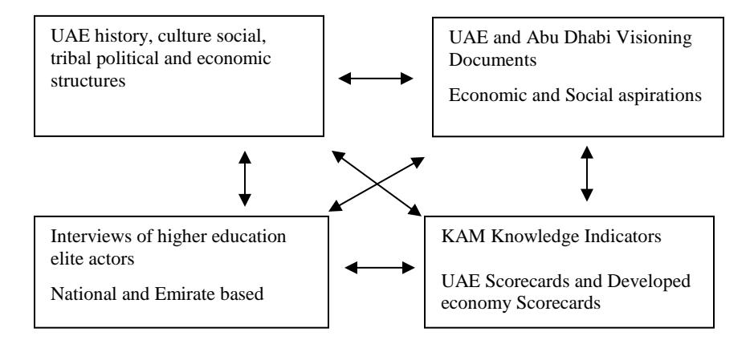
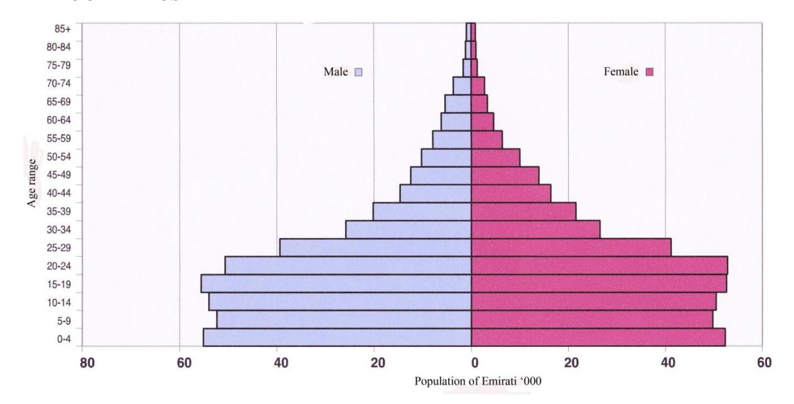
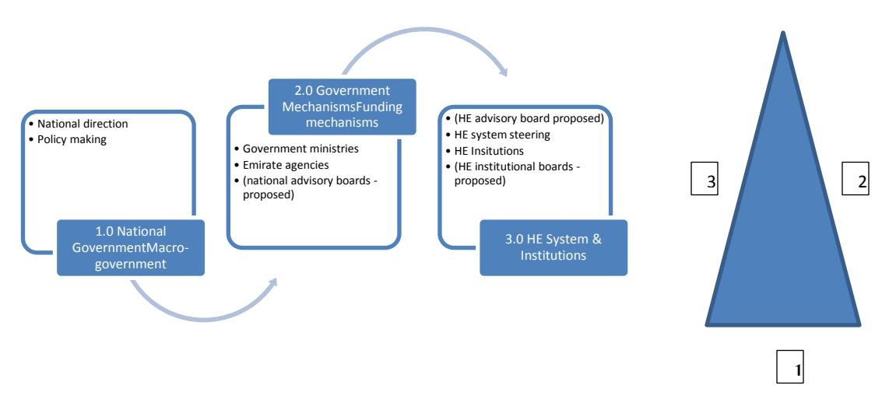
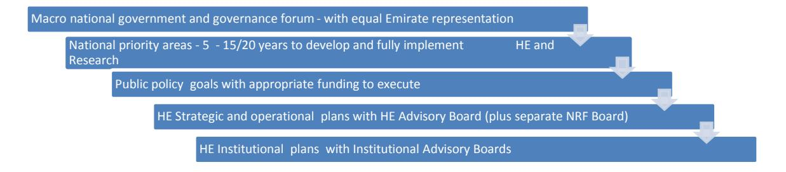
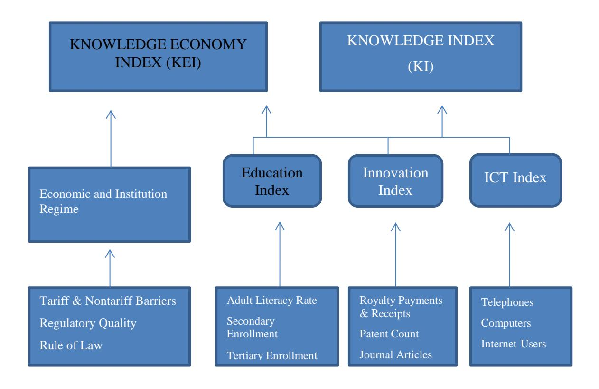
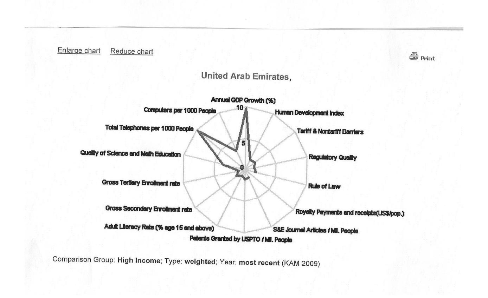
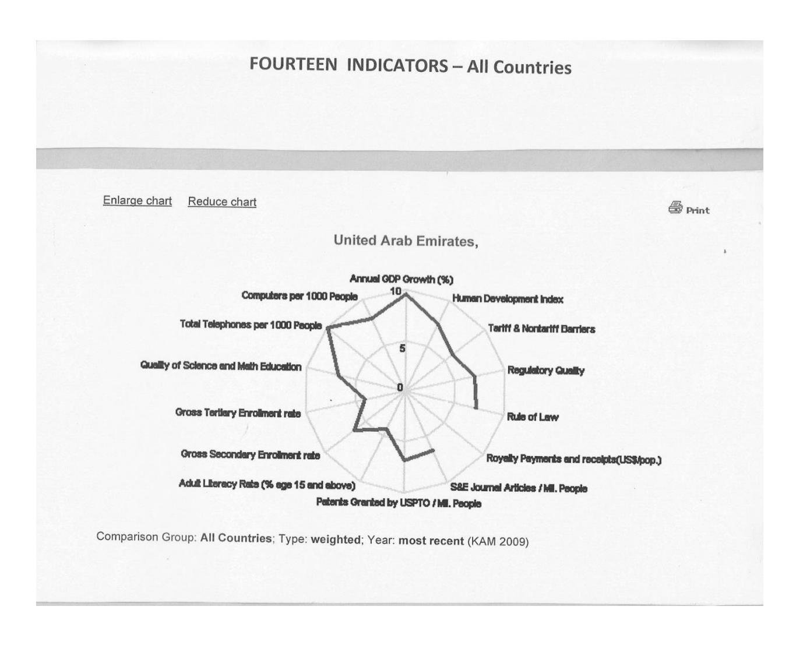

<!-- TH.R04 | source: papers_json/TH.R04/ -->

## **DOCTOR OF BUSINESS (DBA)**

**Higher education in the United Arab Emirates : is it supporting the development of a** **knowledge economy?**

Mcglennon, Jennifer

Award date: 2015

Awarding institution: University of Bath

[Link to publication](https://researchportal.bath.ac.uk/en/studentTheses/df55452a-3aae-42e5-b145-11980c479b9a)

## **Alternative formats**

If you require this document in an alternative format, please contact: openaccess@bath.ac.uk

Copyright of this thesis rests with the author. Access is subject to the above licence, if given. If no licence is specified above, original content in this thesis is licensed under the terms of the Creative Commons Attribution-NonCommercial-NoDerivs 4.0 International (CC BY-NC-ND 4.0) Licence (https://creativecommons.org/licenses/by-nc-nd/4.0/). Any third-party copyright material present remains the property of its respective owner(s) and is licensed under its existing terms.

**Take down policy**

If you consider content within Bath's Research Portal to be in breach of UK law, please contact: openaccess@bath.ac.uk with the details. Your claim will be investigated and, where appropriate, the item will be removed from public view as soon as possible.

Download date: 11. Oct. 2025

<!-- page 2 -->

## **H****IGHER ****E****DUCATION IN THE ****U****NITED ****A****RAB ****E****MIRATES****:** **I****S IT ** **SUPPORTING THE DEVELOPMENT OF A KNOWLEDGE ** **ECONOMY****?**

JENNIFER ANNE MCGLENNON

A thesis submitted for the degree of Doctor of Business Administration (Higher Education Management)

University of Bath School of Management

January 2015

## **COPYRIGHT**

Attention is drawn to the fact that that copyright of this thesis rests with the author. A copy of this thesis has been supplied on condition that anyone who consults it is understood to recognize that its copyright rests with the author and that they must not copy it or use material from it except as permitted by law or with the consent of the author.

This thesis may be made available for consultation within the University Library and may be photocopied or lent to other libraries for the purposes of consultation with effect from July 2017.

Signed on behalf of the Faculty/ School of Management

<!-- page 3 -->

## TABLE OF CONTENTS

TABLEE OF CONTENTSiLIST OF FIGURESiiiACKNOOWLEDGEMENTSivDECLAARATION vABSTRRACT viLIST OF ABBREVIATIONS viiCHAPTTER 1: INTRODUCTION11.1Background to the study11.2Statement of the Problem 21.3Purpose and significance of the research 41.4Research Questions 51.5Structure of the Report 6CHAPTΓER 2: LITERATURE REVIEW82. 1Chapter overview8Part (One: UAE history, culture and the context of HE92.2UAE History, Political and Economic approaches92.3Economic and HE Aspirations 15Part 'Two: Scholarly and theoretical frameworks 232.4Literature – Higher Education: 232.5International Theoretical Frameworks 342.6Conclusion 39CHAPTTER 3: RESEARCH METHODS 413.1Introduction 413.2Research Approach 423.3Research Design 453.4Operationalizing the Study 503.5Data Analysis 573.6Chapter summary 65CHAPTΓER FOUR: FINDINGS 66Overvieew 664.1
reseaPreliminary Literature Analysis and Characteristics of the population relevant to arch question

<!-- page 4 -->

4.2Developing a Knowledge-based Economy and Society 684.3Higher Education's role to support economic and social development 724.4Alignment and integration of federal higher education institutions 754.5Research, Development and Innovation 884.6Governance 944.7Funding of UAE Higher Education 1014.8Unique Challenges in the UAE 104Chapter 5: DISCUSSION 1215.1 (Overview 1215.2Governance & UAE practices 1265.3UAE Higher Education 1335.4Research and Innovation Culture building in the UAE 1395.5Teaching and Learning outcomes in K-12 and connections to HE 1435.6Modernity through adoption of WB and WEF philosophy 148CHAP'TER 6 1516.1Overview 1516.2Significance of the findings 1526.3Contributions of the study 1526.4Recommendations 1536.5Limitations of the Study 1666.6Directions for Further Research 1666.7Conclusion 167BIBLIOGRAPHY 170APPENNDICES 183Appendix 1: KAM Knowledge Indexes 183Appendix 2: Knowledge Indicators 184Appendix 3: Coding categories – NVivo 185Appendix 4: Questionnaire 186Appendix 5.1: KAM Spidergram – Four Pillars: UAE against High Income Countries 189Appendix 5.2: KAM Spidergrams – Four Pillars: UAE against All Countries 190Appendix 5.3: KAM Spidergram – Fourteen Indicators: UAE against High Income CoAppendix 5.4: KAM Spidergram – Fourteen Indicators: UAE against All Countries 192

<!-- page 5 -->

## **LIST OF FIGURES**

Figure 1: Research fields and interrelated structures
6Figure 2: Regional map of United Arab Emirates
10Figure 3: Population pyramid for Emirati Nationals (2005)
13Figure 4: Triangulating national direction: policy making and policyimplementation
131Figure 5: Abu Dhabi ACTIVET pilot schools and pathways in UAE
147Figure 6: Governance and Public Policy Cascade
155

<!-- page 6 -->

## **ACKNOWLEDGEMENTS**

The journey for this research has been long and at times complicated, with many things learnt about myself and the world of enquiry and deliberation. I would like to acknowledge and thank my partner David who has been constant in his support, encouragement and insights during the course of this thesis research. My children Sam and Anna and partners Kate and Damien, have also been constant in their encouragement and enthusiasm towards my completion of this research. My sister Judith, although far away in Australia has always been 'on my shoulder', willing me forward and she represents the family encouragement that was always present in my life and pride in achievement of goals instilled by dedicated parents. Thank you Nancy and Ernest, although no longer able to witness completion of the thesis, I think you know I finally made it.

Professor Ian Jamieson has been direct and timely in his feedback and suggestions for further readings and the support provided to reach the submission stage cannot be underestimated. Former supervisors have taken new career roles, however I would like to acknowledge Dr Geoff Whitty, Dr Rajani Naidoo, Professor Jeroen Huisman and the faculty and staff of the DBA Higher Education program in the School of Management at the University of Bath. Dr Noelle Mole has provided feedback and suggestions more recently and I sincerely thank her for that. Friends from academia and others in different fields have been there through the journey of this research; they know who they are and are extended my thanks for constant encouragement and motivation.

The UAE has been my home for many years and I am grateful for being part of this youthful nation as it designs its future and meets new and complicated challenges. More than a century of development experience has been compressed into forty short years of modern history with significant outcomes. The balancing of tradition and modernity is a fine line and I trust that the UAE will continue to manage these complexities with wisdom.

<!-- page 7 -->

## **DECLARATION**

## **Extent to which material has been incorporated from a submission for another degree:**

This thesis is composed of my original work, and contains no material previously published or written by another person except where due reference has been made in the text.

The content of my thesis is the result of work I have carried out since the commencement of my research higher degree candidature. None of this work has been submitted to qualify for the award of any other degree or diploma in any university or other tertiary institution.

## **Extent to which the work has been carried out by people other than the author:**

In this thesis, no part of this work has been carried out by people other than the author.

<!-- page 8 -->

## **ABSTRACT**

The United Arab Emirates (UAE) as a small nation-state, and Abu Dhabi as its wealthiest Emirate, exists in a regional and international environment of rapid development and social change, economic diversification, political upheaval and instability. Federal government rhetoric identifies quality Higher Education (HE) as a key contributor to the production, dissemination and transfer of knowledge, a position reiterated in Abu Dhabi public documentation; therefore HE is seen as a source of competitive advantage in a globalized world.

This research sought to identify how HE for Emirati nationals is supporting the development of a knowledge-based economy as official public documentation envisions. The UAE has adopted policy and indicator borrowing from international agencies such as the World Bank (WB), providing the context for promotion of economic growth and development for the nation. The research considers the historical tribal, social and political context of the UAE that shapes efforts to introduce change and identifies systemic challenges for HE to effectively develop citizens to drive national growth and innovation through education.

This research used a mixed method approach involving statistical data from the World Bank (WB) Knowledge Assessment Methodology (KAM), federal and Emirate government publications and media reports to analyze approaches toward development federally and in the Emirate of Abu Dhabi. These sources were then triangulated through semi-structured interviews with high profile HE leaders and researchers working both at the nation level and within national institutions.

This research identified seven major findings, with evidence suggesting that *knowledge economy* and *knowledge society* terminology are not clearly differentiated or understood in UAE discourse. Additionally, the development platforms required for research and innovation activities that stimulate growth are not well understood and are impacted by counter-productive legislation. The short development time-frame of the UAE was identified as a challenge; however national HE quality is also impacted by poor K-12 education, ineffective HE system management practices and immature understanding of governance outside of the tribal context. This research provides insights into local implications for the adoption of international development benchmarks and may give cause to question processes used to identify national and Emirate priorities, the mechanisms available to realize national or Abu Dhabi HE goals and the challenges inherent within the UAE context.

<!-- page 9 -->

## **LIST OF ABBREVIATIONS**

ADEC Abu Dhabi Education Council

ADU Abu Dhabi University

AHDR Arab Human Development Report

ATIC Advanced Technology Investment Company

CAA Commission for Academic Accreditation

DED Department of Economic Development (Abu Dhabi)

EAA Executive Affairs Authority FNC Federal National Council GCC Gulf Cooperation Council

GCR Global Competitiveness Report

GES Global Executive Survey

GESCI Global e-Schools and Communities Initiative

HE Higher Education

HCT Higher Colleges of Technology

IAT Institute for Advanced Technology

IMF International Monetary Fund

KAM Knowledge Assessment Methodology

KEI Knowledge Economy Indicators

KHDA Knowledge and Human Development Authority

KI Knowledge Indicator

KUSTAR Khalifa University for Science, Technology and Research

ME Middle East

MENA Middle East and North Africa

MOE Ministry of Education MOF Ministry of Finance

MOHESR Ministry of Higher Education and Scientific Research

MPA Ministry of Presidential Affairs NRF National Research Foundation

OECD Organization for Economic Cooperation and Development

PM Prime Minister

STEM Science, technology, engineering and mathematics

TDC Technology Development Committee

UAE United Arab Emirates

<!-- page 10 -->

UAEU United Arab Emirates University

UNDP United Nations Development Programme

UNESCO United Nations Educational, Scientific and Cultural Organization

WB World Bank

WEF World Economic Forum

ZU Zayed University

<!-- page 11 -->

## **CHAPTER 1: INTRODUCTION**

- 1.1 Background to the study
- 1.2 Statement of the problem
- 1.3 Purpose and significance of the research
- 1.4 Research questions
- 1.5 Structure of the report

## **1.1** **Background to the study**

This study investigates the extent to which higher education is contributing to the creation of a knowledge-based economy and society in the UAE and the Emirate of Abu Dhabi, and in what ways this is accomplished. The broader question is how countries undergo economic development, what measures and benchmarks are used, and how higher education contributes within that framework.

Research into HE in the UAE was motivated through observation undertaken over more than ten years whereby significant funding was invested in HE for Emirati students however there was little evidence of improved outcomes. Confirmation that system level inputs were delivering expected results was not evident, albeit such expectations often being poorly defined and changeable. The author has a strong foundation from which to undertake this research through eight years of teaching at a national institution, ongoing HE involvement in a global institution, supplemented by a network of international and Emirati HE colleagues and acquaintances. Evidence gathered examines the inherent challenges for HE within the UAE.

The research draws on qualitative methodology using the 'critical realism' approach to investigate the aspirations of the UAE in regards to nation-state development where it has adopted the World Bank Knowledge Assessment Methodology (KAM) theory and its assumptions. Official documentary evidence is analyzed on the basis that WB KAM discourse is encouraged and is increasingly strongly featured in media at national and emirate level. The final step uses semi-structured interviews that are purposefully undertaken with identified HE change managers, enabling the researcher to triangulate data gathered to inform findings. UAE adoption of WB theory led to the use of 2009 UAE data represented in 'spidergram' format as a valuable interview prompt.

<!-- page 12 -->

Since federation in 1971, the UAE has undergone immense economic and social change, unsupported by colonial powers that benefited from early oil concessions but failed to build a stronger society. Within the context of development, this research explores the unique social, political, cultural and religious fabric of the UAE, where both national and international tensions are observed. Central to this study is the role of HE for Emirati nationals and its impact on building the platform for effective implementation of a knowledge-based economy. Alternative pathways are discussed and different performance outcomes considered with the goal of informing dialogue, policy making, governance and practice for the UAE higher education sector. There is sufficient evidence to confirm the UAE is unique in many ways and therefore interesting to analyze in greater depth.

Unlike many other developed and developing nations the UAE is wealthy, and deeply imbued with cultural and political practices not generally consistent with western philosophy and decision making. It is unlike donor recipients of the WB and International Monetary Fund (IMF) where a 'standard macroeconomic recipe' is applied [(Pessali, 2011, p. 5)](#page-187-0). The UAE is not reliant on international development funding to support its development philosophy, but nevertheless seeks verification of its actions in reference to the established framework of the World Economic Forum (WEF). In the absence of a more balanced framework, and whilst acknowledging the flaws in economic arguments that support these models, the UAE prioritizes its development based on the premises of WB indicators such as social strengthening, economic growth, improved education, business transparency and innovation.

In this study, actions towards development of the HE system to support a knowledge-based economy within the UAE and the Emirate of Abu Dhabi in particular are conceptualized, contrasted and filtered against internationally accepted WB success indicators. Identification of the distinctive context of the UAE enables a critical analysis of the application of these success indicators, and identifies factors that allow further analysis and interpretation regarding HE.

Findings from this study provide a unique understanding on the trajectory of knowledge-based development in the UAE, its relationship to HE and challenges for successful implementation. The alignment of national vision, strategy and implementation is explored, as is vertical integration in higher education, governance and system maturity.

## **1.2** **Statement of the Problem**

<!-- page 13 -->

This research provides insight into the UAE, a country experiencing rapid growth and development; from a nation of nomadic Bedu dwellers to those with sophisticated telecommunication platforms and connectivity, excellent infrastructure such as airports, roads and logistic parks, matched with high expectations of continued wealth generation and quality of life improvements. Yet key areas such as education, HE and health services lag seriously behind [(Robertson, 2008)](#page-188-0) This presents significant challenges for the UAE's aspirations to deliver high quality outcomes linked to the demands of fast paced, globalized world via a knowledge-based economy that requires sophisticated foundational systems, that historically mature over many years [(Heard-Bey, 2004;](#page-184-0)[ 2010)](#page-184-1).

This research analyzes country and Emirate aspirations, in addition to the internal capacity to deliver them, with consideration of unique social and political factors. The complex layering of history, culture and politics in the UAE provides an opportunity to investigate the challenges of developing excellence in HE from a relatively low base. The intersection between aspirations of nation-states, the measurements chosen for assessment of progress and ways in which unique constructs impact the likelihood of success, presents an opportunity to understand this gap in current research.

Contributions from international agencies and scholars in the HE field provide varied perspectives on building a knowledge-based economy; perspectives that collectively promote cadres of flexible, problem solving innovators, the production of high value goods and services and the targeting of applied educational outcomes (Carnoy,[ 1994;](#page-180-0)[ 2001)](#page-180-1). The topic of economic development and societal enhancement is complex and encompasses multidisciplinary fields, each of which are often considered in isolation. International research has largely focused on changes based on western philosophy, fine-tuned or adopted as a total model by more developed countries of the world such as the USA, UK, Canada, Australia and European Union countries [(Brown, Green, & Lauder, 2001;](#page-180-2)[ Marginson, 2006;](#page-186-0)[ Samoff, ](#page-188-1) [2003)](#page-188-1).

Debate in the development realm involves neo-liberal economic theory that identifies 'pillars' and 'indicators' that are considered as precursors to development and measured by the Knowledge Assessment Methodology (KAM) [(Chen & Dahlman, 2005;](#page-181-0)[ Robertson, 2008)](#page-188-0). Economic theorists argue that adoption of these principles, including aggressive action to improve annual KAM assessments, will progress nation-states from 'developing' to 'developed' entities, with higher education as the driver [(Chen ](#page-181-0) [& Dahlman, 2005)](#page-181-0).

<!-- page 14 -->

Contrasting arguments are proposed by development organizations such as the United Nations Development Programme (UNDP) and United Nations Educational, Scientific and Cultural Organization (UNESCO) that focus on societal engagement and change through broad access to secondary and higher education. Engagement requires consideration of culture, history and engagement of women in economic activity as means of improving the overall well-being of society. Over time, however, UNESCO has become regarded by much of the world, as less able to provide effective educational advisory services than the WB with international financial institutions increasingly promoting themselves as development advisory agents [(Samoff, 2003;](#page-188-1)[ UNDP, 2009)](#page-190-0). However, measures adopted by the[ World Bank (2008b)](#page-190-1) for example, may be inappropriate, misunderstood or badly implemented due to the singular context of the UAE.[ Pessali (2011)](#page-187-0) identifies that frames of thought are difficult to transpose effectively to different locations, and must rely on public policy makers with technical expertise for successful integration.

Many scholars are critical of neo-classical economic theory that underpins the assumptions of the WEF and WB frameworks [(Chang, 2010;](#page-181-1)[ Lin & Chang, 2009;](#page-186-1)[ Pessali, 2011)](#page-187-0). For example,[ Chang (2010)](#page-181-1) claims that free-market capitalism is an economic model promoted by developed countries when advising developing countries on growth possibilities, although when advice is tied to funding (a mechanism not used by developed countries to create growth), there is potential for conflict of interest. This uneven match between players with advice being tied to funding is ironic, as developed countries themselves did not use these mechanisms, suggesting a paradox or conflict in advice.

In contrast, countries currently in growth mode such as China and Singapore are not following such dictates, but argue that more attention should be paid to issues other than material self-interest as the prime motivation of economic theory, such as rewarding appropriate behaviours with social benefits [(Chang, 2010;](#page-181-1)[ Florida, 2004)](#page-183-0). Despite criticisms of neo-classical economic theory, it is most important to identify that the UAE has chosen to adopt WB and WEF benchmarks to measure its progress, with consistent and regular efforts to communicate competitive rankings against these frameworks [(Chen & ](#page-181-0) [Dahlman, 2005;](#page-181-0)[ Dean, 2011, October 24;](#page-182-0)[ World Economic Forum, 2014)](#page-191-0).

## **1.3** **Purpose and significance of the research**

The main objective of this research is to determine how the development, structure and alignment of HE support the UAE's aspirations for a knowledge-based economy. At a broader level this study analyses economic goals of the UAE and the relationship with and impact on HE. It investigates features that will

<!-- page 15 -->

deliver unexpected or poor outcomes if policy frameworks are not robust. The study uses the WB's KAM [(Chen & Dahlman, 2005)](#page-181-0) as the framework against which to make its evaluation.

There is little systematic documentation of the alignment of HE with national development aspirations using the KAM, and this study will therefore make a meaningful contribution. The UAE context provides a unique research opportunity for development of a knowledge-based economy that is based on HE taught predominantly in English (in a country where English is a second language), based on traditional rotelearning and within a hierarchical tribal culture with small numbers of experienced technocrats.

More broadly, this study contributes to research and debate on economic growth in a small nation-state and contextualizes the role of HE in this process. The debate is an important one for all developing countries: to enable investment decisions in higher education to be based on national goals that are aligned with social and political reality. Empirical research on the contribution of HE to a knowledgebased economy and enrichment of society is more common in western environments, but rarely undertaken in the Middle East [(Burden-Leahy, 2009;](#page-180-3)[ Torres & Schugurensky, 2002)](#page-189-0). This research therefore lays an important foundation for development strategies in non-western environments tasked with capacity-building for local populations with little history of system-based planning.

This research also contributes to discussion regarding the adoption and effectiveness of benchmarks proposed by external international agencies. Scholars have framed this as transplantation, however this may not be an appropriate method for design of public policies that require successful local impacts [(Pessali, 2011)](#page-187-0). The UAE provides an exceptional case, with room for analysis and interpretation of theoretical frameworks linked to debate in the HE realm, with the opportunity for further research in this area.

## **1.4** **Research Questions**

This study is guided by the principal research question: 'Higher Education in the United Arab Emirates: Is it supporting the development of a knowledge-based economy, with specific focus on the Emirate of Abu Dhabi'. Further sub-research questions are identified as:

a: What are the unique factors and experiences upon which the UAE has been built? Do they support or hinder the development of a knowledge based economy and society development through HE efforts – Federally and in the Emirate of Abu Dhabi?

<!-- page 16 -->

- b: What are the publically reported aspirations in the UAE and the Emirate of Abu Dhabi for development of HE through public discourse?
- c: What are scholars and practitioners identifying as issues for UAE HE practice, knowledge economy development & knowledge society behaviours?
- d: What are the theoretical frameworks for knowledge-based economic development?
- e: What is happening in the Arabian Sands? Why may there be a disconnect between aspiration, practice and outcomes at the nation-state and HE interface?

The following diagram identifies key bodies of literature that guided data collection for this research.

**Figure 1: Research fields and interrelated structures**

## **1.5** **Structure of the** **Report**

This thesis is structured in six chapters:

Chapter 1 provides an introduction to the study.

<!-- page 17 -->

Chapter 2 presents a review of the bodies of literature relevant to this study.

Chapter 3 describes the research methods utilized.

Chapter 4 presents the findings of this research.

Chapter 5 presents a discussion of key themes emerging from the study.

Chapter 6 presents the conclusions of the research and identifies implications and recommendations.

<!-- page 18 -->

## **CHAPTER 2:** **LITERATURE REVIEW **

## 2.1 Introduction

## **Literature Review Part One: **

UAE history, culture and the context of HE development

- 2.2 UAE history, culture and politics
- 2.3 Economic and HE aspirations 2.3.1 Introduction2.3.2 National Visions2.3.3 National HE2.3.4 Abu Dhabi Vision2.3.5 Abu Dhabi HE2.3.6 Postscript: National realm

## **Literature Review Part Two:**

Scholarly approaches

- 2.4 Higher Education literature 2.4.1 Globalization2.4.2 Nation state impact2.4.3 The UAE in comparison
- 2.5 Economic Development and International theoretical frameworks 2.5.1 World Bank & Knowledge Assessment Methodology2.5.2 United Nations Development Programme and UNESCO
- 2.6 Chapter Summary

## **2.** **1** **Chapter overview**

This Chapter addresses four discrete bodies of literature related to the UAE and separates these into two parts: the history and context of the UAE and its economic and HE development as Part One; and a literature review of HE and economic development as Part Two. The cultural and historical parameters of the UAE are established to identify the unique contextual advantages and constraints for HE. It is important to contextualize the UAE before a review of literature describing UAE aspirations, HE

<!-- page 19 -->

development and contemporary HE theory. The first literature field identifies the unique historical, social, religious, economic and political parameters of the United Arab Emirates, a complex country that is argued:

*'May be called a 'developing country'; it is a 'third world' country, an 'Arab' country, an 'oil**producing' country and it is a Muslim state. The characteristics of each category are features of * *the UAE but there are no more similarities between the UAE and other countries in these * *categories than there are vital differences, making the UAE a special case within most of these * *categories'* [(Heard-Bey, 2004, p. 3)](#page-184-0).

The field addresses Trucial States history, traditions of Sheikhs as tribal rulers and contemporary power and politics within the UAE. The chapter moves to review articulated visions within the public realm through official reports, documents and newspaper articles that identify strategic objectives in leveraging HE for the national population.

The third body of literature reviews scholarly research and discourse in HE regarding international trends linked to development planning. Literature regarding economic development and theoretical frameworks of World Bank (WB) and World Economic Forum (WEF) models for development are then considered as the fourth area.

**Part One: UAE history, culture and the context of HE**

## **2.2** **UAE History, Political and Economic approaches**

The UAE Federation comprises seven Emirates, similar to states in many countries; Abu Dhabi, Dubai, Sharjah, Ajman, Umm Al Quwain, Ras Al Khaimah, and Fujairah, each having a ruler (Sheikh) who action issues of tribal importance within a geographical area (Fig. 2). A welfare regime is practiced [(Davidson, 2005,](#page-182-1)[ 2009,](#page-182-2)[ 2010)](#page-182-3), and reflects a rentier society based on windfall income from oil extraction. Heard-Bey claims that social difference is derived from the tribal structure, juxtaposed against western development, with subtleties of tribal hierarchies and historical power brokering requiring appreciation [(Heard-Bey, 2004)](#page-184-0). Exclusive commercial agencies for vehicles, real estate development and gifting of land are benefits still in the hands of ruling tribes, favours reliant on the relationship between the individual and the respective Sheikh [(Heard-Bey, 2004;](#page-184-0)[ Heard-Bey, 2010)](#page-184-1).

9

<!-- page 20 -->

The United Arab Emirates, formerly the Trucial States and a British protectorate, uses Arabic as the official language although English is the language of business. The official religion of the UAE is Islam, and nearly all citizens are recorded as Muslim [(Central Intelligence Agency US, 2011)](#page-180-4). Citizens called Emiratis or 'nationals', regional Arab nationals and international expatriates comprise the residential population of the country estimated at eight million [(National Bureau of Statistics, 2010)](#page-187-1). A strong nation-defining feature of the UAE is the promoted practice of a tolerant and moderate Islam, including tolerance for many other faiths [(Bristol-Rhys, 2010;](#page-180-5)[ Dahl, 2010;](#page-182-4)[ Farquharson, 1989;](#page-183-1)[ Mynard, 2003;](#page-187-2) [Richardson, 2004)](#page-188-2).

In 1966 with British support, Sheikh Zayed bin Sultan Al Nayhan of Abu Dhabi overthrew his older brother Sheikh Shakbout as UAE ruler, resulting in more open-minded approaches with money flowing to residents from the ruler's oil based revenues [(Heard-Bey, 2004)](#page-184-0). In 1971, Sheikh Zayed brought the seven Emirates to Federation, although the Emirate of Ras Al Khaimah took a last minute decision to withdraw from signing the agreement [(Davidson, 2005;](#page-182-1)[ Heard-Bey, 2004;](#page-184-0)[ 2010)](#page-184-1) . Sheikh Zayed strove to leverage the negotiating position with international companies for oil rights in the Emirates. His over-riding aim was to strengthen the position of all tribal peoples in the newly formed UAE, regardless of tribal allegiance and to improve collective opportunities and the quality of life. The federal government, funded by Abu Dhabi's wealth, took responsibility for provision of nation-wide services such as education,

<!-- page 21 -->

health and infrastructure. Abu Dhabi now funds its own Emirate development needs, but also contributes 80% of the national budget from its oil wealth.

During 1970-1980, increasing oil and gas discoveries enabled the UAE to enter a globalizing world with vigor, optimism and wealth, resulting in forty years of stable rule by Abu Dhabi Sheikhs (Sheikh Zayed bin Sultan 1971-2004, Sheikh Khalifa bin Zayed 2004-2014). Within a globalizing economic landscape, the complex and multi-layered historical connection to tribal allegiance continues to play a critical role in shaping contemporary politics, investment strategy and individual Emirate initiatives, therefore providing relevance to this study.

Tribal patronage rewards loyalty to ruling families and is described as 'wasta': influence through a tribal name or connection. Patronage takes many forms: commercial one-agency trade agreements, high level appointments to government and invitations to the 'majlis'; a meeting forum sponsored by ruling Sheikhs, tribal elders and important families where social, political and economic issues are discussed [(Davidson, ](#page-182-1) [2005,](#page-182-1)[ 2010)](#page-182-3). The majlis are held in formal palaces bringing those invited prestigious social and political engagement at the highest level. The strategic and operational importance of the ruling Sheikh's majlis is significant, with 'decrees' and laws decided in this sphere. Current and potential challenges are debated in the majlis, a space very difficult to enter by non-nationals and non-Arabic speakers, yet critical for insights into development decisions [(Davidson, 2005,](#page-182-1)[ 2009)](#page-182-2). As the country strives to compete in a globalized world, policy making mechanisms across a range of ruling majlis settings, often deliver conflicting outcomes to the UAE through complicated governance at many levels [(Echague, 2006)](#page-182-5).

The complex relationship between the west and the UAE is contextualized by British rule that formally concluded in 1971, during which time little had been done for the people of the UAE. Virtually no investment was made in infrastructure, education or local society during these years, only extraction of resources [(Davidson, 2010)](#page-182-3). Colonial expansion was identified as *'benign neglect'* with little management of internal affairs [(Davidson, 2010;](#page-182-3)[ Ramesh, 2013)](#page-188-3). Under British rule a serious educational gap formed between the UAE and regional nations due to paltry investment in domestic development [(Davidson, ](#page-182-1) [2005)](#page-182-1). Politically this allowed opportunistic regional nations to introduce Arab politics and activism to the country, particularly in the trading city of Dubai. British interests cultivated distrust between Emirati Sheikhs to further competitive bargaining opportunities, with internal relationships impacting contemporary decision-making. Britain is one of many countries aggressively trying to re-build relationships to access opportunities and markets at federal and Abu Dhabi levels.

<!-- page 22 -->

In earlier nomadic times, when things became more difficult socially, politically or economically, 'issues are dealt with in the first instance within the family and the tribal structure' [(Heard-Bey, 2004, p. 124)](#page-184-0). The Arab Spring and regional geopolitical discord has seen a shift towards localized concerns being preeminent in public discourse. It is acknowledged that significant political positioning is being undertaken in regards to militant Sunni Muslims posing increasing threats to sovereignty regionally.

'Being swept into a whirl of strategic, political, economic, social and cultural change which might … amount to complete reorientation' appears to be UAE's reality [(Heard-Bey, 2004;](#page-184-0)[ Heard-Bey, 2010, p. ](#page-184-1) [Epilogue xxviii)](#page-184-1). Globalization and internationalization are pressuring the UAE to determine its strategy for HE and economic growth. The focus on western economic models and assessment tools appears disconnected to historical obligations to nurture citizens both socially and financially, resulting in a difficult dichotomy.

Historically, knowledge generation has focused on harnessing economic potential and stimulating growth. However concepts such as 'societal good' from knowledge generation, a 'socially just foundation' with 'more prudent use of natural resources' have entered discourse of some development agencies [(UNDP, ](#page-190-2) [2011)](#page-190-2). Economic growth alone does not improve social cohesion and tolerance for other societies, religions and beliefs and may result in societal divides [(UNDP, 2009)](#page-190-0). This reveals the competing priorities of globalization and economic diversity, juxtaposed with historically sponsored social contracts and obligations between tribal leaders and their peoples. UAE rentier wealth is defined as the ownership of natural resources rented to external clients to derive income, particularly from carbon natural resources [(Echague, 2006)](#page-182-5). This wealth is starkly contrasted with countries that develop through increased productivity and technological innovations in industrialized societies, such as Singapore and South Korea [(Kane, 2013, November 16)](#page-185-0).

The UAE is a member of the Gulf Cooperation Council (GCC) formed in 1981 to protect common security and development interests comprises Oman, Bahrain, Qatar, Saudi Arabia, Kuwait and Yemen. The UAE is part of the Arab World and Middle East North Africa (MENA), yet different in many ways, a people who have adapted quickly to economic and social change. Challenges for Arab countries in building a knowledge-based economy and society, cite the need for citizen empowerment, freedom, transparency in governance, strong HE systems and initiatives to meet the aspirations of Arab youth [(Wilkens, 2011;](#page-190-3)[ World Bank, 2008b)](#page-190-1). This provides challenges for the UAE, although action is more urgently required for poorer countries in the region as 63% of the population in the Arab world is under 30 years of age [(National Bureau of Statistics, 2009;](#page-187-3)[ United States Census Bureau, 2010)](#page-190-4). The UAE

<!-- page 23 -->

population is statistically very young with over 73% under 30 years of age (Fig. 3) [(National Bureau of ](#page-187-1) [Statistics, 2010)](#page-187-1) with 78% living in urban areas [(Central Intelligence Agency US, 2011)](#page-180-4), whereas all were Bedu, a largely nomadic people, only 40 years ago.

The Emirati or 'national' population stands at approximately 1,200,000, 14.2% according to the latest census figures, in a rapidly increasing total residential population, of 8,500,000. Tribal allegiances are strong and recognized by dominant tribal names aligned with geographical regions or Emirates, such as Al Nahyan in Abu Dhabi, Al Maktoum in Dubai, Al Qasimi in Sharjah, Al Mu'alla in Umm Al Quwain, Al Qassimi in Ras Al Khaimah, Al Sharqi in Fujairah and Al Nuaimi in Ajman.

## DEMOGRAPHICS

**Figure 3: Population pyramid for Emirati Nationals (2005)**

Source: [(National Bureau of Statistics, 2010)](#page-187-1)

Imported labour has always fueled growth in the UAE as Emiratis constitute an estimated 12-14% of the residential population, bringing a distinctive edge to actions taken across the country [(National Bureau of ](#page-187-3) [Statistics, 2009,](#page-187-3)[ 2010)](#page-187-1). The UAE is increasingly reliant on expatriate labor for its development and growth path, further reducing the percentage of the indigenous population. The government is highly sensitive to immigration movements into the country, arguing that this further erodes language, heritage

<!-- page 24 -->

and culture, with increased political risk from regional inward migration. Higher education is indicative of this dilemma currently requiring 90% expatriates to teach in the sector.

The conundrum of globalization and development, versus the power of the nation-state to determine direction is revealed through government and governance, power sharing and decision-making that have different underpinnings compared to those of democratically elected nations. This is further complicated by tribal bonds, diverse Emirate aspirations, strategies and access to funding in the UAE. Sheikhs are contextually important, with relationships determining funding on the one hand, and life-long obligation on the other [(Davidson, 2005;](#page-182-1)[ Echague, 2006;](#page-182-5)[ Heard-Bey, 2004;](#page-184-0)[ Maitra & Al-Hajji, 2001)](#page-186-2).

Low proportional Emirati numbers are of national concern and a challenge to development progress. Many Emiratis cannot find employment that is societally approved yet Emirati obligations to actively engage in the growth and development of their nation are increasingly debated. As the local population ratio continues to reduce, the nationalist view emphasizes Arabic language, UAE heritage and Emiritization of many roles in the public and private sectors [(Friedman, 2011, March 22)](#page-183-2). Western economic models and developmental measures have been adopted by the UAE, yet growth relies almost exclusively on expatriate workers who make the UAE home [(National Bureau of Statistics, 2010;](#page-187-1) [Schwab, 2011)](#page-188-4). This relationship can be framed in multiple ways: from expatriates taking over the country, to threats to Emirati heritage and culture, to cross cultural understanding and a valued contribution to the aspirations of the UAE, dependent on political and social pressures of the day.

The development model sees a dearth of Emiratis in the private sector where growth is fostered with this difficult reality superimposed over the 'social contract' between Sheikh patronage and tribal members [(Al Khan, 2013, December 3)](#page-179-0). Development has delivered high GDP to date, high average incomes and multiple benefits for most, but not all national citizens, however current labour market mechanisms impact the perception of HE to contribute to growth within the country [(Wilkens, 2011)](#page-190-3).

The Arab Spring highlighted resentment for ruling, non-elected elites, yet UAE governance models reflect the contract between non-elected tribal rulers and their citizens, framed within a strong authoritarian hierarchy. Some argue the social contract between Sheikhs and their constituents has been in decline since the 1980's, whereas Davidson [(Davidson, 2005)](#page-182-1) argues the 'Sheikh's dilemma' has been avoided through clever balance of considerations: actions whereby rulers evaluate potentially conflicting issues, such as protection of financial well-being for Emiratis versus the economic impact of faster development that jeopardizes Emirati employment. The social contract is stronger despite regional

<!-- page 25 -->

disruption, as UAE Sheikhs strike a nationalistic and benevolent pose, a position this study acknowledges. In more stable times, change may be implemented more quickly [(Davidson, 2009)](#page-182-2).

This study now turns to literature that describes the vision of the UAE and Abu Dhabi, a context that demands international standards of business and quality HE as a key platform for economic and social development.

## **2.3** **Economic and HE Aspirations**

### 2.3.1 Introduction

This section identifies publicly described aspirations for economic and social development in National and Abu Dhabi strategic documents. Similarities and differences exist, however the funding required from Abu Dhabi to support national development, in addition to its own direction, poses questions of interest. The review begins with a background analysis of National Vision documentation and National HE goals. It is followed by analysis of the Abu Dhabi Economic Plan 2030 and literature regarding HE direction in the Emirate.

The Arab World has a dearth of HE research [(Chen & Dahlman, 2005;](#page-181-0)[ Echague, 2006)](#page-182-5). A paucity of policy and planning documents are available in the public realm making macro-steering decisions and their intent difficult to qualify and quantify. Data is difficult to obtain from immature government statistical agencies however this has improved through the establishment of the Federal Demographic Council (funded by Abu Dhabi) and the Statistics Centre of Abu Dhabi (SCAD), in 2009. These supplement Federal government data from the Department of Statistics.

### 2.3.2 National Visions

UAE developmental strategies are described as 'national', however this addresses the Emirati population; the 'nationals' or citizens, not the inclusive geographic-based total population that includes non-Emirati residents. This narrow dimension of 'national' is rarely made explicit, and reveals part of the nation-state strategy that is overlooked: expatriate economic and social contributions to UAE goals.

The UAE Vision 2021 was launched in January 2010 by HH Sheikh Mohammad bin Rashid Al Maktoum, UAE Prime Minister, Vice President and Ruler of Dubai. It identifies aspirations for development of nationals and strengthening of education systems to support broad development goals. The document is highly aspirational and directed at UAE Emiratis in its 'national' rhetoric. Emiratis

<!-- page 26 -->

should '*make a valuable contribution to their nation's growth by building their knowledge and applying * *their talent with* *innovation and drive'* in addition to becoming '*captains of industry and dynamic * *entrepreneurs, marshaling the* *country's resources to bring innovative products to the marketplace' * [(UAE Government, 2010)](#page-189-1). A business friendly environment, with clear legal frameworks and regulations will attract investment, with public-private partnerships in all sectors. The intent is clearly one of economic growth with home-grown talent (Emiratis) nurtured to take leadership roles in the public and private sectors to stimulate diversification for the country's future. The desire to diversify the economy is clearly stated with a willingness to move beyond traditional economic models and to stimulate entrepreneurship and international investment, including an aspiration for productivity and competitiveness to: *'rival the best in the world as a result of investment in science, technology, research * *and development throughout the fabric of the UAE economy' *[(UAE Government, 2010, p. 18)](#page-189-1).

The UAE Vision focuses on generic aims of building wealth, prosperity and social growth for Emiratis. Released in 2014, 'Highlights of the UAE Government Strategy 2011-2013', reviews performance against the Vision and introduces specific language about a Competitive Knowledge Economy: '*Developing and integrating labour market planning'; 'increasing participation of Emiratis'; 'developing * *vocational training'; *and *'enforcing Emiritization programs'* are highlighted [(Prime Minister, 2014)](#page-188-5). '*Support SME* *development*'; '*diversification of trading partners'*; '*high value-add'* industrial sectors and '*Emiratis *(…) *aligned with national priorities'* add specificity to the UAE direction [(Prime Minister, ](#page-188-5) [2014, p. 13)](#page-188-5). The oil 'crunch' described by some respondents may provide a socio-political overhaul of Emirati expectations for a changed future. UAE media discourse identifies the importance of nonreliance on oil as headlines illustrate; *'Thanks to an aggressive diversification strategy envisioned by the * *leadership, oil that constituted 70% of the UAE's economy in 1971, currently accounts for just 29% of * *GDP'* [(John, 2012, November 26)](#page-185-1).

Recent national reviews identify shifts in direction, with focus on the improvement of UAE economic performance through diversification now given attention [(UAE Government, 2011)](#page-189-2). International agencies use economic language to recommend alignment and coordination of strategy with more recent federal documentation echoing this position [(World Bank, 1994,](#page-190-5)[ 2008b)](#page-190-1). The generation of economic growth relies on private sector contribution, however less than 2% of working Emiratis are employed in this sector, whereas the UAE's expatriate labour imbalance is concurrently framed as a threat to Emirati work opportunities.

<!-- page 27 -->

The Vision 2021 document identifies a knowledge-based and highly productive economy, '*driven by * *knowledge and* *innovation*' with '*investment in science, technology, research and development*' [(UAE ](#page-189-2) [Government, 2011, p. 18)](#page-189-2). The Highlight document targets a competitive knowledge economy articulating encouragement of *'science, technology, research and development*' *p.18* with '*high value-add * *industrial sectors', enhancing research and developing talent –* *especially Emiratis*' [(Government of ](#page-184-2) [Dubai, 2007, p. 13)](#page-184-2). This requires '*cooperation with the private sector, international institutions in * *innovation and applied research, exploring new channels of funding for research and building and * *disseminating a database of research conducted in the UAE' p. 13.*

Emirati social issues are rarely discussed in the public forum, however documents now cite development of a strong work ethic, motivation, meritocracy and parental engagement as ways to foster stronger outcomes for national youth [(UAE Government, 2014)](#page-189-3). Significant social change is required for the country to develop further, where citizens are able to stimulate economic growth through personal effort. This requires a change-strategy that will loosen historical expectations of benefits bestowed through the benevolent social contract. The UAE is challenged by the potential for a social outcome 'as experienced by low-income countries – that of exclusion, although the nature of exclusion may be significantly different' [(Burden-Leahy, 2009, p. 526;](#page-180-3)[ Hertog, 2010)](#page-184-3)

### 2.3.3 National Higher Education

As identified earlier, the Emirati population is statistically very young with over 73% under 30 years of age, however HE graduated only 9,400 Emiratis in 2009 [(National Bureau of Statistics, 2009,](#page-187-3)[ 2010)](#page-187-1). A million people dispersed across seven Emirates are small numbers for HE to reach. Goals in education are predominantly directed to the wellbeing of nationals: Emirati nationals. The national strategy is not an inclusive position, but targets a segment comprising less than 12-14% of the residential population approximately 1,200,000 people in a total of 8.5 million.

The UAE national HE system comprises three main entities: seventeen Higher Colleges of Technology (HCTs) that operate in all Emirates with separate campuses for women and men: UAE University in Al Ain that is also segregated with residential accommodation for men and women; and Zayed University with large campuses in Dubai and Abu Dhabi, that also provide gender segregated tuition. There is a long term commitment to education for women and men, including travelling abroad for graduate level studies, although women are less represented overseas as religious and social norms impact independent travel.

<!-- page 28 -->

Nationals are guaranteed free federal HE if entry cut-off scores are met, assessed by the National Application Placement Test (NAPO). Lower scores result in vocational offers that, if refused, limit choices to private fee-paying options. Empirical evidence identifies more high school leavers are 'meeting the standard' of university entry yet require bridging programmes that are longer and targeted at lower levels than five years ago, in an environment of static funding. *ZU internal survey:* *Vice Provost 1, * *Urban Institution 1*. This paradox is increasingly problematic for national HE institutions, as high school teaching to improve test outcomes takes precedence over enquiry-based learning, an unintended outcome of UAE aspirations to be more competitive in international test areas such as Programme for International Student Assessment (PISA) and Trends in International Mathematics and Science Study (TIMMS) [(UAE ](#page-189-3) [Government, 2014)](#page-189-3).

UAE rulers publically state that Emiratis must contribute to the economic framework however this necessitates a clear strategy with which HE can be aligned. The Federal HE strategy aspires to '*ensure * *quality, further* *the role of higher education institutions, create harmony, meet requirements of the local * *community (Emiratis) and the national economy, graduate nationals (Emiratis) who can compete in the * *UAE job market, affiliate local universities with international universities and promote joint programs'* [(UAE Government, 2014, pp. 10, 12-13)](#page-189-4). Recent documentation addresses social direction: the benefits of studying hard through personal effort, strongly inferring change is required in the approach to parenting and engagement with children. To further this theme, documents promote relevant, quality education of nationals to '*ensure the* *reduction of student drop out …..* *instill learning and work values in them * *(Emirati students)* *and promoting a culture of self-education, work values and educational values' *[(UAE ](#page-189-1) [Government, 2010;](#page-189-1)[ 2011, p. 10)](#page-189-2), again pointing to social change required by citizens.

Higher education institutions are tasked with meeting the needs of a growing economy in which Emirati citizens should be able to take their place. A *'first-rate education system'* for nationals is critical to meet the challenges and goals of growth. Concurrently this would improve Emiritization of the workforce outlined in 'Highlights of the UAE Government Strategy 2011-2013' p. 10, [(UAE Government, 2010, ](#page-189-1) [Sections 3.1, 4.2;](#page-189-1)[ 2011, pp. 10, 12)](#page-189-2).

Federal intentions for HE have also identified the need to build '*an Emirati system'*, one that exhibits UAE social and cultural values in the educational space [(Government of Dubai, 2007)](#page-184-2). Overall direction for HE is for the UAE to; *'build and operate its own universities, separated* *by gender -* *qualified, mostly * *international faculty to be employed -* *instruction to be in English -* *education for all qualified Emiratis *

<!-- page 29 -->

*and would include women'* [(Editorial, 2014, January 5)](#page-183-3). This identifies Emirati control of national HE planning, management and teaching, rather than continuing to use international expertise to build a more robust system.

Concurrently HE is critically important to the growth of the nation is identified which may appear contradictory. Rhetoric is counterbalanced with economic diversification through improved Emirati contributions based on HE of excellence. Globalized discourse is evident in UAE press coverage ensuring residents understand international issues and regional challenges as they relate to economic development and per capita growth targets. A nationalist theme to forge '*solidarity as a nation of citizens'* [(UAE ](#page-189-1) [Government, 2010, Section 1.3, p. 6)](#page-189-1) appears in both federal and Emirate plans, in addition to stress *on * *'equal opportunities and equitable rewards'* [(Castells, 2000;](#page-180-6)[ Florida, 2004, p. xxvii;](#page-183-0)[ UAE Government, ](#page-189-2) [2011, pp. 10, 12.11)](#page-189-2).

Federal documentation identifies the intention to diversify sources of funding for public HE although no details are provided. The federal movement away from responsibility for fully-funded HE also reshapes expectations of continued free HE for Emiratis [(UAE Government, 2010, Sections 3.1, 4.2)](#page-189-1). The high priority for social change based on personal motivation, when viewed in conjunction with funding changes, forecasts a future based on self-reliance, rather than existing social entitlements.

This Chapter now turns to analysis of models introduced in Abu Dhabi that provide comparison and contrast with federal social, economic and HE approaches.

### 2.3.4 Abu Dhabi Vision

In comparison to the UAE Vision of 2010, Abu Dhabi's aspirations were released in the 'Abu Dhabi Economic Vision 2030' mandated by Sheikh Mohamed Bin Zayed Al Nahyan, Crown Prince of Abu Dhabi, Deputy Commander of the Armed Forces and Chairman of the Abu Dhabi Executive Council. Three Abu Dhabi departments collaboratively developed a long-term economic vision for the Emirate: General Secretariat of Executive Council, Abu Dhabi Council for Economic Development; Department of Planning & Economy. The group conducted *'an exhaustive assessment of the key enablers for economic * *growth'* with a *'long-term vision with explicit targets to guide the evolution of the Abu Dhabi economy * *through to 2030' *[(Abu Dhabi Government, 2008, Summary)](#page-179-1).

The document identifies the need for *'full employment among Nationals' *and development of a workforce with *'availability of a stable supply of high quality labour to staff the economy'* [(Abu Dhabi Government, ](#page-179-1)

<!-- page 30 -->

[2008, p. 75)](#page-179-1). The development of a highly skilled, highly productive workforce places clear emphasis on diversification sectors such as energy, finance, trade and manufacturing, stating that high unemployment among nationals is for the '*most part* *ascribed to a mismatch between education and the labour market * *demand' **[(Abu Dhabi Government, 2008)](#page-179-1)**p. 93*. Inviting renowned international universities to establish in Abu Dhabi is viewed as a way of contributing to a stronger education sector catering for local needs, attracting students from the region to '*eventually lead to a more vibrant research and development * *community, which will* *ultimately drive the knowledge economy the Emirate wants to establish' *[(Abu ](#page-179-1) [Dhabi Government, 2008, p. 93)](#page-179-1).

The Abu Dhabi Plan language is stronger and specifically economic driven, highlighting a knowledgebased economy as the desired outcome, using terminology and graphics employed in WB reports. The term 'national' is teased out in meaning, albeit not with total clarity at first reading. This is not a whole country strategy but for indigenous citizens, excluding the expatriate population that comprises nearly 90% of residents. Nationals will have the skills and qualifications to drive economic growth with education to meet identified industry growth *'sectors in engineering, aerospace, IT, medicine, applied * *sciences, tourism and business'. 'Training, productivity and a new* *paradigm in employment-focused * *education is the aim' *[(Abu Dhabi Government, 2008, p. 94)](#page-179-1)*.*

Abu Dhabi funds 80% of the federal budget for infrastructure, education and health, in addition to investments under its own auspices. Analysis to determine directional coherence or contrast required review of key documents: the Emirate of Abu Dhabi Economic Vision 2030; the ADEC Higher Education Strategic Plan 2010 and R&D Ecosystem 2010 and the Advanced Technology Investment Company Experience 2010. [(Abu Dhabi Government, 2008;](#page-179-1)[ Department of Economic Development and INSEAD ](#page-182-6) [Innovation and Policy Initiative, 2014)](#page-182-6). Abu Dhabi adopts a neo-liberal economic view through consistent messages of diversification with adoption of WB and WEF theoretical frameworks.

The 2030 knowledge-based economy conceptual platform was initiated by the Executive Affairs Authority (EAA), an organization that drives policy agendas outside of mainstream government department operations and is led by the Crown Prince, Sheikh Mohammed Bin Zayed Al Nayhan. The 2030 Plan emphasizes parallel developments of infrastructure such as healthcare, judicial operations and education with a focus on human capital development that is Emirati, a clear reference to nation-building [(Carnoy, 2001;](#page-180-1)[ Patel, 2001;](#page-187-4)[ Pillay, 2001)](#page-188-6). The Plan, released in 2008 and reviewed in 2012, focuses on four priority areas: '*economic development, social and human resources development, infrastructure * *development and* *environmental sustainability*, with over-arching reference to '*optimization of *

<!-- page 31 -->

*government operations'* [(Abu Dhabi Government, 2008)](#page-179-1). Within these priorities, sectors are identified that are '*expected to form the Emirate's engines of economic* *growth and diversification'* (pp. 11-12). To attract international firms, generous incentives are identified, supplemented by the strategy of direct purchase of international companies. This merges sector expertise into the Emirate, with examples being Strata focusing on aviation, and Global Foundries on semi-conductors.

Abu Dhabi has adopted western economic frameworks in discourse and has targeted areas identified by the WB as important to growth, namely: improved legal systems and Judicial Frameworks, IP Laws, International Company Law, Research Clusters, and Small to Medium Enterprises (SME's). Development specialists argue that sophisticated technology and communication infrastructure are required, a feature also highlighted in Abu Dhabi plans (Castells,[ 2004;](#page-180-7)[ Porter, Schwab, Sala-i-Martin, & Lopez-Claros, ](#page-188-7) [2005;](#page-188-7)[ Schwab, 2011)](#page-188-4). Abu Dhabi aims '*to achieve higher global rankings in terms of global * *competitiveness and ease of doing business' **[(Abu Dhabi Government, 2008)](#page-179-1)* pgs. 46-47), utilizing WB readiness indicators of relevance to this study [(Editorial, 2013, November 13)](#page-182-7). Government departments must demonstrate how their operations support these aims, resulting in discourse on competiveness and how HE can contribute to this goal. Plans directly reflect WB and WEF frameworks in both language and philosophy, suggesting Abu Dhabi is clear on its economic intent.

### 2.3.5 Abu Dhabi Higher Education

Abu Dhabi has national institutions represented within its borders: UAEU, ZU and multiple segregated HCT campuses in Abu Dhabi city, Al Ain and the Western region (Al Gharbia). Abu Dhabi literature describes an economic framework that features increased private sector responsibility for investment in national employee training [(Abu Dhabi Government, 2008)](#page-179-1). Technical education is highlighted, required to develop Emiratis with specific skill sets that support the economic agenda driven by private sector employment, '*to upgrade skills (…) and* *enhance productivity'* [(Abu Dhabi Government, 2008, p. 98)](#page-179-1).

Increased workplace participation of highly educated women in the total workforce will explicitly *'offer * *major dividends' *[(Abu Dhabi Government, 2008, p. 92)](#page-179-1). This represents a vision by Emirate rulers aligned with WEF 'knowledge pillars' that reflects a neo-liberal economic view. Abu Dhabi Education Council (ADEC) also aligns with this position through its website and media coverage, promoting the need for learning against outcomes, with theory practically utilized rather than memorization of content. Improved pedagogy is identified to drive the development of flexible problem solvers and learners, requiring enquiry-based systems and practices delivered across all learning institutions. ADEC will implement public-private partnerships at primary and secondary level to improve educational outcomes,

<!-- page 32 -->

will fund a new federal HCT, and own the new campus built for federal Zayed University. Abu Dhabi will provide *'encouragement of employers to invest in training'* for employees, *'without resorting to a * *new wave of* *immigration', *the implication being competing interests between nationals and expatriates *[(Abu Dhabi Government, 2008, p. 96)](#page-179-1)**.*

Increased prominence of the Institute for Advanced Technology (IAT) is relevant to this study and linked with Abu Dhabi initiatives. IAT originated in Abu Dhabi with a focus on high quality technical education in select male high schools. IAT now takes a more active role to change the culture of national secondary schooling in science, technology and maths in select male and female high schools, financially supported by the Crown Prince. Graduates from IAT schools are streamed into new programmes developed by Khalifa University for Science, Technology and Research (KUSTAR). KUSTAR is an independent, nonprofit Abu Dhabi government initiative created by purchase of Etisalat College (EC) in 2007. EC was the prime telecommunications training school in the UAE and most operations were then moved from Sharjah to Abu Dhabi. KUSTAR did not require accreditation from the federal Commission for Academic Accreditation (CAA) at this stage as Etisalat was already accredited. This development track, for new cadres of Emirati students to study and work in engineering and technology while gaining educational qualifications in Abu Dhabi, is foreshadowed in the 2030 Plan as '*developing its technical and * *vocational training base*' [(Abu Dhabi Government, 2008, p. 93)](#page-179-1).

Abu Dhabi has employed a different mechanism to build HE of international quality; seeking relationships with 'international brand' accredited institutions and also accredited technical learning groups such as Kaplan International Colleges. Different funding bodies and mechanisms have been established to attract The Paris Sorbonne Abu Dhabi funded by ADEC and MIT/Masdar funded by the Executive Council of Abu Dhabi (EC). NYU Abu Dhabi was established as part of the NYU Global Network University and is funded by the Executive Affairs Authority (EAA) to deliver a niche international strategy likened to the global school house strategy of Singapore. Singapore is a small but committed actor in the knowledge- based economy with an articulated *'overall strategy to become a * *recognized and respected hub' *with a strong research focus, with potential to be emulated by Abu Dhabi [(Knight, 2011b;](#page-185-2)[ Mokyr, 2003)](#page-187-5) p. 6. It is not publically stated if the Sorbonne and NYU Abu Dhabi are to address the needs of Emiratis in their operations, although some representation is evident.

### 2.3.6 Postscript: National realm

<!-- page 33 -->

The importance of HE for Emiratis within a contemporary society and nation has been consistently promoted by Sheikh Nayhan, the Minister of Higher Education and Scientific Research (MOHESR) for more than two decades, fully supported by the nation's ruler, HH Sheikh Zayed Al Nayhan. In 2010, the Minister advertised in national newspapers to focus conversation on the need for adequate funding for national HE and research initiatives. Reportedly, he was frustrated by inability to secure increased federal funds, however this action implied strong criticism of federal government and Abu Dhabi and particularly the prioritization of government revenues. In a society based on face saving, public honour and reputation, this was provocative.

It is now thought to be a strong contributing factor to his sudden replacement by the Minister's younger brother in mid-2013, albeit three years later, immediately after the significant reaccreditation visit of US Middle States for Zayed University. Experienced executive CAA Emirati staff have reportedly resigned and moved to the former Minister's new portfolio, raising concern regarding continued quality control being exerted via CAA. At the same time, Abu Dhabi Vocational Education and Technical Institute (ADVETI) also initiated by HE Sheikh Nayhan in collaboration with Presidential Affairs (PA), has continued to quietly grow to operate in other emirates, financially supported by the Crown Prince of Abu Dhabi [(Fox, 2007;](#page-183-4)[ Wilkins, 2010)](#page-190-6) .

This study now turns to scholarly reflections on the importance of education and HE to support broad economic and social aspirations and actions of the nation-state.

## **Part Two:** **Scholarly and theoretical frameworks**

## **2.4** **Literature –** **Higher Education: **

This literature segment analyzes the interaction between globalization, national decision-making and outcomes of HE. It outlines mechanisms to increase economic development through strategic leverage of HE and closes with a brief comparison with UAE approaches.

### 2.4.1 Globalization

Globalization is defined as '*the flow of technology, economy, knowledge, people values, (and) ideas …) * *across* *borders'*, [(Knight, 2004, p. 6)](#page-185-3). The global nature of trade and education has resulted in nationstates being part of a complex and changing international environment, with varied outcomes at national and regional levels [(Marginson, 2010b;](#page-186-3)[ Naidoo, 2007)](#page-187-6). Higher education efforts and research development can lead to nation-building through coherence and alignment of law, policy and governance;

<!-- page 34 -->

the expected outcomes being development of a scientific and cultural environment *'towards knowledge * *related products and services'* [(Lewis, Marginson, & Snyder, 2005;](#page-185-4)[ Naidoo, 2007, p. 2)](#page-187-6). It is proposed that nations engaged in globalization may export or import services including HE, to capitalize on the strategic nature of such activity, considered critical to the achievement of national goals including the goal of nation-building [(Knight, 2004, p. 19)](#page-185-3). Policy debate has focused international discourse on the role of HE, global public goods, digital literacy, knowledge workers and economic growth potential and interdependencies [(De Weert, 1999;](#page-182-8)[ Marginson, 2010a;](#page-186-4)[ World Bank, 2002)](#page-190-7).

Higher education is a globalized commodity and also has been 'commodified' as a source of trade, requiring consideration of cross-border policies for developed and developing economies [(Naidoo, 2007)](#page-187-6). The optimal approach is a negotiated and integrated position that involves multiple stakeholders at the national level, with meaningful discourse to shape and articulate nation-state interests and required actions [(Ball, 1998 published on-line June 2010;](#page-179-2)[ Huisman, 2009)](#page-184-4). However these practices have not been observed in the Arab region, whereby '*Arab countries (.)* *opened new branches and universities, but not * *in accordance with any comprehensive ordering of the actual needs of these countries' *[(UNDP, 2009, p.](#page-190-0) [114)](#page-190-0). Higher education is identified as an economic driver and a globalized public good, requiring nations to identify ways education can further societal development in addition to an economic agenda [(Marginson, 2010a)](#page-186-4).

Investment in HE brings not only economic benefits but through reinvestment in a range of social goods and services, an anticipated flow of benefits to societies in general as argued by development scholars. [(Carnoy, 2001;](#page-180-1)[ Castells, 2000;](#page-180-6)[ De Weert, 1999)](#page-182-8). The return to countries investing in social goods such as education, is deemed to create benefits such as societal enlightenment, racial tolerance and redistribution of resources, in addition to business efficiency and wealth acquisition, however social discourse is less prevalent in the literature [(Castells, 2004;](#page-180-7)[ De Weert, 1999)](#page-182-8).

Scholars argue that nations must significantly influence HE to ensure development of knowledge workers who are flexible and approach changing circumstances as educated problem solvers [(Carnoy, 2001)](#page-180-1). Learning methodologies must support development of proactive problem solving, as argued by development scholars (Naidoo,[ Marginson, 2010b;](#page-186-3)[ 2007)](#page-187-6). But the role of HE is interpreted differently in each national context, ranging from HE contributing to social-good or social transformation; to one closely associated with economic advantage and efficiency [(Brown et al., 2001;](#page-180-2)[ Torres & Schugurensky, ](#page-189-0) [2002)](#page-189-0) .

<!-- page 35 -->

### 2.4.2 Nation-state impact

Actions that shape HE and research efforts are filtered through '*national culture and polity*, *policies, * *laws and regulations'* with '*formidable obstacles'* in many developing countries [(Marginson, 2006, p. 3;](#page-186-0) [2008a)](#page-186-5). Higher education is acknowledged as 'essential for developing economies to escape a peripheral status' [(Naidoo, 2007, p. 3)](#page-187-6): hence nation-states can create multiple imaginings and practices for citizens. Sources of knowledge creation whereby a greater sense of community is created are less prevalent, but provide research opportunities to identify benefits to countries on the development path. Tolerance and broader understanding are considered outcomes of globalized interactions, however narratives in the UAE have recently become more divisive between nationals and foreigners: the latter it is argued, are seen to weaken local culture rather than strengthen it through understanding towards 'global citizenship' [(Rumbley, Altbach, & Reisberg, 2012;](#page-188-8)[ UAE Government, 2011, p. 15)](#page-189-2).

Most HE public sector models see government as the principal financier and the dominant player that determine the rules of the game as argued by many scholars [(Huisman, 2009;](#page-184-4)[ Marginson, 2010b;](#page-186-3)[ Mok & ](#page-186-6) [Lee, 2003)](#page-186-6). Nations are responsible for influencing both economic decision making and the structure of the HE sector. Marginson argues that nation-state decision making is complex and '*soaked in politics'* making *'higher education both valued and* *contested'* [(Marginson, 2010a, p. 423)](#page-186-4). Higher education strategy therefore must be considered against the political reality of the country concerned, the social and cultural influences on HE and economic measures that are market driven [(Vaira, 2004, p. 485)](#page-190-8). As an Arab country in a disrupted region, the UAE balances complex internal social and political dynamics with increasing regional unrest, seeking economic diversification against international benchmarks it has adopted and supported by incremental actions to foster self-reliance and economic capacity of its citizens [(UAE Government, 2011, Section 3.1, 3.2)](#page-189-2).

Outcomes can be local and tangible, more visionary and conceptual, addressing short or long term goals. Efforts can be collaborative and integrated, divergent, or individualized with '*considerable overlaps, * *contradictions and tensions between the various ways in which HE* *is employed'* [(Naidoo, 2007, p. 44)](#page-187-6). International development comparisons of HE, demonstrate variations in strategic decision-making and investment in educational infrastructure as seen by the efforts of China, Japan, India and Qatar. Quality HE can be achieved via many paths: employment of international faculty within a national university; imported to introduce standards and new pedagogy; or hybrid versions with international and local students working together to further social and economic ends, utilizing contemporary pedagogy for enquiry based learning [(Carney, 2009)](#page-180-8).

<!-- page 36 -->

Globalization contributes a layered framework to the UAE national HE system and its institutions. Critical to national aspirations, universities are seen as new development actors that foster interrelationships between HE and national strategy, as proposed by scholars in the field. [(Knight, 2004;](#page-185-3) [Torres & Schugurensky, 2002;](#page-189-0)[ Vaira, 2004)](#page-190-8). It is argued that strong, quality institutions that operate within an articulated strategy, practice sound management and exhibit good governance are required for nation-state reforms, with an eye to educational excellence rather than neo-liberal efficiency measures.

Governance refers to institutional effectiveness, representation and exercise of administrative or management authority at the micro level; whereas macro-level governance addresses national decisionmaking made within sustainable, cohesive frameworks and structures to effectively develop and implement policy. Policy-making occurs across levels of government; for HE and other areas of national or state interests, that is driven by national strategy and direction. UNESCO and the World Bank have undertaken benchmarking exercises across international tertiary systems to identify factors that contribute greater success nationally and institutionally, with studies pointing to importance of a sound governance system. This model involves citizens who lobby politicians and policy-makers to introduce reforms with national and regional tertiary systems aligned with nation-state goals, yet open to influence through citizen, parental and student pressure and dialogue.

The HE system requires integrity, a regulatory framework supported by suitable funding modalities to enable multiple institutions, through oversight of a Ministry, to meet the outcomes required. Within institutions, human resource practices are transparent and overseen by an experienced Board, providing confidence that institutional leadership selection targets experts who accept authority and responsibility to achieve clearly stated outcomes and objectives. Policy-making affects delivery to citizens and incorporates laws and decrees known as explicit rules, and implicit rules that support cultural norms and values. Development literature on governance identifies *'characteristics of good governance, including * *the rule of law, transparency, accountability, efficiency and effectiveness, participation and * *responsiveness (..) characteristics (.)easily applied to assess a country's quality of* *governance in * *education' *[(Crouch & Winkler, 2009, p. 3)](#page-181-2). This is supported by WB and UNESCO research that identifies national and institutional alignment is essential with alternatives being: *'"bottom-up" type of * *system, where government policy follows, rather than leads, a change process initiated at the * *departmental, faculty or institutional level; at the other end of the continuum is the "top-down" type of * *system where institutions merely respond to government-inspired policy initiatives which are enforced by * *the power of the state *[(Meek, Teichler, & Kearney, 2009, p. 41)](#page-186-7)*. *The WB adopts a business-like ideology,

<!-- page 37 -->

with processes that are transparent, repeatable, not impacted by conflict of interest and undertaken by experts in given fields.

Independent scholars suggest that effective outcomes must be driven by a cohesive convergence of interests; Samoff identifies that '*deeper structural relationships and pressures operate through and are * *thus visible in institutional arrangements' *[(Samoff, 2003, p. 6)](#page-188-1),* *however agencies such as the WB seek to *'institutionalize international influence' *in both structures and initiatives' [(Samoff, 2003, p. 12)](#page-188-1)*. * Marginson identifies that *'national competition ..* *is powered by an elite'* [(Marginson, 2006, p. 20)](#page-186-0), a position supported by Davidson's UAE research, who stresses that crucial understanding requires *'recognition of domestic elite interest groups and their differing development priorities'* [(Davidson, 2005, ](#page-182-1) [p. 188)](#page-182-1). Scholarly discourse also suggests tension between internal country forces and external forces pressing for change: those from within nations from key citizen groups whether liberal or traditional, as distinct from those 'driven through outside forces' such as globalization and its impact on nation-state development and strategy [(Abu Dhabi Government, 2008;](#page-179-1)[ Robertson, 2008)](#page-188-0). Outside forces push for faster economic growth while highlighting the relationship between development, labour needs, infrastructure and technological platforms, possibly even class mobility and education. National initiatives are based on steering towards UAE goals, usually achieved through national government consensus; whereas implementation strategies require delivery from agencies, councils and institutions, with this paper now turning to address findings in these spaces.

Scholarly literature identifies that national strategic plans need sound implementation to develop K-12 and HE systems against country development goals, (Naidoo[, Marginson, 2010a;](#page-186-4)[ 2007;](#page-187-6)[ Pillay, 2001)](#page-188-6). Reports cite that Arab HE reform reflects the nature of the society it is embedded within; *'with the dual * *challenge of quantity and quality not able to be* *addressed through stopgap measures'* therefore requiring '*comprehensive reform of the higher education system'*, for skill enhancement and economic growth [(Wilkens, 2011)](#page-190-3). Such reform agendas require national strategic direction and strong governance aligned with the needs of national citizens, and the nation.

Congruent with WB and Abu Dhabi statements that link economic growth to a prepared workforce, the Brookings report identifies that HE in the Arab world continues to '*fall far short of the needs of students, * *employers and society at large'*, supporting its role as the engine of social and economic progress, particularly to '*address skills gap to fuel* *economic development' *[(Wilkens, 2011, p. 2)](#page-190-3). The relationship between government and private providers of education is highlighted with the observations that few countries '*can sustain expansion of state-funded higher education, particularly in countries which offer *

<!-- page 38 -->

*free tuition as a matter of policy' *with an explicit need for *'language, science, math and critical thinking * *skills (.) to study effectively at the tertiary level' *[(Wilkens, 2011, p. 3)](#page-190-3)*. *

The Brookings report identifies systemic factors such as public policy, governance, and accreditation as important success factors, with differentiation and specialization in HE required to distinguish the skills of the *'graduates and the needs of the labour market' *[(Wilkens, 2011, p. 4)](#page-190-3)*.* It stipulates strengthening ties between broad national objectives, market forces, and the global economy through increased transparency, governance and accountability. The report concludes its recommendations by highlighting public policy process requirements, strategic management capacity that rewards quality, empowerment of institutional management, good governance and accountability. It recognizes that '*higher education * *cannot fully take its place as a resource for society until the* *governance of the country is not intimately * *intertwined with the governance of the university'* [(Wilkens, 2011, p. 7)](#page-190-3)*.* This echoes the authoritarian nature of society; juxtaposed with professional expatriate managers and faculty being trusted to act in the interests of the nation and institution. Vocational education is critical to fill jobs in different sectors of the economy, with a perception make-over required so technical and vocational education is not seen as a poor alternative for students who don't fit other educational openings [(Wilkens, 2011, p. 10)](#page-190-3). An alternate view, whereby development through HE is influenced by local conditions is supported, rather than those proposed by *'international financial institutions increasingly characterized (.) as development * *advisory services'* [(Samoff, 2003, p. 11)](#page-188-1).

International funding institutions have *'effectively eclipsed technical assistance institutions like * *UNESCO'* formerly the most responsive to members, now *'regarded by much of the world as less able to * *provide effective educational advisory services than the WB' (p. 11)*. Structural adjustment and tools to measure it '*became both the description and the content of the imposition of (.) external control' *from the late 90's onwards*, *so even when direct funding is not required as with the UAE, development accords with neo-classical economic theory [(Leon Tikly, 2004, p. 10)](#page-189-5)

Scholarly debate identifies success factors for HE development namely; a cohesive national strategy that identifies goals and aligns efforts across education sectors, with specialization and delineation at HE levels. This view is supported by scholars who identify the '*dominant analytical framework for higher * *education scholars concentrates attention on governmental policies of the nation-state, and on national * *systems of higher education'* [(Marginson & Rhoades, 2002, p. 281)](#page-186-8). For national aspirations to become reality, conceptual consistency must be communicated, with engagement of all stakeholders. At the granular level of vertical institutional integration, clear differentiation is required between technical

<!-- page 39 -->

education for vocational roles, general education for broad intellectual development and research education to address complex questions or create new productive knowledge [(Ramesh, 2013, p. 5)](#page-188-3) Global scholars identify the importance of clear missions with specificity about how each institution and sector contributes to the national strategy. This provides clarity and alignment between the educational actors with differentiation between graduates, working roles and potential economic contribution.

#### 2.4.2.1 Public and International not-for-profit & for-profit

Higher education choices generally exist within a nation's borders, with different models to select from. Public, private, international for-profit and not-for-profit often deliver diverse results, creating environments in which private actors deliver unintended outcomes. This create negative impacts on national systems through decreased federal funding and support [(Knight, 2011b)](#page-185-2). Not-for-profit is defined as education operating to cover costs with reinvestment in infrastructure, range and quality of services provided. For-profit education is provided by private fee charging agencies that hire faculty and seek profit for an owning group: this being the UAE norm that requires a 51% share by an Emirati partner. Proliferation of 'for-profit' HE institutions, where weak regulation impacts quality is concerning for many scholars, but such growth is evident in the UAE [(Coherent and competitive, 2008 October;](#page-181-3)[ World Bank, ](#page-190-9) [2008a)](#page-190-9).

## **2.4.3** **International trends and agenda**

#### 2.4.3.1 Internationalizing HE

Higher education trends in sophisticated developing countries may be similar, however country agendas differ. China has strategically invested to raise the quality of a select number of national institutions. Concurrently recruitment of non-Chinese students is being embraced via reform measures addressing: structural policy change, curriculum review, faculty qualification improvement, increased funding and an open-door policy to foreign students, [(Ka-Ho, 2003a, pp. 207-208;](#page-185-5)[ Marginson, 2010a)](#page-186-4).

Higher education discourse suggests an aligned national strategy is essential to build a knowledge-based economy, indicative of actions implemented by China, Singapore and Qatar over the last five years [(Knight, 2011b;](#page-185-2)[ United Nations Development Programme, 2003)](#page-190-10). Strategic HE investment, with a focus on innovation, is said to encourage globalized thinking that may introduce productivity measures for the public and private sector.

<!-- page 40 -->

Singapore attracts a world-wide student body to study at select international universities through its Global Schoolhouse project founded in 2002, leveraging new intellectual talent in-country for three years post-graduation. It believes 'a global alumni body that has lived and worked in Singapore will be an important strategic asset for the future' [(Coherent and competitive, 2008 October)](#page-181-3). High calibre teaching professionals are drawn to the country, happy to reside in an educational eco-environment of international standing, that promotes 'lifelong learning' through a 'learning society' intent on fostering capabilities such as 'social competence, conflict resolution and handling of uncertainty' [(Mok & Lee, 2003, p. 20;](#page-186-6) [Singapore Economic Development Board & Ministry of Manpower, 2011, p. 14)](#page-189-4). Evaluation of globalization and cross-cultural approaches suggest benefits that are economic, societal and supportive of soft power diplomacy on the international stage [(Naidoo, 2011)](#page-187-7). Soft power is diplomatic in nature and based on shared understandings and experiences, enabling subtleties across cultures to be contextualized and positive impressions to be formed and acted upon. Within this space, it is considered that a strategic national development focus should relate to the creation of world-class universities [(Rune, 1980)](#page-188-9).

#### 2.4.3.2 Higher Education Hubs

Singapore is a small but committed actor in the knowledge-based economy with an articulated 'overall strategy to become a recognized and respected hub' with a strong research focus [(Knight, 2011b;](#page-185-2)[ Mokyr, ](#page-187-5) [2003, p.](#page-187-5) 6). Singapore demonstrates this by collaborating with institutions such as MIT and Zhejian University China, to collaborate within the Singapore University of Technology and Design. The aim is to forward research in key economic areas. Singapore's strategy of a global school-house and hub is conceptually significant, partially aligning with China's aim to establish elite HE. Investment funding to attract Chinese and international students to selective universities demonstrates flexibility of thought, with English language instruction demonstrating the long-term strategic intent of internationalism.

#### 2.4.3.3 Internationalizing: Regional practice

Regionally and in the UAE there is little separation between government oversight and institutional discretion, suggesting cultural expectations of ruling powers is a real factor in the region. The Kingdom of Saudi Arabia (KSA) acknowledged this relationship when establishing the King Abdullah University of Science and Technology (KAUST) in 2008, the aim to become a world-class research intensive institution. KAUST governance was deliberately structured to '*not experience the interference (of) a * *typical government-run university*' [(Choi, 2008, p. 18)](#page-181-4). Secured by an endowment greater than $US10 billion dollars, KAUST is a parallel KSA HE strategy. To support up-take of international education for

<!-- page 41 -->

Saudis, KSA sent 170,000 students to study abroad for educational qualifications in 2011. The aim was for students to develop a multinational perspective, return to KSA and utilize the combined experience in the national interests, at the estimated cost of US$5 billion [(Choi, 2008;](#page-181-4)[ Fox, 2010)](#page-183-5). The perception was that education was less robust in KSA so significant numbers were sent abroad. This contrasts with the Chinese strategy to draw expatriate students inbound to targeted intellectual experiences at key national institutions. Both demonstrate niche strategies and new policy responses to build high-quality institutions and educational experiences inside and outside the country [(Marginson, 2006)](#page-186-0). Typically highly competitive selection criteria are in place to recruit the brightest international students who contribute to intellectual competitiveness in scientific and technological fields, while also contributing to cultural transfer and understanding.

Qatar has targeted key schools from prestigious international universities to establish select, reputed departments aligned with Qatar needs; Weill Cornell Medical, Carnegie Mellon, Georgetown and University College London are examples of this strategy. To house HE, Academic City was established to educate nationals in areas of importance to this small, wealthy, yet developing country's approach [(Kerr, ](#page-185-6) [2013)](#page-185-6). Overlap is not evident in niche curriculum areas, however a recent decision that Arabic instruction become the norm is concerning to many, yet indicative of nationalistic decision-making [(Knight, 2011a,](#page-185-7) [2011b)](#page-185-2). In parallel, the Qatar Science and Technology Park was launched in 2009, attracting companies to 'conduct commercially oriented research and development' in collaboration with international academic institutions [(Knight, 2011b, p. 11)](#page-185-2). Qatari national participation needs 'a further shift in cultural perceptions and better secondary education' [(Kerr, 2013)](#page-185-6) with Qataris comprising 278,000 within a 1.8 million residential population in 2012. The HE strategy has been driven by Sheikha Moaza, second wife of the recently retired Emir. His incumbent son has made different economic and political choices; with some concerned the HE infrastructure so carefully created may suffer. Recent socio-political and religious decisions provide reflection on regional tensions, creating some concern when viewed from an open, international perspective.

#### 2.4.3.4 UAE in comparison

Scholarly literature identifies expectations of HE's contribution to nation-state development, however UAE analysis raises contradictions 'and conundrums' with a welfare state experience that impacts individual aspirations and achievements [(Burden-Leahy, 2009, p. 525)](#page-180-3). The UAE is forty three years young and considered a developing nation, although ranked in 37th position of the Global Economic Index [(Porter et al., 2005)](#page-188-7). It is considered a 'high income' nation-state with significant investment

<!-- page 42 -->

capacity and potentially able to compete beyond its size and youth in building education, HE and research capacity.

UAE HE development is framed in terms of international quality and outcomes, however across the Emirate tension is created with contradictions between behaviours and rhetoric. Expatriates cannot attend national schools, resulting in significant and escalating investment in for-profit sector growth, particularly in Dubai. The UAE law prohibits not-for-profit agencies to operate in the education sector, possibly reflecting immature frameworks for organizations not directly government funded, or profit making. This is contextualized by international pressure that has been exerted on the UAE since 2001, to prevent nonprofit Islamic schools encouraging radicalization; a mechanism to reduce terrorist fears.

Analysis of UAE national priorities in this research provides insight into whether national systems are planned to coincide with national priorities, as proposed by scholars in the globalization field (Naidoo, 200[7Marginson, 2010b;](#page-186-3)[ 2007;](#page-187-6)[ Ramesh, 2013)](#page-188-3). The UAE constitution identifies federal government as responsible for creating good HE policy and governance, with the ability to adapt to changing demands of globalization. Federal government permits access to non-local universities, thus mediating the role globalized HE plays in shaping national outcomes. UAE decisions related to economic investment and operation of international HE entities are made by three major actors: Federal, Abu Dhabi and Dubai, addressing spheres of HE, financial investment and human labour movements. At times decisions are impeded by local regulations and practices with disparate responses to global economy demands [(UNDP, ](#page-190-0) [2009, p. 115)](#page-190-0). 'Highlights of the UAE Government Strategy 2011- 2013' identifies alignment as an issue for the first time with the aim to '*improve the quality of higher education (…) by defining and * *coordinating the roles of public universities' *[(UAE Government, 2011, p. 10)](#page-189-2).

Congruent with the WB and Abu Dhabi position, a Brookings report identifies that HE in the Arab world continues to '*fall far short of the needs of students, employers and society at large'*, identifying it is the engine of social and economic progress, to '*address skills gaps to fuel economic development' *[(Wilkens, ](#page-190-3) [2011, p. 2)](#page-190-3). The relationship between government and private providers of education is highlighted with the observation that few countries '*can sustain expansion of state-funded higher education, particularly * *in countries which offer free tuition as a matter of policy' *with foundational need for *'language, science, * *math and critical thinking skills (.) to study effectively at the tertiary level' *[(Wilkens, 2011, pp. 3, 7)](#page-190-3)*.* Secondary level educational practices that focus on '*traditional rote memorization methods'* creates students poorly prepared for HE learning, with '*quality, teaching, pedagogy*, *curriculum and faculty'* keys to the educational reform agenda [(Wilkens, 2011)](#page-190-3).

<!-- page 43 -->

In line with the Brookings report, discourse in UAE editorials, particularly the English language 'The National', part of the Abu Dhabi Media Company, promotes broad educational concerns to public audiences through headlines such as; *'Steps must be taken to reform education in the UAE'*; '*Education * *initiative essential for the UAE'* and '*Scientific research brings big benefits to the UAE' *[(Editorial, 2013, ](#page-182-9) [April 29,](#page-182-9)[ 2013, December 4,](#page-182-10)[ 2013, November 13,](#page-182-7)[ 2014, January 5)](#page-183-3).

Internationalized HE in the UAE has gained scholarly notice in a somewhat similar fashion to Singapore, China and Qatar [(Knight, 2004,](#page-185-3)[ 2011a)](#page-185-7). The *'Global dream …* *in Dubai because it's such a global city' * [(Al Khan, 2013, December 3)](#page-179-0) has been promoted widely, however scholars are divided on nation-state gains from the educational hub strategy of Dubai. In contrast to the 'school house' strategy of Singapore, Dubai's hub attempt is viewed by many as a real-estate venture for HE institutions, the primary goal to produce income. Dubai has gained recognition and credibility by bringing more than 37 international HE institutions into the UAE [(Fox, 2007)](#page-183-4). Davidson, however, adopts an opposing position, identifying some emirates (Dubai) as having been more calculating, seeking international attention through the building of recognized 'educational hubs', with little true investment or support from the relevant Emirate government [(Davidson, 2005)](#page-182-1). Many have been dismissive of educational aims in light of commercial gains sought for the Emirate [(Davidson, 2010;](#page-182-3)[ Heard-Bey, 2004;](#page-184-0)[ Heard-Bey, 2010)](#page-184-1).

Scholars note the national HE conversation excludes the for-profit sector, assumed to service expatriates only and therefore outside of current national foci. Increasingly Emiratis attend for-profit schools in larger numbers, despite not being well prepared on entry. The evolution of a more holistic nation-wide understanding of HE requires 'for profit' to be integrated into strategic country level discussion, however this discourse is not apparent [(Knight, 2011b)](#page-185-2)., Emiratis attending private universities are disadvantaged, with educational qualifications not recognized for promotion and salary increments in federal government ministries, highlighting absence of a national approach.

The chapter now turns to the body of literature regarding theoretical frameworks and assessment of knowledge-based economy development relevant to this study, namely the World Bank (WB) and the World Economic Forum (WEF). Activities recommended for growth provide a blueprint for development based upon neo-classic economic theory, an approach within a contested realm [(Chang, 2010;](#page-181-1)[ Chen & ](#page-181-0) [Dahlman, 2005;](#page-181-0)[ Tikly2004)](#page-189-5).

<!-- page 44 -->

## **2.5** **International Theoretical Frameworks**

Conceptual frameworks built upon 'economic pillars' proposed by the World Bank (WB) Knowledge Assessment Methodology (KAM), and World Economic Forum (WEF) reports will be analyzed in this section. KAM allows country performance to be tracked over time with interventions for improved sector practices recommended. This research uses WB quantitative data sets as a reference point in the KAM model, where Knowledge Economy Indicators (KEIs), address economic and social performance of 146 countries [(Chen & Dahlman, 2005)](#page-181-0). To reiterate an earlier definition; a knowledge-based economy is defined as one where 'organizations and people efficiently acquire, create, disseminate and use knowledge for greater economic and social good' [(Porter et al., 2005;](#page-188-7)[ Schwab, 2011)](#page-188-4) and within this framework, HE is identified as a critical development factor impacting economic growth [(Abu Dhabi ](#page-179-1) [Government, 2008;](#page-179-1)[ Marginson, 2006)](#page-186-0). Higher education is widely identified as a key factor to stimulate growth and development, build economic success and improve social cohesion (Carnoy,[ 2001;](#page-180-1)[ Pillay, ](#page-188-6) [2001;](#page-188-6)[ Samoff, 2003;](#page-188-1)[ Torres & Schugurensky, 2002)](#page-189-0). However, less tangible social well-being improvements are more difficult to measure and are subsumed by economic foci.

WEF and WB rationale supports HE investment however primary and secondary education were formerly deemed key foundations to foster growth and development, with international financial aid targeted to support this position. Debate continued in the early 2000's, when the WB position changed to highlight the importance of HE with impact on economic growth through educated individuals entering the workforce [(World Bank, 1994,](#page-190-5)[ 2008a)](#page-190-9). This study analyzes the contested space between the WEF and WB positions against aspirations and actions of the UAE for the realization of national economic, social and HE goals.

UNESCO reports provide broader nation-building perspectives with social inclusion a recurring theme, contrasted with the economic thrust of the WEF. Importantly for this study, the UAE is strongly promoting WEF discourse, sponsoring meetings in 2013 and directing debate to goals and measurements of progress.

### 2.5.1 World Bank and Knowledge Assessment Methodology

Building a strong and productive economy through the adoption of neo-classical economic assumptions can be articulated and visualized by a tool called KAM, or Spidergram, a measure used to determine preparedness for robust knowledge-economy growth. Created in 2005, this tool considers 'readiness' and measures of 'progress' towards a knowledge-based economy with comparative chronological and multi-

<!-- page 45 -->

country analysis. The UAE undertook its first assessment in 2005 [(Chang, 2010;](#page-181-1)[ Chen & Dahlman, ](#page-181-0) [2005)](#page-181-0). Building knowledge-based economies as identified by the WB, stresses the importance of 'economically productive knowledge' and 'well-educated workers who are able to adapt' to changing environments [(Schwab, 2011, p. 5)](#page-188-4).

Country growth trajectories are reviewed annually, allowing analysis of interventions towards an ideal situation. Country performance is assessed against four Pillars: 1. A Conducive Economic and Institutional Regime; 2. An Educated and Skilled Labor Force; 3. An Effective Innovation System; and 4. An Adequate Information Structure. Of relevance to this study is Pillar 2: the educated and skilled population index of a country that in turn informs the Education Index (EI). This identifies country level educational engagement, the assumption being that increased education provides potential to create, share and use knowledge well. This study will analyze Pillar 2 and specific elements related to national higher education, and research and development of Pillar 3.

Creation and implementation of knowledge is likely to raise opportunities for individuals and stimulate income and economic growth as argued by the WEF [(Schwab, 2011)](#page-188-4). Knowledge is therefore seen as the main engine of economic growth, a concept supported by many HE scholars in this field, who do not focus only on economic returns [(Carnoy, 2001;](#page-180-1)[ Chen & Dahlman, 2005;](#page-181-0)[ Pillay, 2001)](#page-188-6). However dissenting views are provided by scholars such as Ha-Joon Chang who argue against WB and WEF logic for developing countries, suggesting developed countries have not themselves followed recommendations being proposed [(Chang, 2010)](#page-181-1).

Empirical data sub-sets contribute to overall Pillar scores and subsequent international ranking. Statistics are gathered from international and national agencies: an acknowledged flaw being the quality and integrity of statistical information maintained in any one country. Cumulative data combinations provide the country overview, against which benchmarking and analysis can occur. Higher education's contribution to knowledge-based economy growth and societal enrichment highlight the 'education' and 'innovation' indices of particular relevance to this study. [(Marginson, 2006,](#page-186-0)[ 2008a,](#page-186-5)[ 2008b;](#page-186-9)[ World ](#page-191-0) [Economic Forum, 2014)](#page-191-0). Appendix 1.0 KAM Knowledge Indices and Appendix 2.0 Knowledge Indicators.

Country based outcomes are intended to frame national policy discussions and generate plans that mitigate obstacles to development, however some argue that theory and practical implications are somewhat separated [(Chang, 2010;](#page-181-1)[ Leon Tikly, 2004;](#page-189-5)[ UNDP, 2011;](#page-190-2)[ World Bank, 2008b)](#page-190-1). Scholars assert

<!-- page 46 -->

that the theoretical constructs of WEF and WB serve the agenda of western-funded international bodies, shaping responses for developing countries and, through political innuendo and funding leverage, seek the establishment of a western economic agenda [(Castells, 2004;](#page-180-7)[ Marginson, 2006;](#page-186-0)[ Samoff, 2003)](#page-188-1). The UAE discourse indicates strong adoption of the WEF framework in Abu Dhabi, with increasing federal coverage of such views. Competitiveness is now a permanent focus of media reports with identification of UAE gains or losses in international rankings against a range of indicators. Abu Dhabi government departments use a discourse that focuses on 'best practice', 'world-class', and 'ease of doing business', based on tenets of WEF and WB philosophy. This confirms country aspirations and discourse are both shaped by, and targeted against, these economic premises. Movement against the indices can indicate gains in ratings related to UAE diversification strategies for a globalized environment; although negative movements over the last three years have also been reported, with headlines such as 'Emirates wins praise despite global survey slip' [(Editorial, 2013, December 4;](#page-182-10)[ Vaira, 2004)](#page-190-8).

Criticism of WEF and WB models highlights that developing countries such as China, South Korea and Singapore have exhibited growth, although they have not adopted these models, suggesting some WB premises may be flawed, and, or alternative approaches exist [(Chang, 2010;](#page-181-1)[ Leon Tikly, 2004;](#page-189-5)[ Torres & ](#page-189-0) [Schugurensky, 2002)](#page-189-0). Many scholars suggest restrictive economic thought is imposed with the WB model and seek more discourse on ends, and how best to achieve them. Promotion of social equity and wellbeing highlight flaws in the western free-market capitalist assumptions of the WEF and WB [(Brown et al., ](#page-180-2) [2001)](#page-180-2). Despite scholarly contention, the UAE and the Emirate of Abu Dhabi have consciously adopted the WEF frameworks and rhetoric, measuring against it with the KAM, thereby providing relevance to its use in this research.

UAE annual participation in the WEF Global Competitiveness Report (GCR) enables private-sector executives to assess criteria relating to HE and training, labor market efficiency and innovation. The GCR assesses technological innovation in the country and identifies 'cutting edge products and processes' [(Schwab, 2011)](#page-188-4). GCR innovation capacity assesses research and development activity measured through; public and private investment, scientific and technological research capacity, collaborations between industry and government based within an environment of intellectual property protection. [(Schwab, ](#page-188-4) [2011)](#page-188-4). A strong, sustainable research eco-system and research culture is required as research is considered critical to growth as a 'more sophisticated and cultured' nation [(Davidson, 2010;](#page-182-3)[ Fox, 2010;](#page-183-5) [Marginson, 2008b)](#page-186-9).

<!-- page 47 -->

The strategic contribution of education and particularly HE is now recognized as significant for the competitive advantage of nations, requiring quality of '*national education and training* *systems as judged * *by international standards' *[(De Weert, 1999, p. 49)](#page-182-8), a critical piece for the development plans of the UAE. Effective structures are needed to integrate long term strategic plans that foster knowledge-based worker development as sources of potential wealth, to demonstrate the contribution of intangible capital in wealth production [(Abramovitz & David, 2000)](#page-179-3) Quality, vertically aligned and robust HE systems allow a nation to become increasingly sophisticated in the production and consumption of goods and services. WEF discourse emphasizes 'economically productive knowledge' with educated individuals able to take their place within a labor market that enables fluid uptake of efficient, effective, competitive and incentivized individuals who 'give their best effort in their jobs' [(Schwab, 2011, p. 7)](#page-188-4). Flexible labour markets that provide strong relationships with incentives gained from personal effort should align with long-term nation-state planning and diversification.

The need to build a research culture and foster research effort as emphasized by several interlocutors is aligned with WEF and WB discourse. The WEF founder, Klaus Schwab urged '*Government to take a * *long economic view at the Abu Dhabi Summit' **[(Dean, 2011, October 24)](#page-182-0)**, *and develop industries that can lead to technical break-through. WB measures Research & Innovation against the following criteria; researchers in R&D, per million population patent applications granted by the USPTO, per million population; scientific and technical journal articles, per million population, with the assumption of strong capacity in math, sciences and engineering that underpins patent applications [(Chen & Dahlman, 2005)](#page-181-0). In 2014 Abu Dhabi released a new plan using WB parameters, in collaboration with INSEAD Innovation and Policy Initiative [(Department of Economic Development and INSEAD Innovation and Policy ](#page-182-6) [Initiative, 2014)](#page-182-6). Research focused language is evident in media reporting, illustrating UAE and Abu Dhabi desire to improve ratings against indicators that define knowledge economy success. WEF discourse identifies the need for research investment to enable countries to become innovative, utilizing private company and university research expertise to shape new knowledge and commercial opportunities [(World Economic Forum, 2014)](#page-191-0). This leads to findings from interviews regarding research and innovation in the UAE.

The WB identifies the critical importance of the K-12 system as a platform to develop employment literate students, to stimulate economic growth in developing countries and prepare students for further learning and roles as knowledge workers. WEF discourse addresses the role of K-12 preparation for HE, with scholars focusing debate on globalization, global public goods, potential for economic growth and complex interdependencies. [(De Weert, 1999;](#page-182-8)[ Marginson, 2010a;](#page-186-4)[ Schwab, 2011;](#page-188-4)[ World Bank, 2002)](#page-190-7) .

<!-- page 48 -->

Recent WB reports stress more contemporary approaches to teaching and learning are required, with press commentary outlining UAE challenges to suggest that *'putting the country on a more stable development * *path will require further investment to boost health and educational outcomes'…*and that *'raising the bar * *with* *respect to education will require not only measures to improve the quality of teaching and the * *relevance of curricula, but also measures to provide incentives for the population to attend schools at the * *primary and secondary levels' *(Kane, 2013 September 4). These headlines highlight UAE alignment with the principles and recommendations of WB philosophy, remodeling education in the K-12 space to make it more effective.

As identified earlier in this chapter, knowledge-based economy and knowledge-based society are terms often used interchangeably, however are underpinned by very different philosophies, premises and intended outcomes exist. The knowledge-based economy of WEF and WB focuses on economic approaches to building wealth and is based on ideological assumptions, moral underpinnings and outcomes. A knowledge-based society is shaped by HE for societal good [(Brown et al., 2001;](#page-180-2)[ Castells, ](#page-180-6) [2000;](#page-180-6)[ Castells, 2001;](#page-180-9)[ Cunningham, 2001)](#page-181-5), defined as one where 'knowledge is generated, shared and valued – a society that fosters creativity, social justice and an enhanced life for as many people as possible bringing societal harmony and well-being' [(GESCI, 2012)](#page-183-6). Abu Dhabi's primary goal is the knowledge-based economy, however a knowledge-based society and HE's contribution is far more difficult to assess. Public-good discourse regarding knowledge development provides contemporary insights into goods not directly linked to economic products and services and further research will provide a richer definition of HE's contribution to societal well-being as scholars explore this field [(Marginson, ](#page-186-5) [2008a,](#page-186-5)[ 2010a)](#page-186-4).

Globalization drives competitiveness and wealth generation across nations, bringing increasingly complex sets of economic rules, dependencies and decision making within this realm. Decision-making currently falls to Emirate ruling Sheikhs and the National Council of Rulers: a fine balance being required to address competing economic and changing social needs that present a dilemma for the UAE [(Echague, ](#page-182-5) [2006;](#page-182-5)[ UNDP, 2011)](#page-190-2). Reaping 'societal good' from knowledge generation is an abstract ideal, yet this principle is foundational in a society where tribal Sheikhs accept responsibility for ensuring societal and individual well-being of individuals who have pledged loyalty to them. Entitlements such as free land, a home, water, electricity, health and education form this relationship, financially supported through oil wealth that has accrued more benefits for Abu Dhabi citizens. Conflicting concerns map into UAE economic and globalization decisions, illuminating a tribal society navigating increased complexity while

<!-- page 49 -->

seeking impact from HE. The economic advantages of HE are identified, the less well defined benefits for social gain remain elusive.

This literature review now briefly turns to comment on the social gains from a knowledge-based society, as proposed by international agencies that support justice and democratic engagement.

### 2.5.2 United Nations Development Programme and UNESCO

A dearth of research is available on the social dimension of a knowledge-based economy as a flow-on impact from economic growth [(Porter et al., 2005)](#page-188-7). Increased competitiveness, productivity, income and wealth are evident for consumers well placed to reap benefits of such growth. However, a more tolerant, integrated and just society cannot be assumed as an outcome of economic gains. While not mutually exclusive, the assumptions of benefits flowing from a knowledge-based economy that shape and foster a knowledge-society are not concrete, easily defined or measurable, so discourse is singular in this study. The importance of development agencies such as the UNDP and UNESCO has been overshadowed by the WEF and WB in the past few years. A range of reasons have been identified regarding reduced preeminence of the UNDP and UNESCO in the field of development, however this trend reflects broader neo-liberal economic acceptance world-wide [(Castells, 2004;](#page-180-7)[ Marginson, 2008b;](#page-186-9)[ Pillay, 2001;](#page-188-6)[ Samoff, ](#page-188-1) [2003;](#page-188-1)[ Leon Tikly, 2004)](#page-189-5).

## **2.6** **Conclusion**

This chapter has analyzed different bodies of literature to scope, compare and contrast the impact of HE from nation-state perspectives. An additional dimension is the historical, social and cultural experience of a young, wealthy country situated in a complicated geopolitical region. The UAE has experienced remarkable growth, development and stability since Federation, with significant social change being an outcome of engagement in a globalized world. This research addresses ways in which national HE is making a strong development contribution, as measured against WEF and WB frameworks adopted by the UAE, or whether the unique environment of the country contributes to gaps in interpretation or action.

Economic considerations dictate aggressive diversification strategies for the UAE, as leverage is sought from an extensive, but finite, oil resource. The assumption is that Emiratis, a small minority in their own country, can actively participate and contribute to changing national demands, or whether increased

<!-- page 50 -->

tension may be an outcome. This study now moves to explain the research methodology used to support data gathering in this thesis.

<!-- page 51 -->

## **CHAPTER 3: RESEARCH METHODS**

- 3.1 Introduction
- 3.2 Research Approach
- 3.3 Research Design 3.3.1 Quantitative design3.3.2 Qualitative design
- 3.4 Operationalizing the study 3.4.1 The Sample3.4.2 The Interview process3.4.3 Interview design and application
- 3.5 Data Analysis 3.5.1 Triangulation3.5.2 Generalizability, validity and reliability
- 3.6 Reflection on process, method and personal observations

## **3.1** **Introduction**

This chapter outlines the theoretical framework and methodology used in this study. It develops the context of the study, research questions posed, the design and methodological approach with specific research methods explained. The Chapter concludes with reflection on methods used and insights gained through the journey of enquiry.

This research study reflects the complexity of economic and social development at the level of the nationstate and the contribution of HE as a development tool in this space. The approach and design of the study are based on analysis of relevant theoretical frameworks and literature review that relates to development aspirations and actions of a small nation-state in the Arab world, the UAE and the Emirate of Abu Dhabi. The research is designed to develop an understanding of shared concepts, actions, progress and potential disconnects in development of a knowledge-based economy and society through the HE strategy of the UAE and the Emirate of Abu Dhabi.

A supra research question was identified; 'In what ways is the United Arab Emirates developing itself into a knowledge-based economy and society through its HE strategy with focus on the Emirate of Abu

<!-- page 52 -->

Dhabi'. This was then grounded through emergent research questions relating to different, yet interrelated knowledge fields. Review questions were developed to interrogate literature sources and construct a theoretical frame of relevance to this study. Statistical data from KAM, documentary evidence and qualitative interview data was gathered and consistently linked to knowledge fields to demonstrate an aligned methodological approach through all aspects of the study.

## **3.2** **Research Approach**

This study applies a qualitative methodology to explore economic, social and HE goals of the UAE expressed through official documentation and reports, analyzed against knowledge *'pillars'* and *'indicators'* used as benchmarks of national development by the World Economic Forum (WEF), and triangulated through personal interviews with executive leaders of HE in the UAE [(Marginson, 2006;](#page-186-0) [Wilkens, 2011)](#page-190-3).

The data from WB KAM pillars and indicators for the UAE 2009 was selected as a reference point because it reflected the country's explicit adoption of this theory in national and Emirate based rhetoric. Pillars relevant to the research questions are those of Education and Innovation. Within these pillars specific indicators aligned with the research problem are; the educated and skilled population index and the research and development environment related to HE.

Alternative philosophical approaches can be adopted to guide design of the research project to seek knowledge and truth. 'Positivism' provides the view whereby reality can be measured by viewing it 'as something external to the individual' [(Creswell, 1997, p. 33)](#page-181-6), a scientific method based on face value and empirical evidence where 'knowledge is objective and external' wherer science is tested deductively 'with careful controls for bias' [(Creswell, 1997, p. 35;](#page-181-6)[ Creswell, 2003, p. 8)](#page-181-7) Researchers must distance themselves from what they are studying and be analysts and observers in the seeking of knowledge.

An alternative position is that of 'interpretivism' or 'anti-positivism'; an approach derived by researchers critical of applying the scientific model to the social world to seek knowledge. From the standpoint of [(Pawson & Tilley, 1997)](#page-187-8), it is critical to gain access to people's thinking and to understand the social world from their particular point of reference; thereby to delve into the meaning of the social phenomena, rather than its measurement. This approach interprets research from an individual perspective, however has critics who identify that early work in this field tried to embraced explanation and understanding for interpretation of social action, however objectivity was lost in seeking knowledge.

<!-- page 53 -->

For this study the author has adopted the position of 'critical realism' where one can 'generalize to theoretical propositions' (Yin 1989 p. 21) using triangulation of different sources to determine what may be closest to the truth, where an external reality can be discovered. This approach aims to develop answers that reflect the context, meaning and implications of actions taking place in the UAE, with understanding that objective reality is difficult to accurately portray as respondents are influenced by their position in the world [(Pawson, 1997)](#page-187-8).

The principles guiding this research are designed to answer core and subsequent research questions, giving consideration to most appropriate approaches to generate useful data. The methodology selected was chosen to explore the goals and practices of a contemporary, rapidly diversifying Arab society, with significant oil wealth to fund such development. The UAE and the Emirate of Abu Dhabi have publically stated aims to be an example of progress in the Arab world, leveraging an improved HE system to meet economic and social goals, while remaining true to their Arab heritage.

This study commences at the macro-level of national economic and education strategy, capturing stated aspirations in the public realm via documentary evidence gathered in the form of public reports, newspaper articles and special press releases related to intentions of the UAE and Abu Dhabi. Statistical assessment of UAE performance and national HE was used from KAM then further informed through commentary from executive tertiary education managers assessing performance in this complex reality.

The author supports the view that there is no single best method that will provide indisputable knowledge or truth, as identified by [(Creswell & Clark, 2007)](#page-181-8). In the critical-realist perspective, the problem and its unique context is the most important focus, allowing a researcher to use all approaches to understand the problem and utilize alternatives to make strategic decisions. 'Methodological choice should be consequential to the researcher's philosophical stance and the social science phenomenon to be investigated [(Holden, 2004, p. 397)](#page-184-5) allowing adoption of varied approaches most likely to gain meaningful insights for research questions.

The importance of 'knowledge-based economy' measurement to this study linking 'the purpose of one's research and selecting the appropriate methods to investigate the questions that are derived from that purpose*….', *required measurement of UAE achievement against an index [(Burden-Leahy, 2009, p. 167;](#page-180-3) [Creswell, 2003)](#page-181-7).

<!-- page 54 -->

Recent and authoritative data was required regarding the UAE's performance, as was an indicator of intention to diversify and develop the economic base. Documentary data from public reports in the UAE places a strong focus on economic initiatives, assuming this will also bring social benefits for Emiratis and possibly other resident expatriates. UAE documentation provides little statistical analysis of the current state, however reports highlight simple bar or pie diagrams of a desired state. Scientific method is the predominant way to gather statistical data 'and provides us with the clearest possible ideal of knowledge' [(Cohen, Manion, & Morrison, 2011, p. 7)](#page-181-9) where the researcher collects information on instruments based on measures designed to minimize variables' [(Creswell, 2003, p. 8)](#page-181-7). In this study a reflective analysis of KAM is provided in the Discussion chapter.

Original statistical data was not generated in this research, although it provided an important base line for comparative analysis in a contextual setting [(Holden, 2004, p. 104)](#page-184-5). The UAE participates in WEF annual surveys, also using the WB framework against which to measure progress. The core research question was not informed by undertaking measurements; however measurement against an index was required to assess the current position and performance of the UAE against reliable economic and social data, in conjunction with other evidence.

Statistical data for the UAE was taken from reports released by the WB based on its internal databases that are supplemented with sources in the public realm, such as the International Labour Organization (ILO), International Telecommunication Union, OECD International Student Assessment, Political Risk Service, Group, United States Patent and Trademark Office, UNESCO's Institute for Statistics and the World Economic Forum. In 2001 the WB Knowledge Assessment Methodology, (KAM) was introduced using 60 indicators to analyze 40 countries, with the method now reviewed annually. In 2008 KAM was revised to 83 indictors for assessment of 140 countries; providing a current, reliable source for UAE data from 2004 onwards. This data in turn informed and shaped questions for documentary and qualitative evidence gathering regarding UAE actions in relation to its stated economic development goals.

The study took a sequential approach commencing with data represented by the Knowledge Assessment Methodology (KAM 2009). Documentary evidence and qualitative interview data was then used to interrogate and analyze the UAE's stated goals and performance. Consistent linkages were made to the conceptual framework of the WB Knowledge Pillars and Knowledge Indicators (KI's) with recognition that, despite ongoing scholarly discourse regarding neo-liberal economic values inherent in the framework, the measures have been purposefully adopted as economic development indicators within the

<!-- page 55 -->

UAE and Abu Dhabi. The Pillars for knowledge-based economy growth are identified as precursors to development, although many economists argue that through adoption of pillars and indicators, a country will move from 'developing' to 'developed' nation-state status; although contradicting positions are proposed by the UNDP and UNESCO [(Chang, 2010)](#page-181-1).

Qualitative data was obtained through one-on-one personal interviews with experienced executive HE managers from a longitudinal and scope perspective. This data source was critical to the study to address the core and subsequent research questions with a sense of nuance and insightfulness, contributing a powerful way to describe reality and its construction as identified by many scholars [(Corbin & Strauss, ](#page-181-10) [2008;](#page-181-10)[ Creswell, 2009;](#page-181-11)[ Pawson & Tilley, 1997)](#page-187-8). The interview approach enabled educational managers to share observations 'in their terms and in a depth which addresses the rich context that is the substance of their meanings' [(King, Marginson, & Naidoo, 2011, p. 46)](#page-185-8). This provided great depth and allowed careful exploration of different positions, observations and perceptions of executive leaders.

The method used was 'one in which the researcher uses multiple methods of data collection and analysis' and where findings are written up 'in such a way that …components are mutually illuminating' [(Cohen et ](#page-181-9) [al., 2011, p. 24)](#page-181-9). The WB KAM data was a reference point at interview to triangulate documented aspirations, statistical assessment and insights on performance and implications to the HE sector. This study gained 'magnitude and dimensionality' through consideration of multiple methods and ways in which they come together to provide rich insights [(Greene, 2007, p. 7)](#page-184-6). As an individual researcher conducting the study there were four significant benefits; organization was focused, the network of an individual was utilized, there was consistency in approach and in interpretation of data gathered, all of which is detailed in the following sections.

The Chapter now turns to explain how research was undertaken for this study. Methods of data collection and analysis will be overviewed including the rationale for their selection and identification of their limitations*. *

## **3.3** **Research Design**

Research design was shaped by academic enquiry to produce a study that would contribute to the field of professional knowledge in nation-state development and HE management. Pragmatic concerns related to gaining access and documenting opinions of high profile, high powered individuals from UAE HE bodies at national and emirate level; including the time they would be willing or able to make available. In the

<!-- page 56 -->

private realm of Emirati society the importance of 'face saving', described as protecting public honour and reputation, impacted the design factors considered, adding to layered historical and cultural values. Data gathering and analysis was cognizant of the culture, where the importance of what is not said, is often where the true message lies. The quality of the design will be tested by how well this study achieves its research aims through triangulation methods.

### 3.3.1 Quantitative considerations – Use of WB KAM statistics

A base-line of quantitative data was required to understand the definition, measurement and improvement options available to develop a knowledge-based economy using existing statistical sources. To make comparisons between internationally accepted economic development frameworks and UAE HE development, it was important to identify where such statistics could be found, how data was aggregated and whether alternative data sources existed.

The researcher looked to global institutions and agencies to identify the collection, verification and summary of statistics that inform international reporting. WB and WEF reports aggregate data from varied sources to review annual movements against development indices that theoretically, impact economic progression. In doing so they liaise with national governments and agencies to gather data related to common indices, thereby providing a rigorous statistical resource. The WEF identifies ways in which data is reliably collected, validated against measured criteria with provision of transparent reporting on methodology each year [(World Economic Forum, 2011)](#page-190-11).

KAM is described as a flexible internet-based tool developed to provide an assessment of a country's readiness for the knowledge-based economy, with data displayed in a standard table format, spreadsheet or via a visual representation called a 'spidergram'. The 'spidergram' was used at interviews as a prompt for discussion of UAE aspirations and actions [(Chen & Dahlman, 2005)](#page-181-0).

The WB KAM is appropriate for this study as it provides a 'coherent theoretical framework' that enables integration across clusters so generalizations can be made, in doing so creating 'a useful tool for discussions' and 'to initiate policy dialogue' [(Chen & Dahlman, 2005, p. 15)](#page-181-0). KAM Knowledge Indicators (KI) claim to allow an economic and social cross-sectorial approach to analysis of a country's position [(Chen & Dahlman, 2005)](#page-181-0). The study utilized KAM's four pillars as determinants of long-term economic and social growth. The UAE's position against benchmarks for knowledge-based economy development was identified with any divergence highlighted to identify what HE actions may contribute to this position. Pillars are defined as;

<!-- page 57 -->

*(Economic & Institutional Regime) *An economic and institutional regime to provide incentives for the efficient use of existing and new knowledge and the flourishing of entrepreneurship;

*(Education) *An educated and skilled population to create, share and use knowledge well;

*(Innovation) *An efficient innovation system of firms, research centres, universities, consultants and organizations to tap into the growing stock of global knowledge, assimilate and adapt it to local needs and create new technology;

*(ICT)* Information and communication technology to facilitate the effective creation, dissemination and processing of information. [(Chen & Dahlman, 2005, p. 4)](#page-181-0). Pillars are supported by indicators that, in turn, have multiple criteria against which data is aggregated.

Aggregated data from indicators is also aligned to country GDP measures, providing comparative analysis internationally; namely classifications for 'developing' and 'developed' nations. The UAE has been classified as a 'developed' nation according to its GDP, however this indicator is based upon rentier wealth from oil, described as a sharp influx of wealth without sequential processes of industrialization and post-industrialization [(Kane, 2013, November 16)](#page-185-0). By contrast, developed nations have passed through stages of industrialization and built infrastructure and conceptual frameworks over time, including a labour force skilled both technically and managerially. With GDP an indicator of development, it could be argued the UAE does not have the underlying historical and linear features of countries it is compared to. From a GDP perspective it may be valid to compare the UAE s*pidergram *to wealthy countries such as the USA or Japan: however it is also valid to compare the UAE with the MENA region as they share language, culture and history, as well as significant political and social similarities.

Because the UAE WB profile is 'wealthy', certain features belie the characteristics it shares with developing nations. Developed nations have sophisticated statistical systems evolved over hundreds of years; however developing countries have little history of data collection that is reliable, or at times valid. UAE history is short compared to Europe, Asia and the Americas, with oral rather than written traditions. Data reliability was nationally acknowledged as problematic when the UAE took part in its first WEF survey in 2003, although statistical data capture has been actively addressed in the last few years. Data from UAE government agencies has not been consistently gathered nor published, adding difficulty to analysis of economic and social trends. Sources of data in the UAE are from recently created agencies: the Federal Bureau of Statistics created in 2009, the Federal Demography Council created in 2009, and the Statistics Centre of Abu Dhabi formed in 2008. Despite relative newness compared with other nations, official statistics do offer the opportunity to use high-quality data sets based on large, reasonable,

<!-- page 58 -->

representative samples. KAM utilizes external data sets identified and evaluated on an annual basis, including regular review of the methodology and indicators supporting aggregate data for the four pillars [(Robertson, 2008)](#page-188-0).

UAE statistics reflect a number of KAM variables: total residential population and the total number of Emirati nationals within that population, a very important statistic from a political viewpoint. Birth, death, school start age, public and private education numbers at primary, secondary and HE levels, employment levels of nationals, immigration entry and exit records, employment sponsorship in industry sectors and Emirate Identity Card holders. These represent indicators used to summarize in-flows and outflows of the expatriate residential community and patterns of behavior in the country.

Literature sources identify the benefits of reliability and validity and the importance of repeatability when testing data gathered quantitatively. Official statistics provide some advantages in that data has already been collected and validated, providing the possibility of cross analysis and trending if compiled over a number of years, as identified by [(Bryman, 2004, p. 209)](#page-180-10). The chapter now turns from quantitative data used, to an overview of qualitative design for the study.

### 3.3.2 Qualitative Design

Qualitative research considers the broader sociological and economic features of a society and is described as 'the collection, analysis and interpretation of comprehensive narrative and visual data' [(Gay, ](#page-183-7) [Mills, & Airasian, 2009, p. 7)](#page-183-7). A number of forms of qualitative information gathering are utilized in this study namely: observations, interviews, documents and audio-visual materials (Creswell & Clark,[ 2007)](#page-181-8). Central to this study were insights, reflections, experiences and thoughts of executive managers and agency stakeholders in the HE space of the UAE. At interview, the qualitative approach enabled a more probing examination of key issues and actions, allowing respondents to digress, reflect and introduce new concepts or themes, as well as provide expert opinion. Eighteen executive level managers in the HE field were interviewed for the study with semi-structured interviews identified as the most appropriate technique to gain insights into research questions. Scenarios were posed to illuminate economic and social change and impacts of HE through the eyes of participants in this realm.

The study utilized documentary evidence regarding goals of the UAE at the national and emirate level using official reporting, newspaper and online articles related to economic development and the role of HE. Insights were provided through use of specific language that identified importance to UAE's development. At the national level two strategic plans have been released; the National Agenda

<!-- page 59 -->

Document in 2007 and the National Vision 2021, launched in 2010. A review of progress towards 2021 goals was published in 2014. The Abu Dhabi 2030 Economic Plan was released in 2009 and reviewed in 2012, recalibrating economic diversification strategy in the wake of the global financial crisis. To determine the reliability and validity of stated goals, newspaper reports from English language papers in Dubai and Abu Dhabi were analyzed in relation to annual rankings by the WB and the WEF. Sources publically available were considered according to the following criteria; authenticity, meaningfulness, credibility even with bias expressed, and representativeness, the latter issue minimized by qualitative triangulation design. A theoretical view was established through non-automated documentary analysis focused on shared language and terminology such as 'world class' and 'high quality', then examined in other contexts.

Some scholars contest the validity of qualitative methodology as not having rigorous application of protocols to measure deviation or coherence of patterns across large groups or over-time; however it brings diversity of paradigms, discussion and debate. For this study qualitative methodology engages with the political nature of social research, bringing focus to the social and political contexts of ongoing activities and developments. To understand what is happening in a particular circumstance or case, indepth analysis must be undertaken through qualitative means. Qualitative data provides an overall richness of interview and media discourse, as does documentation of desired UAE future states. For this study, the search for meaning and to understand contributing factors, was most strongly supported through qualitative methodology.

Distinguishing features of a case approach are those of 'a bounded system, emphasizing the unity and wholeness of that system, but confining the attention to those aspects that are relevant to the research problem at the time' [(Stake, 1995, p. 60)](#page-189-6). Enquiry then 'investigates a contemporary phenomenon within its real-life context, when the boundaries between phenomenon and context are not clearly evident and in which multiple sources of evidence are used' [(Yin, 1984, p. 23)](#page-191-1). The concept of 'case' in this study is not a specific technique, but implies a bounded study with 'conception of the unity of totality of a system'[(R.E. Stake, 1988, p. 258)](#page-189-7). Goode describes the case as a way of 'organizing social data so as to preserve the unitary character of the social object being studied' [(Goode & Hatt, 1952, p. 331)](#page-184-7), supporting views of scholars who identify a case as some phenomenon in a bounded context [(Miles, Huberman, & ](#page-186-10) [Saldana, 1994)](#page-186-10). To generalize from a case, two main approaches can be used, 'the first is by conceptualizing, the second in by developing propositions' [(O'Donoghue & Punch, 2003, p. 146)](#page-187-9).

Therefore, the case provides as full an understanding as possible, through analysis of history and culture, documentary evidence and in-depth interviews and analysis. The bounded study was most likely to yield

<!-- page 60 -->

data of value to the research questions and provide findings of value for the purpose of this research. Some scholars view the case approach with condescension and ambiguity, however the author adopts the view of its value, particularly 'when knowledge is shallow or fragmentary, incomplete or non-existent' [(World Bank, 2008b, p. 146)](#page-190-1). Case methodology has been criticized by some, as findings cannot be repeated and relate to a single entity, with little opportunity to generalize from findings. Because this study considers an institutional system rather than an individual entity, this research suggests that the case can inform professional practice in a different way, lending itself to a holistic approach with comparative data triangulated across different methodologies. This chapter now moves to a closer study of the sample and an overview of the process undertaken to operationalize the study.

## **3.4** **Operationalizing the Study**

This section outlines the sequence of the study that followed a four stage approach. Stage one was the identification of WB Knowledge Indicators (KI's) believed to foster knowledge-based economy development. Stage two researched the historical, cultural, religious and social factors that underpin the modern state of the UAE. Stage three utilized sources of data from the UAE particularly government channels, to compare and contrast economic and social goals at the Federal and Abu Dhabi Emirate level. Stage four investigated specific understandings, perceptions and concerns of HE actors through semistructured interviews to address the role of HE in building a UAE knowledge-based economy. The Chapter now turns to discuss the characteristics of the sample, planning and undertaking of semistructured interviews within the HE system.

### 3.4.1 The Sample

A purposive sample was identified as most appropriate to explore experiences, opinions and recommendations of HE executives engaged to initiate changes in the system and within its institutions. It was important to interview respondents who worked at the intersection of the HE system and individual institutions, with a perspective that enabled deep reflection about the country's challenges through experience gained over a significant number of years.

In the high-context, high-relationship culture of the UAE it was critical to gain the trust of respondents in order to deeply evaluate their experiences and views of the sector. With expatriate respondents the author shared a similar background; that of relocating to the UAE with a commitment to development of a robust and sustainable HE sector, in addition to sharing a western enquiry-based educational philosophy.

<!-- page 61 -->

With Emirati respondents where relationships are paramount, trust and credibility are essential components. Both were demonstrated by the author's commitment to the HE sector over a number of years and through engagement on specific system initiatives with the Minister of HE and within Zayed University. Credibility was enhanced through developmental consulting work with an Abu Dhabi government restructuring project and research into best-practices in change management for the General Secretariat Centre for Excellence. The author was known through the Emirati majlis network, however signing a confidentiality agreement was most important to individuals being prepared to speak about national challenges, using story-telling and analogies.

Participants identified for the study were leading the processes of change in HE as contributors to UAE societal and economic development [(Gross Stein, 2007;](#page-184-8)[ Pechar & Andres, 2011)](#page-187-10). The sample was purposefully selected according to the following criterion: expertise in the field; ability to reflect on historical development of HE in the UAE; a strong, well informed sense of the politics and intricacies of the society; national insight and awareness across federal institutions and agencies. Leaders from federal and Emirate institutions and HE agencies were the priority for interview and data collection; however an institutional focus alone was considered insufficient to contribute to macro-level discussion. The study sought respondents with a strong reflective capability regarding development and evolution over the past 10 years, yet mindful of current and inherent challenges. Respondents interviewed between the end of 2011 and the end of 2013 included Emirati and expatriate practitioners who identified how they became engaged in UAE development plans and what expertise was sought from their engagement by major Emirati change agents.

Expatriate managers within the federal HE system were often recruited via experts already consulting in the UAE. Expatriate expertise was primarily from the United States and addressed a range of areas: system level responsibility for HE and technical education; national level policy formation and review; redesign of academic colleges; building start-up institutions; quality assurance at national and international levels; curriculum development for 'bridge' programmes in English literacy; national placement testing; national English testing; outcome based learning and teaching; technology in education and establishment of national student data systems.

Executive stakeholders, both Emirati and expatriate were identified and personal contact made to seek permission to interview and gather views relevant to the core research question**:** '*In what ways is higher * *education in the United Arab Emirates contributing to the development of a knowledge-based economy, *

<!-- page 62 -->

*with particular reference to the Emirate of Abu Dhabi'. *The country case was consistent to all, with Abu Dhabi used as a contextual reference point.

Data from similar academic positions was gathered across three federal institutions, UAEU, HCT and ZU, in addition to understanding Emirati and non-Emirati perspectives. The sample represented a significant HE power base in the UAE. UAE HE experience ranged from seven years to fifteen years for the longest serving expatriate. Through exploration of diverse perspectives, this study surfaced pressures and tensions within the federal system, across institutions and emirates, including opinions about Abu Dhabi's approach to educational investment. Pioneers in research intensive areas of the National Research Foundation (NRF) and those with oversight of university research efforts were also engaged as respondents. Emirati respondents were generally younger career professionals.

The researcher's policy on anonymity dictated protection of interviewees, with pseudonyms used in the following chapter, so quotes are not traceable to individuals. More than eighteen semi-structured interviews were conducted in federal institutions. Individuals responsible for research, planning and organizational effectiveness in federal organizations and Abu Dhabi institutions were interviewed; one involved the UAE NRF, another respondent had research responsibilities with a multimillion US$ budget; another, a practicing scientific researcher. The strategy director for a private university provided perspectives from a range of Abu Dhabi and Dubai appointments. Interviewees were advisors to Emirate governments and Federal Ministries. One individual was responsible for enacting significant countrywide change to introduce technological, science and math innovation to high schools and also HE.

### 3.4.2 Establishing interviews

Targeted sampling was contingent on making the required contacts and introductions and to avoid obstacles by minders and gate-keepers with control of executive diaries; those who facilitate or deny access to high level decision makers [(Ball, 1992)](#page-179-4). The pragmatic process adopted was based upon access to those with understanding of the unique environment and stage of HE development represented in the UAE. It is argued that researchers should use all approaches to understand the problem, with a pragmatic method and targeted sample considered appropriate and productive in the unique context of the UAE.

Personal contacts were utilized to schedule interviews; enabled by relationships formed when the researcher held roles in a federal institution and through consultancy experiences across the UAE. Introductions to third parties were facilitated by interviewees on the author's behalf, demonstrating the

<!-- page 63 -->

snowball effect; a fruitful strategy to establish connection and credibility, although at the mercy and timeliness of the person making the introduction.

The sample was primarily expatriate with English as a first language, with the researcher an Anglo-Saxon female living and working in the UAE for fourteen years, a native English speaker with some Arabic understanding. To avoid cultural or language misunderstanding, all Emirati interviewees were asked if they preferred the interview to be conducted in Arabic with a translator, or in English with the researcher alone. All chose to interview in English, with one checking interview details would not be made public via newspapers. One interviewee was a keynote speaker at an Abu Dhabi evening seminar conducted in Arabic with simultaneous English translation. The researcher approached the speaker at the conclusion of the evening, when receiving an award from the host organization. The request for further contact to establish an interview was quickly and graciously arranged through an accompanying male secretary.

Once a prospective interviewee was identified, contact was made through email to their closest advisor, secretary, or directly if a previous working relationship existed. The email outlined broad research interests including an attachment identifying University of Bath doctoral research status. This was supplemented with a personal statement of introduction outlining the researcher's previous roles within the UAE, expressing a willingness to provide further detail, or a written reference from individuals already known to them. The intent of these actions was to establish my personal long term commitment to the country and to outline a diverse range of experiences with different Federal and Abu Dhabi entities.

In UAE society, relationships and personal networks are high priorities for establishing credibility, whereby a person is 'known' in many ways; vis-à-vis informal background checks made through the majlis regarding the integrity of the individual. The researcher was confident the process to establish credibility would be undertaken smoothly through different personal connections within the Emirati community. Arab culture is relationship driven therefore accessing people and their stories requires trust, personal recommendation and a respect for culture and heritage. Awareness and sensitivity to tensions between the teachings of Islam, the UAE's promotion of tolerance and more radical Islamist activity was important background for the researcher.

All communications were personally conducted to establish consistent, reliable and credible rapport. Follow up phone calls ensured email materials had been received and reviewed, with requests for scheduled date, time and location for interview. In written correspondence, agreement was requested for an audio taped interview to enable accurate review and transcription.

<!-- page 64 -->

The sample held demanding, high profile roles so ensuring availability on the schedule and diary openings of respondents was important. This necessitated significant travel, rewarded with a wealth of information and personal insights, far outweighing the inconvenience of distance or 'after hour' interviews. More than eighteen interviews were undertaken, seventeen conducted in the office of the interviewee, another in a hotel foyer after a conference presentation and others via Skype. On one occasion a double booking occurred in the interviewee's diary despite scheduling and location having already been changed three times. The situation was remedied with goodwill and commitment from the person concerned, who took leave of a feisty Board Meeting to sit in an adjoining office for two separate half-hour sessions to work through the semi-structured interview. Having driven 170 kilometers to conduct the interview, this was a positive outcome.

A 100% response rate to the request for interview demonstrated strong interest in HE and knowledgebased economy development in the UAE. Effort invested in establishing the closest possible contact with designated participants, building a relationship as effectively as possible in a short period of time, establishing personal credibility or being referred by a person of trust, were all effective strategies in reaching the sample. The researcher was able to short-cut blocking mechanisms often found in bureaucracies that strongly protect those in the executive hierarchy.

## **3.4.3 Interview design and application**

A meaningful way to engage in conversation is to allow for exploration of complex and subtle meanings through a semi structured interview process [(Denscombe, 2008)](#page-182-11) .The aim is to allow actors to give voice to their understanding, in this case the broad aspirations of UAE HE, progress achieved and challenges in meeting goals [(Glaser & Strauss, 1967;](#page-184-9)[ Glaser & Strauss, 1992)](#page-184-10). Scholars have expressed concern that researchers may attempt to verify existing theories only; however the approach adopted in this study enabled the researcher to deal with both theory verification and theory generation [(Pawson, 1996;](#page-187-11)[ World ](#page-190-1) [Bank, 2008b)](#page-190-1) , allowing 'sense-making' [(Usher, 1997, p. 207)](#page-190-12) along an 'unfolding continuum' [(Usher, ](#page-190-12) [1997, p. 148)](#page-190-12). To capture data from within, it was essential to build a compelling interpretation of the challenges faced by the UAE HE system. Data gathering through interview requires closeness to the topic and to interviewees, in addition to awareness of the understandings, perceptions and sensitivities of actors not provided for with quantitative data gathering alone. Perspectives from interviews with educational elite provided insight into issues encountered with high powered respondents, with interview theory posing further considerations in relation to power, position, gender and the impact these may have on the

<!-- page 65 -->

researcher [(Bosetti & Walker, 2010;](#page-180-11)[ Walford, 1994)](#page-190-13). These factors were acknowledged and considered prior to undertaking interviews and will be reflected upon as part of the study outcomes [(Ball, 1992;](#page-179-4) [Kogan & Hanney, 2000)](#page-185-9).

A critical focus was to pilot test the language and structure of the interview to minimize misunderstandings, bias and subjectivity. The intent was to seek 'insights (.) never expected (….) and sometimes information the other person would not have considered giving to a stranger' [(Richards, 2009, ](#page-188-10) [p. 43)](#page-188-10). The interview structure and individual questions were tested separately with an Emirati and expatriate respondent in a full interview, followed by frank discussion about sequence, phrasing, opportunities for reflection and insights. The effectiveness of introducing the KAM spidergram was tested during the pilots, with the UAE ranked against high GDP countries and Middle East & North Africa (MENA). This visual stimulus was rated positively and strongly supported as part of the interview process. Pre-testing identified suggestions that enabled a practical, in-depth approach to be adopted to conduct of the interviews.

Each interview commenced with an outline of the context of the research, an overview of definitions used related to knowledge-economy development and HE nationally. The request to tape the interview was reiterated prior to opening the discussion and despite hesitancy in some cases, permission was granted by all. In Arabic society *losing face* or *saving face* reflects on two parties, the person posing questions and the person answering questions, a practice that often results in lack of openness at elite levels and in public conversations; so care was required. Each respondent was guaranteed that thoughts and comments would be confidential, with the offer of a signed Confidentiality Agreement taken up by seven participants, indicative of sensitive discussions at this level. Proponents of interviewing identify that inference or, reading between the lines be strongly encouraged to determine the importance of what is not said, often where the true message lies; indeed a recognized characteristic of 'high context, high relationship' culture [(Hofstede & Bond, 1984)](#page-184-11). The researcher listened with great intent, tied together fragments of information and guided individual respondents towards elaboration of points that would not be discussed in an open forum.

The priority of relationship building based on UAE societal norms, was the focus as each discussion commenced, to allow for dynamic, frank yet sensitive dialogue related to economic and social progress aligned with knowledge development [(Abu Dhabi Government, 2007;](#page-179-5)[ Echague, 2006)](#page-182-5). Discussions addressed three broad themes: 1. UAE education, specifically HE; 2. Governance across the system; and 3. Innovation and research; with other themes evolving through discussion. The interview was planned to

<!-- page 66 -->

take 40 – 45 minutes, however, in practice all interviews extended beyond an hour in length. Interview questions within the prescribed themes were carefully sequenced to explore themes in greater depth, and all were asked in a consistent order.

Each interview commenced with a question to contextualize the individual's reasons for coming to the UAE if an expatriate, identification of current and previous responsibilities in the UAE and other consulting projects in the region. This was followed by closer questioning about HE strategy, alignment of roles in national institutions, curriculum, faculty, methodology, student entry and exit standards, and identification of shifts in the HE landscape, either positive or negative. After this stage of questioning the visual stimulus of the KAM 'spidergram' was introduced, comparing the 2009 UAE assessment against WB Education and Innovation indicators. The questionnaire Appendix 3.0 provides further details.

Conversation then took the path of country level challenges addressing; stakeholder engagement, alignment of efforts at national and emirate levels. The interview discussion then turned to innovation and research to determine research understanding, capacity building and possible UAE implementation strategies. Questioning moved towards identification of improvements for HE, including recommendations and indicators to demonstrate success. Final questions addressed national policy making for knowledge-based economy development, linked to national HE strategy. The interview closed with an open macro question to elicit any other considerations not addressed through questioning and to raise further comments, or make recommendations. Appendices 5.1, 5.2, 5.3 and 5.4 identify UAE indicators against High Income Countries and All Countries.

The KAM *spidergram *was introduced at a consistent point in each interview showing the four knowledge pillars – *Economic incentive and Institutional regime*, *Education*, *Innovation *and *ICT *with official definitions provided. Three *spidergrams *were shown and explored one at a time namely; the UAE position against the four Pillars, the UAE's position in comparison to high income countries, and finally in comparison with MENA. Two respondents asked technical questions about the tool. The *spidergram * stimulus provided the opportunity for more probing questions on gaps in priority areas.

As discussions closed, respondents were asked to provide comment on the process and the nature of questions. All interviewees responded positively, stated they enjoyed the discussion, recognized it was important for the country to plan how best to achieve its goals, and thanked me for including them in the interview process. One Emirati respondent identified he had been able to put together different aspects of

<!-- page 67 -->

HE in a manner he had not considered before. Some hoped that if answers were found to these questions, a mechanism for UAE leadership to be informed would be available.

The researcher took notes to support each answer, aware that subtleties would be confirmed through detailed analysis of each recording. Journal notes were reviewed after each interview with notations made of emerging themes and any outlying comments made. Some participants requested a copy of the transcript and most offered further time for discussion if other questions evolved. To access further insights from interview data, many conversations were replayed four or five times, some as background tapes on long distance travel to meet with other respondents. Through all interviews, questions were connected to the research and literature frameworks and cross referenced with themes. Personal reflection after each interview suggested respondents had been very honest, once confident of the private nature of the conversation.

To close the interview circle with respondents, follow up emails were sent to each person, expressing thanks for participation, with reconfirmation of further contact if clarification was required when interviews had been transcribed. Issues of access, planning, preparation, 'on the record' or 'off the record' permissions, privileged information and verification of transcripts was managed by one researcher taking responsibility for all aspects of the study, with this considered an effective approach. The chapter now turns to overview data analysis techniques for the study.

## **3.5** **Data Analysis **

The data analysis process is undertaken with the goal of understanding patterns, themes, unusual relationships, and as a means to communicate findings in relation to research questions. Data analysis allows exploration and identification of divergence, convergence, realities and themes through personal engagement of individual views, in addition to reactions and reflections of the researcher. In gathering qualitative research data, the researcher wanted to reach data other methods may not reach, 'to move beyond empirical descriptions...to analyze the principles underlying those practices' and draw conclusions [(Howard, 2011, p. 194)](#page-184-12).

'To perform an analysis, a researcher can break apart a substance into its various components, then examine those components in order to identify their properties and dimensions. Finally, the researcher can use the acquired knowledge of those components and their properties to make inferences about the object as a whole' [(Corbin & Strauss, 2008, p. 46)](#page-181-10).

<!-- page 68 -->

Analysis of WB, WEF reports, government documents, and semi-structured interviews provided corroboration of knowledge-based economy development against quantitative assessments for the UAE. The aim was to foster greater understanding of stated UAE HE goals, actions and challenges to increase confidence in findings and recommendations from the research [(Denscombe, 2008;](#page-182-11)[ World Bank, 2008b)](#page-190-1). Data from the UAE KAM indices, documentary sources and audio taped interviews were used, however used in isolation, meaningful patterns or conclusions cannot be drawn. A six step process of analysis was undertaken as proposed by Creswell [(Creswell, 2003)](#page-181-7). The first step was to organize and prepare data gathered in a clear, structured and methodical manner with notations against each completed interview. The next was to listen to recorded data carefully without transcribing, taking one interview at a time and highlighting any inferences or points not noted down after that particular interview. The author encouraged respondents to articulate their understanding of the HE situation and identify insights in relation to themes and structured questions. This followed a deductive perspective, 'guided and framed by pre-existing ideas and concepts' from KAM, public documents and pilot questioning [(Gibbs, 2007, p. ](#page-183-8) [5)](#page-183-8). More in-depth analysis required transcription of dialogue, with attention given to analysis of different sentences and phrasing, innuendo and silence. Close and repeated listening was undertaken to complete a full written record of each discussion, including recollection of unusual facial expressions or non-verbal signals identified in the first interview review phase.

A major goal of qualitative analysis is to elicit 'the richness of what is happening' [(Gibbs, 2007, p. 4)](#page-183-8), requiring identification of codes that summarized individual and collective themes as they began to occur, based on a coherent segmentation process. Coding emerged from review of transcripts and identification of common areas discussed – linking categorization of the questions with the literature framework and suggestions for improved practices. The author moved from the concrete to the abstract along a continuum that enabled theory exploration to occur. First and second order concepts were generated through systematic inquiry, considered essential to conceptual development in analysis of qualitative data [(Glaser & Strauss, 1967;](#page-184-9)[ Punch, 2000;](#page-188-11)[ World Bank, 2008b)](#page-190-1). Concepts generated as coded interview outcomes were again synthesized and reiterated to enable the story of the UAE and Abu Dhabi to emerge within a knowledge-economy development framework [(Strauss & Corbin, 1997)](#page-189-8).

Categories and connections were then generated between and across themes, using the framework of 'abstracting and comparing', however coding at this level is not intended to take raw data and give it a label, rather it requires the researcher 'searching for the right word or two that best describe conceptually (.) is indicated by the data' [(Strauss & Corbin, 1997, p. 160)](#page-189-8) . Then follows a concept driven approach to

<!-- page 69 -->

'understand the patterns, recurrences, the plausibly why' [(Miles & Humberman, 1994, p. 69)](#page-186-11). Coding was initially undertaken by hand with a secondary stage of analysis loading interview transcripts into NVIVO where specific respondent phrases were highlighted and tied to larger conceptual themes. Codes were continually refined with the researcher posing questions and comparisons within, and then across, the range of data collected. The process moved words into a data analysis framework following established steps of data reduction, data display and finally, conclusion drawing/verification [(Creswell, 2003;](#page-181-7)[ Miles ](#page-186-11) [& Humberman, 1994;](#page-186-11)[ Silverman, 2005)](#page-189-9). Appendix 3.0 Coding categories NVivo.

Adopting a holistic view of development actions in the UAE and Abu Dhabi was essential. Fragmentation, where only a limited slice of a phenomenon is taken, can minimize research outcomes and was therefore avoided. An open approach that identified and coded aspects that were common in a few interviews yet unexpected was taken. 'Uncategorized' aspects of transcripts, once identified, built a more complex understanding or surfaced a new theme. Examples of interest include more than one reference to an entity or power source close to the Abu Dhabi royal family, with potential to bring national actors to

the table for strategic planning in the sector.

Presentation of data involved the use of narrative to support linkages to the conceptual framework and findings. Data analysis in qualitative research is open to contested views, with no study context-free, so the provision of a 'thick description' of the case with all that the reader is required to know in order to understand the findings was undertaken [(Silverman, 2005)](#page-189-9). Having one researcher involved in gathering the data, enabled a consistent and congruent approach to analysis; both for what was being heard and observed at interview. This enabled a clear focus on what was 'needed to meet the goals of the research and answer the questions at hand' [(Bazeley, 2009, p. 203)](#page-180-12).

Memoing was a concurrent activity to data collection and analysis, assisting the author to maintain a record that demonstrated refinement of thinking throughout the study [(Glaser & Strauss, 1967)](#page-184-9). Difficult or puzzling questions, new relationships between data, and fresh insights occurred through this process. Thus an opportunity to shape questions, or identify and explore new ideas as they arose was provided. The study is unique in many ways, so personal reflections were recorded in addition to methodological and theoretical ideas, challenges and barriers. Memos assisted the author to move from data synthesis and empirical concerns to high order conceptual levels [(Silverman, 2005;](#page-189-9)[ World Bank, 2008b)](#page-190-1). The use of 13 tactics for testing and confirming finding' was utilized as a mini cross-check of actions throughout the study [(Miles & Humberman, 1994, pp. 245-246;](#page-186-11)[ World Bank, 2008b)](#page-190-1).

<!-- page 70 -->

### 3.5.1 Triangulation

Data was triangulated in the following way: information generated at interview; documentary evidence from government agencies, print media and websites were cross-checked against interview findings; concurrently these were compared contrasted to the Knowledge Indicators (KI) of KAM (Appendix 1.0). Significant alignment and coherence of themes and challenges were observed, some stridently expressed, whereas others were more nuanced and subtle. The opportunity to highlight any mismatch or disconnect between ascribed meanings for a knowledge-based economy expressed in national state goals, against interview and documentary data provided some insights [(Kogan & Hanney, 2000;](#page-185-9)[ Leye, 2007;](#page-185-10)[ World ](#page-190-1) [Bank, 2008b)](#page-190-1).

### 3.5.2 Consent, access, ethics, confidentiality

Earlier reference to access and consent has been made, with involvement voluntary and consent to record conversations obtained prior to commencement of questioning. The confidential nature of personal perspectives and reflections was a key aspect of planning and negotiated prior to the interview phase, as suggested as critical by some scholars [(Cookson, 1995;](#page-181-12)[ Walford, 1994)](#page-190-13). Individual permissions dictated whether the specific source of statements could be revealed, whether the narrative must speak in more general terms, or if permission was given to use quotations [(Ball, 1992;](#page-179-4)[ Cookson, 1995)](#page-181-12), with all quotations in the Findings chapter using pseudonyms.

### 3.5.3 Link to conceptual frameworks

Interviews were contextualized consistently using the visual *spidergram* from KAM. This provided strong links to the conceptual framework and literature review fields; both in the preparation of questions and conversations at interview. Findings affirm different meanings were ascribed to the knowledge-based economy, with some respondents adopting a more narrow view regarding HE's role. Regarding knowledge development in the UAE, insights related to expressed economic and societal objectives for the UAE and Abu Dhabi [(Abramovitz & David, 2000;](#page-179-3)[ Kogan & Hanney, 2000)](#page-185-9) . Data gathering and analysis was enriched through story-telling that occurred during many interviews, providing further information to enable generalization to link the conceptual framework for knowledge-economy development to the position of the UAE [(Silverman, 2005;](#page-189-9)[ World Bank, 2008b)](#page-190-1).

<!-- page 71 -->

### 3.5.4 Limitations and de-limitations

Limitations were identified in relation to access, confidentiality and the high context, rich dialogue environment of the UAE, and the strong impact of *face–saving.* The interview sample size itself was not a limitation, with access to a special group of HE actors who provided great insights and observations. During interview situations where potential power-distance associations have been known to limit openness and honesty, this sample of educational elites gave permission to record responses at interview; the discussion positioned as exploratory and part of a research study, thereby avoiding any potential for criticism that could be levied at actions or efforts of individuals, institutions or the nation-state.

### 3.5.6 Validity, Reliability and Generalizability

Three factors contribute to credibility of a research study, with some contention that qualitative data in particular is hard to evaluate, however defining an approach that is fit for purpose in methodological choice, can minimize these challenges, [Miles and Humberman (1994).](#page-186-11) Internal and external validity are critical; with the 'level of match between the reality studied and the reality reported' increasing the credibility of data gathered. [Corbin and Strauss (2008)](#page-181-10) define the term *credibility* of qualitative research as an:

'Indication that findings are trustworthy and believable in that they reflect the participants', researchers', and readers' experiences with a phenomenon' [(Corbin & Strauss, 2008, p. 301)](#page-181-10)

In this study, purposeful selection of individuals who met specific criteria was undertaken; with all respondents representing an authoritative source with depth of knowledge, understanding and experience across multiple HE systems. Individual experience was enhanced, but also challenged by the respondent's time and effort spent in the HE sector of the UAE, however, purposeful selection of participants ensured the sample was aligned with the literature framework and research questions.

Consistency and reliability were achieved through use of a systematic semi-structured interview, tied to the literature framework and research questions and consistently applied; preceding interview, at interview and in transcribing and analyzing data. Validity was strengthened in the study through an iterative process that repeatedly focused on the research framework, research questions and the processes for obtaining relevant data. Respondents reflected with consistency on the research question and the

<!-- page 72 -->

implications to the nation-state and Abu Dhabi. An objective stance was adopted with each respondent, respecting the information they chose to reveal. Reliability was enhanced through recorded interviews, careful transcription and consistent and repeated coding. An important factor in this process was the guarantee of confidentiality, a strong motivator in a tribal society where criticism is not well received, and rarely spoken, at senior levels in the hierarchy.

Purposeful sampling of elite actors holding strategic roles with responsibility for implementing change in HE in the UAE, enabled information to be gathered of direct relevance to the research questions. Findings therefore, can be applied to understand HE in a unique space in time, in a specific social, religious, cultural, political and economic space in the history and evolution of the UAE. The study confines itself to the unique environment of the UAE and Abu Dhabi, and does not seek to generalize findings more broadly to regional or culturally similar countries or groups, except to use KI findings as a quantitative comparison.

### 3.5.7 Reflection on the process and insights

The researcher has lived in the UAE for over fifteen years, most of that time working in the national HE sector. The researcher worked at ZU for eight years in the College of Business, establishing significant Emirati networks in Dubai and Abu Dhabi when responsible for introducing the first Executive MBA in the country. The Minister of HE Sheikh Nayhan strongly supported this initiative and was closely involved in its establishment: this programme and subsequent others still being offered in the UAE. During the course of the study, the author became unwell and resigned from a HE role and moved to Abu Dhabi from Dubai. Over three years, time was spent consulting to business on projects related to the Balanced Scorecard philosophy of institutional measurement. One of these projects was for a private university in Abu Dhabi and involved implementation of the concept throughout the institution and into academic units.

A role to establish a private foundation was taken with a member of the Abu Dhabi royal family, with this ground-work finalized over a two-year period. During this time, the author was involved with international consultants working across HE, urban planning, art and culture and environmental realms. Where relationships were strong, conversations addressed some of the social and developmental challenges of the UAE, with congruence and contrast of perspectives discussed informally and confidentially. Opportunities for frank discussion, primarily with expatriates, reinforced the concern the

<!-- page 73 -->

author felt for significant, long-lasting and sustainable practices to be developed, particularly in the area of HE.

Experience in national and Emirate-based HE and stories from that realm were juxtaposed in the author's mind with committed and passionate conversations by leading Emirati's to improve education, competitiveness and to diversify from oil. A disconnect appeared between aspirations and practice, which became more puzzling to both nationals and expatriates: the source of this gap necessitating further research. The author was at times close to Emirati decision-making that highlighted societal intricacies regarding tribal relationships, power-broking and hierarchical decision-making. At times, tensions in the opaque relationships between Sheikhs from different emirates were observed. The impact on the researcher was one of great appreciation for varied cultural norms, relationships and strategies. This study is an attempt to explore and explain, rather than criticize the complex political and social decision-making evident within the culture, to focus on current impacts on HE's success and its potential contribution to nation-building and economic growth.

Throughout the study self-evaluative questions were posed: 'is this study impactful for the nation, or only a specific Emirate;' 'is this information designed to inform or convince others'; 'are respondents sharing the full truth of what they believe'? When reflecting on each interview, mental maps of key factors were drawn then written up to ensure thinking and nuance was captured. Memoing occurred post interview, ensuring that observations were captured before beginning any in-depth assessment of data, providing an early cross-check mechanism.

The researcher consistently tried to remain an objective data gatherer throughout the study, allowing each respondent to share their views without supporting any particular stance. At times it was difficult to suspend my values or predisposition towards senior people, many of who were known to the author, however by maintaining neutrality and objectivity in interviews, rich data was gathered. In some interviews it was sensed that strong opinions regarding professional relationships existed among interviewees. This resulted in interviewees being very thoughtful, perhaps guarded in their conversation; not wanting to criticize well respected and liked individuals or the ruling family. The author believes however, that careful positioning of questions was possible, with deep data uncovered due to careful word choice, sensitivity and awareness of what was not being said, while maintaining objectivity for overall quality and outcomes of the study.

<!-- page 74 -->

Through the design and conduct of the study it was important to recognize that my values and beliefs regarding the UAE and its goals did not colour findings, or lead to preclusion of data that contradicted the researcher's current understanding. This study of the UAE's HE system, is substantial in depth and breadth, and it is anticipated will inform debate and make a contribution to understanding a unique part of the world.

At one stage in the design process the researcher was encouraged to look at one or two institutions only, to assess contributions to meeting knowledge-based economy goals. This would have resulted in a more narrowly construed and achievable study, however a more holistic, broad and inter-connected study at the strategy level, drove my personal inquiry and interest. Institutions, as small cases, could offer contributions towards national goals. However larger issues of strategy, context and system operation would not be identified; the institution may never be successful in making a difference, or be fully aware of systemic challenges.

When no longer involved in HE through illness, reflections on continuation of the study became more pointed. These questions were important because the author scrutinized the study and its potential value and concluded; that what was happening in this small country and how HE was unfolding in very unpredictable ways, would contribute to an important and timely field of knowledge. Interview discussion, feedback and willingness to engage in discourse by all respondents demonstrated this research study was worthwhile and can make a useful contribution to educational debate and theory.

The framework for the study was shaped by research questions that explore culture, history, language, governance and the intricacies of the Emirati social structure. Within the UAE, policy discussions and economic analysis are generally not in the public forum. The actions of a rarified group of royal and elite actors guide the making of decrees to build a layered group of actions that are not always cohesive, rather than explicit policy frameworks or laws. [(Anon, 2008, October 21;](#page-179-6)[ Hill & Hupe, 2006)](#page-184-13). Data generated from this study should be pioneering yet potentially critical if released, with a decision required about potential sensitivities of some findings. However, empirical data collection to explore the wider meanings ascribed to knowledge-based economy development in the UAE is an important contribution to understand and find meaning for the HE realm.

The findings from quantitative assessment, qualitative data gathering and analysis will be outlined and discussed in the next chapter.

<!-- page 75 -->

## **3.6** **Chapter summary**

This chapter presented an overview of different research philosophies in social research and outlined the approach selected to seek meaningful answers to research questions, and 'to determine what data and analyses are needed to meet the goals of the research and answer the questions at hand' [(Bazeley, 2009, p. ](#page-180-12) [203)](#page-180-12). Discussion identified the limitations of some methodologies, but confirmed the need for quantitative data to be taken from the WB's assessment of the UAE in the year 2009 using KI's. Triangulation was undertaken between in-depth semi-structured interviews of educational elite, and further documentary evidence about public economic and social aspirations of the UAE in the public realm.

Discussion identified ethical considerations to be foremost when gathering data from willing respondents who had collective oversight of more than eighty thousand Emirati students in nation-wide HE. Planning access to a purposeful sample of elite educationalists required patience and flexibility 'to gather descriptions of the life-world of the interviewee' and their perspective of educational efforts in the country [(Kvale, 1994, p. 149)](#page-185-11).

'*Spidergram*' representation of the UAE's ranking against KAM, proved a dynamic visual stimulus when used to discuss intentions, actions and challenges faced by the UAE HE sector. Consistent transcription, coding and the evolution of conceptual themes identified the complexity of improving HE to support a knowledge-based economy. This identified challenges that history, culture and current practice may bring to development. Qualitative analysis will reveal convergence through triangulation, or the identification of gaps in current practice, policy or strategy across the sector, all framed against the unique fabric of the UAE and its short 43 year history.

Themes of interest that emerged relate to the sensitive nature of parallel national and Emirate resourcing; the political and social processes of change, including governance in tribal societies. The school system's poor performance in teaching methodology and subsequent learning skills, significantly impacts HE in the UAE, soaking up precious financial resources. The following chapter will provide further details and elaborate on findings in this study.

<!-- page 76 -->

## **CHAPTER FOUR: FINDINGS**

## **Overview**

This study now moves to present key data gathered through a review of bodies of literature that shaped analysis and question formation. This led to the refinement of questions for in-depth interviews, conducted with change agents in HE. Interview data was triangulated with UAE strategic planning documents and WB Knowledge Indicators using the KAM, followed by a chapter conclusion (Section 4.5). Data reflects the major themes explored through intersection of: documented goals for the UAE; Knowledge Indicators (KAM), scholarly HE literature; and interview results that include:

## **PART ONE:**

- 4.1 Characteristics of the population
- 4.2 Developing a knowledge-based economy and society
- 4.3 Higher Education's role to support development
- 4.4 UAE l HE Institutional alignment
- 4.5 Research Development and Innovation
- 4.6 Governance
- 4.7 Funding

## **PART TWO:**

4.8 Unique Challenges and the need for change

K-12 education, Bridging programmes, Faculty and methodology,

English as second language, Emiritization

Survey questions have been included in Appendix 4.0

The findings illustrate the complexity of change faced by HE as the UAE identifies its aspirations for a diversified knowledge-based economy.

To protect the identity of respondents and maintain confidentiality pseudonyms are used. Institutions in the national HE landscape are identified as *Traditional Institution*, *Workforce Institution* and *Urban * *Institution, campus 1 and 2*. Private universities have been identified as *Regal Institution* and *Global * *Institution*, Emirati respondents as *Liberal, Engineer, Scientific etc.,* Emirate specific agencies as

<!-- page 77 -->

*Commercial *and *Overarching*. Interviews were conducted from the end of 2011 until the end of 2013 with an introduction to the characteristics of the research population now presented.

## **4.1** **Preliminary Literature Analysis and Characteristics of the population relevant to the ** **research question**

A review of complementary bodies of literature was undertaken regarding the history and culture of the UAE, UAE goals and aspirations towards a knowledge-based economy articulated through country documentation over the last eight years relating to knowledge-based economy development and HE's role in the process, the WB's analysis and measurement of KI's and UAE practice and challenges. Key themes that emerged related to: alignment of national goals, integration within the national HE system, system governance, research & innovation and unique UAE challenges.

Emirati respondents did not share the experience at system level as expatriates, however all completed university in a western model of educational inquiry, with attainment of Doctorates overseas. One respondent was familiar with the UAE Constitution and structure of HE; another tasked with building a technological and engineering framework for the nation; another, one of few internationally published researchers in the medical field. Comments provided insights to the Nation's challenges with strong individual commitments to forwarding the vision of the UAE as described below:

*'What I mean by that is that every society will have to develop their own way to make a * *knowledge-based economy'* *(Emirati engineer 1);* *'With an endowment ……UAEU now has a * *purpose built medical building'* *(Emirati Researcher)*

The influence of history, culture and politics on emergent strategies in the UAE was addressed at interview, with responses ranging from individual perception of tribal roles to consideration of societal legacies and contemporary impacts on the nation-state. Expatriates identified it was an honour to be asked to share expertise to build a contemporary educational system. All expatriate respondents acknowledged a strong sense of responsibility given the short educational history in the country, yet consistently observed a difference between outsider status and the Emirati nationalist agenda with references like 'it is their country'. There was deference to a national agenda but also acknowledgement of incoherence. Awareness that implementation of new approaches may be contested was evident and that true understanding of the Emirati society was difficult to achieve.

<!-- page 78 -->

This chapter now presents data in relation to each of the key themes within this research study: Knowledge-based economy development; HE alignment in the UAE; Research & Innovation; Governance and Unique UAE challenges. The following sequence is used in each section: UAE documented position where available; scholarly literature and WB position, and finally critical interview data from educational elites in the system.

## **4.2** **Developing a Knowledge-based Economy and Society **

### 4.2.1 UAE VIEW - documentation

This section introduces findings from executive practitioners in relation to the UAE's goal of knowledgebased economic development.

### 4.2.3 Interview findings on developing a knowledge-based economy and society

Respondents reflected on UAE history and identified the complexities of tribal politics at federal and emirate levels, in contrast to societies with elected representation and policy debate. The complexity of a youthful country mapping its aspirations for an economically prosperous future was acknowledged by respondents who commented on a 'shifting sands' mentality, inferring constant change, reformation and benchmarking for economic growth and development, as these comments illustrate:

*'The state here has adopted a national development strategy which is to move from a carbon * *based economy to a knowledge based economy as rapidly as they can* *… so that raised the * *question …* *what is a knowledge based economy, at least how does it (UAE) define that, in so far * *as developing its own strategic plans are concerned'* (*former Dean, Traditional Institution)*

*'They are looking, probably being driven by the financial and the G20 groups they want to play * *ball with, but this is a very different place' (Dean 2 Urban Institution)*

International benchmarking against WB 'knowledge indicators' was identified as a potential disconnect for the UAE with the following comment by one respondent:

*'These other countries that the UAE is being compared to, they generate their high income * *through a high proportion of knowledge-based activities, the UAE and where it gets its income *

<!-- page 79 -->

*through extraction of a raw resource; so they got there, not through the same kinds of activities * *that other high income countries got to their place' (Vice Dean, Regal Institution)*

Respondents commented on government-wide and public understanding of a knowledge-based economy and ways to create development. In many public forums, knowledge-based economy and knowledgesociety are used interchangeably; however they have different philosophies, inputs and anticipated outcomes. Expatriate respondents identified challenges for the UAE that require deep, collective national conversations to create a shared understanding of a knowledge-based economy and ways to achieve this. Emirati respondents provided less direct comments regarding divergent country visions and strategy at national and Abu Dhabi Emirate levels.

*'So I would say Nahyan has in his mind and he is able to express it –* *a clear vision of what he * *thinks an educated citizenry needs to be, but that doesn't necessarily translate into a knowledge * *economy –* *those are different things' (Provost, Workforce Institution)*

All expatriate respondents clearly want the UAE to succeed in mapping its future, but acknowledged both the difficulties of this complex goal, and lack of broad understanding and capacity to develop a knowledge-based economy, as these respondents illustrate:

'*I don't know that they have a very good definition of what a knowledge economy is, even if it * *exists on paper written by some consultant, so whether they have internalized and translated it * *into some plan of action in their own head as opposed to what they put on paper' (former * *Dean, Traditional Institution)*

*'You don't hear anything coming from anywhere else about a vision for that future. But out of * *Abu Dhabi you hear bits and pieces but it is not coherent about what is the knowledge economy' * *(Provost, Workforce Institution)*

The distinctions between a knowledge society and a knowledge-based economy are not clearly understood, shared or articulated in discourse within the UAE. This extends to conversations identifying education as a tool to meet the needs of the labour market on one hand, contrasted with quoted aims that education must develop 'critical thinkers' to develop benefits for 'everyone in society as a whole' [(Al ](#page-179-7) [Ameri, 2013, January 30)](#page-179-7). Lack of alignment is illustrated by respondent reflections on HE and the Minister's priorities:

<!-- page 80 -->

*'I think what he sees as his vision for the future, it kind of had its roots in Sheikh Zayed –* *you can * *hear that, but I understand Sheikh Nahyan's view of an educated person –* *and this is not so much * *about the economy of the future –* *not so much about a space launch in 2040 or something, it is * *more about an educated citizenry' (Provost, Workforce Institution)*

*'Sheikh Nahyan's perspective has been guiding the country almost since the beginning; it is … * *you build them as rapidly and aggressively as you can, thinking about the whole student * *population and not just the elite' (Dean, Urban Institution)*

UAE challenges are unique, with social and cultural issues impacting economic progress, however as this respondent illustrates, there appears confusion about knowledge-based economic development contributing to a knowledge-based society:

*'We have to realize there is no magic recipe for it …* *every society will have to develop their own * *way to make a knowledge economy, your needs in the UAE are different ……… the cultural * *issues associated with this local society here, …* *it is a knowledge-based society, the cultural * *issues play a role as well in it –* *the priority that the government puts on developing this Nation * *and certain industries and the emphasis of certain industries over others is different from other * *countries' (Emirati Engineer* *1)*

Emiratis risk being left behind as the UAE moves to become a knowledge-based economy; a danger that concerns both Emiratis and expatriates and may explain government policies for work and residency status. Fast paced international engagement is further compounded by economic and industrial diversification plans based on STEM capabilities. These plans require multiple strategies to encourage Emirati motivation to excel, with new workplace and educational expectations set against the existing social contract of benefits from government funds. This requires soul-searching with realistic assessment of national capabilities, as this respondent describes:

*'Where are we now and what levels of the best do we have? What do we do when the need to * *crunch is on? For more technology for the knowledge society? For economic diversification? * *Economic growth and move away from petroleum? The crunch is really on and Emiratis need to * *find their place in that world, so where are the funds to do this?' (Emirate Commercial)*

<!-- page 81 -->

A changed national strategy from rentier oil revenue to knowledge-based development is required and was identified by all expatriates and two thirds of Emiratis interviewed. Enacting such change brings compounding factors: disparate understandings; disconnected actors; limited federal conversations regarding the meaning of a knowledge-based economy; planning and timeline requirements; and disconnected UAE structures. One respondent identified the tenuous relationship between federal and emirate government structures, providing insight regarding the dearth of coordination that impacts national plans:

*'Federal government sits above the emirates in a governance framework as a sort of umbrella –* *it * *is a very loose, non-directive..* *structure. In other words it is rare for the federal government to * *tell the emirates what to do about anything' (Vice Provost 2,* *Urban Institution)*

Respondents identified the danger of one Emirate developing quickly, exhibiting little interest in broader national concerns; with a coordinated message lacking, as these comments illustrate:

*'It is the whole country's development and not just a specific space and therefore it is important * *that this issue is* *taken up to the federal level …* *whether you are becoming an industrial country, * *a tourist attracting country, an oil producing country, no matter what is the plan, I think that * *maybe it is a bit foggy' (Emirati Liberal)*

*'You need an aim within the strategy and leading this is the education sector and if it is not * *federal and for the whole country and it is for only one place developing far away from the rest, * *there is some disconnect' (Dean, Urban Institution)*

*'Sheikh Khalifa and Sheikh Mohammad bin Rashid need to be speaking about the importance to * *build the knowledge society they talk about: it ain't (sic) going to happen without a better * *education system ….. 'national focus' …* *'our country needs you' and support it with a long term * *commitment' (Provost,* *Urban Institution)*

Building a knowledge-based economy can focus on education for economic utility and functionality with vocational targeting of engineering, technology and innovation. Alternatively a larger scope for societal well-being could be adopted, however findings confirm that direction is lacking. The importance of developing skills and aptitudes was acknowledged by all respondents; however perspectives differ

<!-- page 82 -->

regarding technical, operational and professional skills, or a more liberal, open educational approach. A clear understanding of the complexity and his preferred focus is illustrated by this respondent:

*'All these elements have to be put together from the infrastructure, to developing the capital, * *manpower/human capital, getting students interested about STEM and pushing them towards * *those kinds of specializations, coming to the university level having a professional degree ….* *this * *is what really makes the knowledge economy' (Emirati Engineer) *

This study now moves to identify HE's role in knowledge-based development, addressing stated UAE aspirations, international literature including the WB and interview findings.

## **4.3** **Higher Education's role to support economic and social development**

### 4.3.1 WB & scholarly literature review – HE's role to support social and economic growth

Private education providers manage most of the large K-12 international schools in Dubai and Abu Dhabi, with headline claims that '*formal qualifications are not equal to skills. There are a lot of people with * *university degrees who can't find a job'*; Andreas Schleicher, OECD Special advisor on education policy and Advisory Board member for Varkey Gems Foundation. Schleicher cites demand for '*problem * *solvers, effective communicators and creative thinkers'*, with students moving '*beyond learning content' * *observing 'the knowledge economy does not pay for what you know, but what you can do with what you * *know' *[(Pennington, 2014, January 6)](#page-187-12)*. *This position is supported by an Emirati respondent who commented:

'*It is not the higher degrees that matters, as you will find in some* *countries that have very high * *numbers of PhD's, but their contribution to the local society aside from the academic part, is * *minimal'.* *'So the knowledge-based economy requires the bulk of graduates who are * *professionally qualified to run and operate the high tech industries, to make your economy drive * *keep moving' (Emirati Engineer 2)*

In contrast young Emirati journalists provide a broader perspective for HE based on *'critical thinking and * *brainstorming'*, an approach that stimulates curiosity and *'opens the mind to endless possibilities* *that lie * *ahead for our country and its people'. *They seek to '*create a generation that will challenge us to *

<!-- page 83 -->

*consistently* *move forward* (…) *with collaboration of ideas between its people and its leaders' *[(Khaled Al ](#page-179-7) [Ameri, 2013, January 30)](#page-179-7).

These sentiments are echoed by Ayesha Al Mazrouei who expresses concern that young minds are shaped and moulded '*to fit into a narrow template to meet particular needs of society* *' *[(Al Mazrouei, 2014, ](#page-179-8) [January 5)](#page-179-8), arguing that educational experiences should develop personal and societal long-term benefits. In agreement with this philosophy, an Emirati respondent contributed the following perspective with great subtlety:

*'Therefore sometimes we look at things like a liberal arts college and you say why am I going to * *go that way...so what is created is a kind of disrespect for that kind of knowledge' (Emirati * *Liberal)*

The rise of middle-class educated Emiratis who seek greater engagement with the direction of leadership is of interest; they promote educational benefits for a knowledge-based society and citizenry with respect for knowledge. Arabic daily newspapers do not appear to explicitly promote educational concerns or identify the need for high Emirati aspirations and a willingness to work hard. Higher education development that incentivizes individuals towards technology, science and engineering to align with WB and Abu Dhabi productivity goals appears the favoured economic direction.

The study now turns to interview findings regarding the HE system; discernment and development between economically and socially driven education.

### 4.3.2 Interview findings on higher education's role to support social and economic growth

The Minister of HE, Sheikh Nahyan was acknowledged by all Emirati and expatriate respondents as establishing a strong UAE national system, although recent pressures force alignment with the knowledge-based economy rather than a knowledge society. This position was confirmed by respondents who identified greater pressure from royal leaders to align with economic needs through overt direction, concurrently moving away from support of a liberal arts/general education perspective. HE rhetoric has changed towards more utilitarian, technical education across the national system. An expatriate commented that Emirati students were flagged as potential employees in the burgeoning private sector but lacked motivation for such roles, while an Emirati believed this direction was required to mobilize an Emirati labour-force, as these comments illustrate:

<!-- page 84 -->

'*A new emerging aim which was less articulated in the past* *but is now repeated regularly ….* *is a * *link between graduates and employment. …..* *students should be fit for work …* *the programmes * *they undertake should prepare them to enter the world of work and particularly the private sector * *in a diversified economic structure, …. pressures on the institutions to be more outward facing to * *their local industry partners' (Vice Provost 1, Urban Institution 1)*

*The university will eventually graduate professionals who go and work and have certain * *competencies and skills to run and operate those companies, industries and factories' (Emirati * *Engineer 1)*

Different perspectives mirror debate within HE relating to the perceived value of knowledge; both to individuals and society. The manner in which a nation-state frames, articulates and communicates what it values through official documentation also provides indication of changing goals. Interview findings suggest a pragmatic and technical approach to HE is being adopted at the federal level and definitely so in Abu Dhabi, despite varied interpretations of the knowledge-based economy and its resource needs. The move from an educated citizenry towards a skills based work-force aligned with national economic goals is driven by Abu Dhabi's perspective. The national HE system was shaped to build an educated citizenry as desired by the late Sheikh Zayed, although intentions have shifted apparently without national discourse or consensual planning.

National Highlights 2012-2013 and the Abu Dhabi 2030 Plan use language that assumes the current education system can deliver very different educational outcomes from what it was structured and resourced to achieve. Few forums exist to determine national goals, agree on educational approaches, or craft and fund strategic plans. The national system is potentially mismatched with new HE rhetoric and deprived of funding. Abu Dhabi's well-funded approach suits its emerging needs but ignores other emirate directions and needs, as these respondents identify:

*'It is federal level because education is a federal level, no matter now what we are saying or * *seeing, it is still* *according to the Constitution …* *repeated again and again it is a federal * *responsibility. Change the Constitution, do whatever you want …. but these things have to be * *taken onboard because you are talking about the development of the whole country' (Emirati * *Liberal 1)*

<!-- page 85 -->

*'But what struck me was* *….* *this question keeps getting asked over and over –* *how does the * *education infrastructure square with the Abu Dhabi 2030 plan number 1. And number 2 –* *is that * *the same as the envisioned 'knowledge economy' and* *how does it all line up? (Provost,* *Workforce Institution)*

*'Abu Dhabi on the other hand is focused on developing a higher education system that will meet * *social and economic goals that are specifically related to Abu Dhabi needs and interests, and * *Abu Dhabi has isolated itself in some sense from its role in the federal structure' (Provost * *Traditional Institution)*

Developments in Abu Dhabi incentivize individuals towards technology, science and engineering, encouraging national institutions within the emirate to align more closely with WB goals of productivity and economic output. Non-engagement or perceived poor performance of UAE institutions results in national funding freezes influenced by Abu Dhabi goals. This is contextualized within an era of increasing participation of nationals in HE:

*'If you want to incentivize the knowledge economy, you are going to have to a: identify the * *players and b: identify what pathways that you are going to incentivize. You can't expect this to * *work out if this guy over here is incentivizing and you are not, they are all going to go over here * *because there are only 15,000 of them' (Provost, Workforce Institution)*

*'What are the incentives? Khalifa University everybody gets a stipend. You get walking around * *money …* *Abu Dhabi institutions like the Emirates* *Advanced College of Education … 5,000 * *dirhams a month …* *that is incentivized' (Provost, Workforce Institution)*

The study moves from findings related to HE's contribution to a knowledge-based economy and society to alignment and integration across the federal space of national institutions.

## **4.4** **Alignment and integration of federal higher education institutions **

The history, cultural and religious tenets that UAE HE is based upon requires contextualization, with identification of two pertinent challenges inherent within the system.

4.4.1 Interview findings: Birth of an education system, story-telling, teaching pedagogy and language

<!-- page 86 -->

Educational infrastructure, non-existent only thirty years ago is being built and rebuilt, a challenge reported by both Emirati and expatriate respondents. With few Emirati scholars and teachers, the UAE has traditionally imported Arabic speaking teachers for primary and secondary education, many without a university education or teacher training. This has led to distain for teaching as a career, an observation made by both Emirati and expatriate interviewees. Despite passionate comments about *'teaching is a duty * *for your country'*, the reality expressed by one Emirati is that the attitude is *'those who can't do, teach'*; something he found profoundly distressing.

This attitude towards teaching brings three-fold outcomes: it impacts the quality of teaching experienced by Emirati students; it creates a lack of respect for the teaching profession by Emirati students who shun it; leads to few qualified role-models in the K-12 or HE systems. Where teaching is pursued as a career, it is primarily by Emirati women who teach at early-year levels often in remote areas they originate from, restrained from gender integrated employment by cultural issues. All expatriate respondents commented openly on the lack of expertise of current teachers in the K-12 system where reliance on outdated rote learning techniques and memorization is evident; few having preparation in pedagogy, educational psychology, curriculum planning, class behaviour management and gender hierarchies. Criticism of the K-12 system varied from direct in the case of expatriate respondents, to more subtle and indirect assessment by Emiratis reflecting on professionalism, outdated models and Islamic values, as these comments reveal:

*'The quality of teachers is low, poor curricular, poor pay, bad traditions* *… the students are not * *prepared to do collegiate level work* *…. it is really bad' (former Provost, Urban Institution)*

*'In the old days there used to be something called 'kateeb', where students came to learn the * *Holy Koran by coming to an old traditional senior teacher who will just teach the basic reading * *and writing, yet that was phased out* *…..* *Unfortunately 100 years later we see we are becoming * *too structured in our education system* *… the traditional structured system of education, * *especially general education is going to change' (Emirati Engineer 1)*

*'Other countries that* *have a respect for teachers and for education, will not hire somebody who * *is not really teacher certified ..* *here* *… they teach with different backgrounds and * *understandings. I read* *… it is not a respected career to do that'* (*Emirati Liberal)*

<!-- page 87 -->

Word of mouth story-telling befitting a largely nomadic population forty years ago was identified, a difficult starting point for more nuanced and data driven decision-making. Few comprehensive government records were kept until the last six years and this impacts data collection, particularly in the education sector, public or private. An issue identified by all expatriates was the issuing of decrees by ruling Emirate Sheikhs based on multiple majlis conversations rather than formal policy discussions and decision-making. National and Emirate level decrees complicate governance and policy making in areas such as HE, health and aviation. Data gathering processes that result in reliable and verifiable statistics do not underpin planning, nor is empirical data the norm to inform decision-making, as respondents identified:

*'Starting to gather the data needed to support some assessment and policy decision making so * *that is tremendous progress from when I came in 1998,* *there was nothing –* *and even 5 years * *ago (2008) what* *you had was very limited and not reliable'* (*Vice Provost, Regal University)*

*'So what you find in the Gulf is…* *you find the majlis system as opposed to a policy system and it * *is really different and you have to understand that' (Emirate Commercial)*

An education system based on rote learning was identified by Emirati and expatriate respondents as a challenge for the UAE. The pressing need to educate young people to deal with ambiguity, pose intelligent questions, problem solve with a range of variables and learn new skills based on mathematical and scientific techniques was identified by all respondents. However expatriate and Emirati respondents differed in explaining the challenges in fostering such skills. Expatriates identified and explored a range of factors for the problem; curriculum, conflicts at federal and emirate level, no teacher training, antiquated pedagogy, one year contracts, lack of teacher motivation and competence to foster learning and creativity. This reflected deeper understanding of educational pedagogy, system analysis and long-term experience in international educational contexts.

Emiratis presented the Koranic view of teachers: a teacher is next to God; it is a Godly passion to shape young minds to learn for life, extrapolating that good remuneration should not be an issue in teaching careers. This reinforces comments about poor payment of teachers, yet is juxtaposed with the practice of Emirati student incentives. One Emirati expressed the view that education must promote thinking, reflection, appreciation of knowledge and build an educated citizenry; whereas a younger Emirati identified the link between education and economic productivity as most important: views representing

<!-- page 88 -->

two positions on the educational continuum debated on the global stage. One position highlights the value of a liberal arts, enquiry-based approach to developing a learned society; the other supports economically driven neo-classic educational views adopted by agencies such as WB. Because pedagogy is poor, students have avoided difficult conceptual areas of math and science, now studied by less than 30% of Emirati students and deemed to be too hard, irrelevant and boring as a respondent identified:

*'What we lack is our general education programme…what we* *struggle with as Emiratis, is to * *trigger the interest of Emiratis in science and math' (Emirati Engineer 1)*

### 4.4.2 Interview findings: The role of external advisors: wealth to buy advice

The world of global economics and trade was identified as a complex one, where national boundaries cannot prevent the influx of other people, ideas, cultural beliefs and practices. This was universally identified as a complex operating space by expatriate respondents, more-so for a young country where the role of Sheikh has changed significantly as this comment illustrates:

'*30 or 40 years ago when the country was poor, the Sheikhs relied on the people's* *where-with-all * *to look like a Sheikh; to have a bigger tent, food on the table so they could symbolize for visitors* *for example, the wealth and the prosperity and happiness of that tribe. They also played a role of**course as an interlocutor and judge and managing of tribal affairs. They were not, by and large, * *the source of significant benefits; that wasn't the role, but with the oil money what has happened * *is that the whole relationship has been turned on its head' (former Dean,* *Traditional * *Institution)*

Historically ruling Sheikhs had external, learned and trusted advisors outside the tribe who provided advice. In 2014 Sheikhs hold positions of power with national and Emirate based decisions made in an international economic arena. The advisory role for governments has now been taken over by consultancy companies. 'Risk mitigation' was identified by one respondent as a way to avoid government or personal 'loss of face', with international consulting firms utilized to provide protection and create communication 'spin'. The outcome of consultant reliance has led to neglect of development of significant cadres of Emirati technocrats with specialist skills; a situation identified as a serious gap by more than 80% of expatriate respondents. Almost no Emirati specialists exist to represent the range of disciplines government usually draws upon for strategic and operational planning; it is *'something that* *they don't * *have, which is astonishing'* *(former Dean,* *Traditional Institution). *Expatriates suggest that Emiratis with

<!-- page 89 -->

expertise built over time and across different projects would mitigate the ongoing deference to consulting opinions. The influence of consultant speak in public documents and economic development papers brings a polished, plastic and bureaucratic tone to communications, as remarked upon by almost all expatriate respondents.

One expressed concern that consulting firms *'get involved in planning* *and then execution and really the * *government agencies are just too much reliant on them'* *(Global Institution 2).* This observation was supported by long-term expatriate education managers, who had seen a range of consulting firms fall in and out of favour with national and emirate governments over many years. Trade in specialist educational advice by consultants was illuminated upon by these comments:

*"It seems that Booz Allen 2030 stuff in 2006/2007…* *dropped a global* *perspective on the place; * *basically what you want to do is to create a knowledge hub, bring a lot of different actors here* *….* *on paper that was a very interesting and dynamic plan'* *….* *Seems to me a very interesting and * *dynamic one and I think it has had a* *very powerful effect on creating a new kind of environment. * *Whether the outcomes that were foreseen in the Booz Allen strategic plan are actually going to * *take is a whole other matter' (Vice Provost 1, Urban Institution 1)*

*'The mentality here is that* *you can buy something for any challenge, problem or question from * *one of the big five consulting companies* *…* *their answer is always we will get consultants in; we * *will get McKinsey or Boston Consulting* *…* *whatever and they will give them a blue print which* *is * *not implementable locally' (Vice Provost 2,* *Urban Institution 2)*

The Booz Allen plan sits with the Abu Dhabi Education Council (ADEC), the government agency responsible for education in the Emirate. ADEC is experiencing rapid growth towards almost total Emiritization, replacing specialized knowledge from educational experts with local staff.. ADEC wields significant influence over public and private institutions, as expatriate respondents identify:

*'It has to do with arrogance. My experiences with ADEC …* *it was well funded, they were given a * *lot of authority, they were promised a lot of future power and they started the task with a great * *deal of* *arrogance. A dose of humility …* *learning and being willing to listen …..* *K-12 or higher * *education,* *that would have been a very good thing'. (Director, Regal Institution)*

<!-- page 90 -->

*'You know it's fascinating .* *the creation of ADEC; that is a case study in its own right. How many * *successes and how many failures has it had? It has a huge reform agenda of which higher * *education is but part' (Vice Provost 1,* *Urban Institution 2)*

*'So unstable because they have hired all sorts of people …* *created its own internal politics, very * *difficult to manage and very huge, they have created another Ministry!' (Dean, Urban * *Institution)*

It is difficult to foresee how locally-grown expertise can provide expert insights without experience and assessment of alternative scenarios. Consequently even if sustainability through knowledge transfer becomes a compulsory strategy for development of Emirati expertise; the country is reliant on consultant direction;

*'I think what they are trying to deal with as a society is extra-ordinarily complex, moving from * *where they were 20 years ago… into this very complex globalized world –* *and they are in the * *fortunate position at the moment that they can finance whatever they want to do, but really that is * *not going to last forever'. 'It comes back to the earlier point I made about the lack of technocrats * *in government, about having people –* *your own people, who are able to develop detailed plans * *and see them through' (Vice Provost,* *Global University)*

A short educational history reliant on expatriate Arabs and western expatriate faculty is compounded by changing sources of professional consulting advice. Firms apply business approaches to the educational realm, without experienced Emirati voices to counter their influence. This leads the national HE system towards an unchartered and contradictory UAE strategy.

### 4.4.1 UAE documentation; higher education strategy, alignment and integration

Abu Dhabi funds 80% of the federal system in addition to funding its own HE strategy, resulting in three distinct education systems; National, Abu Dhabi and Dubai. Sharjah funds its non-federal universities and supports the national HCT in its Emirate, with assistance from Saudi Arabia. The complexity of two educational systems funded by one entity was identified as problematic by an Emirati respondent: *'I hope * *they are fitting together in the end! They say they are' (Emirati Liberal).* This position was echoed by an expatriate respondent stating:

<!-- page 91 -->

*'Both Abu Dhabi and Dubai increasingly set up their own Emirate specific equivalents and * *started developing in parallel the sort of things that federal government would typically be * *responsible for' (Vice Provost,* *Global Institution)*

Governance of the national system is addressed in 4.6 of this Chapter, identifying historical and cultural parameters that impact current planning and practice. Expatriate respondents reference the continued influence of tribal decision making and rivalries that underpin national HE development in the country, however no Emirati respondents commented on political relationships, as is the norm.

### 4.4.2 Interview Findings: higher education strategy, alignment and integration

Congruence was evident across Emirati and expatriate respondents who acknowledged significant and consistent progress by the Minister Sheikh Nahyan, with educational access for nationals as indicated in respondent comments:

'*Let me say,* *the higher education we have in the UAE is really advanced in the region …. and I * *give a lot of credit to the Minister, Sheikh Nahyan ….* *in this higher education business for nearly * *thirty years' (Emirati Engineer 1)*

*'The federal (national) system is ….* *to meet the needs of the unified UAE, which means the * *remote emirates, the disadvantaged parts of the country' (Provost, Traditional Institution)*

*'You have to realize there have been incredible policy decisions made about higher education' * *'The strongest pillars are the remarkable success story of higher education in the UAE' * *(National Advisor)*

Expatriate respondents were then asked about evidence of a national HE strategy on arrival in the UAE. One respondent was very direct in identifying that a national level strategy that encompassed all nationalities, public and private education did not exist; '*there just isn't one' (Dean,* *Traditional * *Institution). *Other respondents explained in greater detail:

*'There is not a strategy for higher education or not a higher education strategy for people for * *preparation for the workforce, there is not a strategy for the knowledge economy, there is not a * *national strategy for a knowledge society –* *these things don't exist' (former Provost ,* *Traditional Institution)*

<!-- page 92 -->

'*If …* *you are talking about a coherent federal government strategy where university education * *forms part of a post-secondary education model for the country, the answer is no' (Emirate * *Commercial)*

*'Now as you know this country is not straight forward ……..* *the fact that there are three federal * *institutions –* *this is the only thing you can point to I think that indicates a strategy' (Vice * *Provost 1,* *Urban Institution)*

*'You have the three federal institutions funded by the federal government, then ……* *an incredibly * *heterogeneous bunch of universities with mixed models of ownership, mixed models of structure,* *mixed models of accreditation' (Vice Provost 2,* *Urban Institution)*

National strategy formation, implementation and assessment requires clearly articulated structures and mandates, stakeholder management forums, decision making apparatus and communication strategies; in addition to good academic institutional governance. Diversification of mission between federal institutions was initially clear at the national level. An Emirati respondent identified that the role each institution was established and '*enshrined in the Constitution'*; inferring events had taken a different path. Further evidence of divergence was forthcoming from expatriate respondents through observations:

*'Well, it is not a system; and if I could do it, I would build a system where there were integrated * *parts rather than competing parts, I would do that!' (Emirate Commercial)*

*'I think the whole landscape of higher education, public and private, resident and external lacks * *a way to plan together, work together and co-ordinate together'…* *'this is a tiny place! Houston * *Texas, one place is four times bigger than this country, so it is not an impossible task and if you * *really wanted to put it together, you would create the capacity to do it. It doesn't seem ...* *I don't * *know who is in power right now -* *if there is a power or will to make it happen' (former * *Provost,* *Urban Institution)*

Expatriate educational managers with long-term experience across national, Abu Dhabi and Dubai systems suggested confusion of purpose was evident; with an Emirati-led institution using its majlis influence for incremental but unauthorized change, as illustrated by this comment:

*'The majlis system is brilliant for resource allocation subject by subject, topic by topic in a serial *

<!-- page 93 -->

*fashion, but it is very difficult to discuss long term policy development in a majlis setting….I think * *that HCT has capitalized on the majlis system and has been able to capitalize decision by * *decision' (Emirate Commercial )*

Expatriate respondents were quick to identify the population of nationals engaged in HE was very small numerically; 38,097 in 2012-2013 [(Ministry of Higher Education and Scientific Research, 2013)](#page-186-12). Many respondents expressed difficulty understanding why this small constituency was not well served by coordinated HE, in a country with significant financial, but non-aligned resources. Emirati development is a clearly documented goal at national and emirate levels, however absence of an overarching national strategy with strong governance mechanisms, has allowed institutions to move away from the vertical alignment originally established. Expatriates commented that no political body appeared able to convene and align efforts across the federal technical, general and research education space; a situation in contrast with international approaches to governance as this respondent reveals:

*'Most states in the US and modern countries that I know of have coordination councils, * *government agencies required to bring together the institutions in a state or a region and * *basically* *say you've got to work together' (* *former Provost,* *Urban Institution)*

Further questioning regarding why collective discussions had not occurred to clarify overall direction and implement plans at federal level to address national needs, revealed a philosophy of competition and conflicting goals, as these expatriate comments illustrate:

*'There is a philosophy I have seen here that says, don't worry about sponsoring just one or the * *other, just throw them into the arena together and the strongest one will survive. That is a great * *wilderness metaphor but when you're talking about building an education system I am not sure * *that it is a metaphor that reflects all of the dimensions that are important. What of non-surviving * *costs?' (Vice Dean, Regal Institution)*

*'HCT had the richest possibility …* *to have a wide impact in this country, but it chose not to * *pursue this mission and wanted to compete to the masters and doctorates'* (*Emirate * *Commercial)*

<!-- page 94 -->

*This is a federation of states, you know you have 7 emirates and so one …* *of the federal goals, is * *to preserve the federation and that is completely separate from the education goal!' (Vice * *Provost 2, Urban Institution 2)*

An Emirati respondent sensitively reflected on the culture of governance and politics at the national and emirate level. He observed a compulsive urge by new Ministers to differentiate their aspirations and strategy from those of previous mantle holders. Government is not elected and change is instigated by the Prime Minister, a situation viewed as contributing to the absence of a consistent national, emirate or sector strategy with identified HE end-goals.

Expatriate respondents from three HE institutions identified mission creep was evident, inferring their own institution had been true to its path in most cases. Mission creep is defined as a deliberate move away from the HE service an institution was mandated to provide, with introduction of programmes that were planned as the purview of another institution. Distinction between workforce preparation for direct contribution to economic needs, general education with a third level of research education to contribute specialists in fields of importance to the country, were consistently described. Despite such planned differentiation for graduates, creep has clearly occurred identified '*by lack of clarity in their purpose'* (*Provost,* *Traditional Institution), *or as a more calculated strategy '*driven by ego'* that *'makes no sense' * *(Provost,* *Workforce Institution)*.

Two institutions were observed to have grown closer, each seeing the other as encroaching on 60% of program offerings, now perceived as 'plug and play'; where one institution's programme could easily replace that of another. The difficulty of governance across the institutions was illustrated by description of a frustrating national-level meeting about loss of vocational certificates and higher-diploma offerings, reflecting the inability to collaborate:

*'We looked at academic plans ….* *existing and future academic programmes and it was a very * *difficult process because we encouraged each system to limit its proposals for new academic * *programmes to the mission of their institutions –* *this was the hardest for HCT which was fighting * *aggressively to expand its mission and go to degrees that were not within its mission.' (Emirate * *Overarching)*

*'I mean the HCT have various programmes, but they have dropped their certificate program, they * *have dropped their diploma program, they have a bachelors programme, they have connections *

<!-- page 95 -->

*with universities to offer a doctorate; it makes no sense. Meanwhile there are very bright students * *that don't want to be university students, that is fine –* *but the country needs a trained workforce * *–* *where are they going to get that?' (Vice Provost 1, Urban Institution 1)*

*'I struggled to try and get us to integrate our activities with the Higher Colleges so that they * *(students) would have somewhere to go but I was not successful politically –* *unfortunately, and I * *still can't work out why' (former Provost, Residential Institution)*

The general consensus among expatriates was that the Minister had implemented a hierarchical structure of vocational, general and research focused education; also reflected by Emirati respondents. Expatriates further suggested dissatisfaction with national educational outcomes was the impetus for Abu Dhabi and Dubai to remove political and financial support from the national realm to create separate approaches in their emirates. Respondents identified Abu Dhabi as the source of significant funding, however thinly layered inter-emirate tribal politics has led to dysfunctional relationships with diverse approaches in national and emirate spheres. Emirati respondents were very subtle in their comments using story-telling and inference as a way to avoid criticism of national or emirate ruling figures, while identifying there were ways to do things better for the country.

### 4.4.3 Quality Assurance:

International HE agencies and scholars expect developed nation-states to ensure education meets set standards, based on sound curriculum content with professional teaching that provides external assurance for parents, students, employers and funders. In many countries competitive ranking identifies universities across a range of parameters: student feedback, employability, minimum wages postuniversity, scholarly contributions by faculty, research funding awarded or other criteria, although this is not a feature of HE in the UAE. While significant discourse continues regarding the validity of many measures, the attempt to make external quality comparisons provides some level of comfort to those financing the system.

The UAE quest for quality is embodied in the Commission for Academic Accreditation (CAA) formed in September 2000 by the Minister Sheikh Nahyan, with first licensure standards for non-federal institutions issued in 2001. The CAA licenses foreign universities to operate in the UAE, in addition to separate approval of credit bearing programmes at the undergraduate and graduate levels. General criteria for accreditation mirror variables in established western education settings: market surveys, projected enrolments for the first five years, linkages to the UAEQF, curricula, educational methodologies, learning

<!-- page 96 -->

outcomes and assessment strategies, faculty research activity, graduate student supervisory experience and graduate teaching experience.

CAA's formation was triggered by overseas universities seeking to establish in the UAE when internationalized HE promised potential for significant profit. Dubai aggressively opened up the market to stimulate growth in the education field, establish a regional educational hub and provide education opportunities for expatriates; the result being 160 private institutions of varying calibre operating in Dubai. This approach was described as *'educational tourism as a form of business' (former Dean, * *Traditional Institution); a* strategy not approved at the more conservative national level. When an emirate free-zone was created, universities linked to an international home-campus could operate without CAA governance. Dubai's education hub minimized CAAs reach, however Abu Dhabi also by-passed the CAA when establishing Khalifa University by taking over the accredited Etisalat Academy and moving its operations to Abu Dhabi. An Emirati respondent identified CAA's establishment was a response to threats to quality and to mitigate Dubai's more opportunistic approach to revenue generation from HE actors, as demonstrated in this comment:

*'The quality of the graduates ..* *is why he seriously succeeded ….* *not only at the Federal level * *higher education institutions like UAEU, ZU or HCT .…* *but also at the private level because he * *put a lot of pressure on the private education systems and universities here to maintain high * *accreditation requirements' (Emirati Engineer* *1)*

Expatriate respondents identified CAA formation as responding to concerns there *'was a real sense of the * *wild-west before then and little control and the* *risk of degree mills was high …* *CAA was established …* *to help get the private institutions under control' (Director,* *Regal Institution)*

Differing opinions exist regarding national institutions being required to comply with CAA frameworks and approval mechanisms; however late in 2013 an affirmative decision was announced [(Swan, 2013, ](#page-189-10) [September 5)](#page-189-10) but it was acknowledged this required *'a staff ..* *depth and expertise so they don't get duped, * *and ….* *free of potential political influence' *(*Provost,* *Workforce Institution)*

Zayed University attained and held accreditation by Middle States in the US believing this approach was more credible for ensuring quality across numerous parameters, as this respondent illustrates:

*'Offering programmes at international standards…how do we know? Well, I* *can say more we *

<!-- page 97 -->

*know it at ZU, more* *than other places and that is through our assessment programme* *and the * *fact that we . use a model for graduate education ……….* *we bring in faculty from around the * *world to teach some of the courses, which gives us the measure; with international review teams * *for each college every three years' (Vice Provost 1, Urban Institution)*

Emiritization actions in HE saw the reaccreditation visit by Middle States expose a 'revolving door of leadership,' requesting strengthening of governance, stability and organized assessment processes. Anonymous comments reported that experienced members of the 'finance department were made redundant', 'no-one here is happy' and 'good faculty and staff are leaving and almost everyone has multiple CV's out' [(Swan, 2014, May 1)](#page-189-11). Expatriate stressed the importance of quality, reflecting experience of accreditation and review mechanisms based on internal and external validation, as this respondent identifies:

'*There are some questions about the quality of their (private universities) programmes, teaching * *pedagogy, methodology and grades, you know…without accreditation, how do you know what the * *quality is?' (Vice Provost 2, Urban Institution)*

Respondents from national institutions supported the CAA as very important to HE as this respondent claims:

*'Absolutely essential and I think they need to continue to invest in it because it is the quality * *assurance body, so investments in the CAA pay off many times over' (Director,* *Regal * *Institution)*

The CAA is an indicator of federal government seriousness to monitor standards, and despite national institutions now having to meet CAA standards, HCT and UAEU have not gone through any assessment process. To add to confused governance, ADEC has introduced an additional process of accreditation in Abu Dhabi announced on its website mid-2014, although no details have emerged as to its form or rationale.

The National Qualifications Framework (NQF) was introduced in 2013 to provide clarity and equivalency for educational awards across different country-based systems in public and private HE (eg: US, UK, Indian, Australia) with an intent to focus discourse on lifelong learning. The Australian NQF was considered however the UAE introduced a framework based on the Canadian system. One expatriate expressed concern about its management, critiquing Emiratis without an educational

<!-- page 98 -->

background of introducing a simplistic, rigid administrative approach to a complex educational philosophy question. This provides further evidence of UAE challenges: a short history of educational development, lack of experienced Emirati technocrats and poor HE conceptualization, as this comment illustrates:

*'You should figure out how to make everybody's learning experiences qualify for something but * *the framework shouldn't drive it –* *you should drive it as an educator and the framework figures * *out how to use it and I think the framework wants to drive it –* *it is backwards in the UAE.' * *(Emirate Commercial)*

In conclusion, comments by almost all respondents identified the thirty year contribution made by the Minister had positioned the UAE well in comparison to the GCC and MENA region. Nation-wide strategic plans, quality assurance and accreditation were identified as mechanisms for an integrated and sustained approach to developing skills and aptitudes for a knowledge based economy. However expatriate respondents highlighted specific gaps and implementation naivety.

## **4.5** **Research,** **Development and Innovation **

### 4.5.1 Interviews on Research and Innovation in the UAE

Expatriate and Emirati respondents believe that research is not fully understood in the UAE, identifying a simplistic understanding not cognizant of the many phases involved in research effort. Respondents engaged in research provided insightful comments about understanding research culture and building esearch activity within the country, as these comments demonstrate:

*'The importance of a research culture within the university …* *the generation of new knowledge is * *what makes a university a university. I don't think that is understood for a minute by the people * *who write or make these government decisions in Abu Dhabi or Dubai or federally, whatever the * *words, I don't think they truly internally understand it –* *they still see universities as primarily * *teaching institutions, functional as preparing people for jobs even if there are not jobs, even if * *people don't want jobs at the end of the programme* *which is often the case, that is the language * *they use' (former Dean, Traditional Institution)*

<!-- page 99 -->

*'At the moment, the demand is still, well maybe this is slowly changing, but there is almost no * *industry based research, so as one of the pillars of a functioning* *research and development * *environment, industrial research is basically missing.' (Vice Provost, Global University)*

Research results require long time-frames and unexpected results, or none, may be an outcome, a process not easily conceptualized in a young country with few Emirati PhD holders engaged in active research. Emiratis returning from overseas doctoral study are prestigious recruits for government departments offering high salaries and benefits; a subsequent loss of research talent from a very small pool. The fasttrack focus on tangible impact; buildings, roads and infrastructure reliant on inexpensive expatriate workforces is part of the psyche and history of the UAE. However the quick-build mindset is incompatible with slow, opaque and frustrating research efforts; whether basic or applied. Physical infrastructure can be planned and delivered by consultants, however lack of knowledge about, and experience in research activity, creates a huge gap in understanding *'intangible'* infrastructure of a research culture. Expatriates on short-term employment contracts undertake research in their university if funding is available, always on a short-term employment visas. Expatriates engaged in strategic planning at national and institutional levels assess current research understanding for knowledge-based economy development in realistic terms, as respondent comments identify:

*'They don't get it, they just don't get that –* *the mentality here is that you can buy something for * *any challenge, problem or question from one of the big five consulting houses –* *why would we do * *it? Why would we bother? It takes too long. Why don't we just go and copy the solution for * *elsewhere? (Vice Provost 2,* *Urban Institution 2)*

*'It is the stuff that more applied research* *builds upon* *to create those technologies, …* *R&D that * *produces something that the country could be proud of maybe, but there is less understanding of * *why the country or Abu Dhabi should support research that is way earlier than that.' (Vice * *Provost, Global Institution) *

*'Abu Dhabi government* *knows that R&D has to happen, …* *but it is struggling to understand just * *what it should do with that …* *the sectors it has chosen for its economic development include a lot * *of high tech industry and technology, semi-conductors …* *a lot of energy into trying to establish * *an R&D ecosystem around semi-conductors including putting in some money, but really in the * *scale of things, not a lot'. (Vice Provost, Global Institution)*

<!-- page 100 -->

Emiratis responses on research infrastructure and activity identified lack of appreciation of the research culture and ineffective national funding structures:

*'Exactly! We have a big gap here in research and development …* *that is where the knowledge**economy is going to be driven, innovation and creation of different activities. We don't do it. * *Unfortunately we don't -* *that is the truth' (Emirati Liberal)*

*'It is hard to do research; they say I must teach, take on administrative duties and leadership but * *I only have the funding for a part time* *doctoral student to keep my laboratory working, I try to * *get there two or three times a week…it is my love' (Emirati Scientific)*

Another Emirati respondent identified what he believed was required to make R&D a reality using language aligned with neo-liberal perspectives, as this comment illustrates:

*'To become the driving force for the future economy by making new products and services. The * *infrastructure ….* *of course it starts with the basic technological communications tools -* *you * *know having high band network and so on and when this is available it disseminates information * *in a more effective and efficient way' (Emirati Engineer)*

The National Research Foundation (NRF) was launched in 2008 by MOHESR based on the NSF model in the US, with a 100 million dirham fund (US$ 36,000,000, or 25,000,000 GB pounds) for competitive grants in areas of importance to the UAE. Despite extensive budget and planning documentation this was not funded; the Minister placed advertisements in national newspapers identifying a large gap in research activity and the case for NRF funding. This unprecedented societal action was poorly received, representing explicit criticism of ruling family members that involved loss of face, more recently deemed as seditious. In response, the federal finance department put pressure on the research focused institution, to curb a small investment in research activity, explained in respondent comments:

*'About 2010 the Ministry of Finance …* *decreed that we could not use money for research, so all * *of the research and graduate activity that we were engaged in was deemed to be an improper * *expenditure' (Provost,* *Residential Institution)*

*'With lots of squirreling around and re-describing the books, trying to do things to make it all * *appropriate' (former Dean, Residential Institution)*

*'They are doing it on their own, it is not really structured or aimed …………* *you fund these kinds * *of things and sometimes it works and sometimes it doesn't. Don't think that you are going to *

<!-- page 101 -->

*invest money and get something -* *not necessarily! Research is always -* *well, it sounds good on * *paper but it might not happen -* *but you have to fund it' (Emirati Liberal)*

*'These were life-lines for biomedical scientists in getting extra-mural funding' .* *'very wise * *because it helped the university and the medical school'. 'Achievements we stand on today is,* *basically,* *from those early investments' (Emirati Researcher)*

Expatriate respondents discussed NRF status, with one commenting; *'the answer I had heard …* *was the * *minister hadn't properly negotiated with government, the funding that was needed to do that. So somehow * *he had got out* *ahead of government processes'* *(former Dean, Residential Institution). *The Minister lost face across the HE sector; funding promises were not met; hired researchers left the UAE; illustrating actions rarely seen in a society that values 'face' so strongly; yet something that puzzled expatriate observers and seemed petty, as these respondents identify:

*'Because there wasn't a lot of money involved in the sense of the UAE government funding levels, * *and so surely that could have been found , rather than leaving him very embarrassed, looking * *very foolish nationally' (Vice Provost,* *Global Institution)*

*'Funding the research programme* *which was started but never funded, that is a key to the * *knowledge economy because we are not creating knowledge here in the Middle East, we are just * *reorganizing the knowledge, but if the federal government would fund that it would help * *campuses do research, …* *greater funding would result in progress' (Provost,* *Workforce * *Institution) *

All expatriate respondents experienced with western research funding models supported the establishment of the NRF, identifying the importance of the entity where only the best proposals are funded, rather than encouragement of mediocre efforts with small funding grants to all who apply. The NRF exists in a miniature form, in contrast to aspirations for its establishment and long term benefits to the UAE:

'*It provides a small amount* *of money and is very focused on Emiratis, so possibly for federal * *universities it is a source of research funding as they are so poorly funded for research'* (*Vice * *Provost 2, Urban Institution)*

<!-- page 102 -->

The FNC is discussing the NRF, bringing public discourse to research funding for national HE institutions; however understanding of research within this group may be low. Abu Dhabi would need to support release of further national funding, yet the emirate is strongly investing in its own research capabilities. The impact of this approach means international researchers are unlikely to relocate to the UAE. An Emirati respondent expressed understanding of research benefits, but fell short of referring to the NRF, responding with:

*'Our government should also think of this and support universities into that direction, or push * *them, encourage that activity which would also lead to innovation and exactly because it will * *onboard more students, bring more quality teachers, researchers to work in labs and things like * *this* *and encourage students to be research assistants and encourage their creativity' (Emirati * *Liberal)*

The dearth of Emirati science, math and engineering graduates results in a minute group of practicing researchers able to promote to government why investment is important to the country's future. Abu Dhabi's KUSTAR, Masdar and newly established NYUAD have received generous start-up funds to kick-start research by expatriate professors; seeking to fast-track select Emirati students with the requisite backgrounds to achieve in the research field. One Emirati respondent recast his comments in light of a missing federal level strategy for the country; linking this with inability to make good investments until consensus and clarity on country direction was confirmed. Research is of strategic national importance however there is little discourse, as these comments illustrate:

*'I think we know about the importance of research, we do, I think we don't know what we want as * *an aim that we are heading to. Until we really decide this is what we want to be 20 years from * *now as a country, if we decided this is what we want -* *then you know how to build it ……. so you * *will direct your funding at something …….* *is it viable or not? I think we just started in this * *direction, I* *think and I am optimistic that we will see more funds going into research than we * *used to see. I think we are now more or less, we are experimenting a lot and I think we are * *heading somewhere' (Emirati Liberal)*

*'I think I am an academic … and I was told by* *colleagues at the university, ...* *you are a full * *professor now, you shouldn't compete …* *you should let the young people come up' 'I think the * *beauty of science is that there is room for everyone' 'I have a national duty to be active in * *research, because I do not see many of my own countrymen active' (Emirati Researcher)*

<!-- page 103 -->

UAE demographics impact the reality of building strong research capability to engage nationals in these areas. As 10-12%% of the total population, Emiratis are expected to lead in all economic sectors, including applied and basic research efforts of importance to UAE goals. A pragmatic perspective identifies numbers of Emiratis expected to be engaged in research activity, set against international benchmarks of industrialized economies, as this assessment illustrates:

*'Before you have a knowledge economy, 2 things have to happen; One thing is you have* *to define * *who are the players … take a million people which is about how many passport holders you have * *got –* *take away the very old and the very young –* *take away the disabled and mentally * *handicapped -* *you are probably down to at best 500,000 to 600,000 people who are what I call * *'in the learning pool'. Between the age of 14 –* *50* *or 60 –* *whatever that pool is .* *Take that pool * *and you have to start passing out interest levels and ability levels, …* *my point is that even in a * *very developed country there is not a huge population involved in research. There are a lot of * *tricks of even getting that up and running and sustained' (Provost,* *Workforce Institution)*

Total Emirati numbers are significantly reduced by segmenting the learning pool; ability and interest pool, pre-requisite subject choices; the outcome being less than 3% of nationals are qualified or interested in research careers. The challenge of attracting and retaining talent in a research environment requires expatriates to reside long-term in the UAE to kick-start and guide this effort; illustrated by this respondent's view:

'*But much more important is creating an environment where you are going to attract the right * *sort of people …* *not just for the short term, but to keep them interested and in going for a long * *time .* *even doing that, you can't necessarily guarantee you will be at the cutting edge' (Vice * *Provost,* *Global Institution)*

Congruence was evident amongst expatriate respondents regarding knowledge-based economy development needs; starting from HE strategic plans and building research competence towards generation of commercially innovative opportunities. Different perspectives were expressed by Emirati respondents; a STEM technology focus; a personal desire but inability to research further because of funding constraints with only 0.2% of total UAE funding earmarked for research in 2012; suggesting low emphasis on a research strategy linked to national goals; and finally, need for discussion and agreement between emirates on national direction. Knowledge development and economic growth requires

<!-- page 104 -->

improvement of STEM in K-12 and HE, congruent with WB philosophy as expressed by an Emirati respondent with responsibilities in this area:

*'One element is the university, …* *you attract PhD's motivated into research and looking at the * *problems to come up with breakthroughs, solutions, to the issues that are happening in the * *society, especially in the technical and scientific field …* *other elements are the companies and * *organizations to have a very strong arm of research and development in this society and this is * *naturally the graduates of those programmes, some of them will feed* *into those research and * *development in the future, those companies to continue to improve their products' (Emirati * *Engineer 1)*

Different levels of aspiration and pragmatism existed across the respondent group. This suggested familiarity in building a research culture by many; while others had less experience but held the goal of utilitarian research for new products and breakthroughs. Both are legitimate and reflect different views, personal expertise or philosophical positions tied to desired outcomes. This section closes with an expatriate comment about investment of Abu Dhabi funds through a complicated governance structure, suggesting multiple visions, lack of coherence and possible lack of trust; thus mirroring earlier comments regarding national and emirate confusion:

*'You also have a second dimension in Abu Dhabi which is the Technology Development Council * *TDC with its own agenda and advocating a slightly different approach to funding research. You * *have the Executive Council confronted with different views, a typical Abu Dhabi story, rivalry, no * *cooperation, what do we go forward with, where is the coherent strategy here that we are going * *to adopt? (Vice Provost 1 Urban Institution)*

The Chapter now turns to the issue of governance at the country, national HE and emirate levels, a complicated environment within in which national strategy and goals are determined.

## **4.6** **Governance **

### 4.6.1 Interview findings on governance of UAE higher education

Expatriate respondents agreed that governance of national HE needed improvement; firstly by identifying a clear HE strategy, followed by processes for strategic planning, governance and constant evaluation of effectiveness. Unique characteristics in the country, including short term employment contracts for

<!-- page 105 -->

educational expatriates, feeds a sense of general uncertainty and turmoil identified as a *'UAE reality', * with significant turnover of experienced expatriates. It was suggested the sector required less focus on process and systems that led to regimented, hierarchical structures that mirror society; towards focus on clear definition and achievement of outcomes, as this expatriate respondent observed:

*'Have a management system that recognizes the turbulence here, students come and go, teachers * *come and go, businesses come and go and we bring western traditions of long linear thinking and * *preparation –* *they don't recognize the turbulence of this country and we need to sit back and * *manage a system that allows for it –* *a lot of turnover, a lot of change, flexibility in the system, * *our management needs to be less structural and more attuned to outcomes' (Emirate * *Overarching)*

'*You go to one of the provinces, or Australia or somewhere in the EU, you are going to find * *national systems that are 200 years old –* *they have worked this out –* *they are responding to * *reasonably stable demographics, the population is well understood, the K-12 is stable –* *you * *know, that is easy –* *it is not what we have!' (Vice Provost 1, Urban Institution)*

Respondents identified the criticality of good governance for success of the system, in addition to within individual institutions. There appears poor conceptual understanding of governance with few meaningful actions taken in these areas, reliant instead on tribal decision making as the following range of comments identify:

*'Let me say that I think the federal issue is that of governance. And the governance system * *reflects the society in which it is embedded and it is authoritarian, it is tribal, it is built on * *preference, and face-to-face relationships' (former Dean,* *Traditional Institution)*

*'So I think we do need governance that would look at expats and federal and to try and figure out * *what we should do. But I do think governance does need a relook and there used to be a link* *between schools and higher education and there is none here' (Emirate Overarching)*

'*There need to be governance structures and processes of visioning* *and therefore governance –* *linking the vision with governance nationally and in the individual emirates. I don't even see Abu * *Dhabi doing that well quite frankly. The 'Council' in ADEC doesn't exist even –* *there is no * *'Council' …* *as far as I know it has never had a meeting, I have never seen its minutes, I do not * *know who its members are, where is the 'council', and there is no federal council!' And that is *

<!-- page 106 -->

*a lack of maturity in my view, is a lack of national and institutional maturity in governance * *structures' (Provost,* *Residential Institution)*

Issues of governance span systems nationally and at local levels across systems. Expatriate respondents identified Abu Dhabi leadership as strong enough to bring national institutions together to determine broad goals and enforce collaboration in the national interests. This suggests the Minister and Prime Minister do not have the authority, political strength or political freedom to do so. Abu Dhabi is building the HE system it envisions, appearing to push initiatives nationally by incentivizing adoption through funding. Rulers with varying degrees of power and influence congest decision-making in national HE, as respondent comments suggest:

*'I think Abu Dhabi itself could benefit from bringing* *those 3 universities together in some way * *and making it clear to them what roles they are expected to play. I mean I guess they know that * *themselves, but it would be good to have that around a table and have that discussed together and * *ways in which they could then collaborate more fully in achieving that ' (Director,* *Regal * *Institution)*

*'I think that is what Abu Dhabi is doing, so Abu Dhabi has bought in NYU, ..* *creating Khalifa, ..* *created Masdar, it is helping ADU; it hasn't had a particularly good start but it is helping to * *improve. But it is not helping UAEU or the HCT, … it did build Zayed University's Abu Dhabi* *campus, so there, they did buy-in to some degree' (Provost,* *Traditional Institution)*

Lack of experience at strategic and operational levels impacts the leadership style of organizations in the country, the outcome is that individuals are often authoritarian, prefer to focus on lock-step, controlled processes that are tightly managed, rather than more sophisticated conceptual considerations. Inevitably the lack of a broad country-wide economic and social strategy, HE strategy and less than optimal HE governance, impacts operations of national institutions in the country, as the following section identifies.

### 4.6.2 Governance of institutions

Translation of system level goals to institutions was required for improvement, according to expatriate respondents. Institutional boards independent from operations, responsible for strategic direction, senior administrative hires, contract awarding, financial responsibility and representation of stakeholder bodies are not widely evident in the UAE, as power resides with the rulers. Despite senior educational managers with international experience in processes and promotion of good institutional governance, the practice is

<!-- page 107 -->

not embraced. Identifying more effective approaches to manage the national HE institutions, one respondent was clear-cut:

*'Bring in international standards, you look at governing boards, you look at decision making' * *(Provost, Traditional Institution)*

Practices that support vision development, goal setting and accountability for outcomes were identified as important foundations. Respondents identified requirements against international best practices, providing context for gaps evident in the UAE, as these comments illustrate:

*'They should be feeding into the governance structure, …* *the governing board should be saying * *fine, so give us the resources, then … this is what we are here to do, this is our vision, these are * *our goals, here are our administrative leaders, get on and do it. You are accountable to us for * *getting this done, and there isn't one' (Provost ,* *Traditional Institution)*

*'In a face-based culture having the appearance of the full apparatus was important' (former * *Dean,* *Traditional Institution)*

*'You have top-down government here' 'but you don't have any system for consensus decision * *making; analysis and consensus decision making that involves stakeholders both in forming or * *implementing decisions, nor any accountability system in that regard, nor any funding system for * *it' (former Provost,* *Urban Institution)*

*'Harvard is the* *best university in the world because it has the best governing board in the world, * *it is also very rich, but it is also very rich because it has the best* *governing board in the world. * *They have made it rich because they are an excellent governing board, not out of their own * *pockets but they have made the right governing decisions for hundreds of years to make it great * *and rich' (Provost,* *Traditional Institution)*

Good governance inputs require strong individual experience and expertise across industry, government and not-for-profit areas, bringing diverse perspectives and conceptual analysis to assist institutions meet objectives. This is not practiced in the UAE and not evident in national or Emirate ministries responsible for K-12 and HE sectors. 'Best practices' is a commonly stated goal in the UAE's attempts to build a strong economic force diversifying from oil revenue; however concepts and structures that underpin decision-making are not evident within the HE sector. One expatriate respondent carefully selected the

<!-- page 108 -->

response to this question; *'That's right, it is not there. I won't answer that one –* *you know the answer to * *that'* *(Emirate Overarching).*

Expatriate managers are familiar with governance mechanisms, however in Emirati culture the most influential ruling Sheikh is the ultimate decision maker; his rulings will not be questioned and multiple layers of organizations invest in autocratic representation of this principle, it is outside their experience or authority to implement or question [(Heard-Bey, 2004;](#page-184-0)[ Heard-Bey, 2010)](#page-184-1).

Governance as a western concept is not evident, yet the nation and HE are weakened without it. This poses the question why ruling emirate Sheikhs have not cooperated to determine both strategic direction and resourcing across this small country comprising only a million citizens, leading to consideration of internal tribal politics. The world of global economics and trade is a complex one, where national boundaries cannot prevent the influx of other peoples, ideas, cultural beliefs and practices. Respondents universally identified this complex operating space, acknowledging significant challenges for such a young country. Oil resources brought great wealth to the UAE and Abu Dhabi in particular, with recognition of a time-sensitive window for investment to jump-start economic diversification. Oil has provided unexpected wealth and privilege for Emiratis, through beneficial decrees and long-term gifts from Sheikhs to their people; however this is framed by growing concern this may not be a sustainable or realistic path to the future as comments reflect:

*'It is not going to stop tomorrow, and may not even in 10 or 20 years, but it is going to stop. The * *oil itself will not be such a valuable commodity, and it could happen really quickly, something * *will come out of the blue and all of a sudden oil will not be worth that much' (Vice Provost,* *Global University)*

*'Expectations, I am sure, will be met and I am sure that there will be plenty of oil and gas and * *there will be plenty of Mercedes and SUV's for this generation, but for their grandchildren, no, * *there is going to have to be a major shift' (former Provost,* *Traditional Institution)*

All expatriate respondents recognized the importance of such a message being clearly sent, heard and adopted by the small, youthful Emirati population. The alternative scenario was described as the wealth of the UAE continuing to be built by expatriate labour, reduced Emirati opportunities for engagement in driving UAE economic growth and potential reduction in standards of living. Expatriate respondents observed tension between what Emirati's have become accustomed to; free health care, education, utilities, land and government employment; now positioned against demands of fast-paced growth and diversification. Self-discipline and resolve was repeatedly reported a concern within the affluent,

<!-- page 109 -->

consumerist society, with an Emirati respondent focused on character building as a remedy for loss of discipline, as this comment indicates:

*'We have, for example, military training* *……..* *because it is more important to teach …* *discipline * *and commitment ..* *we want to graduate future engineers and technicians, we want ….* *the * *discipline part is embedded into them, it is as part of their character and this is to introduce the * *knowledge-based economy' (Emirati Engineer)*

Compulsory military-service legislation has been fast-tracked nationally since this interview, with service required of all boys and men between 15 – 30 years, with early school leavers serving two years, reduced terms for tertiary qualified men, while civilian and military service is optional for women. This demonstrates government desire to maintain engagement of young men in productive activity; to reshape cultural and social expectations about personal contributions to the country. This will create selfdiscipline in the younger generation, a senior advisor to the armed forces commented; '*it will create * *socialization of all* *backgrounds* …. *build practical expertise and promote responsibility'* and '*allow * *young men to appreciate their* *country' **[(Editorial, 2014, 20 Jan)](#page-183-9)*.

### 4.6.3 Emirate rivalry and power struggles

Expatriate respondents when questioned about national and emirate educational efforts identified competition between Abu Dhabi and Dubai, observed that Sheikhs make decisions to support the interests of their own constituencies. Therefore outcomes provide little evidence of altruistic national focus, or coordinated implementation. Significant resources are wasted through emirate competition across airlines, ports, logistics and education systems. Sheikh Zayed's approach as a visionary, a nationalist and a mediator supported the maintenance of both social and emirate based 'face'. He worked closely with Sheikhs from all emirates, providing finances through Abu Dhabi oil revenues to build a fledgling nation, however his passing spurred increased ruling family tension and individualism amongst the new generation of Abu Dhabi and Dubai rulers.

100% of expatriate respondents observed some tensions between key ruling family members; the Crown Prince of Abu Dhabi considered the next President of the UAE with Sheikh Khalifa his half-brother unwell, and the ruler of Dubai and current Prime Minister who oversees federal systems, but is fully reliant on Abu Dhabi funding to do so. This is congruent with the financial resource divide between the two larger emirates, with subsequent impact on political power in the UAE.

<!-- page 110 -->

*'Well, you know the rivalries between the Mohammeds are* *pretty serious and intriguing to watch. * *I think Abu Dhabi will not give to the Federal government so long as Maktoum is the Prime * *Minister, they will keep the federal government on a very short leash' (former Dean,* *Traditional Institution)*

*'Well, we can see what is developing and what is really hard is that only one emirate* *has * *resources, Abu Dhabi' (Emirate Agency 1)*

*'They don't want, publicity hog that he is …* *claiming credit for every initiative coming* *out of * *their money' (former Dean,* *Traditional Institution)*

Expatriate respondents commented on tribal politics that sit just below the surface of national and emirate decision-making. A long-term resident identified that sons of Sheikh Zayed appear to have individual aspirations that cause duplication and confusion in the HE realm in Abu Dhabi, based on an opaque system of governance and decision-making:

*'All these rivalrous groups that are each doing their own thing, not even telling each other and * *we have a look at what has happened in Abu Dhabi; you have got duplication, it's impossible to * *get a decision because everyone has to be embraced, participating and agreeing otherwise they * *will start blocking –* *interfering' (Vice Provost 2,* *Urban Institution 2)*

*'The leadership here has to have the will and that is going to take overcoming a lot of personal * *interests' (former Provost,* *Urban Institution 1)*

As expected within the culture, Emirati respondents did not comment on UAE politics as this infers criticism of ruling family members and decisions they make on behalf of the emirate or country, causing them and the person discussing this, to lose 'face'. One can also be accused of publicly insulting ruling families, illustrated by an oblique but typical response, *'they say so, I hope so'*. An Emirati respondent expressed hope that things would meld in the future although there appeared multiple efforts to change education and HE, yet cohesion and alignment was not apparent at the moment. A disconnect between major Emirates was alluded to, framed against the relatively small numbers of national citizens to be educated requiring aligned outcomes.

The impact and legacy of UAE history, politics and power on contemporary practices was reinforced by an expatriate respondent with system-level experience, who commented on disconnected approaches. Expatriate respondents identified the importance of strategy cohesion, a position supported by contemporary HE literature. Some revealed frustration that the greater good was subservient to individual emirate aspirations that do not support national progress, as this respondent illustrates:

<!-- page 111 -->

*'What strikes me is there is no synchronization of National and Emirate level … recent Abu * *Dhabi port, ten miles from the Dubai port, the biggest in the world and I thought, "my God" why * *can't these people get their act together? Cooperate "heavens to Betsy" and save dollars …* *it * *seems a* *little crazy to me. Fabulous waste of resources, as if the reserves are going to last * *forever, as if the money is going to last forever, instead of putting it aside and acting sensibly' * *(former Dean, Residential Institution)*

Emirati respondents were less directly critical in general, as cultural norms dictate. The competitive nature of recently warring tribes (1978) impacts the struggle for power and influence within the UAE that includes governance nationally, between emirates and within institutions, also impacting funding for federal institutions as discussed in the following section.

## **4.7** **Funding of UAE Higher Education**

The MOHESR would be expected to monitor funding formula models as the responsible agency; however, the Ministry of Presidential Affairs (MPA) commissioned a consultancy in 2008 to assess funding allocation, believing federal expenditures too high. A formula was finally identified for technical, general and research institutions; however federal funds have been frozen for more than five years. The politics of allocating federal funding is layered against the political reality of Abu Dhabi contributing 80% of federal budget. The freeze in funding, despite significant increases in student numbers, demonstrates lack of congruence in the statement that education is critical for the future, as these comments demonstrate regarding impact:

*'It is modeled after a formula for funding in* *public institutions in the US …* *and if appropriately * *funded would provide adequate support for the national institutions. It is **not* *currently * *appropriately funded' (former Provost,* *Urban Institution 2)*

*'It is still capped …* *yet the number of students are increasing, but in 2010 –* *2013, no rise in the * *budget no matter what you ask for to hire more teachers', …* *now we have to be more creative or * *whatever* *…* *that is what they (Finance) are saying, what we are giving you is enough for you to * *do the areas that are important' (Emirati Liberal)*

<!-- page 112 -->

Respondents involved in the national HE system involvement identified a confusing set of government actions; abolishing the group responsible for HE system wide-data collection at the same time as reorganization of funding flows by MPA took place, drawing frustrated comments:

*'No it was disbanded and what happened was that* *it was also collecting data, started a student * *information system …this was the* *reason this became important, …but the Ministry of * *Presidential Affairs started a study on financing of higher education!' (former Director, * *MOHESR)*

*'But the fact is that the government itself is acting incoherently' (former Dean, Residential * *Institution)*

*'We are funded at the level of eastern Carolina state, … in a resource rich country, oil price is * *not going down, if this is important, why isn't the money flowing?* *The decision makers don't * *know this … the Ministry of Finance will not pay the formula funding so we are growing in * *student numbers and reducing the real per capita funding' (Vice Provost 2,* *Urban Institution 1)*

*'The piece that is still broken that they could easily fix …* *if they adopted a legitimate, effective * *formula funding model where enrolments drive funding, types of students drive funding, where * *they recognize the need to subsidize post graduate education …* *right now the financial piece for * *us is breaking our backs' (Vice Provost,* *Urban Institution 1)*

Restricting funding for Emiratis suggests disconnects with UAE aspirational discourse with the MOHESR apparently powerless to present convincing financial arguments at federal level and those influential within Abu Dhabi. This overtly devalues HE, with no with no national discourse to justify the funding freeze and no direction to strategically align the sector. Such actions may be designed to deliberately starve federal institutions while redirecting funds elsewhere, or to signal that oil revenue will not be spent unless HE is directed at different activities and efforts – despite lack of clarity about what these may be. It could also be viewed as flexing financial muscle from Abu Dhabi's political position. Expatriate respondents expressed concerns about the reluctance of MOF to accept enrolment numbers (collected by HCT on behalf of the sector), rejecting requests for funding new students, faculty or centres to target economic diversification sectors, as this comment demonstrates:

<!-- page 113 -->

'*The cabinet held up the funding for higher education because they wanted to see a strategic * *plan, …* *the plan for HH (His Highness) was kind of repackaged and given back to the * *government about six or seven months ago so the budget wouldn't be held up' (former DG * *MOHESR)* *(comment 2012)*

*'But let's face it, education is not a money-making business, it is a place where you have to * *invest, it is a money sucking business!' (Vice Provost 1,* *Urban Institution 1)*

The funding situation appears dire, without clear strategy or co-ordination that draws attention to governance flaws linked to funding. Simultaneously Abu Dhabi Executive Council and ADEC are investing funds to establish and expand existing emirate institutions, apparently indirectly pushing federal system change by withholding funds. Educational leaders engaged with the political, social and economic development of the UAE over the past ten years suggest there is evidence that some government stakeholders are shaping funding directives in not publicly visible ways and perhaps not in the national interest, as this comment illustrates:

*'This was never an issue until suddenly Finance decided that it was an issue. Was it because …* *Abu Dhabi … was creating Khalifa University of Science and Technology, …..* *you know I am not * *a paranoid;* *but a good paranoid might see some connection between the Federal Ministry * *suddenly deciding that the UAEU was not really in the business of graduate work and research * *and the emergence of KUSTAR' (former Provost,* *Traditional Institution)*

The respondent identifies a relationship between funding cuts for graduate and research work in a national university, with Abu Dhabi's introduction of emirate-based institutions designed to compete for funding; financial resources redirected to serve an Emirate rather than the federal level. MPA and MOF are influenced by Abu Dhabi ruling sheikhs, as identified by some expatriates. Respondents identified a refocus on employment-facing education, the rise of small but niche institutions fostering education for Emiratis, funding freezes, and a stalled national HE strategy via a no-confidence vote from Abu Dhabi:

*'I think …* *is a massive misfire between real needs and what Advisors are saying the needs of HE * *are' 'Who is making the case for HE and what is the case being made?' (Vice Provost 1,* *Urban * *Institution 1)*

<!-- page 114 -->

These combined factors have generated discussion regarding the relationship between the rulers of Abu Dhabi and the ruler of Dubai, the Prime Minister of the UAE who is responsible for national education. There appears a resurfacing of tribal influence through the strategic use of funds in a pseudo cashstrapped national education system. Analysis of comments suggests the retraction of national funding juxtaposed with increased enrolment, concurrent with significant investment in aerospace, nuclear, semiconductors and manufacturing alternatives in Abu Dhabi emirate. From the national system perspective this is viewed as irrational, incongruent with UAE discourse that repeatedly states the importance of Emirati development through education as the country's future. Inability to promote federal interests over emirate goals suggests a conflict of interest as respondent comment suggests:

*'Already alluded to the fact before, you are never quite sure with the funding here where it came * *from, so we have a federal option, an emirate option, maybe even a family option' (Vice Dean, * *Regal Institution)*

*'There is not a taxation system that I understand' A % of the oil revenue gets pumped in every * *month that goes to things …* *I don't know. It seems to be very much controlled by individual * *families' 'Whose pockets it goes to and how that gets somehow spread into a so-called federal * *system' (Vice Provost 2,* *Urban Institution 1)*

Funding is essential to enable Emirati educational services to be delivered via responsible Ministries for ascribed sectors. The involvement of MPA and MOF suggests the MOHESR lacks the gravitas with rulers to ensure funding flows to the system and its institutions.

This Chapter now turns to Part Two, to highlight findings regarding unique challenges that impact national HE efforts.

## **4.8** **Unique Challenges in the UAE**

The UAE has travelled a short historical time-line since Federation and ongoing discovery of oil and gas resources; from a tribal nomadic society used to hardship and poverty to one of significant GDP, international presence and income certainty for Emiratis. What runs constant is tribal allegiance and faith in ruling sheikhs:

<!-- page 115 -->

*'Trust and loyalty forever regardless the* *instruction'* and '*a hierarchical understanding of that * *relationship, I will never challenge you if you want it done, I will do it to the best of my ability * *and I am loyal to you, it means* *everything*' (*Vice Provost 1,* *Urban* *Institution 1*)

Rapid economic and social changes inevitably impact different generations of Emiratis as growth has delivered an international labour force that introduces both significant difference and global expectations. The impact is felt across all generations and regions in the UAE, generally embraced yet also met by resistance. Particular challenges arise from the fast-forward nature of dynamic change and Section 4.8 explores some of these unique challenges.

### 4.8.1 Social change and expectations, and young men's roles

Expatriates identified the need for painful societal moves; from a culture of entitlement to one of meritocracy and effort being the key to achievement of high aspirations. The Emirati generational divide was expressed by all respondents; from twenty years ago when life was very, very tough to current times when expectations of wealth and prestige do not coincide with individual effort. Gifts bestowed to citizens in the last 20 years were identified as non-sustainable, more-so, undesirable. Opportunities to generate wealth leverages free land, housing or commercial property, free education, health care, and lifelong employment in government agencies that exhibit inflated hierarchies. Emirati attention needs to focus on productivity, problem solving and personal resourcefulness. To support this focus a suggestion was made: well respected Sheikhs who are listened to, should clearly articulate demands from leadership. A disconnect was apparent in the discourse regarding a knowledge-based economy built upon specific industries, skills and competencies; compared with less neo-classical views of a wiser, educated and benevolent society willing to develop all citizens. A succinct differentiation was provided by one respondent, yet not clearly explained in public discourse about the future of the country:

*'An economy that is not driven by resource extraction, it is driven based on new, intelligent ways * *of doing things based on a skilled workforce …* *can create new jobs and create new things. A * *knowledge society ….. very well educated people …* *society work with each other, history, * *knowledgeable but nothing to do with the economy. You can build* *a knowledge-based society and * *..* *get social change that has nothing to do with the economy –* *but everybody assumes somehow * *that economy and social progress are linked' (Emirate Overarching)*

A dichotomy is evident between the development of skills through repetitious learning and that of creative enquiry that is not tied to specific employment, but provides higher order thinking that can adapt quickly and flexibly to new challenges. This focuses attention on differences between training and

<!-- page 116 -->

education, the former identified by Emirati engineers as the most appropriate route for the UAE and directing debate on desired change at the national level.

WB and WEF language ties economic growth and rationalism to its models, putting clear focus on maximizing effort to create national and individual economic growth. This discourse builds from the assumption that the labour market is open to free movement and employees have realistic understandings of effort expenditure and return. Economic growth requires strong focus on individual productivity, however respondents identified that workplace culture and behavioural change is required for more Emirati citizens to work hard, to understand:

*'Production and its role! It is productivity? To go in at 7 and leave at noon for lunch and not * *come back' (former Provost,* *Urban Institution)*

WB discourse stresses structural and workplace efficiency, yet this is contrasted with current workplace culture identified in WEF GC surveys in the UAE [(Schwab, 2011)](#page-188-4). The complex issue of motivation is set against practices of incentivizing all aspects of Emirati life including further study. Another disconnect exists between aspirations for nationals to manage all industry sectors and be champions in their fields [(UAE Government, 2011)](#page-189-2), contrasted with actual numbers available to fill roles in prioritized sectors. This requires a clear strategic vision grounded in available Emirati human resources:

*'There are only 15,000 of them. A numbers problem .* *and priority problem .* *an incentivizing * *problem ……..* *blue in the face about a knowledge-based future economy. And maybe there will * *be one, but* *it won't be run by Nationals unless you figure out this riddle' (Provost, Workforce * *Institution)*

Career education, aptitude and interest assessments and targeted internships are not systematic components of national HE or K-12. Recent UAE research identified that work choices are closely linked with parental expectations and if applicable, parental employment. Government entities traditionally employed 90% of working Emiratis on a permanent basis, a viable strategy in previous decades of fledging nation-hood, but no longer a wise or sustainable option. Workplace understanding, intrinsic motivation and employment skills are currently lacking, yet required at early stages of study as the following comments indicate:

<!-- page 117 -->

*'That starts working in the high schools by providing advisory systems for students and * *preparatory programmes for students' (former Provost, Urban Institution 2)*

*'How do you bring the attention to subject areas or one specialization over another one? –* *this is * *something we have to explore in every society for its economy' (Emirati Engineer)*

*'A massive misunderstanding between …* *credentialing and productivity' 'Career education * *programme* *in schools ..* *make people understand that just because you have a BA after your * *name, it doesn't matter unless you deliver' (Vice Provost 1,* *Urban Institution 1)*

*'Unfortunately they have seen their activity as "well I have achieved my promotion therefore my * *science is only enough as far as my cv is concerned"' (Emirati Researcher)*

National economic diversification is impacted by individual motivation, with expatriate educationalists identifying attitudinal problems, poor understanding of white collar working roles and personal workplace responsibilities. Blue collar and service roles are avoided by Emirati's who view this as subservient and inappropriate socially. Poor understanding of productivity needs, coupled with inflated expectations to enter the workforce as 'managers' regardless of experience, caused expatriate respondents to express the following comments:

*'This country, ….* *our girls don't think either of those are worthy of their time so* *….. it is very * *challenging.* *It is a sociological dream trying to figure out this place. It is one of a kind I think' * *(Vice Provost 2,* *Urban Institution 1)*

*'It is a challenge for Emiratis to accomplish these skills to be successful in the workplace. Time * *on task, communication on work issues, member of the team, …* *commitment to work –* *a lot of * *these are lacking, even if the educational levels have been* *obtained, so that needs to be addressed * *in schools mainly, but also in higher education' (Emirate Commercial)*

The UAE is a pioneer Islamic country; women have had access to education for more than thirty years, and comprise more than 70% of national HE participants. This is a success story and impetus for social change through expectations of future educational success and equality in marriage partners. Women are reported to work harder, set higher goals and generally aspire to offer something back to their country. However socially and culturally the opportunity to work in the government sector, or in a mixed gender work environment is still reliant on agreement from a father, brother or husband. Expatriate respondents commented:

<!-- page 118 -->

*'They are going to be mothers of the next generation, so therefore people move forward, greater * *social progress for families and so forth, so there are incredible things that have been done and * *money invested' (Emirate Commercial)*

*'No woman who graduates successfully from Zayed University is going to put up with lack of * *academic aspiration/poor academic achievement, unwillingness to consider working in their * *adult life, and the notion that they would even let a child of theirs not make it out of completing * *high school' (former Provost,* *Urban Institution 2)*

This optimism points to a social shift with women identifying the value of an education combined with a government that actively encourages their involvement in societal development. The society is very conscious of wealth and social status, therefore conflict exists in youthful generations between new and old social paradigms. In comparison to women, a survey identified up to 15% of young men drop out of schooling before the completion of Year 10, and 25% of Emirati men between 20 and 24 are school dropouts, a situation now causing concern for national and emirate leadership.

A career in trades for men should not be considered inferior; less social accolades for money-making as a sign of prestige; less emphasis on a dowry for marriage, however '*cultural pressures expect the man to be * *the family breadwinner, represent the family name and to have and support children of their own, * *especially in rural areas'**[(Swan, 2014, April 6)](#page-189-12)*. Expatriate respondents identified important social status aspects of employment choice for men through these comments:

*'Parental expectations, societal expectations and the other opportunities …* *played against * *spending years at university which wouldn't necessarily have* *got you –* *financially at least –* *very * *much further'. 'There were a lot more opportunities for males work wise, lucrative and socially * *well accepted opportunities in the military, in police that they could go into that didn't require * *higher education, in fact some cases didn't even require finishing high school'; '…* *well-trodden * *path that is not too demanding and that whole families of men would go through' (Vice Provost, * *Global Institution)*

Significant economic advantages have accrued to nationals in the major emirates of Abu Dhabi, Dubai and Sharjah through oil and trade activities, while northern Emirates have experienced little investment or commercial activity resulting in total reliance on federal funds. Difficult days of early federation and physical survival are forgotten, with a new generation of young Emiratis maturing. Citizens are reliant on the benevolent social contract providing care in all aspects of life including free education, health care, urban utilities and land grants, often with minimal personal effort as a contribution. Some expatriate respondents identified a *'sense of entitlement'* becoming evident over the last ten years, with expectations

<!-- page 119 -->

of a comfortable, incentivized lifestyle supported by government now working against building a strong work ethic as illustrated by the following expatriate respondent comments:

*'The country is not well served by that …* *one of the problems is this whole feeling of entitlement * *…* *go to school for as long as you want for no cost. So you get to thinking that everything should * *be free' (Provost,* *Urban Institution 1)*

*'Well it doesn't help when Abu Dhabi increases the starting salary for graduates to 57,000 * *dirham (GBP 9,000: US 15,500) a month –* *no! How is the private sector ever going to employ * *nationals? What does that message send to a young individual what their worth is opposed to * *what they contribute?' (Vice Provost 2,* *Urban Institution 2)*

Government salaries double those of highly qualified expatriates, and Emiratis shun the private sector because of long working hours, reduced salary and benefits, leading to *'professional success …* *more to * *do with what government entity you are affiliated with' *[(Al Ameri, 2014, March 19)](#page-179-9). Public over private employment with disproportional benefits has shaped a work ethic that is now a potential barrier to strong workplace performance, productivity gains and economic diversification. Government employment offers security; shorter working hours providing opportunities to run businesses concurrently as common practice. The governments of Dubai, Sharjah and Abu Dhabi have tried to reshape their local emirate public sector with higher expectations of work contribution. Behaviours being observed are counterproductive to diversification aims, although in comparison to regional circumstances, UAE citizens are well cared for and content, however a critical observation illustrates perception: *'You know .* *if * *we had an uprising here and all the expats left* *they couldn't run a damn thing' (former Provost,* *Urban * *Institution 2).*

Newspaper reports identify a reworked social contract is needed to support economic growth, although political risk associated with significant change at this time is high, with neighbouring Arab countries such as Egypt, Syria, Yemen, Iraq, Algeria and to a lesser degree Bahrain experiencing unstable conditions. The UAE has always supported education and engagement of women, based on moderate interpretation of Islam. While there is potential for external pressure and a more conservative stance to be adopted, this would work against the social approach adopted in the UAE. Social issues are identified as a rising concern as Tarik Yousef, Economist at WEF illustrates:

*'There is now a growing consensus that the* *region is facing a time of heightened uncertainty, at * *the root of which is societal polarization'*, …'*with a battle* *of ideas taking place within the Arab * *world'* [(Kane, 2013, November 16)](#page-185-0).

<!-- page 120 -->

Expatriate respondents expressed the strong view there was time to influence expectations and room to maneuver, if there was a political will for change by contributing the following insight:

*'However, you do have an economic vision you can incorporate some policy plans in and say * *that by the year 2030 the government will not provide this, that, and the other to Emiratis, and * *you have 20 years to get ready for that' (former Provost,* *Urban Institution 2*

*'You need to become* *more politically and socially aware and change your strategy …..* *deal with * *a politically tough time in the region ……* *need to put sunset clauses on some of those short-term * *strategies' (Vice Provost ,1 Urban Institution 1)*

### 4.8.2 Short educational time-line

Educational managers were aware of pressure to modernize the educational approach, but also mindful of the challenges faced by the UAE. A challenge identified by Emirati and expatriate respondents related to traditional educational approaches that are prescribed, teacher driven and rote in nature. Expatriates were more open to describing this as an Arabization strategy adopted by an Islamic nation seeking to keep religion, language and culture closely aligned. There is compelling evidence that this delivers contradictory outcomes to those required in an enquiry, creativity driven knowledge-based economy. Emirati and expatriates identified K-12 issues impacting HE, with expatriates most critical of the serious mismatch between current reality in the K-12 and tertiary sectors against outcomes required for diversification of the economy. Learning outcomes, qualified teachers, sound curriculum and individual thirst for learning is required for extended nation building. Development of well managed, contemporary education systems staffed by qualified faculty who promote problem solving is required, as respondent comments illustrate:

*'Probably the single biggest one that gives me hope that they are going to get it sorted out, in * *1998 you were simply not allowed to say that these students were not fit for university, not * *allowed to admit there was a problem –* *today everyone knows there is a problem and it is * *publically acknowledged –* *to me it is the biggest difference' (Dean, Regal Institution)*

*'A school system that was very much based on rote learning, very little development of critical * *thinking or problem solving or individual student initiative' …* *the school system is trying to * *modernize as well, so you know it is a very long run programme* *of change' (Vice Provost, * *Global Institution)*

<!-- page 121 -->

*'The culture that they are learning in, the K-12 has still largely been the old fashioned rote * *memorization and reiteration and I still hear this from students' (Dean,* *Regal Institution)*

'*Sheikh Khalifa and Mohammed bin* *Zayed and Sheikh Mohammad bin Rashid need to be * *speaking about the importance to build the knowledge society they talk about –* *it ain't going to * *happen without a better education system, …* *the 'national focus' and speak about "our country * *needs you" and support it with a long term commitment' (Provost* *1,* *Urban Institution)*

The result is that structures, funding and HE outcomes are not aligned with the discourse about national goals to develop a knowledge-based economy or a knowledge-based society, both of which require well educated, engaged learners in institutions that are resourced to deliver outcomes that improve opportunities for individual and societal growth. This leads to findings about the K-12 system and its impact on HE, however despite a lag in this recognition, K-12 is fundamental for future change and must be tackled in early years as preparation for further study.

### 4.8.3 K-12 system and performance

Respondents believed K-12 and HE cannot be considered in isolation, are mutually dependent, therefore require connectivity and consistent dialogue between systems. Educational leaders identified extensive K-12 system challenges that encompassed: *methodology, teaching qualifications and curriculum, *in addition to, t*eacher preparation, job security, pay scales, professional development, curriculum across the system, * *learning in multiple languages and Arabic dialects* *between students and teachers.*

When well executed these components combine to engage students in learning; making it fun, interactive, inter-disciplinary, technology based and practical to the world of business and society. The need to bridge the gap between high school and a more nuanced, self-directed educational environment in HE institutions was identified by both expatriates and Emiratis.

Respondents identified the lack of enquiry-based methodology in federal schools was a critical challenge to K-12 outcomes for Emirati student and hence further learning prospects. This problematic situation has significant impact on the capacity of the UAE to develop its economic and social potential as the following comments outline:

<!-- page 122 -->

*'But this whole country, you go down to RAK, Madinat Zayed and Liwa, Wagan, you go to these * *places the schools are still crummy like they were twenty years ago' (Provost, Workforce * *Institution)*

*'The basic problem with education is fundamental literacy……that is compounded by the * *challenges of bringing the Arabic language into the modern world, people trying to wrestle with * *an old fashioned teaching methodology' (Vice Provost 1, Urban Institution 1)*

*'I can give you some examples, … the teacher spent about 15 minutes speaking about vocab and * *spent 40 minutes in Arabic about how to learn English –* *that was pretty amazing. There were * *some English teachers with whom I had great difficulty communicating' (Provost, Urban * *Institution 2)*

Respondents spoke of remedial language learning, young Emirati children minded by expatriate nannies and poor school systems, however comments are indicative of rote learning and control in general in federal K-12. Educational leaders, both Emirati and expatriate were congruent in assessment of the impact of poor K-12 system outcomes, with students required to spend many years in *'foundation'* or '*bridging * *courses' *on entering university. This incurs significant financial impact on HE as multiple respondent comments illustrate, with little optimism something can be done to remedy this:

'*Because K-12 reform has gone nowhere …* *the primary one being a K-12 system that refuses to * *reform' (Vice Provost 1,* *Urban Institution 1)*

*'Well if you are using a third (of your budget) for Foundation this is a serious, serious problem * *which means K-12 has to clean up its own mess and not use higher education resources, so we * *are fighting for the remainder' (Emirate Overarching)*

*'They were poorly prepared to then be taught in English at the university level and so a large * *proportion, …* *probably 90%, had to go into foundation programmes to improve their English but * *also work on some of those other things, critical thinking, their math skills were also very weak' * *'Unfortunately that same problem continues to persist to this day –* *they have not done well at * *improving the output from K-12' (Vice Provost, Global Institution)*

Zayed University undertook testing of English language teachers in high schools to identify and quantify the impact of poor preparation. The following outcome was identified by a senior leader:

<!-- page 123 -->

'*In the Maderes Al Ghad (Schools for Tomorrow), we tested more than 100 high school teachers;* *40% of those had English so poor they would not have been admissible to ZU, these are high * *school teachers teaching English!' (Provost,* *Urban Institution)*

In closing a conversation about poor preparation, one expatriate's frustration with the status of K-12 was apparent, although mirrored by others in this study; *'If anything things have stagnated or got worse* *–* *and * *that's empirical' (Vice Provost 1,* *Urban Institution 1).*

These concerns are reiterated in public media and forums within the UAE. The FNC was told by the Minister of Education, HE Humaid Al Qatami. that poor quality teachers were letting pupils down, with headlines claiming '*Poor literacy in Arabic is 'the new disability' in the UAE'* [(Salem, 2013, June 12)](#page-188-12). This headline demonstrates national concern that loss of Arabic language proficiency and poor Arabic learning outcomes are elevated over better preparation in English as a basis for tertiary study:

*'So, I think we are facing very serious challenges and these challenges we have to look at from a * *realistic point of view and we have to liberate ourselves from the traditional education structure * *that exists and lets think out of the box' (Emirati Engineer 1)*

The style of education is problematic; however sectors identified as growth opportunities also require specific subject proficiency. Language proficiency, workplace behaviours and effective communication abilities are based on basic educational infrastructure, as the following section discusses.

### 4.8.4 Math and Science

An Emirati respondent provided a national overview of the importance of math and science skills for targeted knowledge economy roles, particularly for engineering roles. Both Emirati and expatriate respondents identified the importance of building a strong platform in literacy skills, technology, science and math to provide options for UAE growth and engagement of Emiratis in the workforce. Underlying urgency was expressed for both individuals and country with significant capacity gaps identified, as respondent contributions indicate:

*'Yet for the country to have anything close to what the leaders are talking about, if they * *understand what the words mean, you have to have some expertise –* *not everyone has to be a *

<!-- page 124 -->

*math major –* *but you have to not* *be afraid of it –* *it is an epidemic' (Vice Provost 2,* *Urban * *Institution 1)*

'*For us it is the highest priority, it is very strategic and unlike other countries where they have a * *very large population and the system filters itself, you always have those bright kids who want to * *do those kind of things and who want to do research and development and become researchers –* *in the UAE we do not have that luxury with a limited population, we have to come up with an * *innovative way in our education system to excite students' (Emirati Engineer)*

*'I don't mean nuclear engineers, although that would be good, but certainly health experts, * *operators and all that. These are going to be good jobs but you wait, they will be for expats I bet, * *because many things rely on the science and math base, so it has big consequences' (Provost,* *Urban Institution)*

Diversification from oil dependence requires broader academic education and literacy in computing, math and science as cornerstones of new employment opportunities, however when contrasted with low raw numbers of Emiratis, the situation is further compounded.

### 4.8.5 Teacher Qualifications and methodology:

Unqualified and poorly prepared teachers are a UAE reality, identified as a significant problem within the K-12 system by Emirati and expatriate respondents. Teachers often have no formal teacher training or educational qualifications, with an expatriate engaged in school reform estimating this group could approach 90% of the total of K-12 teachers. To exacerbate this problem, teachers are often on one year employment contracts with both contract and residency visa renewal resting on good feedback from students, leading to few student failures. A recent article quoted a parent contacted by the primary school enquiring about continued absences, asking '*Why did you call? He will pass* *anyway'* (Ola, 2013 June).

Teachers have little or no access to career ladders or professional development, receive poor salaries, making up the deficit by private tutoring, often of their own students! The consensus of respondents was the K-12 workforce is primarily non-national, under qualified, feminized if Emirati and marginalized.

<!-- page 125 -->

The poor culture of learning, lack of qualifications and poor pedagogy was described by Emiratis and expatriates as holding back enquiry-based approaches, yet still a feature of preparation for a UAE teaching career as respondent comments identify:

*'I think it is missing in our education –* *teacher's certification. Now they are thinking about it and * *working on* *it –* *some are going to be required as teachers but this will create another problem * *which will be…if it starts now we will need twenty years to make the change because we have to * *replace all, (but) the people have to be subject to some kind of courses in education for their * *certification' (Emirati Liberal)*

*'Education was rote learning, shut up, repeat what I say and you get a good grade if you behave * *yourself. That was it. And that has been my greatest disappointment. I was recruited here to build * *research capabilities, I feel I should have been recruited here to fix education' (Provost,* *Traditional Institution)*

*'But they are often not well prepared expats, expats from a range of different countries, but * *heavily from Egypt, overwhelmingly* *Egypt, …others from Lebanon, fewer from Pakistan, entirely * *regional expats …* *the only class … students have in English is the one hour a day –* *almost * *always taught by expat Arabs, Arabic expats so not native English speakers either' (Provost,* *Urban Institution)*

Of interest to this study was a data request to identify Emirati men employed as teachers in the areas of math, science and technology from the Abu Dhabi Executive Council.

*'Just last week I had an enquiry from the "establishment if you will"…* *there was an alarm that * *we don't think we have any, .* *STEM teachers that are nationals that are in secondary schools. * *HCT …* *for primary schools,* *ZU …* *and UAEU have got the education programme, but none of * *the three have a STEM major for Emiratis. I found out there are only 26, in this whole nation * *Emirati STEM teachers. They were all educated somewhere else than the UAE' (Provost, * *Workforce Institution)*

This illustrates concern for very low representation of national teachers in areas of economic importance for a knowledge economy. Skill development strategies and enquiry-based approaches of contemporary education systems rarely occurs, so remedying the situation requires long range planning with significant social, structural and financial implications. Long-term strategies to increase Emirati teaching numbers with appropriate educational and subject qualifications require system interventions. Based on graduate

<!-- page 126 -->

employment preferences it also requires incentivizing to lure students to the teaching profession, now rated equal lowest with 'chef'. An Emirati respondent estimated a 20 year time-frame to recruit significant numbers to primary and secondary sectors to focus on subjects required for technological proficiency and innovation. Linked with teacher capacity is the issue of contemporary curriculum, an area often criticized in K-12 as reflecting rote learning practices with poor design and material production.

It was estimated that all 24,000 K-12 teachers require up-skilling or replacement, however if this is not addressed, the short and long term outlook are bleak, diminishing opportunities for HE to contribute to employment and economic growth. This study now turns to consider two areas of unique impact, multilingual learning and career development, intricately related to the short social and educational time-line of the UAE.

### 4.8.6 Curriculum

Emirati and expatriate respondents identified K-12 curriculum as a contributing factor to poor educational outcomes, in addition to lack of teaching qualifications and outdated teaching methodology. In 2001 the MOE, then with oversight of HE undertook a significant review working with educational experts in Australia to design and integrate the full UAE curriculum, as this Emirati respondent identifies:

*'We built it according to standards, outcomes, indicators and all of these things, …* *it could be * *measured and could be changed with feedback …* *we built the curriculum, the textbooks, * *activities, guidebook for teachers, we did this all! Teachers –* *who is going to implement?… they * *got used to whatever they had prepared for the last five to ten years, it is continuing; repeat, * *repeat, so that is what we faced at the face of education in the schools (Emirati Liberal)*

The concerns expressed are supported by independent assessment, suggesting curriculum was not adopted and teaching continues to be poor; *'Both state schools and private institutions following the Ministry of * *Education curriculum in Dubai were still performing at a lower level than other systems' *[(Asfan, 2012, ](#page-179-10) [December 12)](#page-179-10).

Resistance to change was consistently identified as contributing to four MOE Ministers being replaced in quick succession as *'performance still lags …given the level of investment* *that the Emirates makes' * [(Pennington, 2014, January 6)](#page-187-12). Pushback continues against more contemporary engagement in schools in Abu Dhabi, as the following citation demonstrates ; '*We are now asked to be 'complete' teachers, which *

<!-- page 127 -->

*means we have to deal with parents, be guidance counsellors, arrange activities, be mothers and a * *million other things. This is impossible!'* [(Al Nuwais, 2014, February 6)](#page-179-11).

Interview discussions moved to HE curriculum, with multiple respondents expressing confidence that the structure, content, pedagogy and predominantly western educated faculty supported good student learning in two national institutions. Commitment was evident for improved curriculum and pedagogy was demonstrated through external accreditation, as respondent comments demonstrate:

*'It (ZU) had a core curriculum and students had to study across that …* *really provide a much * *broader .* *contemporary education environment, to my knowledge they are still trying* *to push that * *along. The school system is trying to modernize as well, so you know it is a very long run * *programme* *of change.' Vice Provost, Global Institution*

*'Curriculum … we have focused on …* *the North American land grant style of education, …* *to de**emphasize the major and increase breadth requirements and build English language skills and * *Arabic language skills throughout the whole curriculum' (Provost, Traditional Institution)*

Ongoing curriculum development in K-12, with enquiry-based methods taught by qualified individuals is vital for preparation towards post-secondary education. Investment nationally, with 85% of the MOE and MOHESR budget spent on salaries, appears unsuccessful in bringing about improved outcomes, with resistance evident from teachers and Ministry administrative staff.

### 4.8.7 Multi-lingual learning and dialects – Khaleeji^1^ Arabic, classical Arab and English

Language learning is critical to early educational success and strengthens cultural and societal foundations, with Arabic and English important contributors to building a knowledge-based economy and society; one that values literacy, technology and common purpose to improve life across many different dimensions. Early in the 1990's a decision was made to use English as the language of instruction rather than Arabic in HE, the purpose was to drive more attuned use of the international language of trade and commerce. As a reflection of regional tensions, nationalist/Arab discourse has become more prominent than globally used learning-models, bringing new dynamics to HE and K-12. Arabic teachers speak and read different dialects from Khaleeji Arabic of the UAE, compounded by a dearth of mother tongue materials to encourage early uptake of Arabic literacy outside of the school system.

> ^1^ Khaleeji Arabic is the colloquial version spoken in Gulf countries (khaleej means gulf in Arabic)

<!-- page 128 -->

An Emirati respondent stated *'Arabic is not a difficult language –* *it is just the way it is being taught', *a culturally sensitive way of criticizing current educational practice and teaching methodology. An expatriate respondent fluent in many Arabic dialects, lamented that strong empirical evidence demonstrated university entry-level students were going backwards; requiring more preparation in both Arabic and English as this comment indicate:

*'* *Main one is the K-12 system and the quality of the student –* *the quality of the preparation, the * *uniqueness of a multi-lingual environment …* *very few countries in the world do bilingual well' * *'They will teach in Egyptian ….* *fiction they teach Classical but they don't –* *it is not true! So * *every year (an* *Emirati student) has a different dialect to support her* *development in modern * *standard' (Vice Provost 1,Urban Institution 1)*

Complicating multilingualism further is government and societal push-back against the use of the English language. Geopolitical regional events over the past six years are interpreted as the west interfering to subvert Islamic culture, tradition, heritage and language, making it a sensitive space for discourse; yet language remains a critical foundation for later ability to learn in tertiary settings;

*'Even Arabic literacy is not strong, so it is not really just the* *language of the second tongue' …* *'ADEC has not got their handles around what are they going to do with the Arabic medium' * *(former Dean, Traditional Institution)*

In summary, responses by most interviewees regard the unique social and educational experiences in the history of the UAE as not having provided a platform for education to deliver an enquiry-based, problem solving, learning for life approach, complicated by poor teaching methods. Conversing in Khaleeji in the home, writing, reading and speaking Classical Arabic and HE delivered in English, all requiring nuanced written and spoken competence, complicate a delicately balanced initiative.

### 4.8.8 Career preparation

It was agreed by all respondents that preparation for meaningful societal and workplace engagement required changing the perceptions of productive workplace contribution. This presents a significant shift from guaranteed public sector employment for life, in departments that build extended hierarchies that mirror tribal society. The Institute of Advanced Technology (IAT) is a high-school system established in Abu Dhabi with a STEM focus. IAT's model has expanded to other emirates now including girls'

<!-- page 129 -->

schools, significantly investing in pioneering initiatives to foster student knowledge of careers, with early experiential foci on science, math and engineering;

*'We give students an internship opportunity to be trained at high school level and into local * *industry and abroad. We send more than 300 students every year abroad …* *to work at a nuclear * *power plant in South Korea, …* *in the NASA school space centre in Houston …* *to talk with * *astronauts and see what the space shuttle is like, how does it function, to* *understand the basic * *fundamentals of it;* *it is an eye opener for those kids' (Emirati Engineer* *1)*

These are bold and expensive programmes, connecting with technologically advanced countries who work in sectors identified for UAE growth. Regional internships provide little value as poorer countries do not have the ability to leverage oil wealth for economic diversification or high-tech approaches. Abu Dhabi is identified as constructing parallel educational initiatives in the shadows, which if successful, may later be rolled-out nationally; however the question remains if this will be for all, or for the more elite.

### 4.8.9 Conclusion

To summarize the last two sections, it is evident there are clearly stated economic imperatives for change in the UAE, with both a short and long term view. The social situation is compounded by generous sharing of wealth and benefits, resulting in many experiencing a good life that requires minimal personal effort to reach this standard of living. This is a complicated relationship to reposition when geopolitical activity has intensified and regional ruling governments have been toppled; leading to societal and economic instability and potential lack of safety. Without the impact of current regional concerns, the change in Sheik-citizen relationships may be pushed more aggressively, however this reflects only one important dimension. Reflecting regional conditions, the World Economic Forum conference held in Abu Dhabi in November 2013 stated;

*'The risk of instability in the region has become the biggest worry of the 1,500 opinion shapers * *meeting in the capital'*.

Instability is evident regionally and complicated with different interpretations of Islam and political thought; liberal to fundamentalist views are represented across Emirati and regional expatriate populations in the UAE, a factor leading to increased division between Emiratis and other social groups. The term 'foreigner' is gaining negative traction in this discourse of political change and instability, with

<!-- page 130 -->

Emirati's replacing foreigners in government roles. This demonstrates actions to be seen to maintain control over economic and social sectors, reduce unemployment rates and reliance on outsiders, despite many expatriates having international experience and strategic skills the country needs to benefit from. The UAE is attempting to reduce expectations of social and employment benefits continuing at current levels, however the regional backdrop reflects those who have become restless when entitlements are limited or reduced, which may have high impact when UAE youth expect everything to be financially incentivized.

In concluding the Findings section of the study, it is evident that there are conflicting and at times contradictory approaches at the national and emirate level, reflecting power and wealth of ruling families exercising hierarchical decision making through tribal leadership. Tribal leaders have been elevated through oil riches to roles of absolute power, inverting the earlier relationship of needing contributions from Emirati citizens, at times materially, to support the notion and appearance of wellbeing under a Sheikh's leadership. Now the Emirati people are indebted to ruling Sheikh's for the benefits that flow to them and their families. Emirate leaders are also country leaders enacting governance described within the Federation, yet apparently presenting a dichotomy between goals of the Constitution and decisionmaking at more local levels.

Lack of clarity in national governance structures and current decision-making has produced tensions and created confusion that impacts other areas important to national interest. HE and K-12 are key paths towards the development of economic and social goals that are based on strong educational systems. The potential for negative impact on national direction and wellbeing of Emiratis is high, if not strategically and comprehensively approached.

This study now turns to discussion of these findings and conclusions.

<!-- page 131 -->

## **Chapter 5: DISCUSSION**

- 5.1 Overview
- 5.2 Governance & UAE practices 5.2.1 Cohesion, collaboration, competition5.2.2 Western governance practice5.2.3 Abu Dhabi and Dubai's relationship on national government5.2.4 Policy making mechanisms5.2.5 HE governance practices
- 5.3 Higher Education 5.3.1 National, Dubai and Abu Dhabi engagement5.3.2 Emiritization: impacts on HE, expatriate leaders and faculty5.3.3 External and internal pressures in the UAE: political and agency led
- 5.3 Research and Innovation Culture building in the UAE
- 5.4 Teaching and Learning outcomes in K-12 and connections to HE
- 5.5 Modernity through adoption of WB and WEF philosophy

## **5.1 Overview**

This chapter summarizes findings that emerged from data reported in Chapter 4, identifying ways the UAE is building a knowledge economy through HE; whether this engagement mirrors strategies proposed by international agencies, or whether unique challenges and issues mitigate against the goals described in UAE strategic plans. Seven major findings emerged that are both complex and inter-related with regard to the data and current literature. Discussion addresses the current UAE realities at the intersections of cultural, social, political, historical and economic forces, which impact opportunities for success across the nation.

Social and religious traditions within the country have influenced gender segregated education for nationals; employment of Arabic speaking teachers (often with limited educational qualifications); promoted government employment as a traditional career aim; accepted 'wasta' as a social tool, with strong focus on the social contract; with evidence of recent rejection of international expertise in key fields. Evidence suggests knowledge-based terms are used interchangeably in discourse, with varied

<!-- page 132 -->

interpretations albeit supported by differences in motivation, philosophy and premise: therefore impacting HE direction in the country. Discussion of a 'knowledge-based economy' focuses on economic and technical approaches to building wealth, streamlining production and using knowledge to create new products and services; whereas a 'knowledge-based society' seeks wider societal benefits that foster, share and value enhanced life opportunities through HE contributions that address increased collective well-being.

The KAM methodology and the inherent empirical and neo-liberal assumptions that support the WB's promotion of this epistemology has become a widely accepted blueprint for development. The WB has capitalized on its 'world' status to dominate debate on economic and social development for developing nations where it strategically manages implementation specifically linked to funding provision. Additionally there are other countries that may uncritically adopt its framework as a 'theory of practice', yet not require financial support to enact change.

Countries must find their own path for economic development and a clearly Anglo Saxon/US view of 'one size fits all', constructed by a small group of countries and based upon narrow economic-rationalist assumptions provides limited parameters for doing so. Alternative forms of capitalism and pathways are possible, as illustrated in the case of Singapore, Korea and China where growth is evident but where the WB's narrowly prescribed formula was rejected in favour of more nuanced, reflexive actions to suit the unique context of nation-state development.

A critical reflection on the model highlights significant flaws in the adoption of KAM as a theory of practice, particularly as it impacts educational policy. A simple policy menu for the restructuring of education including the reduction of public spending through privatization and market approaches, has characterized WB theory based upon neo-classical economics. The nature of this view encompasses human-capital theory, based on a reductionist view of learning that links development with economic growth through increased productivity and assumed social equity. Scholars identify that these macro-level assumptions actually lead to market-led reform that sees the WB '*complicit in exacerbating inequalities'* [(Tikly, 2014)](#page-189-13) rather than reducing them as is part of their charter. At this level the WB imposes 'indicative benchmarks and numerical objectives' to incentivize nation-state behavior. These underpinning economic assumptions are being increasingly questioned through societal discourse that identifies the WB is legitimizing limited research with stakeholder groups, that is posited as methodological certainty. The WB has consistently fought to be a source of knowledge, or a knowledge

<!-- page 133 -->

bank through prescriptive and ideological based provision of policy hegemony reshaped and resuscitated over time.

The recent WB shift from educational inputs to assessment of learning outcomes claims that investment in the education sector provides a mechanism to manage or tailor economic changes and sustainable growth within a nation-state. The Bank considers that such improvement necessitates total education system reform, down to the level of rules and policies for public and private sector provision. The true nature of learning as an outcome of education and the relationship with development is not explicitly explored. Scholars strongly critique the scant attention given to theories of learning and pedagogy, in addition to the multiple factors that combine to influence the learning environment. The range of socioeconomic and geo-political contexts that education occurs within is also ignored despite the increasingly complex representation of Bank 'client' needs.

Measurement of learning is therefore simplified through adoption of international assessment tools that, theoretically, underpin greater opportunities for economic growth. Promotion of assessments such as PISA, TIMMS and SABER system as tools for developmental analysis demonstrates that preference for prescribed, limited choices are replicated through centralized and standardized benchmarks, like those underpinning the KAM . These create '*significant problems in implementation and therefore in the * *delivery of quantifiable results' **[(Mundy & Verger, 2015 )](#page-187-13)*that support Bank educational policy.

What is needed is a counter-balanced framework that acknowledges interdisciplinary and interrelated policy challenges that moves beyond critique of flaws in the adoption of WB technical solutions to educational policy. Constructive discourse on factors not currently questionable in WB macro-level assumptions is required and these would research macro-policy formation and its rationale, including the conceptualization and assumed linkage between education and sustainable growth. The broader educational contribution to societal well-being through practice of social justice, human rights and adult engagement in learning opportunities would be analyzed. Multi-disciplinary factors shaping education, the nature of learning, effective pedagogical approaches in diverse circumstances and the importance of teacher development would deliver insights from interested research groups. This would broaden debate towards a counter-position for the nature of education and policy recommendation measured in different ways that could link growth and development. Informed negotiation and research generated by interest groups linked to nation-state specifics would inform a variety of pathways, rather than the top-down approach the WB has legitimized.

<!-- page 134 -->

Research questions are now linked with rich findings providing summative conclusions. The uniqueness and short history of the UAE (question a.) clearly impacts the level and type of sophisticated responses available to the UAE. Complex and interrelated policy environments contextualize the development of effective national capacity-building, governance frameworks and organizational structures. In more developed environments experience and expertise gained by technocrats over long time-scales brings a nuanced and reflective position to decision making. Such insight is difficult to attain in the UAE that is characterized by a strong social contract where Emiratis are supported by a welfare-state, external western consultants deliver government advice adopted from an economic-rationalist business-based perspective, Emirati technocrat development is not a focus and tribal hierarchies govern apparently adhoc decision-making environments that include government ministries and departments.

The UAE and the Emirate of Abu Dhabi clearly use the WB KAM neo-classical economic rationale in an Un compromising drive for growth to relieve oil dependence. This theory of practice adopts an economicrationalist view that identifies human-capital as the driving force of economic growth through skills development and technology innovation. The WB frameworks have been transplanted into a nation that does not exhibit a history of policy debate, collaboration or sophisticated insights developed through long periods of collective history. Nuanced thinking to reflect more critically on the WB model developed through the extensive discourse of national experts, does not appear to be evident. Laws and policies are introduced to achieve higher KAM ratings but are black and white in adoption; subtleties, contradictions and alternatives overlooked. A critical reflection of KAM has contextualized issues associated with the model's adoption from a theoretical, methodological and philosophical position, linking research questions b. and d.

Evidence suggests that discourse regarding HE and its capacity to deliver economic and social benefits is lacking, but provides further opportunities to research nations who adopt non-western approaches to educational efforts. Development of a robust and internationally aware societal view is evident in China and Singapore, however attempts to leverage HE for nation-state advantage internally and externally have not been studied in depth. Educationalists discuss the importance of a clear and aligned strategy for the sector being critical, yet evidence in the UAE demonstrates lack of connection between K-12 and HE. The ineffective context and outcomes of K-12, the educational 'souk-mentality' hiring Arabic speaking teachers with little or no educational training, one year contracts, poor educational administration and ineffective management styles with non-Emirati faculty pose long- term challenges. There is poor and changeable vertical alignment between the missions of educational institutions and the types of graduates they produce. Leverage in the majlis resulted in the HCT system moving away from a workforce

<!-- page 135 -->

education mandate apparently driven by prestigious aspirations of the CEO, demonstrating the search for 'cache' and recognition of rank evident within a hierarchical society.

The UAE demonstrates clearly articulated economic aspirations in public documentation and media through use of the WB framework, apparently uncritically. When contrasting current capabilities and motivations for improved national HE outcomes linked closely with economic development discourse, yet not strategy-driven, this monarchical welfare state may deliver unintended outcomes at both societal and individual levels. Nationally there is a dearth of strategy discourse that addresses societal need to strengthen a small community, within an increasingly dominant non-Emirati population. The view of HE for skill development only is not explicit, but is being shaped behind the scenes with investment across the nation by Abu Dhabi. The small, well-educated middle class quietly seek more sophisticated discourse and engagement on directions for the country where society could be richer, not in the financial sense, but one more intrinsically vibrant and mature. The study now moves to discuss findings in more detail after this summative response.

Firstly, data confirmed that governance in its broadest sense at national and emirate level is imbued with traditional tribal politics showing evidence of competition rather than collaboration in the national interest, further discussed in Section 5.2.1. Secondly, HE like many other important sectors, lacks cohesive macro-governance and policy mechanisms, posing significant challenges to UAE aspirations for economic growth through development of Emirati capabilities. A holistic, national country agenda that incorporates both citizens and expatriates is not part of public discourse, leading to terminology confusion (discussed in 5.2.2). The third finding links to national strategy and policy development whereby the UAE seeks HE of international standard, yet has poor foundations to achieve this, with very few Emirati technocrats, PhD qualified faculty or qualified educational managers. Funding required for HE to contribute to espoused economic and social goals is not forthcoming, yet strongly influenced by Abu Dhabi through HE funding mechanisms it controls. Such selective appropriation of economic resources is seen as punitive by institutional leadership and increases fragmentation, undermining the small numbers of nationals to 'develop brain power for their knowledge-based economy' and able to do research and generate new knowledge; [(Knight, 2011a)](#page-185-7) p.10 (discussed in 5.3.2). The fourth finding is that articulated R&D aspirations are inhibited by inexperience in developing complex research environments and policy frameworks, at a national and institutional level. Lack of robust research infrastructure, is in turn impacting development and sustainability of research through immigration practices that undermine growth sectors claimed to be of national importance (discussed in 5.4.2). Fifthly, teaching and learning outcomes for Emiratis are compromised due to widespread disrespect for the teaching profession;

<!-- page 136 -->

therefore few role models exist in knowledge-based economy STEM subjects. Teaching practices are disconnected from the quality and pedagogical needs of HE, with 90% of university students requiring two years in specially-designed foundation courses. Finally, Abu Dhabi and UAE strategic plans closely align with WB philosophy, suggesting education for skill development is a priority, rather than an educated citizenry. However, neither option may be achievable with current HE practices, processes and management, with social entitlement a disincentive for academic or career achievement.

## **5.2** **Governance & UAE practices**

*Introduction: National Governance, Policy-making, Policy-borrowing and Finance complexities*

This section collectively addresses findings 5.2.1, 5.2.2 and 5.2.3 that are singularly complex and more-so when interwoven. It identifies the difficulties experienced by a youthful country wanting to be seen as a contemporary of modern nation-states with advanced and highly developed educational systems, yet one with limited experience of nation-steering. As a result, policy-making tends to promote 'policy borrowing' or 'indicator borrowing' from global agencies rather than UAE specific research to identify goals and tailored solutions. Policy borrowing is exacerbated further, with limited numbers of experienced technocrats to provide contributions linked to the development-curve of society in rentier states. Nationalist voices impact decisions that shape social, economic and educational goals, particularly those of quality and excellence. Highly qualified educationalists appear to be less welcome at the federal level than in the past, despite bringing expertise that the UAE identifies it needs. These tensions make the UAE an interesting social and economic study at this important stage of development [(UAE Government, ](#page-189-1) [2010, pp. 10, 12;](#page-189-1)[ 2011, Sections 3.1, 3.2)](#page-189-2).

Firstly, data confirmed that macro-governance at national level, is impacted by traditional tribal politics with evidence of competition between the financially secure Abu Dhabi and Dubai the commercial hub, with neglect of the Northern Emirates. Decisive political and economic actions in the national interest have become more fragmented since the passing of HH Sheikh Zayed bin Sultan late in 2004, the founding father seeking to protect the fledging nation through centralization based on a shared vision. The nature and discourse of national politics and emirate action has changed with several strained personal relationships between key rulers. This impacts HE for a country traditionally bound on obligation, honour and '*allegiance to one's ruler….and one's emirate'* *[(Heard-Bey, 2004, p. 124)](#page-184-0)**.*

<!-- page 137 -->

## *5.2.1* *Cohesion, collaboration and competition*

Dubai and Abu Dhabi; the only emirates with veto power over matters of national importance, have changed rulers, bringing two charismatic Mohammad's to power. Significant differences in style, vision, strategy and funding capacity exist, when striving to establish an international presence. Federally, Sheikh Khalifa Al Nayhan is President; however, his influence is unknown since he suffered a stroke in early 2014 and there have been no public appearances, although decrees are still issued in his name. The Crown Prince of Abu Dhabi has adopted the international statesman role for the UAE, rather than Sheikh Mohammad Bin Rashid Al Maktoum of Dubai who was appointed PM in 2005 after Sheikh Zayed's passing. The PM has elevated two of his sons to Crown Prince status in Dubai, and also to Federal Cabinet.

Heard-Bey identifies the tribe as the social group to which individuals pledge allegiance, with all decisions taken to reinforce the social contract between ruler and tribal members dealt with *'in the first * *instance within the tribal structure' *[(Heard-Bey, 2004, p. 124)](#page-184-0)*.* Tribal rule extends to Emirates, where collective socio-political interests are considered primary. Friedman identified two kinds of states in the Middle East: *'"Real countries" with long histories and strong national identities and "tribes with flags"'*, more artificial states that may never meld *'into a unified family of citizens' *[(Friedman, 2011, March 22)](#page-183-2). The ruler-citizen relationship has inverted from historical precedents, where the ruling Sheikh was supported by possessions from tribal families to demonstrate his prosperity to outsiders. Rulers now distribute oil wealth, mobilize protective 'royal guards', and align loyalty to financial interests of the group. Sheikhs are ultimate rulers operating within a rigid political, social and economic hierarchy; yet through the social-contract, are responsible to deliver life improvements to citizens at national and Emirate level [(Frauke Heard-Bey, 2010)](#page-184-1).

The social-contract has changed from HH Sheikh Zayed's national benevolence and all-Emirate inclusion, to the nexus between the financial power and influence of Abu Dhabi and commercialism in Dubai: with generous resource distribution expected within these Emirates. Distrust amongst tribes manifests itself through reluctance to hire from another Emirate or tribe, both in government and business; with tribes physically warring as recently as the mid-1970's. Scholarly literature suggest governance frameworks and implementation delivered through agency structures support good government, however gaps exist in UAE structures [(Carney, 2009;](#page-180-8)[ Hertog, 2010)](#page-184-3). Adopted western governance frameworks, in tandem with traditional tribal mechanisms, impact HE governance and

<!-- page 138 -->

coordination, with little scholarship available regarding social and cultural issues operating below systemlevel appearances in this nation-state.

## *5.2.2* *Western governance practice*

Transparency, separation of powers, accountability, evaluation processes and no conflict of interest are western concepts of governance transposed to the UAE, that greatly impact sectors of national importance such as HE [(Crouch & Winkler, 2009;](#page-181-2)[ Samoff, 2003)](#page-188-1). Elected government mechanisms enable opinions and pressure to be exerted by agencies, or citizen-formed governance bodies; however this influence is removed in a monarchy where ruling Sheikhs can implement top-down agency approaches. Therefore, we find the interests of the nation or Emirate decided according to the Sheikh's current priorities, increasingly with input from consulting firms. When national responsibilities are decentralized to Emirate level increased complexity results, introducing two layers of 'opaque' decision making, planning and implementation. Strategic investments may not be reported as parallel investments are often undertaken by government and ruling family members, requiring significant effort to construct a coherent picture, or identify the guiding hand.

This study found governance concepts have limited application, although in a face-based culture seeking global acceptance, the appearance of a strong executive apparatus is important. Therefore familiar nomenclature is deployed to underpin an apparent façade of national government cohesion. Governance is considered by many scholars as critical for effective nation-hood and acknowledged within the UAE Constitution, but not evident at national, Emirate or institutional level [(Ball, 1998 published on-line June ](#page-179-2) [2010;](#page-179-2)[ Crouch & Winkler, 2009)](#page-181-2). Adopted western constructs appear to operate in name only, such as the National Council of Rulers, ADEC and HE institutional boards. Unspoken 'insider/outsider' rivalries at top levels of government undermine decisions supposedly taken in service of national interests. Decisionmaking is often opaque, not clearly based on evidence that informs policy-making, nor with engagement of experienced Emirati practitioners. Consulting firms are now the experts employed behind the scenes, retained because of the perception of 'expert opinion', yet motivated to maintain long-term business linkages. In Abu Dhabi where multiple ruling sheikhs form the elite, new agencies often implement competing consultant agendas and seek to be the most persuasive voice [(Hertog, 2010)](#page-184-3).

The majority of literature on governance in HE is grounded in political systems adopting western traditions and assumptions, although now evident in China's HE reforms [(Carney, 2009;](#page-180-8)[ Ka-Ho, 2003a)](#page-185-5). A contrast was identified between the expectations of expatriate educational managers regarding

<!-- page 139 -->

governance, set against increasingly varied UAE practices. These practices are contextualized by unique interpretations of nation-state governance, inextricably tied to local cultural, social and political hierarchies. Scholars and agencies researching nation-state development such as the WB, promote western frameworks that encourage citizen participation on government agendas to influence national direction [(UNDP, 2011;](#page-190-2)[ World Bank, 2008b)](#page-190-1). The instruments of government in developed countries have taken years to evolve; with the rule of law, the judiciary and regulatory frameworks being explicit and open to review. In these contexts government agencies have developed subject-matter experts in senior advisory roles, selected on merit for breadth and depth of expertise and experience, or developed through targeted programmes: in essence national or state technocrats to guide development. However, simply put: *'It is not what we have here'* *(Vice Provost 1, Urban Institution). *

The PM and Cabinet were identified as responsible for citizens needs regarding social cohesion, preservation of national identity and additional lofty goals. These include: a first-rate education system, world- class health care, and a competitive knowledge economy [(UAE Government, 2014)](#page-189-3). Professionally crafted strategy documents support executive communications and are regularly produced to restate existing aspirations; frequently followed by 'highlight' documents that update achievements. Social media was used by the PM in 2013 to canvas citizen suggestions for HE improvement suggesting modernity, although some consider this was for appearances only and masked an existing agenda. The 'face' and responsibilities of the PM are significant: however in reality, there is little power or influence as funding is not available to him to develop national initiatives in this young, wealthy country [(Schwab, ](#page-188-4) [2011)](#page-188-4); he must focus on Dubai where he exerts influence.

The study identified disconnection between publically-stated UAE aspirations and practical realities with effective implementation. Cabinet, Ministers, MOHESR and MOE exist, however it is not immediately obvious what inhibits implementation of large-scale change at a national level. Hertog's statistical research into rentier government effectiveness, identifies '*rent income is .* *a strongly negative predictor * *for the quality of state institutions'* [(Hertog, 2010;](#page-184-3)[ Isham, 2005, p. 287)](#page-185-12). Systemic weakness has been identified in national HE and K-12; with social, hierarchical and financial barriers mitigating against good governance or performance. Contextual barriers restrict collaborative discourse between Emirate rulers; a practice that is clearly fundamental for identification of strategic national goals, establishing an appropriate policy base and funding to implement priorities.

The study provided evidence of an opaque barrier between government and family interests, resulting in intervention rather than independent operation, being the norm in management of ministries and

<!-- page 140 -->

departments, from *'Sheikhs who think they know better'* *(former Dean, Traditional Institution). *Confusion of roles and responsibilities at national and emirate levels results; however this clearly reflects the cultural hierarchy and social reality, where ministries and departments are legitimate extensions of the ruler's traditional power-base in the tribal structure. Middle East research groups identify the need for clarity, autonomy, expertise and reduction of government influence in education as critical for progress [(UNDP, ](#page-190-2) [2011;](#page-190-2)[ Wilkens, 2011)](#page-190-3): a position supported by HE scholars and the WB and WEF. Alternatively, scholars such as Carnoy recognize that strong central government, if well intentioned and well managed, can bring positive outcomes in the education sector [(Carnoy, 1994)](#page-180-0). The UAE is young, proud and wellintentioned but appears structurally impoverished. While it may appear that certain Sheikh's decisions represent 'strong central government', the often disparate tribal allegiances means that no single leader enjoys an entirely centralized form of power.

## *5.2.3* *The impact of Abu Dhabi and Dubai's relationship* *on national governance*

The UAE appears increasingly fragmented, evidenced by Emirates launching free-zones, education councils and utility companies, apparently linked to Abu Dhabi's increased reluctance to provide finance for the federal system [(Ridge, 2009)](#page-188-13). Decentralization is a way for modern states to use similar strategies, yet tactically to *'justify their own political purposes'* [(Ka-Ho, 2003b, p. 201)](#page-185-13); now evident as Abu Dhabi singularly and significantly invests in development initiatives. Relationships within the Abu Dhabi model, where power and influence is balanced between five ruling-family brothers and other half-brothers are further complicated. Confusion multiplies as Emirates utilize multiple consulting advocates, inadvertently undermining prioritized planning, policy-making, and funding distribution: with lobbying straddling connections between government and family enterprises. Conflict between Dubai and Abu Dhabi rulers was identified in this study: operationally, in effect separating Abu Dhabi's funding from the PM who is responsible for the national policy agenda.

<!-- page 141 -->

*Figure 4: Triangulating national direction: policy making and policy implementation*

Pillars for national growth sectors have been identified: however disjointed actions undermine effective governance. The PM is totally dependent on Abu Dhabi finance; therefore seriously limited in planning and implementing systematic change. Abu Dhabi's two US$20 billion tranches to prevent Dubai's bankruptcy and circumvent UAE reputational damage, further contribute tension to fragmentation. Abu Dhabi has also observed Dubai's public claims to waive federal residency laws to circumvent national jurisdictions and provide long-term visas to support Dubai real-estate ventures. Nationally, the financial emasculation of the PM rather than public discord, provides evidence that Abu Dhabi is managing the national agenda from the shadows, leaving the PM with no financial control.

### 5.2.4 Policy-making mechanisms in the UAE

This study identified that national governance mechanisms are not in place, nor does the architecture exist for effective design of public policy to support national priorities. Were western governance concepts meaningfully adopted, mechanisms would enable policy concerns to be clearly identified, however currently national sectors suffer from lack of shared vision and planning processes (Crouch & Winkler, 2009; Huisman, 2009; Meek et al., 2009). Scholars in the policy-making field identify that *policy-borrowing* and *transplantation* are increasingly common actions in developing countries. (Ball, 1998 published on-line June 2010; Samoff, 2003; Leon Tikly, 2004). The WB promotes measurement of progress now evident in UAE discourse, suggesting *indicator adoption* is occurring; despite cohesive policy-formation and funding mechanisms not existing to support this adoption.

<!-- page 142 -->

Federal ministries were consistently identified as hierarchical, ineffectual and heavily over-staffed, suggesting significant gaps between federal goals and the means to achieve them. Independent boards do not operate fully at national or Emirate level, although they may exist as concessions to contemporary practices. UAE research suggested that educational reforms are based on a desire for modernity and acceptance of reform from an international audience, with this study strongly supporting that opinion [(Ridge, 2009)](#page-188-13). Glossy reports that reference international best-practice are supported by business consulting teams, however, despite rentier wealth and high GDP, effectively staffed government agencies are not in place for implementation. *Policy-borrowing *is therefore leveraged by advisors and consultants, who have themselves borrowed from international practice, meaning the nature and extent of discourse is similar to western concepts but lack of coordination exists. This leads to confusion regarding the initiatives required to drive development and growth through HE efforts.

This challenging situation is summarized by an educationalist with previous executive positions across four continents: '*You don't have any system for consensus decision making, analysis that involves * *stakeholders both in formation of decisions nor implementing decisions, nor any accountability system in * *that regard, nor any funding system for it' (Provost, Traditional Institution).*

## *5.2.5* *HE governance and practice*

National governance models as described by Crouch, Ball and the Saber group, identify essential elements for HE effectiveness: '*macro level laws, policies, and processes that are in place with the * *purpose of providing a favorable context in order for tertiary institutions to be able to operate efficiently * *and effectively' *[(Crouch & Winkler, 2009, p. 10;](#page-181-2)[ Fiszbein & Ringold, 2011)](#page-183-10). This study identified that HE operates in a weak nation-state governance environment, lacks strategy in its own right, and has no linkage to national development goals. In addition, more nuanced ways to leverage private-sector HE to include Emiratis and expatriates, are not evident. Institutional leaders believed the Minister provided clarity on the contributions required from institutions, but also identified ad-hoc decisions were made, either personally, or by decree, that led to blurring of boundaries across institutions. Institutional mission creep has resulted, with funding thinly spread to support small, ineffective programme offerings.

Dubai and Abu Dhabi broke from the HE framework in 2008 to establish individual HE agencies based on dissatisfaction with public-sector outcomes. Educators in this study assumed increased Emirati unemployment was blamed on the HE system, the solution being *'greater links to the market' (Vice * *Provost 2 Urban Institution 1). *At the same time as Emirate educational authorities were established, new

<!-- page 143 -->

national financial restrictions accompanied them and remain to this day: identified as punitive punishment by institutional leaders. Studies have identified that significant numbers of Emiratis do not aim to gain employment after university; others will wait until the title, compensation and benefits of employment meet their expectations. Such complexities reflect deeper social attitudes that HE alone cannot impact. Arab Development Reports identify that high GDP in Gulf States is not commensurate with HE and K-12 academic performance and social capital [(World Bank, 2008b)](#page-190-1), whereas in developed countries correlation exists between education, test scores, and career success; linked with strong developmental and governance practices.

## **5.3 UAE Higher Education**

### 5.3.1 National, Dubai and Abu Dhabi engagement

The UAE articulated its aspirations in the post federation context, where no educational infrastructure was left in place by the colonizing power [(Davidson, 2010;](#page-182-3)[ Huisman, 2009)](#page-184-4). The WB and WEF encourage nations to align and coordinate investments in HE to increase economic outcomes in a rapidly changing world, where knowledge quickly becomes obsolete. However, the HE system built over thirty years within a unique macro-governance structure has become far more complex since the passing of HH Sheikh Zayed. The result is that national HE appears to operate in a vacuum, with limited access to the Abu Dhabi ruling elite. Poor practices, lack of international accreditation, governance and quality concerns, have now led to the creation of varied bodies with HE oversight. Vision 2021 stated as a strategic goal that governance was important; '*defining and coordinating the roles of public universities' * [(UAE Government, 2010)](#page-189-1)*, *the first documented reference to governance of the system and alignment within it [(UAE Government, 2010)](#page-189-1). Coordination of government institutions has not previously been raised as a focus of attention, suggesting longer term governance of national HE is increasingly important.

Leaders of national institutions expressed uncertainty about Ministerial authority and influence with the Cabinet and Abu Dhabi, despite the Minister's dedication to build an educated Emirati citizenry that was closely aligned with former leadership goals. Uncertainty and frustration continues at the institutional level regarding the forums for HE case-making that appear to operate under Abu Dhabi authority; the budget formulas being applied; and particularly the identity of groups consulting to Presidential Affairs, MOF and rulers. This poses questions as to how an aligned and consultative national agenda is being crafted, with seven emirates represented.

<!-- page 144 -->

In contrast to Singapore and China, federal and Emirate aims for national HE exhibit a lack of strategic connectivity, with competition evident rather than collaboration amongst HE actors. The quest for funding has resulted in repositioning of institutional missions and ineffective financial arrangements [(Knight, 2011a, p. 6)](#page-185-7). When considering federal and Emirate based aspirations for significant economic and international recognition, the lack of cohesive strategy represents serious governance disconnect. An Emirati development framework requires good governance, excellent faculty qualifications and experience, and curriculum of international standard as benchmarks for success [(Government of Dubai, ](#page-184-2) [2007, p. 29)](#page-184-2). A first-rate education system identifies '*teaching methods focused on empirical research, * *and monitoring public and private universities to global standards*' will '*yield* *graduates equipped with * *skills required to* *fuel the growth of the country' **[(UAE Government, 2011, p. 10)](#page-189-2)*.

Somewhat controversially, but not publically commented upon by Emiratis in this study, the PM replaced the Minister of HE the week after ZU attained Middle States re-accreditation. This surprised some, but not all expatriates in this study, suggesting Abu Dhabi rulers were possibly involved. A younger, less experienced and less outspoken brother of the previous Minister has taken the role of managing HE in the UAE. This change signaled severance of long-term relationships built on trust, effectiveness and shared values between expatriate educational leaders and the Minister; and cleared the path for change [(Swan, ](#page-189-14) [2014, August 14,](#page-189-14)[ 2014, May 1)](#page-189-11). ZU quickly saw Emirati leadership introduced, eliciting Middle-States criticism for poor governance and management that led to increased internal instability. Within twelve months, the PM's newly appointed Emirati Provost and Vice Chancellor were removed from office, however in this short time many western-educated faculty left, or were not renewed under the new leadership. A desire to take control of HE and demonstrate nationalism in the sector is clearly evident. The previous ten years of ZU achievements, that culminated in international 'best-practice' accreditation has been undermined. A new ZU Emirati Board has recently been appointed by the PM; the first resolution being to commission an international consulting firm to design the institutional strategy, coupled with a search for a new Provost, repeating the cycle of reliance on consultants.

In summary, despite adopting a discourse that suggests the UAE is a modern state, governance is poor: the MOHESR has become a bystander without influence on system direction; while in contrast, the MOF and PA have become system drivers through leveraging financial restrictions. HE governance models, as discussed in the scholarly literature, require targeting of priorities based on institutional accountability, but are not evident in UAE practice. The vacuum in policy-making is compounded by fiscal blockages that leave HE institutions, students and parents in limbo [(Crouch & Winkler, 2009;](#page-181-2)[ Hertog, 2010;](#page-184-3)[ Pessali, ](#page-187-0) [2011)](#page-187-0). This widens the gap between aspiration and practice within the country.

<!-- page 145 -->

Different Emirate based development strategies provide little coherence from a broader national perspective. Rather than a collective, long term, well-funded strategy as suggested by scholarly and WEF literature, each Emirate has adopted a different model that provides a balance between their wealth and aspiration, but delivers little synergy or benefit in the realm of coordinated national HE. Fragmentation becomes more critical given the small numbers of nationals in the country compared with varied rationales to build plans across the 'complex arrangement of individual Emirates [(Knight, 2011b, p. 10)](#page-185-2).

Within Dubai, some international universities have failed to attract sufficient numbers, charge competitive fees or maintain home campus standards, resulting in the University of Michigan and Pune from India closing and exiting the country. When analyzing Dubai's move to a knowledge/services economy market, it was observed that HE institutions were 'primarily recruited as business partners' in Dubai [(Knight, 2011b, pp. 10-11)](#page-185-2).

Abu Dhabi in comparison, is investing resources in new Emirate institutions at a time of decreased national educational spending; from Abu Dhabi based, but nationally focused public funds. Abu Dhabi is establishing international quality HE through relationships with established, brand-recognized institutions, such as NYU Abu Dhabi and Paris Sorbonne Abu Dhabi. Significant funds are being invested in a private, gender-segregated institution owned by a royal family member; Abu Dhabi University (ADU). KUSTAR investment aims to double its size and via diversification bring research activities that are linked to the economic strategy, yet locally managed [(Knight, 2011a,](#page-185-7)[ 2011b)](#page-185-2). Change in HE national institutions often brings inexperienced Emirati leadership and management to support nationalistic goals, rather than reliance on expatriate educationalists. On the other hand however, this may compromise previous achievements and educational gains that are intricately linked to developing Emiratis to contribute to a knowledge-based economy. This leads to the impact of Emiritization on HE goals.

## *5.3.2* *Emiritization:* *impacts on HE, expatriate leaders and faculty*

The nation-building importance of educational platforms suggests those designing and operating systems that meet international quality standards should have sound experience in doing so. If the reverse is considered, the requirements to build systems and institutions with strong learning and development cultures, is seriously underestimated. The introduction of Emirati management to public universities suggests a more nationalistic approach is being adopted, or alternatively, that previous efforts have not

<!-- page 146 -->

met government aspirations, or both. This also creates a dilemma: a strong desire for Emirati control of HE by those inexperienced and possibly unqualified in the field.

Elucidating the complexities between national development and governance, this study identified that national achievements could be undermined through Emiritization. Emiritization was considered both ethical and responsible by expatriate leaders in this study, being identified with the optimal aim to develop capacity. Conversely, UAE social and political goals focus on minimizing Emirati unemployment while promoting control by citizens. Public-sector institutions may quickly become vulnerable if leadership and management capacity is inadequate or inexperienced as demonstrated in the case of ZU. It appears that regional instability has created political tension between the roles of citizens and expatriates, leading to greater importance of Emirati visibility. The Emiritization strategy does not guarantee that good process is followed, nor that candidates with role expertise are selected: individuals may have 'wasta', defined as links to powerful families with the ability to influence decisions.

Replacement of experienced expatriate educational managers has created negative educational impact within a very short time-frame; delivering detrimental outcomes for the sector when set against scholarly and WB recommendations and UAE goals. UAE rulers regularly replace individuals who lead reforms, thus working against the establishment of good practices and continuity. If new strategies that link K-12 to technical HE paths are not successful, an Emirati commented '*We will all be replaced by others'* *(Engineer ). *This *quick-fix* approach demonstrates an attitude very prevalent within the country that suggests inexperience in understanding and building complex systems, that require much more than tangible facilities. This focus on speed introduces yet another factor to the complex space of national development, nationalism, social and cultural practice.

Expectations are high for Emirati success, with failure bringing shame and loss of face for individuals and their family. Rarely however are strong development structures put in place to develop expertise and grow Emirati technocrats for the nation or HE system. Within the hierarchical UAE cultural context, most Emiratis have not experienced a range of alternative models, mechanisms or variables for management and decision-making; making contemporary practices difficult to appreciate and implement. Consequently, rigidly enforced hierarchical, bureaucratic systems are modeled on tribal structures, with educational managers driven to meet the Sheikh's expectations, but unable to motivate expatriates except by fear. HE governance requires mechanisms for direction-setting, policy-making and financial resourcing, however also requires well managed institutions that utilize effective pedagogy based on contemporary learning philosophies. A triangulated model of educational development coalescing

<!-- page 147 -->

national direction, policy frameworks and implementation agencies is required, but not evident. [(Crouch ](#page-181-2) [& Winkler, 2009;](#page-181-2)[ Hertog, 2010;](#page-184-3)[ Swan, 2014, May 1)](#page-189-11).

HE and the Emiritization strategy link to another important finding: that current UAE immigration laws inadvertently work against national goals. Significant instability is created with short-term contracts that require employment and residential visa renewal for all expatriates engaged in HE and research development. Professional and institutional instability is an outcome that is currently evident in the UAE. The Abu Dhabi 2030 Economic Vision identifies further intention to tighten barriers to control immigration and employment practices in the UAE [(Abu Dhabi Government, 2008)](#page-179-1). However, limiting entry with increased immigration restrictions may work against contemporary education, as HE professionals seek some assurances of career stability.

The casualized employment of HE professionals greatly shapes many of the unintended outcomes now evident from UAE decision-making. A shallow focus on reducing immigration targets compromises employing quality, contemporary educated faculty with a long-term commitment to UAE HE. While Emiratization meets pro-nationalistic discourse and theoretically reduces Emirati unemployment in the short-term, in its current form it concurrently undermines opportunities for the UAE to build a modern and economically viable nation-state. Building a research culture also requires long-term employment commitment and is negatively impacted by existing immigration decisions, a topic referenced in discussion in 5.4.

## *5.3.3* *External and internal pressures in the UAE: political and agency led*

Regional political unrest has reached critical levels, with UAE involvement in military conflicts acknowledged in the public forum for the first time. New sedition laws regarding political commentary have been introduced, in tandem with an increased Emiritization agenda supporting the social contract. Expatriates are acutely aware that non-citizens are guests, with a new political dynamic being resentment towards expatriates in all career categories. Educational managers and faculty are now viewed as more expendable *outsiders*, regardless of HE competence or commitment to the broader development aims of the UAE. As earlier identified, the UAE is a highly stratified society, with nationality and socio-economic class a significant issue, with expatriates becoming increasingly vulnerable to short-term contracts linked to working-visas and nationalistic initiatives [(Hertog, 2010;](#page-184-3)[ Ridge, 2009)](#page-188-13).

<!-- page 148 -->

HE is primarily supported by English speaking expatriates, supplemented by foreign-educated Arabic speakers permitted entry from selected countries. HE faculty hold a relatively highly-rank in society, although are now increasingly exposed to broader issues of immigration and subsequent career instability. However, simplistic use of legal instruments are outcomes of national decision-making that is not aligned, suggesting little refined analysis is applied to a variety of mechanisms that support the philosophy and development of UAE educational goals.

## *5.3.4* *UAE HE Conclusion*

Expatriate educational leaders expect HE to be engaged at the highest levels of government, to assist in determining strategy and negotiating funding against clearly communicated national goals. In contrast, UAE nation-state development operates in a high context culture where what is not said, is often more important than what is said, even amongst ruling elites.* *The hierarchical structure concentrates absolute power in the highest ranking Sheikh: to question is culturally inappropriate: to fail in delivering expectations in a loyal, deferential manner is feared: to never challenge the ruler's message or messenger is the expectation. This very complex system leads to contextual reading of implied messages, with unverifiable assumptions. This approach is supported by constant documentation of 'decrees' that guide unrelated initiatives, rather than policy-making. However, in the complicated international economic environment, decrees cannot take the place of collaborative policy-making; nor deliver the same, or superior, outcomes.

Decentralization of HE with philosophical shifts and limited access to funding has considerably weakened the system. This reality is starkly in contrast with UAE goals for development of citizens through HE with greater engagement in the workplace. Understanding of the relationship between education and employment in this society is also questioned. *'World-class' *and *'best-practice' *drive discourse, yet educational statistics on international assessments such as TIMMS and PISA and HE accreditation efforts demonstrate ineffective change efforts. However in a face based culture, the UAE is still acclaimed through local discourse as 'No. 1' in the region on many development indicators.

To summarize the discussion regarding government, governance and policy making, this study identified a unique operational framework for UAE HE, where the importance of tribal customs and protocols are enacted against a background of '*rich but relatively in-transparent bureaucracies' *and *'informal .* *opaque ..* *regime cores' *[(Hertog, 2010, p. 288)](#page-184-3). These complexities further entwine to impact establishment of a complex research and innovation culture, identified as essential in discourse related to

<!-- page 149 -->

knowledge-based economies and societies. The author believes the policy and funding vacuum that is evident nationally contributes to *'indicator borrowing'*; adoption of economic indicators of 'progress' from the WB. When coupled with disjointed governance and a short development time-frame, the UAE appears vulnerable to poorly executed or failed efforts toward national development goals. Encouragement of innovation and entrepreneurship, scientific and commercial discovery is prevalent in local discourse, yet this is based on quality HE, in addition to industrial growth; posing the question of 'how can this be achieved'?

## **5.4** **Research and Innovation Culture building in the UAE**

Establishment of a research eco-system is considered economically important to development [(Isham, ](#page-185-12) [2005;](#page-185-12)[ World Bank, 2008a)](#page-190-9). The WB contends that the foundations of economic growth rest on the development of a research culture, firmly established upon quality HE. Research is said to lead to innovation and critically, to commercialization of industrial research. Commercialization however presents a consistently difficult transition, even in developed research communities with scholars questioning whether commercialization of innovation is actually as widespread as WEF literature suggests.

WB literature identifies the need for economic growth and knowledge creation based on discoveries with short time-to-market cycles, and is therefore focused on new product and service creation, often from an engineering platform [(World Bank, 2008a)](#page-190-9). It can be argued that benchmarking of technologically advanced countries successful in these fields, such as Singapore and South Korea, results in transplantation of models into developing nation-states that may have limited infrastructure in these areas. Transplantation therefore occurs without full appreciation, or prior experience with technological requirements. Importantly, the human, financial and time investments necessitated in research do not seem to be appreciated in the UAE. Increased international policy-borrowing has extended WB influence regarding research establishment in developing countries, with the UAE a case in point. [(Chen & ](#page-181-0) [Dahlman, 2005;](#page-181-0)[ Robertson, 2008;](#page-188-0)[ Samoff, 2003;](#page-188-1)[ Leon Tikly, 2004;](#page-189-5)[ World Bank, 2008a)](#page-190-9).

Research productivity requires a foundation of scientific and technological capability to explore, create and utilize knowledge in high value-add sectors. In the UAE, national universities have high teaching loads, little time for research activity or access to support funding, particularly in expensive technical areas that may lead to commercialization. With few laboratories in national institutions, it is hard to envisage how STEM interest and capability can transfer to meaningful scientific research as stated by Dr

<!-- page 150 -->

Mugheer Al Khalili, DG of ADEC, whereby to meet '*our 2030 vision .* *to serve our economy we need to * *concentrate on the science track in education'* *[(Editorial, 2013, April 29)](#page-182-9)*.

Emirati human capital requirements for internationally competitive research are juxtaposed with on-theground realities; there are very few Emiratis qualified for, or engaged in, research. Again, the impact of short development time-lines on current HE education practices and research development can be observed. Current educational practices actively work against development of sufficient numbers of engineers and scientists, who over time could become experienced, research well and innovate. PhD holders have prestige in this face-based culture, yet high salaries in the public sector with a good title are often the desired reward, not application of research skills. Gaining the degree, with associated social and financial status as quickly as possible, is often the end-point for many Emirati doctoral candidates: an objective not associated with knowledge creation.

The UAE has delivered amazing infrastructure projects utilizing oil wealth and inexpensive foreign labour, however it has also developed a national culture focused on 'speed' and 'modernity'. It is acknowledged that in only thirty years, amazing transformations and great accomplishments have been witnessed. However, great comfort exists with tangible project outcomes, where end results are seen, touched and guaranteed against a completion date and a budget figure. When the 'speed' ethos is applied to intangible systems such as building of research capacity; it flounders. Culturally speaking, there is alow cognizance of the requirements to maintain and utilize laboratory and technical infrastructure. Few understand the years of required investment to develop specialized knowledge, research practices and skill-sets; or the time required for teams to discern and test approaches to difficult questions. The intangible nature of research time-and-effort that often leads to failure, unintended outcomes or multiple false-starts, fits neither within the mindset nor the experience of the UAE and the majority of its people. Why should it, when so few Emiratis have first-hand experience of research education or industry research careers? Nevertheless, the gap between on-the-ground reality and governmental discourse was evident in this study. Both national government and Abu Dhabi's economic vision explicitly focuses on establishing research capacity in the near future, with multiple international consulting firms providing potential strategies to do so.

This study identified that reliance on consultant firms for strategy-development, by those with little HE experience or time in sophisticated research environments, has led to simplified approaches being proposed, set against the complexity of research activity. The UAE therefore appears to adopt a strategy of risk-mitigation strongly biased towards project-based approaches. This undermines opportunities to

<!-- page 151 -->

generate local understanding of complex and long-term requirements of research infrastructure. However, this is required well in advance of potential commercial activity.

Few UAE-based or international educationalists have provided input on mechanisms to build sustainable research capability; despite many expatriates, several of whom were interviewed in this study, having demonstrated successful implementation in other countries. With an acquired understanding of the UAE environment arguments against more simplistic consulting proposals could be forthcoming. The strong UAE preference for external advisors and international consulting firms complicates the cultural, social and political situation. The main factors inhibiting research culture development are described: immaturity in system development; lack of nuanced understanding acquired through previous development experience; lack of trust in federal government or Emirate institutions, and finally, few home-grown technocrats able to provide advice and counter-argument [(Bosetti & Walker, 2010;](#page-180-11)[ Henry ](#page-183-11) [Etzkowitz & Leydesdorff, 2000)](#page-183-11). Knowledge creation is a long-term process, not a speed-driven tangible; a situation further complicated by the small total numbers of Emiratis available, (the 'numbers problem') referenced in findings of the study.

KAM innovation indicators are regularly promoted benchmarks in media for UAE scientific publications and patent filings. All participants in this study were surprised with UAE *indicator *reports when contrasted against local realities. Concern about KAM *indicator improvement* being a reflection of modernity and an end-point in itself was expressed; a quick fix rather than long term substantial change. Indicator reports therefore detract from more solid system capacity-building efforts, which could address long-term strategies to deliver improvements over coming years. The focus is on an indicator rise, not underlying development.

The NRF funding of US100 million has not come about, possibly with little Abu Dhabi trust in the implementation capacity of the ministry or other agencies. Funding is now restricted to low-value grants targeted at Emirati researchers; a means to encourage national engagement and identified in the study as some movement towards 'progress'. However, this approach ignores systemic requirements for competitive Emirati achievements in science and engineering. This non-competitive approach encourages mediocrity with research funds distributed as popular bonuses, not awards for excellence or merit, a reflection of a high context culture that favours harmony over intellectual competition. How then to build niche, research environments in national institutions? A nascent base of scientific expertise exists in the Medical school of UAEU, considered the most advanced in international peer-reviewed research, although some believe the quality of publications is poor. Disappointingly, Emirati researchers with

<!-- page 152 -->

historical Iranian roots have left UAEU, suggesting conflict between Sunni and Shia religious beliefs, ultimately further reducing the pool of Emirati research talent.

The 'triple helix' concept of government, industry and university research is difficult to achieve in the UAE where industrial capacity is low [(Etzkowitz & Leydesdorff, 2000;](#page-183-11)[ Etzkowitz, Webster, Gebhardt & ](#page-183-12) [Terra, 2000)](#page-183-12). There are no examples of the sophisticated platforms required to bring government, universities and industry together. Efforts by the Abu Dhabi government investment arm have contributed to commercialization through purchase of entities such as Global Foundries semi-conductors. Building of a large UAE plant has not come about, nor has systematic development of an Emirati work-force: manufacturing thus far, remains off-shore.

Emiratis in this study proposed that research development is aligned with engineering expertise therefore missing opportunities to invest in a wider array of social sciences and sciences. Improved uptake of STEM subjects in HE must be a critical first step. In contrast, expatriate educationalists suggested the development stages of research are not well or widely understood in the UAE, although all acknowledged STEM uptake as critical for long-term capacity building. Findings suggest a dearth of understanding of the world of research, either applied or pure. No federal funding has materialized to support development of research ecosystems in national universities, where capacity and quality could be considered low by government agencies.

In contrast to the unfunded NRF, Abu Dhabi's ADEC is now proposing a series of multi-billion US$ research and innovation parks. This again raises questions regarding sourcing of appropriate expertise to mobilize and sustain complex research cultures. Expatriate participants described the plans as simplistic, mechanistic and originally framed and promoted by McKinsey. Currently consultants involved in establishing the Irish research eco-culture have been engaged. Discourse is considered promising; suggesting the current mindset regarding research could be developed, although no Abu Dhabi or national agency appears sufficiently knowledgeable, experienced, or appropriately staffed to implement the initiative. ADEC is now almost exclusively Emiritized, with many staff lacking credible educational expertise, yet flagged as responsible for implementation of K-12 and HE strategy. This agency has led the trend of excluding experienced educational expatriates and adopting a hierarchical 'telling' approach to stakeholders with far greater knowledge and expertise. This study suggests ADEC has rejected expatriate input in favour of its own perceived expertise to deliver multiple outcomes; reflecting an increased attitude of self-belief and confidence, regardless of very limited experience. The ADEC structure was

<!-- page 153 -->

viewed as a dysfunctional hierarchy, with an office environment unfriendly, and at times openly hostile, to non-Arabs.

ADEC has significant difficulties in managing the K-12 and HE space; so the introduction of research development by non-practicing researchers seems both improbable and unlikely to be successful. Common in this culture and demonstrated in the current research space, is the kudos of being 'first', causing parallel approaches to be established that requires significant funding from the same source: this is exemplified by the national NRF and Abu Dhabi R&I parks. Adding to divergent sources of advice, INSEAD has now proposed an Abu Dhabi Innovation and Policy Initiative, in collaboration with the Department of Economic Development (DED), based upon economic models of the WB. This initiative would operate independently from ADEC and the Technology Development Committee (TDC) that also works in the same innovation space.

The likelihood of sound implementation of any of the proposed plans appears extremely low, unless expatriate expertise in these fields is engaged with long-term residency benefits and financial commitment. Multiple factors that mitigate development success have been identified in this study: immigration law that enforces two year working visas; the UAE security clearance process that cannot be reviewed; lack of understanding of the extensive time-frames required to develop research eco-systems; the national Emiritization strategy; and evidence of increased distain towards expatriates in all roles. This presents a complicated scenario, whereby many factors can potentially undermine the goals for national development not only in the area of research. It is difficult to understand why international researchers who are well-versed in the long cycles of research discovery, would risk careers to work in the UAE, where practices suggest that at all levels of government, as one respondent identified; *'they just don't get * *it'* (*Vice Provost 1, Urban Institution 2)*.

## **5.5** **Teaching and Learning outcomes in K-12 and connections to HE**

In exploring macro and micro challenges that work against UAE goals, discussion now turns to the K-12 system and its inability to adopt contemporary educational practice. Scholarly discourse regarding developing countries clearly identifies factors that impact provision of quality education: teaching, learning and pedagogy [(Meek et al., 2009;](#page-186-7)[ UNDP, 2011;](#page-190-2)[ World Bank, 2008b)](#page-190-1). Education at all levels is embedded within the political, social and cultural fabric of the country, as this study has identified. Despite numerous attempts at K-12 reform, it was identified that little progress has been made in improving outcomes for Emirati students in national schools. Many factors underpin this failure, namely:

<!-- page 154 -->

poor learning outcomes, poor quality of teaching, and ineffective language capabilities in Arabic and English, despite native Arabic speakers being employed. Adoption of international assessments such as PISA and TIMMS, signals that the UAE wants to be considered modern in its practices, yet Emirati outcomes are empirically well below the international average despite significant investments in the K-12 space.

UAE mass-education has delivered improvements in health, longevity and literacy levels when compared against a low base-line in these areas. The challenges of problem-based learning and application of knowledge to different contexts requires more sophisticated outcomes and shared responsibility and accountability between schools, teachers, students and parents. TIMMS and PISA results for the UAE, with Dubai's rankings deliberately separated were seen as 'improved' therefore little further change was instituted. Challenges within the educational system are then obscured and minimized in national discourse: the focus being improvement of ranking, without dealing with qualitative factors that lead to quality improvement. The inherent focus on ranking as an end in itself will blind UAE educationalists to opportunities for true change that address long term K-12 objectives [(Crouch & Winkler, 2009;](#page-181-2)[ Meek et ](#page-186-7) [al., 2009;](#page-186-7)[ UNDP, 2009,](#page-190-0)[ 2011)](#page-190-2).

The current system applies a kind of post-facto remedy by relying on universities to provide remedial courses to get students up to par, yet of course this is only a remedy for students that attend university. After entry to university more than 90% of entrants require at least two foundational years at university in order to remedy outcomes from K-12 curriculum and teaching. Up to two-thirds of the annual institutional budget at ZU is required to develop subject knowledge, analysis, speaking and writing capabilities before students can engage with higher-order conceptual learning, therefore students are significantly impacted by poor preparation. Late in 2013 the PM announced that the 'foundation year' at university, would be removed in 2018; omitting reference to empirical evidence that more than 90% of students require a minimum of two years preparation [(Editorial, 2013, December 9)](#page-182-12). This places greater focus on the efficacy of the K-12 system.

The history of the UAE is short although religion is a regional constant, with story-telling still a treasured practice to capture memories amongst traditional Bedu people who moved seasonally. Memorization was the key to knowledge as reading and writing were harder skills to attain. Interestingly the UAE still hosts annual religious competitions that reward memorization of Koranic verses. Therefore the concept, recognition and reward of this type of learning remains strong with religion, language and memorization tied to the concept of learning; with teaching rigid, didactic, and repetitive. This study identified this is

<!-- page 155 -->

still the case in many government schools, despite studies that demonstrate that memorization prevents acquisition of the necessary reading, writing and analytical practices required in a contemporary world.

The K-12 system includes many Emirati women teachers, with school environments generating better learning outcomes for girls who are actively encouraged to become educated for cachet in society as university graduates and potential wives. On the other hand boys' schools are likened to remand centres; where Emirati boys are disconnected to educational attainment, and can leave before completing year ten to join the police or the armed forces [(Ridge, 2009)](#page-188-13). Regional Arab teachers are held responsible for poor national K-12 system experiences. Teaching is feminized and gender segregated, considered a safe environment for local women, however contemporary pedagogy is not part of their training.

The strongest message evident in the UAE is that there is not a direct link between education and employment, nor education and financial rewards. The dominant socio-cultural understanding of a 'good job' is: one that pays well, delivers a good hierarchical title, and is open to young men, often with very little effort. Unemployment is not the unattractive option it is in more developed countries, where individuals independently bear the penalties of unemployment. In the UAE, young men continue to live with their families if unemployed, with education not seen as a pre-requisite for employment, therefore promoting further disrespect.

Understanding of the skills and knowledge required for effective workplace engagement is low, while expectations of high-level managerial positions are high. Challenges to overcome this situation involve factors that are systemic, religious, historical, economic and social. Societal attitudes, practices and processes are reflected in the hiring of foreign labour and are clearly evident in K-12 national schools, with teaching identified as a socially inferior role and the least attractive career choice for Emirati university students, when surveyed early in 2014. The lack of respect evident for teaching as a career, poor learning outcomes and preference for non-science subjects, impact practices within K-12 and seriously undermines the diversification goals of the UAE.

Employment contracts for expatriate Arabs are annual; they receive notice in the newspaper if they have been renewed for the following year. Many report feeling vulnerable if they discipline students who have the upper-hand and co-opt parents to make formal complaints that lead to dismissal [(Burden-Leahy, 2009;](#page-180-3) [Editorial, 2013, May 8;](#page-182-13)[ Ridge, 2009)](#page-188-13). Little professional development exists and the incentive is to do just enough in order to be renewed. This employment infrastructure sends a social message to the population that education has little value, is not essential to employment, and is taught within a rigid

<!-- page 156 -->

hierarchy by socially inferior Arabs. The Education school in a national university was described by a respondent as disgraceful, ineffective and traditional in both methods and attitudes: a poor training ground for Emirati teachers to change the face of the profession, improve classroom outcomes or enthuse students about science, math and technology.

Repeated attempts to reform K-12 have been unsuccessful, although participation rates continue to grow [(Gardner, 1995)](#page-183-13) with deeply rooted socializing through education. This discussion identifies multiple forces at work in K-12 that mitigate against quality education being delivered by pedagogically competent teachers, especially when faculty are vulnerable to immigration law and views of social class held by Emirati society. Also highlighted is the lack of connection between K-12 and HE where poor preparation of students for further study generates resentment and sapping of limited university resources. Comparing HE goals against the reality of the national K-12 experience, it is difficult to determine how the capabilities to engage in a knowledge-based economy will be developed across the education system [(Abu Dhabi Government, 2008;](#page-179-1)[ UAE Government, 2010,](#page-189-1)[ 2011)](#page-189-2).

Significant gaps therefore exist between UAE goals and the mechanisms and strategies to achieve them within a complex social and political hierarchy. A vacuum that mirrors the situation of HE is evident; between espoused national aspirations produced by consulting groups, and the capability of planning, implementation and evaluation to bridge existing gaps.

## *5.5.1* *Abu Dhabi's parallel path to national actions*

Abu Dhabi's shadow influence on national directions points to a rarely identified, but niche strategy, through education pilots. These, in contrast to operations of national agencies, identify a clear strategy addressing educational pathways. The strategy is built upon newly framed expectations regarding individual effort: opportunities are earned not expected, with agreements signed by the school, student and parents on conduct and academic expectations. Accredited curriculum and external accreditation through Kaplin, TAFE Australia and IELTS support learning, with local or international work-experience provided. Two pathways can then be followed; either university study rounds off the educational experience in an institution such as KUSTAR or Masdar, or technical qualifications are an alternative end point [(Abu Dhabi Government, 2008;](#page-179-1)[ Department of Economic Development and INSEAD Innovation ](#page-182-6) [and Policy Initiative, 2014;](#page-182-6)[ Editorial, 2013, April 29,](#page-182-9)[ 2013, November 13)](#page-182-7).

<!-- page 157 -->

Institutional leaders in this study identify that the Abu Dhabi Crown Prince is relying on a particular well trusted individual to build parallel education agencies that operate in other Emirates, using more effective mechanisms to integrate high school and HE structures:

*'If anybody has a vision of what this place might look like in 2020 or 2030 as far as what * *nationals are doing, how do we build the capacity of the national, I think that Hussein certainly * *has the best grip as anybody –* *certainly anybody I have encountered since* *I have been here' * *(Provost* *1,* *Workplace Institution ).*

Another leader suggested the highest level of trust and connection: *'You know Hussein's relationship with * *HHSM' (Vice Provost 1, Urban Institution 1)*.

**Figure 5: Abu Dhabi ACTIVET pilot schools and pathways in UAE**

This study identified that interest and engagement in parallel structures now being offered instead of federal education, is strongly subscribed from parents and students. It is suggested this system could be extended to other sites, or indeed, become part of existing institutions across the country. However if replicated, institutions would report to a different leadership structure based in Abu Dhabi and be well funded to encourage further initiatives. For those interested in a new system of UAE 'education for nationals, by nationals' [(UAE Government, 2010)](#page-189-1), a great opportunity for research is available.

The *coup-de-grace* to further social and political change is a new law for Emirati national military service. This legislation takes young men; an at-risk group based on high-school drop-out rates, and socializes them into a culture of discipline, structure and national pride. The goal is to redirect Emirati youth to a more focused training experience and culture [(Al Khoori, 2014, January 19)](#page-179-12). Those with

<!-- page 158 -->

university qualifications serve less military time, however all those under thirty years of age are compelled to be part of this national initiative [(Kane, 2013, November 16)](#page-185-0). These clear steps move towards re-addressing the existing expectations of the social contract towards personal effort. It is hoped that this strategy will instill discipline and focus in youthful generations, thus building a skill base to realign with new social and economic realities [(Croucher, 2014, March 27;](#page-181-13)[ Editorial, 2014, 20 Jan)](#page-183-9). The aims are multiple; from personal development to socialization. However, military service alone will not address the gaps in K-12 or HE, but does indicate intent to reorient the social contract many have come to rely upon. The study now turns to perceived modernity and the adoption of WB and WEF philosophy in the UAE.

## **5.6** **Modernity through adoption** **of WB and WEF philosophy**

Global economic research promotes neo-liberal economic discourse that encourages developing countries to improve their rankings against those who are more developed [(Chen & Dahlman, 2005;](#page-181-0)[ Samoff, 2003;](#page-188-1) [Leon Tikly, 2004)](#page-189-5). Abu Dhabi has overtly adopted this discourse since 2008 [(Abu Dhabi Government, ](#page-179-1) [2008)](#page-179-1), with national and Dubai documentation adopting a similar philosophy and language from 2012. This may indicate greater alignment of national and Abu Dhabi direction; or alternatively, that parallel, competing agendas are fostering a modernity contest [(UAE Government, 2011)](#page-189-2). It may also suggest that Abu Dhabi's directions are influencing UAE discourse through Abu Dhabi controlled funding. While scholarly authors provide criticism of policy borrowing and indicator imitation [(Chang, 2010)](#page-181-1), the UAE now fully embraces WEF and WB philosophy, surveys and targets [(UNDP, 2011;](#page-190-2)[ World Bank, 2008a,](#page-190-9) [2008b)](#page-190-1). The national desire to be contemporary by adopting reforms known as '*international best**practices'* is evident, utilizing the language of '*world-class'* and '*highest quality' *in all documentation [(UAE Government, 2011)](#page-189-2) [(Ridge, 2009)](#page-188-13).

Neo-liberal economic positioning provides relatively narrow choices for development; encouraging a belief that quantified measures of improvement, even small ones, demonstrate progress. This study identified that face-saving in a tribal hierarchical structure is often more concerned with external rankings and appearances, where style over substance is valued; however is less concerned with systemic, social and cultural issues that operate below the surface. The country and its citizens are passionate, energetic people and promote significant UAE achievements within very short-time lines, strongly believing that anything is within the nation's grasp under wise leadership. However this study suggests many

<!-- page 159 -->

assessments of progress are superficial and therefore do not develop the strong foundations required for sustainable improvement in HE engagement and achievement of Emiratis.

In summary, this discussion highlights the complexity of the UAE; its tribal heritage, culture and practices that often support conflicting, or shadow agendas at national level and within Emirates. On balance, the UAE has embraced the globalized world with tenacity; seeking international recognition of its efforts to date, but more importantly, to position itself as a vibrant knowledge-based economy driven by its citizens, who hold minority status in the country. Tribal culture and hierarchy impact the daily decision-making of the UAE, with inexperienced and over-confident agencies structured to represent tradition, yet now responsible for implementing significant national strategies. Clarity on why change is needed, what should be done and details of intangible and complex development options do not utilize the western governance concepts that are espoused.

Many issues have surfaced in the analysis of this unique nation-state: philosophical assumptions, traditional operations, practices and processes that challenge, or even undermine progress towards articulated but uncoordinated goals. National direction-setting appears to lack collaborative engagement of all Emirates and exists within a macro-space without clear policy-making mechanisms. Open communication between national rulers as decision-makers, ministers and those responsible for implementation of significant change appears insufficient or ineffective to drive change. This presents an ongoing conundrum, further complicated by national leadership change, whereby, minimal change is evident despite ten years of educational reform efforts. A contradiction to this conundrum is the quiet operation within part of the Abu Dhabi eco-system, undertaken by a trusted individual close to the Crown Prince.

The adoption of neo-liberal philosophy is made more challenging by regional unrest that increases nationalist discourse and intent. Political turmoil increases nationalism and also increases the vulnerability of expatriates, who want to contribute towards the goals of the nation. Emiratis appear to increasingly resent those whose assistance is integral to build contemporary structures to support national goals. However, many Emiratis have no desire to be employed in sectors seen as socially inferior. For the UAE to confidently and successfully implement HE reform and build skilled technocrats for sustainability, social attitudes regarding the value of education and its links to personal effort and earned achievement must change radically [(Ridge, 2009)](#page-188-13).

<!-- page 160 -->

This study found that UAE discourse is firmly linked to WB philosophy and economic parameters; and these are increasingly explicit in national discourse and media coverage, yet were earlier clear in earlier Abu Dhabi documentation. As argued earlier, western governance mechanisms, policy-making forums and cadres of experienced people to build the complex culture of HE and research, are not in place.

There are deep paradoxes, with many internal and external opposing forces evident within the UAE. The complexities of international political and economic engagement require contemporary HE education to be established, yet are balanced against pressures from nationalistic, religious and cultural actors. While adopting the discourse of modernity used by international agencies, when compared with UAE evidence, serious issues remain: social entitlement, policy gaps and outdated practices undermine the potential for change and therefore success in knowledge-based arenas.

This chapter has discussed findings substantiated in the previous chapter to highlight a succinct and lucid understanding of the system as a whole, with implications for future research. The study now moves to identify recommendations from findings and discussions.

<!-- page 161 -->

## **CHAPTER 6**

- 6.1 Overview
- 6.2 Significance of the Findings
- 6.3 Contribution of the Study
- 6.4 Recommendations
- 6.5 Limitations of the Study
- 6.6 Directions for Further Research
- 6.7 Conclusions

## **6.1** **Overview**

Strong economic imperatives exist for the UAE to diversify from the current oil base, with engagement of Emirati citizens in this growth process considered vital. Increased efforts to place Emiratis in work reflect concerns that citizens are not fully engaged in contributing to growth while concurrently, immigration and security practices increasingly restrict expatriates seeking work-visas for multiple roles in the UAE. This young nation presents many paradoxes as tribal hierarchies are reflected in government institutions at Emirate and national level, where Sheikhs represent the ultimate source of authority. The tight social and religious framework does not foster governance structures that are commonly found in developed countries, therefore impacting efforts to build a contemporary nation-state: the social hierarchy perhaps representing a blessing and potentially a curse.

Recommendations address many parallel and interwoven factors, with acknowledgement that branching out from established social and political structures is difficult, even for rulers bound by the social contract. Despite energy, enthusiasm, wealth and intellectual capacity being directed towards significant change, conflicting and non-aligned initiatives are evident. HE is not the driving social and economic development tool that ruling Sheikhs anticipate, or alternatively, the parameters of nation-state development and HE's role have altered without collective discourse. [(UAE Government, 2010)](#page-189-1).

<!-- page 162 -->

## **6.2** **Significance of the findings**

The findings in this study have ramifications for research in developing countries and the methods used to build education, particularly HE, as a tool for competitiveness in a global economy. This is relevant where funding is based on assumptions that government apparatus is already operating effectively at national level, not tied to the adoption of practices or evaluation mechanisms of external agencies such as the WB, as in the case of the UAE [(Crouch & Winkler, 2009;](#page-181-2)[ Fiszbein & Ringold, 2011)](#page-183-10).

Relationships between national direction, policy-formation and policy-borrowing subsequently highlight the increased adoption of neo-economic discourse of international agencies [(Samoff, 2003;](#page-188-1)[ Leon Tikly, ](#page-189-5) [2004)](#page-189-5). The adoption of targets and benchmarks as a means of policy-formation disguises more complex cultural, historical and political interactions in this society and therefore government agencies as execution mechanisms for policy. Educational levels of the population are considered to directly impact nation-state ability to compete, as identified by many scholars in the field [(Brown et al., 2001;](#page-180-2)[ King et al., ](#page-185-8) [2011;](#page-185-8)[ Marginson, 2008b)](#page-186-9). This study highlights challenges related to national governance and decisionmaking that impact HE; one of many national sectors deemed important for societal growth and prosperity.

## **6.3** **Contributions of the study**

This study should interest those who address policy-formation, its impact and unintended outcomes in the UAE, regionally, and in other developing countries. It should also interest international funding agencies that promote the innovation indices of developed countries that tie funds to improvement of nation-state assessments. Such an approach may not inform developing countries about the root-cause of nation-state issues that are grounded in cultural, political and historical practices unique to that state. Ministry and departmental governance structures responsible for initiatives such as: curriculum development and adoption; teacher education and pedagogical practices; recruitment and selection of educational administrators and composition of Advisory Boards will be interested in these findings, as will groups responsible for change initiatives in HE within unique nation-state cultural, historical and religious contexts.

<!-- page 163 -->

This study should provide insights for those engaged in UAE and regional HE, including those developing research eco-systems. The study should identify HE parameters that include alignment with national direction, policy-making and analysis of causes that impact delivery of quality education. Another group this study would inform are consulting firms who sell 'expert' HE advice to UAE governments, including those planning sustainable research and innovation cultures in the country and within this cultural context.

Western political constructs and neo-liberal philosophy considered to underpin the structures critical to generation of economic growth and prosperity, contrast significantly with UAE policy-making and government apparatus. UAE political history is captured through 'decrees' whereby government records the multiple decisions of ruling Sheikhs regarding major issues, despite WB discourse having been adopted. However, these decisions are sequential, made in isolation, with no opportunity for connectivity. Hence national direction is not premised upon cohesive, aligned and clear policy positions or enacted through subsequent initiatives.

The likelihood of reaching desired national goals is therefore compromised by social, cultural and political history and practices. Despite the intellect, passion and wealth invested towards national success, tribal hierarchies continue to operate and appear to undermine the evolution of strong and independent governance mechanisms that are required for integrated policy-making. These considerations lead to recommendations that could bridge the gap between aspiration and practical reality at the macro-level, particularly important within the HE sector.

## **6.4** **Recommendations**

## *6.4.1* *Sequence of Recommendations:*

Recommendations are made at macro-governance level then move to address HE quality improvement and alignment as the study focus, which is also reliant on effective governance and management. Research development recommendations are then identified, followed by Emiritization approaches and K-12 proposals. Unlike developing nations that require funding, the UAE is able to implement its initiatives without capacity-building requirements being tied to financial resources [(Samoff, 2003;](#page-188-1)[ Leon Tikly, ](#page-189-5) [2004)](#page-189-5). However the financial ability of the country to adopt independent action fails to challenge or analyze the effectiveness of existing government structures, with a hierarchical culture enveloping all

<!-- page 164 -->

efforts. There is therefore missed opportunity to systematically develop Emirati technocrats who could contribute more independently to their nation's direction.

Finally, the WB and WEF philosophy evidenced in the UAE conclude the section.

Recommendations acknowledge that shallow or simple adoption of policy-borrowing will bring unintended outcomes, therefore working against progress towards stated goals. Within the UAE's short history, few experts exist who can anticipate and analyze unintended outcomes and nuanced impacts of decision-making. Governance forums where expert discourse or dissenting opinion can be heard within existing national social, tribal and cultural hierarchies do not appear to exist.

## *6.4.1* *National Governance, Policy-making, Policy-borrowing and Finance complexities*

Comparison of UAE governance and decision-making mechanisms with those of more established, yet predominantly western countries, identifies significant difference in the way goals are defined and enacted. UAE, Abu Dhabi and Dubai documentation focuses national attention on the global competitive environment stressing an urgent need for citizens to engage in this realm: however this study identifies that goals do not result in implementable policy as the necessary government frameworks are not evident. For the UAE to more quickly pursue an aligned strategy requires conscious adoption of practices outside of the current traditional modes of government. This has socio-political implications with powerful rulers required to draw a *line in the sand* from current national processes, showing *'political will to overcome * *self-interest'* in these actions *(former* *Provost, Urban Institution)*. These decisions seriously impact the likelihood of UAE strategies to yield the results that are possible with this cycle of political and social trade-off repeatedly demonstrated in K-12 and HE over the last ten years.

Regional geopolitical and religious instability also impacts UAE's willingness to be judged as adopting non-Arab, western modes of government operation. The fundamental question is whether stakeholders can agree on the primary importance for centralized development of the UAE; or whether Emirates should operate as independent entities, combined in name only. Taking the position of the nation-state, it is assumed that greater strength and identity is invested in a country-wide view. It does not abdicate responsibility at the Emirate level, but suggests greater commitment to the country as a whole.

<!-- page 165 -->

The *first recommendation seeks the creation of a new macro-governance environment*, where cohesive national direction setting should be prioritized with all Emirates represented; wealthy or otherwise. An integrated understanding of viable directions for the country could then be possible; however ruling Sheikhs exist within a hierarchy of political and social influence that inhibits open discourse, or dissent. This is juxtaposed with traditional tribal and Emirate loyalties, requiring the more wealthy Emirates to give to other Emirates less fortunate and to do so in perpetuity. This recommendation would require the PM to relinquish responsibilities of his Cabinet and to engage as equal stakeholders in broader discussions resulting in a loss-of-face.

Only the most influential Sheikh could create the structure for meaningful dialogue that would lead to involvement by all. Abu Dhabi leadership is in a position to initiate and maintain such a forum, where stakeholders could engage in difficult conversations about national direction; if all others acknowledged Abu Dhabi's legitimacy to convene the forum. The national forum suggested would foster conversations related to opportunities for development and allow alternatives to be empirically argued. Evidence based reviews commissioned from multiple alternative sources would be required pre-requisites, with engagement of international policy-makers, rather than consulting firms providing benchmark studies of developing and developed models. Positive uptake could then inform analysis regarding suitability and desirability for implementation within this culture. Philosophical debate could be generated if a variety of economic positions were debated and understood. This would be an important consolidating action that would shape the cascade of mechanisms to flow from this central forum.

**Figure 6: Governance and Public Policy Cascade**

*Representation recommended for a UAE National approach to government; governance; country direction and * *development; funding and implementation,* *with a focus on HE.*

<!-- page 166 -->

The *second recommendation* *would be the design of sector specific plans* considering multiple stakeholder interests, with indicative financial requirements explained. All sector inputs would enable the forum to consider the nation-state holistically, with an associated group of financial experts assessing allocations to national development. Regardless of financial resourcing, adoption of this consultative process would identify the national policy-making areas required, while analyzing and minimizing unintended outcomes. The forum could build a series of cohesive strategies enabling Ministries and responsible departments to understand and implement agreed plans, with a strong governance framework enforcing the need for timely evaluations. Informed policy-formation and decision-making could be cascaded to ameliorate the conflicting and contradictory approaches now evident. Systematic cascading from national direction-setting, would reduce the current vacuum now evident in direction-setting [(Ball, ](#page-179-2) [1998 published on-line June 2010;](#page-179-2)[ Crouch & Winkler, 2009;](#page-181-2)[ Samoff, 2003;](#page-188-1)[ Leon Tikly, 2004)](#page-189-5). Clear frameworks would be established and considered, nuanced objectives set, thus removing the environment of *second-guessing* what should be done.

The forum described would draw on international perspectives from experienced field practitioners and deliver these to UAE rulers, a more preferable position than current reliance on consulting groups that seek continued business opportunities, although the issue of 'trust' would be a factor. Trust is critically important in this society: the dilemma of who to trust is now resolved by reliance on international consulting firms that provide high levels of risk-mitigation and confidential recommendations. To shift this reliance, development of Emirati expertise requires investment in thorough capacity-building strategies similar to succession planning within business environments. The dilemma posed in a 'facebased' culture however, is that you do not admit to what you do not know. Loss of political and social 'face' for the individual and family motivates individuals to operate within hierarchal societal parameters that manifest themselves in ministries and government departments.

Good governance requires establishment of clear processes, lines of responsibility, no conflict of interest and delegated measures of authority; however tribal hierarchies rarely devolve ultimate authority for implementation, perhaps based on fear of forced succession, a common occurrence within the nation's history [(Ball, 1998 published on-line June 2010;](#page-179-2)[ Crouch & Winkler, 2009;](#page-181-2)[ Fiszbein & Ringold, 2011;](#page-183-10) [Heard-Bey, 2004)](#page-184-0).

<!-- page 167 -->

An often utilized UAE management strategy is to *benchmark *against *best practice*, yet this avoids indepth discussion about ways UAE goals can be designed for this societal context, focusing instead on improved ratings by *indicator borrowing*. The quest for improved rankings circumvents discourse regarding required long-term systemic inputs, or important cultural challenges impacting complex problems. Qualitative discussion is subsumed to focus on quantitative measures. Being simpler to understand and promoted by international agencies, these influence initiatives rather than proactive policy forums, consequently introducing new forms of information and argument is also needed.

The *third recommendation is to engage expert advisory boards* *at the sector level nationally*. This is an essential component of governance that generates interdisciplinary and reflective thinking regarding complexities, in doing so, leading to more considered decision-making. Boards also hold others accountable for implementation and evaluation of initiatives; however current responsibility within government agencies rests on tribal hierarchical relationships and ultimately the power of the sponsoring Sheikh.

Within this culture there is a tendency to let others accept blame for non-achievement, to absolve onesself of responsibility and protect personal political and social positions. Repeatedly, national ministries have demonstrated active resistance to change, working from the premise that *everyone has something to * *lose*: this has resulted in the deposing of Ministers trying to drive new expectations and initiatives. Once again, only the most powerful and influential Sheikhs could ensure that government agencies cooperate in implementing change, which would no doubt require incentives. A dilemma exists in the above recommendation, as autocratic behavior is the hierarchical norm, however at the same time there is a long-term need for development of different management approaches within all Ministries and departments.

The *fourth recommendation* involves review of existing laws that may inadvertently work against UAE and sector specific goals. Nationalistic agendas inspire citizens and harness collective thinking; with the current Emiritization strategy and UAE immigration laws firmly reflecting nationalistic discourse. However, when implemented in isolation with negation of interdependence, these laws actively work against attracting the skilled employees required for growth across all sectors. Those qualified, experienced and prepared to commit to long-term development of capacity building in areas such as research, innovation and HE education must have mechanisms to do so with some sense of security. More nuanced evaluation of the nation's goals in shaping its demographics and skill requirements would

<!-- page 168 -->

provide the following: different targeting mechanisms; work and resident visas of greater length linked to specific roles for research and HE; a right of appeal for security clearance failure via independent arbitrators; and better assessment of roles that may/may not be suitable for Emiritization.

In summary, integrated strategies at the national and Emirate level would evolve with a collaborative forum initiated from Abu Dhabi and framed so that no Emirate or individual loses face. Sector goals, associated policy-making and implementation plans would then assist HE to be more effective and drive educational development to support national economic and social goals. HE operation could then occur within a transparent and outcome oriented space, enabling advantages to flow to citizens and the nation alike.

## *6.4.2* *HE governance and practice*

HE would deliver more to the UAE if opportunities were available to engage in national decision-making forums, used evidence-based research, relied on sound policy-making mechanisms and adequate implementation funding. Lack of clarity in national governance structures has produced tensions and created confusion across areas of national importance. HE can provide development of economic and social goals if strong and effective, however there is significant potential for negative impact on national goals and the wellbeing of Emiratis if not strategically and comprehensively approached. Findings demonstrate there is currently no connection between documented federal HE direction and the government agencies and institutions responsible for enacting them, leading to a *fifth* *recommendation to * *clarify the focus and role* *of HE*.

National statements require analysis to identify underlying, potentially changed assumptions, regarding current HE efforts, including barriers to achievement from a social, economic and systemic viewpoint. HE currently operates in a vacuum resulting in most stakeholders being unable to determine end-goals, current issues or underlying causes. Ministries do not have the quality or depth required to support ministers including experienced practitioners, leading to repeated, ineffective efforts. The national HE direction is documented, however in reality it remains a mystery, rooted in the hierarchical nature of UAE cultural communication. An additional challenge in this space is the current relationship between rulers and national ministers responsible for initiative implementation within a hierarchical society, where questioning and clarifying are not the face-based norm. This results in unclear and confused interpretations of leadership intent, that is then reliant on poor governmental mechanisms for implementation.

<!-- page 169 -->

Diversification, economic growth and active participation of citizens cannot be delivered via outdated management and administration without understanding of educational philosophy or pedagogy; yet UAE culture and Emiritization actively works against new paradigms being introduced. Despite gaps identified in this study, considerable progress has been made in HE using expatriate faculty with strong pedagogical foundations, introduction of quality assurance and accreditation against international standards. Progress can be quickly reversed if not nurtured by those who understand complex HE issues and environment.

*Recommendation six requires independent advisory boards for HE* *to be appointed, *with increased access to the national forums as an important step. High level engagement in direction-setting with the executive forum and effective policy-making would assist HE demonstrate its value to support diversification and economic goals. *Advisory boards at the institutional level* would operate within clearly agreed guidelines to facilitate improvements in quality, and also connectivity with labour market opportunities; however board criteria must specify significant educational expertise. As the UAE increasingly adopts international student assessments, analysis of underlying cultural, social and systemic reasons for performance are required, rather than rating improvements that reduces complex inter-relationships to targets.

Expatriates with international expertise could be utilized in educational authorities, rather than sidelined by nationalistic rhetoric that leaves inexperienced Emirati administrators to manage this complex sector. People often don't know what they don't know, however if citizenship is considered the only prerequisite for building national systems linked to more complex and interrelated global spaces, and large numbers of Emirati technocrats do not exist, then it will be by chance rather than design that better HE outcomes are achieved.

Two significant shifts are required to utilize expatriate expertise effectively: firstly, agencies and employees would need to adopt different managerial practices, rather than the hierarchical approaches within the culture; and secondly, agencies and individuals must fully appreciate that gains in international recognition and accreditation can easily be lost through incompetence or false confidence, moving backwards from recent achievements.

## *6.4.3* *Research and Innovation Culture building in the UAE*

<!-- page 170 -->

Empirical evidence suggests the establishment of research eco-systems requires long time-lines and significant funding, regardless of whether social benefits or commercial goods are sought. Research cultures are extremely dissimilar to establishing infrastructure, where certainty can be factored into outcomes, timelines and financials. High level officials, with no personal research experience or expertise in such environments, adopt the physical infrastructure approach they are familiar with, when planning to build UAE research capacity. Despite plans from consultants, findings identify that it is not commonly understood what is required. Research is speculative in nature: searching for answers to questions, but often not providing rewards as a return on effort or cost.

The *seventh* *recommendation establishes a collaborative advisory board* that includes national agencies and successful international universities in the UAE, with demonstrated capacity to establish research clusters or parks. The Advisory Board would consist of experienced practitioners of international calibre, engaged and *trusted *to give honest and independent advice.

This leads to *recommendation eight whereby long-term work-and-resident visas* *must be guaranteed* to attract international faculty and industry researchers, in addition to committed long-term project funding with expectations there may be no, or low, outcomes. To attract researchers of international calibre to set up teams, laboratory or factory operations, build appropriate teams of skilled research support and produce experimental work in STEM areas, two-year appointments are manifestly insufficient. *'They just * *don't get it',* *Vice Provost 1, Urban Institution 2,* was a strident response from those who were part of this study, with experience in building research capacity in various international environments.

The *ninth recommendation *would act as an incentive to long-term commitment of researchers. The *housing allowance* *should be provided in a lump-sum on arrival to enable researchers to purchase a * *home* in the UAE, as it is now a standard part of the senior expatriate package. This establishes a longterm link to the country and fosters connectivity to the future of the country.

It is important that research recommendations for potential commercialization activities and for socialgood, must be multi-layered. Therefore *recommendation ten* is for the establishment of a National Science and Technology Board (NSTB) where national, Emirate and international expert representation is

<!-- page 171 -->

paramount, with a required understanding of UAE challenges. The board's constitution must ensure equal inputs by all members, so that governance is not weakened and traditional cultural hierarchical practices adopted.

The *establishment of an independent National Research Fund (NRF) is the* *eleventh* *recommendation* to manage research grants in areas with potential for commercialization, or public health or social benefits, with pure and applied research supported. Funding and award processes must be rigorous by international standards and managed by an executive committee that is impartial and independent. Similar comparative structures are NSF or NIH as US examples, or the Research Council UK as an equivalent. Qatar has significantly changed its research landscape in a short time through leverage of grants to promote global collaborations with 35% of each award available for this purpose.

Despite successful establishment of robust frameworks, jointly administered with international experts committed to developing research in the UAE, cultural complexities are mitigating factors. Harmony and loss of face considerations often see everyone receiving awards despite poor quality. The importance of independence and objectivity in determining awards would also work against obligations inherent within a tribal society.

## *6.4.4* *Emiritization and its collective impact on HE and* *expatriate leaders and faculty*

UAE citizens constitute only 12% of the total population, so it is evident that Emiratis alone cannot support plans for economic diversification and growth. Growth is forecast to occur within the privatesector, with few Emiratis currently interested in employment that brings less financial rewards, much longer hours and based in international working environments. The desire to see Emiratis employed through increased Emiritization targets, moves discussion away from the philosophical argument strongly supported by respondents in this study, to the implementation approach. Development of Emirati capability is the broad focus, however this should be structured to address career preparedness; workplace mentoring and researcher and research administrative areas that would enable HE to have greater impact economically and socially.

<!-- page 172 -->

The *twelfth* *recommendation* *is for extensive high-school preparation* for investigating current and future employment options, courses and requirements to be marketable and successful in roles clearly linked to nation-building in the Emirates. Parental engagement during latter years to grow family-based career awareness is essential. The hierarchical nature of a face-based culture identifies that many working roles are now considered socially inferior, with Emiratis preferring not to accept work, rather than take employment considered below them. Effort is needed to reorient attitudes towards educational and career success that currently do not link well enough to motivate individual accomplishment in many younger Emiratis.

The *thirteenth* *recommendation* is that Emiratis should be provided with opportunities to *be immersed in * *environments where they can learn how to manage complex environments* and foster workplace capabilities. Mentoring is a culturally accepted practice, with sophisticated development plans at least two years in length being suggested. In national priority sectors, systematic investment could be made to develop the range of knowledge and behaviours likely to lead to success across workplace roles. This could leverage high calibre expatriates through encouragement to pass on expertise and international perspective. Organizations with each sector could network to share responsibility and practicalities of development for emerging career opportunities. One challenge is identified: individuals have to acknowledge they have much to learn, rather than assume it is already known; a common behavior in a face-based culture.

Industry and research environments are not yet established whereby Emiratis could attract competitive grants. However, this small but important group represents a key resource to support the *triple helix* approach to innovation with universities, government and industry collaborating for commercial research ventures. Excellence in these fields requires many years of study followed by application in world-class environments. These requirements sit in contrast to the ethos where things must happen quickly, with short-cuts and short-term thinking replaced as standard strategies by comprehensive development planning that would be high-profile, as suits a face-based culture. Development of Emirati technocrats to provide high level analysis in support of UAE goals would be the aim.

To demonstrate UAE understanding and commitment to the complexities of establishing research, a discrete and long-term development programme for Emirati researchers and research managers would be required. Recruitment into this type of programme, aligned with emergent position requirements, would

<!-- page 173 -->

link with the recommended research advisory board (RAB) taking responsibility for managing advertising, selection, recruitment and development processes. This would guarantee selection of the most suitable Emirati candidates for future leadership and management positions in unique research environments, with overseas placements and potential study options.

The importance of Emirati engagement in the future of the country is understood, however cultural complexities, the history of the social contract, lack of linkages between educational aspirations and career opportunities and an inherent self-confidence are factors to be considered with these recommendations.

## *6.4.5* *Teaching and Learning outcomes in K-12 and connections to HE*

This study has highlighted many of the challenges for K-12 and the impact on effective HE. Recommendations that would improve the quality of national education reference a report that identifies *'the quality of an education system cannot exceed the quality of its teachers'* [(Mourshed, Chijioke, & ](#page-187-14) [Barber, 2010)](#page-187-14) p. 19. This links to the country's economic future and must become a national priority that requires significant changes in social perception of the role.

Empirical evidence identified systemic challenges in K-12 based on an historical preference for regional Arabic speaking teachers considered more aligned with local culture through the practice of Islam. The education system has evolved using these groups as they are inexpensive to recruit, considered to be brothers within the religious context. What has not eventuated are contemporary pedagogical approaches, good class management, enquiry based learning and professional commitment to build quality education programmes. The one-year, low-salary contract impacts individual and K-12 stability, which is combined with no professional development nor system and school management by qualified educationalists. Students typically do not value education, can be disrespectful, with the distinct UAE message being that education has low value, serves no purpose and has no link to future employment. The hierarchical nature of UAE society holds socially inferior Arab teachers to blame for failure of children to succeed, with teachers at the mercy of accusations and resentment. The inexpensive approach to education that has been deliberately adopted has developed an environment likened to the *souk*, or market; where haggling for the lowest cost resource is encouraged by management.

The *fourteenth recommendation requires national recognition and funding that acknowledges* *the * *importance of K-12 to building an enlightened society, *more aware of sophisticated challenges the UAE

<!-- page 174 -->

faces in a global environment. This requires curriculum development that is relevant, contemporary, interactive, problem based and outcome oriented, taught by those experienced in pedagogy and its nuances. The curriculum must be developed by Emiratis and expert expatriates who utilize methods of design modeled on systems where strong learning pedagogy is used and high outcomes are features. Moreover, similar to policy-borrowing, curriculum successful in other countries should not be the UAE panacea for its specific challenges, although evidence suggests that Finnish and Chinese curriculum is being introduced in some ADEC schools.

The *fifteenth recommendation requires certification of teachers and embedded pedagogy development *as a national approach. Clear competencies should be met before teachers become practitioners in the classroom and a programme such as Teacher for America, utilizing intensive pedagogy development to improve quality in the classroom. This would move away from the deliberate low-cost regional approach currently used, to recruitment of suitably qualified teachers who are able to improve learning outcomes in K-12.

As a high priority and in tandem with a certification system, the *sixteenth recommendation is an Emirati* *HE teacher fellowship* through which students are incentivized to complete a bachelor degree in their field of choice, or encouraged into areas of need from a national perspective. All of their education would be supported, however to grow status for this role, the program would need support from the macrogovernance forum earlier recommended, with ruling patrons identified. Participants would be incentivized, as is the case in other areas, through a generous stipend that seeks exceptional young people for the role. Individuals must commit to the rigours of educational and contemporary requirements of teaching careers that extend outside the classroom.

The teaching fellowship would be guaranteed on entry to university and lead to a guaranteed teaching position for those successful in the programme. After receiving the degree, a one-year programme in pedagogy with international visits and practicum would be completed resulting in a teaching role with commensurate salary and benefits, befitting an area critical for the nation. Teaching for a world of innovation and change requires high quality public education to support knowledge generation for societal improvement exemplified in knowledge-society discourse, moreover, it requires capabilities to utilize different sources of knowledge to become productive workers within a knowledge-economy framework; a paradoxical profession with multiple outcomes [(Carnoy, 2007)](#page-180-13) (Castells,[ 2000;](#page-180-6)[ Marginson, ](#page-186-3)

<!-- page 175 -->

[2010b)](#page-186-3). Attempts have been made to introduce a teachers college based on a Singaporean model, however cultural differences and expectations led to the relationship concluding after one year; although the college continues under ADEC auspices, the stigma attached to teaching remains.

Similar to recommendations in Emiritization, the *seventeenth recommendation requires educational * *administrators to be included in structured development opportunities to improve management * *capabilities across the K-12 system.* Development in educational leadership and educational administration would enable Ministries and Emirate agencies to be part of a collective strategy.

A more sophisticated understanding of intended and unintended outcomes of practices is required in K-12 as a key part of quality improvement within the school system. It would be ironic if the adoption of international testing in the UAE could reinforce a simplistic adoption of micro-management within schools and agencies focused only on rating improvement, rather than addressing complex challenges within the education system.

## *6.4.6* *Modernity through adoption of WB and WEF philosophy*

Modernity of practice is suggested through the adoption of international benchmarks, indicators and discourse regularly referenced in UAE strategic plans and media reports. *Best-practice, world-class, * *high-quality* and *international-standards *typify UAE and Emirate planning discourse. This is also reflected in international reports regarding educational policy and practices [(World Bank, 1994)](#page-190-5) [(UNDP, ](#page-190-0) [2009,](#page-190-0)[ 2011;](#page-190-2)[ World Bank, 2008b)](#page-190-1). Consultant groups rather than expert practitioners, deliver proposals to government agencies that are rooted in borrowing successes from other forums, without appreciation that the UAE is unique in many of its development challenges. K-12 and HE are acknowledged by international scholars as realms fraught with complexity and many developed countries have not delivered successful and sustainable educational reform through improvement in the quality of teaching and learning. It is clear from evidence gathered in the UAE that WB and WEF philosophy has been adopted, however it is applied in ways that demonstrate, but do not deliver modernity: modern nomenclature is juxtaposed with hierarchical and traditional mechanisms of rule.

For UAE reforms to be effective, consideration of successful regional reform should be undertaken, to consider both the existing culture and acceptance for support of similar innovations to benefit Emirati

<!-- page 176 -->

achievements. The UAE should also continue to look further afield to identify successful educational reform; however rather than adoption or borrowing, the country must build capacity through its own technocrats and managers, to be able to undertake more serious analysis. This would identify ways the UAE could manage multiple social, cultural and political factors to deliver better environments and practices.

## **6.5** **Limitations of the Study**

The sample size for this study may be considered small, however is significant as it represents executive leadership across three national HE institutions in the UAE. The sample also addressed separate campuses in different Emirates, where decentralization may have impacted national HE. Involvement of ministries and parallel initiatives were engaged, with Emirati PhD holders and senior staff interviewed. All those approached to be part of the study agreed to be involved, supporting the assumption that HE in the country is acknowledged as important, but less effective in the country.

This study is limited to federal HE with its focus on Emiratis, the citizens of the UAE. The findings and recommendations cannot be extrapolated to private sector institutions in the UAE.

## **6.6** **Directions for Further Research**

This study provides analysis to guide further research in important areas for the UAE's potential to achieve social and economic goals, namely: governance mechanisms for, and within, sectors highlighted as important to future economic growth and diversification. Gaps and challenges within that framework could identify sector and agency strategies designed to enhance effectiveness, while cognizant of inherent challenges within the macro-government framework.

Research on developmental strategies to grow Emirati technocrats would enable studies to be conducted where capacity-building has contributed to national developmental goals. Models that would be acceptable within the societal framework of the UAE would result, providing analysis to actively and systematically develop qualified experts able to guide the country's future development.

<!-- page 177 -->

Regionally, further research may identify positive HE outcomes to provide insight into t more complex social changes that underpin the perception of HE in Islamic nations.

Further research on Abu Dhabi's parallel strategy with analysis of outcomes to date, may highlight findings that could be immediately adopted within the federal framework, particularly if these initiatives could also be supported by funding from Abu Dhabi. Important in this situation is that initiatives are managed through trusted agencies where delegation of authority can occur '*without running the risk of * *succession' **[(Heard-Bey, 2004, p. 81)](#page-184-0)**.*

The introduction of compulsory military service for young Emirati men provides opportunities for socioeconomic research linked with employment potential and attitudinal change, post service. Changed perceptions of the social contract and willingness to engage in diverse forms of employment would inform further government initiatives.

A more controversial piece of research would be to analyze the parallel K-12 and HE efforts of Abu Dhabi being undertaken in other Emirates and outside of ADEC's influence. This may point to differences in strategy that could result if there was any change likely to occur in UAE leadership.

## **6.7** **Conclusion**

In summary, the UAE is a small and dynamic country blessed with natural resource wealth that has enabled significant economic opportunities to be realized for its citizens. However, newly identified national goals require the historical social contract to be changed, as it is increasingly counter-productive for Emirati youth. National and Emirate governments can no longer provide guaranteed, sheltered employment although the public-sector continues to be a richly rewarded environment, where work demands are light. Private-sector growth potential has been identified, yet has little appeal to Emiratis who elect to avoid employment in positions of lower social-standing, title and salary. The generosity of the social-contract coupled with family bonds influence behaviours, regardless of the emphasis on workforce Emiritization.

<!-- page 178 -->

Growth sectors increasingly point to the need for citizens to have strong backgrounds in STEM areas; traditionally avoided as too difficult and uninteresting. This study has identified that K-12 and HE are not recognized as delivering the educational and social requirements of the country, particularly since the passing of Sheikh Zayed bin Sultan. HE has lost influence at the national level at the same time as increased expectations are being expressed, although in documentary forms rather than cogent communications to ministry and institutional stakeholders. This gap, or misalignment has resulted in decreased funding to the federal sector while there is concurrent increased HE participation. The situation cannot continue, requiring either a new national system to be developed or for the existing system and its institutions to be clearly apprised of shortfalls, required outcomes and time-lines for achievement.

Emiritization also impacts nationalistic discourse now more prevalent in the country, leading national institutions to introduce Emirati educational leaders who are relatively inexperienced in system management or not well versed in contemporary educational philosophy. These individuals are products of their society and its history, and therefore are unlikely to introduce practices that are not hierarchical. The nation's need for contemporary pedagogy to enhance development of problem solvers, critical thinkers and innovators to deal with more complex problems in the world, is contrasted with an apparent push for technical education that may support Emiritization in some fields.

There are conflicting interpretations being adopted by multiple actors, all seeking to build a knowledgebased economy and society, yet unclear about the translation to HE practice. The adoption of WB and WEF neo-liberal economic philosophy has focused UAE attention on improvement of knowledgeeconomy indicators, representing policy and indicator borrowing that is increasingly common in development discourse [(Samoff, 2003;](#page-188-1)[ Leon Tikly, 2004)](#page-189-5). This avoids analysis of underlying social, cultural and historic issues that combine to challenge the achievement of national goals.

The historical tribal environment of the UAE increases societal complexity and despite strengths in forging unity and harmony, it also unintentionally impacts decision-making and management style within government agencies. The ruling Sheikh commands both responsibility and authority to act within the hierarchy, extended to governance structures within departments and ministries. This restricts more open communication and closes opportunities to gain the necessary information to be fully cognizant of the directions required. Communication that would inform policy-making in developed western governance environments is therefore subjugated to policy or indicator borrowing as short-term solutions for improved performance. HE appears to operate within a vacuum, unsure of the requirements and coupled with reduced political influence and engagement with decision-making mechanisms in Abu Dhabi.

<!-- page 179 -->

The resultant outcome is that conflicting and contradictory approaches are adopted that are not firmly grounded in understanding of the issues. Within the hierarchical culture, mechanisms that enable sufficient clarification for implementation are not the norm. This highlights the general opaqueness in macro-governance that extends to the structures responsible for enacting UAE change. Widely acknowledged by scholars and international development agencies, the '*level of education in the * *population affects the competitiveness of a nation'* (Bleiklie, 2007: 6-7). UAE competitiveness rests upon citizens and expatriates being able to understand and implement the required HE strategies considered critical for the future; the benefits of HE, its link to work and career options and its alignment with the direction of the nation. HE would benefit from clearly stated and prioritized outcomes that are evidencebased and designed to enable UAE society to increase access to, and use of, knowledge that enables citizens to contribute to social and economic goals [(Abu Dhabi Government, 2008;](#page-179-1)[ UAE Government, ](#page-189-2) [2011)](#page-189-2). This study has sought to research why the effectiveness of HE is compromised in this unique nation-state at this point in time.

<!-- page 180 -->

## **BIBLIOGRAPHY**

- Abramovitz, M., & David, P. A. (2000). American macroeconomic growth in the era of knowledge-based progress: The long-run perspective. In S. Engerman & R. Gallman (Eds.), *An economic history of the United States: The twentieth century* (Vol. 3, pp. 1-92). New York: Cambridge University Press.
- Abu Dhabi Government. (2007). Policy Agenda 2007-2008; The Emirate of Abu Dhabi. Abu Dhabi, UAE: Abu Dhabi Goverment.
- Abu Dhabi Government. (2008). The Abu Dhabi 2030 Vision. Abu Dhabi, UAE: Abu Dhabi Government.
- Al Ameri, K. (2013, January 30). Critical thinking and brainstorming point the way forward. *The * *National*.
- Al Ameri, K. (2014, March 19). You can't be a part-time entrepreneur in the UAE. *The National*.
- Al Khan, M. (2013, December 3). Arabian Gulf nationals feel unqualified for private-sector jobs, new report shows. *The National*.
- Al Khoori, A. (2014, January 19). Emiratis welcome national service plans. *The National*.
- Al Mazrouei, A. (2014, January 5). Education system should teach pupils how to think. *The * *National*.
- Al Nuwais, S. (2014, February 6). Emirati teachers threaten to resign over new pay scale *The * *National *
- Anon. (2008, October 21). Building civil society a must in Arab world. *Gulf News*.
- Asfan, A. (2012, December 12). UAE students fall behind international peers study shows. *The * *National*.
- Ball, S. (1992). *Politics and policy making in education: Explorations in policy sociology*: Routledge.
- Ball, S. (1998 published on-line June 2010). Big Policies/Small World: An introduction to international perspectives in education policy. *Comparative Education, 34*(2), 119-130.

<!-- page 181 -->

- Bazeley, P. (2009). Editorial: Integrating data analyses in mixed methods research. *Journal of * *Mixed Methods Research, 3*(3), 203-207.
- Bosetti, L., & Walker, K. (2010). Perspectives of UK Vice-Chancellors on leading universities in a knowledge-based economy. *Higher Education Quarterly, 64*(1), 4-21.
- Bristol-Rhys, J. (2010). *Emirati women: Generations of change*. London: Hurst & Company.
- Brown, P., Green, A., & Lauder, H. (2001). *High skills -* *globalization, competitiveness, and skill * *formation*. Oxford: Oxford University Press.
- Bryman, A. (2004). *Social Research Methods*. Oxford UK: Oxford University Press.
- Burden-Leahy, S. M. (2009). Globalisation and education in the postcolonial world: the conundrum of the higher education system of the United Arab Emirates. *Comparative * *Education, 45*(4), 525-544.
- Carney, S. (2009). Negotiating policy in an age of globalization: Exploring educational 'policyscapes' in Denmark, Nepal and China. *Comparative Education Review, 53*(1), 63- 88.
- Carnoy, M. (1994). Universities, technological change and training in the information age. In J. V. Salmi, A. (Ed.), *Revitalizing Higher Education*. New York: Pergamon IAU Press.
- Carnoy, M. (2001). The role of the state in the new global economy. In J. Muller, N. Cloete & R. Badham (Eds.), *Challenges of globalisation -* *South African Debates with Manuel * *Castells*. Capetown: Centre for Higher Education Transformation.
- Carnoy, M. (2007). *Cuba's academic advantage: Why students in Cuba do better in school.* Stanford, CA: Stanford University Press.
- Castells, M. (2000). *The Rise of the Network Society* (2nd ed. Vol. 1). Oxford: Blackwell Publishing.
- Castells, M. (2001). *The Internet Galaxy: Reflections on the internet, business and society*. Oxford: Oxford University Press.
- Castells, M. (2004). *The Power of Identity* (Vol. 2). Oxford: Blackwell Publishing.
- Central Intelligence Agency US. (2011). CIA World Factbook. from https:/[/www.cia.gov/library/publications/the-world-factbook/geos/ae.html](http://www.cia.gov/library/publications/the-world-factbook/geos/ae.html)

<!-- page 182 -->

- Chang, H.-J. (2010). *Things they don't tell you about capitalism*. New York: Bloomsbury Press.
- Chen, D., & Dahlman, C. (2005). The Knowledge Economy, the KAM Methodology and World Bank Operations *World Bank Institute Working Paper* (Vol. No. 37256).
- Choi, C., C. (2008). Arabian Brainpower. *Scientific American*, 18.
- Cohen, L., Manion, L., & Morrison, K. (2011). *Research methods in education* (7th ed.). Florence, KY: Taylor and Francis.
- Coherent and competitive. (2008 October). Coherent and competitive? Germany strengthens its transnational education strategy with two new German-based universitites in Vietnam and Lebanon. *The Observatory on borderless higher education*.
- Cookson. (1995). The power discourse: Elite narratives and educational policy formation. *British * *Journal of Educational Studies, 43*(4), 470-472.
- Corbin, J., & Strauss, A. (2008). *Basics of qualitative research: Techniques and procedures for * *developing grounded theory* (3rd ed.). Thousand Oaks CA, USA: Sage.
- Creswell, J. (2009). Editorial: Mapping the field of mixed methods research. *Journal of Mixed * *Methods Research, 3*(2), 95-108.
- Creswell, J., & Miller, G. (1997). Research methodologies and the Doctoral process. *New * *Directions for Higher Education, 99*(Fall 1997).
- Creswell, J., & Plano Clark, V. (2007). *Designing and conducting mixed methods research*. Thousand Oaks, CA: Sage.
- Creswell, J. W. (2003). *Research design: Qualitative, quantitative, and mixed methods * *approaches* (2nd ed.). Thousand Oaks, CA: Sage.
- Crouch, L., & Winkler, D. (2009). Overcoming inequality: Why governance matters. In UNESCO (Ed.), *Education For All Global Monitoring Report*. Paris: UNESCO.
- Croucher, M. (2014, March 27). Unemployment rates among young Emiratis increasing but national service can help. *The National*.
- Cunningham, S. (2001). Knowledge and cultural capital. In J. Muller, N. Cloete & S. Badat (Eds.), *Challenges of globalization: South African debates with Manuel Castells* (pp. 93- 98). Capetown: Maskew Miller/Longman.

<!-- page 183 -->

- Dahl, M. (2010). *Failure to thrive in constructionalism: A cross-cultural malady*. Rotterdam: Sense Publishers.
- Davidson, C. M. (2005). *The United Arab Emirates: a study in survival*. Boulder, Colorado: Lynne Reiner Press.
- Davidson, C. M. (2009). *Abu Dhabi* *-* *Oil and beyond*. New York USA: Columbia University Press.
- Davidson, C. M. (2010). The higher education sector in the Gulf; History, pathologies and progress. In C. Koch & L. Stenberg (Eds.), *The EU and the GCC: Challenges and * *prospects under the Swedish EU presidency* (pp. 61-78). Dubai, UAE: Gulf Research Center.
- De Weert, E. (1999). Contours of the emergent knowledge society: Theoretical debate and implications for higher education research. *Higher Education, 38*, 49-69.
- Dean, R. (2011, October 24). Economic forum confronts big issue of jobs in Arab world. *The * *National*.
- Denscombe, M. (2008). *The Good Research Guide for small scale social research projects* (3rd ed.). New York: Open University Press.
- Department of Economic Development and INSEAD Innovation and Policy Initiative. (2014). *The Abu Dhabi Innovation Index*. Abu Dhabi.
- Echague, A. (2006). Political Change in the Gulf States: Beyond Cosmetic Reform? *Democracy * *Backgrounder, 5*. Retrieved from FRIDE website:[ www.fride.org](http://www.fride.org/)
- Editorial. (2013, April 29). Science education is wise investment. *The National*.
- Editorial. (2013, December 4). Steps must be taken to reform education in the UAE. *The * *National*.
- Editorial. (2013, December 9). Foundation year axe will test school reforms in the UAE. *The * *National*.
- Editorial. (2013, May 8). Give UAE teachers the tools to discipline. *The National*.
- Editorial. (2013, November 13). Scientific research brings big benefits to the UAE. *The * *National*.

<!-- page 184 -->

- Editorial. (2014, 20 Jan). Emiratis welcome national service plans. *The National*.
- Editorial. (2014, January 5). Education initiative essential for the UAE. *The National*.
- Etzkowitz, H., & Leydesdorff, L. (2000). The dynamics of innovation: from National Systems and ''Mode 2'' to a Triple Helix of university–industry–government relation. *Research * *Policy, 29*, 109–123.
- Etzkowitz, H., Webster, A., Gebhardt, C., & Terra, B. (2000). The future of the university and the university of the future: evoluton of ivory tower to entrepreneurial paradigm. *Research Policy, 29*, 313-330.
- Farquharson, M. (1989). *Learning styles of Arab students in EFL classrooms.* Paper presented at the 23rd Annual Meeting of theTeachers of English to Speakers of other Languages, San Antonio, TX.
- Fiszbein, A., & Ringold, D. (2011). Benchmarking the governance of tertiary education systems *Saber Benchmarking Study*.
- Florida, R. (2004). *The Rise Of The Creative Class*. New York: Basic Books.
- Fox, W. H. (2007). The United Arab Emirates: Policy choices shaping the future of public higher education *Research and Occasional Papers Series*. Center for Studies in Higher Education: University of California, Berkeley.
- Fox, W. H. (2010). Higher education in the Gulf States - shaping economies, politics and culture. In C. M. Davidson & P. Mackenzie Smith (Eds.), *SOAS Middle East Issues*. London: SOAS.
- Friedman, T. L. (2011, March 22). Tribes with flags. *The International New York Times*.
- Gardner, W. E. (1995). Developing a quality teaching force for the United Arab Emirates: Mission improbable. *Journal of Education for Teaching: International research and * *pedagogy, 21*(3), 289-302.
- Gay, L. R., Mills, G., & Airasian, P. (2009). *Educational research: Competencies for analysis * *and applications* (9th ed.). London: Pearson.
- GESCI. (2012). Towards Knowledge Societies. France: UN ICT Task Force.
- Gibbs, G. (2007). *Analyzing Qualitative Data*. London: Sage

<!-- page 185 -->

- Glaser, B., & Strauss, A. (1967). *The discovery of grounded theory: Strategies for qualitative * *research*. Chicago: Aldine.
- Glaser, B. G. (1992). *Basics of grounded theory analysis*. Mill Valley, CA: Sociology Press.
- Goode, W., & Hatt, P. K. (1952). *Methods in Social Research*. NY: McGraw Hill.
- Government of Dubai. (2007). Highlights Dubai Strategic Plan 2015. Retrieved from Government of Dubai website:[ www.dubai.ae](http://www.dubai.ae/)
- Greene, J. (2007). *Mixed methods in social enquiry*. San Francisco, CA: Jossey-Bass.
- Gross Stein, J. (2007). What, why and how? The university and public policy in a networked society. *Knowledge Matters: Essays in* *honor of Bernard F Shapiro*, 27-36.
- Heard-Bey, F. (2004). *From Trucial States to United Arab Emirates* (3rd ed.). Dubai, UAE: Motivate Publishing.
- Heard-Bey, F. (2010). The tribal society of the UAE and its traditional economy. In I. Al Abed & P. Hellyer (Eds.), *United Arab Emirates: A new perspective, 2001* (pp. 98-116). London: Trident Press.
- Hertog, S. (2010). The sociology of the Gulf rentier systems: Societies of intermediaries. *Comparative Studies in Society and History, 52*(2), 282-318.
- Hill, & Hupe. (2006). Analysing policy processes as multiple governance: accountability in social policy. *The Policy Press, 34*(3), 557-573.
- Hofstede, G., & Bond, M. H. (1984). Hofstede's culture dimensions: An independent validation using Rokeach's value survey. *Journal of Cross-Cultural Psychology, 15*(4), 417-433. doi: 10.1177/0022002184015004003
- Holden, M., & Lynch, P. (2004). Choosing the appropriate methodology: Understanding research philosophy. *The Marketing Review*(4), 397-409.
- Howard, S. M., K. (2011). Theorizing knowledge practices: A missing piece of the educational technology puzzle. *Research in Learning Technology, 19*(3), 191-206.
- Huisman, J. (Ed.). (2009). *International Perspectives on the Governance of Higher Education* (Vol. 2). New York: Routledge.

<!-- page 186 -->

- Isham, J. (2005). The varieties of resource experience. *World Bank Economic Review, 19*(2), 141-176.
- John, I. (2012, November 26). UAE Economy thrives on openness, diversification and competitiveness. *Khaleej Times*.
- Ka-Ho, M. (2003a). Globalisation and higher education: Restructuring in Hong Kong, Taiwan and Mainland China. *Higher Education Research & Development, 22*(2), 117-129.
- Ka-Ho, M. (2003b). Similar trends, diverse agendas: Higher education reforms in East Asia. *Globalisation, Societies and Education, 1*(2), 201-221.
- Kane, F. (2013, November 16). Social issues oust euro zone as top of agenda at WEF summit in Abu Dhabi *The National*.
- Kerr, S. (2013). Doha's Education City is a boost for locals. *Financial Times*.
- King, R., Marginson, S., & Naidoo, R. (2011). *Handbook on Globalization and Higher * *Education*. Gloucestershire UK: Edward Elgar Publishing Ltd.
- Knight, J. (2004). Internationalization remodeled: Definition, approaches and rationales. *Journal * *of Studies in International Education, 8*(5), 19 - 24.
- Knight, J. (2011a). Education Hubs: a fad, a brand, an innovation. *Journal of Studies in * *International Education*, 229.
- Knight, J. (2011b). Three types of education hub: student, talent and knowledge. *The * *Observatory on borderless higher education, October 11*, 6.
- Kogan, M., & Hanney, S. (2000). *Reforming Higher Education* (Vol. 50): Jessica Kingsley Publishers.
- Kvale, S. (1994). Ten standard objections to qualitative research interviews. *Journal of * *Phenomenological Psychology, 25*(2), 147-173.
- Lewis, T., Marginson, S., & Snyder, I. (2005). The network university? technology, culture and organizational complexity in contemporary hgier education. *Higher Education Quarterly, * *59*(1), 56-75.
- Leye, V. (2007). Unesco's road toward knowledge societies. *Javnost -* *The Public: Journal of the * *European Institute for Communication and Culture, 14*(4), 73-88. doi: 10.1080/13183222.2007.11008953

<!-- page 187 -->

- Lin, J., & Chang, H.-J. (2009). Should industrial policy in developing countries conform to comparative advantage or defy it? A debate between Justin Lin and Ha-Joon Chang. *Development Policy Review, 27*(5), 483-502. doi: 10.1111/j.1467-7679.2009.00456.x
- Maitra, J., & Al-Hajji, A. (2001). *The history of the rulers of Abu Dhabi 1793-1966*. Dubai, UAE: Motivate Publishing.
- Marginson, S. (2006). Dynamics of national and global competition in higher education. *Higher * *Education, 52*, 1-39.
- Marginson, S. (2008a). *Global, multiple and engaged: Has the 'Idea of a University'changed in * *the era of the global knowledge economy.* Paper presented at the The Internationalization of Higher Education and Higher Education Reforms, Shanghai, China.
- Marginson, S. (2008b). *The knowledge economy and the potentials of the global public sphere*. Paper presented at the Continuities and change in world politics: globalization or glocalization, Beijing.
- Marginson, S. (2010a). *Creating Global Public Goods*, University of Virginia US.
- Marginson, S. (2010b). Higher Education in the Global Knowledge Economy. *Procedia Social * *and Behavioural Sciences, 2*(2010), 6962-6980.
- Marginson, S., & Rhoades, G. (2002). Beyond national states, markets, and systems of higher education: A glonacal agency heuristic. *Higher Education, 43*(3), 281-309. doi: 10.1023/A:1014699605875
- Meek, V. L., Teichler, U., & Kearney, M. L. (2009). UNESCO Forum on Higher Education, Research and Innovation 2001 - 2009. Kassel, Germany: INCHER Kassel.
- Miles, M., Huberman, M., & Saldana, J. (1994). Qualitative data analysis: A methods sourcebook (3 ed.). LA: Sage.
- Miles, M., & Humberman, A. M. (1994). *Qualitative data analysis: An expanded sourcebook* (2nd ed.). California USA.
- Ministry of Higher Education and Scientific Research. (2013). GSC Ranges by Education Zone. from[ http://ws2.mohesr.ae/ApplicationStatistics/GSCZoneGrades.aspx](http://ws2.mohesr.ae/ApplicationStatistics/GSCZoneGrades.aspx)
- Mok, J. K. H., & Lee, M. H. H. (2003). Globalization or glocalization? Higher education reforms in Singapore. *Asia Pacific Journal of Education, 23*(1), 15-42.

<!-- page 188 -->

- Mokyr, J. (2003). *Gifts of Athena: Historical origins of the knowledge economy*. Princeton US: Princeton University Press.
- Mourshed, M., Chijioke, C., & Barber, M. (2010). How the world's top performing education systems come out on top. London: McKinsey & Company.
- Mundy, K. V., Antoni. (2015 ). 'The World Bank and the global governance of education in a changing world order'. . *International Journal of Educational Development, 40 *9-18.
- Mynard, J. (2003). *Synchronous computer-mediated communication and learner autonomy in * *female Emirati learners of English.* (EdD Dissertation), Exeter, Exeter, UK.
- Naidoo, R. (2007). Higher Education as a Global Commodity: The perils and promises for developing countries. *The Observatory on borderless higher education*.
- Naidoo, R. (2011). Rethinking development: Higher education and the new imperialism. In R. King, S. Marginson & N. Rajani (Eds.), *Handbook on globalization and higher education* (pp. 40-58). Gloucestershire, UK: Edward Elgar Publishing Ltd.
- National Bureau of Statistics. (2009) (pp. 40). Abu Dhabi UAE: National Bureau of Statistics.
- National Bureau of Statistics. (2010) (pp. 8). Abu Dhabi UAE.
- O'Donoghue, T., & Punch, K. (2003). *Qualitative educational research: Doing and reflecting*. UK: Routledge Falmer transferred to Digital Printing 2005.
- Patel, E. (2001). The University system: enginge of development in the new world economy. In J. Muller, N. Cloete & S. Badat (Eds.), *Challenges of globalization: South African * *debates with Manuel Castells* (pp. Chapter 7). Capetown: Maskew Miller/Longman.
- Pawson, R. (1996). Theorizing the interview. *British Journal of Sociology, 47*(2).
- Pawson, R., & Tilley, N. (1997). *Realistic evaluation*. London: Sage Publications Ltd.
- Pechar, H., & Andres, L. (2011). Higher education policies and welfare regimes: International comparative perpectives. *Higher Education Policy, 24*, 25-52.
- Pennington, R. (2014, January 6). Skills are more important than formal qualifications, UAE educators told. *The National*.
- Pessali, H. (2011). Public policy design in developing societies. *Journal of Developing Societies, * *27*(1), 11-28.

<!-- page 189 -->

- Pillay, H. (2001). Knowledge and social capital. In J. Muller, N. Cloete & S. Badat (Eds.), *Challenges of globalization: South African debates with Manual Castells* (pp. 80-101). Capetown: Maskew Miller/Longman.
- Porter, M. E., Schwab, K., Sala-i-Martin, X., & Lopez-Claros, A. (Eds.). (2005). *The Global * *Competitiveness Report 2004-2005*. London: Palgrave Macmillan.
- Prime Minister. (2014). *Highlights of the UAE Government Strategy 2011-2013*. Dubai UAE.
- Punch, K. (2000). *Developing effective research proposals*. London: Sage.
- Ramesh, S. (2013). China's transition to a knowledge economy. *Journal of Knowledge Economy, * *4*(4), 473-491. doi: 10.1007/s13132-012-0092-9
- Richards, L. (2009). *Handling qualitative data: A practical guide* (2nd ed.). London: Sage.
- Richardson, P. (2004). Possible influences of Arabic-Islamic culture on the reflective practices proposed for an education degree at the Higher Colleges of Technology in the United Arab Emirates. *International Journal of Education Development, 24*(4), 429-436.
- Ridge, N. (2009). *Priviledged and penalized: The education of boys in the UAE.* (EdD), Columbia University NY.
- Robertson, S. (2008). Producing the global knowledge economy: the World Bank and the KAM. *EDSLR,**[ http://globalhighered.wordprss.com](http://globalhighered.wordprss.com/)*.
- Rumbley, L. E., Altbach, P. G., & Reisberg, L. (2012). Internationalization within the higher education context. In D. K. Deardorff, H. de Wit, J. D. Heyl & T. Adams (Eds.), *The * *SAGE handbook of international higher education* (pp. 3-25). Thousand Oaks, CA: SAGE Publications, Inc.
- Rune, P. (1980). Higher Education as a political issue area: a comparative view of France, Sweden and the United Kingdom. *Higher Education, 9*, 325-344.
- Salem, O. (2013, June 12). Poor literacy in Arabic is 'the new disability' in the UAE. *The * *National*.
- Samoff, J. (2003). Institutionalizing international influence. *Safundi: the Journal of South * *African and American Studies, 4*(1), 1-35.
- Schwab, K. (Ed.). (2011). *Global Competitiveness Report 2011-12*. Geneva: World Economic Forum.

<!-- page 190 -->

- Silverman, D. (2005). *Doing qualitative research* (2 ed.). Thousand Oaks, CA: Sage.
- Singapore Economic Development Board & Ministry of Manpower. (2011). The Global Schoolhouse Project *Synergy Magazine*. Singapore
- Stake, R. E. (1988). Case study methods in educational research: seeking sweet water. In R. M. Jaeger (Ed.), *Complementary methods for research in education* (pp. 253-300). Washington: American Educational Research Association.
- Stake, R. E. (1995). *The art of case study research*. Thousand Oaks, CA: Sage.
- Strauss, A., & Corbin, J. (1997). *Grounded theory in practice*. Thousand Oaks, CA: Sage.
- Swan, M. (2013, September 5). Federal universities in UAE to get same regulator as private universities. *The National*.
- Swan, M. (2014, April 6). School droput problem keeps Emiratization from fully succeeding. *The National*.
- Swan, M. (2014, August 14). Short-term contracts for university staff are causing job insecurity and 'major professional instability' in higher education. *The National*.
- Swan, M. (2014, May 1). Zayed University's accreditation with US association under scrutiny. *The National*.
- Tikly, L. (2004). Education and the new imperialism. *Comparative Education, 40*(2), 173-198.
- Tikly, L. (2014). 'The World Bank and Education' *Comparative Education Review', Vol 58 *(No 2 May 2014 ), pp 344-355 – pg 347.
- Torres, C. A., & Schugurensky, D. (2002). The political economy of higher education in the era of neoliberal globalization: Latin America in comparative perspective. *Higher Education, * *43*(43), 429-455.
- UAE Government. (2010). UAE Vision 2021. Dubai, UAE: Prime Minister and Cabinet.
- UAE Government. (2011). Highlights of the UAE Government Strategy 2011-2013. Retrieved from Ministry of Cabinet Affairs website:[ www.moca.gov.ae](http://www.moca.gov.ae/)
- UAE Government. (2014). *UAE National Vision*.

<!-- page 191 -->

- UNDP. (2009). Education and the formation of knowledge capital *Arab Human Development * *Report*. Dubai: Mohamad Bin Rashid Foundation.
- UNDP. (2011). Arab development challenges report 2011: Towards the developmental state in the Arab region. Cairo, Egypt: United Nations Development Programme.
- United Nations Development Programme. (2003). The Millennium Development Goals in Arab countries - Towards 2015: Achievements and aspirations (pp. 26). New York: United Nations Development Programme.
- United States Census Bureau. (2010). *A youthful arab world*.
- Usher, R. (1997). *Understanding social research: Perspectives in methodology and practice*: Psychology Press, Routledge.
- Vaira, M. (2004). Globalization and higher education organizational change: A framework for analysis. *Higher Education, 48*(4), 483-510. doi: 10.1023/B:HIGH.0000046711.31908.e5
- Walford, G. (1994). *Researching the powerful in education*. London: UCL Press.
- Wilkens, K. (2011). Higher education reform in the Arab World. *2011 US Islamic World Forum * *Papers*. Washington DC: The Brookings Institute.
- Wilkins, S. (2010). Higher education in the United Arab Emirates: an analysis of the outcomes of significant increases in supply and competition. *Journal of Higher Education Policy and * *Management, 32*(4), 389-400.
- World Bank. (1994). Higher Education: The lessons of experience 2004.
- World Bank. (2002). Constructing knowledge societies: New challenges for tertiary education (pp. 204). Washington, DC: The International Bank for Reconstruction and Development / The World Bank.
- World Bank. (2008a). Producing the global knowledge economy. Washington DC: World Bank.
- World Bank. (2008b). The road not traveled: Education reform in the Middle East and North Africa *MENA Development Report*. Washington DC: World Bank.
- World Economic Forum. (2011). Global Competitiveness Report 2011-2012. Geneva: World Economic Forum.

<!-- page 192 -->

- World Economic Forum. (2014). The Global Competitiveness Report 2014–2015. In K. Schwab (Ed.). Geneva Switzerland: World Economic Forum.
- Yin, R. K. (1984). *Case study research: Design and methods.* Beverly Hills, Calif: Sage Publications.

<!-- page 193 -->

## **APPENDICES**

***Appendix 1: KAM Knowledge Indexes***

Source: The Knowledge Assessment Methodology 2010

Knowledge Assessment Methodology and Knowledge Economy Index Presentation: Korea as a Knowledge Economy Bruno A. Laporte

K4D Knowledge for Development

<!-- page 194 -->

## **Appendix 2: Knowledge Indicators **

Mapping the four pillars of the knowledge economy to the KAM basic scorecard

## •Tariff and non-tariff barriers •Regulatory quality •Rule of law PILLAR Economic and institutional regime •Adult literacy rate •Gross secondary enrollment rate •Gross tertiary enrollment rate PILLAR Education and skill of population •Telephones per 1,000 people •Computers per 1,000 people •Internet users per 1,000 people PILLAR Information infrastructure •Royalty payments and receipts, US$ per person •Technical journal articles per million people •Patents granted to nationals by the US Patent and Trademark Office per million people PILLAR Innovation system

Source: World Bank Institute *Measuring Knowledge in the World's Economies* Knowledge Assessment Methodology and Knowledge Economy Index Paper 56161 Ke@Worldbank.org K4D Knowledge for Development

<!-- page 195 -->

## **Appendix 3: Coding categories –** **NVivo**

## CODING STRUCTURE

- 1. Emirati nationality, history of rentier society and social contract
- 2. Language issues and multi-lingual learning: classical Arabic, Khaliji and English
- 3. School system performance and connection to HE outcomes: K-12, memorization, madrasa instruction, regional Arab teachers and faculty, short term contracts
- 4. Western educational philosophy and practices in HE challenges
- 5. Change: need for change, consultants, WB and WEF assessments, diversification of economy
- 6. Change models being used: change champions federally and emirate models
- 7. Political and social processes: government, governance, policy forums, policy implementation, stakeholder engagements. Impact of Sheikhs as rulers, tribalism, hierarchy, Arab spring, young men. Impact of western expatriate experience
- 8. Other issues: employment and residency visas for long term expatriate inputs
- 9. Emirati nationals and Emiritization, national economic plans and individual Emirate plans, particularly nexus between Abu Dhabi and Dubai.

## NVIVO SUPRA NODES:

- Supra 1: Characteristics of population relevant to research question
- Supra 2: Arabic language, dialects, teaching methods and writing
- Supra 3: The K-12 system and its performance
- Supra 4: National HE strategy and Emirate strategies
- Supra 5: Need for HE change knowledge economy foci 'buy in' advice
- Supra 6: Political and social process
- Supra 7: Model of change, origins variables linkages
- Supra 8: Improved practice opportunities
- Supra 9: Success Factors & Indicators

<!-- page 196 -->

## **Appendix 4: Questionnaire**

The structure of the questionnaire addressed the following areas sequentially in all interviews:

- The context of the UAE and HE
- Spidergram visualizations from KAM for developed countries and the UAE
- Stakeholders in HE and Governance
- Research & Innovation
- Recommendations and any other comments

Research question: In what ways is the UAE using its higher education system to build a knowledgebased economy?

Definitions used in all interviews.

## **KNOWLEDGE ECONOMY**

Definition of knowledge economy is one used by the World Eco forum and it looks at knowledge being a critical factor for economic performance: Quotation: so a knowledge economy is one where organizations and people efficiently acquire, create and disseminate and use knowledge for greater economic and social good.

Focus in on generating something of economic value – value added services and goods

## **KNOWLEDGE SOCIETY**

Knowledge Society is one in which knowledge is generated, shared and valued – a society that fosters creativity, social justice and an enhanced life for as many people as possible bringing societal harmony and well-being (Patel 2001)

- Q 1: Please outline the position/s you have held and the roles you have undertaken in HE in the UAE?
- Q 2: Have you been involved in other HE projects in the region, and if so, can you please outline your role in these?

Context of the UAE

- Q 3: When you first took up your role/s in the UAE was there a discernible HE strategy that you were aware of? Could you please describe this?
- Q 4a: If your role was in a national HE institution, can you comment on a scale of 1 5 your perceptions of the following?

Curriculum

Faculty qualifications and experience

Teaching methodology

English/Math capability of students

Calibre of students on entry to university

Calibre of faculty

Q 4b: If you are completing a second term in the country, what is your perception of the following? Curriculum

Faculty qualifications and experience

<!-- page 197 -->

Teaching methodology English/Math capability of students Calibre of students on entry to university Calibre of faculty

## Q 4c: Supplementary question:

On your return to the UAE, can you describe the HE landscape and any identifiable differences from your earlier role?

- Q 5: What models of HE development do you believe the UAE and Abu Dhabi are following? What do you believe the aims of the UAE and Abu Dhabi are?
- Q 6: How would we judge when such a model/s is successful and effective? What would be the indicators or success factors?
- Q 7: What shifts, either positive or negative, do you identify in HE at the national level and in Abu Dhabi?

## Spidergram examples:

Developed Countries

UAE compared to Developed Countries – all pillars

UAE compared to MENA– all pillars

HE compared to Developed Countries – Education & Innovation pillar

Q 8a: In your view, what are the major challenges for HE at the national level and in Abu Dhabi?

Q 8b: What do you believe are the gaps in HE at the moment both nationally and in Abu Dhabi?

## Stakeholders/Governance

- Q 9: Who would you identify as the key stakeholders to be engaged in progressing HE outcomes nationally and in Abu Dhabi?
- Q10: In what ways do stakeholders collaborate to improve HE in the UAE in relation to:

Funding

Governance

Alignment across institutions

Duplication of programs

HE strategy

- Q 11: If there is room for improved practice, what suggestions would you make?
- Q 12: What do you believe are the reasons behind low tertiary enrolment for male students? What can be done to change this?

## Research and Innovation

I would like to move to the area of research, both developing research capability and then using these skills in a research or R&D capacity.

Q 13: From a university and faculty perspective, what needs to be in place for high quality, relevant research to be done in the HE environment of the UAE and in Abu Dhabi?

<!-- page 198 -->

- Q 14: Can you identify ways this is currently being addressed? Are there things that must be implemented?
- Q 15: Are there policy or other considerations required for HE to support knowledge-based economy development in the UAE and in Abu Dhabi? What recommendations would you make?
- Q 16: From a macro viewpoint, what broader considerations exist in the HE area to enable the UAE to reach its vision?
- Q 17: Are there other observations/comments/recommendations you would like to make regarding HE and if so, could you please outline them?

Closure; thank you; follow up process for review of interview notes and clarification.

<!-- page 199 -->

***Appendix 5.1: KAM Spidergram –** **Four Pillars: UAE against High Income Countries***

<!-- page 200 -->

## **Appendix 5.2: KAM Spidergrams –** **Four Pillars: UAE against All Countries**

<!-- page 201 -->

## **Appendix 5.3: KAM Spidergram –** **Fourteen Indicators: UAE against High Income Countries**

<!-- page 202 -->

***Appendix 5.4: KAM Spidergram –** **Fourteen Indicators: UAE against All Countries***

