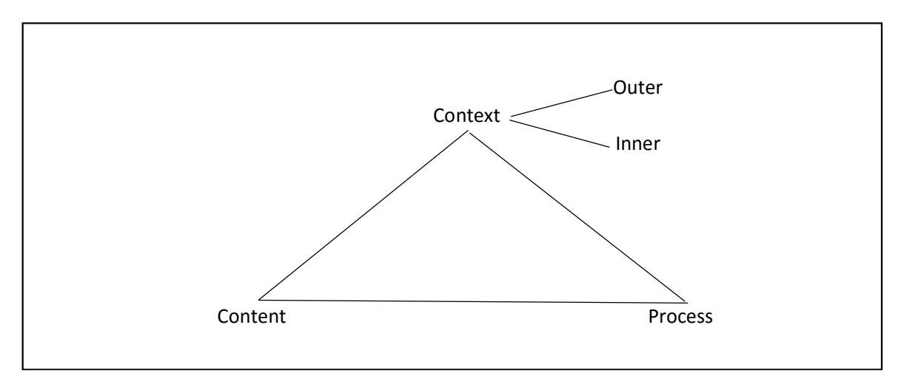
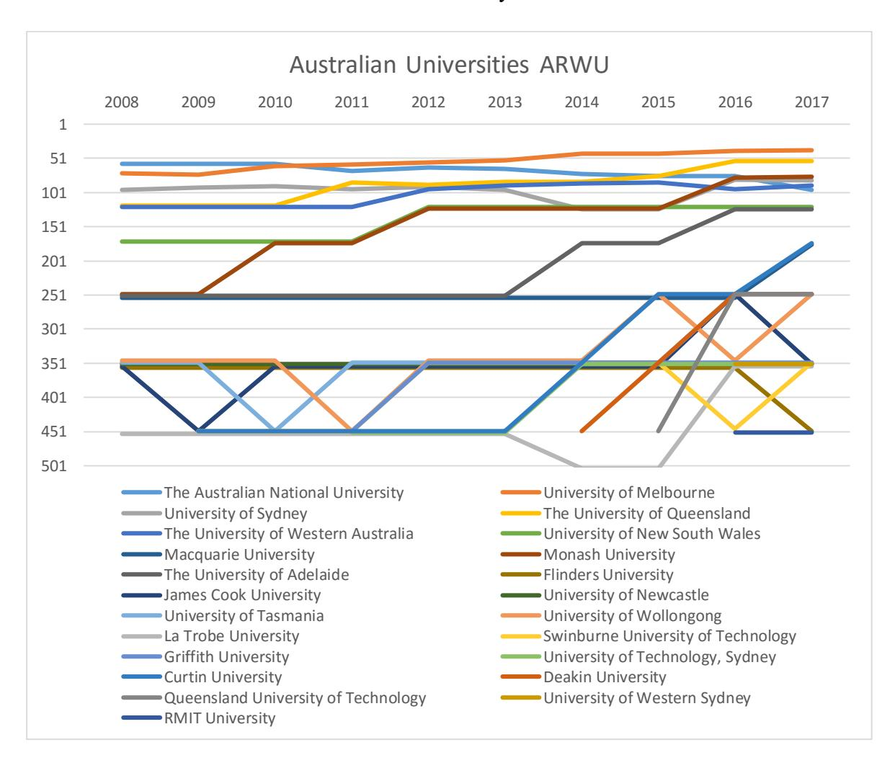
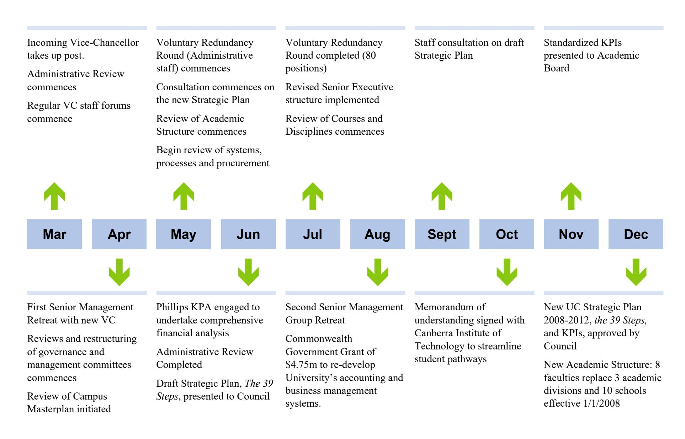
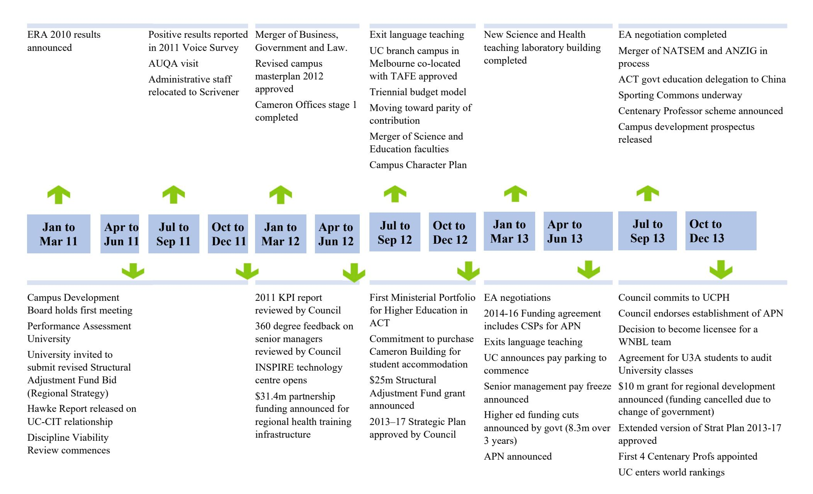
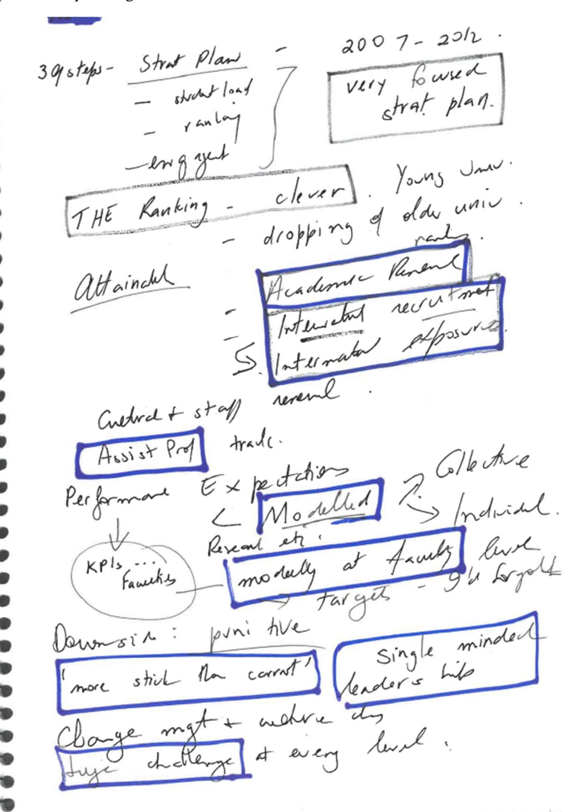
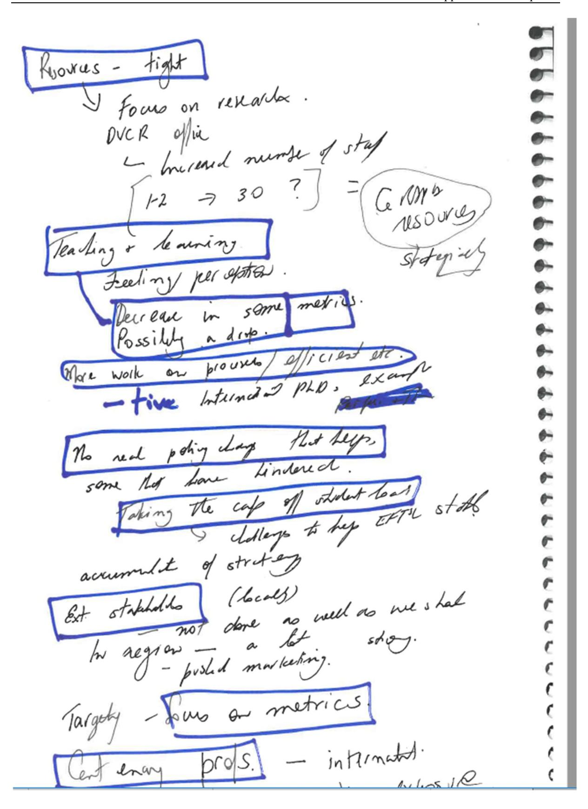
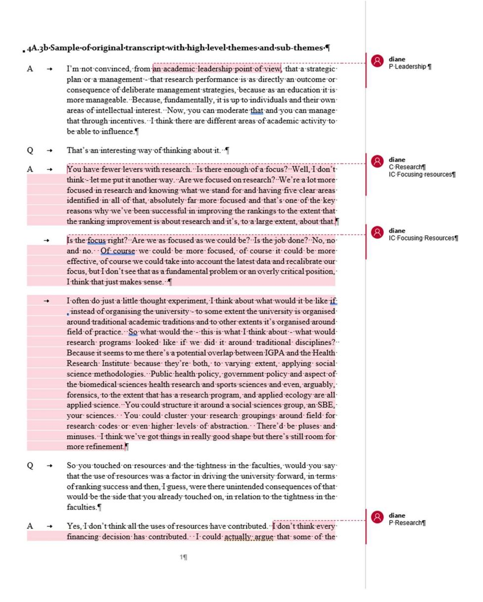
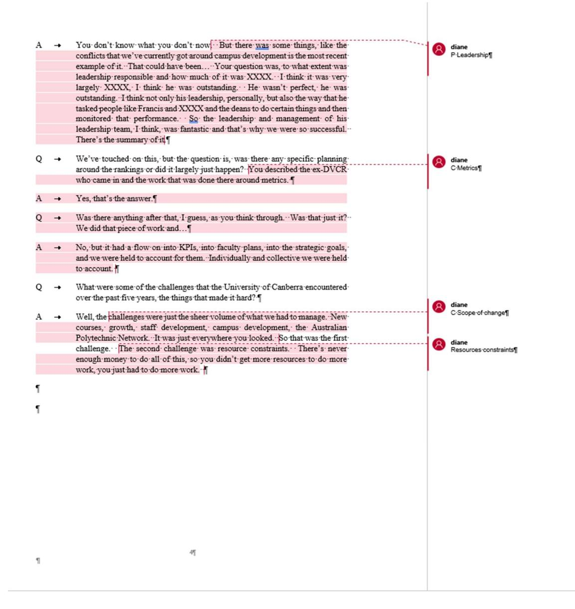
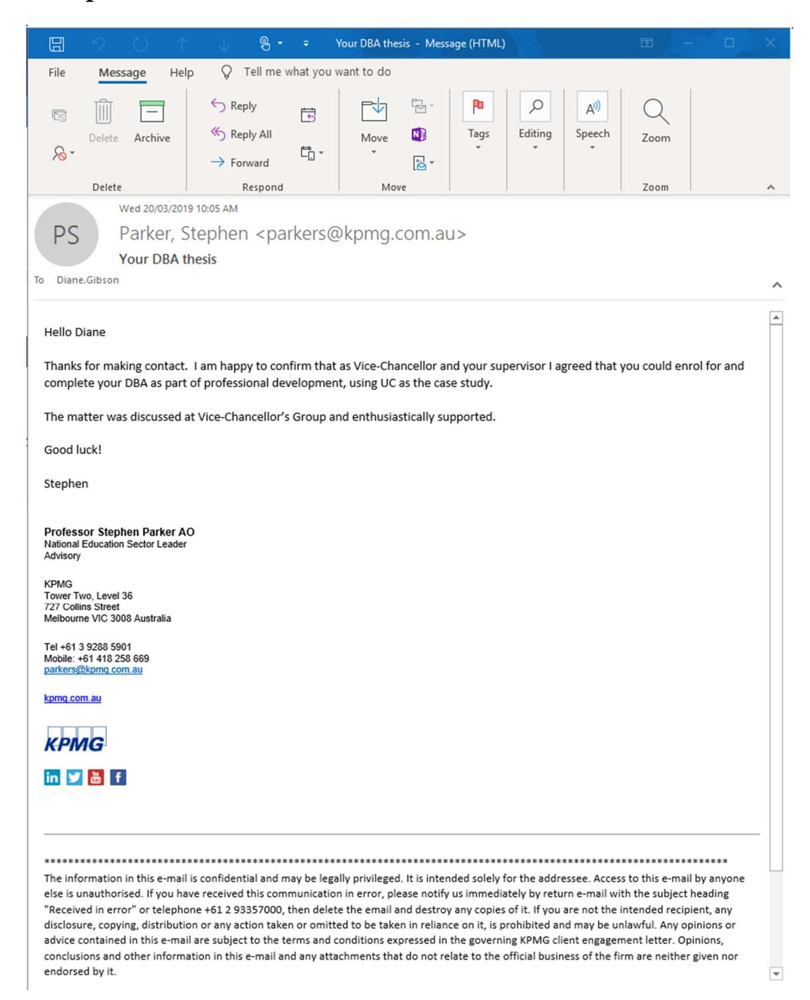

<!-- TH.R07 | source: papers_json/TH.R07/ -->

## **DOCTOR OF BUSINESS (DBA)**

**Succeeding in the Global Academic Ranking Challenge** **strategy and practice at the university level**

Gibson, Diane Award date: 2019 Awarding institution: University of Bath

Link to publication

## **Alternative formats**

If you require this document in an alternative format, please contact: openaccess@bath.ac.uk

Copyright of this thesis rests with the author. Access is subject to the above licence, if given. If no licence is specified above, original content in this thesis is licensed under the terms of the Creative Commons Attribution-NonCommercial-NoDerivs 4.0 International (CC BY-NC-ND 4.0) Licence (https://creativecommons.org/licenses/by-nc-nd/4.0/). Any third-party copyright material present remains the property of its respective owner(s) and is licensed under its existing terms.

**Take down policy**

If you consider content within Bath's Research Portal to be in breach of UK law, please contact: openaccess@bath.ac.uk with the details. Your claim will be investigated and, where appropriate, the item will be removed from public view as soon as possible.

Download date: 11. Oct. 2025

<!-- page 1 -->

## Succeeding in the Global Academic Ranking Challenge: strategy and practice at the university level

## Diane Mary Gibson

A thesis submitted for the degree of Doctor of Business Administration in Higher Education Management

University of Bath School of Management April 2019

## COPYRIGHT

Attention is drawn to the fact that copyright of this thesis rests with the author. A copy of this thesis has been supplied on condition that anyone who consults it is understood to recognise that its copyright rests with the author and that they must not copy it or use material from it except as permitted by law or with the consent of the author.

This thesis may be made available for consultation within the University Library and may be photocopied or lent to other libraries for the purposes of consultation with effect from:

Signed on behalf of the Doctoral College

<!-- page 2 -->

<!-- page 3 -->

## Table of contents

Acknowledgements

9

Abstract

11

List of Abbreviations

12

Chapter 1 Introduction

15

1.1 Why this research question

15

1.2 Theoretical and Methodological Frames

18

1.3 Contributions of this research

19

1.4 Structure of the thesis

20

Chapter 2 Global rankings: a review of the literature

23

2.1 Introduction

23

2.2 Context

24

2.2.1 History

25

2.2.2 Summary of five influential rankings

29

2.2.3 Criticisms

30

2.3 Consequences

35

2.3.1 Institutional homogeneity

35

2.3.2 The consequences for teaching

37

2.3.3 Discipline mix

39

2.3.4 Morale

39

2.3.5 The benefits

40

2.4 Rankings and higher education: the response

41

2.4.1 Global rankings and competition

42

2.4.2 The emergence of new metrics: 'changing the game'

46

2.4.3 Aspirations: 'joining the game'

47

2.4.4 Investment: 'Playing the game'

49

2.4.5 Gaming the game

53

2.5 Conclusion

55

Chapter 3 Universities and change: a review of the literature

57

3.1 Introduction

57

3.2 Re-interrogating the literature on rankings and higher education

59

3.2.1 A 'shopping list' of strategies

60

3.3 The successful university

64

3.3.1 Universities as organisations

65

2.2.2 Recoming a successful university

67

<!-- page 4 -->

3.3.3 Driving change in the university context

71

3.4 Recurrent themes

76

3.5 Organisational change: selected approaches

79

3.5.1 The influences from Nadler and Tushman

81

3.5.2 Continuity and change: following Pettigrew's model of processual analysis

84

3.5.3 The final framework

86

3.6 Conclusion

87

Chapter 4 Research methodology

89

4.1 Introduction

89

4.2 Locating a mixed methods approach: ontology, epistemology and the quantitative-quality divide

4.3 Operationalising the research question

92

4.3.1 The research design

93

4.3.2 The case study approach

95

4.4 The research method: the rankings analysis

96

4.4.1 Which ranking system and for what time period?

96

4.4.2 Extracting and analysing the data

97

4.4.3 Analysing changes in rankings position

98

4.5 The research method stage 2: the case study

103

4.5.1 Time period

103

4.5.2 Documentary review and analysis

104

4.5.3 Qualitative interviews

105

4.6 Reflection and discussion

108

4.6.1 Reflexivity

109

4.6.2 Ethics

110

4.6.2 Limitations of the study

112

4.7 Conclusions

113

Chapter 5 Australian university rankings in international context

115

5.1 Introduction

115

5.2 The University of Canberra 2008–2018

116

5.3 The Australian universities

117

5.3.1 The number of Australian universities in the rankings

117

5.3.2 The trend pattern of Australian universities in the rankings

120

5.4 Australian Universities relative to the other countries

124

5.4.1 The number of universities in the rankings—international comparisons

124

5.4.2 The trend nattern for universities by country—international comparisons

128

<!-- page 5 -->

5.5 Conclusions

136

Chapter 6 The University of Canberra: a time of change

139

6.1 Introduction

139

6.2 A brief history of the University of Canberra

140

6.3 Drifting down 2005 to 2007

142

6.4 Creating a platform for change 2007

145

6.4.1 No need for change

145

6.4.2 A new leader arrives

147

6.4.3 The formal structure

148

6.4.4 Strategic directions

151

6.4.5 The informal structure and the people

152

6.4.6 Reconstruction 2007: summary

153

6.5 2008–2010 The First Evolution

153

6.5.1 The external context

154

6.5.2 Changing the people, changing the work

157

6.5.3 Financial management and service quality

160

6.5.4 2008–2010: summary and reflections

162

6.6 The second evolution (2011–2013)

163

6.6.1 The external context

164

6.6.2 The rankings aspiration comes into play

166

6.6.3 The people and the work

167

6.6.3 The pursuit of a new kind of institution

172

6.6.4 Financial management and service quality

176

6.6.5 Summary and reflections 2011–13

180

6.7 Conclusion

182

Chapter 7 Change and consequence

185

7.1 Introduction

185

7.2 What worked

185

7.2.1 The 'magic leader'

185

7.2.2 Strong management team

187

7.2.3 The Strategic Plans and Performance Metrics

189

7.2.4 The research strategy: focusing resources, clear metrics and p

-

7.2.5 High quality academic staff

7.2.6 An external orientation

7.2.7 Agility and the appetite for risk

194

<!-- page 6 -->

7.2.8 Changing culture

195

7.3 What didn't

196

7.3.1 The pursuit of critical mass and partnerships

196

7.3.2 Operational management

197

7.3.3 Improved educational quality

199

7.3.4 The commercial agenda

201

7.4 Benefits

202

7.5 Costs

203

7.5.1 The impact on staff

203

7.5.2 The impact on the work

205

7.5.3 The impact on relationships

206

7.5.4 Addicted to change?

209

7.4.4 Perverse outcomes

212

7.5 Conclusions

214

Chapter 8 Discussion and conclusions

217

8.1 Introduction

217

8.2 Understanding why Australia has done well in the global rankings.

217

8.2.1 Policy changes in the Australian university sector

218

8.2.2 Australia's reliance on the international student market

221

8.2.3 Something to prove

222

8.2.4 An international orientation

223

8.2.5 Absence of a strong internal ranking

224

8.3 A time of change

224

8.3.1 Frame-bending

225

8.3.2 Beyond 'frame-bending'

230

8.4 Change and consequence

236

8.4.1 The imbalance between teaching and research

237

8.4.2 The adequacy of the resource base

238

8.4.3 Competition

239

8.4.4 Addicted to change

240

8.4.5 The problem of process

241

8.4.6 The metrics are the message

242

8.5 Conclusions

244

8.5.1 The research question and the response

246

8.5.2 The contribution of the research

249

8.5.3 The methodology and the limitations

252

<!-- page 7 -->

Bibliography

255

Appendices

269

Appendices to Chapter 4

270

Appendix 4A.1 Interview Guide

270

Appendix 4A.2 Sample interview transcript

271

Appendix 4A.3 Samples of coding

275

Appendix 4A.4 Confirmation of the Vice-Chancellor's approval to ur agreement by the Vice-Chancellor's Group

•

Appendices to Chapter 5

299

5A.1 ARWU rankings

300

Australia ARWU

300

Canada ARWU

301

China ARWU

302

China (non mainland) ARWU

303

France ARWU

303

Germany ARWU

304

Italy ARWU

305

Japan ARWU

306

Netherlands ARWU

306

South Korea ARWU

307

Spain ARWU

307

Sweden ARWU

307

United Kingdom ARWU

308

United States of America ARWU

309

5A.2 THE Rankings

312

Australia THE

312

Canada THE

313

China THE

313

China (non–Mainland) THE

314

France THE

315

Germany THE

316

Italy THE

317

Japan THE

318

Netherlands THE

318

South Korea THE

319

Spain THE

319

<!-- page 8 -->

Sweden THE

319

Switzerland THE

320

United Kingdom THE

321

United States of America THE

322

5A.3 THE Young Universities

326

Australia THE Young Universities

326

Canada THE Young Universities

326

China THE Young Universities

327

France THE Young Universities

327

Germany THE Young Universities

327

Italy THE Young Universities

328

Japan THE Young Universities

328

Portugal THE Young Universities

328

Spain THE Young Universities

328

South Korea THE Young Universities

328

United Kingdom THE Young Universities

329

USA THE Young Universities

329

Appendices to Chapter 6

331

<!-- page 9 -->

## Acknowledgements

My sincere thanks go to my supervisors, Professor Jürgen Enders and Professor Ian Jamieson, for their intellect, their expert advice and their encouragement along the way. I am grateful to Professor Rajani Naidoo who was there at the beginning of my DBA HEM journey and has been a source of wisdom and advice on many occasions since. Thank you also to the many academic staff at the University of Bath who have contributed so much to my understanding of the higher education sector, and to the administrative staff who make it all possible.

I would also like to acknowledge the University of Canberra for their support of this endeavour, and the members of the senior management team for their contribution through interviews and for their collegiality during my years as Dean at the University.

To my DBA HEM 10 cohort from around the globe—you have been a source of inspiration, advice, expertise and energy. And a special thank you to the ever-generous Michael Barrett who set up our DBA10 Facebook group in 2011, and convened many a late night Skype conference call across a myriad of time zones.

To my partner, John, thank you for your patience and support along the way. To my daughter Rhiannon, the Microsoft Excel and Word guru, your technical advice often saved the day. And to all my children, Tristan, Rhiannon, Caitlin and Daniel, your encouragement and unshakeable belief that your mother could get this done (eventually), kept me going, following our family mantra (adapted from Michael Rosen's We're going on a bear hunt so many years ago): 'Can't go over it, Can't go under it, Got to get through it!'

<!-- page 10 -->

<!-- page 11 -->

## Abstract

This thesis explores the potential for upward movement in international rankings by individual institutions, in the context of the Australian higher education sector. It addresses three inter-related but distinct questions. The first explores the ability of 'underdog' universities to move up the global rankings, the second examines strategies by which such upward movement might be accomplished, and the third considers the consequences of such an achievement. It ranges across literature on the higher education system and global rankings, on successful, world-class and entrepreneurial universities, and on organisational change. A mixed methods design was employed. It comprised an international comparative analysis of rankings achievements at the institutional and national levels, in combination with an organisational case study incorporating both quantitative and qualitative data, using document analysis and unstructured interviewing techniques. The comparative analysis demonstrated that Australia has done well in its global rankings performance. Several possible explanations are proposed, including the nature of the Australian university system, and the interplay of national and international trends in higher education. The seven-year case study yields the story of a dramatic turnaround at an Australian University from a state of decline to the achievement of a 'top 100 universities under 50 years of age' rankings goal. It analyses the University's success from the perspective of senior management, exploring the successes, the failures, and the costs and the benefits for the organisation. The contributions of the study include a model of trend analysis that tracks individual institutions in their national context and an explanation of the improving performance of Australian institutions. The study also demonstrates the value of exploring the internal context of the university as an organisation, employing a longitudinal approach, and mobilising aspects of the organisational change literature to generate a rich picture of the organisational consequences of 'playing the rankings game'.

<!-- page 12 -->

## List of Abbreviations

ACT Australian Capital Territory ANU Australian National Unviersity

ANZIG Australian and New Zealand Institute of Governance

ARWU Academic Ranking of World Universities

BRIC Brazil, Russia, India, China

CCAE Canberra College of Advanced Education

CAE College of Advanced Education

CHE-Hochschul Centre for Higher Education Ranking, Germany

CIT Canberra Institute of Technology CSP Commonwealth Supported Place

DBAHEM Doctor of Business Administration in Higher Education

Management

EFTSL Equivalent Full Time Student Load ERA Excellence in Research for Australia

HEFCE Higher Education Funding Council for England

HR Human Resources

KPIs Key Performance Indicators

NATSEM National Centre for Social and Economic Modelling

PEAS Performance Expectations for Academic Staff

QS Quacquarelli Symonds

RMIT (originally) Royal Melbourne Institute of Technology

TAFE Technical and Further Education

THE Times Higher Education

THE-QS Times Higher Education–Quacquarelli Symonds

TNE Transnational Education UC University of Canberra

UCPH University of Canberra Public Hospital

UK United Kingdom

USA United States of America

USNWR United States News and World Report WNBL Women's National Basketball League

<!-- page 13 -->

<!-- page 14 -->

<!-- page 15 -->

## Chapter 1 Introduction

## 1.1 Why this research question

The starting point for this thesis was a broad question concerning the impact of the rise of global rankings on the university sector. Following a review of the global rankings and higher education literature, my research questions became progressively more defined as the less well traversed aspects of this research field emerged, and thus the potential for a scholarly contribution more evident. There is a significant research literature on the emergence of global university rankings and on the interactions between global rankings, national policy and the higher education sector (Enders, 2014, Hazelkorn, 2015b, 2018, Lim and Øerberg, 2017, Shattock, 2017). There are also well-developed literatures on the indicators measured by various global rankings (Bekhradnia, 2016, Moed, 2016), on methodological aspects of the rankings (Hazelkorn, 2015b, Marginson, 2014, Marginson and van der Wende, 2007) and on why the rankings privilege, and will continue to privilege, elite institutions with strong historical reputations and robust financial resources (Hazelkorn, 2015b, Shattock, 2017).

There is a more modest literature focused on the differences in national performance, particularly as it relates to the performance of institutions within specific countries (Lim and Øerberg, 2017, Shattock, 2017). The rise of elite Asian universities, for example, is certainly well documented, with some reference to the resulting downward pressure in the rankings tables on Anglo-American institutions (Altbach and Salmi, 2011, Holmes, 2015, Mok and Hallinger, 2013). Research on national comparisons concerning changes over time within the Anglo-American context are less common, and there is quite a limited literature on what individual universities can do, and have done, to improve their standing in the rankings tables. Progressively, my research interest focussed down on to questions of whether individual universities were improving their positions in the global rankings tables, and if so, what were the factors that made improvement in rankings performance possible.

By shifting the focus to individual universities and their responses, the question narrowed to the actions and responses of individual universities, and away from the broader construct of 'impact on the higher education sector'. It is clear that historically elite universities will continue to be privileged by a rankings game where their position is effectively pre-

<!-- page 16 -->

determined by the rules of the game. It is also clear that large scale financial investment and strong national policies can support the rise of a set of new elite universities on the global stage, as has been the case with the new elite Asian universities. What was less clear, and therefore became the focus of this research, was how universities could achieve gains in the international rankings 'against the odds', that is in a national higher education policy context which was relatively stable, and where there was no case for further national investment in specific institutions. The 'policy levers' available to individual institutions will inevitably be influenced by the context of the national higher education system within which they operate (Davies, 1987, 2001, Salmi, 2011, Shattock, 2003).

This shift to the level of individual institutions brought with it the concept of institutional agency, which began a move toward both the literature on strategic change in universities (Marshall, 2007b) and the theoretical literature that explores how organisational change occurs (Balogun et al., 2015, Greenwood and Hinings, 1996, Nadler and Tushman, 1989, 1997, Pettigrew, 1990, 1997). The intellectual context for this thesis, then, sits across and draws on three distinct literatures. The first of these is the literature on global rankings and higher education in the international and national context. The second is the literature on the pursuit of rankings aspirations by individual institutions, and the related literature on what constitutes successful universities in the contemporary world, including broad policy trends in higher education and the ways in which universities change or seek to change to enhance their performance in a changing world. The third is the literature on organisational theory, with a particular focus on organisational change and how universities engage in organisational change.

My research question, then, led to a broadly-based literature review, rather than one focussed on a specific and narrowly defined body of literature. This review of the literature is set out in Chapters 2 and 3. In seeking a research focus that would provide a genuine contribution to existing knowledge, it is perhaps not unexpected to find a greater opportunity for original work located at the intersections of existing fields of knowledge.

As my understanding of the relevant literature was deepening, my attention was increasingly caught by the rankings aspirations of my own institution, the University of Canberra. As early as 2008, the University had publicly committed to a ten-year vision of achieving recognition on the international stage, and by 2011 this had been explicitly translated to entering the top 100 universities aged under 50. As a relative 'under-dog' in

<!-- page 17 -->

the university performance stakes, the University of Canberra seemed an unlikely 'success story'. It was performing poorly in both teaching and research metrics, compounded by declining student load, financial problems and the potential threat of regulatory intervention from the Federal Government. Through the prism provided by my DBA cohort, I simultaneously became aware that the Australian focus on global rankings, which I took for granted, was not shared by my British and North American colleagues. Their focus, as academic managers, at that time was very much more on national rankings. My work environment at the University of Canberra combined with my educational experiences at the University of Bath, in the context of my growing engagement in the academic research literature on rankings, drew me forward on a dual path. Was there something distinctive about the way in which Australian universities were approaching global rankings? And could a University move itself up the rankings hierarchy 'against the odds'?

It is generally recognised that Universities with no history of rankings performance, and without a substantial injection of resources, would be better placed to look to aspirations that do not involve global rankings (Hazelkorn, 2014, 2015b, Shattock, 2017). In the world of global rankings, 'them that's got will have, and them that's not will lose', and there is little by way of 'turn around stories of the university' that can lead to rankings success stories among the underdog institutions (Shattock, 2003). It is of course, another question as to whether this is a meritorious game to play. Should a university pursue rankings success is an equally valid question to 'how can a university pursue rankings success', but it is the second question that is the focus of this thesis. And as the qualitative data from the thesis developed, it became clear that the 'rankings aspiration' was as much a lever in bringing about organisational change as it was an outcome of that change.

The research presented in this thesis was undertaken over a seven-year period. Inevitably, the nature of academic rankings research changed during this time, but in this case so too did the fields of policy and practice, in Australia and elsewhere. In Britain and in North America there was growing awareness of global rankings, and increasing, if reluctant, engagement with them. In the preceding years it had been the countries with something to prove about their higher education systems, not only Australia but also countries in Southeast Asia and India, that had been the 'early engagers'. While the way in which individual institutions might work within their national context to achieve better recognition in global rankings attracted more attention, it has remained a relatively scarcely populated field. And

<!-- page 18 -->

simultaneously, the early indications of rankings success at the University of Canberra were followed by further 'rankings gains'. The University that I began to study in my earliest thesis chapter drafts had evolved considerably by the time the thesis was complete. By 2018, it was ranked 58th in the Times Higher Education Young Universities global ranking, having entered the top 150 for the first time in 2016. The first part of my research question, can an 'underdog' university achieve rankings success, was more clearly answered by 2018 than I could ever have imagined in 2012.

Over time, this thesis which began with a question about whether 'underdog' universities could improve their rankings performance evolved, as it became evident that the University of Canberra was achieving a degree of rankings success. A thesis that began as a 'mystery question' (can it be done) had turned into an analytic narrative concerning how it was done. In the process it became clear that three specific questions were at the core:

How did the University of Canberra's rankings performance compare in the national and international context?

How did the University of Canberra achieve a 'turn around' in its performance?

What were the consequences for the organisation?

## 1.2 Theoretical and Methodological Frames

The rankings literature provided a rich source of analysis on the evolving relationship between higher education and global rankings, at both the national and international level. It also provided some conceptual guidelines on what might be involved in achieving rankings success, albeit not a theoretical framework from which to study how that success might be brought about at an organisational level (Chapters 2 and 3). It did provide a valuable understanding of key drivers of policy and practice at the national level, which served to inform the analysis of why Australian universities had performed well in the global rankings (Chapters 5 and 8).

The analysis of successful universities provided some indications of key goals and objectives as well as connections through to the organisational change literature, but again not an organisational change framework that could be applied to 'turn around a university' and bring it into the global rankings path. The organisational change literature provided a

<!-- page 19 -->

valuable supplementary platform from which to explore the process of change at the University of Canberra. The seven year time period under study lent itself to a processual analysis as advocated by Pettigrew and colleagues (Pettigrew, 1987, 1990, Pettigrew et al., 1988, Pettigrew et al., 2001), but the constraints imposed by a sole authored thesis did limit full conceptual and methodological implementation of this approach. Close analysis of the qualitative data, combined with several iterations through potential theoretical frames (Balogun et al., 2015, Greenwood and Hinings, 1996, Hailey and Balogun, 2002), consistently demonstrated a close affinity with Nadler and Tushman's classic model of 'frame-bending' (Nadler and Tushman, 1989, 1990).

In its final form, the thesis draws on key elements of processual analysis as developed by Pettigrew (1990, 1997) as well as the model of frame-bending developed by Nadler and Tushman (1989, 1990). The emphasis on temporality, on the significance of the external context, and the ongoing interaction between internal context, external context, the process of change and the content of change strongly influenced the framing of the qualitative analysis, as well as leading to the inclusion of extensive analysis of historical documents. Nadler and Tushman's model of frame-bending was used particularly in organising the write-up of the material on organisational change.

The research methodology, as is set out in Chapter 4 utilises a mixed-methods approach to data collection. The choice of methods, consistent with a pragmatic approach to data collection, was driven by the research question. Consistent with this methodological approach, the meta-theoretical paradigm adopted in this thesis is that of critical realism, enabling a focus on both the pre-existing social reality that shapes the structure and processes of organisational forms, as well as on the ways in which the organisation is generated, reproduced and transformed Reed (2006).

## 1.3 Contributions of this research

This thesis sits at the juncture of the higher education literature on global rankings, and the literature on organisational change. It is this location at the intersection of two kinds of inquiry that underlie the potential for contribution to the literature, but it is a location that has proved to be an uneasy alliance. What is common knowledge in one field is not well explored in the other, and visa versa. Much of the work on the literature review was in endeavouring to bridge the two fields in ways that enabled the scope to be contained,

<!-- page 20 -->

whilst still making a contribution that was well grounded in each literature. The result has proved to be a compromise, but one that nonetheless targets a set of questions where only a limited amount was already known.

The research describes the comparatively positive trajectories that have been followed in the rankings tables by Australian universities in recent years, and posits a series of explanations for that success. It situates that analysis in in international context, examining the paths of individual universities analyses within national frames. This takes our understanding of national performance in global rankings beyond the usual approach of aggregate levels of analysis that do not explore the paths of individual institutions within national locations.

The analysis of individual institutional pathways within nations over time generated a large amount of data. This led to the development of an innovative methodological strategy to compress the data into a manageable and intuitively comprehensible format, while retaining 'closeness' to the intrinsic variability of rankings data. This method is set out in Chapter 4.

The detailed case study analysis provides insight into the kinds of levers available to an individual institution, the way in which those levers resonate with the existing literature, and the consequences of significant organisation change. It is both a study of 'rankings success' against the odds, and simultaneously something of a cautionary tale. As such, it provides a testing ground for a number of attributes that have been associated with 'successful universities', both in the context of rankings success and beyond.

## 1.4 Structure of the thesis

In Chapter 2, the influence and impact of global rankings systems is explored in relation to both national systems of higher education and individual institutions. The chapter begins with an historical overview of the development of global rankings, followed by a summary of the major criticisms that have developed in counterpoint to the rise of rankings tables. Attention then turns to the way in which global rankings have impacted on nations and higher educations institutions, and on their responses.

Chapter 3 builds on the preceding chapter in order to explore what the literature has to offer in terms of the potential for individual institutions to move up or down the rankings tables. The core intellectual mystery at the heart of this thesis is with the kinds of policy

<!-- page 21 -->

and practice levers that could be effective for universities wishing to move up the rankings tables 'against the odds'. Several kinds of literature are examined to glean potential clues, beginning by revisiting the rankings literature itself, then moving to the literature on successful universities and change specifically in the university context and concluding by considering what might be learnt from the broader literature on organisational change.

Chapter 4 sets out the methodological approach employed in the study, including the development of the research questions, the meta-theoretical paradigm and the rational for the selection of a mixed methods case study approach in addressing this line of research inquiry. The implications and limitations of the methodology are reviewed.

Chapters 5, 6 and 7 present the results of the thesis. Chapter 5 is a quantitative investigation of the performance of individual institutions within the context of their national environment, using two major global rankings (the THE and the ARWU) and the THE Young Universities ranking. The chapter explores the extent to which rankings success can be achieved by individual universities, beginning with the University of Canberra, and moving progressively outward to the national and then international comparative context.

Chapters 6 and 7 present an analysis of change at the University of Canberra, an institution in pursuit of international rankings success. Chapter 6 draws on university reports, presentations, performance metrics and interviews with senior management to describe the process and content of change at the University over three successive stages of organisational change. In Chapter 7, the central concern moves from the 'what' and 'how' of change at the University to the 'why', and more specifically with exploring from the perspective of the senior management team why the University of Canberra was able to move up the rankings. Key elements addressed concern what worked, what didn't, what were the costs and what the benefits.

Chapter 8 presents a discussion of the findings in the context of the guiding literature in relation to each of the three core questions addressed in the thesis. It also summarises the conclusions of the thesis, including its contributions to the higher education literature and the limitations of the research work.

<!-- page 22 -->

<!-- page 23 -->

## Chapter 2 Global rankings: a review of the literature

## 2.1 Introduction

In the 15 years since the first international university rankings were released by Shanghai Jiao Tong University, global rankings have become a powerful force in higher education, influencing national policy, institutional strategy and practice, academic staff behaviour, student decision-making and industry engagement. For nations, the standing of their higher education institutions matters not only for intellectual prestige, but also for their ability to attract national and international research funding and potentially lucrative industry research and development partnerships. For countries such as Australia where the higher education system is heavily cross-subsidised by international student fees, rankings influence the attractiveness of universities to those students, and hence the robustness of the sector. With higher education the 3rd largest export earner in Australia, there are flow on effects for the balance of trade (Australian Government, 2017). For individual institutions, both reputation and access to resources (human and financial) are on the line, through the potential for enhanced attraction of high quality staff and students, educational fees and research grants. This makes good performance in the rankings important to established and upwardly mobile institutions alike.

The core question addressed in this thesis concerns the upward movement of universities in global rankings. It sits at the intersection of three distinct literatures, each of which makes an important contribution to the topic at hand. The first of these, the literature on global rankings and higher education, is addressed in this chapter (Chapter 2). The opportunities and challenges facing individual institutions are closely linked to both their national higher education sector and policy environments, as well as to the international context as a consequence of the globalisation of higher education.

The second set of literature concerns the pursuit by individual institutions of rankings achievements, as well as enhanced performance more broadly in the context of a changing and increasingly competitive higher education sector. The policy and practice change levers available to individual institutions are central to this thesis, and its focus on how universities might succeed in the rankings game 'against the odds'. In exploring the kinds of responses available to individual institutions, the central question of thesis also led to the analysis of a third literature relating to organisational change, both within the university context and at the conceptual level. These literatures are reviewed in Chapter 3.

<!-- page 24 -->

The present chapter begins with a section on context, including an overview of the historical development of global rankings, a description of the major rankings, and a summary of the key criticisms that have developed as counterpoint to the rise of this phenomenon. In the second section, the issue of how rankings influence higher education systems and institutions is examined, including the potential consequences for institutional homogeneity, shifts in institutional mission and impact on staff morale. The third section focuses on the responses of higher education to the rankings challenge, including the rise of competition, and the range of strategies employed in changing, joining, playing or 'gaming' the rankings game. The emphasis in this chapter is on global rankings and the way in which they have interacted with higher education at the international, national and institutional levels.

## 2.2 Context

The relationship between what is measured by global rankings, what is meant by a high quality higher education institution and what is understood by the concept of a world class university is an uneasy one. There would be little disagreement with the statement that rankings are a collection of performance metrics that capture some aspects of quality, but not all. That rankings capture performance against metrics that describe a traditional model of excellence based in a western cultural context is also broadly agreed. The question as to whether rankings performance should be equated with world class university status is somewhat less clear, but there is a degree of acceptance that this conjuncture, whether right or wrong, has already come to pass.

Hazelkorn (2015b) suggests that global ranking and world class status have arguably become interchangeable, reminding the reader that from its inception the Shanghai Jiao Tong ranking:

was developed to highlight the position of Chinese universities vis-à-vis competitor universities in response to the government's desire to establish world-class universities (Hazelkorn, 2015b, p.28).(emphasis added)

Similarly, Lim and Oerberg (2017) discuss the way in which the concept of world class university has been equated with 'top ranked', and Shattock, while criticising the concept as 'nebulous, ill-defined and redolent of public relations spin' (2017, p.9) recognises that global rankings are used to legitimate claims to world class university status.

<!-- page 25 -->

There is a strongly argued case that leading ranking systems (including the Academic Ranking of World Universities, Times Higher Education, Quacquarelli Symonds, Leiden and SCImago) uncritically accept and proselytise a particular kind of 'world class university', generally with a strong historical heritage, high levels of endowment, English speaking (and English publishing), incorporating the bio-medical sciences and a research intensive history and culture (Enders, 2014, Hazelkorn, 2015b, Marginson, 2009, Marginson and van der Wende, 2007, Sheil, 2012).

Both Hazelkorn (2015b) and Shattock (2017) argue that the structure of rankings inherently privileges institutions that have benefited from long periods of high levels of resourcing. None of the top 50 institutions were founded less than 50 years ago, and most more than 100, arguably a demonstration of the Matthew principle:

institutions that attract more resources at a certain point develop a permanent lead over their peers and accumulate a magnetic power to attract outstanding talent (Shattock, 2017, p.10).

In this way, rankings are self-reinforcing, with an elite group of successful universities defining success in ways that ensure their own status and reputation continues by virtue of their control of the 'rules of the game'. The rise of Asian universities propelled by large resource investments, a strong commitment to high levels of educational attainment and fuelled by large population bases, could lead to some shift in this traditional paradigm, but to date the western model of what constitutes world class excellence in universities itself remains largely unchallenged (Mok and Hallinger, 2013, Ishikawa, 2009, Li and Chen, 2011).

The inter-relationships among these concepts of highly ranked institutions, high quality higher education and world class universities are important and require acknowledgement. While not central to this thesis, it is recognised that in many ways the concepts of high quality higher education, world class universities and top global rankings are fellow travellers on a journey where higher education institutions are increasingly part of a competitive global knowledge economy.

## 2.2.1 History

The fifteen years since the release of the first global rankings have seen a number of definitional and historical accounts of global rankings systems, as well as assessments of strengths and weaknesses, benefits and costs to the higher education sector (Enders, 2014,

<!-- page 26 -->

Hazelkorn, 2011, 2015b, Marginson, 2009, Marginson and van der Wende, 2007, Shattock, 2017).

Hazelkorn (2011) commenced her highly influential and detailed study of the Impact and Influence of Rankings on Higher Education Decision-Making and Government Policymaking only two years after the publication of the first Shanghai Jiao Tong Academic Ranking of World Universities (ARWU) in 2003 and the Times Higher Education Quacquarelli Symonds World University Rankings (THE-QS) in 2004. In that short period:

[I]it had become clear that global rankings were capturing the public's and policymakers' attention, and higher education institutions were taking notice and action (Hazelkorn, 2011, KL 120-126).

Funding flowed from the OECD, the International Association of Universities and in 2008 via the Institute of Higher Education Policy (funded by the Lumina Foundation.) to support the project, demonstrating significant international interest in the topic. Hazelkorn (2011, Ch.1) described a number of university, nation state and transnational entities (including the EU and the Organisation of the Islamic Conference) that produced statements of strategic intent within five years of the first release of the ARWU. In 2007, Marginson and van der Wende similarly emphasised the growing impact at both institutional and policy levels:

The global rankings immediately secured great prominence in higher education, policy, and public arenas and have already had discernible effects in institutional and policy behaviours (Marginson and van der Wende, 2007, p.310).

By 2011, the proliferation of international and national rankings scales had reached 59, with the majority of those being national (Hazelkorn, 2011). By 2018, the number had increased substantially, to more than 150 national or specialists rankings and just under 20 global rankings (Hazelkorn, 2018).

Many national schemes predate the international rankings. In 1983 the release of the first U.S. News and World Report Best College Rankings (USNWR) provided a nationally based consumer-oriented guide on reputation, inputs and outputs targeting college students and their parents. In Europe, the CHE-Hochschul Ranking was developed in 1998 by the Centre for Higher Education Development (Hazelkorn, 2015b).

<!-- page 27 -->

Arguably, countries with strong well-established national rankings systems, and strong internal markets, exemplified by the UK, the USA and Canada, were slower to engage with global rankings in comparison to Australia and Asia. Hazelkorn (2015b, Ch.2) presents data indicating that Asian and Australian universities generally attach more importance to improved rankings positions than their European and North American counterparts. This is consistent with the findings of the HEFCE report that higher education institutions in England perceived national tables (Sunday Times University Guide, The Times Good University Guide and The Guardian University Guide) to be more important than global rankings (Locke et al., 2008). Similarly, in the USA, there was a strong perception that USNWR was more important than global tables developed and published in England, China and Europe (Redden, 2014). Australia, by contrast, was a relatively early adopter, with global rankings featuring in university marketing almost from their inception, and appearing in public strategic planning documents from 2006 in the case of RMIT, and 2010 from the University of Melbourne (RMIT, 2008, University of Melbourne, 2010). Discussed openly by University of Canberra managers from 2008, by 2013 this had evolved to a specific public commitment to achieving a top 100 under 50 world university ranking (University of Canberra, 2013b).

Following the release of the ARWU and THE-QS rankings, other international rankings emerged. These included Webometrics (first published by the Spanish National Research Council in 2004), the Taiwan Performance Ranking of Scientific Papers for Research Universities (HEEACT) in 2007, USNWR's World's Best Colleges and Universities in 2008, the Leiden Ranking (2008), SCImago (2009), the Russian Global University Ranking (2009) and after the split between the Times Higher Education and Quacquarelli Symonds, separate QS World University Rankings and Times Higher Education (Thomson Reuters) World University Rankings (2010) (Hazelkorn, 2011). The Russian Round University rankings followed in 2010, in 2014, the first U-Multirank ranking was released, and in 2018 the THE Europe Teaching rankings were released, these last three arguably more oriented to teaching than earlier rankings (Holmes, 2018a, 2018b). Several of the more influential are briefly described below.

To date, the Shanghai Jiao Tong ARWU and the Times Higher Education (THE) rankings retain their positions as the two most influential (Shattock, 2017), with the QS rankings also commonly cited but not as prominent as the other two. Some commentators position

<!-- page 28 -->

these three rankings as the most influential (Yudkevich et al., 2015). Bekhradnia (2016) references the four main rankings', including the above three plus U-Multirank. The ARWU rankings focus entirely on research performance, combining bibliographic metrics with several other measures (see Table 2.1). The THE-TR and QS rankings set their parameters more broadly, combining indicators of teaching 'quality', reputational survey data, and internationalisation measures with research performance metrics.

The Leiden and SCImago rankings are differentiated by their exclusive focus on bibliometric indicators (Table 2.1), arguably providing a 'purer' measure of research performance, excluding the Nobel indicators, leading researcher metrics and the model of a composite index based on arbitrary weightings used in the ARWU (Marginson, 2009). SCImago uses SCOPUS citation data, and explicitly rejects the rankings model, with its web-site tag line of 'Not Yet Another University Ranking' and an emphasis on providing 'useful scientometric information to institutions…so they are able to analyse, evaluate and improve their research results' and (capitals in original) '[T]he SIR reports ARE NOT LEAGUE TABLES' (SCImago Research Group 2013) (capitalisation in the original).

In 2008, the European Commission began developing U-Multirank, in part to provide a ranking with a European orientation, and critically to move away from the dominant model of a single composite measure generating an overall ranking in favour of identifying and ranking separate fields of activity, including teaching and learning and other measures of university performance. U-Multirank was designed from the outset to be accessed via a web tool interface, enabling users to identify the elements of most significance to them (U-Multirank, 2013). The first ranking was released in 2014, and included five dimensions: teaching and learning, research, knowledge transfer, international orientation and regional engagement. The 2014 edition included a 'whole of institution' ranking as well as subject level rankings for a small number of fields of study, with the latter expanded in recent years (U-Multirank, 2018). Elements of this innovative multi-dimensional and interactive user-oriented approach were subsequently 'adapted, and arguably surpassed, by the major players' (Hazelkorn, 2018, p.6).

Over time, the number of different kinds of rankings generated by the major players has proliferated. QS and THE both released their first subject based rankings in 2011. In 2012, the THE released its first ranking of 'young universities', closely followed by QS in 2013. The QS now publishes regional rankings for Asia, the Arab region, 'Emerging Europe and

<!-- page 29 -->

Central Asia, Latin America and BRICS, while the THE offers regional rankings for Latin America, the Emerging Economies (formerly BRICS), Japan and Asia.

Another development has been the diversification of university rankings to explore additional metrics. One illustration of this phenomenon is the BOCOM (Bank of Communications) Sea Turtle Index, focused at the level of cities and emphasising the marketisation of international education. The Sea Turtle index focuses on five areas of 'return' for investment or sub-indices which are weighted to form the headline indicator: educational returns, work experience, social experience, financial returns and real estate returns. The emphasis here is on the 41 million students studying overseas in 2010, the investment they and their families make, and the likely return for that investment (The Economist Intelligence Unit and the Bank of Communications, 2013). Another entrant is the Universitas Indonesia GreenMetric World University Ranking which aims to assess Green Campus initiatives and Sustainability in Universities all over the world (Universitas Indonesia, 2010). Both rankings are focussed on metrics which do not reproduce the traditional dominance of well-endowed, historically embedded, English-speaking research universities in their rankings scheme.

Finally, the development of the QS Best Student Cities ranking (QS Top Universities, 2018) is an intriguing 'second order' ranking, where eligibility is determined not only by such predictable elements as student views, affordability, and employer activity, but also an inclusion requirement that the city must have a minimum of two universities in the most recent QS World University Rankings.

## 2.2.2 Summary of five influential rankings

Five major rankings systems are succinctly summarised in Table 1, covering inclusion criteria, indicators and associated weights and data sources (Moed, 2016). These five comprise the three 'dominant' rankings (THE, QS and ARWU) and an additional two influential rankings (Leiden and U-Multirank) (Hazelkorn, 2015b, Horseman, 2018, Lim and Øerberg, 2017, Shattock, 2017). Further detailed analyses of the methodologies and measures underpinning these rankings are available elsewhere (Enders, 2014, Hazelkorn, 2015b).

In addition to the measurement aspects of the rankings, there are also underlying issues of orientation and context. Lim and Øerberg (2017) differentiate among the three main

<!-- page 30 -->

ranking entities, describing the use of objective indicators by the ARWU and its academic setting in Shanghai Jiao Tong University, the media base of the THE and it increasing investment in data analytics, and the QS as a more business oriented ranking system in the context of a consulting firm. The authors also identify differences in audiences, particularly for the THE (senior academics and 'thought leaders') and the QS (international students).

## 2.2.3 Criticisms

The rise of global rankings has been accompanied by the development of an increasingly sophisticated counterpoint of criticism and dissent. Such detailed critiques are not intrinsically germane to the core questions of this thesis, and are dealt with here only at a summary level.

The core methodological criticisms of rankings have been explored in detail in the literature. They are broad ranging, concerning the details of rankings methodologies, with weighting systems, with what is and what is not measured , the unit of analysis (universities versus programmes), the representativeness of survey populations and the adequacy of response rates, the statistical significance of reported differences, the use of absolute output metrics versus per capita or equivalent metrics which take account of institutional size, and their susceptibility to 'gaming' by modifications to the data supplied for the rankings process (Bekhradnia, 2016, Harvey, 2008, Hazelkorn, 2015b, Ch.2, Holmes, 2015, Johnes, 2018, Marginson, 2014, Marginson and van der Wende, 2007, Shattock, 2017). The quality of data remains a perennial concern (Bekhradnia, 2016).

## Appropriateness of a single metric

There is a 'higher level' methodological debate about the appropriateness of any single metric based ranking system to measure the performance of a diverse higher education sector across many different countries, leading to arguments in favour of multiple indices (for research, teaching, internationalisation etc.) which are not added together (Billaut et al., 2010). This rejection of a single metric drove the development of U-Multirank (Ziegele and van Vught, 2017) and is used in promotional material for the QS star rating system (as distinct from the QS global rankings) (O'Leary, 2013).

<!-- page 31 -->

> **Table 2.1 Comparison of Five Global Ranking Systems **

| Aspect | ARWU World University | CWTS Leiden ranking | QS World University | THE World University | U-Multirank 2016 Edition |
| --- | --- | --- | --- | --- | --- |
|   | Rankings 2015 | 2016 | Rankings 2015–2016 | Rankings 2015–2016 |   |
| Website | http://www.shanghairanking.com/ARWU2015.html | http://www.leidenranking.co m/ | http://www.topuniversities. com/university-rankings | https://www.timeshigheredu cation.com/world-university- rankings | http://www.umultirank.org |
| Universitie s included | Every university that has any Nobel Laureates, Fields Medallists, Highly Cited Researchers, or papers published in Nature or Science, or significant amount of papers indexed by SCIE/SSCI. The best 500 are published on the web | All 842 universities worldwide with more than 1000 fractionally counted Web of Science indexed core publications in the period 2011–2014 are included inthe ranking | 918 universities are included | 800 universities with at least 200 articles per year published in journals indexed in Scopus, and teaching at least undergraduates in each year during 2010–2014 | In principle all higher education institutions can register for participation. The current version includes about 1300 institutions. |
| Indicators/ dimensions and their weights | Quality of Education Alumni (10%) Awards (20%) Quality of Faculty Highly cited researchers (20%) Publ. in Nature, Science (20%) Research output Publications (20%) Per Capita Performance (10%) | Publication counts Articles in English, authored,\nin core journals Citation Impact Nr., % top 1, 10, 50% publications Mean Normalizd Citation Rate Collaboration Nr., % publ. from different\ninstitutions Nr., % publ. with geographical collab distance under 100 or over 5000 km | Academic Reputation (40%), based on QS survey Employer Reputation, based on QS survey (10%) Faculty Student Ratio (20%) Citations per Faculty (20%) International Students (10%) International Faculty (10%) | Performance indicators Teaching (30%), mainly based on reputation survey International Outlook (7.5%) Research (30%), mainly based on reputation survey Citations (30%) Industry Income (2.5%) | Over 30 indicators covering the following main dimensions Teaching and learning Research Knowledge transfer International orientation Regional engagement Typical examples of indicators: Quality of teaching (based on survey); citation rate; income from regional sources; nr. spin offs |
| Data sources used | Databases on Nobel prizes and Field Medals Thomson-Reuters Web of Knowledge and HiCi researchers; data on academic staff from national agencies | All bibliometric data are extracted from Thomson Reuters' Web of Science | QS Academic Reputation Survey; self-reported data from universities; data from government and other agencies; bibliometric data from Elsevier's Scopus | THE Reputation Surveys; self- reported data from universities; bibliometric data from Elsevier's Scopus | U-Multirank student surveys; self-reported data from universities; bibliometric data from Web of Science and PATSTAT database on patents |

Source: (Moed, 2016)

<!-- page 32 -->

## Inadequate focus on education

The major rankings are criticised for their strong focus on research, with little or no emphasis on education quality. Indeed, the absence of measures relevant to education is as much a source of criticism as is the nature of any metrics that are employed.

Staff-student ratios are a commonly used metric, more because the data are readily available than because of intrinsic value (Bekhradnia, 2016, Marginson and van der Wende, 2007). Student satisfaction measures, while possessing more face validity, are criticised as being not only open to manipulation, but also potential drivers of lower quality educational outcomes as popularity can drive out excellence in what is seen by some as a 'race to the bottom'. The relationship between student satisfaction and quality of education is not uncontested (Bedggood and Donovan, 2012, Mark, 2013). Some commentators argue that research metrics can be predictive of student success and satisfaction, and more so than some teaching oriented measures (Holmes, 2017a). The educational missions of universities have traditionally proved resistant to capture via simple metrics.

New developments in performance metrics such as the Teaching Excellence Framework in the UK and in the development of rankings that endeavour to better reflect teaching (U-Multirank and the THE European Teaching Rankings) have yet to significantly redress this imbalance, but the impact of such developments will inevitably take some time. At this time, there are no internationally comparable teaching metrics (Hazelkorn, 2015b).

## Consistency across rankings tables

The lack of consistency across ranking tables has been used to question the validity of their results. For example, Moed (2016) concluded that analysis of the five major ranking systems demonstrated that there was no identifiable group of 'the' top 100 universities, with only 35 institutions included in the top 100 lists of all five systems. On the other hand, Shattock (2017) uses similar information to argue that the main conclusion to be drawn was consistency over time, with the same institutions retaining their position in the rankings hierarchy. The frame can be either difference or similarity, but there does appear to be agreement that a set of institutions appear at the top of several rankings systems and remain there over time—but not all institutions.

<!-- page 33 -->

## Reputational measures

The inclusion of 'reputational measures' (used by the THE and QS) raises the issue that perceptions fuelled by existing rankings are being used as an input to future rankings, creating a circularity in the rankings process. Critics also argue that the reputational survey component rewards the achievements of university marketing departments more than it does academic achievement in boosting rankings performance (Marginson, 2007). These criticisms apply to reputational surveys in both research and teaching quality. There is an inherent disadvantage for newer universities, or those building their reputations, as lag factors mean that institutions with long established reputation will inevitably perform better. There is evidence of geographical bias, with English speaking countries being more heavily represented (Bekhradnia, 2016, Hazelkorn, 2015b, Ch.2, Kehm, 2014, Marginson and van der Wende, 2007, Salmi and Saroyan, 2007).

On a broader issue of potential geographical bias, Moed demonstrated substantial geographical differences among the five major rankings:

It follows that the systems define the 'world' in different manners, and that….. each system has a proper orientation or bias, namely U-Multirank towards Europe, ARWU towards North America, Leiden ranking towards emerging Asian countries, and QS and THE towards Anglo-Saxon countries (Moed, 2016, p.984).

## Citation metrics

While some assume citation measures are an 'objective' measure, others argue that citation rates also have inbuilt biases – they are closely correlated to English language journals, to large 'self-citing' societies such as the USA, and to article-based fields, including multiauthor publishing, particularly privileging the hard and medical sciences (Altbach, 2006, Enders, 2014, Hazelkorn, 2015b, Holmes, 2015, Ishikawa, 2009, Li and Chen, 2011, Marginson, 2009, Mok and Hallinger, 2013, Salmi and Saroyan, 2007, Soh, 2013, Tofallis, 2012). Citation rates can be manipulated via gaming (Holmes, 2017a), a point which is discussed further in Section 2.4. The bias in favour of science and against the humanities, arts and social sciences has been partially addressed by the broadening of the databases used, but differential patterns of publishing and the nature of inquiry within disciplines and fields mean that disadvantages remain. The criticisms of citations are only partially addressed by inclusion of normalised or field weighted citations. Hazelkorn, referring to the use of citation metrics in general, commented:

<!-- page 34 -->

The chorus is growing for adopting a broader approach to assessing university based-research ….. and making a clean break with citations (Hazelkorn, 2015b, p.80).

## Internationalisation metrics

Internationalisation metrics, particularly those based on the proportion of overseas staff and students, are criticised as simultaneously re-inforcing the marketization of international higher education and inappropriately boosting the performance of particular countries, with the UK and Australia being commonly cited examples (Marginson, 2007). The definition of international also comes into play. Holmes cites the curious example the THE separating Hong Kong and Mainland China in the 2016 rankings, with the result that the number of 'international' collaborators increased as did the international orientation scores (Holmes, 2016a).

## Nobel prize winners and Fields medallists

There are a number of other elements that have attracted specific criticisms of metrics to particular ranking systems. Foremost among these is the ARWU metric based on Nobel prize winners and Fields medallists, partly because it advantages large, long established, science-based institutions (Nobel prizes in peace or literature are excluded from the ARWU ranking index) and partly because it is heavily skewed in favour of wealthy nations (Altbach, 2006, Marginson and van der Wende, 2007). The ARWU now provides a ranking option that excludes Nobel prize-winners and Fields medallists as well as its traditional version.

This brief overview of context, history and major methodological strands of criticism evident in the rankings literature has stopped short of some important but less well articulated areas of debate. One example is the limited analysis of the relationship between global rankings, 'quality', and national research assessment exercises of the kind now commonplace in the UK (REF), Australia (RAE) and New Zealand (PBRF) (Edgar and Geare, 2013). The work of Pascarella (2001), Dill and Soo (2005), Salmi and colleagues (Salmi, 2009, Salmi and Saroyan, 2007), and O'Connell (2013) are important contributions to this scant literature, yet the relative absence or analysis on this topic raises interesting questions about the nature and shape of the global rankings debate.

<!-- page 35 -->

## 2.3 Consequences

Ten years ago, this discussion would have commenced with an assessment of whether rankings do or do not matter, rather than with their spheres of influence and the forms that influence takes. Even five years ago, there would have been some attention devoted to justifying that global rankings have implications for institutions, national education policies and the higher education system. Times have moved on. Now the debates are about the nature and pervasiveness of the influence, and about the spheres in which those influences operate. There is also consideration of the negative consequences, both actual and potential, of 'the simplistic beauty of rankings systems' and their 'seductive and coercive power' (Enders, 2014, p.16).

These influences are generally described and discussed at three levels: internationally in the context of the global higher education market or the higher education sector (for example O'Connell, 2013), nationally in the context of national policies, particularly higher education polices (for example Mok and Hallinger, 2013), and individually with a focus on universities themselves (for example Elken et al., 2016). These levels of influence are not discrete, and indeed interact with each other. Neither are these interactions and influences unidirectional in nature. While higher rankings may impact and influence through reputation, and through reputation to revenue and resources, the consequences are also influenced by the responses of both nations and universities.

Rankings influence reputation, and through reputation both revenue and resources. Revenue and resources may flow from student fees, research grants, other forms of government grants, through community or industry grants and partnerships and philanthropy. In a contemporary age, there are also potential financial benefits to be gained from start-ups and university owned companies based on innovation, as well as more traditional areas such as patents. All of this in its turn feeds reputation. This cycle is perhaps one of the central reasons why rankings have gained increasing leverage in higher education, and why criticisms, no matter how intellectually well founded, have gained no serious traction.

## 2.3.1 Institutional homogeneity

If rankings affect reputation and resources, universities and national governments are likely to respond in terms of the attributes valued in ranking systems. By responding within the

<!-- page 36 -->

rules of the game, research performance or internationalisation metrics may be pursued as ends in themselves, with less attention to other strategic imperatives—with rankings tables reinforcing the pursuit of one particular kind of world class university (see Section 2.2). This in turn raises concerns that ranking systems will lead to increased homogeneity through the ideological capture of nations and institutions alike by the rankings game (Enders, 2014, Hazelkorn, 2015b, Marginson, 2009, Sheil, 2012).

Concerns about the methodological underpinnings of rankings tables thus quickly transition to conceptual and policy concerns that such ranking systems both assume and drive homogeneity in higher education. In a diverse and changing world, multiple kinds (size, research or teaching focussed, fields of study) of higher education institutions are needed to suit the particular purposes in particular countries and regions (Billaut et al., 2010, Marginson and van der Wende, 2007, Salmi, 2009, Salmi and Saroyan, 2007, Marginson, 2009).

Nationally, some governments have sought to address the potential drive toward homogenisation by establishing individual institutional compacts, encouraging universities and colleges to identify their areas of differentiation and include them in 'mission compacts' or 'mandates' (Pizarro Milian, 2017). Australia, Ireland and Canada (Alberta and Ontario) have all moved in this direction in recent years. With limited or no financial incentives, however, such models are hamstrung in their ability to counteract the upward aspirations of individual institutions, many of which have been captured by the idea of the reputational and resource gains to be made by moving up the reputation ladder. Even apart from the lure of rankings, higher education institutions have a tendency to experience mission drift, as in the case of the movement of Irish Institutes of Technology up the national higher education qualifications scale and toward increased research performance, and from there to pursuit of reclassification as 'Technological Universities'. This evolution from Institutes and Colleges to Universities is a recognisable historical pattern elsewhere, including the post-Dawkins universities in Australia in 1988 and the post-1992 universities in the UK.

Focusing on and pursuing on one model of excellence at the level of the individual institution may have unintended consequences for the higher education system as a whole. As Hazelkorn pithily concluded:

<!-- page 37 -->

Such an approach promotes world-class universities rather than world-class systems (Hazelkorn, 2018, p.19).

National priorities may not be best served by the pursuit of world class universities.

Aspiring to individual institutional excellence for some may inevitably lead to lower levels of resourcing for the many—a 'two-tier' or vertically differentiated university system. Salmi (2009) argued that the pursuit of world class excellence clearly requires a degree of differentiation, as not all institutions are or can be created equal. The result may be national systems dominated by vertical differentiation in their higher education systems, with a small set of privileged institutions (and staff and students) at the top, and a large rump with more limited resources. Some countries have a tradition of inequality within their higher education sectors, others are more focussed on equity of access and equitable distribution of resources. If funding is channelled to specific elite institutions to ensure that individual nation states are represented in the 'top 100', while other priorities such as broadly based socio-economic access and the availability of an array of educational options are pushed aside, then tensions emerge between national educational priorities and the pursuit of rankings, and between the civic mission and values of a university, and its pursuit of rankings position.

The allocation of resources in the pursuit of rankings is likely to be an expensive exercise, whether at the national or institutional level, and in many instances, if not most, it is also likely to be unsuccessful (Altbach and Hazelkorn, 2017a, Shattock, 2017). If decisions are not taken for the public good, and scare public resources are allocated with the sole aim of moving up the tables, then the morality of such decision may be questioned. Moreover, such actions are likely to lead to the further intensification of the marketisation of international higher education (Enders, 2014).

## 2.3.2 The consequences for teaching

The failure of the major rankings to capture the educational mission of universities is widely recognised. This failure has the potential for negative impacts through reduced value and resources associated with the teaching functions of universities (Hazelkorn, 2007, 2011, Marginson and van der Wende, 2007, Pizarro Milian, 2017, Shattock, 2017). These concerns pertain to institutional missions, to the education of students and to the situation of staff within the university sector.

<!-- page 38 -->

Historically, tertiary education has been seen as the primary function of universities, providing professional and technical skills as well as creating the social and cultural capital essential to contemporary society. At a time when the transition to knowledge-intensive economies has place a higher premium on human capital than ever before, and the demographic patterns in developed countries are affected by the greying of the baby boomer generation and a falling percentage of young people (Hazelkorn, 2015b, Ch.1), the talent wars are on our doorstep. The education functions of universities are important.

If research excellence is pursued to the detriment of educational quality, then arguably institutional missions can be distorted in pursuit of particular kinds of performance metrics. There is little evidence that rankings performance and teaching quality go hand in hand, and indeed some to the contrary (Pike 2004). While there is little evidence to date that educational quality has actively suffered, the literature resonates with concern that this could happen. Logically, such a pattern would be difficult to detect in its early stages, given the limited longitudinal data on educational outputs, and presumably difficult to arrest and reverse in the longer term.

The impact on staff, as well as institutions, has also been questioned. If research is the measure of prestige and teaching is a sideline that must be completed to get by, then what is arguably the larger mission of the university is at risk (Hazelkorn, 2007, 2011, Marginson and van der Wende, 2007). If staff for whom teaching is a priority are forced out of the university sector or down the reputational 'food chain' to less and less wellregarded institutions, then the human capital of the sector is inevitably eroded. If high performing researchers or research departments are rewarded to the detriment of others, then tensions and problems of morale are a likely consequence (Hazelkorn, 2015b, Ch.3). If staff are set high performance standards in both teaching and research, work pressure escalates (Leisyte et al., 2009). If students receive a qualification with a higher reputational value but less intrinsic educational value, then we might expect consequences for the tertiary education sector, and society more broadly, in the long run. According to Altbach and Hazelkorn:

Teaching and undergraduate students, as well as the arts, humanities and social sciences, often take a backseat when decisions are made or resources are allocated. Some universities report preferential attention and benefit being given to research 'stars' over longer-employed or domestic faculty (Altbach and Hazelkorn, 2017a, p.9).

<!-- page 39 -->

## 2.3.3 Discipline mix

The quote above also serves to highlight the potential for adverse impacts on disciplinary mix. It is well-recognised that some disciplines lend themselves to higher research rankings performances than others, in particular the hard and medical sciences are advantaged and the humanities and liberal arts disadvantaged. Language teaching is perhaps one of the classic examples of an area which will inevitably underperform in research terms; yet it underpins international exchange and communication and the broader internationalisation agenda.

It is difficult to draw a causal link between global rankings and the falling numbers of language departments across universities in both Australia and the UK. But there is evidence of the rise of medical and hard sciences as nations and universities become increasingly pre-occupied with demonstrable productivity and research impact. In 2016 Yale, arguably one of the world's universities least likely to need to set strategies that align with rankings performance, announced just such an intention, based on the perceived 'discrepancy' between its top 3 performance in national rankings and their 10–15th performance in global ones:

This discrepancy points to an opportunity, and that opportunity is science, as it is the sciences that most differentiate Yale from those above us on such lists (Yale spokesperson quoted in Holmes, 2016b, para. 6).

Performance and impact are harder to demonstrate in the social sciences then in the sciences, and harder again in the arts and humanities. This tension has not gone unchallenged (Hazelkorn, 2015a, Withers et al., 2017), but it is set to continue.

## 2.3.4 Morale

Performance in global rankings can affect staff morale outside the teaching versus research tension described above. The 2008 HEFCE report found that:

Staff are affected by league tables. Despite widespread scepticism about league tables and their methodologies within HEIs, rankings affect staff morale (Locke et al., 2008, p.6).

Hazelkorn (2015b) also argues that staff are affected by rankings position, feeling more positive if their institution is well ranked. More indirectly, staff benefit from the flow-on effects of higher institutional rankings, not only in relation to 'hard' indicators such as access to resources but morale is also positively influenced by the ability to recruit high

<!-- page 40 -->

performing staff. The corollary is that staff are negatively impacted when key positions remain unfilled or attract less well qualified candidates.

## 2.3.5 The benefits

The preceding sections have canvassed various potential effects of the pursuit of improved rankings performance. They include homogenisation of the higher education sector, pursuit of institutional excellence to the detriment of sector wide excellence, vertical differentiation within the sector, with some agendas suffering and others advantaged, the increased marketisation of higher education, the neglect of educational functions and associated consequences at the sector, staff and student levels, pressure on staff to meet sometimes conflicting objectives, distortion of discipline mix, and adverse effects on staff morale. There appears to have been more written on the potential negative aspects of the growth in influence of global rankings, than there has on the positive.

Are there benefits? Rankings can support evidence of performance (for those at the top) in an increasingly competitive and commodified higher education section. As higher education is drawn ever more closely into the maelstrom of knowledge production in knowledge-based economies in a globalised world, being able to demonstrate (or claim to demonstrate) performance is attractive, albeit more so for those higher up the rankings ladder.

But what else? Marginson addresses what may well be the central potential benefit, asking whether or not rankings improve quality. He describes the potential for a virtuous circle 'between ranking, strategy, efforts to improve, better performance, then back to better ranking, and so on' (Marginson, 2017, p.7). However, there are problems, including the absence of attention to teaching and learning, the disciplines where the research metrics are outside the virtuous circle, such as the humanities and most professional disciplines, and the differences amongst rankings themselves. For science, and publication/citation based rankings (ARWU, Leiden and SCImago), he is positive about rankings driving better research and increased investment in university scientific capacity, but in other disciplines, in teaching and learning, and in multi-indicator metrics (THE and QS), much less so (Marginson, 2017).

One more straightforward area of improvement is undoubtedly better data, both within institutions and across the higher education sector. As early as 2009, the HEFCE report on

<!-- page 41 -->

the impacts of league tables in the United Kingdom noted as a key finding the improvement in data quality and data submissions by higher education institutions (Locke et al., 2008). Hazelkorn (2015b, Ch.3) took this a step further to document the rise of institutional research or strategic planning units targeting not only the monitoring of results, but importantly assessing and improving the quality of the institutions data and its submissions. Other authors have drawn attention to the improvement in data quality and the enhanced attention to data compilation that has come in the wake of global rankings (Lim and Øerberg, 2017), as well as the risks attendant on failing to pay attention to data quality (Espeland and Sauder, 2007, Sauder and Espeland, 2009).

Finally, where better resourcing has flowed to universities either as a result of nations seeking to achieve better rankings performance or because of enhanced reputation, it is possible to suggest this is a positive outcome. To the extent that other institutions, potentially with equally important missions, are disadvantaged then the positive outcome for one is not necessarily a positive outcome for the sector or society. The rise of new types of rankings, particularly field-based rankings, the regional rankings and the young universities rankings, provide an interesting twist on this familiar tale. While the hegemony of the major rankings remains largely unchallenged, the alternate rankings inevitably create alternate spheres in which performance can be recognised and rewarded. The differentiation of rankings may thus eventually contribute to the development of a broader suite of definitions of world class universities.

## 2.4 Rankings and higher education: the response

Commentators have varied in their views on the extent to which rankings shape university strategy or national policy. Over time, however, as rankings have garnered increasing attention, there has been a degree of convergence on recognising rankings as an important force. In 2008, a major report by the Higher Education Funding Council for England (HEFCE) indicated that while English universities may have responded to league tables and rankings in various ways, they were not making strategic decisions on core institutional activities in response to them (Locke et al., 2008). Hazelkorn's international work at a similar point in time suggested stronger engagement, with 'the majority of respondents have [ing] taken either strategic or academic decisions or actions' (2007, p.12). Her subsequent work (2011, 2015b) demonstrated the growth of this influence, and

<!-- page 42 -->

how rankings continue to drive profound transformation of our higher education systems and institutions' (Hazelkorn, 2015b, p.xi).

Higher education has been subject to substantial pressures and changes in recent decades. It is not my intention in this thesis to suggest that rankings are the key driver of higher education reform, but rather that in the context of the globalisation of higher education they have influenced and mediated responses at both the national and university level. The process by which this occurs is attracting increasing attention (Lim and Øerberg, 2017), although disentangling the effect of rankings from other drivers including the rise of a knowledge intensive international economy and the marketization of higher education presents difficulties (Naidoo et al., 2011, Olssen and Peters, 2005).

In focusing on responses to global rankings, this section focuses initially on the interplay between global rankings and competition at both the national and institutional levels. It subsequently explores four somewhat more specific sets of responses, summarised herein under the rubrics of changing the game, joining the game, playing the game and gaming the game.

## 2.4.1 Global rankings and competition

In an increasingly market driven higher education sector, global rankings make visible and legitimise a view that universities can be, and indeed have been, clearly ranked against each other on an agreed standard of excellence. Over recent decades, the much-discussed globalisation and internationalisation of higher education has brought in its wake competition amongst institutions as much as it has led to collaboration (Enders, 2004). More recently, Shattock has argued that rankings have intensified the level of competition among universities (2017). At the national level, Hazelkorn describes the response as approaching a 'policy panic':

with policymakers making a simple correlation between rankings, (elite) higher education and global competitiveness(Hazelkorn, 2015b, p.170).

Internationally and nationally, universities are in competition to secure the best students, the best staff, the best collaborative partnerships and the best funding, whether it be for research, education or infrastructure, from government sources, industry, philanthropy or student fees.

<!-- page 43 -->

Many national ranking systems were initially developed to inform prospective students, and global rankings are now used in a similar way in both the domestic and international contexts. Competition for domestic students is typically about securing the highest performing entrants, but in Australia competition was intensified by the uncapping of Commonwealth funded places from 2012.

The Australian higher education sector is heavily dominated by public sector universities. Under the current funding model, Commonwealth supported courses (broadly all undergraduate courses and a minority of postgraduate courses) attract both a Commonwealth contribution (paid direct to the institution) and a student contribution. Students may opt to pay their fees 'up front', but typically access an attractive income contingent loan scheme, the Higher Education Loan Programme (HELP), which has been available in one form or other for 30 years. Other sources of government revenue include infrastructure and research funding programmes, domestic student fees for 'full fee paying courses' and international student fees.

Until the full implementation of the demand driven system in 2012, the Federal government funding model shaped the nature of the University sector via its control of Commonwealth Supported Places (CSPs), typically managed on a bi-lateral basis between the Department and each individual university. This constrained not only the total number of places on offer in an institution, but also the broad fields of education to which they were allocated. Between 2009 and 2014, the number of CSPs increased from 440,000 to 601,000 (Noonan, 2015). This shift occurred against an historical context where per student funding had deteriorated since 1994 (Australian Government Department of Education, 2011). The shift to demand driven funding had several implications for universities.

First and foremost, the opportunity for growth in CSP supported student numbers provided the opportunity for growth in revenue. This led directly to increased competition, both for student numbers and for high performing students. The results were immediately evident in increased advertising expenditure targeting the domestic market, increased use of global rankings by universities where that option was available, and in increased student admissions. Less obvious but arguably more pernicious was the subsequent widespread manipulation of entry requirements so that reputation could be maintained (and competitive standing enhanced) via high publicly available entry scores, supplemented by

<!-- page 44 -->

various covert practices which allowed entry to students with much lower entry scores in order to maximise student numbers and revenue. This widespread mis-representation of entry requirements led to a major review and changed Federal Government reporting requirements on admissions in Australia (Higher Education Standards Panel, 2016).

Competition for international students is driven by prestige factors, attraction of high quality talent and in some countries financial incentives in the form of international student fees. In the UK, USA, Australia, New Zealand and Canada, there has been a significant reliance on international student fees to support university budgets (Adnett, 2010, Green and Ferguson, 2012, Marginson, 2011a, Marginson, 2011b). In Australia, international students fees have been used to cross-subsidise domestic students and research activity for decades, and beyond the university level, international education is a significant part of the economy. In 2016–17, international education activity contributed $28.6 billion to the economy, making it Australia's largest services export industry and its third largest export industry overall (Australian Government, 2017).

While the Commonwealth government tightly controlled domestic student numbers and fees, Australian universities were given control over international student numbers and fees from the 1980s (Zigarus, 2011), creating strong financial incentives for universities to increase their international student enrolments. Between 1986 and 1991 full fee-paying students increased from 2,000 to 48,000 (Marginson et al., 2010). Rapid growth in international student numbers continued through the 1990s and 2000s. While the United States and the United Kingdom have a larger share of international students (28% and 11% respectively, to Australia's 7%), international students make up a much larger proportion of the higher education student population in Australia (24% in 2017) than elsewhere (Institute of International Education, 2018). As the proportion of international students in the system increased, so the stage was set for the growing economic reliance of Australian universities on international students (Adnett, 2010, Marginson and van der Wende, 2007).

Although there is no evidence of a downturn in the demand for international education (Zigarus, 2011 p.118), there is evidence of increased competition for international students (Altbach and Welch, 2011). From 2009, for example, as public universities in the USA began to encounter reductions in public funding (and reduced investment earnings from endowment funds), full fee paying international students become increasingly attractive (Green and Ferguson, 2012). In the United Kingdom, Naidoo (2010) suggested that while

<!-- page 45 -->

British universities had largely been able to rely on 'brand' attraction in the past, the increasing competition for international students may require more aggressive recruitment strategies at the institutional level.

In the last decade, Germany, Japan, France, New Zealand and Canada have also implemented strategies to increase their attractiveness to international students (Institute of International Education, 2018). Moreover, increased levels of provision in South-east Asia have further diversified sources of competition. Singapore, Malaysia, Hong Kong and China are not only building capacity for domestic markets, but have explicitly indicated their intentions to attract significant numbers of international students (Mok, 2011, Mazzarol and Soutar, 2008, Yang and Welch, 2012, Zigarus, 2011).

There is now substantial evidence that global and national rankings are taken into account by students and their parents in selecting an overseas university. Mazzarol and Soutar's influential study identified reputation as a key determinant in attracting international students over a decade and a half ago (2002), while more recently Hazelkorn (2015b) has demonstrated the use of rankings employing a variety of evidentiary sources. Data from the large scale International Student Barometer Survey covering students from 200 nations indicate that while rankings are important, students from Asia (the major source of Australia's international students) placed more emphasis on rankings and reputation than students from other geographic regions (Hazelkorn, 2015b, Ch.4).

There is also some evidence to suggest that the correlation between rankings and the number of applications may be more important for less well-established universities compared to more established ones , a result that may apply to Australian universities regardless of their age and status. The University of Melbourne was reportedly 15% below its international student enrolment target prior to being ranked 22nd in the world in the 2004 THE-QS ranking; the following year it met its target with ease (Hazelkorn, 2015b, Ch.4). Other data suggest that rankings are of particular importance to international students attending Australian universities, with between 64 and 70% citing rankings as the key determinant of university choice (Lawrence 2009; 2013; cited in Hazelkorn (2015b, Ch.4)).

Rankings are also used by governments and foreign aid organisations that provide financial support for international study. Scholarships provisions have been tied to universities that are highly ranked in countries including Brazil, Chile, and Russia (Hazelkorn, 2015b, Ch.5,

<!-- page 46 -->

Marginson, 2012). In 2014, Russian President Vladamir Putin initiated a scholarship programme for high performing graduates to undertake study abroad—but only in leading universities included in the 'the three world rankings' (Sudakov, 2014).

The competition, of course, is not only concerned with international students. With the globalisation of higher education has come greater geographic mobility of academic staff, with concomitant competition for high quality staff amongst universities world-wide (Marginson and van der Wende, 2007, Wildavsky, 2010). National research assessment exercises as well as global ranking scales have led institutions to recruit more aggressively for talented academic staff. The world-wide growth of higher education has further fuelled the demand for highly qualified academics. In a circle of continuing re-inforcement the Internationalisation of university staff provide opportunities for further recruitment pathways through personal networks, in a curious echo of the historical patterns of 'chain migration' whereby family members and townspeople followed other earlier immigrants, written about in periods of mass immigration to Australia, Canada and the US over half a century ago. The ability to attract and retain high quality academic staff is part of the cycle of resources and reputation which fuels future rankings performance.

In the competitive world of higher education, industry partnerships are important revenue and resource streams at both the institutional and the national level, and global ranking position can help attract high quality partnerships. Similarly, partnerships with other universities are increasingly viewed as a highly effective strategy in leveraging resource and reputational gains (Ishikawa, 2009). Global rankings are used by institutions and nations in assessing the value of potential partners, and high profile partnerships are expected in their turn to positively influence future rankings (Hazelkorn, 2011, Marginson, 2012, Salmi and Saroyan, 2007).

## 2.4.2 The emergence of new metrics: 'changing the game'

Since the emergence of the Shanghai Jiao Tong University ranking in 2003, a plethora of new rankings have emerged (see Section 2.2.1) and a wide range of theoretical and methodological critiques have been offered (see Sections 2.2.3 and 2.3). One motivation for both the development of new rankings and the criticisms of existing ones is the desire to change the rules of the game so that particular institutions or nations can achieve better standing.

<!-- page 47 -->

It is a commonplace now to observe that actors, whether individual universities, groups of universities or nationals will elect to employ rankings which show them to best advantage. Rankings have been a contested territory, as institutions have sought to gain influence over their nature and their outcomes. Early on, this often took the form of a refusal to engage, interspersed with and increasingly moving to criticisms concerning validity. As early as 2008, English universities were complaining that they did not have sufficient influence on the content and methodology of rankings (Locke et al., 2008).

Arguably, the 'young university' rankings had their genesis in a suite of criticisms concerning not only the entrenched standing of world leading universities in the UK and the USA, but also in the methodological criticisms of the reliance of both the QS and the THE on reputational surveys. The establishment of the young university rankings served to diffuse that criticism, simultaneously setting up a new game where a range of new players could succeed to top positions. Similarly, the development of regional rankings, such as the THE Emerging Economies Rankings (formerly BRICS) can be seen as a response by rankings agencies that simultaneously re-inforces the hegemony of global rankings, while offering an alternative 'game' which recognises 'the strength and potential of a diverse range of emerging economies' (THE World University Rankings, 2018).

Another version of 'changing the game' is to switch between preferred ranking systems. In 2009 Denmark set a specific goal of having one Danish university in the European top ten of the THE-QS by 2020. In 2010, when the THE-QS rankings split into two systems, Denmark responded to its subsequent plunge in the THE ranking by refocusing on the emerging EU MultiRank project (described as a ranking tool more consistent with European priorities) and the Leiden ranking (Lim and Øerberg, 2017). India's response to its absence in top global rankings included the initiation of a process of national rankings (Varghese, 2018), as well as a series of robust interactions among India's policy and media communities and the higher education ranking community that led amongst other outcomes to the development by the THE of an 'India-only Reputation Ranking' that only ranked Indian institutions in terms of their performance in the THE's reputational survey (Lim and Øerberg, 2017).

## 2.4.3 Aspirations: 'joining the game'

Hazelkorn's earlier research (2007, 2011) on universities and global rankings provided a compelling account of strategic intent by nations and individual institutions alike to

<!-- page 48 -->

improve their positions in international league tables. On the basis of wide-ranging empirical research, she concluded in 2011.

There is plenty of evidence that rankings, or more precisely, doing well and being seen to do well, is now a significant factor driving institutional and government policy with priorities and resources aligned to indicators (Hazelkorn, 2011, KL 3508-3510).

Her examples range across world regions, including the University of Oslo's aspiration to 'achieve a leading position in the Nordic region and be among the 20 best in Europe' in recognized international rankings (2011, KL 112-119), the University of Iceland's declaration that 'in order to best serve the Icelandic society … (it) has set itself the longterm goal to become one of the 100 best universities in the world' and the strategic plan for Hacettepe University in Turkey which included improving its position in international rankings within the next five years (Hazelkorn, 2015b, p124). These aspirations and plans date from the mid-2000s.

RMIT University in Australia also made an early public commitment in its 2006 strategic plan to a target of entering the top 100 universities internationally as measured by the Times Higher Education Supplement (as it was then known) (RMIT, 2008). The University of Malaya included 'improved world standing through improved global rankings' in its strategic plan (University of Malaya, 2011) and the UAEU signalled its intent to be in the top 100 universities internationally (His Highness Sheikh Nahayan Mubarak Al Nahayan, 2009). The University of Canberra, the case study discussed in Chapters 6 and 7 of this thesis, chose and publicly announced in 2012 the target of entering the top 100 under 50 years of age (University of Canberra, 2013b).

In the first decade of the 21st century, the majority of universities tended to avoid specificity in publicly announcing rankings targets. Recent years have seen more frequent public statements with a direct link to rankings intentions or aspirations. So, for example, in 2015, (then) Indian President Mukherjee said:

If we provide enough funds to the top 10 to 15 institutions for the next four to five years, these institutions will certainly storm into the top 100 of global academic rankings (quoted in Baty, 2015).

In 2017, the new Vice Chancellor of the University of Newcastle (UK) announced a target of the top 100 universities globally in the first week of taking up his appointment (Whitfield, 2017). Morphew and colleagues (2018) (2018) have suggested that the more

<!-- page 49 -->

highly ranked an institution already is, the more likely to set a specific target in public documents. As the influence and 'taken for granted' nature of rankings has accelerated, the language of rankings as part of university or national strategic intent seems to have become more commonplace. Aspirations to an improved ranking position are a growing part of university life, and have even achieved their own pseudo-medical classification— 'rankophilia', or the 'irrational and obsessive concern with position and prospects in global rankings' (Holmes, 2017b).

## 2.4.4 Investment: 'Playing the game'

While it is one thing to aspire (publicly or privately) to improved rankings positions, it is another to invest resources or make strategic decisions with the explicit intent of improving rankings positioning. In 2008, the general tenor of the HEFCE report on the impact of league tables in England was that national league tables, and to a lesser (albeit growing) extent global rankings, were being used as key performance indicators and in some case strategic targets, but were not being used to make strategic decisions concerning core institutional activities (Locke et al., 2008). Ten years on, and examples of both national and institutional responses are well documented in the research literature (Bekhradnia, 2016, Hazelkorn, 2015b, 2018, Lim and Øerberg, 2017, Marginson, 2017, Shattock, 2017).

## Institutional responses

Hazelkorn's 2014 survey provided important international data on the value attached to rankings by higher education institutions, and their responses. These striking statistics demonstrate, for example, that 83% of surveyed institutions were unhappy with their current ranking, and 84% had a formal mechanism to review their institution's rank. Over 50% indicated they had taken strategic, organisational, managerial, or academic action in relation to planning or decision-making, with the percentage rising when specific prompts were provided (Hazelkorn, 2015b, Ch.3). Nonetheless, institutions vary in their willingness to explicitly discuss details of the way in which rankings influence policy or organisational decisions, and an aura of secrecy, akin to university attitudes to ERA submissions in Australia (Diezman, 2018), appears to shroud some aspects of institutional responses. There are very few examples of detailed case studies that document institutional strategies to achieve rankings success.

<!-- page 50 -->

Sauder and Espeland's work (Espeland and Sauder, 2007, Sauder, 2008, Sauder and Espeland, 2006, 2009) on law schools and national rankings provided further valuable insights into institutional level responses. These included decisions made at the university president level to allocate 'new money' based partly on programme quality as defined by USN rank and the pressure by senior management on law school deans to achieve improve rankings (including an example of a dean forced to resign on the back of a drop in the school's rankings (Espeland and Sauder, 2007). Sauder and Espeland (2009) described the consequences of the continuous surveillance that rankings generate, and consequent influences on the decisions made by deans. They described the way in which an obsession with rankings performance grows and, over time, becomes 'a key reference point in decision-making' (2009, p.70), contrasting (in the following excerpts) interview responses from a novice and experienced law school dean.

## The new dean:

I was one of those [faculty] …... who would say that we should disregard the rankings completely, and we should do whatever we need to do to make this a great place for our students and faculty. Now [as dean], I don't think I have any choice but to think in terms of the rankings (Sauder and Espeland, 2009, p.70).

## The more experienced dean:

What happens, unfortunately, is that I end up making decisions with an eye toward those rankings rather than—I'm overstating this to make a point rather than what's best for the school. The best thing for the school might not be student–teacher ratio right now. Maybe I should be putting the money I'd pay a faculty member into something else. But I'm thinking, "Oh man, if I can get that student–teacher ratio from 14.6 to 13.6 that will look very, very good in the rankings." (Sauder and Espeland, 2009, p.70).

Other examples of investment in specific areas include strategies to enhance LSAT scores (Sauder and Espeland, 2006) and investment in career services, including with a view to improving performance on the metrics as much as on actual outcomes:

The dean made some investments in career services staff. She put an emphasis on getting a full survey return for placement purposes so we didn't have any uncounted graduates (Sauder and Espeland, 2009, p.71).

This attentiveness to detail allows administrators to focus on how specific changes in resource allocation or other activities such as improving survey response rates can potentially boost rankings performance. Such activities can be on the borderline of

<!-- page 51 -->

investment and organisation change, on 'being good versus looking good' (Gioia and Corley, 2002), or managing statistics in order to 'game the system'. Be it implicitly or explicitly, by intent or by action, there appears to be a degree of consensus that institutions are modifying their strategies and behaviour in pursuit of maintaining or building reputation via the rankings hierarchies.

## National level responses

Lim and Øerberg (2017) have provided a nuanced account of the national policy response in both India and Denmark. Through the policy development process of Denmark's 'Growth Forum' of 2010 and 2011, global rankings were identified as 'the most important international indicators of university performance' and led to a recommendation to focus 'more resources on the strongest institutions', a shift away from the previous policy framework of 'relatively uniform incentives for the quite diverse eight Danish universities' (Lim and Øerberg, 2017, p.96). In the case of India, they also provide an example of an individual institutional response, the recommendation that the IIT Delhi should 'work closely with a particular ranking service to ensure a more targeted performance especially in research' (2017, pp.98-9).

Shattock (2017) analysed a number of sharp changes in government policy targeting national prestige and the pursuit of world class universities, ranging across the UK, China, Russia, Saudi Arabia and Switzerland. His examples include the French reforms of 2007 which were 'explicitly linked by President Sarkozy with France's failure in the global rankings' (2017, p.8) , and the Excellence Initiative in Germany, first implemented in 2006-7 and repeated in 2012. The Excellence Initiative was aimed at driving at least some German universities into much higher ranked positions through the vehicle of selective and targeted funding (Shattock, 2017), and involved a large investment of 4.6 billion euros (Wissenschaftsrat, 2014). Similarly, Russia's '5-100-2020' project involves an investment of over US$400 million per year to 15 top universities with the goal of having 5 Russian Universities enter the top 100 by 2020 (Altbach and Salmi, 2017).

Other commentators (Allen, 2017, Froumin and Platonova, 2017, Li and Chen, 2011, Platonova and Semyonov, 2018) have referenced the concentration of resources on elite universities as part of national initiatives aimed at building world class universities in countries such as Russia, India and China. Hazelkorn (2015b, Ch.5) provided a range of examples from a diverse array of countries, including Finland, Malaysia and Korea, as well

<!-- page 52 -->

as more detailed treatments in relation to Germany and Japan. The strategies in each country vary, and as Hazelkorn points out some involve a combination of elements. However, they commonly involve the three approaches identified by Salmi (2009): selection and investment in existing universities (as in the German example), mergers (as in the case of France) and the establishment of brand new universities as in the case of King Abdullah University of Science and Technology in Saudi Arabia.

Mok and Hallinger (2013) also described programmes of investment to build world class universities in a number of Asian nations, as well as the strong focus on the internationalisation agenda in countries such as Japan and In Singapore, with a view to enhanced global standing. Regardless of broad strategy, the evidence provided by these authors on national policy responses across a diverse array of geographic spheres paint a clear picture of extensive investment in many countries to achieve world class universities, and to perform more strongly in global rankings.

## Differentiated responses

Institutions and nations may be playing the 'rankings' game, but responses differ, and are mediated by position and context. In general, those universities at the top of the hierarchy (examples include Oxford, Cambridge, Harvard, the University of Melbourne) are less likely to exhibit 'status anxiety' than those further down. Their resource base is secure, as is their brand and market position, and their performance is demonstrably high. Significant shifts in institutional policy are not only unnecessary but potentially counter-productive; consolidation and use of the rankings to further enshrine their position is the optimal strategy. Those further down the hierarchy of institutions will either move to strengthen their position (or perhaps to avoid losses) or ignore the changes until a response is unavoidable; their positions will depend on their particular history, circumstances, leadership, context and organisational culture.

Locke found evidence of this differential response in the United Kingdom:

Those outside, but aspiring to the top echelons focused on tackling weaknesses and no longer tolerating poor performance, and were more willing to make resource allocations in an attempt to reach the position they felt they deserved. The highly-ranked university focused more on what a 'top-10 university should be doing'…..(Locke, 2014, p.83).

At the national level, where countries have a well established and well ranked higher education sector, there have been little by way of national policy interventions. The UK

<!-- page 53 -->

and the USA are both examples of this, although it is also noteworthy that both have strongly established internal national rankings systems, which tend at a national level tend to either dominate or hold equal sway with the global rankings (Locke et al., 2008). Espeland and Sauders influential work on American law schools (Espeland and Sauder, 2007, Sauder, 2008, Sauder and Espeland, 2006, 2009) focused on the national U.S.News ranking. In 2014, when the U.S.News released its first global ranking, their chief data strategist commented that while there had been little interest in global rankings among the general American public to date, 'maybe people will pay more attention to the ones we do'(Redden, 2014).

Another mediating influence on response to rankings is time. Lim and Øerberg (2017) illustrate this process in describing the changing response of the Danish government from initial criticism and rejection of their validity in 2003, through use in peripheral matters of policy, to formal setting of a global rankings target by 2009. Espeland and Sauders (2007) provide a conceptual basis for this process, in their description of commensuration and self-fulfilling prophecies as two means of inducing reactivity. While commensuration can emerge quickly, self-fulfilling prophesies may emerge over time, so that university reactions may initially be dismissive of rankings, then as others use them become more serious in their appraisal, moving through actively seeking to understand the rankings, to engage with those undertaking the ranking and to modify their own data submissions and indeed their strategic decision-making.

## 2.4.5 Gaming the game

As indicated in Section 2.4.3, there is a grey area where working to improve a university's performance in institutional metrics with an eye to improved rankings performance crosses over from careful management of data quality and an awareness of the potential impact of metrics into mis-representation of institutional performance. While each end of the continuum is quite clear, there will inevitably be murky areas in the middle. There is no single point that distinguishes gaming from strategic responses (Espeland and Sauder, 2007).

In 2011 at the University of Canberra, for example, there was a concerted attempt to improve the documentation of staff with a PhD, in order to improve the university's performance on the relevant metric. In the period from 2010 to 2012, there was also a process of academic renewal with the declared aim of changing the staffing profile of the

<!-- page 54 -->

university so that (amongst other things) a higher proportion were PhD qualified. The former goes to improved data quality, and the second to an organisational change. Neither would be described as gaming. But what of the exclusion of adjuncts from faculty data, as Morphew and Swanson (2011) described in the case of a US institution, against the relevant instructions, and with a consequent benefit in ranking standing. At what point does putting the best data forward become mis-representation of the data?

Competition for high profile research stars is intense in the contemporary higher education environment, and the payment of high salaries and provision of well supported research environments is commonplace. Similarly, the appointment of high profile researchers on a part-time (and sometimes geographically distant) basis is a not uncommon practice to build university research profile. And what point does that go beyond strategic use of resources and move into gaming the system? Kehm and Erkkila (2014) cited the example of two Saudi Arabian universities offering payments of around $70,000 per year to highly cited researchers with minimal obligation attached other than listing their affiliation to the Saudi Universities on all publications. Both universities subsequently entered the top 200–300 universities in the ARWU. Kehm and Erkkila described this as 'buying the reputation of researchers to build their own reputation' (2014, p.3). Many would see this as coming down on the gaming side of the continuum.

There are more clear cut examples. Hazelkorn described several US universities that have publicly admitted to deliberately misrepresenting their data (2015b, Ch.3), Locke documented attempts by UK institutions to improve their student survey results by manipulating the survey population (2014), and Morphew and Swanson (2011) reviewed a number of 'manipulative tricks' employed by US colleges and universities focused on gaming their rankings position. Johnes (2018) drew on the potential for manipulation and gaming as a major danger inherent in the rankings system to argue for an alternative methodology.

Espeland and Sauders focused attention on gaming the numbers as 'perhaps the most direct form of reactivity' to rankings (2007, p.30). Their respondents described a wide range of gaming strategies from inaccurate reporting to mis-representation. Importantly, Espeland and Sauders pointed to the consequences of gaming within academe itself, as distinct from its potential impact on rankings, arguing that:

<!-- page 55 -->

… it breeds distrust. Distrust speeds the diffusion of gaming strategies because it increases people's anxiety about what colleagues might be doing, especially among closely ranked schools (2007, p.30).

The stage is set for competition, and the actors are already engaged in the 'academic arms race'. While national policies (particularly in higher education, but also in immigration and employment) and national investment can advantage individual institutions, the question of how individual institutions can influence outcomes is less well understood. The rise of some Asian universities is explained in terms of large national investment, enabled by strong economies and demographic drivers. The continued strong performance of those at the top is explained in terms of resources, reputation, history and underpinning all of this, the notion that these are the institutions that determine the rules of the game. Outside these broad frameworks, however, what evidence is there to explain the ways in which individual institutions can improve their rankings positions? This question is explored in Chapter 3.

## 2.5 Conclusion

In the decade since the first international global rankings of universities were released, rankings have achieved an increasingly powerful influence and impact on individual institutions, national policies and practices and on the higher education sector. The number of rankings have proliferated, but the Academic World Ranking of Universities (formerly Shanghai Jiao Tong) and the Times Higher Education Ranking remain the most influential, followed by Quacquarelli Symonds (QS). These rankings, together with the bibliometrically based Leiden and SCImago rankings, serve to reinforce a traditional model of world class universities wherein an elite group of privileged universities not only dominate the top positions, but control the rules of the game. The heterogeneity of the higher education sector, its responsiveness to national and regional agendas and the social equity agenda of higher education are all potentially at risk.

At the national level, governments worldwide have sought ways to ensure that their countries are represented in the top rankings. The rise of a number of Asian institutions in the rankings has been fuelled by national investment, enabled by strong economic and demographic growth. Elsewhere, in contexts of more modest economic and demographic growth, 'mergers and acquisitions' and investment in individual institutions have supported improved performance. Improved data management and reporting has been an

<!-- page 56 -->

unintentional but important sector wide impact as universities and countries compete for improved ranking positions.

For individual institutions, the options for 'bootstrapping' improved performance in the rankings are less obvious. Increased resources can fuel improved performance, but if there are no philanthropic or government windfalls, existing resources must be re-deployed to achieve better performance, and existing behaviour and cultures re-oriented to support changed agendas. The next chapter builds on the literature presented in this chapter in order to explore the levers available to upwardly mobile institutions in pursuit of improved rankings performance.

<!-- page 57 -->

## Chapter 3 Universities and change: a review of the literature

## 3.1 Introduction

The previous chapter explored the influence and impact of global rankings on higher education in both the international and national context. It drew on literature where the primary focus is on the way in which rankings have influenced, or have the potential to influence, higher education as a system at the global level as well as literature on the impact of rankings at the national level and national policy responses. The literature addressed in Chapter 2 provides the background for the first of the three core questions addressed in this thesis, which was to examine the University of Canberra unexpected rankings success in both national and global contexts. (The empirical analyses relating to this question are presented in Chapter 5.)

The second and third core questions concern how the University of Canberra was able to enter and rise in global rankings tables, and what the consequences were for the organisation. (The empirical analyses relating to the second and third questions are presented in Chapters 6 and 7.) These questions shift the frame of inquiry away from external drivers of change and their impact on higher education systems and institutions, and into the intricate world of the university as an organisation, and its ability to read the external environment, to strategise, and to bring about organisational change.

Initially, I had conceptualised the logic of my research inquiry as a linear process, moving progressively down from the global to the national and ultimately to the institutional level. And indeed it is possible to extract components or elements from the literature on rankings and higher education which point to potential levers or strategies that can be employed at the institutional level. What I failed to appreciate in those earlier stages of literature analysis, however, was the extent to which the frame of reference (in this case global trends, national polices and their potential consequence for higher education) would not only shape the nature of the debates and the results of the analyses, but also created a kind of 'conceptual silence' in the literature on higher education institutions and rankings from the perspective of the individual organisation.

<!-- page 58 -->

Fumasoli and Stensaker's (2013) review of 25 years of historical themes in organisation studies in higher education described the dominance of analyses that tackle external drivers of change, specifically policy reforms, and their structural impact. They concluded:

Hence research in higher education has somewhat neglected the complex reality of the university as an organization possessing its own structures, cultures and practice. This implies that national policy agendas have dominated organizational research in higher education, while the views of practitioners such as institutional managers and administrators have not been sufficiently addressed (Fumasoli and Stensaker, 2013, p.479).

In highlighting those differences in perspectives, their review illuminated my conceptual error. The logic of my research inquiry was not linear, but rather required a flipping of perspective, to examine the questions from what might loosely be conceived as a bottom up perspective, as well as a top down one. This perspective is informed by the work of pioneering researchers such as Clark (1998, 2004), Davies (1987, 2001) and Shattock (2003) on successful universities and the ways in which they respond to challenges and opportunities in the external environment. This literature informs both the second and third questions, but particularly the third, concerned as it is with what was achieved, and what was not, what was intended, and what was not, as a consequence of the process of organisational change that occurred at the University of Canberra as it pursued entry into the global rankings.

The second question as to how organisational change was accomplished at the University (the process of change) required a closer inspection of the literature on organisational change at the level of the individual institution. The material on bringing about change within universities was highly relevant (Marshall, 2007b), but relatively sparse. By way of contrast, the literature on managing and driving change in the private sector was large, and the theoretical literature on organisations and organisational change was enormous. The task in this section of the literature review was to draw selectively from the smorgasbord of options in order to supplement, but not overwhelm, the primary research focus of the thesis.

In Section 3.2, then, the literature on higher education and rankings already presented in Chapter 2 is re-interrogated to glean potential mechanisms or strategies which could be employed by individual institutions in pursuit of rankings excellence. In Section 3.3, the focus shifts to the literature on successful universities and in Section 3.4 to that on driving strategic change in universities. Finally, in Section 3.5, some selected approaches to

<!-- page 59 -->

organisational change are presented and reviewed for their utility in guiding the present research project.

## 3.2 Re-interrogating the literature on rankings and higher education

While global markets may contribute to the shape of higher education, universities are first and foremost located within and the product of nation states, in their regulation, their cultural engagement and their role in educating the professional, industrial, technical, cultural and social elite (Enders, 2004, p.365). National policy shapes the contexts in which universities strategise and perform, in ways both intended and unintended. In Australia, for example, the 'uncapping' of Commonwealth places in 2012 saw unprecedented rates of growth in the university sector, underpinned by intense competition for students and concomitant drops in entry requirements, some more significant than others and some more transparent than others. The rules of the game change, and the players respond.

Rankings influence brand and reputation, and through them access to human and financial resources and opportunities for both industry and academic partnerships. Resources and opportunities are the fuel of achievement, which in turn brings advantage to brand and reputation, and to rankings. The cycle is self-reinforcing, and supports those already at the 'top of the game'. This effect is further enhanced where reputational surveys are part of the rankings methodology (Bowman and Bastedo, 2011). One consequence is a degree of concordance in the universities at the top of the rankings year after year (Aguillo et al., 2010, Moed, 2016).

Marginson (2009, p. 32) argued that in established status elites of this kind, 'outsiders may try to 'game' the competition so as to lever themselves upwards, but membership of the elite remains largely stable over time'. More recently, Shattock (2017, p.18) commented that 'there is little evidence [in the national league tables]….. of institutions improving their position significantly except over very long periods'. Altbach and Hazelkorn have argued that middle ranked or unranked universities would be well advised to 'quit now' that 'without massive financial and other resources, it is almost impossible for academic institutions to improve their ranking status' (2017b, p.9). Evidentially, the strong commitment of national resources has enabled the rise of some Asian universities in global

<!-- page 60 -->

rankings (Li and Chen, 2011). But in the absence of national investment or re-structuring, what policy and strategy levers are available to individual universities who wish to subvert the status quo by moving up the global rankings?

## 3.2.1 A 'shopping list' of strategies

If the literature on higher education and rankings is focussed more on the national and global implications, and on national and sector wide responses, it is not surprising that the literature on moving up the rankings primarily follows a similar perspective. The most common elements relate to using government resources—either concentrating resources to advantage a small number of pre-existing potentially elite universities, or to support mergers among pre-existing institutions with potential for the required synergies for an elite university, or alternatively to create entirely new 'elite' institutions (Salmi, 2009). The rankings literature does not tend to focus explicitly on what individual institutions can do or have done to improve their rankings position.

It is nonetheless possible to re-examine the rankings literature with a view to gleaning potential mechanisms or strategies that might be employed at the institutional level. This shift of perspective yields a kind of 'shopping list' of elements that could relate to rankings success, rather than an integrated conceptual framework. Moreover, the elements are gleaned from scholarly work with a different dominant orientation and consequently a different dominant intent. It would be misleading, therefore, to suggest that the authors cited in the following discussion have necessarily presented these elements as part of a system intended for implementation. Indeed, some have been gleaned from examples of 'perverse incentives' that rankings-based strategies can encourage.

If a large injection of funding is an important basis from which to successfully pursue enhanced rankings performance (Altbach and Hazelkorn, 2017a, Lim and Øerberg, 2017, Shattock, 2017), the strategies to increase the resource base available to the institution is an obvious first element on the list. This can involve lobbying government for special treatment or throwing support behind proposed policy changes which will produce differential benefits, as was the case with the powerful 'Group of Eight' in Australia when they came out in support of the policy reforms proposed in the 2014 Federal Budget to uncap university fees. Other options include major philanthropy drives (such as the successful 'Boundless' fundraising campaign launched by the University of Toronto in 2011 with a target of $2 billion), industry partnerships and commercial endeavours.

<!-- page 61 -->

Cutting costs, while less easily marketed as part of a university strategy, can also increase the resources available to the institution for strategic purposes.

With citations and reputation an important element in rankings (Enders, 2014, Hazelkorn, 2015b, Marginson and van der Wende, 2007), then recruiting and retaining high performing researchers (whether highly cited or prolific publishers, Nobel prize winners or Fields medallists, or top research income earners) is inevitably an important strategy. While national research bodies (e.g. in the UK and Australia) are increasingly pre-occupied with measuring innovation and impact, these metrics are as yet not regarded as core elements in a ranking strategy, and hence do not have the direct potential impact of publications, citations and research income.

Internationalisation is also a core strategy, directly for its effects on rankings metrics that measure the proportion of international staff and students, and indirectly for the benefits associated with recruiting high quality staff and students regardless of whether they are domestically or internationally based. International partnerships also feature is this cluster, bringing intellectual benefits, recruitment opportunities, maximising citation rates and (in the case of highly regarded partners) reputational gain. Increased teaching and publishing in English rather than in national languages is another element in this category, although not always applauded (Gunn and Mintrom, 2013, Ishikawa, 2009, Mok and Hallinger, 2013, Wang et al., 2011).

Redirection of resources within the institution to maximise performance may involve a concentration of research funds on high performing areas (whether in 'real' or 'metrics based' terms), with concomitant reductions in other areas. Taken further, it can involve the closure of departments that are not contributing to key research performance metrics. It can also involve the designation of some staff (whether individually or by department) as teaching only or teaching oriented, while others are freed up to focus on their research (Edgar and Geare, 2013, Enders, 2014). A focus of resources on particular areas, often combined with public branding of the institution as has been the case with (for example) Loughborough University and sport, can be undertaken to improve performance and boost reputation.

More generally, a number of authors have drawn attention to the increased role of marketing and branding in improving institutional reputation (including the redirection

<!-- page 62 -->

of institutional resources) , and through improved reputation, improved rankings performance (Espeland and Sauder, 2007, Naidoo et al., 2014).

Mergers (or 'acquisitions') involving appropriate institutions can offer a rapid boost in performance as well as potential economies of scale and associated resource opportunities (Salmi, 2009). In the public system, mergers are rarely an option available to institutions unless driven by government agendas (as was the case in France, for example). Mergers may or may not benefit a specific institution, and even where there are benefits do not always lead to improvements in global rankings (see, for example, Shattock's account (2017) regarding the University of Manchester). The sale of university assets (including those acquired through mergers) is a potential strategy for boosting available resources, although not commonly discussed. Infrastructure upgrades and development can increase the attractiveness to staff and students alike, making an organisation more competitive in the talent wars. However, mergers, like all structural change, also bring associated costs.

Improved educational quality is rarely if ever mentioned in this context. Moving to increase the proportion of postgraduate students in the student body is perhaps the closest element to an 'education-oriented' strategy. This reflects the strong research orientation of the major rankings. In 2018, the THE published its first teaching oriented rankings, the THE European Teaching Rankings, albeit still with a strong research component (Holmes, 2018a, 2018b). The introduction of the Teaching Excellence Framework (TEF) in England could help to rebalance the emphasis on research by creating a new teaching focussed measure of performance that will 'raise the profile of teaching and ensure that it is better recognized and rewarded' (Ashwin, 2017). Both examples address the issue by the creation of a new metric, rather than changes to the existing major global rankings systems, although it is noted that U-Multirank includes a strong teaching component (Holmes, 2018b).

Changing the culture of an institution, particularly changing staff behaviour or developing staff capacity to meet different or higher levels of performance metrics, is rarely mentioned as a strategy to move up the rankings. It is more commonly included as an explanatory factor as to why high performing institutions do well, and why it is difficult for medium or low ranked universities to move up the rankings ladder. Shattock summarises this as a combination of

<!-- page 63 -->

both the presence of staff recruited for a previous institutional role and the persistence of an organisational culture attuned to a particular style of operation (Shattock, 2017, p.14).

The perception of tension between the research and educational goals of higher education institutions can manifest itself at the organisational, departmental and individual levels, with one consequence being the pressures on individual staff to meet 'competing' objectives in education and research metrics (Leisyte et al., 2009).

Leadership is an important element in organisational change, although there is little direct research in relation to rankings performance. Salmi (2009) included leadership as a key element in achieving world class excellence, while Shattock (2017) argued that while leadership is important, there is little evidence that leaders can improve rankings performance—in large part because universities leaders typically do not serve for the lengthy periods of time required to achieve rankings improvement. The importance of university leadership in the changing context of higher education remains an important consideration, nonetheless (Kok and McDonald, 2017, Middlehurst, 1995).

Improving data quality can produce substantial short-term gains where pre-existing data capture and reporting was poor. Indeed, the improvement of data quality on the university sector may be one important impact sector wide of the rising importance attached to global rankings (Espeland and Sauder, 2007, Locke et al., 2008, Salmi and Saroyan, 2007). Flagrant manipulation of data (whether through direct mis-representation, redefining denominators and influencing survey outcomes) is also an option, bringing with it some possibility for reputational risk (Morphew and Swanson, 2011).

All of this, of course, assumes a willingness and a capacity for universities as organisations to embrace and implement organisational change. How universities can bring about such changes, particularly in the absence of substantial resource injections, is not well understood. The recipe for improved performance may contain elements from this 'shopping list', but the exact mix of ingredients and the method for combining them is less well understood. The success rate of institutions seeking to implement the recipe is relatively low. What separates universities who are able to 'turnaround' their rankings fortunes from the rest is the key focus of this thesis. The literature on rankings and higher education has yielded some pointers, summarised above, on how that turnaround might be achieved. The literature on successful universities is the next step in this investigation.

<!-- page 64 -->

## 3.3 The successful university

In this section, the focus shifts away from success in moving up the rankings and moves on to the literature on successful universities and on world-class universities. As discussed in Chapter 2, rankings are based on the collection of performance metrics that capture some aspects of quality, but not all. As such, an important caveat in this thesis is to recognise that success in rankings performance does not directly equate to a successful or world-class university. The literature on how successful and world-class universities respond to change does, however, provide fertile ground for exploring strategies that may enable individual universities to improve their overall organisational performance, and hence potentially achieve greater success in the global rankings.

Since the establishment of the University of Al Qaraouyine in the ninth century, universities have existed in and adapted to a world of social change. But in the past quarter of a century, scholars of higher education have been particularly focused on the degree of change confronting the university sector. Economic globalisation, internationalisation, massification and marketisation of the higher education sector, the growing demand for knowledge workers, the impact of disruptive technologies and in many western countries fiscal constraints on the public sector, all bring in their wake a series of challenges for universities. While these themes have become more common in the higher education literature in the course of the 21st century, the impact of change on universities, and the continuing nature of that change, was attracting attention from the 1990s. In their case study of managing change at the Karolinksa Institute, Colville and Tomkins (1994) emphasised the importance of adaption to change:

Organizing for academic excellence ….. inevitably means organizing for change (Colville and Tomkins, 1994, p.355).

The rate of change has accelerated since the late 1990s, a trend that is clearly evident in European higher education (Enders et al., 2011) but is also present in Australia (Davis, 2017, Parker et al., 2018, Shah and Jarzabkowski, 2013). Integral to the view that universities must organise to respond to a changing world is the concept of the university as an organisational actor.

<!-- page 65 -->

## 3.3.1 Universities as organisations

Historically, the extent to which universities could be described as strategic actors has been questioned, indeed higher education served to provide the exemplar of 'organised anarchy' for Cohen and colleagues in their development of the iconic garbage can model of organisational choice (Cohen et al., 1972). The two phenomena underpinning this concept of anarchy were decision-making in the absence of consistent, shared goals and an understanding of participant action in a context where the attention patterns within the organisation do not follow a predictable or pre-ordained path. Even in 2019, these ideas still resonate to a degree with aspects of the management of contemporary universities.

Nonetheless, universities are increasingly emerging as corporate actors. De Boer and colleagues (2007) map a pathway from models of weak organisation leadership through to becoming a corporate actor, from Weick's (1976) loosely coupled organisation to a move along the pathway to becoming a complete organisation (Brunsson and Sahlin-Andersson, 2000), albeit to differing extents (Seeber et al., 2015). With investigations of the consequences of the new public sector managerialism for higher education, and particularly enhanced institutional autonomy, has come growing recognition of the strengthening of higher education institutions as organisations (De Boer et al., 2007, Enders et al., 2011).

McNay's classic depiction of the traditional 'collegium', defined by loose policy definition and loose implementation control, suggested a lack of such organisational integrity, whereas the emergence of an enterprise university, or in more common terminology an entrepreneurial one, posits a strengthened steering core and stronger managerial control of both policy and implementation (Clark, 1998, Davies, 2001, McNay, 1995).

As the second decade of the 21st century draws to a close, there is arguably more emphasis than ever before on university management and university leadership to ensure the ongoing success and survival of higher education institutions (Kok and McDonald, 2017). Navarro and Gallardo (2003) argued that the combination of an increasingly complex and unstable external environment and the internal intricacy derived from a sophisticated mix of knowledge and skills make universities particularly reliant on their capacity to set strategic direction and manage strategic change. More recently, Uslu (2018) has explored the relationship between flexible strategic thinking, organisational adaptivity and highly productive universities. Thoenig and Paradeise (2018) analyse the relationship between the

<!-- page 66 -->

level of strategic capacity demonstrated by an academic institution and its organisational capability. Implicit in this kind of analysis is the assumption that universities are indeed 'institutional actors'.

It remains reasonable to expect, however, that scholars will continue to question the extent to which universities are indeed coherent organisations, as distinct from groups of aligned and unaligned entities, as well as the extent to which coherence can be sustained over time. Temporality is an important but perhaps less often explored factor in studies of strategic intent. And just as coherence may alter over time, so too may it change as the level of analysis is shifted from the university as a whole to the level of the department (Edgar and Geare, 2013, Kok and McDonald, 2017) or to the level of larger entities such as faculties and thus to the role of deans and pro-vice-chancellors (De Boer and Goedegebuure, 2009, De Boer et al., 2010, Meek et al., 2010).

Global rankings themselves may have contributed to the development of organisational identity, and organisational identity has been described as an important resource in strategic positioning (Stensaker, 2015). Despite the increasing availability of field specific information, rankings are strongly focused at the institutional level, continuing to 'valorize the individual university, more than the disciplinary unit' (Marginson, 2009, p.30). Enders has argued even more specifically that rankings can act as a trigger to help universities to develop the sense of organisational identity required to enter the rankings race as coherent organisational actors:

By comparing and ranking universities as a whole they contribute to the idea that the organisation matters, that strategic actorhood of universities as organisations has to be developed, that reputation management and organisational branding are needed (Enders, 2014, p.13).

As a corollary, it can be argued that rankings can serve as a policy lever in their own right, acting as both a rhetorical and strategic device to bring about organisational change. As was discussed in Sections 2.3 and 2.4, it is now common for universities to use rankings of one kind or another either publicly or privately in their strategic planning and goal setting. Hazelkorn (2015b, Ch.3) has suggested that rankings themselves can be employed as a policy lever, to motivate, to speed up change or to assist in pursuing a particular agenda.

<!-- page 67 -->

## 3.3.2 Becoming a successful university

The literature on what individual institutions can do or have done to improve their rankings positions is scant. The more frequent focus is at the national level and generally on focussing government resources to advantage specific institutions—either a small number of pre-existing potentially elite universities, or mergers among pre-existing institutions with potential for the required synergies for an elite university, or creating new world-class universities from 'scratch' (Salmi, 2009). The field narrows even more when the topic of interest is improved performance in organisations of quite modest reputation and aspirations, or the 'turnaround' of a university in a downward spiral (Shattock, 2003, Ch.10). There is, however, a literature on successful universities (Shattock, 2003), on world class universities (Altbach and Salmi, 2011, Salmi, 2009, Shattock, 2017) and on the rise of the entrepreneurial university model (Clark, 1998, Davies, 2001, Etzkowitz and Viale, 2010) that can be mined for insights into the drivers of improved organisational performance within the university context.

## The world class university

The concept of world class universities was previously discussed in Chapter 2, but in relation to the national level. Here, attention turns to the aspects of the world class universities model that relate to individual institutions, and their potential for improving their academic standing.

In his influential work on establishing world class universities, Salmi (2009, 2011) set out and subsequently tested a 'three sets of factors model': concentration of talent, abundant resources, and appropriate governance. Talent includes both staff and students, in the international as well as the domestic context. The ratio of postgraduate to undergraduate students is part of the concentration of talent. The second factor, abundant resources, is closely tied to government funding, but the importance of diversifying funding sources is also recognised, via philanthropy and competitive research funding. Salmi's third factor, 'appropriate governance', appears to straddle both the national level and institutional levels; he emphasises the importance of a (national) regulatory environment which supports competitive behaviour and encourages academic and managerial autonomy.

However, Salmi also stated that while resources, talent and good governance are necessary elements in pursuit of world-class excellence, they are not sufficient:

<!-- page 68 -->

The establishment of a world-class university requires, above all, strong leadership, a bold vision of the institution's mission and goals, and a clearly articulated strategic plan to translate the vision into concrete programs and targets. …. Universities that aspire to better results engage in an objective assessment of their strengths and areas for improvement, set new stretch goals, and design and implement a renewal plan that can lead to improved performance (Salmi, 2009, p.52).

These additional elements resonate, albeit with a slight shift in language and emphasis, with central components set out in relation to the development of the entrepreneurial university — the importance of strategic planning, the value of increased managerialism and a strengthened steering core, combined with a strong flavour of vision and enhanced by exemplary leadership (Clark, 1998, Davies, 2001). It is to the literature on entrepreneurial and high performing universities that we now turn.

## Managing for success and the emergence of the entrepreneurial university

The emergence of the 'entrepreneurial university' can be traced to Davies (1987) influential work on 'The Entrepreneurial and Adaptive University'. Taken together with Burton Clark's 1998 case study based monograph Creating Entrepreneurial Universities, the idea of the entrepreneurial university has continued to evolve and influence the development of the higher education sector (Clark, 1998, 2003, 2004, Davies, 2001, Etzkowitz and Viale, 2010, Marginson and Considine, 2000, Pinheiro and Stensaker, 2014, Poole and Robertson, 2003, Shattock, 2003).

Burton Clark's (1998) frequently cited model of the entrepreneurial university is characterised by five elements. Clark (2001) subsequently described the challenge of developing these five categories as a problem of establishing the mid-range of generalisation—sufficiently specific to avoid abstract levels of 'cloudy rhetoric' and sufficiently general to sit above the 'gritty, messy details' of individual university's particular realities. Importantly, his intent was to identify pathways to change:

This is what I was attempting to do in my study—to identify some major steps taken inside universities that added up to a major transformation. I focused on ….. changes in structure and culture that added up to a substantially revised, even new, overall organizational character (Clark, 2001, pp.11-12).

The first of the five categories is a strengthened steering core, which combines academic and managerial values, and enables the organization to respond quickly, flexibly and in a focused way to changes (and turmoil) in the external environment. The second element, an expanded development periphery, concerns readiness and capacity to reach outside the

<!-- page 69 -->

university; whether for more traditional alumni, fundraising or continuing education activities, or as inter-disciplinary project-oriented research centres aimed at mediating between departments and the outside world, and extending to a range of non-traditional units oriented to critical issues in social and economic development. The third element is a diversified funding base, bringing into play a the 'third stream' of funding derived from industrial firms, local governments, philanthropic foundations, earned income from campus services and so on, beyond traditional teaching and research revenue from government sources. The fourth element, the stimulated academic heartland, essentially concerns the engagement of traditional departments and faculties with the preceding three elements, that is, their acceptance of a modified view of the nature of the university's work and organizational structure; according to Clark altered heartland departments are an essential part of the transformation (2004). The fifth element, the integrated entrepreneurial culture, takes this one step further to develop a culture that embraces change. This shift in culture and belief is based on and interacts with the previous four elements and signals an institutional acceptance of a competitive and ambitious trajectory for the university (Clark, 1998).

Davies (2001) analysis adds to the discussion the importance of understanding 'preentrepreneurial culture' as part of the evolution toward the entrepreneurial university. He described a low level of corporate identity and presence with limited tendencies to intervene in most areas of university activity, a focus on individual autonomy associated with defensiveness and denial of the need for university or faculty wide strategic responses or change, discomfort with the role of the market in higher education, and potentially a reluctance to recognise or to confront problems. Goals are ambiguous, time horizons are limited, and major policy decisions are slow (Davies, 2001).

By contrast, in the entrepreneurial culture, Davies identified an acceptance of the need for university wide strategic planning, open and quick decision-making, open communication within the university, transparent decision-making in relation to resource allocation and in the assessment of organisational strengths and weaknesses, a willingness to recognise and address problems and an expectation of academic and financial accountability. Davies emphasised mutually supportive and informal relationships within the organisation, an awareness that the successes or failures of individual areas affect the entity as a whole, and a willingness to experiment and take risks. There is also an emphasis on the ability to

<!-- page 70 -->

'learn collectively' from experience, linking to the concept of the learning organization (Davies, 2001).

Davies also postulated three general strategies for driving change. The first was the importance of leadership, and of matching the right leadership approach (the rational/empirical approach, the normative or educational approach, and the power or coercion-based approach) to the right situation at the right time. The second concerned the levels of permeation—through the individual, the discipline, department or faculty, the institution as a whole and externally in relation to stakeholders. The third describes the approach to change—from comprehensive, top down vertically and horizontally integrated grand strategy from the outset, through to an incrementalist position which empowers colleagues, reduces barriers gradually, and progressively assembles (if successful) cultural change through a 'jigsaw' approach (Davies, 2001).

Shattock's (2003, 2006, 2009) work in the first decade of the 21st century extended these ideas further, exploring the relationships among university management, leadership, governance, the entrepreneurial university and university success. His book on Managing Successful Universities is of particular relevance to this thesis because it focuses on the relationship between management and success and management and decline. He set this out in the very first sentence of the book:

Successful universities are successful primarily because of their teaching and research, not because of their management, but good management can over time provide the conditions in which teaching and research can flourish, just as, more usually, poor management can undermine teaching and research and precipitate institutional decline (Shattock, 2003, p.ix).

Shattock described six qualities of high performing universities in the first chapter of the book, which are elaborated and built upon in subsequent chapters. These six qualities provide an equally valuable basis from which to consider the capacity of an organisation to bring about improvement in performance or indeed to avoid decline. These six qualities are summarised as follows:

a strong organizational culture, a strongly competitive approach both externally and internally, an adaptability to the environment without changing fundamental identity, a willingness to make bold decisions, a conservative approach to finance in general and an open collegial approach to decisionmaking which does not flinch from 'constructive confrontation… (2003 p. 21).

<!-- page 71 -->

Several of these qualities relate to organisational capacity to recognise change in the external environment, to make decisions concerning the appropriate response to those changes, and to implement those decisions—a continuing process of institutional adaption. The importance of change readiness is evident in much of the literature discussed in this section, and arguably a dominant theme in much of the literature on entrepreneurial and successful universities.

The value and meaning attached to both change itself and responsiveness to change has become an intriguing element in debates around higher education in recent years. A core contextual factor in Clark's assessment was that of a 'demand-response' imbalance which placed universities in a situation of overload with widening demand from many stakeholders with constrained capacity to respond—'a time of disquieting turmoil that has no end in sight' (Clark, 1998, p.xiii). The entrepreneurial university was in this sense an adaption to change, and a way of strengthening institutional self-reliance, demonstrated in Clark's 2004 monograph on sustaining change and through the use of language around the pro-active and innovative university (Shattock, 2009, Clark, 2004). This kind of responsiveness to and engagement with the external environments have not, however, gone uncriticised, as demonstrated in the analysis by Marginson and Considine (2000) of the implications of the 'enterprise university' in the Australian context.

Work undertaken by Etzkowitz and colleagues has continued to position change in an adaptive and positive light, suggesting that rather than 'contending with' and 'getting over' change, change is and will continue to be intrinsic to the higher education sector. This body of work argues that the nature of knowledge intensive economies rests in a 'Triple Helix' of relationships between academia, industry and the state; that these are a matter of cultural evolution and hence that systems can be expected to remain in 'endless transition' (Etzkowitz, 2003, Etzkowitz and Leydesdorff, 2000, Etzkowitz and Viale, 2010). The centrality of change in the contemporary higher education sector is uncontested. The way in which change can occur within the university context is the focus of the next section.

## 3.3.3 Driving change in the university context

The issue of adaptive capacity or 'the capacity to strategise' has received particular attention in recent work by Thoenig and Paradeise (2016, 2018), structured around the interplay between organisational capability and strategic capacity. Thoenig and Paradeise (2018) argue that 'off-the shelf' and 'one size fits all' approaches to bringing about

<!-- page 72 -->

strategic change are largely 'fairy tales'. Their argument rests on four separable but interconnected elements: firstly that administrative recipes and procedural techniques are typically a-contextual, secondly that strategy is too often considered as little more than the production of a formal policy statement, thirdly, that the emphasis on those in charge of the institution underestimates the importance of middle management in both policy development and implementation and fourthly that there is insufficient attention paid to the complexity involved in constructing and re-constructing the university as an organisation, from top to bottom, across various departments, as it moves forward through time.

Their approach emphasises the continuous and co-creative nature of strategy, the importance of temporality, of the external environment, organisation resources and inner context, and organisational involvement and engagement with strategy. This analysis resonates strongly with the practice and theory of Pettigrew's processual analysis of organisational change, including the emphasis on the continuity of change, on internal as well as external context, on the process and content of change, and the importance of temporality (Pettigrew et al., 1988, Pettigrew, 1990). Thoenig and Paradeise (2016, 2018) built on this aspect of that work in order to develop descriptors of internal organisational capability and connect these elements to their previous published four-fold typology of universities—organisations with weak strategic capacity, robust strategic capacity, the 'venerables' and the 'wannabees' . For the purposes of this thesis, however, it is the elements described above that relate to strategy and organisational change that are particularly relevant. It is to the more specific literature on how change can occur in universities that we now turn.

## Case studies of change

The literature on specific cases of driving change in an higher education institution is somewhat limited, and there has certainly not been the level of attention lavished on driving change in the private sector. In 2003 Shattock wrote that while the business world abounds with success stories of the turn-around of 'the firm', there is little by way of an equivalent literature on higher education organisations, and fifteen years later the statement still rings true (Shattock, 2003, Ch.10). There are, however, case studies of change in individual institutions, and in this section the question of conceptual approaches to such studies is briefly interrogated.

<!-- page 73 -->

Stephanie Marshall's (2007b) collection, described by Ewart Wooldridge (2007) as 'a series of compelling stories of change, told with honesty and enthusiasm', was a major contribution to exploring strategic leadership and change in UK universities. It was, and still is, a valuable practical resource for scholars and managers alike, and informed the development of the early stages of this thesis. The book drew on the experiences of 25 Leadership Foundation Fellows funded by the Leadership Foundation for Higher Education to implement change initiatives in their respective universities. The size and scope of the change projects varied from the implementation of a leadership development pilot programme (Stevenson and Howlett, 2007) to major university wide changes of leadership and strategy (Valentine and Constable, 2007).

Marshall draws on the case studies presented in the book to argue that the contributions of influential private sector change management writers such as Kotter (1996) and Kanter and colleagues (1992) do resonate in the higher education sector. She notes:

''it ain't so different in HE' as some like to suggest' Marshall (2007a p.2)

and goes on to draw parallels between the 13 pointers to successfully planning and delivering programme change in higher education that emerge from the 25 case studies, the 'eight stage process' described by Kotter (2013) and the '10 commandments for bringing about lasting change' set forth by Kantor and colleagues (1992). Those 13 pointers are set out in Figure 3.1.

<!-- page 74 -->

## Planning stage

1. Identify what needs to change

2. Determine leadership and the ability to state the goal clearly

3. Deliver a clear vision

4. Identify significant steps in the change process

5. Avoid undue haste

6. Determine how to align people behind the change identify change agents and resistors

7. Inspire confidence by: forestalling problems (planning for contingencies); and determining the means of monitoring and regular communication.

## Actioning the change strategy

8. Provide leadership and build the team develop trust, show compassion and understanding to casualties. Be as open and honest as you can.

9. Communicate throughout explain, listen, ensure understanding, question, guide, acknowledge feelings and seek feedback.

10. Involve people seek and develop commitment, participation, motivation and ownership.

11. Seek and celebrate early success

## Monitoring and evaluation

12. Learn from experience

13. Plan continuous improvement

> Figure 3.1 Leadership Foundation Fellows 13 pointers for planning and delivering change Source: Marshall (2007a, p.6)

Marshall draws on the 25 case studies to identify (post-hoc) three approaches to bringing about change. The first of these, the structured framework for managing change, is a top down strategically planned approach that works best when change was primarily focused on administrative staff. Marshall (2007a) describes this as a project management type approach, consistent with the four stages of project analysis, planning, action and integration as set out by Bullock and Batten (1985).

The second, the incentivised approach to change, encourages staff to not only accept the change but become champions of it. Examples of incentives include time (e.g. sabbaticals, 'buy-out' of certain activities), training and development opportunities, recognition and pump priming. Marshall comments on the value of such an approach for change initiatives that involve not so much 'a change from what was, but rather represented the need to create something that wasn't' (2007a, pp.8-9). Here Marshall draws on Nadler and Tushman's (1997) congruence model, identifying their four co-dependent components of an organisation—the formal organisation; the informal organisation; the work and the people—as essential to understanding organisational dynamics during a change process.

<!-- page 75 -->

Marshall's third approach to successful change, capacity building, focuses on the use of pilots and snowball effects to progressively win over groups within the university to the desired change, based on the dissemination of successful change and the learning that comes from it. Marshall (2007a) locates this as consistent with the model of three stage process of organisational change put forward by Schein (1992)—unfreezing, by creating a motivation to change; followed by learning new concepts and meanings; and finally internalising new concepts and meanings.

In Colville and Tomkins (1994) study of managing change at the highly regarded Karolinksa Institute in Sweden, they described their approach as a theory of cultural change that provided an account of action, focused in particular on what they describe as 'facilitating conditions', and a recognised need to move the internal context in the direction of desired change, consistent with emergent external events. In this context, they cite the work of Pettigrew and colleagues (1992). In a more recent case study of strategic change in a Nordic university, Pinheiro and Stensaker (2014) opted to employ Greenwood and Hinings (1993) concept of organisational archetypes, arguing that just as organisation archetypes may serve as a way of driving conformity amongst organisations in a particular organisational field, so too could they be seen as potent drivers of organisational change. In this instance, their conceptual premise was the rise of the entrepreneurial university as a new organisational archetype in higher education.

The use of these various theoretical frames provided limited, and indeed conflicting, guidance as to an appropriate premise in exploring the process of organisational change at the University of Canberra. In canvassing the literature on empirical studies of change in higher education institutions, I found there was a variable extent to which theory was incorporated into or actively informed the research focus. In some instances, the analysis or description of change in higher education research is largely empirical, and essentially atheoretical in nature. In others, the theoretical frame is implicit, or, as in the case of Marshall's (2007b) analysis of the 25 higher education institute projects, a post hoc application of theory to group projects in such a way as to identify patterns in the strategies adopted after the fact. This approach generates a series of elements identified in the processes of strategic change, a perspective that meets the requirements of practice related research, but does not allow for reflection on the underlying paradigm which informs the work being undertaken, or the way in which the 'lens' will shape both the nature of the study and the results obtained (Morgan, 2006).

<!-- page 76 -->

My preference had been to identify a conceptual approach to organisational change in a university that I could adopt and use to underpin my thesis. Despite my efforts, this search proved unsuccessful. The task that emerged was to directly explore the theoretical literature on organisational change in order to supplement and strengthen the conceptual grounding for this study. While the enormous body of work on organisational change was well beyond the scope of this theses, there were some pointers in the literature described above, to authors such as Nadler and Tushman, to Pettigrew and to Greenwood and Hinings. This exploration of some selected components of organisation theory is set out in Section 3.5

Before doing so, Section 3.4 draws together the recurrent themes that have emerged from the higher education literature as it bears on rankings, on successful universities, and on bringing about positive change in university performance.

## 3.4 Recurrent themes

While adopting somewhat diverse approaches and addressing somewhat different questions, some consistent themes emerge from the literature reviewed in the preceding sections of this chapter. The emphasis and framing may differ, but there is a degree of consistency around a number of key elements.

Drawing on the literature related to rankings success, these elements include the importance of financial resources, high quality academic staff, the ability to change the culture of an organisation, strong leadership and a clear strategic vision. The literature on change in universities, and on the rise of entrepreneurial universities, shares some of the same conclusions, but also contributes a suite of additional elements, many of which draw on a more managerial orientation.

These additional elements include strong management, recognition of the value of university wide strategic planning, a robust assessment of the organisation's strengths and weaknesses, readiness to identify problems and respond to them, willingness to experiment and embrace change, financial accountability and indeed a degree of frugality, academic accountability, communication and transparency in decision-making, the capacity to analyse the external environment and a strong and positive organisational culture.

There are also some less commonly described elements from the rankings literature, which are nonetheless worthy of further consideration. These include internationalisation and

<!-- page 77 -->

marketing and branding, both of which are evident in the literature, albeit not quite as visible. Improved educational quality is mentioned more in the negative than the positive sense, as a component that is typically not taken into account in the rankings, or indeed may be negatively affected by pursuit of rankings. In other literature reviewed here educational quality is recognised as a core part of the mission of a contemporary university, but there is a kind of silence around the role of improvements in educational quality as a potential strategy to enhance the standing or success of a university. The importance of good quality data is mentioned infrequently, and when it is mentioned often in relation to strategies for gaming the system.

Figure 3.2 presents an integrated summary of these themes organised under two broad rubrics of dominant themes and other themes. Material is gathered up under 14 categories, financial resources, human resources, leadership, a whole of organisation focus, vision and strategy, analysis, agility, an external orientation, a competitive approach, internationalisation, marketing, mergers and acquisitions, data quality and educational quality.

<!-- page 78 -->

## 1. Financial resources

Increased (or sufficient) financial resources, redirection or focusing of financial resources, careful financial management, financial accountability

## 2. Human resources

High quality academic staff, high performing researchers

## 3. Leadership

Strong leadership, strengthened steering core, leadership suited to purpose

## 4.Whole of organisation

Permeation through the institution, stimulated academic heartland; organisational coherence, mutually supportive and informal relations, communication

## 5. Vision, planning and targets

Bold vision connected to a clearly articulated strategic plan, concrete programs and targets, setting of stretch goals

## 6. Analysis

Assessment of organisational strengths and weaknesses, a willingness to recognise and address problems, ability to analyse the external environment

## 7. Agility

Ability to respond quickly and flexibly to changes in the external environment, to embraces change, willing to experiment and take risks, learn collectively from experience

## 8. An external orientation

Stakeholder engagement, expanded development periphery, diversified funding, industry and government partnerships, regional relationships, identifying commercial opportunities

## Other themes

9. Competitive and ambitious approach Clark 2004, Shattock 2003

11. Marketing and branding Espeland and Sauder 2007, Marginson

12. Mergers and Acquisitions Salmi 2009, Shattock 2017

14. Educational quality and high quality students Morphew et al 2018

## Dominant themes Indicative related literature

Allen 2017, Altbach and Hazelkorn 2017a, Clark 2004, Edgar and Geare 2013, Enders 2014, Froumin and Platonova 2017, Salmi 2009; 2011, Shattock 2003

Clark 2004, Enders 2014, Hazelkorn 2015, Marginson and van den Wende 2007, Salmi 2009; 2011,

Davies 2001, Kok and McDonald 2017, Marshall 2007, Middlehurst 2007, Salmi 2009, Shattock 2003, 2017

Clark 2004, Davies 2001, Marshall 2007, Pinheiro and Stensaker 2014, Shattock 2003, 2017, Thoenig and Paradeise 2016, 2018,

Davies 2001, Marshall 2007, Salmi 2009, Shattock 2003

Davies 2001, Salmi 2009

Clark 2004, Davies 2001, Etzkowtiz 2003, Etzkowitz and Viale 2010, Shattock 2003

Clark 2004, Davies 2001, Etzkowtiz 2003, Shattock 2003

10. Internationalisation Gunn and Minton 2013, Mok and Hallinger 2013

2007, Shattock 2003

13. Good quality data Bekhradnia 2016, Espeland and Sauder 2007, Locke et al 2008, Salmi and

Saroyan 2007

> Figure 3.2 Recurrent and other themes

<!-- page 79 -->

Taken together, it is an informative list of attributes, all of them relevant to driving positive change in an upwardly mobile university, and a useful framework for testing against the material gathered in the case study. This literature informs us about 'what' an upwardly mobile aspirational university might do to improve its standing, and some aspects of 'how' that change might be brought about, but less about the process of how organisational change occurs, and little on what might constitute a coherent framework for bringing about these organisational changes, and studying how successful organisational change might occur. This is the subject matter of the next section.

## 3.5 Organisational change: selected approaches

The final stage of this literature review involved a scan of the organisational change literature in order to strengthen the conceptual underpinnings of the thesis relating particularly to the process of organisational change. Reed's (2006) overview of organisational theory provided a valuable orientation, locating different intellectual traditions and approaches within this broad and complex terrain. From a meta-theoretical perspective, a critical realist paradigm has much to offer the present study. It is consistent with the pragmatic methodological framework of a mixed methods inquiry, and well suited to understanding the ways in which patterns of change are created and understood in open systems.

Critical realism enables the development of explanatory models of historical and structural change in organisational forms and processes, while recognising the complexity of organisations as they are constituted as open systems, the interplay of pre-existing constraints and future possibilities, the recognition of agency and structure and supports an explanatory focus (Reed, 2006 pp.40-41, Clark et al., 2008). At the same time, it supports the identification of ways of intervening to change patterns of organisation behaviours and individuals in organisations (Bryman and Bell, 2007).

Greenwood and Hinings (2006) identify the mid-1980s as a pivotal period in the development of theories of organisational change. Prior to this, they describe a period where organisational contexts and strategies were relatively stable, and change was constructed as something both adaptive and modest. They describe a transition from the 1960s to the late 1970s whereby change moved from being non-problematic (structural contingency theory and strategic choice theory) to problematic (resource dependency

<!-- page 80 -->

theory, configuration theory, institutional theory and ecological theory), as the focus on obstacles that hindered change gained pace.

From the 1980s on, they identify theories of organisation which can be described explicitly as theories of organisational change – neo-institutionalism, punctuated-equilibrium theory and continuity and change theory. Nadler and Tushman's work, emerging from punctuated equilibrium theory, strongly influenced the early development of the present research study, while the approach developed Pettigrew and colleagues became increasingly influential in the latter stages of fieldwork and in the analysis. In bringing this research project to completion, I have found myself in the uncomfortable intellectual position of drawing on various literatures—some connected, and some disparate—in order to identify a frame that fits the nature of this research endeavour. Such an approach is not part of a top down model theoretically informed of empirical research, but is consistent with my methodological frame of mixed methods research and a critical realist paradigm. It also resonates with Aaron Wildavsky's (1989) explication of the way in which we can learn to understand and use theory in social science:

The reader cannot take existing theory for granted. Rather his task is to make theory out of disparate and disconnected material. This is a formidable task, which is one of the reasons there is so little available for the taking. Theory cannot just be picked up; it has to be searched for, chiselled, shaped, pounded, reorganised and reoriented. Creating coherence out of existing bits of theory is like getting an inside straight in poker (Wildavsky, 1989, p.29)

The pursuit of an organisational theory of change that aligned with an informed my study of change at the University of Canberra led me to a process of multiple iterations between my data, the empirical literature, and the conceptual literature, relating to rankings, to successful universities, and to organisational change. I explored a number of possible options, and tested them in the data through a process of coding, analysis and writing to identify the best fit to the data itself. The central approaches explored were those following the work of Pettigrew and colleagues processual approach to the study of organisational change (Pettigrew, 1987, 1990, 1997, Pettigrew et al., 1988, 1992, 2001), Greenwood and Hinings and associates (Greenwood and Hinings, 1993, 1996, 2006, Greenwood et al., 2002, 2014), Nadler and Tushman (1989, 1990, 1997) and Hailey and Balogun's (Hailey and Balogun, 2002, Balogun et al., 2015) change kaleidoscope.

<!-- page 81 -->

## 3.5.1 The influences from Nadler and Tushman

Nadler and Tushman's (1997) congruence model of organisational behaviour focused on the degree of 'fit' among the various components of an organisation, arguing that the higher the degree of fit the more effective the organisation. The congruence model incorporates a process of transformation with four inter-dependent components at its heart—the work; the people; the formal organisational arrangements and the informal organisation. This approach was described by Marshall (2007a) as one with aligned with studies of change in universities where:

The change initiative didn't so much represent a change from what was, but rather represented the need to create something that wasn't (Marshall, 2007a, pp.8-9)

This model of four inter-dependent components informed the research project from its earliest stages, and remained an important organising framework in the final write up of the description of the organisational change at the University of Canberra presented in Chapter 6. During the data collection and data analysis stages, however, I became increasingly attracted to Pettigrew's (1990, 1997) processual change model, in part because of the longitudinal nature of the study and in part because of the interaction between the organisation and the external context. This is discussed further in the next section.

The four components of Nadler and Tushman's (1997) congruence model can be briefly summarised as follows. The work refers to the activities undertaken in the organisation in furtherance of the company's strategy, including an understanding of the nature of the tasks, patterns of work flow, and other more complex characteristics including the knowledge skills required, rewards and levels of stress and uncertainty. The people in this context involves identifying the important characteristics of the people responsible for core work—their skills, knowledge, experience, expectations behaviour patterns and demographics. The formal organisational arrangements are the structures, processes, and systems that organise the work and guide the activity of the people. The informal organisation is intended to capture the informal and unwritten guidelines that influence behaviour, also referred to as organisational culture, and encompasses practices and political relationships, as well as the values, beliefs and norms of individual people within the organisation (Nadler and Tushman, 1997, p.32).

<!-- page 82 -->

By its inclusion of people and informal organisation, it allows for the inclusion of organisational culture, an aspect of universities which is more often mentioned in terms of their capacity to resist change (herding cats) than in understanding the centrality of these elements to the process of achieving change. Ghoshal and Bartlett argue strongly that this is the key factor in enabling change and creativity. They use the term 'internal environment', but in their words:

Whether described as culture, climate or context, it is the smell of the place that prevents companies from creating the capability of entrepreneurship, learning and self-renewal (Ghoshal and Bartlett, 1988, pp.142-3).

Nadler and Tushman's (1989, 1990) work on types of organisational change, and more specifically re-orientation or 'frame-bending', proved valuable in relation to both the account of organisational change presented in Chapter 6, and the analysis of why change had been successfully implemented, as well as the associated costs and benefits, presented in Chapter 7. The typology was built on two intersecting axes—the first being the scope of the change (from one aspect of the system through to the whole organisation) and the second the relationship to key external events (reactive or anticipatory change) (see Figure 3.3).

| The positioning of the change | The scope of the change |   |
| --- | --- | --- |
|   | Incremental | Strategic |
| Anticipatory | Tuning | Reorientation |
| Reactive | Adaption | Re-creation |

> Figure 3.3 Typology of organisational change

Source: Nadler and Tushman (1989 p.196)

Reorientation or reframing is described as 'strategic change made with the luxury of time afforded by having anticipated the external events that may ultimately require change'. While there is fundamental change throughout the organisation there is also continuity, hence Nadler and Tushman's use of the term 'frame-bending' to encapsulate the idea of 'bringing about major change without a sharp break with the existing organisation frame' (1989, p.196). Nadler and Tushman set out the principles of effective frame-bending under the headings of initiating change, the content of change, leading change and achieving change. These principles are set out in Figure 3.4.

This model re-iterates a number of the attributes identified earlier in this and the preceding chapter, and previously summarised in Section 3.4. It also identifies or elaborates some

<!-- page 83 -->

additional elements relevant to the present study. Developing a sense of urgency around the need for change is one that emerges here, and resonates with one of the eight steps proposed by Kotter (1996). The concept of the 'magic leader', who is able to create an inspiring vision, demonstrate tenacity in sticking to key change themes, employ a mix of management styles and energise staff through a combination of a high level of personal performance and high expectations of others is perhaps the most important additional element. Several other elements—including broadening the leadership to build a strong

## Initiating change

strong analysis of external challenges and internal strengths and weaknesses

a clear vision values, performance objectives, rationale, organisational structure or processes and operating style

a sense of urgency or energy to build motivation

## Change content

central to the core strategic issues of the organisation

a limited number of major themes through which managers articulate the changes (the rule of three)

## Leading change

The 'magic leader': creating an inspirational vision, energising by high standards of personal behaviour and creating an enabling environment for change (also the ability to create a sense of urgency, tenacity in sticking to the key themes and using a mix of management styles)

Broadening the leadership base into executive management and beyond

## Achieving change

Combining careful planning with opportunism

Motivating and initiating change on many levels and in many ways (the 'many bullet's principle)

Significant investment or resources including senior management time, and over the long term (typically 3 -7 years). Ongoing need for organisational motivation.

## Figure 3.4 Principles of effective frame-bending

Source: summarised from Nadler and Tushman (1989)

management team, combining planning with opportunism, and the 'many bullets' principle of working change agendas through multiple levels of the organisation and in multiple ways—resonate and build on the themes identified in earlier sections of this chapter and set out in Figure 3.2.

Nadler and Tushman's approach benefits from being organised into a coherent framework, incorporating elements identified in the literature on rankings and the literature on

<!-- page 84 -->

successful universities and expanding on them, and particularly in relation to 'framebending' or 're-orientation', is directly relevant to the qualitative data gathered and analysed in the present study. Nonetheless, there is a focus on organisational stability and change as an episodic event that did not fully capture the constantly evolving environment of the modern-day Australian university, or indeed this study of 'changing' at the University of Canberra over a seven-year period.

## 3.5.2 Continuity and change: following Pettigrew's model of processual analysis

The model employed by Pettigrew and his colleagues (Pettigrew, 1987, Pettigrew et al., 1988, Pettigrew et al., 2001) across several studies of large-scale organisational change explores continuity as well as change, the process of change, and the interaction between the internal workings of the organisation and the external context. This model is well suited to the present study, as it supports a processual approach to exploring change, as well as the interaction of the organisation with its own history, internal contextual elements and the external context. Importantly in the context of the present study, a central concern is with how organisation manage change, with the processes and mechanisms through which changes are created, and as Greenwood and Hinings put it, an emphasis that is 'less on change and more on changing:

For these authors, emphasis should be less on a change and more on changing. Therefore, they suggest that change be understood through the unfolding interaction of three constructs: content, context and process (Greenwood and Hinings, 2006, p.831).

Pettigrew's model is set out in Figure 3.5 below. The content of change refers to the transformation under investigation, whether a wholistic change or multiple changes occurring in sequence or in parallel. Pettigrew divides context into two areas. Outer context concerns the economic, political and social environment outside the organisation as well as the way in which it is perceived nationally and regionally. Inner context refers to the structural, strategic, cultural and political environment within the organisation. Process refers to 'the actions, reactions and interactions of the various interested parties' as they seek to bring about change (Pettigrew et al., 1988, pp.300-01). Put simply, Pettigrew equates content with the what of change, outer and inner context with the why of change and process with the how of change.

<!-- page 85 -->

> Figure 3 5 Outline Analytical Approach to Change

Source: Pettigrew et al. (1988)

While deceptively simple in terms of the schematic design, the focus on the interplay of the elements and historical aspects of change combine to create a comprehensive lens through which to view broadly based organisational change. Indeed, the emphasis on the 'continuous interplay' between content, process and context over a significant period of time in order to produce 'theoretically sound and practically useful research' (Pettigrew et al., 1988, p.300) combined to set a very high bar indeed for a single researcher embarking on a doctoral thesis. Pettigrew and colleagues set out the research task as follows:

The task is to identify the variety and mixture of causes of change, to examine the juxtaposition of the rational, incremental, political and cultural views of process, quests for efficiency and power, the role of exceptional people and of extreme circumstance, the untidiness of chance, the variable interplay of policy and structural context, and to explore some of the conditions in which these mixtures occur (Pettigrew et al., 1988, p.301).

The approach was an attractive one given the aims of this thesis, and became increasingly influential during the data collection, coding and analysis of my qualitative data, and therefore the results. It led to some important methodological modifications relating to my enhanced appreciation of the importance of temporality in a longitudinal study of this kind. I undertook a more detailed analysis of historical documents over the seven-year period of the study, as a way of grounding the qualitative interviews and more fully documenting the process of change (as documented in Section 4.5). At a conceptual level, the ability to explore change as a continuous rather than an episodic process, the importance of context and particularly recognising the ongoing interaction between changes in the external

<!-- page 86 -->

context and the inner context, and the simple but elegant conceptualisation of the connection between content, process and context with the what, how and why of change, proved invaluable to my understanding of the changes occurring over the period from 2007 to 2013 at the University of Canberra.

## 3.5.3 The final framework

Pettigrew's (1990, 1997) approach resonated with the practical mission of this research project, which was to understand not only how a university could move up the rankings table against the odds, but also the content and process of change over a seven-year period and the interaction between the university and its external context. It allowed for and indeed encouraged the combination of qualitative interviews and reviews of documentary evidence, and was a good fit with the ongoing nature of change at the University of Canberra, and the way in which that change was closely connected to the external context. It provided a valuable framework for the high-level coding of the qualitative interviews.

The flexibility of the model also enabled me to connect the process of changing within the higher education literature on successful universities and upward movement in the global rankings tables, specifically the major recurrent themes, as identified in the literature review in Sections 3.2 and 3.3, and summarised in Figure 3.2. The interplay of the processual model of change integrated well with the analysis of the literature on successful and upwardly mobile universities in the context of global rankings. At the same time, however, the broad scope and the flexibility inherent in the approach generated challenges for a single researcher undertaking a doctoral thesis. The sheer volume of potential work meant that full implementation of the processional analysis was difficult to sustain, and in that sense at times became an aspirational framework rather than one that was fully implemented.

If Pettigrew's conceptual model served the study well in analysing the qualitative data, it was Nadler and Tushman's (1997)four categories of the work, the people, the informal organisation and the formal organisation that proved useful in organising the write up stage of those data across the three 'periods of change' identified from the qualitative material. While the three periods were a useful heuristic device in managing the volume of material, they simultaneously introduced a risk of too much diversity. Nadler and Tushman's four categories imposed a useful discipline on the narration of change across the three periods.

<!-- page 87 -->

Finally, Nadler and Tushman's (1989) concept of 'frame-bending' offered a valuable model for testing both the 'how' and the 'why' of successful change at the University of Canberra. By providing a specific model of how change could be successfully be brought about, it added some structure and signposts to the wide and inevitably challenging landscape implicit in fully implementing a processual model of change.

## 3.6 Conclusion

This chapter has traversed a broad path, exploring literature on global rankings, on successful universities, the idea of entrepreneurial universities, case studies of change in universities and finally some selected aspects of the theoretical literature on organisational change. Each is a significant literature in its own right, and has necessarily been included in a focussed, rather than comprehensive sense, being mined for elements relevant to the central research questions of this thesis.

My review of these literatures identified a number of elements and themes that resonated to varying degrees with the material emerging from the qualitative interviews and document analysis undertaken for Chapters 6 and 7 of this thesis. The combination of the literatures on higher education and rankings focussed predominantly at the sector level , and the literatures on successful and entrepreneurial universities, including case studies of change, at the organisational level, contributed to a richer understanding of what might prove important to an individual university aspiring to achieve upward movement in the global rankings, as well as a university facing a situation of the need for a 'turn around' to lead it out of a downward spiral. That is the material summarised in Figure 3.2. It fell somewhat short, however, when it came to the 'how' of bringing about organisational change in a university, and was supplemented by conceptual approaches derived from the literature on organisational change. My exploration of that literature did not, however, yield a single theoretical framework which suited the research questions addressed here, and which could be implemented within the constraints of a doctoral thesis.

This led me to a process of multiple iterations between my data, the empirical literature, and the conceptual literature, as it relating to rankings, to successful universities, and to organisational change. Given the practical mission of this research project, which was to understand how a university could move up the rankings table against the odds, the content and process of those changes over a seven-year period, and the interaction with the

<!-- page 88 -->

external context, it was perhaps inevitable that no single model would fit with the variety of material emerging from the study. It was also the intention of the project to move upward from the data, informed but not determined by one particular scholarly frame. In this sense, the research project was a way of explaining the observed success of the University of Canberra in the rankings game, consistent with a critical realist perspective and employing in large part an abductive approach.

The rankings literature, together with the literature on successful universities, contributed to the early design stages of the thesis and the refinement of the research questions. Subsequently, Pettigrew's processual change model (1990, 1997) provided the guiding framework for the analysis of the qualitative data, as well as influencing the methodological design through an expanded exploration of the historical documentary evidence. The emphasis on the temporal aspects of organisational change was particularly valuable, and the interplay of the four key areas (process, content, internal context and external context) characteristic of the processual model of change integrated well with the analysis of the literature on successful and upwardly mobile universities in the context of global rankings.

But as I returned again and again to my data, there was still an element missing to inform my understanding of why the University of Canberra had achieved such unexpected rankings success. I explored a number of possible options, and tested each in turn in the write up stage of the data analysis. In the end, the data were telling a story that resonated most closely with Nadler and Tushman's four fold framework of the work, the people, the informal organisation and the formal organisation (1997), and their analysis of 'framebending' (1989). This framework was employed to organise the write-up of material as it related to the achievement of rankings success. Consequently, a combination of Pettigrew's processual approach and the work of Nadler and Tushman became the final components of my conceptual 'frame'.

<!-- page 89 -->

## Chapter 4 Research methodology

## 4.1 Introduction

The area of inquiry addressed in this thesis sits at the intersection of research on global rankings and higher education, on the pursuit of rankings success by individual universities, and on organisational change. The literature set out in Chapters 2 and 3 underpinned a progressive narrowing of the research topic addressed here, from a broadly based interest in the impact of global rankings on the university sector, to a more specific research agenda concerning the opportunities for 'underdog' universities to achieve rankings success 'against the odds'. In this chapter, the focus is on the methodological approach developed in order to explore this research agenda—a two stage mixed methods research design incorporating a case study design.

The chapter begins by locating this mixed methods approach within its ontological and epistemological context. The key research questions and their operationalisation is set out in Section 4.3, followed by more detailed description of the two-stage research methodology in Sections 4.4 and 4.5. The chapter concludes with a reflection on the development of the methodology and the limitations of the approach.

## 4.2 Locating a mixed methods approach: ontology, epistemology and the quantitative-qualitative divide

Traditionally, the simplest (and most contested) division in social science research methodology has been the 'binary divide' between quantitative and qualitative methods. The degree of intensity associated with this quantitative/qualitative debate has varied over the past five decades, as well as across disciplines and specific areas of study. Some researchers take the view that the dichotomy is no longer particularly relevant, echoing comments made almost 50 years ago by Glaser and Strauss in their seminal work on grounded theory (1967). Other authors suggest that the divide has a 'continued, even growing, currency' (Bryman, 2012, p.35). Advocates of the 'third way' of mixed methods research take a position which recognises the distinction, but argue that peaceful coexistence of the three communities (quantitative, qualitative and mixed methods) is both possible and desirable (Teddlie and Tashakkori, 2009, p.16).

<!-- page 90 -->

Each methodological approach is associated with a particular paradigm—although the degree and nature of that association is both complex and contested (Denzin and Lincoln, 2000a). In broad terms, paradigms can be understood as sets of philosophical assumptions relating to the nature of knowledge and reality and are commonly defined in terms of ontology, epistemology and methodology. Ontology is concerned with the nature of reality itself. Epistemology is concerned with the relationship between human beings and 'reality', and thus with the nature of knowledge. Methodology is concerned with the means by which we gain knowledge about the world, or 'reality' (Denzin and Lincoln, 2000b, pp.7-25, Mertens, 2005).

Quantitative social science research is associated with the natural science tradition, and located within a positivist paradigm. Ontologically, reality is both objective and external. In epistemological terms, scientific (or social scientific) methods can be used to measure and define reality in an objective way. The 'knower' or researcher can thus be separated from the knowledge that is created. By contrast, qualitative research, emerging from a constructivist tradition, allows for multiple realities, rejects notions of objectivity in favour of embracing the subjective, and focuses on understanding and interpreting social behaviour and its context. Another important distinction is the relationship between theory and research. Traditionally, quantitative research is held to privilege a deductive approach between theory and research, in which the emphasis is placed on testing theories which emerge from the literature, while qualitative research favours an inductive approach whereby research leads to the generation of theory (Bryman, 2012, pp.35-37).

Like most dichotomies, the qualitative/quantitative divide is better understood as a continuum or a set of overlapping constructs rather than as two absolutes. The emergence and popularisation of mixed methods research has contributed to the sophistication of scholarly discourse on the shared spaces of quantitative and qualitative methods, as well as their differences and divisions. During the 1980s and to some extent the 1990s there was significant debate at the philosophical level concerning the compatibility of positivism (or post-positivism) on the one hand, and constructivism (and phenomenology or interpretivism) on the other. The 'incompatibility thesis' held that the distinctions between these philosophical traditions were so great, and the connection between research methods and paradigms so strong, that it was fundamentally inappropriate to mix quantitative and qualitative methods (Teddlie and Tashakkori, 2009, pp.15-17).

<!-- page 91 -->

The mixed methods research community rejected not only the incompatibility thesis but also the binary nature of the debate, moving to develop a specific paradigm for mixed methods researchers—pragmatism. Pragmatism largely sidesteps the positivist/constructivist divide by putting the focus on effectiveness as the key criteria for the choice of research methods rather than with a particular view of what constitutes the real world. At an ontological level, pragmatists concur with the positivist notion of an external reality, but are closer to constructivists in questioning the existence of any one truth that describes that reality. Pragmatists also challenge the binary distinction between objectivity and subjectivity; in epistemological terms they prefer to locate these constructs on a continuum and allow the relationship between researchers and participants to move along that continuum depending on the focus of the research at a particular point in the inquiry (Teddlie and Tashakkori, 2009, pp.87-93).

The research design developed for this thesis sits within a mixed methods research tradition and is most closely affiliated with the research paradigm of pragmatism, wherein the choice of methods was driven by the research question. Consistent with this methodological approach, the meta-theoretical paradigm adopted in this thesis is that of critical realism, enabling a focus on both the pre-existing social reality that shapes the structure and processes of organisational forms, as well as on the ways in which the organisation is generated, reproduced and transformed Reed (2006, p.41). It is recognised that the knowledge generated by a particular research project will be as much a result of the theoretical frame chosen and the methodological approaches employed as it is a product of the area under investigation.

Mixed methods research combines quantitative and qualitative techniques in the same research study. Some authors distinguish mixed methods research from mixed-model research; the latter incorporates qualitative and quantitative research in a broader research programme, or suite of studies (Mertens, 2009, pp.292-3). Researchers may gather quantitative and qualitative data simultaneously or sequentially. There may be a primary focus on either the quantitative or qualitative components of the study, or an equal focus on both.

The key strengths associated with the approach are arguably the primary focus on the most effective research techniques to study the identified research question, and the flexibility that comes with this adoption of pragmatism as the underlying research paradigm. By

<!-- page 92 -->

virtue of the willingness to use multiple methods, the opportunities for triangulation (collecting evidence from multiple sources in multiple ways) are enhanced (Bryman, 2007, pp.454-5), and hence the argument for the robustness of research findings strengthened. It is recognised, however, that triangulation is not the sole purview of mixed methods researchers and can be employed in both quantitative and qualitative research traditions.

While some see the pragmatic paradigm as a strength, it is also the source of one of the major criticisms levelled at mixed methods researchers, that is that they pay insufficient attention to the underlying philosophical framework:

... by attending too little to philosophical ideas and traditions, many mixedmethods inquirers are insufficiently reflective and their practice insufficiently unproblematized (Mertens, 2005, p.294).

Mixed methods is a rapidly growing tradition, although opinions vary on its legitimacy and its degree of maturity. Its advocates claim a strong focus on relevance and utility, which is consistent with the paradigm of pragmatism (Doyle et al., 2009).

## 4.3 Operationalising the research question

The starting point for this thesis was a broad question concerning the impact of the rise of global rankings on the university sector. Progressively, my research interest focussed down on to questions of whether individual universities were improving their positions in the global rankings tables, and from there to how universities could achieve gains in the international rankings 'against the odds'. As a relative 'under-dog' in the university performance stakes, my own institution, the University of Canberra, seemed just such an unlikely 'success story' when I began my DBA HEM journey in 2011, despite its aspirations to enter the global rankings.

Over the course of that journey, the thesis question evolved from one about whether 'underdog' universities could improve their rankings performance, to a question about how it had occurred in my own institution, and the frequency with which it was occurring elsewhere. The three specific questions at the core of this research became:

Research Question 1: How did the University of Canberra's rankings performance compare in the national and international context?

Research Question 2: How did the University of Canberra achieve a 'turn around' in its performance?

<!-- page 93 -->

## Research Question 3: What were the consequences for the organisation?

## 4.3.1 The research design

This study was undertaken using a two stage mixed methods research design. Stage 1 was a quantitative longitudinal analysis of global rankings tables which examined the context both nationally and internationally of the University of Canberra's rankings performance (Research Question 1). Stage 2 was a longitudinal case study design using both quantitative and qualitative data in order to explore organisational change in a university that had achieved significant success in the global rankings 'game' (Research Questions 2 and 3). An overview of the research design is presented in Figure 4.1. Each of these two research stages is described in detail in Sections 4.3 and 4.4 respectively.

The rankings analysis (Stage 1) provides both the outcome (rankings success) and the context (the performance of other universities, both in Australia and internationally) for the case study of organisational change at the University of Canberra. Stage 2 (the case study) explored the 'what' (content), 'how' (process) and 'why' (inner and outer context) of organisational change, as well as the consequences of that change from the perspective of senior management. This focus on the content, process and context of change is drawn from Pettigrew's model of a processual analysis of change (see Chapter 3.3), where process is defined as 'a sequence of individual and collective events, actions and activities unfolding over time in context' (Pettigrew, 1997 p.338). The guiding assumptions underpinning Pettigrew's approach to processual analysis are set out in Figure 4.2.

In particular, a core premise of this project was the ambition to link the process of organisational change to the outcome of improved university performance on key metrics and thus rankings success (guiding assumption 5 in Figure 4.2). The temporal aspect of the present study was also of critical importance, weaving strands of analysis across the central case study period of 2007–2013, but also into the years preceding and, for the exploration of consequences, the years that followed, with senior manager interviews completed in 2016–17, reflecting back on years past, on the present and the future guiding assumption (guiding assumption 2). The rankings analysis spans the period from 2008 to 2018, providing a broadly based context for the project, in addition to the analysis of the more immediate outer context, inner context and process undertaken in the case study (guiding assumption 3). The research project adopted a holistic rather than linear approach to the

<!-- page 94 -->

|   | Stage 1 | Stage 2 |   |
| --- | --- | --- | --- |
|   | Research | Research Question 2 | Research Question 3 |
|   | Question 1 |   |   |
| Type | Quantitative analysis | Quantitative and Qualitative | Qualitative |
|   | Longitudinal |   |   |
| Data sources | Three major global rankings: ARWU 2008–17, THE 2012–18 and THE Young Universities 2012– 17 | Documents: Annual reports (2002/03 to 2013/13), Council and Academic Board papers 2007-2013, UC Media releases 2006-2013, UC on-line journal Monitor 2006–13, Key Performance Metrics, Bi ennial Voice Surveys Audio and Video recordings of the Vice-Chancellor's Staff Forums (selection 2008-2011) Qualitative senior management interviews | Qualitative senior management interviews Re-analysis of draft material prepared in relation to Research Question 2 (later Chapter 6) |
| Mode of analysis | Comparative longitudinal trend analysis (international) | Event based qualitative analysis of documents Thematic qualitative analysis of documents and interview transcripts Time series analysis of quantitative data | Thematic qualitative analysis of interview transcripts Thematic analysis of the case study material prepared for Chapter 6 |
| Case/level of analysis | Bi-level Individual universities within nations | Individual documents Individual interviews University wide metrics | Individual interviews |
| Main focus | Context – through national and international comparisons | Organisational change – including the what, when, how and why | Consequences of change, connections between change elements and rankings success |
| Time undertaken | Preliminary analysis 2014 Data preparation and pre-test 2017– 18 | Preliminary review of documents 2013, 2016 Main review and analysis of documents 2017 and 2018 Audio and Video recording 2018 | Interviews conducted 2016- 2017 together with early test coding Main transcript analysis 2018 |
|   | Development of final method and analysis 2018 | Interviews conducted 2016–2017 together with early test coding Main transcript analysis 2018 KPI and Voice Survey analyses 2013, 2016 |   |

> Figure 4.1 Overview of the research design

<!-- page 95 -->

change process (guiding assumption 4), and endeavoured to study process across multiple levels of analysis.

While the present study falls short of a full implementation of the processual analysis of organisational change, inevitably constrained by the capacity of one researcher undertaking a doctoral thesis, Pettigrew's model nonetheless played a key formative role in this thesis.

## Five guiding assumptions in the methodological approach to processual research (Pettigrew, 1997, pp.341-42):

1. Embeddedness, studying processes across a number of levels of analysis

2. Temporal interconnectedness, studying processes in past, present and future time;

3. A role in explanation for context and action;

4. A search for holistic rather than linear explanations of process; and

5. A need to link the analysis of process to the location and explanation of outcomes

> Figure 4.2 Pettigrew's methodological underpinnings of processual analysis

## 4.3.2 The case study approach

One of the often quoted descriptors of case study research derives from a relatively obscure source—a working paper published almost fifty years ago by the National Institute of Education in the USA Department of Health, Education and Welfare:

… the essence of a case study, the central tendency among all types of case study, is that it tries to illuminate a decision or set of decisions: why they were taken, how they were implemented, and with what result (Schramm, 1971, p.6).

Shramm's definition resonates well with the central research question of this thesis, although it fails to highlight the role of context. Changes in the university cannot easily be separated from the changing tertiary sector, nor from economic changes in the community. This investigation therefore requires the researcher to examine the case in context. A case study approach does allow for the inclusion of context. Using Yin's definition, the case study is an empirical inquiry that:

investigates a contemporary phenomenon within its real-life context, especially when

the boundaries between phenomenon and context are not clearly identified (Yin, 1994, p.13).

<!-- page 96 -->

Some authors (Yin, 1994) classify case studies by type (critical case, unique case, representative case), but for present purposes Stake's distinction between instrumental and intrinsic frames in case study research is more useful (1995, pp.2-4). In one sense, the project was an instrumental case study, but it is also intrinsic in that the achievement of step changes in rankings position of the selected university makes this particular institution interesting in its own right. This design therefore incorporates both an instrumental and intrinsic frame, seeking to understand and explore the specific case, but in doing so to gain insights into the nature of organisational change in the university sector more generally. Stake (1995) notes that this combination of forms is not uncommon in research practice.

Case studies allow 'a wide range of evidence capture and analysis procedures' (Dalcher, 2004, p.227), and as such are not necessarily associated with a particular mode of inquiry or indeed a set number of cases (Stake, 1995, Yin, 1999). A case study design can be informed by both quantitative and qualitative research techniques. In this instance an emphasis on qualitative data was adopted, supplemented by quantitative analysis of secondary data relating to university performance.

## 4.4 The research method: the rankings analysis

The rankings analysis addressed the first of the three core research questions in this thesis, as to how the University of Canberra's rankings performance compared in the national and international context. The aim was to explore the extent to which 'nonelite' universities in Australia and elsewhere had succeeded in moving up the global rankings 'against the odds', that is, when they had not previously been strong performers in the global rankings tables.

Three steps were required to operationalise this question. The first was the selection of the rankings system to be used. The second and inter-related step was to select the time period during which change was explored. The third was to develop a way to analyse changing in rankings position over time that took account of both individual institutions and their national context.

## 4.4.1 Which ranking system and for what time period?

The main rankings employed in this thesis are the Academic Ranking of World Universities (ARWU), the Times Higher Education ranking (THE) and the Times Higher

<!-- page 97 -->

Education (THE) Young Universities ranking. As discussed in Chapter 2, the ARWU and THE are the most highly regarded rankings, and both have a reasonable number of data points to support time series analysis. While the University of Canberra was not part of the ARWU top 500 rankings, the ARWU is highly regarded and therefore a robust basis for national and international comparisons. The THE Young Universities ranking is included as it is focussed on the newer universities, and hence are of particular relevance in providing context to the case study of an upwardly mobile young institution. The time series incorporates the top 500 universities for the ARWU from 2008 to 2017, the top 400 for the THE from 2012 (the time of its separation from QS) to 2015, expanding to the top 500 from 2016 to 2018, and the top 100 in the THE Young Universities from its commencement in 2012 to 2018. (The final year of data included in each time series was the most recent available at the time the final dataset was constructed in April 2018).

The earliest global rankings date from 2003 (ARWU) and 2004 (THE), but these rankings schemes have undergone methodological and scope changes in the years since. In deciding on the optimum time series, both factors were taken into account, as well as the intention to provide context for the case study of organisational change at the University of Canberra.

Analysing and reporting results from additional databases could have strengthened the study's reliability and validity; and it is arguable that the use of additional databases (for example the QS and Leiden rankings) would have further improved the reliability of the study. Such an approach, however, risked a shift of focus away from the core research question to a comparison of results in rankings scales. Moreover, for the international comparative analyses, the quantum and complexity of data generated by even three rankings systems over time was considerable. The more focused and pragmatic approach using three rankings scales was therefore adopted.

## 4.4.2 Extracting and analysing the data

Time series data from each of the major ranking systems are publicly available on the relevant websites. The difficulty of data extraction varied across web sites; and in all cases a degree of manipulation was required to prepare the data for analysis. The data were extracted and formatted using Excel programming tools, including VLookup in a macro function to transform the data for use in a case based within country time series analysis.

<!-- page 98 -->

Data cleaning was then undertaken by hand, and primarily involved matching cases (institutions) over time where names had been changed or had been entered in slightly different formats year on year. In a small number of cases, mergers between institutions led to potential discontinuities in the data, and case by case decisions were required to either treat the entities as separate institutions, or allow the time series to continue under the rubric of the 'dominant' case. In the few cases where this occurred, decisions as to the 'dominant' institution were made according to the ranking, size and consistency of trajectory pattern in the rankings.

The final analysis of the data was undertaken in Excel, using standard programme tools.

## 4.4.3 Analysing changes in rankings position

Conventionally, the rankings performance of individual institutions is reported by changes in rank at two points in time (e.g. 'since 2016, University X has moved up from 20th to 15th place'). The same strategy can be used for comparing the performance of several institutions, but as the numbers increase, so too does the complexity of presentation for these data. The difficulties are further compounded when attempting an analysis that compares institutional and national performance at the same time.

The most common approach is to rely on aggregate counts at different time points (e.g. 'Country Z has improved its standing with 12 universities now ranked in the top 500 compared to only five in 2015). Aggregate level data do not, however, provide any insight into the trajectories of individual institutions within the rankings table. The analysis of trend patterns for individual institutions is valuable because it moves beyond simple aggregate counts to explore the paths being taken by individual institutions. Concurrently, at the national level aggregate data conceal what is happening 'below the surface'. For example a net increase may reflect a solid core of stable institutions with a small number of additions, or alternatively a state of flux with various institutions entering and exiting the rankings tables.

In the present study, the question of interest concerned the trajectory of individual institutions over time, taking into account their national location, effectively constituting a bi-level analysis of trajectory over time. Visual inspection of the data in line graph format provided an interesting opportunity to present the data in detail at the national level, but with three rankings tables and multiple countries to consider, some with large numbers of

<!-- page 99 -->

universities, this strategy proved impractical for comparative purposes. This is immediately evident from Figure 4.3, which presents data for the 23 Australian institutions represented in the top 500 ARWU rankings over the period 2008 to 2017.

The main methodological challenge for Stage 1 of this thesis was to develop a method for presenting large amounts of comparative time series data in a way that took account of both the institutional and the national levels of analysis.

> Figure 4.3 Australian University ARWU rankings 2008-2017

Several approaches were considered, tested and subsequently discarded, including the use of mean rank scores for sub-groups of institutions within country and the use of regression coefficients to summarise movement of individual institutions within each country. University rankings have by their very nature a degree of uncertainty and volatility. Any method that smoothed or averaged the data, thereby making it easier to handle, simultaneously removed the researcher from the proximity required to intuitively assess what was happening in the case of specific institutions. As Waltman and colleagues (2017)

<!-- page 100 -->

have cogently argued, the responsible use of university rankings requires a method that takes account of uncertainty in the process of distinguishing trends:

To some extent it may be possible to quantify uncertainty in university rankings (e.g., using stability intervals in the Leiden Ranking), but to a large extent one needs to make an intuitive assessment of this uncertainty. In practice, this means that it is best not to pay attention to small performance differences between universities. Likewise, minor fluctuations in the performance of a university over time can best be ignored. The focus instead should be on structural patterns emerging from time trends (Waltman et al., 2017)..

Given the primary focus on trends in ranking positions over time, a method was developed to classify universities according to their trajectory over time, based on an iterative process of detailed inspection of these data over time across multiple countries and within several rankings systems.

## Developing the rankings bands

Following detailed inspection of these data across multiple countries and in different rankings systems, the first stage of grouping identified universities according to whether they were moving up the rankings tables, maintaining their position or moving down the rankings table. This process of classification was undertaken in the context of the known susceptibility of university rankings tables to fluctuations resulting from relatively small methodological changes (Tofallis, 2012), and likely differences associated with data quality. For this reason, a broadly consistent data trend was required across the entire time period in order for an institution to be classified as moving up or down the rankings. In the absence of a consistent trend, the university was allocated to the 'maintaining position' (i.e. no trend) category. During the analysis, the system was augmented to include two further categories, those recently entered during the time series and those who exited the ranking.

Once the strategy for classifying the directionality of change was established, the second stage was to develop a way of representing the degree of change as either minor, moderate or substantial. Again, the requirement of a broadly consistent pattern was employed, in this case relating to the degree of change. Adoption of the most obvious measurement strategy (number of places moved) was complicated by considerations of competition at the top of the rankings tables, as well as by the grouping of institutions into successively larger categories at the lower end of the rankings tables.

<!-- page 101 -->

Competition at the top of the global rankings is intense, and the reputational stakes are high. There is a degree of difficulty in achieving even modest improvements, such that moving up 20 places is a very different achievement in the top 50 institutions by comparison with those in the 100 to 150 category. This is evident in the lack of movement generally at the top of the tables, but it can also be seen in the metrics. For example, using the THE ranking scores for 2018, climbing from 50th to 30th position involved a sizeable 'overall score' change from 70.8 to 79.0, whereas climbing from 150th to 130th involved a difference of only 55.9 to 57.8.

At the lower end of the ranking tables, the process was complicated by the use of broad categories in reporting the data. For example, while institutions are scored individually in the top 100 by the ARWU, past that point universities are ranked in groups of 50 from 101 to 200, and beyond that in groups of 100. For the THE, the current categories are individual rankings up to 200, followed by 50 places from 201 to 400 and 100 places beyond that. Relatively small fluctuations can lead to seemingly significant shifts in ranking position for institutions positioned at the top or bottom of these larger groupings (for example moving from the 'upper edge' of the 301–400 category to the 'lower edge of the 201 to 300 category).

To address this problem of disparity between movements at the upper and lower ends of the rankings tables, 'bands' representing the degree of change were developed based on a sliding scale. Thus the size of the band alters according to amount of detail available in the data set as well as proximity to the top of the rankings table, to take account of the increasingly detailed data, the increasing difficulty associated with even modest movements at the top end of the table, and concomitantly the reputational damage associated with even modest downward movements for those institutions in the top 100.

For the ARWU, every ten places in the top 100 constituted one band, as did every fifty places between 101 and 200, and every 100 places from 200 and above. For the THE, the approach was generally similar. However, a more detailed breakdown was available for the universities ranked in the 100 to 200 category, and a more nuanced band width analysis was therefore possible (see Table 4.1 for further details). The THE Young University ranking uses individual ranks throughout the top 100, and these were grouped into bands comprising10 places.

<!-- page 102 -->

The classification of trajectories in this way is inevitably subjective, and there are always cases that hover on the edge of one category or the other. However, the system has the advantage of remaining close to the data, and by indicating the degree of movement, provides an indication to the reader of the level of confidence that can be associated with the classification of specific universities. A sceptical reader might thus be unconvinced by reports of 'minor' change (equivalent to movement through one band), while being more convinced of a 'substantial' change (through 3 or more bands).

> Table 4.1 No. of places in each rankings system at each level equivalent to one 'band'

|   | ARWU | THE | THE Young Universities |
| --- | --- | --- | --- |
| 1–100 | 10 places | 10 places | 10 places |
| 101-200 | 50 places | 20 places |   |
| 201-300 | 100 places | 25 places 2012- 2014 50 places 2015-2018 |   |
| 301-400 | 100 places | 50 places |   |
| 401-500 | 100 places | 100 places |   |

## Inclusion criteria for the international analyses

All countries with a university in the relevant ranking system were included in the preliminary data analysis. In the ARWU ranking, 45 countries had universities ranked over the period from 2008 to 2017. For THE over the period 2012 to 2018 the comparable figure was 80 countries. Given the focus on changes in the trajectory of individual institutions within nations, only countries with a minimum of ten universities named at some point during the study period were included in subsequent analyses. Following the implementation of this exclusion criterion, 13 countries remained in the ARWU comparative analyses and 14 in the THE analyses.

For the THE top 100 Young Universities, the inclusion threshold was necessarily set lower, at five universities. Of the 37 countries with at least one university in the top 100 young universities during the study period, 12 countries met this inclusion criterion. The THE Young Universities analysis is, however, somewhat less robust than the major rankings analysis. The small number of institutions covered in the time series (100), and the associated lower inclusion threshold of five universities, reduces the number of discrete

<!-- page 103 -->

cases (universities) in the analysis even as it preserves the number of countries represented. A degree of volatility is imposed as institutions 'age' past the 50 year point and automatically drop out of the ranking, particularly given some national patterns in creating a number of higher education institutions at a particular point in time (as in the case of the United Kingdom). Given these factors, interpretation of these data required more caution than was the case for the major rankings.

## 4.5 The research method stage 2: the case study

The second and third of the three core research questions addressed in this thesis were:

How did the University of Canberra achieve a 'turn around' in its performance?

## What were the consequences for the organisation?

As set out in Figure 4.1, the case study included qualitative analysis of documents, audio and video recordings and interviews with the senior management team, as well as compilation of quantitative time series data on key performance metrics, financial data and staff morale. These data were collected and analysed in an iterative process, initiated by a preliminary quantitative analysis of key performance metrics and a brief review of university documents and reports, followed by the qualitative interviews, and then a return to complete a more detailed analysis of the university's key performance metrics and the document review.

## 4.5.1 Time period

The study of organisational change focused on the period from 2007 to 2013. In addition, some quantitative data for the period 2002–2006 and University documents from 2006 were examined to provide historical context. The interviews with senior management were conducted in 2016 and 2017, providing a retrospective view of organisational change from either the interviewee's time of initial appointment or in the case of long-term employees from 2007.

This period was selected to coincide with the commencement of a new Vice-Chancellor in 2007, and to enable a narrative leading from a low point in the University's performance on multiple metrics in 2007 through a turnaround process to recovery by 2013. Given the lagged nature of the data used in global rankings, the University's improved performance

<!-- page 104 -->

from 2010 started to emerge in the global rankings from 2013, beginning with the QS in 2013 and the QS 'top 50' in 2015, and followed by the THE and THE Young Universities in 2016. By 2016, many of the 'pre-turnaround' metrics from the University of Canberra were progressively moving out of the system pipeline for global rankings appraisal. For example, the THE 2016 global rankings drew on research output for the period 2010 to 2014, citations from 2010 to 2015 and an academic reputation survey conducted in December 2014 and January 2015, giving some time for the changing research reputation of the University to become more widely known.

## 4.5.2 Documentary review and analysis

The documents examined and analysed were extensive. Resources included all media releases, Monitor Online articles, University of Canberra Annual Reports and the Minutes of all meetings of University Council and Academic Board for the period from 2007 to 2013. A sample of the recordings of the Vice-Chancellor's Staff Forums was also reviewed for supplementary evidence. Details are presented in Figure 4.4.

| Source | Quantum | Comment |
| --- | --- | --- |
| University of | 53 Council | Publicly accessible at |
| Canberra Council | Meetings | https://www.canberra.edu.au/about |
| Minutes 2006 to 2013 |   | uc/governance/council/proceedings |
|   |   | (excluding minutes of items held in confidential |
|   |   | sessions.). |
| Academic Board | 47 Board | Accessible to University staff only. Content used |
| Minutes 22007 to | Meetings | only for corroboration of material obtained from |
| 2013 |   | other documents |
| Monitor Online | 21 relevant | Publicly accessible at |
|   | articles | https://www.canberra.edu.au/monitor |
| Media releases 2007 | 35 relevant | Publicly accessible at |
| to 2013 | media releases | https://www.canberra.edu.au/media-centre |
| Annual Reports of the | 8 volumes | Publicly accessible at |
| University of |   | https://www.canberra.edu.au/about-uc/policy-and |
| Canberra 2006 to |   | legislation/key-university-documents/annual |
| 2013 |   | reports |
| Vice Chancellor Staff | 10 of 36 | Presented in a public forum at the University but |
| Forums 2008 to 2013 | staff forums | available in audio on-line format (from 2008) only |
|   |   | to University of Canberra staff |

> Figure 4.4 Summary of resources examined for the documentary analysis.

<!-- page 105 -->

The document review was the major resource in developing the narrative of events at the University during the study period. These documents also provided contemporaneous records of key achievements, strategic priorities and areas of concern as the relevant entities saw them at that point in time, unaltered by processes of retrospective recollection. A preliminary and partial review was undertaken prior to the qualitative interviews with senior managers, while the systematic review was undertaken after the interviews were complete.

The volume of material reviewed had the potential to overwhelm the research agenda. Filters were applied at two stages. The first occurred at the initial review stage, and involved the selection of material that captured key events, and/or were relevant to the agendas of either 'recovery' or 'rankings. The second filter was part of an iterative process of writing and review, identifying elements that occurred and re-occurred in either the documents or the qualitative interviews, and became identified themes addressing the two key research questions.

The key performance metrics were primarily extracted from annual reports and the public university websites. Oweing to some data inconsistencies, supplementary data on some metrics was subsequently requested from the University's planning unit.

## 4.5.3 Qualitative interviews

I conducted qualitative interviews with eleven members of the senior management team in 2016–2017 (see Table 4.2). All senior managers employed during the study period and remaining on staff in 2016 were included. In addition, one senior executive who had been employed in senior professional positions throughout the study period but accepted a position elsewhere in 2015 was interviewed. With only two senior professional staff in this institution, this was an important perspective to include, and the recent replacement incumbent had no knowledge of the study period. Interviews ranged in length from 50 to 115 minutes. In four cases, interviews were conducted in two separate sessions. All but two lasted between 60 and 90 minutes, with the total being 842 minutes. The interviews were recorded and subsequently transcribed in full, generating 178 pages of transcripts.

Notes were taken during the interviews as a kind of contemporaneous preliminary analysis, identifying key points from the perspective of the respondents, further questions suggested by their responses, points that challenged my own thinking (and therefore helped identify

<!-- page 106 -->

pre-conceptions). In the later interviews, I was also drawn to note down both new perspectives, and themes that were re-emerging. Selective note-taking during interviews also serves as a useful non-verbal device to manage silences from the respondent, encourage elaboration and allow respondents to reflect when they do not appear ready to move on to the next element of the interview.

The interview guide is included in the Appendices (Appendix 4A.1). The interview process was flexible. The focus was on how senior staff saw events, strategies, behaviours, beliefs, successes and failures coming together to enable the turn-around of the University's performance and the achievement of rankings success. Importantly, a flexible qualitative approach generated information from the 'expert' and 'insider' perspective of the senior management team, including but not limited to the elements they believed to be important in improving the university's rankings performance.

> Table 4.4 Interviewees by university role

| Category | Number |
| --- | --- |
| Vice-Chancellor | 1 |
| Deputy Vice-Chancellor/Vice President (academic positions) | 2 |
| Vice President (professional positions) | 2 |
| Faculty Deans and Research Institute Directors | 5 |
| Chair, Academic Board | 1 |

The preamble and the first item on the interview guide were asked consistently, but the remainder was used as a conversational guide, either to assist in transitions over changes in terrain, or to encourage the interviewee to consider the issue from a different angle. Common 'prompts' that recurred in the interviews included looking back over what had happened in the past and considering what might happen in the future, looking outside the university to contextual factors as well as looking within, and discussing challenges and things that didn't work as well as things that did. The priority accorded to different aspects was determined by the interviewees. A sample of transcript material is included at in the Appendices (Appendix 4A.2).

These qualitative interviews were conceived as on the continuum between un-structured and semi-structured in type, and this proved an effective strategy given the level of engagement and expertise among interviewees. As is not unusual in qualitative

<!-- page 107 -->

interviewing, however, there is a tendency to veer toward one type or the other (Bryman, 2012, Ch.20) and these interviews were closer to unstructured than semi-structured. Most interviewees expressed their appreciation for the experience of reflecting on the matters raised in the interviews, and the way in which it had contributed to their thinking, reinforcing that these interviews were closer to a conversation than to a more traditional semi-structured style of interview.

## Analysis of the interview data

The interview data were analysed using thematic analysis (Bryman, 2012, Ch.24). The early stage of this process began informally during the interviews themselves, and proceeded through the reading and rereading of the interview transcripts. Drawing on Pettigrew's (1997) processual approach to the study of organisational change, components of the interviews relating to either the process of change, the content of change, and the inner context and outer context of the organisation were identified, and relevant sections of the interviews coded to one or more of these over-arching categories. Within each of these broad categories, themes were identified based on either recurrence (reinforcement of similar perspectives or arguments), contradictory views on similar or related topics, or on occasion because they were outliers (as for example in the case of one respondent who mentioned the key role of 'luck' in achieving positive outcomes). The themes that emerged from the interviews were coded at a high level using a combination of sub-headings that could be retrieved and re-organised through the navigation panel in Microsoft Word, and at a more detailed level using in-text comments with key words. This method proved an effective way of navigating the 178 pages of interview transcripts. A sample of coded transcript pages is included in the Appendices (Appendix 4A.3).

The process of analysis continued through the writing stage. As themes and sub-themes identified in the early stages of coding were written up, the emerging patterns were then taken back to the interview texts to review the context of excerpts, and to look for other evidence that supported or contradicted the points being made. The volume of written draft material generated by this process was substantial, but produced an account of what the senior managers were saying that was deeply embedded in the interview content. A major revision was then undertaken to remove material that was not closely linked to the core research questions of the thesis, and to reduce the amount of verbatim material. At this

<!-- page 108 -->

point, the material was also examined for its connection to the theoretical material presented in Chapters 2 and 3.

This was a painstaking process but three key factors were in play. First, as I was myself a senior manager in the University, it was important to continually check that the themes were those of the interviewees, and not perspectives imposed from own experience. Second, the case study explores a changing organisation over a seven-year period, and the mode of qualitative analysis selected had to take account of a protracted period of elapsed time. It was important to take account of the retrospective nature of these interviews, and at the same time reflect the temporal context. Third, as the interviewees describe their perspectives on what happened, why it happened, and what the consequences were, the story of organisational change emerges at the same time from the analysis of documentary evidence and the tracking of key performance indicators. Interweaving these different sources of information necessitated an iterative process and only through writing was it possible to draw the material together into a set of coherent findings with a solid evidentiary base.

## 4.6 Reflection and discussion

At the heart of this thesis is a question about how the University of Canberra achieved significant improvement in its global rankings position. The question emerged from the intersection of my own institution's pre-occupation with rising in the global rankings, and the knowledge of the international higher education sector that I was acquiring through my DBA HEM journey. As a staff member of the University of Canberra, the Vice-Chancellor's explicit strategic aim to achieve a top 100 young university ranking by 2018 was quite simply one of the metrics by which individual and institutional performance was to be judged. As an emerging scholar of higher education, however, I became aware that not only was the public statement of such a goal unusual for its time, the subsequent improvements in constituent metrics and eventual movement into the global rankings was unusual for a non-elite university with neither reputational nor financial resources to drive it forward. I realised I was working within a university which was experiencing something akin to that reported in the 'company turnaround' literature. The decision to employ a case study approach in combination with the empirical analysis of the broader international rankings context resulted from this confluence of my employment as a senior manager at

<!-- page 109 -->

the University of Canberra, and my scholarly journey as an international student at the University of Bath.

## 4.6.1 Reflexivity

It is not necessarily a standard practice to locate one's personal journey within the methodological frame, and particularly so in a thesis methodology chapter. Yet studying one's own institution requires an acknowledgement of the researcher's role as both observer and actor, particularly (but not exclusively) in relation to the use of qualitative methods. No matter how careful the self-scrutiny, the self nonetheless remains in the research setting. A related constraint concerns the important role played by the Health Faculty in the growth and turnaround of the University, given my own role as the inaugural Dean of that Faculty. The delicate negotiation between 'outsider' and 'insider' did not lend itself to an exploration of faculty-based differences, which meant that change within and between faculties did not form part of the present study. This was a necessary limitation of the present research in order to manage the balance between peer/colleague and academic researcher (McDermid et al., 2014).

There are benefits to being an 'insider researcher'(Bonner and Tolhurst, 2002); in this case they were largely to do with knowledge of the organisation including its history and its documents and a level of pre-existing trust among senior managers. There are also disadvantages, including the possibility that participants will assume the researcher knows the answers, the possibility that sensitive information might be disclosed as a result of the 'peer to peer relationship, and the question of power differentials (McDermid et al., 2014, Unluer, 2012, Floyd and Arthur, 2012). In managing the qualitative interviews, it was necessary from time to time to remind interviewees that I wanted to hear their views (in response to comments that suggested I already knew about the topic under discussion). There were very few instances where sensitive information was disclosed, partly because senior managers are sophisticated in their approach to what they do and do not say, and partly because of the presence of the tape recorder and my own very obvious note-taking during the interview. Any such instances were excluded from the research process. The question of power differentials did not figure strongly in this research, as the interviewees were either peers or senior to me in the organisation. The Vice-Chancellor had left the University at the time of his interview, which avoided a situation where I was in a direct reporting relationship to the interviewee.

<!-- page 110 -->

Perhaps the most important remaining issue is that of continued attention to the way in which the role of insider researcher may introduce bias at every stage of the research, from design, to the interviewing process itself, and particularly the analysis. The unstructured form of the interviews provided some assistance with this, as the interview guide allowed interviewees to range widely across topics, and to determine the content of the interview to a considerable degree. The importance of reflexivity, of subjecting the research process and the results that emerge to critical self-reflection, is important throughout (Finefter-Rosenbluh, 2017).

The process of establishing a narrative that is not unduly influenced by one's own preconceptions is challenging. This process of reflection led me to interrupt my analysis of the qualitative interviews to undertake a more extended analysis of documentary evidence, before returning again to the qualitative interview material. It led me to undertake many more iterations through the interview data than I would have done as an outsider. But just as the researcher remains part of his or her research in any research project, so do attributes of the insider researcher remain part of the present research.

## 4.6.2 Ethics

The two major ethical considerations in relation to this study both related to the case study. The first was consent, and the second confidentiality. In relation to consent, approval to undertake the case study research was obtained from the Vice-Chancellor of the University of Canberra. The project was also discussed and approved at a meeting of the Vice-Chancellor's Group. Given the University's rankings aspiration, there was a high degree of interest in the project. This agreement is documented in the Appendix (Appendix 4A.4).

The protocol for securing individual consent began with a subsequent invitation to participate in an interview. All interviewees agreed to participate, and after agreement was obtained times and dates were set for the interviews. Interviewees were offered an opportunity to review the interview guide ahead of the interview process, and one took up that offer. At the commencement of the interviews, respondents were given some early results of the quantitative analysis, and further details of the case study research approach, including the period that the case study period would cover, the aims of the study, and the way in which excerpts from the interviews would be used in the qualitative analysis. They were advised that their names would not be used in association with those excerpts, and that participants would be identified by number only. At that point, their agreement to

<!-- page 111 -->

participate in the interview was re-confirmed, and their permission to tape the interview obtained. They were advised that the recordings would be transcribed by a professional transcription service, and that I would personally analyse the transcripts, which would be kept in a confidential location. These processes ensured that the respondents were fully informed, and were deemed to be a reasonable basis for a study which involved elite interviews with senior managers. They follow, for example, the procedure set out by the University of Leicester in relation to consent in elite interviews (2016).

All interviewees agreed to proceed, and to the interview being recorded. The tape recorder was in plain sight at all times. On three occasions interviewees asked for it to be turned off while a particular matter was discussed, and that was done. One interview transcript contains a retrospective request that a particular comment not be used, and that wish was respected. These examples indicate the awareness of these senior managers of the research process in which they were engaged. The material was stored in a locked filing cabinet identified only by number, and the on-line version was similarly anonymised, and password secured.

The issue of full confidentiality is complex in a single case study. The comments of individual interviewees can be anonymised, and hence their confidentiality protected to a considerable degree. In the analysis, comments are occasionally linked to a particular position (non-academic senior manager or dean, for example) where that aspect is highly relevant, but where possible that type of attribution was avoided. In the selection process as to which excerpts were used to illustrate particular themes, the issue of potential risk to participants was one of the factors taken into account (McDermid et al., 2014). The historical nature of the case study (2007–13) offers further protection in that few of the senior management team remain at the University of Canberra, and those that do occupy different positions following personal movements or structural change.

The case of the Vice-Chancellor was more challenging in the instances where the analysis relates specifically to that position. While personal identifiers have been removed from all excerpts, it is possible for the Vice-Chancellor to be identified by combining the time period of the study with the name of the University. The use of a pseudonym for the University was considered, but discarded on the grounds that the University could be identified from both the global rankings analysis and the case study material, a not

<!-- page 112 -->

infrequent circumstance in the case of studying higher education institutions (Trowler, 2011).

## 4.6.2 Limitations of the study

The limitations of the research include the instabilities that underlie rankings metrics, the selection of a single case rather than multiple cases, the limited scope of interviewees to senior management, the retrospective nature of the qualitative interviews, and the problems posed by insider research. The latter limitation, relating to insider research, was discussed above.

University rankings tables are susceptible to fluctuations over time for a number of reasons including data quality and internal methodological changes, which can have consequent effects on trend analysis. This was addressed by the development of the methodology described earlier in this chapter, which endeavoured to distinguish and identify trends while taking account of the intrinsic uncertainty (Tofallis, 2012, Waltman et al., 2017).

The selection of a single case rather than multiple cases severely restricts the capacity to develop and test hypotheses based on the research, and to generalise from the results. The study, like all doctoral theses, was inevitably constrained by the resources and time available to a single doctoral researcher. Similarly, the restriction of qualitative interviews to the senior managers of the institution meant that the views of staff were not captured in this way, although some indications of their perspective were presented through the use of the quantitative voice survey data. This case study, then, is a study of change from the perspective of senior management. The seven-year time frame, in combination with the use of multiple sources of quantitative and qualitative evidence, offer a detailed exploration of the specific case, and some insights into the nature of organisational change in the university sector, rather than a generalisable set of findings.

The problem of the quality and reliability of retrospective interviews was partially mediated by the qualitative paradigm within which these interviews were undertaken. Interviewees provided their perspective of events, and their differing accounts and perspectives form part of the study results. Another useful mitigating factor was the alignment of the study period with the appointment of a strong new Vice-Chancellor, giving informants a useful reference frame in locating their responses. Finally, the use of

<!-- page 113 -->

documentary evidence provided contemporaneous accounts of key events, outcomes, and organisational perspectives, allowing for triangulation from different data sources.

## 4.7 Conclusions

The methodology for the thesis utilises a mixed methods approach, drawing on quantitative techniques to analyse publicly available international rankings data in Stage 1, followed by a case study design employing a combination of semi-structured qualitative interviews, document analysis and quantitative analysis of statistical data relating to university performance in Stage 2. The logic underlying the selection of this approach has been systematically set out in relation to each stage of the research design process in this chapter.

While the 'hard divide' between quantitative and qualitative research remains intact at the methodological, ontological and epistemological levels for many researchers, there is increasing recognition and legitimacy associated with the 'third way' of mixed methods research. As a guiding paradigm, pragmatism allows for effectiveness to be a central criterion in the choice of methods, rather than a pre-established commitment to a particular approach. This frame guided the development of the research methodology.

The quantitative analysis of the global rankings performance of individual institutions in their national setting enabled the comparison of the University of Canberra's performance in the national and international context. The focus on comparing rankings trends at both the institutional and national level led to the development of an innovative methodology to present these data in a way which compressed the data to manageable proportions while recognising the inherent variability over time in rankings tables.

The case study design allowed the research process to focus on the subject of the inquiry (universities that succeed in the global rankings 'game'), to take account of context, and to explore the interaction of the content, process and context of change from the perspective of a processual analysis. The qualitative components of the design allow for an inductive approach whereby research leads to the generation of, if not theory, findings which may inform our understanding of the strategies universities may employ in the current globally competitive environment. This approach also enables a focus on the understanding of social behaviour and its context from the perspective of the senior managers who are

<!-- page 114 -->

driving change in educational institutions. The quantitative components provide complementary evidence on performance outcomes.

<!-- page 115 -->

## Chapter 5 Australian university rankings in international context

## 5.1 Introduction

The central question that initiated this thesis was how universities as individual institutions might go about improving their global ranking position. As set out in Chapters 2 and 3, there is now a substantial body of literature on the influence of global rankings on higher education institutions, on national policies and on the higher education sector. There is also considerable discussion of national responses and the pursuit of world class university status. While there is material to be gleaned on how individual universities might climb the rankings and/or pursue world class status, there is less analysis of the extent to which individual institutions have access to levers which can alter and improve rankings performance, and very little documentation of universities that have succeeded in climbing the rankings 'against the odds'.

The strategic aim publicly set for the University of Canberra by its Vice-Chancellor in 2012 was to enter the 'young universities' global ranking by 2018, or in more colloquial terms 'the top 100 under 50' (University of Canberra, 2013b). It was viewed as a stretch target by both the University senior executive team (known as the Vice-Chancellor's Group or VCG) and the University of Canberra Council. Despite clear improvements in internal performance metrics over the preceding five-year period, the University community was not confident that it could meet the challenge set by this particular goal. Even the concept of a young university ranking was a relatively unfamiliar one at that time; the first THE young universities ranking was not published until 2012, followed by the QS in 2013. Yet the University of Canberra not only met the rankings target, but did so ahead of schedule, entering the QS top 100 young universities in 2015, and the THE top 100 young universities in 2017.

This achievement immediately raises questions about the drivers, including strategic planning and organisational change, that led to a significant improvement in global rankings position for this University. These questions are the focus of the following two chapters (Chapters 6 and 7). But universities function in a particular national context, as well as a global higher education environment. Understanding what happened at the University of Canberra begs the question of what was happening to the global ranking of

<!-- page 116 -->

other Australian universities. Was the University of Canberra winning in a national competition? Or were there factors at work in the Australian university sector more broadly? If, as the rankings literature tells us, there is little point in mid-level universities setting targets to move up the rankings tables (Altbach and Hazelkorn, 2017a, Marginson, 2009, Shattock, 2017), and few succeed, which institutions are succeeding? And is that pattern affected by how 'success' is measured?

In this chapter, a quantitative investigation of the extent to which universities improve their global rankings is presented. The question as to which, or indeed whether, universities can systematically move up the global rankings is an important context to understanding how it can be achieved—and it is the former question that is the focus of this chapter. The intent of the chapter is to provide context by progressively broadening the perspective from the individual institution, the University of Canberra, to the national perspective, and finally to the international perspective.

## 5.2 The University of Canberra 2008–2018

In 2012, the young university rankings were in their absolute infancy. The THE rankings group were the first movers in this space, publishing their first top 100 'young universities' global ranking (top 100) in 2012. It was heralded by THE as providing:

a glimpse into the future, showcasing not those institutions with centuries of history, but the rising stars which show great potential. [The methodology was] carefully re-calibrated to reflect the special characteristics of younger universities, giving less weight to subjective indicators of academic reputation. (Times Higher Education World University Rankings, 2012)

QS followed suit with their first global ranking of the 'top 50 under 50' released in 2013, subsequently the top 100 from 2016. The THE expanded their scope to include the top 150 universities from 2016 and then the top 200 from 2017.

As indicated in Table 5.1, the University of Canberra entered the QS young university ranking in 2015 in the 90–100 band, and the THE young university ranking in 2016 in the 101–150 band. By 2018, it had reached the 81–90 band in the QS ranking, and 58th position in the THE.

While achieving a position in the 'all universities' global ranking was not specified in the University's 2013–2017 strategic plan, this aspiration was a natural correlate of the young

<!-- page 117 -->

universities ranking goal, and consistent with the ten-year vision 'to be a world-class university' by 2018 set in the 2008–2012 Strategic Plan (University of Canberra, 2008a). The University of Canberra entered the QS global ranking in 2013 in the 601–750 band, and subsequently moved up to be ranked 551–600 in 2016, remainingd there in 2017 and 2018. The University entered the THE rankings in 2016 at the 501–600 rank, and from there moved up to 401–500 in 2017 and 351–400 in 2018. It entered the ARWU rankings in the 601–700 band in 2017 (coinciding with the ARWU expansion from 500 to 800 universities).

> Table 5.1 Global rankings metrics for the University of Canberra 2012 to 2018

|   | ARWU | THE | QS | THE Young | QS under 50 |
| --- | --- | --- | --- | --- | --- |
| 2012 | Not ranked | Not ranked | Not ranked | Not ranked. | — |
| 2013 | Not ranked | Not ranked | 601-750 | Not ranked. | N.R. |
| 2014 | Not ranked | Not ranked | 2014/15 | Not ranked. | N.R. |
| 2015 | Not ranked | Not ranked. | 651–700 | Not ranked. | 90–100 |
| 2016 | Not ranked | 501–600 | 551–600 | 101–150 | 2016/2017 |
| 2017 | 601–700 | 401–500 | 551–600 | 91 | 81–90 |
| 2018 | 601–700 | 351–400 | 551–600 | 58. | 81–90 |

Note: ARWU ranked 500 universities from 2003 to 2016, and 800 in 2017 and 2018; QS ranked 500 institutions from 2008 to 2011, 600+ in 2012, 700+ in 2013 and 2014 and 800 institutions from 2015 to 2018; QS 'Top 50 under 50' ranked 50 universities in 2013 and 2014, expanding to 100 in 2015 and 2016/17 and 150 in 2017 and 2018; THE ranked 400 universities in 2012, 2013, 2014 and 2015, expanding to 800 in 2016, 980 in 2017, and 1000 in 2018; THE Young Universities ranked 100 universities in 2012, 2013, 2014 and 2015, expanding to 150 in 2016 and 200 in 2017 and 2018.

The University of Canberra outperformed its strategic goal of entering the top 100 young universities by 2018, achieving that benchmark three years early. It was an unexpected achievement given the University's poor performance on a number of metrics at the commencement of the previous strategic plan in 2008 (see Chapter 6), and taking into account average data lags of two years that were intrinsic to rankings data metrics at that time. In the next sections, the national and international contexts in which this upward movement took place are examined.

## 5.3 The Australian universities

## 5.3.1 The number of Australian universities in the rankings

This section presents data from five global rankings systems, the ARWU, the THE, the THE Young Universities, the QS and the QS Top 50 Under 50. The simplest measure of

<!-- page 118 -->

performance at the national level is the number of universities in a particular ranking, and hence the simplest measure of change over time is time series data on the number of ranked universities. These data are presented in Table 5.2. In order to maximise consistency over time, only those years for which comparable data are available are included. (Further details are presented in Chapter 4).

## ARWU

For much of its history the ARWU consistently focussed on the top 500 universities internationally. From 2008 to 2018, the number of Australian universities ranked in the ARWU top 500 grew from 15 to 23. By 2018, the ARWU had extended its ranking to the top 1000 universities, which included a further eight Australian universities. Australia has 41 universities, 31of which were in the ARWU top 1000 in 2018.

## THE

The THE group have progressively expanded the number of universities included in the ranking, commencing with 200 in 2011 and reaching 1000 in 2018. The first year to include 400 universities was 2012. Over the period 2012 to 2018 the number of Australian universities grew from 21 to 24. Broadening the focus to the top 800 reveals an increase from 31 to 35 Australian universities between 2016 and 2018.

> Table 5.2 Global rankings metrics for Australian Universities 2008–2018

|   | ARWU |   | THE Top |   | QS Top | THE Young | QS under 50 |
| --- | --- | --- | --- | --- | --- | --- | --- |
|   | Top 500 | 400 | 800 | 500 | 800 | Top 100 | Top 100 |
| 2008 | 15 | — | — | — | — | — | — |
| 2009 | 17 | — | — | — | — | — | — |
| 2010 | 17 | — | — | — | — | — | — |
| 2011 | 19 | — | — | — | — | — | — |
| 2012 | 19 | 21 | — | 25 | — | 14 | — |
| 2013 | 19 | 19 | — | 25 | — | 13 | 9 in top 50 |
| 2014 | 19 | 19 | — | 2014/15 | 2014/15 | 14 | 10 in top 50 |
| 2015 | 20 | 20 | — | 23 | 33 | 16 | 16 |
| 2016 | 23 | 22 | 31 | 21 | 33 | 16 | 2016/17 |
| 2017 | 23 | 23 | 35 | 23 | 35 | 17 | 17 |
| 2018 | 23 | 24 | 35 | 23 | 37 | 16. | 15 |

Note: ARWU ranked 500 universities from 2003 to 2016, and 800 in 2017 and 2018; QS ranked 500 institutions from 2008 to 2011, 600+ in 2012, 700+ in 2013 and 2014 and 800 institutions from 2015 to 2018; QS 'Top 50 under 50' ranked 50 universities in 2013 and 2014, expanding to 100 in 2015 and 2016/17 and 150 in 2017 and 2018; THE ranked 400 universities in 2012, 2013, 2014 and 2015, expanding to 800 in 2016, 980 in 2017, and 1000 in 2018; THE Young Universities ranked 100 universities in 2012, 2013, 2014 and 2015, expanding to 150 in 2016 and 200 in 2017 and 2018.

<!-- page 119 -->

## QS

The QS rankings included 500 universities in 2012, 700+ universities in 2013, and 800 from 2015 onward. Focusing on the top 500, there was no clear trend in the number of Australian universities over the period 2012 to 2018, but a small net decline from 25 to 23. There was a modest increase from 2015 to 2018 in the number ranked in the top 800 (from 33 to 37).

## THE Young Universities

In the top 100 young university rankings, the THE included 16 Australian universities in 2018, up from 14 in 2012. However, this aggregate analysis conceals the fact that three of the universities included in 2014 had 'aged' past the 50-year cut off by 2017. This matter of aggregate versus individual levels of analysis is taken up further in Section 5.3.

In 2017 when the scope widened to the top 200 universities for the first time, there were 23 universities included, a large proportion of the 27 Australian universities aged 50 years and under.

## QS Top 50 under 50

The QS young universities ranking included only 50 universities in 2013 and 2014, at which time 9 and 10 (respectively) Australian universities were included. For the latter period, from 2015 to 2018, the number of Australian universities remained reasonably static (see Table 5.2), despite two universities moving out of scope as they passed 50 years since their establishment.

## Overview of trends

Taken together, these aggregate data suggest that Australian universities have performed well on the world stage over the past decade, with the number included in the ARWU increasing, the THE and THE Young Universities global rankings increasing to a smaller extent and a reasonably stable pattern demonstrated in the two QS rankings. The global rankings performance of the University of Canberra during this period therefore appears to be either better than or consistent with that of the broader Australian university system. Aggregate level data do not, however, provide any insight into the trajectories of individual institutions within the rankings tables. Concurrently, it conceals whether an increase reflects a solid core of stable institutions with a small number of additions, or a state of

<!-- page 120 -->

flux with various institutions entering and exiting the rankings tables. It is to this topic that we now turn.

## 5.3.2 The trend pattern of Australian universities in the rankings

The main rankings employed in this thesis are the ARWU, the THE and the THE Young Universities. As discussed in Chapter 2, the ARWU and THE are the most highly regarded rankings, and both have a reasonable number of data points to support time series analysis. While the University of Canberra is not part of the ARWU top 500 rankings, the ARWU is highly regarded and therefore a robust basis for national and international comparisons. The THE Young Universities rankings are included as they are focussed on the newer universities, and hence are of particular relevance in providing context to the case study of an upwardly mobile young institution. The time series incorporates the top 500 universities for the ARWU from 2008 to 2017. For consistency, the top 500 cut off is also used in the THE time series (2012–2018), except for the early years when only the top 400 were ranked. The top 100 THE Young Universities time series runs from its commencement in 2012 to 2018. (Further details are presented in Chapter 4.)

The analysis of trend patterns for individual institutions is valuable because it moves beyond simple aggregate counts to explore the paths being taken by individual institutions. Nonetheless, compressing multiple years of data on over 20 universities posed a challenge for both analysis and data presentation purposes. Several approaches were considered, tested and discarded. The final approach was consistent with the primary focus of this analysis on rankings positions over time, and with Waltman and colleagues (2017) Ten principles for the responsible use of University rankings which supports the value of intuitive assessment in taking account of uncertainty and identifying distinguishing trends (see Chapter 4 for a more detailed discussion.)

The strategy incorporates both the direction of change (moving up, maintaining position or moving down) and the degree of change (minor, moderate or substantial). Minor change corresponds to movement through one ranking 'band', moderate to movement through two, and substantial change to movement through three or more. As set out in Chapter 4, these 'bands' were derived on a sliding scale to accommodate both the amount of detail available in the relevant ranking as well as proximity to the top of the rankings table. Two additional categories of those universities that had recently entered the rankings and those that exited were added to enhance the face validity of these summary measures.

<!-- page 121 -->

## ARWU

In 2008, fifteen Australian universities were ranked in the ARWU top 500. By 2017 a further eight universities had been added, and no universities dropped out over that time. Over the ten-year time series, four universities improved their rankings position substantially (three or more bands), three universities improved their position moderately (two bands), and seven to a minor extent (one band). There were two 'new entries' in the period from 2016 onwards. Two universities maintained their position, one moved down to a minor extent and one to a moderate extent. All 23 universities which were either ranked in 2008 or entered the rankings in subsequent years remained in the top 500 in 2017 (see Figure 5.1). The detailed data underpinning this and subsequent figures are included in Appendix 5.

## THE

In 2012, 21 Australian universities were ranked in the THE top 400 universities. By 2018, there were 29 universities ranked in the top 500, with only two of those institutions entering the rankings as a result of the expanded scope in 2016. Over the period from 2012 to 2018 six Australian universities moved up the rankings substantially, one to a modest extent and a further four to a minor extent. There were five new entries in either 2016 o r2017. Nine universities maintained their position. Three universities moved down to a minor extent and one to a modest extent. All 29 universities which were either ranked in 2012 or entered the rankings in subsequent years remained in the top 500 in 2018 (see Figure 5.2).

## THE Young Universities

The THE Young Universities ranking focuses on institutions less than 50 years old, and unlike the rankings discussed above, this means that institutions may exit the ranking due to age, freeing up positions in the ranking for other universities who continue to meet the age criterion. Between 2012 and 2017 three Australian universities, Macquarie, Newcastle and Flinders, reached their 50th year and therefore 'dropped out' of this ranking (see Figure 5.3).

Fourteen Australian universities were ranked in the THE Top 100 Young Universities in 2012. Eight additional universities had entered the ranking by 2017.

<!-- page 122 -->

|   | 2017 rank |   | 2017 rank |
| --- | --- | --- | --- |
| Up 3+ bands |   | Up 1 band (cont'd) |   |
| University of Melbourne | 39 | Swinburne Univ. of Technology 301–400 |   |
| University of Queensland | 55 | Griffith University | 301–400 |
| Monash University | 78 | Univ. of Technology Sydney | 301–400 |
| Curtin University | 151–200 |   |   |
|   |   | New entry 2016 |   |
| Up 2 bands |   | University of Western Sydney | 301–400 |
| University of Adelaide | 101–150 | RMIT University | 401–500 |
| Deakin University | 201–300 |   |   |
| Qld Univ. of Technology | 201–300 | No trend |   |
|   |   | James Cook University | 301–400 |
| Up 1 band |   | University of Newcastle | 301–400 |
| University of Sydney | 83 |   |   |
| Univ. of Western Australia | 91 | Down 1 band |   |
| Univ. of New South Wales | 101–150 | Flinders University | 401–500 |
| Macquarie University | 151–200 |   |   |
| University of Tasmania | 201–300 | Down 2 bands |   |
| University of Wollongong | 201–300 | Australian National University 97 |   |
| La Trobe University | 301–400 |   |   |

> Figure 5.1 Global rankings trends for Australian universities, ARWU 2008–2017

|   | 2018 rank |   | 2018 rank |
| --- | --- | --- | --- |
| Up 3+ bands |   | No trend |   |
| Monash University | 80 | University of Melbourne | 32 |
| Univ. of New South Wales | 85 | University of Sydney | 61 |
| Univ. of Western Australia | 111 | Macquarie University | 251–300 |
| University of Adelaide | 134 | University of Newcastle | 251–300 |
| University of South Australia | 201–250 | University of Wollongong | 251–300 |
| Univ. of Technology, Sydney | 201–250 | Charles Darwin University | 301–350 |
|   |   | University of Tasmania | 301–350 |
| Up 2 bands |   | Curtin University | 351–400 |
| Griffith University | 251–300 | La Trobe University | 351–400 |
| Up 1 band |   | Down 1 band |   |
| University of Queensland | 65 | Australian National University 48 |   |
| Qld Univ. of Technology | 201–250 | Swinburne University | 401–500 |
| Deakin University | 301–350 | Western Sydney University | 401–500 |
| Flinders University | 301–350 |   |   |
|   |   | Down 2 bands |   |
| New entry 2016 |   | Murdoch University 401–500 |   |
| James Cook University | 201–250 |   |   |
| Victoria University | 301–350 |   |   |
| University of Canberra | 351–400 |   |   |
| RMIT University | 401–500 |   |   |
| Southern Cross University | 401–500 |   |   |

> Figure 5.2 Global rankings trends for Australian universities, THE 2012–2018

<!-- page 123 -->

|   | 2017 rank |   | 2017 rank |
| --- | --- | --- | --- |
| Up 3+ bands |   | Exit as over 50 years old |   |
| Univ. of Technology Sydney | 15 | Macquarie University |   |
| Univ. of South Australia | 32 | University of Newcastle |   |
| Griffith University | 35 | Flinders University |   |
| Deakin University | 43 |   |   |
| Swinburne Univ. of Technology | 61 | No trend |   |
|   |   | University of Wollongong | 30 |
| Up 2 bands |   | RMIT | 87 |
| La Trobe University | 56 |   |   |
| Western Sydney University | 79 | Down 1 band |   |
|   |   | Murdoch University | 68 |
| Up 1 band |   | Curtin University | 84 |
| Queensland Univ. of Technology | 24 |   |   |
| Charles Darwin University | 34 | Entry/ Exit |   |
|   |   | Southern Cross University |   |
| New entry 2016 |   |   |   |
| James Cook University | 38 | Exit |   |
| Victoria University | 56 | Edith Cowan University |   |
| Central Queensland University | 90 |   |   |
| University of Canberra | 91 |   |   |

> Figure 5.3 Global rankings trends for Australian universities, THE Young Universities 2012– 2017

Between 2012 and 2017, five universities moved up substantially, another two to a moderate extent and two to a minor extent. Two universities maintained their position, and two moved down to a minor extent. Four universities ('new entries') entered the ranking in either 2016 or 2017; the category of new entry was employed to capture the upward movement, but also to recognise there is insufficient data for a trend description. One university entered and then exited the top 100, and another also exited.

## Overview of trends across the three ranking systems

The predominant trend pattern among Australian universities was either an improved performance in the rankings (ARWU and THE Young Universities) or a combination of upward movement and maintaining ground (THE). A number of universities demonstrated substantial upward movement (four for the ARWU, six for THE and five for the THE Young Universities). No universities moved substantially downward, although one moved down to a moderate extent in each of the ARWU and THE rankings. Only one university in one ranking system (the THE Young University ranking) dropped out of the rankings, and another moved in and out on the border of the THE Young Universities.

<!-- page 124 -->

Overall, this scrutiny of the data at the level of the individual institutions rather than at the aggregate level suggests a positive performance by Australian universities. The upward movement of the University of Canberra is therefore found to be consistent with a pattern of upward movement characterising several other Australian universities.

## 5.4 Australian Universities relative to the other countries

In preceding sections, data were presented to demonstrate that the University of Canberra and a number of other Australian universities were doing well in three ranking systems. In this section, this finding is subjected to a comparative analysis, using international data from the same three rankings systems in order to examine Australia's performance relative to other countries. First, the focus is on the simplest and most commonly used metric for examining relative performance in global rankings across countries—the number of universities included from each country, and changes in those numbers over time. Second, the analysis shifts from the aggregate level to that of the trends in performance of individual institutions.

For the purposes of this comparative analysis, only those countries with at least ten universities in the ARWU and THE rankings at some point in the time series were included. This decision was made for both analytic and pragmatic reasons, enabling a focus on countries with stronger performance in the rankings and reducing the volume of data problem posed by the large number of countries with at least one ranked university over the time period (45 for the ARWU and 80 for THE). For the THE Top 100 Young Universities, given the smaller total number of universities, the inclusion threshold was set lower at five universities.

## 5.4.1 The number of universities in the rankings—international comparisons

## ARWU

In the 10 years to 2017, the number of Chinese universities in the top 500 grew substantially from 30 to 57 (see Table 5.3). The number of South Korean universities also increased, as did the number of Australian universities. Spain improved slightly, and the Netherlands and Sweden remained steady. Canada, France, Germany and the United Kingdom lost some ground. Italy dropped from 22 universities to 16, Japan from 31 to 17

<!-- page 125 -->

and the United States from 159 to 135. Nonetheless, the numerical dominance of the United States in the ARWU top 500 remained strong in 2017.

Table 3 also presents data on changes in the high prestige category of the 'top 100' ARWU universities, revealing a similar but not identical story. China improved its position, moving from zero to two universities, while the Netherlands (from 2 to 4 universities) and Australia (from 3 to 6 universities) also gained ground. Canada and France remained steady, Japan and Sweden dropped by one and Germany and the UK by two. The United States dropped from 54 to 48. Again, the United States' numerical dominance of the top 100 remained strong.

> Table 5.3 Number of universities by country, ARWU 2008–2017

| Country | Top 100 |   | Top 500 |   |
| --- | --- | --- | --- | --- |
|   | 2008 | 2017 | 2008 | 2017 |
| Australia | 3 | 6 | 15 | 23 |
| Canada | 4 | 4 | 21 | 19 |
| China | 0 | 2 | 30 | 57 |
| France | 3 | 3 | 23 | 20 |
| Germany | 6 | 4 | 40 | 37 |
| Italy | 0 | 0 | 22 | 16 |
| Japan | 4 | 3 | 31 | 17 |
| Netherlands | 2 | 4 | 12 | 12 |
| South Korea | 0 | 0 | 8 | 12 |
| Spain | 0 | 0 | 9 | 11 |
| Sweden | 4 | 3 | 11 | 11 |
| United Kingdom | 11 | 9 | 42 | 38 |
| United States | 54 | 48 | 159 | 135 |

## THE

In the seven years to 2018, Australia and South Korea both experienced modest improvements in their performance in the top 400 THE ranking, echoing their performance in the ARWU (see Table 5.4). In contrast, and unlike the ARWU, the number of ranked Chinese universities declined. France and Germany made substantial gains (up from 8 to 16 and 22 to 39 respectively), compared to either no change or slight losses in the ARWU ranking.

Italy, the Netherlands, Sweden, Switzerland and the United States all maintained identical or very similar numbers of ranked universities in the THE ranking. This differs from the drop in numbers reported for the United States and Italy in the ARWU data. Canada,

<!-- page 126 -->

Japan, Spain and the United Kingdom all had fewer universities in the top 400 in 2018 than in 2012, following a similar pattern to the ARWU, with the exception of Spain.

The pattern for the top 100 is also presented in Table 5.4. Germany, and to a lesser extent the Netherlands and Australia, experienced increases in the number of universities in the top 100, while most other countries maintained a similar or identical pattern. The United States remained by far the largest player in this ranking, but nonetheless had dropped from 51 to 43 institutions by 2018.

> Table 5.4 Number of universities by country, THE 2012–2018

| Country |   | Top 100 |   | Top 400 |
| --- | --- | --- | --- | --- |
|   | 2012 | 2018 | 2012 | 2018 |
| Australia | 4 | 6 | 21 | 24 |
| Canada | 5 | 4 | 18 | 16 |
| China | 2 | 2 | 10 | 8 |
| China non-mainland | 2 | 3 | 14 | 8 |
| France | 3 | 1 | 8 | 16 |
| Germany | 4 | 10 | 22 | 39 |
| Italy | 0 | 0 | 14 | 14 |
| Japan | 2 | 2 | 11 | 7 |
| Netherlands | 4 | 7 | 13 | 13 |
| South Korea | 2 | 2 | 7 | 9 |
| Spain | 0 | 0 | 8 | 4 |
| Sweden | 3 | 3 | 10 | 11 |
| Switzerland | 3 | 3 | 7 | 8 |
| United Kingdom | 12 | 12 | 52 | 40 |
| United States | 51 | 43 | 113 | 110 |

## THE Young universities

For the THE Young Universities, the time series for the top 100 runs from 2012 to 2017. In 2017, the THE Young Universities ranking expanded its scope to include 200 universities, and those data are included for additional context in Table 5.5. The number of universities that 'left' the rankings as they reached the age limit of 50 years is relevant in interpreting these trends, and is also included in Table 5.5.

France, Germany and Italy all substantially increased their representation in the top 100 Young Universities between 2012 and 2017 (from four to 12, four to nine and two to 10 respectively). Each of these countries also 'lost' at least one university from the ranking as they reached 50 years. The number of Australian universities increased from 14 to 17, with three exiting due to reaching their 50th year. Another notable trend was the United

<!-- page 127 -->

Kingdom, dropping from 20 to four, with 16 institutions (most of the 1960s universities) reaching their 50th year. The USA had only a modest profile in this top 100 ranking, with 9 institutions in 2012 and 5 in 2017.

In considering the broader picture presented by the top 200 data in 2017, the countries with the strongest representation are the United Kingdom (27) and Australia (23), followed by France (16), Spain (15), and China (14). These five countries account for almost half the rankings. Some countries discussed earlier in this section in relation to the ARWU and THE rankings (e.g. the Netherlands) are not included in the Table as they did not meet the threshold requirement of a minimum of five universities included at some point over the time series period.

> Table 5.5 Number of universities by country, THE Young Universities 2012–2017

| Country | Top 100 2012 | Top 100 2017 | Exit due to age 50+ | Top 200 2017 |
| --- | --- | --- | --- | --- |
| Australia | 14 | 17 | 3 | 23 |
| Canada | 4 | 1 | 4 | 3 |
| China | 9 | 5 | 1 | 14 |
| France | 4 | 12 | 3 | 16 |
| Germany | 4 | 9 | 2 | 11 |
| Italy | 2 | 10 | 1 | 10 |
| Japan | 1 | 3 |   | 5 |
| Portugal | 2 | 1 |   | 5 |
| South Korea | 2 | 3 |   | 5 |
| Spain | 5 | 4 |   | 15 |
| United Kingdom | 20 | 4 | 16 | 27 |
| United States | 9 | 5 | 4 | 5 |

## Overview of trends across the three ranking systems

As previously described, Australia is well-represented in the global rankings and has seen an increase in the number of ranked universities, reaching 23 in the ARWU top 500, 24 in the THE top 400 and 17 in the THE top 100 Young Universities. Australia has 41 universities in total, and currently 27 less than 50 years old, meaning that over half the eligible universities in the country are listed in each of those rankings.

But Australia has not been the only 'winner'. France and Germany gained ground in both the THE and THE Young University rankings, although this result was not echoed in the ARWU. South Korea was more strongly represented over time in both the ARWU and

<!-- page 128 -->

THE rankings. China gained substantial ground in the ARWU, and Italy achieved a robust increase in the THE Young Universities ranking.

Rankings are, however, a zero sum game. Consequently, a number of countries were less well represented in numerical terms, including the United Kingdom and the United States. Both countries, however, remain strong performers in global rankings. It is, of course, not only about the number of universities in the rankings. Other key metrics include position. There were, for example, no Australian universities in the ARWU top 20 in 2017, while the United Kingdom has 3 and the United States 16).

The core question in this thesis, however, is about upward movement in the rankings. It is less about the continued presence of universities such as Harvard, Stanford, Cambridge and Oxford at the top of the global rankings, and more about the universities that move up the rankings, and the way that phenomenon plays out at the institutional and national level. This requires a focus not simply on position, or aggregate numbers, but rather on movement within the rankings table. That analysis is presented below.

## 5.4.2 The trend pattern for universities by country—international comparisons

The pattern of movement across rankings positions over years for individual institutions reveals more detail about how institutions in a particular country are faring than do aggregate numbers. However, as previously discussed in Section 5.3, the volume of data generated is large. This section follows the method already established in Section 5.3.2 to describe the Australian situation, in order to generate a comparison with the countries discussed in the preceding section.

Each of the three rankings systems are addressed in turn. Countries are grouped under the headings of 'moving up', 'maintaining' and 'losing ground', reflecting national patterns across respective institutions, rather than individual institutions within nations. The total number of universities named in the ranking is included for each country to place the trend analysis in the context of national scale. Institutions that appeared only once in the time period were excluded as no trend could be generated.

## Moving up (ARWU)

In the ARWU, 14 countries met the criterion of a minimum of 10 HEIs in the top 500 ranking. Of these, Australia, China, the Netherlands, South Korea and Sweden demonstrate

<!-- page 129 -->

an upward pattern in the rankings positions of their HEIs when viewed at the national level (see Figure 5.4).

China has been a strong performer, with 62 universities included in the trend analysis. (Of these, 47 were in mainland China and 15 in Hong Kong or Taiwan.) Six Chinese universities moved up the rankings substantially, 11 to a moderate extent and another 15 to a minor extent. Ten universities maintained their position, and another sixteen universities entered the rankings for the first time in either 2016 or 2017. Four universities exited the rankings, all of which were located in Taiwan.

|   | Up 3+ | Up 2 | Up 1 | New | No | Down 1 | Down 2 | Down 3+ | Entry | Exit |
| --- | --- | --- | --- | --- | --- | --- | --- | --- | --- | --- |
|   | bands | bands | band | entry | trend | band | bands | bands | & Exit |   |
| Moving up |   |   |   |   |   |   |   |   |   |   |
| Australia | 4 | 3 | 10 |   | 2 | 1 |   | 1 |   |   |
| China | 6 | 10 | 11 | 15 | 5 |   |   |   |   |   |
| China (non-mld) |   | 1 | 4 | 1 | 4 |   |   |   |   | 5 |
| Netherlands | 2 |   | 4 |   | 5 | 1 |   |   |   | 1 |
| South Korea |   |   | 5 | 2 | 5 |   |   |   |   | 2 |
| Sweden |   | 1 | 3 |   | 6 | 1 |   |   |   |   |
| Maintaining |   |   |   |   |   |   |   |   |   |   |
| France |   | 2 | 2 | 1 | 12 | 2 | 1 |   | 2 | 3 |
| Spain | 1 | 2 |   | 1 | 2 | 5 |   |   | 1 | 3 |
| Losing ground |   |   |   |   |   |   |   |   |   |   |
| Canada |   | 1 |   |   | 9 | 8 | 1 |   |   | 4 |
| Germany |   | 2 | 6 | 1 | 13 | 12 | 3 |   |   | 5 |
| Italy |   | 1 | 3 | 1 | 5 | 4 | 2 |   |   | 9 |
| Japan |   | 1 | 2 |   | 5 | 5 | 2 | 2 |   | 14 |
| UK (top 50) | 1 | 1 |   |   | 5 |   |   |   |   |   |
| UK (51-500) |   | 2 | 3 | 3 | 14 | 4 | 4 | 1 |   | 6 |
| USA (top 50) |   |   | 2 |   | 23 | 4 |   |   |   |   |
| USA (51-500) | 1 | 4 | 6 | 3 | 25 | 38 | 22 | 7 |   | 30 |

> Figure 5.4 Global rankings trends, international comparisons ARWU 2008–2017

Of the 21 universities included in the trend analysis for Australia, four showed substantial upward movement, three modest upward movement and 10 minor upward movement. Two maintained position and two moved downward.

The Netherlands had 13 universities in the trend analysis, South Korea had 14 and Sweden 11. Each of these three countries were categorised as strengthening their national position, taking into account the balance of upward movement, maintaining position and

<!-- page 130 -->

downward movement. The Netherlands had two universities move up substantially and another four to a minor extent, while Sweden had one university demonstrate moderate improvement and three minor improvement. South Korea's upward momentum comprised five universities with minor improvements and two new entries since 2016.

None of them, however, have the same degree of upward momentum possessed by China and Australia.

## Maintaining position (ARWU)

Two countries were classified as broadly maintaining their position in the ARWU rankings—France represented by 25 universities and Spain by 15. Two French HEIs moved up the rankings to a moderate extent and another two to a minor extent, and there was one new entry since 2016. The majority of French HEIs (15) maintained their position with five losing some ground. For Spain the picture was more varied, with one HEI moving up substantially, three to a moderate extent, one new entry and three institutions maintaining their position. Although 7 HEIs moved down to a minor extent, on balance these trends placed Spain in the maintaining ground grouping.

## Losing ground (ARWU)

Six countries were classified as losing ground. One of these, the United States, very much dominates the ARWU top 500 rankings in terms of sheer volume, with 165 institutions falling within scope for the trend analysis. Numbers of this size do not easily lend themselves to a trend analysis. Additionally, the United States is atypical given its numerical dominance in the ARWU top 50.

To assist with the volume of data, but also to aid accuracy of interpretation, the 24 American institutions in the ARWU top 50 are treated separately (see Table 5.6). In all cases, these institutions maintained their position, remaining within 10 rank places of their position throughout the period, a very strong indication of stability and continued dominance for American universities at the 'top end'.

For the 141 remaining United States institutions, however, the overall pattern is dominated by downward trends. Although 13 moved up to some extent and 24 remained stable, 71 moved down the rankings table and an additional 30 dropped out entirely. There were only 3 new entries since 2016.

<!-- page 131 -->

The 43 United Kingdom universities included 7 HEIs in the top 50, five of which maintained their positions and two of which demonstrated clearly defined upward movement to enter the top 50 over the course of the time series. While these numbers are much smaller than the United States, the United Kingdom is the only other country that can claim a significant presence in the top 50. Consequently, it was similarly separated into the top 50 and 51 to 500 categories for the purposes of interpretation.

Of the United Kingdom institutions in the 51–500 band, the largest single group (14 universities) showed no trend. However nine universities moved down the rankings to a greater or lesser extent, and six exited entirely. Although there were five institutions that moved upward to either a slight or moderate extent, and one new entry, the preponderance of the trends were either downward or stable. This led to the overall classification of losing ground.

For Canada (23 HEIs) and Germany (42 HEIs) the majority of institutions were roughly equally distributed across maintaining their position or moving downwards to a minor extent. Seventeen of the 23 Canadian institutions fell into one of these two categories and 24 of the 42 German institutions. Four Canadian and 5 German institutions exited the rankings completely during the period. Canada had only one university which improved its rankings position. By contrast, Germany had eight institutions that moved up the rankings, and one new entry, but on balance insufficient to alter its overall categorisation.

Italy had 26 institutions in the trend analysis, and Japan 31. The majority of their universities either maintained their position (5 and 5 respectively), moved down slightly (5 and 5 respectively) or exited the rankings entirely (9 and 14 respectively). Japan, with 2 institutions moving down 3 or more bands and fourteen exiting the rankings altogether, around half of its 33 institutions, showed a strong downward pattern overall.

## Moving up (THE)

Five countries moved up the THE rankings over the period from 2012 to 2018 (see Figure 5.5). They were Australia, mainland China, Germany, the Netherlands and South Korea. These results are generally consistent with the ARWU trends, with the exception of Germany. German universities had trended down in the ARWU rankings, but they moved strongly up the THE rankings. Twelve German universities moved substantially up the rankings and another five to a moderate extent. Four moved upward to a minor extent, five

<!-- page 132 -->

additional institutions entered the rankings and another 8 maintained their position. Only nine universities moved down (and only one substantially) and none exited.

|   | Up 3+ | Up 2 | Up 1 | New | No | Down 1 | Down 2 | Down 3+ | Entry | Exit |
| --- | --- | --- | --- | --- | --- | --- | --- | --- | --- | --- |
|   | bands | bands | band | entry | trend | band | bands | bands | & Exit |   |
| Moving up |   |   |   |   |   |   |   |   |   |   |
| Australia | 6 | 1 | 4 | 6 | 9 | 3 | 1 |   |   |   |
| China (mainland) | 5 | 2 | 1 | 2 |   | 1 | 2 |   |   | 2 |
| Germany | 12 | 5 | 4 | 5 | 8 | 2 | 6 | 1 |   |   |
| Netherlands | 5 | 0 | 5 |   | 2 | 1 |   |   |   |   |
| South Korea | 2 |   |   | 3 | 4 | 1 |   | 1 | 1 | 1 |
| Maintaining |   |   |   |   |   |   |   |   |   |   |
| Spain |   | 2 | 1 |   | 2 | 1 | 1 |   |   | 3 |
| Switzerland |   | 1 | 2 |   | 4 | 2 |   | 1 |   |   |
| Losing ground |   |   |   |   |   |   |   |   |   |   |
| Canada |   |   |   | 1 | 5 | 7 | 3 | 2 | 1 | 2 |
| China (non- | 2 | 2 |   |   | 1 |   | 4 | 2 |   | 4 |
| France |   | 1 |   | 7 | 1 | 3 | 5 | 4 |   | 5 |
| Italy |   |   | 1 | 3 | 11 | 10 | 3 | 5 |   | 1 |
| Japan |   |   |   |   |   |   | 4 | 6 |   | 3 |
| Sweden |   |   |   |   | 6 | 5 |   |   |   |   |
| UK top 50 |   | 1 | 1 |   | 4 |   |   |   |   |   |
| UK (51-500) | 1 | 4 | 7 | 5 | 17 | 10 | 6 | 3 |   | 4 |
| USA (top 50) |   |   |   |   | 20 | 2 | 2 |   |   |   |
| USA (51-500) | 1 |   | 7 | 8 | 19 | 23 | 13 | 30 |   | 14 |

> Figure 5.5 Global rankings trends, international comparisons THE 2012–2018

## Maintaining ground (THE)

Both Spain and Switzerland maintained their standing in the THE ranking. This pattern was consistent with the ARWU for Spain. There is no point of comparison for Switzerland, as Swiss universities was not sufficiently well represented in the ARWU ranking to meet the threshold criterion for inclusion in the analysis.

## Losing ground (THE)

Canada, France, Italy, Japan, Sweden, the United Kingdom and the USA had all lost ground in the THE rankings by 2017. As in the analysis of the ARWU data, Figure 5.5 shows those United Kingdom universities in the top 50 separately, as it does for the United States, given the limited opportunities for mobility in this part of the table, and their

<!-- page 133 -->

dominance of the top 50 positions. This pattern matches that observed in the ARWU data for Canada, Italy, Japan, the United Kingdom and the USA.

France was categorised as maintaining ground in the ARWU data interpretation, and while their position there was not strong, it is undoubtedly weaker in the THE data series. Sweden's loss of ground in the THE series is modest, but nonetheless contrasts with its (again modest) upward movement in the ARWU data.

## ARWU and THE

Overall the patterns are generally consistent with two strong points of divergence. The first is Germany, which performed very strongly in the THE rankings but lost ground in the ARWU. The other notable difference is China. Although Chinese universities moved up in both rankings systems, the upward movement in the ARWU rankings was notable stronger than in the THE. The trends also differed for Sweden, although to a lesser extent.

## THE Young Universities

The THE Young Universities ranking differs from the two previously discussed in several ways. The small number of institutions is one, and the associated lower inclusion criterion of a minimum of five rather than ten universities. Another difference is the volatility imposed as institutions 'age' past the 50 year point and automatically drop out of the ranking, and how that intersects with national trends in creating higher education institutions. In the United Kingdom, for example, 16 institutions reached their 50th anniversary and moved out of this ranking between 2012 and 2017, reflecting the creation of 23 new universities in England during the 1960s. In France, the major re-structing of French universities with the Higher Education Policy Act of 1968, and the subsequent more recent wave of mergers in the period 2012 to 2016, led to the disestablishment of institutions as well as the creation of 'new' young universities in the course of the time series.

Given these factors, interpretation of national patterns needs to be undertaken with considerable caution. The same three categories of moving up, maintaining ground and losing ground were used in the analysis, but the small numbers blurs the separation, particularly between the maintaining position and losing ground groups (see Figure 5.6).

<!-- page 134 -->

## Moving up (THE Young Universities)

Australia, Germany and Italy can clearly be identified as following positive trajectories, with significant upward movement (Australia and Germany) and several new entries (4 in Australia, 4 in Germany and 8 in Italy). On the downward movement side, Australia had one university move down slightly, one enter and exit again, and one exit. Germany had no negative movements, while Italy had one institution move down to a substantial extent (although remaining in the top 100).

|   | Up 3+ bands | Up 2 bands | Up 1 band | New entry | No trend | Exit at 50 | Down 1 band | Down 2 bands | Down 3+ bands | Entry & Exit | Exit |
| --- | --- | --- | --- | --- | --- | --- | --- | --- | --- | --- | --- |
| Moving up |   |   |   |   |   |   |   |   |   |   |   |
| Australia | 5 | 2 | 2 | 4 | 2 | 3 | 2 |   |   | 1 | 1 |
| Germany | 1 | 1 | 3 | 4 |   | 2 |   |   |   |   |   |
| Italy |   | 1 |   | 8 |   | 1 |   |   | 1 |   |   |
| Maintaining |   |   |   |   |   |   |   |   |   |   |   |
| France |   |   |   | 7 | 1 |   | 2 | 1 | 1 | 1 | 3 |
| Japan |   |   |   | 2 |   |   |   |   | 1 |   |   |
| South Korea |   |   |   | 1 | 2 |   |   |   |   | 1 |   |
| USA |   |   |   | 1 | 2 | 4 | 2 |   |   |   |   |
| Losing ground |   |   |   |   |   |   |   |   |   |   |   |
| Canada |   |   |   |   |   | 4 | 1 |   |   |   | 1 |
| China |   | 1 | 1 |   | 2 | 1 |   |   | 1 |   | 4 |
| Portugal |   |   |   |   |   |   | 1 |   |   |   | 2 |
| Spain |   |   |   |   | 2 |   |   | 1 |   | 1 | 2 |
| United Kingdom |   |   |   |   | 4 | 16 |   |   |   |   | 2 |

> Figure 5.6 Global rankings trends, international comparisons THE Young Universities 2012– 2017

## Maintaining or Losing Ground (THE Young Universities)

Of the remaining countries, only France (in the maintaining ground category), China and the United Kingdom (both in the losing ground category) had sufficient numbers of institutions to justify discussion of a national trend. The French pattern was bifurcated, with 7 new entries counter-posed to four moving down the rankings, one entering and exiting and three exiting. China was less successful than might have been expected, with only two universities moving up (neither substantially), two maintaining their position, one moving down substantially and four falling out of the top 100. The United Kingdom had four universities maintaining their position and two exiting, but combined with no

<!-- page 135 -->

institutions moving up and the loss of 16 institutions due to reaching the 50 year point, the overall picture is one of losing ground.

Before leaving this analysis, it is important to re-emphasise that the trend analysis on which this chapter is primarily focussed does not negate other kinds of rankings description and analysis. If one focusses on the top 10 Young Universities, Switzerland has held the top ranking for the past three years, and Germany, Hong Kong and South Korea each have two universities in the top 10. Italy, the Netherlands and Singapore round out the remainder of the picture with one institution each. These are positive performances, and serve to demonstrate the way in which the rankings game can vary according to the particular lens in play.

## Overview of trends across the three ranking systems

Taken together, this analysis of trends across all three rankings confirms and strengthens the preliminary finding in Section 5.4.1 (based on the number of institutions ranked) that Australian universities have indeed done well in comparative terms in the international global rankings 'race'. This is demonstrated by strong upward movement, numbers of 'new entries' and the relatively limited number where there is downward movement or exits. Not only has the number of institutions increased over time, but their performance is improving. Relative to other countries, Australia is indeed 'gaining ground'.

It is not, however, the only country in this position.

China's numerical improvement in the ARWU ranking was reflected in improvements in the trend analyses not only for the ARWU but also for the THE, where no numerical improvement was observed. Perhaps surprisingly, though, China was not a strong performer in the THE Young Universities ranking.

South Korea had demonstrated increases in the number of ranked universities in both ARWU and THE rankings, and this finding was reinforced by the evidence that their universities were not only staying in the rankings but moving up. Like China, South Korea was not a performer in the Young Universities ranking.

Germany had an increase in the number of universities in the THE and THE Young University rankings, and the trend analysis reveals that these universities were also likely to be climbing up the rankings. This pattern was not found in the ARWU data in either absolute numbers or the trend analysis.

<!-- page 136 -->

While the Netherlands and Sweden had not improved their representation in the ARWU and THE rankings in terms of absolute numbers, the trend analysis revealed that universities in both countries were moving up the rankings (the Netherlands in both the ARWU and THE, Sweden in the ARWU).

For other countries the results are either mixed or negative. Italy performed strongly on both metrics (absolute number and upward movement) in the THE Young university ranking, but lost ground in both the ARWU and THE rankings. While France demonstrated increases in the number of ranked universities, this was accompanied by either a steady state or a downward movement when the trend analysis is considered. Spain and Switzerland could best be summarised as maintaining their positions. Canada, Japan, the United Kingdom and the United States have all lost ground, albeit with the proviso that the latter two countries have retained their strong showing in relation to the 'top 50' in both the ARWU and THE rankings.

Overall, the data presented in this chapter are sufficient to demonstrate that Australia has done well and is continuing to do well in the global rankings 'competition'. Unlike countries such as China and South Korea where there has been substantial national investment and support in the university sector, or the German Excellence Initiative, the Australian government approach to the university sector can at best be characterised as benign neglect, combined with an element of non-evidence based policy experimentation. In the absence of strategic national investment, what factors explain the positive performance of Australian universities in the rankings? This question is explored in the following chapters.

## 5.5 Conclusions

This chapter has described the improved rankings performance of the University of Canberra, and placed that upward movement in both national and international contexts. The analysis shows that the University of Canberra has indeed performed well, but so too have several other Australian universities. Overall, Australia has done well in the global rankings 'arms race', and its performance is even more positive if trajectory is used as the basis for analysis rather than simple aggregate counts. Australia is not alone, however, and several other countries, including China, South Korea, and Germany, have also done well in the global rankings game. Unlike China, South Korea and Germany, however, there has been no increase in investment in higher education by the national government in order to

<!-- page 137 -->

boost the standing of Australian universities and their rankings performance. The one element that does advantage Australian universities, the high level of internationalisation, is hardly a product of recent government policy. This derives in part from high numbers of international students, an historic policy setting in Australian higher education that has remained largely unchanged for decades, and in part from the strong international orientation characteristic of a small 'settler society. Possible explanations for Australia's performance are explored in further detail in Chapter 8.

The chapter has also explored rankings trends by examining individual institutions over time and within their national context, rather than the more commonly presented aggregate analysis. The results offer a more nuanced understanding of university performance in national context, and using multiple global rankings, that is available from point in time comparison of aggregate counts. In the process of the analysis, an innovative technique was developed to facilitate the interpretation and presentation of the large volume of data on individual university trajectories. This method allowed the compression of the data to a manageable size, while allowing the analysis to remain close to the actual data, an important component when interpreting trends in global rankings data.

<!-- page 138 -->

<!-- page 139 -->

## Chapter 6 The University of Canberra: a time of change

## 6.1 Introduction

My interest in the way in which universities viewed and interacted with global rankings began with the public declaration in 2012 by my own institution, the University of Canberra, that it would become one of the 'top 100 universities under 50' by 2018. This explicit statement of strategic intent was consistent with the 'vision' set out in 2008 in the previous strategic plan of becoming an internationally recognised and world class university by 2018, but ratchetted up both the specificity and the external visibility (University of Canberra, 2008a, 2013b). There were some early indications of improving internal performance metrics by 2010, but that improvement followed a period of very poor performance across all major metrics—student load, educational quality, research output and quality, financial status, physical infrastructure and staff morale. From 2005 to 2007 there was clear evidence that the University was an organisation in decline. Being in the top 100 universities under 50 was a highly aspirational goal for one of the smallest Australian universities, let alone one confronting performance challenges on multiple fronts. In the period from 2007 to 2015, the University of Canberra staged a substantial turnaround in its finances, teaching quality, research performance and industry engagement. The goal was achieved when the University entered the QS young universities top 100 ranking in 2015, and subsequently the THE young universities top 100 in 2017.

In Chapter 5, analyses were presented which demonstrated the extent to which universities can and do move up the global rankings, both within Australia and in international context. The data demonstrated that Australian universities have been particularly successful in this regard, although Australia is not alone in having an improved performance at the national level. In Australia, however, there has been no national investment to promote upward movement in the rankings. This in turn shifts attention to the levers that are available to individual institutions to improve their positions in the rankings game, and the consequences of activities which target improved rankings performance. In this chapter, the University of Canberra is explored as a case study of an upwardly mobile Australian university whose achievement, let alone early achievement, of its top 100 under 50 goal was, at the very least, unexpected.

<!-- page 140 -->

This chapter brings together analyses of University documents and interviews with the senior management team to describe the external and internal contexts, the strategic planning, the processes of organisational change and the outcomes of those changes over three key change periods—2007, 2008–2010 and 2011–2013. As historical context is an important element in understanding organisational change, the chapter begins with a brief history of the University of Canberra (Section 6.2), followed by an overview of its circumstances prior to the commencement of the study period in 2007 (Section 6.3).

Sections 6.4, 6.5 and 6.6 set describe the changes that occurred at the University of Canberra, exploring the process and content of change, the internal context and the interaction with the external environment. The case study draws on documentary analysis from each time period, as well as interviews with members of the senior management team, defined in this study to include Faculty Deans, Directors of University Research Institutes, the Chair of Academic Board, Deputy Vice-Chancellors, Vice-Presidents and the Vice-Chancellor.

## 6.2 A brief history of the University of Canberra

The history of post-secondary education in Australia can best be understood in terms of three broad categories of institutions. The first, and most straightforward, are the universities, commencing with the foundation of the University of Sydney in 1850, spreading outward from the capital cities to regional Australia and to major industrial cities. The second category also dates from the nineteenth century, and included a broad canvas of educational institutions ranging from institutes of technology to conservatoriums of music, from colleges of agriculture to colleges of art, from forestry to teaching, nursing and divinity. The third category, the colleges of advanced education, did not come into being until much later, under the States Grants (Higher Education) Act 1966 (Polesel and Teese, 1998).

The diversification and expansion of the non-university sector had been recommended by the Committee on the Future of Tertiary Education in Australia (Committee on the future of tertiary education in Australia, 1964) as a cost effective strategy to expand tertiary education without the costs incumbent on the university sector (Davis, 2017, p.87). This was the genesis of Australia's binary system of tertiary education, with research focussed universities on the one hand and education focussed CAE's on the other.

<!-- page 141 -->

The Colleges of Advanced Education progressively ceased to exist following the review of higher education instigated in 1987 by John Dawkins, then Minister for Employment, Education and Training (Australian Government Department of Employment Education and Training, 1988). The creation of the 'Dawkins universities' in the early 1990s was the

## Strategic Plan 1999-2003 Objectives

1. To provide a learning climate in which undergraduate, postgraduate and continuing education programmes focus on students needs, are intellectually stimulating, are appropriate to the professions, and develop the capacity for lifelong learning.

2. To create, collect, advance and disseminate knowledge and enquiry in ways which are closely linked with and enrich the University's professional focus and that strengthen the knowledge and intellectual base of the professions.

3. To maintain and develop support systems which will improve and enhance the work of the University.

4. To ensure that the University's academic programmes, infrastructure and facilities provide for flexible learning practices which maintain quality and focus on student needs to ensure the wide availability of the University's professional education.

5. To provide intellectual leadership and service to the professions, industry, governments and to the wider society, particularly Canberra and the Australian Capital Region.

6. To provide a complete intellectual resource, from training for admission to the professions, to continuing education within the professions, and research for the

most recent major expansion of the Australian university system, and it is with this background that the University of Canberra came into being.

## Figure 6.1 University of Canberra Strategic Plan 1999–2003: Objectives

The University of Canberra was initially established in 1967 as the Canberra College of Advanced Education (CCAE). It was the first CAE in the country, and notably the only CAE to be re-created as a University without the mergers or restructures that typified the Dawkins reforms. At the CCAE, there was a strong emphasis on excellence in teaching, and on the preparation of graduates who were well prepared to enter the workforce.

With the commencement of operations as the University of Canberra in 1989, the focus continued to be on teaching and on preparing professional people professionally', with some silos of research activity. Over a decade later, the 'smell of the place' (Ghoshal and Bartlett, 1988) remained largely intact, as is evident in the University's Strategic Plan 1999–2003 (University of Canberra, 1999). The organisational culture continued to emphasize connection to the 'real world', the professions, and a strong sense of loyalty to

<!-- page 142 -->

the origins of the University as a CCAE (see Figure 6.1). There was a sense in which the organisation remained focused on its past:

There wasn't a strong identity from 1990 onwards. There is this historical quirk that UC became a university with no restructuring, no amalgamation, no nothing. One day it was CCAE the next day it was the University of Canberra. One day it was one of the best CAEs, with quite a strong sense of identity, the next day it was drifting around wondering where it fitted in the firmament. I think that's quite an important part of its history. So one day you've got that self-pride of being best in class, the next day you don't know where you are in class but you're pretty bloody sure it's down the bottom, not the top. SM8 p.8.

## 6.3 Drifting down 2005 to 2007

The study period explored in this thesis is from 2007 to 2013. But it is in the period from 2005 to 2007 that the declining circumstances of the university occurred. Data from this precursor period demonstrate the very difficult situation confronting the University, and hence the level of change required to achieve the turnaround that followed. Evidence of the decline can be seen in metrics relating to educational performance (student load and teaching quality), research performance, financial difficulties, and in the low levels of staff morale recorded in 2005.

## Education Metrics

Student load began to decline in 2005, dropping by 12.7% in 2006 and a further 1.7% in 2007 (see Table 6.1). The decline was evident in both international and domestic enrolment trends, despite the fact that competition for domestic students from other universities was constrained by the tightly capped Federal funding system, and international enrolments were growing steadily at the national level (Australian Government Department of Education and Training, 2007). These data suggest the university reputation was declining with prospective students. Already one of the smallest Australian universities at 8,400 EFTSL (equivalent full time student load), the university was not well placed to deal with a decrease in critical mass.

The University's teaching performance, although a source of internal pride (Dearn, 2007), was not in fact ranked highly in the national context. Data from the Australian Graduate Student Course Experience Questionnaire reveal that the University was ranked in the second lowest quartile for good teaching from 2003 to 2005, slipping to the lowest quartile by 2006. On generic skills, highly relevant to the core mission on educating professionals,

<!-- page 143 -->

the University was consistently ranked in the lowest quartile, and dropped to the lowest quartile for overall student satisfaction by 2005. The 2007 'Good Universities Guide', the main source of information for students at that time, awarded 'one star' experience to the University of Canberra in 2007. Although rates of graduate employment remained high, this was heavily influenced by a strong local economy and a higher than average proportion of already employed part-time students among graduates.

> Table 6.1 Key performance indicators University of Canberra 2003–2007

|   | 2003 | 2004 | 2005 | 2006 | 2007 |
| --- | --- | --- | --- | --- | --- |
| Student Load (EFTSL) |   |   |   |   |   |
| Total | 8,225 | 8,529 | 8,445 | 7,374 | 7,250 |
| Domestic | 6,379 | 6,424 | 6,418 | 5,777 | 5,732 |
| International | 1,846 | 2,105 | 2,027 | 1,597 | 1,518 |
| Growth per annum | 6% | 3.7% | -1% | -12.7% | -1.7% |
| National Education Quality (Rank) |   |   |   |   |   |
| Good teaching | 20 | 22 | 21 | 27 | 25 |
| Generic Skills | 27 | 27 | 28 | 33 | 30 |
| Overall satisfaction | 20 | 19 | 31 | 33 | 28 |
| Employment | 8 | 14 | 8 | 1 | 7 |
| Good Universities Guide (education quality) | 3 stars | 2 stars | 3 stars | 2 stars | 1 star |
| National Research Performance (Rank) |   |   |   |   |   |
| National competitive grant income | 32 | 29 | 27 | 29 | 30 |
| Total research income | 24 | 29 | 28 | 30 | 26 |
| Weighted publications | 34 | 33 | 29 | 22 | 23 |
| HDR completions | 30 | 32 | 32 | 28 | 18 |
| HDR load | 32 | 32 | 32 | 32 | 31 |
| Research income per capita ($) |   |   |   |   |   |
| UC | n.a. | n.a. | 42,887 | 38,701 | 49,141 |
| Sector average |   |   | 83,076 | 93,160 | 99,445 |
| Weighted publications per capita |   |   |   |   |   |
| UC | n.a. | n.a. | 1.06 | 1.21 | 1.21 |
| Sector average |   |   | 1.23 | 1.27 | 1.28 |

## Research Metrics

On most metrics, for most of the period from 2003 to 2007, the University of Canberra was sitting in the lowest quartile for research performance (the ranking at that time included 35 universities). Research income per capita was half the sector average ($49,000 compared to $99,000 in 2007) and weighted publications per capita were just below the sector average. Rather than showing a downward trend, these data reflect the historically weak research performance of the University of Canberra, and its continued attachment to its origins as a college of advanced education.

<!-- page 144 -->

## Financial standing

The financial data were telling a somewhat mixed story until 2006, but one that became of grave concern by 2007. Small operating surpluses of around 1% in 2005 and 2006 and 3.7% in 2004 suggest a reasonably positive picture, albeit in a context where the recommended minimum operating surplus for an Australian university is around 4 to 4.5%. However, the cash reserves of the organisation were steadily depleting, from $20 million in 2002 to $129,000 in 2007 (see Table 6.2). In 2007, the University posted a $15.8 million deficit (12.9% of revenue). This was a large by Australian standards, with the sector average at the time being an average surplus as a percentage of income of 9%, with very few institutions reporting a deficit (Grant Thornton, 2016).

> Table 6.2 Financial Indicators University of Canberra 2003–2007

|   | 2003 | 2004 | 2005 | 2006 | 2007 |
| --- | --- | --- | --- | --- | --- |
| Operating (Deficit)/Surplus ($'000) |   |   |   |   |   |
| UC | (342) | 4,446 | 1,414 | 1,494 | (15,841) |
| UC Group | (226) | 4,472 | 1,441 | 1,620 | (16,088) |
| Total Revenue (UC) ($'000) | 114,673 | 118,877 | 120,815 | 126,684 | 123,097 |
| (Deficit)/ Surplus (%) | (0.3)% | 3.7% | 1.2% | 1.2% | (12.9)% |
| Cash and cash equivalents ($'000) | 12,463 | 10,349 | 8,300 | 4,223 | 129 |

## Morale and engagement metrics

The measurement of morale in the workplace is complex. The 'Voice Project' survey presented here incorporates a standard core as well as industry specific measures (Langford, 2010) and is widely used by Australian universities. The results are standardly reported using a traffic light system—'low' (red) where less than 50% of staff respond favourably, 'medium' (yellow) where 50% to 79% respond favourably and 'high' (green) where 80% or more respond favourably.

The survey data indicate low levels of staff morale and engagement at the University of Canberra in 2005. Of the 36 subscales, the University scored low on 15, medium on 20 and high on only one. Only 51% of staff indicated they intended to stay at the institution, only 37% viewed the organisation as having clear objectives, a low 31% were favourable about university leadership and 25% about career opportunities. The one 'high' score was for teamwork, which crept over the line at 81%, and echoed two other moderately favourable results relating to colleagues (talent (73%) and motivation and initiative (70%) and one

<!-- page 145 -->

relating to the organisational mission and values (73%)). Detailed data including time series and sector benchmark data are included in Appendix 6.1.

## 6.4 Creating a platform for change 2007

In early 2007, the metrics on education, research, financial standing and morale were indicating a university in decline. There was, however, no apparent air of concern, or seeming awareness of difficulty inside the University. But 2007 proved to be a year of major upheaval for the University, commencing with the arrival of the new Vice-Chancellor in March of that year.

## 6.4.1 No need for change

While the performance metrics may have been signalling cause for concern, available evidence from early 2007 suggests the University's leaders and its community were either unaware of the problems they faced, or unwilling to engage with them. The achievements of the departing Vice-Chancellor were celebrated in terms that highlighted the disjuncture between organisational rhetoric and metric reality by a senior Deputy Vice-Chancellor at the time:

We find ourselves in 2007 a highly respected University, near the top of Australian universities in terms of learning and teaching, and for our size, at the top for research. (Dearn, 2007).

Staff in the organisation remained proud of its teaching orientation and the quality of its teaching, a narrative which derived from its years as a CAE, and was retained as an organisational truth despite evidence to the contrary. Evidence of the support for that narrative can be found in the stories celebrated in the University's online magazine Monitor (O'Daly, 2006b, 2006c, Tozer, 2007) as well as in comments made in early 2007 by both the outgoing and incoming Vice-Chancellors on the recognition of teaching quality by the Federal Government (Dean, 2007, Parker, 2007).

The incoming Vice-Chancellor was initially tasked by Council to build the University of Canberra from a solid basis to a high performing institution. At the announcement of his appointment in October 2006, he had stated publicly:

it will be a privilege to continue building the University of Canberra as a high quality teaching and research institution serving its many communities and adapting to their needs (quoted in O'Daly, 2006a).

<!-- page 146 -->

By the time the incoming Vice-Chancellor had taken up his post on 1st March 2007, it became clear that far from building on a solid foundation his task was more akin to organisational 're-building'. In his first column in Monitor, released on his 6th day as Vice-Chancellor, he had adopted a more cautionary tone. He described 'a reasonable base from which to improve the performance of the University', and a financial position where 'there were some acute pressures at the end of 2006, and the 2007 budget has involved some difficult decisions'(Parker, 2007). In the same column he discussed several significant reviews or exercises, signalling the need to overhaul a broad array of existing activity (see excerpt in Figure 6.2). This was a clear signal to the University community that a new

There are some exercises we need to conduct this year, in my view. These include a consultative strategic planning process, to ensure that our current directions are correct, well-expressed and feel owned by the staff; students and University Council, a Quality Self-Review, to ensure that our systems are appropriate for the second audit of the University by the Australian Universities Quality Agency (probably in 2009); a review of our courses and discipline profile, to ensure that we are currently in the fields which will serve us well and relate to our current and emerging research strengths; and a Key Performance Indicators exercise which brings together in a similar format and using the same methodology critical information about our progress, to ensure that we know how we are travelling... (Parker, 2007)

leader, committed to change, had arrived.

## Figure 6.2 Reviews and exercises proposed by the Vice-Chancellor in his first week in office

Within 3 months of the new Vice-Chancellor's commencement, the University Council and the Vice-Chancellor came to understand they were in a grim financial situation. Significant errors were identified in the 2007 University Budget, and it became necessary to borrow funds (including but not limited to a prepayment from the Commonwealth Government against future student revenue) to cover staff salaries. In June, external financial consultants were brought in to undertake a comprehensive financial analysis. While the Council Minutes relating to the University's financial performance are not on public record, the information that is available hints at the difficulties the University faced and puts on the record the need 'to re-build its financial position' (University of Canberra Council, 2007b). There was also a substantial level of deferred maintenance. Taken together, the factors had put the University on the radar of the Department of Education, Employment and Workplace Relations in 2007:

<!-- page 147 -->

[W]hen I joined we were actually on a list of the Department of Education, or whatever it was called then, we were on their list….. of universities that they might have to step in and remedy SM8 p.9.

Ultimately, the University posted a $16 million deficit in 2007, not huge by sector standards but large relative to the small size of the University, and the worst financial performance of any Australian university (University of Canberra, 2012, p.5). Key components were $4.7 million for voluntary separation packages, $7.3 million for repayments to the Commonwealth Government in respect of over payments in both 2006 and 2007, a $2.7 million increase in bad and doubtful debts (largely from earlier years) and a $1.4 million increase in depreciation resulting from a revaluation of assets in 2006 (University of Canberra, 2008b, p.57). This deficit in effect bundled together into one endof-financial year result several elements that had accumulated from past years and some that could potentially have been accrued in subsequent years, thereby 'clearing the decks' but also reinforcing in a public way a strong internal message of financial crisis.

The way in which senior members of the University community responded to the deficit, and how they came to recognise that there was a problem that needed to be addressed, is evident in the following reflection by a senior manager who was on staff at that time:

Because we were in dire straits at that stage. 2007, minus $16 million in our budget, ….. If that was not brought to the attention of administrators and executives it would have been swept under the carpet …... So pulling it [the deficit] together was a good first step as the base line and say, 'Here we are here and we want to try and get there, above the red line.' SM9 p.4.

## 6.4.2 A new leader arrives

From his earliest days, the documentary evidence reveals a new leader with a large change agenda in mind, and having already completed a careful analysis of the University's internal strengths and weaknesses and external challenges at the time of his arrival. What is also evident from those documents is that the Vice-Chancellor was travelling a carefully judged path, revealing sufficient of the difficulties the University faced to justify large scale organisation re-structures, while presenting a positive way forward and highlighting the potential of the university in the future. 'Never let a good crisis go to waste' became something of a signature phrase for the Vice-Chancellor in various contexts in subsequent years (see Section 6.5.2), and while it is not evident in public documents in 2007, it is clear that it was a driving force in his approach during 2007. There is evidence of a deliberate strategy to create a sense of urgency around the need for significant change.

<!-- page 148 -->

Communication around the difficulties the University faced, the actions that would be required, and the opportunities that existed commenced in the Vice-Chancellor's first week in office, and those messages were repeated in the University on-line magazine, Monitor, in the Vice-Chancellor's reports to both Academic Board and to Council, and in the Vice-Chancellor's Staff Forums which commenced in the first week of his tenure, and continued on a regular basis throughout 2007 and indeed subsequent years. The clear and consistent messaging revolved around a small number of key themes: the immediacy of the financial difficulties, an unwieldy administrative structure and the need to identify organisational efficiencies, and the potential for the organisation to achieve strong performance in the future.

## 6.4.3 The formal structure

One of the first exercises undertaken under the leadership of the Vice-Chancellor was an Administrative Review, aimed at achieving cost savings via centralising administrative functions and reducing the number of administrative staff. This was closely followed by a review of Academic Structures, completed in parallel with a review of University systems, processes and procurement.

By June 2007, the Administrative Review had been completed, and an aggressive restructure announced aimed at producing a leaner administrative structure, effectively slicing a tier of middle management out of the university. Voluntary redundancies were offered to administrative staff, and the Round was completed quickly, by the end of July. Administrative staff numbers were reduced by around 100; 80 through packages and a further 20 positions via 'natural attrition'.

The new, leaner administration has eliminated duplication of service provision around the University to meet the needs of the years ahead and lead to substantial savings in salaries. 'I am grateful to the University of Canberra's staff for their constructive understanding and professional attitude in this difficult but vital period of renewal,' Vice-Chancellor [xx] said.

'The savings we have made in the restructure can now be reinvested in our core business of teaching and research. I am confident we now have the administrative team to move the University of Canberra forward as Australia's Capital University' (University of Canberra, 2007b).

The senior executive portfolios were re-organised by mid-year, and a Review of Academic Structures was well underway, with a mission to 'examine whether the existing 10 Schools

<!-- page 149 -->

provided the right discipline mix and organisational structure for the courses offered by the University' (University of Canberra Council, 2007a). A period of active consultation

<!-- page 150 -->

> Figure 6.3 Key 'Exercises and Actions' in 2007

<!-- page 151 -->

within the University followed, involving staff at multiple levels. The cumbersome three Divisions/10 Schools model with each Division headed by a Pro Vice-Chancellor who reported to a Deputy Vice-Chancellor was replaced by a flatter Faculty-based structure headed by Deans who reported directly to the Vice-Chancellor, effective from 1 January 2008. Council minutes and the University's Annual Report also document the completion of changes to governance and committee structures during 2007. Reviews of the membership and functions of Council, Academic Board, and Senior Management along with their respective sub-committees occurred, and various committees were disbanded or re-shaped. Most particularly, there were two recurrent themes to do with simplifying existing arrangements and with clarifying the distinction between advisory and decisionmaking groups in the University. This simultaneously served to make a clear statement about Vice-Chancellors' decision-making power in Australian universities:

the Vice-Chancellor's Advisory Committee (VCAC) has been re-named the 'Vice-Chancellor's Group (VCG)' and reconstituted with a more unambiguous advisory role rather than one that implied it was a formally established decision-making committee. The various subcommittees which had developed around VCAC are being discontinued. As part of the review of Academic Board consideration will be given to what functions previously exercised by VCAC and its sub-committees should more properly be returned to Academic Board (VC's report to May 2007 Academic Board).

## 6.4.4 Strategic directions

This period also saw the development of a new strategic plan for the University, informed by consultation with internal and external stakeholders. The University of Canberra Strategic Plan 2008-2012: the 39 Steps (University of Canberra, 2008a) set an ambitious vision to be 'a world class university' by 2018, and included specific targets in terms of improved teaching, research, engagement and financial performance, and an associated set of key performance metrics. The Vice-Chancellor was establishing a 'future vision' for the University, using a combination of messages and strategies, and employing a mixture of leadership styles.

The Strategic Plan, while developed through consultation, was a 'top-down' process. By contrast the Courses and Disciplines Review (2007–08) was led by a task specific committee, charged with investigating the teaching strengths of the University, and identifying which existing and new areas should be emphasised in future, and which areas, such as those with low enrolments or little research activity, could be cut. At the same

<!-- page 152 -->

time, a revised positioning and marketing strategy was completed, sending a message to staff within the organisation as well as external stakeholders. UC was re-positioned as Australia's 'Capital' University, a word play that emphasised a commitment to quality, but also to the Australian Capital Territory and the surrounding region. This regional strategy differentiated UC from the nationally oriented mission of the major local competitor, the Australian National University.

Consultation began on the re-development of a Campus Masterplan, a step which appeared modest at the time but was to snowball in its implications over coming years. Agreement was reached to privatise management of existing student residences, and for a major private sector funded expansion of student residences under a 30 year 'build, own, operate, transfer' arrangement (University of Canberra, 2007a) . The shift opened the door to the diversification of revenue sources and potential commercialisation of the campus, improved the University's financial position, upgraded infrastructure and sent a marketing message about a positive direction for the University, all consistent with the early stages of a university moving to a more entrepreneurial culture.

## 6.4.5 The informal structure and the people

The scale and pace of change at the University of Canberra during 2007 was remarkable. There is little doubt that the dire circumstances facing the University, judiciously and consistently shared with staff through regular Vice-Chancellor's forums and reinforced in media releases, reports to Academic Board and reports to Council, provided a platform from which to drive change. By the end of 2007 senior managers were on board with the need for change, driven in no large part by the enormity of the financial challenge.

Yet the evidence from the 2007 Voice Survey indicate very little by way of improvement in staff morale and engagement (see Appendix Table 6.1 for detailed results). On most of the 36 subscales there were only minor fluctuations in staff views between 2005 and 2007, and overall staff responses fell into the low category (less than 50%) on 17 sub-scales, the medium category (50–79%) on 18 subscales and high (80% and over) on only one. Two noteworthy results were the positive movements in the organisational direction scale (from 37% to 68%) and the leadership scale (31% to 41%). However, 41% is not a strong show of support for the University leadership, and staff were more likely to be negative about their sense of wellness in 2007 (down from 55% to 45%). Given the uncertainty created by large scale re-structuring of administrative and academic structures, that overall pattern is

<!-- page 153 -->

not surprising. While the Vice-Chancellor was working with Council and Senior Management to create a momentum for change, these data suggest staff were not yet engaged with the changing nature of the University.

Several senior managers described a lack of ambition, and a lack of awareness of the need for change and the changing external environment. As the Vice-Chancellor put it:

When I arrived at UC it seemed to have no ambition. I just think that's a fundamental requirement. If any university is going to go up in the world it's got to be really hungry for it. It's got to take on things even if it thinks it can't do it. Safe universities in closeted systems, if they still exist, they have no ambition, so they don't go anywhere. ….. So we had to have ambition in the years 2007, '08 and '09. SM8 p.4.

Another senior manager, also a long-term staff member of the University described a culture with elements of narrowness and insularity.

some of the HDR supervisors that we have, they've learnt on the job, they were our own graduates, they finished their PhDs here and in that sense can be quite narrow I believe. Whereas once you get newbies from outside, from other universities, you get new ideas, new ways of doing things. SM9 p.6.

## 6.4.6 Reconstruction 2007: summary

By the end of 2007 a number of significant changes had been made in the formal structure, internal reviews completed in areas of core business, and a number of new strategic direction initiated. The focus was on driving home the urgent need for change, and on visible changes including new formal structures, a new strategic plan, and consultative reviews of core business. The primary short-term target was the turn-around of the University's financial performance, by cutting costs (e.g. administrative reform), building business (e.g. the Branding and Marketing review), improving efficiency (structural change) and seizing commercial opportunities (privatisation of student residences). Less evident, but of equal importance in the medium term, was the development of a platform from which to build quality and capacity in the period from 2008 to 2010 (the Academic Review and associated re-structure, the Courses and Disciplines Review and the new Strategic Plan).

## 6.5 2008–2010 The First Evolution

Following the flurry of 'clearing the decks' in 2007, the period from 2008 to 2010 was one of re-building, or in the language of a senior manager at the time, 'laying the foundations'.

<!-- page 154 -->

The internal context had changed considerably during 2007. The restructure had achieved significant economies and centralised executive power, the financial pressure remained present but less urgent, and a clear strategic vision had been developed and publicly released. The new strategic plan (The 39 steps) set out a five year plan 'to remake ourselves as an institution' and a ten year vision 'to be a world class university' by 2018 (University of Canberra, 2008a). Given the University's relatively poor performance on key metrics and limited financial resources, this was a remarkably ambitious agenda.

By 2008, it is possible to detect a shift in emphasis in the reform agenda. While formal organisational change was very much underway as new systems and structures were implemented, the focus was shifting to the essential nature of organisation—the informal organisation, the people, their values and their behaviour. While improved financial performance remained important, there was a growing emphasis on academic quality—in both education and research.

## 6.5.1 The external context

Nationally, the external context was also changing. In 2008 the Bradley Review of higher education (Bradley et al., 2008) recommended expanding access to university education and the 2009 Federal Budget announced the uncapping of university places, with full effect from 2012 (Australian Government, 2009). Awareness of the external policy context was very much part of the rebuilding of the University. Speaking at a staff forum, the Vice Chancellor described the period from 2007 to early 2010 as follows:

[The] underlying logic was to strengthen the organisation and its finances, whilst improving academic performance, in the knowledge that the sector was changing, so that we could have more control over our destiny and could make strategic choices if the need arose. Vice-Chancellor's Forum, February 2010.

The uncapping of Commonwealth Supported Places followed a period of stringent regulation. (University fees, as distinct from the number of places, remained centrally controlled and largely unchanged.) For the University of Canberra, this accelerated an existing drive to increase the number of domestic students, partly to reverse the decline that had occurred from 2005 to 2007, partly by a concern that the relatively small size of the University was below the critical mass required to service fixed costs, and partly by the desire to grow reputation and revenue alike. It was according to a professional senior manager:

<!-- page 155 -->

a once in a lifetime opportunity to grow without having to renegotiate places with the government. SM2 p.4.

Senior management's view that increased student load was central to future financial security is evident in the Council Minutes (June 2009), the interviews with senior managers (see Section 7.2.1) and was a recurrent narrative in the Vice-Chancellor's public forums.

There was also a sustained push from within the University to engage with the external context at a local and regional level. Led by the Vice-Chancellor, it was part of the performance expectations of senior management and staff that they would do their part in building external relationships at multiple levels of the organisation.

This is evident in the number of on-campus functions hosted by the University, the appointment of a Director Innovation and Engagement in early 2008 (later a Pro-Vice Chancellor Innovation and Engagement), the active engagement with local and regional media, and the emphasis on partnerships at multiple levels. Document analysis shows that agreements were signed with the other two major educational institutions in Canberra, the Australian National University and the Canberra Institute of Technology, and with other educational institutions in the region. Locally, an agreement with the ACT government led to the creation of 'UC Schools'—two government schools were rebranded to incorporate the University of Canberra name. Other partners included a large aged care provider, the National Museum of Australia, the Australian Institute of Architects, the Federal Department of Finance and a funding agreement with 'headspace', a national youth mental health service, to run their regional programme from the within the University.

Of particular importance, however, was the relationship with the Australian Capital Territory Government, an investment that was to prove particularly valuable as the University moved to extend and replace ageing infrastructure, develop the campus and expand its disciplinary offerings. 'Turning around' local political opinion of the University was seen as critical by several senior staff, and by the Vice-Chancellor:

the ACT government has been important. It helped us get essential government funding for student residences, it seed-funded some new disciplines and, by and large, it's said positive things about us, whereas previously it was sending negative signals about UC.

[Int ]How much work did it take?

<!-- page 156 -->

Building of new student residences commences Engagement and outreach Review Bradley Review announced Major mental health service grant 40th Anniversary celebrations 3rd teaching period. 'winter term' planned and approved MoU signed between UC and ACT government AUQA visit headspace opens Personal Advisor Scheme, Smart Study Passport and Canberra Award New curriculum commences 345 new student beds AUQA report received Academic Renewal Plan Deans added to VCG 162 new student beds opened New academic Performance Expectations (PEAS) and new promotions and performance policies approved by Council First winter term runs Campus Development Board agreed, Development Agreement supported and appt of formal Project Advisor ERA 2010 submitted Jan to Mar 08 Apr to Jun 08 Jul to Sep 08 Oct to Dec 08 Jan to Mar 09 Apr to Jun 09 Jul to Sep 09 Oct to Dec 09 Jan to Mar 10 Apr to Jun 10 Jul to Sep 10 Oct to Dec 2010 $20m debt facility authorized Courses and Disciplines Review presented to Council Director of Innovation and Engagement appointed Health clinic opens on campus AUQA Audit Council gives inprinciple approval to IT and Business Process outsourcing Bradley Review Report released Early Retirement Scheme for Academic Staff Courses and Disciplines Review completed Council approves Campus Masterplan University Architect appointed Off-shore outsourcing agreement signed First student-led clinics open to public New Deputy Vice-Chancellor Research appointed Campus development meetings with ACT government commence VC signs a second contract UC Schools agreement signed Structural Adjustment Fund bid on Regional Campuses developed

> Figure 6.3 Key 'Exercises and Actions' 2008–2010

<!-- page 157 -->

Quite a lot. Quite a lot of work, just one-to-one with the Minister and Chief Minister, and so on. I know shortly before I arrived [name removed] the then Chief Minister, addressed the university council and gave, reportedly, a ticking off about the direction that UC was going in, so I really worked on him and that came good. SM8 p.4.

This interaction between internal and external context, of capacity and strategy, was an ongoing theme among senior managers at the University between 2008 and 2010.

## 6.5.2 Changing the people, changing the work

The 2008–2012 strategic plan was not only a statement of direction. Its '39 steps' were underpinned by a suite of 19 Key Performance Indicators and a further 70 Key Performance Dimensions, all approved by Council and held up as an unrelenting mirror, year by year, to staff and management alike. These targets were simultaneously measure and drivers of performance:

the strategic plan … was very clearly laid out, in terms of having education, research and community engagement aspects to it, but most importantly targets. I mean it was more a series of targets even than a strategic plan really. …..[Its] impact on setting up the university to improve its performance over that period of time cannot be underestimated. It also became an internal organising mechanism around resourcing SM2 p.1.

By 2009, attention had turned from the formal and informal structures of the organisation to a focus on the people and the work of the organisation, and a set of procedures began to roll out under the rubric of academic renewal. This was a focus on improving the

[The Vice-Chancellor] commented that the Academic Renewal Plan was the most critical element of the University's programme of reform and was supported by the deans and senior management of the University. Professor Parker also made the following comments.

The University derived a significant proportion of its research income from a small number of staff, some of whom were nearing retirement.

The teaching performance of the University was not satisfactory with the University ranking low against most criteria.

There appeared to be two cultures within the University reflecting its initial development as a college of advanced education with emphasis on teaching, and its later establishment as a university with more emphasis on research and problem solving.

The performance indicators for academic staff incorporated into the Enterprise Agreement had not been actively pursued with few staff having their performance

> Figure 6.4: Drivers of the Academic Renewal Plan

<!-- page 158 -->

performance of staff in both teaching and research; the core drivers of the Academic Renewal Plan are summarised in Figure 6.4, in an excerpt from the Council Minutes (University of Canberra, 2009).

The pursuit of improved academic performance through academic renewal led to changes in senior management, changes in academic staff, and changes in the nature of academic work.

## Senior management

While no senior executives had been displaced in the 2007 re-structures, changes 'at the top' did occur. Of the eight senior executives in December 2006, only four remained in December 2007, and only one by December 2008. By early 2009 an entirely new leadership team was in place, all appointed by the new Vice-Chancellor. Part of the management renewal strategy had been the recruitment of four Deans to head the four new major faculty structures, all explicitly hired from outside the University. The new Deans were hired as both a lever and a symbol of change:

the new deans were the ones who were tasked with the jobs of not only recruiting students at the undergraduate level but also postgraduate level but, more importantly, in terms of recruiting a new team of staff who could … sing from the same song sheet and see the vision of moving forward, in terms of the university SM9 p.3.

These Deans were given significant autonomy and reported direct to the Vice-Chancellor. Their performance agreements comprised most of the performance indicators underpinning the 2008-2012 strategic plan. The Deans were tasked with implementing change and held accountable for achieving outcomes, at the interface between a Vice-Chancellor with strong performance expectations and a staff who were neither ready for change nor comfortable with it. By the end of 2010, two of the four Deans had left the University, and a third had been moved into a senior management role with responsibility for major projects.

## The nature of the work

The drive to improve quality meant better performance in both teaching and research. Staff at the University of Canberra saw teaching as a core function, but less so research, and there was little evidence they had embraced the need for quality improvement in either or both domains. There was a need for change in how they saw their work:

<!-- page 159 -->

one key challenge had to do with culture change among academic staff members. If you think back, prior to 2007, the ethos was, 'No, I come here, do my teaching, do a bit of research and then I go and I'm happy,' whereas with this new idea the culture change had to be one where, 'That's not good enough,' you have to achieve certain levels of [performance] SM9 p.5.

The strongest change emphasis was placed on the requirement for staff to become research active. This was a point at which external and internal context interacted with the direction of change, reinforcing the need for change to occur. In the words of the Vice-Chancellor:

I also tried to create what you might have described as the burning platform because Throughout this period there was some sense that some universities might be designated as teaching only, that the sector could have been formally stratified and we didn't want to be in the teaching only category. Of course there was the ERA as well. So … the knowledge that a mirror was going to be held up and you were going to be shown not to be research active, when there was talk of teaching only universities around, that did create a burning platform. Never let a good crisis go to waste, and I played that, I played that narrative to the council as well as to staff. SM8 p.6.

## Academic staff

The University was resource poor, so the change strategies essentially had to come from within. In the early months of 2009, the senior management team crafted a radical strategy to change the academic workforce—the Academic Renewal Plan—which was rolled out a scant few months later. The Plan was an eclectic mix of incentive, risk, marketing, performance management, exit options, industrial negotiation and the direct alignment of University KPIs with individual performance metrics. It focussed on changing the university by recruiting a new wave of research active staff and by changing the behaviour of existing staff.

In terms of recruitment, a new type of academic role for the Australian context, the Assistant Professor, was created. The new role was used to boost the University brand via a marketing campaign, with the positions targeted at high performing research staff with clear career ambitions. There were substantial financial incentives for appointees, and an aura of fast-tracking one's academic career. The risk to individuals was that appointees had seven years to gain promotion to Associate Professor, or else have their employment terminated.

The second major arm of Academic Renewal concerned existing staff, and comprised the development of a set of Performance Expectations for Academic Staff (PEAS) and an accompanying programme of Annual Performance Review. The metrics were selected

<!-- page 160 -->

based on the level of performance that would be required by all staff to enable the University as a whole to meet the Key Performance Indicators underlying the Strategic Plan. The expectations were not onerous, but they were well above what many staff were achieving.

In combination, the metrics and the implementation of annual reviews was a clear signal that staff would be required to increase their research productivity, and to meet required standards in teaching quality and community engagement, as a condition of continued employment. It symbolised a change to University culture. Implementation began almost immediately, with a variety of arrangements put in place to smooth the transition, some focussed on the short term, including an early retirement scheme with attractive taxation benefits, some extending out to 2012 to allow academic staff a 'grace period' to adjust to the new requirements or depart.

Although the Academic Renewal Programme was heavily targeted on boosting the University's research capacity, performance and reputation, educational quality was still firmly in focus. Indeed, educational reform garnered a large part of the University's change agenda in 2008 and 2009, including new curricula developed and rolled out following the completion of the Courses and Disciplines Review, and a new educational quality enhancement process implemented.

While these changes targeted the people at the University, they were simultaneously changing the nature of the work, and the messages that were sent about what constituted excellence at the University of Canberra. In December 2009, the University appointed a new Deputy Vice-Chancellor Research, herself a high performing research team leader, and in 2010 another wave of reform rolled out across the University. This time, it was directed to the strategic research focus of the University, including the need to restrict research investment in a limited number of research areas with potential for national and international excellence, engagement with Australia's first national assessment of research excellence (ERA 2010) and the pursuit of the University's research KPIs.

## 6.5.3 Financial management and service quality

While the focus was on the people and their work, financial management and financial resources remained a concern. The quality of financial management had been poor, and problems persisted. Structural solutions such as the appointment of a Chief Operating

<!-- page 161 -->

Officer, and subsequently a Chief Financial Officer, did not appear to address the issues. Both personnel and reporting lines changed over time, in 2009 to become a direct report to the Vice-Chancellor and in 2011 to the Registrar. The minutes of Council are scattered with references to problems relating to the timelines and quality of financial reporting, as well as accuracy. The latter was particularly a concern where finance reports were broken down in relation to staffing (a priority area for any university).

There was an attempt to improve internal efficiency across the administrative units of the University by requiring better quality services to the Faculties. A process of developing and implementing service-level agreements was commenced and a Services Committee established. Responsibility for this function was located with the Deans, a cross-university governance model that was completely without line management underpinnings. The Services Committee continued through 2008 to 2012, albeit with limited buy-in and even more limited outcomes in terms of service quality.

Following the out-sourcing of student accommodation management in 2007, further cost savings were sought through the outsourcing of 'back room' information technology and business processing functions, this time to an off-shore company in an innovative 'first' for an Australian University. Despite predictable staff objections, in-principle agreement was received from the University Council in December 2008, the final agreement was signed in mid 2009, and implementation commenced.

## Revenue diversification and campus development

In 2008, planning continued to boost and diversify revenue through development of the campus 'land bank', 118 hectares of land in close proximity to major urban centres, a major hospital and other education and research institutions. Prior to 2007, there were strongly held views that the campus was a precious resource to be held in trust for the future growth of the educational institution rather than a vehicle of potential commercial gain. There were values-based objections from more conservative members of the University's Council, as well as significant legislative barriers and potential political opposition. Looking back, the Vice-Chancellor described his early reaction to both the potential and the constraints:

That was the big frustration that on Day 1 I walked around the campus and saw all this degraded pasture land ….. and I couldn't get any money out of it. As you probably know, it took something like 20 pieces of legislation for it to even start to flow. SM8 p.10.

<!-- page 162 -->

By 2009 internal consultations were complete and a Campus Masterplan approved. In 2010, negotiations began in earnest with the ACT government concerning the legislative changes and political issues involved in achieving a commercial gain from large scale development of a public asset. While not directly linked to academic performance, the campus development strategy contributed to the University of Canberra's reputation for innovation and agility in the ensuing years.

> Table 6.3 Key performance indicators University of Canberra 2007–2011

|   | 2007 | 2008 | 2009 | 2010 | 2011 |
| --- | --- | --- | --- | --- | --- |
| Student Load (EFTSL) |   |   |   |   |   |
| Total | 7,250 | 7,211 | 8,012 | 9,258 | 10,929 |
| Domestic | 5,732 | 5,731 | 6,402 | 7,349 | 8,017 |
| International | 1,518 | 1,480 | 1,610 | 1,909 | 2,912 |
| Growth per annum | -1.7% | -0.5% | 11.1% | 15.6% | 18.0% |
| National Education Quality (Rank) |   |   |   |   |   |
| Good teaching | 25 | 18 | 15 | 7 | 7 |
| Generic Skills | 30 | 30 | 27 | 28 | 28 |
| Overall satisfaction | 28 | 21 | 24 | 25 | 21 |
| Employment | 7 | 9 | 8 | 6 | 5 |
| Good Universities Guide (education quality) | 1 star | 1 star | 1 star | 2 stars | 3 stars |
| National Research Performance (Rank) |   |   |   |   |   |
| National competitive grant income | 30 | 26 | 29 | 30 | 29 |
| Total research income | 26 | 23 | 24 | 19 | 22 |
| Weighted publications | 23 | 26 | 35 | 28 | 19 |
| HDR completions | 18 | 29 | 35 | 30 | 35 |
| HDR load | 31 | 32 | 32 | 30 | 27 |
| Research income per capita |   |   |   |   |   |
| Rank | 26 | 23 | 24 | 19 | 22 |
| UC ($ per capita) | 27,777 | 36,855 | 32,194 | 44,976 | 49,141 |
| Sector average ($ per capita) | 69,183. | 76,049. | 72,303 | 77,789 | 99,445 |
| Weighted publications per capita |   |   |   |   |   |
| Rank | 23 | 26 | 35 | 28 | 19 |
| UC | 1.11 | 1.07 | 0.78 | 0.98 | 1.30 |
| Sector average | 1.32 | 1.34 | 1.36 | 1.36 | 1.37 |

## 6.5.4 2008–2010: summary and reflections

By the end of the period, the impact of change was starting to appear in the performance metrics (Table 6.3). Student load, arguably a 'lead indicator' of reputational turn around, increased by 51% between 2007 and 2011. The Strategic Plan goal of 9,000 EFTSL by 2013 was achieved early, in 2010. Educational quality metrics started to improve, particularly on the 'good teaching' scale, where the Strategic Plan goal of being ranked in

<!-- page 163 -->

the top one third of Australian universities by 2013 was also achieved early. There were some early indications in the 2010 metrics that the research performance was improving, which was to become more evident in 2011. The University was ranked 19th among Australian universities on some of the metrics (for example research income per capita in 2010) with 19th being the point at which the University met the strategic plan goal of being in the 'top half' of universities on research performance. There were no real indications of improvement in staff morale and engagement in the 2009 Voice Survey, and although changes were generally quite minor, on 21 of the 36 sub-scales results worsened. (Detailed results are in Appendix Table 6A.1).

The major turnaround was in the University's financial performance. By 2010, total revenue had increased to $177 million, up by 44% from 2007. In 2007 the University had run a $15.8 million deficit. By 2010 the University achieved an $8 million operating surplus, equivalent to a respectable 4.5% surplus of total continuing revenue (Table 6.4).

| Table 6.4 Financial Indicators University of Canberra 2007–2011 |   |   |
| --- | --- | --- |
|   |   |   |

|   | 2007 | 2008 | 2009 | 2010 | 2011 |
| --- | --- | --- | --- | --- | --- |
| Operating (Deficit)/Surplus ($'000) |   |   |   |   |   |
| UC | (15,841) | 205 | 1,714 | 8,034 | 9,178 |
| UC Group | (16,088) | (53) | 2,119 | 9,026 | 10,081 |
| Total Revenue (UC) ($'000) | 123,097 | 138,108 | 158,579 | 176,989 | 192,652 |
| (Deficit)/ Surplus (%) | (12.9%) | 0.1% | 1.1% | 4.5% | 4.8% |
| Cash and cash equivalents ($'000) | (1,860) | 8,728 | 5,863 | 3,259 | 5,007 |

Just as the radical organisational changes of 2007 had provided breathing space to allow the organisation to address improvements in teaching and research performance and build student load during 2008–2010, so too did the gains achieved in this period set the stage for a more ambitious change agenda in 2011–2013. The renewal of the management team had brought more change management capability to the university, and by 2011, the management team was dominated by people who were both attracted by and committed to an ambitious change agenda.

## 6.6 The second evolution (2011–2013)

By 2011, with much of the 'rebuilding work' accomplished, the stage was set for a shift to greater levels of innovation as an upwardly mobile university with an adventurous and

<!-- page 164 -->

agile approach to its interactions with the external environment. While some tweaks to the formal structure continued, the focus of change internally was very much the people and the work, and through these an attempt to drive changes in culture. There were also several partnership attempts aimed at using the external context to enhance and further leverage change in the core identity of the institution—core identity as perceived both from within the organisation and from without.

## 6.6.1 The external context

Externally, the uncapping of student places announced in the Federal Budget of 2009 came into full force in January 2012, bringing opportunities for expansion but also setting the stage for enhanced inter-University competition for student load. This was particularly the case for universities like the University of Canberra that were 'recruiting universities' and for those (again like the University of Canberra) where critical mass was felt to be borderline by the senior management team. Faced with both opportunity and threat, a major strategic response of the University was to continue its drive to increase student load in a bid to ensure future viability, but to expand it strategies to seek opportunities for expansion outside the 'landlocked' capital city of Canberra, and through partnerships with educational institutions with complementary missions that could deliver additional students to the door.

The process of altering the perceptions of the university by external stakeholders, and thereby modifying the context in which the University functioned, continued and indeed gain pace through this period. External engagement continued to be a major feature of life at the University of Canberra, with regular (usually weekly) major events on campus hosting a diversity of groups including embassies, school principals, the many and various partners of the University, visiting delegations, professional groups and community leaders, and celebrating various university achievements. Senior staff of the University attended these events, and the reciprocal events hosted by stakeholders and associates of the University. Breakfasts, lunches and dinners featured in the diary of every senior executive of the University.

This engagement was an important part of building relationships, but also a way of building a brand and communicating a consistent narrative about the various successes of the University:

<!-- page 165 -->

He [the VC] was very good at - he actually managed a broad range of stakeholders. So people that should think highly of the university. So in that period of 2010 to 2015, …you think of how many times in social situations or events that people play back to you that the University of Canberra was doing very well. So he communicated the successes, he wrote the story, he was willing to engage with those stakeholders, the Embassies, the schools, the departments and he tried to engage in both sides of politics, so a bit bipartisan, which is important SM1 p.3.

The relationship with the ACT government had been carefully cultivated in earlier years, and the relationship continued to develop between 2011 and 2013. This work, particularly at the political level, was generally the sphere of the Vice-Chancellor and to some extent, influential members of Council. At a government department level, it was backed up by the relationships between senior managers, particularly Faculty Deans, and local government, two examples being the Education and Health Directorates.

Apart from relationships, the Vice-Chancellor, supported by Council, led a significant push to persuade key stakeholders in the local region that Canberra was in fact 'a university town' and that tertiary education was central to the Territory's economy. Internally commissioned analysis was used to provide evidence of this claim, and helped establish an emphasis on collaboration between the universities and the ACT government to market Canberra as a destination for international students. One example was the 'StudyCanberra' initiative funded by the Territory government in 2013, and another was the 'StudyCanberra' delegation to China included the Vice-Chancellors of both ANU and UC as well as the then Chief Minister (ACT Government, 2013). As one senior manager commented, being part of international business or educational delegations led by local or federal governments provided an opportunity to be 'seen and heard':

unless you're seen and heard no one takes notice, in the sense of being part of a delegation. It gives you quick access or easy access to the powers that be in the ministerial level, in the educational industry level and so forth. SM9 p.2.

This collaboration ultimately led to a jointly commissioned ANU–UC report from a major private consulting company, completed in 2014 and showing the two major universities contributed $1.7 billion and 11,500 jobs to Canberra and its region (Deloitte Access Economics, 2014). Increased political and business engagement followed. A senior manager enthusiastically explained the value of this strategy:

So all of the years of negotiating with local government to give us land use changes, the hospital coming on campus, all of that, the myriad of conversations and then the economic analyses done from various consultancies

<!-- page 166 -->

and through various offices to support the economic value of higher education in this university in this town is really extraordinary and it's only going to go up. So we already now in a university town where X percentage of the population work in universities. SM6 p.15

Strategically, this reinforced not only to local government but also to local business the central role played by Canberra's universities, and in turn the value in partnering and supporting the University of Canberra.

## 6.6.2 The rankings aspiration comes into play

From 2011, the focus on quality and performance metrics evolved into a firm aspiration to enter world rankings. Originally a 'soft', internal target, by 2012 it was explicitly and publicly written into the 2013–2017 strategic plan. In fact, the Vice-Chancellor had quietly examined the option as early as 2008:

When you've got more autonomy and you're kind of in charge you want to build a brand and you see rankings as things that can really help you build a brand. I certainly did so. I had some modelling done, around about 2008, as to how far away from any world rankings we were and it was telescopically small. In other words, the distance seemed huge, rankings were so small in the distance. SM8 p.2.

Only four years later, 'To achieve world ranking as a young university' was one of the three broad objectives set for the 2013-2017 Strategic Plan. Even more emphatically, the plan took its title, Breakthrough, from this intention to compete on the world stage, as set out in the Introduction:

UC needs to break through the ranks of younger universities and establish itself as a leader in professional education and applied research. (University of Canberra, 2013b).

And, by now typically for the University's planning documents, this was tied to a specific performance metric—entering 'at least one of the world rankings of young universities' (University of Canberra, 2013b, p.5).

The 2013–2017 Strategic Plan was accompanied by a carefully revised set of research performance metrics, directly linked to the improvements that would be required to achieve global ranking. Those metrics were based on detailed modelling work commissioned in 2011 by the Deputy-Vice Chancellor Research on exactly what improvements in research outputs would be required to get into the Times Higher

<!-- page 167 -->

Education ranking. The Times Higher Education was judiciously selected as the target ranking:

the ARWU, the Shanghai Jaio Tong, was just practically out of reach because of its science focus, which is not the disciplines that we're going to have that sort of impact and because QS seemed dodgy, but nevertheless I figured if we got into Times Higher we'd probably also get into QS as well, so I didn't dismiss QS but it was going to be a side wind anyway. SM8 p.2.

Similarly, the selection of the consultant to undertake the modelling was based on the very specific target, and his demonstrated performance at another Australian university. One of the University Deans commented on this in a way that also reveals the general awareness of rankings performance among Australian universities eight years ago:

The reason why he was brought in was because if you recall within about 18 months […] turned [University X] around so that it got into the top 400 and […] was the DVCR at the time and then he left and set his own consultancy up, that's why he was brought in. SM6 p.7.

The University was using rankings metrics as a source of performance measures, and as part of the strategic decision-making in allocating scarce resources.

## 6.6.3 The people and the work .

The period from 2008 to 2010 had seen real improvements in performance metrics related to education, in the University's reputation and ability to attract students as indicated by student load, and in financial performance. There was much less evidence of success in relation to research metrics. As senior managers were fully aware research performance was integral to any global rankings success, research performance, research strategy and research investment became a predominant focus for the university from 2011. There was also a steady pressure exerted to achieve those goals through performance management processes.

Along with the selection of research metrics came a research strategy that focussed on a judiciously selected sub-set of research areas, with financial investment targeted to areas likely to yield measurable dividends:

Taking it from a goal into what we need to do to achieve it and then putting money into it are three of the important steps along the way of having got there.

[….].

I think, too, and this comes back to investing, is picking areas that you're going to invest in. I mean if If you're going to put in money, they kind of go hand in

<!-- page 168 -->

hand, you have to pick areas. While it's not a popular thing to do, it's probably the only way to do it, if you're going to put money in. SM4 p.2

The five areas chosen in 2011 were 'the research domains of environment, governance, communication, health and education' (University of Canberra, 2013b, p.10). These areas of focus were certainly selected based on the potential to improve performance metrics, but they were also balanced across the major structures of the University, and took into account the national ERA performance as well as international metrics. Importantly, the research strategy was driven by metrics derived from international rankings, but modified to take account the national research excellence exercise and the historical strengths—or potential future strengths—of the University.

So I think that a much quicker way of achieving the outcome that we got could have been to put a lot more money into areas and recruit a lot more people in the science and medicine areas, for example, where you'll get a lot bigger bang for your buck, or not for your buck, but you'll get a bigger bang with any publication or any one output because you'll get more citations. But we didn't want to lose all of the social science and humanities area, so we had to pay some attention to those areas, given the strengths we had and the background we had in those areas. For example, the poets and what have you, in terms of international ranking we don't get much value out of them at all really, but we do in ERA, and we do, in terms of a reputation in the humanities and creative arts area. So I think you've got to balance the international rankings against that broader research agenda. SM4 I1 p.11

[…..]

So it wasn't all about getting to that ranking, it was really doing good quality, collaborative work on big enough topics that were important that then could get you there. So it's not reducing everything to a metric was really important. SM4 I1 p.12

The research strategy laid out a plan of investment that was focused on two main strategies. First, research investment was targeted on University Research Institutes and 'emerging research institutes' that were to sit outside the Faculty structure and report directly to the Deputy Vice-Chancellor Research. This was a significant structural change, creating an explicit division between the work of the Research Institutes and the work of the Faculties.

The second major investment was in dedicated research appointments, and the most prominent of these was the Centenary Professor programme. Developed in 2012, the University went public with the programme in mid-2013, announcing the plan to hire 10 new Centenary Research Professors to help break through into world rankings by 2018 as

<!-- page 169 -->

part of Canberra's centenary celebrations. As was the case for Assistant Professors, the Centenary Professors campaign again served double duty as both a recruitment exercise and a marketing and branding strategy to disseminate, nationally and internationally, the University's aspirations:

We are serious about entering world rankings for research by 2018 and these 10 research professors, working with our current high performers, will help us get there. (Deputy Vice-Chancellor quoted in Media Release (University of Canberra, 2013d)).

The Centenary Professors were offered very high salary loadings, varying amounts of research support, and typically employed under those terms for five years. By the end of 2013, seven Centenary Professors had accepted appointments, with four more positions under recruitment. In this sense the programme was a success, as the University was able to attract star researchers, albeit by paying a premium. The Deputy Vice-Chancellor rated it as a success 'as a whole', and also noted that it had 'contributed to perception, as well as reality'. Other senior managers noted the benefits for research leadership and recruitment as well as their individual impact on research metrics. In the words of one, the scheme enabled the University of Canberra 'to punch above its weight in terms of its recruitment potential', not just in terms of the Centenary Professors, but the 'knock on effects to the other people that then come to join'.

Focused research investment, structural change to create the research institutes and the Centenary Professor initiative all drove change, partly by bringing in high performing research staff, partly by investing in the research focus areas, and partly by shifting perceptions, both within the organisation and in the outside world. Within the university, this shift was further re-inforced by a tightening of performance review and appraisal across the University, a process specifically aimed at changing the way in which academic staff saw the nature of their work, and at changing the culture of the organisation.

At both the individual and faculty or institute level, performance standards were set in terms of the metrics that would bring the University into global rankings contention. As one academic senior manager put it:

The strategic plan was that we would be well-ranked and they just worked backwards from the strategic plan, the Breakthrough plan to enter the university rankings. Got [xx] [to assess] our performance, on a range of research and other metrics, and from that was … able to identify where we were on those measures and where we needed to get to. Then that filtered

<!-- page 170 -->

across to everything from faculty and research institute performance requirements through to individual PEAS [performance expectations for academic staff]. So there was the explicit mapping of indicators and how we were going to get there. SM7 I1 p.2.

It had a flow on into KPIs, into faculty plans, into the strategic goals, and we were held to account for them. Individually and collectively we were held to account. SM7 I1 p.6.

In 2010, despite the roll-out of the annual performance appraisal process, many staff remained unconvinced that it would be fully implemented. But as academic renewal ramped up with the appointment of new staff to the 'contingent continuing' Assistant Professor track, and as successive waves of annual performance review cycles were completed, and the standards for teaching, research and service/external engagement continued to be applied, the reality of the new environment increasingly took hold. Some staff who were not willing or able to adapt chose to leave:

My belief is that those who could not hack it, so to speak, said, 'Okay, that's not for me, not my cup of tea, I'm not happy, I'll find another place where I can do what I've been doing for the last 10 or 15 years.' That brought about some change and renewal. SM9 p.5-6

There were many staff who were already meeting the new performance expectations, and some for whom the new environment offered the opportunity to flourish:

And people who had been here for a long time, once it became clear what the university's expectations were around research and teaching excellence, really stepped up and started to deliver SM7 I2 p.7.

For those who chose to remain and challenge the new requirements, where successive 'unsatisfactory' ratings were conferred and performance improvement plans ignored, involuntary separations followed. As a result, the number of staff remaining at the University who did not meet performance standards trended down over this period, and continued to do so in the years that followed.

A long term staff member and former Chair of Academic Board summed up the process in a way that covers that change to people, the nature of the work, recognises a changing culture, and even references the role of industrial legislation:

If you think back … the ethos was, 'No, I come here, do my teaching, do a bit of research and then I go and I'm happy,' whereas with this new idea the culture change had to be one where, 'That's not good enough,' 'You have to achieve certain levels of PEAS' …. That was a whip in hand, in a sense, that, 'Okay, you're an assistant prof or you're an associate prof or a prof, these are your

<!-- page 171 -->

PEAS, this is what you have to try and achieve.' There was a lot of gnashing of teeth and, shall we say, reluctance to wholly take up the challenge. But after a while it sort of seeped into the ethos and culture of people that achieving of PEAS is a serious matter. That helped also because it was written in to the EA. SM9 p.5.

## Senior Management

At the senior management level, the pressure to achieve research performance metrics was significant for Faculty Deans and Research Institute directors alike. But the broader suite of University performance indicators fell to the Faculty Deans, who were held accountable not only for outcomes relating to education, external engagement, public profile and in some cases campus development activity, but also for University revenue, particularly as derived from student load.

Faculty performance was assessed annually in intensive two-hour reviews, with detailed scrutiny and questioning against all performance metrics. For most University wide performance metrics, it was at the Faculty level that the 'rubber met the road' in terms of failure or success, with the Deans being held accountable by the Vice-Chancellor for their attainment, and the Vice-Chancellor in his turn by the University Council. The executive team, including the Deputy Vice-Chancellors, were also held to an annual performance cycle.

Each Faculty Dean and Deputy Vice-Chancellor was required to present to Council on strategic directions, opportunities, threats, strengths and weaknesses on an annual basis. The senior managers were also regularly assessed on management and leadership skills, and on processes as well as outcomes. Data from the Voice Survey were reviewed at the Faculty level, and in the Deputy Vice-Chancellor and Registrar's portfolios. In 2009 the Vice Chancellor added in a '360 degree feedback' survey for members of the Vice-Chancellors Group (deans and the executive team), repeated in 2010 and then biennially. This information became an integral part of the annual VCG performance cycle.

For all members of VCG, these reviews carried financial and reputational risk. All members were on three or five yearly contracts, and all could be terminated with 3 months notice. Remuneration consisted of an annual salary plus a performance loading linked to both individual performance and University level performance as assessed by Council. The three level performance ratings ('Satisfactory', 'Significant' and 'Outstanding') were in the context of a fourth, 'Unsatisfactory', colloquially and discreetly referred to among

<!-- page 172 -->

members of VCG as 'fired'. The pressure on senior staff to perform was high. The Vice-Chancellor modelled a high standard of performance and an unrelenting work ethic, and expected a similar level of performance and commitment from his senior managers. Working at the University of Canberra was often a 24 hour a day seven day a week affair for senior managers; and weekend work was a norm. The Vice-Chancellor started his day around 5am. One senior manager, reflecting back on this period commented:

a few people have said to me, 'It's quite pleasant not waking up at 6 o'clock in the morning and finding 30 emails that all needed to be addressed.' SM1 p.14.

Another commented on rising expectations and work load:

The expectations grew of what they had to deliver. The time I was here, been here five and a bit years, we've gone from seven to four faculties and the expectation of what we've got to deliver has increased, plus every one of us has been tasked with other jobs in parallel and, in some cases, several of them. So I think the four of us have been really operating under the pump and I get concerned about all of us at different times, about the toll it's taking on us. SM7 I1 p.7.

By the latter part of 2013, the 'new management team' that were in place in 2009 had in the main left the University. Seven senior managers had moved on, one had been promoted internally, and two (the Registrar and one Dean) remained in their 2009 positions. Three new Deans and one Vice-President commenced during 2011, and a new Deputy Vice-Chancellor in 2012.

## 6.6.3 The pursuit of a new kind of institution

The 2011-13 period was a time of innovation oriented to changing the nature of the organisation. While a full account is well beyond the scope of this thesis, a brief overview will serve to capture the mood of growth, change, ambition and agility prevailing at the University. The account also illustrates the pre-occupation with growth in order to secure financial and academic sustainability, and with building brand and reputation in pursuit of both growth and recognition in the global rankings.

The uncapping of university places announced in 2009 was accompanied by a Federal Government Structural Adjustment Fund (SAF), and from 2010 the University of Canberra was actively engaged in planning to restructure the University in ways that would win much needed infrastructure funding and simultaneously build student load to achieve critical mass. Activity revolved around three main themes: connecting with the vocational

<!-- page 173 -->

education sector, developing satellite campuses in the surrounding regions, through on-line learning, or partnerships with other institutions both locally and interstate.

The first and ultimately unsuccessful strategy (2010–2011) was to establish campuses in several regional towns with a 150 mile radius of Canberra. There was a significant senior management investment in this project over a two year period (see text box on the Regional Strategy).

## The Regional Strategy

The Regional Strategy began in 2010 as the centrepiece of a Stage 1 application to the Federal Government Structural Adjustment Fund. The application proposed establishing regional campuses in Cooma, Bateman's Bay and enhance existing educational infrastructure on the south coast of NSW. The pitch to the government lay in enhancing social equity goals through increasing access to tertiary education for disadvantaged regional students, including Indigenous students. The proposal built on successful 2009 initiatives in regional engagement and enhanced student pathways.

In March 2011 the Vice Chancellor advised Council that while the Stage 1 application had been unsuccessful, the University had been invited to resubmit a revised proposal. There was significant investment of senior management and other staff resources in revising the application and subsequently developing a detailed Stage 2 submission. Potential physical sites for regional campuses were identified and assessed, regional media brought into play, and key figures in local Councils and regional towns closely engaged. Senior management strategic retreats were conducted in regional areas, giving the University the opportunity to maximise both profile and engagement with local stakeholders. Potential partnerships were negotiated with local institutions including the ANU and the Illawarra Institute of TAFE.

In November 2011, the University was awarded $25.9 million but the bid had shifted away from a regional strategy to a focus on enhancing access through state of the art distance education technologies and expansion of the University's pathways college. Delivery of courses in regional areas remained as a theme, played out in the occasional course or intensive education offering, but gradually fading into the background. One of the Deans cites the Regional Strategy as an example of something that did not work at the University of Canberra:

Goulburn, the first retreat I went to, … I walked away from that thinking the university strategy is a regional strategy, we're going to go into Goulburn,

The second strategy (2011-2012) was focused on a merger with the local public vocational education provider, the Canberra Institute of Technology (CIT), in order to create a dual sector university. The re-creation of the University of Canberra as a dual (tertiary plus vocational) sector university would have been a major structural change, and brought extensive infrastructure reserves and student numbers into the University. After 18 months

<!-- page 174 -->

of negotiations this proposal went from having gained formal approval from the local government to an unhappy conclusion (see text box on the merger with CIT).

## The merger with Canberra Institute of Technology (CIT)

During 2011, the Vice-Chancellor and the University Council became closely engaged in negotiations concerning a potential merger of UC and the Canberra Institute of Technology (CIT) to create a dual sector University. Amongst other activities, the University developed key principles for the merger, undertook due diligence analysis of CIT finances, and the University Council made a formal submission supporting the merger to the ACT government. Greater integration between the two institutions had been recommended in two major reviews (Bradley et al., 2008, Hawke, 2011). The Hawke report suggested 'a formal marriage', while the Bradley review recommended amalgamation to create a dual sector institution.

The benefits included gains in critical mass for the University, the innovation and synergies associated with a dual sector institution, financial economies for both UC and the ACT government (CIT being wholly owned and heavily subsidised by the ACT government) and enhanced integration in the diploma, advanced diploma and associate degree space within the Australian Capital Territory. A merger with CIT would also have brought into the University high value real estate and infrastructure assets, a proportion of which would have been surplus to requirements in a combined institution. In the following months, however, it became increasingly clear that CIT was less than enthusiastic about the proposed deal, and both willing and able to advocate against the merger (Macdonald, 2012b).

In December 2011 the ACT Minister for Education and Training announced that no such merger would occur, with both institutions remaining separate, while a third institution, the University of Canberra Institute of Technology, would be newly created from 2013 to focus on associate degrees and diplomas. The new institution was to be based on the University of Canberra campus (Morozow, 2011). By March 2012 the new institution was in doubt, and by early May 2012 the proposal had been put on indefinite hold by the ACT Government. The University's Vice-Chancellor was uncharacteristically blunt in his public comments, describing the sequence of events as having "wasted a lot of time and energy" from the University's point of view, and that by ignoring Professor Bradley's recommendations "the same long-term issues Denise Bradley highlighted for

## The University of Canberra Polytechnic

the ACT have not gone away" (Macdonald, 2012a, para.7,10).

From 2011, the University of Canberra had also been involved in a series of discussions concerning the creation of a University of Canberra Polytechnic (later the Australian Polytechnic Network or APN). Planning initially occurred in parallel with the CIT merger negotiations described above, but in final form involved expansion of the University's wholly owned 'pathways college', the University of Canberra College, and partnerships with vocational entities outside the ACT. In early 2011 the proposed Polytechnic was

<!-- page 175 -->

described as 'a high end vocational institution offering diplomas and associate degrees' (University of Canberra, 2011). In June 2011 Council Resolution C142/33 had endorsed the 're-visioning' of the 2008–2012 Strategic Plan to incorporate the creation of University of Canberra Polytechnic, underlining the significant change involved in the nature of the University.

The successful $26 million SAF bid was an important enabling step in establishing the University of Canberra Polytechnic (UCP) but the path to the creation of UCP hit a major bump in the road in November 2011 when the Federal government announced that Universities would not be able to use Commonwealth Supported Places for associate degrees and diplomas. The major benefit to the University was to be in enhanced critical mass, via teaching at the diploma and associate degree level, as well as via pathways into degree programmes. The University's strategy would need to change again.

By 2013, UCP had become the Australian Polytechnic Network (APN). The APN preserved the intent to bridge the gap between higher education and vocational education providers, retained the commitment to develop pathways and build student load (and critical mass), and took the University of Canberra out of the geographically subscribed Australian Capital Territory to wider potential markets in Brisbane, Sydney and Melbourne. The vexing problem of associate degrees and diplomas lacking eligibility for Commonwealth funding had been resolved by a serious of negotiations with partners and the Federal Department to enable the University's Commonwealth Supported Places to be used at partner campuses where students opted to enrol in degree programmes. The University announced its new polytechnic network, a first in the Australian context, in May 2013 (University of Canberra, 2013a, p.25).

While the APN was not ultimately to achieve the goals that had been so eagerly anticipated, it demonstrated a high level of agility, drive, innovation and tenacity by the University of Canberra. There was a growing sense that the University of Canberra was 'on the move', and the APN was one key factor in taking that perception from the local to the national level. While in one sense a failure, as one of the senior managers points out below, it also served as an important step in organisational learning.

The APN, in its original conception, didn't work but what will emerge, after several false starts, will be something that does. ….. I think the APN, as a concept of universities working in partnership with other higher education

<!-- page 176 -->

providers to do domestically what we do internationally with T&E programmes will work, it's just the first couple of attempts haven't. SM7 I1 p.7.

… They talk about organisational leaving, it's become a cliché, but it is true, whether we want to or not we learn from these experiences and we know how to do them better the next time. SM7 I1 p.8.

The initiatives described above were accompanied by a range of activities concerning international partnerships, as well as others focussed on the campus and the local region. For example, the University had entered into an agreement with the Act Government that created two University of Canberra schools. The 'UC Schools' initiative was part of a vision to create a cradle to grave educational environment at the University, taking into account the already existing child care centres and an existing partnership with the University of the Third Age—'a lifelong learning system unprecedented in the world' (University of Canberra, 2013c).

## 6.6.4 Financial management and service quality

The successful financial turnaround of 2008–2010 continued through 2011–2013, with tuition revenue growing and a record financial surplus achieved in 2013. The stronger financial position provided the funds to invest in research performance described in Section 6.6.2. The $25.9 million of Federal Government structural adjustment funding allowed investment in teaching and learning, including enhanced use of educational technology, curriculum development, and support for student pathways into the institution. But all was not entirely well within the University.

The volume of innovation and change outlined in preceding sections was not seen to be accompanied by equivalent levels of resourcing, and constraints on resources and escalating workloads were both extraordinarily consistent themes in the interviews with senior managers. The perception of limited resources was emphasised by one senior manager in a comparative context:

Yes, so University of Canberra has very, very limited resources. It would probably be one of the least well-resourced universities in Australia ….. in terms of the financial resource it has to invest in any aspects of its work, whether we're talking about infrastructure, student learning or in research. SM5 I1 p.5.

<!-- page 177 -->

> Figure 6.4 Key 'Exercises and Actions' 2011–2013

<!-- page 178 -->

Others pointed to the gap between the vision and the volume of work on the other hand, and the availability of resources on the other. The following two excerpts from interviews point firstly to the implications for workload, and secondly to the implications for successful implementation:

Well, the challenges were just the sheer volume of what we had to manage. New courses, growth, staff development, campus development, the Australian Polytechnic Network. It was just everywhere you looked. So that was the first challenge. The second challenge was resource constraints. There's never enough money to do all of this, so you didn't get more resources to do more work, you just had to do more work. SM7 I1 p.6.

The breadth of the vision and magnitude of the vision was fantastic but we just didn't have the resources. When I say resources, I mean financial and human capital to be able to implement it successfully. SM1 p.10

And these concerns about workload were reflected in the Voice Survey results. The proportion of staff who responded favourably to the sub-scale on workload did improve from 33% in 2007 to 46% in 2011, but did not improve further (see Appendix Table A6.1).In 2013, the sub-scales on wellness, work/life balance and workload were rated less favourably by staff at the University of Canberra than the average across Australian and New Zealand universities. In addition, University of Canberra staff in the faculties were less favourable in their responses than those elsewhere, suggesting the pressure was particularly strong on the 'front lines' of the University (see Appendix Table 6A.2).

While the general sense of work at this time was by and large to 'do more', there were also periodic attempts to free up resources by cutting back or eliminating some activities within the University. The Discipline Viability Review (mid-2011) was one such attempt that related to academic work, but led to only minor efficiency gains, albeit including the politically contentious decision to discontinue language teaching from 2012. The more constant push to free up resources was a drive to reduce the proportion of professional staff in order to direct more funding to academic functions. The structural cut imposed by the Administrative Review of 2007 had signalled the start of this process, and the out-sourcing of various functions continued in that direction. The language of a 'leaner administration' was consistently re-iterated, and performance was tracked in terms of the ratio of academic to professional staff. In the words of the Vice-Chancellor:

There was two aspects to it, dollars wise, one was just to get us back into surplus but the other was so we could move money from administration into academic, and that, I thought, was vital to the revival of the university. There was too much money going into doing our own washing. SM8 p.7.

<!-- page 179 -->

On the other hand there was a view that the size of the University may mean there were limits to the extent to which a 'leaner administrative model' could be pushed:

I suppose the assumption of investing in academic performance requires leaner administration is to actually make as many dollars as you can go towards the academics. I think, for the most part, that's probably true. I know Stephen used to actually just use that very simple pie chart analysis and if it increased by a percentage, in terms of academic spend, it was on the right track. However, I'm not quite sure what the optimum is here because we're a small university and we've already agreed that we need a strengthened steering core and a managerial model. You can't have your cake and eat it in this regard. SM6 p.14.

This concern was echoed in consistent complaints by University senior managers concerning the quality of internal administrative support and the adequacy of processes within the University. Similarly, in the Voice Survey, over half the university staff were dissatisfied with the adequacy of services (see Appendix Table 6A.1). There was a strong view that the University's processes were an area of weakness that had proved resistant to reform. This issue is taken up further in Chapter 7.

## Campus development

The development of the Campus land bank gained momentum and visibility during this time, but did not progress to the point of improving the University's financial position. In previous years, much of the work had been behind the scenes, in negotiations to gain government support and to complete the 24 legislative changes needed to implement development activities beyond those that could be closely linked to the University education and research agenda—particularly a controversial private sector residential development on University land. These and other related developments are described in the Council Minutes and other related University documents.

By 2013, some key health and sport development projects linked to the University's education and research agenda had emerged. Agreement was reached with the ACT government to build a sub-acute hospital on campus, incorporating significant teaching, research and office facilities for the University. Second, the Health Hub, a partnership project housing the regional Commonwealth funded GP SuperClinic and the University's student led clinics (funded by a grant from Health Workforce Australia) was under construction. Third, a multi-purpose Sporting Commons was under construction, funded by the University, the local rugby union franchise and the ACT government, accommodating

<!-- page 180 -->

elite sporting teams, local not-for profit sporting organisations and access to sophisticated teaching and research spaces for academic sport scientists.

By late 2013, the campus development prospectus was publicly released by the University seeking expressions of interest from potential business, community and government entities, with a particular focus on commercial structures that would provide significant mutual benefits:

Our vision is that the campus will be a compelling and accessible environment that is exciting, stimulating and has a distinctive character. Faculties, University Research Centres, private enterprises, government and the community will operate in a network of mutually supportive relationships (University of Canberra, 2013e).

Campus development was underway, by still in its early stages, and while it was consuming senior management and staff time, it had not yielded any financial returns, putting pressure on the University's tight resources.

## 6.6.5 Summary and reflections 2011–13

The aggressive drive to improve research performance bore fruit during this period. The new set of 'Breakthrough' research performance indicators, revised to match the metrics required to improve the university's global rankings, were moving steadily upward. Indexed publications, citations per paper, level of collaboration with international authors, national competitive grant income and HDR completions were all moving in the right direction, after a period of very little change from 2008 to 2010. A combination of a performance appraisal process linked to research metrics, winnowing of non-research active staff, recruitment of research active early to mid-career staff (through the Assistant Professor scheme) and of high reputation research leaders (Centenary Professor scheme), a Research Strategy characterised by investment in key focus areas and a shift in workplace culture combined to set the University on a new path in research performance.

The 2011 Voice Survey showed remarkable improvement in staff morale and engagement on the majority of sub-scales, with either further improvements or stability evident in the 2013 results. Overall, staff responses in 2013 fell into the low category (less than 50%) on only seven sub-scales, the medium category (50–79%) on 27 subscales and high (80% and over) on three. This is in marked contrast to the pattern in 2007, where the comparable pattern was 17 (low), 18 (medium) and one (high). The data also positioned the University

<!-- page 181 -->

of Canberra above the average for Australian and New Zealand universities on 28 of the 38 sub-scales included in the Voice Survey data in that year.

> Table 6.5 Key performance indicators University of Canberra 2011–2014

|   | 2011 | 2012 | 2013 | 2014 | 2018 Target |
| --- | --- | --- | --- | --- | --- |
| Student Load (EFTSL) |   |   |   |   |   |
| Total | 10,929 | 11,187 | 11,326 | 11,731 | 15,305 |
| Domestic | 8,017 | 8,312 | 8,559 | 8,732 | 10,994 |
| International | 2,912 | 2,875 | 2,767 | 2,999 | 4,311 |
| Load ( % growth) | 18% | 2.4% | 1.2% | 3.6% |   |
| National Education Quality ( agreement) |   |   |   |   |   |
| Good teaching | 72.5 | 73.3 | 70.8 | 71.9 | 77 |
| Generic Skills | 83.3 | 81.4 | 81.8 | 83.3 | 84 |
| Overall satisfaction | 82.3 | 80.5 | 81.4 | 81.2 | 84 |
| Employment | 86.5 | 81.1 | 70.1 | 68.1 | 85 |
| Good Universities Guide (education quality) | 3 stars | 4 stars | 4 stars | 4 stars |   |
| Research Performance |   |   |   |   |   |
| Indexed publications per research active FTE | 0.95 | 0.83 | 1.27 | 1.37 | 1.19 |
| Citations per paper (5 year range) | n.a. | 2.37 | n.a. | 5.63 | 6.46 |
| publications with international authors | 28% | 33% |   | 36% | 38 |
| National competitive grant income (million) | $2.71m | $3.37m | $4.47m | $5.75m | 16% inc. |
| HDR completions per 100 academic FTE | 11.3 | 25.3 | 18.8 | 17.6 | p.a. 12.4 |

Some progress had been made on campus development, albeit without financial gain at this early stage. There was an aura of innovation and agility building around the University, and a recognition both internally and externally of upward mobility. The attempts to reform and improve internal efficiency and processes, had however lagged behind other developments, and, perhaps exacerbated by the pressures of a series of innovation agendas, become an object of consistent criticism among senior managers.

> Table 6.6 Financial Indicators University of Canberra 2010–2014

|   | 2010 | 2011 | 2012 | 2013 | 2014 |
| --- | --- | --- | --- | --- | --- |
| Operating (Deficit)/Surplus $'000 |   |   |   |   |   |
| UC | 8,034 | 9,178 | 14,149 | 14,659 | (1,974) |
| UC Group | 9,026 | 10,081 | 14,426 | 16,051 | 804 |
| Total Revenue (UC) $'000 | 176,989 | 192,652 | 226,415 | 242,359 | 258,215 |
| (Deficit)/ Surplus (%) | 4.5% | 4.8% | 6.2% | 6.0% | (0.8%) |
| Cash and cash equivalents ($'000) | 3,259 | 5,007 | 5,397 | 4,383 | 3,327 |

Finally, despite extensive activity aimed at growing student load, increases were modest (7% from 2011–2014) over this three-year period, significantly less than the 52% achieved

<!-- page 182 -->

in 2008-2011. The per annum increases dropped off dramatically, from 18% between 2010 and 2011, to only 2.4% from 2011 to 2012 (Table 6.5). Externally, the uncapping of CSP places had created a more competitive market place, and growth at the University of Canberra had not only slowed, but dropped well below the national average (Australian Government Department of Education and Training, 2015). The earlier gains in educational quality metrics were sustained through 2011–2013, but with no further forward movement. Employment rates dropped, co-incident with an increase in regional unemployment rates. The education reform agenda had stalled.

## 6.7 Conclusion

The three change periods described in this chapter encapsulate a dramatic turnaround of the University of Canberra, from the downward drift of the years prior to 2007, to an upwardly mobile organisation in 2013.There is evidence of financial turnaround, dramatic growth in student load, and substantial improvement in education and research performance metrics. The University community had become more aspirational, accepting at least the rhetoric of the stretch goal of entering global rankings, and encouraged by the steady improvements in internal performance metrics. Senior managers described a University that had become progressively more change ready, more agile, and more attuned to its external environment. Staff morale had improved substantially, although there were concerns evident relating to workload. By 2013, the University had entered a stage where it was willing and able to experiment with significant reform, to accept a lack of success, and to move on to the next reform agenda.

This chapter has presented a summary of what changes occurred at the University of Canberra during this period, and how some of those changes were brought about. It also includes an account of the changing external environment in which the University was functioning, its responses, and the implications of those changes, with an emphasis on performance metrics associated with to finance, education and research. These achievements underpinned the subsequent performance of the University in global rankings (the 90–100 band of the QS Top 100 under 50 and the 650–700 band of the QS world university rankings in 2015, and the top 100 of the THE Young Universities in 2017). By 2018, when the full effect of the shift in research performance of the University was being felt, with the publication performance window being 2011 to 2015 for the QS

<!-- page 183 -->

rankings and 2012 to 2016 for THE, the University of Canberra was ranked 58th in the THE Young Universities rankings and in the 81–90 band for the QS Top 50 under 50.

This chapter, then, has explored the what and the how of changes at the University from 2007 to 2013. A further discussion of these findings is presented in Chapter 8. In the next chapter, the perspective shifts, drawing on the qualitative material from the interviews with senior managers to examine why these successes occurred, what worked and what did not, and to consider the consequences of this rapid period of change, in terms of the costs as well as the benefits.

<!-- page 184 -->

<!-- page 185 -->

## Chapter 7 Change and consequence

## 7.1 Introduction

The achievements at the University of Canberra over the period 2007 to 2013 were sufficient to take it from decline to a point where it entered the one of the young university world rankings by 2015 well ahead of the 2018 vision announced as part of the University's 2008–12 Strategic Plan, and framed as a specific goal in the 2013–17 Strategic Plan (University of Canberra, 2008a, 2013b). By 2018, the University of Canberra was ranked 58th in the THE Young Universities rankings and in the 81–90 band for the QS Top 50 under 50, easily meeting its aspirational rankings target.

The preceding chapter provided an account of the 'what' and 'how' of organisational change at the University of Canberra from 2007 to 2013, drawing on documentary analysis and qualitative interview material with senior management. In this chapter, the central concern is with 'why', and more specifically with exploring from the perspective of the senior management team why the University of Canberra was able to move up the rankings. In the unstructured interviews with senior management, the interview guide was directed to exploring their perspective on why the university had been successful in moving up the rankings, what had worked, what had not worked, and what were the consequences.

## 7.2 What worked

A number of themes emerged from the interviews concerning the 'reasons' for the University's success in moving up the global rankings. These included effective leadership, a strong management team, strategic planning and performance metrics, the research strategy, high quality academic staff, an external orientation, agility and an appetite for risk, and a changing culture.

## 7.2.1 The 'magic leader'

The 'magic leader' phrase was employed by Nadler and Tushman (1989, 1990) to describe the centrality of good leadership in organisational change, as well as its limitations. All of the senior managers attributed a major role in the success of the University to good leadership, and particularly to the Vice-Chancellor. The respondents with the longest history at the University emphasised the 'turn-around' of the University's performance,

<!-- page 186 -->

while those with a more recent history were focused on strategic goals and the continued communication to staff of the need to change, the direction of change, the achievements to date, and the potential for the future.

One senior manager described 2007 as a time 'when [the Vice-Chancellor] came in and restructured anything that moved'. The process of building of organisational awareness of the need for change has been described in the previous chapter. This manager reflected further on the way in which this awareness had been used to overcome resistance to change:

the kinds of resistance that you'd normally get in that sort of process was not in existence, I guess, because we all knew that we were stuffed. We'd gone broke, we nearly got to the point where we couldn't pay salaries, we had to get a loan from the government just to keep going. We all knew that the place was very run down in parts so I guess we all knew that if we didn't change and if we didn't get on and be constructive about it, then we were not likely to have jobs in the maybe even short term. SM2 p.7.

Repeated and consistent communication of the key organisational goals was also frequently mentioned, including the multiple levels of engagement, through staff forums, faculty based meetings, a range of levels of university committees, annual review cycles and bi-annual strategic retreats. As described in the previous chapter, in the period from 2007 to 2010, the repeated focus was on organisational efficiency, financial sustainability and the quality of the university's performance in education and research. And the repetition was evident not only in the content, but also in the forms used, including in the words of one interviewee 'the bloody mind maps' (SM2 p.8) that were consistently used in the Vice-Chancellor's Staff Forums and other presentations

The importance of repetition was recognised, and described in relation to the way in which the Faculty and University Research Institute formal annual reviews were organised around the key strategic directions in order to keep the leadership team focussed on organisational goals. A similar pattern was evident in the bi-annual strategic retreats:

They often seemed repetitive but, in hindsight, they were a mechanism to keep us all engaged, buy in, and on track. …So what were the key elements to get us to a world ranking, and it was research, but also education and international and you had strategies for those three items. SM1 p.5.

Another theme that emerged from the interviews concerned personal drive and the demand for high levels of performance. The theme of a strong and exceptional leader was common

<!-- page 187 -->

in the interviews, of 'his usual frenetic kind of mode' (SM2 p.8), and 'a Vice-Chancellor who was quite clearly driven to change the university' (SM5 I1 p.1). Another senior manager covers a number of elements of outstanding leadership in the following comment, including agility in changing circumstances, while simultaneously illustrating the high level of energy and demands on senior staff:

So when we talk about the success of a university such as Canberra, it is really led from the vice chancellor and the energy that he had. So I think a few people have said to me, 'It's quite pleasant not waking up at 6 o'clock in the morning and finding 30 emails that all needed to be addressed.' But it was that really high energy, high commitment, strategic vision that [the VC] had, even though it sort of kept moving to the left or the right, depending on what it needed. SM1 p.14.

The recognition of the Vice-Chancellor's role was strong, and respectful, but was typically expressed in measured intellectual rather than fervent terms. As one senior manager said it was important to avoid 'hagiography':

I can think of many things that were questionable and I can think of things that I think where he was – there were some areas where he did things that I didn't really understand why he did them, but benefit to the doubt he was probably privy to – he knew things that weren't obvious to others. But, on balance, I can't think of how anyone could have done a better job….. I want to avoid contributing further to the hagiography that's associated with [the Vice-Chancellor] by recognising that he was a human being but, in general, it was exceptional leadership on so many fronts. SM7 I1 p.5.

Additionally, the Vice-Chancellor's demonstrated willingness to replace senior managers who were not performing, accompanied by rigorous cycles of performance appraisal as described in the previous chapter, illustrates the implementation of high performance standards.

## 7.2.2 Strong management team

While the Vice-Chancellor's leadership was viewed as a key feature in the University's successes, the contribution of the senior management team was also regarded as essential. The Vice-Chancellor was seen as an important enabler of the leadership team:

So the leadership and management of his [the VC's] leadership team, I think, was fantastic and that's why we were so successful. There's the summary of it. SM7 I1 p.6

<!-- page 188 -->

The Vice-Chancellor was unequivocal and succinct about the role of a good senior management team:

you should set clear directions, have a strategy, appoint good people and let them get on with it and help them where you can. SM8 p.14.

Both academic and non-academic managers reflected a similar view of the importance of senior managers and their role in making things happen. A Deputy Vice-Chancellor described the importance of the Deans and Research Institute Directors 'pushing the message' (SM4 I1 p.4), and one of the Deans the way in which Deputy Vice-Chancellors and Deans alike were tasked with doing certain things and then monitored on performance, rather than on the detail of process (SM7 I1 p.6). Similarly, a non- academic senior manager described 'putting in place the right team to be able to implement the vision' (SM1 p.6) as a key component of success. An academic senior manager put this in more managerial terms:

in a competitive environment a strengthened steering core and a more managerial model is essential for university success. SM6 p.13.

I think when you take a very low performing institution where it clearly could be argued that it was loosely coupled, that it didn't have the stars that were performing, a loosely coupled environment without the stars performing is just a mess. So to actually take that, to systemise it, to actually have a top down approach to how you will operate and how much money you'll get and where we'll make the savings and who we will employ was exactly what this university needed at that time. SM6 p.13.

A clear statement of the role of senior managers from one of the long serving senior managers further underlines this position, but also raises a point about 'addiction to change' that will re-emerge in Section 7.3:

If I had to say what the strengths are, and this is going to sound a little bit egotistical, but I think the management team is really strong. But I think the interesting thing about the VCG group that [the VC's] got, he's actually got a whole group of people that are adrenaline junkies who like to change things and do things. So I think we'd be a terrible team in a university that was just status quo, steady state, don't change anything, take yourselves seriously and get involved in the pomp and ceremony. SM7 p.11.

The two senior managers quoted above were emphasising the role of senior managers generally, but it is very likely that they were referring to the Deans in particular. Certainly, the Vice-Chancellor saw the role of 'the entrepreneurial dean' as an important part of the University's success:

<!-- page 189 -->

I don't know whether the faculty restructuring really worked. I suspect what worked more was giving deans and faculties a fair degree of autonomy. So I don't know whether the actual faculty structure that we ended up with did it, but the entrepreneurial dean and the dean that's on the central executive committee, the VCG, I think that was part of the mix. SM8 p. 7.

## 7.2.3 The Strategic Plans and Performance Metrics

Senior managers agreed on the importance of the strategic planning in setting a vision for the institution. The strongest and most consistent emphasis, however, was placed on the alignment of organisational objectives and Key Performance Indicators to strategic plans, and the alignment of individual performance expectations and performance indicators to organisational objectives and indicators:

that first strategic plan and the impact on setting up the university to improve its performance over that period of time cannot be underestimated. The aspects to it were, as I've just said, the clear objectives and goals but it also became an internal organising mechanism around resourcing. SM2 p.1.

This clear connection between strategy, operational goals and organisational and individual performance metrics was outlined as part of the change process and change content in Chapter 6.

The alignment of organisational and individual performance metrics with those used by global rankings systems also played a key role, and one mentioned by several, but not all, senior managers. It appeared some were unaware that this rankings exercise had been completed in 2011, and none were aware of the original exercise undertaken at the behest of the Vice-Chancellor back in 2008. The external consultant:

went through and compared our performance, on a range of research and other metrics, and from that was able to … identify where we were on those measures and where we needed to get to. Then that filtered across to everything from faculty and research institute performance requirements through to individual PEAS for professors and others. So there was the explicit mapping of indicators and how we were going to get there. I think there was a holistic approach that then took on structures, investment, PEAS, HR, performance review and all those things. SM7 I1 p.2.

The University of Canberra thus undertook a very explicit process of strategic planning and resource allocation in relation to the achievement of improved rankings performance. Within this context, however, it is worth noting the perspective put by the Deputy Vice-Chancellor Research in Chapter 6 and re-iterated below regarding the mediating influences that were put in place to take account of other institutional agendas.

<!-- page 190 -->

## 7.2.4 The research strategy: focusing resources, clear metrics and perhaps a sense of balance

In addition to the metrics described above, research investment in areas of focus was generally seen as central to the improvements in research performance by the management team, even where there may have been limited direct benefit to specific areas. While the decisions on which areas would be more intensively resourced was a highly contested space among senior managers at the time, there was also a high level of support for the principle. Two academic senior managers described focusing resources on specific areas as potentially the major factor in the University's success:

A focus on a few things, rather than many. So the five research themes, and building teams around those themes, which included focusing very much on centenary professorial appointments against those themes and the resultant PhD scholarship processes that are around them. SM6 p.1.

We're a lot more focused in research and knowing what we stand for and having five clear areas identified in all of that … and that's one of the key reasons why we've been successful in improving the rankings. SM7 I1 p.3.

While focusing resources on limited areas and the role of performance metrics were widely discussed, it was only the DeputyVice-Chancellor Research who explicitly drew attention to the need to be aware of a broader research agenda. The example of poetry research was used to demonstrate the need for balance across the organisation, recognition of existing organisational identity and expertise, and national research priorities, and that the most direct way to improve metrics (an emphasis on scientific and medical research) was not the optimum path for the University (as discussed in Chapter 6)). While this broader path may not have been evident to all members of the senior management team in relation to rankings success, the balancing of competing agendas may still have been an important element in sustaining the University's research path.

## 7.2.5 High quality academic staff

The pursuit of high quality academic staff, generally described at the University as the process of academic renewal, was cited as an important driver of rankings success by academic senior managers. However, support for the constituent elements of academic renewal (performance review, assistant professor roles and centenary professors) was more equivocal, and some senior managers questioned the sustainability of the academic renewal process. Key aspects of these critiques are taken up in Section 7.4.

<!-- page 191 -->

The high pay, high profile Centenary Professor Scheme was generally credited by senior managers as an important influence in raising the University's research performance, with flow on effects for the global rankings. One senior manager described the process as very clever recruitment, and emphasised the way in which it had 'knock on effects to the other people that then came to join', allowing the university to 'punch above its weight in terms of its recruitment potential' (SM5 I1 p.4). It was also seen as successful in some areas because of enhanced mentoring and development capacity—'really playing that broader mentoring role and helping to foster that research culture' (SM11 p.7). However, there was also the view that it had been 'a mixed success', and while successful 'to the extent that we bought back catalogues', it was less clear as to 'the extent it's been successful prospectively' (SM 7 I1 p.2). Despite reservations, including a comment that a similar scheme had been strikingly unsuccessful at another institution, there was overall consensus that this had been successful as a 'one-off' initiative.

The Assistant Professor scheme, targeting ambitious and research active recruitment, was described as 'a major contributor towards our research outputs' by only one senior manager (SM3 p.2.) and positively but somewhat less than enthusiastically by several others:

The academic renewal bit, which was mostly the assistant prof scheme, ….. I do think in general it has probably contributed to lifting the performance of the university, across the board. SM4 I1 p.3.

So I think, yes, mixed results, but I'd certainly keep the assistant professor track where we are in time to build that accelerated capacity. SM11 p.8.

Others expressed concern about the consequences of the scheme, an aspect that is taken up further later in this chapter.

The implementation of an annual performance review cycle linked to individual performance metrics for academics was well regarded by senior managers, and has been discussed in Chapter 6, and above in relation to performance metrics. Several senior managers described the strengthened performance review process as an important management device in building the success of the University. One put this view in a comparative context:

One thing ….. which has been very important in our capacity to do this thing has been the PDR, the performance, development and review process, which I

<!-- page 192 -->

think has been much more focused than the previous university I was in, certainly in terms of driving up standards. SM5 p.1.

Annual performance review cycles, although unpopular with staff, were perhaps the only element of the academic renewal process that appeared to be unequivocally supported by senior managers.

The recruitment of new academic talent was mentioned in one form or other by everyone, and in a positive way. One related aspect not already covered concerned the increased internationalisation of the University's academic staff by virtue of the combined recruitment strategies described above (and therefore more international academic staff), and the positive consequences for metrics relating to international co-authorships:

So I think this whole strategy around the academic renewal, this increase of recruitment for staff with PhDs and from outside of Australia, bringing their networks in, so obviously people like me and a number of people that came from outside of Australia at that time, we already had co-authorships with people in [XX] so it was a very easy way of actually increasing that international exposure, which is one of the metrics that they use in the international ranking, you know, 'How many co-authors outside of Australia do you publish with?' SM11 p.1–2.

As well as adding the element of international metrics to the discussion, this response also provides an illustration of the high level of familiarity characteristic of many University of Canberra senior managers concerning the constituent elements of global rankings scales, most particularly as they related to research performance.

Noticeable absent from the interviews were comments about staff departures, whether through voluntary or involuntary redundancies, 'early' retirements, or forced exits underpinned by unsatisfactory ratings on performance appraisals. This was the negative side of academic renewal, but it was addressed directly only by the Vice-Chancellor, who pointed out the need to 'change the people':

academic renewal was fundamental. … it's a sad fact but after you've done what you can, if you want to change an institution you've got to change the people. You can squeeze a bit more out of it, you can tidy things up, you can introduce performance management, which we did do by the way, but you've got to change the people. That's why I did it first of all with the management team and then we started with the academics. SM8 p.4–5.

<!-- page 193 -->

## 7.2.6 An external orientation

Senior managers were clear on the importance of the external environment, including stakeholder engagement but also awareness and responsiveness to the changing policy environment.

Non-academic managers and longer serving academic managers described dramatically enhanced stakeholder engagement as an important contributor to the University's success, while other academic managers who had joined the University midway through the changes were more equivocal:

Those stakeholders, professional groups, governments and whatever are critical but I don't think you could say it's universally been positive, neutral or negative, I think it's a real mixed bag.SM7 I1 p.5.

Perspectives appeared to relate to the degree of exposure to those external relationships, as well as an awareness of change from the previous era of the University. As one nonacademic senior manager put it:

The other success factor I think is also working out key stakeholder relationships and we couldn't have had the success that we did without the support of the ACT government. SM1 p.2.

There was an emphasis on the role of the Vice-Chancellor by some, but also on the importance of engagement by multiple levels of the University, and on the ability to create an image of a successful institution:

I guess there are two times in my career when I've been in an institution that's been growing like this. ….. Both of them had in common this ability to really get stakeholders engaged and to almost believe, ahead of the fact, that something good was happening. ….. Not talk it up to such an extent that it's unbelievable, but talk it up to the point where it's almost – it is believable, but a little bit ahead of the game. .. So I think that's really important but I do think all the different levels have to play a role in order for it to be believable at the end of the day, otherwise it's one person blowing their own trumpet and I don't think that is really good for an institution. SM4 p.6.

This excerpt also serves to emphasise the importance of involving multiple levels of the University in good stakeholder engagement and the importance of consistently communicating a vision of success outside the University, as well as inside it.

Other themes in the interviews related to the broad range of stakeholders, not only the local ACT government but the Federal Government, the embassies, the schools and local

<!-- page 194 -->

industry. There was also mention of the impact of the changing external environment, albeit by a minority of interviewees. These matters were raised by those with nonacademic roles, or who had been at the University for a longer period of time. In the context of policy changes, the key points raised were the impact of removing the caps, the associated opportunity for growth and threat of increased competition, and the capital funding that was made available for enhanced infrastructure. As one non-academic senior manager described it:

So the external environment kind of favoured a university that was really very eager and hungry to expand. SM2 p.3.

## 7.2.7 Agility and the appetite for risk

The importance of organisational agility was frequently raised in the interviews, not surprising in the case of an institution which was engaged in a process of changing itself amidst an external environment of change for Australian universities. Several senior managers described the willingness to take risks and the appetite for change as key elements in the University's success. Generally, these discussions were specific to the University of Canberra, but the Vice-Chancellor put this into a wider Australian university context:

Australian universities have had a fair degree of autonomy for quite a few years whereas that's not the case around the world. It's coming, but for the last decade or two Australian universities have not been particularly overseen by the Department of Education. ….. But I think that degree of autonomy has enabled some experimentation, some risk taking and enabled a degree of distinctive identity to emerge whereas the highly regulated countries tend not to want to leave the pack. That's my feeling. SM8 p.1-2.

In a national context that enabled a degree of risk-taking and change, the University of Canberra managers who mentioned risk-taking consistently paired it with organisational agility and the willingness to change 'on the run':

we're prepared to take risks. We've done a few things that we've talked about that have failed, but I think that's important that you do do that. Some things come off, some things don't, so I think we're fairly nifty. SM3 I2 p.1.

I think that was actually part of the success is because it wasn't a long time before the strategy was adapted. So between we'll try this strategy, if that doesn't work then we'll try the next strategy. But it's not as if two years would pass before you had a change in tack, it was quick, agile. …..I don't think we could have actually achieved what we did without that continual refinement to meet either changes in internal or external circumstances. SM1 p.6.

<!-- page 195 -->

Of particular importance was the widespread acceptance of the need for change, indicative of a substantial cultural change in comparison to the pre-2008 era. As one research institute Director commented:

Things are fit for purpose at a particular time in the evolution, aren't they, and then you move on and things need to change. That's the thing, it's always for everything – in our world it's always about change. . SM11 p.7.

This particular excerpt also illustrates the way in which senior managers saw the value of combining both strategic planning and agility, and hence the capacity to adapt to change.

## 7.2.8 Changing culture

Elements indicative of a changing culture have already been discussed in this section, including the external orientation, the emphasis on research performance and its links through metrics to rankings performance, as well as the acceptance of risk and change. By contrast, at the beginning of the study period the University was both change averse and largely divorced from (and unaware) of the external environment and the need for change. One senior academic manager described culture change among academic staff members as a key challenge for the University, but one that had 'sort of seeped into the ethos and culture' (SM9 p.5) of the place.

Certainly, the new culture was fully accepted at the senior management level. There are indications in these interviews, however, that at least some senior managers felt that it would be easy to lose ground, and that there was 'more work to be done':

it could be very easy to spiral down again ….. I think in a transition period that's important, to not let it spiral down but try to keep the upward spiral going SM4 I1 p.10.

For me the important thing was to embed, to not backtrack. SM3 I1 p.2

A related theme that indicates the process was by no means complete related to the lack of ambition in the organisation, and a concern that there was too much 'talking down' of what had been achieved. These indicators suggest that while culture change had occurred, that it was an incomplete process, and not one that had fully permeated the institution.

<!-- page 196 -->

## 7.3 What didn't

While culture change could be described as a mixed success, there were several areas where concerted efforts to bring about change were largely unsuccessful. These included the pursuit of enhanced critical mass and domestic partnerships, improved operational management, improved educational quality and the commercial agenda.

## 7.3.1 The pursuit of critical mass and partnerships

While growth rates were high in the early years of this study, the University experienced considerable difficulty in growing in the latter years, despite vigorous efforts and the removal of the funding caps from 2012. The domestic partnership strategies and the regional strategy described in Chapter 6 were all attempts to expand the student recruitment base, as was a substantially increased spend on 'brand-based' marketing under the Breakthrough Strategic Plan. None of this achieved the desired additional growth, and this was most commonly attributed to inter-university competition—in the words of one senior manager 'a ridiculous level of competition' (SM 11 p.5)—as a result of the changed external environment.

The need to build student load (and revenue) to reach critical mass was strongly argued by the Vice-Chancellor almost from his arrival, and was generally accepted by the senior management team as an appropriate direction. A few senior managers did question the size and speed of the planned growth and the pressure placed at the Faculty level to achieve additional load targets from 2012. A minority view was that a small high quality institution, clear in its focus and offering excellence in teaching and research, was a viable alternative to rapid growth strategy. In the following excerpt, one of the academic senior managers puts the case for growth, the reason it was likely to fail, and what could have been an alternative;

I did say, right from the outset, in 2011 and '12, that I fundamentally disagreed with the growth strategy as part of our strategic plan…… I think the growth strategy was a means that got interpreted as an end. The end was organisational sustainability but [the VC] only saw that as being achieved through growth, and I disagreed with it. As it turns out, the writing was on the wall then that it wouldn't work …..because we were attempting a dramatic growth, on top of what had already been about a 50 per cent growth, at the same time other universities were embarking on really ambitious growth. SM7 p.8.

<!-- page 197 -->

…..

I think our strategy should have been that we really try to optimise the advantage of scale, of being a small scale, and become the best small university in Australia. SM7 p.9.

Several accepted the growth targets in principal, but were very clear that there had been negative consequences, including the increase in offers to domestic students with lower tertiary entrance scores, and the pressure that expanding student numbers put on understaffed disciplines:

We did, at that time, really admit low ATAR students, domestic students, in a whole range of programmes. Arguably we didn't really set them up well to succeed. I also recall, in terms of our own employment practices, there was certainly a patch there where we didn't have good coverage in a number of disciplines, in terms of the skill and experience of the staff and our preparation of casual tutors and others to actually deliver the programmes to the expanding student numbers. SM2 p.6.

Perhaps the most consistent negative responses were made concerning the partnership strategies, both as an example of something that didn't work well, and as an example of a change strategy that had not been sufficiently thought through:

Another failure, I think, is we adopted an APN approach, Australian Polytechnic Network approach, where we were pretty sure we could work with TAFE partners…. in each state or capital city ….., in a way that would allow us to access markets that we simply weren't accessing before. But that hasn't worked as well as we had hoped. It's certainly nothing like we envisaged. SM3 I2 p.1.

The University had also attempted to grow load on the international front, with only modest success, but also with some reputational costs—an aspect which is discussed further later in the chapter.

## 7.3.2 Operational management

A key area of dis-satisfaction already set out in Chapter 6 was the failure to reform the University's processes, across a broad range of areas from information technology to human resources. Financial planning and management was also an area of concern, as was inadequate financial resources for the University to achieve its academic mission. Despite concerns about financial management, however, senior managers tended to discuss inadequate financial resources in terms of inadequate revenue rather than in terms of better control over expenditure. The early large-scale reforms, specifically the radical re-structure

<!-- page 198 -->

of the organisation and the out-sourcing of certain administrative functions, were successful in cutting expenditure in the short term, but were not backed up by careful operational and financial management in the medium to longer term. One academic senior manager attributed this failure to the Vice-Chancellor:

The two [areas] where it [the VC's leadership] wasn't exceptional were that there were some structural and operational things that weren't addressed, and his argument would be 'I had staff, it was there responsibility to do that,' he didn't get into the detail.

.......It frustrated me, some structural and operational things he didn't deal with but he probably had good reason for it and he couldn't do everything. SM7 I1 p.5-6.

Whatever the reason, the issue of poor processes and the failure of reform remained a source of frustration for staff and management alike, and as an area of poor performance that had adversely impacted on other areas of the University's reform agenda. This concern was echoed in consistent complaints by University senior managers concerning the quality of internal administrative support and the adequacy of processes within the University, including non-academic senior managers and academic senior managers:

I don't know what goes wrong with our internal processes. That's really important because it's the everyday life that we deal with and I don't know why we can't get those processes and admin infrastructures right and I just can't fathom it, I don't know why. SM11 p.9

A failure to reform is an absolutely failure. A failure to recognise problems and even if we are recognising them, we don't have the guts to change them, is a failure. That inaction is a failure. So there are a number of things … our admissions processes. SM3 I2 p.2.

I think the biggest hassle with finance is the clarity and the planning.. I don't think we've got the foresight, I don't think we've got the planning. SM3 I2 p.9.

We never stood back and said, 'This is what we're doing,' or I didn't see a process by which we actually did that. The budgeting wasn't always understood, the corporate allocation model changed and people didn't quite understand how it changed, or why it changed, and it didn't really support, it didn't enhance the delivery of teaching and research. SM1 p.12.

Similarly, in the Voice Survey, over half the university staff were dissatisfied with the adequacy of services (favourable responses did improve from the 22% reported in 2007 but only to reach 48% in 2011 and 2013). There was a strong view that the University's processes were an area of weakness that had proved resistant to reform. In interview after interview, senior managers returned on to this issue as a key weakness of the University,

<!-- page 199 -->

and one that impacted adversely on progress across change agendas in research, education, infrastructure, facilities and in campus development.

## 7.3.3 Improved educational quality

There was universal agreement that there had been a prioritisation of research over teaching, and that this had been an effective strategy in pursuit of improved rankings performance. Opinion was more divided on as to whether it was a necessary strategy. Senior managers described a lack of sustained improvement in the quality of education, whether it be by an undermining of existing quality or a failure to improve. Certainly, the early gains were not built on in subsequent years.

Several managers suggested that efforts in this sphere had been insufficiently strategic, with 'far too many initiatives on the teaching side' and a lack of focus. Others made the same point, but at a broader level, citing the broad array of agendas in play at the university (campus development, partnerships, pursuit of global rankings) as something that took away attention from the core business of the university—teaching.

Senior managers offered thoughtful analyses to explain the subjugation of the educational agenda to the research agenda. The process of academic renewal, for example, was criticised in this context not for emphasising recruitment of academic staff with good research records, but rather for failing to set out to recruit 'stars' in educational performance:

But what we haven't done is grab elite leaders, elite teachers in the same way that we've gone to market to actually grab elite researchers to lead things. What we're trying to do, on the teaching side, we're trying to respond to increasing our QILT data, our metrics that we're assessed by, with administrative and professional staff support mechanisms, as opposed to elite teachers. SM6 p.5.

A related point concerned the emphasis on research performance, and lack of emphasis on teaching quality, in the way in which the University made decisions concerning staff retention and staff promotion.

Metrics themselves were also blamed for the lack of achievement in improving educational quality. There was an argument put that the absence of well accepted teaching quality metrics was in itself a problem, in the sense that what could not be easily measured did not

<!-- page 200 -->

matter. This was contrasted to the perceived ease with which research metrics could be employed to assess academic staff performance:

Of course we cared about teaching, of course we wanted people to focus on it, but it was difficult to have those levers when the obvious metrics was research.SM3 I1 p.8.

The link (or absence of a link) between certain metrics and rankings was also referenced, using the example of metrics relating to admissions procedures as something that was not picked up in the rankings, and therefore was not seen as strategically important:

So one of my hypotheses would be that if a university such as ours commits considerable resources to the pursuit of KPIs that are linked to rankings and where you could demonstrate performance about certain things, and you can demonstrate growth and demonstrate teaching quality, but you can't demonstrate in that way that's linked to rankings. A good admissions procedure, now it matters because it will effect the number of students…SM3 I2 p.3.

Finally, there was an interesting contention that focusing effort and resources in the research space could not be replicated on the educational side—an argument that it was more difficult to drive a change agenda because it was intrinsically a much broader 'front':

So it's a job of work that involves a larger critical mass of academics to actually be involved in teaching. It's down to far more than the way in which we've perhaps focused our research. You can't focus your teaching on a few courses, you have to look at the whole university, the whole gamut. That's what I mean by it being harder. SM6 p.5.

Whether a result of a lack of focus, the breadth of the job that did not in fact lend itself to focus, the absence of intellectual leadership or the metrics themselves, there was agreement that 'we haven't handled the balance well at all' (SM3 I1 p.6). This interviewee went on to argue, though:

sometimes you have to design your management around sprints and a few years sprints in research was reasonable. SM3 I1 p.6.

These seemingly contradictory statements reflects a broader view among interviewees that the emphasis on research was a necessary pre-condition to improving the rankings off the University, but that nonetheless there had been a failure to adequately address the educational agenda.

<!-- page 201 -->

## 7.3.4 The commercial agenda

Over the period under investigation, the major commercial activities were partnerships (discussed above) and development of the campus 'land bank'. The campus development agenda was ambitious, extending (at different times) across planned health, sporting, science, education, innovation and public residential precincts. There were some successes, such as the large number of legislative and political hurdles overcome to enable the implementation stage to proceed. But the overall rate of progress was slow, and even by 2015 (outside the present study period), there had been limited actual achievements, and no significant financial return to the university. There were concerns around resourcing, planning, governance and the degree of risk.

Senior managers felt that the University did not have the human and financial resources that were required, raising issues to do with inadequate additional resources and the diversion of existing human resources (particularly but not only senior management):

We never had enough resources to fulfil the ambition that we had and we did so well with – and that comes back to then strategic focus. So we were always short of resources so the university operated on the smell of an oily rag. SM1. p.5.

In addition to inadequate resourcing, senior managers who were closely involved in campus planning and development felt that there may have been issues with both governance and planning:

.. we tried very hard to act commercially, particularly around property development, and I'm not sure that we had the right governance, I know that we didn't have the right governance in place around them, but also we didn't have the right partnership approach to them to really get them off to a good start and capitalise on them SM2 p.6.

What we were trying to do was create the endowment so that we had the resources to continue growth. In hindsight, I don't think that we had an appropriately articulated plan and I think that's because there were quite a few obstacles that we had to overcome before we could get to the position of actually being able to develop the campus….. we didn't have a well-articulated plan, nor did we have an executive who had responsibility for it SM1 p.6.

The organisational appetite for risk is closely connected to governance and planning. While agility and the willingness to engage with risk was described in the previous section as positive development, it was also raised as an area of concern:

<!-- page 202 -->

Generally speaking, I'm not a risk averse person so I enjoy taking risks and seizing opportunities but there is a kind of barometer and - sorry, there's a scale, let's put it that way, and I do think that our appetite for risk was too high…… too much risk around some of the commercial activities that were being undertaken, particularly around the property development. SM2 p.10.

This was a large-scale change agenda that grew over time, with the intention of producing additional resources to benefit the University, but in the time frame under study it was a drain on a thinly stretch University budget, and according to those most closely involved, inadequately resourced.

## 7.4 Benefits

Discussions of what worked and did not work inevitably blend and merge into discussions of both benefits and costs. In particular, the case history presented in Chapter 6, exploring the improvements in financial stability, attractiveness to students as indicated by growing enrolments, improved teaching metrics and improved research performance in many ways describe the benefits of the change process to the University. The benefits are in many ways the obvious part of the story of success, whereas the costs require some further critical analysis. Inevitably then this section on benefits is more a summary of what has come before than it is a critical analysis of consequences.

Perhaps the most direct benefit was the achievement of significant improvements in the metrics that determine rankings performance and the upward movement of the University in those global rankings. There was the external and internal kudos of having achieved the University's publicly stated and often repeated 'top 100 under 50' goal, and in achieving that from an unprepossessing base in 2007.

There were simultaneous reputational benefits, some a result of the rankings improvement but some a result of the broader change agenda—most particularly the development of a sustained narrative that the University of Canberra was very much 'a university on the move'. This narrative was disseminated out in to a range of stakeholders using a variety of mechanisms, and drawing on images and ideas as well as statistics and metrics.

Senior managers referred to the Vice-Chancellor's talent for building a narrative of success around the University, but also to the way those same messages were communicated by senior managers. One senior manager took an Orwellian turn of phrase to describe the

<!-- page 203 -->

ability to not only celebrate achievements, but also 'reinvent' less successful ventures as achievements:

One of them is just around the continual reminding staff of their achievements, which I think the vice chancellor was good at, which I think the senior management team have been good at actually. I think we celebrate our achievements together. So I think that's been a good way of reinforcing it. I think there's been a very good approach to reinventing what we've done to be achievements as well. I think even where things haven't been successful we've been able to reinvent those successes in order to highlight the achievements and to retell the narrative around why we were doing things. That's not necessarily as Stalinistic as it might sound, or a Ministry of Truth type approach, but I think there has been – I think we've been quite good at reinventing the narrative in order to explain why we are where we are and why we should be able to celebrate at least some success from that. SM5 I1 p.12.

This view of a University on the move enabled better and more sustained recruitment of academic talent, attraction of partners domestically and to some extent internationally, and a general sense among University senior management that they were working in an increasingly successful institution. Internally, the improving morale and commitment scores of staff as shown in the Voice Survey results (described in Chapter 6) also pointed to the growing shared sense of a successful institution.

## 7.5 Costs

Organisational change of this extent, rapidity and diversity does not occur without costs some experienced at the individual level and some at the organisational level. These related to staffing, the nature of the work undertaken, and relationships within the University. There was also evidence of an addiction to change among senior managers that had implications for implementation, and of perverse outcomes.

## 7.5.1 The impact on staff

One common and interlocking set of themes as to the impact on staff was the lack of priority given to teaching functions, and the lack of value attached to them. Despite a surface rhetoric of improving educational quality, decisions on recruitment, retention and promotion consistently favoured achievements in research over achievements in education. This applied across levels, from Assistant Professors to Professors:

regardless as to whether or not we say that the assistant professorial review process is an even scorecard, the perception is research is the driver. The

<!-- page 204 -->

perception when you're employing someone is looking at their publications and their research connection networks, et cetera et cetera, more so than looking at QUILT data or any supporting evidence that they're a good teacher. So absolutely, and I actually think if you looked at the last 20 professorial appointments you'd be hard pushed if any one of them was brought in because they're a good teacher. SM6 p.1.

Over time, the implications of the Assistant Professor role reverberated through the University community, as virtually all junior staff were being appointed on these contingent continuing contracts. While the higher financial reward was initially attractive, after the first few years Assistant Professors frequently became concerned about their long term prospects. It was an intentional design feature of the process that staff who did not meet the criteria for promotion to Associate Professor within five to seven years would be 'let go'. This placed pressure on high and low performers alike, compounded by resource constraints that meant most Assistant Professors had substantial teaching loads. There was no option to retain staff who were unsuccessful in gaining promotion to Associate Professor, even if they were capable researchers and teachers at the senior lecturer level.

This latter point impacted on teaching capability, in that faculties could not retain or recruit staff whose strengths lay in teaching rather than research. The options available to Deans were either Assistant Professor appointments, or short term teaching-focussed contract or sessional staff. At the same time there was also financial pressure at the Faculty level as resources were transferred to build research capacity:

[T]he amount of money that's available for faculties, as a percentage of their budget, has meant that the number of continuing academic staff that I have in my faculty has gone down dramatically and that we're using now more teaching focused and sessional staff and have fewer continuing staff. SM7 I1 p.7.

This affected the broader academic staff body, not only Assistant Professors. There was evidence of unfavourable staff views concerning workload and poor work-life balance in the Voice Survey data, and as one senior manager put it,

there is that perception from staff that these were punitive measures and there was more stick than carrot. …... That whole change management and culture change that people like you and me that came into that situation had to deal with, there was a huge change management challenge there, at every level. There's always going to be fallout from that. SM11 p.2.

As well as human costs, there were also organisational ones. One Dean explained this as follows:

<!-- page 205 -->

But I think the key point about academic renewal has been that there was no real thought given to what would happen when staff didn't perform, it was all about trying to create a high performance environment without really reflecting on the implications on the churn that will take place when staff haven't met the performance criteria and the challenges that we face in managing that churn. The costs of doing that, both in terms of time and expense of recruiting new staff all the time. I think that we didn't think through the demands, not just on the senior executives' time but also the potential loss of good staff who may be are very good but lack the confidence.

…..I can point to two people in the last year who have left, and they're very good researchers who would have had no problem getting promotion, but they lacked the confidence to believe they would get the promotion in the seven year timescale. So I have lost two very, very good researchers to other universities because they can get tenure in those other universities. One of them has actually gone backwards in terms of salary, in order to take the post that will give her job security. SM5 I1 p.2-3.

For other senior managers, however, the pressure on staff, and the churn, were seen as necessary both at the time and in the future:

we need to keep that turnover going and that pressure… going a bit, to continue, because I think it would be very, very easy to drift down again SM4 I1 p.3.

that's good that we're tough enough to say, 'We'll let these people go and we'll reinvest in new people and we'll insist on the standards.' SM3 I1 p.5.

There were concerns raised about pressure on senior management staff:

The expectations grew of what they had to deliver. The time I was here, been here five and a bit years, we've gone from seven to four faculties and the expectation of what we've got to deliver has increased, plus every one of us has been tasked with other jobs in parallel and, in some cases, several of them. So I think the four of us have been really operating under the pump and I get concerned about all of us at different times, about the toll it's taking on us. SM7 I1 p.7.

## 7.5.2 The impact on the work

Some attention has already been given in Sections 7.2.3 and 7.4.1 to the tension between research and teaching in the institution, particularly as it related to metrics and to staff. What deserves elaboration here is the actual change in the nature of the way in which work was perceived in the institution. The Vice-Chancellor had unapologetically set out to

I kind of deliberately shifted it towards research. Not only for rankings and recognition but I actually thought it was going to make for a healthier university, that it was too teaching focused. SM8 p.5.

<!-- page 206 -->

Was the strategy successful? Certainly according to almost all senior management staff, but perhaps best and most unequivocally summed as follows:

So has the balance been towards research? Absolutely. Is there a limit to people's ability and time and effort? Yes. Where have we missed out on? We've missed out on the quality of our learning and teaching, particularly our student experience. SM3 I1 p.6.

It was not only research that impacted on the teaching functions of the university. Another shift in the nature of the work had been the proliferation of activities relating to partnerships and commercial ventures, particularly campus development. While these ventures had met with varying degrees of success (discussed in Chapter 6), there was no doubt in the mind of this senior manager that it had detracted from 'core business':

[w]e were so enthusiastic about doing deals and about the kind of commercial potential of the land and other assets, as well as leveraging our partnerships and trying to find ways to grow that the institution and the senior management team just lost some of the core business, so I didn't really have confidence that the quality of education, the quality of the experience was really taken seriously. I think that's a weakness because it could be, for a place like the University of Canberra, such a strength. ….. certainly my sense was that students were getting lost and the core purpose of the university was being lost…. SM2 p.10

## 7.5.3 The impact on relationships

An important aspect of organisational change was that it began to impact differently on different groups of staff as the implementation of more detailed change agendas rolled out. Various changes differentially affected professional and academic areas, increasing intraorganisational conflict. The professional staff in areas identified for outsourcing were in very different circumstances to those unaffected. The increasing demands of new academic performance requirements benefitted some disciplinary areas and disadvantaged others, driving wedges between areas that were well-resourced for increased research performance and those that were not.

The combination of a strong change agenda and a constrained resource environment inevitably led to tensions within the organisation. One of those, already discussed, was the tension between teaching and research. And the tension between the university's core business and its commercial endeavours has also been outlined. Another was the consistent push to reduce the proportion of professional staff, to create a leaner administration, in order to free up further resources for additional pursuits.

<!-- page 207 -->

There was evidence of a breakdown in trust relationships between the academic and professional areas of the University. In the words of one senior manager:

I think the people in faculties have become increasingly critical of the quality of service and data and support we get. Simultaneously and unsurprisingly the central units have become increasingly cynical and critical of academics and faculties and research institutes. Whether it's the research office, the teaching and learning area, finance, estates. I can think of many examples for each of those areas where they make certain decisions that suggests to me they either don't value, understand or respect and appreciate the work that faculties and research institutes are doing. SM7 I1 p.13.

But the issues were not only between the central units and the faculties. As more research resources were allocated to the university research institutes and research centres, tensions of varying levels emerged between those entities and the faculties, who remained the main revenue generating centres, but had a lower share of resources to devote to their teaching responsibilities and research activities. Over time, this led to some resentment between faculties and research centres or institutes relating to the funding of the 'areas of research focus':

So the focus on the five areas, the funding hasn't gone to the five areas, it's probably gone to three or four of those five areas and that means that as a Dean I've had to try and look after the workforce for my two research centres. There's an obvious difficulty because the only ability you have to support those research areas, if they're in the faculty, is for the student load. SM6 p.2.

Apart from the creation of actual or perceived silos associated with resources constraints, there were conflicting views about the way in which the senior management team functioned in the University. So while interviewees had agreed on the value of a strong management team in the organisation (Section 7.2), and the Vice-Chancellor's support for that team, there was also ambiguity in the messages as to how teamwork was supported in the University:

it was curious how he [the VC] didn't call out some – maybe he did. I think there were times when various people in the university should have been called aside and told to play as part of the team and cooperate and get over things and move on. SM7 I1 p.6.

Another senior manager comments in a way that illustrates ambivalence:

once you put the right team is they have to be focused on the outcomes that they need to achieve. It's quite interesting because if you think about it, were we a team? Building a team wasn't something .. our Vice-Chancellor, actually

<!-- page 208 -->

encouraged. We were sort of a team but it wasn't the cohesiveness that I have seen in other teams. SM1 p.3.

And from the same manager on the reason for university success:

So if you put in place the right team, no you should just call it people because we often didn't operate as a team. So the right people focus, so I think it was a matter of focusing. SM1 p.2.

Another piece of this mosaic in relation to teamwork and a cohesive environment at the University was illustrated by the management structures, both formal and informal. The Vice-Chancellor's Group met every Wednesday afternoon, and comprised the Deans and the 'Senior Executive' (senior managers at the Deputy Vice-Chancellor/Vice President level), with a focus on strategic issues, information sharing and 'keeping things on track'. But the Vice-Chancellor also met separately with the 'Senior Executive' every Monday morning, and held a 'Dean's breakfast' at 7.30 am every Thursday morning to thrash out a variety of issues. At the Senior Executive meeting:

there would be discussions than then did not get repeated at VCG. Not a lot, but just a little bit more information would be shared than was shared at a VCG. SM1 p.14.

There were also matters discussed at the Deans' breakfasts with the VC that were not raised in the VCG context. Senior executives were unclear on the role the Dean's breakfasts played, and on how influential they were, but the Vice-Chancellor's continued weekly commitment during this period suggests he found them valuable. The Research Institute Directors met fortnightly with the Deputy Vice-Chancellor Research from 2010, but were not part of any of the forums described above. They did attend the monthly Senior Management meeting, which included all managers of professional units in the university (around 30 people). This created a spiderweb of communication paths, with the Vice-Chancellor at the centre, and served both to keep people moving in the same direction, but also to reinforce a degree of separation.

Individuals, particularly Deans, were also tasked with functions that did not relate to their structural position, which in turn led to some challenges across the management structure of the institution:

I think teamwork sometimes was a challenge between – generally we made it work. If there were overlaps between functions, et cetera, but it could become a become a bit challenging to do your job when it overlapped with what other people were trying to do as well. SM1 p.5.

<!-- page 209 -->

I think part of the thing that happened that's now causing a little bit of an unintended consequence is that people tended to be tasked with things outside of their straight job, based on what he perceived as their capacity. So different people would – I think there was a very deliberate strategy around leadership depth and the extent to which a person was fit for purpose. SM7 I1 p.1.

While the evidence is not unequivocal, there is a sense in which the institution was being driven by a combination of strategies, on the one hand communication to build cohesion and direction, but on the other the creation of different senior management coteries, and the creation of individual specific roles, that served to create a degree of separation, and potentially competition, among senior managers.

## Performance metrics: another consequence

This tension may have been reinforced by the performance review cycle for senior managers, the reliance on metrics, the associated use of performance bonuses, and in the case of the Deans the constant comparison of performance metrics across the faculties. While staff did not have the added element of performance bonuses, over the change period they were increasingly being 'hired or fired' based on performance metrics. Achievements across research, teaching and engagement were rated as either Unsatisfactory, Satisfactory, Significant or Outstanding. This form of performance appraisal was very much based on individual metrics, setting up a tension between individual and team performance which can have negative consequences for a sense of intellectual community. Specific metrics also pushed individuals in very specific directions, reducing flexibility and increasing the likelihood of competition, particularly where individuals are striving to demonstrate their performance in relation to others.

the PEAS that were set, were set to solve a problem rather than to really set what are good expectations. At one level they're almost inconsistent with each other, in terms of what you expect a good researcher to do and what you expect a good teacher to do, and so on, and they were a one size fits all approach and didn't allow as much flexibility as we might really think we would need in the workplace in order to create a team, as opposed to a set of successful individuals. So I think it created a focus on individuals rather than on teams. SM5 I1 p.3.

## 7.5.4 Addicted to change?

While initially change averse, there can be little doubt that the University became not only change ready, but comparatively change adept. Indeed, as noted previously, one interviewee described the senior management team as 'adrenaline junkies who like to

<!-- page 210 -->

change things and do things'. Staff may not have been universally so 'addicted' to change, but they did accept the need for it:

the university is really amendable to change, it's changeable. It does understand we need to be flexible and be able to change and people don't necessarily like change but they accept it's going to happen, probably more so here than at other places that I've worked, so I think that's a strength SM7 I1 p.11.

I've been surprised at how quickly people are to learn the new rules of the game SM5 I1 p.8.

In one sense, this degree of acceptance of change can be seen as a strength of the organisation, particularly in the context where universities need to be able to adapt to change:

In our world it's always about change. There's never a time when you can sit back and sit on your laurels and think, "Well, that's it now,' and draw a line because the next day the government makes some other announcement to tip the cart. SM11 p.7

The negative aspect of a high 'change appetite' was inadequate time and human and financial resources for implementation of ongoing waves of initiatives. Senior managers expressed the view that change initiatives were not adequately resourced, and that, partly as a consequence, they were not 'thought through':

There's never enough money to do all of this, so you didn't get more resources to do more work, you just had to do more work. SM7 I1 p.6.R

I think they're change ready but the challenge is that I don't think we think through the changes. ..….. We put in a change without understanding the implications that that change will become institutionalised and will become adopted very quickly by people SM5 I1 p.9.

## Academic renewal was cited as one such example:

I think that probably academic renewal has been, it has been successful to some extent, but I think that was the biggest challenge the university faced, in that it wasn't as clearly thought through as I think those who first conceived it thought they had done. SM5 I1 p.2.

## Another example was the pursuit of educational partnerships:

There were challenges because it meant that we were massively diverted in pursuing relationships with partners who were not good bedfellows and who didn't have our interests at heart and weren't interested in quality themselves.

<!-- page 211 -->

But also which weren't actually going to yield anything, in the end, which were all kind of illusionary. SM2 p.5.

Running through this commentary are ideas of risk, and of too many change agendas for the resources that were available. There was a sense that the organisation had become good at making changes, and at modifying strategy on the run, but that the level of agility had come at a cost in terms of ability to sustain implementation.

The problem of a high appetite for risk was raised in Section 7.1 regarding campus development, but also surfaced in relation to the pursuit of growth in student numbers particularly through the various vocational partnerships.

We attempted to grow our international students, definitely one of the rankings criteria, and failed in that we lost sight, for good reasons of a change of senior personnel, but we lost sight of the risk we were running in pursuing students that looked to be keen but weren't genuine students and were going to be picked up by Border Protection and therefore put us into a precarious position, in terms of our university's reputation and our ability to attract further international students. So that's one failure. We're cleaning that mess up now. SM3 I2 p.1.

The 'mess' referred to in this instance was the significant downgrading of the University of Canberra's international student visa processing status by the Federal government as a direct consequence of the pattern of student recruitment through inter-state and interinstitutional partnerships.

There were, in a sense, too many directions, or too many good ideas — 'the challenges really were about keeping balance' (SM2 p.5). This was seen partly as a problem of limited resources, but also a problem of existing strategies not generating very much additional capacity:

When you've got people fighting for money, all with worthy things to invest in, but not all of them things that were going to impact on rankings, that was a challenge. Just how to carve up budgets in a way that kept the core headline things as a priority, because so many other things became worthy calls on the little capacity that we did generate. SM2 p.6.

A Dean described this issue of 'many directions' in terms of 'the institutionalisation of stuff', the creation of small practices or units of operation that gain momentum 'driving us in a particular direction':

As all good institutional theorists will know, the challenge with that is that when that institution starts to not deliver the direction that you wanted the

<!-- page 212 -->

capacity to change the direction and to shape that institution a different way is very limited and institutions are social constructs so the more people you have invested in them the harder it is to change. SM5 I1

I: So give me an example?

I might go with Campus Developments on this one….. Campus Development now has a momentum all of its own ….. already I start to see the signs of the institution that was created, in terms of who's responsible for what and what their roles are, and so on, and the way in which people then are working around them. I can see already that that can have real potential to lose sight of the overarching mission of the university. SM5 I1 p.8-9.

The balance between resources and aspirations continued to be a problem for the University, as the former did not grow at the same pace as the latter.

## 7.4.4 Perverse outcomes

Perhaps not surprisingly in a University where rankings had been a major goal for a number of years, the topic of rankings was itself of considerable interest to senior managers in this study. While they were aware of the benefits at a pragmatic level for the institution, several had an intellectual interest, and amongst the Deans in particular an interest in the costs. The excerpts in in the text box overleaf illustrate the kinds of concerns raised by three of the four deans, with the fourth demonstrating a similar preoccupation by embarking on this thesis.

There are three potential perverse outcomes that emerged from the interviews with Deans. They relate either to 'things not done' or to perceived gaps between the global rankings push and other strategic agendas. The most significant of the 'things not done' was the lack of focus on education, whether it be the quality of the curriculum, the quality of teaching, the recruitment and retention of staff with a strong teaching focus, or the student experience.

One 'gap' was described in relation to the lack of connection between the broad educational strategic agenda of the university, and also to the global agenda (largely in the Australian context the attraction and retention of international students). The perceived 'gap' between an internationally focussed research operational plan and a domestically focussed teaching operational plan by SM6 is an interesting insight (see text box overleaf), particularly in the context of a 'gap' between the research agenda and the University's

<!-- page 213 -->

international student market, although it is not clear from the transcript whether this is viewed as a tension or simply an anomaly.

## Views of the Deans on aspects of the rankings focus

[I]t goes back to my understanding of institutionalisation which is that you create – the rankings have created the rules by which we know what we should be doing.

[I Which informs what we should measure, which informs…?]

Yes, so circular and reductionist, in terms of what it's achieving for universities. Every now and then we do step back and say, "What we're about is improving the knowledge in the world and communicating that knowledge effectively." That's what universities are about really, I think. About the search the knowledge and then the communication of that knowledge. That communication takes various forms from publication through to lectures through to students actually leaving the university with improved knowledge. The rankings don't necessarily drive that very effectively. As we know, they drive all sorts of perverse behaviour, there's no question about that. SM5 I2 p.6.

I wonder if there is an element about the whole rankings and the gaming of ranking metrics and the more instrumental leadership and management that those things seem to lead to. I'm wondering if though, at the end of the day, that the rankings aren't a bit like happiness, in that if you pursue them too directly they'll evade you. By that I'm not just trying to be clever, what I'm actually thinking is that sometimes, if we were to step back and just say, "How can we provide a better education experience?" and "What we do if we really wanted to do better research?" In answering those questions we'd probably be just as effective or possibly more effective than saying, "The KPI is a student satisfaction rating of 80." I don't know. If we just wanted to – if we genuinely wanted to provide fantastic learning opportunities, or we genuinely wanted good research we'd be successful anyway, if enough of us did, both the academics and the leaders. SM7 I2 p.8.

I actually don't think we've actually developed a mission or a vision that gives us the edge when we're trying to market and say we're a destination of choice. That may come as we climb up the international rankings, perhaps there'll be something out of that, but I think the job of turning around the ranking and the research efforts to climb up the ranking hasn't necessarily been articulated to support the global portfolio. SM6 p.5.

…..So we all have, at the faculty level, an operational plan where the research targets that I have to achieve are not so much focused on national priorities, it's not about getting an ERA 3, 4 or 5 in the operational plan that cascades out of the DVCR office, it's more about ensuring the per FTE outputs are X, Y an Z and pushing us towards targets that will supposedly guarantee a higher ranking. … Again, it's another interesting issue, in terms of the difference between that and the teaching portfolio because the teaching portfolio is all about national ranking, not international ranking. So it's all about QUILT, it's all about the perception of the local understanding where we sit, in the scheme of things in this country, on the operational plan and the research one is all about how to get internationally ranked. I've only just really thought that through as I've been

speaking to you, that's quite interesting isn't it, an operational plan that's domestic in

<!-- page 214 -->

The other 'gap' in the strategic interconnections of the University of Canberra and indeed the wider university world was that between the pursuit of conventional research metrics and the growing Australian Government pre-occupation with research impact. One senior manager suggested that universities with a stronger focus on research with 'impact on the Australian economy and society' might reap considerable benefits in the future through increased attractiveness to students, higher student satisfaction and higher graduate employment outcomes. But if strong performance on policy or industry relevant research is positively connected to both the educational performance of institutions and the national research priorities of government, then the type of research metrics currently monitored by global rankings may be disconnected from both educational strategies and the research priorities of the future:

I actually can't understand how some universities will unravel the academic workforce they've spent 15 or 20 years building to be at the top of those rankings how they can actually unravel it to be entrepreneurial and to be actually kicking the goals the government wants them to in the national agenda. I think it's going to be fascinating. SM6 p.12.

It is difficult to argue on the basis of this one case study exploration that the University of Canberra's push to enter the global rankings directly led, in a causal sense, to these kinds of perverse outcomes. The themes do emerge strongly from the interviews, and remain evident in discussions that reflect back over a period of several years. While it is certainly possible to address multiple agendas within one university, in the context of universities that are resource poor, it is almost inevitable that the pursuit of one set of goals will come at the expense of others.

The central question of this thesis concerned universities that achieved rankings success 'against the odds'. Such universities are, almost be definition, resource poor, at least in a comparative sense. It seems likely, then, that these kinds of perverse outcomes can be expected in cases where there is a strong pursuit of international rankings success.

## 7.5 Conclusions

While Chapter 6 was concerned with the process and content of organisational change at the University of Canberra from 2007 to 2013, in this chapter the focus of attention was with why that organisational change led to rankings success, and what were the consequences for the organisation. This analysis is presented through the prism of the

<!-- page 215 -->

senior management team at the University of Canberra, and the ways in which they viewed what worked, what did not work, what were the benefits and what were the costs.

Building on the events of the period, a number of reasons for rankings success have been identified. These included strong leadership from the Vice-Chancellor and the senior executive team, the strategic planning and focussing of resources, particularly in relation to research, a strong external orientation and a high level of organisational aspect for risk and change. Some of these same factors can be detected as undercurrents in the senior managers views of what didn't work, and the organisational costs that came with the University's rankings success. The strong emphasis on research metrics, the narrow focusing of resources and the strategic pursuit of rankings success were associated with a failure to achieve significant advances in educational quality, and the undervaluing of teaching staff and the teaching agenda of the university. The commitment to creating an agile, commercial and change ready institutional environment, while viewed as something that worked, was also seen to have negative consequences, most particularly the inadequacy of the resource base to successfully implement a wide range of university agendas—going beyond agility to the so-called 'addiction to change'.

Other costs discussed in this chapter include the impact on intra-university relationships, and the way in which the pursuit of research performance as measured by rankings metrics may have contributed to a disjointed university strategic agenda, with gaps evident between the research and educational portfolios, the research and global portfolios, and the research strategy and the Australian Government's increasingly emphasis on research impact. A further discussion of these findings is presented in Chapter 8.

<!-- page 216 -->

<!-- page 217 -->

## Chapter 8 Discussion and conclusions

## 8.1 Introduction

This chapter draws on the empirical findings presented in Chapters 5, 6 and 7, relating each in turn to the literature explored in Chapters 2 and 3. In 2012, this thesis began with a question as to whether 'underdog' universities could achieve significant success in moving up the global rankings, or if in the immortal words of Billie Holiday ' them that's got shall have, them that's not shall lose'. Over time, however, the question shifted, as I observed the upward movement of my own University, and began to investigate the emerging and unexpected success of a number of other Australian Universities.

The focus of my research subsequently evolved to the three core questions set out in the Introduction to this thesis—exploring firstly the University of Canberra's rankings performance, and that of other Australian universities, in the international context, secondly how the University of Canberra achieved a 'turn around' in its performance, and thirdly the consequences of that success for the organisation. These three questions were addressed in Chapters 5, 6 and 7. In this chapter, those findings are linked back to the established literature on global rankings and higher education in the international and national context, on what constitutes successful universities in the contemporary world, on organisational change and on the ways in which universities change or seek to change to enhance their performance in a changing world.

## 8.2 Understanding why Australia has done well in the global rankings

The analyses presented in Chapter 5 demonstrated that Australia has done remarkably well in the global rankings 'arms race'. This was demonstrated by the strong upward movement of universities in terms of their position in the global rankings, the number of 'new entries' and the relatively few instances where universities have fallen in the rankings or exited all together. Not only has the number of institutions increased over time, but their performance is improving. Relative to many other countries, Australia is indeed 'gaining ground'.

In Australia, the past decade has not seen a pattern of increased national investment in either the higher education sector as a whole or, as has been more common elsewhere, in

<!-- page 218 -->

specific institutions (Hazelkorn, 2015b, Lim and Øerberg, 2017, Mok and Hallinger, 2013, Shattock, 2017). The major policy change in Australian higher education in recent years was the uncapping of university places to create a demand driven system. Partial uncapping commenced in 2010 and was followed by full de-regulation in 2012. Unlike the United Kingdom, however, fees for domestic students remained centrally regulated and fee increases have been minimal. Where public funding to the sector has increased, those increases have occurred in line with increased student numbers.

Given the source of improved performance in the rankings is not increased public funding, then alternative explanations must rest with either unintentional or intentional activities by Australian universities that have led to improved rankings performance, or attributes that have benefitted Australian universities in the rankings relative to those in other countries. This in turn leads to questions of what attributes might have benefitted Australian universities, and why Australian universities may have been more strongly attuned to achieving improvements in the global rankings in comparison to countries such as the United Kingdom, Canada and the United States of America. The possible explanations for the results presented in Chapter 5 are discussed in this section. These include the nature of the Australian university sector itself, a long-established international orientation, the absence of a strong internal rankings system, and the reliance of the sector on international student fee income.

## 8.2.1 Policy changes in the Australian university sector

## The demand driven system and the unleashing of competition for domestic students

Competition for domestic students is often about securing the highest performing entrants, but in some policy environments, such as that in Australia when the higher education caps were removed from 2012 to 2017, it can be driven by intense competition for market share. Prior to the implementation of the demand driven system in 2012, the number of places available to domestic students was tightly controlled by the Commonwealth government. The shift to demand driven funding meant the opportunity for growth in Commonwealth Supported Places, and consequently a much sought after opportunity to boost revenue in what had become a very tight fiscal environment as a consequence of declining per capita student funding (Noonan, 2015). This led directly to increased competition, both for student numbers and for high performing students. The results were immediately evident in

<!-- page 219 -->

increased advertising expenditure targeting the domestic market, in gaming of entry requirements, and in increased student numbers, particularly in recruiting universities.

From 2010 to 2018, the level of competitiveness among Australian universities for domestic students reached new heights. This competition operated at a variety of levels, not only for the number of students but also for the 'best' students. While 'recruiting' universities such as the University of Canberra, Charles Sturt University and Western Sydney University may have been competing for student numbers, 'selecting' universities such as the University of Melbourne and the Australian National University were preoccupied with maintaining high numbers of the highest performing students—reinforcing their claims to educate 'the best and the brightest'. Reputation and brand management were key elements of the competition among Australian universities, and global rankings provided an easily accessible and seemingly 'objective' metric of the quality of a university's educational performance.

Curiously, the role of students, in terms of numbers and in terms of the quality of students, was not found to be a particularly strong theme in the review of literature relating to building successful universities or enhancing rankings success as discussed in Chapters 2 and 3. While the ability of rankings to attract students is certainly discussed, the idea of attracting more students or higher quality as an institutional lever to enhance university success or rankings performance was not particularly evident, with Salmi (2009) and (Morphew et al., 2018) being exceptions. In Australia, the uncapping of student places led to a situation where attracting more students was directly related to more revenue, and indeed the only reliable source of substantial additional revenue available to universities in this period. And as is evident from the literature, a strengthened resource base is a critical element in the pursuit of improved performance (Altbach and Hazelkorn, 2017a, Clark, 2004, Enders, 2014, Salmi, 2009, Shattock, 2003).

As discussed in Chapter 2, the globalisation and internationalisation of higher education brought in its wake increased competition among universities and enhanced attention to global rankings (Enders, 2004, Hazelkorn, 2015b, Lim and Øerberg, 2017, Shattock, 2017). These trends were in play in Australia, but appear to have been magnified by a national policy context of a period of benign policy neglect of higher education accompanied by a tightening fiscal environment, followed by the opportunity for increased revenue as student places were uncapped. Thus the timing of the demand driven system

<!-- page 220 -->

provided fertile ground for Australian universities to be early adopters, and active users, of international rankings systems to measure and promote their relative positions.

## Sector growth and competition for staff

A straightforward corollary of the expansion of the Australian university sector under demand driven funding was the exacerbation of the already strong competition for high quality staff, both locally and internationally. The globalisation of higher education has led to greater mobility of academic staff and increased competition for high quality staff (Marginson and van der Wende, 2007, Wildavsky, 2010). Australia has traditionally been a strong importer of university staff from overseas, at all levels and across a broad array of fields of education. It is evident in Australia's strong performance in the global rankings on metrics relating to the proportion of international staff. It is also readily demonstrated at the most senior levels of the sector. In May 2018 only 21 of the 41 Vice-Chancellors of Australian universities were Australian, with the remaining 20 from overseas (most often but not exclusively from the United Kingdom. Of the 21 Australians, seven had either overseas postgraduate qualifications (usually from the UK) or had previously worked in the UK higher education sector (or both).

In an environment of scarcity, global rankings provided a valuable marketing tool to attract high quality staff in both national and international recruitment activity. Those Australian universities without a claim to an international ranking were at a disadvantage in competing for high quality staff, and hence in their capacity to gain research funding and to attract the undergraduate and postgraduate students whose tuition fees provide the major revenue source for Australian universities. In a self-reinforcing if not necessarily virtuous circle, high quality staff are a necessary pre-requisite in order to achieve improved rankings performance (Clark, 2004, Enders, 2014, Hazelkorn, 2015b, Salmi, 2009, 2011), and improved rankings were an important part of the strategy to attract high quality staff. Australian universities were quick to recognise the value of a strong global ranking in attracting high quality staff and students.

Talent, whether it be students or staff, and resources, were recurrent themes in the review of literature presented in Chapter 2 and 3, concerning the key elements in creating world class universities and rankings performance.

<!-- page 221 -->

## 8.2.2 Australia's reliance on the international student market

The Australian higher education sector is unusual in international terms in its degree of financial exposure to the international student market. International students fees have been used to cross-subsidise domestic students and research activity for decades, and with the government retaining tight control over domestics student numbers and fees, there were strong financial incentives for universities to increase their international student enrolments, with rapid growth in numbers from the second half of the 1980s (Adnett, 2010, Marginson and van der Wende, 2007, Marginson et al., 2010, Zigarus, 2011).

In 2016–17 international education activity contributed $28.6 billion to the Australian economy, with the vast majority related to international students studying and living in Australia. Education services is Australia's largest services export industry and third largest export industry overall (Australian Government, 2017). While this is a testament to Australia's success in recruiting international students, it is also an indicator of the university sector's risk exposure to downward movements in the number of international students choosing to study in Australia. This risk has the potential for impacts at the level of the individual institution, as well as at the national and regional level.

The past decade has seen increased competition for international students, partly due to financial constraints following the global financial crisis, and partly the emergence of a burgeoning higher education sector in South-East Asia (Altbach and Welch, 2011, Green and Ferguson, 2012, Mok, 2011, Yang and Welch, 2012). In the context of increased competition, it has become ever more important for Australia to ensure it continues to be an attractive destination for higher education students, and there is evidence that global rankings are increasingly important to international students (and their parents), and that this trend is particularly strong in Asia (the major source of Australia's international students). There are also indications that the relationship between rankings and choice of university may be stronger in Australia than elsewhere (Hazelkorn, 2015b, Ch.4)

Rankings position, then, goes to international student numbers, which in turn underpins the economic viability of Australian universities, and this dependency dates back to the 1990s. It is little wonder that Australian institutions were attuned not only to the rise of international rankings and their use by institutions and governments, but also to the shift in how international students gathered information on institutions, and hence the importance of rankings to their continued financial stability.

<!-- page 222 -->

## 8.2.3 Something to prove

Unlike their European counterparts, Australian universities were never built to be 'dreaming spires', but rather to educate the professions needed by a growing settler society (Davis, 2017). There is no long-term history of internationally prized scholarship of the kind that characterises Oxford and Cambridge in the United Kingdom, or Harvard and Stanford in the USA. Australia has never been able to rely on recognition for its world leading institutions through long established reputational advantage. Whereas nations with more established credentials may indeed have viewed global rankings as 'a visible challenge to their hitherto dominant position in the global geography of higher education and knowledge production' (Hazelkorn, 2015b p. xi), for Australia it was seized upon remarkably quickly for its potential as a source of competitive advantage.

As a relatively small country, with relatively young universities, the rise of global rankings provided Australian universities with a particular opportunity to make their claims known on the world stage, and a currency with which to substantiate those claims. In this, some of the drivers of Australian pre-occupation with global rankings are not unlike those ascribed to Chinese or other East Asian universities, in seeking to measure themselves, and assert their value, against a particularly strong tradition of excellence associated with the United Kingdom and the United States. Hazelkorn's analysis (2015b) indicated that universities in Asia, the Middle East and Australia are the most focused on improving their rankings performance.

While it is common for rankings analysts to use the metaphor of 'the game', there have been a small number of authors who use metaphors of elite sporting competitions to explain the appeal of rankings. Chapman and colleagues (2014) suggest that like the:

'performance of a national's football team in an international competition… [t]he image of the whole country is based upon the perception of a few'. (cited in Hazelkorn, 2015b p. xi)

Similarly, Yudkevich and colleagues have described parallels between rankings and the Olympics (2015).This sporting analogy may indeed be particularly apposite for Australia, which has a long-entrenched habit of basing its reputation in the sporting world on 'batting above the odds', regardless of whether the game in question is cricket, football, the Olympics or the Paralympics. Indeed, one could plausibly argue that the rise of global rankings was a phenomenon that was peculiarly tuned to the Australian psyche.

<!-- page 223 -->

## 8.2.4 An international orientation

Another consequence of Australia's relatively small size and recent history is its strong international orientation. This is evident in the higher education sector but pervades other sectors of Australian society. Unlike the large scale dominant economies with whom Australia has historically sought alliances, whether in war or peace, industry or culture, Australia has a small internal market and, aided by its multicultural pattern of immigration, a remarkably cosmopolitan world view. Where a country the size of the United States of America can easily afford parochialism, Australia cannot. One consequence can be an undervaluing of the local (sometimes referred to colloquially as cultural cringe). Another, however, is an openness to international engagement and international trends.

Like Canada, Australia is a settler society, with strong cultural connections linking back to a variety of 'home countries'. Unlike Canada, Australia is geographically isolated in terms of nearby English speaking developed economies with advanced higher education systems. It is not surprising, then, that Australian academics have traditionally oriented themselves to the United Kingdom and the United States of America in particular, as well as to a range of European educational powerhouses. Australian academics have always sought to spend sabbatical programmes overseas, and international conferences and publications attract a far greater premium in reputational advantage than do national ones. This is simply not the case in a country with a large scale higher education system such as the United States.

This pattern is evidenced by Australian universities' strong performance on the various international engagement metrics than underpin one vector on the leading global ranking methodologies. The use of internationalisation metrics is not without its critics, as is the advantage in conveys to countries like the UK and Australia (Marginson, 2007). Historically, this is not so much an example of a metric driving behaviour, but rather one of a metric matching a pre-existing orientation, and hence providing a competitive advantage for Australian universities. However, while it may not have been metrics-led, it is certainly an area where an underlying competitive advantage has been recognised and built upon as individual universities devise strategies to improve their rankings performance.

<!-- page 224 -->

## 8.2.5 Absence of a strong internal ranking

The United Kingdom and the United States have had a long tradition of reliance on national league tables. In the United Kingdom it was the Times/Sunday Times, Complete and The Guardian (Horseman, 2018) and in the United States, the USNWR. These were heavily used by prospective students for decision-making, and by universities in their marketing, both to prospective students and their own internal student body, to reinforce the value of their degrees (and presumably in turn to maximise the university's achievements in terms of graduate satisfaction on graduate surveys). In 2014, the U.S. News saw a possibility of increasing the interest of the American public in global rankings by producing a 'home grown' version (Redden, 2014).

In Australia, the only similar system was the Good Universities Guide, which was a rating rather than a ranking system, and by no means as well used or as well regarded (although universities were certainly willing to succumb to the lure of being able to place '5 star' ratings on their websites if they had achieved them). The Good Universities Guide was a monopoly provider, and a useful source of information on course availability for prospective students, but there is no evidence that it was heavily relied upon by students to determine the educational quality of an institution. The absence of a strong internal university ranking system in Australia made the adoption of the global rankings a much more natural evolution. The choice between advertising one's institution as either 'having five stars in the Australian Good Universities Guide for graduate employment or good teaching' or as 'ranked in the top 100 universities internationally' is not a difficult one to make for a marketing department. By 2012, when students and staff in the United Kingdom and the United States were still much more familiar with national rankings systems, Australia had already turned its attention to the international rankings.

## 8.3 A time of change

The second core question addressed in this thesis was 'how did the University of Canberra achieve a turnaround in its performance?' In the period prior to 2007, the University was an organisation in decline, as was evident across multiple metrics, including student load, educational quality, research output and quality, financial status and staff morale and engagement.

<!-- page 225 -->

Despite the evidence of decline, documentary analysis suggested that the University's leaders were either unaware of the problems they faced or else unwilling to engage with them. There was a narrative of positive performance that was in direct contradiction to available metrics. This reluctance to recognise problems and denial of the need for change resonates with Davies (2001) description of the pre-entrepreneurial culture.

In the material that follows, the case study is initially tested against Nadler and Tushman's 'principles of effective frame-bending'. The discussion reveals a high level of agreement between those principles and the evidence, often further re-inforced by consistency with the themes on successful universities that emerged from the higher education literature. It also identifies a number of elements that 'go beyond frame-bending', resonating much more strongly with the higher education literature. These elements are discussed in Section 8.3.2.

## 8.3.1 Frame-bending

The arrival of a new Vice-Chancellor in March 2007 began a process of change which resonates with a number of elements in the organisational change literature, including those described by Nadler and Tushman (1989) in their 'principles of effective framebending'. This was particularly true of the three principles under the rubric of 'initiating change'.

In relation to the first principle, the early documents show that the new Vice-Chancellor had already completed an analysis of internal strengths and weaknesses at the time of commencement, and that the process of internal analysis continued in the months that followed, as indicated by the financial scrutiny that led to the discovery of substantial errors in the 2007 University Budget, and the establishment of a task specific committee to review the curriculum. By 2008, there was a growing focus on the external context, evidence of the continuing appraisal of external challenges as recommended by Nadler and Tushman (1989). Examples included awareness of the potential threat of government intervention on financial grounds, the concern that some universities may be designated as 'teaching only' and the opportunities and threats posed by the uncapping of domestic Commonwealth Supported Places. But at the University of Canberra, the emphasis on and responsiveness to the external environment went beyond analysis in ways that resonated strongly with the recommendations of higher education analysts such as Clark (2004),

<!-- page 226 -->

Davies (2001), Etzkowitz (2003) and Shattock (2003). This is discussed further later in the chapter.

Nadler and Tushman's(1989) second principle of initiating change, creating a sense of urgency to build momentum for change is consistent with the work of change management gurus such as Kanter (Kanter et al., 1992) and Kotter (1996) although not emphasised in the literature on building successful universities or achieving rankings success. The case study provides ample evidence of how this sense of urgency was established from the very first week, consistently built upon over the coming months and years, and was a quite deliberate ploy, as summed up in the words of the Vice-Chancellor himself—'never let a good crisis go to waste'.

Nadler and Tushman's (1989) third principle of initiating change required the establishment of a clear vision, associated values, performance objectives, rationale, organisational structure or processes and operating style. This principle aligns strongly with the work of Davies (2001), Marshall (2007a), Salmi (2009, 2011) and Shattock (2003) who describe the importance of a bold vision, a clearly articulated strategic plan, concrete goals and target and the setting of stretch goals in building high performing universities.

The case study shows that work on the vision began in 2007 with the development of a new strategic plan for the University. The 2008–2012 Strategic Plan set out a bold vision, underpinned by 39 specific objectives, including clear public statements on metrics such as performing in the top third of universities on educational measures by 2012, and being an 'internationally recognised' institution by 2018. The importance of the University's vision was also evident in the carefully constructed and repeated twin messaging combining the urgency of the need for change with the potential for the organisation to achieve strong performance in the future. Changes to organisational structures and processes were also set in play, with a leaner administration, simplified management structure and a clear distinction between advisory and decision-making groups.

This consistent messaging—dealing with financial difficulties, improving administrative efficiency, focusing on core business and moving in a positive direction—aligns with Nadler and Tushman's (1989) two principles of 'change content' which emphasised a focus on the core strategic issues of the organisation and sticking to a limited number of major themes in articulating the nature of the change. While the focus on core strategic issues does resonate with the role of a clearly articulated strategic plan as described by

<!-- page 227 -->

Davies (2001), Marshall (2007a), Salmi (2009, 2011) and Shattock (2003), the aspect that relates to sticking to a limited number of themes is not present in the higher education literature. And while the experience at the University of Canberra did show the concentrated focus described above in the early years, in the latter years the focus expanded to emphasise the rankings aspirations, to drive toward a variety of partnership activities and in addition a focus on campus development strategies, suggesting a more diversified and potentially diluted approach.

The first of Nadler and Tushman's (1989) two principles for 'leading change' is that of the magic leader, and leadership is similarly seen as important by higher education scholars, particularly in relation to building high performing and entrepreneurial institutions (Clark, 2001, 2004, Davies, 2001, Marshall, 2007a, Salmi, 2009, Shattock, 2003). There is a great deal of material in the case study that demonstrates the role of the Vice-Chancellor in relation to creating a vision for the University, as well as creating a sense of urgency to build a platform for change, and tenacity in sticking to key themes, with the latter element being closely attuned to Marshall's concluding piece of advice to managers of change in higher education—'Hold your nerve!'(2007a, p.16). Nadler and Tushman (1989) also described the role of the leader in energising an organisation through high standards of personal behaviour, energy and commitment, an aspect that was well demonstrated by the senior manager who commented on the Vice-Chancellor's 'high energy, high commitment, strategic vision'.

The final element of the magic leader, the ability to use a mix of management styles (Nadler and Tushman, 1989), is evident in the case study, with different strategies being employed in different areas (e.g. the Vice-Chancellor led the strategic planning process in 2007 in a top-down approach, but set up a task-specific committee on curriculum reform where he participated but did not lead). The importance of matching the right leadership style to the right situation at the right time was also emphasised by Davies (2001). Overall, however, as a great deal of change was driven from the top, the evidence suggests a directive style of leadership, albeit one ameliorated by a substantial amount of consultation through regular formal meetings (such as the weekly Vice-Chancellor's Group), informal meetings (such as the weekly 'Dean's breakfast') and one-off specific events.

There was a strongly held view among senior managers that the Vice-Chancellor's leadership was critical to the advancement of the University, and this view was present

<!-- page 228 -->

even where senior managers disagreed with a specific direction or a specific decision. Perhaps the strongest area of agreement related to strategic capacity, and the ability to read and respond to both opportunities and risks in the changing external environment.

This close linkage between effective leadership and change resonates with the emphasis placed on leadership by Middlehurst (1995), but also on the importance of adaption to the external environment evident in Davies' (1987) early work on entrepreneurial universities. The case study of change at the University of Canberra and its upward movement through the rankings also co-incidentally substantiates Shattock's (2017) recent argument that University Vice-Chancellors do not generally have sufficient time to create significant rankings improvements. While the incoming Vice-Chancellor's first five-year term saw substantial change and renewal, rankings improvements only began to appear during his second term, and strengthened after his departure.

The second principle of 'leading change', broadening of the leadership base into executive management and beyond, (Nadler and Tushman, 1989) occupies similar ground to the strengthened steering core set out in the seminal work by Clark (2001, 2004) and Davies (1987, 2001) on the entrepreneurial university, and by Shattock (2003) as an important element in managing for success. The case study suggests this was not a priority in the initial 12 months, but gained ground in subsequent years with the recruitment of a new leadership team. The establishment of a major leadership role for Faculty Deans from 2009, including their membership of the Vice-Chancellor's Group (VCG), and their financial autonomy and accountability, is a key example, as was the authority given to the newly appointed Deputy Vice-Chancellor Research from 2010 in setting the University's research strategy. The push of financial and performance accountability out beyond the Deputy Vice-Chancellors to the Deans is consistent with the recommendations put forward by Shattock (2003, Ch.4,5) and with emerging trends suggested by De Boer and colleagues at that time (De Boer and Goedegebuure, 2009, De Boer et al., 2010). These strategies illustrate the development of a strengthened steering core and a broadened leadership base, moving out through the Deputy Vice-Chancellor level to include the Deans. The extent to which this extended further, permeating into the academic heartland as suggested in the higher education literature (Clark, 2004, Davies, 2001), is discussed later in this chapter.

The final set of Nadler and Tushman's (1989) principles relate to 'achieving change'. There is certainly evidence of combining careful planning with opportunism in the case

<!-- page 229 -->

study, well exemplified by the senior manager who used the analogy of driving a car to describe the strategic vision 'moving to the left or right' depending on what was needed. The world of the 21st century university, however, is one where agility and the capacity to deal with change are required to be more part of the standard institutional response than the occasional opportunistic foray (Etzkowitz, 2003, Etzkowitz and Viale, 2010). The role of agility and appetite for change is emphasised more heavily in the higher education literature, and is therefore discussed further in the next section.

The higher education literature has much less in common with Nadler and Tushman's (1989) second principle of 'achieving change', the 'many bullets' principle of motivating and initiating change at many levels and in many ways. The quantity and variety of change at the University of Canberra reflects the 'many bullets' principle, and the use of the extended leadership team to drive change goes to the issue of many levels, as does the implementation of an increasingly rigorous annual performance review cycle, and clearly documented individual performance expectations aligned with faculty and university level Key Performance Indicators. Similarly, the emergence of a series of strategies all driving toward the same end-point of enhanced University rankings and improved performance on specific metrics (education, student load, financial stability, diversification of revenue sources or research performance) is consistent with this principal.

Nadler and Tushman's (1989) final principle of 'achieving change' emphasises the significant investment of resources, including senior managers' time, over the long term, and the ongoing need for organisational motivation. The motivational message concerning the ongoing need for change was articulated strongly and consistently by the Vice-Chancellor to the University community. This 'burning platform' scenario was also communicated effectively to Council and to senior managers, who in turn adopted the requirement for change and adaption to the external environment as part of their own messaging. Despite the context of successive waves of change, momentum was nonetheless maintained. As early successes occurred, staff morale and engagement eventually started to show improvement as suggested by the results of the 2011 Voice Survey.

The adequacy of resource investment is an area where the University struggled. While the strengthened steering core recognised the role of senior management time in the process of change management, the investment of significant resources was hampered, initially by the

<!-- page 230 -->

straightened financial circumstances of the University, and over time by the amount and pace of change relative to available resources. This shortfall is evident in the comments of senior managers on the high demands that were placed on them, and on the lack of resources, as well as in the concerns of staff in relation to workload and work-life balance. The role of adequate resourcing in pursing improved rankings and a more successful university is a key theme in the higher education literature, and one addressed further in the following section.

## 8.3.2 Beyond 'frame-bending'

The ten principles of frame-bending put forward by Nadler and Tushman (1989) frequently overlap and intertwine with the 'eight common themes' (Figure 3.2) identified in the higher education literature on rankings and successful universities. The differences are generally to do with perspective and emphasis, but some are more dissimilar than others. The higher education literature had less emphasis on certain aspects of Nadler and Tushman's principles that related to more managerial aspects, including building a sense of urgency, the 'many bullets' principle, and investment in management time and resources. The corollary was the five common themes that emerged strongly from the higher education literature and resonate with the findings from the case study, but were somewhat less present in the principles of frame-bending—these related to financial resources, human resources, the external orientation, agility and change, and the permeation of change through to the academic heartland.

## An emphasis on financial resources

Many aspects of the change process at the University Canberra were heavily driven by a focus on managing financial resources, the importance of which emerges more strongly from the literature on higher education than it does from the framework put forward by Nadler and Tushman (1989). In the early years, financial management at the University of Canberra was particularly focused on containing costs through administrative efficiencies and careful financial management, consistent with Shattock's (2003) work on turning around failure in the university context.

As the financial circumstances of the University improved, attention turned to redirecting and refocusing financial resources toward selected areas of research activity as well as to expanding the resource base of the institution. These strategies are closely aligned to the

<!-- page 231 -->

rankings literature and that on entrepreneurial and world class universities (Altbach and Hazelkorn, 2017a, Clark, 2004, Edgar and Geare, 2013, Enders, 2014, Froumin and Platonova, 2017, Salmi, 2009, 2011). Growing revenue by growing student load was an early and ongoing stream of activity, relatively traditional in nature, and with a strong narrative that the University was 'sub-scale' by Australian standards. From 2011, there was a flurry of more innovative activity aimed at growing student load relating to partnerships across sectors and across geographic regions, as well as attempts to diversify revenue streams through shorter term commercial opportunities such as the privatisation of student residences as well as the more ambitious long term project of campus development with its associated legislative and political challenges.

## An emphasis on the external environment

At the University of Canberra, the emphasis on the external environment went well beyond the appraisal of external threats (Nadler and Tushman, 1989) to focus on exploring opportunities, high levels of engagement and the development of a wide array of active partnership agreements. This activity is consistent with the practice of external engagement described by higher education scholars such as Clark (2004), Davies (2001), Etzkowitz (2003) and Shattock (2003) in relation to the rise of the entrepreneurial university. This aspect of the case study also demonstrates the interplay between the content and process of change and the external context described by Pettigrew (1997) in his processual model of change.

The threats (of government intervention due to poor financial results and the possible creation of teaching only universities) drove an emphasis on financial management and improved research performance in the content of change, while the opportunities (the uncapping of places) drove the strong pursuit of increased critical mass and institutional partnerships.

The high level of external engagement resulted in a number of significant benefits for the University, but was also characterised by some less successful components. The successes included a turnaround in the way in which the University was perceived by external stakeholders, at the national level but particularly in the local region. The improved reputation undoubtedly contributed to and indeed enabled a number of the University's achievements. Other elements intended to further enhance and build external commercial partnerships, most particularly those related to campus development, lagged behind.

<!-- page 232 -->

By 2011, there was evidence of a further stage of external engagement which went beyond that described in the higher education literature reviewed in this thesis. These were the efforts to actively re-create the external context of the University of Canberra, rather than simply engaging with it. The most successful was the example of securing buy-in from competitor universities, local government and local industry to the idea of Canberra as a 'university town', and the subsequent marketing of Canberra in that light both nationally and internationally. Examples of less successful attempts include the various partnership attempts, most particularly those involving the creation of new forms of connecting vocational and university education.

## The academic heartland

While the principles of frame-bending include broadening the leadership base into senior management and beyond (Nadler and Tushman, 1989), the higher education literature on the entrepreneurial university goes further to emphasise the stimulated academic heartland, the importance of permeating ideas around change throughout the entire organisation, and the value of organisation coherence (Clark, 2004, Davies, 2001, Pinheiro and Stensaker, 2014, Shattock, 2003, 2017, Thoenig and Paradeise, 2016, 2018).

The evidence for this from the case study is mixed. There was, for example, a great deal of emphasis on communication and consistent messaging, initially and perhaps most strongly by the Vice-Chancellor, but over time picked up and echoed by the senior management team. These communications included a variety of public forums, external as well internal ones, through media releases and internal documents, and in written as well as oral form. There was also the intriguing use of repeated forms such as the mind map in oral presentation. The core messages were initially limited in number, following Nadler and Tushman's (1989) 'three theme principle', although they evolved over time. So, for example, while administrative simplification and cost-saving were core messages in the first year, the performance on teaching quality came in from 2008, and the emphasis on research performance followed.

On the basis of the biennial Voice Survey data, a significant uptake in staff engagement and commitment occurred in 2011, with staff being markedly more positive about the institution's direction and leadership. At the same time, the process of Academic Renewal was starting to bite, with the emphasis on research performance now underpinned by an increasingly stringent annual performance review cycle. New appointments targeting

<!-- page 233 -->

research performance, combined with exits through the early retirement scheme and contract terminations, meant that not only were people being asked to focus on a new kind of work, but there were also an increasing proportion of new people. The vision of the University as research active and upwardly mobile was inevitably accepted by some, but not by others, as was indicated in the views of senior managers. In this thesis, the perceptions of staff were explored only in relation to Voice Survey data, rather than through primary data collection, limiting the extent to which this aspect of organisational change can be addressed.

## The pace of change.

Toward the end of the study period, the pace and scope of change appeared to accelerate. Moving far away from the 'pre-entrepreneurial' state described by Davies (2001) and an uncannily accurate depiction of the University of Canberra in 2007, the University became a progressively more agile institution, although opinions may have diverged as to whether it was 'change ready', 'change addicted' or 'change weary'. A strong theme emerging from the higher education literature was the importance of agility—the ability to respond quickly and flexibly to changes in the external environment, and indeed to embrace change, as well as the willingness to experiment and to take risks (Clark, 2004, Davies, 2001, Etzkowitz, 2003, Etzkowitz and Viale, 2010, Shattock, 2003). Senior managers at the University of Canberra were well aware of the importance of reading and responding to the external environment. The case study events reveal a pattern of change and response to the external environment, as well as a considerable degree of creativity, as evidenced by the three attempts to re-create the organisation with enhanced critical mass (the 'regional strategy', the CIT merger and the Australian Polytechnic Network).

The importance of the ability to learn collectively from experience, also emphasised by Davies (2001), was described by one senior manager as a specific strength of the University. This aspect was not raised by others, but it is in the nature of largely unstructured interviews that the same ideas are not repeated. On the other hand, the failure to engage with areas of persistent weakness, as highlighted by the widespread concerns around university processes and central financial planning and reporting, suggest that the organisation's capacity to learn from experience, while present in some areas, may well have been an area of weakness overall. The level of agility of the organisation, the sheer

<!-- page 234 -->

volume of change, and the shortage of resources, may have combined to constrain the extent to which collective learning from experience could occur.

## Human resources

The importance of human resources, and more specifically high quality academics (and high performing researchers) is a very strong element in the higher education literature on enhanced institutional performance (Clark, 2004, Enders, 2014, Hazelkorn, 2015b, Marginson and van der Wende, 2007, Salmi, 2009, 2011). While much effort goes into recruitment and retention of high performing staff in the world of universities, it was not one of the principles of frame-bending (Nadler and Tushman, 1989), although arguably it is part of the fourfold typology of the people, the work, the informal organisation and the formal organisation that underpins Nadler and Tushman's work (1997). Nonetheless, this seems to be a particularly clear point of divergence between the organisational and higher education literatures, and perhaps not surprisingly so given the unusual reliance on a collective of 'individuals of excellence' that underpins organisational success in the world of higher education.

From 2009, there were a series of change strategies in place targeting academic staff, primarily to attract high quality researchers to the University, but also to push existing staff to improve their research performance. The Assistant Professors scheme, the Centenary Professors scheme and the rigorous implementation of annual performance reviews with clear research metrics all contributed to major changes in the human capital available to the University. This involved recruitment and retention, but also the departure of those staff who did not meet the new requirements. It was aptly summarised by the Vice-Chancellor's reference to the 'sad fact [that] after you've done what you can, if you want to change an institution you've got to change the people'

## Other themes from the higher education literature

In addition to the strong themes discussed above, several 'other themes' were also identified in Chapter 3. While perhaps not as consistently mentioned, they were nonetheless noteworthy. These other themes are briefly reviewed here.

The first was a competitive and ambitious approach (Clark, 2004, Shattock, 2003). Initially more noticeable for its absence at the University of Canberra, competition and ambition were deliberately nurtured by both the Vice-Chancellor and the Deputy Vice-

<!-- page 235 -->

Chancellor Research. Mentioned by both during their interviews, it was also evident in the near constant re-iteration of performance metrics comparing the University to others in the Australian sector at regular events like the Vice-Chancellor's forums, and in the targets set in the Strategic Plans. Indeed, the rankings target (being in the top 100 under 50) is perhaps the quintessential example of this. Internally, too, there was an encouragement of ambition but also competition, particularly among the Faculties, with separate reporting and public internal comparisons very much part of the standard process. The consequences, particularly in relation to internal competition, are discussed later in the chapter.

Internationalisation is recognised as an important consideration (Gunn and Mintrom, 2013, Mok and Hallinger, 2013) and is certainly an important matter for Australian universities, particularly in relation to international students (Marginson et al., 2010). Although there was some activity, including strategic overseas visits and a modification of English language entry requirements, it was not identified by senior managers as a major identifiable initiative. International student numbers did rise at the University, turning around the decline experienced from 2004 and significantly surpassing that number.

The partnerships in major capital cities, core to the APN strategy, was viewed as an important vehicle to build international student numbers. While international numbers did rise, the partnership exposed the University to a disproportionately high number of high risk students leading to an impact on the University's risk rating in the longer term. In general, of course, Australian universities do quite well on internationalisation metrics as they relate to rankings, and the University of Canberra was no exception. But even in terms of data submissions, international metrics were not a priority, with, for example, data relating to numbers of international staff not consistently collected, which almost certainly led to under-reporting.

Marketing and branding (Espeland and Sauder, 2007, Marginson, 2007, Shattock, 2003) were at the forefront of University planning from 2007, and although resource-constrained compared to larger universities were carefully targeted to emphasise the local region or specific initiatives. Marketing the University was taken seriously by the Vice-Chancellor, and at his direction by the senior management team; marketing was everyone's responsibility, and not only the realm of the marketing department.

Mergers and acquisitions (Salmi, 2009, Shattock, 2017) also appear in the description of strategic change at the University of Canberra. Although unsupported by the external

<!-- page 236 -->

policy environment, the University embarked on negotiation processes involving partnerships that came very close to 'merging' certain streams of business in the case of the attempted construction of the Australian Polytechnic Network, and what was in effect a planned merger with the University as a dominant partner in relation to the Canberra Institute of Technology.

The role of good quality data (Bekhradnia, 2016, Espeland and Sauder, 2007, Locke et al., 2008) in enhancing rankings performance, promoting a successful university and managing a successful university was certainly recognised at the University of Canberra. Some improvements, such as that to capture the proportion of staff with PhDs, and improved inclusion by staff of their institutional affiliation in research publications, were deliberately pursued. Others, such as staff-student ratios, and reporting of international staff, did not attract any specific strategies.

Finally, educational quality was largely absent as a strategy to improve a university's standing in the literature on establishing successful universities and achieving improved global ranking. In a sense it was noteworthy for its absence rather than its presence, although it was frequently mentioned as a potential casualty of the pursuit of rankings success. There were exceptions. Salmi (2009) and Morphew and colleagues (2018) both reference the importance of high quality students, and the latter also references educational offerings as a key element of strategic planning in North American institutions.

At the University of Canberra there were a series of reforms aimed at improving education performance. Being in the top one third of Australian institutions on educational quality metrics was a key plank in the 2008–12 Strategic Plan, and teaching performance metrics were clearly specified in the staff performance reviews. There were significant improvements in the period up until 2010, but little improvement in the years that followed. Despite the inclusion of education as well as research goals and metrics, senior managers felt that research had been prioritised over teaching at the University, and that the resulting imbalance needed to be addressed.

## 8.4 Change and consequence

In the preceding discussion, a number of elements that proved effective in achieving a 'turn around' of the University of Canberra were identified, placing the case study material presented in Chapters 6 and 7 in the context of the literature on global rankings and the

<!-- page 237 -->

building of successful universities reviewed in Chapters 2 and 3.The 'things that worked' at the University of Canberra included a number of the principles of 'frame-bending' described by Nadler and Tushman (1989), in addition to the themes that emerged from analysis of the higher education literature (Figure 3.2). In this section, the discussion moves on from this second core question of the thesis (how did the University of Canberra achieve a turnaround in its performance?') to the third and final question—'what were the consequences for the organisation?'

Inevitably there is a degree of overlap, and this is most particularly the case in relation to benefits and positive outcomes. For this reason, this final part of the discussion explores the costs of organisational change, some of which could have been predicted from the literature reviewed earlier in the thesis, and some of which were more unexpected consequences. The more easily predicted elements were the imbalance between teaching and research, the impact of an inadequate resource base, and perhaps increased internal competition, while the less easily predicted were the addiction to change, the problems posed by administrative process and the intriguing issue of the message conveyed by the metrics themselves.

## 8.4.1 The imbalance between teaching and research

The case study material generated unanimous agreement that the pursuit of improved rankings had led to the prioritisation of research performance over the educational mission. Opinions varied as to whether this had been a necessary consequence. Some senior managers laid the blame less on the research strategy, and more on the absence of strategic focus in the educational portfolio. Others noted not only the shortfall of resources needed for educational functions, but also the absence of investment in elite leaders in education, in contrast to the investment in elite researchers. Some senior managers also suggested that both energy and resources had been siphoned away from education as a result of major initiatives such as campus development. There were also views that the educational portfolio did not lend itself to the narrowly focused approach that enables a university to boost its research metrics, that in fact the educational mission of a university was both larger and more complex than the research agenda.

The consequences for the educational mission of the University of Canberra are consistent with the early predictions of authors such as Hazelkorn (2007, 2011) and Marginson and van der Wende (2007), as well as more recent analyses (Pizarro Milian, 2017, Shattock,

<!-- page 238 -->

2017). These authors suggested that the research focus of the metrics underpinning global rankings had the potential to distract from not only the resources allocated to teaching, but also the value associated with it.

Faculty Deans certainly took the view that resources had been diverted from the educational mission. The second component relating to value was also evident, with limited opportunities for promotion or even continued employment for capable or more than capable teaching staff who could not meet the required level of research performance. Deans described the resulting challenges in maintaining the teaching functions that were the lifeblood of the University's financial well-being. These consequences for staff, where research is 'what counts' and teaching is a sideline, were described by Altbach and Hazelkorn (2017a), Hazelkorn (2007, 2015b) and Marginson and Van der Wende (2007). Hazelkorn also pointed to the potential negative consequences for morale, and while staff were not interviewed in this study, the comments of senior managers suggest this was a consequence, with examples including the loss of good staff from the institution. For those who chose to stay, the perceived 'pressure of work' in meeting research performance metrics as well as teaching and service obligations described by Leisyte and colleagues (2009) was evident in both the comments made by senior managers and the proportion of unfavourable responses by academic staff in the Voice Survey iitems relating to workload and 'work-life balance.

Issues of morale have typically been considered from the perspective of individual staff, but the evidence in the case study also points to a 'second order' consequence at the organisational level of increased rates of staff 'churn'. The cost was generally recognised, and indeed seen as acceptable, even necessary, by some, but for the Deans charged with delivery of the University's curriculum it was an area of concern. The case study illustrates the role of the Deans in managing the tension between strategic directions and operational requirements (Shattock, 2003, De Boer and Goedegebuure, 2009, De Boer et al., 2010), exacerbated in this instance by the environment of sustained and significant organisational change.

## 8.4.2 The adequacy of the resource base

The adequacy of the resource base was an important driver of the tensions that arose between educational mission and research performance at the University of Canberra, as well as between the educational mission and the major projects relating to partnerships and

<!-- page 239 -->

campus development. While the dire financial circumstances facing the University in 2007 were largely resolved by 2009, the resource environment remained constrained. In interview after interview, across a wide array of topics from research performance to teaching quality, university processes, external engagement, partnership projects and campus development, the impact of insufficient resources was a strongly held concern, and a key factor in describing why objectives were not met, why work pressures were too high, and why the tensions between competing priorities became problematic and eventually divisive.

This result is consistent with the emphasis placed on an adequate resource base in the higher education literature (Altbach and Hazelkorn, 2017b, Clark, 2004, Edgar and Geare, 2013, Enders, 2014, Froumin and Platonova, 2017, Salmi, 2009, Salmi, 2011, Shattock, 2003). The University of Canberra example demonstrates most aspects described by these authors, including careful financial management, an emphasis on financial accountability, the focusing of resources on key research areas and an increased funding base. From the perspective of senior management, there was an increased resource base but it was not a sufficient resource base. The increased student numbers had provided incremental increases in revenue, but the efforts to gain a more substantial shift through educational and commercial partnerships had proved largely unsuccessful.

## 8.4.3 Competition

The combination of a strong change agenda and a constrained resource environment inevitably led to the tensions described above between the educational mission and research performance and between the educational mission and its commercial endeavours. Another organisational tension was the consistent push to reduce the proportion of professional staff, to create a leaner administration, in order to free up further resources for academic pursuits. As increasing proportions of research funding were progressively directed to the identified areas of strategic research focus, so too did resentment develop within the organisation among faculties and between disciplines who felt that they were being disadvantaged. Not surprisingly, a number of these tensions took organisational forms, including the loss of trust between the professional areas of the University and the Faculties described in Chapter 7.

The history of the University of Canberra had been one that placed a high value on a sense of community, consistent with its history as a high performing College of Advanced

<!-- page 240 -->

Education. Staff knew what was expected of them, and there had been a sense of comfort, rather than one of ambition and competition. The journey of change at the University led to a much more competitive internal environment, and one where the mutually supportive informal relationships described by Clark (2004) and Davies (2001) as desirable hallmarks of the entrepreneurial university were declining.

Yet the increased internal competition was not without its checks and balances. Effective teamwork or strongly performing teams were raised in most interviews as an important factor in the University's success. But the language around team work was equivocal, and the senior management structures, both formal and informal, formed a spiderweb of communication and influence through and around the Vice-Chancellor as described in Chapter 7. The evidence suggests on the one hand an emphasis on communication, cohesion and organisational capacity (Davies, 2001, Clark, 2004, Marshall, 2007a, Thoenig and Paradeise, 2016) while on the other hand the subtle emergence of different coteries of senior managers, creating space for both competition and the pursuit of separate agendas.

## 8.4.4 Addicted to change

The pace and scope of change described in the case study is impressive, particularly for a small and relatively poorly resourced institution. The senior management team appreciated the value of a strong appetite for change and a high level of competence in managing change, and they were also confident that staff were at the very least amenable to change. The consistent messaging within the institution had not only built as sense of urgency around the need for change, but also sustained it in the longer term. The University of Canberra had transitioned from a change averse organisation to one that was change adept.

While becoming alert and responsive to changes in the external environment is generally regarded as a positive attribute (Clark, 2004, Etzkowitz, 2003, Nadler and Tushman, 1989, Shattock, 2003), some senior managers suggested that the leadership team may have become 'addicted to change', taking this aspect of organisational robustness to an extreme level which was not beneficial to the organisation. The negative implications were largely around the impact of insufficient time and inadequate human and financial resources on the ability to implement successive, and indeed overlapping waves, of initiatives. This was about much more than the stress placed on staff and managers.

<!-- page 241 -->

There was concern about the quality of implementation, and significant emphasis was placed on the failure to think through the consequences of some of the major change initiatives. There was also the suggestion that each wave of change tended to become 'institutionalised', being adopted as part of the mainstream work of the organisation and no longer subjected to critical scrutiny. This was variously described as too many good ideas, too many directions, too much willingness to experiment and too high an appetite for risk. These were all signs that the University may, in fact, have become 'too entrepreneurial' for its own good. While ambition is an important attribute for a successful university (Shattock, 2003), this case study suggests the salience of balancing ambition, caution and capacity.

An inevitable corollary of this situation of many change initiatives was that inadequate resources were available for critical assessment of change initiatives, for the assessment and management of risk, and the ability to learn collectively from experience, a key attribute of the entrepreneurial university set out by Davies (2001), was impaired. The principle of a limited number of major themes (Nadler and Tushman's (1989) 'rule of three') had not necessarily been breached, but the number of projects associated with each broad theme had certainly proliferated. As the number of frontiers of change increased, it is plausible that the impact of the 'many bullets' was weakened by being scattered across a number of fronts. Leadership and strategy were strong, but the more pedestrian elements of project management appear to have attracted inadequate attention.

## 8.4.5 The problem of process

The problem of poor administrative processes within the University was much discussed but never resolved. The reform of operational management was one of the key failures in the turnaround that occurred at the University during the study period. This had consequences for staff and management morale, but also impeded progress across change agendas in research, education, infrastructure, facilities and in campus development. While the essential role of financial management and good governance are widely recognised in the higher education literature (Clark, 2004, Salmi, 2009, Shattock, 2003, 2006), the underbelly of university administrative processes appears to have received limited attention.

At the University of Canberra, the large scale structural administrative reforms of 2007–08 were successfully implemented, but the processes themselves proved more resistant to

<!-- page 242 -->

change. There were improvements, but staff and management alike remained dissatisfied. Key processes, such as the admission of students to the University, remained problematic. While one senior manager attributed this to a lack of leadership by the Vice-Chancellor, he was also quick to note 'he couldn't do everything'. In the interviews, while all managers complained about a variety of problems, there were none who took ownership of any. Attempts to bring about change were sporadic at best, and as indicated by the example of 'Services Committee', lacked the required authority and resourcing. Stephanie Marshall's (2007b) valuable collection on leading change in higher education contains one chapter on process improvement, and in that chapter Evans (2007) firmly sets out the importance of both ownership by senior managers and a co-ordinated approach (a 'diagonal slice') across the organisation.

These elements were not present at the University of Canberra, suggesting administrative process reform was not a sufficient priority. Quality improvement in administrative processes in higher education, rather than quality improvement in education processes, may well be an important and under-estimated area of University performance.

## 8.4.6 The metrics are the message

In a University where the change process was driven by and measured against a clear set of performance metrics, it would not be surprising if the metrics themselves became the dominant message. Certainly, the rankings goal to be one the top 100 universities under 50 years of age, set as a target that was very much perceived to be a stretch goal externally but known to be achievable by a small internal coterie of executive staff, demonstrated the role of metrics as an organisational lever for strategic change (Enders, 2014, Hazelkorn, 2015b) as well as a change objective.

At the University of Canberra, global rankings were an external manifestation of the internal focus on performance metrics. Senior managers were remarkably well informed on the nature and degree of alignment between internal metrics and global rankings, and on the explicit strategies that had been developed to drive behaviour at both the organisational and individual levels. Individual performance expectations were aligned to University Key Performance Indicators, and they in turn aligned to global rankings measures. As Enders (2014) and Hazelkorn (2015b) suggested, the goal of improved rankings performance helped to define the University as an organisation, as well as serving as a policy lever to drive its behaviour.

<!-- page 243 -->

The alignment of internal research metrics (and the associated strategies) were widely regarded as a crucial factor in the University's rankings success. Metrics were, however, also blamed for the lack of success in improving educational quality. This went beyond the previously discussed arguments that global rankings emphasise research metrics to the potential detriment of teaching, to the subject of educational metrics within the University itself. There was an argument put that the absence of well accepted teaching quality metrics was in itself a problem, in the sense that what could not be easily measured did not matter, an organisational level echo of Hazelkorn's (2015b) argument in relation to global rankings and the absence of internationally comparable teaching metrics.

The extent to which metrics, whether internal or external, drove the strategic directions of the University of Canberra is a particularly vital consideration. Enders' (2014, p.16) warning about the 'seductive and coercive power' of rankings resonates just as well with other performance metrics, such as Key Performance Indicators. While lacking the elegant simplicity of a solitary metric, it is likely that the uncritical pursuit of Key Performance Indicators also has the potential to lead an organisation away from original strategic intentions. To paraphrase one of the interviewees in the study, the pursuit of metrics may be like the pursuit of happiness, that is if pursued too directly metrics (or happiness) will prove evasive.

Several senior managers at the University of Canberra reflected on the way in which a focus on metrics (whether Key Performance Indicators or global rankings) supported a vision or mission of creating a better University. There were those who questioned whether the University would have done just as well in terms of its core business without its preoccupation with metrics, and those who questioned whether it might in fact have done better. This perspective was associated with an emphasis on the value of 'stepping back' to look at the broader mission of a university in the contemporary world, rather than a wholesale rejection of metrics themselves.

At the same time, it should be recognised that the University of Canberra's strategic directions were not only aligned to research performance on metrics relevant to global rankings, explicitly taking account of the University's traditional strengths and research quality, exemplified by reference to the internationally recognised poetry program. It is also the case that the national research quality exercise (ERA) provided an alternative set of metrics in which areas like the poetry programme could be recognised, suggesting that

<!-- page 244 -->

the limited work to date on the interface between national research assessment and global rankings (Edgar and Geare, 2013) may be worthy of further investigation.

Apart from research, the rapid and expansive model of change occurring at the University speaks to the emphasis on a broader strategic mission. In the process of change described in Chapter 6, and the analysis of change that forms the backbone of Chapter 7, it is possible to identify three intertwined streams of activity. One of these reflects many of the elements described in the literature on entrepreneurial and successful universities, another the pursuit of strategies directly oriented to enhanced rankings performance, and a third a set of activities to do with driving organisational change. The case study demonstrates a change agenda that was targeting a change in the very nature of the organisation as well as in the metrics that measured its performance. Rankings proved to be an effective device in that change process, but it seems that the senior management team of the University did manage to avoid the very real risk of 'ideological capture' by the rankings game (Enders, 2014, Hazelkorn, 2015b, Marginson, 2009, Sheil, 2012).

Over half a century ago, Marshall McLuhan coined the evocative and enduring phrase— 'the medium is the message'. He wrote:

The medium is the message because it is the medium that shapes and controls the scale and form of human association and action. The content or uses of such media are as diverse as they are ineffectual in shaping the form of human association. Indeed, it is only too typical that the "content" of any medium blinds us to the character of the medium.(McLuhan, 1964, p.9)

This complex construction that takes account of the way in which the form of the 'medium' actually invades and alters the nature of the message, and the message in turn the nature of the medium, has some uncanny resonances with the way in which metrics and rankings in higher education have the capacity to alter and interact with both the perception and pursuit of broader strategic directions. It is well to be warned of the risks in being blind to the character of the medium.

## 8.5 Conclusions

This thesis has traversed a broad path, beginning with a general question concerning the impact of the rise of global rankings on the university sector, becoming progressively more defined as the focus shifted to the actions and responses of individual institutions in

<!-- page 245 -->

relation to global rankings, before settling on the topic of how universities could achieve gains in the international rankings 'against the odds'.

The journey was informed by a deepening understanding of the relevant literature, as well as by the evolution of practice in the higher education sector over the past decade. My work placed me amidst that field of practice in the Australian higher education sector, while my study at the University of Bath exposed me to a broad array of international perspectives from my teachers and my fellow students. I became intrigued by the contrast between the relatively strong level of interest with global rankings in the Australian higher education sector and the much weaker level of interest in the United Kingdom, Canada, the United States and Ireland. In 2012, when I started to explore this area as a possible thesis topic, staff and students alike were more often puzzled by my interest than anything else. Times have certainly moved on.

While the quantitative analysis of global rankings provided important context for the research questions addressed in this thesis, it was the case study of the upwardly mobile University of Canberra that enabled me to explore the nature and consequences of organisational change and the pursuit of improved rankings performance. In the process of completing this aspect of the research project, I became increasingly aware of the relevance of my role as an insider researcher. From the beginning of the journey, I had recognised the dangers of my own preconceptions influencing the research results. This was particularly the case given my position as Dean, as a member of the senior management team reporting directly to the Vice Chancellor, and as a relatively long serving member of the University. My strategies to mitigate the risk of producing a research narrative unduly influenced by my own inside knowledge included the incorporation of detailed documentary analysis from several sources and undertaking multiple iterations through the interview data, testing for alternative perspectives to those that had emerged in the previous stage of the analysis.

As discussed in chapter 4, no matter how careful the self-scrutiny, the insider researcher nevertheless remains part of the research process. While cognisant of the risks, in completing this thesis I learnt more about the benefits. Indeed, this research project is perhaps inextricably linked to my position as an insider researcher. My role within my own institution, together with my experience as a student at University of Bath, strongly influenced the nature of my research questions. Being an insider researcher influenced

<!-- page 246 -->

access to individuals and to documentary resources and drew on already existing trust relationships within the senior management team in ways that I had not fully appreciated at the commencement of the research. My planned strategies had been more focused on the data analysis stage than on the process of data collection and access. In the process of the interviews, I developed strategies such as active notetaking and adjusting the position of the tape recorder to remind respondents that this was a research process and not a conversation between colleagues.

I went into the research process aware of the importance of reflexivity in qualitative research. As an insider researcher, however, this project required critical self-reflection in relation to research design, the data collection process and data analysis, as well as consideration of the way in which these three elements interacted. This awareness needed to extend not only to what was written, but also to potential areas of enquiry that were essentially precluded from the study by the need to balance insider and outsider perspectives, with the most obvious example being the exploration of faculty-based differences. This research project revealed multiple ways in which the researcher remains present throughout the research endeavour.

In this concluding section of the thesis, attention is first directed toward a summary of the key findings, followed by an appraisal of the contribution the thesis offers to the current literature. The final section provides an overview of the methodology and its limitations.

## 8.5.1 The research question and the response

This thesis commenced with three core questions, concerning the ability of 'underdog' universities to move up the global rankings, the strategies by which it might be accomplished, and the consequences of such an achievement. In building a theoretical and empirical scaffold for that project, it proved necessary to traverse three intersecting but nonetheless distinct sets of literature. The first was the literature on the higher education system and global rankings, the second was the literature on successful, world-class and entrepreneurial universities, and the third that on aspects of organisational change. The three empirical chapters of this thesis successively presented an internationally located analysis of Australian universities' performance in the global rankings, a case study of one such successful university, and an analysis of that success and its consequences.

<!-- page 247 -->

Australia has done remarkably well in the global rankings 'arms race'. The analysis presented in Chapter 5 showed that not only had the University of Canberra moved up the rankings tables, but so too had many other Australian universities. The Australian performance can be documented in terms of changes in aggregate counts over time, but emerges more positively when the trajectory of individual institutions are taken into account. The international comparisons revealed that Australia is not alone in this pattern, and several other countries, including China, South Korea, and Germany, have also done well in the global rankings game. Unlike these countries, however, Australian universities have not benefitted from an injection of government resources to boost their standing and enhance rankings performance.

Drawing together these empirical results with the relevant literature, five inter-related explanations were put forward for the success of Australian universities. The first of these was the nature of the Australian university sector itself, and the changes that were occurring over the past decade. The policy shift to demand driven funding led to intense competition among universities for domestic students. This included competition for the 'best students' as well as for market share, which meant that reputation and brand management were of particular importance at this time. Global rankings offered an easily accessible and seemingly objective metric of quality as well as relative standing. While elsewhere the globalisation of higher education was bringing greater levels of competition and enhanced attention to global rankings in its wake, the trends appear to have been intensified in Australia as the result of a tightening fiscal environment, and the opportunity for increased student revenue offered by the uncapping of student places after a period of restrictive government controls. And as the universities grew under demand driven funding, so too did the already strong competition for high quality staff intensify. Again, global rankings were a valuable marketing tool in the competition to recruit and retain well qualified staff.

A second characteristic that differentiates the Australian higher education sector is its reliance on and degree of financial exposure to the international student market. The past decade has seen increased competition for international students from other countries, partly due to financial constraints following the global financial crisis of 2007–08, and partly the burgeoning higher education sector in South-East Asia. Global rankings have become increasingly influential in student-decision-making, and particularly so in Asia, the major source of Australia's international students.

<!-- page 248 -->

Thirdly, as a small settler society Australia has always had a strong international orientation, a trait which is also true of the higher education sector. That international orientation has led to high levels of international recruitment and high levels of participation in international research partnerships. These patterns have enabled Australian universities to perform comparatively well on the international metrics that form part of global rankings scales. The fourth and likely related factor was Australian universities are relatively young in world terms, and cannot rely on recognition through long-established reputation in the way that Oxford or Harvard can. Global rankings provided Australia with an opportunity to measure performance against 'the world's best', and it is not surprising it was quickly seized. And fifth, the national ranking system in Australia had none of the prestige and influence of the UNSWR in the United States or the Times Higher Education in the UK. It was ripe for replacement.

If these five factors were influential in the readiness with which Australian universities in general adopted global rankings, they were perhaps even more in evidence at the University of Canberra, and further leveraged by the fact that the University had fallen into a pattern of decline. The case study provided the opportunity to examine in detail how a particular Australian university could interact with this set of national circumstances to achieve a turn-around in performance and achieve its global rankings aspirations.

The case study of the University of Canberra demonstrates the value of a number of elements drawn from literature on successful and entrepreneurial universities in achieving an effective turn-around of a university on a downward spiral. In addition, many of the principles of 'frame-bending' (Nadler and Tushman, 1989) were evident in instigating and sustaining the process of change. The 'things that worked' included the role of a highly effective leader, a strong senior management team, building and maintaining a sense of urgency around the need for change, consistency in messaging regarding the content and direction of change, a clearly articulated strategic plan connected to specific goals and performance metrics, a firm grasp of the organisation's strengths and weaknesses, and informed appraisal of the external environment. There was a degree of emphasis on the creation of a high energy environment, of the importance of tenacity in bringing about change, and the progressive creation of an agile and change ready institution.

There were also aspects of change that proved to be less successful, or at least of mixed success. These included the adequacy of the resource base, the pace and quantum of

<!-- page 249 -->

change, the pursuit of a commercial agenda, improved educational performance and the administrative capacity of the University.

In the final section of the thesis, attention turned to the organisational consequences of the pursuit of improved rankings. There was evidence in the case study of consequences that were discussed as probable or potential issues in the literature, including the creation of an imbalance between teaching and research, negative implications for morale, and the creation of a degree of internal competition. The literature also emphasised the importance of an adequate resource base in order to achieve rankings success, while the case study demonstrates the corollary—some of the potential consequences of achieving rankings success in the absence of an adequate resource base. This led in one sense to increased internal competition between, for example, research areas and the faculties, and in another to a loss of organisational cohesion, as indicated by the lack of trust between academic and professional areas of the University.

One of the consequences not predicted by the literature review was the 'addiction to change' among senior managers, and the consequent presence of multiple change agendas, bringing with it inherent difficulties in effective implementation. Another was the consequence of insufficient attention to internal administrative processes, an area which is apparently as unattractive to academics exploring change and success in the University sector as it was to the senior managers at the case study institution.

Finally, there are some intriguing considerations of the way in which metrics, including but not limited to global rankings, can serve as both a lever and a goal in the pursuit of strategic directions. As the use of metrics to set goals and push particular strategic endeavours grows in frequency, so to does the likelihood that the metric itself will become 'the message', altering not only behaviour but the nature of the strategy itself.

## 8.5.2 The contribution of the research

This thesis sits at the juncture of the higher education literature on global rankings, the higher education literature on successful and entrepreneurial universities, and the literature on organisational change. It is this location at the intersection of different ways of exploring the world that underlies much of the potential for contribution to the literature, but it is nonetheless a location that proved to be a challenging one. What is common

<!-- page 250 -->

knowledge in one field is not well explored in the other, and visa versa. The perspectives and frames differ, but sometimes blur and sometimes coincide.

A personal major insight that emerged from this research endeavour was the realisation that my initial linear logic of inquiry, moving downward from the global to the national and then to the institutional level, did not 'work' as a way of organising my literature review. I had failed to appreciate the extent to which the frame of reference for the literature focussed at the national and global levels would not only shape the nature of the debates and the results of the analyses, but also create a kind of 'conceptual silence' in the literature on higher education institutions and rankings from the perspective of the individual organisation. Fumasoli and Stensaker's (2013) historical analysis was critical to enabling me to understand both the power, and the attraction, of a dominant paradigm.

This thesis is hardly of the order of work to challenge dominant paradigms or redress the imbalance described by Fumasoli and Stensaker. What it may do is provide a modest contribution to the higher education literature concerning the complex reality of a university during a period of change from the perspective of a university manager.

## The contribution to the higher education literature on change

There are relatively few case studies of change in universities over a prolonged period of time, and even fewer that are associated with a substantial turn around in the fortunes of a university. However, this detailed case study of a University undergoing substantial change over a seven-year period is not a unique offering. It might more properly be described as a contribution to a relatively scant field.

The detailed case study analysis provides insight into the kinds of levers available to an individual institution, the way in which those levers resonate with the relevant literature, and the consequences of a period of prolonged organisation 'changing'. It brings forward some ideas that do not appear standard in the higher education literature, including the implications of significant organisational change in the absence of the required 'adequate resources', the notion of 'addiction to change' among senior managers, and the possibility that the administrative underbelly of universities, while lacking in glamour, may be both under-explored and important.

It is a study of 'rankings success' against the odds, and simultaneously something of a cautionary tale. As such, it provides a testing ground for a number of attributes that have

<!-- page 251 -->

been associated with 'successful universities', some consideration of the consequences of rankings success, and a reflection on the potential power of metrics themselves.

## The contribution to the rankings literature

The analyses presented provide a detailed analysis of how Australian universities are performing in two leading global rankings and one leading 'young universities' ranking. In doing so, it goes beyond the more common single year comparisons, or aggregate 'headcounts' at two different points in time to explore the trajectories of individual universities. This analysis was then extended to include international comparisons, with an analysis of trends spanning fourteen countries across the three rankings scales. It is the first comparison of its kind of the performance of Australian universities in international context.

On the basis of the analysis, several explanations have been posited for the comparatively successful performance of Australian universities. While the advantage bestowed on Australian universities by a strong performance on various international metrics has been noted elsewhere, the explanations offered range more widely, incorporating several other characteristics of the Australian higher education sector, and drawing attention to the potential for interactions between national policies and global trends.

The innovative method developed to support these analyses compressed a large quantity of data points while remaining close to the original form, enabling the incorporation of intuitive assessment as a strategy to take account of uncertainty and identify distinguishing trends. The method was developed based on an iterative process of detailed inspection of these data over time across multiple countries and within several rankings systems. This approach enables the systematic review of individual institutional trajectories within national contexts over time and is a potentially valuable tool in understanding what is happening in the world of international rankings at the institutional and the national levels alike.

## Directions for future research

Inevitably, in the case of a single case study, questions arise as to the extent to which the findings presented here would be similar to or different from those in other institutions. Further detailed longitudinal case studies of universities that are undergoing significant change, especially if there is a turn-around in their fortunes, is therefore an attractive next

<!-- page 252 -->

step for future research. A multiple case study design would go further, addressing the weaknesses inherent in a single case study approach. Cross national comparisons taking into account different national contexts and policy events may offer fertile ground for the understanding of the interface between the university as an organisation and its national milieu.

There are also three areas that emerged from the study which may be fruitful topics for further investigation. The first of these is the important but seemingly inevitably inelegant administrative underbelly of universities, and the way in which processes, including the reform of processes, supports or impedes the pursuit of academic excellence. The second is at the interface between the strategies that offer success in national research excellence exercises, and those that might prove effective in pursuit of global rankings success. The third is to do with the kind of 'conceptual silence' in the literature on higher education institutions and rankings from the perspective of individual organisations and from the perspective of their managers.

## 8.5.3 The methodology and the limitations

The methodology employed in this thesis drew on a mixed methods approach, combining the analysis of quantitative time series data on global rankings with a detailed seven-year case study of my own institution, the University of Canberra. The case study was based on unstructured interviews with the senior management team, document analysis of all Council Minutes, on-line University media, press releases and Annual Reports for the period 2007–2013, and a compilation of detailed performance metrics employed in and by the University over that period of time. The Minutes of Academic Board and recordings of the Vice Chancellors Staff Forums were selectively reviewed for purposes of corroboration.

The analysis of quantitative global rankings data enabled the rankings performance of the University of Canberra to be placed in national and international context. The case study design allowed the research process to focus on the subject of the inquiry (universities that succeed in the global rankings 'game'), to take account of context, and to explore the interaction of the content, process and external context of change as well as its consequences. The combination of quantitative metrics with qualitative data within the case study reinforced the narrative of the 'turnaround' that occurred at the University of Canberra during this period. This mixed methods approach served the inquiry well, as did

<!-- page 253 -->

the adoption of pragmatism as the guiding research paradigm. The qualitative components of the design allowed for an inductive approach whereby the research led to the generation of findings relevant to our understanding of the strategies that universities employ in a globally competitive environment. The combination of a pragmatic paradigm with a mixed methods approach also allowed the research methodology to evolve with the research questions, including the increased emphasis on detailed documentary analysis to better inform the shift from 'whether' an underdog university could move up the rankings, to a closer investigation of 'how' it had been achieved.

The major limitations of the methodological approach are as follows. First, the constraints of resources and time that are part of a doctoral dissertation led to the adoption of a single case study approach. Multiple case studies would have provided more opportunity to develop and test hypotheses, and to generalise from the results. Second, the qualitative interviews were used to explore the views of the senior management team. The inclusion of interviews with staff at other levels of the University would have provided valuable additional perspectives, but again were beyond what could be accomplished with the constraints of resources and time.

Third, while the position of an insider researcher brought with it benefits such as access and inside knowledge, it also brought the challenge of establishing a narrative that was not unduly influenced by my own pre-conceptions. While I took steps to reduce this influence, including the incorporation of a detailed documentary analysis and multiple iterations through the interview data, it is not possible to exclude the researcher from the research.

<!-- page 254 -->

<!-- page 255 -->

## Bibliography

ACT GOVERNMENT 2013. StudyCanberra China delegation success.

ADNETT, N. 2010. The growth of international students and economic development: friends or foes? Journal of Education Policy, 25, 625–637.

AGUILLO, I. F., BAR-ILAN, J., LEVENE, M. & ORTEGA, J. L. 2010. Comparing university rankings. Scientometrics, 85, 243–256.

ALLEN, R. M. 2017. A Comparison of China's "Ivy League" to Other Peer Groupings Through Global University Rankings. Journal of Studies in International Education, 21, 395-411.

ALTBACH, P. G. 2006. The Dilemmas of Ranking. International Higher Education, 42, 2–3.

ALTBACH, P. G. & HAZELKORN, E. 2017a. Pursuing Rankings in the Age of Massification: For Most—Forget About It. International Higher Education, 89.

ALTBACH, P. G. & HAZELKORN, E. 2017b. Why most universities should quit the rankings game. University World News [Online]. Available: http://www.universityworldnews.com/article.php?story=20170105122700949 [Accessed 04/08/2018].

ALTBACH, P. G. & SALMI, J. (eds.) 2011. The Road to Academic Excellence:: The Making of World-Class Research Universities.

ALTBACH, P. G. & SALMI, J. 2017. India: World-Class Universities? International Higher Education, 91, 22-24.

ALTBACH, P. G. & WELCH, A. 2011. The Perils of Commercialism: Australia's Example. International Higher Education, 62, 21–23.

ASHWIN, P. 2017. What is the Teaching Excellence Framework in the United Kingdom, and Will it Work? International Higher Education, 88, 10-11.

AUSTRALIAN GOVERNMENT 2009. Portfolio Budget Statements: Education Employment and Workplace Relations 2009-10. In: RELATION, D. O. E. E. A. W. (ed.). Canberra: Australian Government.

AUSTRALIAN GOVERNMENT 2017. Export income to Australia from international education activity in 2016-2017. In: TRAINING, D. O. E. A. (ed.). Australian Government.

AUSTRALIAN GOVERNMENT DEPARTMENT OF EDUCATION AND TRAINING 2007. International Student data 2007. Australian Government Department of Education and Training.

AUSTRALIAN GOVERNMENT DEPARTMENT OF EDUCATION AND TRAINING 2015. 2014 Student summary time series. In: TRAINING, A. G. D. O. E. A. (ed.). Canberra: Australian Government Department of Education and Training.

AUSTRALIAN GOVERNMENT DEPARTMENT OF EDUCATION, E. A. W. R. 2011. Higher education base funding review: final report (Lomax-Smith Review). Canberra.

AUSTRALIAN GOVERNMENT DEPARTMENT OF EMPLOYMENT EDUCATION AND TRAINING 1988. Higher education : a policy statement. Canberra: Australian Government Publishing Service.

BALOGUN, J., HOPE HAILEY, V. & GUSTAFSSON, S. 2015. Exploring strategic change, Pearson Education.

BATY, P. 2015. World University Rankings blog: India wakes up to the power of rankings. Available from: https://www.timeshighereducation.com/blog/worlduniversity-rankings-blog-india-wakes-power-rankings 2018].

<!-- page 256 -->

BEDGGOOD, R. E. & DONOVAN, J. D. 2012. University performance evaluations:: what are we really measuring? Studies in Higher Education, 37, 825–842.

BEKHRADNIA, B. 2016. International university rankings: For good or ill? Oxford, UK: Higher Education Policy Institute.

BILLAUT, J.-C., BOUYSSOU, D. & VINCKE, P. 2010. Should you believe in the Shanghai ranking? Scientometrics, 84, 237–263.

BONNER, A. & TOLHURST, G. 2002. Insider-outsider perspectives of participant observation. Nurse Researcher (through 2013), 9, 7.

BOWMAN, N. A. & BASTEDO, M. N. 2011. Anchoring effects in world university rankings: exploring biases in reputation scores. Higher Education, 61, 431–444.

BRADLEY, D., NOONAN, P., NUGENT, H. & SCALES, B. 2008. Review of Australian higher education: final report [Bradley review]. Canberra: Australian Government Department of Employment Education and Workplace Relations.

BRUNSSON, N. & SAHLIN-ANDERSSON, K. 2000. Constructing organizations: The example of public sector reform. Organization studies, 21, 721-746.

BRYMAN, A. 2007. Barriers to integrating quantitative and qualitative research. Journal of mixed methods research, 1, 8-22.

BRYMAN, A. 2012. Social research methods: OUP Oxford.

BRYMAN, A. & BELL, E. 2007. Business research methods, London, Oxford University Press.

BULLOCK, R. & BATTEN, D. 1985. 'It's just a phase we're going through'. Group and Organization Studies.

CLARK, A. M., LISSEL, S. L. & DAVIS, C. 2008. Complex critical realism: tenets and application in nursing research. Advances in Nursing Science, 31, E67-E79.

CLARK, B. 2001. The entrepreneurial university: New foundations for collegiality, autonomy, and achievement. Higher Education Management, 13.

CLARK, B. 2004. Sustaining change in universities, McGraw-Hill Education (UK).

CLARK, B. R. 1998. Creating entrepreneurial universities: Organizational pathways of transition., Oxford, Elsevier Science.

CLARK, B. R. 2003. Sustaining change in universities: Continuities in case studies and concepts. Tertiary education and management, 9, 99-116.

COHEN, M. D., MARCH, J. G. & OLSEN, J. P. 1972. A garbage can model of organizational choice. Administrative science quarterly, 1-25.

COLVILLE, I. & TOMKINS, C. 1994. Administrators as managers of change at the Karolinska Institute. Financial Accountability & Management, 10, 355-368.

COMMITTEE ON THE FUTURE OF TERTIARY EDUCATION IN AUSTRALIA 1964. Tertiary education in Australia: report of the committee on the future of tertiary education in Australia to the Australian Universities Commission In: COMMISSION, A. U. (ed.). Australia: Commonwealth of Australia.

DALCHER, D. 2004. Understanding stories of information systems failures. In: WHITMAN, M. E. & WOSZCZNSKI, A. B. (eds.) The handbook of information systems research. London: Idea Group.

DAVIES, J. L. 1987. The Entrepreneurial and Adaptive University. Report of the Second US Study Visit. International Journal of Institutional Management in Higher Education, 11, 12-104.

DAVIES, J. L. 2001. The emergence of entrepreneurial cultures in European universities. Higher Education Management and Policy, 13, 25–43.

DAVIS, G. 2017. The Australian Idea of a University, Melbourne, Melbourne University Press.

<!-- page 257 -->

DE BOER, H. & GOEDEGEBUURE, L. 2009. The changing nature of the academic deanship. Leadership, 5, 347-364.

DE BOER, H., GOEDEGEBUURE, L. & MEEK, V. L. 2010. The changing nature of academic middle management: A framework for analysis. The changing dynamics of higher education middle management. Springer.

DE BOER, H. F., ENDERS, J. & LEISYTE, L. 2007. Public sector reform in Dutch higher education: The organizational transformation of the university. Public Administration, 85, 27-46.

DEAN, R. 2007. Finale: What does a Vice-Chancellor do, after all? [Online]. University of Canberra. Available: http://www.canberra.edu.au/monitor/2007/mar/20070306_columndean [Accessed 22nd May 2018].

DEARN, J. 2007. Celebrating excellence: Tribute to Roger Dean [Online]. University of Canberra. Available: http://www.canberra.edu.au/monitor/2007/feb/celebrating_excellence_tribute_to_ro ger_dean [Accessed 27 November 2011].

DELOITTE ACCESS ECONOMICS 2014. Higher learning: Economic and social impact of the major universities in the ACT. Canberra, ACT.

DENZIN, N. K. & LINCOLN, Y. S. 2000a. Introduction. The discipline and practice of qualitative research. In: DENZIN, N. K. & LINCOLN, Y. S. (eds.) Handbook of qualitative research. Second ed. Thousand Oaks, California: Sage Publications.

DENZIN, N. K. & LINCOLN, Y. S. 2000b. Paradigms and Perspectives in Transition. In: DENZIN, N. K. & LINCOLN, Y. S. (eds.) Handbook of qualitative research. Second ed. Thousand Oaks, California: Sage Publications.

DIEZMAN, C. E. 2018. Understanding research strategies to improve ERA performance in Australian universities: circumventing secrecy to achieve success. Journal of Higher Education Policy and Management, 40, 154-174.

DILL, D. D. & SOO, M. 2005. Academic quality, league tables, and public policy: A cross-national analysis of university ranking systems. Higher Education, 49, 495- 533.

DOYLE, L., BRADY, A.-M. & BYRNE, G. 2009. An overview of mixed methods research. Journal of Research in Nursing, 14, 175-185.

EDGAR, F. & GEARE, A. 2013. Factors influencing university research performance. Studies in Higher Education, 38, 774–792.

ELKEN, M., HOVDHAUGEN, E. & STENSAKER, B. 2016. Global rankings in the Nordic region: challenging the identity of research-intensive universities? Higher Education, 72, 781-795.

ENDERS, J. 2004. Higher Education, internationalisation, and the nation-state: Recent developments and challenges for governance theory. Higher Education, 47, 361– 382.

ENDERS, J. 2014. The Academic Arms Race: International Rankings and Global Competition for World-Class Universities. In: PETTIGREW, A. M., CORNUEL, E. & HOMMEL, U. (ed.) The Institutional Development of Business Schools. Oxford: Oxford University Press.

ENDERS, J., DE BOER, H., FILE, J., JONGBLOED, B. & WESTERHEIJDEN, D. 2011. Reform of higher education in Europe. In: ENDERS, J., DE BOER, H. & WESTERHEIJDEN, D. (eds.) Reform of higher education in Europe. Rotterdam: Sense Publishers.

ESPELAND, W. N. & SAUDER, M. 2007. Rankings and Reactivity: How Public Measures Recreate Social Worlds. American Journal of Sociology, 113, 1–40.

<!-- page 258 -->

ETZKOWITZ, H. 2003. Innovation in innovation: The triple helix of university-industrygovernment relations. Social science information, 42, 293-337.

ETZKOWITZ, H. & LEYDESDORFF, L. 2000. The dynamics of innovation: from National Systems and "Mode 2" to a Triple Helix of university–industry– government relations. Research policy, 29, 109-123.

ETZKOWITZ, H. & VIALE, R. 2010. Polyvalent knowledge and the entrepreneurial university: A third academic revolution? Critical Sociology, 36, 595-609.

EVANS, P. 2007. Management by processes and facts. In: MARSHALL, S. (ed.) Strategic leadership of change in higher education: what's new. London: Routledge.

FINEFTER-ROSENBLUH, I. 2017. Incorporating perspective taking in reflexivity: a method to enhance insider qualitative research processes. International Journal of Qualitative Methods, 16, 1609406917703539.

FLOYD, A. & ARTHUR, L. 2012. Researching from within: External and internal ethical engagement. International Journal of Research & Method in Education, 35, 171- 180.

FROUMIN, I. & PLATONOVA, D. 2017. Higher Education Expansion in Brazil, Russia, India, and China. Encyclopedia of International Higher Education Systems and Institutions. SpringerLink.

FUMASOLI, T. & STENSAKER, B. 2013. Organizational studies in higher education: A reflection on historical themes and prospective trends. Higher Education Policy, 26, 479-496.

GHOSHAL, S. & BARTLETT, C. A. 1988. The individualized corporation: a fundamentally new approach to management., London, Heinemann.

GIOIA, D. A. & CORLEY, K. G. 2002. Being Good Versus Looking Good;: Business School Rankings and the Circean Transformation From Substance to Image. Academy of Management Learning and Education, 1, 107–120.

GLASER, B. & STRAUSS, A. 1967. The discovery ofgrounded theory. London: Weidenfeld and Nicholson, 24, 288-304.

GRANT THORNTON 2016. Health Check: the financial health of Australian Universities.

GREEN, M. F. & FERGUSON, A. 2012. US Internationalization Faces the Recession. International Higher Education, 66, 12–14.

GREENWOOD, R. & HININGS, C. R. 1993. Understanding strategic change: The contribution of archetypes. Academy of management Journal.

GREENWOOD, R. & HININGS, C. R. 1996. Understanding radical organizational change: Bringing together the old and the new institutionalism. Academy of management review, 21, 1022-1054.

GREENWOOD, R. & HININGS, C. R. 2006. Radical organizational change. The SAGE handbook of organization studies, 2, 814-842.

GREENWOOD, R., HININGS, C. R. & WHETTEN, D. 2014. Rethinking Institutions and Organizations. Journal of Management Studies, n/a-n/a.

GREENWOOD, R., SUDDABY, R. & HININGS, C. R. 2002. THEORIZING CHANGE: THE ROLE OF PROFESSIONAL ASSOCIATIONS IN THE TRANSFORMATION OF INSTITUTIONALIZED FIELDS. Academy of Management Journal, 45, 58–80.

GUNN, A. & MINTROM, M. 2013. Global university alliances and the creation of collaborative advantage. Journal of Higher Education Policy and Management, 35, 179–192.

HAILEY, V. H. & BALOGUN, J. 2002. Devising context sensitive approaches to change: the example of Glaxo Wellcome. Long Range Planning, 35, 153-178.

<!-- page 259 -->

HARVEY, L. 2008. Rankings of Higher Education Institutions: A Critical Review. Quality in Higher Education, 14.

HAWKE, A. 2011. Canberra, a capital place : report of the independent review of the National Capital Authority. Canberra.

HAZELKORN, E. 2007. The Impact of League Tables and Ranking Systems on Higher Education Decision Making. Higher Education Management and Policy, 19, 1–24.

HAZELKORN, E. 2011. Rankings and the reshaping of higher education: The battle for world-class excellence, Houndmills, Basingstoke, Hampshire; New York, Palgrave Macmillan.

HAZELKORN, E. 2014. Reflections on a Decade of Global Rankings: what we've learned and outstanding issues. European Journal of Education, 49, 12-28.

HAZELKORN, E. 2015a. Making an impact: New directions for arts and humanities research. Arts and Humanities in Higher Education, 14, 25-44.

HAZELKORN, E. 2015b. Rankings and the Reshaping of Higher Education, Basingstoke, Hampshire, Palgrave Macmillan.

HAZELKORN, E. 2018. Reshaping the world order of higher education: the role and impact of rankings on national and global systems. Policy Reviews in Higher Education, 2, 4-31.

HIGHER EDUCATION STANDARDS PANEL, A. 2016. Improving the transparency of higher education admissions: final report. Canberra.

HIS HIGHNESS SHEIKH NAHAYAN MUBARAK AL NAHAYAN. 2009. Transforming the UAEU. United Arab Emirates University [Online]. United Arab Emirates

## Available:

http://www.uaeu.ac.ae/provost/docs/20091022_transformation_report_english.pdf# page=1&zoom=auto,0,794 [Accessed 22/11/2013 2013].

HOLMES, R. 2015. Searching for the Gold Standard: The Times HigherEducation World University Rankings, 2010-2014. Asian Journal of University Education, 11, 1-30.

HOLMES, R. 2016a. The University of Tokyo did not fall in the rankings. It was pushed. Available from: http://rankingwatch.blogspot.com/2016/12/the-university-of-tokyodid-not-fall-in.html [Accessed 21/12/2018 2018].

HOLMES, R. 2016b. Yale Engages with the Rankings. University Ranking Watch [Online]. Available from: http://rankingwatch.blogspot.com/2016/12/over-last-fewyears-elite-universities.html [Accessed 04/12/2016 2018].

HOLMES, R. 2017a. Comments on the HEPI Report. rankingwatch [Online]. Available from: http://rankingwatch.blogspot.com/2017/01/comments-on-hepi-report.html [Accessed 26/1/2017 2018].

HOLMES, R. 2017b. Outbreak of Rankophilia. rankingwatch [Online]. Available from: http://rankingwatch.blogspot.com/2017/01/ [Accessed 10/1/2017 2018].

HOLMES, R. 2018a. The THE European Teaching Rankings. Rankingwatch [Online]. Available from: http://rankingwatch.blogspot.com/2018/07/the-european-teachingrankings.html 2018].

HOLMES, R. 2018b. How should rankings assess teaching and learning? University World News. Global Edition.

HORSEMAN, N. 2018. Benchmarking and rankings. In: STRIKE, T. (ed.) Higher Education Strategy and Planning. Abingdon, Oxon: Routledge.

INSTITUTE OF INTERNATIONAL EDUCATION 2018. A world on the move: trends in global student mobility. New York: Institute of International Education Center for Academic Mobility Research and Impact.

<!-- page 260 -->

ISHIKAWA, M. 2009. University Rankings, Global Models, and Emerging Hegemony: Critical Analysis from Japan. Journal of Studies in International Education, 13, 159–173.

JOHNES, J. 2018. University rankings: What do they really show? Scientometrics, 115, 585-606.

KANTER, R. M., STEIN, B. A. & JICK, T. D. 1992. The Challenge of Organisational Change, New York, Free Press.

KEHM, B. M. 2014. Global University Rankings Impacts and Unintended Side Effects. European Journal of Education, 49, 102-112.

KEHM, B. M. & ERKKILA, T. 2014. Editorial: the ranking game. European Journal of Education, 49, 3-11.

KOK, S. K. & MCDONALD, C. 2017. Underpinning excellence in higher education an investigation into the leadership, governance and management behaviours of highperforming academic departments. Studies in Higher Education, 42, 210-231.

KOTTER, J. 1996. Leading Change, Boston, Harvard Business School Press.

LANGFORD, P. H. 2010. Benchmarking work practices and outcomes in Australian universities using an employee survery. Journal of Higher Education Policy and Management, 32, 41-53.

LEICESTER, U. O. 2016. Leicester University: participant consent [Online]. University of Leicester: University of Leicester. Available: https://www2.le.ac.uk/institution/ethics/guidance/planning/consent [Accessed 21 March 2019].

LEISYTE, L., ENDERS, J. & DE BOER, H. 2009. The balance between teaching and research in Dutch and English universities in the context of university governance reforms. Higher Education, 58, 619-635.

LI, M. & CHEN, Q. 2011. Globalization, internationalisation and the world- class university movement: the China experience. In: KING, R., MARGINSON, S. & NAIDOO, R. (eds.) Handbook on Globalisation and Higher Education. Cheltenham, UK: Edward Elgar.

LIM, M. A. & ØERBERG, J. W. 2017. Active instruments: on the use of university rankings in developing national systems of higher education. Policy Reviews in Higher Education, 1, 91-108.

LOCKE, W. 2014. The Intensification of Rankings Logic in an Increasingly Marketised Higher Education Environment. European Journal of Education, 49, 77-90.

LOCKE, W., VERBIK, L., RICHARDSON, J. & KING, R. 2008. Counting what is Measured or Measuring what is Counted? League Tables and Their Impact on Higher Education Institutions in England. London: HEFCE (Higher Education Funding Council for England).

MACDONALD, E. 2012a. Fail result: government axes UC, CIT proposal. The Canberra Times, 2 May 2012.

MACDONALD, E. 2012b. New tertiary institute shelved as govt negotiates funding. The Canberra Times, 29 March 2012.

MARGINSON, S. 2007. Global university rankings: Implications in general and for Australia. Journal of Higher Education Policy and Management, 29, 131-142.

MARGINSON, S. 2009. Open Source Knowledge and University Rankings. Thesis Eleven, 96, 9–39.

MARGINSON, S. 2011a. Imagining the Global. In: KING, R., MARGINSON, S. & NAIDOO, R. (eds.) Handbook on Globalisation and Higher Education. Cheltenham, UK: Edward Elgar.

<!-- page 261 -->

MARGINSON, S. 2011b. It's a long way down:: the underlying tensions in the education export industry. Australian Universities' Review, 53, 21–33.

MARGINSON, S. 2012. Rankings and the reshaping of higher education: the battle for world-class excellence, by Ellen Hazelkorn. Journal of Higher Education Policy and Management, 34, 557–560.

MARGINSON, S. 2014. University Rankings and Social Science. European Journal of Education, 49, 45-59.

MARGINSON, S. 2017. Do Rankings Drive Better Performance? International Higher Education, 89, 6-8.

MARGINSON, S. & CONSIDINE, M. 2000. The enterprise university: Power, governance and reinvention in Australia, Cambridge University Press.

MARGINSON, S., NYLAND, C., SAWIR, E. & FORNES-MEWETT, H. 2010. International student security, Cambridge, Cambridge University Press.

MARGINSON, S. & VAN DER WENDE, M. 2007. To Rank or To Be Ranked: The Impact of Global Rankings in Higher Education. Journal of Studies in International Education, 11, 306–329.

MARK, E. 2013. Student satisfaction and the customer focus in higher education. Journal of Higher Education Policy and Management, 35, 2–10.

MARSHALL, S. 2007a. Leading and managing strategic change. In: MARSHALL, S. (ed.) Strategic Leadership of change in higher education: what's new? Milton Park, Abingdon: Routledge.

MARSHALL, S. (ed.) 2007b. Strategic Leadership of Change in Higher Education: What's new?, Milton Park, Abingdon: Routledge.

MAZZAROL, T. & SOUTAR, G. N. 2002. "Push-pull" factors influencing international student destination choice. International Journal of Educational Management, 16, 82–90.

MAZZAROL, T. W. & SOUTAR, G. N. 2008. Australian educational institutions' international markets: A correspondence analysis. International Journal of Educational Management, 22, 229–238.

MCDERMID, F., PETERS, K., JACKSON, D. & DALY, J. 2014. Conducting qualitative research in the context of pre-existing peer and collegial relationships. Nurse researcher, 21.

MCLUHAN, M. 1964. 1996 Understanding Media. The Extensions of Man.

MCNAY, I. 1995. From the collegial academy to corporate enterprise:: the changing cultures of universities. In: SCHULLER, T. (ed.) The changing university. Maidenhead: SRHE and Open University Press.

MEEK, V. L., GOEDEGEBUURE, L. & DE BOER, H. 2010. The changing role of academic leadership in Australia and the Netherlands: Who is the modern dean? The changing dynamics of higher education middle management. Springer.

MERTENS, D. 2005. Research and evaluation in education and psychology: Integrating diversity with quantitative, qualitative, and mixed methods Thousand Oaks, California, Sage Publications.

MERTENS, D. 2009. Transformative research and evaluation, New York, Guilford Press. MIDDLEHURST, R. 1995. Changing leadership in universities. In: SCHULLER, T. (ed.) The changing university. The Society for Research into Higher Education (SRHE).

MOED, H. F. 2016. A critical comparative analysis of five world university rankings. Scientometrics, 110, 967-990.

MOK, K. H. 2011. The quest for regional hub of education: growing heterarchies, organizational hybridization, and new governance in Singapore and Malaysia. Journal of Education Policy, 26, 61–81.

<!-- page 262 -->

MOK, K. H. & HALLINGER, P. 2013. The quest for world class status and university responses in Asia's World Cities: an introduction by the Guest Editors. Journal of Higher Education Policy and Management, 35, 230–237.

MORGAN, G. 2006. Images of organization (updated edition). Thousands Oaks. CA: Sage Publications.

MOROZOW, A. 2011. New institution as UC, CIT merger rejected. The Canberra Times, 19 December 2011.

MORPHEW, C. C., FUMASOLI, T. & STENSAKER, B. 2018. Changing missions? How the strategic plans of research-intensive universities in Northern Europe and North America balance competing identities. Studies in Higher Education, 43, 1074-1088.

MORPHEW, C. C. & SWANSON, C. 2011. On the Efficacy of Raising Your University's Rankings. In: SHIN, J. C., TOUTKOUSHIAN, R. K. & TEICHLER, U. (eds.) University Rankings: Theoretical Basis, Methodology and Impacts on Global Higher Education. Springer.

NADLER, D. A. & TUSHMAN, M. L. 1989. Organizational frame bending: Principles for managing reorientation. Academy of Management Perspectives, 3, 194-204.

NADLER, D. A. & TUSHMAN, M. L. 1990. Beyond the charismatic leader: Leadership and organizational change. California management review, 32, 77-97.

NADLER, D. A. & TUSHMAN, M. L. 1997. Competing by design, London, Oxford University Press.

NAIDOO, R., GOSLING, J., BOLDEN, R., O'BRIEN, A. & HAWKINS, B. 2014. Leadership and branding in business schools: a Bourdieusian analysis. Higher Education Reseaarch and Development, tba, tba.

NAIDOO, R., SHANKAR, A. & VEER, E. 2011. The Consumerist Turn in Higher Education: Policy Aspirations and Outcomes. Journal of Marketing Management, 27, 1142-62.

NAIDOO, V. 2010. From Ivory Towers to International Business: Are Universities Export Ready in Their Recruitment of International Students? Journal of Studies in International Education, 14, 5–28.

NAVARRO, J. R. & GALLARDO, F. O. 2003. A model of strategic change: Universities and dynamic capabilities. Higher education policy, 16, 199-212.

NOONAN, P. 2015. Building a sustainable funding model for highe reducation in Australia – awa yforward.

O'DALY, E. 2006a. Next Vice-Chancellor appointed [Online]. University of Canberra. Available: http://www.canberra.edu.au/monitor/2005/monitor-2006-aug-dec.pdf [Accessed 23rd May 2018].

O'DALY, E. 2006b. Top teaching a hot topic at showcase [Online]. University of Canberra. Available: http://www.canberra.edu.au/monitor/2005/monitor-2006-augdec.pdf [Accessed 22 May 2018].

O'DALY, E. 2006c. University's teaching and learning applauded by institute [Online]. University of Canberra. Available: http://www.canberra.edu.au/monitor/2005/monitor-2006-jan-jul.pdf [Accessed 22nd May 2018].

O'LEARY, J. 2013. QS Stars: A New University Rating [Online]. Available: http://www.topuniversities.com/qs-stars/qs-stars-new-university-rating [Accessed 21/11/2013].

O'CONNELL, C. 2013. Research discourses surrounding global university rankings: exploring the relationship with policy and practice recommendations. Higher Education, 65, 709–723.

<!-- page 263 -->

OLSSEN, M. & PETERS, M. A. 2005. Neoliberalism, higher education and the knowledge economy: from the free market to knowledge capitalism. Journal of Education Policy, 20, 313-345.

PARKER, S. 2007. First column from the new Vice-Chancellor [Online]. Available: http://www.canberra.edu.au/monitor/2007/mar/20070306_columnparker [Accessed 22nd May 2018].

PARKER, S., DEMPSTER, A. & WARBUTON, M. 2018. Reimagining tertiary education. KPMG.

PASCARELLA, E. T. 2001. Identifying Excellence in Higher Education: Are We Even Close. Change, 33, 18–23.

PETTIGREW, A., FERLIE, E. & MCKEE, L. 1992. Shaping Strategic Change: Making change in large organisations, the case of the NHS, Sage Publications.

PETTIGREW, A., MCKEE, L. & FERLIE, E. 1988. Understanding change in the NHS. Public Administration, 66, 297-317.

PETTIGREW, A. M. 1987. Context and action in the transformation of the firm. Journal of management studies, 24, 649-670.

PETTIGREW, A. M. 1990. Longitudinal field research on change: Theory and practice. Organization science, 1, 267-292.

PETTIGREW, A. M. 1997. What is a processual analysis. Scandinavian journal of management, 13, 4.

PETTIGREW, A. M., WOODMAN, R. W. & CAMERON, K. S. 2001. Studying organizational change and development: Challenges for future research. Academy of management journal, 44, 697-713.

PINHEIRO, R. & STENSAKER, B. 2014. Designing the entrepreneurial university: The interpretation of a global idea. Public Organization Review, 14, 497-516.

PIZARRO MILIAN, R. 2017. Differentiating universities: some insights from organization studies. Policy Reviews in Higher Education, 2, 79-104.

PLATONOVA, D. & SEMYONOV, D. 2018. Russia: The Institutional Landscape of Russian Higher Education. In: HUISMAN, J., SMOLENTSEVA, A. & FROUMIN, I. (eds.) 5 Years of Transformations of Higher Education Systems in Post-Soviet Countries: Reform and Continuity. Palgrove Macmillan.

POLESEL, J. & TEESE, R. 1998. The 'Colleges': growth and diversity in the nonuniversity tertiary studies sector (1965–1974). Melbourne: The University of Melbourne, Educational Outcomes Research Unit

POOLE, D. & ROBERTSON, B. 2003. Hunting the Snark or leading with purpose? Managing the Enterprise University. Journal of Management & Organization, 9, 8.

QS TOP UNIVERSITIES. 2018. QS Best Student Cities 2018: methodology [Online]. QS Top Universities,. Available: https://www.topuniversities.com/best-studentcities/methodology [Accessed 12 March 2019 2019].

REDDEN, E. 2014. 'U.S. News' to Issue New Global University Rankings. Inside Higher Ed.

REED, M. 2006. Organizational Theorizing: a Historically Contested Terrain. In: STEWART R CLEGG, C. H., TOM LAWRENCE, WALTER R NORD (ed.) The SAGE Handbook of Organization Studies. London: Sage Publications Ltd.

RMIT. 2008. RMIT 2010: Designing our future. Strategic Plan Update [Online]. RMIT. Available: http://mams.rmit.edu.au/cjwewbs6vs8w.pdf [Accessed 30/7/2018 2018].

SALMI, J. 2009. The Challenge of Establishing World-Class Universities, Washington, DC.

<!-- page 264 -->

SALMI, J. 2011. The Road to Academic Excellence: lessons of experience. In: ALTBACH, P. G. & SALMI, J. (eds.) The Road to Academic Excellence:.

SALMI, J. & SAROYAN, A. 2007. League Tables as Policy Instruments. Higher Education Management and Policy, 19, 1–38.

SAUDER, M. 2008. Interlopers and Field Change: The Entry of U.S. News into the Field of Legal Education. Administrative Science Quarterly, 53, 209-234.

SAUDER, M. & ESPELAND, W. N. 2006. Strength in Numbers? The Advantages of Multiple Rankings. Indiana Law Journal, 81, 205-227.

SAUDER, M. & ESPELAND, W. N. 2009. The Discipline of Rankings: Tight Coupling and Organizational Change. American Sociological Review, 74, 63-82.

SCHEIN, E. 1992. Organisational culture and leadership: a dynamic view, San Francisco, Jossey Bass.

SCHRAMM, W. 1971. Notes on Case Studies of Instructional Media Projects.

SEEBER, M., LEPORI, B., MONTAUTI, M., ENDERS, J., DE BOER, H., WEYER, E., BLEIKLIE, I., HOPE, K., MICHELSEN, S. & MATHISEN, G. N. 2015. European universities as complete organizations? Understanding identity, hierarchy and rationality in public organizations. Public Management Review, 17, 1444-1474.

SHAH, M. & JARZABKOWSKI, L. 2013. The Australian higher education quality assurance framework Perspectives: Policy and Practice in Higher Education, 17, 96-106.

SHATTOCK, M. 2003. Managing Successful Universities, Berkshire, SRHE and Open University Press.

SHATTOCK, M. 2006. Managing good governance in higher education, McGraw-Hill Education (UK).

SHATTOCK, M. 2009. Entrepreneurialism and organizational change in higher education. In: SHATTOCK, M. (ed.) Entrepreneurialism in universities and the knowledge economy: Diversification and organizational change in European higher education. Maidenhead: McGraw-Hill Education.

SHATTOCK, M. 2017. The 'world class' university and international ranking systems: what are the policy implications for governments and institutions? Policy Reviews in Higher Education, 1, 4-21.

SHEIL, T. 2012. Ellen Hazelkorn, rankings and the reshaping of higher education: the battle for world-class excellence, Palgrave Macmillan, 2011. Higher Education, 63, 397–399.

SOH, K. 2013. Misleading university rankings: cause and cure for discrepancies between nominal and attained weights. Journal of Higher Education Policy and Management, 35, 206–214.

STAKE, R. E. 1995. The art of case study research., Thousand Oaks, California, Sage Publications.

STENSAKER, B. 2015. Organizational identity as a concept for understanding university dynamics. Higher Education, 69, 103-115.

STEVENSON, T. & HOWLETT, L. 2007. The leadership succession challenge for higher education: a pilot of leadership development centres at Newcastle University. In: MARSHALL, S. (ed.) Strategic Leadership of change in higher education: what's new? Milton Park, Abingdon: Routledge.

SUDAKOV. 2014. Russia will send its geniuses abroad. Pravda.ru, 15/01/2014.

TEDDLIE, C. & TASHAKKORI, A. 2009. Foundations of mixed methods research. Thousand Oaks, CA: Sage.

<!-- page 265 -->

THE ECONOMIST INTELLIGENCE UNIT AND THE BANK OF COMMUNICATIONS 2013. The Bank of Communications Sea Turtle Index: Benchmarking potential returns on investment in international education.

THE WORLD UNIVERSITY RANKINGS. 2018. Emerging Economies University Rankings 2018 [Online]. Times Higher Education Available: https://www.timeshighereducation.com/world-university-rankings/2018/emergingeconomies-universityrankings#!/page/0/length/25/sort_by/rank/sort_order/asc/cols/scores [Accessed 26/7/2018 2018].

THOENIG, J.-C. & PARADEISE, C. 2016. Strategic capacity and organisational capabilities: A challenge for universities. Minerva, 54, 293-324.

THOENIG, J.-C. & PARADEISE, C. 2018. Higher Education Institutions as Strategic Actors. European Review, 26, S57-S69.

TIMES HIGHER EDUCATION WORLD UNIVERSITY RANKINGS. 2012. Young Rankings 2012 [Online]. Available: https://www.timeshighereducation.com/worlduniversity-rankings/2012/young-universityrankings#!/page/0/length/25/sort_by/rank/sort_order/asc/cols/undefined [Accessed 03/04/2018 2018].

TOFALLIS, C. 2012. A different approach to university rankings. Higher Education, 63, 1–18.

TOZER, J. 2007. UC punches above weight at top teacher awards [Online]. University of Canberra. Available: http://www.canberra.edu.au/monitor/2007/sept/20070911_carrick [Accessed 22nd May 2018].

TROWLER, P. 2011. Researching your own institution. British Educational Research Association on-line resource. British Educational Research Association.

U-MULTIRANK. 2013. U-Multirank Key Questions and Answers [Online]. Available: http://www.umultirank.eu/fileadmin/user_upload/documents/UMR_key_questions_and_answers .pdf [Accessed 21/11/13].

U-MULTIRANK. 2018. The Project [Online]. U-Multirank. Available: www.umultirank.org/about/u-multirank/the-project/ [Accessed 19/7/2018 2018].

UNIVERSITAS INDONESIA. 2010. Welcome to UI GreenMetric [Online]. Available: http://greenmetric.ui.ac.id/what-is-greenmetric/ [Accessed 02/08/2018 2018].

UNIVERSITY OF CANBERRA 1999. University of Canberra Strategic Plan 1999-2003. Canberra: University of Canberra.

UNIVERSITY OF CANBERRA 2007a. New UC accommodation provides 500 extra student beds. University of Canberra.

UNIVERSITY OF CANBERRA. 2007b. University of Canberra adminstrative restructure nears completion [Online]. Available: http://www.canberra.edu.au/mediacentre/2007/august/06-restructure [Accessed 24th May 2018].

UNIVERSITY OF CANBERRA 2008a. The 39 steps: the University of Canberra strategic plan 2008–2012 & performance indicators. 2007 edition ed. Canberra: University of Canberra.

UNIVERSITY OF CANBERRA 2008b. Annual report of the University of Canberra 2007. UNIVERSITY OF CANBERRA 2009. University of Canberra Council Meeting Minutes May 2009.

UNIVERSITY OF CANBERRA 2011. UC welcomes recommendations in the Hawke Report. Canberra: University of Canberra.

<!-- page 266 -->

UNIVERSITY OF CANBERRA 2012. 2011 Annual Report of the University of Canberra. Canberra.

UNIVERSITY OF CANBERRA 2013a. 2013 Annual Report of the University of Canberra. Canberra: University of Canberra.

UNIVERSITY OF CANBERRA 2013b. Breakthrough: The University of Canberra's Strategic Plan 2013-2017. Canberra: University of Canberra.

UNIVERSITY OF CANBERRA. 2013c. U3A. Monitor-on-line, 28 Nov 2013.

UNIVERSITY OF CANBERRA 2013d. UC recruits new Centenary Professors to lead research. University of Canberra.

UNIVERSITY OF CANBERRA 2013e. Your opportunity to innovate: an invitation for Expressions of Interest in developing land on the University of Canberra campus. In: CANBERRA, U. O. (ed.). Canberra: University of Canberra.

UNIVERSITY OF CANBERRA COUNCIL. 2007a. University of Canberra Counci Meeting 3rd August 2007 Minutes [Online]. University of Canberra. Available: https://www.canberra.edu.au/about-uc/governance/council/proceedings/years/2007 docs/2007-08-03-minutes.pdf [Accessed 21st May 2018].

UNIVERSITY OF CANBERRA COUNCIL. 2007b. University of Canberra Council Meeting 15th June 2007 Minutes [Online]. Univeristy of Canberra. Available: https://www.canberra.edu.au/about-uc/governance/council/proceedings/years/2007 docs/2007-06-15-minutes.pdf [Accessed 24th May 2018].

UNIVERSITY OF MALAYA. 2011. UM Strategic Plan 2011-2015 [Online]. University of Malaya. Available: http://www.um.edu.my/doc/File/administration/UM%20Strategic%20Plan%20201 1-2015.pdf [Accessed 11/18/2013 2013].

UNIVERSITY OF MELBOURNE 2010. Growing Esteem 2010. Melbourne: University of Melbourne.

UNLUER, S. 2012. Being an insider researcher while conducting case study research. Qualitative Report, 17, 58.

USLU, B. 2018. Strategic actions and strategy changes in European universities: clues from institutional evaluation reports of the European University Association. European Journal of Higher Education, 8, 215-229.

VALENTINE, H. & CONSTABLE, J. 2007. Change at the top: an evaluation of major changes to leadership, management and organisational structures at Anglia Ruskin University. In: MARSHALL, S. (ed.) Strategic Leadership of change in higher education: what's new? Milton Park, Abingdon: Routledge.

VARGHESE, N. V. 2018. The New National Rankings in India. International Higher Education, 93, 28-30.

WALTMAN, L., WOUTERS, P. & VAN ECK, N. J. 17/05/2017 2017. Ten principles for the responsible use of University rankings CWTS blog [Online]. Available from: https://www.cwts.nl/blog?article=n-r2q274 [Accessed 17/05/2017 2018].

WANG, Q. H., WANG, Q. L. & NIAN, C. 2011. Building World-Class Universities in China: Shanghai Jiao Tong University. In: SALMI, J. & ALTBACH, P. G. (eds.) The Road to Academic Excellence:.

WEICK, K. E. 1976. Educational organizations as loosely coupled systems. Administrative science quarterly, 1-19.

WHITFIELD, G. 2017. Chris Day outlines his mission to make Newcastle University a world leader. Chronicle, 8th January 2017.

WILDAVSKY, A. 1989. Craftways: On the organization of scholarly work, Transaction Publications.

<!-- page 267 -->

WILDAVSKY, B. 2010. The Great Brain Race: How Global Universities Are Reshaping the World., Princeton, NJ., Princeton University Press.

WISSENSCHAFTSRAT. 2014. Excellence Initiative [Online]. Available: https://www.wissenschaftsrat.de/en/fields-of-activity/excellence_initiative.html [Accessed 31/07/2018 2018].

WITHERS, G., BEATON, J., WEST, L., RADCLIFFE, M. & KUMAR, S. (eds.) 2017. The Social Sciences Shape the Nation, Canberra: Academy of the Social Sciences in Australia.

WOOLDRIDGE, E. 2007. Preface. In: MARSHALL, S. (ed.) Strategic leadership of change in higher education: what's new? London: Routledge.

YANG, R. & WELCH, A. 2012. A world-class university in China? The case of Tsinghua. Higher Education, 63, 645–666.

YIN, R. K. 1994. Case Study Research: Design and Methods, Thousand Oaks, California:, Sage Publications.

YIN, R. K. 1999. Enhancing the quality of case studies in health services research. Health services research, 34, 1209.

YUDKEVICH, M., ALTBACH, P. G. & RUMBLEY, L. E. 2015. Global university rankings: The ''Olympic Games'' of higher education? Prospects 45, 411-419.

ZIEGELE, F. & VAN VUGHT, F. 2017. Towards a fairer and more robust university ranking. University World News.

ZIGARUS, C. 2011. Extra-national provision. In: KING, R., MARGINSON, S. & NAIDOO, R. (eds.) Handbook on Globalisation and Higher Education. Cheltenham, UK: Edward Elgar.

<!-- page 268 -->

<!-- page 269 -->

## Appendices

<!-- page 270 -->

## Appendices to Chapter 4

## Appendix 4A.1 Interview Guide

## Interview Guide

Preamble: The University of Canberra has been very successful in moving up the global rankings over the past 5 years. Rankings are only one indicator of a successful university, and in some I am using rankings as a research device – it serves as an outcome measure for the study. I am interested in your views on the way that the University has been able to bring about such positive changes in a competitive national and global environment.

1. Thinking back, what do you see as the main factors that have contributed to the University's success?

Interviewer's note: possible areas to explore (but not all to be covered in any single interview) include internal aspects ( strategic planning; leadership and senior staff; resources and resource allocation; academic recruitment strategies; organisational change; research; teaching and learning) and external aspects (higher education funding and policy; internationalisation; external stakeholders or industry partners; the local community; philanthropy.)

2. Was there any specific planning around rankings, or did that largely 'just happen'?

3. What were some of the challenges the University encountered over the past 5 years?

4. Were there things the University tried that simply didn't work? What happened?

5. Were there things the University has identified that it wants to 'stay the same'?

6. Communicating ideas about change from the leadership through the organisation is not always easy – particularly in universities - how did that happen here?

7. What do you see as the University of Canberra's key strengths in 2016? Weaknesses? How do you see things changing by 2020?

8. There are some ongoing debates in higher education that recur in the literature on university performance in rankings. I am interested in your views on any that interest you in the context of our interview today: The 'tension' between teaching and research The third space-the idea that the separation of academic and professional staff roles is eroding – and that this will make universities more 'professional' organisations. The entrepreneurial university debate (or the triple helix) the increasing importance of the interplay between government, universities and industry. Rankings and increased regulation of the sector have led to improved data collection and analysis by universities, benefitting planning and management. In a competitive environment, a 'strengthened steering core' and a more managerial model is essential for university success. Investment in academic performance requires a leaner administration examples from my own university include outsourcing IT, payroll, admissions and recruitment functions.

<!-- page 271 -->

## Appendix 4A.2 Sample interview transcript

Q Thinking back, what do you see as the main factors that contributed to the University of Canberra's success over the past five years or so?

A Leadership, focus and investment are the three factors. I don't think any of these things are possible without an element of luck. I don't mean that in any way to diminish the other three because I think the other three were significant. In the absence of the other three it's hard to see how luck would have improved us in the rankings to the extent that we have, but luck is a factor as well. In fact, I'd like to categorise them differently, I'd like to say that there are internal and external factors. Is that the next question, is it?

Q No, they're just my prompts. Internal and external are my prompts.

A Sorry.

Q No, not at all, it's just the way I categorised them and that's why…

A So the internal factors are leadership, purpose or focus or strategy and then an investment. The external factors are the behaviours of other universities, changes to the way the ranking systems have worked and some serendipity about some universities dropping out - getting to their 51st birthday and a little bit of luck and good timing. So do you want me to unpack those?

Q Yes, I'd love you to.

A So the leadership one, I think we would say I mean the obvious thing is the vice chancellor's leadership but I think that the vice chancellor's leadership also meant that, to a large extent, the vice chancellor was able to select people and to put them into roles where they would be - he was able to select a leadership team. I think part of the thing that happened that's now causing a little bit of an unintended consequence is that people tended to be tasked with things outside of their straight job, based on what he perceived as their capacity. So different people would - I think there was a very deliberate strategy around leadership depth and the extent to which a person was fit for purpose. I won't go into examples, you would know more than I do, but I do think, for all of us, he's given us different jobs. When I say "us" I'm talking about the VCG groups, so not just the DVCs or vice presidents, but the deans as well. I think some of the academic structures we've got exist not for academic reasons but largely for the leadership capacity or whose got a bit of band width or whatever. So XXXX was very careful about the resource management.

But specifically in the rankings, we've gone up in the rankings, I think, in relation to our research performance, our teaching performance and the extent to which we're internationalised. Not that all of those carry an equal weight, but I think there have been dramatic and planned improvements in each of those three areas.

<!-- page 272 -->

Q Just thinking about that planning, what do you mean by "planning"?

A So it's a deliberate plan or strategic planning. The strategic plan was that we would be well ranked and they just worked backwards from the strategic plan, the breakthrough plan to enter the university rankings. Got the former deputy vice chancellor of research from XXXXX, wherever it was, that guy who went through and compared our performance, on a range of research and other metrics, and from that was able to extrapolate - was able to identify where we were on those measures and where we needed to get to. Then that filtered across to everything from faculty and research institute performance requirements through to individual PEAS for professors and others. So there was the explicit mapping of indicators and how we were going to get there. I think there was a holistic approach that then took on structures, investment, PEAS, HR, performance review and all those things. So there was a consistent message, we were all on message about what we were trying to achieve.

The other part of the strategic plan was a centenary professor's strategy, which I think has been a mixed success. I don't think it's been universally successful but it's clearly been successful to the extent that we bought back catalogues. The extent to which it's been successful prospectively, I'm not sure. I mean not sure, I'm not questioning that it won't be, I'm just not sure that it will be because what I think we've done with that plan is - I think there's a gap now, in terms of how we develop talent and our only strategy seems to be the assistant professor PDR, increasingly explicit PEAS. So I don't think we're really developing, in any deep way, the organisational capacity. We are developing capacity but in any deep and significant meaningful way I don't think we're developing it.

Why? Well, because what I see and [….] that as a result of the other challenge the university faced, and that is to be financially sustainable, the amount of money that's available for faculties, as a percentage of their budget, has meant that the number of continuing academic staff has gone down dramatically and that we're using now more teaching focused and sessional staff and have fewer continuing staff. I do think that some of the fundamental structural problems with the academic programs, [….] have not been addressed. The distribution and dispersion of effort across different academic areas are not being focused enough. I don't think we're focused enough on our academic structure and organisation.

[…] I'll use the IT example, and there are many in the university. There's a current discussion about cyber security, that effects three different areas of the university. So there's Centre for Internet Security, which is semi-related to the university which is staffed by lawyers. There's information systems in BGL and there's IT and engineering in the STEM. So it's a real challenge to quality assurance when these things are dispersed that way and they are dispersed that way for pragmatic and accidental reasons, not by design. So I think there are some fundamental things about improving the overall quality and sustainability of our areas of academic activity that haven't been focused on and that is how

<!-- page 273 -->

do we develop our assistant professors and the next group of people coming through and how do we address some of these fundamental structural problems that seem to be incredibly persistent.

Q Would you say that was consistent across teaching and research? The example you've given me is actually a research example, with cyber security.

A Well, we're developing a course in that at the moment. I don't think the research one is - sorry, I cut you off.

Q It's not a way I thought about this, but as I listen to you talking the examples that are coming to my mind, the issues are largely along the educational axis of the university and less along the research specific axis of the university. You raised this question in my head ..

A I think the problems exist in research as well.

Q You've got a convincing narrative that's about lack of focus. You, yourself, chose focus as one of the reasons for success.

A No, there's a focus on some of the research KPIs as part of the reason.

Q So, as a researcher, this is, of course, an interesting question.

A I'm not convinced, from an academic leadership point of view, that a strategic plan or a management - that research performance is as directly an outcome or consequence of deliberate management strategies, because as an education it is more manageable. Because, fundamentally, it is up to individuals and their own areas of intellectual interest. Now, you can moderate that and you can manage that through incentives. I think there are different areas of academic activity to be able to influence.

Q That's an interesting way of thinking about it.

A You have fewer levers with research. Is there enough of a focus? Well, I don't think - let me put it another way. Are we focused on research? We're a lot more focused in research and knowing what we stand for and having five clear areas identified in all of that, absolutely far more focused and that's one of the key reasons why we've been successful in improving the rankings to the extent that the ranking improvement is about research and it's, to a large extent, about that.

Is the focus right? Are we as focused as we could be? Is the job done? No, no and no. Of course we could be more focused, of course it could be more effective, of course we could take into account the latest data and recalibrate our focus, but I don't see that as a fundamental problem or an overly critical position, I think that just makes sense.

<!-- page 274 -->

I often do just a little thought experiment, I think about what would it be like if , instead of organising the university - to some extent the university is organised around traditional academic traditions and to other extents it's organised around field of practice. So what would the - this is what I think about - what would research programs looked like if we did it around traditional disciplines? Because it seems to me there's a potential overlap between IGPA and the Health Research Institute because they're both, to varying extent, applying social science methodologies. Public health policy, government policy and aspect of the biomedical sciences health research and sports sciences and even, arguably, forensics, to the extent that has a research program, and applied ecology are all applied science. You could structure it around a social sciences group, an SBE, your sciences. You could cluster your research groupings around field for research codes or even higher levels of abstraction. There'd be pluses and minuses. I think we've got things in really good shape but there's still room for more refinement.

<!-- page 275 -->

## Appendix 4A.3 Samples of coding

Appendix 4A3 consists of three sample documents from each of the three main coding stages.

4A.3a Sample of contemporaneous note-taking strategy for preliminary coding

Although the interviews were voice recorded and transcribed in full, notes were also taken during the interviews as a kind of contemporaneous preliminary analysis, identifying key points from the perspective of the respondents, further questions suggested by their responses, points that challenged my own thinking (and therefore helped identify preconceptions). These were then marked up in the preliminary stage of transcript analysis.

4A.3b Sample of original transcript with high level themes and sub-themes

The interview transcripts were coded at the high level of Outer Context (OC), Inner Context (IC), Process (P) and Content (C) of change, and then sub themes (e.g. leadership, competition, international, research, education) were identified and coded working across the preliminary notes from the interviews (see 4A.3a above), the marked up transcripts (4A.3b), and the combined primary code documents (see example in 4A.3.c below) in an iterative process.

4A.3c Sample of primary code document theme and sub theme level for : 'External Context'

The third stage involved compilation of four high level theme-based documents, and coded by subtheme. This sample relates to External Content.

<!-- page 276 -->

## 4A.3a Sample of use of contemporaneous note-taking strategy for preliminary coding

<!-- page 277 -->

<!-- page 278 -->

<!-- page 279 -->

<!-- page 280 -->

<!-- page 281 -->

<!-- page 282 -->

## 4A.3b Sample of original transcript with high level themes and sub-themes

<!-- page 283 -->

<!-- page 284 -->

<!-- page 285 -->

<!-- page 286 -->

## 4A.3c Example of primary code document theme and sub theme level for Outer Context

Interviews coded: SM5 1&2, SM6, SM7 1&2, SM2, SM4 1 &2, SM9, SM10, SM1, SM3 1&2, SM11, SM8

Please note content material under each sub-theme has been truncated in sections containing more than 500 words. This is indicated by the term [coding material truncated at this point].

## International

I think that the broad environment in which tertiary education is developing in Australia is quite healthy. It has its challenges but I think that there is a sense, more generally, in Australia that it actually has a good academic community and is therefore an attractive place, increasingly, for people to come and work. I think we have a very good range of international scholars that come and work with us, either formally or informally, and Australia is an attractive place for scholars to engage with. Partly, of course, because it's English language, partly because it's former British connections mean that many of its institutions and practices are similar. So in some of the areas that I work in it's actually easier for scholars to work in Australia than it is in the US, where there is less consistency in the approach. SM5 1 P9

__________

I think there's also a virtuous circle that as universities become world recognised so they are more appealing and more attractive. I think that there's - I'm not sure it's understood globally, but I think it might play in that the very international nature of Australian academia probably makes it more appealing to international scholars than other parts of the world SM5 1 P10

________________

Also I think though, the other thing that I know from when I was in the UK as an academic, was that it didn't matter that where you went to a conference there was always Australians at the conference because Australians have a reputation for being more willing to go to international conferences than other nations. SM5 1 P10

____________

I think some of the investment into international development, of recruiting international students and providing international placements, those investments have had an impact on rankings. SM7 1p4

-------------------------

Clearly there were a number of things that happened over the period of time, so massive expansion in international education and the university was able to capitalise on that, to varying extents with varying levels of risk associated with it over that period of time, but it was really a fantastic opportunity for the university. There are a whole range of things in that environment

<!-- page 287 -->

which changed, in terms of visa regulations and the recognition, more broadly, of the importance

of international education as an export market and so on. So the external environment kind of

favoured a university that was really very eager and hungry to expand, so that's another factor.

SM2 p3

----------------------------------

Then on top of that, our quest to grow international students and grow revenue rapidly also meant that we had less rigor around our entry requirements for international students, which had all sorts of implications in terms of visa processing, the visa status that we were able to maintain under the new visa processing regimes and a massive influx in fraudulent applications, without the resourcing base to adequately vet them. SM2 p5

…..

The government doesn't provide enough funding and you have to cross-subsidise research through teaching students. You get the most margin and therefore the most opportunity to cross subsidise through teaching international students, so all of the incentives that they had to get students in to give them a bad experience, because you try and do it on the cheap to put as much money as possible as you can into research because really that's the thing that drives the rankings. I think the University of Canberra committed that sin, if you like, voluntarily and without as much consideration for the risks around that as were warranted. SM2 p5

[coding material truncated at this point]

## ---------------------------------

## ERA /Research Assessment

So I think that things like ERA have helped, to some extent at least, to create an academic culture and climate in which there is a capacity to focus on the types of things that really matter. I'm sure other people will tell you that ERA also is a challenge for quality sometimes, in that it privileges Australian outputs, sometimes, over those which would be considered to be globally competitive. So where a world ranking is a world ranking the Australian - the extent to which an Australian focus is competitive can be a challenge, for example, in relation to citations, and I think that's a real challenge that Australian universities have over UK universities, for example. The UK scholars I think will have generally higher levels of citations, not necessarily reflecting the quality of their work but reflecting the community that they're working in, which means that they're more likely to get cited by other UK scholars, of which there are considerably more than there are Australian scholars. I guess that would also be the case in the US. SM5 I1 P10

----------------

So if I reflect on that, I would suggest that things like ERA are helping to drive up quality. I think there's also a virtuous circle that as universities become world recognised so they are more appealing and more attractive. I think that there's - I'm not sure it's understood globally, but I think it might play in that the very international nature of Australian academia probably makes it more appealing to international scholars than other parts of the world SM5 I1 P10

-----------------

<!-- page 288 -->

[staff] …they'll always be arguing about not doing so much teaching because they want to do more research because that's the emphasis that we've given. It's not just this university, I think the whole system, certainly in the UK and Australia and probably other countries, where there are forms of research assessment have driven that culture. I'll give you an example, most of the people of my generation in the UK knew that publishing books was no longer worthwhile, that our measures of performance, certainly in political science and in the social sciences more generally, were around journal articles and in the leading journals. You might still want to publish the odd book, but that wasn't going to help your career very much, whereas the people that came before us, they were all promoted to professors on the basis of having got their first book, their first monograph out. SM5 2 P2

…

I think it's driven by the performance metrics of research assessment in whatever format, whichever system you're in, it's an emphasis on a particular form of research quality. It is a good proxy for research quality and I think it did address some of the underperformance in many universities and amongst many professors before that period who would have great thoughts but would never impart them to anybody else.

[coding material truncated at this point]

## ANU

I think that there have been some weaknesses at the ANU, in recent years, which UC have been quite ruthless and clever in exploiting. That's certainly played out in some of our recruitment strategies where we've been able to get very good scholars from the ANU to come and join us because they've been frustrated, particularly in certain areas, around the support they were getting at their university and the sense that they could achieve more here. SM5 1 P 11

…..

But if I come back to the ANU, so I think the ANU hasn't necessarily been its own best friend at times and has created opportunities for UC to exploit. I also think that just having the ANU down the road actually is an attraction for some of the people that come to work with us. It's a useful thing to have a good university, especially if we are telling a story about how we're rising through the rankings. To be next to a very good university is quite helpful SM5 1 P 11

--------------------------------

In the course of that we got a bit of respect from the ANU and people were hearing it. It was good for morale, they were starting to be taken slightly more seriously by the ANU. I thought that mattered a bit actually.SM8 p5

--------------------

People stop me in the shops to talk to me about UC, I'm sure it's happened to you, and they invariably somewhere in the conversation does an ANU/UC comparison, in the most benign way. They might say, "Gee, isn't UC going really well and weren't you pleased to do that and I bet ANU is jealous." Or, "I see you've got that, I went to the UC open day and it was lovely and I went to the ANU one and they don't." So they'll tell me all is good, but it's as if they think that it's important for me to be beating ANU when, in fact, ANU is in such a different space. I think the

<!-- page 289 -->

community recognises that ANU is far stronger in research and I think Australia does and so do the world rankings. So I think does industry recognise the University of Canberra, and the community more broadly, recognise that University of Canberra is going from strength to strength and doing amazing things? Yes, they do, but mostly they see that as producing great graduates, producing great professionals, doing great teaching, involved in the community in lots and lots of different ways from schools to health placements to Brumbies and everything else. I think they're the things that the community thinks about and hears about and I think whilst we have lots of research stories to tell and we're pretty good at advertising that through our media office, I don't think the community and industry go, "Wow, that's UC for the research." I think with such a big player, maybe the leading research university in Australia down the road, I think that for the next perceivable while we'll be in that shadow, but that's okay because industry values graduates

--------------------[coding material truncated at this point]

## ACT /ACT Govt

The ACT government. I probably don't know much about this, but it does seem to me that the ACT government can't make its mind up on the role of University of Canberra. At times it's being clearly very supportive of some of the things the university is trying to do and has done things like alter the territory plan in order for us to develop counter developments, in order for us to develop into a really serious university player. So I think it has given us some support, but I don't think it's, until recently anyway, had the strategic understanding of the value of the university or the potential value of the university to the ACT economy. I think we, as a university, together with the ANU, have had to work quite hard to build that narrative around how - what an important player we are in the economy and what future we could play in the ACT economy.

Q So you've said you've worked quite hard…

A When I say "we" I don't think me personally, but I think the university has invested in a lot of effort to convince the various component parts of the ACT government that University of Canberra can be a very important part of its economic future.

Q Who do you see as having driven it?

A From within the university I think that was the vice chancellor, in particular, who had a very clear vision of what that messaging could be. Maybe not initially, I don't know, but I think over the last few years he had a very clear vision of the messaging that he could give to the ACT government around the role of the university in being at the heart of the ACT economy. I think that we've also been able, as individual faculties, to reach out into the ACT economy more and more in the last few years.SM5 1 P11-12

_________________

The other thing I would say, what he did, because it wasn't just charisma, that he got on the agenda - he helped put on the agenda the economic value-add this university has to the ACT. As we move forward it's going to be even greater than it currently is. So all of the years of negotiating with local government to give us land use changes, the hospital coming on campus, all of that, the myriad of conversations and then the economic analysis done from various

<!-- page 290 -->

consultancies and through various offices to support the economic value of higher education in this university in this town is really extraordinary and it's only going to go up. So we already now in a university where X percentage of the population work in universities, XXXX described it, from a factual perspective, as the true university town, because it's got the highest percentage of students relative to the population size in the country. Well that's only going to improve, it's only going to go up. I mean there's good and there's bad to that because, on the other hand, being in this position to me it's still not self-evident. We need reports like that to tell us we're in this position, that this is a university town and that the value add to the economic prosperity is X, but I don't think it's commonly understood still by the community at large. SM6 P 15

--------[coding material truncated at this point]

## _________________

## Industry

There are probably examples in every discipline area, whether it's in research or teaching, where we can think of partnerships and support we've got from local government or from local businesses or the professions that have enabled us to do more and to do better things, and there are probably some examples of frustrations we've had with those partnerships as well that have made it more difficult. Those stakeholders, professional groups, governments and whatever are critical but I don't think you could say it's universally been positive, neutral or negative, I think it's a real mixed bag.SM7p5

---------------------

Look, UC could be very well placed to get into that triple helix space, so I think if it can continue to have that good relationship with government, at least territory government, and involve industry, particularly in the property development and in the health space, then it could do great things. So the ACT really needs a vibrant entrepreneurial sector, because of its heavy reliance on government and services. So being able to generate a vibrant entrepreneurial sector I think is critical and UC could play a big role in that. SM2p 11

----------------------

Locally, or otherwise, getting a bit more money in the door, Tech Health, for example, getting some of the clinical chairs, or money for Synergy, that kind of thing. So getting the local government to actually believe in us and the money and therefore the money creates the opportunity to bring more people and so on. So I think that cycle is probably important too. I think that's been a tough cycle, but I think it's getting easier because I do think that the current ACT government, at least, have much more - we have much more credibility with them than we did five or six years ago, so moving that along. But how do you ramp that up in a small jurisdiction. There's only ever a certain amount you can do with that. If it was New South Wales and there's a bucket load of money it might be a bit different. But I think you can still use it and try to ramp it up a bit, even in a small jurisdiction. SM4 1p5

-----------------------

Probably, on the shoulders of Giants(?), for example, in the sense of being part of business and educational delegations led either by the ACT government or by the federal government. I thought that was very important because unless you're seen and heard no one takes notice, in the sense of being part of a delegation. It gives you quick access or easy access to the powers that

<!-- page 291 -->

be in the ministerial level, in the educational industry level and so forth. So XXXX was very conscious of making sure that either himself or senior management went on some of these delegations and it has been important. Even prior to that we had marketing and we had marketing delegations of the ACT government and I was part of one or two of those, which I thought was very important, just to sell the idea that there's such a place called University of Canberra, rather than ANU. When you say Canberra it's ANU, "No, University of Canberra." That's very important. SM9

----------------------- [coding material truncated at this point]

## The Private Sector

I think there's some real challenges here and I think that universities are badly structured to take advantage. One of the least discussed issues, and maybe because it doesn't play out in other people's areas as much as it does in my area, is the advent growth, massive growth of the private sector, private education sector in core areas of university who are not interested in being universities, they're interested in making money from teaching students the core skills that they need and giving them the qualifications that they want.

If you wanted evidence of that, I was at a meeting with XXXX in Singapore a couple of years ago, with XXXX, our former vice chancellor, where they said that one of their key investment areas for the next 10 to 20 years was going to be education because there was so much money to be made from education. You see it if you look at the growth of private providers providing actually reasonably high quality education in the business area. It's quite big. Universities systematically underestimate how important the private sector is in Australia, in the UK and growing in the United States as well. That's more likely to drive that professionalisation than anything else. SM5 2 P4

___________________

The real notion of being entrepreneurial in universities isn't there. I think this university is probably more entrepreneurial than many but we're still pretty much drawn back to type, I think, as soon as we go beyond the initial concepts of being entrepreneurial. So if I look at my partner, (indistinct)21.28, as an example of the alternative and they are, of course, in that private sector that I was just talking about, their idea of entrepreneurial is coming up with an idea and getting it to market within a month. By entrepreneurial there, I mean entrepreneurial in relation to teaching products and products that they get to market, and they do that. They pay scant regard to the regulatory environment. You probably wouldn't in your thesis name the partner here. Maybe a degree of confidentiality might be useful, but they pay scant regard to the regulatory environment and they continuously want to play on the boundaries of what's ethically acceptable in order to drive what actually turns out to be a very high quality product, in terms of what they can achieve with it. And I think that that's the nature of business is that good businesses that grow and accelerate because they are prepared to take chances and risks and so on. The challenge for universities is that they're big beasts which ...[….] which lumber, and consider themselves to be airlines, I think actually, in which the regulation environment has to be very tight in order to ensure that a plane doesn't fall out of the sky or crash into each other or get blown up by a terrorist or whatever, whereas the commercial operators don't see themselves as that, they see themselves as hunters, prepared to go out and take chances in their hunting SM5 2 5

<!-- page 292 -->

------------------------- [coding material truncated at this point]

## Entrepreneurial Universities

. I think there's an interesting debate about the extent to which governments really want universities to be entrepreneurial. So there's a public policy issue here, I think, around the way in which - there's a big debate around whether universities should be providing the core or the patents and realisation or commercialisation of ideas and so on, whether that should be driven out of universities and the debate around Australia's lack of capacity to do that at the moment and the lack of funding to support that.

It looks to me as though Australia does pretty much the same stuff as I experienced in the UK, in terms of driving that sort of connection and everything and I think that the challenge is that the incentives to be an entrepreneurial university just aren't there really, so it's driven through linkage grants in Australia or knowledge transfer partnerships in the UK. It's driven by certain tax advantages that can be gained by setting up businesses in certain ways, through universities and so on, but it's not highly institutionalised. SM5 2 P 5

--------------------

. I think the entrepreneurial university debate is going to be really interesting because - so again I know you've done a lot of the research on this so some of these comments might be quite naïve, but for me on the one hand if you move away from journal publications to applied research and industry connection you potentially do have, if you think about it, you potentially do have the ability for scholarly research to actually have greater impact on the Australian economy and society. I do genuinely believe that that's the case. But it doesn't necessarily play well in the field of metrics we are required to produce in order to climb up international rankings. So there's a tyranny there of potentially changing focus late on in the piece and seeing more institutionals move down the rankings than up the rankings. That might be a very naïve thing to say, Diane, it's just an instant sort of thought bubble because those that make the decisions about what metrics count seem to me to be a polar extreme to where the government would like universities to focus and the types of research they'd like us to engage in. SM6

-----------------------------------

__________________________

The whole thing around that triple helix and the fact that this whole evolution from this ivory tower to entrepreneurial focus is quite a paradigm shift and, as I said, driven mainly my opinion by economic development underlying that really and the application of that knowledge into creating those social enterprises, those start ups, all the venture capitalism stuff. I think there's a bit of tension there, from my point of view, in that it could be a mismatch. SM11

Luck

## Leadership, focus and investment are the three factors. I don't think any of these things are possible without an element of luck. I don't mean that in any way to diminish the other three

because I think the other three were significant. In the absence of the other three it's hard to see

<!-- page 293 -->

how luck would have improved us in the rankings to the extent that we have, but luck is a factor as well. SM7 1p1

…..

The external factors are the behaviours of other universities, changes to the way the ranking systems have worked and some serendipity about some universities dropping out - getting to their 51st birthday and a little bit of luck and good timing. So do you want me to unpack those? SM71p1

------------------

It is still in that stage where good leadership is going to make a lot of difference. UC is not an institution that could survive bad leadership whereas there are plenty of established institutions around that could, at least for a while.

Q There are institutions that can survive any kind of leadership because they don't pay much attention, of which ANU would be an example.

A Yes. UC is not one of those. So, to use your word, the critical variable there, I think, is the quality of the leadership. Also other factors like luck and so on, but quality of leadership. I think if campus development is really milked to put up some money…SM8 p12

## The Federal Govt

I think some of the SAF funds have had an impact. SM71p4

## Federal Policy

Then, lastly, over that period of time the Bradley Review occurred and the deregulation of student places occurred. There was also a once in a lifetime opportunity to grow without having to renegotiate places with the government. Again, UC was able to capitalise on that to varying extents and there were challenges associated with it but the university has grown and there hasn't been the impediments that there would have been in previous systems, it's been fully funded and it certainly has been of benefit to the university SM2p4

…..

. One of them is just around the student housing predicament. So with the expansion of international education there also became a housing problem and so the university was able to capitalise on the national rental affordability scheme so we won 1000 incentives under that scheme. That then allowed us to put in equity around student accommodation housing, so we expanded into that area of business, I guess, in a quite massive way. So that's one sublayer. SM2p4

-------------------

^. ^We knew we were competitive in a research environment, but I think what's happened, given the uncapping of undergraduate places, the role of ERA, ex-TECSA(?) regulation, the change to the student visa processings, all of those things have meant that every aspect of our business, every

<!-- page 294 -->

aspect of our operation is operating in a highly competitive environment and it really sharpens your focus.

---------------------------

You're right, and he also worked out - so in that period 2010 to 2015 you have to remember that's also when the government announced a change in policy for higher education and he took a stance what was contrary to other vice chancellors and that did not harm UC's reputation. I'm not sure that it was good for UC's - it was good for XXXX's reputation and the vice chancellor's personal reputation, but it probably helped, in terms of profiling, of the university. SM1p4

-----------------

. One of the big risks to the university was about, this is question 3, changes in policy. So the last five years and actually probably we should recognise this too, main factors that have contributed to the university's success, that's question 1, what we haven't talked about is the uncapping of student places, because without the uncapping of student places then the university couldn't have achieved the growth in student numbers. You could have maybe achieved the growth in student numbers, but you were actually being paid for that growth. So then when we talked then about the challenges the university's encountered over the last five years is the university still on a growth path and then the government - the Commonwealth looks as though it's going to change it's policy agenda again, introduce efficiency cuts at a time when the university wasn't profitable just yet and then also introduce a market driven system. Those - so they were challenging because you kept operating in an environment that was almost beyond your control. No matter how good your strategic plan was, the Commonwealth came along and actually changed the rules by which you played. What XXXX did well with that was he did engage with council, so he planned to say, "Okay, if we face an efficiency dividend of X then what is the course, what are our options?" So he did that on a timely basis. So we forgot about that change in the political environment over those five years as well, which were almost like a roadblock and then he'd work out a way to get over the roadblock. SM1p 8

------------[coding material truncated at this point]

## Competitition

, but one of the things that, in the five years that I've been here and particularly in the last three, that I've become increasingly aware of, now that you ask the question, might be a difference to the experience in the UK, is I don't think there's any university that's in any doubt whatsoever that we're in a highly competitive environment and that we need to be really sharp and on the ball with what we're doing.

In my previous university, where I was for 10 years, the environment was entirely different. While we aspired to get into the top 10 in the country and did, it was never around programs or course quality or recruiting students or internationalisation, it was around research strategy and whatever. We knew we were competitive in a research environment, but I think what's happened, given the uncapping of undergraduate places, the role of ERA, ex-TECSA regulation, the change to the student visa processing, all of those things have meant that every aspect of our business, every aspect of our operation is operating in a highly competitive environment and it really sharpens your focus. What do you think? I think it's intriguing. I agree

<!-- page 295 -->

we're all aware that it's a competitive environment, but the notion that different areas of policy converging to make the competition…

A Evident in every aspect of the combinations.

Q Yes, not just more competition more broadly but competition actually specifically within bits is, I think, an interesting and accurate observation.

A I don't think there's any areas where we can be complacent. SM7 1p4

I still fundamentally agree with it because I think the growth strategy was a means that got interpreted as an end. The end was organisational sustainability but XXXX only saw that as being achieved through growth, and I disagree with it. As it turns out, the writing was on the wall then that it wouldn't work, as far as I was concerned, because we were attempting a dramatic growth, on top of what had already been about a 50 per cent growth, at the same time other universities were embarking on really ambitious growth, like ACU and Deakin and those ones.

Q An external…

_____________

A Yes, factor. So I thought we were on a hiding to nothing with the growth strategy and I think evidence of the fact that we were on a hiding to nothing - and I think we hung on to the growth strategy for too long, I think we're still holding onto it and we should abandon it. We didn't fail fast on the growth strategy, that's our mistake. So as a result we've ended up with deals with third parties that I think are completely unfavourable to the university, simply to get a growth target. XXXX disagreed with me, Lindon disagrees me, but I'm still of that view and I can explain it. SM7 1p8-9

I think we're in a really competitive environment and we're not necessarily winning all the battles SM7 1p11

-------------------[coding material truncated at this point]

## Uncertainty

----------------

___________

So I think the future is far from certain. Mostly because I think there is such great uncertainty about the environment we're operating in, in general, in Australia, and locally in Canberra. So generally, in Australia, uncertainty around higher education policy, funding, international students, and then domestically, in Canberra, about demand levels for courses at UC, compared to ANU and ACU and other competitors in our region. Uncertainty because of a third factor, which is the extent to which the campus development might result in us putting our scares resources into the campus development and taking them away from research productivity, research directions for the different institutes and faculty centres, course offerings and teaching quality. So I think we're facing several years of uncertainty. SM7 2p1

## External Stakeholders nec

Well, actually, yes, you're right and he was very good at - that's right, he actually managed a broad range of stakeholders. So people that should think highly of the university. So in that

<!-- page 296 -->

period of 2010 to 2015, if I've got the right period, you think of how many times in social situations or events that people play back to you that the University of Canberra was doing very well. So he communicated the successes, he wrote the story, he was willing to engage with those stakeholders, the Embassies, the schools, the departments and he tried to engage in both sides of politics, so a bit bi-partisan, which is important. He wasn't always successful.SM1

--------------

Yes. Then once the strategy was being implemented then he also had consultation. You think of his engagement with the Canberra Business Chamber and the university's participation on their various taskforce. Our engagement with Innovation ACT, or whatever the name of it is. It was all part of a strategy SM1p9

-------------

This harks back to, before, into media as well, but that building of this partnership between the universities and the Business Council and ACT government and the Innovation group was about the building of the Canberra brand and the positioning of the…SM1p10

--------------------------

. I think we could have done actually a bit more in positioning ourselves in the context of our local stakeholders. I mean I always felt that we really don't, and we still don't work enough with our Commonwealth counterparts and the people that are on our doorstep. I think in the region we've done a lot of work in that period, 2010 to '15, our presence in the region, as a regional university, certainly was of a bigger profile and that was pushed, marketing and the communication externally was quite successful in pushing that region engagement, that broader region engagement. Obviously we know about, my area's in health, so I know in health the regional engagement through that period was much more prominent and visible. SM11p4

---------------------

<!-- page 297 -->

## Appendix 4A.4 Confirmation of the Vice-Chancellor's approval to undertake the research, and agreement by the Vice-Chancellor's Group

<!-- page 298 -->

<!-- page 299 -->

## Appendices to Chapter 5

<!-- page 300 -->

## 5A.1 ARWU rankings

## Australia ARWU

|   | 2008 | 2009 | 2010 | 2011 | 2012 | 2013 | 2014 | 2015 | 2016 | 2017 | Trend |
| --- | --- | --- | --- | --- | --- | --- | --- | --- | --- | --- | --- |
| University of Melbourne | 73 | 75 | 62 | 60 | 57 | 54 | 44 | 44 | 40 | 39 | up 3+ bands |
| The University of Queensland | 120 | 125 | 125 | 86 | 90 | 85 | 85 | 77 | 55 | 55 | up 3+ bands |
| Monash University | 250 | 250 | 172 | 172 | 122 | 122 | 122 | 122 | 79 | 78 | up 3+ bands |
| Curtin University |   | 450 | 450 | 450 | 450 | 450 | 350 | 250 | 250 | 175 | up 3+ bands |
| The University of Adelaide | 250 | 250 | 250 | 250 | 250 | 250 | 175 | 175 | 125 | 125 | up 2 bands |
| Deakin University |   |   |   |   |   |   | 450 | 350 | 250 | 250 | up 2 bands |
| Queensland University of Technology |   |   |   |   |   |   | 450 | 450 | 250 | 250 | up 2 bands |
| University of Sydney | 97 | 94 | 92 | 96 | 93 | 97 | 125 | 125 | 82 | 83 | up 1 band |
| The University of Western Australia | 125 | 125 | 125 | 125 | 96 | 91 | 88 | 87 | 96 | 91 | up 1 band |
| University of New South Wales | 175 | 175 | 175 | 175 | 125 | 125 | 125 | 125 | 125 | 125 | up 1 band |
| Macquarie University | 255 | 255 | 255 | 255 | 255 | 255 | 255 | 255 | 255 | 175 | up 1 band |
| University of Tasmania | 350 | 350 | 450 | 350 | 350 | 350 | 350 | 350 | 250 | 250 | up 1 band |
| University of Wollongong | 350 | 350 | 350 | 450 | 350 | 350 | 350 | 250 | 350 | 250 | up 1 band |
| La Trobe University | 450 | 450 | 450 | 450 | 450 | 450 |   |   | 350 | 350 | up 1 band |
| Swinburne University of Technology |   | 450 | 450 | 450 | 350 | 350 | 350 | 350 | 450 | 350 | up 1 band |
| Griffith University |   |   |   | 450 | 350 | 350 | 350 | 350 | 350 | 350 | up 1 band |
| University of Technology, Sydney |   |   |   | 450 | 450 | 450 | 350 | 350 | 350 | 350 | up 1 band |
| James Cook University | 350 | 450 | 350 | 350 | 350 | 350 | 350 | 350 | 250 | 350 | stable |
| University of Newcastle | 350 | 350 | 350 | 350 | 350 | 350 | 350 | 350 | 350 | 350 | stable |
| Flinders University | 350 | 350 | 350 | 350 | 350 | 350 | 350 | 350 | 350 | 450 | down 1 band |
| The Australian National University | 59 | 59 | 59 | 70 | 64 | 66 | 74 | 77 | 77 | 97 | down 3+ bands |
| University of Western Sydney |   |   |   |   |   |   |   |   | 350 | 350 | new entry |
| RMIT University |   |   |   |   |   |   |   |   | 450 | 450 | new entry |

<!-- page 301 -->

## Canada ARWU

|   | 2008 | 2009 | 2010 | 2011 | 2012 | 2013 | 2014 | 2015 | 2016 | 2017 | Trend |
| --- | --- | --- | --- | --- | --- | --- | --- | --- | --- | --- | --- |
| McMaster University | 89 | 91 | 88 | 89 | 92 | 92 | 90 | 96 | 83 | 66 | up 2 bands |
| University of Toronto | 24 | 27 | 27 | 26 | 27 | 28 | 24 | 25 | 27 | 23 | stable |
| University of British Columbia | 35 | 36 | 36 | 37 | 39 | 40 | 37 | 40 | 34 | 31 | stable |
| McGill University | 60 | 65 | 61 | 64 | 63 | 58 | 67 | 64 | 63 | 67 | stable |
| University of Alberta | 125 | 125 | 125 | 125 | 125 | 125 | 125 | 125 | 125 | 125 | stable |
| Queen's University | 250 | 250 | 250 | 250 | 250 | 250 | 250 | 250 | 250 | 250 | stable |
| The University of Calgary | 250 | 250 | 175 | 175 | 250 | 250 | 175 | 250 | 250 | 175 | stable |
| University of Waterloo | 250 | 250 | 175 | 175 | 175 | 175 | 250 | 250 | 250 | 250 | stable |
| Western University | 250 | 250 | 250 | 250 | 250 | 250 | 250 | 250 | 250 | 250 | stable |
| Concordia University |   |   | 450 |   |   | 450 |   |   |   | 450 | stable |
| University of Montreal | 125 | 125 | 125 | 125 | 125 | 125 | 125 | 125 | 175 | 175 | down 1 band |
| Dalhousie University | 250 | 250 | 250 | 250 | 250 | 250 | 250 | 250 | 350 | 350 | down 1 band |
| Laval University | 250 | 250 | 250 | 250 | 250 | 250 | 250 | 250 | 250 | 350 | down 1 band |
| University of Guelph | 250 | 250 | 250 | 250 | 250 | 250 | 250 | 250 | 350 | 350 | down 1 band |
| University of Manitoba | 250 | 250 | 250 | 250 | 250 | 350 | 350 | 350 | 450 | 350 | down 1 band |
| University of Ottawa | 250 | 250 | 250 | 250 | 250 | 250 | 250 | 250 | 250 | 175 | down 1 band |
| University of Saskatchewan | 250 | 250 | 250 | 250 | 250 | 250 | 350 | 350 | 450 | 350 | down 1 band |
| University of Victoria | 250 | 250 | 250 | 250 | 350 | 350 | 250 | 250 | 250 | 350 | down 1 band |
| Simon Fraser University | 250 | 250 | 250 | 250 | 250 | 250 | 250 | 250 | 450 | 450 | down 2 bands |
| Carleton University | 450 | 450 | 450 | 450 | 450 | 450 | 450 | 450 |   |   | exit |
| University of Quebec | 450 | 450 | 450 | 450 | 450 | 450 | 450 | 450 | 350 |   | exit |
| University of Sherbrooke | 450 | 450 | 450 | 450 | 450 | 450 |   |   |   |   | exit |
| York University |   | 450 | 450 | 450 | 450 | 450 | 450 |   |   |   | exit |

<!-- page 302 -->

## China ARWU

|   | 2008 | 2009 | 2010 | 2011 | 2012 | 2013 | 2014 | 2015 | 2016 | 2017 | Trend |
| --- | --- | --- | --- | --- | --- | --- | --- | --- | --- | --- | --- |
| Peking University | 250 | 250 | 175 | 250 | 175 | 175 | 125 | 125 | 71 |   | up 3+ bands |
| Tsinghua University | 250 | 250 | 175 | 175 | 175 | 175 | 125 | 125 | 58 |   | up 3+ bands |
| Fudan University | 350 | 350 | 250 | 250 | 250 | 175 | 175 | 175 | 125 |   | up 3+ bands |
| Harbin Institute of Technology | 450 | 450 | 450 | 450 | 450 | 350 | 250 | 250 | 175 |   | up 3+ bands |
| Sichuan University | 450 | 450 | 350 | 350 | 350 | 350 | 350 | 350 | 250 |   | up 3+ bands |
| Sun Yat-sen University | 450 | 450 | 350 | 350 | 350 | 250 | 250 | 175 | 175 |   | up 3+ bands |
| Shanghai Jiao Tong University | 250 | 250 | 250 | 250 | 175 | 175 | 125 | 125 | 125 | 125 | up 2 bands |
| Univ of Science and Technology of China | 250 | 250 | 250 | 250 | 250 | 250 | 175 | 175 | 125 | 125 | up 2 bands |
| Zhejiang University | 250 | 250 | 250 | 250 | 175 | 175 | 175 | 125 | 125 | 125 | up 2 bands |
| Huazhong Univ of Science and Technology | 450 | 450 | 450 | 350 | 350 | 350 | 250 | 250 |   | 250 | up 2 bands |
| Southeast University |   |   | 450 | 450 | 450 | 450 | 350 | 350 |   | 250 | up 2 bands |
| Wuhan University |   |   | 450 | 450 | 450 | 450 | 450 | 350 |   | 250 | up 2 bands |
| Xian Jiao Tong University |   |   | 450 | 450 | 350 | 350 | 250 | 250 |   | 250 | up 2 bands |
| Beijing Normal University |   |   |   | 450 | 450 | 350 | 250 | 250 | 250 | 250 | up 2 bands |
| South China Univ of Technology |   |   |   |   | 450 | 450 | 350 | 350 | 250 | 250 | up 2 bands |
| Soochow University |   |   |   |   |   |   | 450 | 450 | 250 | 250 | up 2 bands |
| Dalian University of Technology | 450 | 450 | 450 | 450 | 450 | 450 | 350 | 350 | 350 | 350 | up 1 band |
| Jilin University | 450 | 450 | 450 | 450 | 350 | 350 | 350 | 250 | 250 | 350 | up 1 band |
| Lanzhou University | 450 | 450 | 450 | 450 | 450 | 450 | 350 | 350 | 350 | 350 | up 1 band |
| Nankai University | 450 | 450 | 450 | 450 | 450 | 450 | 350 | 350 | 350 | 350 | up 1 band |
| Shandong University | 450 | 350 | 350 | 350 | 350 | 350 | 350 | 350 | 350 | 350 | up 1 band |
| Tianjin University | 450 | 450 | 450 |   | 450 | 450 | 450 | 350 | 350 | 350 | up 1 band |
| Beihang University |   |   |   |   | 450 | 450 | 350 | 350 | 350 | 350 | up 1 band |
| Central South University |   |   |   |   | 450 | 450 | 350 | 350 | 350 | 350 | up 1 band |
| Tongji University |   |   |   |   | 450 | 450 | 350 | 350 | 350 | 350 | up 1 band |
| East China Univ of Science and Technology |   |   |   |   |   |   | 450 | 450 | 350 | 350 | up 1 band |
| Capital Medical University |   |   |   |   |   |   | 450 | 450 | 450 | 350 | up 1 band |
| China Univ of Geosciences (Wuhan) |   |   |   |   |   |   |   |   | 350 | 350 | new entry |
| Univ of Electronic Science & Tech of China |   |   |   |   |   |   |   |   | 350 | 250 | new entry |
| Hunan University |   |   |   |   |   |   |   |   | 450 | 350 | new entry |
| Kaohsiung Medical University |   |   |   |   |   |   |   |   | 450 | 450 | new entry |
| Nanjing Univ of Science and Technology |   |   |   |   |   |   |   |   | 450 | 450 | new entry |
| Ocean University of China |   |   |   |   |   |   |   |   | 450 | 350 | new entry |
| Wuhan University of Technology |   |   |   |   |   |   |   |   | 450 | 450 | new entry |
| China Medical University (Taichung) |   |   |   |   |   |   |   |   |   | 175 | new entry |
| East China Normal University |   |   |   |   |   |   |   |   |   | 450 | new entry |
| Harbin Engineering University |   |   |   |   |   |   |   |   |   | 450 | new entry |
| Huazhong Agricultural University |   |   |   |   |   |   |   |   |   | 450 | new entry |
| Nanjing Agricultural University |   |   |   |   |   |   |   |   |   | 450 | new entry |
| Nanjing Univ of Aeronautics & Astronautics |   |   |   |   |   |   |   |   |   | 450 | new entry |
| Northeastern University (Shenyang) |   |   |   |   |   |   |   |   |   | 450 | new entry |
| Northwest University |   |   |   |   |   |   |   |   |   | 450 | new entry |
| Nanjing University | 250 | 250 |   | 250 | 250 |   |   | 250 | 250 | 250 | stable |
| China Agricultural University | 450 | 450 | 450 | 350 | 350 | 350 | 350 | 350 | 350 |   | stable |
| Xiamen University |   |   | 450 | 450 | 450 | 450 | 350 | 350 | 250 | 350 | stable |
| Peking Union Medical College |   |   |   |   | 450 | 450 | 450 | 450 | 450 | 450 | stable |
| Nanjing Medical University |   |   |   |   |   |   | 450 | 450 | 450 | 450 | stable |

<!-- page 303 -->

## China (non mainland) ARWU

|   | 2008 | 2009 | 2010 | 2011 | 2012 | 2013 | 2014 | 2015 | 2016 | 2017 | Trend |
| --- | --- | --- | --- | --- | --- | --- | --- | --- | --- | --- | --- |
| The University of Hong Kong | 250 | 250 | 250 | 250 | 175 | 250 | 175 | 175 | 125 | 125 | up 2 bands |
| The Chinese University of Hong Kong | 250 | 250 | 175 | 175 | 175 | 175 | 175 | 175 | 250 | 175 | up 1 band |
| City University of Hong Kong | 350 | 350 | 350 | 350 | 250 | 350 | 250 | 250 | 250 | 250 | up 1 band |
| The Hong Kong Polytechnic University | 350 | 350 | 250 | 250 | 250 | 350 | 350 | 350 | 350 | 250 | up 1 band |
| Chang Gung University | 450 | 450 | 450 | 450 | 350 | 350 | 450 | 450 | 350 | 350 | up 1 band |
| National Cheng Kung University |   |   |   |   |   |   |   |   |   | 350 | new entry |
| The Hong Kong Univ of Science & Technology | 250 | 250 | 250 | 250 | 250 | 250 | 250 | 250 | 250 | 250 | stable |
| National Taiwan University | 175 | 125 | 125 | 125 | 125 | 125 | 125 | 175 | 175 | 175 | stable |
| National Chiao Tung University | 350 | 350 | 350 | 350 | 350 | 350 | 350 | 350 | 450 | 350 | stable |
| National Tsing Hua University | 350 | 250 | 350 | 350 | 250 | 250 | 250 | 250 | 350 | 350 | stable |
| National Cheng Kung University (NCKU) | 350 | 250 | 250 | 250 | 250 | 350 | 250 | 350 | 450 |   | exit |
| China Medical University |   |   |   |   | 450 | 450 |   | 350 | 175 |   | exit |
| National Central University | 450 | 450 | 450 | 450 | 450 | 450 |   |   |   |   | exit |
| National Yang Ming University | 450 | 450 | 450 | 450 | 450 | 450 | 450 |   |   |   | exit |
| National Sun Yat-Sen University |   |   |   |   | 450 | 450 | 450 | 450 |   |   | exit |

## France ARWU

|   | 2008 | 2009 | 2010 | 2011 | 2012 | 2013 | 2014 | 2015 | 2016 | 2017 | Trend |
| --- | --- | --- | --- | --- | --- | --- | --- | --- | --- | --- | --- |
| Ecole Normale Superieure - Lyon | 450 | 450 | 450 | 450 |   | 250 | 250 | 250 | 350 | 250 | up 2 bands |
| Aix Marseille University | 250 | 250 | 250 | 125 | 125 | 175 | 125 | 125 | 125 | 125 | up 2 bands |
| University of Lorraine | 350 | 350 | 350 | 250 | 250 | 250 | 250 | 250 | 250 | 250 | up 1 band |
| University of Bordeaux | 250 | 250 | 350 | 350 | 350 | 250 | 250 | 250 | 175 | 175 | up 1 band |
| University of Toulouse 1 |   |   |   |   |   |   |   |   |   | 350 | new entry |
| Pierre and Marie Curie Univ Paris 6 | 42 | 40 | 39 | 41 | 42 | 37 | 35 | 36 | 39 | 40 | stable |
| University of Paris Sud (Paris 11) | 49 | 43 | 45 | 40 | 37 | 39 | 42 | 41 | 46 | 41 | stable |
| Ecole Normale Superieure - Paris | 73 | 70 | 71 | 69 | 73 | 71 | 67 | 72 | 87 | 69 | stable |
| University of Strasbourg | 125 | 125 | 125 | 125 | 125 | 97 | 95 | 87 | 125 | 125 | stable |
| Joseph Fourier Univ (Grenoble 1) | 175 | 175 | 175 | 175 | 125 | 125 | 125 | 175 | 175 | 175 | stable |
| Univ of Paris Descartes (Paris 5) | 175 | 175 | 175 | 175 | 175 | 175 | 175 | 175 | 175 | 175 | stable |
| Claude Bernard Univ Lyon 1 | 250 | 250 | 250 | 250 | 250 | 250 | 250 | 250 | 250 | 250 | stable |
| Paul Sabatier Univ (Toulouse 3) | 250 | 250 | 250 | 250 | 250 | 250 | 250 | 250 | 250 | 250 | stable |
| Univ of Nice Sophia Antipolis | 450 | 450 | 350 | 450 | 450 | 350 | 450 | 450 | 450 | 450 | stable |
| Univ Paris Diderot - Paris 7 | 125 | 125 | 125 | 125 | 125 | 125 | 125 | 125 | 125 | 125 | stable |
| University of Montpellier | 250 | 250 | 250 | 250 | 250 | 250 | 250 | 250 | 350 | 250 | stable |
| Paris Dauphine Univ (Paris 9) | 350 | 350 | 350 | 250 | 250 | 250 | 350 | 350 | 350 | 350 | stable |
| ESPCI ParisTech | 250 | 250 | 250 | 350 | 350 | 350 | 350 | 350 | 350 | 350 | down 1 band |
| MINES ParisTech | 350 | 350 | 450 | 450 | 450 | 450 | 450 | 450 | 450 | 450 | down 1 band |
| Ecole Polytechnique | 250 | 250 | 250 | 350 | 350 | 250 | 350 | 350 | 350 | 450 | down 2 bands |
| University of Auvergne |   |   |   |   |   |   | 450 | 450 |   |   | entry & exit |
| Toulouse School of Economics |   |   |   |   |   |   |   | 250 | 250 |   | entry & exit |
| University of Versailles SQeY |   |   | 450 | 450 |   |   |   |   | 450 |   | exit |
| University of Lille 1 | 450 | 450 |   |   | 450 |   |   |   |   |   | exit |
| University of Rennes 1 | 450 | 350 | 450 | 350 | 450 | 450 | 450 | 450 |   |   | exit |

<!-- page 304 -->

## **Germany ARWU **

|   | 2008 | 2009 | 2010 | 2011 | 2012 | 2013 | 2014 | 2015 | 2016 | 2017 | Trend |
| --- | --- | --- | --- | --- | --- | --- | --- | --- | --- | --- | --- |
| Heidelberg University | 67 | 63 | 63 | 62 | 62 | 54 | 49 | 46 | 47 | 42 | up 2 bands |
| TU Dresden | 350 | 350 | 350 | 250 | 250 | 250 | 250 | 250 | 175 | 175 | up 2 bands |
| University of Erlangen-Nuremberg | 250 | 250 | 250 | 250 | 250 | 250 | 250 | 250 | 175 | 175 | up 1 band |
| University of Leipzig | 250 | 250 | 250 | 250 | 250 | 250 | 250 | 250 | 175 | 175 | up 1 band |
| University of Jena | 350 | 350 | 350 | 350 | 450 | 450 | 450 | 450 | 350 | 250 | up 1 band |
| University of Ulm | 350 | 350 | 350 | 350 | 350 | 350 | 350 | 350 | 250 | 250 | up 1 band |
| Hannover Medical School | 450 | 450 | 450 | 450 |   | 450 | 350 | 350 | 350 | 350 | up 1 band |
| University of Rostock |   |   |   |   |   |   | 450 | 450 | 450 | 450 | up 1 band |
| University of Potsdam |   |   |   |   |   |   |   |   | 450 | 450 | new entry |
| University of Munich | 55 | 55 | 52 | 54 | 60 | 61 | 49 | 52 | 51 | 57 | stable |
| Technical University Munich | 57 | 57 | 56 | 47 | 53 | 50 | 53 | 51 | 47 | 50 | stable |
| University of Goettingen | 90 | 90 | 93 | 86 | 125 | 125 | 125 | 125 | 125 | 95 | stable |
| University of Freiburg | 96 | 125 | 125 | 125 | 99 | 100 | 125 | 125 | 125 | 125 | stable |
| University of Bonn | 97 | 98 | 93 | 94 | 125 | 125 | 94 | 97 | 125 | 125 | stable |
| University of Frankfurt | 125 | 125 | 125 | 100 | 125 | 125 | 125 | 125 | 125 | 125 | stable |
| University of Hamburg | 175 | 175 | 175 | 175 | 175 | 175 | 175 | 175 | 250 | 175 | stable |
| University of Kiel | 175 | 175 | 175 | 175 | 175 | 175 | 175 | 175 | 175 | 175 | stable |
| RWTH Aachen University | 250 | 250 | 250 | 250 | 250 | 250 | 250 | 250 | 250 | 250 | stable |
| University of Bochum | 250 | 250 | 250 | 250 | 250 | 350 | 250 | 350 | 250 | 250 | stable |
| University of Bremen | 450 | 350 | 350 | 450 | 450 | 450 | 450 | 450 | 450 | 450 | stable |
| University of Hannover | 450 | 450 | 450 | 450 | 450 | 450 | 450 | 450 | 450 | 450 | stable |
| Karlsruhe Institute of Technology | 250 | 250 | 350 | 350 | 250 | 250 | 250 | 250 | 250 | 250 | stable |
| University of Muenster | 125 | 125 | 125 | 125 | 125 | 125 | 175 | 125 | 125 | 175 | down 1 band |
| University of Tuebingen | 125 | 125 | 125 | 125 | 175 | 175 | 175 | 175 | 175 | 175 | down 1 band |
| University of Wuerzburg | 125 | 125 | 125 | 125 | 175 | 175 | 175 | 175 | 175 | 175 | down 1 band |
| University of Cologne | 175 | 175 | 175 | 175 | 175 | 175 | 175 | 175 | 250 | 250 | down 1 band |
| University of Duesseldorf | 250 | 250 | 250 | 250 | 250 | 250 | 350 | 350 | 450 | 350 | down 1 band |
| University of Halle-Wittenberg | 250 | 250 | 250 | 350 | 350 | 350 | 350 | 450 | 350 | 350 | down 1 band |
| University of Stuttgart | 250 | 250 | 250 | 250 | 250 | 250 | 250 | 250 | 450 | 350 | down 1 band |
| Technical University Darmstadt | 350 | 350 | 350 | 350 | 350 | 350 | 450 | 450 | 450 | 450 | down 1 band |
| Bielefeld University | 350 | 350 | 350 | 350 | 450 | 450 | 450 | 450 | 450 | 450 | up 1 band |
| University of Bayreuth | 350 | 350 | 450 | 450 | 450 | 450 | 450 | 450 | 450 | 450 | down 1 band |
| University of Konstanz | 350 | 350 | 350 | 350 | 350 | 350 | 350 | 450 | 450 | 450 | down 1 band |
| University of Regensburg | 350 | 350 | 350 | 350 | 350 | 350 | 450 | 450 | 450 | 450 | down 1 band |
| University of Mainz | 125 | 125 | 175 | 175 | 175 | 175 | 250 | 250 | 250 | 250 | down 2 bands |
| Technical University of Berlin | 250 | 250 | 250 | 250 | 250 | 250 | 350 | 350 | 350 | 450 | down 2 bands |
| University of Marburg | 250 | 250 | 250 | 250 | 250 | 250 | 250 | 250 | 350 | 450 | down 2 bands |
| Technical Univ of Braunschweig | 350 | 350 | 450 | 450 | 450 | 450 | 450 | 450 |   |   | exit |
| University of Duisburg-Essen | 350 | 350 | 350 | 350 | 450 | 450 | 350 | 350 |   |   | exit |
| University of Giessen | 350 | 350 | 450 | 450 | 350 | 350 | 350 | 350 | 350 |   | exit |
| University of Dortmund | 450 | 450 |   |   |   |   |   |   |   |   | exit |
| University of Greifswald | 450 | 450 | 450 | 450 |   |   |   |   |   |   | exit |

<!-- page 305 -->

## **Italy ARWU **

|   | 2008 | 2009 | 2010 | 2011 | 2012 | 2013 | 2014 | 2015 | 2016 | 2017 | Trend |
| --- | --- | --- | --- | --- | --- | --- | --- | --- | --- | --- | --- |
| University of Milan - Bicocca |   |   |   | 450 | 450 | 450 | 350 | 450 | 350 | 350 | up 2 bands |
| Polytechnic Institute of Milan | 350 | 350 | 250 | 250 | 250 | 250 | 250 | 250 | 250 | 250 | up 1 band |
| University of Pavia | 450 | 450 | 450 | 450 |   | 450 | 450 | 450 | 350 | 350 | up 1 band |
| Univ of Roma - Tor Vergata | 450 | 450 | 350 | 350 | 350 | 450 | 350 | 450 | 450 | 350 | up 1 band |
| Vita-Salute San Raffaele Univ |   |   |   |   |   |   |   |   | 450 | 450 | new entry |
| University of Padua | 175 | 175 | 175 | 175 | 175 | 175 | 175 | 175 | 175 | 175 | stable |
| University of Bologna | 250 | 250 | 250 | 250 | 250 | 250 | 175 | 250 | 250 | 250 | stable |
| University of Florence | 250 | 250 | 250 | 250 | 250 | 250 | 250 | 250 | 250 | 350 | stable |
| University of Naples Federico II | 350 | 350 | 350 | 350 | 350 | 350 | 350 | 350 | 350 | 350 | stable |
| University of Trieste |   |   |   |   |   |   | 450 | 450 |   | 450 | stable |
| University of Turin | 175 | 250 | 250 | 250 | 250 | 250 | 175 | 175 | 250 | 250 | down 1 band |
| University of Ferrara | 350 | 350 | 450 | 450 | 450 | 450 | 450 | 450 | 450 | 450 | down 1 band |
| University of Palermo | 350 | 350 | 350 | 350 | 450 | 450 | 450 | 450 | 450 | 450 | down 1 band |
| Sapienza University of Rome | 125 | 125 | 125 | 125 | 125 | 125 | 175 | 175 | 175 | 175 | down 1 band |
| University of Milan | 125 | 125 | 125 | 175 | 175 | 175 | 175 | 175 | 250 | 250 | down 2 bands |
| University of Pisa | 125 | 125 | 125 | 125 | 125 | 125 | 175 | 175 | 250 | 250 | down 2 bands |
| Scuola Normale Superiore - Pisa | 450 | 350 | 350 | 350 | 250 | 250 | 350 | 350 | 450 |   | exit |
| University of Genova | 350 | 350 | 350 | 350 | 350 | 350 | 450 |   |   |   | exit |
| Catholic Univ of the Sacred Heart | 450 | 450 | 450 | 450 | 450 | 450 | 450 | 450 |   |   | exit |
| Polytechnic University of Turin | 450 | 450 | 450 | 450 | 450 | 450 |   |   |   |   | exit |
| University of Bari | 450 | 450 | 450 | 450 | 450 |   |   |   |   |   | exit |
| University of Cagliari | 450 |   |   |   |   |   | 450 |   |   |   | exit |
| University of Parma | 450 | 450 | 450 | 450 | 450 |   | 450 | 450 | 450 |   | exit |
| University of Perugia | 450 | 450 | 450 | 450 | 450 | 350 | 450 | 450 | 450 |   | exit |
| University of Siena | 450 | 450 | 450 | 450 |   |   |   |   |   |   | exit |

<!-- page 306 -->

## Japan ARWU

|   | 2008 | 2009 | 2010 | 2011 | 2012 | 2013 | 2014 | 2015 | 2016 | 2017 | Trend |
| --- | --- | --- | --- | --- | --- | --- | --- | --- | --- | --- | --- |
| Nagoya University | 125 | 82 | 79 | 94 | 96 | 125 | 125 | 77 | 72 | 84 | up 2 bands |
| Chiba University | 450 | 450 | 450 | 450 | 450 |   | 350 | 350 | 350 | 350 | up 1 band |
| Tokyo University of Science |   |   |   |   |   |   | 450 |   | 450 | 450 | up 1 band |
| The University of Tokyo | 19 | 20 | 20 | 21 | 20 | 21 | 21 | 21 | 20 | 24 | stable |
| Hokkaido University | 175 | 175 | 175 | 125 | 125 | 125 | 125 | 175 | 175 | 175 | stable |
| Okayama University | 350 | 350 | 350 | 350 | 350 | 350 | 450 | 450 | 350 | 350 | stable |
| Osaka City University | 450 | 450 |   |   |   | 450 | 450 |   | 450 | 450 | stable |
| The University of Tokushima | 450 | 350 | 450 | 450 | 450 | 450 |   | 450 |   | 450 | stable |
| Kyoto University | 23 | 24 | 24 | 27 | 26 | 26 | 26 | 26 | 32 | 35 | down 1 band |
| Tokyo Institute of Technology | 125 | 125 | 125 | 125 | 125 | 125 | 175 | 175 | 250 | 175 | down 1 band |
| University of Tsukuba | 175 | 175 | 175 | 175 | 175 | 175 | 250 | 250 | 250 | 250 | down 1 band |
| Hiroshima University | 250 | 350 | 350 | 350 | 350 | 350 | 350 | 450 |   | 350 | down 1 band |
| Keio University | 250 | 250 | 250 | 250 | 350 | 350 | 350 | 350 | 350 | 350 | down 1 band |
| Kyushu University | 125 | 175 | 175 | 175 | 175 | 175 | 175 | 250 | 250 | 250 | down 2 bands |
| Kobe University | 250 | 250 | 350 | 350 | 350 | 250 | 250 | 350 | 450 | 450 | down 2 bands |
| Osaka University | 68 | 71 | 75 | 82 | 83 | 85 | 78 | 85 | 96 | 125 | down 3+ bands |
| Tohoku University | 79 | 84 | 84 | 97 | 125 | 125 | 125 | 125 | 125 | 125 | down 3+ bands |
| Kanazawa University | 350 | 350 | 350 | 350 | 350 | 450 | 450 | 450 |   |   | exit |
| Niigata University | 350 | 350 | 450 | 450 | 450 | 450 |   |   |   |   | exit |
| Tokyo Medical and Dental University | 350 | 350 | 350 | 350 | 350 | 350 | 350 | 450 |   |   | exit |
| Waseda University | 350 | 350 | 350 | 350 | 350 | 350 | 450 |   | 450 |   | exit |
| Yamaguchi University | 350 | 450 | 450 | 450 |   |   |   |   |   |   | exit |
| Ehime University | 450 | 450 |   |   |   |   |   |   |   |   | exit |
| Gifu University | 450 | 450 |   |   |   |   |   |   |   |   | exit |
| Gunma University | 450 | 450 | 450 |   |   |   |   |   |   |   | exit |
| Kagoshima University | 450 | 450 |   |   |   |   |   |   |   |   | exit |
| Nagasaki University | 450 | 350 | 350 | 450 | 450 | 450 |   |   |   |   | exit |
| Nara Institute of Science and Technology | 450 | 450 |   | 450 | 450 |   |   | 450 |   |   | exit |
| Nihon University | 450 | 450 | 450 | 450 |   |   |   |   |   |   | exit |
| Osaka Prefecture University | 450 | 450 | 450 |   |   |   |   |   |   |   | exit |
| Tokyo University of Agriculture and Technology | 450 | 450 | 450 |   |   |   |   |   |   |   | exit |

## **Netherlands ARWU **

|   | 2008 | 2009 | 2010 | 2011 | 2012 | 2013 | 2014 | 2015 | 2016 | 2017 | Trend |
| --- | --- | --- | --- | --- | --- | --- | --- | --- | --- | --- | --- |
| University of Groningen | 125 | 125 | 125 | 125 | 125 | 92 | 82 | 75 | 72 | 59 | up 3+ bands |
| Erasmus University Rotterdam | 175 | 175 | 175 | 175 | 175 | 175 | 175 | 175 | 125 | 73 | up 3+ bands |
| Radboud University Nijmegen | 175 | 175 | 175 | 125 | 125 | 125 | 125 | 125 | 125 | 125 | up 1 band |
| University of Wageningen | 175 | 125 | 125 | 175 | 125 | 125 | 125 | 125 | 125 | 125 | up 1 band |
| Eindhoven University of Technology | 450 | 450 | 450 | 350 | 350 | 350 | 350 | 350 | 250 | 350 | up 1 band |
| Maastricht University | 350 | 350 | 350 | 250 | 250 | 250 | 250 | 250 | 250 | 250 | up 1 band |
| Utrecht University | 47 | 52 | 50 | 48 | 53 | 52 | 57 | 56 | 65 | 47 | stable |
| University of Amsterdam | 125 | 125 | 125 | 125 | 125 | 125 | 125 | 125 | 125 | 125 | stable |
| VU University Amsterdam | 125 | 125 | 125 | 125 | 125 | 125 | 100 | 98 | 125 | 125 | stable |
| Delft University of Technology | 175 | 175 | 175 | 175 | 250 | 250 | 250 | 250 | 175 | 175 | stable |
| University of Twente | 350 | 350 | 350 | 350 | 350 | 350 | 350 | 350 | 350 | 350 | stable |
| Tilburg University |   |   |   | 450 | 450 |   | 450 |   |   |   | exit |
| Leiden University | 76 | 72 | 70 | 65 | 73 | 74 | 77 | 82 | 93 | 88 | down 1 band |

<!-- page 307 -->

## South Korea ARWU

|   | 2008 | 2009 | 2010 | 2011 | 2012 | 2013 | 2014 | 2015 | 2016 | 2017 | Trend |
| --- | --- | --- | --- | --- | --- | --- | --- | --- | --- | --- | --- |
| Seoul National University | 175 | 175 | 125 | 125 | 125 | 125 | 125 | 125 | 125 | 125 | up 1 band |
| Hanyang University | 350 | 350 | 350 | 350 | 350 | 350 | 350 | 350 | 350 | 250 | up 1 band |
| Korea University | 350 | 350 | 250 | 350 | 350 | 350 | 250 | 250 | 175 | 250 | up 1 band |
| Sungkyunkwan University | 350 | 350 | 350 | 350 | 250 | 250 | 250 | 250 | 175 | 250 | up 1 band |
| Ewha Womans University |   |   |   |   |   |   | 450 | 450 | 450 | 450 | up 1 band |
| Korea Advanced Institute of Science & Tech | 250 | 250 | 250 | 250 | 250 | 250 | 250 | 250 | 250 | 250 | stable |
| Yonsei University | 250 | 250 | 250 | 250 | 250 | 250 | 250 | 250 | 250 | 250 | stable |
| Pohang University of Science & Tech | 350 | 350 | 350 | 350 | 350 | 350 | 350 | 350 | 250 | 350 | stable |
| Kyungpook National University |   | 450 | 450 | 450 | 450 | 450 |   | 450 |   | 450 | stable |
| Kyung Hee University |   |   | 450 | 450 | 450 | 450 | 350 | 350 | 350 | 450 | stable |
| Gyeongsang National University |   |   |   |   |   |   |   |   |   | 450 | new entry |
| Ulsan National Institute of Science & Tech |   |   |   |   |   |   |   |   |   | 450 | new entry |
| Pusan National University | 450 | 450 | 450 | 450 | 450 | 450 |   | 450 | 450 |   | exit |
| Catholic University of Korea |   |   |   |   |   | 450 | 450 | 450 | 350 |   | exit |

## **Spain ARWU **

|   | 2008 | 2009 | 2010 | 2011 | 2012 | 2013 | 2014 | 2015 | 2016 | 2017 | Trend |
| --- | --- | --- | --- | --- | --- | --- | --- | --- | --- | --- | --- |
| Pompeu Fabra University |   | 450 | 350 | 450 | 450 | 350 | 350 | 250 | 350 | 250 | up 3+ bands |
| University of Santiago Compostela |   | 450 | 450 | 450 |   |   | 450 | 450 | 350 | 350 | up 2 bands |
| University of Granada | 450 | 450 | 450 | 450 | 450 | 350 | 350 | 350 | 250 | 250 | up 2 bands |
| Universitat Jaume I |   |   |   |   |   |   |   |   |   | 450 | new entry |
| Autonomous University of Barcelona | 350 | 350 | 350 | 350 | 350 | 250 | 250 | 250 | 350 | 350 | stable |
| University of the Basque Country |   |   |   |   | 350 | 450 | 450 | 450 | 450 | 450 | stable |
| University of Barcelona | 175 | 175 | 250 | 250 | 250 | 250 | 175 | 175 | 175 | 250 | down 1 band |
| Autonomous University of Madrid | 250 | 250 | 250 | 250 | 250 | 250 | 250 | 250 | 250 | 350 | down 1 band |
| Complutense University of Madrid | 250 | 250 | 250 | 250 | 250 | 250 | 350 | 250 | 350 | 350 | down 1 band |
| Polytechnic University of Valencia | 350 | 350 | 350 | 350 | 350 | 350 | 350 | 350 | 350 | 450 | down 1 band |
| University of Valencia | 350 | 250 | 250 | 250 | 350 | 350 | 250 | 350 | 450 | 450 | down 1 band |
| Polytechnic University of Catalonia |   |   |   |   |   |   | 450 | 450 | 350 |   | entry & exit |
| University of Vigo |   |   |   | 450 | 450 |   |   |   |   |   | exit |
| University of Zaragoza | 450 | 450 | 450 | 450 | 450 | 450 | 450 | 450 |   |   | exit |
| University of Seville | 450 | 450 |   |   |   |   |   | 450 |   |   | exit |

## **Sweden ARW**U

|   | 2008 | 2009 | 2010 | 2011 | 2012 | 2013 | 2014 | 2015 | 2016 | 2017 | Trend |
| --- | --- | --- | --- | --- | --- | --- | --- | --- | --- | --- | --- |
| Linkoping University | 450 | 450 | 450 | 450 | 350 | 350 | 350 | 350 | 350 | 250 | up 2 bands |
| Uppsala University | 71 | 76 | 66 | 67 | 73 | 73 | 60 | 61 | 60 | 63 | up 1 band |
| Stockholm University | 86 | 88 | 79 | 81 | 81 | 82 | 78 | 77 | 81 | 74 | up 1 band |
| University of Gothenburg | 250 | 250 | 250 | 250 | 175 | 175 | 175 | 175 | 175 | 175 | up 1 band |
| Karolinska Institute | 51 | 50 | 42 | 44 | 42 | 44 | 47 | 48 | 44 | 44 | stable |
| Lund University | 97 | 125 | 125 | 125 | 125 | 125 | 125 | 125 | 125 | 125 | stable |
| Chalmers Univ of Technology | 250 | 350 | 250 | 250 | 350 | 350 | 350 | 350 | 250 | 250 | stable |
| Swedish Univ of Agricultural Sciences | 250 | 350 | 250 | 350 | 350 | 250 | 250 | 250 | 250 | 250 | stable |
| Stockholm School of Economics | 450 | 450 | 350 | 350 | 350 | 450 | 450 | 450 | 450 | 450 | stable |
| KTH Royal Institute of Technology | 250 | 250 | 250 | 250 | 250 | 250 | 250 | 250 | 250 | 250 | stable |
| Umea University | 250 | 250 | 250 | 250 | 250 | 250 | 250 | 350 | 350 | 350 | down 1 band |

<!-- page 308 -->

## **United Kingdom ARWU **

|   | 2008 | 2009 | 2010 | 2011 | 2012 | 2013 | 2014 | 2015 | 2016 | 2017 | Trend |
| --- | --- | --- | --- | --- | --- | --- | --- | --- | --- | --- | --- |
| King's College London | 81 | 65 | 63 | 68 | 68 | 67 | 59 | 55 | 50 | 46 | up 3+ bands |
| The University of Edinburgh | 55 | 53 | 54 | 53 | 51 | 51 | 45 | 47 | 41 | 32 | up 2 bands |
| University of Exeter | 350 | 350 | 350 | 350 | 250 | 250 | 250 | 175 | 175 | 175 | up 2 bands |
| Queen's University Belfast |   | 250 |   | 350 | 350 | 350 | 350 | 350 | 350 | 350 | up 2 bands |
| University of Southampton | 175 | 175 | 175 | 175 | 175 | 175 | 125 | 125 | 125 | 125 | up 1 band |
| University of Warwick | 175 | 175 | 175 | 175 | 175 | 175 | 175 | 92 | 175 | 125 | up 1 band |
| London School of Economics and Political Science | 250 | 250 | 250 | 125 | 125 | 125 | 125 | 125 | 175 | 175 | up 1 band |
| Bangor University |   |   |   |   |   |   |   |   | 450 | 450 | new entry |
| St George's Hospital Medical School |   |   |   |   |   |   |   |   | 450 | 450 | new entry |
| Heriot-Watt University |   |   |   |   |   |   |   |   |   | 450 | new entry |
| University of Cambridge | 4 | 4 | 5 | 5 | 5 | 5 | 5 | 5 | 4 | 3 | stable |
| University of Oxford | 10 | 10 | 10 | 10 | 10 | 10 | 9 | 10 | 7 | 7 | stable |
| University College London | 22 | 21 | 21 | 20 | 21 | 21 | 20 | 18 | 17 | 16 | stable |
| The Imperial College of Science, Tech & Medicine | 27 | 26 | 26 | 24 | 24 | 24 | 22 | 23 | 22 | 27 | stable |
| The University of Manchester | 40 | 41 | 44 | 38 | 40 | 41 | 38 | 41 | 35 | 38 | stable |
| University of Bristol | 61 | 61 | 66 | 70 | 70 | 64 | 63 | 66 | 57 | 61 | stable |
| Cardiff University | 125 | 175 | 175 | 175 | 175 | 175 | 125 | 175 | 125 | 99 | stable |
| The University of Glasgow | 125 | 125 | 175 | 175 | 175 | 175 | 125 | 125 | 175 | 125 | stable |
| University of Leeds | 125 | 125 | 125 | 125 | 175 | 175 | 125 | 125 | 125 | 125 | stable |
| University of Liverpool | 125 | 125 | 125 | 125 | 125 | 125 | 125 | 125 | 125 | 125 | stable |
| Newcastle University | 250 | 250 | 250 | 250 | 250 | 250 | 250 | 250 | 350 | 250 | stable |
| The University of Dundee | 250 | 250 | 350 | 350 | 350 | 250 | 250 | 250 | 250 | 250 | stable |
| The University of Reading | 250 | 250 | 250 | 250 | 250 | 350 | 350 | 350 | 350 | 250 | stable |
| University of Aberdeen | 250 | 250 | 250 | 250 | 250 | 250 | 250 | 250 | 250 | 250 | stable |
| University of York | 250 | 250 | 250 | 250 | 250 | 250 | 250 | 250 | 250 | 250 | stable |
| University of Surrey | 350 | 350 | 450 | 450 | 450 | 450 | 450 | 450 | 450 | 350 | stable |
| Brunel University | 450 | 450 | 450 |   |   |   | 450 | 450 | 450 | 450 | stable |
| London School of Hygiene & Tropical Medicine | 250 | 250 | 350 | 450 | 450 | 450 | 350 | 350 | 175 | 250 | stable |
| Queen Mary University of London | 175 | 175 | 250 | 250 | 250 | 250 | 250 | 175 | 175 | 175 | stable |
| University of Birmingham | 91 | 94 | 99 | 125 | 125 | 125 | 125 | 125 | 125 | 125 | down 1 band |
| Lancaster University | 250 | 250 | 250 | 250 | 250 | 350 | 350 | 350 |   | 350 | down 1 band |
| University of St Andrews | 250 | 175 | 250 | 250 | 250 | 250 | 250 | 350 | 350 | 350 | down 1 band |
| Durham University | 175 | 175 | 175 | 250 | 250 | 250 | 250 | 250 | 250 | 250 | down 1 band |
| University of Nottingham | 82 | 83 | 84 | 85 | 86 | 83 | 125 | 125 | 125 | 125 | down 2 bands |
| University of Sussex | 125 | 125 | 125 | 125 | 125 | 125 | 175 | 175 | 250 | 250 | down 2 bands |
| University of East Anglia | 175 | 175 | 250 | 250 | 250 | 250 | 175 | 250 | 250 | 350 | down 2 bands |
| University of Leicester | 175 | 175 | 250 | 250 | 250 | 250 | 250 | 250 | 250 | 350 | down 2 bands |
| The University of Sheffield | 77 | 81 | 88 | 97 | 125 | 125 | 125 | 125 | 125 | 125 | down 3+ bands |
| University of Bath | 250 | 250 | 350 | 350 | 350 | 350 | 450 | 450 | 350 |   | exit |
| Royal Holloway, U. of London | 350 | 450 |   |   |   |   |   |   |   |   | exit |
| The Open University | 350 | 350 | 350 | 450 | 450 | 450 | 450 |   |   |   | exit |
| University of Essex | 350 | 450 | 450 | 450 | 450 | 450 | 450 | 450 |   |   | exit |
| Swansea Univ | 450 |   |   |   | 450 |   |   |   |   |   | exit |
| University of Hertfordshire | 450 | 450 |   |   |   |   |   |   |   |   | exit |

<!-- page 309 -->

## **United States of America ARWU **

|   | 2008 | 2009 | 2010 | 2011 | 2012 | 2013 | 2014 | 2015 | 2016 | 2017 | Trend |
| --- | --- | --- | --- | --- | --- | --- | --- | --- | --- | --- | --- |
| Mayo Medical School | 125 | 125 | 125 | 125 | 125 | 125 | 125 | 125 | 86 |   | up 3+ bands |
| Georgia Institute of Technology | 125 | 125 | 125 | 125 | 125 | 125 | 99 | 125 | 93 | 85 | up 2 bands |
| Drexel University | 450 | 450 | 350 | 350 | 350 | 450 | 350 | 350 | 250 | 250 | up 2 bands |
| Northeastern University | 450 | 450 | 450 | 350 | 350 | 350 | 250 | 250 | 250 | 250 | up 2 bands |
| Icahn School of Medicine at Mount Sinai | 250 | 175 | 175 | 175 | 175 | 175 | 175 | 125 | 125 | 125 | up 2 bands |
| Washington University in St. Louis | 29 | 29 | 30 | 31 | 31 | 32 | 32 | 32 | 23 | 20 | up 1 band |
| Northwestern University | 30 | 30 | 29 | 30 | 30 | 30 | 28 | 27 | 26 | 22 | up 1 band |
| University of California, Santa Cruz | 125 | 125 | 125 | 125 | 125 | 125 | 93 | 93 | 83 | 98 | up 1 band |
| The Univ of Texas M. D. Anderson Cancer Center | 175 | 175 | 175 | 175 | 175 | 125 | 125 | 125 | 96 | 125 | up 1 band |
| Medical University of South Carolina | 350 | 350 | 350 | 350 | 350 | 350 | 450 | 450 | 250 | 250 | up 1 band |
| The University of Texas at Dallas | 350 | 350 | 350 | 350 | 350 | 350 | 350 | 350 | 350 | 250 | up 1 band |
| Boston College | 450 | 450 | 450 | 450 | 450 | 450 | 450 | 450 | 350 | 350 | up 1 band |
| Stony Brook University | 175 | 175 | 175 | 175 | 175 | 175 | 250 | 250 | 250 | 250 | up 1 band |
| University of North Texas |   |   |   |   |   |   |   |   | 350 | 350 | new entry |
| West Virginia University |   |   |   |   |   |   |   |   | 450 | 450 | new entry |
| The University of Texas at Arlington |   |   |   |   |   |   |   |   |   | 450 | new entry |
| Harvard University | 1 | 1 | 1 | 1 | 1 | 1 | 1 | 1 | 1 |   | stable |
| Stanford University | 2 | 2 | 3 | 2 | 2 | 2 | 2 | 2 | 2 | 2 | stable |
| University of California, Berkeley | 3 | 3 | 2 | 4 | 4 | 3 | 4 | 4 | 3 | 5 | stable |
| Massachusetts Institute of Technology (MIT) | 5 | 5 | 4 | 3 | 3 | 4 | 3 | 3 | 5 | 4 | stable |
| California Institute of Technology | 6 | 6 | 6 | 6 | 6 | 6 | 7 | 7 | 8 | 9 | stable |
| Columbia University | 7 | 7 | 8 | 8 | 8 | 8 | 8 | 8 | 9 |   | stable |
| Princeton University | 8 | 8 | 7 | 7 | 7 | 7 | 6 | 6 | 6 | 6 | stable |
| University of Chicago | 9 | 9 | 9 | 9 | 9 | 9 | 9 | 9 | 10 | 10 | stable |
| Yale University | 11 | 11 | 11 | 11 | 11 | 11 | 11 | 11 | 11 | 11 | stable |
| Cornell University | 12 | 12 | 12 | 13 | 13 | 13 | 13 | 13 | 13 | 14 | stable |
| University of California, Los Angeles | 13 | 13 | 13 | 12 | 12 | 12 | 12 | 12 | 12 | 12 | stable |
| University of California, San Diego | 14 | 14 | 14 | 15 | 15 | 14 | 14 | 14 | 14 | 15 | stable |
| University of Pennsylvania | 15 | 15 | 15 | 14 | 14 | 15 | 16 | 17 | 18 | 17 | stable |
| University of Washington | 16 | 16 | 16 | 16 | 16 | 16 | 15 | 15 | 15 |   | stable |
| University of California, San Francisco | 18 | 18 | 18 | 17 | 18 | 18 | 18 | 18 | 21 | 21 | stable |
| Johns Hopkins University | 20 | 19 | 18 | 18 | 17 | 17 | 17 | 16 | 16 |   | stable |
| University of Michigan - Ann Arbor | 21 | 22 | 22 | 22 | 22 | 23 | 22 | 22 | 23 |   | stable |
| University of Minnesota, Twin Cities | 28 | 28 | 28 | 28 | 29 | 29 | 30 | 30 | 33 |   | stable |
| New York University | 31 | 32 | 31 | 29 | 27 | 27 | 27 | 27 | 29 | 29 | stable |
| Duke University | 32 | 31 | 35 | 35 | 36 | 31 | 31 | 31 | 25 | 26 | stable |
| Rockefeller University | 32 | 32 | 34 | 33 | 32 | 34 | 33 | 33 | 37 | 36 | stable |
| Univ of North Carolina at Chapel Hill | 38 | 39 | 41 | 42 | 41 | 43 | 36 | 39 | 35 |   | stable |
| The Univ of Texas Southwestern Medical Center Dallas | 41 | 48 | 49 | 51 | 48 | 46 | 45 | 44 | 43 | 48 | stable |
| University of Southern California | 50 | 46 | 46 | 46 | 46 | 47 | 51 | 49 | 49 | 54 | stable |
| Boston University | 83 |   | 77 | 76 | 71 | 75 | 72 | 73 | 75 |   | stable |
| Baylor College of Medicine | 125 |   | 125 | 125 | 125 | 125 | 125 | 125 | 125 |   | stable |
| Emory University | 125 |   | 125 | 125 | 125 | 125 | 125 | 125 | 125 |   | stable |
| University of Delaware | 175 |   | 175 | 125 | 125 | 175 | 175 | 175 | 175 |   | stable |
| University of Miami | 175 |   | 125 | 175 | 175 | 175 | 175 | 175 | 175 |   | stable |
| University of Nebraska - Lincoln | 175 |   | 175 | 175 | 175 | 250 | 250 | 250 |   |   | stable |
| Georgetown University | 250 |   | 350 | 350 | 350 |   | 350 | 350 |   |   | stable |
| The Univ of Texas Health Science Center at San Antonio | 250 |   | 250 | 250 | 350 |   | 350 | 350 | 350 |   | stable |
| University of Houston | 250 |   | 250 | 250 | 250 | 250 | 250 | 250 | 250 |   | stable |
| University of Missouri - Columbia | 250 |   | 250 | 250 | 250 |   | 250 | 350 | 250 |   | stable |
| University of Notre Dame | 250 |   | 250 | 250 | 250 |   | 250 | 250 | 250 |   | stable |
| University of Oregon | 250 |   | 250 | 250 | 250 | 250 | 250 | 350 | 350 |   | stable |
| University of South Florida | 250 |   | 250 | 250 | 250 |   | 250 | 250 |   |   | stable |
| Yeshiva University | 250 |   | 250 | 250 | 250 | 250 | 250 | 250 | 250 |   | stable |
| Brigham Young University | 350 |   | 350 | 350 | 350 | 350 | 350 | 350 | 450 |   | stable |
| Indiana Univ-Purdue Univ at Indianapolis | 350 |   | 450 | 350 | 350 |   | 350 | 250 | 250 |   | stable |
| Saint Louis University | 350 |   | 350 | 350 | 350 |   | 450 | 450 |   |   | stable |
| Temple University | 350 | 350 | 350 | 350 | 350 | 350 | 350 | 350 | 350 | 350 | stable |

<!-- page 310 -->

|   | 2008 | 2009 | 2010 | 2011 | 2012 | 2013 | 2014 | 2015 | 2016 | 2017 | Trend |
| --- | --- | --- | --- | --- | --- | --- | --- | --- | --- | --- | --- |
| University of Central Florida | 350 |   |   | 250 |   |   | 350 |   | 450 | 350 | stable |
| New Mexico State University | 450 |   |   |   |   |   |   |   |   | 450 | stable |
| Kent State University |   |   | 450 | 450 | 450 | 450 | 450 |   |   | 450 | stable |
| University of Kansas | 250 | 250 | 250 | 175 | 250 | 250 | 250 | 250 | 250 | 250 | stable |
| Univ at Buffalo, the State Univ of New York | 250 | 250 | 250 | 250 | 250 | 250 | 250 | 250 | 350 | 250 | stable |
| Florida International University |   |   |   |   |   |   |   | 450 | 450 | 450 | stable |
| University of Wisconsin - Madison | 17 | 17 | 17 | 19 | 19 | 19 | 24 | 24 | 28 | 28 | down 1 band |
| University of Illinois at Urbana-Champaign | 26 | 25 | 25 | 25 | 25 | 25 | 28 | 29 | 30 | 37 | down 1 band |
| University of Colorado at Boulder | 34 | 34 | 32 | 32 | 33 | 33 | 34 | 34 | 38 | 43 | down 1 band |
| University of California, Santa Barbara | 36 | 35 | 32 | 33 | 34 | 35 | 41 | 38 | 42 | 45 | down 1 band |
| University of Maryland, College Park | 37 | 37 | 36 | 38 | 38 | 38 | 43 | 43 | 52 | 53 | down 1 band |
| The University of Texas at Austin | 39 | 38 | 38 | 35 | 35 | 36 | 39 | 37 | 44 | 51 | down 1 band |
| Vanderbilt University | 42 | 41 | 53 | 52 | 50 | 49 | 54 | 53 | 60 | 52 | down 1 band |
| University of California, Irvine | 46 | 46 | 46 | 48 | 45 | 45 | 47 | 50 | 58 | 64 | down 1 band |
| Purdue University - West Lafayette | 65 | 65 | 69 | 61 | 56 | 57 | 60 | 61 | 63 | 77 | down 1 band |
| Indiana University Bloomington | 92 | 93 | 90 | 82 | 84 | 85 | 125 | 125 | 125 | 125 | down 1 band |
| Oregon State University | 125 | 125 | 125 | 125 | 175 | 125 | 175 | 175 | 175 | 175 | down 1 band |
| Tufts University | 125 | 125 | 125 | 125 | 125 | 125 | 125 | 125 | 125 | 175 | down 1 band |
| University of California, Riverside | 125 | 125 | 125 | 125 | 125 | 125 | 125 | 125 | 175 | 175 | down 1 band |
| University of Iowa | 125 | 125 | 125 | 125 | 125 | 125 | 175 | 175 | 175 | 175 | down 1 band |
| University of Massachusetts Amherst | 125 | 125 | 125 | 125 | 125 | 125 | 125 | 125 | 175 | 175 | down 1 band |
| Univ of Massachusetts Medical School - Worcester | 125 | 125 | 125 | 125 | 125 | 125 | 125 | 125 | 175 | 175 | down 1 band |
| Colorado State University | 175 | 175 | 175 | 175 | 175 | 175 | 250 | 250 | 250 | 250 | down 1 band |
| Florida State University | 175 | 175 | 175 | 175 | 250 | 175 | 250 | 250 | 250 | 250 | down 1 band |
| George Mason University | 175 | 175 | 175 | 175 | 175 | 175 | 175 | 175 | 250 | 250 | down 1 band |
| Iowa State University | 175 | 175 | 175 | 175 | 175 | 175 | 175 | 175 | 250 | 250 | down 1 band |
| Oregon Health and Science University | 175 | 175 | 175 | 175 | 175 | 175 | 175 | 175 | 175 | 250 | down 1 band |
| University of Maryland, Baltimore | 175 | 175 | 175 | 175 | 175 | 175 | 250 | 250 | 250 | 250 | down 1 band |
| University of Tennessee - Knoxville | 175 | 175 | 175 | 175 | 175 | 175 | 250 | 175 | 350 | 250 | down 1 band |
| Virginia Commonwealth University | 175 | 175 | 175 | 175 | 175 | 175 | 175 | 175 | 250 | 250 | down 1 band |
| Brandeis University | 250 | 250 | 250 | 250 | 250 | 250 | 350 | 250 | 250 | 350 | down 1 band |
| Louisiana State University - Baton Rouge | 250 | 250 | 175 | 175 | 250 | 250 | 250 | 250 | 350 | 350 | down 1 band |
| The George Washington University | 250 | 250 | 250 | 250 | 250 | 250 | 250 | 250 | 350 | 350 | down 1 band |
| The University of New Mexico - Albuquerque | 250 | 250 | 250 | 250 | 250 | 250 | 250 | 250 | 250 | 350 | down 1 band |
| University of Kentucky | 250 | 250 | 250 | 250 | 250 | 250 | 250 | 250 | 350 | 350 | down 1 band |
| University of South Carolina - Columbia | 250 | 250 | 250 | 250 | 250 | 350 | 250 | 250 | 350 | 350 | down 1 band |
| University of Vermont | 250 | 250 | 250 | 250 | 350 | 350 | 350 | 350 | 350 | 350 | down 1 band |
| Wayne State University | 250 | 250 | 350 | 350 | 350 | 350 | 350 | 350 | 350 | 350 | down 1 band |
| City University of New York City College | 350 | 350 | 250 | 350 | 350 | 350 | 350 | 350 | 450 | 450 | down 1 band |
| Thomas Jefferson University | 350 | 350 | 350 | 350 | 250 | 250 | 350 | 350 | 350 | 450 | down 1 band |
| University of New Hampshire - Durham | 350 | 350 | 350 | 350 | 350 | 450 | 450 | 350 |   | 450 | down 1 band |
| University of Oklahoma - Norman | 350 | 350 | 350 | 350 | 350 | 350 | 450 | 450 |   | 450 | down 1 band |
| University of Wyoming | 450 | 450 | 450 | 450 | 450 | 450 | 450 | 350 | 450 | 450 | down 1 band |
| Arizona State University | 93 | 94 | 81 | 78 | 79 | 79 | 88 | 93 | 125 | 125 | down 1 band |
| Oklahoma State University |   |   |   |   |   |   | 450 | 450 | 450 | 450 | down 1 band |
| Rush University |   |   |   |   |   |   | 450 | 450 | 350 | 450 | down 1 band |
| University of Alabama at Birmingham | 175 | 175 | 175 | 175 | 250 | 250 | 250 | 250 | 250 | 250 | down 1 band |
| University of Montana - Missoula | 350 | 350 | 350 | 350 | 350 | 350 | 350 | 350 | 450 | 450 | down 1 band |
| Carnegie Mellon University | 62 | 59 | 58 | 55 | 51 | 52 | 62 | 61 | 68 | 80 | down 2 bands |
| The Ohio State University - Columbus | 62 | 62 | 59 | 63 | 65 | 65 | 64 | 67 | 79 | 80 | down 2 bands |
| University of Arizona | 77 | 77 | 78 | 80 | 77 | 78 | 86 | 90 | 125 | 99 | down 2 bands |
| Case Western Reserve University | 83 | 87 | 97 | 97 | 99 | 99 | 125 | 125 | 125 | 125 | down 2 bands |
| Michigan State University | 83 | 86 | 86 | 92 | 96 | 92 | 125 | 99 | 125 | 125 | down 2 bands |
| University of Virginia | 95 | 91 | 96 | 125 | 125 | 125 | 125 | 125 | 175 | 175 | down 2 bands |
| Rice University | 97 | 99 | 99 | 93 | 91 | 92 | 82 | 84 | 72 | 74 | down 2 bands |
| Dartmouth College | 125 | 125 | 175 | 175 | 175 | 175 | 250 | 250 | 250 | 250 | down 2 bands |
| North Carolina State University - Raleigh | 125 | 125 | 125 | 175 | 175 | 175 | 175 | 175 | 250 | 250 | down 2 bands |

<!-- page 311 -->

|   | 2008 | 2009 | 2010 | 2011 | 2012 | 2013 | 2014 | 2015 | 2016 | 2017 | Trend |
| --- | --- | --- | --- | --- | --- | --- | --- | --- | --- | --- | --- |
| The University of Georgia | 125 | 125 | 125 | 125 | 125 | 125 | 175 | 175 | 250 | 250 | down 2 bands |
| University of Hawaii at Manoa | 125 | 125 | 125 | 125 | 125 | 175 | 175 | 175 | 175 | 250 | down 2 bands |
| University of Illinois at Chicago | 125 | 175 | 175 | 175 | 175 | 175 | 175 | 175 | 250 | 250 | down 2 bands |
| The Univ of Texas Health Science Center at Houston | 175 | 175 | 175 | 175 | 175 | 175 | 250 | 250 | 250 | 350 | down 2 bands |
| University of Cincinnati | 175 | 175 | 250 | 250 | 250 | 250 | 250 | 250 | 250 | 350 | down 2 bands |
| University of Colorado at Denver | 175 | 175 | 250 | 250 | 250 | 250 | 350 | 350 | 350 | 350 | down 2 bands |
| Virginia Polytechnic Institute and State Univ | 175 | 175 | 175 | 175 | 175 | 175 | 250 | 250 | 350 | 350 | down 2 bands |
| The Univ of Texas Medical Branch at Galveston | 250 | 350 | 350 | 350 | 350 | 450 | 450 | 450 | 450 | 450 | down 2 bands |
| Washington State University | 250 | 250 | 250 | 250 | 250 | 250 | 250 | 350 | 450 | 450 | down 2 bands |
| University of Connecticut | 175 | 175 | 175 | 250 | 250 | 250 | 350 | 350 | 350 | 350 | down 2 bands |
| University of Pittsburgh, Pittsburgh Campus | 52 | 50 | 56 | 57 | 58 | 61 | 65 | 70 | 70 | 68 | down 2 bands |
| Texas A&M University | 88 | 88 | 95 | 100 | 93 | 125 | 96 | 100 | 125 | 125 | down 2 bands |
| University at Albany (State University of New York) | 250 | 250 | 350 | 350 | 350 | 350 | 350 | 350 | 450 | 450 | down 2 bands |
| Pennsylvania State University - University Park | 42 | 45 | 43 | 45 | 49 | 54 | 58 | 60 | 77 | 85 | down 3+ bands |
| University of California, Davis | 48 | 49 | 46 | 48 | 47 | 47 | 55 | 57 | 75 | 85 | down 3+ bands |
| University of Florida | 58 | 58 | 68 | 72 | 72 | 71 | 78 | 83 | 90 | 88 | down 3+ bands |
| Brown University | 71 | 69 | 65 | 65 | 65 | 67 | 74 | 75 | 90 | 125 | down 3+ bands |
| University of Rochester | 73 | 77 | 82 | 84 | 86 | 90 | 90 | 125 | 125 | 125 | down 3+ bands |
| University of Utah | 79 | 80 | 82 | 79 | 82 | 85 | 87 | 93 | 100 | 125 | down 3+ bands |
| Rutgers, The State Univ of New Jersey - New Brunswick | 54 | 55 | 54 | 59 | 61 | 61 | 52 | 64 | 96 | 79 | down 3+ bands |
| Auburn University | 450 | 450 | 450 | 450 | 450 | 450 | 450 | 450 |   |   | exit |
| Medical College of Wisconsin | 450 | 450 | 450 | 450 | 450 | 450 |   |   |   |   | exit |
| Montana State University - Bozeman | 450 | 450 | 450 | 450 | 450 |   |   |   |   |   | exit |
| Southern Methodist University | 450 | 450 |   |   | 450 | 450 |   |   |   |   | exit |
| University of Idaho | 450 |   |   |   |   | 450 |   |   |   |   | exit |
| University of Kansas Medical Center | 450 | 450 | 450 |   |   |   |   |   |   |   | exit |
| University of Louisville | 450 | 450 |   |   | 450 |   |   |   |   |   | exit |
| University of Maine | 450 |   |   |   |   |   |   |   |   |   | exit |
| Univ of Tennessee Health Science Center | 450 |   |   |   |   |   | 450 |   |   |   | exit |
| Utah State University | 450 | 450 | 450 |   | 450 | 450 | 450 | 450 | 450 |   | exit |
| Lehigh University |   | 450 | 450 | 450 | 450 | 450 |   |   |   |   | exit |
| University of Maryland, Baltimore County |   | 450 |   | 450 |   | 450 | 450 | 450 | 350 |   | exit |
| The University of Texas at San Antonio |   |   | 450 | 450 | 450 |   |   |   |   |   | exit |
| University of Arkansas at Little Rock |   |   | 450 |   |   |   | 450 | 450 |   |   | exit |
| Clemson University | 350 | 350 | 350 | 350 | 350 | 350 | 450 | 450 |   |   | exit |
| Kansas State University | 350 | 350 | 350 | 350 | 350 | 350 | 450 | 450 |   |   | exit |
| San Diego State University | 350 | 350 | 350 | 350 | 350 | 350 | 350 | 350 | 450 |   | exit |
| State Univ of New York Health Sci Center at Brooklyn | 350 | 350 | 350 | 350 | 350 | 350 | 450 | 450 |   |   | exit |
| Syracuse University | 350 | 350 | 350 | 350 | 350 | 350 | 450 | 450 |   |   | exit |
| Texas Tech University | 350 | 350 | 350 | 450 | 450 | 450 |   | 450 | 450 |   | exit |
| The University of Connecticut Health Center | 350 |   |   |   |   |   |   |   |   |   | exit |
| Tulane University | 350 |   |   | 350 | 350 | 350 | 350 | 350 |   |   | exit |
| University of Alaska - Fairbanks | 350 |   |   |   | 350 |   | 450 | 450 | 450 |   | exit |
| University of Arkansas at Fayetteville | 350 | 350 | 350 | 450 | 450 | 450 | 450 | 450 |   |   | exit |
| University of Nebraska Medical Center | 350 |   |   |   | 350 |   |   |   |   |   | exit |
| University of Nevada - Reno | 350 |   |   |   |   |   |   |   |   |   | exit |
| University of Rhode Island | 350 |   |   |   | 350 | 350 | 350 | 450 |   |   | exit |
| University of Medicine and Dentistry New Jersey | 175 | 250 |   |   | 250 |   |   |   |   |   | exit |
| Rensselaer Polytechnic Institute | 250 |   |   |   | 250 |   | 250 | 350 | 450 |   | exit |
| Wake Forest University | 250 |   |   |   | 350 |   |   |   |   |   | exit |

<!-- page 312 -->

## 5A.2 THE Rankings

## Australia THE

|   | 2012 | 2013 | 2014 | 2015 | 2016 | 2017 | 2018 | Trend |
| --- | --- | --- | --- | --- | --- | --- | --- | --- |
| University of New South Wales | 173 | 85 | 114 | 109 | 82 | 78 | 85 | up 3+ bands |
| Monash University | 117 | 99 | 91 | 83 | 73 | 74 | 80 | up 3+ bands |
| University of South Australia | 375 | 325 | 325 | 288 | 375 | 275 | 225 | up 3+ bands |
| University of Technology, Sydney |   | 375 | 325 | 238 | 225 | 225 | 225 | up 3+ bands |
| University of Adelaide | 213 | 176 | 213 | 164 | 149 | 142 | 134 | up 3+ bands |
| University of Western Australia | 189 | 190 | 168 | 157 | 109 | 125 | 111 | up 3+ bands |
| Griffith University | 375 |   |   |   | 275 | 275 | 275 | up 2 bands |
| University of Queensland | 74 | 65 | 63 | 65 | 60 | 60 | 65 | up 1 band |
| Queensland University of Technology | 288 | 263 | 288 | 288 | 275 | 225 | 225 | up 1 band |
| Deakin University | 375 | 375 | 325 | 325 | 325 | 275 | 325 | up 1 band |
| Flinders University | 375 | 375 |   |   | 275 | 375 | 325 | up 1 band |
| University of Sydney | 58 | 62 | 72 | 60 | 56 | 60 | 61 | no trend |
| University of Melbourne | 37 | 28 | 34 | 33 | 33 | 33 | 32 | stable |
| Macquarie University | 238 | 263 | 288 | 325 | 325 | 275 | 275 | stable |
| University of Wollongong | 263 | 325 | 288 | 288 | 275 | 275 | 275 | stable |
| University of Newcastle | 288 | 288 | 263 | 263 | 275 | 225 | 275 | stable |
| Charles Darwin University | 325 | 375 | 375 | 325 | 275 | 275 | 325 | stable |
| University of Tasmania | 325 | 375 | 375 |   | 275 | 325 | 325 | stable |
| Curtin University | 375 |   |   | 375 | 450 | 450 | 375 | stable |
| La Trobe University | 375 |   |   |   | 375 | 375 | 375 | stable |
| Victoria University |   |   |   |   |   | 375 | 325 | New entry 2017 |
| University of Canberra |   |   |   |   |   | 450 | 375 | New entry 2017 |
| James Cook University |   |   |   |   | 275 | 275 | 225 | New entry 2016 |
| RMIT University |   |   |   |   | 450 | 450 | 450 | New entry 2016 |
| Southern Cross University |   |   |   |   | 450 |   | 450 | New entry 2016 |
| Murdoch University |   | 325 | 325 | 375 | 450 | 450 | 450 | down 2 bands |
| Australian National University | 38 | 37 | 48 | 45 | 52 | 47 | 48 | down 1 band |
| Swinburne University of Technology | 375 |   | 375 | 375 | 375 | 375 | 450 | down 1 band |
| Western Sydney University |   |   |   | 375 | 450 | 450 | 450 | down 1 band |

<!-- page 313 -->

## Canada THE

|   | 2012 | 2013 | 2014 | 2015 | 2016 | 2017 | 2018 | Trend |
| --- | --- | --- | --- | --- | --- | --- | --- | --- |
| University of Saskatchewan |   |   |   |   | 450 | 450 | 450 | new entry |
| University of Toronto | 19 | 21 | 20 | 20 | 19 | 22 | 22 | stable |
| University of Montreal | 104 | 84 | 106 | 113 | 113 | 103 | 108 | stable |
| University of Waterloo | 213 | 238 | 238 | 263 | 179 | 173 | 225 | stable |
| Western University | 213 | 238 | 238 | 238 | 225 | 225 | 225 | stable |
| University of Calgary | 238 | 238 | 213 | 238 | 225 | 195 | 225 | stable |
| University of British Columbia | 22 | 30 | 31 | 32 | 34 | 36 | 34 | down 1 band |
| McGill University | 28 | 34 | 35 | 39 | 38 | 42 | 42 | down 1 band |
| Dalhousie University | 238 | 263 | 263 | 238 | 225 | 275 | 275 | down 1 band |
| Simon Fraser University | 238 | 238 | 238 | 238 | 275 | 225 | 275 | down 1 band |
| University of Ottawa | 185 | 171 | 185 | 188 | 225 | 275 | 225 | down 1 band |
| Laval University |   | 238 | 213 | 238 | 225 | 275 | 275 | down 1 band |
| University of Alberta | 100 | 121 | 109 | 124 | 137 | 107 | 119 | down 1 band |
| McMaster University | 65 | 88 | 92 | 94 | 94 | 113 | 78 | down 2 bands |
| York University | 288 | 325 | 288 | 238 | 325 | 325 | 375 | down 2 bands |
| University of Manitoba | 325 | 325 | 325 | 325 | 375 | 450 | 450 | down 2 bands |
| University of Victoria | 177 | 196 | 213 | 173 | 225 | 325 | 325 | down 3+ bands |
| Queen's University | 173 | 213 | 238 | 263 | 275 | 225 | 275 | down 3+ bands |
| Université du Québec à Montréal |   |   |   |   | 450 | 450 |   | entry & exit |
| Carleton University | 238 | 238 | 288 | 238 |   |   |   | exit |
| University of Guelph | 288 | 325 | 375 |   | 375 | 375 |   | exit |

## **China THE **

|   | 2012 | 2013 | 2014 | 2015 | 2016 | 2017 | 2018 | Trend |
| --- | --- | --- | --- | --- | --- | --- | --- | --- |
| Tsinghua University | 71 | 52 | 50 | 49 | 47 | 35 | 30 | up 3+ bands |
| Nanjing University | 263 | 263 | 263 | 263 | 275 | 225 | 169 | up 3+ bands |
| Zhejiang University | 325 | 325 | 325 | 325 | 275 | 225 | 177 | up 3+ bands |
| Fudan University | 238 | 213 | 213 | 193 | 225 | 155 | 116 | up 3+ bands |
| Shanghai Jiao Tong University | 325 | 288 | 325 | 288 | 325 | 225 | 188 | up 3+ bands |
| Peking University | 49 | 46 | 45 | 48 | 42 | 29 | 27 | up 2 bands |
| Univ of Science & Tech of China | 192 | 213 | 213 | 213 | 225 | 153 | 132 | up 2 bands |
| Northeastern University | 213 | 213 | 184 | 185 | 225 | 182 | 193 | up 1 band |
| Huazhong Univ of Science & Tech |   |   |   |   |   | 450 | 450 | new entry |
| Xiamen University |   |   |   |   | 450 | 450 | 450 | new entry |
| Wuhan University | 375 |   |   | 375 | 450 | 450 | 450 | down 1 band |
| Sun Yat-sen University | 288 | 325 | 375 | 325 | 375 | 450 | 375 | down 2 bands |
| Renmin University of China |   | 325 | 238 | 325 |   | 450 |   | exit |
| Wuhan Univ of Technology |   |   | 325 | 375 |   |   |   | exit |

<!-- page 314 -->

## China (non-Mainland) THE

|   | 2012 | 2013 | 2014 | 2015 | 2016 | 2017 | 2018 | Trend |
| --- | --- | --- | --- | --- | --- | --- | --- | --- |
| Chinese University of Hong Kong | 151 | 124 | 109 | 129 | 138 | 76 | 58 | up 3+ bands |
| City University of Hong Kong | 193 | 182 | 213 | 192 | 225 | 119 | 119 | up 3+ bands |
| Hong Kong Univ of Science and Technology | 62 | 65 | 57 | 51 | 59 | 49 | 44 | up 2 bands |
| Hong Kong Polytechnic University | 263 | 263 | 263 | 213 | 225 | 192 | 182 | up 2 bands |
| University of Hong Kong | 34 | 35 | 43 | 43 | 44 | 43 | 40 | stable |
| University of Macau |   |   |   | 288 | 450 | 375 | 375 | down 2 bands |
| National Tsing Hua University | 213 | 238 | 263 | 263 | 275 | 275 | 325 | down 2 bands |
| National Taiwan University | 154 | 134 | 142 | 155 | 167 | 195 | 198 | down 2 bands |
| National Taiwan Univ of Science and Tech | 325 | 375 | 375 | 375 | 325 | 450 | 450 | down 2 bands |
| Hong Kong Baptist University | 288 | 325 | 325 | 325 | 375 | 375 | 450 | down 3+ bands |
| National Chiao Tung University | 238 | 263 | 263 | 288 | 325 | 450 | 450 | down 3+ bands |
| National Sun Yat-Sen University | 263 | 325 | 325 | 375 |   |   |   | exit |
| National Central University | 375 | 375 | 375 |   |   |   |   | exit |
| National Cheng Kung University (NCKU) |   | 325 | 325 | 375 | 450 | 450 |   | exit |
| China Medical University, Taiwan |   |   | 375 |   | 450 |   |   | exit |

<!-- page 315 -->

## France THE

|   | 2012 | 2013 | 2014 | 2015 | 2016 | 2017 | 2018 | Trend |
| --- | --- | --- | --- | --- | --- | --- | --- | --- |
| Paris-Sorbonne University – Paris 4 |   |   |   |   | 275 | 375 | 196 | up 2 bands |
| CentraleSupélec |   |   |   |   |   | 225 | 450 | new entry |
| École des Ponts ParisTech |   |   |   |   |   | 375 | 275 | new entry |
| University of Lille |   |   |   |   |   | 450 | 450 | new entry |
| Paris Sciences et Lettres |   |   |   |   |   |   | 72 | new entry |
| University of Côte d'Azur |   |   |   |   |   |   | 375 | new entry |
| Univ de Versailles Saint-Quentin-en-Yvelines |   |   |   |   |   |   | 375 | new entry |
| Sciences Po |   |   |   |   |   |   | 450 | new entry |
| Aix-Marseille University |   |   |   |   | 275 | 325 | 275 | stable |
| École Normale Supérieure | 59 | 59 | 65 | 78 | 54 | 66 |   | down 1 band |
| University of Bordeaux |   |   |   |   | 275 | 325 | 325 | down 1 band |
| Federal Univ of Toulouse Midi-Pyrénées |   |   |   |   |   | 325 | 375 | down 1 band |
| École Normale Supérieure de Lyon | 141 | 170 | 156 | 160 | 225 | 225 | 182 | down 2 bands |
| Pierre and Marie Curie Univ | 84 | 81 | 96 | 103 | 113 | 121 | 123 | down 2 bands |
| Paris Diderot University – Paris 7 | 169 | 166 | 178 | 180 | 199 | 225 | 225 | down 2 bands |
| Montpellier University | 288 | 288 | 263 | 288 | 325 | 375 | 375 | down 2 bands |
| Claude Bernard University Lyon 1 |   | 325 | 325 | 375 | 450 | 375 | 450 | down 2 bands |
| École Polytechnique | 63 | 62 | 70 | 61 | 101 | 116 | 115 | down 3+ bands |
| University of Strasbourg | 213 | 213 | 213 | 213 | 325 | 325 | 375 | down 3+ bands |
| Paris-Sud University |   | 92 | 114 | 120 | 188 | 179 | 181 | down 3+ bands |
| Grenoble Alpes University |   | 180 | 155 | 178 | 225 | 325 | 325 | down 3+ bands |
| Mines ParisTech |   | 238 | 193 | 238 |   | 275 |   | exit |
| Paris Descartes University |   |   |   |   | 225 | 225 |   | exit |
| University of Nantes |   |   |   |   | 450 | 450 |   | exit |
| University of Nice Sophia Antipolis |   |   |   |   | 450 | 450 |   | exit |
| Panthéon-Sorbonne Univ – Paris 1 |   |   |   |   | 375 | 450 |   | exit |

<!-- page 316 -->

## **Germany THE **

|   | 2012 | 2013 | 2014 | 2015 | 2016 | 2017 | 2018 | Trend |
| --- | --- | --- | --- | --- | --- | --- | --- | --- |
| Heidelberg University | 73 | 78 | 68 | 70 | 37 | 43 | 45 | up 3+ bands |
| Technical University of Munich | 88 | 105 | 87 | 98 | 53 | 46 | 41 | up 3+ bands |
| University of Freiburg | 189 | 144 | 152 | 163 | 84 | 95 | 82 | up 3+ bands |
| Humboldt University of Berlin | 109 | 99 | 94 | 80 | 49 | 57 | 62 | up 3+ bands |
| University of Bonn |   | 171 | 181 | 195 | 94 | 113 | 100 | up 3+ bands |
| RWTH Aachen University | 168 | 154 | 129 | 156 | 110 | 78 | 79 | up 3+ bands |
| University of Tübingen | 187 | 213 | 213 | 113 | 78 | 89 | 94 | up 3+ bands |
| Free University of Berlin | 151 | 128 | 86 | 81 | 72 | 75 | 88 | up 3+ bands |
| University of Münster | 288 | 263 | 238 | 263 | 125 | 161 | 173 | up 3+ bands |
| University of Duisburg-Essen |   | 375 | 375 | 325 | 225 | 197 | 225 | up 3+ bands |
| University of Cologne |   |   | 263 | 325 | 156 | 170 | 145 | up 3+ bands |
| Technical University of Berlin |   |   |   | 238 |   | 82 | 92 | up 3+ bands |
| University of Würzburg | 213 | 238 | 238 | 238 | 185 | 186 | 165 | up 2 bands |
| Ulm University | 213 |   | 213 | 213 | 192 | 135 | 155 | up 2 bands |
| TU Dresden | 263 | 288 | 263 | 135 | 158 | 164 | 155 | up 2 bands |
| University of Erlangen-Nuremberg |   | 213 | 238 | 288 | 123 | 160 | 162 | up 2 bands |
| University of Stuttgart |   |   |   | 325 | 225 | 225 | 225 | up 2 bands |
| LMU Munich | 45 | 48 | 55 | 29 | 29 | 30 | 34 | up 1 band |
| University of Kiel | 263 | 263 | 238 | 238 | 225 | 225 | 225 | up 1 band |
| Technical Univ of Darmstadt | 288 | 238 | 238 | 263 | 225 | 225 | 225 | up 1 band |
| University of Hohenheim |   |   |   |   | 325 | 275 | 275 | up 1 band |
| University of Marburg |   |   |   |   |   | 275 | 275 | new entry |
| University of Siegen |   |   |   |   |   | 450 | 450 | new entry |
| University of Passau |   |   |   |   |   |   | 225 | new entry |
| University of Potsdam |   |   |   |   |   |   | 225 | new entry |
| Hamburg University of Technology |   |   |   |   |   |   | 450 | new entry |
| Bielefeld University | 263 | 288 | 325 | 375 | 275 | 275 | 275 | stable |
| University of Hamburg | 238 |   |   |   |   | 180 | 225 | stable |
| Ruhr University Bochum | 263 | 288 | 375 | 375 | 275 | 275 | 225 | stable |
| Leibniz University of Hanover | 375 | 375 | 375 |   | 325 | 375 | 375 | stable |
| University of Bayreuth |   | 288 | 325 | 375 | 275 | 275 | 275 | stable |
| University of Bremen |   |   |   | 263 | 325 | 325 | 275 | stable |
| Technical University of Dortmund |   |   |   |   | 325 | 325 | 325 | stable |
| University of Kaiserslautern |   |   |   |   | 450 | 375 | 450 | stable |
| University of Konstanz | 194 | 213 | 238 | 238 | 175 | 194 | 225 | down 1 band |
| University of Mannheim |   |   |   |   | 106 | 102 | 125 | down 1 band |
| Goethe University Frankfurt | 181 | 199 | 213 | 213 | 225 | 225 | 275 | down 2 bands |
| Karlsruhe Institute of Technology | 196 | 151 | 154 | 165 | 138 | 144 | 133 | down 2 bands |
| Johannes Gutenberg Univ of Mainz |   | 213 |   |   | 225 | 275 | 275 | down 2 bands |
| Justus Liebig University Giessen |   |   |   |   | 275 | 325 | 375 | down 2 bands |
| University of Greifswald |   |   |   |   | 325 | 450 | 450 | down 2 bands |
| Charité - Universitätsmedizin Berlin |   |   |   |   | 195 |   | 126 | down 2 bands |
| University of Göttingen | 69 | 70 | 63 | 67 | 99 | 112 | 113 | down 3+ bands |

<!-- page 317 -->

## **Italy THE **

|   | 2012 | 2013 | 2014 | 2015 | 2016 | 2017 | 2018 | Trend |
| --- | --- | --- | --- | --- | --- | --- | --- | --- |
| Scuola Superiore Sant'Anna |   |   |   |   | 180 | 190 | 155 | up 1 band |
| University of Salerno |   |   |   |   |   | 375 | 375 | new entry |
| University of Bergamo |   |   |   |   |   | 450 | 450 | new entry |
| Vita-Salute San Raffaele University |   |   |   |   |   |   | 225 | new entry |
| University of Bologna | 238 | 288 | 288 | 288 | 225 | 225 | 225 | stable |
| University of Trento | 288 | 288 | 213 | 263 | 198 | 225 | 275 | stable |
| Polytechnic University of Milan | 325 | 325 | 288 | 325 | 225 | 225 | 325 | stable |
| Sapienza University of Rome | 325 | 325 | 325 | 325 | 225 | 275 | 325 | stable |
| University of Brescia |   |   |   |   | 450 | 450 | 450 | stable |
| University of Genoa |   |   |   |   | 450 | 450 | 450 | stable |
| Marche Polytechnic University |   |   |   |   | 450 | 450 | 450 | stable |
| University of Rome II – Tor Vergata |   |   |   |   | 450 | 450 | 450 | stable |
| University of Parma |   |   |   |   | 450 |   | 450 | stable |
| University of Siena |   |   |   |   | 450 |   | 450 | stable |
| University of Urbino Carlo Bo |   |   |   |   | 450 |   | 450 | stable |
| University of Pisa | 325 | 325 | 325 | 325 | 450 | 450 | 375 | down 1 band |
| Polytechnic University of Turin | 375 |   |   |   | 375 | 375 | 450 | down 1 band |
| University of Bari Aldo Moro | 375 |   | 375 | 375 | 450 | 450 | 450 | down 1 band |
| University of Salento | 375 | 375 | 325 | 263 | 450 | 450 |   | down 1 band |
| University of Pavia |   | 325 | 263 | 263 | 325 | 325 | 375 | down 1 band |
| University of Florence |   |   | 375 | 375 | 375 | 450 | 450 | down 1 band |
| University of Rome III |   |   |   | 375 | 375 | 450 | 450 | down 1 band |
| Free University of Bozen-Bolzano |   |   |   |   |   | 275 | 325 | down 1 band |
| University of Calabria |   |   |   |   |   | 375 | 450 | down 1 band |
| Verona University |   |   |   |   | 375 | 450 | 450 | down 1 band |
| University of Milan | 238 | 263 | 288 | 288 | 325 | 325 | 325 | down 2 bands |
| University of Modena and Reggio Emilia | 325 | 375 |   |   | 375 | 450 | 450 | down 2 bands |
| University of Naples Federico II |   |   |   |   | 325 | 450 | 450 | down 2 bands |
| University of Milan-Bicocca | 238 | 263 | 238 | 238 | 325 | 375 | 450 | down 3+ bands |
| University of Padua | 238 | 325 | 325 | 325 | 325 | 325 | 375 | down 3+ bands |
| University of Trieste | 238 | 263 | 238 | 213 | 325 | 375 | 375 | down 3+ bands |
| University of Turin |   | 288 | 238 | 263 | 325 | 375 | 450 | down 3+ bands |
| Scuola Normale Superiore di Pisa |   |   |   | 63 | 112 | 137 | 184 | down 3+ bands |
| University of Ferrara | 325 | 375 | 375 | 375 | 450 | 450 |   | exit |

<!-- page 318 -->

## Japan THE

|   | 2012 | 2013 | 2014 | 2015 | 2016 | 2017 | 2018 | Trend |
| --- | --- | --- | --- | --- | --- | --- | --- | --- |
| The University of Tokyo | 30 | 27 | 23 | 23 | 43 | 39 | 46 | down 2 bands |
| Kyoto University | 52 | 54 | 52 | 59 | 88 | 91 | 74 | down 2 bands |
| Nagoya University | 213 | 213 | 213 | 238 | 325 | 325 | 325 | down 2 bands |
| Kyushu University | 263 | 325 | 325 | 375 | 450 | 375 | 375 | down 2 bands |
| Tokyo Institute of Technology | 108 | 128 | 125 | 141 | 225 | 275 | 275 | down 3+ bands |
| Osaka University | 119 | 147 | 144 | 157 | 275 | 275 | 225 | down 3+ bands |
| Tohoku University | 120 | 137 | 150 | 165 | 225 | 225 | 225 | down 3+ bands |
| University of Tsukuba | 263 | 325 | 325 | 325 | 450 | 450 | 450 | down 3+ bands |
| Hokkaido University | 288 | 325 | 325 | 375 | 450 | 450 | 450 | down 3+ bands |
| Tokyo Medical and Dental University (TMDU) | 288 | 288 | 288 | 288 | 450 | 450 | 450 | down 3+ bands |
| Tokyo Metropolitan University | 238 | 263 | 213 | 238 | 450 | 450 |   | exit |
| Keio University | 325 | 375 |   |   |   |   |   | exit |
| Waseda University | 375 | 375 |   | 375 |   |   |   | exit |

## **Netherlands THE **

|   | 2012 | 2013 | 2014 | 2015 | 2016 | 2017 | 2018 | Trend |
| --- | --- | --- | --- | --- | --- | --- | --- | --- |
| Delft University of Technology | 104 | 77 | 69 | 71 | 65 | 59 | 63 | up 3+ bands |
| Erasmus University Rotterdam | 157 | 72 | 73 | 72 | 71 | 69 | 72 | up 3+ bands |
| University of Amsterdam | 92 | 83 | 83 | 77 | 58 | 63 | 59 | up 3+ bands |
| University of Groningen | 134 | 89 | 98 | 117 | 74 | 80 | 83 | up 3+ bands |
| Maastricht University | 197 | 115 | 98 | 101 | 88 | 94 | 103 | up 3+ bands |
| Leiden University | 79 | 64 | 67 | 64 | 67 | 77 | 67 | up 1 band |
| Wageningen Univ & Research | 75 | 70 | 77 | 73 | 47 | 65 | 64 | up 1 band |
| University of Twente | 200 | 187 | 170 | 213 | 149 | 153 | 179 | up 1 band |
| Radboud University Nijmegen | 159 | 127 | 131 | 140 | 125 | 121 | 122 | up 1 band |
| Tilburg University | 263 | 213 | 238 | 288 | 225 | 198 | 195 | up 1 band |
| Vrije Universiteit Amsterdam | 159 | 140 | 144 | 136 | 154 | 156 | 165 | stable |
| Utrecht University | 68 | 67 | 74 | 79 | 62 | 86 | 68 | stable |
| Eindhoven Univ of Technology | 115 | 114 | 106 | 144 | 176 | 177 | 141 | down 1 band |

<!-- page 319 -->

## **South Korea THE **

|   | 2012 | 2013 | 2014 | 2015 | 2016 | 2017 | 2018 | Trend |
| --- | --- | --- | --- | --- | --- | --- | --- | --- |
| Seoul National University | 124 | 59 | 44 | 50 | 85 | 72 | 74 | up 3+ bands |
| Sungkyunkwan University (SKKU) | 325 | 213 | 213 | 148 | 153 | 137 | 111 | up 3+ bands |
| Chung-Ang University |   |   |   |   |   | 450 | 450 | new entry |
| Ulsan National Institute of Science and Tech |   |   |   |   |   |   | 225 | new entry |
| Yonsei University (Seoul campus) |   |   |   |   |   |   | 225 | new entry |
| Korea Advanced Institute of Science and Tech | 94 | 68 | 56 | 52 | 148 | 89 | 95 | stable |
| Korea University | 238 | 238 | 213 | 213 | 275 | 225 | 225 | stable |
| Kyung Hee University | 375 |   |   |   | 450 | 375 | 450 | stable |
| Hanyang University |   |   | 375 | 375 | 375 | 375 | 375 | stable |
| Gwangju Institute of Science and Technology |   |   |   |   | 325 | 325 | 375 | down 1 band |
| Pohang University of Science and Technology | 53 | 50 | 60 | 66 | 116 | 104 | 137 | down 3+ bands |
| Ewha Womans University |   |   |   | 375 | 450 | 450 |   | entry & exit |
| Yonsei University | 238 | 183 | 190 | 213 | 325 | 275 |   | exit |

## **Spain THE **

|   | 2012 | 2013 | 2014 | 2015 | 2016 | 2017 | 2018 | Trend |
| --- | --- | --- | --- | --- | --- | --- | --- | --- |
| Pompeu Fabra University | 186 | 213 | 164 | 165 | 164 | 175 | 140 | up 2 bands |
| Autonomous University of Barcelona | 213 | 213 | 238 | 238 | 146 | 163 | 147 | up 2 bands |
| University of Navarra |   |   | 375 | 375 | 325 | 325 | 325 | up 1 band |
| University of Barcelona | 213 | 213 | 238 | 213 | 174 | 225 | 225 | stable |
| Polytechnic University of Catalonia | 375 |   |   |   | 450 | 450 | 450 | stable |
| University of Rovira i Virgili |   |   | 375 |   | 450 | 450 | 450 | down 1 band |
| Autonomous University of Madrid | 288 | 325 | 325 | 325 | 325 | 375 | 375 | down 2 bands |
| University of Valencia | 325 | 375 | 375 | 325 | 450 |   |   | exit |
| Polytechnic University of Valencia | 375 | 375 | 375 |   |   |   |   | exit |
| University of Vigo |   | 375 | 375 |   |   |   |   | exit |

## **Sweden THE **

|   | 2012 | 2013 | 2014 | 2015 | 2016 | 2017 | 2018 | Trend |
| --- | --- | --- | --- | --- | --- | --- | --- | --- |
| Karolinska Institute | 32 | 42 | 36 | 44 | 28 | 28 | 38 | stable |
| Stockholm University | 131 | 117 | 103 | 98 | 136 | 144 | 134 | stable |
| Uppsala University | 87 | 106 | 111 | 98 | 81 | 93 | 86 | stable |
| KTH Royal Institute of Technology | 187 | 140 | 117 | 126 | 155 | 159 | 173 | stable |
| University of Gothenburg | 213 | 213 | 213 | 238 | 180 | 170 | 198 | stable |
| Chalmers University of Technology | 238 | 238 | 288 | 288 | 225 | 275 | 225 | stable |
| Lund University | 80 | 82 | 123 | 119 | 90 | 96 | 93 | down 1 band |
| Swedish Univ of Agricultural Sciences | 238 | 288 | 263 | 263 | 225 | 275 | 275 | down 1 band |
| Umeå University | 213 | 263 | 325 | 375 | 275 | 275 | 275 | down 1 band |
| Linköping University | 325 | 325 | 325 | 375 | 275 | 325 | 375 | down 1 band |
| Örebro University |   |   |   |   | 325 | 375 | 375 | down 1 band |

<!-- page 320 -->

## **Switzerland THE **

|   | 2012 | 2013 | 2014 | 2015 | 2016 | 2017 | 2018 | Trend |
| --- | --- | --- | --- | --- | --- | --- | --- | --- |
| University of Fribourg |   | 325 | 288 | 288 | 225 | 275 | 225 | up 2 bands |
| École Polytechnique Fédérale de Lausanne | 46 | 40 | 37 | 34 | 31 | 30 | 38 | up 1 band |
| University of Basel | 111 | 142 | 74 | 75 | 101 | 98 | 95 | up 1 band |
| ETH Zurich – Swiss Federal Institute of Technology | 15 | 12 | 14 | 13 | 9 | 9 | 10 | stable |
| University of Geneva | 130 | 133 | 124 | 107 | 131 | 137 | 130 | stable |
| University of Bern | 112 | 151 | 157 | 132 | 120 | 110 | 105 | stable |
| University of Neuchâtel |   |   |   |   | 450 | 450 | 450 | stable |
| University of Lausanne | 116 | 130 | 132 | 136 | 144 | 151 | 152 | down 1 band |
| University of St Gallen |   |   |   |   | 375 | 450 | 450 | down 1 band |
| University of Zurich | 61 | 89 | 121 | 103 | 104 | 106 | 136 | down 3+ bands |

<!-- page 321 -->

## **United Kingdom THE **

|   | 2012 | 2013 | 2014 | 2015 | 2016 | 2017 | 2018 | Trend |
| --- | --- | --- | --- | --- | --- | --- | --- | --- |
| University of Warwick | 157 | 124 | 141 | 103 | 80 | 82 | 91 | up 3+ bands |
| King's College London | 56 | 57 | 38 | 40 | 27 | 36 | 36 | up 3+ bands |
| London School of Economics & Pol Sci | 47 | 39 | 32 | 34 | 23 | 25 | 25 | up 2 bands |
| University of Glasgow | 102 | 139 | 117 | 94 | 76 | 88 | 80 | up 2 bands |
| Cardiff University | 213 | 213 | 213 | 213 | 182 | 182 | 162 | up 2 bands |
| Swansea University | 375 | 213 |   |   | 375 | 325 | 275 | up 2 bands |
| University of Edinburgh | 36 | 32 | 39 | 36 | 24 | 27 | 27 | up 1 band |
| University of Exeter | 156 |   | 148 | 154 | 93 | 126 | 130 | up 1 band |
| University of Leicester | 197 | 196 | 161 | 199 | 167 | 172 | 159 | up 1 band |
| Queen's University Belfast | 263 | 288 | 263 | 263 | 200 | 225 | 225 | up 1 band |
| University of Surrey | 325 | 375 | 375 |   | 275 | 275 | 275 | up 1 band |
| Loughborough University | 375 | 375 | 375 |   | 375 | 325 | 325 | up 1 band |
| University of Kent | 375 |   |   |   | 325 | 325 | 325 | up 1 band |
| City, University of London |   |   |   |   | 450 | 375 | 375 | up 1 band |
| Anglia Ruskin University |   |   |   |   |   | 325 | 325 | new entry |
| Goldsmiths, University of London |   |   |   |   |   | 325 | 325 | new entry |
| Soas, University of London |   |   |   |   |   | 450 | 450 | new entry |
| Middlesex University |   |   |   |   |   |   | 450 | new entry |
| Brighton and Sussex Medical School |   |   |   |   |   |   | 325 | new entry |
| University of Cambridge | 6 |   | 7 | 5 | 4 | 4 | 2 | stable |
| University of Oxford | 4 | 2 | 2 | 3 | 2 | 1 | 1 | stable |
| Imperial College London | 8 | 8 | 10 | 9 | 8 | 8 | 8 | stable |
| UCL | 17 | 17 | 21 | 22 | 14 | 15 | 16 | stable |
| University of Manchester | 48 | 49 | 58 | 52 | 56 | 55 | 54 | stable |
| University of Southampton | 127 | 130 | 146 | 132 | 110 | 121 | 126 | stable |
| Queen Mary University of London | 127 | 145 | 114 | 107 | 98 | 113 | 121 | stable |
| Lancaster University | 131 | 145 | 137 | 131 | 130 | 137 | 150 | stable |
| University of Sheffield | 101 | 110 | 112 | 121 | 97 | 109 | 104 | stable |
| University of Dundee | 176 | 213 | 196 | 213 | 185 | 180 | 187 | stable |
| University of Birmingham | 148 |   | 153 | 148 | 119 | 130 | 141 | stable |
| University of Loods | 181 133 | 171 142 | 169 139 | 157 146 | 157 133 | 158 133 | 177 139 | stable stable |
| University of Leeds University of Nottingham | 140 |   | 157 | 171 | 143 | 147 | 147 | stable |
| University of Bath | 263 | 288 | 288 | 325 | 275 | 275 | 275 | stable |
| University of Stirling | 325 | 375 | 375 | 325 | 375 | 325 | 325 | stable |
| Aston University | 375 | 373 | 373 | 375 | 450 | 375 | 375 | stable |
| Heriot-Watt University | 375 | 375 | 325 | 0.0 | 450 | 450 | 375 | stable |
| St George's, University of London |   | 213 | 213 | 196 | 196 | 225 | 225 | stable |
| The Open University |   |   |   |   | 450 | 450 | 450 | stable |
| Oxford Brookes University |   |   |   |   | 450 | 450 | 450 | stable |
| University of Bristol | 66 | 74 | 79 | 74 | 69 | 71 | 76 | down 1 band |
| University of York | 121 | 103 | 100 | 113 | 131 | 129 | 137 | down 1 band |
| Durham University | 83 |   | 80 | 83 | 70 | 96 | 97 | down 1 band |
| University of Aberdeen | 151 | 176 | 188 | 178 | 172 | 188 | 185 | down 1 band |
| Newcastle University | 146 | 180 | 198 | 213 | 196 | 190 | 175 | down 1 band |
| University of East Anglia | 145 | 176 | 174 | 198 | 149 | 165 | 188 | down 1 band |
| University of Essex | 213 | 263 | 263 | 325 | 325 | 325 | 275 | down 1 band |
| Bangor University | 263 | 288 | 325 | 325 | 325 | 325 | 325 | down 1 band |
| Aberystwyth University | 288 | 288 | 325 | 375 | 325 | 325 | 325 | down 1 band |
| University of Strathclyde | 375 | 375 |   |   | 450 | 450 | 450 | down 1 band |
| University of Sussex | 99 | 110 | 121 | 111 | 140 | 149 | 147 | down 2 bands |
| University of Reading | 164 | 176 | 194 | 213 | 164 | 192 | 225 | down 2 bands |
| Brunel University London | 263 | 325 | 263 | 238 | 450 | 325 | 375 | down 2 bands |
| Plymouth University | 325 |   | 288 | 288 | 325 | 375 | 450 | down 2 bands |
| University of Hull | 325 |   |   |   | 450 |   | 450 |   |
| Royal Veterinary College |   |   |   |   | 225 | 325 | 375 | down 2 bands |
| Royal Holloway, University of London | 107 | 119 | 102 | 118 | 129 | 173 |   | down 3+ bands |
| University of St Andrews | 85 |   | 117 | 111 | 86 | 110 |   | down 3+ bands |
| Birkbeck, University of London | 149 |   | 213 | 238 | 225 | 225 | 325 | down 3+ bands |
| Keele University | 325 |   | 325 | 2 | 450 | 450 |   | exit |
| University of Hertfordshire | 325 | 375 | 325 | 375 |   |   |   | exit |
| Liverpool John Moores University | 375 | 225 | 375 | 275 | 450 | 450 |   | exit |
| University of Portsmouth |   | 325 | 375 | 375 | 450 | 450 |   | exi |

<!-- page 322 -->

## United States of America THE

<!-- page 323 -->

|   | 2012 | 2013 | 2014 | 2015 | 2016 | 2017 | 2018 | Trend |
| --- | --- | --- | --- | --- | --- | --- | --- | --- |
| Purdue University | 98 | 69 | 62 | 102 | 113 | 70 | 60 | up 3+ bands |
| New York University | 44 | 41 | 40 | 38 | 30 | 32 | 27 | up 1 band |
| University of Virginia | 135 | 118 | 112 | 130 | 147 | 121 | 113 | up 1 band |
| University of Hawai'i at Mānoa | 263 |   |   | 263 | 225 | 225 | 225 | up 1 band |
| Michigan State University | 96 |   | 83 | 82 | 99 | 101 | 83 | up 1 band |
| University of Texas at Dallas | 263 |   | 188 | 213 | 225 | 225 | 225 | up 1 band |
| University of South Florida | 325 | 238 | 288 | 263 | 225 | 225 | 275 | up 1 band |
| North Carolina State University |   | 325 |   |   | 275 | 225 | 275 | up 1 band |
| University of Denver |   |   |   |   |   | 325 | 325 | new entry |
| Northern Arizona University |   |   |   |   |   | 450 | 450 | new entry |
| University of Tulsa |   |   |   |   |   |   | 450 | new entry |
| University of Wisconsin-Milwaukee |   |   |   |   |   |   | 450 | new entry |
| Hofstra University |   |   |   |   |   |   | 450 | new entry |
| University of Alabama at Birmingham |   |   |   |   |   |   | 168 | new entry |
| University of Colorado Denver |   |   |   |   |   |   | 275 | new entry |
| University of Alabama |   |   |   |   |   |   | 375 | new entry |
| Harvard University | 2 | 4 | 2 | 2 | 6 | 6 | 6 | stable |
| California Institute of Technology | 1 | 1 | 1 | 1 | 1 | 2 | 3 | stable |
| Massachusetts Institute of Technology | 7 | 5 | 5 | 6 | 5 | 5 | 5 | stable |
| Stanford University | 2 | 2 | 4 | 4 | 3 | 3 | 3 | stable |
| Princeton University | 5 | 6 | 6 | 7 | 7 | 7 | 7 | stable |
| University of California, Berkeley | 10 | 9 | 8 | 8 | 13 | 10 | 18 | stable |
| Yale University | 11 | 11 | 11 | 9 | 12 | 12 | 12 | stable |
| University of California, Los Angeles | 13 | 13 | 12 | 12 | 16 | 14 | 15 | stable |
| University of Chicago | 9 | 10 | 9 | 11 | 10 | 10 | 9 | stable |
| Johns Hopkins University | 14 | 16 | 15 | 15 | 11 | 17 | 13 | stable |
| Cornell University | 20 |   | 19 | 19 | 18 | 19 | 19 | stable |
| University of Michigan | 18 | 20 | 18 | 17 | 21 | 21 | 21 | stable |
| Columbia University | 12 | 14 | 13 | 14 | 15 | 16 | 14 | stable |
| University of Pennsylvania | 16 | 15 | 16 | 16 | 17 | 13 | 10 | stable |
| Carnegie Mellon University | 21 | 22 | 24 | 24 | 22 | 23 | 24 | stable |
| University of Washington | 25 |   | 25 | 26 | 32 | 25 | 25 | stable |
| Duke University | 22 | 23 | 17 | 18 | 20 | 18 | 17 | stable |
| Northwestern University | 26 |   | 22 | 21 | 25 | 20 | 20 | stable |
| University of California, San Diego | 33 | 38 | 40 | 41 | 39 | 41 | 31 | stable |
| Univ of Illinois at Urbana-Champaign | 31 | 33 | 29 | 29 | 36 | 36 | 37 | stable |
| Brown University | 49 |   | 52 | 54 | 51 | 51 | 50 | stable |
| Dartmouth College | 90 |   | 126 | 152 | 104 | 82 | 89 | stable |
| Indiana University | 123 | 134 | 132 | 150 | 225 | 150 | 117 | stable |
| Arizona State University | 127 |   | 146 | 182 | 189 | 131 | 126 | stable |
| Georgetown University | 138 |   | 160 | 173 | 94 | 104 | 123 | stable |
| University of Cincinnati | 213 | 238 | 238 | 288 | 325 | 225 | 225 | stable |
| University of Texas at Austin | 29 |   | 27 | 28 | 46 | 50 | 49 | stable |
| Texas A&M University | 164 |   | 159 | 141 | 193 | 169 | 159 | stable |
| University of Miami | 172 | 193 | 185 | 169 | 161 | 182 | 186 | stable |
| Northeastern University | 213 |   | 184 | 185 | 225 | 182 | 193 | stable |
| George Mason University | 325 |   | 375 | 375 | 325 | 325 | 325 | stable |
| University of Houston | 325 |   | 325 | 325 | 375 | 375 | 325 | stable |
| Washington State University | 325 | 325 | 325 | 375 | 375 | 375 | 325 | stable |
| vvasimigrom state offiversity | 523 | 523 | 523 | 5/3 | 3/3 | 5/3 | رعر | stable |

<!-- page 324 -->

|   | 2012 | 2013 | 2014 | 2015 | 2016 | 2017 | 2018 | Trend |
| --- | --- | --- | --- | --- | --- | --- | --- | --- |
| Georgia State University | 375 |   |   |   | 450 | 450 | 375 | stable |
| University of Oregon |   | 263 |   |   | 325 | 325 | 275 | stable |
| Temple University |   | 375 | 375 |   | 375 | 325 | 375 | stable |
| Florida State University |   |   |   |   | 225 | 225 | 225 | stable |
| Florida International University |   |   |   |   | 450 | 450 | 450 | stable |
| Louisiana State University |   |   |   |   | 450 |   | 450 | stable |
| Georgia Institute of Technology | 24 | 25 | 28 | 27 | 41 | 33 | 33 | down 1 band |
| Washington University in St Louis | 41 | 44 | 42 | 42 | 60 | 57 | 50 | down 1 band |
| Rice University | 72 | 75 | 65 | 69 | 101 | 87 | 86 | down 1 band |
| University of California, Irvine | 86 | 96 | 93 | 88 | 106 | 98 | 99 | down 1 band |
| University of Minnesota | 42 | 47 | 46 | 46 | 65 | 53 | 56 | down 1 band |
| University of California, Davis | 38 | 44 | 52 | 55 | 44 | 51 | 54 | down 1 band |
| Boston University | 54 | 54 | 50 | 57 | 64 | 64 | 70 | down 1 band |
| University of Southern California | 55 | 56 | 70 | 75 | 68 | 60 | 66 | down 1 band |
| University of Delaware | 180 | 165 | 174 | 180 | 275 | 225 | 225 | down 1 band |
| University of Wisconsin-Madison | 27 | 31 | 30 | 29 | 50 | 45 | 43 | down 1 band |
| University of Florida | 125 | 122 | 128 | 126 | 120 | 134 | 143 | down 1 band |
| Colorado School of Mines | 213 | 184 | 139 | 141 | 275 | 275 | 275 | down 1 band |
| University at Buffalo | 213 | 198 | 176 | 191 | 225 | 275 | 275 | down 1 band |
| Virginia Polytechnic Institute & State Univ | 263 | 288 | 288 | 288 | 275 | 275 | 325 | down 1 band |
| University of Connecticut |   | 263 | 325 | 325 | 325 | 325 | 325 | down 1 band |
| Oregon State University |   | 288 | 325 | 325 | 275 | 325 | 325 | down 1 band |
| University of Vermont |   | 325 | 325 | 375 | 225 | 225 | 375 | down 1 band |
| University of Nebraska-Lincoln |   |   | 263 | 288 | 325 | 325 | 325 | down 1 band |
| University of Alaska Fairbanks |   |   | 288 | 225 | 325 | 325 | 325 | down 1 band |
| San Diego State University |   |   | 375 | 325 | 375 | 450 | 450 | down 1 band |
| Oregon Health and Science University |   |   |   |   | 225 | 275 | 275 | down 1 band |
| University of Tennessee, Knoxville |   |   |   |   | 275 | 275 | 325 | down 1 band |
| Clark University |   |   |   |   | 450 | 325 450 | 275 | down 1 band |
| American University | F 7 | гэ | го | CO | 450 |   | 375 | down 1 band |
| Ohio State University | 57 | 53 | 59 | 68 | 90 | 72 | 70 | down 1 band |
| Univ of California, Santa Barbara | 35 | 35 | 33 | 37 | 39 | 48 | 53 | down 2 bands |
| Univ of North Carolina at Chapel Hill | 43 75 | 42 79 | 47 80 | 46 | 63 | 56 82 | 56 | down 2 bands |
| Emory University University of Colorado Boulder | 75 | 91 | 97 | 93 97 | 90 127 | 116 | 98 | down 2 bands down 2 bands |
| University of Colorado Boulder University of California, Santa Cruz | 110 | 122 | 136 | 109 | 144 | 146 | 100 162 | down 2 bands |
| University of Maryland, College Park | 94 | 97 | 108 | 132 | 117 |   |   | down 2 bands |
| Pennsylvania State University | 51 | 61 | 49 | 58 | 75 | 67 68 | 69 | down 2 bands |
| University of California, Riverside | 143 | 154 | 148 | 150 | 167 | 165 | 77 198 | down 2 bands |
| Wayne State University | 263 | 325 | 325 | 325 | 375 | 375 | 375 | down 2 bands |
| University of Kansas | 288 |   | 288 | 325 | 3/3 | 375 | 375 | down 2 bands |
| Binghamton Univ, State Univ of New York | 325 | 375 | 200 | 323 | 375 | 375 | 450 | down 2 bands |
| Univ of Maryland, Baltimore County | 325 | 325 | 375 |   | 450 | 450 | 450 | down 2 bands |
| University of Oklahoma | 325 | 375 | 375 | 325 | 430 | 375 | 450 | down 2 bands |
| University of Nebraska Medical Center | 323 | 3/3 | 3/3 | 325 | 375 | 3/3 | 450 | down 2 bands |
| Rush University |   |   |   | 323 | 225 | 275 | 325 | down 2 bands |
| nusii olliveisity |   |   |   |   | 223 | 2/3 | 323 | uowii z bailus |

<!-- page 325 -->

|   | 2012 | 2013 | 2014 | 2015 | 2016 | 2017 | 2018 | Trend |
| --- | --- | --- | --- | --- | --- | --- | --- | --- |
| Vanderbilt University | 70 | 106 | 88 | 96 | 87 | 108 | 105 | down 3+ bands |
| Tufts University | 77 | 87 | 80 | 88 | 127 | 135 | 169 | down 3+ bands |
| University of Massachusetts | 64 | 72 | 132 | 91 | 141 | 165 | 191 | down 3+ bands |
| University of Notre Dame | 89 | 94 | 90 | 86 | 108 | 143 | 150 | down 3+ bands |
| University of Pittsburgh | 59 | 76 | 78 | 91 | 79 | 80 | 100 | down 3+ bands |
| Case Western Reserve University | 93 | 104 | 88 | 116 | 133 | 126 | 158 | down 3+ bands |
| William & Mary | 146 | 184 | 213 | 213 | 225 | 275 | 275 | down 3+ bands |
| Stony Brook University | 114 | 162 | 178 | 188 | 225 | 225 | 275 | down 3+ bands |
| University of Utah | 113 | 134 | 143 | 162 | 182 | 225 | 225 | down 3+ bands |
| Wake Forest University | 162 | 190 | 180 | 213 | 225 | 225 | 275 | down 3+ bands |
| George Washington University | 135 | 168 | 194 | 200 | 225 | 225 | 225 | down 3+ bands |
| University of Arizona | 97 | 98 | 103 | 86 | 163 | 156 | 161 | down 3+ bands |
| Rensselaer Polytechnic Institute | 144 | 174 | 181 | 238 | 275 | 275 | 325 | down 3+ bands |
| Rutgers, the State Univ of New Jersey | 81 | 99 | 103 | 144 | 123 | 141 | 172 | down 3+ bands |
| University of Iowa | 141 | 169 | 161 | 175 | 225 | 225 | 225 | down 3+ bands |
| Iowa State University | 184 | 193 | 183 | 193 | 275 | 375 | 325 | down 3+ bands |
| Boston College | 195 | 150 | 135 | 126 | 190 | 225 | 325 | down 3+ bands |
| Drexel University | 238 | 288 | 325 | 325 | 375 | 375 | 375 | down 3+ bands |
| University of Illinois at Chicago | 167 | 184 | 191 | 213 | 225 | 200 | 275 | down 3+ bands |
| University of Rochester | 81 | 102 | 95 | 121 | 158 | 151 | 153 | down 3+ bands |
| Brandeis University | 150 | 213 | 164 | 147 | 185 | 198 | 225 | down 3+ bands |
| Tulane University | 213 | 238 | 238 | 325 | 275 | 375 | 375 | down 3+ bands |
| University of Georgia | 213 | 213 | 288 | 288 | 275 | 325 | 375 | down 3+ bands |
| University of South Carolina | 213 | 288 | 263 | 288 | 375 |   | 375 | down 3+ bands |
| Colorado State University | 238 | 288 | 288 | 288 | 275 | 325 | 375 | down 3+ bands |
| University of Missouri | 238 | 238 | 325 | 375 | 375 | 375 | 450 | down 3+ bands |
| University of Texas at San Antonio | 288 | 375 |   |   | 375 | 375 | 450 | down 3+ bands |
| University of Montana |   | 288 | 288 | 325 | 375 | 450 | 450 | down 3+ bands |
| Syracuse University |   |   |   | 177 | 275 | 275 | 275 | down 3+ bands |
| Saint Louis University |   |   |   |   | 275 | 325 | 450 | down 3+ bands |
| Yeshiva University | 154 | 156 | 172 | 186 | 164 |   |   | exit |
| Georgia Health Sciences University | 197 | 238 | 238 |   |   |   |   | exit |
| Kent State University | 325 |   |   |   |   | 450 |   | exit |
| Medical University of South Carolina | 162 | 189 |   |   |   |   |   | exit |
| Creighton University | 238 | 325 | 288 | 325 |   |   |   | exit |
| State University of New York Albany | 238 | 325 | 325 | 238 | 450 |   |   | exit |
| University of Kentucky | 288 | 325 |   |   |   | 375 |   | exit |
| Lehigh University | 325 | 375 | 325 | 375 | 450 | 450 |   | exit |
| Kansas State University | 375 |   | 325 | 325 |   |   |   | exit |
| Old Dominion University | 375 |   | 375 |   |   |   |   | exit |
| University of Idaho | 375 |   |   |   | 450 |   |   | exit |
| University of Wyoming | 375 | 375 | 375 |   |   |   |   | exit |
| Florida Institute of Technology |   | 238 | 197 | 200 |   |   |   | exit |
| University of New Mexico |   |   |   | 263 | 375 |   |   | exit |

<!-- page 326 -->

## 5A.3 THE Young Universities

## **Australia THE Young Universities **

|   | 2012 | 2013 | 2014 | 2015 | 2016 | 2017 |   |
| --- | --- | --- | --- | --- | --- | --- | --- |
| Swinburne Univ of Technology |   |   |   | 65 | 74 | 61 | up 3+ bands |
| University of South Australia | 65 | 48 | 49 | 35 | 57 | 32 | up 3+ bands |
| Deakin University | 78 | 66 | 59 | 45 | 50 | 43 | up 3+ bands |
| Griffith University | 81 | 86 | 84 | 82 | 48 | 35 | up 3+ bands |
| Univ of Technology, Sydney | 88 | 83 | 47 | 21 | 21 | 15 | up 3+ bands |
| Western Sydney University |   |   | 87 | 56 | 86 | 79 | up 2 bands |
| La Trobe University | 81 | 88 | 100 | 75 | 58 | 56 | up 2 bands |
| Queensland University of Techr | 40 | 26 | 31 | 33 | 28 | 24 | up 1 band |
| Charles Darwin University | 48 | 77 | 69 | 48 | 31 | 34 | up 1 band |
| University of Canberra |   |   |   |   |   | 91 | new entry |
| Central Queensland University |   |   |   |   |   | 90 | new entry |
| Victoria University |   |   |   |   |   | 56 | new entry |
| James Cook University |   |   |   |   | 38 | 38 | new entry |
| University of Wollongong | 33 | 43 | 33 | 31 | 37 | 30 | stable |
| RMIT University | 93 |   |   | 97 | 98 | 87 | stable |
| Macquarie University | 33 | 36 | 34 |   |   |   | 50+ exit |
| University of Newcastle | 45 | 40 | 28 | 30 |   |   | 50+ exit |
| Flinders University | 78 | 71 | 82 | 77 | 46 |   | 50+ exit |
| Southern Cross University |   |   |   |   | 94 |   | entry & exit |
| Murdoch University |   | 57 | 60 | 65 | 82 | 68 | down 1 band |
| Curtin University | 75 | 87 | 82 | 81 | 92 | 84 | down 1 band |
| Edith Cowan University | 100 |   |   | 90 |   |   | exit |

## **Canada THE Young Universities **

|   | 2012 | 2013 | 2014 | 2015 | 2016 | 2017 |   |
| --- | --- | --- | --- | --- | --- | --- | --- |
| University of Calgary | 28 | 23 | 19 | 22 | 18 |   | 50+ exit |
| Simon Fraser University | 30 | 26 | 24 | 27 |   |   | 50+ exit |
| University of Guelph | 50 | 55 | 73 |   |   |   | 50+ exit |
| University of Victoria |   | 20 |   |   |   |   | 50+ exit |
| Univ du Québec à Montréal |   |   | 84 | 85 |   | 97 | down 1 band |
| Concordia University | 91 |   | 96 | 96 |   |   | exit |

<!-- page 327 -->

## **China THE Young Universities **

|   | 2012 | 2013 | 2014 | 2015 | 2016 | 2017 |   |
| --- | --- | --- | --- | --- | --- | --- | --- |
| Hong Kong Polytechnic University | 46 | 34 | 30 | 23 | 27 | 20 | up 2 bands |
| City University of Hong Kong | 18 | 18 | 17 | 14 | 20 | 7 | up 1 band |
| Hong Kong Univ of Sci & Tech | 3 | 4 | 4 | 4 | 3 | 2 | stable |
| National Taiwan Univ of Sci & Tech | 55 | 45 | 42 | 41 | 43 | 59 | stable |
| Chinese University of Hong Kong | 12 | 12 |   |   |   |   | 50+ exit |
| University of Macau |   |   |   | 39 | 88 | 67 | down 3+ bands |
| National Sun Yat-Sen University | 30 | 37 | 40 | 49 |   |   | exit |
| Yuan Ze University | 70 | 94 |   |   |   |   | exit |
| Feng Chia University | 89 |   |   |   |   |   | exit |
| National Yang-Ming Univ | 95 | 98 | 96 | 100 | 96 |   | exit |

## France THE Young Universities

|   | 2012 | 2013 | 2014 | 2015 | 2016 | 2017 |   |
| --- | --- | --- | --- | --- | --- | --- | --- |
| Paris Descartes University |   |   |   |   | 28 | 28 | new entry |
| Aix-Marseille University |   |   |   |   | 40 | 50 | new entry |
| University of Bordeaux |   |   |   |   | 55 | 47 | new entry |
| Paris-Sorbonne University – Paris 4 |   |   |   |   | 69 | 92 | new entry |
| CentraleSupélec |   |   |   |   |   | 40 | new entry |
| Grenoble Alpes University |   |   |   |   |   | 52 | new entry |
| Federal Univ Toulouse Midi-Pyrénées |   |   |   |   |   | 72 | new entry |
| Pierre and Marie Curie University | 6 | 9 | 9 | 11 | 9 | 12 | stable |
| Toulouse 1 Capitole University |   |   |   |   | 41 |   | 50+ exit |
| Lille 2 University – Health and Law |   |   |   |   | 85 |   | entry & exit |
| Paris Diderot University – Paris 7 | 15 | 17 | 17 | 17 | 25 | 31 | down 1 band |
| Paris-Sud University |   | 10 | 8 | 10 | 18 | 19 | down 1 band |
| Montpellier University | 46 | 32 | 26 | 36 | 63 | 63 | down 2 bands |
| Claude Bernard University Lyon 1 |   | 57 | 54 | 65 | 90 | 85 | down 3+ bands |
| University of Paris North – Paris 13 | 75 | 94 |   |   |   |   | exit |
| Paris Dauphine University |   | 82 | 86 |   |   |   | exit |

## **Germany THE Young Universities **

|   | 2012 | 2013 | 2014 | 2015 | 2016 | 2017 |   |
| --- | --- | --- | --- | --- | --- | --- | --- |
| University of Duisburg-Essen |   | 69 | 67 | 59 | 17 | 13 | up 3+ bands |
| Bielefeld University | 42 | 40 | 51 | 57 | 23 | 22 | up 2 bands |
| Ulm University | 22 |   | 16 | 15 | 13 | 8 | up 1 band |
| University of Bayreuth |   | 40 | 49 | 72 | 35 | 29 | up 1 band |
| University of Bremen |   |   |   | 26 | 49 | 41 | up 1 band |
| Karlsruhe Institute of Technology |   |   |   |   | 8 | 9 | new entry |
| Technical University of Dortmund |   |   |   |   | 39 | 45 | new entry |
| University of Kaiserslautern |   |   |   |   | 69 | 62 | new entry |
| University of Siegen |   |   |   |   |   | 68 | new entry |
| University of Konstanz | 14 | 20 | 20 | 19 | 7 |   | 50+ exit |
| Ruhr University Bochum | 26 |   | 60 | 54 |   |   | 50+ exit |

<!-- page 328 -->

## **Italy THE Young Universities **

|   | 2012 | 2013 | 2014 | 2015 | 2016 | 2017 |   |
| --- | --- | --- | --- | --- | --- | --- | --- |
| University of Rome III |   |   | 100 | 84 | 72 | 81 | up 2 bands |
| Scuola Superiore Sant'Anna |   |   |   |   | 10 | 9 | new entry |
| Verona University |   |   |   |   | 66 | 81 | new entry |
| University of Rome II – Tor Vergata |   |   |   |   | 81 | 92 | new entry |
| University of Brescia |   |   |   |   | 86 | 95 | new entry |
| Free University of Bozen-Bolzano |   |   |   |   |   | 42 | new entry |
| University of Calabria |   |   |   |   |   | 51 | new entry |
| University of Salerno |   |   |   |   |   | 71 | new entry |
| University of Bergamo |   |   |   |   |   | 94 | new entry |
| University of Trento | 37 |   |   |   |   |   | 50+ exit |
| University of Milan-Bicocca | 25 | 23 | 21 | 24 | 51 | 55 | down 3+ bands |

## **Japan THE Young Universities **

|   | 2012 | 2013 | 2014 | 2015 | 2016 | 2017 |   |
| --- | --- | --- | --- | --- | --- | --- | --- |
| Tokyo Metropolitan University |   |   |   |   | 92 | 100 | new entry |
| Toyota Technological Institute |   |   |   |   |   | 64 | new entry |
| University of Tsukuba | 39 | 49 | 44 | 50 | 75 | 79 | down 3+ bands |

## **Portugal THE Young Universities **

|   | 2012 | 2013 | 2014 | 2015 | 2016 | 2017 |   |
| --- | --- | --- | --- | --- | --- | --- | --- |
| University of Aveiro | 66 | 66 | 79 | 69 | 83 | 81 | down 1 band |
| NOVA University of Lisbon | 85 | 92 | 87 | 89 |   |   | exit |
| University of Minho |   | 76 | 75 | 64 |   |   | exit |

## **Spain THE Young Universities **

|   | 2012 | 2013 | 2014 | 2015 | 2016 | 2017 |   |
| --- | --- | --- | --- | --- | --- | --- | --- |
|   | 2012 | 2013 | 2014 | 2015 | 2010 | 2017 |   |
| Pompeu Fabra University | 17 | 25 | 13 | 12 | 15 | 17 | stable |
| Autonomous Univ of Barcelona | 24 | 22 | 23 | 29 | 12 | 18 | stable |
| University of Vigo |   | 77 | 76 | 88 |   |   | entry & exit |
| Autonomous Univ of Madrid | 49 | 52 | 58 | 46 | 71 | 66 | down 2 bands |
| Polytechnic Univ of Valencia | 74 | 80 | 77 | 97 |   |   | exit |
| Polytechnic Univ of Catalonia | 86 | 99 | 95 |   |   |   | exit |

## **South Korea THE Young Universities **

|   | 2012 | 2013 | 2014 | 2015 | 2016 | 2017 |   |
| --- | --- | --- | --- | --- | --- | --- | --- |
| Gwangju Institute of Sci & Tech |   |   |   |   | 33 | 26 | new entry |
| Pohang University of Sci & Tech | 1 | 1 | 1 | 2 | 5 | 4 | stable |
| Korea Advanced Institute Sci & Tech | 5 | 3 | 3 | 3 | 6 | 5 | stable |
| University of Ulsan |   |   |   | 90 | 96 |   | entry & exit |

<!-- page 329 -->

## **United Kingdom THE Young Universities **

|   | 2012 | 2013 | 2014 | 2015 | 2016 | 2017 |   |
| --- | --- | --- | --- | --- | --- | --- | --- |
| University of Stirling | 50 | 61 | 56 | 47 | 54 | 46 | stable |
| Plymouth University | 60 | 53 | 42 | 37 | 59 | 65 | stable |
| University of Dundee |   |   |   | 19 | 16 | 16 | stable |
| University of Portsmouth |   |   |   | 85 | 99 | 98 | stable |
| University of York | 8 | 7 |   |   |   |   | 50+ exit |
| Lancaster University | 9 | 14 | 10 |   |   |   | 50+ exit |
| University of East Anglia | 10 | 16 |   |   |   |   | 50+ exit |
| University of Warwick | 13 | 13 | 12 | 9 |   |   | 50+ exit |
| University of Essex | 20 | 29 | 22 |   |   |   | 50+ exit |
| Brunel University London | 35 | 44 | 29 | 25 | 80 |   | 50+ exit |
| University of Bath | 37 | 34 | 34 | 42 | 41 |   | 50+ exit |
| University of Surrey | 56 | 71 | 63 | 65 | 43 |   | 50+ exit |
| Keele University | 61 |   |   |   |   |   | 50+ exit |
| Loughborough University | 69 | 65 | 71 | 83 | 62 |   | 50+ exit |
| University of Strathclyde | 71 | 79 | 78 |   |   |   | 50+ exit |
| Heriot-Watt University | 72 | 63 | 52 | 77 | 91 |   | 50+ exit |
| University of Kent | 80 | 97 | 80 | 93 |   |   | 50+ exit |
| Aston University | 83 | 96 | 81 | 70 | 77 |   | 50+ exit |
| City, University of London | 90 |   |   | 97 | 88 |   | 50+ exit |
| University of Bradford | 92 |   |   |   |   |   | 50+ exit |
| University of Hertfordshire | 62 | 75 | 60 | 71 |   |   | exit |
| Liverpool John Moores Univ | 72 | 88 |   |   |   |   | exit |

## **USA THE Young Universities **

|   | 2012 | 2013 | 2014 | 2015 | 2016 | 2017 |   |
| --- | --- | --- | --- | --- | --- | --- | --- |
| Rush University |   |   |   |   | 22 | 33 | new entry |
| University of Texas at Dallas | 29 | 15 | 15 | 16 | 24 | 21 | stable |
| Florida International University | 84 | 84 | 73 | 79 |   | 89 | stable |
| University of California, Irvine | 4 | 5 | 7 | 7 |   |   | 50+ exit |
| Univ of California, Santa Cruz | 7 | 11 | 11 | 8 |   |   | 50+ exit |
| University of Illinois at Chicago | 11 | 19 | 13 | 18 |   |   | 50+ exit |
| Univ Maryland, Baltimore County | 63 | 60 | 65 | 73 | 95 |   | 50+ exit |
| Univ of Texas at San Antonio | 53 | 70 | 91 |   | 77 | 68 | down 1 band |
| George Mason University | 57 | 59 | 57 | 59 | 59 | 47 | down 1 band |

<!-- page 330 -->

<!-- page 331 -->

## Appendices to Chapter 6

<!-- page 332 -->

> Table 6A.1 Voice survey data for the University of Canberra 2005–2013

| Scale scores (% favourable) | 2005 | 2007 | 2009 | 2011 | 2013 | Benchma 2009 | ark data 2013 |
| --- | --- | --- | --- | --- | --- | --- | --- |
| PASSION/ENGAGEMENT | 65 | 67 | 64 | 76 | 73 | 73 | 74 |
| Organisational Commitment | (7 | 70 | (7 | 79 | 76 | 75 | 81 |
| Job satisfaction | 67 76 | 70 75 | 67 74 | 85 | 76 83 | 75 78 | 80 |
| Intention to stay | 51 | 56 | 51 | 62 | 61 | 64 | 63 |
| PROGRESS | 42 | 43 | 48 | 65 | 61 | 54 | 53 |
| Organisation Objectives | 48 | 49 | 56 | 77 | 71 | 62 | 62 |
| Change and Innovation | 25 | 35 | 37 | 55 | 51 | 39 | 36 |
| Customer satisfaction | 55 | 46 | 50 | 64 | 62 | 60 | 61 |
| PURPOSE | 27 | 60 | 72 | 75 | 7.5 |   | **5**0 |
| Organisation Direction | 37 | 68 | 72 | 75 | 75 | 60 | 58 |
| Results Focus | 52 | 51 | 65 | 79 | 77 | 67 | 62 |
| Mission and Values | 73 | 79 | 73 | 84 | 80 | 79 | 78 |
| Ethics | 67 | 63 | 58 | 77 | 74 | 70 | 66 |
| Role Clarity | 76 | 74 | 74 | 86 | 84 | 81 | 79 |
| Diversity | 70 | 73 | 66 | 74 | 75 | 72 | 67 |
| PROPERTY |   |   |   |   |   |   |   |
| Resources | 52 | 45 | 44 | 63 | 61 | 59 | 64 |
| Processes | 26 | 22 | 30 | 46 | 48 | 41 | 43 |
| Technology | 47 | 41 | 36 | 54 | 57 | 53 | 56 |
| Safety | 64 | 61 | 56 | 71 | 69 | 68 | 68 |
| Facilities | 51 | 39 | 27 | 37 | 42 | 47 | 41 |
| PARTICIPATION |   |   |   |   |   |   |   |
| Leadership | 31 | 43 | 42 | 60 | 56 | 43 | 34 |
| Recruitment and Selection | 34 | 37 | 37 | 56 | 57 | 47 | 45 |
| Cross-unit Co-operation | 16 | 17 | 23 | 36 | 36 | 28 | 51 |
| Learning and Development | 40 | 37 | 34 | 52 | 57 | 52 | 51 |
| Involvement | 33 | 35 | 34 | 49 | 49 | 45 | 39 |
| Rewards and Recognition | 47 | 50 | 48 | 66 | 68 | 55 | 55 |
| Performance Appraisal | 40 | 43 | 38 | 58 | 66 | 56 | 52 |
| Supervision | 70 | 70 | 64 | 76 | 77 | 71 | 77 |
| Career Opportunities | 25 | 26 | 28 | 45 | 41 | 36 | 32 |
| UNIVERSITY |   |   |   |   |   |   |   |
| Research | 53 | 52 | 49 | 63 | 63 | 58 | 56 |
| Teaching | 68 | 66 | 56 | 67 | 65 | 62 | 59 |
| Community Engagement | 51 | 54 | 49 | 61 | 61 | 52 | 47 |
| Entrepreneurship | 37 | 31 | 38 | 45 | 44 | 39 | 47 |
| PEOPLE |   |   |   |   |   |   |   |
| Motivation and Initiative | 70 | 68 | 67 | 79 | 79 | 71 | 75 |
| Talent | 73 | 75 | 70 | 80 | 81 | 76 | 80 |
| Teamwork | 81 | 85 | 81 | 88 | 88 | 85 | 87 |
| PEACE |   |   |   |   |   |   |   |
| Wellness | 55 | 45 | 47 | 62 | 61 | 53 | 68 |
| Work/Life Balance | 71 | 67 | 60 | 71 | 70 | 68 | 76 |
| Flexibility |   |   | 59 | 71 | 71 |   | 63 |
| Workload | 38 | 33 | 32 | 46 | 48 | 39 | 53 |

<!-- page 333 -->

> Table 6A.2 Voice survey data for the 'Peace' subscales University of Canberra and all faculties, 2009 and 2011

| Scale scores (% favourable) | University 2009 | University 2011 | All faculties 2009 | All faculties 2011 |
| --- | --- | --- | --- | --- |
| PEACE |   |   |   |   |
| Wellness | 47 | 62 | 41 | 56 |
| Work/Life Balance | 60 | 71 | 52 | 62 |
| Flexibility | 59 | 71 | 54 | 69 |
| Workload | 32 | 46 | 29 | 39 |

<!-- page 334 -->
