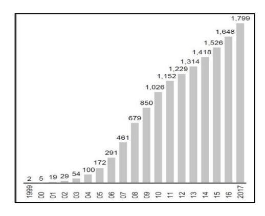
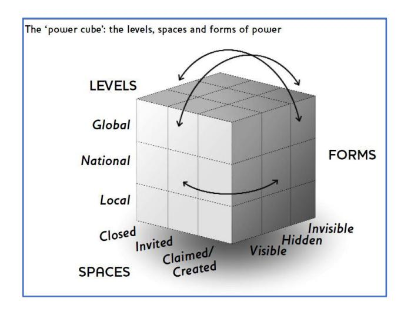

<!-- TH.R08 | source: papers_json/TH.R08/ -->

## **DOCTOR OF BUSINESS (DBA)**

The insertion of large management consultancy firms in the higher education sector ofthe GCC : the significance of power

Johnson, Rachel

Award date: 2019

Awarding institution: University of Bath

[Link to publication](https://researchportal.bath.ac.uk/en/studentTheses/f45d9515-3c5e-46ea-9e60-04fb754981f0)

## **Alternative formats**

If you require this document in an alternative format, please contact: openaccess@bath.ac.uk

Copyright of this thesis rests with the author. Access is subject to the above licence, if given. If no licence is specified above, original content in this thesis is licensed under the terms of the Creative Commons Attribution-NonCommercial-NoDerivs 4.0 International (CC BY-NC-ND 4.0) Licence (https://creativecommons.org/licenses/by-nc-nd/4.0/). Any third-party copyright material present remains the property of its respective owner(s) and is licensed under its existing terms.

**Take down policy**

If you consider content within Bath's Research Portal to be in breach of UK law, please contact: openaccess@bath.ac.uk with the details. Your claim will be investigated and, where appropriate, the item will be removed from public view as soon as possible.

Download date: 11. Oct. 2025

<!-- page 2 -->

## **THE INSERTION OF LARGE MANAGEMENT ** **CONSULTANCY FIRMS IN THE HIGHER EDUCATION ** **SECTOR OF THE GCC: THE SIGNIFICANCE OF POWER**

## *Rachel Nicola Johnson*

A thesis submitted for the degree of Doctor of Business Administration (Higher Education Management)

**University of Bath** **School of Management**

**September** **2019**

## **COPYRIGHT**

Attention is drawn to the fact that copyright of this thesis rests with the author. A copy of this thesis has been supplied on condition that anyone who consults it is understood to recognise that its copyright rests with the author and that they must not copy it or use material from it except as permitted by law or with the consent of the author.

This thesis may be made available for consultation within the University Library and may be photocopied or lent to other libraries for the purposes of consultation with effect from:

Signed on behalf of the Doctoral College:

<!-- page 3 -->

## **ACKNOWLEDGEMENTS**

I dedicate this thesis to my father Robert Ian Johnson in view of his 35 years of involvement in the legal management of educational matters for several universities in the West Country and lecturing on medical and nursing law. We gave each other many ideas over the years. I thank him and my mother Ann for their continuous support for my academic studies throughout my life.

Je n'aurais pas pu poursuivre et compléter cette thèse sans l'amour et le soutien de Martin Villeneuve. Alors, Martin, je te remercie de ta confiance en mes capacités et de ta détermination à me voir réussir. Je te suis très reconnaissante pour tous les ajustements que tu as apportés à ta vie afin de répondre aux mes besoins. Merci pour les sacrifices personnels et tes investissements pratiques et émotionnels. Celles-ci m'ont permis de continuer et ont une valeur incalculable. De cette façon, je reconnais ta précieuse contribution à cette thèse.

Professor Donald and Heather Baker of Peterborough, Ontario played a significant role in my progress to completion of the entire DBA programme. I am honoured by your investments in my personal, academic, and professional development and grateful for the enormous practical, intellectual, and emotional support you have given me since we first met in the UAE in 2008.

To David and Gail Muirhead of Connecticut, USA who housed and fed me, bolstered my energies and lent me their Jeep, when I was on site in Dubai collecting data for the thesis. This work would not have been possible without your generosity and friendship; I am deeply thankful and indebted.

My friends and colleagues in the United Arab Emirates and in Singapore provided the fabric – and often the inspiration – for my DBA scholarship. These communities and contexts have germinated many of the ideas presented in this thesis. I hope I have done justice to the interests we share.

When planning, implementing, and scripting this thesis I thought often of people who nurtured my early intellectual development and academic career. I still stand on the foundations laid down with Professors Peter Ashworth, Stephen Rowland, Rosemary Deem, Oliver Fulton, Jon Nixon, and Paul Trowler; I thank each one for encouraging me to tread my own path.

Professor Rajani Naidoo played a vital role in the production of this thesis, giving shape to the argument and order to the thoughts. Her conviction in the value of this thesis and recognition of my ability were essential. I thank Professor Mehdi Boussebaa whose ideas and research outputs were fundamental to shaping the focus of the thesis. I am grateful to my examiners Professors Susan Robertson and Hugh Lauder for their critical engagement with the work and comments that led to greater nuance and precision. The community of the DBA10 student cohort was essential.

*The Cat* witnessed everything; *Bleu* kept thesis writing in proportion with twice-daily walks at -20c.

<!-- page 4 -->

## **TABLE OF CONTENTS**

AbstractPart 1 Introduction, Literature Review, Theoretical and Methodological Approaches1.Introductiona.Preamble: a personal account of the research questionb.The Research Agendac.Connecting Research Domainsd.Theoretical Framework of Powere.The Structure of the Thesis2.Literature Review: Bringing Different Fields Togethera.Introductionb.Part One: Connectionsi.
Large Management Consultancy Firms as Global ProfessionalService Firmsii.
Global Professional Service Firms and Transnational Governance
iii.
Education Governance in the Context of Globalisationiv.
Power, Knowledge, and Neoliberalismv.
Management Consultancy and Higher Educationvi.
The Implication of Management Consultancy in theTransnational Governance of Educationvii.
Postcolonial Theory, the GPSF and Higher
Educationviii.
Conclusion to Part Onec.Part Two: Management Consultancyi.
Definitionsii.
Status as a Professioniii.
The Evaluation and Value of Management Consultingiv.
Knowledge and Expertisev.
Conclusion to Part Twod.Conclusion: Utility of the Literature for This Study3.Theoretical Framework: The Powercube
Integrated with a Postcolonial Analytica.Introductionb.An Analytical Framework to Identify and Examine Powerc.The Postcolonial Analytic as a Power-sensitive Toold.Conclusion: The Application of the Framework in This Study4.Research Strategya.Introductionb.Methodological Framework: A theoretical account of the ontologicaland epistemological underpinnings of my qualitative studyi.
Critical Realism and the Powercube
ii.
Critical Discourse Analysisiii.
Positionalityiv.
Accessv.
Interviewing Rolesvi.
Seeing Like a Consultant

<!-- page 5 -->

vii.
The Analysis Processviii.
Politics and Ethics in Researchix.
Data and its Statusc.Operationalisationi.
Data Sampling Strategyii.
Desk-based Studyiii.
Interviews: Sampling and Accessiv.
Interviews: Data Collectionv.
Interview Questionsvi.
Interviews Conducted5.Methods of Analysisa.Introductionb.Methodological Context of Analysisi.
Bricolageii.
Abduction and Reflexivityc.Interviewsi.
Interview Transcriptionii.
Use of the Transcripts in the Discussion of the Findingsd.Stages of Analysis of Interview Datae.Techniques of Critical Discourse Analysisf.Conclusion: Structure of the Second Part of the ThesisPart Two: The Regional Context and Findings6.Consultancy Firmsa.Introductionb.The Colonial and Post-colonial Heritage of the GCCc.Changes in the Political Context of the GCCd.Changes to Higher Education in the GCCThe GCC: Postcolonial Heritage, Autocracy, Higher Education, and Large Management
i.
Expenditureii.
Higher Education Enrollmentiii.
Differences Within the Regione.
f.The Scale and Impact of Management Consultancy in the GCC Context…
Large
Management Consultancy Firms in the GCC Higher EducationSectori.
Price Waterhouse Coopers (pwc)ii.
Deloitteiii.
KPMGiv.
The Boston Consulting Groupv.
McKinsey and Companyvi.
Ernst and Youngg.Conclusion7.The Centre and the Periphery: Issue Distinction, Linked Ecologies, and Scalea.Introductionb.Created Spaces and the Transnational Verticalc.Contextualisation: Production of Hinges
i.
North America, United Kingdom, Australia

<!-- page 6 -->

d.A Linked Ecology from Particular Parts of the World91i.
The 'World' Within Resources for North America, UnitedKingdom, and Australia91ii.
The GCC refracted by the 'World'95e.Conclusion998.The Internalisation of the Functions of the Universitya.Introduction101b.Adopting features and functions of the University101i.
Co-option: structures, image/identity, and collaboration102ii.
'Academic norms'105iii.
Education and Professional Training Functions106iv.
Research functions107c.Due Diligence110i.
Project work with clients110ii.
Knowledge generation and expert insight111iii.
Methodology113iv.
Conclusion117d.Legitimizing Knowledge and Expertise117i.
Size, reach, image and reputation117ii.
Networks and Contextual Experience118e.Conclusion1209.Requests for Proposalsa.Introduction123b.Requests for Proposals and the powercube124c.Markets and Revenue Streams125i.
Firm motivations125ii.
Consultant motivations126d.Networks and Networked Reputation130i.
Networks of Large Firms130ii.
Client and Consultant Networks130iii.
Trust Networks and Networked Reputation133iv.
Summary134e.Contracting and Contracts, Invitations and Negotiations134i.
Contracting and Contracts135ii.
Invitations and Negotiations136iii.
Capacity, Collaboration and Control137f.Conclusion13810.Realizing the Rules of Recognitiona.Introduction140b.Neoliberalism and the Market for Management Consultancy in thec.Higher Education Sector of the GCC
Powercube: Neoliberalism as hegemonic141
142d.Temporality, Teleology, and Tone: Private Investment and EconomicBenefit145e.Realising the Rules of Recognition148f.Conclusion152

<!-- page 7 -->

a.Introduction154b.Identification of the Research Question: Connections154c.The Analytical Power of the Powercube
156d.Detailed Summary of Findings158e.Summary of Key Scholarly Contributions160f.Practical Implications160g.Research Limitations and Future Research162Bibliography163Appendixes1.Management Consultancy Resources Useda.Anglosphere179b.GCC1822.Example of Critical Discourse Analysis Method1853.Critical Discourse Analysis –
Evidence for Chapter Sevena.North America, United Kingdom, Australia195b.GCC1964.Checklists and Categorisations (Evidence for Chapter 8)200

<!-- page 8 -->

## **ABSTRACT**

Since 2000, global professional service firms have expanded their operations in the countries of the Gulf Cooperation Council (GCC). The client base includes the higher education sector. This study shows how large firms expand, secure their market, and gain client base in the sector and identifies some outcomes of their operations. New connections between the higher education literature and the international business and organisation literatures provide an interdisciplinary research agenda and support deployment of an analytical framework for identification and examination of a multiple concept of power. Documentary and interview data are used within a critical realist methodological framework.

The study highlights how strategies and mechanisms used draw on different 'forms' of power and how power operates 'spatially' to create and claim markets, client networks and contracts. The 'scale' of power is dynamic and transformative; the dynamic reflects historical and contemporary geographical power relations and it draws global centres into local peripheries to expose nationally bounded systems to transnationally circulating agendas. Firms propose decontextualized and homogeneous views of the GCC context and its problems and apply to this a generic 'panacea' of diagnosis and solution. This panacea is informed by firm experiences in historical centres of higher education and cognitive assumptions associated with the broad concept of neoliberalism. The outcomes augur transformation of the purpose, organisation, and operation of higher education in the GCC. The research concludes with policy and practice recommendations for GCC clients and consultants relating to contract formation and execution, and business models.

<!-- page 9 -->

## **CHAPTER ONE**

## **INTRODUCTION**

## **Preamble: a personal account of the research question**

I have worked in universities in the United Arab Emirates (UAE) since 2008, except during the period 2013 – 15 when I worked for a university in Singapore. My research for four DBA research assignments has reflected this international experience by examining issues that, according to my contextualised experience, were under-researched.

The UAE is one of the six countries that form the Gulf Cooperation Council (GCC). The others are Bahrain, Kuwait, Oman, Qatar and Saudi Arabia; each have significant oil and gas reserves and share a maritime border with the Arabian Gulf. GCC nations maintain political systems of authoritarian rule; they are all monarchies (constitutional, absolute, or federal). This provides challenging context for a plurality of external actors to gain purchase and influence within governance. Prompted by external forces that are rapidly gaining momentum rulers negotiate openness and invitation to participate in policy making circles and have given direction and resource to the development of their countries so that these are now open, globalized and massively modernized societies that are part of the global economic system with vast links to multinational companies and international commercial and financial centres.

Governments across the GCC are making efforts to expand supply and demand for higher education. Although the starting points for expansion and pattern of development is uneven, the total of GCC government investment in higher education has quadrupled over the last decade and participation rates in education have grown fastest in the tertiary sector. Expansion efforts are related to assumptions about the role of higher education in economic growth and the wish to transition from oil-based revenues to revenues generated by a corporate, private-sector 'knowledge economy'. Although the growth in GCC education systems, in terms of number of providers and participation rates, is a result of deliberate government strategy and public investment, policy also encourages private capital investors and private operators. Efforts in some GCC countries (UAE, Qatar, and Bahrain) centre on the establishment of higher education 'hubs'. A useful analysis of 'hubs' and their different manifestation both within the GCC region and other parts of the world is provided by Knight, (2011, 2018). A significant feature of many higher education hubs is the establishment of international branch campuses (IBC) by universities that have primary location outside the country or region where the hub is located^1^ (Healey, 2014; Lawton and Katsomitros, 2012)^2^ . Although not necessarily run 'for profit' the IBC is not a philanthropic venture and takes advantage of the infrastructure (and often seed-funding) provided by the host country. The literature on IBCs suggests that there are significant managerial challenges involved, and that we need detailed theoretical and practical understanding of these.

My original intention was to contribute to this literature with an examination of the significance of the home-host dyad to the management of universities with IBCs. This idea involved conceptualising the IBC as part of a 'whole structure' that operated across and within (at least

> ^1^ http://cbert.org/resources-data/branch-campus/ [Accessed 12th August 2019]

> ^2^ Discussion of these issues runs throughout the thesis because the massive and rapid expansion and reorientation of the GCC higher education sector (providers and participation) can be linked to the reasons for the hire of management consulting firms – both large and small by governments and institutions.

<!-- page 10 -->

two) national borders. This would have been an original theoretical framework to use in a muchneeded detailed study *in situ*. The idea drew on lessons emerging from emerging critical research on **multinational organisations and global professional service firms**. This research examines the dynamics and tensions of organisations that organise both locally and across national borders and identifies postcolonial theory as useful in understanding the patterns of relationship involved. The patterns chart the continued dominance of geographical centres of economic and political power and suggest continued exploitation of the 'periphery' for corporate gain. The higher education literature also describes historical centres of academic power, and these lie in the same places.

It was when preparing for research on the 'university with IBC' that I came across the following PR announcement from one of the global professional service firms:

"*pwc*, one of the world's largest professional services firms, announced the appointment of Sally Jeffery as its Global Education Network Leader. Based out of *pwc* Middle East's headquarters in Dubai, Sally leads the Education Consulting practice, a team of dedicated education specialists who are part of *pwc*'s 1,000 strong advisory workforce in the region. … Her team draws in a wide variety of top faculty from around the world to develop curricula and programmes aligned with local needs and leverages the broader *pwc* education network – a network advising over 200 of the top global universities. … On her appointment, Sally Jeffery said: '… we are providing student centric management services to universities and training colleges in more and more markets around the world.' She added: 'We as a firm are also particularly well placed to guide our Middle East and international clients on how to establish successful partnerships and joint ventures – transfer knowledge and learnings to more developing markets, and help our clients find that sweet spot between public and private partnerships. Academic institutions are not typically very experienced in commercial arrangements and we can help immensely in this area'."^3^

Despite the concentration of revenue generating activity in North America and Europe, management consultancy has a long history in the GCC dating back over 90 years. The growth of management consultancy in the region has intensified such that it now generates a significant proportion of total global revenues and a sum disproportionate to the geographical size of the region. For example, here are statistics that show the cumulative growth in number of client engagements in the region that were achieved by McKinsey over the first 17 years of this century:

> ^ ^ ^3^ [https://www.pwc.com/m1/en/media-centre/2016/press-releases/sally-jeffery-announcement](https://www.pwc.com/m1/en/media-centre/2016/press-releases/sally-jeffery-announcement-english.pdf)[english.pdf](https://www.pwc.com/m1/en/media-centre/2016/press-releases/sally-jeffery-announcement-english.pdf) [Last accessed 19th July 2019]

8

<!-- page 11 -->

For the DBA research assignments, I had already completed work related to professional service firms. I had probed questions around the status of universities as professional organisations, universities as organisations comprised of academic profession and service profession communities, and as organisations responsible for establishing the knowledge base and awarding credential to professional practitioners. In the fields of international business and organisation research focussing on the professions studies sometimes referred to the historical role of the university in professional formation and governance of professions. These fields have recently highlighted how global professional service firms are coopting and forming allegiances with university business schools to further their cooperate interests. However, the above PR announcement seemed to *turn such a relationship on its head*. Higher education and universities were becoming additionally useful as a source of income and yet also, by accessing higher education and universities *as clients*, the large professional service firms seemed to have gained the potential to play a role in the function, operation, and purposes of higher education and universities. This then raised questions about whether such potential is being realised and if so how, and questions about why universities are using such firms, how that relationship works, and what are the outcomes. Furthermore, I found only one piece of extensive research on the work of global professional service firms in universities, and this was a study based outside the GCC region.

According to the literature, the historical organisation and management of universities was the outcome of decisions taken in collegium by academics whose expertise lay primarily in their discreet disciplines and not necessarily in leadership, finance, strategy and management. Administrators without mandate of their own served as a quasi civil service to operationalise the decisions taken. Latterly, owing to widescale changes in the operating environment, universities have developed more managerial, corporate, and explicitly entrepreneurial forms of organisation in which context the 'administration' has changed in identity and gained more active and powerful role, and now also comprises individuals who are professionals in their own service field (e.g. marketing, HR, finance). I first thought that the incursion of the large management consultancy firms in higher education in the GCC reflected the stretch and challenge facing both the academic leadership and professional administration of the operating environment in general as well as organisational diversification to include private and foreign providers.

Yet further inquiries into the client base and client projects of large professional service firms such as *pwc* revealed that their work in the GCC higher education space stretches far beyond questions of the organisation and management of universities. It concerns curriculum, student learning, and research strategies and outcomes - issues that have traditionally been the realm of academics and continue to be fought over as academic concerns despite the context of increasingly executive managerial forms of university leadership. Furthermore, the large firms are active at government level guiding Ministries and influencing higher education policy, the development of higher education systems, structures and purposes, and principles and tools of higher education governance. They are also being hired by investment companies to ensure alignment between capital interests and private university strategy and operations. Project work included^4^ , for example:

> ^4^ The evidence for this is in personally obtained firm responses to clients' requests for proposals and is not in the public domain.

<!-- page 12 -->

## Example 1

A 20-year strategy to improve teaching and research and increase global reputation of the top ranked institution in the Middle Fast.

## Example 2

[The firm] was engaged by [a university] to undertake a quick assessment of their current practices across five key areas:

- Operating and governance models and organizational structure
- Research performance and impact
- Digital technologies enabling support services and teaching and learning
- Efficiency and effectiveness of back office functions
- Student experience

## Example 3

[The firm] was engaged by [the university] to provide an internal and external perspective on the University's current position in the market. We identified and prioritised opportunities for the future and provided implementation considerations for delivering those opportunities identified as the highest priority. We conducted the review of [the university] across the following 6 areas to understand its current position:

- Governance, People & Operating Model
- Research and Enterprise
- Curriculum and Programs
- Student Experience & Employability
- Education Technology
- Enabling Activities

## Example 4

[The firm] was engaged by an investor to undertake a strategic review of a [GCC] based university in order understand the value that the University brings and the potential benefits to the investor group. We conducted the review of the university across 7 areas to understand the alignment of the University with the group and to assess its performance qualitatively:

- Strategic alignment
- Operating model and partnering strategy
- Program and curriculum development
- Enrolment management
- · Academic planning and quality assurance
- Education delivery
- Educational and institutional technology

<!-- page 13 -->

## Example 5

[The firm] was engaged to design a new operating and governance model based on the new strategy. [The firm] was responsible for the following activities:

- Strategy and organizational design review.
- Benchmarking best practices in key universities
- Design operating and governance models
- Deep dives into: Strategy Execution, Educational Technologies and Shared Services
- Mapping of students' journeys and partners' journeys
- Education technologies recommendations for innovation
- Development of policies, procedures and student learning agreements

## Example 6

[The firm] was engaged by the [Ministry] to design the 10-year higher education strategy for [GCC country]. [The firm] was responsible for the following activities:

- Conducting an in-depth current state assessment of the landscape of higher education in [GCC country] and in-depth benchmarking.
- Identifying the skills gap in the country through a supply/demand analysis.
- Developing the strategic priorities through analysing the higher education system governance including its operating model, regulatory framework, and funding system.
- Addressing institutional and regulatory arrangements necessary for strategy implementation.
- Aligning all strategies with [GCC country's] evolving research agenda and national priorities.
- Identifying key stakeholders and prioritised initiatives with timelines and co dependencies.
- Projected implementation budgetary requirements.

This resulted in a holistic higher education strategy for [GCC country] which included thematic and functional objectives stressing on the need to balance access, quality, and affordability, while addressing key challenges facing the sector including the employability of graduates, diversity of the offerings, alignment with national priorities and potential for attracting international students.

So, as a result of the chance discovery of a PR announcement, my research interests were transformed. In order that the investigation move from what would otherwise have been a piece of journalism, I needed to identify and ground the study theoretically. However, no single theory or theoretical research field seemed sufficiently comprehensive to offer focus for the broad interests of the study. Therefore, my challenge at the outset was to bring different theoretical and research fields together with some measure of coherence and, furthermore, to identify issues where research would be justified because of absences or weaknesses. The remainder of the introduction to the thesis sets out how I addressed this challenge.

<!-- page 14 -->

## **The Research** **Agenda**

As noted above, in the past two decades the higher education sectors of the six nations comprising the GCC has expanded rapidly with significant reliance on private sector investors and operators from outside the region. This growth has occurred in the context of intense social and economic development in the GCC nations and rapid expansion of public and private institutions and infrastructure. During this same time period the large management consultancy firms have expanded their operations in the region.

In the higher education literature, it is recognised that management consultancy firms are increasingly active in the higher education sector, but this phenomenon is little studied. Furthermore, there are no studies of the growth and operation of the large management consultancy firms in the GCC. And, no connection has been made between the work of the large management consulting firms and the directions (rules and norms) of social, economic, and institutional development in the GCC. This qualitative study contributes to these areas by examining *how* large management consultancy firms are inserting themselves in the higher education sector of the GCC region and by examining for the outcomes of this work.

The theoretical foundations and critical interests of the study derive from an interdisciplinary framework that I have constructed. This framework connects and critiques studies of the political operation and impact of global professional service firms such as large management consultancy firms and studies of transformations in the political economy of higher education. These literatures have not previously been connected and so their shared interests have not been identified. Moreover, their mutuality has not been exploited in terms of seeing how one might inform the other. This chapter explains those connections and how the interrogation constructs an agenda and rationale for the research.

It results in the following central research question and more nuanced sub-questions:

- What are the strategies and mechanisms used by large management consultancy firms to insert themselves in the GCC higher education sector? o What are the characteristics and dynamics the of the mechanisms and strategies?o What are the politics and interests at stake?o What is contingent or conditional, what is gained or lost when these strategies and mechanisms are employed?o What are the outcomes and the consequences of this work in terms of transnational governance, the implementation of practices associated with neoliberalism, and our understanding of the purpose, organisation and function of the university?o To what extent is a power-sensitive theoretical framework useful in understanding these strategies and mechanisms?o How are historical centre-periphery relations reflected in the work of large management consultancy firms in the higher education sector of the GCC?

## **Connecting Research Domains**

In this section I present an overview of the connections between the two sets of literatures and their application to this study in terms of the above set of questions. The literatures are reviewed in detail in the following chapter.

<!-- page 15 -->

A literature on the governance of education in the context of globalisation (Brown, Lauder, Ashton, 2011; Lauder et al, 2012; Robertson, 2003; 2010; 2012; 2017; Dale and Robertson, 2007; Robertson and Dale, 2006; 2008; Verger and Robertson, 2012) has parallels with the studies of the dynamics and influences of the global professional service firm that are found in the international organisation, management and business literatures.

Large management consultancy firms are understood to be a subset of organisations known as global professional service firms (GPSF). GPSFs are knowledge and human-capital intensive organisations (von Nordernflycht, 2010; Starbuck, 1992) that deliver services based on esoteric expertise; a few have grown to be 'global giant' multinational corporations (Armbruster, 2006; Hinings et al, 2015). In the literature GPSFs are considered important actors in defining the terms of transnational governance – the bundles of rules, roles and relationships that define and regulate the social practices of state and nonstate actors (Boussebaa and Faulconbridge, 2016; 2018; Boussebaa and Morgan, 2015; Boussebaa, Sturdy, Morgan 2013; Morgan and Boussebaa, 2015; Faulconbridge, 2015; Faulconbridge and Muzio, 2011; Greenwood et al, 2010; Hinings et al, 2015; Morgan, Sturdy, Quack 2006; Seabrooke, 2014; Suddaby et al, 2007). In the literature of the governance of education, the focus of such governance is on its funding, provision/delivery, ownership, and regulation. The suggestion in both literatures is that GPSFs are – alongside multiple other actors – active in the implementation of practical technologies and discursive practices that are compatible with the broad terms of the neoliberal agenda.

Both the education and international organisation, management, and business literatures note that we lack detailed systematic research into *how* the GPSF, as one of multiple actors, come to play an influential role in transnational governance. We need also to examine for the character of this influence, and in particular for context-specific variation in practices and technologies associated with the broad terms of a neoliberal agenda. Both literatures call for greater attention to power and the politics and interests of actors and agents and their purposes, processes, practices and outcomes. Both fields of literatures also argue that when power is examined, too narrow a concept of power is used.

In broadening the concept of power, we can refer to, and extend Lukes' (1974) well-known 'faces' of power. Broadening the concept recognises that the 'faces' of power operate in spaces and at different scales and that the operation of power is both dynamic and transformative (Gaventa, 2007). This approach is coherent with arguments within the sets of literature concerning how, in the context of a globalizing world, power operates to refract the local against dominant global agendas and to transform local settings in terms of these agendas (Dale and Robertson, 2007). This approach is important because such arguments are not yet well documented empirically – we need to show how transnational governance works in practice and to what effect.

Within the broad discussions of governance in the context of globalization we also find arguments about how the command of knowledge production and claims to expertise are key power strategies (e.g. Boussebaa and Faulconbridge, 2018; Reed, 1996; 2012; Scott, 2008). Although the literatures discuss the relationship between knowledge and expertise and power (for which see Stehr and Adolf, 2018), this connection has not stimulated interest in the relationships between the GPSF and the university as two knowledge-intensive types of organisations. Similarly, there has been no attention paid to this relationship in discussions of transnational governance and questions of how different actors come to have influence.

<!-- page 16 -->

The literature does note that universities and large management consultancy firms have had longstanding relationships – mostly in connection with the university business school (Engwall, 2012; Kipping and Clark, 2012; Sturdy and Gabriel, 2000; Suddaby and Greenwood, 2001). However, recent research sees the boundaries of the relationship changing. We see how large management consultancy firms are starting to take on the role and functions of the university in knowledge production and in the training and credentialing of professionals. So, if the large management consultancy firms are beginning to displace the university as centre of knowledge production and qualification then we need to ask critical questions concerning 'due diligence' (Engwall, 2012; Suddaby and Greenwood, 2001) and the public good (Calhoun, 2006; Marginson, 2011) and to see what 'knowledge and expertise' is being drawn on. We also need to see how the knowledge and expertise of the large management consultancy firms is applied inside the higher education sector, why it is sought out within the sector, and what impact it has. These two issues – the dislocation of higher education and its colonisation by large management consultancy firms – are critical to an understanding of the sources and patterns of influence within transnational governance.

Finally, there is shared attention in the two literatures to the significance to globalisation processes of unequal historical social, economic, political and military relations between nations. In the literatures we learn that the centres of higher education (Altbach, 2004; 2009; R. Naidoo, 2011) and management consultancy (Sturdy, 2011), and management consultancy work in higher education are located regions that others have described as the 'anglosphere' (Kenny and Pearce, 2018). The 'anglosphere' is a group of countries "situated within an imaginary horizon of a shared political and economic culture, nourished from the roots of British parliamentary institutions, economic liberalism and Protestantism" and comprises the UK, USA, Canada, Australia and New Zealand (Kenny and Pearce, 2015:23). The Anglosphere includes centres of historical colonial and contemporary neo-imperial power (Go, 2013; Westwood and Jack, 2008; Jack et al, 2011; Prasad, 2012). In this study various dispersed literatures on the GCC are brought together to show how the GCC context has long been a peripheral context exploited for economic and political reasons by both historical and contemporary centres of power. This finding then raises the question of whether management consultancy in the GCC reflects and reproduces historical and contemporary centre-periphery relations, power relations that constitute a dominance effect and expose the GCC to the dominant norms, rules and agendas of the 'anglosphere'.

## **Theoretical Framework of Power**

In this study power is conceptualised using an analytical framework called the *powercube*. This three-dimensional framework incorporates, as one dimension, the three faces of power proposed by Lukes (1974). In the context of the *powercube* these three faces are referred to as visible, hidden, and invisible forms of power. The framework also introduces power as operating in a spatial dimension and a scalar dimension. Power operates to create, claim, close and transform space, and it operates in different geographies, from the local to national, regional and global. Moreover, power operates dynamically and in interaction so that different forms of power work differently across spaces and scales and have different transformative effects. However, the framework of the *powercube* omits a critical analytic to understand power relations between spaces and geographies. Thus in order to address questions of historical and contemporary centreperiphery power relations I therefore draw into the framework a postcolonial analytic and powersensitive tools derived from critical discourse theory. The latter are highly relevant to examination of 'invisible' forms of power – forms of power that shape ideas and norms.

<!-- page 17 -->

## **The structure of the thesis**

The thesis is structured in two parts. The first part of the thesis comprises this introduction, which details the agenda and rationale for the study, and then introduces the interdisciplinary literature and explains how I have designed and operationalised the research. The second part of the thesis provides discussion of the analysis of the interview and documentary data. It integrates this discussion with the literature on management consultancy whilst also being structured and sensitised by the analytics of the *powercube* and the postcolonial perspective.

## *Part One*

## **Introduction** (present chapter)

**Chapter Two** provides a review of the literatures of the political operation and impact of GSPF and transformations of the political economy of higher education. Here I first I present the key insights, connections and areas where we lack adequate study before examining the relevant studies in more detail. The literature review also examines studies of the management consultancy industry and management consultancy practice, paying attention to studies of the nature of the knowledge and expertise of management consultancy.

**Chapter Three** introduces the *powercube* as a theoretical framework. In this chapter I explain how the *powercube* is productive in encouraging sensitivity to power, identifying and thinking about power, and structuring discussion of my analysis of power. I also explain how a postcolonial analytic provides a critical perspective on geographical historical power relations, and how critical discourse theory is useful tool within this task as well as being relevant to understanding discursive, ideational, ideological 'invisible' power.

**Chapter Four** discusses the design of the study and why the methodological approach is suited to addressing the research questions. In doing so it discusses the epistemological and ontological underpinnings of the approach together with discussion of some political and ethical implications of research work. The second part of this chapter details how the research was operationalised, detailing the interview and documentary data sought and how I went about gathering it.

**Chapter Five** addresses the philosophical underpinnings of the approach to analysis, including the requirement for a reflexive awareness during the research process. It then moves to present the stages and practical decisions/outcomes of the analysis of interviews and how a critical discourse analytic was applied.

## *Part Two*

**Chapter Six** develops an analysis of the GCC context in which we can see how its political economy was, and continues to be, set in global relation to the 'anglosphere'. The analysis is structured by themes relevant to the research. These are the colonial and postcolonial heritage of the GCC, the impact of globalization on the system of autocratic rule in the GCC nations, how higher education sector in the GCC is changing, and what we know about the development of management consultancy in the GCC. The Chapter draws on desk-based research as an evidence base because there is little research work on the political economy of the GCC in these terms. It concludes with a summary of how the themes link together under the broad terms of neoliberalism, neo-

<!-- page 18 -->

imperialism, and economic /social globalisation. We see how reform has focused on enriching the private sector and private wealth, and on modernisation around technology, physical infrastructure, and public services. Within this reform governments have sought to expand higher education. The expansion of higher education has been uneven in scale, speed, and success but it has been intensive and remarkable in relation to other parts of the world. Against the backdrop of reform, the management consultancy industry has grown dramatically and several of the large firms are identified as active in the higher education sector of the GCC.

**Chapter Seven** draws on the critical discourse analysis of documents produced by large management consultancy firms for and about higher education. These documents are a mechanism of constructing a market need in the GCC higher education sector. The resources propose that there are a set of problems and issues facing the sector that require urgent review. The resources produced for and about higher education in the 'anglosphere' and higher education in the GCC differ in how the problems, issues, and terms of 'review' are constructed and understood. Furthermore, we can see how the GCC context is presented in a refraction against the 'anglosphere'. From a postcolonial perspective the GCC at the periphery is understood as lacking in relation to the 'anglosphere' centre.

The resources construct a community in discussion of these issues and are a device to extend the discussion. I describe how this works using terminology from the management consulting literature. The community is a 'linked ecology' of different professionals who gather around a 'hinge' in a process of 'issue distinction', a process that both defines the issue and defines jurisdiction over that issue. We can see how the community is dominated by members of the 'anglosphere'.

In terms of the *powercube* this chapter identifies *invisible *forms of power serving to create a *space* for management consultancy in the higher education sector. Power operates at a transnational scale in terms of the juxtaposition of the GCC with the 'anglosphere'.

**Chapter Eight** addresses observations in the academic literature about the relationships between management consultancy firms and university business schools. It identifies that there are two key strategies used by the large management consultancies to claim a role for themselves in the 'space' that they have constructed discursively in the resources. The first is to generate knowledge about the higher education sector and the second is to adopt characteristics of universities. By creating structures in the image of academia and by collaborating and associating with academic institutions and academics, the large management consultancy firms cultivate an academic identity and imply academic warrant for their knowledge and expertise. The firms thus position themselves to claim an expert role with respect to the needs they propose are faced by the higher education sector. Under this analysis, what matters is not simply that management consultancies have internalized the functions of the university and eclipse and compete with academia in the production of knowledge and expertise. Rather, the firms are also positioned to colonise the higher education sector. Furthermore, in examination of the 'due diligence' demonstrated in this knowledge production process we can see that the business model of the firm both motivates and constrains knowledge production. Knowledge production by the large management consultancy firms is not a disinterested process of generating a public good for the good of the public. I suggest that in the higher education sector of the GCC clients use substitute criteria to evaluate the warrant of the knowledge and expertise of the firms. The substitute criteria are brand identity in terms of size and global reach and rich resources of human capital and knowledge management systems. However, clients and to some extent consultants saw that

<!-- page 19 -->

it is necessary to balance the resource of global reach with the ability to contextualise knowledge and expertise in terms of the GCC and the specifics of the higher education sector. All of this suggests that higher education clients should be more critical in their evaluation of the knowledge base and expertise of the large consultancy firms and more specific in requiring collaborations between the large firms with large resource base and the niche firms with expertise grounded in a contextualised and specialist understanding of the GCC higher education sector.

In terms of the *powercube* I identify that visible (capital) and invisible (discursive, ideational) forms of power work to claim a role for the large management consultancy firm in the space created. Power operates on a transnational scale, by contrasting the GCC with knowledge and expertise generated external to the GCC and using this knowledge and expertise to construct rules and models for it. The 'anglosphere'-centric sources of knowledge and expertise serve to scale work in the GCC higher education sector externally and to incorporate the external in local practice.

**Chapter Nine** examines the strategies and mechanisms used by large management consultancy firms to form contracts of work in the higher education sector. These involve networking practices, network structures, the cultivation and definition of client need within requests for proposals, and reputation seeking (branding). I argue that the decision to create and claim a role in GCC higher education is motivated by revenue. I show further that the market is determined by the sources of revenue and that the work of consultants from the large firms is directed by these sources. I discuss how networks and social capital are central to market development; these stimulate the perception of need and lead on to the definition and commercial expression of need. I examine consultants' experiences of working with clients around client requests for proposals of work. The analysis argues that in the GCC context the roles and collaboration of client and consultant need to be made explicit, and balance of power negotiated continuously. Effective consultancy in the higher education sector of the GCC is revealed as time intensive both at the initial junctures where the terms are being set and in the execution. Yet investment in time stands in tension with the performance and profitability metrics of the firm.

Using the framework of the *powercube*, requests for proposals are conceptualised as an 'invited' and 'hybrid' space in which 'hidden' forms of power operate. Hidden power is the ability to set the agenda, terms of reference, and membership of the management consultancy project.

**Chapter Ten** discusses the client projects that result from the insertion of the large management consultancy firms in the GCC higher education sector. The resources and interview accounts provide evidence to suggest that management consultancy work implements, within national boundaries, concepts and practices associated broadly with globally circulating logics of neoliberalism and subjects the component parts of the higher education system to the discipline of its norms, forms and orders. We see how the management consultancy work embeds neoliberalism constitutionally, orienting policy and regulations to market related practices. In the context of client projects, the work enables private sector funders and operators and it reorientates the public sector in terms of three forms of competition.

In terms of the *powercube* we see how invisible, hidden, and visible forms of power serve to transform the GCC higher education space from a nationally enclosed sector focused on national needs, to being exposed to the globally circulating discourses of neoliberalism and the practical ideas that relate to this discourse. In terms of the *powercube* neoliberalism is a hegemonic form of power that operates dynamically and on a scale that is transformative in its impact on a space. This conclusion provides support for the argument that the large management consultancy firms

<!-- page 20 -->

are active as actors in the governance of higher education and are agents of the globalization of its governance.

In the conclusion, **Chapter Eleven**, I review the empirical findings in relation to the research question and propose the implications for the university of the findings of this study and some practical steps forward. Finally, I discuss the limitations of the research and areas for future study.

<!-- page 21 -->

## **CHAPTER TWO**

## **LITERATURE REVIEW: BRINGING DIFFERENT FIELDS TOGETHER**

## **Introduction**

The aim of this study is to contribute to our understanding of how large management consultancy firms insert themselves in the higher education sector of the GGC region, and what is the impact of that work. The study addresses critical questions that arise when considering the insertion of the firms in the sector in the context of linked concerns across the literatures of the political economy of higher education and of global professional service firms.

The purpose of this literature review is therefore to connect discussion of the governance of education in the context of globalization with an emerging body of work on transnational governance across the international business, management and organisation fields of study. Section one of the review makes these connections. Part of the discussion shows that the literatures are differently but jointly concerned with knowledge and expertise and the relation of these to power. The second section of the literature review addresses the voluminous research on management consultancy and places emphasis on studies that discuss knowledge/expertise. The concept of power is dealt with in Chapter Three.

## *Summary*

The first set of connections concern governance and neoliberalism. In the study of the governance of education in the context of globalization, governance is understood as the generation of rules around the funding, provision/delivery, ownership, and regulation of education. Here, the large multinational management consultancy firms are viewed as one of multiple actors who implement in local settings a globally circulating dominant agenda around these rules. The dominant agenda for the governance of education is permeated by ideas associated with neoliberalism, in broad terms. Although the practices and technologies advanced are adaptive to local contexts they generally pursue this market-based philosophy. This area of research has parallels with the international organisation, management and business literatures. Here, the large multinational management consultancy firms are studied as a subset of the 'global professional service firm' (GPSF). In the research, the GPSF is understood as one of the multiple actors who have influence in transnational governance - on setting hard rules/laws and soft norms/standards for a broad range of social, economic, and political affairs. The literature understands the motives of the firms as furthering corporate interests both in seeking revenues and profits and also setting an infrastructure to enable the extension of those interests. This infrastructure in turn supports the growth of global capitalism, the development of the global knowledge economy, and the implementation of market-oriented discourse and practice.

The second set of connections concern the need to provide empirical evidence around the two analyses above, and within this a need to attend to power. In both the field of education and in the international organisation, management and business literatures it is acknowledged that it is essential to identify and analyse the strategies and mechanisms by which actors such as large management consultancy firms gain positions of influence in the governance of social, economic and political affairs. Yet this has not been achieved in systematic detail. Critical accounts of

<!-- page 22 -->

governance in both literatures also point to the lack of attention to power, or a too narrow conception of power, in what are generally institutionalist accounts of how hard rules/laws and soft norms/standards are generated, diffused and implemented. The production of knowledge, gaining position to claim expertise, and gaining control of 'cognitive' agendas are considered power strategies and key means of influence.

The third set of connections concern knowledge intensive organisations. Like universities, large management consultancy firms are knowledge intensive organisations. The management consultancy industry has had an historical relationship with universities, either to gain warrant for ideas, to lend the consultant an academic identity, or to obtain ideas for dissemination. However recent research sees the boundaries of the relationship changing with large management consultancy firms taking on the role and functions of the university in knowledge production and in the training and credentialing of professionals. This shift connects with the above discussion of the significance to transnational governance of knowledge, expertise and power. It also raises the significance of questions over whether management consultancy firms also pursue the 'due diligence' role of universities and the consequences of the privatisation of knowledge production. This connection and questions around it are unexamined in the literature. There is growing popular awareness and increasing assertion in the academic press that universities are calling on the services of the large management consultancy firms ever more frequently, and that the services provided concern the role, organisation, and function of the university. However, these assertions are unexamined empirically. And when making the connection back to the idea of the 'infrastructure' that the GPSF creates for itself and the cognitive agenda of the governance of education in the context of globalisation we can ask questions about the work of the firm and its connections to global capitalism, the global knowledge economy, and the application in local contexts of practices and discourses informed by the broad, globally circulating philosophy of neoliberalism.

Finally, both the higher education literature and the international organisation, management, and business literatures contain critical analysis of the significance to globalisation processes of historical social, economic, political and military relations between nations. Under colonial rule centres of power exploited peripheries in their own interests. A postcolonial analysis identifies how centres and peripheries relate in a dominance effect and that this effect continues today as neo-imperialism. The centres of higher education and management consultancy, and management consultancy work in higher education are located in the 'anglosphere' centres of historical colonial and contemporary neo-imperial power. The GCC context has long been a peripheral context exploited by historical and contemporary centres of power. Thus, the final area of examination needed is to identify if the work of management consultancy in the higher education sector of the GCC and the infrastructure it constructs reflects and reproduces the dominance effect. And if so, it would also support the thesis contained in the literature of governance in the context of globalization that globalization has a subject, and that power operates spatially: there is set of actors that implement dominant global agendas in local contexts.

The literatures that provide for the above connections are discussed next in the following order

- Large Management Consultancy Firms as Global Professional Service Firms
- Global Professional Service Firms and Transnational Governance
- Education Governance in the Context of Globalisation
- Power, Knowledge, and Neoliberalism
- Management Consultancy and Higher Education

<!-- page 23 -->

- The Implication of Management Consultancy in The Transnational Governance of Education
- Postcolonial Theory, the GPSF and Higher Education

## **Part One: Connections**

*Large Management Consultancy Firms as Global Professional Service Firms*

Large management consultancy firms are a sub-set of organisations known as professional service firms (PSF). PSFs form a heterogeneous group of often hybridised organisations (Hinings et al 2015; Suddaby et al, 2008) which demonstrate the following features to varying degrees according to the different nature of the professional service in question (Boussebaa and Morgan, 2015; von Nordenflycht, 2010).

Firstly, the PSF is **knowledge intensive**. Starbuck (1992) argues that for a firm to be identified as knowledge-intensive, its knowledge must be exceptional, esoteric, and valuable. Alvesson (2001: 863) defines knowledge-intensive firms as those for which "most work can be said to be of an intellectual nature and where well-educated, qualified employees form the major part of the work force." Knowledge is embodied and embedded and organised and transferred in networks; it is human and social capital. Knowledge is also the product of organisational routines, cultures and historical work and held as proprietary capital of the firm. Organisational structure and control of human capital are key considerations and collective partnership and extensive individual autonomy are typical (Hughes, 2007; Reihlen and Nikolova, 2010; Scarborough, 2002).

Second, the individuals constituting the human capital of the firm identify, and are recognised, as **professionals,** irrespective of whether this credential is formally certified, a rhetorical claim, or achieved through particular practices (Alvesson 1993; Alvesson 2001, Alvesson 2011, Muzio et al 2011). However, from the firm perspective, traditional concepts of **professionalism** such as trusteeship and the public interest stand in tension with commercial business and profit motives (Boussebaa, 2016; Brivot, 2011; Morris and Empson 1998; Spence et al, 2017; Suddaby et al, 2007; Suddaby et al, 2008).

Third, the PSF emphasises **client relationships **and the customisation of specialist technical knowledge to define and solve client 'problems' (Hinings et al, 2015; Morris and Empson, 1998). Service production involves building informed relationships with the client, defining the client's role in the project, and sustaining the necessary degree of collaboration with the client (Applebaum and Steed, 2005; Broschak, 2015; Morris and Empson, 1998).

Research on the PSF studies management and organisational strategies, structures, processes, and performance (Brock, 2006; Greenwood et al, 2005; Faulconbridge 2015; Somaya and Mawdsley, 2015), the expansion of jurisdiction or market share (Barratt and Hinings, 2015; Faulconbridge and Muzio 2011; Gardner, Anand, Morris 2008; Suddaby and Greenwood, 2001), the extensiveness of the client base (Hinings et al, 2015) and the encroachment of areas traditionally the domain of other organisations, such as professional formation (Faulconbridge and Muzio, 2011). A notable research theme identifies the rapid and intensive expansion of professional services firms so that some are now 'global giants' (Hinings et al, 2015). The PSFs have expanded in terms of size (employees, offices, annual revenue), sectors (client base/industry range) and geographical footprint to become **global** professional service firms (GPSF) (Boussebaa and Faulconbridge, 2016;

<!-- page 24 -->

Boussebaa and Faulconbridge, 2018; Boussebaa, Sturdy, Morgan 2013; Greenwood et al, 2010; Hinings et al, 2015; Morgan and Boussebaa, 2015). In the global context, PSFs additionally work with other transnational, international and multinational organisations (Brock, 2016; Faulconbridge, 2015). The GPSF is recognised as experiencing organisation and management issues that are different to multinational corporations in the manufacturing or retail sectors because of their knowledge-intensive work and the significance of professionalised human capital (Boussebaa and Morgan, 2014; Boussebaa, Morgan, Sturdy, 2014; Boussebaa, Sturdy, Morgan, 2012; Faulconbridge, 2015; Morris and Empson, 1998; Suddaby et al, 2008).

## *Global Professional Service Firms and Transnational Governance*

The literature examines how GPSFs are organised and operate on a giant scale and what is the consequence of such expansion (e.g. Morgan, Sturdy, Quack 2006; Seabrooke, 2014; Suddaby et al, 2007). A key argument is that they are the "preeminent institutional agents of our time" (Scott, 2008: 219), they are "key advisors, analysts, defenders and developers of the major institutions … that underpin our economies" (Muzio et al 2013: 699), they introduce radical business practices and structures and yet their influence "is not limited to the business world but stretches into broader social arenas" (Hinings et al, 2015:2). The global expansion of the PSF is a geographical extension of such a stretch (Boussebaa and Faulconbridge, 2016; Faulconbridge, 2015; Faulconbridge and Muzio, 2011; Hinings et al, 2015; Suddaby et al, 2007).

In is in this latter context that the literature proposes that GPSFs have a role in transnational governance. Here *governance* is defined as the "social and economic, as well as political, processes by which power and influence are put into practice, outcomes are shaped, decisions are made and implemented, and broad social, political and economic trends are managed and controlled by a range of actors" (Cerny, 2014: 48). In *transnational* contexts 'nation states' are just one of the range of actors with power and influence (Djelic and Sahlin-Andersson (2006). This is because *transnational governance* involves non-sovereign actors outside the state system, networks, and civil society (Fukuyama, 2016); "additional players, new roles, new resources, unfamiliar rules and new contradictions and conflicts appear on the scene" Beck, 2005: 3–4). The actors seek to position themselves to influence the hard rules and soft norms, templates, identities and discourses that form the agenda for an 'endogenous' process of regulation (Suddaby et al, 2007). The literature conceptualises the GPSF as one such player or actor and stresses how the GPSF's interests in influencing the hard rules and soft norms lie in advancing corporate goals.

The argument is that the GSPFs jostle alongside other actors in a transnational 'zone of manoeuvre'. They seek a 'command position' (Zald and Lounsury, 2010) as an elite (Alvesson and Robertson, 2006; Kipping and Wright, 2012; Reed, 2012) with managing influence on social, economic, and political norms. In order to operate as an elite, it is necessary to be able to shape and control the production, organisation, and implementation of knowledge and expertise. From this elite position the GPSF interacts with established institutions and ruling groups in influencing transnational governance.

## *Education Governance in the Context of Globalisation*

The work of Robertson, (2003; 2010; 2012; 2017), Dale and Robertson (2007), Robertson and Dale (2006; 2008) and Verger and Robertson (2012) proposes that to understand the governance of

<!-- page 25 -->

education (its funding, provision or delivery, ownership, and regulation) in the context of globalization it is necessary to conceptualise globalization as having a subject. That is, there are actors and agents which embed the global in regional, national, and sub-national boundaries. Processes oriented to global agendas and systems are brought to bear inside institutional domains, organisations and subjectivities that were previously constructed and oriented in national terms. Moreover, the actors and agents are multiple, including the formal state, international agencies and organisations, multinational companies, and private capital investors.

This argument is similar to the propositions concerning the role of the GPSF in transnational governance detailed above. Also in parallel, the authors argue that to understand governance in the context of globalization it is necessary to examine in detail the different politics and interests of actors and agents and their purposes, processes, practices and outcomes. And, it is necessary to examine questions of what mechanisms work, in what ways, for whom and under what circumstances.

However, the central propositions and surrounding rationale of both these areas of literature have not been studied in systematic empirical detail. Therefore, we lack precise understanding about how the GPSF gains leverage as an elite actor in transnational governance and we lack the detailed understanding called for within the field of education. Therefore, an in-depth and critical study of the motives, resources, strategies and mechanisms used by large management consultancy firms to develop a role across the GCC higher education sector is of value.

## *Power, Knowledge, and Neoliberalism*

Dale and Robertson (2007) claim that with respect to governance of education in the context of globalization the key strategies and mechanisms used by transnational, multinational, and international actors and agents involve forms of power – as ideas, knowledge, expertise, discourse and agenda setting. Critical research on the GPSF also identifies multiple forms of power as significant to the organisation and operation of the firm and to their involvement in transnational governance. However the literature also notes the lack of systematic and inter-disciplinary studies of power and the lack of an adequately broad conceptualisation of power (Boussebaa, 2015a; Boussebaa and Faulconbridge, 2018; Boussebaa and Morgan, 2014; Boussebaa, Sturdy, Morgan, 2014; Clegg, 1989, 2010; Morgan and Boussebaa, 2015; O'Mahoney and Sturdy, 2016; Sturdy, 2004; 2009; 2010; 2012; Suddaby, Cooper, and Greenwood 2007).

Dale and Robertson (2007) identify a set of common 'cognitive assumptions' in the ideas, knowledge, expertise, discourse, and agenda-setting practices. These cognitive assumptions concern the role of neoliberal ideas and practices in the governance of education. The concept of neoliberalism involves an overarching philosophy of the use of the market as technology of governance, "distributing services and benefits according to the market logic of efficiency, competitiveness, and profitability" (Bockman, 2013: 14). It is a 'flexible credo' realised through an "improvised and shape-shifting repertoire of pro-corporate, pro-market programs, projects, and power-plays" (Peck et al, 2018: online). It operates "through a multiplicity of governing networks, nodes and modes that allow for … levels of contingency and context-specific variation" (Venugopal, 2015: 170). It "manifests itself differently in different places … worldwide and comes in many different and contradictory forms" (Bockman, 2013: 15).

<!-- page 26 -->

Venugopal (2015: 165) proposes that the concept of neoliberalism is 'controversial, incoherent and crisis-ridden', used as a 'constant master category' that involves 'a perplexing mix of overreach and under-specification', discursively useful in rendering negative judgments about a range of contemporary economic, social, political, spatial and cultural phenomena. As a result, he argues, neoliberalism is of diminished analytical value because it is neither distinct as a body of knowledge nor identifiable as a coherent real-world set of practices (p.178).

Despite this, the concept of neoliberalism is powerful. Its 'adaptive matrix of market-oriented and pro-corporate regulatory norms' 'seep and sprawl' to resemble a 'normalized common-sense or practical hegemony (Peck et al, 2018). As a result, the broad neoliberal agenda informs the 'social imaginary' (Lauder et al, 2012) of the global knowledge economy. Within education the 'normative assumptions' of neoliberalism include the mistaken (Brown, Lauder, Ashton, 2011) "human capital assumption that there is a more or less automatic correlation between raising educational standards and economic growth that will benefit nations" (McGrath and Gu, 2015: 310). Under this assumption higher education is key to economic competitiveness (Lauder, Brown, and Tholen, 2012; R. Naidoo, 2011). Here, "nations compete for ideas, skills and knowledge that contribute to economic advantage by 'out-smarting' economic rivals. Schools, colleges, universities, think tanks, design centres and research laboratories are now on the front line in the search for competitive advantage" (Brown, Lauder, and Ashton, 2008:133).

According to Robertson and Dale (2006) the broad concept of neoliberalism connects to practices that promote privatisation, efficiency, outcomes instrumental to the economy, risk taking and competitiveness, income generation following reduction in government funding, and market sensitivity. The cognitive assumptions associated with these practices circulate globally as ideas, knowledge, expertise, discourse and agenda setting to 'discipline' governance in practice. They are also given constitutional effect as binding rules for signatories to the World Trade Organisation and the General Agreement on Trade and Services (GATS) (Robertson, 2003; 2017; Robertson and Dale, 2006; Verger and Robertson, 2012). In the context of higher education, GATS implied that higher education become a tradeable commodity and *transnational higher education* the commercial presence of a supplier in a consumer country (Altbach, 2001) where "learners are located in a country different from the one where the awarding institution is based" (UNESCO, quoted in V. Naidoo, 2011: 314). Universities with an IBC became multinational corporations because "regardless of their legal status in their home country they are foreign private providers when they operate abroad" (McBurnie and Ziguras, 2007: 1-2; R.Naidoo, 2008). Universities "follow US multinational corporations' FDI flows and invest in business-friendly countries with loose regulations" (Kim and Zhu, 2010: 165) "developing into multi-national enterprises pursuing increased revenue and prestige" (Lane and Kinser, 2011:256; see also Kim and Zhu, 2010; Sakamoto and Chapman, 2011). The impact of GATs in GCC higher education is evident in the significant presence of foreign providers seeking revenues available locally.

The normative, disciplinary ideas and the constitutionally grounded rules associated with neoliberal agendas form the basis of what is *recognised* as an effective mode of governance in education, and thus what it is understood as necessary to *realise* in practice (Dale and Robertson, 2007). The shared cognitive assumptions mobilise and legitimate the practices and processes of the multiple actors and agents implicated in the governance of education and they herald the likely intent and outcome of this work.

This argument and analysis are similar to recently emerging critical accounts in the international organisation, management, and business literature of the role of the GPSF in transnational

<!-- page 27 -->

governance. This literature highlights the central role of the GPSF "in choreographing the global economy and setting the rules of the game for capitalist activities" (Boussebaa and Faulconbridge, 2016: 105), the role played by professionals (accountants, consultants, lawyers) "in spreading business practices and in building the legal and fiscal infrastructure that supports global capitalism" (Muzio et al. 2013: 704) and the "specific ways in which GPSFs drive economic globalization in accordance with their corporate goals" (Boussebaa and Faulconbridge, 2018:2). Both sets of literature call for detailed studies that show which variants of neoliberal practice manifest according to the specifics of a given context and how this happens.

## *Management Consultancy and Higher Education*

Despite the lack of empirical study of the mechanisms of transnational governance, of the detailed practices of governance in the context of globalization, of power, and of the diffusion of neoliberalism (in broad tems), the theoretical analysis is useful in calling to our attention the importance of identifying the centres of knowledge and expertise, identifying how control of the production of knowledge is gained, and identifying how actors gain warrant and claim expertise. It also calls to our attention the importance of analysing the form, content, and flow of knowledge and expertise – in what ways do which ideas develop and how do they get on the agenda of which parties.

It is in this context that we identify the first reason for why the relationship between large management consultancies and universities is significant: both are knowledge intensive organisations. In the literature identified, analysis has focused on the symbiotic and rivalrous nature of this relationship. However this literature does not attend to the significant implications of this relationship nor why and how universities form client relationships with the consultancy firms. Both issues are discussed next.

**Knowledge intensive organisations: **Engwall and Kipping (2004) explain how an industry formed of business education, university business schools, and management consultancies creates, circulates, and commercialises management knowledge. Suddaby and Greenwood (2001: 937) argue that business schools "provide the cognitive foundation for the legitimacy of extant management knowledge and the ongoing need to continually update it". Sturdy and Gabriel (2000) draw a parallel between the growth of management consultancy internationally and the growth of exported 'anglosphere'-based university business education. They note that this is neglected in research on the dissemination of management ideas. Engwall (2012) argues that the business school has provided the connection between academia and management practice. More recently management consultancy has inserted itself into this relationship by serving to popularise and disseminate management knowledge to managers. Business schools have served as models for management consulting firms wishing to claim academic warrant for their knowledge and expertise. Kipping and Clark (2012) argue that this relationship is now rivalrous and management 'gurus' have come to replace academics not only as leading experts on business matters but also as producers of knowledge and expertise. This then raises questions about the standard and extent of academic 'due diligence' exercised by management consultants (Engwall, 2012; Suddaby and Greenwood, 2001).

<!-- page 28 -->

**Universities as clients: **Despite accounts in popular media which suggest a history and recent intensification of universities as *clients* of large management consultancy firms^5^ *very* little research on this client relationship exists. Ferlie, Musselin, and Andresani (2007) note that management consultancy is included in an 'international industry' that brings together buyers and sellers of public management reforms. They assert that "this would be an interesting theme to look at within the higher education context" (p.343). In the single study of the client relationship I have identified, Serrano-Verlade (2010) argues that the use of management consultancy by German universities is the effect of a turn to New Public Management (NPM). In her analysis management consultants struggle to claim authority for their knowledge and expertise because for academics it is seen as "biased and insufficiently reliable for scientific reasoning" (p.141); it lacks academic warrant. Consultants are not considered a peer but are tolerated as a temporary outsider. They serve as a buffer between academics and university managers in the implementation of NPM.

Thus, existing research considers the significance of universities to management consultancy in the production and dissemination of knowledge and expertise but has not examined how management consultancy impacts higher education in terms of the latter's traditional functions with respect to knowledge production and dissemination, and the qualification of professionals. Furthermore, very little research exists that examines the impact of management consultancy when the university's relationship is that of a client. Finally, there is almost no examination of the relationship between management consultancies and the university – as collaborators or client – in terms of transnational governance (funding, provision or delivery, ownership, and regulation) in the context of education. The limits of the discussion that exists are set out next.

*The Implication of Management Consultancy in the Transnational Governance of Education*

National systems of higher education and national social, economic, and political contexts vary. Given this, it is difficult to extrapolate from the predominantly nationally based higher education research (Kogan, 1996; Teichler, 2014) to identify global trends in the regulation, organisation, and management of universities and to consider the role of management consultancy in this (from the perspective of the university as either collaborator or a client). And, it is worth noting that studies of management consultancy in government or the public sector (e.g. Kipping and Saint Martin, 2005; Lapsley and Oldfield, 2001; Momani, 2013; Saint Martin, 1998; 2012) are not necessarily relevant given that higher education is not exclusively a public-sector field and the 'public sector' is a broad and diffuse sphere, comprising different sets of research interest including policy

> ^ ^ ^5^ [https://www.theguardian.com/education/mortarboard/2009/mar/26/education-consultancy-substance](https://www.theguardian.com/education/mortarboard/2009/mar/26/education-consultancy-substance) [26th March 2009; Accessed 25th July 2018]

> [https://www.chronicle.com/blogs/brainstorm/can-consultants-save-universities/8868](https://www.chronicle.com/blogs/brainstorm/can-consultants-save-universities/8868) [November 16th 2009; Accessed 25th July 2018 – general access]

> [https://www.chronicle.com/article/Tough-Times-for-Colleges-Mean/149821](https://www.chronicle.com/article/Tough-Times-for-Colleges-Mean/149821) [4th November 2014; Accessed 25th July – subscription access]

> [https://www.chronicle.com/article/Hired-Guns-The-Consultants/150843](https://www.chronicle.com/article/Hired-Guns-The-Consultants/150843) [December 15th 2014; Accessed 25th July 2018 - general access]

> [https://wonkhe.com/wonkhe-and-kpmg/](https://wonkhe.com/wonkhe-and-kpmg/) [Accessed 11th June 2018]

> Trounson, A. (2014) "Uni consultants make $17m killing". The Australian, April 9th 2014: 25

<!-- page 29 -->

making, politics and the organisation and dynamics of government, and different issues affecting the diverse services and organisations that constitute the public sector.

Management consultancy is sometimes linked to governance-related issues in higher education. For example, Deem and Brehony (2005) make brief reference to it in their discussion of the rise of 'new managerialism'. But beyond such passing comment, little research exists. Ball (2009) has however contributed valuable and painstaking evidence of the extent to which the large management consultancy firms are implicated in the privatisation of 'statework' and the distribution, embedding, and nationalisation of a discourse of 'business sensibilities' and commercial relations in the policy and practice of education. He argues that the reports and recommendations produced in the consultancy process are designed to "create new spaces and opportunities for influence and profit for educational businesses" (p.92). Ball offers an account of the reach of the firm *pwc* which is worth quoting at length because it is stark demonstration of why we need systematic research into the breadth and depth of the work of the large management consultancy firms in the (higher) education sector:

"*Two things need to be made clear. First, this account scratches the surfaces of the range * *and number of involvements with and in the state, even of pwc. Second, similar accounts * *could be developed for Deloitte and Touche, Ernst and Young, KPMG, McKinsey, the Hay * *Group, PKF and other firms. pwc* *has multiple relationships in and with various * *departments and agencies of the education state at international, national, regional and * *local levels. They are thoroughly embedded and intertwined inside the state through their * *multiple roles, relationships and responsibilities as part of loosely coupled, flexible policy**making networks. Within these diverse roles and relationships, they are at different * *'moments' suppliers of services, commissioners and brokers … the re**ach and interest of * *pwc* *in education services now extend worldwide and alongside projects undertaken for the * *World Bank, EU and DfID. They are currently involved in education development and policy * *work in Hong Kong, Singapore, Australia, Russia and the former soviet states, and in the * *Caribbean, Africa and the Middle East*" (Ball, 2009: 89 and 93).

In this paragraph Ball draws our attention to the geographical reach of the large management consultancy firms. However, he does not discuss some issues that the literature on the GPSF and governance of education in the context of globalisation consider significant. These issues include the question of whether there is a dynamic in the operation of the global firm that connects its work across the named national territories. Discussion considers the directions of the dynamic – the flow of proprietary organisational and embodied knowledge – what is carried, and what is implemented locally – wholly, partially, in translation/adaptation. Critical studies in the literature of the GPSF provides analytics for understanding these issues and assessing their significance. These are discussed next.

## *Postcolonial Theory, the GPSF* *and Higher Education*

Recent critical literature on the GPSF encourages research that accounts for the historical role of such firms in the imperial projects of colonial powers as well as the contemporary role of these firms in neo-imperial globalization and contemporary capitalism. Imperialism "inscribes social, cultural, and political relations of power between the empire and its subordinated periphery" (Bush, 2006: 2) under a system of domination called colonialism. This system operates "to produce a profit that benefits a privileged class in the imperial centre" (p.26). According to Prasad (1997),

<!-- page 30 -->

theorisation of the mechanisms of imperialism and colonialism came into prominence with *Orientalism* (Said, 1978) which identified how systems of representation, reading practices, and values contained hierarchical binary polarities served to construct the colonised as an "ontologically and epistemologically distinct and opposite" (Prasad, 1997: 288-90). This is the logic of 'othering' that patterns colonial power relationships (Fougère and Moulettes, 2007).

Whereas the 'post-colonial' refers to a specific historical period after the fall of formal empires and colonies, the 'postcolonial analytic' identifies how systemic practices of domination continue. The argument is that despite the end of formal colonial rule by European powers, the "effects of colonialism continue to reverberate in profound cultural and material ways … as the contemporary global system of hegemonic economic power under late capitalism" (Westwood and Jack, 2007:247).

Recent research identifies that the organisation and operation of the GPSF reflects and reproduces these "longstanding, macro-level processes of colonial and imperial domination" (Boussebaa, Morgan, Sturdy 2012: 470). A postcolonial analytic allows us to see how, in exporting "the new professional gospel in the global periphery" (Frenkel and Shenhav, 2012: 512), the 'anglosphere' centre effects its dominance and the periphery is organised and exploited in the interests of this centre (Boussebaa, 2015; Boussebaa, 2016; Boussebaa and Morgan, 2014; Boussebaa and Morgan, 2015; Boussebaa, Morgan and Sturdy, 2012; Boussebaa, Sturdy, Morgan, 2012; Brock, 2016; Smith and Meiksins 1995).

The postcolonial analytic is also useful in generating a critical reading of descriptions of the structure and dynamics of higher education in a global context. Altbach argues that the global system of higher education is organised in a hierarchy, with a centre and peripheries (Altbach, 2001; 2004; 2009; and Altbach et al, 2009). Highly performing universities from 'anglosphere' nations with rich economies are at the centre. Universities from these academic and economic centres become an instrument of 'soft power' for the country of their origin (Bertelsen, 2012). Universities from these centres see themselves (Kim and Zhu, 2010) as assisting countries wanting to rapidly develop the capacity of their higher education system and align it to the development of a 'globally' competitive knowledge and service-based economy (Knight, 2011; Knight and Morshidi, 2011; Lane, 2011a; Lane and Kinser, 2011). Thus at least conceptually, centres located in specific territories form 'global' models of the 'world class' university (Deem, Mok and Lucas, 2008; Knight, 2015; Liu, Wang and Cheng, 2011) for those outside the centres (Altbach et al, 2009). This would demonstrate not that "*global* systems work their way back into the inner life of the nation state, impinging on our daily lives with a new immediacy" Marginson (2000: 24, my emphases). It would imply that in transnational environments *the centre* of the global higher education system permeates the periphery (Marginson, 2007; 2011; Marginson and Rhodes, 2002).

Finally, the postcolonial analytic demonstrates the implication of education institutions in the organisation of historical colonial capitalism. Thus:

"Colonial powers exported their laws, their *educational systems*, their tax systems and their bureaucracies to civilise and exploit. Such *knowledge transfers*, … shaped the local economies, their infrastructures, values and practices. … In particular, … (accountancies, law firms, and management consultancies) are centrally concerned with *establishing forms * *of knowledge* and *modes of organizing* that make it possible for them to sell their services around the world. … they have established a powerful influence over *rule-making* and

<!-- page 31 -->

*knowledge production processes* globally. Linked to them have been *educational * *institutions* established in part to provide appropriate *professional education* for, initially, the imperial ruling classes and, later for middle ranking professionals and managers in corporations and civil administration" (Boussebaa and Morgan, 2014: 99 – 100; my emphases).

It is reasonable to ask whether such a dynamic continues.

## *Conclusion* *to Part One*

This section has argued that management consultancy firms are a subsection of organisations referred to as professional service firms, firms which are distinctive for their knowledge intensity, their professional identity, and their focus on client relationships. The large firms operate at a scale where their impact is broad in client base, sector scope, and geographical reach and the literature argues that they are active in shaping hard rules/laws and soft norms/standards around social and economic affairs. Their influence is an effect of scale, of resource, and of the warrant claimed for their expertise and knowledge. The large firms have penetrated the education sector globally. Following the analysis of governance in education in the context of globalization, it is necessary to identify the mechanisms and strategies – including the 'cognitive assumptions' and warrant of knowledge and expertise – through which they come to be powerful within the sector, and the implications of this. In a study of a local context it is also necessary to dynamics and patterns of power and influence in spatial terms and to examine the work of the global firm in terms of centres and peripheries.

Throughout the discussion knowledge and expertise has been a constant theme. In the literature that focuses on management consultancy as an industry and practice the knowledge-intensity of the business is also a dominant theme of research. Part two of the literature review offers an overview of what is known about management consultancy with emphasis on the literature's treatment of knowledge and expertise. In contrast to the literature on the GPSF which argues quite forcibly that GPSFs have influence on hard rules/laws and soft norms/standards in social, economic, and political affairs, the detailed studies of management consultancy itself are much more hesitant concerning the nature of knowledge and expertise and the extent of the impact of management consultancy.

## **Part Two: Management Consultancy**

As we have seen above the management consultancy industry and organisation is relevant to broader fields of enquiry within the international organisation, management and business literature. It is also a discrete field of study. It is this literature that I turn to now. The section is structured as follows.

- Definitions
- Status as a Profession
- The Evaluation and Value of Management Consulting
- Knowledge and Expertise: o knowledge intensive firmso critical perspectives

<!-- page 32 -->

- o sector knowledge
- o knowledge management and its flow
- o knowledge and power

## *Definitions*

Fincham et al (2013) define management consultancy as any activity that serves to support the identification or resolution of management problems, and temporary activity that is provided by actors external to the domain of the problem. Fincham et al (2013) and Fincham and Clark (2002) claim that definitions are difficult because the boundaries, tasks, skills and firm composition are always evolving. Others consider that management consultancy coheres around the methodology used to analyse and structure problems (Werr, 1999; 2002; Werr et al, 1997). The management consultancy 'method' involves a specific conceptualisation of change and how to bring it about; it provides ways of managing the change process; it draws on proprietary tools to use in the process. Management consultancy provides a 'road map' (Armbrüster, 2006), coordinates action, and involves the client in learning about the problem and how to solve it. Client demand for management consultancy arises when internal organisation of a change process would be difficult, lengthy, and costly and because contexts and challenges of management change such that the consultancy 'method' needs to be applied again.

In general, the literature agrees that the identity of management consultancy is contingent on the service required by the client. It involves giving help, providing new knowledge and advice, lending general support to management in carrying out management tasks, providing an external 'objective' perspective, legitimising existing management practices, confirming and identifying the conformance of an organisation with recognised standards, initiating change, and improving efficiency and competitiveness (Clegg et al, 2004; Engwall and Kipping, 2013; Sturdy, 1997a; 1997b; Sturdy et al, 2009). The challenge for the management consultant is to convince the client that the consultancy service will be worthwhile. So, consultants work with clients to define their needs and this process involves matching client needs to the consultant's skills and knowledge (Sturdy, 1997b). In this way management consultants do not "target themselves at a particular niche as seek to create a niche and persuade clients that they are within it"; they "create supply that, when successful, creates its own demand" (Seabrooke, 2014:56).

## *Status as a Profession*

Management consultancy draws on the idea and image of professionalism, yet its knowledge base is weak, without formal credential (Muzio, Kirkpatrick and Kipping, 2011). Management consultants rely on a combination of theoretical knowledge, analytical tools, and tacit judgemental skills that are difficult to standardize, replicate, and incorporate within formalised routines. Their professionalism was 'hollow from the start' and management consultancy has largely failed to achieve professional closure despite attempts to do so (Kipping, 2011). Claims to professional status are reliant on projections of professionalism or 'image professionalism'. Image professionalism includes subjectification of the individual client in terms of their identity and practice and involves the firm in mimicking and associating with existing credentialed professions such as law or accountancy and projecting the importance of alliances with Business Schools. The MBA becomes the ersatz entry qualification (Engwall and Kipping, 2013). In this sense

<!-- page 33 -->

management consultancy's claims to professionalism are a simply a discursive resource and a device to establish authority, status and credibility.

Management consultancy has been considered a 'neo-profession' (von Nordenflycht, 2011) or a 'corporate profession' (Muzio et al, 2011). Here, the firm provides the criteria that define professionalism. The firm defines requisite skills and capabilities, sets expected standards of service and appearance, and provides metrics for performance (Anderson-Gough et al, 2006). Corporate professionalism is therefore 'image sensitive', is tied to the interests and priorities of the firm and is valued in market terms (Leicht and Lyman, 2006; Muzio, Kirkpatrick, and Kipping, 2011). Corporate professionalism changes the emphasis of professional values from concern with the public good to a concern for efficiency and profitability (Brock, 2016; Suddaby et al 2007).

## *The Evaluation and Value of Management Consulting*

The "now huge quantity of research on consultancy" (Sturdy, 2011: 521), is motivated by the extent of the involvement of management consultancy at all levels of business and public sector decision-making (Muzio, Kirkpatrick, and Kipping, 2011). Armbrüster (2006:2) takes the view that both academic and journalistic critique demonstrate "strong feelings about the business, considering consultants to be anywhere in a broad spectrum from shallow charlatans to modern carriers of economic growth". Kipping and Clark (2012:1) argue that management consultancy has a high profile because "the impact of their advice is hard to avoid" and that academic study is motivated both by this sense of influence and power and by concerns for lack of accountability. Indeed, Fincham and Clark (2002:8) suggest that the greater the sense of impact and influence the louder the allegations of "insidious and unaccountable power".

Global management consulting firms are often viewed as agents of processes of globalisation or 'Americanisation' through the purveyance of 'best practices' (Kipping and Wright, 2012). However, this claim has not been well evidenced (Sturdy, 2011). It is more common to infer global impact as a correlation between management consultancy's espoused role as 'agents of change' (Tisdall, 1982) and the growth of the management consultancy industry, the emergence of very large firms, and the breadth of their involvement. For example: while the management consulting industry, "is composed of many thousands of firms, it is primarily the giant international firms, and the major strategy and systems firms, that … bear a considerable part of the responsibility for disseminating management ideas internationally" (Fincham and Clark, 2002: 4).

Sturdy (2011) observes that both popular and academic commentators agree that management consultants are significant because they influence and legitimate ideas and practices affecting the lives of the many different people connected to client organisations (Sturdy et al, 2009). Yet Sturdy (2011) argues these grand claims (positive and negative) lack empirical evidence and should be made and treated carefully. Research is yet too limited to demonstrate and evaluate the extent, force and permanence of consultancies' impact (Engwall and Kipping 2013). Management consultancy firms "tend to be inaccessible and secret about clients and consultancy practices, and little reliable statistical data exists at the levels of both firm and industry" (Sturdy 2012: 468). Academic research is lacking owing to difficulties with conceptualisation of what management consultancy is, difficulties with access, restrictions on methodological design, and an incomplete scope of research, including where management consultancy is absent. Here he notes that "approximately 80% of consultancy fees worldwide are generated in only five nations … – consultancy is by no means omnipresent, even within the developed world" (p.521). The

<!-- page 34 -->

implication of this is that the knowledge and expertise of management consultancy derives from and is credentialed in those five nations: UK, USA, Canada, Germany and France (Armbrüster, 2006; Fincham and Clark, 2002; Momani, 2013; O'Mahoney and Sturdy, 2016; Sturdy, 2011).

Engwall and Kipping (2013) explain that it is difficult to evaluate consulting services because these are produced in collaboration with the client and because it not possible to assess that contribution against a control scenario. It is also necessary to demonstrate what happens after the consultant leaves (Sturdy, 1997a). However, the growth of the giant firms demonstrates that the industry has been effective in giving the impression of impact (Alvesson, 2001; Alvesson, 2011; Sturdy, 2011) even if service quality and project outcomes are often uncertain (Sturdy, Wylie, Wright, 2013:58).

So, despite the extent of attention to management consultancy very little is known in detail about day to day practices, about the nature of the knowledge and expertise drawn on, or about learning by consultants or clients with consultants (Sturdy, 2009; Sturdy, 2011; Sturdy, 2012). Until recently research did not place emphasis on the role of the client within the consultancy process, the client's voice, and the nature of client-consultant interaction (Broschak, 2015; Nikolova et al, 2009; Sturdy, Werr and Buono, 2009).

## *Knowledge and Expertise*

Management consultancy depends on the acquisition and presentation of market knowledge acquired from "conferences and networking, academic specialists, and their own accumulated experience in client firms. [The firms] also have powerful systems for storing knowledge and making it available to engagement teams" (Fincham, 2002: 80). Business development requires the consultant/firm to "carve out and control - ideally monopolize - an area of scarce knowledge and skill that contributes to socio-technical problem solving" (Reed, 1996:575). This makes the management consultant a knowledge entrepreneur and it affords them expert power (Avakian and Clark, 2012; Reed, 1996).

**Critical approaches to knowledge:** Within the literature, the key issue is what is meant by the knowledge and expertise of management consultants. Researchers question the nature of its form, subject/ownership, properties, and sources. Alvesson (2011) criticises work that admits to the uncertainty and ambiguity of management consultancy knowledge and expertise yet nevertheless goes on to provide schematic categorisation. Examples of these categorisations follow. The first identifies a dialectic relationship in which the individual consultant derives value for the organisation, and the organisation lends reputation and credibility to the consultant:

| Subject/ownership | Form of knowledge/expertise |
| --- | --- |
| Individual | Tacit |
| Organisational | Codified / Formal |

(See Faulconbridge, 2015)

<!-- page 35 -->

The second identifies that differences between subject/ownership and form of knowledge/expertise result in different processes of acquisition and different 'repositories':

| Individual | Acquisition: Expertise / Training Repository: Embrained | Acquisition: Experience / Wisdom Repository: Embodied |
| --- | --- | --- |
| Collective | Acquisition: Precedent / System Repository: Encoded | Acquisition: Routines and Relationships Repository: Encultured and embedded |
|  | Codified/formal | Tacit |

(Adapted from Morris and Empson, 1998)

The third views knowledge and expertise as a collective resource held by the client/consultant as a team. This collective resource is a product of 'enculturation, interaction, and feedback', where meaning and legitimacy is negotiated in a collaboration within a 'complex ecology' of different audiences:

Alvesson suggests that these 'four-fielder' categorisations avoid the problem of the essentially elusive properties of the knowledge and expertise of management consultancy. From his perspective, the only 'non-speculative' area of study is how knowledge and expertise are *claimed*. Knowledge and expertise do not 'speak for themselves' but are proposed discursively or rhetorically and it is this discourse that is available to examination (Alvesson, 1993, 2011).

From this perspective management consultancy is a 'system of persuasion par excellence' (Alvesson, 2001; Clark and Salaman, 1998) and the idea of specialised knowledge and expertise is an institutionalised myth (Alvesson, 2011). Claims to effectiveness and success are "power games and rhetorical strategies employed by consultants to legitimize their knowledge claims" (Fincham and Clark, 2002:7). Expertise is performed to create a 'belief system' (Treem, 2016), and impression management is essential. It is important for consultants to "appear and to be perceived as committed, persistent, able to cope with uncertainty and strain, to have interpersonnel skills, to communicate, develop and maintain contacts" (Alvesson, 1993: 1005). The

<!-- page 36 -->

management consultant must develop the identity of a networker and perform their expertise in networks (Anderson-Gough et al, 2006). The system of persuasion is served by, and builds, the reputation of the firm as credible authority (Gardner, Anand, Morris, 2008; Greenwood et al, 2005; Hayes and Westrup, 2014; Heusinkveld and Benders, 2002).

**Sector knowledge:** A sector or practice area is a common aspect in the history of a consultant's work (Anand, Gardner, and Morris, 2007). Interactions with the clients and with the networks which the consultant has inside and external to the firm are the means through which consultants 'learn' (Fosstenløkken, Løwendahl and Revang, 2003; Morris and Empson, 1998). The trajectory of this learning reflects market demand. Sector knowledge lends identity and raises the value of the consultant in terms of their revenue generating potential (Gardner et al, 2008). Sector knowledge enables the consultant to identify with and draw on language and experiences held in common with the client (Fincham et al, 2008) whilst still retaining their value as a temporary outsider (Sturdy et al, 2009). 'Sector' or 'practice area' is also a means of structuring the organisation – how it is diversified horizontally (Morris and Empson, 1998; Morris, Gardner and Anand, 2012) – and of forming strategy around resource investment (Somaya and Mawdsley, 2015).

**Knowledge management and its 'flow':** Discussion of knowledge management involves conceptualising knowledge as an object available to organisation and control: knowledge is a proprietary product that can be developed, stored, reapplied, and sold (Werr, 2012). Nevertheless, knowledge management systems are also performative because they provide the impression of scientific rigour, a sense of reliability in offering generalised standards and norms, and proof of the product that the management consultant will sell. They also substitute in cases where the professional is not otherwise networked into relationships with other experts (Brivot, 2011). Knowledge management has the effect of developing, standardising, and disseminating certain ideas as 'best practice'. The ideas are voluntary (Botzem and Dobusch, 2012) but are 'soft regimes with hard consequences' (Boussebaa and Faulconbridge, 2016:115) because the ideas represented by a 'best practice' solidify as, and dominate, discourses, norms, and practices.

Knowledge management aims at efficiency and rests on a process of abstraction, generalisation, leverage and selling, or commodification (Scarborough, 2002). Commodified knowledge enables the process of colonization, or the successful claim to jurisdiction in a given domain based on authoritative expertise (Suddaby and Greenwood, 2001). This process requires continuous negotiation and assertion of the legitimacy of the commodified knowledge (Suddaby et al, 2008).

This negotiation is carried out in networks. The commodified knowledge proprietary to the firm is brokered by management consultants as they build relationships between people and gather and transmit information between people. In these networked communities of practice (Werr and Stjernberg, 2003) management consultants engage in issue distinction in dialogue with others and then claim jurisdiction over these issues as greater experts in relation to others (Seabrooke and Tsingou, 2014). The management consultant is a 'network entrepreneur' (Burt, 2000) or 'epistemic arbiter' (Seabrooke, 2014).

Knowledge management also organises the firm's products and people. Knowledge management serves to segregate the firm into multiple axes of expertise and to integrate across them. "The different axes … connect professionals and thus form and re-form a latticework of smaller communities within the broader organization" (Greenwood et al, 2010: 176). This creates an extensive network through which to source expertise and form the personal relationships necessary to put together teams able to provide resources necessary to service a client project.

<!-- page 37 -->

The capital that the firm can derive from its proprietary knowledge is contingent on the socialcapital of the consultant (Nahapiet and Ghoshal, 1998; Diez-Vial and Matero Sanchez, 2014). The capital that the firm can derive from its proprietary knowledge is a function of the size and reach of its office networks and consultants' networks (Faulconbridge and Jones, 2012) and its capacity to absorb from these networks (Burt, 2000).

Boussebaa, Sturdy and Morgan (2014) and Sturdy and Gabriel (2000) caution the 'free-flowing' perspective on the circulation of management ideas and operation of knowledge management systems. They stress that knowledge is socially embedded, and contingent on context. It is 'sticky' and difficult to transfer across contexts. Moreover, although knowledge management systems can connect consultants across the offices within the global firm, the connections are hierarchical with a 'core' in the US, Europe and Australia in which sit the experts with the most valuable 'knowledge' to diffuse, and an external periphery.

**Knowledge and power:** Boussebaa and Faulconbridge (2018) argue that GPSFs are invested in gaining the position to claim warrant for their knowledge and expertise. This is because being in a position to claim 'truth' matters more than any privileged knowledge of the 'truth' (Stehr and Adolf, 2018). Gaining the position to claim 'truth' is a power strategy, and Boussebaa and Faulconbridge set out some strategies and mechanisms that they propose are used by the GPSF to gain leverage: the firms propose 'best practices' and dismiss alternatives, and they position the firm in advantageous relationships to those who have authoritative knowledge, influence knowledge, or can provide knowledge.

O'Mahoney and Sturdy (2016: 248-9) set out to understand how multiple forms of power operate dynamically to diffuse management knowledge and expertise. They find that in the literature, the most commonly described form of power is resource-based power. However, they detail a second form of power which seeks to manipulate meaning and thus change perceptions of interests and identities. This takes place through activities such as 'thought leadership', the publication of research, training, lobbying and advertising. The third form of power identified – emasculation of alternatives - is manipulative and is similar to that proposed by Sturdy et al, (2004) who argue that power resides in the ability to control who has input into a project; management consultants can give voice to supporters of the commissioning client, and silence other groups such as employees, consumers and citizens.

However, the relationship between power and knowledge in management consulting appears mainly in research concerning the client-consultant relationship. Werr and Styhre (2002: 46) found that the functionalist literature focuses on the client as the controlling party, and the critical literature emphases the consultant's power in a relationship that is exploitative of the client 'victim'. Nikolova and Devinney (2012) consider how the client is positioned by the role the consultants adopt. When the consultant assumes the role of expert, the consultant defines the problem and solution. As consequence the client is dependent and accepts the consultant's authority. When consultants see themselves as collaborators, both consultant and client are powerful and interdependent based on equality of knowledge and contribution. Yet when consultants are expert in rhetoric and persuasion, they become powerful based on the impressions they make and the management fads they profess as cures. Pemer and Werr's study (2013:33) of client-consultant relationships examines how the client positions the consultant. 'Controlling clients' see management consultants as 'parasites' who are "disloyal, inexperienced, too dependent on theoretical models, not taking responsibility for their ideas or work". Instrumental clients view the consultants as 'tools' who are "competent in their area of expertise

<!-- page 38 -->

but acting for their own good". Trustful clients see the consultant as a 'colleague' who is "very competent and experienced, loyal and take[s] responsibility for their ideas and work". Ambivalent clients see the consultant as a 'saviour' who is more competent and experienced than the client and the client organisation and is good at handling complex problems (Pemer and Werr, 2013:33).

The power of management consultants within client organisations is limited by their lack of knowledge of the organisation, lack of authority given their temporary position, lack of ownership, and their distance from the 'principal' Fincham (2002). Thus, although the expert reputation of the management consultancy firm depends on the prior generation of knowledge, its management, and its rhetorical and symbolic presentation, in the context of a client organisation the authority and influence of a management consultant is contingent on their ability to gain knowledge of the context and to co-opt management authority. At the same time, they are continually dependant on the owner or principal commissioning the service. Thus, within client projects both the power and knowledge of the consultant are attenuated, ambiguous, and uncertain.

## *Conclusion* *to Part Two*

The literature review has identified studies that set out what we know about the knowledge and expertise of management consultancies. The literature provides a rich resource through which to understand how management consultancy 'works'

The literature review has found that there is a spectrum of opinion about the nature of the management consultancy industry and practice. This spectrum reflects and is reflected in different perspectives of knowledge and expertise. At one end of the spectrum knowledge and expertise are simply rhetoric such that attention to discursive claims around expertise is required to reveal the warrants being used. This critical perspective draws attention to some other key issues: impression management, building reputation, networks and networking, and the interests and uncertainties of both the client and the consultant. The idea that management consultants construct the 'niche' and persuade clients that they sit in this niche is key.

At the other end of the spectrum knowledge and expertise are objectified as a resource that the management consultancy firm owns and can therefore manage. This implies that it is necessary to examine how a firm develops jurisdiction in an area through processes of issue distinction, commodification and colonization. It is also necessary to examine how knowledge – as proprietary product and human capital proprietary to the firm – is organised and made to flow within the global structure of the firm.

There is hesitancy concerning the nature and impact of management consultancy knowledge. The literature teaches us to pay close attention to discourse, rhetoric, and techniques of persuasion that are used to imply substance to a knowledge base and expert image that may in fact be more drama and image. The literature calls for caution when making claims about the impact of management consultancy in a global context because management consultancy is difficult to study and has not been studied in enough breadth and detail. Moreover, the business of management consultancy is not spread evenly across the world. So, although there is much 'noise' about the growth and omnipresence of the large global firms there is also much uncertainty. And this contrasts with the general literature on GPSFs which makes confident claims about the certain agenda and impact of GPSFs.

<!-- page 39 -->

## **Conclusion: Utility of the Literature for This Study**

The literature review has identified that little is known about the work of large management consultancy firms in the higher education sector, or in any sector of the GCC. The agenda for a study of the work of large management consultancy firms in the higher education sector of the GCC becomes interesting when attached to broader literatures of the GPSF, transnational governance, and governance in the context of globalization. This is because the large management consultancy firms are considered key actors bringing globally circulating and dominant agendas to bear in local settings. The firms are considered powerful in impact, but the strategies and mechanisms through which the work is achieved, and influence brought to bear are not understood and the consequences not established.

The literature presents the argument that detailed critical attention to power is significant in understanding how elites derive, sustain their jurisdiction, and come to have influence. The connection between knowledge and expertise and power is central with the implication that it is necessary to identify the subjects and centres of knowledge generation and the warrants through which knowledge and expertise is legitimated and circulated. Yet Sturdy (2009) notes how the academic literature lacks *critical* accounts of management consultancy and its consequences. It tends to lack critical attention to the role of power and politics in the structures, functions and processes involved. This is no different to the wider organisational literature where the "focus is generally on disinterested, spontaneous processes and outcomes … rather than on the interests and the associated struggles and political strategies of particular actors" (Boussebaa and Faulconbridge, 2018: 5). Studies tend to normalise rather than critique the structures and relationships of the organisational environment, "most empirical studies of organizational fields do not specifically identify central versus peripheral players, elite or marginal actors or dominant and subservient classes of organizations" Suddaby et al, (2007: 335). Clegg (2010: 9) notes how "[s]omewhere along the way the more sophisticated conceptions of power relations as constituting the core of the social went missing in action". In this study I will draw on the literature of management consultancy in order to help recognise in the interview accounts and the documentary resources the structures, functions and processes at work. I will use the concepts and terminology developed in that literature in my discussion, but the analysis will be critical – it will attend to power and politics. The outcome of my work is a more critical reading of the concepts and terminology; we will move beyond a 'neutral' and 'normalised' view.

<!-- page 40 -->

## **CHAPTER THREE**

## **THEORETICAL FRAMEWORK: THE ***POWERCUBE* **INTEGRATED WITH A POSTCOLONIAL ANALYTIC**

## **Introduction**

The literature review identified power as key to understanding how actors have influence in transnational governance and of governance of education in the context of globalisation. The literature review also identified that we lack extensive or detailed studies of power, and that power is often too narrowly defined. This chapter outlines the concept of power that will be operationalised within the study, how it is used, and why it is useful. First, I argue that given the 'essentially contested' nature of power it is necessary to adopt a multiple-dimensional perspective on what power is, and how and where it operates. I set out an analytical framework, the *powercube* in which this multiple perspective can be organised conceptually and operationalised analytically. I argue that the attention to space and scale that is enabled by the *powercube* is compatible with previous discussions of governance in the context of globalization and transnational governance and is relevant to the global context that the study is addressing: the GPSFs and the geographically spaced centres and peripheries of both management consulting and higher education. Second, I explain theoretically how the postcolonial analytic adds a critical dimension to the framework offered by the *powercube*. Third, I explain how critical discourse theory is relevant to the study of power, how this sits within the framework of the *powercube*, and how it augments the analytic potential of postcolonial critiques. I conclude with a summary of how the *powercube*, the postcolonial analytic, and the power-sensitive interests of critical discourse analysis are applied in the study.

## **An Analytical Framework to Identify and Examine Power**

Lukes argues that power is a 'primitive', 'essentially contested' and 'performative' concept (Lukes, 2007). It is primitive because its meaning cannot be elucidated by concepts less controversial than itself. It is 'essentially contested' because judgements about the presence, extent, and possession of power involve values and assumptions about what is important. Such judgements are therefore inherently controversial. It is 'performative' because how we conceive of and identify power makes a difference to our behaviour. Furthermore, there is no definition broad enough to embrace the multiple epistemic and ontological perspectives on power and no definition general enough to achieve coherent, non-conflicting consensus. Yet at the same time, this problem is an opportunity to examine power as diverse in form – as structure, resource, discourse, relation and process – and diverse in source, location, and effect (Clegg and Haugaard, 2011; Lukes, 2007).

This diverse perspective on power is compatible with the analytical framework developed by Gaventa (2006; 2007; 2011) for the purposes of identifying where and how power operates in any given domain. As a PhD student of Lukes, Gaventa (1980) drew upon Lukes's three 'faces' of power and reconceptualised them as visible, hidden and invisible 'forms' of power. These are defined as follows (adapted from Gaventa, 2006:29):

<!-- page 41 -->

- **Visible power**: Political power: the formal rules, structures, authorities, institutions and procedures of decision making; elsewhere (Gaventa, 2003) also refers to economic resources in this context;
- **Hidden power**: The maintenance of influence by controlling who gets to the decisionmaking table and what gets on the agenda;
- **Invisible power**: Shaping meanings and beliefs; defining what is normal, acceptable and safe.

The literature review discussed the forms of power involved in the governance of education in the context of globalisation and in transnational governance. These forms of power were identified as ideas, knowledge, expertise, discourse and agenda setting, and are represented in the *powercube* as **invisible** and **hidden** forms of power. The literature review also identified that cognitive assumptions broadly associated with neoliberalism have disciplinary effect as 'a normalized common-sense or practical hegemony' (Peck et al, 2018), but are also given **visible** form when constitutionalised in law. We can see then that Gaventa's conceptualisation of the three forms of power will have theoretical relevance within the study.

Gaventa argues that these forms of power constitute just one of three 'dimensions' of power. The second dimension of power involves consideration of scale. Scale is an important dimension of power because in the context of globalisation the territorial and spatial relations of power are changing (Gaventa, 2007) and governance operates within and across national boundaries (Gaventa, 2011). Therefore, power can be identified as operating on **local**, **national**, and **transnational levels** and in interaction between these levels. This dimension of the *powercube* also connects with the discussion in the literature review of the scalar dynamic of governance in the context of education. Here, in "a world that cannot be understood as organized in ways signalled by the centrality of concepts like 'national' and 'international' [we need to identify] ... the scales of, and participants in, the governance and definition of the education sector (Dale and Robertson, 2007:8). The activities involved in governance may be "carried out by a range of agents other than the state ... and at a multiple set of scales, from the local to the global" (Robertson and Dale, 2008:6). However, this dimension of the *powercube* is not a critical analytic. In the framework of the *powercube* the idea of local, national, and transnational is not discussed in terms of historical hierarchies and centres and peripheries. It is for this reason that I chose to integrate into the theoretical framework of power the postcolonial perspective which was discussed theoretically in the literature review and is discussed as an analytical tool later in this chapter.

The third dimension of power involves consideration of the inclusiveness or exclusiveness of the spaces in which power is enacted. Here we find connection to the literature on management consultancy which described power as the ability to manipulate through exclusion or invitation, suppression or advocacy. Gaventa identifies three types of space: closed, invited, and claimed/created and he defines them as follows (Gaventa, 2007; 2011):

- **Closed spaces** occur where a group of people make decisions without reference to or consultation with external parties. Power is formalised in terms of who makes the rules and who are the subjects of those rules.
- **Invited spaces** involve intentional and selective participation, with invitations (and exclusions) generated by different kinds of entities and authorities. They may be transient or persistent.

<!-- page 42 -->

**Claimed/created spaces** are the product of social activity around sets of common concerns, and do not require or constitute institutionalised sanction.

Within the study this dimension of power calls attention to the social dynamics of power. For example, we can refer to '**invited spaces**' to identify as significant for analysis who is included or excluded from the project teams deployed to fulfil a contract. We can refer to '**closed spaces**' when thinking about how the literature points out the difficulties in researching management consultancy because of the confidential nature of the management consultancy service and the secretive nature of the firms. However, the '**closed space**' is also apparent when there is a lack of transparency in the methodology used to generate management consultancy knowledge and expertise, as for example in the documentary resources that the firms produce as 'thought leadership'. We can see how spaces are **created** when the management consultancy firms work to build networks amongst clients and between clients and consultants to discuss issues of higher education. The networks are a 'space' because they are a **forum** in which the management consultant / firm can claim warrant for their expertise, and they are a **platform** on which the management consultant / firm can *claim *jurisdiction over the issue.

Finally, the three dimensions are separated analytically but interrelated and interactive in practice. This interrelation and interaction can be understood when the three dimensions are brought together, conceptualised as a cube.

*[(http://www.](http://www.powercube.net/)*powercube*.net/)*

Therefore, forms of power operate in different spaces and interact with scale on "subnational, national, regional, and global" levels (Gaventa, 2007: 216) in different ways and with different outcomes (Gaventa, 2006: 30). The differences between local, national, and global agendas mean that different forms of power will be more or less relevant. For example, on a global scale invisible power circulates rapidly through mechanisms such as digital and electronic media whereas visible power is more difficult to move and manipulate. Spaces may be created easily enough at global scale using digital and electronic technology to network between people, but networks are more readily controlled (in terms of membership, discussion, and activity) on a local basis. And, because of change in one space, other spaces may be changed – the outcome of invited spaces may lead to new closed spaces, the functions of closed spaces may generate responses in more open arenas.

<!-- page 43 -->

Finally, interactions in spaces at a global level may be transformative of local spaces when ideas are scaled from the global to the local.

I now turn briefly to discussion of how postcolonial theory provides a tool for the critical analysis of relations between local, national, regional, and international scales in the operation of power.

## **The Postcolonial** **Analytic** **as a Power-sensitive Tool**

For researchers, the postcolonial analytic offers an 'interrogative space' and an 'interpretive sensibility' that critiques and seeks to transcend the economic, political, cultural, ideological, epistemic and psychological structures supportive of colonialism and its legacies (Go, 2013). It attempts to question the prevailing ontological, epistemological, and methodological norms "of the academic centre" (Jack *et al*, 2011: 278) and offer alternatives (Prasad, 2012). It identifies the hierarchical binary opposites and essentializing practices, that "eschew the diversities, variances and individuation apparent in any sociality through the deployment of categorical labels" (Westwood and Jack, 2007:494). A postcolonial analytic is concerned with how power is derived and effected, and the consequences of this. And postcolonial analysis is a reflexive practice that requires researchers to be as much attentive to the construction of power and its effects in their own academic work (Andreotti, 2011) as they are concerned with identifying and understanding power in organisational practice.

In the study the postcolonial analytic is used within a critical discourse analysis of documentary resources produced by the large management consultancy firms. For example, within the analysis, the postcolonial analytic requires attention to 'normative' assumptions in these resources concerning the right or wrong way of doing something, the relationships drawn between the GCC and other parts of the world, the valuing or exclusion of different parts of the world, the 'centres' of problems and the 'centres' of solutions, and generalisations or lack of detail. The postcolonial analytic was used to inform the interview protocol, so that I asked questions about the geographical flow of people and knowledge through the consultancy process. In analysis I paid attention to the transcript in ways similar to the analysis of the documentary resources.

The postcolonial analytic is useful to a qualitative study of documents and interview text because it provides a framework for examining how discourse is constructed. However, given that the literature review and the *powercube* identify invisible and hidden forms of power as significant I felt it necessary to support the postcolonial analytic with reference to critical discourse theory. This theory teaches us how to identify how power is constructed and effected in talk and text with talk and text the tools with which ideas, knowledge, expertise, discourse and agenda setting are performed. It is also in this talk and text that the spaces are generated, and scales made to intersect. My approach to critical discourse theory is set out in the next chapter.

## **Conclusion: The** **Application of the Framework in This Study**

In this chapter I have discussed how the *powercube* is compatible with the theoretical accounts presented in the literature review which highlighted the need to attend to mechanisms of power and power strategies in the form of ideas, knowledge, expertise, discourse and agenda setting. The postcolonial analysis and the critical discourse analysis both reinforce attention to these issues and provide tools to make sense of how they work. The *powercube* also offers a structure to

<!-- page 44 -->

identify the scales at which power operates, and their dynamic interaction. This is compatible with the analysis provided within the literature review of the intersection of the global and local. However, a postcolonial analytic is necessary to introduce a critical element to the structure for analysis provided by the *powercube*. The *powercube* is useful in analysis to locate, describe, and explain the spaces – in time, domain, and form – that construct and give effect to power within the work of the management consultancy firms in the GCC. The large management consultancy firms create a space, claim a role in that space, invite clients to join spaces as networks, and contract specially selected communities to form project teams. The next chapter incorporates the *powercube* within the methodological framework of the thesis by analysing it against the ontological premises of critical realism.

<!-- page 45 -->

## **CHAPTER FOUR**

## **RESEARCH STRATEGY**

## **Introduction**

This chapter gives a theoretical and practical account of the research strategy. The account is sequenced as follows:

Part One: Methodological Framework: A theoretical account of the ontological and epistemological underpinnings of my qualitative study, and why this is useful to the question

- i. Critical Realism and the Powercube
- ii. Critical Discourse Analysis
- iii. Positionality
- iv. Access
- v. Interviewing Roles
- vi. Seeing Like a Consultant
- vii. The Analysis Process
- viii. Politics and Ethics in the Research Approach
- ix. Data and its Status

## Part Two: Operationalisation

- x. The data sampling strategy and its stages are set out.
- xi. The desk-based research is explained a. identification of consultanciesb. identification of documents to analyse and their organisation.
- xii. The interview stage is described in three sections a. Accessb. Data collectionc. Interviews conducted

## **Methodological Framework: A theoretical account of the ontological and epistemological ** **underpinnings of my qualitative study, and why this is useful to the question**

This section explains the theoretical methodological framework used to design the research and operationalise data collection and its analysis. I also discuss my understanding and use of specific research concepts and practices in relation to this methodological approach. Here we see both coherence and tensions; the point is to underscore the importance of reflexive praxis in the research process.

## *Critical Realism and the Powercube*

In methodological terms, the *powercube* is a heuristic device: it enables the practical application of a theoretical analysis of power in order to solve problems; it serves as a cognitive map (Frigg and Hartman, 2018) for investigating power. It models a structure (three dimensions of power, each of

<!-- page 46 -->

which has three variants) and articulates a relationship between the dimensions, visualised in terms of a cube. The variants of power have different properties. Forms of power are visible (formal, relatively stable structures), hidden (more temporary structural effects of social action), and invisible (ideational, normative, psychological). The spaces of power differentiate in similar ways: closed spaces are authorised structures; invited spaces are material, formed by social action that both includes and excludes; claimed spaces serve social participation in agendas which may take material form or operate discursively. The scales through which power operates can be identified in concrete physical and material terms (a local instance) and also abstract, nominal ways (not contingent on and sometimes external to geographical or political structures). Power is constructed of structures and social action, and effects structures and social action, and does so in interaction between structure and social action on dimensions that also interact dynamically.

The *powercube *is an explanatory model that draws on critical realist theorisation. Within a critical realist ontology reality is stratified, dialectic, and emergent - complex and open. Reality is composed of mind-independent elements – a physical and material reality, and a non-physical reality – cognitive, emotional, conscious, and communicative elements. The complexity and openness of reality is the effect of interaction between structures/contexts and social processes/events, and such reality is transformative. Fairclough refers to the interaction as 'social practice': mediating instances that can be analysed for what is 'actualisable' in time and place in relation to the 'allowances' of structures (Fairclough, 2005). Discourse is an integral element of material social practice (Fairclough, 2011); language use involves semiotic and hermeneutic practices that are internally dependent on structure/agency and externally dependent on 'orders of discourse' within a structured network of social practices. It is in this way that we can see the how the three-dimensional manifestations of power in the *powercube *are compatible with critical realism. The interaction within and between the dimensions are instances of social practice, "a domain of social action and interaction which both reproduces structures and has the potential to transform them" (Fairclough, 2011: online).

Critical realism offers a "'third way' between the naïve realism of positivist research and the radical constructionism of much postmodernism" (Belfrage and Hauf, 2016: 254). First, critical realism avoids "the epistemic fallacy of confusing the nature of reality with our knowledge of reality" (Fairclough, 2005:922): "no realist, in any sphere, will countenance the running together of the reality that can be known with our knowledge of it" (Trigg, 2001: 238). Second, critical realism also avoids the 'solipsistic vortex' of judgemental relativism (Reed, 2004) – of the view that all representations of the social and material world are subjective, the product of situated semiotic and hermeneutic practices, and all equally good.

Within the critical realist perspective, societies and organisations consist of social structures that position social actors within authoritative and allocative orders that constrain their ability to act (Reed, 2004), privilege certain voices over others and have effects on how we understand the world (Moser, 2008). "Both organizational structures and the agency of members of organisations in organisational action and communication have causal effects on how organisations change. Organizational communication does indeed organize, produce organizational effects and may contribute to the transformation of organizations, but organizing is subject to conditions of possibility which include organizational structures" (Fairclough, 2005: 918).

A critical realist philosophy can be applied across disciplines and can be used in interdisciplinary ways – it can work within and across diverse theoretical frameworks and it can draw from these to bear on the analysis process in relation to a specific research study. The objective is to settle on

<!-- page 47 -->

methods of data selection, collection, and analysis that best fit with the 'research object' for explanatory purposes. I have organised my study in this way, both in the active connection of different disciplinary fields to generate a theoretical framework for investigation, and in the use of concepts and theories found within these literatures to aid the analysis and interpretation.

## *Critical Discourse Analysis*

As noted, critical realism rejects the social constructionist idea that the social world is constituted by, and can be reduced to, discourse – resisting collapsing ontology into epistemology "which is in turn equated with the discursive means, mechanisms and forms through which members – of a society or an organisation – fabricate and sustain a collectively meaningful social and institutional identity" (Reed, 2004" 414). Nevertheless, language is an important phenomenon to study in social and organisational research (Alvesson and Karreman, 2000b); involving making "explicit the connections among every day discourse, sense-making practices, larger social structures and the enactment of power relations" (Mumby and Clair, 1997: 202). Critical discourse analysis is an approach to the study of language that responds to critical realist critiques of the social constructionist collapsing of structure into discursive agency (Fairclough, 1989; Fairclough, 1992). Its interest lies in language as part of the social practices that mediate the complex interplay of social structure and social action. It "is interested in the relations between discourse and nondiscoursal elements of the social, in order to reach a better understanding of these complex relations, including how changes in discourse can cause changes in other elements (Fairclough, 2005: 924). Fairclough, Jessop and Sayer (2002: pp. 5 – 7) argue that, "Discourses are positioned ways of representing – representing other social practices as well as the material world and reflexively representing this social practice, from particular positions in social practices. … What enters a practice as a new discourse, … may become enacted as new ways of interacting". Key to this is the notion that discourse, as a social practice, does ideological work that shapes social actors' relationships to the world in ways that are not always apparent to the social actors themselves (Mumby, 2012) but has structural and social effects.

It is on the basis of this last notion that Van Dijk (1993) argues that language is a tool that can be used by 'elites, institutions, or groups' to gain and sustain social power. Those who have expert institutional warrant (Fairclough, 1989) have access to the means of categorisation – framing what is known and how it is understood; they have control of an important power resource. They are "literally the ones who have most to say" (Van Dijk, 1993: 255) in decision making, forming agendas, proposing the nature of problems to be solved, ordering and positioning people or things, and the formation of rules and norms. Therefore, critical discourse analysis is highly relevant to this study, offering a means to identify and analyse manifestations of power. It aims to, "systematically explore often opaque relationships of causality and determination between (a) discursive practices, events and texts ,and (b) wider social and cultural structures, relations and processes; to investigate how such practices, events and texts arise out of and are ideologically shaped by relations of power and struggles over power, and to explore how the opacity of these relationships between discourse and society is itself a factor securing power and hegemony" (Fairclough, 1993: 135). Fairclough and van Dijk also argue that an important property of language is its routine, everyday form that functions to make dominance seem natural, acceptable, and taken for granted, to manufacture consensus and legitimacy such that dominance is ideologically hegemonic. "Some ways of making meaning are dominant or mainstream in a particular order of discourse; others are marginal or oppositional, or 'alternative'. … A particular social structuring of

<!-- page 48 -->

semiotic difference may become hegemonic, become part of the legitimizing common sense which sustains relations of domination" (Fairclough, 2011: online). So, discourse can be studied for the ways in which language is used to provide, "more or less direct or overt support, enactment, representation, legitimation, denial, mitigation or concealment of dominance" (Van Dijk, 1993: 254). Under critical discourse analysis we can see how language is used to negotiate the contradictions and tensions of organisational structures and relations of power to material effect and connecting with wider political and economic questions (Mumby, 2012).

## *Positionality*

With its emphasis on structure and agency, critical realism is coherent with the view that "discourses are diverse representations of social life which are inherently positioned - differently positioned social actors 'see' and represent social life in different ways" (Fairclough, 2011: online). However, in some senses an emphasis on the researcher's 'positionality' also lies in tension with the critical realist rejection of a never-ending spiral of deterministic relativism (Parker, 1992) that results from an extreme application of the ideas that (a) "our view of the world is always from within it, and what we see, or what we erase from view, will be framed by our cultural resources" (Cousins, 2010:10) and (b) the world is constituted and mediated by what is thinkable, and this depends on the language we acquire: "we all speak from a particular place, out of a particular history, a particular experience, a particular culture" (Hall, 1992: 258).

Positionality "is the notion that personal values, views, and location in time and space influence how one understands the world … positions act on the knowledge a person has about things, both material and abstract. Consequently, knowledge is the product of a specific position that reflects particular places and spaces" (Fairclough, 2011: online). Yet critical realist research must avoid extending this logic into a reflexive crisis – an 'ego analytic' turning back of an enquiry onto its own formative possibilities which results from a radical relativism that problematizes not only meaning, value, and knowledge but representation as well (Macbeth, 2001: 36, 40). And it must also avoid structural objectivism and determinism: "unduly clamping people into social boxes, assigning them an unproblematized privileged standpoint and voice" by assigning one or other aspect of human and social complexity as stable and overarching, and as a 'special pair of glasses' (Cousins, 2010: 11, 13; Macbeth, 2001). We need to focus on the agency to negotiate and exceed social structures such as categories. "We are all caught up in structures that are determining but we have some measure of freedom, however small, to respond to them … identities are also an outcome of negotiation and moral orientation" (Cousins, 2010: 14).

It is difficult to identify for oneself which demographic and sociological characteristics are significant to identify in terms of my 'position' in relation to this current research. When researchers choose particular identity-characteristics to describe themselves or the participants to their research, they neglect others (Silverman, 2017); "positionality is a highly selective version of oneself that usually serves to keep academic authority intact … and address the categories and issues important to academic analysis" under a particular theoretical position (Moser, 2008: 386). For example, under Marxism, the assumption that race, ethnicity, class, gender, disability and sexuality "are the salient factors in shaping who we are and how we view the world" (Cousins, 2010:11). For Silverman (2017:151), "the only identities that should matter in the qualitative analysis of interview data are those identities actually invoked by the participants; … [these call] attention to the identity-work that is actually taking place".

<!-- page 49 -->

From my own perspective, the reasonable requirement "for locating the intersections of author, other, text, and world, and for penetrating the representational exercise itself" (Macbeth, 2010: 35) involves identifying "a professionally disciplined reflexive analytic" (p.36) that is compatible with the ontological and epistemological premises of critical realism itself. That is, instances of this intersection will be found in its manifestation in social practice – which in terms of research means as it is manifest in the empirical experience of research practice (question identification, research design, data gathering, analysis, discussion). The praxis is the ethics and methodology of conscious and self-conscious (Eikeland, 2014) reflexive analysis of the research process: the intentional and self-aware investigation of the structured and relational features of the experienced research process which has, as its purpose, the intention of extending the sphere of exploration and analysis. In short, we need to 'grey' positionality (Cousin, 2010) and turn it to a useful tool. We need a reflexive praxis *through* which we understand how 'place, biography, self and other' shape the research process and are shaped by it (Macbeth, 2001: 35).

For example, reflexive examination of the interviewing process – the interaction of a research interview is the product of the action of two people negotiating different positions (researcher / participant; me / consultant); the product (interaction) may reveal the attributes of position and acts of positioning that are meaningful as qualities of the research process and qualities of the topic (consultancy practices). The research process may reveal "how a researcher is positioned in society by sexual identity, age, social and economic status, gender, ethnicity, education and so on" (Moser, 2008: 385), and/or may reveal how the participant-consultant positions the researcher (and themselves). The interaction may reveal limits on what the participant can do (how they can act and what they can say) as person and/or as consultant.

In what follows I discuss examples of my reflexive practice.

## *Access*

The following accounts of the 'snowballing' (Silverman, 2005) process of gaining access to interview participants revealed some important structural and agentic properties of organisation and process of management consultancy. The themes I discuss here are all taken up within the substantive discussion of the thesis following Karjalainen et al (2015) who suggest that the process of gaining access should be treated as meaningful data.

First, my experience of being referred from participant to participant within a closely connected community suggested to me that network structures and networking processes are essential to management consultancy. Barratt and Hinings (2015: 240) argue that "professional service work is inextricably bound up with collective knowledge sharing that emphasizes that professionals need to be able constantly to collaborate and interact with peers and with other (non) professional communities in their daily practice". Networks and networking are means of expanding and demonstrating specialist repertoire and client contacts (Anderson-Gough et al, 2006; Glückler and Armbrüster, 2003; Sturdy, 1997a). Consequently, my experience coupled with the lessons from the literature, caused me to interrogate 'networking' within the analysis process.

Second, participants' interest in being interviewed by me brought to my attention the significance of Subject Matter Experts to management consultants working in the GCC higher education sector. Participants frequently referred to my own professional background in higher education management in the UAE, and one requested my help with one of his current projects [I provided

<!-- page 50 -->

policy documents that I had written in the context of my previous employment in the UAE higher education sector]. A different participant invited me to work freelance on policy documents [I did not take up this offer but referred him to a colleague who did]. I considered whether the agreement to be interviewed was an investment for future advantage (Rogan and Mors, 2016) – that I would be of value within the consultant's own networks. This consideration also prompted questions of *why *I would be of value. The immediate implication seemed to be that the base of the large firms' knowledge and expertise was not the specifics of the higher education sector and that consultants did not necessarily position themselves as needing that expertise; they made a conceptual distinction between expertise in higher education and expertise in the operation of higher education. Both the implication and its reverse are reflected in the following interview account:

## Consultant, Big Four

We know what we're talking about, but we don't pretend to be global experts. When we need global experts, we'll bring in global experts. But the global experts aren't necessarily going to come in and do the job that we do. Because the client would ask, 'Well what the heck are you for then?' [laugh] You know, there is a very big difference between having subject matter expertise and being able to do the job of helping clients through the problems that they have. I think that's where a good firm like ours is there because we understand how to get a problem solved. Which I think an expert would struggle with.

Third, two of the interviews resulted in the consultant's offer of working further with me in a nonacademic project about the research. One participant was interested to continue exploring some of the main themes developed in the course of the interview:

- a) how 'expertise' of the consultant is contingent on the client base, and how the client base depends on where the revenue streams are, and
- b) how to build and sustain organisational capacity/expertise in universities.

Another participant said that he had agreed to be interviewed because he felt that my research would help the industry understand particularities of consultancy in GCC higher education and would help stimulate questions within the industry about the appropriateness of the large firms' current business models to consultant professional development and client capacity building. He wanted to co-author publications for the industry press and positioned me as an external voice or at least external source of missing evidence, who could speak authoritatively to his own community.

Fourth, my invitations to participate were often responded to immediately and enthusiastically. However, this was frequently the point at which access fizzled out. This experience confirmed a positionality on the part of consultants that involves active manipulation of image in the interests of confidentiality and competition over proprietary expertise:

"This seemingly open, cooperative attitude and positive, outward-directed image initially encountered while trying to gain access does not always resonate with, and may even be in contradiction with, their rigid boundaries in relation to information or access. While on the surface these organizations celebrate flexibility, innovation, internationalism and openness to the newest information, they themselves are, due to the confidential nature

<!-- page 51 -->

of their business, relatively closed to certain forms of qualitative inquiry" (Karjalainen et al, 2015: 287).

The following would be typical. Initial contact led to referral to a gatekeeper who did not respond.

Managing Director of the Middle East branch of a large Strategy House

*"Dear Rachel, thank you for considering me for this and for reaching out. Your research sounds * *fascinating! Please connect with our R&R and Comms head *NAME *(rana_xxxxxxx@xxxxxxxx.com) who is best suited to guide us along this process and see if we can * *work together. Best, T."*

The following individual did not respond to the email they had requested:

Associate Partner in the same Strategy House

*"Yes sorry, I responded also to your email but realize that may not reach via LinkedIn. Could you * *please share details of your project on *name*[@xxxxxxxx.com](mailto:name@xxxxxxxx.com)**?"*

Finally, all interviewees found the conversation fruitful within their own interests: "*Look I must go, * *it's been fascinating*" (Consultant, Big Four). The meetings tended to close with a comment on how much they'd learned, and at times there is text evidencing how the interview is an exchange in which learning takes place. For example:

## Consultant, Big Four

And I think one of the things about my role on a personal level is that I had a lot in common with the guys in the 'niche', in the 'boutique' sector but I'd also got to grips with some of those more generic, strategic and organisational issues at the upper layer. And really what the service users – *this is quite interesting conversation because I haven't thought about it much like this* – but what those service users really needed to be is more intelligent in their consultant mix

The affective nature of the interview process is an ethical consideration (Brinkman and Kvale, 2005; Haynes, 2006; Kvale and Brinkman, 2009). That participants enjoyed or learned from the interview is a positive impact, but it is also cause for reflection on the time they have otherwise have to invest in professional reflections.

In sum the process of gaining access, as I negotiated researcher and professional 'positions' relative to their own personal and professional positions contributed important perspectives on the management consultancy organisation and process. These aspects of my experience were indicative of the relationship between me and the field, how potential and actual participants positioned me in relation to their professional time. The experience of being 'positioned' was productive to the research process because it led to a learning process, reflections that led to reengagement with the research literature on the profession of management consulting in order to make sense of my experience. The issues that resulted – networks, expertise, client learning, impression management, workloads and business models, and the professional development of consultants all make their way into the discussion of the analysis of my findings in the substantive chapters of this thesis.

<!-- page 52 -->

Kvale, (2007: 16) stresses that the interview is a conversation between two people.

"The research interview is an inter-view where knowledge is constructed in the interaction between two people. The interviewer and the subject act in relation to each other and reciprocally influence each other. The knowledge produced in a research interview is constituted by the interaction itself, in the specific situation created between an interviewer and an interviewee."

Interview data is the result of that conversation with the implication that it is a construct of the time and place. Data is neither false nor irrevocable fact, but authentic in relation to the interview situation. The account offered is a temporal construct and accomplishment, not a pre-existing account that was hitherto waiting to be rehearsed and revealed. Interviews are also opportunities for participants to learn. They may "discover new aspects of the themes they are describing, and suddenly see relations that they have not been aware of earlier" (Kvale, 2007: 16).

"The challenge of framing the interview as a thoroughly active process is to carefully consider what is said in relation to how, where, when, and by whom narratives are conveyed, and to what end" (Holstein and Gubrium, 2016: 79).

So, the researcher and participants bring to the research process their own 'interpretive repertoire' that the – the knowledge that exists "by virtue of vast range of their past experiences which have been lived through, often with the most intense feelings, … including textual experiences (books, lectures, lessons, conversation etc.)" (Rosen, 1998: 30). This is a version of positionality that is 'greyer' than a single identity position (Cousin, 2010) but nonetheless shows up in the research process, as in the examples that follow.

In the introduction to the thesis (Preamble, Chapter One) I described how my professional career has been built in the GCC region, and how I have used the DBA programme to investigate issues that were important facets of my experience in the GCC and Singapore. These provided a backdrop to a serendipitous provocation – a chance outcome of a Google search. In the preamble I explained how I had whittled a research topic out of that chance moment in relation to extant theoretical and empirical work in the field. So far so good. However, this account is also very partial. It underplays the emotional aspects of that moment, both in terms of what I was supposed to be doing *as a student* (finding a tight theoretical question to answer in relation to UAE higher education, under pressure) and in terms of sets of values that I have *as an professional in higher * *education (academic-administrator)*.

I perceive these two roles in terms of community (belonging) and affinity (values). Both roles position me as 'outsider' to the community of management consultancy. As a student I am also outsider to the community of established international business and management academics. As a result, my experiences in entering 'the field', both academically and in terms of gaining access to and conducting interviews with management consultants were hesitant and humble, at the same time as the 'outsider' status gained me advantages in the interview process. I asked naïve and unassuming questions; in research terms I was still not sure what issues and topics would emerge as significant to the research and I (still) didn't have a tight theoretical question to address. Consultants responded in detail, both because I made no assumptions in my questions about knowing anything about management consulting and because there was no risk of the consultants patronising me. Consultants also responded openly - not necessarily guarded about what they

<!-- page 53 -->

said. I did not belong to their professional community and would not be patronised by their accounts, and neither was I positioned to reveal it to others. My position as student prompted curiosity about why I was interested in this topic and seemed to stimulate a level of engagement – a level of interest outside their normal experiences. And, none of the consultants had previously been asked about their work – in the GCC or in higher education – which both confirmed the value of my project in the position of student and reflected my experiences with access. As a higher education professional academic-administrator I am an insider within both the academic community and the community of these working in the GCC. There is evidence in the interview interactions that consultants recognised my position as member of these communities and also that they took positions on / positioned these communities with respect to their professional position: "Well you'll know this about academics and universities here" …" or, "This will be very familiar to you in the job that you've had". The positions and positioning led to an ease of conversation, but that same ease presented the danger of 'symbolic convergence' – the "development of a rhetorical community that produces a shared narrative: (Cousin, 2010: 15). Luckily however there is evidence that consultants were not able to position me in terms of my affinities – the values I share with those in the higher education community who worry about the reasons and outcomes of management consultancy work in higher education. This meant that some of the assumptions that consultants were making about the academic community they saw me as a member of were not lost to me within a 'symbolic convergence'. Although I didn't show it in interview, I disagree with the reasons why "UK universities have really woken up to the fact that they need to treat students like customers" and I remember a slight negative reaction when I learnt that "we advise [the sector] when it comes to the perspectives of the private sector in particular- I don't think they really understand the perspective of the private sector".

The experience of my positions as outsider and insider, and in being positioned resulted in some directions in during the analysis process. For example, I began to pay attention to the idea of 'academic norms' and 'expertise in higher education'; this developed into themes and heuristics discussed in Chapter Eight. I began to pick up on profits and the private sector, and to problematize the difference between 'client problems' and the problems that we see consultants dealing with because of (and in tension with) the sums of money the higher education sector has to pay for consultants (Chapter Ten).

## *Seeing 'like' a Consultant*

I return to the interviewing process to examine for evidence of further examples of 'a consultant's position'. Two examples show consultants negotiating professional and personal positions. They demonstrate a pragmatic bilingual fluency, oscillating between what it is possible to do/say as a consultant in the firm, and what are personally held values that differ from this:

"I'm no fan, but private education has a significant role to play here. It has a big role to play in Saudi Arabia in terms of capacity and quality. And that's something that- I think coming from the UK the immediate knee-jerk reaction is that it's wrong. Profit making in education is wrong. Coming over here it was a bit of a surprise to see it thriving as it does. And I've worked with them all, and I've built financial models for the schools and I've seen the profit margins. OK I don't like it, but the net impact is a positive one. … We don't take a moral stance on it. We can't take a moral stance on it. Our role is not to have a view on what's right or wrong except for when it's 'what's the best solution'".

<!-- page 54 -->

"We do quite a bit of work in the region with large employers that want to set up their own educational institution. It's what they call Corporate Universities. And it should be a bad thing, it should be a bad thing [laugh]. But it's not a bad thing because the universities are bad. If the universities were doing a good job it would be a bad idea but unfortunately it's not such a bad idea because they are desperate for people, and they are desperate for people that have the competencies that they need to be successful in their workplace."

In terms of categorical sociological positional identities - such as nationality, gender, and age - the participant consultants were a diverse group (c.f. p.60). Given this, the similarity in their accounts is striking. This lends support to the idea that one 'sees like a consultant' – a product of the 'regulating' (constraining and enabling) professional socialisation process that produces the 'networked professional' and "networks that provide a kind of 'social architecture' within and through which both professional knowledge and professional behaviour can be transmitted" (Anderson-Gough et al, 2006: 236).

## *The* *Analysis Process*

The experience of gaining access and collecting data had built my 'interpretative repertoire' as student outsider to the community of management consultancy. It had raised as significant the issues of the nature of knowledge and expertise, networks, capacity building, image management, competitive and performance pressures, and professional development. The literature on management consultancy also confirmed these to be important. So, in terms of research practice the inductive process of analysis – the organisation of interview data into patterns or themes – did not start with a blank sheet. First, the research had already been framed and planned around the findings of the literature review and second, I had already developed some 'working hypotheses'. The analysis process was also informed by the theoretical interest of identifying and reaching understanding of how power is significant to the ways in which large management consultancy firms insert themselves in the higher education sector. Therefore, analysis was shaped by the deductive effort to identify and analyse the data in terms of how power is present in various forms and works in different spaces and levels.

I have noted that an emerging literature in the study of the GPSF identifies that a postcolonial analytic is significant in studying the organisational dynamics of the GPSF. However, this was not the primary driver in the decision to employ a postcolonial analytic in the current study. Rather more generally, my reading within the DBA process had turned my attention to postcolonial theory, and this helped me understand issues connected with my personal experience of working in senior management in higher education in the United Arab Emirates. In the UAE I had always been struck by the dominant influence of the US higher education system in what is otherwise a highly hybrid international context. The postcolonial analytic helped understand this influence and pay critical attention to it. In addition, the postcolonial analytic helped me to critique the literature on transnational higher education - in particular hubs and branch campuses. This literature tends to construct hierarchical binaries between the country of study and the 'anglosphere' to produce an 'other'. The literature often uncritically and unreflexively assumes the 'anglosphere' as a norm to effect denigrating contrasts with unexamined and generalised depictions of Arab societies, Islam, and Islamic states. For example:

"*It is a truism that people do not shop in the same way in all countries; the concept of the * *contract does not directly translate across cultures. In fact, many IBCs are located in places *

<!-- page 55 -->

*where deals are done with haggling and a handshake, not bidding and contracts. For * *example, one interview participant at an international branch campus in the Middle East * *talked about a particularly frustrating information technology (IT) purchase*" (Lane, 2011b: 12).

Lane presents 'haggling' alongside conservatism, gender segregation, dress codes, Ramadan, and 'the belief that the dog is a bad omen^6^ ' as a set of problems for 'anglosphere' universities setting up branch campuses.

Although I have given theoretical explanation of the relevance of critical realism and the utility of critical discourse theory in relation to the *powercube*, my decision to employ critical discourse analysis is also motivated by personal interests. I have always been fascinated by language and literature; my Bachelor of Arts degree was Germanic and Slavonic Studies; I have learned to speak four foreign languages and continue to learn now by default of being based in Quebec. I have used critical discourse analysis in research for my first Doctoral degree and again in work submitted for the current DBA programme. The PhD and one of those pieces of work centred on the use of the word 'quality' in the context of higher education. And my experience in the polyglot context of the United Arab Emirates sensitised me to the challenges, humour, and productivity of situations when few people have full grasp of the language of the person they are speaking to – even when speaking (varieties of) English or indeed (varieties of) Arabic. Furthermore, language was raised as an issue within interviews and I immediately picked up on this. The following shows how these personal experiences can be traced in the data collection process:

Higher Education Leader: You start throwing stuff at [consultants] and they come up with, and assemble it into a story that's cohesive, that's linked, it's convincing, it's of quality.

## **Me:** **Quality in what sense?**

Higher Education Leader: The first thing is there's no spelling mistakes. It's written in proper English, or Arabic as the case may be. We had this one hiccup- the girl that was doing the Arabic translation was Egyptian, so she was writing it more in the Egyptian dialect. And so, we said you must get an Emirati or someone who's gone to school here to write it."

This brief reflexive account demonstrates the directed nature of 'induction' and the subjective influences on 'deduction'. It is illustration of my influence on the construct of the research question, conduct of data collection, and approach to analysis without getting lost in the 'swamp' of reflexivity (Finlay, 2002).

## *Politics and Ethics in the Research Approach *

I considered my work as a researcher to involve a "set of interpretative, material practices that make the world visible" (Denzin and Lincoln, 2005: 3). I have used my data to generate material for assembly and examination, to construct and present an account of the 'real' (Silverman 2001). I approached this task in the production of notes, interviews, conversations, charts and diagrams, photographs, and reflections which I have interpreted and interrogated for meaning, and arranged this meaning in codes, categories, or themes (Creswell, 2012) to form my argument. It is this

> ^6^ Which is theologically disputed, and factually incorrect - as a simple internet search on 'Gulf' and 'Saluki' will reveal.

<!-- page 56 -->

creative, constructive process that makes my research is highly political – I am not describing but enacting the world (Law and Urry, 2004: 390).

"So, the real is real enough. It is obdurate. It cannot be wished away. But it is also made. ... The issue is … about what might be made in the relations of investigation, what might be brought into being. And, indeed, it is about what should be brought into being" (Law and Urry, 2004: 396).

In the process of operationalising the research, in writing this account of the process, and in the representation of my findings I have been guided by the concepts of 'credibility' and 'usefulness'. I have understood credibility as rigour, transparency and openness, plausibility, authenticity, critical appraisal, and integrity.

*Credibility* is the extent to which the research process can be trusted and, potentially, confirmed by others in an audit of the procedures set out. Credibility is also based on the logical coherence of the argument and the adequacy of evidence in relation to the claims posited. It is for this reason that this methodological account, and the subsequent analysis chapter are at pains to be transparent concerning the techniques used and the decisions and choices made. And I acknowledge that the credibility of my claims rests on how they balance with the scope of the data, the way it has been analysed, and their reasoning and evidence.

*Usefulness* relates to its transferability: the extent to which theorisation provides the reader with ideas that lend understanding to further instances or related phenomena, to identify further research questions, and/or to be of practical relevance/value (Guba and Lincoln, 1994; Maxwell, 1992).

## *Data and its Status*

The study pays close attention to talk and text, through conducting interviews and gathering documents. My data sampling progressed flexibly. I sought to collect different sorts of data and to find out from different sorts of people; different forms of data shine light on different aspects of the phenomenon. Interviews reflect no more than the account given on the day and any one individual may have multiple and contradictory accounts of their experienced world. There is no specific quantity of accounts that it is necessary to obtain in order to provide a sufficiently complete view of a situation (Silverman, 2017) and no requirement to test their congruence with 'facticity' (Atkinson and Silverman, 1997). Interviews are plausible explanations, logics, and ideas that reflect and contain evidence of the structures/contexts and processes/events that generate social practice. The interview and documentary texts also have no privileged status over other forms of input, such as theory and my own reasoning. The texts are 'unpicked' rather than preserved, and quotes are used as illustration rather than 'proof' of the line of argument. The texts are substance and stimulus for abstraction re-application of what is learnt, in order to make sense of social practice.

Bringing these different perspectives together has generated a greater breadth and depth of treatment that would have arisen from a less complex approach. The process I have engaged in is often referred to as 'triangulation', but it is not a quest aiming to find a consistent story and rejecting interpretations that are contradictory or inconsistent across the data (Patton, 2002). I have sought rich data to analyse in detail, bringing contrasts and contradictions to the surface for examination. This is an approach to research that "acknowledges the multiplicity of possible

<!-- page 57 -->

meaning, the complexities of social practices, and that any attempt to claim a complete or exhaustive understanding of the phenomena under investigation is unsustainable" (Alvesson and Kärreman, 2000a:147).

The next section of this chapter sets out how I have applied these epistemological and ontological principles in the practices of data collection.

## **Operationalisation**

*Data Sampling Strategy*

In order to address the research question, I sought data that could address the following issues:

- 1) To seek evidence of how management consultants articulate their knowledge and expertise in the higher education sector, and how this is communicated to clients.
- 2) To access data that showed how management consultants attract clients and the methods that they use to identify, analyse and resolve client problems.
- 3) To identify how knowledge and expertise in the higher education sector was generated in the context of a client project, the range of sources drawn on and their origin, and the role played by clients.
- 4) To generate client perspectives on these same issues.
- 5) To understand the significance and challenges of management consultancy work within higher education contexts and within the GCC context
- 6) To gather opinions on the outcomes and impacts of these engagements.

Document analysis and interviews were identified as relevant means of achieving these objectives. Data collection proceeded in two initial phases:

- 1) Desk-based study, as explained below.
- 2) On-site interview research with management consultants whose experience included a GCC higher education portfolio and with clients in the higher education sector. During the interview process participants gave me access to further documents. In what follows in this chapter, the process of gaining access, the interview schedules, the interviews achieved, and the unexpected consequences (impact) of the interviews follow the explanation of the desk-based study.

## *Desk-based study*

The desk-based study proceeded against two aims.

- 1) The first aim was practical: to identify management consultancies active in the GCC so that I could approach the firms and solicit participation of individual consultants. I studied resources available on the internet to identify the following questions: a. Which of the large management consultancies are active in the education sector in the GCC?b. Where is the centre of activity the central office?c. Who are the key people in the central offices?

<!-- page 58 -->

2) The second aim of the desk-based study was to locate resources made available in the public domain by management consultancies that addressed higher education. Following the findings of the literature review I understood these documents to be important strategies used by management consultancies to insert themselves in the market. In this search I was not only focused on material relating to the GCC. The interest was to establish an understanding of management consultancy's understanding of higher education in general: how the sector and its issues are conceptualised, what knowledge and expertise is offered and how it is warranted. I also wanted to compare and contrast resources relating to the GCC and resources related to the 'anglosphere' higher education sectors.

In practice the process I followed to fulfil the first aim of the desk based was not straightforward because there are many differences in the construction of the websites of the large management consultancy firms. The differences hinge on the extent to which the websites are centralised, constructed to project the global reach and unity of the firm, or whether the websites disaggregate the firm in various geographical scales. For example, the BCG and McKinsey homepages are centralised, and they drive all content, contact and search facilities. In contrast, KPMG has a homepage that is simply linked to the homepages of national based member firms and these drive the content of the website. The BCG and McKinsey approach actually make it quite difficult to search on a specific geographical area of firm activity; the services provided by the firm are listed by industry and people rather than place. Furthermore, there are different approaches to labelling and locating the GCC, and some confusion of what is the 'Middle East'. For example, the *pwc* website presents the structure of the firm as organised by distributed 'member offices' which are listed by country, and each country has a further portal; some of these are in languages other than English^7^ . The global site also groups these member offices into 'territories': Africa, Americas, Asia/Asia Pacific, Eurasia, Europe, and the Middle East. The Middle East is the only 'territory' to have a website dedicated to it. It is only available in English and serves the nations of Bahrain, Egypt, Iraq, Israel, Jordan, Kuwait, Lebanon, Libya, Oman; Qatar; Saudi Arabia, the United Arab Emirates, and the West Bank and Gaza. In the territorial portal, the Middle East is further divided into the GCC and MENA. Ernst and Young's global website describes the structure of the firm as composed of an Executive and 28 regions grouped under four 'geographical areas'^8^ which group countries together unevenly in terms of size, and without evident logic:

- Americas;
- Europe, Middle East, India and Africa (EMEIA);
- Asia-Pacific; and
- Japan^9^ .

Websites also differ in terms of how the knowledge and expertise of the firm is represented. Knowledge and expertise are presented as resources possessed by the global firm as a unit, as resources possessed by the consultants employed by the global firm, or as an asset reflecting the client/project base accumulated by the global firm. Alternatively, knowledge and expertise are presented as the personal possession of identified individuals in national offices.

> ^7^ [https://www.pwc.com/gx/en/about/office-locations.html](https://www.pwc.com/gx/en/about/office-locations.html) [Accessed 8th August 2018]

> ^8^ [https://www.ey.com/en_gl/locations](https://www.ey.com/en_gl/locations)

> ^9^ [https://www.ey.com/em/en/home](https://www.ey.com/em/en/home)

<!-- page 59 -->

All websites (whether driven centrally or devolved) list 'industries' and 'services' with the former denoting a sector and the latter different types of work, e.g. advisory or tax. Higher education, as a sector, is often difficult to locate. Where 'education' is listed as an industry, higher education is sometimes a subsection. Where the industries are broader, e.g. 'social', 'public' or 'government' the subsection is normally simply 'education'.

In addressing the second aim of the desk-based study I found 40 documents originating from or focusing on the higher education sector in the 'anglosphere' and Europe and 25 documents produced for and about the higher education sector of the GCC. These are listed in Appendix One. The resources are texts available for download, text copied from the consultancies' websites, articles in the business press, and articles in the higher education press. Some treat higher education within an overview of education in general, and some address a topic to which higher education is argued to relate, e.g. skills and employment. Some documents deal with discrete issues within higher education, e.g. the appointment of Deans of Business Schools.

## *Interviews **–* *Sampling and Access*

This section presents the process of gaining access to interview participants in consultancies and higher education institutions.

Robinson (2014) provides a four-point approach to thinking about the sample required in an interview- based study. This involves defining the sample universe, determining the required sample size, deciding on an appropriate sampling strategy, and reflecting on how the sample should be sourced, practically and ethically.

A sample universe is defined via inclusion and exclusion criteria. In this study, I was interested in accessing a broad range of experience. I included management consultants with experience of advising in the higher education sector in the GCC. I sought to include management consultants working in the large firms and in smaller firms. I considered it important to gauge if the experiences of individual operators or consultants in small firms would contrast or offer alternatives. I excluded academics who are employed in universities but offer consultancy services (paid or unpaid). I included academics or administrators who had contracted the services of large management consultancies and asked about their experiences of small firms or individuals.

The size of the sample in this study reflects issues of access. It is known that access to professional service firms in general is highly problematic (Karjalainen et al 2015) but gaining access to management consultancies is known to be particularly difficult (Sturdy et al., 2009). As Kipping (1999, p. 194) notes, these organizations "are extremely secretive, preserve few internal documents, and divulge even less". Thus, researchers are advised to consider access as continuous process (Karjalainen et al 2015). Coherent with this, I had to use a range of approaches and adopted a 'snowball' sampling strategy (Biernacki and Waldorf, 1981), which is a form of convenience sampling (Saunders et al, 2012). The process relies on the contact network of participants and others who offer connections.

<!-- page 60 -->

Data-collection took place between January 8th and February 6th, 2018 in the United Arab Emirates. It was followed by three interviews conducted at a distance by Skype and telephone.

An initial formal approach was made both to companies and university organisations and supplemented by targeting individuals though the personal profiles they hold and manage on social media.

After gaining initial contact via the firm website centrally, the emails of individuals made public, or LinkedIn, the following letter was sent to individual consultants. Another similar was sent to leaders in the higher education sector, re-phrased as appropriate to that audience.

I write to ask if you would be willing to participate in an academic research project. I am a student at the School of Management, University of Bath, UK and completing a Doctorate of Business Administration (Higher Education Management). The current research contributes to the final thesis stage.

I would be interested to talk with you about your work in the GCC context, and the public/education sector. Specifically, I would like to explore the following themes:

- how your experience and knowledge has developed in the region with respect to industries that have social/government relevance (e.g. education); how organisations have developed their own expertise and market position.
- what are the typical issues faced by clients (whether individuals, institutions, regulatory agencies/government)
- how your work with clients has evolved and is sustained. It is of particular interest to me to know how problems and solutions are identified within this professional and client relationship.
- finally, I would like to make a geographical assessment of the sources of expertise brought to bear in the GCC public/education sector; where the expertise, models etc. derive, where the people are from, and where networks connect.

I should also be grateful if I could obtain publications, reports, or other relevant documents that might further illustrate the above.

I understand your responsibility to safeguard client confidentiality and your professional/commercial privilege. Thus, you should define the limits of what is appropriate to discuss. The questions are flexible, and you are welcome to raise other matters that you think relevant.

I guarantee that the research is conducted for academic purposes only. Furthermore, no individual nor organisation would be identifiable in written work, whether within the thesis itself or any theoretical piece thereafter published for academic purposes. If you would need me to sign a non-disclosure agreement relating to the above guarantee, I am willing to do so.

I have substantial work experience in the higher education sector both in the UK and internationally (Singapore, UAE). You can view my (more brief) LinkedIn profile

<!-- page 61 -->

[https://www.linkedin.com/in/drracheljohnson/](https://www.linkedin.com/in/drracheljohnson/) . I am currently on sabbatical, resident in Quebec.

I will be in the UAE from 2nd January – 7 th February 2018 for the purposes of data collection.

Best wishes,

I was asked to sign a Non-Disclosure Agreement in order to gain access to one firm. This resulted from my approach to the firm via their 'contact us' facility on the corporate website. However, I had previously gained access to other consultants from the same firm by individual approach via their personal profile and account on LinkedIn.

The initial stage of contact was almost always successful in eliciting replies – by email or on LinkedIn. The people I approached expressed live interest in the research and invited me to send the above letter (or its equivalent to higher education organisations) from my own email account to their own personal or business email. However, I experienced great difficulty in maintaining and exploiting this initial interest and engagement, as I discuss below under 'impact'. I was lucky to achieve the small sample that I did, and the sample is comparable with studies of management consultancy in other contexts (although samples in team-based funded studies are larger).

Participants were often referred to me by other participants and some participants made the first contact for me. As a result, the research was both face-to-face and conducted at a distance by phone and Skype to other countries, or to consultants who had worked in the GCC but were now based elsewhere (e.g. UK or India).

## *Interview Questions*

Interviews were conducted in an open-ended manner. A guide to the interview was sent to participants in advance, as follows:

## Questions to Consultants

- i. Individual a. Background (education, previous work roles, previous geographical contexts, current role)b. Development of expertise in current role: experiences that have built understanding of UAE/GCC context and the education sector.
- ii. Work experience with clients a. Typical clients (e.g. individuals, organisations, government agencies, government, investors)b. How clients are identified; how the consultant/firm positions itself to attract clientsc. How are problems identified and understood; what resources are drawn on (by consultant, by firm, in networks).d. How are solutions derived, presented, negotiated with clients?e. How work with clients evolves and is sustained?

<!-- page 62 -->

- f. Are there specific demands of working with public sector/education organisations/issues?
- g. Are there specific demands of working in the UAE/GCC context?

## iii. Networks built/used

When working with clients, and when building firm expertise, to what extent and how are the following significant?

- a. Transnational networks dynamic of knowledge transfer and negotiation across countries/cultures; resources brought to bear in the UAE/GCC from outside the region – both as present in people, and as formalised models and practices.
- b. Professional networks with professional associations
- c. Governance networks interactions with the influencers in the GCC/UAE.

## iv. Geography

It became apparent that consultants are generally working on a regional basis. That is, even if the firm Middle East Headquarters is based within the UAE, their client practice is regional. For this reason, discussions of consultancy in one GCC nation necessarily expanded to reference other countries within the GCC, Middle East and North Africa, and sometimes also South and South East Asia. In addition, I found that education practices in the Big Four firms had consultants working across a range of educational domains: government and public sector, K-12, vocational education, higher education, professional education, and the work of some was not exclusive to education. Furthermore, the client range included investors, government ministries, and operators. For these reasons the process of questioning became more directive in the sense of returning the participant to focus on higher education explicitly.

## Questions to Higher Education Leaders

- i. Why would universities here draw on external individuals or organisations?
- ii. What problems typically require the input of consultants?
- iii. What is the significance of working with the big generic firms rather than individuals? (What do they bring to the table? What value do they add to the interaction/solution?
- iv. Who are the range of consultants you have worked with where are they from?
- v. What was the nature of the interaction (e.g. collaborative, directive, leading, analytical)
- vi. What steps do consultancies take to understand universities, the GCC sector?
- vii. What resources have consultants brought models, templates, examples from elsewhere?
- viii. What was the impact of the consultancy (e.g. capacity building, changed people, programme of work)

## *Interviews Conducted *

I conducted eleven in-depth interviews with consultants. Two were self-employed and one was Director of a specialist Higher Education consulting firm operating regionally in the GCC. Eight were from the Big Four Management Consultancy / Accountancy firms and the 'Strategy Houses' active in the region; all the Big Four and one Strategy House are reflected in the sample accessed. Three of these eight had recently left their positions in the big firms to set up their own firm or build new practices in existing mid-sized firms. I conducted a further five in-depth interviews with individuals who had been clients of large management consultancy firms. One of these was currently a regulator for a Ministry of Higher Education and previously been a university president. Three had also worked as consultants with three of the Big Four. One of the five continued to work

<!-- page 63 -->

for one of the Big Four as a Subject Matter Expert (performance management) in the GCC whilst simultaneously working as deputy to the CEO of a Ministry of Education. This participant was the only Emirati I interviewed. The others were from the UK (5), USA (1), Canada (1), India (2), Netherlands (1), Germany (2), Australia (1), Lebanon (1), Jordan (1). Twelve were male and four were female.

Three interviews were conducted by phone (one conference call from Quebec through the Big Four firm's Canada/Toronto call centre to Riyadh, Saudi Arabia), two at the consultants' own expense from India to the UAE. Two interviews were conducted by Skype from Canada to the UK.

<!-- page 64 -->

## **CHAPTER FIVE**

## **METHODS OF ANALYSIS**

## **Introduction**

This chapter sets out the theoretical orientation and the practical steps of the analysis of both interview accounts and the resources for or about higher education provided in the public domain by the large management consultancy firms. First, I set out the theoretical orientation of the analysis of interview accounts. Second, I present the transcription process. Third, I describe the stages of analysis of the interviews, show examples of the resulting documents, and list the themes derived. Fourth, I describe the focus of the critical discourse analysis of the resources produced by large management consultancy firms for and about higher education.

## **Methodological Context of Analysis**

## *Bricolage*

Klag and Langley (2013) adopt Levi-Strauss' (1962) term 'bricoleur' to describe the role of the researcher in the analysis of qualitative data. Kvale (2007: 117) explains that 'bricolage' is an 'eclectic form of generating meaning' involving trial and error and multiple approaches. He argues that it involves a reasoning process oriented to the generation of questions; the questions lead to further investigations of the data to find explanations. For Klag and Langley (2013) the process is a 'shady area of methodology' for which there is no formulaic approach and no guarantee of success. The stages involved in the process of interpreting data to find meaning must be made explicit in order to make clear how the reasoned outcomes were arrived at.

## *Abduction and reflexivity*

Bricolage involves abduction, a combination of inductive and deductive reasoning. Inductive reasoning is the attempt to detect patterns and regularities and to seek explanations for these. The aim is to develop conclusions that generate a theoretical understanding of a phenomenon. Deductive reasoning examines the data against a theoretical framework already formed. In this way abduction identifies issues as they occur in the data and generates theoretical interpretations and, it illuminates with empirical data phenomena already constructed theoretically. A similar process is described by Fairclough (2005) when he describes the purpose of critical discourse analysis as abstraction for the purposes of applying what is learnt to derive explanations.

Yet induction and deduction are never so clear cut. Inductive readings of the data are informed by the existing sensibilities of the researcher, such as her prior understanding of the literature. This is inevitable given that the research has been constructed and justified on the basis of extant literature and theoretical interests. Furthermore, deduction involves subjective interpretations and purposeful manipulations to implement the analysis against theory. Therefore, during the abductive reasoning processes the researcher must maintain a reflexive awareness. Finlay (2002:210) provides a definition of reflexivity that is broad enough to encompass the multiple ways in which reflexivity is understood and deployed in research. It is "the project of examining

<!-- page 65 -->

how the researcher and intersubjective elements impinge on, and even transform, research". The objective is to monitor and evaluate the research process "in an effort to enhance the trustworthiness, transparency and accountability" of the research (p. 211). She advises that researchers should identify their own perspective on reflexivity and avoid falling into "the mire of the infinite regress of excessive self analysis and deconstructions at the expense of focusing on the research participants and developing understanding" (Finlay, 2002: 212). Moreover, the reflexive account is not given in order that the researcher's actions can subtracted from the results; the researcher remains an active part of the meanings and explanations rendered in the analysis process. Here I explain how ideas emerged and working hypotheses developed during the analysis process (Coffey and Atkinson, 1996) and some of the reasoning behind the approaches used in analysis and analytic thought processes.

## **Interviews**

## *Interview Transcription*

I transcribed the interviews manually to better familiarise myself with the data. The transcripts include as frontispiece the biography of the interviewee and information provided online by the firm about their practice in the GCC. Interviewees often referred to publicly available reports, to their clients, or to other firms during the interviews and I have included reports at the front of the transcript or given inline footnote references to information about the individuals or organisations available online.

The sound quality of some the interviews conducted by telephone or in noisy locations was poor resulting in inaudible text. This 'lost' text was indicated in the transcript using the time-point in the recording. I gave the interview transcripts line numbers. The initial introductory discussion was not transcribed because it was preliminary warm up dialogue concerning the origins of the research, me, or the DBA. This introductory talk normally segued naturally into one of the themes of relevance to the research. The transcripts begin at this point. Following Silverman, (2017: 149) the basic features of interviewer-interviewee talk were included to retain the sense that the interview is an 'interactional accomplishment'.

Photographs of the interview location were also included in the transcripts, such as those shown below. Invariably the large firms' offices were in the heart of the city and business centres reflecting "the importance of a reputation of professionalism, sustained, in particular at the larger firms, by a strong brand" (Kipping, 2011: 534) and the role in this of 'tangible symbols', such as 'distinctive locations' and 'distinctive buildings' (Alvesson and Robertson, 2006: 212).

<!-- page 66 -->

## *Use of the Transcripts in the Discussion of the Findings*

Extracts from the transcripts of interview accounts are quoted at length in the discussion chapters for several reasons. First because the 'talk' that is directly relevant to the point being illustrated by the quoted text exists in a discursive context. This context is constructed of logic, interests, and assumptions of interviewee and interviewer in the same way as is the text from the resources generated by management consultancy firms that was subjected to critical discourse analysis. To decontextualize the talk would remove layers and features of meaning that support and explain the directly relevant talk/text. Indeed, what is contained in the discursive context may also be under discussion within the chapter.

Furthermore, the talk of the interviews is performative in the same way as the text of the resources because the interviewee is creating and projecting their identity with this talk. The longer quote shows how the interviewee constructs and performs their 'reality'. To include the broader discursive context for the talk is to provide insight into the lived reality of the consultant and to enable us to see the interviewees as living persons.

The full quotes also support Silverman's call to demonstrate the responsive interactive qualities of the 'inter-views' which were co-constructed with me, and to demonstrate the non-discursive communication, e.g. the laughter, surprise, irritation, silence. And I think that this can only be shown by offering fuller quotations, rather than snippets.

## **Stages of Analysis of Interview Data**

*Stage one, part one*

According to Charmaz (1995), the labelling process highlights aspects of the interview to the researcher and holds them still. This then enables the researcher to pay attention to selected text. Accordingly, the analysis began with a close reading of the text of each interview to identify the substantive issues raised in discussion. This is an inductive process that resulted in marking chunks of text with a label that identified the substantive issue. Practically, the chunks of text

<!-- page 67 -->

were either initially paraphrased or simply copied and pasted into the first column of a table. The re-descriptive label was entered alongside in a second column. Each entry into the table was referenced to the line number in the transcript to indicate the start of the discussion of each issue. This enabled text to be retrieved. At times it was necessary to apply several re-descriptive labels to the same section of text because several substantive issues were present. At this initial stage, the re-descriptions were internally referenced to each interview – meaning that the re-descriptive labels were developed independently of the contents of a different interview.

## *Stage one, part two*

A second close reading of the interview transcripts focused on the relationships constructed in discourse about ideas, people, and resources. This is a process informed by the postcolonial analytic (Go, 2013). As above, relevant chunks of text were copied and pasted into the first column of a new table and a label assigned to it. These labels were simply 'PC' or 'Third Space' where 'PC' identified relationships and 'Third Space' the idea that relationships are contingent, involving agency, negotiation and production: "a hybrid space that is not entirely governed by the laws of either the foreign consultant or his local client" (Frenkel and Shenhav, 2012: 523).

The result of the two parts of *Stage one* - the selection and re-description of issues discussed in each interview - is shown in the following two examples from the same interview. Original text is indicated *in italics*; otherwise all text in the left-hand column is paraphrased. The right-hand column contains the re-description.

| 357 | [The firm] specialised in both the areas of strategy and implementation. Clients need to think carefully and rigorously about how to translate strategy into operation | Capacity building requirement Clients need to become more expert in implementation |
| --- | --- | --- |
| 365 | When people engage consultants "are they asking the right question, or are they just passing the problem on – it stops being my problem it becomes their problem" | Outsourcing accountability |
| 404 | "the reason these firms are brought in is to help the client shape the policy – You know we talk about this global knowledge network, we talk about the global reach of these people. I mean I would argue if you're going to have an economic development policy in country A, why wouldn't you want to learn about which other countries have done it well, and how things have worked. So why wouldn't you talk to an organisation that is capable of bring you that insight. Because at the end of the day you have to make a decision" | Expertise is in global reach Expertise is networked in Value is in ability to generate networked data Credential contingent on power to create knowledge |

| 359 | "and whether they have the capability and capacity to | Capacity building - PC |
| --- | --- | --- |
|  | interrogate the operational implications of a highly desirable strategy and cost-effective way to make it work. Because otherwise it just becomes shelf-ware, it just becomes decoration." | Clients need to become more expert in use of consultants – Consultant expert relative to |

<!-- page 68 -->

|  |  | client in terms of implementation PC |
| --- | --- | --- |
| 494 | Knowledge transfer has to be managed by the client: "Because often in contracting, particularly on larger projects, you hear about, "We want the knowledge transfer. We always want the knowledge transfer". So, we used to say, "OK, how many people do you want to put on our team? And what sort of basis are they there on". And in some cases, we got some very good people where the knowledge transfer took place" | Third space Requirement for active client. Knowledge transfer effective if client is 'subaltern' Client responsibility for implementation failure – where knowledge transfer fails. |

The technique and its application evolved over time, in the sense that it became more routinised and I became more sensitive to identifying issues and characterising them using re-descriptive labels. And, during the process of analysing all interviews in this way the re-descriptions became more standardised and consistent. However, the line numbering, labeling of interviewees, numerical reference to the sequence of extracted text/paraphrased text generated a complicated system of tracking and retrieving data. I had avoided analysis via software such as NUD*ST because I preferred to remain flexible in how I organised the data. On reflection I can see how the software would have made data retrieval more efficient.

## *Stage two, part one*

A further two columns were added to the table for each interview: a letter identifying the interviewee, and a number for each row in the table. This then enabled the labels to be brought together based on similarity, whilst also maintaining the link to the original text. In this way the grouped labels became 'themes'. Each theme was given a name sufficiently broad to encompass the various labels brought into it.

## *Stage two, part two*

- i) Across all interviews, a total of thirteen themes were generated. A numerical indicator was given to each theme: 1. Brand2. Market for consultancy3. Expertise4. Business model of the firm5. Needs of the higher education sector6. Networks7. Knowledge generation8. Private sector9. Outsourcing10. Capacity11. Client relationships12. Contextualisation

<!-- page 69 -->

- 13. Other influences on the higher education sector
- ii) Two further columns were inserted to the right in the table. Then, a secondary analysis of these re-descriptive labels within each theme identified a maximum of two other themes that each re-descriptive label also related to, or 'sub-themes'. These were also indexed numerically.

## *Stage three*

Next the labels relating to each of the themes were grouped from all interview transcripts, maintaining the alphabetical reference to the interviewee and the numerical reference to the row in the initial table. The name of the theme was checked again for its ability to encompass the redescriptive labels it now contained, even when their internal coherence was patterned by opposition, contradiction, a variety of perspectives on the same substantive issue, or views of client on the one hand and views of the consultant on the other. This then resulted in thirteen documents, one for each theme. The table for each theme could then be sorted against the two subthemes.

An example of the outcome is as follows. This deals with theme 1 and subtheme expertise (3).

| 2 | C | Big Four consultancies are not education experts | 1 | 3 |  |
| --- | --- | --- | --- | --- | --- |
| 2 | D | Value of expertise correlated to brand | 1 | 3 |  |
| 3 | F | Clients purchase expertise credentials | 1 | 3 |  |
| 9 | F | Clients purchase expertise credentials | 1 | 3 |  |
| 23 | G | Legitimacy claims for expertise – contingent on brand value / image | 1 | 3 |  |
| 16 | J | Value of expertise lies in brand | 1 | 3 |  |
| 55 | L | Value of expertise is in the credibility the brand affords the client | 1 | 3 |  |
| 40 | F | Myth of consultant expertise | 1 | 3 | 2 |
|  |  | Clients purchase expertise credentials – brand value |  |  |  |
| 14 | G | Value in global reach | 1 | 3 | 4 |
|  |  | Network in expertise |  |  |  |
|  |  | Market value increases with educational expertise and ability to |  |  |  |
|  |  | contextualise |  |  |  |
| 66 | H | Expertise contingent on the client base | 1 | 3 | 2 |
|  |  | Value of expertise increased by branding |  |  |  |
|  |  | Market increased by branding previous experience |  |  |  |
| 54 | F | Clients buy expert credentials | 1 | 3 | 5 |
| 30 | H | Value of expertise contingent on brand of firm | 1 | 3 | 5 |

<!-- page 70 -->

| 42 | F | Expertise is in global reach Networking in expertise – buying power of size and brand value | 1 | 3 | 6 |
| --- | --- | --- | --- | --- | --- |
| 10 | G | Value of the big firm is their global reach Networking in expertise to the local problem | 1 | 3 | 6 |
| 31 | H | Shaping practice because of external credibility of brand Expertise lies in global reach Networking in expertise for other sectors and in other countries | 1 | 3 | 6 |
| 15 | I | Value of expertise lies in brand value of the firm Value of expertise related to contextual expertise Value of expertise is that the firm can network into its other experiences with universities | 1 | 3 | 6 |
| 43 | K | Value of the brand is in the capacity to network in expertise and to negotiate that through to the problem-solving stage | 1 | 3 | 6 |

## *Stage four*

All text labelled '**PC**' or '**Third space**' was brought together in a single document. The original text (or paraphrased text) was again sorted into 'themes' in a manner similar to stage one of the detailed analysis described above. This process resulted in the production of seven further themes.

- 1. PC Bringing in external ideas
- 2. PC Deficit analysis of the context of the consultancy contract
- 3. PC International knowledge networks
- 4. PC Market building
- 5. PC Shaping influence of consultancy
- 6. PC 'Socialise the solution' contextualisation
- 7. Third space: Active client and capacity building

The analysis to this point had primarily focused on the substance and content of the interview conversations. It had resulted in a set of themes representing my interpretations of the issues raised in the discussion. The 'conceptual leap' required is to make collective sense of these interpretations via a continuing interrogation of the analysis.

The continuing interrogation returned me to the research question and theoretical framework to assess how the themes were relevant to the question of how (strategies and mechanisms) large management consultancy firms are inserting themselves in the higher education sector of the GCC, and the significance of power as means of understanding the strategies and mechanisms. As an inductive process I used the existing literature on management consultancy to read the themes and the data contained by them, connecting the themes with issues that other researchers have raised as significant – as presented in the literature review. As a deductive process I used the theoretical framework of power to read the themes and the data contained by them in terms of

<!-- page 71 -->

the presence of power, in different forms, in different spaces, and on different levels. The appraisal of the data analysis against the theoretical framework resulted in a prioritisation of the themes. It also gave rise to a structure for analytical discussion of the themes – a discussion that also incorporates and is enriched by the literature on management consultancy relevant to those themes.

The analysis of interviews was progressed simultaneously with a critical discourse analysis of the resources produced by the large management consultancies for and about higher education. The techniques of critical discourse analysis that I employed are set out next.

## **Techniques of Critical Discourse Analysis**

As set out in the literature review, Alvesson (1993) argues that given the ambiguity of the knowledge and expertise of management consultants the discourse around it and the rhetorical claims to it are the key element to study. Discourse is understood as intentional; the use of language is deliberate, designed to achieve specific meanings and effects. Language is a tool, and research interest lies less in what utterances are supposed to represent and more in the effects and consequences of language use (Alvesson and Kärreman, 2000b).

Rapley (2007:6) argues that "people studying discourse see language as performative and functional: language is never treated as a neutral, transparent, means of communication". Potter (1997) describes discourse analysis as a craft, rather than formulaic and ordered. The central object of the craft is to identify how language is used in context and what are the consequences.

Critical discourse is interested in the examination of discursive properties of interview and documentary data for ways in which these draw on and produce power and dominance. Power and dominance will be properties of the relationship between social structures, contexts, social processes/events and social practices, and networks of social practices (the field, institutions, and organisations of the professional service industry and higher education). Claims to expertise, the normalisation of sets of assumptions, references to structures that lend warrant, networks that include or exclude on the basis of identity or knowing, the warrant to author documents, form conversational communities, script rules and policies – these can all be seen as social practices that are rooted in discourse. In terms of the *powercube*, these practices and give rise to visible, hidden, and invisible forms of power. We can examine for the ways in which discursive practices contribute to the creation of, invitation to, or closure of spaces. And we can identify how discourse articulates across a dynamic scale – transnational, national, and local.

In terms of practical techniques, Rapley (2007: 121) recommends attention to:

- How an argument, idea or concept is developed
- What is not said the silences, gaps or omissions
- The rhetorical work of the text: structure, organisation, and acts of persuasion of its own authority
- The range of sources of knowledge and evidence, and discourses drawn on (and excluded)
- The assumptions made in the text
- The historical trajectory of what is now taken for granted: "ideas, practices and identities that emerge, transform, mutate and become relatively stable".

<!-- page 72 -->

I made the assumption that the resources were produced with intent. I assumed that the text was carefully considered and purposive and its analysis would reveal intentions and motives. These assumptions are supported by discussion in the literature that highlights how persuasion and impression management is at the core of management consultancy (Alvesson, 1993; Clark and Salaman, 1998) and that the expertise of management consultancy needs to be performed to and recognised by others (Greenwood et al, 2005; Treem, 2016). Building reputation around innovative knowledge is crucial for competitive advantage (Heusinkveld and Benders, 2002) and the identification of problems and their solution key to the creation of niches and generating demand by clients who are persuaded they sit in that niche (Seabrooke, 2014). In this manner the resources can be evaluated as mechanisms that offer 'certainty within uncertainty' (Sturdy, 1997 – process; Alvesson, 2011).

The texts all concerned problems, their solutions, and the required expertise. The first step in the discourse analysis sought to identify how the claims (problems, solutions and knowledge and expertise) were constructed. This involved identifying the warrants and logic involved, the references and categories used, and the generalisations and assumptions made, including that taken for granted. The second step was to examine the rhetorical properties of the text, which involved examining for aspects of tone and notions of speed, and choice of vocabulary including metaphor. Lakoff (1987:8) argues that the categories given to things in the world are inseparably linked to human activities of "perception, motor activity, and culture and metaphor, metonymy and mental imagery". Metaphor is a vehicle for understanding the physical, social, and inner world. It works by mapping conceptual structures from a familiar source domain onto an abstract target domain (Lakoff, 1993; Lakoff and Johnson, 1980). The third step was to examine for relationships constructed in the discourse, as per the postcolonial analytic. Finally, attention was given to geographical references – the source of warrants, logic, references and categories.

Relevant text was copied and pasted from each document into a table and labelled by using different colours. Text was labelled in purple for the claim (problem, solution), blue for the warrants and logic involved, the references and categories used, the generalisations and assumptions made, and that taken for granted. Red was used to highlight relationships and green was used to label geographical references. The highlighted text was then annotated in a second column to the right. This differentiated between claims to knowledge and expertise with respect to problems and claims to knowledge and expertise with respect to solutions. It described the warrants, logic, references, and categories, and noted the generalisations and assumptions. It described the relationships and noted the geographical places referred to.

One example from each set of resources demonstrate the above approach to analysis and is included as Appendix Two. A second level of analysis involved examination of how these featured worked together. That analysis and the conclusions drawn from this are the substance of the discussion in the second of the next five chapters.

## **Conclusion: Structure of the Second Part of the Thesis**

The next five chapters of the thesis present the results of the data analysis processes and relate these to the research objective of identifying the strategies and mechanisms used by large management consultancies to insert themselves in the higher education sector of the GCC.

<!-- page 73 -->

The first of the five chapters provides a political economy analysis of the GCC as a context in terms of themes relevant to the research: the postcolonial heritage of the GCC nations, the relationship between monarchical rule and transnational governance; the higher education sectors of the six GCC nations; management consultancy in the GCC over time; and, the large management consultancy firms active in the region.

The following four chapters apply the *powercube*. This structures the analysis and discussion of the data and provides a vocabulary to describe how the large management consultancy firms insert themselves in the higher education sector of the GCC. The firms create a space in the higher education sector, claim a role for themselves in the space, and generate contracts in that space. They do so by using various forms of power, including the global resources of the firm. The global scale of resources – networks of knowledge and expertise, image capital, and hard capital – are brought to bear in local contexts. The local space is refracted by and impacted by the global scale and is transformed by it. So, we see how the dynamic characteristic of power involves interactions on spatial and scalar dimensions. Power operates in spaces and creates, claims and transforms those spaces. Power connects and forms relations between different scales – the local, the national, the transnational – and exposes each to the other.

The first of these chapters argues that the resources produced by the large management consultancy firms are a mechanism of constructing the GCC higher education sector as a space with problems and issues that require urgent review and transformation against the standards of the 'anglosphere'. In terms of the *powercube* this chapter identifies invisible (discursive) forms of power serving to create a space for management consultancy in the higher education sector. Power works on a transnational to local level by refracting the GCC through the scale of the 'anglosphere'.

The second of the four chapters identifies that there are two key strategies used by the large management consultancies to claim a role for themselves in the 'space' that they have constructed with the resources. The first is to generate knowledge about the higher education sector and the second is to adopt characteristics of universities. The firms thus position themselves to claim an expert role within the 'needs' of the higher education sector. In examination of the 'due diligence' demonstrated in this knowledge production process we can see that the business model of the firm both motivates and constrains knowledge generation. In terms of the *powercube* we identify that visible (capital) and invisible (discursive, ideational) forms of power work to claim a role for the large management consultancy firm in the space created. Power operates on a transnational scale, by contrasting the GCC with knowledge and expertise generated external to the GCC and using this knowledge and expertise to construct rules and models for it.

The third of the four chapters refers to the data to identify client-focused strategies and mechanisms. Networking practices, network structures, and reputation seeking (branding) aim to secure contracts and revenues and involve the negotiation of needs and their resolution. However, the business models of the firms place constraints on effective contextualisation and capacity building efforts. In terms of the *powercube* we see how hidden forms of power and visible forms of power (capital) operate in invited spaces and continue the scaling work of opening the local to the global.

The final of the four chapters concludes discussion of the data analysis by considering the outcomes of the insertion of the large management consultancy firms in the GCC higher education

<!-- page 74 -->

sector. The resources and interview accounts provide evidence to suggest that management consultants are active in promoting the interests of private sector capital and ownership in the higher education sector and influencing policy agendas and instruments to facilitate the private sector. Firm perspectives on the problems and solutions of the sector are characteristic of a neoliberal agenda, broadly put. This is very clear when project work involves policy work with governments, private investors and private providers, but it is also evident in how agendas for the public sector are defined. In terms of the *powercube* we see how invisible, hidden, and visible forms of power serve to transform the GCC higher education space from a nationally bounded sector focused on national needs to a sector that is exposed to the globally circulating discourse and mechanisms of neoliberalism.

<!-- page 75 -->

## **CHAPTER SIX**

## **THE GCC: POSTCOLONIAL HERITAGE, AUTOCRACY, HIGHER EDUCATION,** **AND LARGE ** **MANAGEMENT CONSULTANCY FIRMS**

## **Introduction**

This chapter develops an analysis of the GCC context in which its political economy is set in global relation to the 'anglosphere'. In so doing it provides an analysis themes relevant to the research. First, it sets out the colonial and postcolonial heritage of the GCC. Second, it explains how globalisation is changing the context for monarchical authority in the GCC. Third, it gives a brief demographic of the higher education sector in the GCC and signals the change in evidence. Fourth it presents what we know about the development of management consultancy in the GCC over time. Fifth, it provides data generated in the desk-based research that sought to identify the large management consultancy firms that work in the higher education sector of the GCC, to locate central offices, and to gather documentary resources produced by the large firms for and about the higher education sector. It concludes with a summary of how these issues link together under the themes of 'reform' under the broad terms of neoliberalism, neo-imperialism and political, economic and social globalisation.

## **The Colonial and Post-colonial Heritage of the GCC**

This section gives a brief overview of the relationship between 'anglosphere' nations and the Middle East. It identifies how, despite lack of formal colonial rule, 'anglosphere' nations have furthered their economic, ideological, and military interests by exploiting the resources available in what are now the nations of the GCC. It is an analysis that fits with the view that professional service firms have played a "role in the imperial projects of Western nations" Boussebaa and Faulconbridge (2016: 114) and continue to serve as global actors supporting the development of neoliberal practices and contemporary capitalism.

Martin (2014: 71 – 72)^10^ charts the colonial history of the Gulf region as beginning with the Portuguese in the 15th century and continuing with the expansion of the Ottoman empire between the 16th and 19th centuries. In the 19th Century the Portuguese, Ottoman, Saudi and Persian empires linked the Gulf with "the commercial and political rivalries of western countries, including those of Holland, France, Germany, and finally Britain, who eventually got the upper hand." According to Abdelkhaleq Abdulla (2010:7)^11^ Britain shaped both the colonial and post-colonial trajectory of the Gulf:

"*The starting point of most of the contemporary socio-political issues of the AGS is the * *British colonial legacy in the Gulf. [For nearly 150 years up to military withdrawal in 1968 * *and formal withdrawal in 1971] Britain was the sole power, and unilaterally tampered with * *the social and political realities in the region. It changed rulers, imposed artificial borders, * *prevented change, and basically preserved the existing tribal order. Many of the socio**political dilemmas created by Britain continue to exist well into the twenty-first century. *

> ^10^ [http://ethos.bl.uk/OrderDetails.do?uin=uk.bl.ethos.630881](http://ethos.bl.uk/OrderDetails.do?uin=uk.bl.ethos.630881) [Accessed 27th July]

> ^11^ [http://eprints.lse.ac.uk/55523/](http://eprints.lse.ac.uk/55523/) [Accessed 26th July 2018]

<!-- page 76 -->

*They decisively influence issues of change and continuity, political reform, and stagnation * *and the various developmental options confronting the AGS*."

Richman (1985)^12^ acknowledges the role of Britain as original 'custodian' of the Gulf but provides an account of the interests of the United States in the region. These originate in the nascent postcolonial era following World War II. At this juncture, "U.S. policymakers soon began to assert that the United States had responsibilities in the region … [such that by] the mid-1950s the United States had gained major concessions in the Middle East for its oil companies at the expense of British interests". Pagliarulo (2014)^13^ argues that US interest goes beyond worldwide oil security and derives from "ideological considerations concerning the nature of US power and America's role in international relations" and the assumption of the status of "the world's only superpower". The US conviction that it possessed "an unchallenged position of material and moral superiority" legitimated the use of its resources as "the greatest military power in the world" to further political ends. Other strategies included 'soft power', or "the power to shape, influence or determine others' beliefs and desires, thereby securing their compliance": the 'battle for hearts and minds' (Lukes, 2007: 90). Bertelsen (2012) explains how states use soft power, such as business and education, in pursuit of their ends and argues that universities have been 'overlooked' as 'transnational actors' despite the trajectory of their involvement in "global interactions of moving information, money, and people across state boundaries" (p.293). He contributes a study showing the soft power potential of American universities present in the Middle East.

## **Changes in the Political Context of the GCC **

GCC nations maintain political systems of authoritarian rule; they are all monarchies (constitutional, absolute, or federal). Ehteshami and Wright (2007: 915) argue that GCC rulers are the main drivers of change and because they "hold power so tightly, change will only come if those in power choose to implement it." This provides challenging context for a plurality of external actors, such as large management consulting firms, to gain purchase and influence within governance. It is a context that suggest negotiated openness on the part of the rulers and explicit invitation to join policy making circles.

Within political science a variety of theories have developed offering explanations of the persistence of authoritarian rule in the GCC, with many linking the absence of democratic pressures to the continued wealth provided by oil. This understanding, or rentier-state theory, proposes that the wealth provided by externally derived revenues (international oil sales) allows the continuation of non-democratic political regimes so long as the wealth is distributed to the population without crisis or taxation (Martín, 2014). Martín's thesis argues that despite this settlement the Gulf states are in a process of transition towards liberalisation as a result of "state maturity, globalisation, development policies, population and employment pressures" (p.33). She argues that the Arab Spring demonstrated "the forces for change that were bubbling below, and at times above, the surface of Arab politics" (p.32). The explanation for change includes state failure and financial crisis, but also by the effects of a capitalist system dependent on global dynamics, and the 'US hegemon'. Her thesis concerns the role of higher education in stimulating pressures

> ^12^ [https://object.cato.org/sites/cato.org/files/pubs/pdf/pa046.pdf](https://object.cato.org/sites/cato.org/files/pubs/pdf/pa046.pdf) [Accessed 6th September 2018]

> ^13^ [https://www.e-ir.info/2014/03/07/geopolitics-or-delusions-the-dilemmas-of-american-policy-in-the](https://www.e-ir.info/2014/03/07/geopolitics-or-delusions-the-dilemmas-of-american-policy-in-the-persian-gulf/)[persian-gulf/](https://www.e-ir.info/2014/03/07/geopolitics-or-delusions-the-dilemmas-of-american-policy-in-the-persian-gulf/) [Accessed 6 th September 2018]

<!-- page 77 -->

for democratic political participation. She sees rentier-state theory as inadequate because it does not account for the significance to change of transnational institutions and international exposure. Martín argues that pressures for change result from both economic globalisation and 'agents of political socialization' such as education, information technology, and interaction with foreign populations domestically and abroad. This thesis is supported by Berti and Guzansky (2015: 47) who note that "societies across the region are increasingly better educated, more connected both between each other and globally" with the monarchies becoming aware that "citizens are political actors rather than passive subjects".

Abdelkhaleq (2010:17) argues that these forces of change "are rapidly gaining momentum"; the GCC nations are "highly open, globalized and massively modernized if not post-modernized societies". He explains that if at first these societies were impacted by colonial powers, now they are oriented outwards to the 'anglosphere' because of being part of a 'global' economic system and having 'vast links' with multinational companies and international commercial and financial centres. He argues that the GCC nations "have always been dedicated to privatization and free market ideas, the essential tenets of economic globalization" (op cit). The countries are 'no strangers to global attention' and "signs of globalization are found all over the region" (p.27). This thesis accords with Beck's view (2008) that openness to transnational environments, actors, and discourse is a powerful force for social change.

These studies explain how authoritarian regimes persist by adaptation. In the context of higher education governments provide strong steer to the shape and dynamics of the system at the same time as they stimulate its privatisation and encourage limited autonomy. Given declining oil reserves higher education is vital to the pursuit of a role for the GCC nations in a global 'knowledge economy' at the same time as higher education is necessary to secure employment for citizens and to continue the political settlement in the post-Arab Spring context. Yet as Martín (2014) argues, higher education generates world views and experiences that stimulate and provide the resources for citizens to challenge the political settlement. So, although the forces of continuity are strong, change becomes both necessary and inevitable (Abdelkhaleq, 2010: 30).

## **Changes to Higher Education in the GCC**

The following overview of the context of higher education in the GCC nations evidences rapidly growing higher education sectors. The account draws mainly on a report provided for private equity investors by Alpen Capital (Alpen, 2016^14^). The choice of this single source is somewhat forced by the fact that that complete statistical accounts are not available on either national or regional levels and different sources tend to contradict each other or prove incompatible because of differences in the criteria, concepts and measures used. For example, the UAE Emirate of Dubai categorises universities by their type of licence^15^ whereas the UAE Emirate of Abu Dhabi categories universities by type of ownership^16^ .

> ^14^ All page numbers refer to this document unless another reference is stated.

> ^15^ [https://www.khda.gov.ae/CMS/WebParts/TextEditor/Documents/LandscapePEEnglish.pdf](https://www.khda.gov.ae/CMS/WebParts/TextEditor/Documents/LandscapePEEnglish.pdf) [Accessed 8th November 2018]

> ^16^ [https://www.adek.abudhabi.ae/en/Students/Pages/List-of-Higher-Education-Institution.aspx](https://www.adek.abudhabi.ae/en/Students/Pages/List-of-Higher-Education-Institution.aspx) [Accessed 8th November 2018]

<!-- page 78 -->

## *Expenditure*

The Alpen report states that governments across the GCC are making efforts to expand supply and demand for higher education. Investments in higher education have quadrupled over the last decade (p.51). In 2016 Saudi Arabia, the UAE, and Oman apportioned more than 20% of their total budgeted public expenditure to the education sector (US$ 50 billion). This share is above that of the US, the UK, and Germany (p.10).

## *Higher Education Enrollment *

In each of the GCC nations participation rates in education have grown fastest in the tertiary sector. The Gross Enrolment Ration (GER) in tertiary education in the GCC grew from 30% to 48.0% in the years 2009 – 2014. from less than 30% five years ago. GER is the total enrolment expressed as a percentage of the typical age range (school leavers).

| Country | GER (2014) |
| --- | --- |
| Bahrain | 36.8% |
| Kuwait | 45.0% |
| Oman | 23.9% |
| Qatar | 15.8% |
| Saudi Arabia | 61.1% |
| UAE | 22.0% |
| GCC | 48.0% |
| World | 32.9% (2013) |
| Germany | 61.1% (2013) |
| UK | 56.9% (2013) |
| US | 88.8% (2013) |

(p.12)

The UAE and Qatar have established international universities and seek to attract international students. More than 64,000 international students were pursuing higher education in the UAE in 2014, many of whom are from the Arab region. Dubai is the foremost emerging international educational hub, and anticipated future enrollments indicate that Dubai needs to double its existing capacity. As in the UAE, Qatar attracts private operators because of public subsidies to infrastructure and operating expenses. Qatar's Education City is home to six US-based universities and two European institutions. In Bahrain, the National Higher Education Strategy 2014-2020 sets the objective that Bahrain also become a regional hub for those seeking high-quality private education (p.52).

## *Differences Within the Region*

**Saudi Arabia**: In the period 2009 – 2014 the GER doubled and is now the highest in the GCC, above that of the UK, and equivalent to that experienced by Germany in 2013. Government expenditure in the vocational and technical training sector grew by 41% in the period 2009 – 2014 to US$6.1 billion (p.17). The government is building three new universities, several college campuses, 67 technical colleges and 100 'colleges of excellence' (p.34). However, a *pwc* summary of the education system in the Kingdom (*pwc*, 2017:1) suggests that the private sector will take advantage of future development:

<!-- page 79 -->

"*The initial education related objectives laid out in Vision 2030 challenge all elements of * *the system to improve on historical performance and prepare the country's workforce for a * *diversified and knowledge-**based economy. How will the Kingdom's providers, regulators * *and funders respond? Can an environment be created that will attract the private sector, * *seen as being key to funding capacity and raising quality*?"

**The United Arab Emirates**: In the UAE universities have a plurality of organisational form: public state, private state, private domestic, private international. The Alpen report shows that enrolments in higher education grew by 9.1% in the period 2009 – 2014, encouraged by government initiatives to address the imbalance in the demand and supply of skilled workforce (p.20). However, student demand is not aligned to government purposes, male participation is low, and universities are not recognised as a source of research and development.

**Oman**: In 2014 the proportion of students seeking higher education in Oman was 24%. The government is investing in several universities and a Quality Assurance Council (p.24). It provides land and tax exemption for five years to encourage private investments in higher education and currently spends US$52 million in grants to private universities (p.41).

**Kuwait**: Enrollment in the Kuwaiti higher education sector grew by 33.4% in the five years to 2014 and now stands at 45.9%. The government has focused on building universities of international standing, but these are at full capacity. Therefore, it is now stimulating the creation of private universities in conjunction with foreign universities (p.25).

**Qatar**: In Qatar enrollment in higher education doubled in the period 2009 – 2014 but remains the lowest in the GCC at 15.8% (p.26). However, the government aims to increase this to at least 30% for men and 56% for women by:

- providing education opportunities to students who are not able to secure admission to universities (p.26);
- the expansion of the Qatar Foundation campus;
- the restructuring of the Qatar University;
- establishing a new community college; and
- announcing additional vocational and technical education streams (p.40).

**Bahrain**: Enrollment in Bahraini higher education has grown since 2009 and this is attributed to accelerated government reforms of the sector. The National Higher Education Strategy (2014- 2024) "*focuses on improving the quality of education, aligning the skills to address the gap* *between higher education and the job market, enhancing linkages between higher education and * *vocational education, providing smart education, developing entrepreneurial capabilities, and * *making the country a regional hub of private higher education*" (p.31).

The themes offered by this overview are the uneven characteristics of the region, with differences between the six nations attributed to the starting point and rate of social, economic, and political development after being established as nations. Common themes are rapid expansion in provision and enrolment, public investment, the use of the private sector, and political motivations based on assumptions about the role of higher education in economic growth and the transition from oilbased revenues to revenues generated by a corporate, private-sector 'knowledge economy'.

<!-- page 80 -->

## **The Scale and Impact of Management Consultancy** **in** **the GCC Context**

Academic research on management consultancy has quite reasonably focused on the centres of management consultancy that generate 80% of its revenue: USA, Canada, France, Germany, and the UK (Sturdy, 2011). Yet this restricted focus, which some call a Western 'bias' (Frenkel and Shenhav, 2013; Spence et al 2017), means that we know very little about management consultancy in the countries where the remaining 20% of revenues are generated. Such contexts are therefore important venues for new research in general. When these contexts are undergoing processes of transition, they are additionally significant venues for research because we can identify the role and impact of management consultancy on patterns of social and economic development (Brock, 2016).

Despite the concentration of revenue generating activity in five nations [US, Canada, UK, France and Germany: c.f. Sturdy (2011)], management consultancy has a long history in the GCC. For example, Ernst and Young has been active in the Middle East for 95 years ^17^, Deloitte for 92 years^18^ , *pwc* for 40 years^19^, and McKinsey for 61 years^20^ . It is the rate of growth that has changed in recent years. The growth of management consultancy in the region is intensifying such that it now generates a significant proportion of the global revenues^21^ (2.2% in 2015, or 2.7 billion USD), which is a sum disproportionate to the geographical size of the region. One report^22^ on the sector details this scope:

"*According to data from Source Global Research, the consulting market of the GCC region * *grew by 9.4% [in 2015], reaching a value of $2.7 billion. Quite predictably, a majority of the * *business in the region went to the Big Four professional services firms, which have all been * *ramping up operations in the region. These firms … collectively accounted for 34% of the * *business in the region, generating revenues **of approximately $913 million. … In 2013, the * *GCC consulting market grew by a staggering 25%, and grew by another 15% the following * *year in 2014. … [T]he public sector has been hiring some of the world's leading consulting * *firms to help with development pr**ojects, with the aim of reducing the economy's reliance * *on oil. These include leading management consulting firms such as McKinsey & Company, * *The Boston Consulting Group (BCG), A.T. Kearney, Oliver Wyman and Strategy&. A majority * *of these firms have been upscaling their operations in the region recently through the * *opening of new offices. … As a result, public sector expenditure on consultants in the GCC * *region grew to $856 million last year, nearly 12% higher than the previous year*".

The above figures relate to the totality of the management consultancy industry present in the GCC – small, medium and large firms active in all industry sectors. The next section presents the

> ^17^ For example,:[ https://www.ey.com/em/en/newsroom/news-releases/17-september-2013-ey-completes-](https://www.ey.com/em/en/newsroom/news-releases/17-september-2013-ey-completes-90-years-in-the-middle-east-and-north-africa-region)[90-years-in-the-middle-east-and-north-africa-region](https://www.ey.com/em/en/newsroom/news-releases/17-september-2013-ey-completes-90-years-in-the-middle-east-and-north-africa-region) [Accessed 20th July 2018]

> ^18^ [https://www2.deloitte.com/iq/en/pages/about-deloitte/articles/about-deloitte-middleeast.html](https://www2.deloitte.com/iq/en/pages/about-deloitte/articles/about-deloitte-middleeast.html) [Accessed 20th July 2018]

> ^19^ [https://www.pwc.com/m1/en/about-us.html](https://www.pwc.com/m1/en/about-us.html) [Accessed 20th July 2018]

> ^20^ [https://www.mckinsey.com/middle-east](https://www.mckinsey.com/middle-east) [Accessed 20th July 2018]

> ^21^ Global revenues in 2015 were US $126 billion[ https://www.statista.com/statistics/466460/global](https://www.statista.com/statistics/466460/global-management-consulting-market-size-by-sector/)[management-consulting-market-size-by-sector/](https://www.statista.com/statistics/466460/global-management-consulting-market-size-by-sector/) [Accessed 24th July 2018]

> ^22^ [https://www.consultancy-me.com/news/122/management-consulting-market-of-gcc-grows-9-to-27](https://www.consultancy-me.com/news/122/management-consulting-market-of-gcc-grows-9-to-27-billion) [billion](https://www.consultancy-me.com/news/122/management-consulting-market-of-gcc-grows-9-to-27-billion) [Accessed July 20th 2018].

<!-- page 81 -->

findings of the desk-based research which sought to identify which of the *large* management consultancy firms are active in the GCC *higher education sector*.

## **Large Management Consultancy Firms in the GCC** **Higher Education Sector**

*Price Waterhouse Coopers (pwc)*

On its global site, education is listed as a discrete industry served by the offices in different nations^23^. In contrast, the UK, and US portals list education within the 'industry' of the Government and Public Services^2425^. The partner who serves as the 'Global Leader' of the Government and Public Services practice sits in the US. However, the 'Global Education Leader' is based in the Dubai office of the United Arab Emirates. She is also referred to as the Global Education Network Lead.

The Middle East portal presents its knowledge and expertise as a function of the global network of offices and their client base; this 'global' network is represented by highlighting the perceived status of the clients that the firm has. This implies that the emphasis of the 'global' centres on the academic centres of the 'anglosphere':

*"**We have an unparalleled higher education network and audit over 200 universities globally, * *including eight of the world's top ten according to the Times Higher Education 'World * *University Rankings' and Shanghai Jiao Tong University's 'Academic Ranking of World * *Univer**sities (ARWU)'. In the US, **pwc* *audit seven of the eight Ivy League institutions**."*

The firm's work in the Middle East is highlighted and yet disaggregated from the 'global' by effect of its juxtaposition. This then also forces a contrast between the 'Middle East' and what is described as 'global' with the implication that the latter is constructed as superior to the former.

- *'**We work with clients across the region and internationally to create world-class P-12, * *higher education, vocational, and research inst**itutions from strategy through execution'. *
- *'We understand the challenges facing education systems in the Middle East* *and we * *recognise the clear characteristics of some of the world's most successful systems.'*

The expertise that *pwc* possesses is presented as an accumulation of local experience supported by the 'global' sphere of work at the 'forefront'. The services offered extend to functions typical of government ministries, senior academic and professional executive officers within universities, and academic researchers in the field of education:

*In response to the unique needs of our region and at the forefront of global trends, we have * *developed areas of deep expertise including:*

- *Policy reform and strategy, quality improvement and fee regulation*
- *Strategic planning and implementation for new education institutions and professional * *training academies*
- *Market entry and expansion strategy for nurseries, schools, colleges and universities,*

> ^23^ [https://www.pwc.com/m1/en/industries/education.html](https://www.pwc.com/m1/en/industries/education.html) [Accessed 8th August, 2018]

> ^24^ [https://www.pwc.co.uk/industries/government-public-sector.html](https://www.pwc.co.uk/industries/government-public-sector.html) [Accessed 8th August, 2018]

> ^25^ [https://www.pwc.com/gx/en/industries/government-public-services.html](https://www.pwc.com/gx/en/industries/government-public-services.html) [Accessed 8th August, 2018]

<!-- page 82 -->

- Education institution transformation, efficiency and digitization
- Gender specific, early learning and special education needs
- Curriculum design, education technology, programme accreditation, innovation and entrepreneurship
- In-depth research on education sector issues such as labour market readiness and national curriculum reform

The 'Middle East Region' portal provides resources addressing or addressed to the constituent GCC countries collectively. Some of these documents are more pointedly directed at the GCC. The website provides several resources for or about the higher education sector that are authored within the Middle East and other countries – most frequently the UK26 or the US27.

## Deloitte

The global website28 is the starting point of the search. It presents the structure of the firm as organised by distributed 'member offices' which are listed by country, and each country has a further portal. The global website does not list education as an industry, and neither is it set within the 'government and public services industry'. The US site lists 'State, local, and higher education' as a subsection of the 'Government and Public Services' industry. The Australia and Canada sites do not list education at all. The South African site lists education as a subsection of the Civil Government sector of the Government and Public Services Industry in South Africa29. The UK site has resources relating to higher education under the 'Civil Government' section of the 'Government and Public Services' industry30.

Deloitte also maintains a site dedicated to the 'Deloitte University' which offers a professional qualification and professional development service to its own consultants with the aim that this provides homogenous curriculum around the globe and gives rise to a recognisable Deloitte corporate identity and quality of service. Deloitte University has its own 'Deloitte University Press' 'dedicated to excellence in thought leadership' and 'insightful and engaging content on topics that are very relevant to senior executives'31.

None of the national websites for Deloitte in each of the GCC nations lists education as an industry or as an industry subsection. However, they do contain education related resources (briefings, reports)32 and some of these are tailored to the GCC or specific GCC nations. Education is also

> ^&^lt;sup>26 https://www.pwc.co.uk/consulting/assets/documents/align-pwc-higher-education.pdf [Accessed 8th August 2018]

> ^&^lt;sup>27 <a href="https://www.pwc.com/us/en/publications/data-science-and-analytics-skills.html">https://www.pwc.com/us/en/publications/data-science-and-analytics-skills.html</a> [Accessed 8th August 2018]

> ^&^lt;sup>28 https://www2.deloitte.com/global/en.html?icid=site_selector_global [Accessed 22nd October 2017]

> ^&^lt;sup>29 https://www2.deloitte.com/za/en/industries/public-sector/civil-government.html?icid=top_civil-government [Accessed 8th August, 2018]

> ^&^lt;sup>30 https://www2.deloitte.com/uk/en/pages/careers/articles/transforming-student-experience-northumbria-university.html [Accessed 8th August, 2018]

> ^&^lt;sup>31 https://www2.deloitte.com/us/en/pages/about-deloitte/articles/deloitte-university-leadership-center.html# [Accessed 9th August, 2018]

> ^&^lt;sup>32 https://www2.deloitte.com/sa/en/pages/public-sector/topics/education.html?icid=nav2_education# [Accessed 22nd October, 2017

<!-- page 83 -->

specifically mentioned in the UAE website for Deloitte, with the UAE described as 'a core practice within our Middle East region'.

## *KPMG*

KPMG has a global site that links to the office locations of KPMG in the world. The global site organises these links by region^33^: Africa, Americas, Asia, Europe, and Oceania. The national domain hubs are not linked to the global site. Some of the domain hubs are written in the language of that country.

The GCC nations are grouped within the 'Asia region' and the domain hub for each is written in English. KPMG is present in each of the six GCC nations as a privately and nationally incorporated company, except for KPMG Oman, which is registered in the UAE. Three operate as partnerships.

- *KPMG Fakhro, a Bahrain partnership *
- *KPMG Safi Al-Mutawa and Partners, a Kuwait partnership *
- *Oman: KPMG LLP and KPMG Lower Gulf Limited, registered in the UAE *
- *KPMG, Qatar Branch is registered with the Ministry of Economy and Commerce, State of * *Qatar and KPMG LLC, a limited liability company registered with Qatar Financial Centre * *Authority (QFCA), State of Qatar *
- *Saudi Arabia: KPMG Al Fozan & Partners Certified Public Accountants*
- *UAE: KPMG Lower Gulf Limited, registered in the UAE *

Education is not listed as an industry in KPMG's global site, and neither is it a subsection of the Government and Public Services industry. Education is listed as a sector in the Infrastructure, Government and Healthcare 'industry' in the UK domain hub, as an industry in the Australian hub, as a sector in the Government and Public Sector industry of the Canadian hub, but it is not listed within the US hub.

Education is listed as an industry in the hubs for the UAE and Oman. The GCC hubs give a brief overview of the education sector in each country and what the firm can offer the sector. The UAE and Oman hubs state that both countries have "a vibrant education sector landscape", and in each country "KPMG is a leading solution provider to educational institutions, with expertise ranging from technology to management advisory services" and "offers a global network of professionals with deep industry knowledge and hands-on experience in the education sector."^34^ In both countries:

"*we deliver the strategic and infrastructure components which support new and highly * *dynamic business models in schools, colleges and universities. Our vision is to become * *'architects of the knowledge economy', delivering sustained competitive advantage to our * *clients. Our approach is simple: to enable our clients to transform their enterprises using a * *delivery model that integrates and inter-relates a seamless stream of solutions*" (op cit).

> ^ ^ ^33^ [https://home.kpmg.com/xx/en/home/misc/site-selector.html](https://home.kpmg.com/xx/en/home/misc/site-selector.html) [Accessed 9th August, 2018]

> ^34^ [https://home.kpmg.com/ae/en/home/industries/education.html](https://home.kpmg.com/ae/en/home/industries/education.html) [Accessed 22nd October 2017]

<!-- page 84 -->

## *The Boston Consulting Group*

The global website for the Boston Consulting Group (BCG)^35^ is the centre for all its resources. The website allows the user to enter their location to 'get an experience tailored to you'. BCG's expertise in education is expressed as the experience of its partners and the result of client projects.

"*BCG's education consultants and industry experts continue to partner with leading * *companies, institutions, governments, and organizations to arrive at solutions in online * *learning, K-12, higher education, and more*."

The website lists 83 of its partners as experts in education and selects eleven of these as 'featured' experts. One of these eleven is a Partner and Managing Director of the Dubai office^36^. The website does not contain resources produced by BCG for the GCC higher education sector, but a Google search identified one written about the US higher education sector.

## *McKinsey and Company*

The global site of McKinsey groups its worldwide locations into five regions: Africa, Asia-Pacific, Central and South America, Europe and the Middle East, and North America. McKinsey has a presence in all of the GCC countries except Oman. The global website links to portals for each GCC office, in Arabic and in English. Each of these websites is linked to a further 'Middle East' portal which also serves Karachi and Cairo. Like *pwc*, the portal claims that McKinsey's work in the Middle East brings 'the best of our global firm':

"*We apply McKinsey's global expertise along with our deep knowledge of the Middle East * *to help our clients solve their most challenging problems*". 37

In the UAE McKinsey has offices in Abu Dhabi and Dubai. In Abu Dhabi, McKinsey works:

"*with the Emirate's leadership and key decision**-makers on critical elements of its Economic * *Vision 2030**—**shaping bold new investment strategies, accelerating the growth of key * *sectors such as energy and infrastructure, and strengthening education and health care. * *We are passionate about building capabilities and creating sustainable employment * *opportunities for UAE nationals*."^38^

## In Dubai,

"*McKinsey has grown with the city, and today we have a major office in the Dubai * *International Financial Centre. We work closely with many of the leading institutions * *driving Dubai's growth, in the public sector and across industries such as financial services, * *retail, infrastructure, real estate, and family-owned business*."^39^

> ^35^ [https://www.bcg.com/](https://www.bcg.com/) [Accessed 10th August, 2018]

> ^36^ [https://www.bcg.com/industries/education/experts.aspx](https://www.bcg.com/industries/education/experts.aspx)

> ^37^ [https://www.mckinsey.com/middle-east/our-work](https://www.mckinsey.com/middle-east/our-work)

> ^38^ [https://www.mckinsey.com/middle-east/abu-dhabi](https://www.mckinsey.com/middle-east/abu-dhabi)

> ^39^ [https://www.mckinsey.com/middle-east/dubai](https://www.mckinsey.com/middle-east/dubai)

<!-- page 85 -->

Links to 'industries' on the Middle East site route to the central global portal. In the global portal education is listed as a sector within the Public Sector industry, and information about McKinsey's work in higher education is available there:

"*We help universities and research institutions to design and implement digital strategies, * *strengthen teaching and research, reduce operating costs, and improve graduation * *rates*."^40^

The global website 'features' some of its experts in education and provides a link to others. Two of these are based in Dubai. It is not apparent that McKinsey has worked in the higher education sector in the GCC. However, it has worked extensively with governments in the region, shaping policies that directly impact higher education. Documents detailing this work are thus included in the set of resources generated by this desk-based research.

## *Ernst and Young*

The global website constructs the offer of the firm around services and issues rather than industries, and these are not disaggregated by region. The Middle East portal is organised around services and industries, and here education appears as a subsector of the Government and Public Sector industry. Education is, nevertheless, described as a 'global sub-sector'. Links to websites for each of the GCC nations are available from the Middle East (and North Africa) portal. Resources relating to higher education in the GCC exist on the website^41^ ^42^ . Ernst and Young purchased 'Parthenon' in 2014. EY-Parthenon retains a global website portal separate from EY. This identifies education as an industry and its portfolio is broad^43^; higher education appears as 'higher education and workforce development'.

I also considered other large firms such as AON and Accenture. However, these were either not involved in the higher education sector or involved only in terms of a discreet service such as risk management or IT infrastructure. In the latter case I decided that conversations with consultants or their clients would be uncomprehensive.

Across the large firms we can see many differences in global firm organisation, the positioning of the (higher) education sector as an 'industry', and the size of the education related operation in the GCC. In the international organisation, management, and business literature the internal organisational structure, process, and strategy of the firm is of primary interest and there is a 'lively discussion' of how this relates to expansion, effectiveness, and efficiency (Boussebaa and Faulconbridge, 2018). In this study I am not focused on the internal organisation, process, and strategy of the firm. My focus is on identifying the characteristics and dynamics of the mechanisms and strategies of market entry.** **However, it was likely that consultants and clients will themselves refer to the ways in which their work is contingent on the organisational framework and the issues raised were considered in the analysis of the characteristics and

> ^40^ [https://www.mckinsey.com/industries/social-sector/how-we-help-clients/education](https://www.mckinsey.com/industries/social-sector/how-we-help-clients/education)

> ^41^ [https://www.ey.com/em/en/industries/government---public-sector/ey-how-will-the-gcc-close-the-skills](https://www.ey.com/em/en/industries/government---public-sector/ey-how-will-the-gcc-close-the-skills-gap)[gap](https://www.ey.com/em/en/industries/government---public-sector/ey-how-will-the-gcc-close-the-skills-gap) [Accessed 13th August, 2018]

> ^42^ [https://www.ey.com/Publication/vwLUAssets/ey-learning-to-succeed/$FILE/ey-learning-to-succeed.pdf](https://www.ey.com/Publication/vwLUAssets/ey-learning-to-succeed/$FILE/ey-learning-to-succeed.pdf) [Accessed 13th August, 2018]

> ^43^ [https://www.parthenon.ey.com/po/en/expertise/education#whatwedo](https://www.parthenon.ey.com/po/en/expertise/education#whatwedo) [Accessed 13th August 2018]

<!-- page 86 -->

dynamics of the mechanisms and strategies, the context in which they work and how, and the consequences of this work.

## **Conclusion**

This chapter has given an account of the political economy of the GCC region. The account highlighted global relationships patterned by historical colonial interests and contemporary neoimperialistic relationships under the terms of global capitalism, through corporate business and industry, and via mechanisms that penetrate the social fabric of these countries with ideas, discourse, and interests of the 'anglosphere'. Under the latter conditions the monarchical governments have maintained autocratic rule by focusing on other sorts of changes. These have been focused on enriching the private sector and private wealth, and modernisation around technology, physical infrastructure, and public services. Within this strategy governments have sought to expand higher education in the interests of the social settlement that comes with the qualification and employment of the rapidly growing young generation and the development of private and corporate wealth in a knowledge economy. The expansion has been uneven in scale, speed, and success but it has been intensive and remarkable in relation to other parts of the world. Against this backdrop of political, economic and social (including education) reform the management consultancy industry has grown dramatically. Although the industry generates figures which indicate that the firms, particularly the large ones, accrue significant sources of revenue from government and public industries, there are no academic studies that have linked the firms to political, economic, and social reform agendas and studied the nature of these connections, their dynamic and their impact. Finally the extent to which the large management consultancy firms are involved in the higher education sector of the GCC has been reviewed, and in the process has demonstrated that there are significant differences across the global organisational structure of the firms and their treatment of higher education as a sector.

The next chapter focuses on the resources produced by the large management consultancy firms for and about the higher education sector. These were identified in the above review of the involvement of the large firms in the higher education sector. They offer some insight into the connection between the firms and the political, economic, and social reform agendas of the GCC nations.

<!-- page 87 -->

## **CHAPTER SEVEN**

## **THE CENTRE** **AND THE PERIPHERY:** **ISSUE DISTINCTION, LINKED ECOLOGIES, AND SCALE**

## **Introduction**

In this chapter I use my findings to argue that the resources produced by the large management consultancy firms are a mechanism of constructing the GCC higher education sector as a space with problems and issues that require urgent review and transformation against standards of the 'anglosphere'. In terms of the *powercube* this chapter identifies invisible (discursive) forms of power serving to create a space for management consultancy in the higher education sector. Power works on a transnational to local level by refracting the local GCC through the scale of the 'anglosphere'. The chapter draws on the critical discourse analysis of documents produced by large management consultancy firms for and about higher education in the GCC and, for comparative purposes, the UK, US, and Australian higher education sectors.

The chapter is structured as follows. First, I justify attention to the resources in terms of the *powercube* and with reference to the literature on management consultancy. Second, I describe how the discursive construction of the context for higher education produces a 'hinge'. A hinge is an issue that brings different professional groups together in dialogue to define the meaning of an issue and the role of each group in resolving it. So, the hinge serves to shape debates and definitions, produce imperatives, and position the firm as the solution. Here the contextualisation of the 'anglosphere' and GCC contexts differs in the logics through which the hinge is built. Third, I show how the 'hinges' draw together a transnational community that forms a 'linked ecology' engaged in 'issue distinction'. Within both sets of resources, the 'linked ecology' is dominated by members of the 'anglosphere', and circulates knowledge and expertise deriving from the historical centres of higher education and of management consultancy. These centres are positioned as a model and categorised as both global and world class. Fourth, I show how the vertical dimension flows from what has been categorised as 'global' to the local such that knowledge and expertise from what are 'anglosphere' centres channels to the GCC. In conclusion I examine the significance of the analysis in terms of the *powercube* and set out some implications of the findings.

## **Created Spaces and the Transnational Vertical**

In this section I justify attention to the resources in terms of the *powercube* and with reference to the literature on management consultancy.

The three-dimensional *powercube* is an analytical tool that enables us to learn about the power field affecting different issues and different contexts and encourages investigation of how the three dimensions interact and connect. For clarity and reminder, a summary of the dimensions follows.

First, in terms of the *powercube* power operates in spaces that are constructed by humans and range from those formally authorised and closed to public participation, to spaces where participation is selective, to spaces that are generated through improvisation and open participation. Second, these spaces interact with a vertical that links and therefore scales everyday routines in local places to global macro forces and vice versa. Third, the power that operates in

<!-- page 88 -->

the different spaces exists in different form, it may be visible, more hidden, or 'invisible' (Gaventa, 2006; 2011; Gaventa and Pettit, 2011).

In terms of the *powercube*, the resources are a form of 'invisible power'. The insidious (Lukes, 2007) 'invisible' form of power aims at shaping the preferences of others. It works to shape ideas and thoughts, 'channelling these along particular currents', 'highlighting one aspect rather than another', and 'explaining this ordering as both natural and legitimate' (Hathaway, 2016:121). Invisible power shapes people's beliefs, sense of self, and acceptance of the status quo; it defines "what is normal, acceptable and safe" (Gaventa 2006: 29; also, Gaventa, 2007; 2011). The powerful are those who have the resources to enrol, convince, and enlist others into associations on their own terms. They have the resources to 'create definitions and linkages', to 'strengthen the bonds of the associations' and to 'colonise the worlds of others' (Gaventa 2003: 10).

The literature on management consultancy helps us to understand the significance of the resources. They can be conceptualised as a mechanism of 'issue distinction'. Issue distinctions "identify the key issue at hand, who should address it, and how it is best tackled" (Seabrooke and Tsingou, 2016: 3). They are part of the processes of the commodification and colonization of knowledge and expertise. These processes abstract, generalise, leverage, and sell knowledge and expertise and legitimise certain actors as appropriate sources of knowledge and expertise (Scarborough, 2002). The resources demarcate the 'space' over which firms compete for jurisdiction (Suddaby and Greenwood, 2001). And in their form as electronic media and communication, the resources enable knowledge and expertise to be generated and communicated on a global scale.

The perspectives offered by the *powercube* and the literature of management consultancy can be brought together. In terms of shaping ideas, the resources aim to associate the reader with concepts and entities. These include the identity, resources and motivations of the firm, the problems and issues in the higher education sector as defined in the text, and assertions of how to address these. In terms of spaces, the resources are a tool created to invite and engage a reader in a discursive space, and to encourage the view that the author is a significant actor in that space. The resource colonises both the space that it has defined and the discourse within that space. The reader is caught up in that discourse and in specific understandings of local problems and issues and their solution. It is in the development of this discourse that the firm creates its position, jurisdiction, and leverage in that space. In terms of the vertical dimension, the resource is created using the transnational human and capital resources of the firm, and this is channelled to a local context to invite and engage social, economic, and political participation in the discourse. And given that "those who create a space are more likely to have power within it" (Gaventa, 2007: 215) the firm has gained a position of influence.

So, it is essential to study how a discursive space is created and by whom. It is essential to see where the ideas derive, and where/how they are applied. It is essential to study the ideas circulated and deliberated (Gaventa, 2011), to identify the 'rules of formation' or logics that "regulate what can be talked about, how to talk about it, and who is authorised to talk … and regulate the relational identities of the social actors, their conception of the world, and their range of appropriate actions" (Torfing, 2009: 112; Clegg and Haugaard, 2009). It is necessary to explore the language used by prominent actors and in the media for the assumptions that are evident, for the categories made and what they include and exclude, and for the arguments that are repeated (Hathaway 2016) because "managing the mind of others is essentially a function of text and talk" (van Dijk, 1993: 254).

<!-- page 89 -->

In what follows a comparison is drawn between the discursive construct of the resources produced for or about the 'anglosphere' higher education sector and the discursive construct of the resources produced for or about the GCC higher education sector. Discussion focuses on the different effects that these two sets of constructions have.

## **Contextualisation: Production** **of Hinges**

Seabrooke and Tsingou (2014) describe a 'hinge' as an issue that brings different professional groups together in dialogue to define the meaning of an issue and the role of each group in resolving it. The resources produced by management consultancies effect the production of a hinge in the discursive construction of the context of the higher education sectors of the 'anglosphere' and the GCC. The hinge shapes debates and definitions, produces imperatives, and assigns identities, roles, and functions for higher education and for the firm. The hinges are the product of logic and rhetoric. The logic and rhetoric underpinning the hinge in the resources produced for the 'anglosphere' are different to the logic and rhetoric in the resources produced for the GCC. This difference, and the different effect of the hinge is set out next.

## *North America, United Kingdom, Australia*

All of the resources produced for and about the 'anglosphere' higher education sector construct the context for higher education as one of unprecedented transformation, unpredictable challenge, exposure and vulnerability, and increased and new risks. For example, "*Higher * *education in the U.S. faces peril and promise. Rising pressures are driving universities and colleges * *to transform themselves, so they can remain in business. The array of pressing challenges requires * *education leaders to act with unprecedented strategic clarity and vision*" (BCG, 2014: website). The structure and tone of this rhetoric is similar to Deloitte (2011:2) who outline '*A transformation in * *education*': "*In today's uncertain global economy, the continuing acknowledgment that education * *is critical to long-term economic prosperity seems to be the one constant. Clearly, higher education * *can no longer maintain the* *status quo. To achieve their mandates and serve their constituencies, * *they must face up to the unique challenges that the 21st century now presents*".

The language used to describe this context is replete with metaphors of calamity and rhetorical flourishes of drama. For example, there are "*disruptive forces of change sweeping the economy*" and "*a golden era when many of today's campus leaders came of age —* *is over*" (EY Parthenon, 2016:22). This connects with literature that identifies how management consultancy discourse is dominated by narratives of insecurity, uncertainty, risk, and change (Fincham and Clark, 2002; Sturdy, 1997 – dialectic; Sturdy, 1997 - process:397).

The contextualisation uses a logic that rests on stereotypes and opposes them to produce the conclusion that universities must change. 'Typical' university organisation and culture is claimed to be outmoded; universities need to act in new ways to secure organisational survival. For example, "*Not everyone will win in this new environment and the way in which some institutions * *actually deliver education and research in the future will have to change radically. Universities * *have a stark decision **–* *make the right choice, embrace the new opportunities and succeed or make * *the wrong choice and get left behind*" (*pwc* 218:2). The change proposed is consistent with practices associated with the broad terms of a neoliberal agenda (Dale and Robertson, 2007): they must become sensitive to markets, compete for reputation and resources, become economically

<!-- page 90 -->

efficient, and develop greater business and financial acumen. For example, "*It's not about a * *citizen. It's not about a student. It's about a customer. … In the business world, customer s**ervice is * *a prized commodity, one that directly impacts the bottom line. The same can now be seen in * *education, as universities realise that if students stay with an institution longer, such loyalty builds * *a barrier to competition, meaning greater consumption and increased sales.*" (KPMG, 2017: website).

The logic and rhetoric of this contextualisation generates a hinge for the management consultancy firm. The hinge links the management consultancy firm into a dialogue with the higher education sector over an imperative for change. It proposes and engages discussion about specific strategies through which to approach the necessary change and achieve a future that is presented as both possible and optimistic. "*The UK higher education sector remains a global leader, punching above * *its weight and annually generating over £30 billion for the UK economy. However, to retain this * *position it must address seven key challenges to become financially sustainable and customer * *centric ... If each of these 154 institutions* *can find their solution, then they strengthen themselves * *but also the sector as a whole. And that sector in turn will bolster its hold over the international * *student market and continue to define itself as a global leader*" (Deloitte, 2015: website).

In this way the resources create a discursive space. They create a niche and seek to persuade potential clients that they sit in this niche (Sturdy, 1997 – process). Management consultancy knowledge and expertise take the form of certainty in uncertainty, such that the supply generates its own demand (Alvesson, 2011; Seabrooke, 2014).

This can be read in examples from each of the major firms which are presented in Appendix Three. In the boxes below I present two examples of how the various features of the discourse fit together. This demonstrates how the oscillation of positive/negative, problem/resolution generates a dynamic imperative to the discourse. It evidences the 'cognitive assumptions' connected to a broad neoliberal agenda that are interwoven as (assumed) justificatory norms.

## **Key**

- Context of change and challenge (highlighted in **red**)
- drama (highlighted in **black bold**)
- stereotypes (highlighted in **purple**)
- Imperatives and neoliberal ideas (highlighted in **green**)
- optimistic future (highlighted in **blue**)

## Deloitte (2011)

Higher education institutions are **in the midst of a** **perfect storm**. Government **funding is ** **declining**, **market conditions** have **reduced** the **value of endowments**, **private backing** is **on the ** **wane** and **costs** **are going up**. **Yet,** these **combined challenges** **create a unique opportunity for ** **transformation**. Educational institutions **willing to think laterally** **can position themselves** to **outperform** **into the future**.

The **danger of making decisions in the dark**. University and college administrations **tend to be ** **creatures of habit**. That means **processes, once established, often** **follow historic arcs**, **rather ** **than paving new ground**. This is especially true as institutions **grapple with the challenge of ** **setting strategic priorities**. In the area of budgeting, for instance, **decisions are often made ** **democratically** as **opposed to strategically**. … High degrees of **organisational fragmentation **

<!-- page 91 -->

**and decentralisation** also **prevent various departments from** **working together towards ** **common goals** or **to realise improved operational efficiencies.** **Historically, many higher ** **education institutions have demonstrated a strong proclivity towards promoting leading ** **academics to leadership roles** **rather than identifying (potentially private sector) candidates ** **whose business acumen can help institutions enhance their performance agendas, attract ** **leading researchers and evolve to meet changing student expectations**.

## McKinsey (2012)

The **quality and reach of higher education in America has been a major force** **behind the ** **nation's social, cultural, and economic pre****-eminence**. Yet **dramatic changes in the ** **environment** are **forcing** institutions to **rethink** **traditional ways of doing things** **to sustain ** **these contributions in the years ahead**. The **forces buffeting** the sector **are greater than at any ** **time in memory**—including **permanent fiscal** **pressure** at the state and federal level; **public ** **resistance** to rising tuitions and student **debts**; **scepticism** in some quarters about the link between academic credentials; **increasing pressure** for **accountability **and **affordability**; and **disruptive** technologies that **transform** learning's reach even as they **upend** **longstanding ** **business, governance, and instructional models**. **In this context**, **McKinsey believes it is ** **imperative** that universities and higher education systems aspiring to leadership **look with fresh ** **eyes at how they define their strategy and how they execute plans** to serve students and society.

## *GCC*

The resources produced for and about the GCC higher education sector also construct the context for higher education as one of general change and transformation. For example, "*The current * *nature of policy review and strategic overhaul in Saudi Arabia mean* *that the mechanisms for * *delivering education in the coming years are in flux. The initial education related objectives laid out * *in Vision 2030 challenge all elements of the system to improve on historical performance and * *prepare the country's workforce fo**r a diversified and knowledge-based economy*" (*pwc*: 2017: website). However, the nature of the change and transformation is very different. The contextualisation uses a logic that rests on various kinds of lacking and under-capacity, and problems accruing from generalised cultural idiosyncrasies. For example, "*Governments in the * *Gulf Cooperation Council (GCC) have spent significantly more funds on education over the past two * *decades, yet student performance continues to lag behind global peers, and unemployment among * *graduates continues to grow. A large part of the problem is the mismatch between the skills being * *taught in schools and the skills needed in the workplace. Reforms are necessary to harness the * *potential of this large generation of young people*" (Strategy&, 2013:1)

As with the resources produced for the 'anglosphere', the logic also works in opposition, to propose that change is necessary. The language used to describe the context provides the rhetorical drama of urgency and speed of change. "*MGI is publishing this report on Saudi Arabia * *at a time of change in the Kingdom. After a surge in prosperity over the past decade, the economy * *is at a transition point. We see a real opportunity for the Kingdom to inject new dynamism into the * *economy through a productivity-* *and investment-led transformation that could help ensure future * *growth, employment, and prosperity for all Saudis*" (McKinsey Global Institute, 2015: 9)The change required is explained using concepts / mechanisms broadly associated with a neoliberal agenda

<!-- page 92 -->

(Dale and Robertson, 2007) "*The private education market in the Middle East is the fastest * *growing in the world. … All those interested in the growth of the sector are now looking to the Gulf * *and many are exploring the new opportunities*" (EY, 2013: website). However, for the GCC the change required speaks less of organisational stability than it does of the role of the higher education sector in a grander context of social, political, and economic reform and national stability. The change required implicates the private sector in the reform. For example,

"*Collaboration between governments, investors, educators, employers and young people * *themselves is critical to creating a supportive ecosystem to preparing young people to * *contribute to **the GCC workforce of the future. … Initiatives must be driven by the needs of * *employers, with all levels of the education system involved in meeting these needs early in * *the life cycle of a student*" (EY, 2015:7)

The logic works by constructing contrasts that are normative, based on understandings of 'anglosphere' contexts. The logic forces the conclusion that the higher education sector must *develop towards* its opposite. The logic is then a *Saidian* process of 'Othering'. The discourse has "juxtaposed the West and the non-West in binary, asymmetrical terms" - the former superior and the latter inferior (Jack et al, 2011: 277). Taken together such propositions are characteristic of a developmental discourse in which needs are assessed and transformative actions legitimated against external, 'anglosphere' standards of modernity, progress, and culture (Chio and Banerjee, 2009; de Sousa Santos, 2006; McKenna, 2011; Özkazanç-Pan, 2008). Furthermore, when the normative, external, 'anglosphere' opposite is described as 'global' or 'world class' we can see how the 'othering' process serves to exclude the GCC from being representative of or represented in world or global norms. The 'hinge' provided draws the GCC higher education sector into dialogue about the imperative to reform and develop in terms of 'anglosphere' norms if those nations are to meet the terms of 'global' economic competitiveness and take part in the 'world'. Here the management consultancy can provide the support necessary.

Two examples of how the features of the text work together is shown next.

## **Key**

- Context under-capacity, cultural idiosyncrasies (highlighted in **red**)
- Context oppositions and comparisons (underlined)
- Drama (**black bold**)
- Reform and development agenda (**purple**)
- Neoliberal ideas (highlighted in **green**)
- Solutions / support (highlighted in **blue**)

## Deloitte (2013a)

Deloitte has just released a new whitepaper titled 'Education – Middle East Public Sector **national necessities**' that tackles the **challenges that Middle East and GCC governments** are facing in education **reform**. This Deloitte whitepaper **clarifies** **what Middle East governments ** **might do to support national educational missions**. It **tackles** the **educational reforms needed** **to prepare young people to enter private and public-sector employment**.

The Deloitte whitepaper **provides recommendations** on **skills-based** **education reform** to support the moves underway in GCC countries **aiming to develop** world-class education to help meet the skills challenge.

<!-- page 93 -->

## EY (2017)

**There is an** **urgent** **need to get more** **GCC nationals working in the private sector**. **The old ** **model of employing nationals in high-paying government jobs** **is no longer sustainable**. **It is ** **damaging for the public sector**: **budgets are strained and government businesses struggle to ** **become more efficient**. **It is damaging for the private sector too**, **which relies heavily on ** **expatriates for its workforce**. … **As the events of the Arab Spring demonstrate**, **failure to ** **tackle youth unemployment risks unrest and political and economic instability**. … **The priority ** **now** is to **prepare and equip** **young people for the workplace** **before they become job seekers, ** **ensuring alignment between education and training and ****employers' needs**.

## **A Linked Ecology from Particular Parts of the World**

This section shows how the 'hinges' draw together a transnational community to form a 'linked ecology'. This is important because it uses 'invisible power' to draw together a range of transnational actors and knowledge resources to generate ideas about and for the higher education sector. The term 'linked ecology' was used by Seabrooke and Tsingou (2016) to characterise the process through which multiple professional groups engage around hinges in a process of 'issue distinction' to mark out their territory. This has parallels with what Gaventa (2007, 2009) conceptualises as transnational 'co-governance', in which a dynamic variety of state and non-state actors come together at transnational, national, and sub-national levels. He describes how this 'hybrid', multi-level and multi-tiered 'created' space effects a 'network power' to build norms and rules around issues.

The resources provide evidence of their authorship and the sources of knowledge and expertise drawn on. The resources pool knowledge and expertise available within the transnational structure of the firm and its transnational network of external contacts. Additionally, there is evidence of investment of resource in acquiring and articulating the latest market knowledge from many sources (Fincham, 2002), including that appropriated from the client or built by work and networking in the client's sector (Fincham, 2012; Fincham et al, 2008; Gardner et al, 2008). This proposes a 'common language' with potential clients in the sector (Fincham et al, 2008) and seeks to enlarge the community of individuals involved in discussion of those ideas. However, the 'linked ecology' is dominated by 'anglosphere' actors – organisations and individuals internal and external to the consultancies – and examples of client work in 'anglosphere' contexts. The linked ecology circulates knowledge and expertise deriving from 'anglosphere' centres of higher education and management consultancy which are represented as superior and considered a positive asset. The discourse articulates a relationship between the 'global' and the 'local' and this vertical becomes a channel through which ideas held up as 'global' are brought to bear in contrast to, and as solution for the GCC.

*The **'**World**'* *Within* *Resources for North America, United Kingdom, and Australia*

Consultancies collaborate with representative associations of, or opinion leaders in the higher education sector. The relevant text is underlined.

<!-- page 94 -->

## EY-Parthenon (2018)

Wonkhe^44^, HESPA^45^ and EY-Parthenon collaborated on an event in December 2017: Developing university strategies – why is it different in the new world, and what new approaches do you need? When we asked participants what was concerning them most about the world of strategy, short- and longer-term uncertainty was a key theme.

## *pwc* (2017)

Over the next few months we will be collaborating with the Higher Education Policy Institute (HEPI) on a research programme to help all of us working with, and in, the university sector think about the future

## KPMG (2017)

"It is with great pleasure that I announce Wonkhe's new collaboration with KPMG" said Mark Leach, Wonkhe's founder and Editor in Chief, "KPMG is a major player in higher education, providing a wide range of services, including strategy, change management and assurance, to over 100 universities and colleges in the UK. Working together, we'll be able to share new and useful insights for the HE sector to stimulate the highest-quality debate."

The 'linked ecology' is formed of different professionals – consultants and educators, and consultants specialised in other sectors.

## Boston Consulting Group (2014)

The Boston Consulting Group has spent much of the past year surveying the higher-education landscape. Through conversations with a variety of education leaders and experts, we have identified five long-term trends that are creating the most risk—and opportunity—for leaders.

## McKinsey (2012)

Our ongoing dialogue with educators, as well as our experience helping top private-sector organizations navigate similar storms in their sectors, convinces us that six major thematic areas now deserve fresh scrutiny.

## Deloitte (2011)

This report, produced by Deloitte Canada in consultation with Deloitte education practitioners from around the world, … provides some essential strategies that institutions should consider as they seek to address their challenges as well as some fresh thinking on key institutional drivers. Drawn from the professional experience of Deloitte practitioners from both inside and outside the industry, these steps may not only help colleges and universities survive current economic hardships, but also reinvent themselves to meet the educational needs of the future.

> ^44^ [https://wonkhe.com/](https://wonkhe.com/) [Accessed 29th August 2018]

> ^45^ [www.hespa.ac.uk](http://www.hespa.ac.uk/) [Accessed 29th August 2018]

<!-- page 95 -->

The examples listed above refer to organisations or individuals based in the 'anglosphere', which is perhaps reasonable given the location of their subject and audience (UK, North America, Australia). However, as we will see in the following extract from Deloitte, when proposing that resources draw on expertise from around 'the world' it is important to note that the referent parts of this 'world' that the fifteen different Deloitte practitioners represent are the United States (5), Canada (5), UK (1), Australia, (1), South Africa (1), and India (1) – listed below in order of their appearance in the resource. This is a very incomplete globe, and one dominated by 'anglosphere' contexts: only three practitioners (underlined) are external to the 'anglosphere' and one of these is western.

Louise Upton, Principal and Canadian Higher Education Lead, Deloitte Canada Kathy Karich, Principal and U.S. Higher Education Lead, Deloitte United States Brian McKenna, Partner, Deloitte Canada Thomas Mann, Director, Deloitte United States Loic Jouenne, Partner, Deloitte France Omar Aguilar, Principal, Deloitte United States Mark Price, Principal, Deloitte United States Troy Kay, Senior Manager, Deloitte Canada Rod Barrass, Manager, Deloitte Canada Arsh Maini, Senior Consultant, Deloitte India Michael Jabour, Director, Deloitte Australia Michael Pentland, Associate Partner, Deloitte Canada Peter Present, Executive Lead, Deloitte South Africa Julie Mercer, Associate Partner, Deloitte UK Christina Dorfhuber, Principal, Deloitte United States

This partial and uneven picture of the 'world' is evident in further examples. In the first extract from the following Deloitte resource, 'global knowledge' equates to 'the world's major economies'. This is significant because it is this knowledge that is applied to the 'local context', a dynamic also evidenced in the second extract.

## Deloitte (2016)

Deloitte's higher education practice works across the world's major economies. … We are able to draw on the firm's global knowledge, applying lessons learned from other higher education systems to the local context, to derive deep insight for our clients.

Our global centres of excellence focus on the student experience, technology transformation, strategy and policy reform, capital programmes, tax and audit services. Each centre brings extensive expertise, unique tools and methods, deep client connections and other resources to enable us to better serve our university clients, wherever they are.

The global-local oscillation is also present in the next extract. This resource additionally asserts that the firm's work across the region has a coordinating effect for the education system as a whole. That is, coherence is brought across a broad client base and a wide range of issues because the services are rendered by a single – globally connected/regionally based – firm.

<!-- page 96 -->

## EY Education Australia (website)

EY's Oceania Education practice works with governments, public and private educational institutions, and relevant civil society and business groups to provide leading policy and practical advice. This enables a robust, effective, and globally connected education system throughout Oceania

As a global organization, EY has access to both local and international experts who can bring local knowledge along with international experience and insights to provide you with innovative solutions.

The oscillation between the 'global' and the local also functions in the opposite direction. The 'global' experience of the firm enables it to advise locally based institutions on how to expand internationally to seek returns available in that environment. However, as we see in the following, this environment is constructed of *two worlds*. Rather than one world being formed of countries of various stages of evolution, here we have a binary separation: the developed and developing *worlds*.

## **Key**

- Global/local (underlined)
- Transnational expansion (**bold**)
- Binary separation (*italics*)

## KPMG (2012)

## How KPMG can help

With a Global education practice and network of member firms operating in over 150 countries around the world**, KPMG supports the full life cycle of transnational expansion** by combining global industry best practices with hands-on local experience to support our higher education clients.

… our experts in the Global education practice work with local member firms to deliver tailored solutions that help our clients make the most of their **transnational strategies**. … our global network **delivers practical and insightful** **advice for every stage of international expansion**.

We have **supported the transnational expansion of institutions** in both *the developed and the * *developing worlds* by applying our multidisciplinary expertise to our clients' challenges to deliver trusted and independent results. With an unparalleled understanding of the local regulatory, legal, and political factors influencing educational institutions in more than 40 countries, KPMG is frequently the first point of call for **institutions seeking to** **achieve their ** **expansion objectives** quickly and effectively.

Moreover, the nature of the problems dealt with in these 'two worlds' differs. The following Deloitte resource (also quoted above) shows how the knowledge and expertise developed in 'anglosphere' contexts relates to strategic policy questions of funding, participation rates, and employability 'anglosphere' contexts. However, in the Middle East, client issues are vaguely stated and remedial in nature.

<!-- page 97 -->

## Deloitte (2016)

We have worked with governments across the UK, Canada, Australia and the USA, advising on how to fund higher education … We have advised governments in the UK and the USA on how to widen participation and employability and in the Middle East we have worked with local universities to *change the attitudes of certain cohorts to higher education*.

## *GCC* *R**efracted by the 'World'*

As in the resources produced for the 'anglosphere' higher education sector, the same oscillation between the global ('anglosphere') and the local is presented in the resources produced for the GCC. The texts emphasise the 'global' reach of the firm (text underlined)

## Parthenon-EY (2015)

Parthenon, which combined with EY in August of 2014, has a dedicated education practice - the first of its kind across management consulting firms - with the explicit mission and vision to be the leading strategy advisor to the global education industry. Parthenon has deep experience and a track record of consistent success in working closely with universities, colleges, states, districts, and leading educational reform and service organizations across the globe.

## McKinsey Global Institute (2015)

MGI aims to provide leaders in the commercial, public, and social sectors with the facts and insights on which to base management and policy decisions. ... MGI's in-depth reports have covered more than 20 countries and 30 industries. ... Project teams are led by the MGI partners and a group of senior fellows and include consultants from McKinsey & Company's offices around the world. These teams draw on McKinsey & Company's global network of partners and industry and management experts. In addition, leading economists, including Nobel laureates, act as research advisers.

The firm expertise and experience in the GCC are made clear via statements of the range of clients and range of project topics the firm has engaged with. Citing local experience is important to gaining traction and credibility in the region. However, the resources both assume and stress the relevance and value of work outside the region to the credential offered to it. The following is also from the above McKinsey Global Institute resource:

## MGI (2015)

## MCKINSEY & COMPANY IN SAUDI ARABIA

For more than half a century, McKinsey has helped visionary leaders in business and government across the Middle East unlock growth and development, build regional and global champions in major industries, and nurture the talents of a new generation. We started serving clients in Saudi Arabia in 1957 and have had a dedicated focus there since 2000. We also have locations in Abu Dhabi, Cairo, Doha, Dubai, Manama, and Karachi. Currently, 400 consultants and 100 support staff are based in these locations. Many McKinsey consultants based in other parts of the world also serve our Middle East clients. All our work is underpinned by our deep

<!-- page 98 -->

local roots, our firm's global reach, and our unrivalled investment in creating and developing knowledge.

## *pwc* Middle East Education Sector Capability Statement (2016)

## Global, Regional, and Local Expertise

*pwc* works nationally and internationally in the education sector with private and public sector providers, regulators and funding agencies. We have a team of dedicated education specialists who bring together our knowledge, expertise and experience.

Also central to these value claims is the public and ranked reputation of the clients served. There is reference to the esteem of the local client base as with the "visionary leaders" in the above McKinsey extract. In the following extract from the same *pwc* resource the client base not only includes major transnational bodies it also acknowledges that the centre of its 'global' activity is in North America, UK and Australia. Emphasis is placed on the reputation of the university clients served. Given that this document is designed to articulate the capacity of the *Middle East* practice it plays to the perspective that "developing countries often desire world-class universities on par with the traditional universities at 'the center'" (Altbach et al, 2009:ix) and it reinforces that assumption.

## **Key**

- Centre (**bold**)
- Centre of activity (underlined)

## *pwc* Middle East Education Sector Capability Statement (2016)

The global education practice is particularly strong in the UK, USA, Australia and Canada, and advises international bodies such as the World Bank and the European Commission as well as supporting some of the **leading universities**, colleges and school networks. We have an unparalleled higher education network; **we audit over 200 universities globally, eight of which ** **are in the world's top ten on both the Times Higher Education '2014 World University ** **Rankings' and Shanghai Jiao Tong University's '2014 Academic Ranking of World Universities ** **(ARWU)'. In the US, ***pwc* **audit seven of the eight Ivy League institutions**

In the quote above, Altbach himself discursively organises 'world class' to equate with and to signify 'the center'. In these terms it follows that peripheral developing countries do not belong in that world. This discursive construct is also achieved in the following extract from the above *pwc* resource. Within these terms the 'world's most successful higher education systems' are described as having 'clear characteristics' whereas the Middle East presents 'challenges', and the 'globally top ranked universities' have superior capabilities, resources, and expertise:

## **Key**

- Global local (**bold**)
- World class (underlined)
- Middle East (*italics*)

<!-- page 99 -->

## *pwc* Middle East Education Sector Capability Statement (2016)

"**One region, one firm" across the Middle East** ... We provide the full range of *pwc* capabilities across all education segments ... We work with clients **across the region **and internationally to create world-class P-12, higher education, vocational, and research institutions from strategy through execution ... *We understand the challenges facing education systems in the Middle East* and we recognise the clear characteristics of some of the world's most successful systems

This example underlines the assumption that the global ('anglosphere') centre of higher education is a superior class:

## Deloitte (2013b)

*GCC countries can take advantage of* the capability, resources and expertise of globally topranked universities by encouraging them to *open branches in the Middle East*, as has been done in *Abu Dhabi* with the opening of the Paris-Sorbonne University and New York University, and in *Qatar* with the world-class universities that make up the Education City development.

Altbach (Altbach et al, 2009) argues that it the wealth of nations and universities that locates academic centres and the strongest universities. This perhaps explains the ability of the UAE and Qatar to source such institutions to their 'periphery'. Yet more importantly, these "academic centres provide leadership in all aspects of science and scholarship – such as research and teaching, the organizational patterns and directions of universities, and knowledge dissemination" (Altbach, 2004:7). It also then follows that the knowledge and expertise developed by management consultants across their client base is mainly derived and sourced from the majority of their work in the academic centres (UK, USA, Australia, Canada) and it is this that is funnelled through to the GCC 'periphery'.

This centre-periphery relationship, or the 'global' ('anglosphere') – local oscillation is further illustrated by the same *pwc* resource. This lists a range of projects within the GCC but does so alongside a list of 'thought leadership' developed by the firm. Of the examples listed, only two originate directly from the region (underlined). This suggests that ideas developed external to the GCC are assumed relevant or attractive to it.

*pwc* Middle East Education Sector Capability Statement (2016)

## 'Thought Leadership':

- Building digital trust in higher education (Sweden)
- Skilled for the future: simplifying the UK skills system
- Leveraging technology in education (US)
- Perspectives in Higher Education 2014 (US)
- Middle East & North Africa Talent Competitiveness Index 2015 (South Africa)
- Education Matters Fifth Edition (Canada)
- The 2018 University- making the right choices, making it happen (UK)
- Adapt to Survive (US)
- 18th Annual Global CEO Survey: A marketplace without boundaries? (US)
- HE Matters Spring 2015 (UK)
- Cities of Opportunity (Russia)

<!-- page 100 -->

- Putting a value on early childhood education and care in Australia
- Pearl Initiative: Women's Careers in the GCC (GCC)
- Enabling job creation in the Arab world a survey on behalf of the Arab Thought Foundation

Similarly, to present the knowledge and expertise of the firm in the education sector in general, the following resource presents five case studies of its work. Of these, two are drawn from the UK, one from the USA and only two from the GCC. Further examples used to illustrate the discussion refer to client work outside the GCC, predominantly US, UK, or Europe (underlined). This may be because the firm lacks other examples, or it suggests that profiling such work may attract clients in the GCC.

## Deloitte (2013b)

The USA's National Center for Academic Transformation that found that Virginia Tech's redesigned math course

More than 4 million students at the K-12 level took an online course in the USA in 2011

Georgia Institute of Technology has launched a Master level degree delivered online at massively reduced cost

The UK's Open University offers 600 courses leading to 250 qualifications

The UK Council for Education and Skills (UKCES) and Norway's National Council for Vocational Education and Training have both done this.

In order to bring all stakeholders on board with education reform in Malaysia, the government started a "National Education Dialogue"

The global ('anglosphere') – local dynamic is also expressed in the roles and location of consultants. For example, *pwc* has a 'Global Network Lead' who is based in Dubai to head the Middle East Education Practice. The role of the 'Global Network Lead' is to source from the global network (as centred in Europe and North America) internal and external to the firm, and to bring this expertise to the GCC.

*pwc* Middle East Education Sector Capability Statement (2016)

[The Middle East Education Partner] has over 20 years of consulting experience focused on sector expansion and reform, strategic planning, governance, performance improvement and partnering models. She has worked extensively in the education and healthcare sectors, with both public and private institutions. Her experience spans the US, Europe and most of the GCC markets. [She] is supported by an outstanding delivery team of education sector specialist consultants and a network of senior international academic experts in higher education, vocational education, schools and children's services.

<!-- page 101 -->

## **Conclusion**

This chapter has argued that the resources produced by management consultancy for and about the higher education sectors of North America, Australia, the UK and the GCC are a means of bringing together a 'linked ecology' of actors who engage in a process of 'issue distinction'. The resources are also built as a 'linked ecology', a process that involves networking across the external, internal, and transnational sources of knowledge and expertise of the firm, bringing together what has been learnt by consultants on client projects, and sourcing from partnerships with external organisations and advisers. The discourse works to substantiate and justify attention to the issue and forms a hinge around which the management consultancy firm projects expertise.

I have argued that 'invisible power' is present in discursive constructs that frame the higher education sector, propose problems and solutions, and in so doing 'create' a space. The discourse produces images, frames, categories that represent the identity of the firm and visions of the current and proposed future state of higher education.

I have argued that the discourse is neither neutral in intent nor in effect. In intent, the discourse generates a hinge that engages the university community and policy makers in a 'discursive space' created to align with the future interests of the firm in that space. In effect, the 'anglosphere' higher education context is seen as outmoded in organisational capacity, at peril of going out of 'business', and in need of sharper commercial acumen. The GCC is positioned as lacking in contrast to the 'anglosphere', and in need of reform if the GCC is to align its economy and society in terms that enable it to 'join' in with the 'anglosphere' world.

Concepts of the 'World' and the 'global' are defined and discussed in terms of the 'anglosphere' which is both the centre of management consultancy activity and also the centre of academic power. The 'anglosphere' centres are held up as superior models and provide the sources of knowledge and expertise. The'anglosphere' knowledge and expertise of the firm is used, discursively, to lend legitimacy and authority to the firm and is proposed as that required in the GCC context and or assumed attractive to it. In this way the knowledge and expertise of management consultancy and of higher education are channelled on a vertical relationship from the centre to the periphery.

This conclusion takes us back to a prominent contribution to the literature on management consultancy. In his analysis of studies and assertions of the impact of management consultancy Sturdy (2011) proposes that researchers tend to exaggerate the global scope of impact by overlooking the fact that the majority (80%) of activity and revenue of the management consultancy industry is based in only five countries. However, this chapter has suggested that for the GCC it is not so much the absence of consultancy outside the core five countries but the sourcing of this core to the periphery that is of significance. The next three chapters continue examination of this suggestion by identifying in interview accounts of consultant-client work some further examples of a scaling effect of the 'anglosphere'-GCC / centre-periphery dynamic.

What is also evident in the analysis presented in this chapter is that the 'issue distinction' progressed by a 'linked ecology' is highly generic in origin and homogenizing in effect. It is a discourse that advocates solutions drawn from experiences of client work in different contexts within the centres of higher education but these solutions are not discussed in terms of their varied or collective origin. Furthermore, the GCC or 'Middle East' is discussed in general terms, neither disaggregated by country nor differentiated in terms of contextual variety. What results is a homogenous panacea of solutions that are assumed applicable to a homogenised context. This

<!-- page 102 -->

reminds us of the 'perplexing mix of overreach and under-specification' (Venugopal, 2015: 165) involved in the 'master category' of neoliberalism. It "eschew[s] the diversities, variances and individuation apparent in any sociality through the deployment of categorical labels" (Westwood and Jack, 2007:494). It is an example of the export of "the new professional gospel in the global periphery" (Frenkel and Shenhav, 2012: 512) which relies for effect on the discursive construct of 'othering' and the intent to shape the periphery in the interests of the centre.

<!-- page 103 -->

## **CHAPTER EIGHT**

## **INTERNALISATION OF THE FUNCTIONS OF THE UNIVERSITY**

## **Introduction**

This chapter uses my findings to address observations in the academic literature about the relationships between management consultancy firms and Business Schools. It identifies that there are two key strategies used by the large management consultancies to claim a role for themselves in the 'space' that they have constructed with the resources. The first is to generate knowledge about the higher education sector and the second is to adopt characteristics of universities. The firms thus position themselves to claim an expert role within the 'needs' of the higher education sector. In examination of the 'due diligence' demonstrated in this knowledge production process we can see that the business model of the firm both motivates and constrains knowledge generation. In terms of the *powercube* we identify that visible (capital) and invisible (discursive, ideational) forms of power work to claim a role for the large management consultancy firm in the space created. Power operates on a transnational scale, by contrasting the GCC with knowledge and expertise generated external to the GCC and using this knowledge and expertise to construct rules and models for it.

The chapter is structured as follows. First, with reference to publicly available resources and interview accounts it examines how management consultancies have adopted features and functions of the university. It suggests that this relationship serves strategic purpose for management consultancy firms in claiming academic warrant for their knowledge and expertise. Second, it presents analysis of the resources and interview accounts to illustrate the nature, form and extent of original research generated by the firm both on a corporate basis and in the context of client work in the GCC higher education sector. The focus of the discussion is the trustworthiness of the research, or 'due diligence'. Third, it examines consultants' and clients' perceptions of the authority and value of management consultancy services in the context of the GCC higher education sector. Fourth, it examines the constraints firms' business model places on the development of knowledge and expertise. In conclusion I examine the significance of the analysis and its findings in terms of the *powercube.*

## **Adopting Features and Functions of the University**

In the academic literature, the relationship between higher education and the management consultancy industry has been assessed in five ways. First, to argue that the management consultancy industry grew symbiotically with the growth in number of Business Schools and MBA graduates. Second, to describe how the cycle of the production of management knowledge positions the Business School as producer and tester of new management knowledge, academic 'gurus' as the popularisation of that knowledge, and management consultancies as entities that commodify the knowledge. Third, to suggest that academic 'gurus' compete with management consultants as source of legitimate management knowledge and that management consultancies co-opt academics from Business Schools and take on features of the university as means to lend credential to their own management knowledge. They co-opt university actors and form relationships with prominent academic centres, recreating inside themselves innovation and theorisation functions, and establishing 'knowledge centres'. (These arguments are found in

<!-- page 104 -->

Engwall, 2012; Engwall and Kipping, 2004; and, Suddaby and Greenwood, 2001). Fourth, large management consultancy firms provide training and socialise consultants in terms of identity and norms of practice (Anderson-Gough et al, 2006). They infiltrate professional associations on a transnational scale (Boussebaa and Faulconbridge, 2018). In these ways they play an increasing part in the regulation of the production of producers and the regulation of their practice (Faulconbridge and Muzio, 2011) and are emerging as leading experts in business matters (Kipping and Clark, 2012). Fifth, the literature also raises concerns about the conflict between business interests of the firms and the 'due diligence' typically observed by academic institutions in the production of knowledge and expertise: the public service function, the ethical orientation, and methodological probity and testing (Engwall, 2015; Suddaby and Greenwood, 2001).

The current section uses these perspectives in readings of resources produced by large management consultancy firms, public media concerning management consultancy in higher education, and interview accounts of practice. The argument around them is structured in the following sequence:

- *Co-option: structures, image/identity* *and collaboration*
- *Internalisation: education and professional training functions*
- *Internalisation: research functions*

The subsequent section addresses 'due diligence'.

*Co-option: structures, image/identity, and collaboration*

The following extract is from a resource published by the 'Deloitte University Press' and is issued by Deloitte's 'Center for Higher Education Excellence' in conjunction with a research centre at the Georgia Institute of Technology. It is authored by a quasi-academic business 'guru' in collaboration with a Deloitte consultant (text underlined)^46^. The Center for Higher Education Excellence generates research and works collaboratively and pedagogically with academics (**bold ** **text**).

Deloitte University Press (2017b)

Pathways to the Presidency: The future of higher education leadership

A report by Deloitte's Center for Higher Education Excellence in conjunction with Georgia Tech's Center for 21st Century Universities

Jeffrey J. Selingo has written about higher education for two decades. Named one of LinkedIn's "must-know influencers" of 2016, Selingo is a visiting scholar at Georgia Tech's Center for 21st Century Universities, a regular contributor to the Washington Post, and a special advisor and professor of practice at Arizona State University.

ABOUT DELOITTE'S CENTER FOR HIGHER EDUCATION EXCELLENCE

> ^ ^ ^46^ As further example of these relationships, see the Deloitte report "The Future of Public Higher Education" published on 23rd October 2018. [http://www.c21u.gatech.edu/news/613149](http://www.c21u.gatech.edu/news/613149) [Accessed 16th November 2018]

<!-- page 105 -->

Deloitte's Center for Higher Education Excellence **produces ground-breaking research** to help colleges

and universities navigate these challenges and reimagine how they achieve excellence in every aspect of the academy: teaching, learning, and research. **Through forums and immersive lab ** **sessions,** **we engage the higher education community collaboratively on a transformative ** **journey**, exploring critical topics, overcoming constraints, and expanding the limits of the art of the possible.

## **ABOUT DELOITTE UNIVERSITY PRESS**

Deloitte University Press publishes original articles, reports and periodicals that **provide insights ** **for businesses, the public sector and NGOs**. Our goal is to draw upon research and experience from throughout our professional services organization, and that of **co-authors in academia and ** **business**, **to advance the conversation on a broad spectrum of topics** of interest to executives and government leaders.

The Deloitte University Press is a vehicle that: "*makes publication excellence possible by * *establishing clear **quality standards that ensure our thought leadership contributes to Deloitte's * *brand eminence.... With a double-blind peer-review editorial process led by the Editorial Review * *Board, Deloitte ensures external publications meet novelty, validity, and utilit**y criteria. … These * *publications are also a way for Deloitte to bring its collective voice to bear, helping clients consider * *novel ways to solve business challenges and recognize and pursue opportunities".**^47^* Deloitte has also established a 'Deloitte University':

## Deloitte University (website)

Our member firm professionals are Deloitte's greatest asset, and Deloitte is committed to investing in them and developing them as leaders. **Deloitte University** is more than a physical location—it represents the global expansion of a different and better way of doing business.

## KPMG has a Business School:

## KPMG (website)^48^

At KPMG, we acknowledge that the cornerstone of our success is our staff's continuous professional and personal development. KPMG Business School ("KBS") provides a globally consistent approach to learning and development to professionals across all KPMG member firms through a Global Learning and Development framework.

These university-like structures that develop and disseminate knowledge and expertise are emerging in the GCC (**text bold**)

> ^47^ [https://www2.deloitte.com/us/en/pages/about-deloitte/articles/establishing-excellence-thought](https://www2.deloitte.com/us/en/pages/about-deloitte/articles/establishing-excellence-thought-leadership.html)[leadership.html](https://www2.deloitte.com/us/en/pages/about-deloitte/articles/establishing-excellence-thought-leadership.html) [Accessed 9th August, 2018]

> ^48^ [https://home.kpmg.com/my/en/home/careers/whykpmg/learningdevelopement.html](https://home.kpmg.com/my/en/home/careers/whykpmg/learningdevelopement.html) [Accessed 1st December 2018]

<!-- page 106 -->

**The Middle East Public Sector Institute "MEPSI" **was established in 2010, as a **comprehensive ** **Centre of Excellence for Thought Leadership and a Learning and Development Institute** dedicated to human capital performance improvement in the Middle East region … established to partner with government entities, public organisations, and public private partnerships **to ** **equip **their cadre with business, professional, and technical skills necessary to cope with the evolving changes.

*pwc* **Academy: Creating value for our clients, people and communities in a changing world ** *pwc*'s Academy is committed to supporting the sustainable growth of local talent across the region. **Our expanding Academy currently operates across the Middle East from seven ** **countries: UAE**, **Oman**, Egypt, Lebanon, Jordan**, Qatar** and **Kingdom of Saudi Arabia**.

Chapter Seven gave examples of how EY, *pwc*, and KPMG have collaborated with 'anglosphere' higher education associations and forums. Here I show this in the GCC context. These collaborations (**bold text**) provide the firm with opportunity to advance propositions concerning the problems facing the higher education sector and the best means of resolving them (underlined), and the role and function of universities in the GCC (*italics*):

## Deloitte (2013c)

**Key education professionals from government, academic institutions and industry** gathered to discuss the latest findings of Dubai International Academic City's *Workforce Planning Study* that pegged the UAE as the fourth most attractive education destination in the world.

**The events panellists were: Richard Barrett, Head of Deloitte's Education and Skills consulting ** **practice**; Professor Ammar Kaka, Vice Principal and Head of Dubai Campus, Heriot Watt University; Professor Nick VanderWalt, Global Corporate Relations Director, Hult International Business School; and Peter Hawke, Director of Marketing Student Recruitment, University of Wollongong.

**Richard Barrett, Head of Deloitte's Educati****on and Skills consulting practice, said**: "*as * *employers continue to compete for the best talent,* *early engagement with the stars of * *tomorrow is important in building and retaining a competitive workforce*. The clear message is: universities that are able to offer student placements alongside recognised high quality teaching with mainstream programmes will stay ahead in student recruitment".

Collaboration in public events generates media coverage that further disseminates propositions concerning the higher education sector, such as this report in a Saudi newspaper:

## EY (2018)

**ROBERT LYTLE, managing director of EY-Parthenon, **shed some light on *how Ernst & Young (EY) * *has contributed towards the Vision 2030 and National Transformation Program (NTP) 2020* in the country … during a wide-ranging interview with Saudi Gazette. Here are the excerpts:

<!-- page 107 -->

Saudi Gazette: So, can you shed some light, like in terms of youth development and the women empowerment happening in this part of the world? Also, the reason you have come to Riyadh and what you spoke in today's event?

Lytle: The reason I came here was to discuss the concept of autonomous universities. If you look around the world where there are high performing university systems, they tend to be unique systems that have a level of autonomy for individual universities. We presented some thoughts on global benchmarking and extracted some perspectives on what an autonomous university might look like, and what are some of the considerations would be to that direction**.**

The purpose of this analysis is not to take issue with the substance of the ideas disseminated by research, curricula and 'thought leadership'. What this section suggests is that the adoption of university-like features, the co-option of academic centres, and the collaborations with academics are strategies and mechanisms that attempt to cultivate an image that lends an academic warrant to the knowledge and expertise. The implication is that we require critical appraisal of the extent to which the warrant is merited when scrutinised against academic norms - against substance rather than image.

## *'Academic norms'*

Definitions of 'academic norms' are slippery, but include notions of values, ethics and standards which are in themselves 'essentially contested' concepts (Lukes, 2007). Within the higher education literature, 'academic norms' are both vaguely and broadly defined and are often drawn on as secondary concepts, without definition, to advance primary arguments. Contemporarily we are referred to 'traditional' academic norms which are defined in contrast to that which it is claimed erodes them – the 'marketisation' of higher education (for which see Bok, 2003; Brown, 2013; Slaughter and Leslie, 2001 amongst many others). Traditional academic norms are thought of as features of the process and organisation of work, and include academic freedom (Fuchs, 1963), autonomy, equality, transparency, consistency (Henkel, 1997) and considerations of morality (Nixon, 2008). Academic norms are also thought of in terms of purpose, as the pursuit of knowledge that is diverse and "at once authoritative and democratic" to "inform expert instrumental use and public debate" (Calhoun, 2006:8; also, Nixon, 2001). Notions of purpose also include benefit, such as the production of public goods for the public good and social justice (Brennan and Naidoo, 2008; Marginson, 2011a; Nixon, 2011). Finally, academic norms may refer to the internal qualities of academic work and include considerations of independence, thoughtfulness and critical analysis (Boud, 1990), trustworthiness (Lincoln and Guba, 1985) - or attention to credibility, transferability, dependability, and confirmability (Cho and Trent, 2006).

The terms of these debates are taken up in the following sections with attention to the literature's attention to the tension between 'disinterestedness' and the market orientation in teaching and research, the privatisation of public goods, and trustworthiness. The significance of the following discussion to the above literature is that in the context of the internalisation of the university by management consultancy firms – in the interest of seeking the image of academic warrant – the development and dissemination of knowledge and expertise takes place external to the university. The critical questions are whether, within the external context, the academic norms are upheld, and if that matters. These questions form the discussion in the remainder of the chapter.

<!-- page 108 -->

## *Education and Professional Training* *Functions*

The above-mentioned Deloitte University delivers a curriculum for professional education that is common irrespective of the site of delivery. This aims to secure the brand identity of the firm conceptually, ideationally, and through the common practices of consultants. This intent suggests the Deloitte University is a marketing device for the firm (text underlined):

## Deloitte University (website)

Through a global Deloitte University curriculum and regional facilities, we provide enriching experiences for Deloitte people … creating a seamless experience, regardless of location, has been a top priority. … An imperative is to protect the brand and ensure a consistent delivery and exceptional experience for seamless service across borders. … [W]e're developing leaders around the globe who are serving our clients in the best, most consistent way.

In the GCC *pwc* operates a structure with similar 'academic' identity and similar intent to project a global brand identity. Here the consultants are the educators, disseminating corporate and individual knowledge and expertise to external clients:

## *pwc* 2016

*pwc*'s Academy in the Middle East is part of a growing network of Academies present in over 30 countries worldwide. We offer a variety of training courses, based on the best practices of *pwc* Global and the individual experiences of our experts.

The next interview account of work in the GCC details how the large management consultancy firms partner with professional associations to offer professional certifications. Also, entrepreneurial work with industry leads to the design of 'Corporate Universities' as an alternative to GCC universities judged inadequate. The Corporate Universities offer various academic qualifications, designed in partnership with professional associations using pathways that include the firm's professional certifications. Both the Academies and the Corporate Universities are sources of revenue and vehicles that enable large management consultancy firms to shape the content and outcome of professional formation outside the university environment.

## *Rachel: Are you working with professional associations?*

*Yes. In several ways actually. We ourselves have our own Academy**. … So we don't**-* *we * *can't grant degrees, we're not a degree granting institution. … We'r**e in the business of * *education ourselves from the professional certification. But also we do quite a bit of work * *in the region with large employers that want to set up their own educational institution. * *It's what they call Corporate Universities**. And it should be a bad thing, it should be a bad * *thing [laugh]. But it's not a bad thing because the universities are bad. … And so, we do a * *number of these … we tend to have to have quite a broad range of learning pathways. So * *ultimately there probably is a Bachelors or a Masters or a Postgraduate Diploma in there,* *usually in partnership with a proper university that does know what they're doing. But we * *also find ourselves adding in quite a number of professional certifications as well* *because * *those qualifications plug important project management and leadership skills gaps that * *employers need. So we sort of throw those in the mix as well. And when we do that we * *work with the professional associations to get them involved in the program**me design … *

<!-- page 109 -->

*And we are their exclusive provider of Arabic content in the Middle East.* (Consultant K, Big Four)

This pedagogical work and professional education compete with what traditionally was predominantly the domain of the university: it begins to *eclipse* the role of the university in partnering with professional associations to generate curriculum and give credential to the graduate. In the context of the GCC, alternatives to universities are also established to *replace* the university.

In this way the knowledge base of professional education is commodified and commercialised for marketing and revenue seeking purposes, with the firm positioned to influence both the production of producers and the production by producers (Faulconbridge and Muzio, 2011). And the work of management consultancy in the higher education sector of the GCC is also, in part, oriented to compete with the universities who simultaneously are, nevertheless, also a consultancy market and additional source of revenue.

## *Research functions*

This section shows that management consultancy firms commission their own research. Such research serves three main purposes. One, to gain credibility with clients or to attract them. Two, to promote the credibility of the corporate mission – to back up claims to be at the forefront of thinking about current organisational and management issues in higher education. Third, research is undertaken for commercial reasons, to produce proprietary knowledge for use serving corporate goals. This analysis agrees with the insight that "management consultancies need to generate research and develop efforts to keep their portfolio in tune with market demand" (Heusinkveld and Benders, 2002: 104).

The resources include reference to forms of desk based and original research and this is seen in the following examples (underlined).

## KPMG (2016)

KPMG's 2015—2016 Higher Education Industry Outlook Survey reflects the viewpoints of 102 senior higher education executives in the United States, including presidents, chief financial officers, controllers, and other officers of private and public four-year colleges and universities.

## *pwc* Strategy& [Booz and Co.] (2013)

Governments in the Gulf Cooperation Council (GCC) have spent significantly more funds on education over the past two decades, yet student performance continues to lag behind global peers, and unemployment among graduates continues to grow. A large part of the problem is the mismatch between the skills being taught in schools and the skills needed in the workplace. Reforms are necessary to harness the potential of this large generation of young people. To help bridge this gap, Booz & Company recently commissioned a survey that gathered the views of over 1,300 students from Kuwait, Qatar, Saudi Arabia, and the United Arab Emirates (UAE).

<!-- page 110 -->

The following report is originally a PhD thesis. EY commissioned the author to re-write it in partnership with consultants in the firm. The firm can then claim it as knowledge proprietary to the firm:

## EY (2016)

*Learning to* *succeed:* *Leadership, education and the knowledge economy in the Middle East* … Against this backdrop, our research finds that prevailing education systems and institutions across the GCC are struggling to systematically produce world-class leaders. … The premise of this report is that an adequate response to the above challenges requires a rethink of the education and skills development systems in the GCC.

Management consultants also publish in academic venues. When published in academic journals or compilations in academic press, the 'thought leadership' acquires the image of academic work and is assigned academic gravitas:

## Parthenon (2014)

BLUE SKIES: New thinking about the future of higher education: A collection of short articles by leading commentators UK (2014 edition). Edited by Louis Coiffait, Head of Research at the Pearson Think Tank.

The above resource frames 'anglosphere' higher education as both the desired model and as a private good that can be exported to the GCC. The above text continues:

## Western degrees still dominate

The first observation is that at present Western, Anglophone universities are the option of choice for most internationally mobile students and can therefore take most advantage of this opportunity. … Western-style education is often also valued by both students and their future employers ... Even in the United Arab Emirates (UAE), which is a major site of branch campuses for Western institutions (with 35 branches as of January 2014) the most popular degrees are from private Western universities**.**

One consultant discussed research generated in a US context and claimed its applicability to the GCC. The consultant also explains the intent behind the research work of the firm. The research supports the integrity of the firm's mission, lends credibility with clients, and aims to generate future business. The account reveals the private, for-profit interests of knowledge production:

## *Rachel: Does the company do research around the sector? *

*Yes, we do quite a* *bit of research.* *I mean, it's it's* *-* *Sometimes we get paid for them. * *Sometimes we do them just because we think that they are important to be credible with * *clients. So for instance, we've just finished a piece of research about the workforce of the * *future* *… It was published this week in the US. … So quite a bit of research was done for * *that. …*

*Rachel: Does that feed into how you work with universities and the advice you would * *give them?*

<!-- page 111 -->

*Yes, it does. I mean so [that research report] is of great interest* *to all of our university * *clients**.* *Because their goal is to-* *well at least half their goal is to graduate the workforce of * *the future. To train the workforce of the future. They have to train people to be able to * *meet employers' expectations**-* *that's how th**ey measure their success, graduate * *employability, or at least one of their main measures of success. … **So that one was done * *because [the firm's] mission is to build confidence in society. … So 'confidence' gets to the * *governance, compliance, risk **–* *manage all of that stuff.* *So society senses it is confident * *and not an anxious place. And we focus on solving important problems. So we do a lot of * *work related to these sort of social reforms, social development, policy related issues **–* *research into that. So, we did a piece of work in my team a couple of years ago on barriers * *to women [in a GCC nation] joining the workforce. That we actually did some primary * *research on, and we had 2000 participants in a survey, a phone survey. **…* *it* *was partly to * *help and understand the mindset of these women. And secondly it was to help Government * *understand if there is anything we can do, what is it, what are some of the interventions?* (Consultant M, Big Four)

The account also demonstrated that commercial motives can result in research being undertaken in areas of social concern and social policy. The research is then a private good engaging with *the * *public good*. It is research that has potential social impact but is work that is not necessarily obligated to abide by the academic norms as set out in the introduction to this section and it is certainly not 'disinterested'.

In the context of commercial motives, research generated by management consultancies is aggressively promoted. Expertise does not sell itself (Alvesson, 1993, 2011), it requires an active attempt to package, market and generate value from it. The next extract shows how the management consultancy firm uses research to drive policy agendas at Ministry level and in so doing to derive commercial opportunity. The consultant explains this by contrasting the firm's motives with those other research organisations who see themselves as advisers rather than 'drivers' of policy:

*You have other companies. You have RAND that was very very active in Qatar from 2005 **–* *20**15. They have a lot of expertise in education. … So these guys are technically far superior * *to the consultants. **They don't know how to sell though. They are worse at producing * *reports that are impactful. They are not as aggressive in saying, "Now we have t**o go and * *meet the Minister to present this report". RAND would say, "Oh, here's our report, I hope * *you find it useful, bye"! They see themselves as policy advisers not policy drivers. **But BCG * *and McKinsey, part of the mission and how these companies work is that the Partner says, * *"Now I need to meet the Minister" and in the meeting with the Minister says, "How do we * *roll this out over the next three years? We can help you". That's a 10,000**-dollar project.* (Consultant F, Ex-Strategy House)

So, we can see how the research work undertaken by the large management consultancies is market oriented: it seeks markets and contracts, revenue and profit. The research work encroaches the role of the university – and other research organisations – as producer and tester of new knowledge about management and social problems and their resolution. The research work is the privatisation of public *goods*, in the sense that the 'knowledge' becomes rivalrous proprietary knowledge that is exclusive to the buyer. It is also private provision for the '*public * *good*' that is conditional on payment and profit, a return on investment.

<!-- page 112 -->

The critical step is to examine the 'trustworthiness' of the knowledge, or its 'due diligence'.

## **Due Diligence**

Suddaby and Greenwood (2001: 946) argue that the move of management consultancy into the space of knowledge generation "threatens to undermine the due diligence role of universities … it is not clear that much priority has been spent on empirically testing and refining emerging knowledge products". In the following discussion 'due diligence' is interpreted as methodological integrity: independence, thoughtfulness and critical analysis (Boud, 1990), and trustworthiness (Lincoln and Guba, 1985) - or attention to credibility, transferability, dependability, and confirmability (Cho and Trent, 2006). The section examines the nature, form and extent of the research work undertaken by the large management consultancy firms in the context of the higher education sector itself. It examines the resources produced on a corporate basis. And, it examines the firms' investment in research during client work in the GCC as accounted for in interviews with consultants.

Management consultancy in the higher education sector places a premium on providing evidence. It attempts to meet what are assumed to be the expectations of the academic communities. However, firms' business models place constraints on the extent to which the research process and outcomes are 'trustworthy'.

## *Project work with clients*

In the interview accounts of project work in the GCC higher education sector consultants discussed the importance of research, the production of an evidence base, and negotiated persuasion. They judged these to be essential components of the programme of work. This judgment is based on the idea that academics are exceptional clients. Interview accounts offered a variety of view points on the exceptional nature of academics each of which has a consequence for the strategies consultants must use in their work in the sector:

*I think it's a little bit of a paradox that you have an organisation that is by itself an expert * *organisation which has a lot of resources on its hands and which is very suspicious of * *outside advice. Selling projects in higher education is* *extremely difficult because these guys * *all think they know everything better. That's part of their DNA as a professor**. And yet * *maybe there's an underlying insecurity that drives them into the arms of consultants. You * *know it's quite fascinating.* (Consultant F, Ex-Strategy House)

*So, the job that we have is to put in place the right process, to bring in the right people at * *the right times. And we've had to have meetings after meetings after meetings with * *individuals, big workshops with 50, 60 people in the workshops to try and manage the kind * *of-* *Particularly in higher education -* *well you know what it's like!* *Higher education is a * *very, very particular beast. People in higher education like to be involved in the decision * *making. They don't make decisions ve**ry quickly, and everyone has quite strong views in * *their area, how it should be run.* (Consultant K, Big Four)

*I think that you have to provide a lot more evidence with academics**.* *You can't go in with * *two PowerPoint slides and say, "We think you should**-* *You**'ve got problem X and we think *

<!-- page 113 -->

*you should do Y". You can do that with some clients in other sectors but in academia you * *can't. You have to go in and say, "You've got problem X, here's proof you've got problem X. * *Here's solution A, B, C, D, E, F, G … We think Y". **So, you have to provide a lot more of an * *evidence base with academics. And I think just recognise that that's how they think. How * *they can be convinced.* (Consultant M, Big Four)

This latter view accord's with Serano-Verlade (2010) who found that consultants in higher education "have to deal with a professional culture where knowledge is generally considered to be falsifiable … In order to be accepted as a scientifically valid and sound basis for further action, the consultant's self-proclaimed expertise must therefore undergo a 'certification' procedure … a peer-evaluation" (pp. 135-6).

## *Knowledge generation and expert insight*

All consultants gave accounts of the multiple sources of evidence that they use in the context of client work to provide solutions for clients. For example, this next consultant provides an account of research based on 'triangulation'. He is mindful that the quality of the results relates to the quality of the data examined:

*We wouldn't look at approaching research from one an**gle. We actually use a triangulation * *approach**. To looking at you know, internal performance data. … We will have interactions * *with the regulators and industry from a relevance point of view. We will look at parent and * *student feedback. We'll have one on on**e interactions or more mass surveys. Sometimes we * *do them ourselves, sometimes we commission specific market research agencies to come * *in and do the ground work. But the results from each of those input areas will come * *together in the form of a solution.* (Consultant H, Big Four)

Yet consultants gave accounts of how the business model of the firm and its profit motives place restrictions on the quantity and depth of research in client work. First, there are time restrictions owing to the pace of project management, something that is dictated by the revenue seeking motivation of the firm. The next consultant describes this pace as limiting the extent to which research can live up to the methodological norms of academic research:

*And then of course there is good old on the ground data collection. You go out and do * *interviews, you gather data, you find the reports that were written but never published. * *That happens, **but that doesn't happen to the level of detail that you would do fo**r a PhD * *project. …This is more like, "Let's gather as much info as we can in two weeks, and let's run * *with it". So in many cases it's not an 80/20 rule, it's more a 60/40 rule, generously * *speaking. *

## *Rachel: What does that mean?*

*You're happy if you get 60% **of relevant information. And then you go with it.* (Consultant Q, Big Four)

Second, the firm itself is not investing in hiring or developing consultants with expertise in higher education owing to the small size of the education market relative to other sectors the firm is active in:

<!-- page 114 -->

*Let's say, in financial services where both BCG and McKinsey and all the consultancies of * *this world, have worked for 34 years. They have 20, 30, 50 researchers sitting across the * *globe who are at PhD level expertise, and who know everything about everything. ... That * *doesn't exist in education, at all.*

## *Rachel: Because?*

*Because it's just not big enough. I mean basically financial services is 40% of McKinsey's * *global revenues every year and education is maybe 2% or 3%.*

## *Rachel: So* *they don't invest in it?*

*So,* *they don't invest in it but it's also a smart allocation of resources. We probably don't * *need 50 researchers in education. **So, you won't have an education expert on an education * *job. You'll have a very bright graduate who has* *gone through an MBA programme and * *worked in oil and gas last week* *and this week is doing a higher education project and next * *week will do an airport project. It's a different model. (**Consultant F, Ex-Strategy House)*

The following consultant describes the structure of the consultancy market in the GCC and explains how rare it is to find education specialists working in the Big Four in the GCC:

*I would define three layers within the consultancy market. There is the Big Four**. It's * *probably bigger than the Bi**g Four, but let's say the Big Four. Then you have that sort of * *middle tier which are like **the mini Big Four, but don't have the capability, capacity* *and * *then you have this sort of bottom **–* *no that's wrong, you have this next tier which I would * *describe as **'Boutique' or 'Niche'**. And these are the ones where you will often find the * *education specialists in there. … **But there is a bit of a thing where if you bring in **–* *the idea * *is that if you bring in some of the Big Four, the idea is that it must be absolutely right. And * *in fact that isn't the case. … they won't very often have the first hand understanding of the * *culture and the issues and the way in which these places operate*. (Consultant J, Big Four)

The next consultant describes how knowledge and expertise brought to bear in a project is a reflection of the consultant's intellectual capacity and also drawn from the firm's work 'elsewhere'. In addition, this consultant, like many of the others explains how knowledge and expertise can be bought in from the firm's external network of Subject Matter Experts (SMEs). These individuals were invariably sourced from the 'anglosphere' centres of higher education:

*So as a consulting firm our job is to solve problems. … We have two levers really. **One is * *sensible high-quality thinking, where we might bring in our own experience based on work * *elsewhere or we'd bring in experts, and when I say experts, I don't mean me. I mean people * *who work in that particular discipline in that particular environment from somewhere else,* *because they bring in some technical expertise. … **So we brought over the ex-Business Dean * *from [a] University in the US … And we've put in place with them a German expert in * *accreditation**. … So, having done this across Europe, across the World actually, f**or different * *universities, he's in a pretty good place to be able to say, "Look this is the kind of thing you * *need to be able to do"*. (Consultant K, Big Four)

However, it was often pointed out that the use of these experts is limited given their cost:

*There are a number of companies who provide experts, with expertise in a specific area. * *…You call these people, you say, "I need someone who can talk about the development of *

<!-- page 115 -->

*vocational education in Saudi in public-private partnership in the last five years, find me * *someone". And they get you someone. Usually very good … and you pay them 1000 dollars * *an hour. **So, you try not to do that that often because it's very expensive.* (Consultant F, Ex-Strategy House)

*But obviously for a Big Four firm, to be bringing in people like that the business imperative * *is, 'that's just money out the door'. You know if I'm paying 500 quid for an IT curriculum * *specialist that's 500 quid that isn't going into my revenue stream**. But of course, some of * *the more talented of the fi**rm's leaders realised that they wouldn't get these projects * *unless they brought in the correct balance of these specialists. *(Consultant J, Big Four)

The generation of knowledge during client projects is therefore generally structured around a model that exploits the expertise of the few senior people with expertise and those few 'anglosphere' experts bought in temporarily. This model is called 'leverage'. The bulk of the research work is undertaken by junior and generalist staff:

*I don't think I'm doing them an injustice, but the GCC Strategy Houses don't have more * *than two or three people who have worked through all sectors of education. Apart from * *that they have a much larger group of maybe 20 **–* *30 people who are much more junior * *consultants who kind of float around this practice and do a project every now and then**but who would also go on and do a project for an energy company or a financial services * *company afterwards, because this is how you build skills in consulting. *(Consultant F, ex-Strategy House)

This holds even for the largest higher education / education practice in the region (*pwc)* who despite their large team of in-house consultants with educational backgrounds (e.g. teaching qualifications) make frequent use of senior externally sourced experts.

## *Methodology*

The resources provide examples of what the literature on knowledge production in management consultancy refers to as a process of codification and abstraction. This is a process that results in commodified knowledge which can be used by consultants across the firm when selling it to clients in the form of 'relatively simplistic templates' (Suddaby and Greenwood, 2001: 938). In the resources I have examined these templates are omnipresent. They take the form of broad categorisations or check lists with a small number of steps (underlined):

## Parthenon EY (GCC) (2015

Filling the skills gap: four keys to success

We believe there are four initiatives — all requiring collaboration between companies, educators, government and students themselves — that would help GCC countries to bridge the gap between what the changing economy needs and the skills and attitudes that students currently learn.

*Further examples of categorisations and checklists are found in Appendix Four.*

The process of codification, abstraction, and commodification suggests clarity in the context of uncertainty and complexity and presents the firm as a source of practical solutions, but it results in

<!-- page 116 -->

decontextualized and generalised prescriptions. Furthermore, resources focused on the GCC context often refer to research conducted 'globally' (underlined) without identifying the parts of the world in which data was collected. This decontextualization diminishes the significance to the research of the time and place of the study and implies the assumption that the time and place of the GCC is not significant. An example of this follows:

## Parthenon (2013)

*Investing for Growth: Navigating Successful and Sustainable Investments in Education in GCC * *Region*

Focus on Employability

A global survey by The Parthenon Group illustrates students seek higher education in order to gain improved employment opportunities. Generally, students evaluate the financial returns of a higher education degree based on the type of jobs and salaries available to them after graduation.

This decontextualization and generalisation is significant and can result in contradictions. For example, a comment from a UAE based academic quoted in a Deloitte report contradicts Parthenon's claims about employability:

## Deloitte, 2013b

"I think to some extent, the wealth of this country that is based on oil which has enabled the growth and building the nation is also probably an obstacle because money doesn't always seem to be a problem - which can then easily distort expectations of young school leavers."

Close examination of the credibility of the research base reveals methodological weaknesses. In the following example from the United States I give a methodological critique in the second column.

## EY Parthenon (2016)

| Three eras of higher education Growth: 1968-90 Technology: 1990–2010 Collaboration: 2010–current | A 'relatively simplistic template'. A simplification of history to present an analytical context for the report on mergers and acquisitions (or collaboration) |
| --- | --- |
| According to our analysis, some 800 institutions face critical strategic challenges because of their inefficiencies or their small size We found that colleges emerged from the previous era in one of four strategic positions. 1. Strong niche 2. Large and thriving 3. Small and at risk 4. Large and languishing | Analysis method unspecified, data sources unspecified. Outcomes overly generalised as a simplified analytical template. |

<!-- page 117 -->

|  |  |
| --- | --- |
| There is a set of risk factors* that are fairly predictive of whether a college faces the challenges that require it to consider collaboration for survival. *"Learning from Closed Institutions: Indicators of Risk for Small Private Colleges and Universities," Vanderbilt University, 2013. | Desk based research that identifies a single academic report. The report is chosen because it provides an analytic template of eight risk factors. |
| Figure 1: Percentage of universities exhibiting risk factors for closing by institution size, 2013; four-year, private not-for-profit and public institutions** ** U.S. Department of Education, Institute of Education Sciences, National Center for Education Statistics, Integrated Postsecondary Education Data Systems (IPEDS), http://nces.ed.gov/ipeds [accessed April 2015]. | Desk based research involving the use of publicly available statistics self-reported by universities to the US DoE. |
| The time has come for both sets of institutions to find partners. Neither group can move forward alone. That's what the University of Maine determined in 2015 when it found itself staring at the possibility of a $90 million budget shortfall within five years *** *** "Tuamine System passes $518 million budget, prepares for structure, oversight changes," http://bangordailynews.com/2015/05/18/news/state/umaine system-passes-518-million-budget-prepares-for-structure oversight-changes, 18 May 2015. | Desk based research on reports in popular press |
| The consolidation was also framed as a way to free up funds for student success initiatives, not simply to cut spending. **** **** Interviews: 1. Theodore Ducas, Professor of Physics, Wellesley College, 4 November 2015; 2. Patrick Norton, VP for Finance and Treasurer, Middlebury College, 3 November 2015; 3. Steve Wrigley, Executive Vice Chancellor, and 4. Shelley Nickel, Vice Chancellor of Planning, Georgia State University, 2 November 2015. | A small number of interviews |
| If survival is your strategy, surprisingly, finding a suitable partner is not the biggest obstacle to collaboration, according to a survey Parthenon-EY conducted of 38 institutional leaders. | Survey of a relatively small survey sample, without explanation of its objectives, questions, or analysis nor their relation to the conclusion. |
| Case study #1 Our interviews with various constituencies involved in higher education mergers uncovered that financial considerations alone should not drive initial discussions about an affiliation. | 'Case studies' (undefined) based on unspecified number of unidentified individuals |

<!-- page 118 -->

| Case study #2 Such was the case when the Monterey Institute of International Studies approached Middlebury College about a possible affiliation in 2005. |  |
| --- | --- |
| Our conversations with campus leaders at a wide range of institutions suggest a three-step process to consider as you weigh options for partnerships. 1. Identify areas for collaboration 2. Structure potential partnership opportunities 3. Sustain the benefits of a partnership | An unspecified number of 'conversations' at an unspecified number of institutions generate a simplified analytical template. |

Vague specification, thin data, and unverifiable sources of evidence are also evident in an example from the GCC:

## Deloitte (2013b)

|  |  |  |
| --- | --- | --- |
|  | A senior civil servant explains | Local unnamed sources |
|  | A Doha Bank executive points out |  |
|  | As one regional education expert explains |  |
|  | says one GCC education expert |  |
|  | a GCC education expert says |  |
|  | according to the Dubai Knowledge and Human |  |
|  | Development Authority |  |
|  | In comments that could apply in many parts of the GCC, | Second hand reports; the first |
|  | Prof. Stephan Schubert of INSEAD's Abu Dhabi campus was | author did not know he had been |
|  | reported by the BBC as pointing out | quoted and he told me, 'oh that's |
|  | Andy Hargreaves, professor of education at Boston College | so old'. |
|  | in the United States, told Abu Dhabi Education Council |  |
|  | (ADEC) Transforming Education Summit in 2012 |  |
|  | says Tom Vander Ark, CEO of Open Education Solutions |  |
|  | Richard Barrett, Deloitte's Middle East Education and Skills | Consultant opinion |
|  | Consulting Lead, points out |  |
|  | Mohammed Dabeer Rasul writes in the Deloitte paper |  |
|  | "Mind the Gap" |  |
|  | according to the Deloitte paper Disruptive Innovation | Consultant reports from outside |
|  |  | the GCC |
|  | However, the Financial Times reports | Unreferenced written reports |
|  | according to data from the World Bank |  |
|  | Stephen P. Heyneman in "The Quality of Education in the | Referenced written reports, of |
|  | Middle East and North Africa" (International Journal of | which the first is not dated. On |
|  | Educational Development) points out | investigation it turned out to be |
|  | According to Alpen Capital's GCC Education Industry study | old (1997) |
|  | (2010) |  |
|  | Anecdotal evidence indicates | No warrant |
|  | Governments in the Gulf recognize |  |
|  |  |  |

<!-- page 119 -->

Yet despite the methodological weaknesses, the resources are used to make confident and broad claims to influence key decision makers. For example, the above Deloitte report is used to "*suggest and reinforce what governments and stakeholders might do to support national missions * *and ensure educational systems are equipping … students with skills that enable them to build * *successful, diversified, and knowledge-based economies that address the skills challenge facing the * *region*" (Deloitte, 2013b).

## *Conclusion*

We have seen how the business model places constraints on 'due diligence'. It places limitations on the development of knowledge and expertise within client project work, and it places limitations on investment in expert human capital. Furthermore, the 'trustworthiness' of the knowledge base can be called into question methodologically. This stands in tension with the consultants' ideas concerning the premium placed on evidence when consulting in higher education. It also raises questions about what it is that clients in the GCC higher education sector feel is basis of the legitimacy and credibility of management consultancy expertise. This is discussed next.

## **Legitimizing Knowledge and Expertise**

This final section examines consultants' and clients' concepts of what is it that legitimizes and lends credibility to the knowledge and expertise of consultants working in the higher education sector in the GCC. Here issues of brand identity and networks are key.

*Size, reach, image and reputation*

For all the clients I talked to, the authority of the firm's knowledge and expertise seemed to be a function of its size and reach and to be signalled by brand identity. The brand identity - reputation and image - substitutes as measure of credibility and legitimacy and justifies the hire of the firm. The following client notes the value brought by the brand:

*So right now, we have a small company and a big company competing for the same * *(contract). And it's terrible but I'm still going to say it because I made a case for saying, * *"We need to go with the big reputable firm because we need to have credibility in front of * *the Board that we know what we're talking about". … We're meeting them JUST because * *that will look nice in front of the Board if we use McKinsey. Just because of the name. And, * *I know that a big firm will have, they will have the global benchmark data. They have so * *much data. So that's one of the things that our faculty will not have, and that's agai**n * *incredible because research is what we do [laugh].* (Client G, Large Private University)

The value of the brand name is that it can be used to justify action and to defend failure:

*This also the reason why some of them want the big brand names: on the one* *hand you * *can say, "We worked with McKinsey"**.* *But on the other hand, if something goes wrong you * *can always blame it on the consultants. Especially if you hire the biggest brand names you * *can very easily say, "But we hired the best and still it didn't work* *so really it's not our * *fault"**. *(Consultant D, Private Practice)

<!-- page 120 -->

Moreover, form can be as important as content; the packaging and presentation of the knowledge and expertise is an important signal of value. A smart looking, well written report issued by a Big Four firm can be used as a tool of persuasion to impress others:

*So the quality of document that comes out is high quality* *and then you can use that and * *say, "This is the artefact, I've got it to base my next steps on". So **that helped me to then * *drive a further conversation. So to come back to why we engaged consultants, I needed * *someone to validate my hypothesis* *around where the university was, and I needed * *someone to help me do that rapidly. ... And the Board buying into it.* (Client I, Large Public University)

Consultants themselves acknowledged that clients' perceptions of legitimacy and credibility were a function of their firms' branding strategies. In this way, the role of the resources that the firms produce is symbolic: they refer to and represent the firm's size and reach and play a part in the construction of its image. The next consultant illustrates how smartly packaged knowledge resources produced outside the GCC context substitute for the firm's lack of expertise in the sector and in the region:

*The [Strategy Houses] don't have a dedicated practice like we do. There's very few who do * *have things like that. But the Strategy Houses are good at publications. Very good at * *publications. They have dedicated research institutes, global research institutes, that will * *put a publication together. **So they're very good at presenting themselves in the sector. But * *the people they use on jobs are generic. So, they're not necessarily education experts**.* (Consultant K, Big Four)

## *Networks* *and Contextual Experience*

Consultants in the Big Four and Strategy Houses discussed knowledge and expertise in terms of *resources* available across the firm's network. Knowledge is the product of the firm's research or the result of client projects and is held in knowledge management systems. Expertise is also embodied in the consultant – in their analytical and intellectual capacity and range of experience. These accounts reflect the existing studies discussed in the literature review. The next consultant explains how the size of the Big Four and Strategy firms means that they have an extensive network of knowledge and expertise to draw on, and how this resource is useful to convince clients of the firm's value:

*Because we've got 160 offices, 190,000 peo**ple, thousands of clients across different * *sectors. So to get all of this together in a way that we can actually relate it to our clients' * *everyday problems I think that's a big investment and a big effort … **So if I have a * *conversation with a university and I would take a dump of whatever we have on the * *system when it comes to say 'supply chain issues in universities', I have a credible base of * *information to start off with in that conversation. *(Consultant H, Big Four)

*I could put a request for information* *out into our global network, into 122 countries, and * *get feedback within hours, often within minutes* *from people who had done this, who * *would send me details of the projects that we'd done so we could learn* *about* *some of the * *issues. And if necessary of course, and I've done this, we could fly people in**. So the client * *would say to me, "Well this sounds very interesting", and I would say, "Well to be honest, I *

<!-- page 121 -->

*don't know much about this but we can bring 'such and such' in from the USA. We can * *bring somebody in from the UK to come and talk to you about it"**.* (Consultant J, Big Four)

So, consultants are aware that the legitimacy and credibility of knowledge and expertise is directly related to the resource base of the firm - the extent of information networks and human capital networks:

## *Rachel: What is that a big global professional service firm brings?*

*From what we are told, it's about global reach**. The fact that they want to understand * *what's happening in the US or in* *Singapore, or in Australia, or wherever they're interested. * *Global reach is usually one of the things that's important. … And some of the one**-man * *bands tend to have a very narrow view of the world **–* *not all of them **–* *and they don't have * *the research capabilities for them to be able to execute the level of analytics and research * *that we do* *for example. It's much tougher for them than it is for a big firm like us.* (Consultant B, Big Four)

The SMEs and consultants from the niche consultancies who I spoke with had picked up on the idea of the allure to the client of the size, reach and reputation of the large firms, but found it an irritation that clients neither recognised they had succumbed to branding nor questioned whether the knowledge and expertise proposed were suited to a higher education context.

First of all, I was interested that [a Big Four firm] had been appointed [to a project in a GCC university]. I mean I'm always interested- Because there are higher education specialist consultancies around. … I'm always interested that even universities let alone governments, governments certainly but universities as well, should go for big names rather than necessarily expertise. … But I'm always slightly irritated when non-higher education specialists are brought in to do higher education work. I was particularly incensed actually once when we were asked to do a review of the higher education strategy that Saudi Arabia had developed. And it was absolutely clear reading it that this was developed by someone like McKinsey that had absolutely no real grasp of education. It was a thousand pages of management speak and it was irritating. (Subject Matter Expert C, UK HE)

Clients identified that it was important that firms have *both* global reach and contextualised expertise:

*I don't think [Strategy House] have done a lot here. They just have a part time UAE**- **I don't * *think they really are focused here. They're going to get outside smaller firms to help them * *get the data. Compared to [Big Four] who I've found they've done a lot* *of stuff here and * *they know their business. So, I was much more impressed with that. It is about the * *combination of having the local in-**depth knowledge and the global network, isn't it?* (Client J, Large Private University)

There is then a tension between having a large network with global reach and developing contextualised expertise. One way of achieving a balance is for the client to demand collaboration between the big firms and smaller 'niche' firms.

*I think what clients should be doing, particularly* *on some of the larger projects is looking * *for the Big Four firms to put together the sort of if you like consortia together* *with the * *niche consultancies*. (Consultant J, Big Four)

<!-- page 122 -->

The relationship between the niche consultancies and the large firms was mentioned by a consultant from a 'niche' firm. The niche firm draws on the resources available across the global reach of the big consultancies, whilst the advantage of the niche firm lies in their contextualised expertise.

*The difference between [us] and the other consulting or advisory groups that exist in the * *GCC, we're 100% focused on education. That's all we do. So we're known as sort of that, * *and we're also home grown in the sense that the company was set up here. So we're very * *cognisant of the region and emerging economies and the needs and the cultural context * *and all of that stuff**. … We beat out the big ones. But we information share. … You know we * *all know each other in the sector. So we needed some information, we got this request, so I * *reached out **to colleagues of mine at McKinsey and at BCG and I said, "Hey guys I got this * *request from this entity and we need this info. We've gone to these places and this is what * *we've got, do you guys have anything in addition to this?". WhatsApp messages. I got * *responses within two hours.* (Consultant L, GCC-based niche consultancy)

However, as acknowledged in the literature on management consultancy, there is a debate about what constitutes the knowledge and expertise of management consulting. Some interviewees thought it merely artifice. Others considered it to be 'high quality thinking' or method and not knowledge of the sector. For still others it is an individual's experience of the sector and also the proprietary knowledge about the sector held in management systems by the firm. The range of opinion is shown next:

But consultancies, they will not add knowledge. They just take your knowledge and frame it in the right way. They are not the real experts. The experts are in their seats either running the system or one of the universities. These are the experts. Experts cannot be like 25 years old, just graduated from university, did a couple of trainings, and then became a consultant. Expertise cannot come from a person who did not deliver anything. (Client N, Official in the Ministry).

*There is a very big difference between having subject matter expertise and being able to do * *the job of helping clients through the problems that they have. Our job is to take from the * *experts what matters and work out how you disse**minate that into this organisation: 'What * *are the key changes required in the organisation to be able to absorb that knowledge?', * *'How do you put it into practice?'* (Consultant K, Big Four)

*Of course, my own experience in that area, because that's what the* *client is looking for, * *that's always primary. … And that's what comes to the fore, whether I have it or it's * *lacking, it will always come up in that discussion if the client knows what they're talking * *about. But I can augment it with a lot of the information on these tools. *(Consultant H, Big Four)

Nevertheless, consortia would bring together different forms of knowledge and expertise, all of which may be necessary.

## **Conclusion**

This chapter has argued that by creating structures in the image of academia and by collaborating and associating with academic institutions and academics, the large management consultancy

<!-- page 123 -->

firms cultivate an academic identity and imply academic warrant for their knowledge and expertise. In terms of the *powercube* claims to knowledge and expertise are a form of invisible power that is backed up by visible, resource-based power. These are strategies and mechanisms that serve to claim a role for management consultancy firms in what is the 'discursively created space' (problems and solutions) of higher education in the GCC. The 'anglosphere'-centric sources of knowledge and expertise drawn on serve to scale the orientation of the work in the GCC higher education sector externally and serve to incorporate the external in practice.

In pursuit of revenues in the GCC context the large management consultancy firms both eclipse and replace the university's function in educating and credentialing professionals. This means that through professional education the large management consultancy firms gain position to influence the development of those professionals and the knowledge and expertise of the profession. It also implies that what has traditionally been academic work is delivered external to the higher education sector. This position of influence is also sought by the strategy of claiming academic warrant for the knowledge and expertise the firms generate for and about the higher education sector. The firms seek credential for their propositions about the optimal organisation, operation, and outcomes of higher education. Therefore, through both professional training and research the invisible and resource-based power is made manifest as practice. Under this analysis, what matters is not simply that management consultancies have internalized the functions of the university and eclipse and compete with academia in the production of knowledge and expertise. Rather, the firms are also positioned to colonise the higher education sector.

The academic warrant has been evaluated in terms of 'academic norms' defined as disinterestedness (lack of private or profit motive), the production of public goods to serve the public good, and trustworthiness. The knowledge generation function has been found to fail 'academic norms' in three ways. First, it is not 'disinterested' in terms of the lack of private or profit motive; research is market oriented in the sense of seeking future revenue for the firm. Second, the research encroaches the 'public good' in dealing directly with issues of social policy and in generating propositions about the purpose, form and substance of the higher education sector. This erodes the university community's role in determining these matters. And, the management consultancy work in teaching and research constitutes the privatisation of public goods and private provision for the public good. The 'public' is served where it has the money to pay.

Third, the academic warrant is found wanting in terms of the trustworthiness of the knowledge and expertise generated and proposed. Although a premium is placed on providing evidence, the business model of the firm restricts the extent that methodological standards (e.g. independence, thoughtfulness, critical analysis, credibility, transferability, dependability, and confirmability) are achieved. From what we see in the resources evidence is thin, unverifiable, and biased ('anglosphere'-centric), and propositions decontextualized. In the context of client projects, evidence collection and contextualisation are constrained. Bringing expert peers (SMEs) is also constrained in intensity and extensiveness owing to the profit motive of the firm. However, to the extent it happens, the SMEs are largely sourced from the 'anglosphere' centres of higher education.

I have suggested that in the higher education sector of the GCC clients use substitute criteria to evaluate the warrant of the knowledge and expertise of the firms. The substitute criteria are brand identity of size and global reach – the resources of knowledge management systems and human capital. Under this analysis the documents containing research take on a symbolic value in

<!-- page 124 -->

communicating brand identity. However, clients and to some extent consultants, saw that it is necessary to balance the resource of global reach with the ability to contextualise knowledge and expertise in terms of the GCC and the specifics of the higher education sector. So, there is a contradiction in the proposition of the firm and the needs of the sector. The resources drawn on by the firm (offices, knowledge bases, SMEs) are 'anglosphere' oriented and contextualisation work is constrained by the business model. The wealth of the firm and the profit motive leaves something missing.

All of this suggests that higher education clients should be more critical in their evaluation of the knowledge base and expertise of the large consultancy firms and more specific in requiring collaborations between the large firms with large resource base and the niche firms with expertise grounded in a contextualised and specialist understanding of the GCC higher education sector.

<!-- page 125 -->

## **CHAPTER NINE: REQUESTS FOR PROPOSALS**

## **Introduction**

This chapter addresses the research question by examining the data to identify the strategies and mechanisms used by large management consultancy firms to contract work in the higher education sector.

The previous two chapters have identified strategies and mechanisms that the large management consultancy firms use to position themselves in the GCC higher education sector. The examination considered the discursive strategies and mechanisms firms use to project their knowledge and expertise and to frame the problems facing the higher education sector. This *creates* a space. It also considered how this discursive, *invisible form* of power combines with *visible*, resource-based power to *claim a role* for the firm in that space. The strategies and mechanisms used involve the internalisation of structures and features of the university to cultivate the appearance of academic warrant. The parallel development of a brand identity of being rich in globally extensive, networked resources serves to provide legitimacy and credibility in that role. It also *scales* *the * *dimension on which power* operates by embracing 'anglosphere' sources of influence.

The foregoing account has examined the creation and claiming of space as *macro* *level* processes. This chapter identifies the fine-grained and situated *micro* *level* processes of market development. These involve networking practices, network structures, the cultivation and definition of client need and reputation seeking (branding). These strategies aim to secure contracts and revenues and involve the negotiation of needs and their resolution. However, market development is contingent on client revenue: there is no *market *for needs without sources of revenue; client needs 'exist' when there is a *market* response. Without funding, the *market* does not recognise client needs and without the client revenue, the work of management consultancy firms in 'creating and claiming a space' has literally, no *purchase*:

*What is interesting about consulting is that you're very client dependent. So, **we only exist * *according to the needs of our clients**. And so, I can't tell you what I want to necessarily * *because **unless somebody wants to buy it I can't get the job**. So, we are entirely dependent * *on our clients' need to **buy our services.* (Consultant H, Big Four)

The macro processes of creating and claiming a space occur simultaneously with the micro processes of developing the space as a market. Indeed, the macro and micro may coincide – for example, when micro client projects serve to build the macro proprietary resources of the firm: knowledge held in management systems and expertise in the form of networked human capital. However, for analytical purposes the chapter teases the macro and micro apart.

The chapter proceeds as follows. First, it draws on the *powercube* to offer a theoretical explanation of power in the situated, fine-grained process (strategies and mechanisms) of market development. Here I 'freeze' the market development process around the 'request for proposal' (RFP) and explain the RFP as a material expression of that process. The strategies and mechanisms that constitute the process of market development are discussed in the remaining sections of the chapter. So, second, I argue that the decision to create, and claim a role in GCC higher education is motivated by revenue. I show further that the market is determined by the sources of revenue and that the work of consultants from the large firms is directed by these sources. Third, I discuss how networks and social capital are central to market development; these stimulate the

<!-- page 126 -->

perception of need and lead on to the definition and commercial expression of need in the RFP. Fourth, I examine consultants' experiences of working with clients on the specification of RFPs, contracting around the RFP, and meeting the terms of the RFP. The analysis argues that in the GCC context the roles and collaboration of client and consultant need to be made explicit, and balance of power negotiated continuously. In conclusion I assess the analysis and its findings in terms of the *powercube.*

## **Requests for Proposals** **and the ***powercube*

Market development is caught as a 'moment' in the production of a Request for Proposals (RFP). Although the large management consultancy firms are active in the creation of a space and in claiming a role in that space, this work is at sector and regional level. It is via the RFP that clients invite management consultancies into their own space at a local scale, and it is via responses to the RFP that management consultancy firms propose the service to be offered in that space. An RFP identifies the source of revenue, the expression of need, and the terms of the market.

Freezing the moment around the RFP enables market development to be conceptualised in terms of the *powercube*. First, an RFP is an 'invited space'. An RFP is an invitation that the prospective client makes to potential service providers. The prospective client specifies the problem, their requirements and a price. A set of prospective service providers respond, setting out how they have interpreted the request and how they propose to meet its terms. The client then chooses the firm that best meets their needs, as in this example:

*"Right I'm now going to put you [two Big Four firms] in front of our Chancellor and a few * *others and go, OK who resonates?* *… And [Big Four One] resonated more. And [Big Four * *Two's] approach to it was a lot more analytical. And we said, "We don't need to be * *ov**erwhelmed with analytics here"**.* (Client I, Large Public University)

In Gaventa's terms (2011: 421), the RFP is a "hybrid" invited space that engages a variety of *self**electing and selected entities* (individuals, organisations, markets, states) in "formal or informal consultative and decision-making mechanisms". The RFP leads to a contract that brings together the client organisation and consultant firm to formalise the invited space.

Second, the RFP is an arena for the operation of 'hidden power'. In Gaventa's terms (2006: 29), hidden power is the ability to set the agenda: certain powerful people and institutions maintain their influence by controlling who gets to the decision-making table and what gets on the agenda. Hidden power 'mobilises bias or rules of the game' and 'limits alternatives' (Gaventa, 2007: 217; Hathaway, 2016). So, in the moment of the RFP the client highlights some needs over others and selects one service provider and not another. In the moment of response to the RFP the service provider likewise makes choices around the definition of the problem and its ideal solution. Further, once one response to the RFP has been selected and one firm contracted, the client and service provider proceed to expand on the RFP. They develop, direct and detail new perspectives on 'the problem', they select/deselect the stages and sequencing of how the issue will be addressed. This involves making choices to include or exclude specific individuals, teams, departments and organisations on the part of both client and consultancy firm, and to include or exclude certain data sets, methods and tools. It also involves negotiation with and persuasion of the client:

<!-- page 127 -->

*It is a facilitation for the client. Our clients have a day job, they have to run their * *universities or schools or whatever they have. We will do all of the groundwork for them, * *we will do a lot of the thinking for them as well, but … we try and make sure they think that * *they've come up with t**he solution**. … **So, everything that they need to arrive at that * *decision is what we will do in the background with and for them.* (Consultant H, Big Four)

*You've got to think the best of all possible worlds and then explain why this makes sense * *for instituti**on X in whatever country you're looking at. … It's being very data**-driven, doing * *a lot of the primary research. Surveying the people we think are stakeholders. Because we * *need* *to understand how things could be better to then make the case.* (Consultant B, Big Four)

Third, in the moment of the RFP and what follows, the invited space connects and concerns a broad church of stakeholders across a wide geographical territory. The RFP and contract bring together a GPSF and clients ranging from Governments to university departments. Clients invite, and consultants bring into the local context models and data, individuals and organisational entities from across different stakeholder groups and across different nations. In this way "locally situated actors can be drawn into associations at a national or global level and local actors seek to draw distant actors into locally constituted sets of relations" Gaventa, (2003:10):

*When we delivered that project, we used a [Big Four] guy from the **UK* *who'd worked on * *universities in the UK. We used some of the firm from **Australia**. We used a higher * *education expert from the **US* *who was from the Stanford Research Institute. We used the * *guy from **Webster**, we brought him in. We used somebody else from a higher education * *think tank in the **UK* *as well.* (Consultant M, Big Four)

The outcome – a reformed higher education system, organisation, curriculum, or operating mechanism – affects students, parents, employers, society and economy at least on a regional (GCC) basis. This then is power operating on a vertical dimension: those with the power to offer contracts (clients), and those with the power to interpret and meet the terms of the RFP (consultants) have the means to draw on the transnational to shape the local towards their own ends. At the same time, the meaning of 'local' includes the sense of a complex of connections that may go all around the world (Massey, 2005; Robertson and Dale, 2008).

## **Markets and Revenue Streams**

Firm investment of resource in targeting, framing, creating and claiming a role in the higher education sector of the GCC serves the objective of developing a market from which to generate revenue. This section focuses on that objective via interview accounts of the history and patterns of market development. The purpose of this section is to show how the consultancy market is already determined (directed, patterned) by the location of revenue sources. It also demonstrates the regionality and mobility of consultancy: consultants follow revenue streams as they develop from one GCC nation to the next.

## *Firm motivations*

My interview accounts suggest that the firms took political and strategic decisions to expand into the GCC education sector following the identification of potential revenue streams. The GCC is

<!-- page 128 -->

described as a major emerging market, and revenue from education is a large part of that emerging market.

*I know three of the Big Four have invested quite heavily in seconding and placing resources * *in the Middle East. Now some of that is a reaction to the domestic* *market in the UK, whilst * *some of that is also a reaction to seeing the scale and the potential in the Middle East * *there**.* (Consultant B, Big Four)

*So, the big consultancy firms go where the money is and where the big projects are* *and in * *education, let's say 10 years ago, more money, more projects, more national priority was * *in the school sector. **And it's now in higher education* *and it's now starting in vocational * *education. … So, it's understanding the market, from their perspecti**ve, and analysing * *where are certain Governmental priorities. *(Consultant D, Private Practice)

The move to open or expand offices of the firm in the GCC is a strategic and political decision on the part of the firm because the decision is contestable: it involves deliberation of uncertain cycles of international economic growth and decline. And, although new markets may be stimulated by clients' decisions to release funds to address needs around capacity and capability, the *primary* objective of the firm is to seek profit from the revenue stream, and this places constraints on the capital investments required to fully address client needs:

*Obviously, cash-flow is an important consideration. And then there are things like * *profitability targets on pieces of wor**k. … Public bodies in the Middle East in my experience * *are notoriously slow payers. So, what that means is your performance against any sort of * *global target or benchmark in terms of cash collection is immediately at risk. And getting * *something approved and signed-off is very very slow. And therefore jobs get extended and * *this has an impact on profitability**. … And in terms of the future where we are now seeing * *growth in Europe and North America and we're seeing decline in the oil price in the Middle * *East this makes it less likely that firms will invest seriously in the medium to long term in * *developing and supporting those markets with investment in experienced personnel and * *project timelines. So, this could well become much more of a risk for clients when* *clients * *come to draw upon the consultancy skills, knowledge and expertise for the capability and * *capacity that the GCC countries will need to continue growing*. (Consultant J, Big Four)

Capacity and capability development needs that have arisen in the education sector may be a result of Government policy, but revenue streams need to be available to meet those needs. And, national development funding streams are not necessarily held at Ministerial level. The market implication is that consultancy work at Ministerial level may be restricted:

*Yes, we work with the Ministry of Education, the Ministries of Education. Mostly on things * *like planning and policy. Bits and pieces. **We don't do a lot that to be honest because the * *Ministries of Education don't have bi**g budgets to spend*. (Consultant M, Big Four)

Decisions to expand resulted in mergers with and acquisitions of specialist firms active in the region, the formation of links between offices in the 'anglosphere' and GCC offices, and the secondment or deployment to the GCC of consultants from offices in Europe and North America.

*And education for [the medium sized firm] was one of its biggest sectors of expertise. * *Literally 40% of the work that [the medium sized firm] did globally was in the education * *sector and **we'd like to believe that [Big Four] acquired [the medium sized firm]* *for that * *expertise*. (Consultant A, Big Four)

<!-- page 129 -->

Alternatively, it was suggested that the development of consultancy in the education sector of the GCC aimed at gaining revenue *indirectly*. The education sector is the entry point to other forms of resource and other sources of revenue:

*There is a fair bit of work that consultants do in education that is pro bono. Why do they * *do that? Very easy. Three reasons. One, a great tool of public communication, very * *attractive for the consultants who work on that. Two, **it's a **great graduate recruitment * *gimmick* *for the firm. "Oh, we're also working in education and we're really improving * *people's lives in Saudi Arabia". And three, [in GCC nation] there is an education foundation * *that has a million dollars to do a number of projects. [Strategy House] wrote the original * *strategy for them free of charge. … **Well, [the founder] has another 15 million dollars in * *real business interests where he might use a consultant as well**. So, let's be very honest * *there is a real business ca**se behind this. Especially when you're talking about private * *education **it's also an entry point to other business interests as well.* (Consultant F, Ex-Strategy House)

## *Consultant motivations *

Given that consultants' careers follow the revenue streams it is possible to use accounts of consultants' career trajectories to identify the point in time when the market for consultancy in GCC higher education appeared. Most consultants described 2008-13 as a period of huge expansion in management consulting in the GCC and explained this as a response to GCC governments' funding of large national development projects or large public sector projects:

*Clearly as you know the Middle East has a very large public sector, and education is a * *major component in the public sector*" (Consultant J, Big Four).

Consultants offered various explanations for their personal move into a career in educational consultancy. All these explanations relate to sources of revenue. Consultant K's career traced the firm's organisational responses to sources of revenue in public sector work. Consultant J's career initiated the organisational move into the GCC education sector:

*In the UK we were doing an awful lot of work for central Government. And the coalition * *Government came in in 2010 and things dropped off quite quickly. And that meant the big * *programmes that we were doing changed and we as an organisation had to change.** **So I * *started doing stuff with groups of schools and local Government and then* *came out here in * *2013. … Universities for* *me were quite new territory when I arrived. And so, my knowledge * *and experience of working with universities has been regional. So, I started with * *universities here in UAE, Oman, Bahrain, Saudi **–* *they are areas I've worked in in * *universities.* (Consultant K, Big Four)

*There was a strategic decision made to link the two Middle East and the UK firm* *in order * *for them to work more closely together about sharing expertise and knowledge. … **I built a * *business case and a clear rationale around each of the countries. What the size of the * *education market was, what the size of the revenues might be, what the sort of issues * *were. I got the UK to get behind the idea.* *I spent a year working alongside the guys in the * *Middle East building up the market. And then I was asked to sort of move over here. * (Consultant J, Big Four)

<!-- page 130 -->

Consultant F had a background in academic and research administration in Europe prior to joining the firm and had worked in the GCC in a start-up capacity across the public sector before identifying an education niche within a project held by the firm:

*So, in 2008 this email came around saying there's a new office in Dubai do you want to go * *there for a year to help build it up. It was in the middle of [nowhere] with 8 people there. * *After a year there we**re 30, now there are 400. … So, I stayed there for quite a while and I * *got to work on public sector projects [in different GCC nations]. The 2011 **–* *16 National * *Development Strategy in [GCC nation] **–* *for some reason [Strategy House] won that * *project. … **And* *I said, "I want to work on the education piece, that's my baby". I just went * *to the Partner and I said, "Look you're not going to find anyone more qualified than me"**.* (Consultant F, Ex-Strategy House)

Consultant F (above) claimed that although the Strategy House is based in Dubai, "*380 of those * *400 people fly to Saudi Arabia*". The pattern of flow of consultants to Saudi Arabia is explained by the revenue currently made available by Saudi Arabia's Government. The next consultant's experience of work followed available revenue streams between the GCC nations - from the UAE, to Qatar, and then to Saudi Arabia - which is where the consultant was at the time of the interview, working on the education related aspects of Saudi Arabia's national development plan:

*For the last 9 years I have been working in Abu Dhabi, Dubai and Qatar. In the last 2 or 3 * *years all my projects are in Saudi Arabia and most of our team who are based in Dubai and * *Abu Dhabi travel here to manage projects in Saudi Arabia.* *This is the biggest economy as * *you know, and the biggest population, and they have the Strategy 2030, they are spending * *a lot to improve, the Government. So, all consultants they have a big eye towards the * *market in Saudi Arabia. *(Consultant Q, Big Four)

The regionality of consultants' work and the journey towards Saudi Arabia was also discussed by a consultant from a different Big Four. The international structure of this Big Four is formed of locally incorporated partnerships that are then formally associated with the global corporation. So, the consultant explained that because local offices serve local markets there are limits on the revenues it is possible to avail in the higher education sector within the one nation. However, local consultants provide information on the local market to other worldwide partnerships of the firm and they fly out to assist other partnerships within the GCC:

*We are in a little bit of a privileged position in the UAE because based on our clientele we * *are in many cases ahead of the curve. So, in many cases problems that we were dealing * *with five, ten years ago are problems that our colleagues in Kuwait, and Bahrain, and * *Saudi Arabia face now. So, we get called in.* *… **And we also keep in touch with some of our * *global clients in the education space, as and when they need to have input and insights * *around the market here*. (Consultant H, Big Four)

During the period since 2008, opportunities to develop a market in educational consultancy in the GCC have also arisen owing to the growth of private capital investment in education. So, consultants have developed careers in educational consultancy by following revenues made available by investors:

*Our core focus initially for clients used to be investors, mostly private equity funds who * *were interested in investing in the education space and they did not have any adviser who *

<!-- page 131 -->

*could help them in this work* *and that's how [Big Four] started becoming more and more * *known in the sector across Asia including the Middle East.* *(*Consultant A, Big Four)

Careers in educational consulting also developed by default of a client base emerging around the consultant:

*We found ourselves in a position to be able to serve clients that needed our help. I started * *doing a few projects in the Middle East initially and developed some good relationships out * *there, and really **–* *You know it was just luck [laugh] rather than any brilliant strategy on * *my part.* (Consultant B, Big Four)

Similarly, this next consultant first begins to identify with the field of education because of a oneoff project. Subsequently, in recognition of the identification of the consultant with the field, the firm begins to delegate work to the consultant. Consequentially the consultant operates in a market-*serving* capacity:

*So, I was closest person in the entire firm who know anything about working in a * *university, and I really didn't know that much. But I got the job.* *So, I did that first university * *piece of work. And then it sort of went from there really. And more and more medical * *education stuff started coming at me, and then other bits of education started bubbling * *up. And that took over completely from my healthcare work. *(Consultant M, Big Four)

The firm's branding of a consultant as a specialist in the education sector can also be a market*seeking* strategy:

*Once you've done one education project **you get branded and so you get pulled in for the * *next one. If there is a similar conversation with a client who wants someone who * *understands his issues, being branded as someone who leads the education sector for [Big * *Four] opens the door.* (Consultant H, Big Four)

In summary, the GCC was targeted by the large firms when revenues expanded relative to a decline in the major 'anglosphere' centres. The education sector – private and public – has been a significant source of revenue. These revenues determined career paths as consultants served or sought clients.

Although the above accounts suggest that the development of the market in higher education was straightforward with revenues readily available, consultants also made it clear that entering and remaining successful in the market required substantial investment in activities that cultivate clients, demonstrate the value and rationale for consultancy, and promote the merits of the firm's brand.

*"So, it's a lot of hard work for us to –* *despite our standing in the market and despite the * *brand that we carry* *–* *it's a hard task to get in and stay in"* (Consultant H, Big Four).

These difficulties include the exacting nature of the client in the context of a competitive market:

*I think clients here in the region are sophisticated purchases of consultancy services. * *They've been doing it an awful lot. And that means they're quite canny bu**yers at times. So, * *they're saying, "Look I'm going to test you. I want you to give me more than I'm asking * *you. I'm looking for the extra mile". "What can you tell me that I didn't already know?"** * *Because I'm assuming that I'm buying your services not just* *to answer the question that *

<!-- page 132 -->

*I'm asking, but to give me something else. What else can you offer?"* (Consultant K, Big Four)

The difficulties also involve working in a naïve market with clients inexperienced in using consultants. Consultants must work hard to stimulate and refine clients' perceptions of need and to bring these to resolution by motivating (and helping) clients to issue an RFP. Strategies of dealing with these difficulties involve using networked resources and investing in networking. This work is described in the next section.

## **Networks and** **Networked Reputation **

This section discusses networks and networking as mechanism (resource) and strategy that is used by consultants to cultivate potential clients and generate the RFP.

## *Networks* *of Large Firms*

The literature of the GPSF explains how the global network of offices and contacts is a resource that the firm organises strategically. The global network is essential to creating a sense of unity, to cross-referring business, to the creation of teams, and to forming coherent service delivery (Boussebaa, Sturdy, Morgan, 2014; Greenwood et al, 2010; and Morgan, Sturdy, Quack, 2006). The creation of local networks is central to the international expansion of GPSFs because it is in those networks that knowledge – of issues, location, of available experts – is exchanged (Scott Kennel and von Batenburg, 2012). Local networks built in proximity to emerging markets facilitate access to social elites, enable trust to be built, and stimulate conversations about reputation (Faulconbridge and Jones, 2012).

In his theorisation of power, Gaventa (2003) argues that localities are constituted by networks scaled on a vertical (local – global) dimension in relation to the political, economic, and cultural resources of the network members. In the GCC higher education sector this is an asset; the value proposition of the large firm is the consultant's ability to draw on global office and contact networks to inform work in the local context. This is explained next:

*I think there's a great deal of value in the people brought in to do a job**.* *Whether that's the * *consulting team we offer or the international subject matter experts we bring in. Or from * *that wider group of [Big Four] folk that we have around us, Australia, South Africa, the US. * *… The firm has a Network Lead to bring that knowledge together. **So, we can benefit from * *contacts with any part of the world at the drop of a hat. And I think that's what some of * *the clients like is that they say, "Give me an example from Hong Kong", and I say, "While I * *might not have that in my head, but I can get it to you within a short period of time * *because we've got a connection somewhere**. *(Consultant K, Big Four)

## *Client and Consultant Networks*

The network and networking are highly significant aspects of the micro strategies of individual consultants' work and it is social capital theory that provides the foundation for analysis. Within this body of theory, the network is conceptualised as a system of social relations in which action is

<!-- page 133 -->

embedded and on which it is contingent (Granovetter, 1985). The network is a social structure of nodes – organisations, people, groups – joined by a variety of relationships (Tasselli et al, 2015) and built by members' strategic brokering of knowledge and interactions around needs for knowledge and expertise (Burt, 2000; Diez-Vial and Matero Sanchez, 2014, Gulati, 1998). Social capital derives from the structure of a network and its assets. The assets are trust and trustworthiness, obligations and expectations, identity and identification (Nahapiet and Ghoshal, 1998). It is crucial that the firm has the capacity both to facilitate networking and to absorb the assets accruing from it (Burt, 2000; Naphiet and Ghoshal, 1998). This allows consultants to cultivate personalised contact networks of clients, engage in face-to-face communication, and make themselves available continuously as advisers. This builds social capital for the purposes of securing clients, contracts, and future work (Broshak, 2015). Social capital is then a source of power.

Throughout the interviews with clients and consultants, discussion repeatedly returned to the need for consultants to have contact with clients. It is in the context of client and contact networks that consultants cultivate client perceptions of needs and it is into these networks that consultants project themselves as potentially offering support:

*We stay very close to our clients, so we're visiting them all the time**. Not only when there is * *an RFP out, **we're trying to understand their evolving sets of problems and concerns. … It's * *a combination of staying close to the client, doing more than just being the guy who * *responds to proposals, trying to address their other concerns, just giving them very good * *practical advice.* (Consultant B, Big Four)

At the time of the interview with Consultant B above, the consultant was not in the GCC but was due to fly in the next day. The next day I interviewed the following Client G, who was connected in professional circles to a different client I had already interviewed. That original client had referred me to the above Consultant B. It is therefore not unreasonable to assume that Consultant B is the person referred to by Client G in the next extract. The points being illustrated by this assumption are the tightly knitted nature of networks in consultancy in the GCC higher education sector and how my data collection followed the pattern of these networks:

*I'm having lunch with one tomorrow. The consultant is* *just keeping in touch. And I like to * *have lunch because I know the consultant will give me some information that's useful**. * *Isn't it generally though **-* *whether it's head hunters or whether you're the Big Four. I think * *that's what you do. I think that's a normal way **of good business. Keep your contacts. Keep * *in touch. Networking**. I'm not a big networking fan. But I'll meet that consultant tomorrow * *just because, because it's lonely this position sometimes. And there is so much you can't * *talk about*. (Client G, Large Private University)

The ability to network was identified as an essential skill for a consultant, echoing the work of Anderson-Gough et al, 2006) who argue that networks are a legitimate social structure generating actors and action: they build social capital, they identify the value of the consultant, they are an asset that generates economic value, and they presume and produce the 'networker':

*The person who was appointed at [Strategy House] has the advantage of speaking Arabic * *and is very good at networking. So, they built this education practice around [that person].* (Consultant F, Ex-Strategy House)

<!-- page 134 -->

The networks built by consultants are not only focused on forming connections with clients. Networking efforts includes building connections *between clients*.

*Our view has always been let's connect folks to other good folks. … **So how we met [client] * *was we were introduced through someone, and we then introduced him to our network of * *folks who we know are in the same position as him* *… folks that he can reach out **to when * *he has a question or an issue or concern.* (Consultant B, Big Four)

The connections that consultants build expand beyond the region:

*This private university that we talked to earlier on today we're suggesting a study visit. So * *not just to bring in an expert from somewhere, but actually take the client out of [GCC * *nation] and go and show them what it looks like somewhere else. Build their network. The * *reason I've got this [European] Subject Matter Expert is because he's worked with * *universities across* *the globe for a long time. He'll be able to introduce them to a lot of * *people.* (Consultant K, Big Four)

The networking ability of the consultant therefore draws on the global network of the firm. However local proximity to clients is also important. The ability for consultants to be on hand for clients becomes a strategic issue for the firm, in terms of where the consultants' offices are located:

*We have locally based teams who serve the local market. And in that we try and get closer * *to our clients as* *compared to others who usually have a flight to take before they get to * *clients* (Consultant H, Big Four)

Therefore, it is necessary to invest in the firm infrastructure so that consultants can develop and sustain networks in situ (Faulconbridge and Jones, 2012). And, as discussed briefly in the previous chapter in terms of the balance between the globally networked resources and local contextualisation work, it is also necessary to invest in consultants with educational experience who are based in the GCC long enough to learn about the social fabric of those contexts:

*Clients in the Middle East don't like what I would call the 'fly in fly out' model**. **They much * *prefer to have people on the ground who they can phone up and say, 'Can you pop in this * *afternoon?* *… Consultancies that don't have offices and senior experienced staff in the * *capital cities where they want to work will have very limited success. Culturally it just * *doesn't work … [and] also the consultants won't have the first hand understanding of the * *culture and the issues and the way in which these places operate. *(Consultant M, Big Four)

However, such investment is a strategic commercial decision; it is expensive and raises questions around performance metrics. This then returns us to the discussion of the macro politics of the global firm. The deployment of resources (offices, human capital) is necessary to achieve the objective of gaining revenue. However, the deployment of resources adequate to understanding "*the way in which these places operate*" and meeting the needs of clients in local context is contingent on, and potentially restricted by, the profit seeking motive of the firm: "*the Big Four * *run on various metrics -* *things like profitability targets on pieces of work*" (Consultant J, Big Four). And as I have evidenced in Chapter Six, the large management consultancy firms in the GCC have responded to these issues differently in terms of organisational structure and size.

<!-- page 135 -->

## *Trust Networks and Networked Reputation*

Glückler and Armbrüster (2003) identify that building trust and reputation in networks is a key feature of management consultancy. As we have seen, the strategies and mechanisms that serve on a macro level to create a space in GCC higher education and to claim a role in that space involve building the identity and reputation of the brand. However, work on building identity and reputation is also crucial at the micro level of market development. And this is paramount for the 'niche' consultancies that do not have the resource of global brand to use as starting point.

Consultants in 'niche' firms aimed to foster identity and reputation around a set of values - of being invested in the region, of always responding to requests for help without expectation of payment or contract, and of working in the interests of supporting learning by the client. This logic reflects an understanding of the social fabric of the GCC: loyalty to the nation and commitment to nation-building, trust networks, and creating mutual obligation by bestowing the favour of valued/scarce information (Findlow, 2001; 2005; 2006; Heard-Bey, 2005; Davidson, 2009). The 'niche' consultant must cultivate trust and relationships around a reputation/identity as adviser and 'interlocutor/educator' with a 'bottom-line' not defined in terms of revenue:

*The network [among locals] is quite tight and quite small. So, relationship building, trust * *building, networks, that's what it's all about. … And **what we do appreciate is the trust that * *they've placed in us* *by even calling us in and sharing with us that there is an issue, or a * *concern, or a challenge, and giving us the chance to at least be part of that dialogue. And * *sometimes what ends up happening is there is actual engagement at the end of that in a * *year* *or six months or whatever. But sometimes it's just an ongoing conversation where * *we're building trust. There's this sense of helping them figure out the solution without an * *actual monetary valuation to it from our perspective **… Whilst we are a corporate e**ntity * *and we're obviously focused on ultimately generating revenue we can't forget what the * *bottom line is. It's about people and that's the ethos of the company. So, it's not about the * *fee it's about the relationship*. (Consultant L, GCC-based medium-sized 'niche' consultancy)

The next 'niche' Consultant had recognised that it was possible to build reputation by relying on the networking activity *of other people*. This strategy has also been identified outside the GCC context by Glückler and Armbrüster (2003). In Glückler and Armbrüsters' terms, the value of a consultant is signalled to a potential client if that potential client hears about the consultant from within the client's own network of trusted contacts. In the GCC context the culturally appropriate means of developing reputation is to *avoid* direct networking and self-promotion:

*Very often clients find me by **contacting local people they trust and asking them, "Would * *you know an expert in this or that area?" So, doing business here is different**.* *Yo**u don't do * *business development by going around and just showcasing saying, "Here I am, you've * *always been waiting for me". No, it's much more passive. **You have to make yourself * *scarcer than you actually are in order to get business. I think it's quite p**eculiar here for the * *region. They have to rather find you in the initial stage. Then you develop a bit of trust* *with * *them, and then it moves ahead.* (Consultant D, Private Practice)

So, based on these accounts, consultants in 'niche' firms explain their networking activity as an exercise seeking trust and relationships and in terms of a deep understanding of how the social fabric of the GCC functions. They also seek to project a primary interest in the benefit to the client and the sector. Consultants in the large firms refer to the importance of client satisfaction, rather

<!-- page 136 -->

than benefit. Client satisfaction develops the networked reputation of the firm. So, although it is "*important to solve problems rather than prolong them*" (Consultant K, Big Four) *perceptions *of benefit are paramount. They are important because client satisfaction leads to referrals to future business:

*If I'm doing myself out of a job with [client] and somebody asks him, "Hey what are you * *doing, how come things are going so well?" He's guaranteed to say, "Oh I just worked * *with [Big Four]. It was fantastic, I learnt lots and lots of stuff." That's the best * *recommendation I can get. **When you get word of mouth, that's **-* *for us* *that's great, that's * *fine.* (Consultant K, Big Four)

Positive perceptions of the outcomes of consultancy support positive perceptions of the firm's identity and reputation:

*Now I didn't want that performance management system to fall flat because **we would be * *associated with it falling flat. So, we had a reputational issue going on there, and so * *therefore we went back after the project had ended to train the managers, to keep the * *relationship with the client, to pick up the intelligence**. But also, we didn't want any of the * *people at the receiving end to say that we**'d come up with a hopeless system. So, I think it's * *cruel to say consultants leave problems, I think that consultants will tend to say, "This is * *the work that we've done. This is what we think you should do next. If you want us to help * *you with it, we're happy to do so". They leave with the hope –* *they'll be lobbying that they * *will get some involvement in that work.* (Consultant J, Big Four).

## *Summary*

This section has discussed how consultants in both the large and niche management consultancy firms are concerned to build social capital through networking. As micro level strategy and mechanism networking generates key assets of identity and reputation, manifest as relationships and trust. The large management consultancy firms have the resource-based asset of a network of offices and human capital; this brand reputation is a credential that opens the door, however it is still necessary to build reputation at a micro, personal level. In the absence of brand identity in terms of size and reach, consultants in the 'niche' firms network in order to build trust and reputation for being value-oriented, having contextual insight, and being primarily motivated by benefit to the client – despite being also interested in revenue. The profit motive of the large firms, expressed in performance metrics, appears to foster a more calculated and commercial orientation to the purpose of networking and supporting networked reputation: the primary motivation is to secure brand reputation, pick up information about client needs, and therefore to secure the future business interests of the firm.

## **Contracting** **and** **Contracts, Invitations and Negotiations**

This section examines consultants' experiences of working with the clients and potential clients who are included in their networks. This is work that generates the RFP. The RFP is an 'invited space' that is developed into a contract. The contract forms around a project proposal which, in execution, forms a larger 'invited space'. The RFP is then a central mechanism in the process of

<!-- page 137 -->

the development of the market. The focus of the section is how client requirements are expressed throughout this process.

## *Contracting* *and Contracts*

In an ideal sense the RFP is an invitation that the prospective client makes to potential service providers. The prospective client specifies the problem, their requirements and a price. A set of prospective service providers respond, setting out how they have interpreted the request and propose to meet its terms. The client then chooses the firm that best meets their needs. However, interview accounts suggested that in practice the process of producing an RFP and responding to the invitation is not so straight forward or clear cut.

Most consultants described the specification of projects as insufficient. Clients lack both experience and skill:

*When you see the request for proposals that the clients write themselves, even if you know * *the problem, if you read the request for proposals you **wouldn't know how to answer them. * *Because it's badly structured, it's badly written, it's incomplete. *Consultant F, Ex-Strategy House

This makes it difficult to respond and formulate the project for execution. Although consultants perceived clients to be confident about their needs, they often claimed that clients were unable to define them or to make them feasible in terms of time and budget:

*I mean what I would be inclined to say is by and large the vision and the desired end state * *is articulated quite well, at a university and at Ministry level. The issue becomes, in moving * *from vision to execution. And that starts with the specification of the work**.** A client will * *have painted a massive picture of the massive changes that they want **–* *but often with * *very inexperienced people writing the RFP**. … Consultancy firms invest a **lot of time and * *effort and money into producing the response to the RFP and then they find out that the * *budget is 10% of what they thought it was, and the job at that scale wasn't possible.* (Consultant J, Big Four)

Clients also often *avoided *the RFP and tendering process. Large firms are often approached directly:

*I'm not quit**e sure of the process by which we were appointed, because as far as I know we * *didn't make any particular pitch. But I think we were known because of the work we'd * *done in the UAE by some of the people [in GCC university]. We were told there would not * *be competition and there we were, we were appointed.* (Consultant C, SME to Big Four)

Alternatively, "*some of the bigger Ministries, [laugh], will often hire consultancies to help them * *come up with the RFP and with the tender*" (Consultant J, Big Four). This works to the firm's competitive advantage:

*Very often we are in situations where the client already knows they want to work with us * *on a specific topic, but they don't know how to formulate the request for proposals. **So, we * *write the request for proposals for them**. **So, you're fixing the request for proposals and * *you're fixing the likelihood of getting the job. *(Consultant F, Ex-Strategy House)

<!-- page 138 -->

This ostensibly leaves a great deal of power in the hands of the appointed firm. And, the absence of participation by the client in detailed specification of their requirements risks that the client may not benefit as they had anticipated because the consultant is left to infer client needs. For the consultant, power is experienced as uncertainty about client requirements and motivations; the outsourcing of the RFP itself may reflect a desire to outsource the problem and solution:

*And this is part of the thing **–* *it comes back to our earlier point about when people engage * *consultants are they asking the right question?* *Or are they just passing the problem on? * *It's this thing –* *If I give it to Deloitte, or McKinsey, or KPMG, it stops being my problem, it * *becomes their problem.* (Consultant B, Big Four)

## *Invitations and Negotiations*

The moment of the RFP is patterned by negotiations over the specification of the project and its management. In execution of the contract, such negotiations continue. These involve decisions about further 'invitations' into the space: additional actors and sources of influence on a transnational dimension. To this point in the analysis discussion of the transnational/local dimension has focused on the capacity and agency of the large consultancy firms in sourcing external knowledge and expertise for the client and connecting the client to the transnational environment. However, here we see that the client can also drive such decisions:

*You know we talk about this global knowledge network, and we talk about the global * *reach of the clients. Why wouldn't you want to learn about which other countr**ies have * *done it well? **So why wouldn't you talk to an organisation that is capable of bringing you * *that insight* *-* *"How do they do it in Norway, how do they do it in Scandinavia, how do they * *do it in Singapore?" And then, "What about Australia, What about America". So quite a lot * *of this was about making sense of some of the stuff these people would come across at a * *Ministerial level through things like OECD* *and various research reports. And also, many of * *the people who were driving these decisions would have had the benefit of an education in * *some of those North American / European jurisdictions.* (Consultant, J, Big Four)

Consultants needed to negotiate clients' choices in order to set feasible expectations.

*The benchmarks you choose have to be ones that are respected. You do have to pick * *universities that the Chancellors that are running the institutions in the Middle East * *recognise and value, even if they are completely different animals from the institutions * *they're running. So, you have to strike the right balance of, "Yes you can't do exactly what * *Harvard is doing, or Cambridge is doing, because you're completely different. **Agreeing on * *those benchmarks up front is very important**. If you don't do that you won't be able to * *make your case. *(Consultant B, Big Four)

*We've had to spend a lot of our time trying to educate people. It's not always Harvard. * *Why don't you go somewhere else? **And almost every project I do someone somewhere will * *say, **"Where is the benchmark?"** There is a**n absolute focus on "What are the universities * *doing elsewhere?" and, "What should we take from that?"* (Consultant K, Big Four)

The RFP thus marks a moment where the balance of power between consultant and client is at stake.

<!-- page 139 -->

## *Capacity, Collaboration* *and Control*

For the large firms, insufficient or obscured expression of need becomes a problem because time may be wasted in doing something the client doesn't want. In addition, the consultant "*may not * *have a complete view of the politics and the confidential issues of the clients and other things * *happening that are coming down the line that the consultant isn't privy to*" (Consultant M, Big Four). Obscurity concerning the requirements and satisfaction of the client may then extend throughout the project lifespan. So, although the lack of detail implies a broad freedom of action and power on the part of the consultant, in practice the freedom is curtailed because the client is in control of sign-off and payment; the client is powerful. This implies that the client must be sufficiently informed and empowered so as to be able to take decisions, but it also implies that end-points can swiftly change.

*You start phase two or three without phase one being signed off and agreed **–* *You know * *it's very difficult to get pha**se one signed off. And you know there is a cultural thing there. * *People do not want to make decisions, people do not want to be bound by decisions. * *People do not want to give the power to somebody else but neither do they want to take it * *themselves.* (Consultant J, Big Four)

*We had this workshop, it was towards the end of the project, and they were all there. * *Everybody from the university was there including the Board. And the Sheikh turns up. … * *And the Ruler listens to this and says, "Oh no, I want us to be* *a top 100 world global * *university and so we've got to do research. **So [Big Four] have spent all this time doing their * *work and the Ruler comes in and says, "That's it"* *[laugh]* (Consultant C, SME to Big Four, UK)

From the perspective of client skill, the RFP is contradictory. A request for consultancy implies needs:

"*One is knowledge, one is capability, and one is capacity **–* *these were the three reasons I * *guess why they would bring consultants in*" (Consultant K, Big Four).

The RFP requires the client to describe what it is that they do not know, cannot do, or lack resources for. Consultants also experienced client perceptions that consultants served to substitute for their own organisational deficits. Outsourcing the RFP is reflective of lack of capacity and lack of intention to build capacity:

"O*ften the thought is, "We have hired you, Company X, and therefore this project is your * *responsibility*" (Consultant J, Big Four).

However, this is problematic because the client-consultant relationship becomes one of sustained dependency:

*So, the pressure in the GCC countries is that they look at consultants, and they need us to * *come and do all the work. Until the last minute of the project they want the consultant to * *do everything.* *It is good business for us as consultants and advisers but it's bad for them * *because they will always depend on consultants. *(Consultant Q, Big Four)

Therefore, it is crucial that project specification is carefully defined at the outset and this means the consultant must involve themselves in extensive prior negotiation with clients. Collaboration in a balanced relationship is crucial to the effectiveness of negotiations around the project

<!-- page 140 -->

specifications, around options during the execution process ("*socialising solutions*", Consultant A, Big Four) and in concluding the project. However, as we have seen, project specification and client collaboration are poor:

*In the region you hardly ever find RFPs that are longer than one page. Now how to deliver * *on the RFP and how to turn that into an actual project is at the discretion of the consultant. * *So, you need someone very capable on the client side to tell them, "If you're benchmarking * *five countries, now these are our detailed requirements in choosing these countries and * *what exactly we want to get out of that**. Because otherwise it's a 22**-year-old kid doing * *that, to the best of his capabilities of course, but it's not to the best of your specific * *institution's needs. **So, you need a certain level of expertise in house to steer those * *consultants to your specific needs or your institution's needs. And that is what is very sorely * *missing in every single client here in the whole region.* (Consultant F, Ex-Strategy House)

So, *"**where it becomes dangerous **–* *and this is where the issue is with the Middle East culture, I * *think, is in some cases it can be over consultative, in other cases it can be too autocratic*". Therefore, the key to "*consistent, timely, cost/time-effective collaboration*" is clarity in *"**involving * *the right* *people, in the right way, at the right time*". The specification of an RFP and a response to it must involve an understanding of "*some happy medium about people actively managing and * *recognising that they have a joint responsibility to help the project deliver*" (Various consultants, all Big Four).

## **Conclusion**

This chapter has argued that management consultancy in GCC higher education is contingent, in form and location, on sources of revenue. At a firm level, the large firms have taken strategic and political decisions to source direct and indirect revenues from the GCC. They have expanded their office network and organised consultants to expand and develop the market. Consultants careers are directed by available sources of revenue. Consultants have moved through the GCC following funding streams. Consultants work entrepreneurially in realising new revenue streams from private capital investors. Consultants develop identity as 'experts' through their work in the sector, and they use their identity as experts to seek new clients.

The network is a mechanism of market development and networking is a strategy. This is the use of social capital as a form of power. A 'corporate' and resource-based form of social capital is provided in the global reach of the firms. Yet the local proximity of consultants to the client is essential to the necessary micro-strategy of networking to build personal social capital. So, the macro 'corporate' form of social capital facilitates access to clients in terms of identity and proximity, but it does not substitute for it. Networking is an interpersonal process that is necessary to secure personal reputation expressed as contacts, relationships and trust.

Networking is a strategy of market development that aims to attract the client into forming a contract that results in a paid programme of work. The RFP is a material expression of these finegrained, situated processes of market development. Using the framework of the *powercube*, the RFP has been conceptualised as an 'invited' and 'hybrid' space in which 'hidden' forms of power operate. Hidden power is the ability to set the agenda, terms of reference, and membership of the management consultancy project. Within contracted programmes of work the invited space expands because of negotiated choices to include other people, often external to the GCC.

<!-- page 141 -->

However, the epithet 'hidden' is insufficient in explaining the idiosyncrasies and complexities of the power relationship between the client and consultant. In practice the 'hidden' processes of developing and executing contracts around the RFP are ridden with complexity and contradiction. Both the consultant and client have influence on defining, contracting, executing, and concluding the project. However, their roles are not clear cut. Clients find it difficult to explicate needs, and consultants must infer them. Consultants require clients to collaborate and take decisions but at the extremes, clients do not undertake this role or do so autocratically. For consultants, a major complication arises when there is insufficient attention paid by the client to their own role and to the negotiation and collaboration required in the specification and contracting process. The epithet 'hidden power' identifies what needs to be made explicit.

Although the client's lack of collaboration and negotiation gives opportunity to the consultant to determine the project the very lack of collaboration and negotiation leads to inefficiencies and barriers. In order to be effective and impactful, the consultant needs the client to be powerful in their engagement with the process. The disengaged client removes the means for the consultant to gain purchase in context: the outcome becomes "shelf-ware, it's just decoration" (Consultant J, Big Four). Power, in the form of resources, social capital, and position/role to form agendas and take decisions is part of the process of 'getting things done'. These forms of power are the essence of the management consultancy offer. However, without investment on the part of the client or investment in building the capacity of the client these forms of power are meaningless.

*Any things that you promise are crystallised in the project initiation document which * *describes what it is that you are required to produce. I have to say most consultants go * *over and above in my experience and they will produce these things for the client. … Often * *in contracting you hear, "We want the knowledge transfer. We always want the * *knowledge transfer". So, we say, "OK, how many people d**o you want to put on our team? * *And what sort of basis are they there on? … This knowledge transfer and engagement has * *to be managed properly with clear milestones*. (Consultant M, Big Four)

Effective consultancy in the higher education sector of the GCC is evidently time intensive, at the initial junctures where the terms are being set, and in the execution. Yet investment in time stands in tension with the performance and profitability metrics of the firm. This tension is reflected in this concluding remark:

*I don't think there is much written that analyses in any differentiated way about the * *realities of consulting in the Middle East, and the realities of consulting in Europe and * *North America which is where most of the tradition is. And the way in which consultant * *firms organise themselves in the Middle East is still very much geared to the European and * *North American consultant model and metrics, which in some cases aren't necessarily * *quite appropriate in the Middle East, I would say.* (Consultant J, Big Four)

<!-- page 142 -->

## **CHAPTER TEN**

## **REALIZING THE RULES OF RECOGNITION: IMPLEMENTING NEOLIBERALISM**

## **Introduction**

This chapter uses the data to discuss the outcomes of the insertion of the large management consultancy firms in the GCC higher education sector – client projects. The resources and interview accounts provide evidence to suggest that management consultants are active in promoting the interests of private sector capital and ownership in the higher education sector and influencing policy agendas and instruments to facilitate the private sector. Definitions of the problems and solutions of the sector in general are infused by perspectives, norms, and rules associated with the broad terms of neoliberalism. In terms of the *powercube* we see how invisible, hidden, and visible forms of power serve to transform the GCC higher education space from a nationally enclosed sector focused on national needs, to being exposed to the globally circulating discourses and mechanisms broadly associated with neoliberalism.

The foregoing chapters have identified strategies and mechanisms that large management consultancy firms use to create and claim a space in the higher education sector of the GCC, and to develop a market in that space. Analysis has been structured and presented in terms of a framework that allows us to understand the strategies and mechanisms in terms of power. This chapter deals with the outcomes of the strategies and mechanisms – client projects – to examine within them to understand the power that drives, directs, and legitimates them. In order to progress this analysis, the chapter returns to two conceptual starting points set out in the introduction to the study: the governance of education in the context of globalization and the role of the GPSF in transnational governance.

The chapter proceeds as follows. First, I recap on discussion of neoliberalism in the context of governance and show what this study has found out about the mechanisms and strategies used by the large management consultancy firms and their connection to ideas broadly associated with neoliberalism. Second, I use the *powercube* to appraise neoliberalism as a hegemonic form of power, and illustrate this appraisal using interview accounts of client work. Third, I show how neoliberalism discourse functions within the resources produced for and about the GCC higher education sector and I show through analysis of interview accounts the implication of management consultancy firms in the development of the private sector in higher education. Fourth, I use interview accounts to explain how client work in the public sector also responds to and enables neoliberal assumptions of the governance agenda. The chapter concludes that the large management consultancy firms draw on a homogeneous logic of neoliberalism that derives from norms and rules of the centre of higher education. This becomes a discursive logic used to describe and appraise the GCC higher education sector. We therefore learn about the problems of the GCC in terms of what it is not – the *Saidian* process of 'othering'. We also learn of proposed transformative practices that are not discussed in terms of their relevance and applicability to context but nevertheless seek to shape that context in terms of the norms and rules of the centre.

<!-- page 143 -->

## **Neoliberalism and the Market for Management Consultancy in the Higher Education Sector of** **the GCC**

As discussed in the literature review, neoliberalism is a 'flexible credo' realised through an "improvised and shape-shifting repertoire of pro-corporate, pro-market programs, projects, and power-plays" (Peck et al, 2018: online). This reflects and does not resolve the difficulty in identifying what neoliberalism 'is' to any degree of collective satisfaction. For the purposes of my analysis I therefore needed to make some pragmatic decisions in order to read my data. I chose debates in the literature of the political economy of higher education, and descriptions that offered broad but nevertheless specific phenomena. These phenomena concern privatisation, efficiency, outcomes instrumental to the economy, risk taking and competitiveness, income generation following reduction in government funding, and market sensitivity (Dale and Robertson, 2007). Dale and Robertson identify that the ideas, knowledge and expertise, discourse and agendas of the actors involved in the governance of education under globalization share a common set of 'cognitive assumptions' concerning the role of these neoliberal phenomena in the governance of education. These cognitive assumptions inform norms and rules around the funding, ownership, delivery and regulation of education. So, they serve to 'discipline' governance and they also take constitutional form as binding rules for signatories to the WTO and GATS (Robertson, 2003; 2017; Robertson and Dale, 2006; Verger and Robertson, 2012). Thus, disciplinary and constitutional neoliberalism form the basis of what is *recognised* as an effective mode of governance, and thus what it is understood as necessary to *realise* (Dale and Robertson, 2007). The ideas, knowledge and expertise, discourse and agendas associated with the cognitive assumptions are 'mechanisms of power of one sort of another' (Dale and Robertson, 2007) that operate through a multiplicity of "networks, nodes and modes that allow for … levels of contingency and context-specific variation" (Venugopal, 2015: 170). So despite the commonality of assumptions around it, neoliberalism "manifests itself differently in different places … worldwide and comes in many different and contradictory forms" (Bockman, 2013: 15). The research challenge is therefore to identify neoliberalism within the forms it is manifest in context.

In this study the types of discursive and agenda-setting mechanisms identified by Dale and Robertson have been identified as 'invisible' and 'hidden' forms of power. We have seen how these invisible and hidden forms of power are used by the large management consultancy firms to create the GCC higher education sector as a space in which they claim a role, and to develop a market to generate revenues and profits as a result of that role. Chapter Six evidenced how the resources produced for and about the higher education sector framed the problems of both the 'anglosphere' and GCC higher education sectors in terms of the broad sense of neoliberalism, and that this broad sense, and its generic application to the GCC irrespective of variation in national context tended to encourage a homogenous lens of the region, its issues and their solution.

In addition, we have seen that when consultancy in the higher education sector is developed as a market, client projects reflect needs only if needs are supported by revenue streams. That is, the market – client projects – does not express the total needs of the higher education sector because a distinction should be made between having needs, having a need to buy management consultancy services, and being able to buy services. We have also seen how the service provided is contingent on the business model and revenue/profit seeking motivations of the firm. So from these perspectives, the 'need' of the higher education sector for management consultancy services is contingent on the rules of private markets.

<!-- page 144 -->

This chapter takes up the theme of neoliberalism in its broader senses to examine what is common in the cognitive assumptions that inform client projects. That is, it returns to the issue raised in Chapter Seven about how the ideas and discourse of the resources produced by large management consultancy frame clients' problems and their solution in terms that draw on broad neoliberal ideas about how to recognise and realise the funding, provision, delivery and regulation of higher education. These common assumptions provide the logic and motivation for client projects. For firms these assumptions provide **a mechanism of market development **and within client projects they become **an outcome of that market**.

*Whilst we were education sector consultants, our role was more on the commercial side of * *education -* *not in terms of making money, but we were looking at the sustainability of the * *institution. 'How do we sustain ourselves **financially in the long-term in a way that we * *don't depend on Government funding?' 'How do you provide sustainability given market * *conditions?' So, the economics of demand and supply for that market.* (Consultant A, Big Four)

*I think universities have to be a bit smart about selling their services. Because universities * *are not very commercial like that. But they could be. There's a wide**-open world for them * *out there. *(Consultant K, Big Four)

The chapter thus shows how in the higher education sector of the GCC the large management consultancy firms are agents in realising the rules of recognition; their work is driven by and implements a common set of cognitive assumptions around the role of neoliberalism. As outcome, neoliberalism informs models of ownership, funding, delivery and regulation of higher education in the GCC and it provides the terms for the purpose of higher education. **Neoliberalism ** **is a hegemonic form of power**.

This is discussed next in terms of the *powercube* and with reference to interview accounts.

## *Powercube***:** **Neoliberalism as Hegemonic**

First, broadly conceived, neoliberalism is expressed in ideas, shapes values and consensus, and forms the boundaries and norms of discourse (Gaventa, 2011). In this way it comes to be taken for granted as a universal diagnosis and remedy, an exemplar of 'invisible power'. As illustration, the following consultant describes GCC universities as needing to meet 'standards' and 'good practice' aligned with 'competitive advantage' and 'quality'. The consultant does not qualify or justify what these standards and best practices are, nor what constitutes 'quality'; these are perhaps assumed as given. This agenda forms the need for management consultancy:

*In the beginning you could have built anything, and someone would have shown up. But * *now the competition is such that you have to be a bit better which means you have to start * *demonstrating your competitive advantage and there are standards and good practice * *here, and you need to start putting them in place. The universities are still quite creaky on * *what they're doing and how they are doing it. They've realised that because they're no * *longer being funded to the hilt for just anything* *they're going to have to demonstrate **a bit * *more quality, a bit more reach in their research and this kind of stuff that matters. And you * *can't do it without a focus on governance, a focus on quality. And that's why we get * *brought in a lot. *(Consultant K, Big Four)

<!-- page 145 -->

Second, ideas associated with neoliberalism inform choices, and shapes agendas such that some issues are not voiced, and some voices are suppressed. In the negotiations around needs and solutions, a set of common assumptions justify a 'hidden' form of power. This next consultant describes the practices of 'other institutions around the world' as 'benchmarks' and refers to them when seeking to influence the mindset of the leadership of GCC universities. They are a tool of persuasion and reassurance around the necessity to manage the 'university from a business perspective', to align with the practices of 'corporate organisations', to treat students like 'customers':

*You have to give them* *a corporate perspective. Other institutions around the world do * *things very differently **–* *so reassure them* *that there are different ways of managing the * *university from a business perspective. And they need guidance and confidence* *around * *how to do things differently, something that is more aligned with what a corporate * *organisation of their size and complexity should have. Most* *of the other universities * *around the world that we work with, they've been worrying about efficiency and agility for * *years. Universities there have really woken up to the fact that they need to treat students * *like customers. So, **they're quite goo**d benchmarks to reassure* *the universities here that, * *"It's OK, you can do that, you don't have to worry about that".* (Consultant M, Big Four)

And, when enshrined in Government policy, as regulations, or in formal rules such as the WTO and GATS^49^ , neoliberal ideas form the formal, 'visible power' of authority. The large management consultancy firms have helped script 'rules' around attracting and regulating the private sector, including collaborations between private investors and governments in PPPs.

*Our work with policy makers* *would have contributed to how the private education sector * *developed in the Middle East, especially in the UAE, Qatar, and Saudi Arabia.* (Consultant A, Big Four)

*Government bodies, they would choose us to help write the policy on how* *to promote * *private operators into the sector … or finding policy around fee regulation**. *(Consultant B, Big Four)

*By virtue of the exposure I've had on the private sector I've also engaged with the Ministry * *of Education, and [the two largest regional Mini**stries]. So, I'm familiar at least broadly * *speaking with the regulatory environment. And the firm has provided advisory services to * *each one of these entities as well on aspects of regulation of the private sector. *(Consultant H, Big Four)

*If we go to the policy objectives in [GCC nation] number one agenda is to run a partnership * *between the public and private sectors. So, this is for me what is key out of what is * *happening in advisory here**. … And another domain in higher education advisory is to * *transform higher education in [GCC nation] from government-based education that is * *funded by the government to not-for-profit, self-funded.* (Consultant Q, Big Four)

[https://www.wto.org/english/thewto_e/whatis_e/tif_e/org6_e.htm](https://www.wto.org/english/thewto_e/whatis_e/tif_e/org6_e.htm) [Accessed 25th October, 2018]

> ^49^ GCC nations in the WTO: Bahrain and Kuwait 1st Jan 1995, Qatar 13th Jan 1996, UAE 10th April 1996, Oman 9 th November 2000, Saudi Arabia 11th December 2005.

<!-- page 146 -->

Moreover, interview accounts suggest that not only are the large management consultancy firms operating in many different 'invited spaces' (client projects) of the higher education sector of the GCC, they are also working at a scale that includes other international organisations:

*In terms of education in the region, initially almost 100% of our work was with investors. * *Now about 40% of our work is with investors, 40% with operators, and 20% with * *government, policy makers and I'd say other 'intermediaries' **-* *these could be multinational * *institutions like the World Bank. So that is the split.* (Consultant B, Big Four)

And, as we have seen throughout the analysis of this study the work of the large management consultancy firms serves to scale this invisible, hidden, and visible power vertically, to refract local ideas, norms, agendas, actors, structures, mechanisms, and rules by the global, and thus to reorganise by extending the scale of the governance of nationally embedded higher education sectors. This vertical refraction is evident in the practices of drawing on the proprietary resources of the global firm: the human capital, the brand, the networks, knowledge management systems:

*We are working with the Canadian firm of [Big Four]. We're working with the UK firm of * *[Big Four]. And we are working with the American firm of [Big Four]. So, we bring some* *Subject Matter Experts from the UK, US and Canada, who are focused, who are specialised. * *With the local team this is a good combination. *(Consultant Q, Big Four)

*We would not typically get into the learning and teaching side of things. Where we did, * *one in ten cases, we would then have to use expertise from other offices of [Big Four]. Our * *US offices had people who were specialised in the teaching and learning side from the * *education delivery side**. We would bring in that expertise as needed. … **[Big Four] back * *home had a practice that had 25 years of experience in the education sector. Though we * *did not have, in the work that we did in the Middle East, we could at least prove to clients * *how it would be done in more mature markets, that would be a good way for us at that * *time to give clients the confidence in how it would be set up.* (Consultant A, Big Four)

*We have also developed the expertise and reputation at the global level. We have invested * *In a platform that is capturing KPIs and best practice, and operating frameworks across * *industries from our global knowledge pool**. And we're putting that together in a solution * *that actually spits out answers to questions that might come up from anywhere. "**Can you * *share two operating frameworks for two higher* *education businesses from around the * *world**". And that's a click on that system and it will give you those two options.* (Consultant H, Big Four)

The *powercube* enables us to identify how neoliberalism has effect in different forms, spaces and scales: it is hegemonic. And when given effect by large management consultancy firms as agents the power of neoliberalism is transformative, opening what were assumed closed spaces (national, state) to a transnational scale, to invite and enable the influence of the dominant cognitive assumptions circulating at global scales.

Evidence of the nature of the cognitive assumptions is shown next.

<!-- page 147 -->

## **Temporality, Teleology,** **and Tone: Private Investment and Economic Benefit**

Here we see tone (positive/negative), temporality (moment and speed), and teleology (future purpose) as significant properties of the discourse of the resources produced by large management consultancy firms for and about the higher education sector in the GCC. The function of these discursive properties is to shape the role of the higher education sector as tool of economic policy and as an investment opportunity for the private sector, something that interview accounts tend to confirm. We also see how management consultants have supported the development of policy and practice concerning the private provision of higher education.

Dale and Robertson (2007) argue that the dominant agenda of the governance of education in the context of globalization heralds "the existence of a global market and the need to expand it to create further opportunities for the preferred market-based solutions, as well as the central importance of education in contributing to economic development". In the current study, Chapter Seven argued that the resources produced for and about higher education in the 'anglosphere' and in the GCC drew on a logic in which change was required to prepare for an uncertain future, and in which change was required quickly. For the 'anglosphere' the change was towards organisational sustainability, and for the GCC the change was reform oriented to the needs of social and economic reform. Both sets of changes implicated ideas of efficiency and effectiveness and the private sector as investors and operators. The logic also cast the future as a positive opportunity – of success and survival for the component parts of the higher education system, and of competitive advantage for the nation in a global knowledge economy. To recap here are examples containing these ideas.

## EY (2015)

GCC governments have begun to tackle the skills challenge and invest in education for the growing numbers of young nationals. **There is now an urgent need** to focus spending on initiatives that can realign the expectations of young people with the **rapidly evolving needs of ** **employers** and ensure that the **workforce of the future** has the necessary **skills for ** **employment**. Only by leveraging the collaboration of the **private sector**, schools, colleges, universities and society at large can governments be sure to **transform its youth bulge into a ** **demographic dividend**.

## Deloitte (2013b)

An educated and skilled population is vital for sustained economic and social growth. … Modern schools, colleges and universities are being built with increased investment from both the public and private sectors. The reforms are challenging. **Implementation is not always fast enough to ** **keep up with moves to a diversified knowledge economy**.

## *pwc* Strategy& (2013)

GCC education reforms are critical to **ensure that the skills taught in schools** **match those ** **needed in the workplace, to reduce youth unemployment, and to position graduates to ** **succeed in tomorrow's more open and competitive economic environment**. These reforms are **long overdue; they must begin now** if the region is to position itself for a more diversified economic **future** in which knowledge and creativity will play central roles.

<!-- page 148 -->

Robertson, (2017: 297) offers an additional perspective on this discourse. She draws on sociological theory of capitalism to articulate the micro-processes of producing new cognitive orientations that visualise education as a market. So, "modern capitalist societies see the future as open and uncertain as well as a storehouse of possibilities for future innovation and investment. This in turn means investing in efforts to manage the future, as well as how to exploit the future". She argues that these efforts include the crafting of narratives in which the future is "framed by theories of development, risk and calculation, or technological progress", and is mediated through sophisticated presentation of statistics and discursive means of excluding alternative possible explanations of the future. Robertson argues that thus formatted, the yet unknown future becomes "a prize worth fighting for by investors". So, we can see that in the above accounts the teleology – the purposeful action – is temporally rapid reform to serve a positive future.

The resources produced for and about the GCC higher education sector not only target operators, governments and regulators, they also address the investment market, as follows. The discourse also illustrates how future narratives are crafted (underlined):

## Parthenon-EY (2017)

It is an exciting time to work in education. For Parthenon-EY, this research has underscored some exciting trends that we believe will profoundly shape the sector in the near term: marquee financial returns and public listings, disruption driven by technology, and novel investment vehicles and intermediary organizations**.** Private capital has been **'**game-changing' within the world of education, creating a positive flow of financing available to education institutions, businesses, ventures, and services.

Yet in addition, these extracts are remarkable for being an exception to the general rule established in Chapter Seven. There I claimed the discourse of the resources produced for and about the GCC higher education sector used a binary logic of 'othering' in which the GCC was framed in negative contrast to a model of the global ('anglosphere'). However here, when the audience for the resources are potential private sector investors, the GCC is described as vibrant, strong and already developed (underlined). It is a 'prize worth fighting for':

## EY-Parthenon (2012)

Education plays a crucial role in the evolution of GCC economies as it will create the necessary workforce for newly developed industries. As a result, the GCC education sector has gone through important structural changes and is expected to grow strongly, continuing to support this significant opportunity for investors.

## *pwc* (2017b)

Rising demand for education in the GCC is driving an investment boom in the sector. The number of announced private equity transactions and mergers and acquisitions in education increased three-fold in the past decade, which resulted in the sector ranking second in private equity transactions of all sectors in the Middle East from 2011 to 2015.

The GCC education sector is already attracting investors from around the world. To capitalize on this opportunity, buyers will have to identify opportunities in market segments that feature

<!-- page 149 -->

favourable combinations of curriculum, price point and geography—and tap into the right value creation levers after their deals close.

On such terms, ownership of GCC higher education is transferred to the private sector and Governments become stakeholders in the private investment market (underlined):

## EY-Parthenon (2017)

Challenges: Education is a sector where private capital engages with public goods. This can present challenges, but these should not deter stakeholders from leveraging private capital; awareness can support more effective and mindful decision-making by governments and operators. The challenges include a tension between profit and impact, a risk that private capital drives increased inequality, the potential for a narrow focus on measurable outcomes, and other important risks. We examine at how stakeholders like government can create regulatory frameworks that mitigate these risks.

Interview accounts suggested that the large management consultancy firms have indeed been active in working with investors in the private education market. As illustrated above, this is a domain that they had been working with Government to write policy and regulations around. Investors were often already clients of the firms. Consultants were using their existing investor networks to generate business in the education sector, and using their educational networks to generate business with investors:

*Probably about six or seven years ago education started to get a lot of investment from the * *government but also from the private sector. So quite a few private sector clients, private * *equity funds, venture capital funds, philanthropy, looking at investing in education because * *the demographics were great, the demand for schools was going up and the university age * *population was going up and up and up. So obviously it was an attractive sector for a lot of * *our investor clients**.* (Consultant M, Big Four)

*I would say that a lot of the work that we've done has g**one into getting people interested * *in and having operations in the Middle East. Really it was intuitive. I mean [Middle East * *investor] would come up and was looking to partner with a British educational institution * *and we knew that [client educational institution] was looking to implement in [GCC * *nation]. **I won't underestimate the fact that the kind of work that we did for investors* *did * *help make at least parts of the Middle East part of the market for investment in education. * (Consultant A, Big Four)

Work with private equity investors also served to generate further work with the private operators or their regulators. Work with operators and regulators was considered preferable because of the different form of client relationship it offered the firm: this work provides a long-term business opportunity:

*I mean, we would work a lot with the investor and we would end up working with the * *investee company for a much longer duration on more strategic issues**.* *We worked with * *the investment body set up by [GCC nation] to promote global education in [the nation]. * *The first project was to identify opportunities for the investor, and that then migrated to * *having actually worked a lot with the [international branch campus] that was invested in. *

<!-- page 150 -->

*You know as any consulting firm as an adviser we always hoped that most of the work * *comes from the operators and policy makers themselves rather than the investment * *community because with operators and regulators you tend to establish longer term * *relationships and its more strategic in nature, more long-term in nature.* (Consultant B, Big Four)

The agenda was to maximise the revenues for the private sector investor by working on maximising market reach:

*I mean we would know the dynamics of the student markets inside out. We would * *practically go build a market factory for every market out there, every market segment out * *there. We would run very large surveys of the customers. How are expectations of the * *different segments changing? What are the policy imperatives that are coming in place * *that might impact demand and supply?* (Consultant A, Big Four)

Work with private equity and sovereign wealth funds and with private sector operators implements neoliberalism in a visible, constitutionalised manner in accord with GATS. Here the large management consultancy firms have supported the development of policy, and have enabled the interests of investors, through advising them on investments and in maximising the market and efficiency of the entity invested in. It is also notable that actors in the private sector of the GCC nations include universities that receive state funding in their country of origin. International branch campuses are examples of how "public universities worldwide are active in the education marketplace and, like private entities, they adopt '(quasi) corporate strategies' to win bigger shares of this market" (Verger and Robertson, 2012: 107).

However, the large management consultancies firms have been working across both the private and public sector. It is the nature of the work in the public sector that I turn to next.

## **Realising the Rules of Recognition**

In this section the focus is on the disciplinary power of neoliberalism in the public sector, and the logic that gives it direction, form, and content. Dale and Robertson (2007) argue that the disciplinary power of neoliberalism rests in the assumption that its rules – of recognition and realisation – have authority. Robertson (2010) argues that within neoliberal agendas, competition provides a set of rules that command authority. She argues that in the governance of higher education, three forms of competition are in evidence. First, New Public Management, which inscribes values of business – rivalry, frugality, risk, choice, value for money, entrepreneurship – as means of driving efficiency. Second, comparative competition, in which context education becomes a tradable service-commodity and knowledge provides an economic advantage. Third, competitive comparison, in which rankings produce status hierarchies and these motivate 'improvement' measured against relative position in terms of the criteria used. What follows is a brief analysis of the websites of the major public universities in the GCC to show how the themes under each concept of competition permeate the sense of purpose that the universities now serve. Indeed, an historical comparison demonstrates the *directedness *of purpose: a shift from a public role as serving society to organisations with *'missions'* as instruments of economic advancement. To illustrate I use examples from Saudi Arabia (the oldest university) and Bahrain (the newest revision).

<!-- page 151 -->

All of the GCC nations developed higher education through the initial establishment of public national universities. The Universities were founded to contribute to national development. Although this continues to be their purpose, the nature of the contribution has changed over time. The oldest university, King Saud University, Saudi Arabia was established by Royal Decree in 1957 to:

"*Disseminate and promote knowledge in Our Kingdom for widening the base of scientific * *and literary study, and for keeping abreast with other nations in the arts and sciences and * *for contributing with them discovery and invention', in addition to reviving Islamic * *civilization and articulate its benefits and glories, along with its ambitions to nurture the * *young virtuously and to guarantee their healthy minds and ethics.*" 50

The University states its current purpose as:

*"Mission: To be a world class university and a leader in building the knowledge society.*

*Vision: To provide distinctive education, produce creative research, serve society and * *contribute in building the knowledge economy and community through learning, creative * *thinking environment, the optimal use of technology and effective international * *partnership."*

Similarly, the University of Bahrain was established in 1986 to "aim at serving the Bahraini community through disseminating and enhancing knowledge and employing it to serve the society in the possible means", which included cultivation of Islamic ethics, 'Arab originality', and 'high values necessary for developing the nation and all humanity', and 'nurturing Arab and Islamic civilization', 'organizing communal services' and 'encouraging students to participate in providing public service outside the University'^51^. The University has recently produced a Strategic Plan (September 2018^52^) that is punctuated by quotes from: the co-founder of Apple; Microsoft's Worldwide Head of Education; the Founder of Microsoft; Neil Armstrong; Theodore Levitt, a professor at Harvard Business School credited with coining the phrase 'globalization'; a previous Secretary General of the United Nations; the CEO of Accenture; and Albert Einstein. This suggests the university's frame of reference has changed from a strong emphasis on the Arab and Islamic fabric of society and public service to an 'anglosphere' dominated and commercial horizon. In line with this, the University states its current purpose as:

*"Vision: To become a world**-class university that is recognized as a learning, research and * *entrepreneurial institution.*

*Mission: To contribute directly to the economic growth and development of Bahrain, * *supported by leading edge teaching, technology and research with regional impact.*

## *Strategic Pillars:*

- *World-Class Learning and Teaching*
- *Leading Edge Human Capital*
- *Research with National and Regional Impact*

> ^50^ [http://www.ksu.edu.sa/en/about-ksu.html](http://www.ksu.edu.sa/en/about-ksu.html) [Accessed 23rd October 2018]

> ^51^ [http://www.uob.edu.bh/en/images/About_UOB/UoB_Establishment_Decrees.pdf](http://www.uob.edu.bh/en/images/About_UOB/UoB_Establishment_Decrees.pdf) [Accessed 23rd October 2018]

> ^52^ [http://www.uob.edu.bh/en/images/About_UOB/Strategy_EN16Sep2018.pdf](http://www.uob.edu.bh/en/images/About_UOB/Strategy_EN16Sep2018.pdf) [Accessed 23rd October 2018]

<!-- page 152 -->

- *Dynamic, Innovative and Entrepreneurial Environment*
- *Local Engagement and International Reputation*
- *Bahrain's Economic Diversification and Growth*
- *A Transformative Environment*

In both these accounts, the concepts and agendas that fall out of New Public Management, comparative competition, and competitive comparison feature markedly.

I do not have evidence to suggest that any large management consultancy firm has been involved in the development of the missions and strategies of these institutions. However, as already shown in this chapter in discussion of the *powercube*, there is evidence enough to show that the large firms have been actively working with Ministries of Education and Higher Education in the GCC or have been used to influence Ministers' thinking. Ministry strategies provide the agenda in which public universities contextualise their 'missions'. Further examples follow:

*I am Account Director of the Ministry of Education in [GCC nation], working through to the * *leadership of this Ministry and the sector in general. Capability and capacity of the Ministry * *of Education and the education sector. Number one is on defining strategy, you know * *plans, leadership. Segment number two is help optimise their operations, both in the * *Ministry, the schools, and universities, and reduce their spending.* (Consultant Q, Big Four)

*The Minister of Higher Education hired McKinsey, to develop their higher education * *strategy. The Minister is an ex-McKinsey. *(Client P, Government Education Agency)

*Because they cut through all the bureaucratic bullshit, they get things done. And the brand. * *If you are unsure whether your proposal will go through, and you spend 2 **–* *3 million * *dollars on BCG and McKinsey, you know the firepower behind your proposal when it lands * *on the Minister's desk.* (Consultant F, Ex-Strategy House)

The focus of the policy and operations work with Government is institution building, the structure of higher education systems and their regulation, and strategy:

*There used to be quite a lot of RFPs and projects in the area of institution building. Adding * *more institutions. Everything from let's do a feasibility study to managing the whole * *process from end to end, basically building a turn-**key campus. … There was a lot of **work * *done about five years ago about the quality assurance and licencing of higher education * *providers here in the [GCC nation]. And that was supported by consultants. There was a * *wave of reorganisations with all the big public universities here. I'm sure* *there's a * *consultant in there somewhere. Mergers, strategy, restructuring, organisation plans, new * *campuses. Somewhere or another every time you have a consultant in there.* (Consultant F, Ex Strategy House)

However, it is in the work with individual universities that we can see very clearly how ideas associated with neoliberalism inform *definitions of* client 'need' (problems) and **form** **a strategy ** **and mechanism of market development**. We see how common assumptions also inform *resolution of* 'need' (solutions) and are **implemented as outcome**. The logic and motivation fit with the themes that fall out of New Public Management, comparative competition, and competitive comparison. This is discussed next.

First, in terms of New Public Management, the following Consultant describes work on 'generic business problems' as the bread and butter of the large management consultancy firms:

<!-- page 153 -->

*The larger firms consult on what are essential generic business problems**. You know, 'How * *do we develop the strategy?**', 'How do we become more efficient?', 'How do we become * *more effective about what we do?' *(Consultant J, Big Four)

The next consultant also describes work on organisational sustainability, operational improvement, increased productivity, marketing, budgeting, and planning:

*With public universities, I'd say we had a more diverse mix of questions that we tried to * *answer. Often related to sustainability. We would do a host of interventions related to * *operational improvement**.* *This could be for example working with a university to figure out * *how to improve the productivity of the research outcomes. This could be for example, * *figuring out how to get more international students or students of different profiles to * *have a better mix of students. This could be something of the order of how to develop a * *longer-term budget and planning process.* (Consultant A, Big Four)

And in the context of further needs concerning the need for validation, the lack of time, and the importance of dynamism, needs which conflict with his own competence, this Client identifies the value of the consultant in issues of finance, prioritisation, strategy, markets and outcomes:

**Validation: ***The things that are confronting me at the moment are the financial * *sustainability* *issues. … I've got the i**deas, I know what we need to do, but I need some help * *in prioritising them and I also need some validation. The most important thing for me is * *validation*.

**Time: ***The next step for the consultant is writing the strategy. This is something I can do on * *my own* *but it's like trying to get the hours in the day and getting the right colour on the * *white board.*

**Dynamism: ***We want some dynamism, push. We want very much a **'**How do I get to * *market quickly?**'* *'How do I get to an **outcome* *quickly?' If I've got a consultant in, they're * *on the clock, they're burning cash, I'm going give them absolutely a hell of a lot of * *attention.* (Client I, Large Public University)

Second, we see clients hiring management consultants to advise in the context of comparative competition. The next client speaks of needing a consultant to advise on market position. In this context the university becomes a product that attracts an implied customer in terms of 'brand', price, and 'unique selling propositions':

*Now we're looking for a market analysis and internal diagnostics and we're definitely * *going with a large firm. And I'm already thinking it's a really good idea because we really * *just don't know ourselves well enough and we need somebody else to help u**s with that. *

## *Rachel: So,* *market analysis in terms of what?*

*In terms of situational analysis. So, **what's our competition, in terms of what's our brand, * *what's their brand, how many students do they have, what are their fees compared to our * *fees, what are their unique selling propositions compared to ours. Where should we get * *our students from, where do we currently get our students from, where are they getting * *their students from.* *The whole lot.* (Client G, Large Public University)

And this next consultant interprets a client's request for advice on whether to offer a new curriculum in terms of its competitiveness and attractiveness in the market, with competitiveness

<!-- page 154 -->

and attractiveness set in the context of position relative to other providers, and relative to the needs of industry and employers:

*So a lot of questions that are related to that one subject do come up in discussion and then * *we look at getting to the root cause and then addressing it from there. Should we offer a * *new curriculum? What should that curriculum be? Should we approach industry * *participants in order to define what curriculum we should offer in the next five years? * *What vocations should we offer in the next five years? Or should we be talking to students? * *We do provide some strategic* *advice there as well. Why do you want to offer a new * *curriculum? Because you want to remain relevant in the market place, or because of what * *your competitors* *are doing?* (Consultant H, Big Four)

Finally, in terms of competitive comparison, consultancy is valuable to universities in the context of 'best practice'. This work is an attempt to understand the operation of the university in terms of what is happening elsewhere, and to identify comparative position. And within this context we can see the work as also geared to comparative competition for the 'customer' sensitive to price and future economic value:

*The work we do with the public sector is around **best practice and 'Are we in line with some * *of the things that are happening in the rest of the world?**' A lot of it is about global best * *practice, but also a lot of it is also around taking a much more customer-centric approach. * *And a lot of students are thinking around commercial aspects **–* *pricing, the ability to get * *jobs afterwards.* (Consultant B, Big Four)

On this basis clients seek access to the large management consultant's global reach into best practices:

*Here I'm finding the consultants tremendously useful. Because we're not so blue chip * *ourselves. I've got a great team, but most of them have been **here forever, this is all they * *know. So, **'What are best practices?" We're not quite sure. 'What is international * *benchmarking?' Don't really know**.* *You know we try to find out, but there's not so much * *transparency. And we don't have time to look at that. *(Client G, Large Public University)

## **Conclusion**

The chapter has shown a common set of assumptions are evident in the interview accounts of issues that fall under the terms of the governance of higher education – its funding, ownership, delivery and regulation. These assumptions cohere in the broad terms of neoliberalism.

The management consultancy work implements the globally circulating common assumptions associated with neoliberalism within national boundaries and subjects the component parts of the higher education system to the discipline of its norms, forms and orders. It also helps embed neoliberal practices constitutionally, within policy and regulations. And in the context of client projects, the work enables private sector funders and operators and re-orientates the public sector in terms of three forms of competition.

Whilst the neither the nation or state is de-emphasised as site or actor in the governance of higher education, the work of the large management consultancy firms serves to 'open' and 'scale' governance on a global dimension at the level of ideas and norms, and at the level of actors and

<!-- page 155 -->

mechanisms. Thus, the role of higher education is to serve the economic interests of nations competing in an international knowledge economy, and its governance includes international private investors and owners, international private sector operators, and regulation of the private and public sector through market mechanisms. These mechanisms are the hallmark of neoliberalism expressed as New Public Management, comparative competition, and competitive comparison.

Neoliberalism is ideological and instrumental. It is also transformative, in opening the space of the 'national' higher education sectors of the GCC nations to incorporate global agendas and actors. Through its ideological, instrumental, and transformative functions neoliberalism becomes a hegemonic form of power. In their work in the GCC higher education sector the large management consultancy firms influence the terms of governance, and these terms are informed by globally circulating common assumptions about the role of neoliberalism.

<!-- page 156 -->

## **CHAPTER 11**

## **CONCLUSION**

## **Introduction**

In concluding this study, I first recap on the process involved in forming an agenda and rationale around the research question. Second, I discuss why the *powercube* was used and how it was necessary to incorporate a postcolonial analytic. I present the empirical findings according to the logic and structure of the *powercube*. Third, I give a more detailed review of the findings. Fourth I propose the implications of the findings of this study and some practical steps forward. Fifth, I discuss the limitations of the research and areas for future study.

## **Identification of the Research Question: Connections**

The primary objective of this study was to identify the strategies and mechanisms used by large management consultancy firms to insert themselves as key actors in the higher education sector of the GCC. In the first instance the question was legitimated following the findings that the work of large management consultancy firms in the GCC has not been studied and that there are few studies of the work of large management consultancy firms in the higher education sector.

However, the agenda and rationale around this question was established by bringing together different fields of scholarship that are not normally in conversation with one another. These were literatures concerning the political economy of higher education and the international organisational, management and business literatures as related to global professional service firms. Here we saw common themes and common absences. Both literatures identify that in transnational environments and in the context of globalization, a set of multiple actors, including large global professional service firms, come to have influence in governance. Both literatures also share the critique that we lack detailed studies that show how this happens, why, and with what consequences.

In the context of education, governance is concerned with setting hard and soft rules around the funding, provision/delivery, ownership, and regulation of education. The literature argues that the rules governing what we recognise as normal and effective forms of funding, provision/delivery, ownership, and regulation are permeated by common assumptions around the role of neoliberalism. The argument in the literature of the GPSF is that the firms seek to construct the infrastructure advantageous to their corporate interests – they seek to build global capitalist systems, to establish the knowledge 'economy', and to support agendas that favour market-based solutions and the role of the private sector. We therefore have a theoretical link between the two literatures – in terms of governance in the context of globalization, and the dominance of broadly neoliberal ideas. The contribution of this study is to move beyond theoretical proposition around these issues to providing some detail of how this works, why, and with what outcomes. Following the literature, I have studied the work of the large management consultancy firms in the higher education sector of the GCC in detail. I have done so in terms of their politics and interests and their purposes, processes, practices and outcomes. And, I have examined questions of what mechanisms work, in what ways, for whom and under what circumstances.

<!-- page 157 -->

A second set of connections form around the mutual concern with the lack of attention to power or an insufficiently complex conceptualisation of power. In this context we see claims to knowledge and expertise as power strategies aimed at gaining influence in governance – shaping the rules by which we recognise and realise social and economic affairs. The production of knowledge, gaining position to claim expertise, and gaining control of 'cognitive' agendas are considered power strategies and key means of influence.

The third set of connections form around knowledge intensive organisations. The management consultancy literature argues that the long-standing relationship between universities and the large management consultancy firms is changing with these firms coming to internalise the role and function of the university. The critical point here is that in having universities as clients, the large management consultancy firms are also colonising – shaping – the role and function of the university. So, not only are the firms adopting features of the university as means to gain the image of academic warrant for their knowledge and expertise, they are taking on the functions of teaching and research, as well as shaping the organisation and purpose of universities – the historical centres of the production and dissemination of knowledge and expertise – to follow the rules and serve the ends of practices associated with neoliberalism. In this way we see how the claim to knowledge and expertise and the production of knowledge and expertise – as a power strategy – are key to gaining business in the higher education sector and are also key to gaining purchase in the governance of social and economic affairs. Furthermore, the university is displaced, and critical attention is needed to the 'due diligence' involved in the production of knowledge and expertise by the large management consultancy firms.

Finally, both literatures attend to the historical imbalance of economic, social, political, and military power between 'anglosphere' centres and countries peripheral in relation. This power relationship is argued to continue in the form of economic and cultural forms of neo-imperialism. The centres of higher education and of management consultancy map to the same 'anglosphere' centres under scrutiny in the education and international organisation, management and business literatures. Therefore, within the study of power that the literature argues is necessary to a full understanding of governance, it is vital to include a critical analysis of global power relations. This is particularly significant in the context of education because of the ways in which education served as a tool for the colonial powers.

These connections provided the scope and rationale for the research question. They also constructed its detailed agenda, as follows.

In order to identify and understand the strategies and mechanisms used by large management consultancy firms to insert themselves in the GCC higher education sector we needed to ask:

- What are the characteristics and dynamics the of the mechanisms and strategies?
- What are the politics and interests at stake?
- What is contingent or conditional, what is gained or lost when these strategies and mechanisms are employed?
- What are the outcomes and the consequences of this work in terms of transnational governance, the implementation of ideas and practices associated with neoliberalism, and our understanding of the role, organisation and function of the university?
- To what extent is a power-sensitive theoretical framework useful in understanding these strategies and mechanisms?

<!-- page 158 -->

How are historical centre-periphery relations reflected in the work of large management consultancy firms in the higher education sector of the GCC?

## **The Analytical Power of the ***Powercube*

The strategies and mechanisms identified were analysed in terms of power. To achieve this I used a framework that conceptualises power in three dimensions: forms, spaces, and scale/level. The framework, called the *powercube*, gave a structure to the analysis and gave a structure to the discussion and presentation of the findings.

The categorisation of strategies and mechanisms as forms of power indicated that the management consultancy firms generate and draw on a plurality of power resources mapping across each of the three forms of power: invisible, hidden, and visible. Spatial analysis showed the dynamic and productive force of these forms of power. Their effect creates, claims, develops and transforms spaces. The forms of power also embrace a scale extending beyond the GCC region and bring the GCC into contact with that scale. In this sense the local is patterned by traces that may go all around the world (Massey, 2005). However, I argued that the *powercube* does not in itself provide a means to engage in critical analysis of the scalar dimension. In order to do this I required the lens of the postcolonial analytic. This enabled evaluation of the relationship between centres and peripheries, and an assessment of the extent to which historical colonial relationships continue as neo-imperialism under the terms of contemporary capitalism. It is under this analytic that we understand the 'traces' as 'anglosphere' rather than 'global'. The use of the postcolonial analytic led to the proposition that we need to revisit Study's analysis (2011) that the global impact of management consultancy is exaggerated given that 80% of revenues are generated from only five countries. This study suggests that these centres of activity may well have global impact because the embodied and organisational proprietary knowledge and expertise that these centres generate are sourced to the periphery.

The *powercube* enables me to answer the research question as follows:

a) Invisible power is used to frame the higher education sector and create it discursively as a space. Discourse, in the form of documentary resources created by the large management consultancy firms construct 'hinges' that bring together the higher education community and other professionals in a 'linked ecology' to engage in 'issue distinction' concerning the problems of the higher education sector and propositions about their resolution. There are differences in the logics used to construct the hinges in the resources produced for and about the GCC and 'anglosphere' higher education sectors such that their problems and issues differ. The GCC requires 'reform' (a development logic) whilst the 'anglosphere' requires organisational sustainability. The resources demonstrate common assumptions in discussion of problems and solutions proposed; these are assumptions derived from practice in the centres of higher education that are homogenised and decontextualised, and proposed applicable to a regional context viewed through a homogeneous lens.

'Anglosphere' models are described as 'global' and used to refract/compare the GCC. The result of this is that the GCC is seen as lacking in contrast to the 'anglosphere' and excluded from the 'global'. The 'anglosphere' is both the centre of management consultancy activity, and the centre of academic power. Thus, the knowledge and

<!-- page 159 -->

expertise of management consultancy and of higher education is channelled on a transnational vertical from the centre to the periphery.

b) Invisible and visible power (the firm's discursive and structural/economic resources) are used to internalise the image and functions of the university. This claims academic warrant around the knowledge and expertise of the firm and serves to claim a role for the firm in the (discursively created) GCC higher education space. In both professional training and in research, invisible and resource-based power is made manifest or 'visible' as practice. Management consultancies internalise the functions of academia in the production of knowledge and expertise and are also positioned to colonise the higher education sector.

The 'anglosphere'-centric sources of knowledge and expertise drawn on serve to scale the orientation of the work in the GCC higher education sector externally and serve to incorporate the external in practice. There is a lack of 'due diligence' in evidence; nevertheless, the visible power of the firm – the resources of brand identity and scale – substitute to legitimize the credibility and authority of the firm's knowledge and expertise.

c) The large management consultancy firms have created a space and claimed a role in that space. In order to develop the market in the space an 'invited space' is formed with the use of invisible, hidden, and visible resource-based power; these forms of power are the 'social capital' built and held in networks. Networks exist at the corporate level and are built at an interpersonal level.

The epithet 'hidden' is insufficient in explaining the idiosyncrasies and complexities surrounding the balance of power between client and consultant. In practice the 'hidden' processes of developing and executing contracts are ridden with complexity and contradiction. Large firms are primarily motivated by revenue, follow sources of revenue across the region, and invest in human capital and knowledge generation within constraints of performance metrics and business models that are motivated by profit. These constraints limit the contextualisation and capacity building work that is essential to effective implementation.

Clients and consultants drive and invite 'anglosphere' models, ideas, and people to the GCC context and continue scaling GCC higher education to the transnational level.

d) Within client projects firms draw on the ideological, disciplinary and constitutional power of ideas associated with a neoliberal agenda. This agenda presents itself as a common set of 'cognitive assumptions' in invisible (discourse), hidden (choices), and visible (GATS, work with policy makers and regulators) forms of power. Neoliberalism is hegemonic.

The work of management consultancy embeds a homogenous, globally circulating logic of neoliberalism within national boundaries and subjects the component parts of the higher education system to the discipline of its norms, forms and orders. Whilst the neither the nation or state is de-emphasised as site or actor in the governance of higher education, the work of the large management consultancy firms serves to 'open' and 'scale' governance on a global dimension at the level of ideas and norms, and at the level of actors and mechanisms.

<!-- page 160 -->

## **Detailed Summary** **of Findings**

The outcomes of desk-based research bringing together various sources of literature presented the political economy context of the GCC region. I argued that the political economy of the GCC region is shaped by an historical colonial relationship to the 'anglosphere' and that this relationship continues under the terms of global capitalism, through corporate business and industry, and via social and cultural mechanisms of globalization. Monarchical systems have retained autocratic powers by promoting change in the social and economic fabric of the countries. This change seeks to enrich, employ, and educate citizens, and to expand and modernise institutions and infrastructure. It is in this context that higher education sectors in each of the six nations have developed very rapidly, relying in great part on private capital and private operators. And it is in this context that the large management consultancy firms have expanded their long-standing operations in the GCC and inserted themselves in the higher education sector.

The subsequent chapter argued that the resources produced by management consultancy for and about the higher education sectors of North America, Australia, the UK and the GCC are a mechanism that constructs the context for higher education in terms of the issues and challenges it faces. The resources represent the 'linked ecology' of the external, internal, and transnational networks of the firm's knowledge and expertise, the collective experience of consultants on client projects, and partnerships with external organisations and advisers. They also provide a 'hinge' that extends the 'linked ecology' as a discursive community engaged in a process of 'issue distinction'. The hinge generates debates and definitions and produce imperatives. The discourse works to substantiate and justify attention to the issues defined, and in the process the management consultancy firms project their expertise.

The 'linked ecology' is dominated by members of the 'anglosphere', and circulates knowledge and expertise deriving from 'anglosphere' centres of higher education and of management consultancy. The centres are positioned as a model and categorised as both global and world class. The GCC is positioned as lacking in contrast to the 'anglosphere'. The resources construct a discourse in which the 'anglosphere' origins of the firm's knowledge and expertise lend warrant and legitimacy. The discourse claims the GCC to need this knowledge and expertise. The outcome of this juxtaposition is a reform imperative: the GCC must align on the terms of the 'anglosphere' if it is to integrate with it. In this way the knowledge and expertise of management consultancy and of higher education are channelled on a vertical relationship from the centre to the periphery.

In the following chapter I argued that there are two key strategies used by the large management consultancies to claim a role for themselves in the 'space' that they have constructed with the resources. The first is to generate knowledge about the higher education sector and the second is to adopt characteristics of universities. By creating structures in the image of academia and by collaborating and associating with academic institutions and academics, the large management consultancy firms cultivate an academic identity and imply academic warrant for their knowledge and expertise. The large management consultancy firms thus position themselves to claim an expert role within the 'needs' of the higher education sector. In this way they claim credential for their propositions about the optimal organisation, operation, and outcomes of higher education. And, not only are the firms thus positioned to colonise the higher education sector they have also internalised the teaching functions of universities by beginning to educate and give credential to professionals.

<!-- page 161 -->

I suggested that the knowledge production process is limited, constrained by the business model of the firm. When examining for 'due diligence' using criteria developed from the breadth of ideas grouped under the term 'academic norms' we can identify several weaknesses. The 'anglosphere' centric sources of input are a bias and serve to scale the orientation of the work in the GCC higher education sector externally and to incorporate the external in practice. The knowledge production is not 'disinterested' because it is market oriented, seeking future revenue for the firm. It is the privatisation of public goods and private provision for the public good. The 'public' is served where it has the money to pay. Finally, the academic warrant is found wanting in terms of the methodological trustworthiness of the knowledge and expertise generated and proposed.

We have seen how clients use substitute criteria to evaluate the warrant of the knowledge and expertise of the firms. The substitute criteria are the brand identities of size and global reach – the resources of knowledge management systems and human capital. Under this analysis the documents containing research take on a symbolic value in communicating brand.

The next chapter argued that the macro processes of creating and claiming a space occur simultaneously with the micro processes of developing the space as a market. Firms have expanded their office network and deployed consultants to seek available revenues and develop the market. Consultants' careers are directed by available sources of revenue. Consultants develop identity as 'experts' through their work in the sector, and they use their identity as experts to seek new clients. Networking is a strategy that generates social capital as a form of power. A network is a mechanism that attracts the client into contracting a paid programme of work.

The paid programme of work is an 'invited' and 'hybrid' space in which 'hidden' forms of power operate - the ability to set the agenda, terms of reference, and membership of the management consultancy project. Within contracted programmes of work the invited space expands because of negotiated choices to include other people, often external to the GCC. For consultants, a major complication arises when there is insufficient attention paid by the client to their own role and to the negotiation and collaboration required in the specification and contracting process. Effective consultancy in the higher education sector of the GCC is evidently time intensive, at the initial junctures where the terms are being set, and in the execution. Yet investment in time stands in tension with the performance and profitability metrics of the firm.

The final chapter argued that a common set of assumptions are evident in the accounts of effective funding, ownership, delivery and regulation (governance) of higher education. These assumptions cohere in the broad terms of neoliberalism. Under these assumptions the role of higher education is seen to serve the economic interests of nations competing in an international knowledge economy, and its governance includes international private investors and owners, international private sector operators, and regulation of the private and public sector through market mechanisms. These mechanisms are the hallmark of neoliberalism expressed as New Public management, comparative competition, and competitive comparison.

The work of the large management consultancy firms serves to 'open' and 'scale' governance on a global dimension at the level of ideas and norms, and at the level of actors and mechanisms. Neoliberalism is ideological and instrumental. It is also transformative, in opening the space of the 'national' higher education sectors of the GCC nations to incorporate global agendas such as neoliberalism and the actors who promote and implement its terms.

<!-- page 162 -->

## **Summary of Key Scholarly Contributions**

This study has made the following contributions in its response to the questions that arose from connecting two sets of literature, and to the shared concerns over research that is lacking.

The study has provided empirical knowledge on how some GPSFs gains leverage as elite actors in transnational governance. It has shown knowledge and expertise as key power strategies, used to insert the firms as significant actors in identification, discussion and resolution of issues affecting the higher education sector.

I have provided empirical evidence to show the world-shaping impact of these large firms as agents that promote, reinforce and implement norms, rules, and practices associated with a neoliberal agenda for the higher education sector.

I have responded to the calls in the education and organisation literatures for research that is sensitive to power and politics. To do this I have extended the framework of the *powercube* with a postcolonial analytic to enable 'critical' analysis of the *powercube's* spatial and scalar dimensions, to underline that these dimensions are not neutral nor interest free.

I have examined the relationship between universities and large management consultancy firms to show the dislocation of the university from its historical functions and its colonisation by management consultancy. This colonisation shapes both the organisation and the sense of the role of the university.

I have shown the relevance of attention to centres and peripheries within studies of transnational governance. Here we see how the development of a rapidly emerging sector in a non- 'anglosphere' context is shaped by the power and interests of centres to which it is peripheral in relation.

## **Practical Implications**

Several practical implications have been raised in the discussion of the findings.

First, we have seen that lack of collaboration and negotiation on the part of the client ostensibly leaves the consultant with the freedom to take control of the project, yet the very lack of collaboration and negotiation leads to inefficiencies and barriers, a sense of powerlessness. Both the consultant and client have influence on defining, contracting, executing, and concluding the project. However, in the GCC context these roles are not clear cut. Clients find it difficult to explicate needs, and consultants must infer them. Consultants require clients to collaborate and take decisions but at the extremes, clients do not undertake this role or do so autocratically. Thus, in order to be effective, the consultant needs the client to be powerful in their engagement with the process. A client who lacks involvement and does not assert their own power serves to render the consultant without the means to gain purchase in context.

The power of the large management consultancy firms lies in the social capital of the firm on a corporate basis (globally networked knowledge management systems and human capital), the social capital of the consultant in situ, and brand identity. However, without investment on the part of the client or investment in the client (capacity building) by the consultant, these forms of power result in 'shelf-ware'. So, clarification of the client's role and arrangements for client learning and development should be achieved at the outset.

<!-- page 163 -->

"*Until the last minute of the project they want the consultant to do **everything. They don't * *want to learn, they don't put the effort to learn. If I am to tell you anything, I don't see any * *knowledge transfer within any project that I have been working in in 18 years. We need * *some investment from the client side to shadow the consultant*" (Consultant Q, Big Four).

Second, higher education clients should be more critical in their evaluation of the knowledge base and expertise of the large consultancy firms and more specific in requiring collaborations between the large firms with large resource base and the niche firms that have expertise grounded in a contextualised and specialist understanding of the GCC higher education sector.

Third, there is a contradiction in the brand proposition of the firm and the needs of the sector. The resources drawn on by the firm (offices, knowledge bases, SMEs) are 'anglosphere' oriented and contextualisation work is constrained by the business model. The wealth of the firm and the profit motive leave something missing. Clients, and to some extent consultants, saw that it is necessary to balance the resource of global reach with the ability to contextualise knowledge and expertise in terms of the GCC and the specifics of the higher education sector.

"*You can make fun of the old, stereotypically Egyptian adviser who is omnipresent in the * *region in every kind of public and private institution. But some of these people are actually * *really good. They are technically well qualified, they've been around for decades, they * *speak the language. Now in the hierarchy of advisers, they are below the BCGs and * *McKinseys because they're simply not as good at selling. But in terms of impact and * *continuity and so on, they might be much better. They can spend two years building the * *capacity of individuals. Would a person get two years to learn from McKinsey? No. Because * *they are not interested in developing someone in the third level of the organisation to * *effectively replace one of their consultants*" (Consultant F, Ex-Strategy House).

There is then a tension between brand identity and impact and effectiveness, a tension that lies at the root of the frustrations more frequently explained and expressed in terms that are both critical of the consultants and critical of clients. The central issue is how can management consultancies work to effectively build capability and capacity in the higher education sector of the GCC when the paid nature of that work proves too expensive for clients, the revenue seeking motives of the firms remove the incentive to build capacity, and the business model of the firm (leverage and performance metrics) places such tight constraints around firm investment in its own expertise and firm investment in time spent with clients.

It follows then that fourth, the large management consultancy firms need to address a business model that mitigates against the development and deployment of consultants with expertise in the sector, mitigates against capacity building, and mitigates against knowledge development – within client projects and within the firm – that is trustworthy in methodological terms.

In pursuit of revenues in the GCC context the large management consultancy firms have begun to provide professional education. This erodes the university's function in forming professional curricula and awarding credentials. Fundamentally this means that the large management consultancy firms gain influence in setting the terms of professionalism in their own interests, and the traditional role of universities and professional associations in providing external scrutiny and accountability is eroded. These issues are noted in the academic literature, although discussion has not examined this phenomenon in the GCC context, where the large management consultancy firms have justified their activity in terms of the failings of the existing universities and have also been active in setting up 'corporate' universities for a variety of other trade and industry sectors.

<!-- page 164 -->

Overall, the management consultancy work in both professional education and in research and consultancy on the organisation, functioning, and purpose of higher education constitutes the privatisation of public goods and private provision for the public good. The 'public' is served if it has the money to pay.

## **Research Limitations and Future Research**

The limitation of exploratory, interdisciplinary research is the risk of being spread too thinly both conceptually and empirically. However, the attention to power provided a central theme around which to gather the various threads, and various existing bodies of research served to inform and substantiate/confirm my analysis of the 'workings' of management consultancy.

Yet given the preliminary foundations of this research there are limits to the extent which one can be confident about the claims. The evidence base requires extension, in terms of further conversations with clients and consultants in a greater number of different contexts. These would be different segments of what makes up the higher education 'sector', e.g. institutions, ministries, faculty members and more geographical parts of the GCC.

Different methodologies might be useful too. For example, a longitudinal case study, tracing the development of the GCC higher education practice in a single firm would add detail to the claims that have been made here based on only public documents and a small sample of interviews. And, a longitudinal case study of a single consultancy project would also add evidence about how problems and solutions are scripted, how ideas associated with neoliberalism are raised, applied and mutated in context, and how negotiations around benchmarks and external experts progress. It would also add understanding of how the business model of the firm places restrictions on contextualisation and the development of expertise, how the balance of power between consultants and clients is negotiated, and how the client is engaged or disengaged in the roll-out of the project and the impact of this on project success and client learning.

Finally, given the proposition of the power of large management consultancy firms as actors within the governance of education in the context of globalization and the finding that their work in the GCC context encounters some major limitations, it would be necessary to explore in more detail the impact of work with clients of different type. For example, it may be that the impact is clearer and more distinct when clients are governments wanting to write strategy and policy or when clients are private investors seeking purchase in higher education as a market. Impact may be less clear when the client is a large university seeking broad change and capacity building because universities are known for their complexity and resistance to change in general.

<!-- page 165 -->

## **BIBLIOGRAPHY**

Abdulkhaleq Abdulla (2010) Contemporary socio-political issues of the Arab Gulf moment. Kuwait Programme on Development, Governance and Globalisation in the Gulf States. London School of Economics and Political Science [www.lse.ac.uk/LSEKP]

Altbach, P.G. (2004) Globalisation and the university: Myths and realities in an unequal world. Tertiary Education and Management (10)1, pp. 3-25.

Altbach, P. G. (2009) Peripheries and centers: research universities in developing countries. Asia Pacific Educ. Rev. (10) pp. 15-27.

Altbach, P.G., Reisberg, L., and Rumbley, L.E. (2009) Trends in Global Higher Education: Tracking an Academic Revolution. A Report Prepared for the UNESCO 2009 World Conference on Higher Education. Paris: OECD.

Alvesson M. (2001) Knowledge work: Ambiguity, image and identity. Human Relations (54)7 pp. 863 - 886.

Alvesson, M. (1993) Organizations as Rhetoric: Knowledge-Intensive Firms and the Struggle with Ambiguity. Journal of Management Studies (30)6, pp. 997 - 1015.

Alvesson, M. (2011) De-Essentializing the Knowledge Intensive Firm: Reflections on Sceptical Research Going against the Mainstream. Journal of Management Studies (48)7, pp. 1640 - 1661.

Alvesson, M. and Kärreman, D. (2000a) Taking the Linguistic Turn in Organizational Research: Challenges, Responses, Consequences. The Journal of Applied Behavioral Science (36)2, pp.136- 158.

Alvesson, M. and Kärreman, D. (2000b) Varieties of Discourse: On the study of organizations through discourse analysis. Human Relations (53)9, pp. 1124 – 1149.

Alvesson M and Robertson M (2006) The brightest and the best: The role of elite identity in knowledge intensive companies. Organization (13)2, pp. 195–224.

Anand, N., Gardner, H.K. and Morris, T. (2007) Knowledge-Based Innovation: Emergence and Embedding of New Practice Areas In Management Consulting Firms. Academy of Management Journal (50)2, pp. 406 - 428.

Anderson-Gough, F., Grey, C., and Robson, K. (2006) Professionals, Networking and The Networked Professional. Professional Service Firms. Research in the Sociology of Organizations (24) pp. 231 – 256.

Andreotti, V. (2011) Actionable Postcolonial Theory in Education. US: Palgrave Macmillan.

Appelbaum, S. and Steed, A. J. (2005) The critical success factors in the client-consulting relationship. Journal of Management Development (24)1, pp.68-93.

Armbrüster, T. (2006) The Economics and Sociology of Management Consulting. Cambridge: Cambridge University Press.

Atkinson, P. and Silverman, D. (1997) Kundera's Immortality: The Interview Society and the Invention of the Self. Qualitative Inquiry (3)3 pp.304-325.

Avakian, S. and Clark, T. (Eds.) The International Library of Critical Writings on Business and Management: Management Consulting. Cheltenham: Edward Elgar.

<!-- page 166 -->

Ball, S. J. (2009) Privatising education, privatising education policy, privatising educational research: network governance and the 'competition state'. Journal of Education Policy (24)1, pp. 83 - 99.

Barratt, M. and Hinings, B. (2015) Service Innovation in Professional Service Firms: A Review and Future Research Directions. . In Empson, l., Muzio, D., Broschak, J. and Hinings, B. (Eds) The Oxford Handbook of Professional Service Firms. Oxford: Oxford University Press.

Beck, U. (2008) Reframing Power in the Globalized World. Organization Studies (29)5, pp. 793 - 804.

Belfrage and Hauf (2016) The Gentle Art of Retroduction: Critical Realism, Cultural Political Economy and Critical Grounded Theory. Organisation Studies 38(2), pp. 251 – 271.

Bertelsen, R. G. (2012) Private Foreign-Affiliated Universities, the State, and Soft Power: The American University of Beirut and the American University in Cairo. Foreign Policy Analysis (8)3 pp. 293 – 311.

Berti, B. and Guzansky, Y (2015) Gulf Monarchies in a Changing Middle East: Is Spring Far Behind? Foreign Policy research Institute (Elsevier).

Biernacki, P. and Waldorf, D. (1981) Snowball sampling: Problems and techniques of chain referral sampling. Sociological Methods & Research (10)2, pp. 141-163.

Bockman, J. (2013) Neoliberalism. Contexts 12 (2) pp. 14-15.

Bok, D. (2003) Universities in the Marketplace: The Commercialization of Higher Education. Princeton, N.J., Princeton University Press, 2003.

Botzem, S. and Dobusch, L. (2012) Standardization Cycles: A Process Perspective on the Formation and Diffusion of Transnational Standards. Organization Studies (33)5/6, pp. 737 - 762.

Boud, D. (1990) Assessment and the promotion of academic values. Studies in Higher Education (15)1, pp. 101-111.

Boussebaa, M. (2015) Professional service firms, globalisation and the new imperialism. Accounting, Auditing & Accountability Journal (28)8, pp.1217-1233.

Boussebaa, M. (2015a) Control in the MNE: The polycentric case of GPSFs. Journal of World Business (50), pp. 696 - 703.

Boussebaa, M. (2016) Global Professional Service Firms, Transnational Organizing and Core/Periphery Networks. In Seabrooke, L. and Henriksen, L. (Eds) Professional Networks in Transnational Governance. Cambridge: Cambridge University Press.

Boussebaa, M. and Faulconbridge, J. (2018) Professional service firms as agents of economic globalization: A political perspective. Journal of Professions and Organization (0), pp. 1–19.

Boussebaa, M. and Morgan, G. (2014) Pushing the frontiers of critical international business studies. The multinational as a neo-imperial space. Critical Perspectives on International Business (10)1/2, pp. 96 – 106.

Boussebaa, M., and Faulconbridge, J. (2016) The work of global professional service firms. In, Wilkinson, A., Hislop, D., Coupland, C. (2016) Perspectives on Contemporary Professional Work Challenges and Experiences. Cheltenham: Edward Elgar.

<!-- page 167 -->

Boussebaa, M., Morgan, G., and Sturdy, A. (2012) Constructing Global Firms? National, Transnational and Neocolonial Effects in International Management Consultancies. Organization Studies (33)4 pp. 465 – 486.

Boussebaa, M., Sturdy, A. and Morgan, G. (2014) Learning from the world? Horizontal knowledge flows and geopolitics in international consulting firms. The International Journal of Human Resource Management (25)9, pp. 1227-1242.

Brennan, J. and Naidoo, R. (2008) Higher education and the achievement (and/or prevention) of equity and social justice. Higher Education (56), pp. 287–302.

Brinkman, S., and Kvale, S. (2005) Confronting the ethics of qualitative research. Journal of Constructivist Psychology (18), pp. 157–181.

Brivot, M. (2011) Controls of Knowledge Production, Sharing and Use in Bureaucratized Professional Service Firms. Organization Studies (32)4, pp. 489 - 508.

Brock, D. (2006) The changing professional organization: A review of competing archetypes. International Journal of Management Reviews (8)3, pp. 157 - 174.

Brock, D. (2016) Professionals and their workplaces in emerging markets – a research agenda. International Journal of Emerging Markets (11)3, pp. 460 - 472.

Broschak, J. (2015) Client Relationships in Professional Service Firms. In Empson, l., Muzio, D., Broschak, J. and Hinings, B. (Eds) The Oxford Handbook of Professional Service Firms. Oxford: Oxford University Press.

Brown, P., Lauder, H., and Ashton, D. (2008) Education, Globalization and the Future of the Knowledge Economy. European Educational Research Journal (7)2, pp. 131 - 136.

Brown, P., Lauder, H. and Ashton, D. (2011) The Global Auction: The Broken Promises of Education, Jobs and Incomes. Oxford: Oxford University Press.

Brown, R. (2013) Everything for sale? : the marketisation of UK higher education. Society for Research into Higher Education. London: Routledge 2013.

Bryman A. (2004) Social Research Methods. Oxford: Oxford University Press.

Burt, R. S. (2000) The Network Structure of Social Capital. Research in Organizational Behaviour (22), pp. 345 – 423.

Bush, B (2006) Imperialism and Postcolonialism. Harlow: Pearson.

Calhoun, C. (2006) The University and the Public Good. Thesis Eleven, Number 84, pp. 7–43

Cerny, P.G. (2014) 'Transnational Neopluralism and the Process of Governance. In Payne, A. Phillips, N. (Eds.), Handbook of the International Political Economy of Governance. Cheltenham: Edward Elgar (pp. 48–68).

Charmaz, K. (1995) Grounded Theory; in Smith, J. and Harre, R. (Eds) Rethinking Methods in Psychology. London. SAGE.

Cho, J. and Trent, A. Validity in qualitative research revisited. Qualitative Research (6)3, pp.319– 340.

<!-- page 168 -->

Chio, V. C. M. and Banerjee, S. B. (2009) Towards an anthropology of globalization. In, Banerjee, S. B., Chio, V. C. M, and Mir, R (Eds.) Organizations, Markets and Imperial Formations: Towards an Anthropology of Globalization. Cheltenham: Edward-Elgar.

Clark, T. and Salaman, G. Creating the 'Right' Impression: Towards a Dramaturgy of Management Consultancy. The Service Industries Journal (18)1, pp. 18 - 37.

Clegg, S. R. (1989). Frameworks of power. London: Sage.

Clegg, S. R. (2010) The State, Power, and Agency: Missing in Action in Institutional Theory? Journal of Management Inquiry (19)1, pp. 4 - 13.

Clegg, S. R. and Haugaard, M. (2011) Introduction: Why Power is the Central Concept of the Social Sciences. In Clegg, S. R. and Haugaard, M. (Eds) The SAGE Handbook of Power. London: SAGE.

Clegg, S.R., Kornberger, M. and Rhodes, C. Noise, Parasites and Translation: Theory and Practice in Management Consulting. Management Learning (35)1, pp. 31-44.

Coe, N. M. and Bunnell, T. G. (2003) 'Spatializing' knowledge communities: towards a conceptualization of transnational innovation networks. Global Networks (3)4 pp. 437–456.

Coffey, A. and Atkinson, P. (1996) Making Sense of Qualitative Data Analysis: Complementary Strategies. Thousand Oaks, CA: Sage.

Creswell, J. W. (2012) Educational research: planning, conducting, and evaluating quantitative and qualitative research (2nd edition). USA: Pearson

Dale, R. and Robertson, S. L. (2007) New Arenas of Global Governance: Reflections and Directions. In Martens, K., Rusconi, A. and Lutz, K. (Eds) New Arenas of Education Governance: The Impact of International Organizations and Markets on Educational Policy Making. London: Routledge.

Davidson, C. (2009) The United Arab Emirates: Prospects for Political Reform. Brown Journal of World Affairs (15)2, pp. 117 – 127.

de Sousa Santos, B. (2006) Globalizations. Theory, Culture & Society (23)2-3, pp. 393 – 399.

Deem, R. and Brehony, K. (2005) Management as Ideology: The Case of 'New Managerialism' in Higher Education. Oxford Review of Education (31) 2, pp. 217-235.

Deem, R. Mok, K.H., and Lucas, L. (2008) Transforming Higher Education in Whose Image? Exploring the Concept of the 'World-Class' University in Europe and Asia. Higher Education Policy (21) pp. 83-97.

Denzin, N.K. and Lincoln, Y. S. (2003) Introduction: The discipline and practice of qualitative research. In Denzin, N. K. and Lincoln, Y. S. (Eds) Strategies of qualitative inquiry (2nd ed). Thousand Oaks, CA: Sage.

Denzin, N., and Lincoln, Y. (Eds.) (2005) Handbook of qualitative research (3rd ed.). Thousand Oaks, CA: SAGE.

Díez-Vial, I. and and Montoro-Sánchez, Á. (2014) Social capital as a driver of local knowledge exchange: a social network analysis. Knowledge Management Research & Practice (12), pp. 276– 288.

Djelic, M.-L. and Sahlin-Andersson, K. (Eds.) (2006) Transnational governance Cambridge: Cambridge University Press.

<!-- page 169 -->

Ehteshami, A., and Wright, S. (2007). Political change in the Arab oil monarchies: from liberalization to enfranchisement. International affairs (83)5, pp. 913-932.

Eikeland, O. (2014) Praxis. In, Coghlan, D. and Brydon-Miller, M. (Eds) The SAGE Encyclopedia of Action Research. London: SAGE.

Engwall, L. (2012) Business Schools and Consultancies: The Blurring of Boundaries. In Clark, T. and Kipping, M. (Eds) The Oxford Handbook of Management Consulting. Oxford: Oxford University Press.

Engwall, L. and Kipping, M. (2004) Introduction: The Dissemination of Management Knowledge. Management Learning (35)3 pp. 243 – 253.

Engwall, L. and Kipping, M. (2013) Management Consulting: Dynamics, Debates, and Directions. International Journal of Strategic Communication (7)2, pp. 84 - 98.

Fairclough, N. (1989) Language and Power. London, Longman Group UK.

Fairclough, N. (1992) Discourse and social change. Cambridge: Polity Press.

Fairclough, N. (1993) Critical discourse analysis and the marketization of public discourse: The universities. Discourse and Society (4), pp. 133–68.

Fairclough, N. (2005) Discourse Analysis in Organization Studies: The Case for Critical Realism. Peripheral Vision: Organization Studies 26(6), pp. 915–939.

Fairclough, N. (2011) Critical Discourse Analysis as a Method in Social Scientific Research. In, Wodak, R. and Meyer, M. (Eds) Methods of Critical Discourse Analysis. London: SAGE (pp. 121 - 138).

Fairclough, N. and Wodak, R. (1997) Critical Discourse Analysis. In Van Dijk, T. A. (Ed) Discourse as Social Interaction. London: SAGE.

Fairclough, N., Jessop, B., and Sayer, A. (2002) Critical Realism and Semiosis. Journal of Critical Realism (5) 1, pp. 2 – 10.

Faulconbridge, J. (2015) Knowledge and Learning in Professional Service Firms. In Empson, l., Muzio, D., Broschak, J. and Hinings, B. (Eds) The Oxford Handbook of Professional Service Firms. Oxford: Oxford University Press.

Faulconbridge, J. R. and Muzio, D. (2011) Professions in a globalizing world: Towards a transnational sociology of the professions. International Sociology (27)1 pp. 136 – 152.

Ferlie, E., Musselin, C. and Andresani, G. (2008) The steering of higher education systems: a public management perspective. Higher Education (56), pp. 325 - 348.

Fincham, R. (2002) The Agent's Agent: Power, Knowledge, and Uncertainty in Management Consultancy. International Studies of Management & Organization (32)4, pp.67 – 86

Fincham, R. (2012) The Client in The Client–Consultant Relationship. In Clark, T. and Kipping, M. (Eds.) The Oxford Handbook of Management Consulting. Oxford: Oxford University Press.

Fincham, R. and Clark, T. (2002) Management Consultancy: Issues, Perspectives, and Agendas. International Studies of Management and Organization. (32)4 pp. 3-18.

Fincham, R. Mohe, M., and Seidl, D. (2013) Management Consulting and Uncertainty: Mapping the Territory. International Studies of Management and Organisation (43)3, pp. 3 - 10.

<!-- page 170 -->

Fincham, R., Clark, T., Handley, K. and Sturdy, A. (2008) Configuring expert knowledge: the consultant as sector specialist. Journal of Organizational Behavior (29) pp. 1145–1160.

Findlow, S. (2001) Higher Education and National Identity in the United Arab Emirates. Unpublished Thesis: University of Cambridge.

Findlow, S. (2005) International networking in the United Arab Emirates higher education system: global–local tensions. Compare (35)3, pp. 285–302.

Findlow, S. (2006) Higher education and linguistic dualism in the Arab Gulf. British Journal of Sociology of Education (27) 1, pp. 19–36.

Finlay, L. (2002) Negotiating the swamp: the opportunity and challenge of reflexivity in research practice. Qualitative Research (2)2, pp. 209 - 230.

Forstorp, P.A. and Mellström, U. (2013) Eduscapes: interpreting transnational flows of higher education. Globalisation, Societies and Education (11)3 pp.335-358.

Fosstenløkken, S. W., Løwendahl, B. R., and Revang, Ø., (2003) Knowledge Development through Client Interaction: A Comparative Study. Organization Studies (24)6, pp. 859 - 879.

Foucault, M. (1979) Discipline and Punish. Harmondsworth: Peregrine.

Foucault, M. (1980) Power/Knowledge. New York: Pantheon Books.

Fougère, M. and Moulettes, A. (2007) The Construction of the Modern West and the Backward Rest: Studying the Discourse of Hofstede's Culture's Consequences. Journal of Multicultural Discourses (2)1 pp. 1-19.

Frenkel, M. (2008) The Multinational Corporation as a Third Space: Rethinking International Management Discourse on Knowledge Transfer Through Homi Bhabha. Academy of Management Review (33) 4, pp. 924 – 942.

Frenkel, M. and Shenhav, Y. (2012) Management Consulting In Developing And Emerging Economies: Towards A Postcolonial Perspective. The Oxford Handbook of Management Consulting Clark, T. and Kipping, M. (Eds.). Oxford: Oxford University Press.

Friedman, T. (2005) The World is Flat: A Brief History of the Twenty-First Century. New York: Farrar, Strauss, and Giroux.

Frigg, R., and Hartmann, S. (2018) Models in Science. In Zalta, E. N. The Stanford Encyclopedia of Philosophy (Summer 2018 Edition).

Fuchs, R.F. (1963) Academic Freedom. Its Basic Philosophy, Function, and History. Law and Contemporary Problems (28)3, pp. 431-446.

Fukuyama F (2016) Governance: what do we know, and how do we know it? Annual Review of Political Science (19), pp. 89-105.

Gardner, H., Anand, N., and Morris, T. (2008) Chartering new territory: diversification, legitimacy, and practice area creation in professional service firms. Journal of Organizational Behavior. (29) pp. 1101 - 1121.

Garrett, R. (2002). International branch campuses: Scale and significance. London: The Observatory on Borderless Higher Education.

Gaventa, J. (1980) Power and Powerlessness: Quiescence and Rebellion in an Appalachian Valley. Urbana: University of Illinois Press.

<!-- page 171 -->

Gaventa, J. (2006) Finding the Spaces for Change: A Power Analysis, in Eyben, R., Harris, C. and Pettit, J. (Eds.) Exploring Power for Change. IDS Bulletin 37 (6), Brighton: Institute of Development Studies, pp. 23–33.

Gaventa, J. (2007) Levels, spaces and forms of power. Analysing opportunities for change. In Berenskoetter, F. and Williams M. J. (Eds) Power in World Politics. London: Routledge.

Gaventa, J. (2011) Civil Society and Power. In Edwards, M. (Ed.) The Oxford Handbook of Civil Society. Oxford: Oxford University Press.

Gaventa, J. and Pettit, J. (2011) A response to '*Powercube*: understanding power for social change'. Journal of Political Power. (4)2, pp. 309-316.

Glückler, J. and Armbrüster, T. (2003) Bridging Uncertainty in Management Consulting: The Mechanisms of Trust and Networked Reputation. Organization Studies (24)2, pp. 269 - 297.

Go, J. (2013) For a postcolonial sociology. Theory and Society (42), pp. 25–55.

Goffman, I. (1959) The Presentation of the Self in Everyday Life. New York: Anchor Books.

Granovetter, M. (1985) Economic Action and Social Structure: The Problem of Embeddedness. The American Journal of Sociology (91)3, pp. 481 - 510.

Greenwood, R., Li, S.X., Prakash, R, and Deephouse, D.L. (2005) Reputation, Diversification, and Organizational Explanations of Performance in Professional Service Firms. Organization Science (16)6, pp. 661 - 673.

Greenwood, R., Morris, T., Fairclough, S., and Boussebaa, M. (2010) The Organizational Design of Transnational Professional Service Firms. Organizational Dynamics (39)2, pp. 173 - 183.

Guba, E. G. and Lincoln, Y. S. (1994) Competing paradigms in qualitative research. In, Denzin, N. K. and Lincoln, Y. S. (Eds.) Handbook of Qualitative Research. Thousand Oaks, CA: SAGE (pp. 105- 117).

Hall, S. (1992) New Ethnicities. In, Donald, J. and Rattansi, A. (Eds) 'Race', culture and difference. London: SAGE.

Hammersley M (1992) What's Wrong with Ethnography?, London, Routledge.

Hammersley, M. (1990) Reading Ethnographic Research. New York: Longman.

Hayes, N. and Westrup, C. (2014) Consultants as Intermediaries and Mediators in the Construction of Information and Communication Technologies for Development. Information Technologies & International Development (10)2, pp. 19–32.

Haynes, K. (2006). A therapeutic journey? Reflections on the effects of research on researcher and participants. Qualitative Research in Organization and Management: An International Journal (1), pp. 204–221.

Healey, N. (2014) When is an International Branch Campus? International Higher Education (78) pp.22-3.

Healey, N. (2015) Towards a risk-based typology for transnational education. Higher Education (69), pp. 1 – 18.

<!-- page 172 -->

Healey, N., Michael, L. (2014 and Towards a New Framework for Analysing Transnational Education. Higher Education Policy (28)3, pp. 369-391

Heard-Bey (2005) The United Arab Emirates: Statehood and Nation-Building in a Traditional Society. Middle East Journal 59(3) pp. 357 – 375.

Henkel, M. (1997) Academic Values and the University as Corporate Enterprise. Higher Education Quarterly (51)2, pp 134–143.

Heusinkveld, S. and Benders, J. (2002) Between Professional Dedication and Corporate Design: Exploring Forms of New Concept Development in Consultancies. International Studies of Management and Organization (32)4, pp. 104 - 122.

Hinings, B., Muzio, D., Broschak, J. and Empson, L. (2015) Researching Professional Service Firms: An Introduction and Overview. In Hinings, B., Muzio, D., Broschak, J. and Empson, L. (Eds.) The Oxford Handbook of Professional Service Firms. Oxford: Oxford University Press.

Hirsch, P. and Lounsbury, M. (2015) Toward a More Critical and "Powerful" Institutionalism. Journal of Management Inquiry (24)1, pp. 96– 99.

Holstein, J. A. and Gubrium, J. F. (2016) Narrative practice and the active interview. In: Silverman D. (Ed.) Qualitative Data Analysis. London: SAGE, pp. 67–82.

Hughes, A. (2007) Geographies of exchange and circulation: flows and networks of knowledgeable capitalism. Progress in Human Geography (31)4, pp. 527 - 535.

Jack, G., and Westwood, R.I. (2006) Postcolonialism and the Politics of Qualitative Research in International Business. Management International Review (46)4, pp. 481 – 501.

Jack, G., Westwood, R.I., Srinivas, N. and Sardar, Z. (2011) Deepening, broadening and re-asserting a postcolonial interrogative space in organisation studies. Organization (18)3, pp. 275 – 302.

Jacob, M. and Meek, V. L. (2013) Scientific mobility and international research networks: trends and policy tools for promoting research excellence and capacity building. Studies in Higher Education (38)3, pp. 331-344.

Karjalainen, M., Niemistö, C., and Hearn, J. (2015) Unpacking the problem of research access(es): The case of large knowledge-intensive international consultancies. Qualitative Research in Organizations and Management: An International Journal (10)3, pp.274-293.

Kärreman, D. and Levay, C. (2017) The interplay of text, meaning and practice: methodological considerations on discourse analysis in medical education. Medical Education (51) pp.72–80.

Kenny, M. and Pearce, N. (2015) The rise of the Anglosphere: How the right dreamed up a new conservative world order. New Statesman (6th February 2015).

Kenny, M. and Pearce, N. (2018) Shadows of Empire: the anglosphere in British politics. Cambridge: Polity Press 2018.

Kim and Zhu (2010) Universities as Firms: The Case of US Overseas Programs. In Clotfelter, C. T. (Ed) American Universities in a Global Market. Chicago: National Bureau of Economic Research, University of Chicago Press.

Kipping, M. and Clark, T. (2012) Researching Management Consulting: An Introduction to the Handbook. In Clark, T. and Kipping, M. (Eds) The Oxford Handbook of Management Consulting. Oxford: Oxford University Press.

<!-- page 173 -->

Kipping, M. and Saint Martin, D. (2005) Between Regulation, Promotion and Consumption: Government and Management Consultancy in Britain. Business History (47)3, pp. 449 - 465.

Kipping, M. and Wright, C. (2012) Consultants In Context: Global Dominance, Societal Effect, And The Capitalist System. In, Clark, T. and Kipping, M. (Eds.) The Oxford Handbook of Management Consulting. Oxford: Oxford University Press.

Klag, M. and Langley, A. (2013) Approaching the Conceptual Leap in Qualitative Research. International Journal of Management Reviews (15). pp. 149–166.

Knight, J. (2011) Education Hubs: A Fad, a Brand, an Innovation? Journal of Studies in International Education 15(3), pp. 221–240.

Knight, J. (2015) International Universities: Misunderstandings and Emerging Models? Journal of Studies in International Education (19)2, pp.107–121.

Knight J. (2018) International Education Hubs. In, Meusburger P., Heffernan M., Suarsana L. (Eds) Geographies of the University. Knowledge and Space (Vol 12). Springer: Cham.

Knight, J. and Sirat Morshidi, S. (2011) The complexities and challenges of regional education hubs: focus on Malaysia. Higher Education (62)5, pp. 593-606.

Kogan, M. 1996 Comparing higher education systems. Higher Education (32), pp. 395- 402.

Kvale, S. (2007) Doing Interviews. London: SAGE.

Kvale, S. and Brinkmann, S. (2009) InterViews: Learning the Craft of Qualitative Research Interviewing. London: SAGE.

Lakoff, G. (1987) Women, Fire, and Dangerous Things: What Categories Reveal about the Mind. Chicago: University of Chicago Press.

Lakoff, G. (1993) The contemporary theory of metaphor. In A. Ortony (Ed.) Metaphor and thought (2nd Ed.) Cambridge, MA: Cambridge University Press pp. 202–251).

Lakoff, G., and Johnson, M. (1980) Metaphors we live by. Chicago, IL: University of Chicago Press.

Lane, J. E. (2011a) Importing Private Higher Education: International Branch Campuses. Journal of Comparative Policy Analysis: Research and Practice (13)4, pp. 367-381

Lane, J. E. (2011b) Global Expansion of International Branch Campuses: Managerial and Leadership Challenges. New Directions for Higher Education (155), Fall, pp. 5 – 17.

Lane, J.E. and Kinser, K. (2011) Reconsidering Privatization in Cross Border Engagements: The Sometimes Public Nature of Private Activity. Higher Education Policy (24) pp. 255 – 273.

Lapsley, I. and Oldfield, R. (2001) Transforming the public sector: management consultants as agents of change. European Accounting Review (10)3 pp. 523 - 543.

Lauder, H., Brown, P. and Tholen, G.(2012) The Global Auction Model, Skill Bias Theory and graduate incomes. Reflections on methodology. In, Lauder, H. (2012) Educating for the Knowledge Economy? Critical Perspectives. London: Routledge

Lauder, H., Young, M., Daniels, H., Balarin, M. and Lowe, J. (2012) Introduction. Educating for the knowledge economy? Critical perspectives. In Lauder, H. (Ed) Educating for the Knowledge Economy? Critical Perspectives. London: Routledge

Law, J. and Urry, J. (2004) Enacting the social. Economy and Society (33)3, pp. 390–410.

<!-- page 174 -->

Lawton, W., and Katsomitros, A. (2012). International branch campuses: Data and developments. London: The Observatory on Borderless Higher Education.

Leicht, K. T. and Lyman, C.W. (2006) Markets, Institutions, and the Crisis of Professional Practice. Professional Service Firms. Research in the Sociology of Organizations (24) pp. 17 – 44.

Lévi-Strauss, C. (1962) The science of the concrete. In, The Savage Mind (trans. from French La Pensée Savage). Chicago, IL: University of Chicago Press.

Lincoln, Y.S. and Guba, E.G. (1985) Naturalistic Inquiry. Beverly Hills, CA: Sage.

Lukes, S. (1974) Power: A Radical View. London: Macmillan Basingstoke: Palgrave Macmillan.

Lukes, S. (2005) Power: A Radical View (2nd edition). Basingstoke: Palgrave Macmillan.

Lukes, S. (2007) Power and the battle for hearts and minds. On the bluntness of soft power. In Berenskoetter, F. and Williams M. J. (Eds.) Power in World Politics. London: Routledge.

Macbeth, D. (2001) On reflexivity in qualitative research: two readings and a third. Qualitative Inquiry (7)1, pp. 35 – 68.

Marginson, (2000) Rethinking Academic Work in the Global Era. Journal of Higher Education Policy and Management (22) 1, pp. 23 – 35.

Marginson, S. (2007) Global Position and Position Taking: The Case of Australia. Journal of Studies in International Education (11)1, pp.5-32.

Marginson, S. (2011) Imagining the global. In King, R., Margison, S., and Naidoo, R. (Eds.) (2011) Handbook on Globalisation and Higher Education. Cheltenham: Edward Elgar.

Marginson, S. (2011a) Higher Education and the Public Good. Higher Education Quarterly (65)4, pp 411–433.

Marginson, S. and Rhoades, G. (2002) Beyond National States, Markets, and Systems of Higher Education: A Glonacal Agency Heuristic. Higher Education (43)3, pp. 281-309.

Martín, S. M. (2014) Rentierism And Political Culture in The United Arab Emirates. The Case Of UEAU Students. PhD Thesis. Departamento De Estudios Árabes E Islámicos Y Estudios Orientales Facultad De Filosofía Y Letras Universidad Autónoma De Madrid / Institute of Arab And Islamic Studies University of Exeter.

Massey, D. (2005) For Space. London: Sage.

Maxwell, J.A. (1996) Qualitative Research Design: an Interactive Approach. California: Sage.

McBurnie, G. and Ziguras, C. (2007) Transnational Education: Issues and trends in offshore higher education. Abingdon: Routledge.

McCrehan Parker, C. (2012) The Perfect Storm, the Perfect Culprit: How a Metaphor of Fate Figures in Judicial Opinions. McGeorge Law Review (43), p. 323.

McGrath, S. and Gu, Q. (2015) Economic Globalisation, Skill Formation and Development. In Lauder, H. and Brown, P. (Eds) Routledge Handbook of International Education and Development. London: Routledge

McKenna, S. (2011) A critical analysis of North American business leaders' neocolonial discourse: global fears and local consequences. Organization (18)3, pp. 387 – 405.

<!-- page 175 -->

Merleau-Ponty, M. (1962). The Phenomenology of Perception. London: Routledge.

Momani, B. (2013) Management consultants and the United States' public sector. Business and Politics, pp. 1 - 19.

Morgan, G. (2005) Transnational Actors, Transnational Institutions, Transnational Spaces: The Role of Law Firms in the Internationalization of Competition Regulation. Centre for the Study of Globalisation and Regionalisation, University of Warwick: Working Paper No. 167/05 (May 2005).

Morgan, G. and Boussebaa, M. (2015) Internationalization of Professional Service Firms: Drivers, Forms, and Outcomes. In Empson, l., Muzio, D., Broschak, J. and Hinings, B. (Eds) The Oxford Handbook of Professional Service Firms. Oxford: Oxford University Press.

Morris, T. and Empson, L. (1998) Organisation and Expertise: An Exploration of Knowledge Bases and the Management of Accounting and Consulting Firms. Accounting, Organizations and Society (23)5/6, pp. 609 - 624.

Morris, T., Gardner, H. and Anand, N. (2012) Structuring Consulting Firms. In Clark, T., and Kipping, M. The Oxford Handbook of Management Consulting. Oxford: Oxford University Press.

Mumby, D. G. (2012) Discourse, Power and Ideology: Unpacking the Critical Approach. In Mumby, D. G. (Ed) The SAGE Handbook of Organizational Discourse. London: SAGE.

Mumby, D. G. and Clair, R. (1997) Organizational Discourse. In Van Dijk, T. (Ed) Discourse as structure and process. London: SAGE.

Musolff, A. (2012) The study of metaphor as part of critical discourse analysis. Critical Discourse Studies (9)3, pp. 301 - 310.

Muzio, D., Brock, D.M., and Suddaby, R. (2013) Professions and Institutional Change: Towards an Institutionalist Sociology of the Professions. Journal of Management Studies (50)5 pp. 699 – 721.

Muzio, D., Hodgson, D., Faulconbridge, J., Beaverstock, J., Hall, S. (2011) Towards corporate professionalization: The case of project management, management consultancy and executive search. Current Sociology (59)4, pp. 443 - 464.

Muzio, D., Kirkpatrick, I., and Kipping, M. (2011) Professions, organizations and the state: Applying the sociology of the professions to the case of management consultancy. Current Sociology (59)6 pp.805 –824.

Nahapiet, J. and Ghoshal, S. (1998) Social Capital Intellectual Capital and The Organizational Advantage. Academy of Management Review (23)2, pp. 242 -266.

Naidoo, R. (2008). Entrenching international inequality: the impact of the global commodification of higher education on developing countries. In Canaan, J. E. and Shumar, W. (Eds.), Structure and Agency in the Neoliberal University (pp. 84-100). London: Routledge.

Naidoo, R. (2011) Rethinking development: higher education and the new imperialism. In King, R; Marginson, S. and Naidoo, R. (Eds.), A Handbook of Globalization and Higher Education Cheltenham, U. K.: Edward Elgar Publishing Ltd.

Naidoo, V. (2009) Transnational Higher Education: A Stock Take of Current Activity. Journal of Studies in International Education 13, pp. 310 – 330.

Nikolova, N., and Devinney, T. The Nature of Client–Consultant Interaction: A Critical Review. In, Clark, T. and Kipping, M. (Eds.) The Oxford Handbook of Management Consulting. Oxford: Oxford University Press.

<!-- page 176 -->

Nixon, J. (2001) 'Not without dust and heat': The moral bases of the 'new' academic professionalism. British Journal of Educational Studies 49(2), pp. 173-186.

Nixon, J. (2008) Towards the Virtuous University: The Moral Bases of Academic Practice. Abingdon: Routledge.

Nixon, J. (2011) Higher Education and the Public Good. London: Continuum International.

O'Mahoney, J. and Sturdy, A. (2016) Power and the diffusion of management ideas: The case of McKinsey & Co. Management Learning (47)3, pp. 247 - 265.

Özkakazanç-Pan, B. (2008) International Management Research Meets 'the Rest of the World'. Academy of Management Review (22)4, pp. 964 – 974.

Parker, I. (1992) Discourse dynamics: critical analysis for social and individual psychology. London: Routledge.

Patton, M.Q. (2002) Qualitative Research and Evaluation Methods. Thousand Oaks, CA: SAGE.

Peck, J. Brenner, N. and Theodore, N. (2018) Actually Existing Neoliberalism. In, Cahill, D. Cooper, M., Konings, M. and Primrose, D. (Eds) The SAGE Handbook of Neoliberalism (Online).

Pemer, F. and Werr, A. (2013) The Uncertain Management Consulting Services Client. International Studies of Management & Organization (43)3, pp. 22 - 40.

Ponterotto, J. G. (2006) Brief Note on the Origins, Evolution, and Meaning of the Qualitative Research Concept Thick Description. The Qualitative Report (11)3, pp. 538-549.

Potter, J.(1996) 'Discourse analysis and constructionist approaches: theoretical background'. In Richardson, J. (Ed.) Handbook of Qualitative Research Methods for Psychology and the Social Sciences. Leicester: BPS, pp. 125–10.

Prasad, A. (1997) The colonising consciousness and representations of the Other: a postcolonial critique of the discourse of oil. In, Prasad, P., Mills, A.J., Elmes, M. and Prasad, A. (Eds) Managing the Organisational Melting Pot: Dilemmas of Workplace Diversity. London: Sage (pp. 285-311).

Prasad, A. (2012) Working Against the Grain: Beyond Eurocentrism in Organization Studies. In, Prasad, A. (Ed) Against the Grain: Advances in Postcolonial Organization Studies. Copenhagen: Copenhagen Business School Press.

Prasad, P. (2003) The Return of the Native: Organizational Discourses and the Legacy of the Ethnographic Imagination, in Prasad, A. (ed.), Postcolonial Theory and Organizational Analysis: A Critical Engagement, New York: Palgrave 2003, pp. 149–170.

Rapley, T. (2007) Doing Conversation, Discourse and Document Analysis. London: SAGE.

Reed, M. I. (1996) Expert Power and Control in Late Modernity: An Empirical Review and Theoretical Synthesis. Organization Studies (17)4, pp. 573 - 597.

Reed, M.I. (2004) Getting real about organisational discourse. In, Grant, D et al (Eds) Handbook of Organizational Discourse. London: Sage.

Reed, M.I. (2012) Masters of the Universe: Power and Elites in Organization Studies. Organization Studies, (33)2, pp. 203 - 221.

Reihlen, M. and Nikolova, N. (2010) Knowledge production in consulting teams. Scandinavian Journal of Management (26), pp. 279 - 289.

<!-- page 177 -->

Robertson, S. L. (2003) WTO/GATS and the global education services industry. Globalisation, Societies and Education (1)3, pp. 259-266.

Robertson, S. L. (2010) Challenges Facing Universities in a Globalising World. Paper presented to the International Seminar on Quality in Higher Education: Indicators and Challenges, Pontifical Catholic University of Rio Grande do Sul (PUCRS), Brazil.

Robertson, S. L. (2012) Researching Global Education Policy: Angles In/On/Out… In Verger, A. Novelli, M. and Altinyelken, H. (Eds) Global Education Policy and International Development: New Agendas, Issues and Practices. London: Bloomsbury Academic.

Robertson, S. L. (2017) Making education markets through global trade agreements. Globalisation, Societies and Education (15)3, pp. 296-308.

Robertson, S. L. and Dale, R. (2006) Changing Geographies of Power in Education: The Politics of Rescaling and its Contradictions. In Kassem, D., Mufti, E. and Robinson, J. (Eds) Education Studies: Issues and Critical Perspectives. Buckinghamshire: Open University Press.

Robertson, S. L. and Dale, R. (2008) Researching Education in a Globalising Era: Beyond Methodological Nationalism, Methodological Statism, Methodological Educationism and Spatial Fetishism. In Resnik, J. (Ed) The Production of Educational Knowledge in the Global Era. Rotterdam: Sense Publishers.

Robinson, O. C. (2014) Sampling in Interview-Based Qualitative Research: A Theoretical and Practical Guide. Qualitative Research in Psychology (11)1, pp. 25-41.

Rosen, H. (1998) Speaking from Memory: The study of autobiographical discourse. Stoke on Trent: Trentham.

Said, E. (1978) Orientalism. London: Routledge.

Saint-Martin, D. (1998) The new managerialism and the policy influence of consultants in government: an historical-institutionalist analysis of Britain, Canada and France. Governance: an international journal of policy and administration (11)3, pp. 319–356.

Saint-Martin, D. (2012) Governments And Management Consultants: Supply, Demand, And Effectiveness. In Clark, T. and Kipping, M. (Eds) The Oxford Handbook of Management Consulting. Oxford: Oxford University Press.

Sakamoto, R. and Chapman, D.W. (2011) Expanding across borders. The Growth of Cross-border Partnerships in Higher Education. In, Sakamoto, R. and Chapman, D.R. (2011) (Eds) Cross-border Partnerships in Higher Education. London: Routledge.

Saunders, M., Lewis, P. & Thornhill, A. (2012) Research Methods for Business Students (6th edition). London: Pearson Education.

Scarborough, H. (2002) The Role of Intermediary Groups in Shaping Management Fashion: The Case of Knowledge Management. International Studies of Management & Organization (32)4, pp. 87-103.

Scott, W. R. (2008) Lords of the Dance: Professionals as Institutional Agents. Organization Studies (29)02 pp. 219-238.

Seabrooke, L. (2014) Epistemic arbitrage: Transnational professional knowledge in action. Journal of Professions and Organization (1), pp. 1 – 16.

<!-- page 178 -->

Seabrooke, L. and Tsingou, E. (2014) Professional emergence on transnational issues: Linked ecologies on demographic change. Journal of Professions and Organization (2) pp.1–18.

Serrano-Velarde, K. (2010) A Fish out of Water? Management Consultants in Academia. Minerva (48) pp.125–144.

Silverman, D. (2001) Interpreting Qualitative Data: Methods for Analyzing Talk, Text, and Interaction. (2nd ed). Thousand Oaks: SAGE.

Silverman, D. (2005) Doing qualitative research: a practical handbook. (2nd edition). London: SAGE.

Silverman, D. (2017) How was it for you? The Interview Society and the irresistible rise of the (poorly analyzed) interview. Qualitative Research (17)2, pp. 144 - 158.

Slaughter, S. and Leslie, L.L. (2001) Expanding and Elaborating the Concept of Academic Capitalism. Organization (8)2, pp. 154–161.

Smith, C. and Meiksins, P. (1995) System, Society and Dominance Effects in Cross-National Organisational Analysis. Work, Employment and Society (9)2, pp. 241 – 267.

Somaya, D. and Mawdsley, J. (2015) Strategy and Strategic Alignment in Professional Service Firms. In Empson, l., Muzio, D., Broschak, J. and Hinings, B. (Eds) The Oxford Handbook of Professional Service Firms. Oxford: Oxford University Press.

Spence, C., Zhu, J., Endo, T., and Matsubara, S. (2017) Money, honour and duty: Global professional service firms in comparative perspective. Accounting, Organizations and Society pp. 1- 16.

Stanfield, D. A. (2014) International Branch Campuses: Motivation, Strategy, and Structure. Unpublished thesis: Boston College. [Last accessed 1st July 2016 [https://dlib.bc.edu/islandora/object/bc-ir:103560/datastream/PDF/view]](https://dlib.bc.edu/islandora/object/bc-ir:103560/datastream/PDF/view).

Starbuck, W. H. (1992) Learning by Knowledge-Intensive Firms. Journal of Management Studies (29)6, pp. 713 - 740.

Stehr, N. and Adolf, M. T. (2018) Knowledge/Power/Resistance. Society (55), pp.193–198.

Sturdy A.J., Handley K., Clark, T. (2009) Management Consultancy, Boundaries and Knowledge in Action. Oxford: Oxford University.

Sturdy A.J., Handley K., Clark, T. (2009) Outside expertise and sector knowledge. In Sturdy A.J., Handley K., Clark, T. Management Consultancy, Boundaries and Knowledge in Action. Oxford: Oxford University

Sturdy, A. (1997) The Consultancy Process - An Insecure Business. Journal of Management Studies (34)3, pp. 389 - 413.

Sturdy, A. (1997) The Dialectics of Consultancy. Critical Perspectives on Accounting (8), pp. 511 - 535.

Sturdy, A. (2004) The Adoption of Management Ideas and Practices: Theoretical Perspectives and Possibilities. Management Learning (35)2, pp. 155 - 179.

Sturdy, A. (2011) Consultancy's Consequences? A Critical Assessment of Management Consultancy's Impact on Management. British Journal of Management (22), pp. 517 - 530.

<!-- page 179 -->

Sturdy, A. (2012) The Future Research Agenda. The Oxford Handbook of Management Consulting. Oxford: Oxford University Press.

Sturdy, A. and Gabriel, Y. (2000) Missionaries, Mercenaries or Car Salesmen? MBA Teaching in Malaysia. Journal of Management Studies (37)7 pp. 979 – 1002.

Sturdy, A. J. (2010). 'Studying Consulting Critically'. In J. O'Mahoney, Management Consultancy. Oxford: Oxford University Press, 293–295.

Sturdy, A., Clark, T., and Handley, K. (2004) Silence, Procrustes and Colonization A Response to Clegg et al.'s 'Noise, Parasites and Translation: Theory and Practice in Management Consulting'. Management Learning (35)3, pp. 337 - 340.

Sturdy, A., Werr, A. and Buono, A. F. (2009) The client in management consultancy research: Mapping the territory. Scandinavian Journal of Management (25), pp. 247 – 252.

Sturdy, A., Wylie, N., Wright, C. (2013) Management Consultancy and Organizational Uncertainty. International Studies of Management and Organization. (43)3, pp. 58 - 73.

Suddaby, R. and Greenwood, R. (2001) Colonizing knowledge: Commodification as a dynamic of jurisdictional expansion in professional service firms. Human Relations (54)7 pp. 933 - 953.

Suddaby, R., Cooper, D., Greenwood, R. (2007) Transnational regulation of professional services: Governance dynamics of field level organizational change. Accounting, Organizations and Society (32) pp. 333 - 362.

Suddaby, R., Greenwood, R., and Wilderom, C. (2008) Introduction to the Journal of Organizational Behavior's special issue on professional service firms: where organization theory and organizational behavior might meet. Journal of Organizational Behavior (29) pp. 989 - 994.

Teichler, U. (2014) Opportunities and problems of comparative higher education research: the daily life of research. Higher Education (67), pp. 393 – 408.

The Australian (2014) Uni consultants make $17m killing. April 9th (p.24).

Tisdall, P. (1982) Agents of Change: The Development and Practice of Management Consultancy. London: Heinemann.

Treem, J. W. (2016) How Organizations Communicate Expertise Without Experts: Practices and Performances of Knowledge-Intensive Firms. Management Communication Quarterly (30)4, pp. 503 - 531.

Trigg, R. (2001) Understanding Social Science (2nd edition). Oxford: Blackwell

van Dijk, T. A. (1993) Principles of Critical Discourse Analysis. Discourse and Society (4)2, pp. 249 - 283.

Venugopal, R. (2015) Neoliberalism as concept. Economy and Society (44)2, pp. 165-187.

Verger and Robertson (2012) The GATS game-changer: International trade regulation and the constitution of a global education marketplace. In, Robertson, S. L., Mundy, K., Verger, A., and Menashy, F. (Eds) Public Private Partnerships in Education: New Actors and Modes of Governance in a Globalizing World. Cheltenham: Edward Elgar.

von Nordenflycht, A. (2010). What is a Professional Service Firm? Towards a Theory and Taxonomy of Knowledge-Intensive Firms. Academy of Management Review 35(1), pp. 155–174.

<!-- page 180 -->

Walsham, G. (1993) Interpreting information systems in organizations. Chichester, NH: Wiley.

Werr, A. (1999) The Language of Change: The Roles of Methods in the Work of Management Consultants. Stockholm: Stockholm School of Economics.

Werr, A. (2002) The internal creation of consulting knowledge: A question of structuring experience. In, Kipping, M. and Engwall, L. (Eds) Management Consulting: Emergence and Dynamics of a Knowledge Industry. Oxford: Oxford University Press (pp. 91 - 108).

Werr, A. (2012) Knowledge Management and Management Consulting. In, Clark, T. and Kipping, M. The Oxford Handbook of Management Consulting. Oxford: Oxford University Press.

Werr, A. and Stjernberg, T. (2003) Exploring Management Consulting Firms as Knowledge Systems. Organization Studies, (24)6, pp. 881 - 908.

Werr, A. and Styhre, A. (2002) Management Consultants - Friend or Foe? Understanding the Ambiguous Client-Consultant Relationship. International Studies of Management and Organization (32)4, pp. 43 - 66.

Werr, A., Stjernberg, T., and Docherty, P. (1997). The functions of methods of change in management consulting. Journal of Organizational Change Management (10), pp. 288 – 307.

Westwood, R. (2006) International business and management studies as an orientalist discourse. A postcolonial critique. Critical Perspectives on International Business (2)2, pp. 91 – 113.

Westwood, R. I. and Jack, G. (2007) Manifesto for a post-colonial international business and management studies. A provocation. Critical Perspectives on International Business (3)3, pp. 246 – 265.

Zald, M. N., & Lounsbury, M. (2010). The wizards of Oz: Towards an institutional approach to elites, expertise and command posts. Organization Studies (31) pp. 963–996.

<!-- page 181 -->

## **APPENDIX ONE: Management Consultancy Resources Used**

## **Anglosphere**

|  |  |  |
| --- | --- | --- |
| Accenture | High Performance in Higher Education | https://www.accenture.com/ca-en/service-high-performance-higher |
|  | (2014) | education [accessed 10th June 2018] |
| AON | Higher Education We Understand Your Risks | http://www.aon.com/industry-expertise/higher-education-risk |
|  | (2015) | management.jsp [Accessed 10th June 2018] |
| Boston Consultancy | Five Trends to Watch in Higher Education | https://www.bcg.com/publications/2014/public-sector-five-trends |
| Group | (2014) | watch-higher-education.aspx [accessed 20th June 2018] |
|  |  |  |
| Deloitte | Success by design: Improving outcomes in | https://www2.deloitte.com/insights/us/en/industry/public |
|  | American higher education (2017a) | sector/improving-student-success-in-higher-education.html [Accessed |
|  |  | 20th June 2018] |
| Deloitte | Making the Grade: A study of the top 10 | https://www2.deloitte.com/content/dam/Deloitte/ie/Documents/Publi |
|  | issues facing higher education institutions | cSector/2011_makign_the_grade_deloitte_ireland.pdf [Accessed 10th |
|  | (2011) | June 2018] |
|  |  |  |
| Deloitte | Pathways to the University Presidency: The | https://www2.deloitte.com/content/dam/insights/us/articles/3861_Pat |
|  | Future of Higher Education Leadership | hways-to-the-university-presidency/DUP_Pathways-to-the-university |
|  | (2017b) | presidency.pdf [Accessed 10th June 2018] |
| Deloitte | Taking the Reins as a Business School Dean | https://www2.deloitte.com/insights/us/en/topics/talent/taking-the |
|  | (2013) | reins-as-a-business-school-dean.html [Accessed 10th June 2018] |
| Deloitte | The lifetime learner: A journey through the | https://www2.deloitte.com/insights/us/en/industry/public |
|  | future of postsecondary education (2014a) | sector/future-of-online-learning.html [Accessed 10th June 2018] |
| Deloitte | University Relations (website) | https://www2.deloitte.com/us/en/pages/about-deloitte/articles/about |
|  |  | 10th June 2018] deloitte-university-relations.html# [Accessed |
| Deloitte | Deloitte University (website) | https://www2.deloitte.com/us/en/pages/about |
|  |  | deloitte/topics/deloitte-university.html [Accessed 10th June 2018] |
| Deloitte | Mind the (Skills) Gap (2012) | [Accessed 10th June 2017] https://hbr.org/2012/09/mind-the-skills-gap |
| Deloitte | Reimagining higher education (2014b) | https://www2.deloitte.com/insights/us/en/industry/public |
|  |  | sector/reimagining-higher-education.html [Accessed 10th June 2018] |

<!-- page 182 -->

| Deloitte | Deloitte US Five essential principles for improving college student success (website) | https://www2.deloitte.com/us/en/pages/public-sector/articles/five principles-for-improving-student-outcomes.html [Accessed 10th June 2018] |
| --- | --- | --- |
| Deloitte | Seven global key challenges faced by universities and their leadership teams (website, 2016) | https://www2.deloitte.com/uk/en/pages/public-sector/articles/seven key-challenges-faced-by-universities.html [Accessed 10th June 2018] |
| Deloitte | Making the Grade: The key issues facing the UK higher education sector (2015) | https://www2.deloitte.com/uk/en/pages/public-sector/articles/making the-grade-2015.html [Accessed 10th June 2018] |
| Deloitte | Seven principles for effective change management - Sustaining stakeholder commitment in higher education (2017c) | https://www2.deloitte.com/us/en/pages/public sector/articles/effective-change-management-higher-education.html [Accessed 10th June 2018] |
| Deloitte | Investing to compete: Higher Education Finance Director's Survey (2016/7) | https://www2.deloitte.com/content/dam/Deloitte/uk/Documents/publi c-sector/deloitte-uk-higher-education-fin-director-survey.pdf [Accessed 10th June 2018] |
| Deloitte Center for Higher Education Excellence | Exploring higher education innovation and trends (Website) | https://www2.deloitte.com/us/en/pages/public sector/solutions/higher-education-innovation-trends-about-center-for higher-education-excellence.html [Accessed 9th June 2018] |
| Deloitte Foundation | Educator Resources: Leading in our universities (website) | https://www2.deloitte.com/us/en/pages/about deloitte/solutions/educator-resources.html [Accessed 10th June 2018] |
| EY | Australia, Education (Website) | https://www.ey.com/au/en/industries/governmentpublic sector/government-and-public-sector education [Accessed 10th June 2018] |
| EY | Global Opportunities Local Strategies (2017) | http://www.ey.com/Publication/vwLUAssets/ey-citizen-today-march 2017/$File/ey-citizen-today-march-2017.pdf [Accessed 11th June 2018] |
| EY | Golden Ticket (2017) | http://www.ey.com/Publication/vwLUAssets/ey-citizen-today-march 2017/$File/ey-citizen-today-march-2017.pdf [Accessed 11th June 2018] |
| EY Parthenon | For-Profits Eye the British Market (2011) | https://wonkhe.com/blogs/for-profits-eye-the-british-market/ [Accessed 10th June 2018] |
| EY Parthenon | Strategy, events and the rocky road ahead (2018) | https://wonkhe.com/blogs/strategy-events-and-the-rocky-road-ahead/ [Accessed 10th June 2018] |

<!-- page 183 -->

| 25. EY Parthenon | Strength in Numbers (2016) | http://cdn.ey.com/parthenon/pdf/perspectives/P-EY_Strength-in |
| --- | --- | --- |
|  |  | Numbers-Collaboration-Strategies_Paper_Final_082016.pdf [Accessed |
|  |  | 11th June 2018] |
| 26. |  |  |
| EY Parthenon | The Differentiated University (no date) | https://www.ey.com/Publication/vwLUAssets/The-differentiated |
|  |  | university/$FILE/The-differentiated-university.pdf [Accessed 11th June 2018] |
| 27. KPMG | Extending the Campus (2012) | https://assets.kpmg.com/content/dam/kpmg/pdf/2012/10/expansion |
|  |  | [Accessed 10th June 2018] higher-education-v2.pdf |
| KPMG | Embracing innovation (2016) | https://assets.kpmg.com/content/dam/kpmg/br/pdf/2017/08/he |
|  |  | outlook-2016.pdf [Accessed 19th June 2018] |
| KPMG | It's not all about borrowing: redefining the | https://wonkhe.com/blogs/its-not-all-about-borrowing-redefining-the |
|  | way universities think about financing | way-universities-think-about-financing-strategy/ [Accessed 11th June |
|  | strategy (2018) | 2018] |
| KPMG | Universities to the rescue: harnessing | https://wonkhe.com/blogs/universities-to-the-rescue-harnessing |
| 30. | institutions' superpowers (2017) | [Accessed 11th June 2018] institutions-superpowers/ |
| 31. KPMG | Wonkhe and KPMG announce a new | https://wonkhe.com/wonkhe-and-kpmg/ [Accessed 11th June 2018] |
|  | collaboration (2017) |  |
| KPMG Australia | An Enterprise Approach to Higher Education | https://home.kpmg.com/au/en/home/insights/2017/08/enterprise |
|  | (2016) | approach-to-education.html [Accessed 11th June 2018] |
| McKinsey | Rethinking 101: A new agenda for university | https://assets.mckinsey.com/industries/social-sector/our |
|  | and higher education system leaders? (2012) | insights/rethinking-101-a-new-agenda-for-university-and-higher |
|  |  | education-system-leaders [Accessed 11th June 2018] |
| pwc | The 2018 university Making the right | https://www.pwc.co.za/en/assets/pdf/2018-university-making-the |
|  | choices, making it happen (2018a) | right-choices-making-it-happen.pdf [Accessed 11th June 2018] |
| pwc | HE Matters: Internationalisation (2017) | https://www.pwc.co.uk/government-public-sector/education/he |
|  |  | matters/documents/he-matters-autumn-2017-internationalisation.pdf |
|  |  | [Accessed 11th June 2018] |
| 36. pwc | HE Matters: Strategy for Universities (2018c) | https://www.pwc.co.uk/government-public-sector/education/he |
|  |  | matters/documents/he-matters-summer-2018-strategy.pdf [Accessed |
|  |  | 11th June 2018] |

<!-- page 184 -->

| 37. pwc | Tech trends in global higher education (2018d) | https://wonkhe.com/blogs/tech-trends-in-global-higher-education/ [accessed 11th June 2018] |
| --- | --- | --- |
| 38. pwc Australia | Website | http://www.pwc.com.au/education/higher-education.html [Accessed 11th June 2018] |
| 39. pwc Australia | Higher Education: Investment Decisions (2018b) | https://www.pwc.com.au/deals/assets/higher-education-apr18.pdf [Accessed 11th June 2018] |
| 40. pwc Australia | Deregulation of fees: Pricing our higher education (2014) | https://www.pwc.com.au/publications/deregulation-of-fees.html [Accessed June 11th 2018] |

## **GCC**

| Deloitte | Educational reform is an economic and | https://www.albawaba.com/business/pr/deloitte-536869 [Accessed 11th |
| --- | --- | --- |
|  | social challenge for GCC governments | June 2018] |
|  | (2013a) |  |
| Deloitte | Middle East Public Sector National | https://www2.deloitte.com/xe/en/pages/public-sector/articles/me-ps |
|  | necessities: Education (2013b) | national-necessities.html [Accessed 11th June 2018] |
| Deloitte | Defeating the Downturn—Are | https://www.forbesmiddleeast.com/en/defeating-the-downturn-are |
|  | Universities Fighting Fit? (2016) | universities-fighting-fit/ [Accessed 11th June 2018] |
| Deloitte | Defining the future (2015) | https://www.forbesmiddleeast.com/en/defining-the-future/ [Accessed |
|  |  | 11th June 2018] |
| Deloitte | Entrepreneurship In Saudi Arabia (2015a) | https://www.forbesmiddleeast.com/en/entrepreneurship-in-saudi-arabia/ |
|  |  | [Accessed 11th June 2018] |
|  |  |  |
| Deloitte | Quality Education and Career | https://www.forbesmiddleeast.com/en/quality-education-and-career |
|  | Opportunities Are Top Priorities For | [Accessed 11th June opportunities-are-top-priorities-for-university-students/ |
|  | University Students (2013c) | 2018] |
| Deloitte | Challenges and solutions for Middle East | https://www2.deloitte.com/xe/en/pages/energy-and |
|  | Energy & Resources: Deployment of | resources/articles/me-energy-resources-whitepaper1-2015.html [Accessed |
|  | Nationals in the Post-Oil Era (2015b) | 11th June 2018] |

<!-- page 185 -->

| Deloitte | School's out, now what? (2014) | https://www2.deloitte.com/ae/en/pages/about |
| --- | --- | --- |
|  |  | deloitte/articles/deloittemepov13/mepov13-schoolsoutnowwhat.html |
|  |  | [Accessed 11th June 2018] |
| EY | How will the GCC close the skills gap? | http://www.ey.com/em/en/industries/governmentpublic-sector/ey-how |
|  | (2015) | will-the-gcc-close-the-skills-gap [Accessed 11th June 2018] |
| EY | Learning to Succeed: Leadership, | http://www.ey.com/Publication/vwLUAssets/ey-learning-to |
|  | education and the knowledge economy in | succeed/$FILE/ey-learning-to-succeed.pdf [accessed 11th June 2018] |
|  | the Middle East (2016) |  |
| EY | Autonomous Universities Saudi Arabia | https://www.msn.com/en-ae/news/other/autonomous-universities-in-line |
|  | (2018) | with-vision-2030-lytle/ar-AAvOXUR [Accessed 11th June 2018] |
| Parthenon | Investing For Growth: Navigating | http://cdn.ey.com/parthenon/pdf/perspectives/4.4.8-Investing-for-growth |
|  | Successful and Sustainable Investments in | GCC-1-disclaimer.pdf [Accessed 11th June 2018] |
|  | Education in GCC Region (2012) |  |
| EY-Parthenon | Aggressive Investment Fuelling Growth In | https://www.forbesmiddleeast.com/en/aggressive-investment-fuelling |
|  | GCC Private Education Sector (2013) | [Accessed 11th June 2018] growth-in-gcc-private-education-sector/ |
| EY-Parthenon | BLUE SKIES: New thinking about the | www.pearsonblueskies.com |
|  | future of higher education: A collection of |  |
|  | short articles by leading commentators |  |
|  | (2014) |  |
| EY-Parthenon | Driving Grades, Driving Growth: How | http://cdn.ey.com/parthenon/pdf/perspectives/Parthenon |
|  | Private Capital in Education is Increasing | EY_WISE_Research_Report.pdf [Accessed 11th June 2018] |
|  | Access, Inspiring Innovation and |  |
|  | Improving Outcomes. World Innovation |  |
|  | Summit for Education: An Initiative of the |  |
|  | Qatar Foundation (2015) |  |
| McKinsey | Vision 2030 Saudi Arabia | https://www.brookings.edu/blog/markaz/2016/05/11/saudi-arabias |
|  |  | [Accessed 11th June 2018] mckinsey-reshuffle/ |
| McKinsey | Drivers of Student Performance: Middle | https://www.mckinsey.com/industries/social-sector/our-insights/drivers-of |
|  | East and North Africa Insights | student-performance-insights-from-the-middle-east-and-north-africa |
|  | Education (2017) | [Accessed 11th June 2018] |

<!-- page 186 -->

| McKinsey | Saudi Arabia Beyond Oil: The Investment | https://www.mckinsey.com/featured-insights/employment-and |
| --- | --- | --- |
| (Global Institute) | and Productivity Transformation (2015) | growth/moving-saudi-arabias-economy-beyond-oil [Accessed 11th June |
|  |  | 2018] |
| pwc | Understanding the GCC Education Sector | https://www.pwc.com/m1/en/industries/education/education-country |
|  | - a country by country guide: Saudi Arabia | profile-ksa.html [Accessed 11th June 2018] |
|  | (2017a) |  |
| pwc | pwc Middle East Education sector | https://www.pwc.com/m1/en/industries/education/publications/education |
|  | capability statement (2016) | sector-capability-statement-me-2016.pdf [Accessed 11th June 2018] |
| pwc | Business schools must respond to the | https://www.forbesmiddleeast.com/en/business-schools-must-respond |
|  | changing world of business skills | [Accessed 11th June 2018] changing-skills/ |
| pwc | Success In GCC Education Requires Savvy | https://www.forbesmiddleeast.com/en/success-in-gcc-education-requires |
|  | Deal-Making And Execution (2017b) | savvy-deal-making-and-execution/ [Accessed 11th June 2018] |
| pwc Strategy& | Listening to students' voices Putting | https://www.strategyand.pwc.com/media/file/Listening-to-students |
|  | students at the heart of education reform | voices.pdf [Accessed 11th June 2018] Originally published by Booz & |
|  | in the GCC (2013) | Company. |

<!-- page 187 -->

## **APPENDIX TWO: EXAMPLE OF CRITICAL DISCOURSE ANALYSIS** **METHOD**

## Key:

- Purple = claim (problem, solution)
- Blue = warrant/reference
- Green = references to specific geographical places or 'global'.
- Red = Production of the 'other' through contrasts
- Red = Specific characteristics of the 'other'

*Deloitte. Making the grade 2011: A study of the top 10 issues facing higher education institutions*

"Higher education institutions are in the midst of a **perfect storm**. Government funding is declining, market conditions have reduced the value of endowments, private backing is on the wane and costs are going up. Yet, these combined challenges create a unique opportunity for transformation. Educational institutions willing to think laterally can position themselves to outperform into the future" Louise Upton, Principal and Canadian Higher Education Lead, Deloitte Canada [Also excepts from:]

- Mark Price, Principal, Deloitte United States
- Troy Kay, Senior Manager, Deloitte Canada
- Rod Barrass, Manager, Deloitte Canada
- Arsh Maini, Senior Consultant, Deloitte India
- Michael Jabour, Director, Deloitte Australia
- Michael Pentland, Associate Partner, Deloitte Canada
- Peter Present, Executive Lead, Deloitte South Africa
- Julie Mercer, Associate Partner, Deloitte UK

[1] Shaping the problem

- issue distinction: construction of market need
- Dramatization: crisis, challenge
- Metaphor: multiple forces, devastating consequences^53^
- Logic: financial stability; competition
- [2] Shaping the solution
- fresh thought, strategy

> ^53^ After the publication of a book and release of a movie, both titled "The Perfect Storm," … a reference to "a perfect storm" is understood to embody the story of a fishing boat lost in a terrible storm, in which multiple forces converged in a singular event to produce devastating consequences that could not have been foreseen or prevented. Nothing could have been done to prevent the damage, and no one is to blame. (McCrehan Parker, 2012: 323)

<!-- page 188 -->

## - Christina Dorfhuber, Principal, Deloitte United States

In today's uncertain global economy, the continuing acknowledgment that education is critical to long-term economic prosperity seems to be the one constant. Clearly, higher education can no longer maintain the status quo. To achieve their mandates and serve their constituencies, they must face up to the unique challenges that the 21st century now presents. This report, produced by Deloitte Canada in consultation with Deloitte education practitioners from around the world, … provides some essential strategies that institutions should consider as they seek to address their challenges as well as some fresh thinking on key institutional drivers. Drawn from the professional experience of Deloitte practitioners from both inside and outside the industry, these steps may not only help colleges and universities survive current economic hardships, but also reinvent themselves to meet the educational needs of the future.

## [1] Shaping the problem

- issue distinction: market need
- Dramatization: uncertainty, challenge
- generating knowledge
- Logic market; economic

Internalisation of the functions of the university

Contextualisation - global

- [2] Shaping expertise
- expertise as global network
- embodied expertise
- expertise as 'outsider'
- Expertise matches problem (fresh thinking)
- warrant: sector experience; professionalism as a discursive resource

'Around the world' = Canada [4], US [2], UK [1], South Africa [1], and India [1].

## The **rivalry** intensifies

Competition to attract the best students heats up. While India tends to have too many students applying for available spots, the reverse trend appears to prevail in many other countries. To be sure, top-tier institutions – like America's Ivy Leagues, France's Grandes Écoles and the United Kingdom's Russell Group – rarely have difficulty attracting students. But the same cannot be said of most second- and third-tier schools.

Some North American institutions consider establishing low-cost campuses and development programs in fast-growing regions, such as the United Arab Emirates (UAE). In some cases, it would be better for universities and colleges to strengthen their ability to both attract foreign students and encourage them to stay in the community after graduation. Achieving this aim takes effort enough, requiring institutions to raise their education standards to international levels, hire and retain globally-prominent faculty members and appear favourably on international ratings

## [1] Shaping the problem

- Dramatization: competition
- Logic: market
- Metaphor: rivalry
- Contextualisation: global competition Other - positioning the client in to categories by

comparisons. India the only non-Western context.

## [1] Shaping the problem

Other – presentation of GCC

Logic – competition

Context – 'globalisation' as an economic opportunity taking advantage of 'development contexts'

[2] shaping the expertise

<!-- page 189 -->

| like the Shanghai Rankings. Even where globalisation is a viable option, it is imperative to lay the strategic foundation | - warrant is rhetorical |
| --- | --- |
| The danger of making decisions in the dark. University and college administrations tend to be creatures of habit. That means processes, once established, often follow historic arcs, rather than paving new ground. High degrees of organisational fragmentation and decentralisation also prevent various departments from working together towards common goals or to realise improved operational efficiencies rather than identifying (potentially private sector) candidates whose business acumen can help institutions enhance their performance agendas, attract leading researchers and evolve to meet changing student expectations Tenure mandates create no fly zones for strategic agility and flexibility, Consensus decision-making hampers rapid innovation. Complex governance structures make top-down | [1] Shaping the problem: -positioning the client: unwarranted rhetorical stereotypes, myths, lack of due diligence (in terms of incorporating the functions of the university). Logic: market, competition -discursive construction of the problem around generic ideas of the university and need for organisational stability [2] Shaping expertise – rhetorically implied |
| accountability problematic. And meeting the needs of multiple stakeholders can pull decision-makers in countless conflicting directions | - solution as efficiencies, private market, business acumen, strategic agility, flexibility. Metaphor: ignorance; hidden; unseeing, black Metaphor: oppose a set of stereotypes to construct the (other) solution (a way forward) and strategic agility, flexibility, innovation. |
| To succeed into the future, institutions must invest in data mining, financial analysis and IT systems that can help them identify optimal service delivery models and ensure they align to student needs. They must rationalise redundant programs, evaluate the continued relevance of costly ones and ensure their curricula keep pace with market changes. They must look for ways to enhance their core competencies and outsource the rest – which includes considering the merits of shared services and the consolidation of programs, departments and even institutions. Only in this way can they balance financial and academic priorities. | [1] Shaping the problem - in terms of products (expertise) that the MC can offer Logic – market, economic, efficiency Contextualisation – organisational competition and 'survival' |
| Moving at the speed of cyberspace Technology upgrades are needed across the board. Managing a sprawling campus is akin to managing a small city. While stakeholders across the campus all have different needs, they expect access to equivalent levels of service. In many cases, | [1] shaping the problem - unwarranted or implied expertise; used to contrast with stereotypes (taken for granted common sense) |

<!-- page 190 -->

<!-- page 191 -->

there are essentially four key driv**e**rs of educational institution value that colleges and universities can manipulate to improve their performance.

"To succeed into the future, higher education institutions must take a good, hard look at their organising principles. They must assess how well their academic and non-academic functions work together, the caliber of their student experience, their ability to attract the best students and faculty and the strength of their systems and processes. Ultimately, the **victors** will be those who can support their decisionmaking with the strongest business case."

[2] Shaping the solution

- rhetorical performance of expertise Logic - market

Metaphor: establishes the problem as winners and losers

*Deloitte: Middle East Public Sector National Necessities: Education (2013)*

An educated and skilled population is vital for sustained economic and social growth. Parents, students and employers in the region are demanding improved outcomes from schools, universities and vocational training. Modern schools, colleges and universities are being built with increased investment from both the public and private sectors. The reforms are challenging. Implementation is not always fast enough to keep up with moves to a diversified knowledge economy

This **white paper** draws on research and experience from Deloitte's Education and Skills consulting practitioners. It suggests and reinforces what governments and stakeholders might do to support national missions and ensure educational systems are equipping students with skills that enable them to build successful, diversified, and knowledge-based economies that address the skills challenge facing the region.

Beyond the GCC, several nations are using more diversified methods and producing learners with a broader range of skills and attitudes. GCC approaches too often mean that local schools produce students without the wider range of skills, experience and motivation needed to get a job in the modern world

- [1] Shaping the problem
- Dramatization: change, challenge, lack of speed/capacity
- logic: developmental; modernization pressures Presentation of Middle East
- lacking capacity, under skilled generalisation Warrant - internalisation of the functions of the university and of government
- [2] Shaping expertise
- organisational knowledge
- embodied knowledge
- sector knowledge

Unspecified references from outside the GCC to contrast with the GCC

Metaphor – White Paper = public sector policy propositions; colonization of space

<!-- page 192 -->

| A senior civil servant explains that the misalignment between education and the needs of business is due to the swift growth of the oil-rich GCC countries, which meant that the government did not have time to plan for the needs of its future economy through the education system: "Here, the development boom happened in a very rapid manner and it was not expected at that time. Additionally, there was no projection of what would be required, and even if there had been a projection, the change was faster than what the education system could have kept up with. | [1] Shaping the problem Warrant – opinion of a civil servant Logic – developmental, economic [5] Presentation of the GCC - denigrating, underdeveloped and unprepared |
| --- | --- |
| That created the misalignment It is a different picture at the tertiary level with an average 23% enrolment rate across the region, which is much lower than in many developed countries. Deloitte's February 2011 report "Mind the Gap" found Finland (93%), the USA (82%), Italy (67%) and the UK (59%) have all achieved greater rates of tertiary enrolment. Anecdotal evidence indicates that state support and the availability of employment for school leaving nationals in the public sector may be limiting the uptake of progression into training and higher-level skills. | [1] Shaping the problem - Reference to examples outside the GCC to present a contrast - Warrant – anecdotal evidence; internalisation of the functions of the university without due diligence |
| Stephen P. Heyneman in "The Quality of Education in the Middle East and North Africa" (International Journal of Educational Development) points out the lack of reliable data on educational quality in the region. This lack impedes policy development and makes parental choices difficult. | [1] Shaping the problem - reference to an undated (actually 1997) academic journal; co-opting academics Contextualisation of GCC as lacking and in need of reform |
| This section looks at the reasons why ongoing reform is needed in the GCC and some of the obstacles to be overcome for innovations to succeed. | Contextualisation: GCC as underdeveloped |
| Richard Barrett, Deloitte's Middle East Education and Skills Consulting Lead, points out: "Good careers advice can have a positive and motivating effect on young people. Too often, career advice standards vary across the region and students get an incomplete view of the wealth of progression opportunities open to them." | [1] Shaping the problem - underdeveloped Warrant - embodied expertise (consultant is an ex further education leader) - organisational expertise |
| Enrolment rates for tertiary education are particularly low for men. A lower number of young males have been entering higher education than women, according to data from the World Bank. With fewer job opportunities for women, they tend to | [1] Shaping the problem Comparison of women against men produces a problem |

<!-- page 193 -->

continue in education for longer. In Dubai, for example, some 75% of those enrolled in public universities are women while only 25% are men, according to the Dubai Knowledge and Human Development Authority. … In order to benefit from this investment, it is important that graduates are encouraged into the labor market so that society can benefit from their skills. Attitudes to female employment have improved in this regard, but in some cases there is still room for progress. - Warrant: World Bank; Government Ministry Presentation of GCC - denigration of culture (improved attitudes towards a western norm) In comments that could apply in many parts of the GCC, Prof. Stephan Schubert of INSEAD's Abu Dhabi campus was reported by the BBC as pointing out that "the whole educational system - the values, the traditional values which are transmitted through school, should probably put more emphasis on the notion of achievement, hard work, labor, earning what you get." He added: "I think to some extent, the wealth of this country that is based on oil which has enabled the growth and building the nation is also probably an obstacle because money doesn't always seem to be a problem - which can then easily distort expectations of young school leavers." [1] Shaping the problem - Warrant – this professor had no idea Deloitte had used his quote to the BBC which was an opinion and not based on research. This is co-option of academics without due diligence / ethic - generalises from the UAE to the region as a whole Contextualisation of the GCC as rentier state problematic "If students are going to succeed, they need to not only understand their own language and culture, they need to be able to communicate effectively in English," says one GCC education expert. "Some see that as an intrusion of their culture by insisting that the language of instruction is English. But the fact is that most of the research that is available is in English, most of the information available on the web is in English, so it becomes a vital skill and a **matter of survival**." Sometimes, resistance to curriculum change is driven by fears that these changes will reduce the status of Arabic and traditional cultural values. It is therefore crucial that policy-makers ensure that these values are safeguarded in the modernization process. Apps and social media developments using Arabic that are already underway have an important role in this process. [1] Shaping the problem - Warrant is an unidentified 'expert' - Contextualisation is that culture and language is a problem; 'modernization' is away from the culture - Metaphor = urgent, existential GCC countries can take advantage of the capability, resources and expertise of globally top-ranked universities by encouraging them to open branches in the Middle East, as has been done in Abu Dhabi with the opening of the Paris-Sorbonne Shaping the solution - Contextualisation of GCC as in need of Western resources

<!-- page 194 -->

| University and New York University, and in Qatar with the world-class universities that make up the Education City development. This should attract those students who are unable, or do not wish to, travel overseas to study. | - culture as a problem |
| --- | --- |
| There is huge political and social will to see rapid educational improvements in the region. Too often western educational reform has fallen victim to ideological divisions and impatience. Regular on-going and participative evaluation, as opposed to punitive inspection regimes, should be developed to encourage peer review and knowledge sharing. This has the potential to avoid the errors made in the West, so that education policy is not only evidence based at its inception but also during its implementation. Building a professional and political consensus is more likely to lead to sustainable change. | [1]/ [2] Shaping the problem/ solution - Contextualisation of GCC contrasted with the West. GCC is not developed on the path (so has the opportunity to avoid the error) - Warrant is rhetorical |
| Too often, private school operators find the processes bureaucratic and burdensome and that the market for their services does not operate freely. The result is a shortage of places in many parts of the region that drives nationals overseas or prevents high value midcareer expatriates with children from taking a role locally and making a contribution. A similar point could be made with regards to university developments. An administrative review of the processes for setting up a school or university and the impact of managing prices in the private sector should be undertaken in areas where there are reported shortages of places Governments should look to partner with private sector investment in schools and universities to reduce demands on the public purse and improve operational flexibility and responsiveness. | [1] Shaping the problem - Warrant is unreferenced, asserted - Contextualisation – GCC as 'shortage', bureaucratic - Logic: economic, market [2] Shaping the problem - Logic: market, fiscal |
| Conclusion The countries that make up the GCC are far from uniform in size, resources and approach to education. A 'one size fits all' approach to the diverse education debate that is currently underway will not work. In recognizing this reality, our paper has attempted to indicate some of the common threads that run through the fabric of education reform in the region. Their exact impact and importance will vary from country to country. We suggest only that they be considered by policy-makers and practitioners as a set of lenses for viewing their | [1] Shaping the problem - generalisation despite acknowledged diversity - colonization of the space [2] Shaping the expertise - internalisation of the function of government |
| own developmental journey. | Contextualisation: GCC as region requiring development |

<!-- page 195 -->

| Global Case Studies Education reform remains a pressing issue, not only in the Middle East, but in every part of the world. When economies transform from an industrial or carbon-based economy to a knowledge-based economy, educational systems need to adjust swiftly to avoid a misalignment between skills and demand. Many GCC countries are already in the process of implementing reforms with the aim of giving a world class education to their citizens, providing a workforce that will fulfil the needs of their economy, and creating centers of excellence in research and training. | Metaphor: journey [1] Shaping the problem - References are outside the GCC; Global presented as outside the GCC - Metaphor: Global as 'world class' |
| --- | --- |
| Deloitte has been involved in a range of projects at ADEC including process re engineering, customer service transformation and portfolio management. Consultants from Deloitte, the Gates Foundation and the Institute for Research and Reform in Education worked together to adapt a theory of change model that enabled DCPS to articulate the reform ideals generated by the different groups and outline a plan to bring the ideas to fruition. The implementation of a national education management system has been successful. Deloitte was taken on to help manage the implementation and roll out the system across the country's schools. The aim of the project is to have a nationwide system that enables students, teachers and the ministry to interact online. Muhannad Tayem, the engagement partner, says: "With Deloitte's help, the project was implemented and the system was rolled out successfully across the country." The project went on to win an international award and is now regarded as a flagship regional educational project. | [2] Shaping the expertise - expertise in global network drawing from outside the GCC to the UAE - adaptation of commodified expertise - internalisation of the functions of the university |
| Effective teacher training, functional skills in the UK Up to four million adults in the UK have reading and writing skills below those of an 11 year-old. In 2009, Deloitte was commissioned to deliver the Functional Skills Support Programme (FSSP). The aim of the program, which covered all English colleges, independent training | [2] Shaping the expertise - Reference non-GCC - Expertise in client base |
| organizations and some schools, was to prepare teachers, lecturers and managers to provide the new qualification. | Contextualisation - Comparison implicit that GCC requires similar expertise. |

<!-- page 196 -->

Improving standards through peer review, Support for Excellence in the UK - Deloitte led the program from August 2007, developing a delivery model that would engage a high number of providers and coordinate them into peer review and development groups

## About Deloitte

Deloitte's professionals are unified by a collaborative culture that fosters integrity, outstanding value to markets and clients, commitment to each other, and strength from cultural diversity. They enjoy an environment of continuous learning, challenging experiences, and enriching career opportunities. Deloitte's professionals are dedicated to strengthening corporate responsibility, building public trust, and making a positive impact in their communities.

About Deloitte & Touche (M.E.) Deloitte & Touche (M.E.) is a member firm of Deloitte Touche Tohmatsu Limited (DTTL) and is the first Arab professional services firm established in the Middle East region with uninterrupted presence since 1926. Deloitte is among the region's leading professional services firms, providing audit, tax, consulting, and financial advisory services through 26 offices in 15 countries with around 3,000 partners, directors and staff. It is a Tier 1 Tax advisor in the GCC region since 2010 (according to the International Tax Review World Tax Rankings). It has received numerous awards in the last few years which include Best Employer in the Middle East, best consulting firm, and the Middle East Training & Development Excellence Award by the Institute of Chartered Accountants in England and Wales (ICAEW)

## [2] Shaping expertise

- Professionalism as a discursive resource
- Internalisation of the purpose of the university: rhetorical claim to public service ethic / public interest; training
- expertise in client experience in the region
- reinforcement of reputation by repetition of prizes and recognition

<!-- page 197 -->

## **APPENDIX THREE: CRITICAL DISCOURSE ANALYSIS ****–** **EVIDENCE FOR CHAPTER SEVEN**

**Contextualisation: Production of Hinges**

*North America, United Kingdom, Australia*

## **Key**

- Context of change and challenge (highlighted in **red**)
- drama (highlighted in **black bold**)
- stereotypes (highlighted in **purple**)
- imperatives and business concepts (highlighted in **green**)
- optimistic future (highlighted in **blue**)

## EY-Parthenon (2016)

Since the **Great Recession, a common refrain heard throughout higher education** is that **hundreds of colleges and universities are at risk **of **going out of business**. The reality, of course, is that few have closed — about five a year, on average — **lulling many academic leaders into ** **believing that they are somewhat immune** from the **disruptive forces of change sweeping the ** **economy**. A decades-long expansion of higher education institutions — a **golden era when ** **many of today's campus leaders came of age** — **is over**. **According to our analysis**, **some 800 ** **institutions face critical strategic challenges because of their inefficiencies or their small size. ** **Across higher education, revenue is squeezed while costs** **are rising**.

## EY (2017)

However, these **creative journeys** still face **strong headwinds**. **Universities find it difficult to** **drive tangible value** in short periods of time and many are dealing **with legacy systems that ** **require large outlays of capital** **in order to just keep pace**. … The **market for students** — **as it is ** **now properly described** — is being **transformed by changes in regulation and technology**, and hence **buying behavior**.

At times, they are viewed as **businesses, generating revenues, incurring expenses, pursuing ** **sales, serving customers and delivering outcomes**. At other times, they are viewed as **historically unique institutions**, pursuing teaching and research that serves society. They are, of course, both. **A long-****standing lack of alignment between universities' academic and business ** **sides limits productive cooperation** and **creates friction**. While both sides represent different **sources of capital** they are, in fact, interdependent, and **they must plan and work together** **if ** **universities are to thrive** in **today's world of change**.

## KPMG 2012

**All around the world**, the higher education sector is facing both **increased pressure** and **new ** **opportunities**. In part, this **market shift** is related to the influence of a number of **external ** **forces such as globalization, the financial crisis**, the developing middle class and **changing** student expectations. **Internal forces** are also becoming stronger: **technology is driving **

<!-- page 198 -->

**massive change, costs** **are increasing** and **greater focus is being placed on delivering ** **operational efficiency**.

## Boston Consulting Group (2014)

We have identified **five long-term trends** that are creating the most **risk**—and **opportunity**—for leaders. Each of the following trends **demands that colleges and universities respond** with as much **creativity and innovation** as they can **muster**. Ultimately, the **transformation** under way will not only ensure their **survival** but also **fuel their growth**.

- **Revenue **from key sources is **continuing to fall**, putting many institutions at **severe ** **financial risk**.
- **Demands are rising** for a greater **return on investment** in higher education.
- **Greater transparency about student outcomes** is **becoming the norm**.
- New **business and delivery models** are gaining traction.
- The **globalization** of education is **accelerating**.

Higher education in the U.S. faces **peril and promise**. **Rising pressures** are **driving **universities and colleges to **transform** themselves, so they can **remain in business**. The array of **pressing ** **challenges** requires education leaders to **act with** **unprecedented strategic clarity and vision** in order to **seize the opportunities that lie ahead**.

## *pwc* (2018a)

**Not everyone will win** **in this new environment** and **the way in which some institutions ** **actually deliver education and research** **in the future** **will have to change radically**. **Universities ** **have a stark decision** – **make the right choice, embrace the new opportunities and succeed** or **make the wrong choice** and **get left behind**.

**History has shown** that as **industries become more competitive and organisations are exposed ** **to market forces** and **disruptors**, **weaker slower moving participants inevitably suffer and fail**. This **tipping point** **demonstrates why universities must make proactive choices now **about **their future strategy** and **understand how to implement it into how they operate**.

*GCC*

## **Key**

- Context under-capacity, cultural idiosyncrasies (highlighted in **red**)
- Context oppositions and comparisons (underlined)
- Drama (**black bold**)
- Reform and development agenda (**purple**)
- Business concepts (highlighted in **green**)
- Solutions / support (highlighted in **blue**)

<!-- page 199 -->

## Deloitte (2013a) (a media article referring to Deloitte 2013b below)

With a **fast-growing population** in the GCC countries, with **close to 60% below 30 years old**, **the ** **public sector is unable to sufficiently absorb** school and university graduates as it could in the past. This presents an **economic, education and social challenge for the region**.

Deloitte has just released a new whitepaper titled 'Education – Middle East Public Sector **national necessities**' that tackles the **challenges that Middle East and GCC governments** are facing in education reform. This Deloitte whitepaper **clarifies** **what Middle East governments ** **might do to support national educational missions**. It **tackles** the **educational reforms needed** **to prepare young people to enter private and public-sector employment**.

The Deloitte whitepaper **provides recommendations** on **skills-based** **education reform** to support the moves underway in GCC countries **aiming to develop*** world-class education to help meet the skills challenge.

** RNJ NOTE: Labelled red* *because this implies a lack of 'world class' education.*

## Deloitte 2013b

**An educated and skilled population is vital for sustained economic and social growth**. Parents, students and employers in the region **are demanding improved outcomes** from schools, universities and vocational training.

Modern schools, colleges and universities are being built with **increased investment from both ** **the public and private sectors**. **The reforms are challenging**. **Implementation is not always fast ** **enough** **to keep up** with moves to **a diversified knowledge economy**

**the misalignment between education and the needs of business** is due to the **swift growth** of **the oil-rich GCC countries***, which meant **that the government did not have time to plan** for **the needs of its future economy through the education system**: "Here, the development boom happened in a **very rapid manner** and **it was not expected** at that time. Additionally, **there was ** **no projection of what would be required**, and even if there had been a projection, **the change ** **was faster** than **what the education system could have kept up with**. That created **the ** **misalignment**".

**RNJ NOTE: Labelled red because a generalised idiosyncrasy of the context becomes a * *'problem'*

**the lack of reliable data** on educational quality in the region. **This lack impedes policy ** **development and makes parental choices difficult**.

**Enrolment rates for tertiary education are particularly low for men**. … With **fewer job ** **opportunities for women, they tend to continue in education for longer***. In Dubai, for example, some 75% of those enrolled in public universities are women while only 25% are men.

**RNJ NOTE: Labelled red* *because this is a cultural generalisation (a feminist perspective * *would also argue that issues affecting women are being used to explain a problem with men)*

<!-- page 200 -->

"the whole educational system - **the values, the traditional values** which are transmitted through school, **should probably put more emphasis** on the **notion of achievement, hard work, ** **labor, earning what you get.**"* He added: "I think to some extent, **the wealth of this country ** **that is based on oil** which has **enabled the growth and building the nation** **is also probably an ** **obstacle because money doesn't always seem to be a problem** - which can then easily distort expectations of young school leavers."

**RNJ NOTE: Underlined because this set of western values is being used to contrast with and * *explain the GCC* *in the negative*

## EY (2015)

**Collaboration between governments, investors, educators, employers and young people ** **themselves **is **critical** to **creating a supportive ecosystem to preparing young people to ** **contribute to the GCC workforce of the future**. … **Initiatives** **must be driven by the needs of ** **employers**, with all levels of the education system involved in **meeting these needs early in the ** **life cycle of a student**

**There is an** **urgent** **need to get more** **GCC nationals working in the private sector**. **The old ** **model of employing nationals in high-paying government jobs** **is no longer sustainable**. **It is ** **damaging for the public sector**: **budgets are strained and government businesses struggle to ** **become more efficient**. **It is damaging for the private sector too**, **which relies heavily on ** **expatriates for its workforce**. … **As the events of the Arab Spring demonstrate**, **failure to ** **tackle youth unemployment risks unrest and political and economic instability**. … **The priority ** **now** is to **prepare and equip** **young people for the workplace** **before they become job seekers, ** **ensuring alignment between education and training and employers' needs**. … **GCC employers ** **have a crucial role** in providing the **right opportunities** for GCC youth — not as job creators, **but ** **as job enablers**.

## McKinsey Global Institute (2015)

MGI is publishing this report on Saudi Arabia at **a time of change** in the Kingdom. After a **surge** in prosperity over the past decade, the **economy** is **at a transition point**. **We see a real ** **opportunity **for the Kingdom to **inject new dynamism into the economy through a ** **productivity-** **and investment-led transformation** **that could help ensure future growth, ** **employment, and prosperity for all Saudis.**

Education today accounts for about 25 percent of government spending*, and about 60 percent of each age cohort goes on to tertiary education, a proportion similar to that in France and Germany. **Not all the investment was spent productively or produced desired outcomes****. **The overall quality of education remains low**. **Saudi schoolchildren score poorly** in international comparative tests, and **the university dropout rate is about 50 percent**. Some of the infrastructure spending has been **clouded** **by long delays and budget overruns for large ** **prestige projects**.

## *RNJ NOTES: *

**This is certainly a* *higher spend than France or Germany*

***This* *is probably also apparent in France and Germany*

<!-- page 201 -->

*The only comparison made is to use France and Germany as* *positive* *benchmarks*

Similarly, education is **in the midst of an expansion**, and the **Ministry of Education has a large ** **pipeline for new physical infrastructure**. **Many of these projects have yet to break ground**. In addition to the new infrastructure, **we estimate that Saudi Arabia's education system will ** **require about $30 billion in investment over the next 15 years** **to maintain and upgrade ** **existing facilities**.

**Where could Saudi Arabia turn for the sources of this investment?** **The Kingdom would likely ** **have no difficulty tapping capital markets**, **given that currently it has virtually no debt and ** **several trillion dollars in financial and non-financial assets, including holdings in listed ** **companies worth one-****third of the total value of the national stock exchange … as well as its ** **vast oil reserves**.

## *pwc* (2017a)

The current nature of **policy review and strategic overhaul** in Saudi Arabia mean that the mechanisms for delivering education in the coming years **are in flux**. The initial education related objectives laid out in Vision 2030 **challenge all elements of the system to improve** **on ** **historical performance** and **prepa****re the country's workforce for a diversified and knowledge********based economy**. **How will the Kingdom's providers, regulators and funders respond?** **Can an ** **environment be created that will attract the private sector**, **seen as being key** to **funding ** **capacity and raising quality**?

## *pwc* Strategy& (2013)

Governments in the Gulf Cooperation Council (GCC) have spent significantly more funds on education over the past two decades, **yet student performance continues to lag behind** global peers, and **unemployment among graduates continues to grow**. A large part of **the problem is** **the mismatch between the** **skills being taught in schools and the skills needed in the ** **workplace**. **Reforms are necessary to harness the potential of this large generation of young ** **people**

<!-- page 202 -->

## **APPENDIX FOUR: CHECKLISTS AND CATEGORIZATIONS**

## Deloitte University Press (2017b)

The Evolution of the College Presidency

1800s: The faculty member –1944: The administrator –1975: The builder –2008: The accountant

2009–present: The multi-disciplinarian

…

**FIVE PRACTICES FOR CREATING** AN EFFECTIVE LEADERSHIP DEVELOPMENT ECOSYSTEM

Boston Consultancy Group (2014): **Five Trends to Watch** in Higher Education

Deloitte: Making the Grade (2011): A study of **the top 10 issues** facing higher education institutions.

## Deloitte (2013)

Taking the reins as a Business School Dean

Contents

The hardest thing | 2

**The four faces of a business school dean** | 3

Navigating the time, talent, and relationships triangle | 5

**Seven ways to garner a good start** | 8

A privilege and opportunity | 12

Deloitte: Making the Grade (2015): **The seven key issues** facing the UK higher education sector.

Deloitte (website, 2016): **Seven global key challenges** faced by universities and their leadership teams.

Deloitte (website): **Five essential principles** for improving college student success.

Deloitte (2017): **Seven principles** for effective change management.

## KPMG (2012)

Below is a basic approach that outlines **six key steps **that an institution can follow to deliver successful expansion initiatives.

## McKinsey (2012)

Our ongoing dialogue with educators, as well as our experience helping top private-sector organizations navigate similar storms in their sectors, convinces us that **six major thematic ** **areas** now deserve fresh scrutiny.

<!-- page 203 -->

## Parthenon EY (no date)

The segmentation analysis by The Parthenon Group lays out **three critical stops** on the muchneeded roadmap for institutions to succeed:

- 1. Understand the Segments
- 2. Develop Targeted Programs and Services
- 3. Refine Recruitment Strategy
