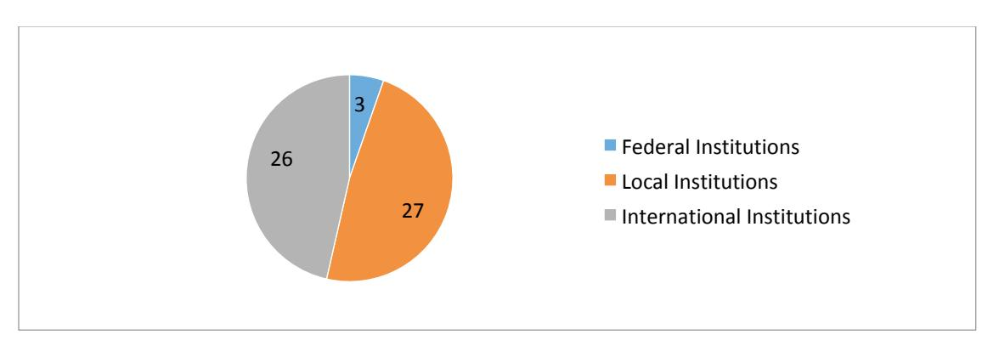
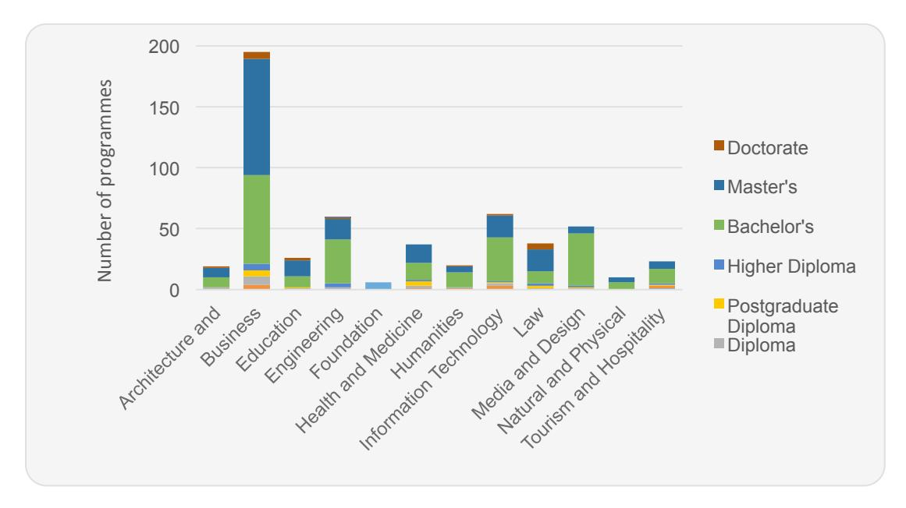
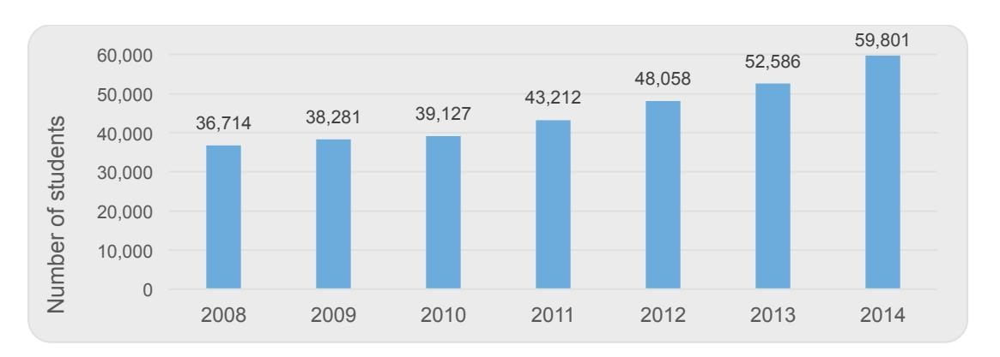
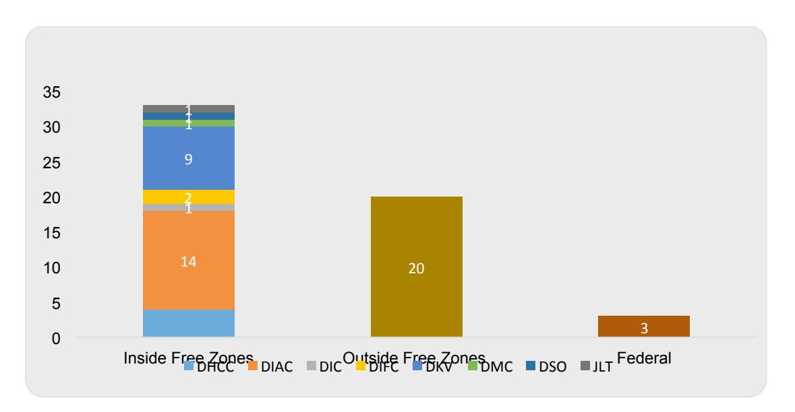
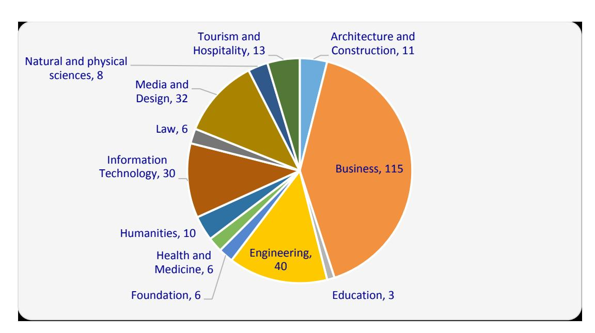
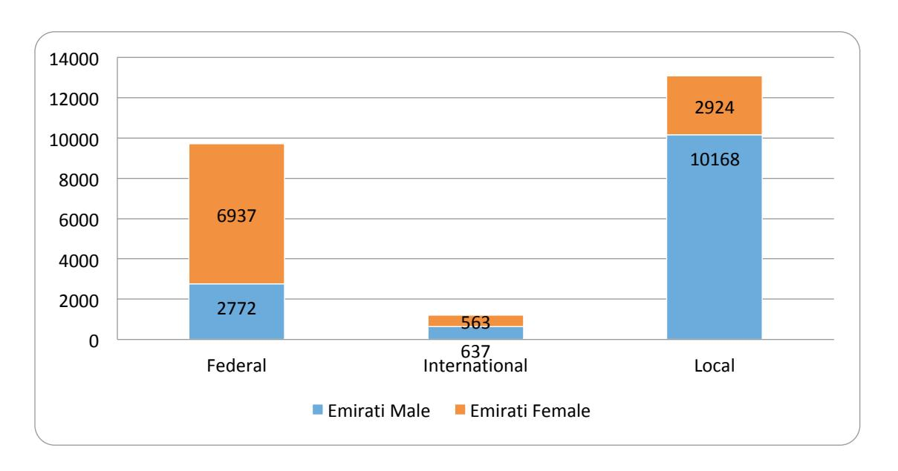
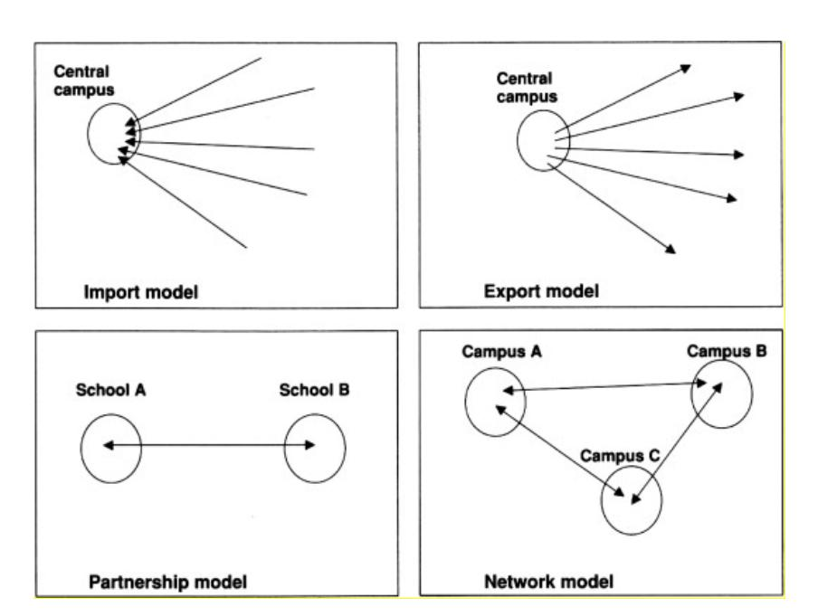
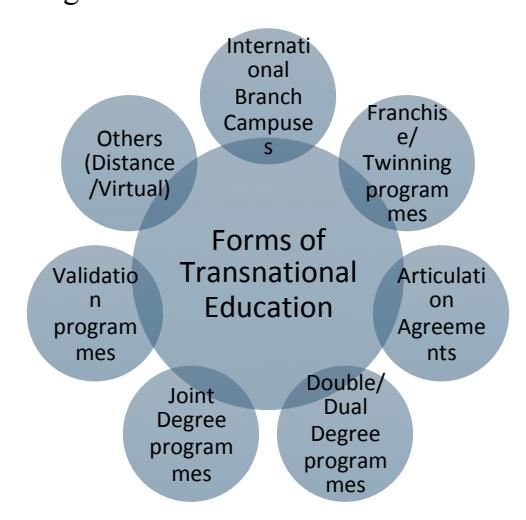
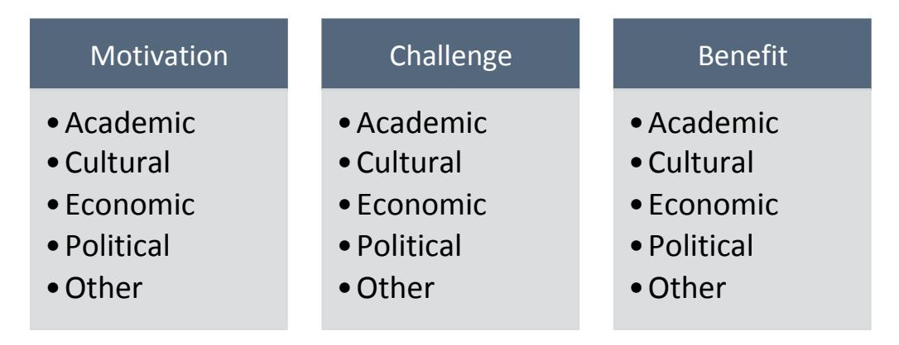

<!-- TH.R09 | source: papers_json/TH.R09/ -->

## **DOCTOR OF BUSINESS (DBA)**

**The Transnational Higher Education Model in Dubai: Motivations, Challenges and** **Benefits**

Sughnani, Nitesh

Award date: 2019

Awarding institution: University of Bath

Link to publication

## **Alternative formats**

If you require this document in an alternative format, please contact: openaccess@bath.ac.uk

Copyright of this thesis rests with the author. Access is subject to the above licence, if given. If no licence is specified above, original content in this thesis is licensed under the terms of the Creative Commons Attribution-NonCommercial-NoDerivs 4.0 International (CC BY-NC-ND 4.0) Licence (https://creativecommons.org/licenses/by-nc-nd/4.0/). Any third-party copyright material present remains the property of its respective owner(s) and is licensed under its existing terms.

**Take down policy**

If you consider content within Bath's Research Portal to be in breach of UK law, please contact: openaccess@bath.ac.uk with the details. Your claim will be investigated and, where appropriate, the item will be removed from public view as soon as possible.

Download date: 11. Oct. 2025

<!-- page 1 -->

Citation for published version: Sughnani, N 2019, 'The Transnational Higher Education Model in Dubai: Motivations, Challenges and Benefits', Doctor of Business Administration (DBA), University of Bath.

Publication date: 2019

Link to publication

## **University of Bath**

**General rights**

Copyright and moral rights for the publications made accessible in the public portal are retained by the authors and/or other copyright owners and it is a condition of accessing publications that users recognise and abide by the legal requirements associated with these rights.

**Take down policy**

If you believe that this document breaches copyright please contact us providing details, and we will remove access to the work immediately and investigate your claim.

Download date: 25. Mar. 2019

<!-- page 2 -->

## **The Transnational Higher Education Model in ** **Dubai: Motivations, Challenges and Benefits **

A thesis submitted for the degree of Doctor of Business Administration (Higher Education Management)

University of Bath School of Management

## **COPYRIGHT**

Attention is drawn to the fact that copyright of this thesis rests with its author. A copy of this thesis has been supplied on condition that anyone who consults it is understood to recognize that its copyright rests with the author and they must not copy it or use material from it except as permitted by law or with the consent of the author.

Signed:

Nitesh Khemchand Sughnani September 2018

<!-- page 3 -->

<!-- page 4 -->

## Table of Contents

A

cknov

wledgments

/

A

bstrac

et

8

G

lossaı

ry of Abbreviations

1.

Cha

apter 1: Overview of Study

12

1.1

Introduction

1.2

Dubai as a setting for the study

14

1.3

Objectives of the study

16

1.4

Research Inquiry

17

1.5

Thesis Summary

17

2.

Cha

apter 2: Research Context

19

2.1

Introduction to Dubai

19

2.2

Higher Education in Dubai

20

2.3

International Branch Campuses in Dubai

**2**3

2.4

Regulation and Quality Assurance

3.

Cha

apter 3: Literature Review

31

3.1

Transnational Higher Education

33

3.2

Rationales for Internationalization

47

3.3

Regulatory Approaches in Transnational Education

3.4

Quality Assurance of Transnational Education

3.5

Effects of Transnational Education

3.6

Summary of Literature Review:

64

3.7

Theoretical Framework:

4.

Cha

apter 4: Methods and Methodology

71

4.1

Introduction

4.2

Research Strategy

4.3

Research Design

4.4

Data Collection Methods

4.5

Sample Selection:

4.6

Data Analysis

4.7

Role of the Researcher:

4.8

Validity and Reliability

_

4.9

Ethical Considerations

5.

apter 5: Findings – Government Planners

5.1

Regulatory Enablers

5.2

Motivations for a Transnational Model of Higher Education

5.3

Challenges faced by Government authorities in implementing the model

5.4

Benefits

_

5.5

Future Outlook

apter 6: Findings – Higher Education Providers

6.1

Motivations for International Higher Education Providers to set up in Dubai:

138

<!-- page 5 -->

6.2 Challenges faced by International Higher Education Providers in Dubai:157

6.3

Benefits and Achievements realized by International Higher Education Providers in

Dubai: 176

6.4

Future Outlook 183

7. Chapter 7: Discussion and Recommendations

185

7.1

Regulatory Enablers, Motivations, Challenges and Benefits185

7.2

Summary of the Dubai Higher Education Model:198

7.3

Recommendations:203

7.4

Relevance and Contribution to the Literature209

7.5

Limitations and areas for further Research211

7.6

Conclusion 212

7.7

Personal Reflections214

8.

References

216

9.

Appendices

226

9.1

Interview Schedule – Stakeholder Group A226

9.2

Interview Schedule – Stakeholder Group B229

<!-- page 6 -->

## List of Figures

Table Number

Page

Number

Figure 2.1 Different Categories of Higher Education Institutions in Dubai.

21

Figure 2.2 Academic Programmes in Dubai by Level and Field of Study.

22

Figure 2.3 Total Student Enrolment in Dubai 2008-2014.

23

Figure 2.4 Number of Higher Education Institutions in Dubai and Location.

24

Figure 2.5 Number of Degrees Available in Dubai at International Universities.

26

Figure 2.6 Students Enrolled in Dubai by Category of Institution.

26

Figure 2.7 Location of Study of Emirati Students.

27

Figure 3.1 Models of Internationalization in Higher Education.

37

Figure 3.2 Main Forms of Transnational Education.

42

Figure 3.3 Rationales for Internationalization.

48

Figure 3.4 Regulatory Models of Transnational Education.

55

Figure 3.5 Conceptual Framework.

69

Figure 4.1 Pre-determined Codes from Conceptual Framework for First Level of Coding.

86

<!-- page 7 -->

## List of Tables

Table Number

Page

Number

Table 3.1 Summary of Literature Review Chapter.

33

Table 3.2 Level of Importance for Rationale of Stakeholder Groups.

50

Table 4.1 Representation within Stakeholder Group A – 'Government Planners' and number of participants.

82

Table 4.2 Representation within Stakeholder Group B – 'International Education Planners' and distinctive characteristics.

84

Table 4.3 Number of participants from each institution in Stakeholder Group B – 'International Education Planners'

85

Table 4.4 Illustration of Findings.

87

Table 5.1 Summary of Motivations for Stakeholder Group A – Government Planners.

103

Table 5.2 Summary of Challenges for Stakeholder Group A – Government Planners.

113

Table 5.3 Summary of Benefits for Stakeholder Group A – Government Planners.

128

Table 6.1 Summary of Motivations for Stakeholder Group B – International Providers.

138

Table 6.2 Summary of Challenges for Stakeholder Group B – International Providers.

157

Table 6.3 Summary of Benefits for Stakeholder Group B – International Providers.

177

<!-- page 8 -->

## Acknowledgments

The completion of this thesis would not have been possible without the support, guidance and encouragement of so many people.

Firstly I would like to thank my two supervisors, Professor Ian Jamieson and Professor Robin Shields. I am very appreciative of their invaluable advice, constructive feedback and encouragement throughout the course of the DBA programme. I am also thankful to the support staff at the University of Bath for their excellent support. I would also like to mention my fellow students, who have become both friends and a great network in the sector for enriching the overall experience of the DBA.

I would like to express my sincere gratitude to my employer the Knowledge and Human Development Authority for their tremendous support. In particular, I would like to thank Dr. Warren Fox, who has been a guide and mentor to me in my professional career and encouraged me to pursue and complete my research. I express my appreciation to Dr. Abdulla AlKaram, for his valuable leadership and also for his role in building the Dubai higher education sector. I would also like to thank my team, who have supported me through this process.

I have many individuals to thank within the higher education sector. I am very appreciative of all the industry members who agreed to participate in this study for their time and cooperation.

I would not have been able to complete this thesis without the love and support of my family. I started the DBA programme in May 2013, just a few weeks after our wedding. My most special thanks go to Dimple for the many ways in which she has supported me through the programme, especially so in the last year as we eagerly awaited the birth of our first child. I would like to dedicate this thesis to Dimple and our newborn daughter Kiara, who was a great source of encouragement in completing this thesis.

<!-- page 9 -->

## Abstract

There has been rapid expansion of transnational higher education as a result of internationalization in higher education

Dubai, in the United Arab Emirates, has a unique demographic whereby 90% of the population is represented by expatriates. Dubai's drive towards economic diversification, its need to develop a talented workforce and to serve its large expatriate population has resulted in the establishment of one of the most prominent transnational higher education systems in the world. Dubai currently hosts the highest number of international branch campuses and has developed a unique model for transnational higher education. Dubai was the first to develop and create dedicated free trade economic zones for the purpose of higher education. This novel concept, along with the development of appropriate regulatory systems, use of private investment, establishment of fit-for-purpose quality assurance systems and a diverse group of international higher education providers make the Dubai higher education model an interesting case study for transnational education.

Although there is emerging literature on transnational education, international branch campuses and the Dubai higher education model, this thesis presents an in-depth view of the Dubai TNE model, which has not been done before. Using a qualitative approach, this study reviews the key enablers, motivations, challenges and benefits of the transnational model of higher education in Dubai from the perspective of two major stakeholder groups, government planners and international higher education providers who have established campuses in Dubai. This provides a better understanding as to why this particular approach was adopted in Dubai, how the model was developed and implemented and what the key challenges and benefits for government planners and providers were over the last decade.

The findings present the differences in motivations, challenges and benefits between the two stakeholder groups and also discuss the similarities and differences with existing literature. Many of these differences presented are due to the maturity of branch

<!-- page 10 -->

campuses and this model in general, which have resulted in a new set of challenges compared to those faced in initial years of development.

These include the need to move from a teaching model to one that also encourages research, the need to create a better student experience and to increase collaboration between campuses and industry. The findings also identify key challenges for the Dubai model going forward, provides recommendations for its future development and suggests areas for further research. This study contributes to the literature on transnational education, more specifically towards the motivations, challenges and benefits of international branch campuses, and on the Dubai transnational higher education model.

<!-- page 11 -->

## Glossary of Abbreviations

| APQN | Asia Pacific Quality Network |
| --- | --- |
| CAA | Commission for Academic Accreditation |
| CBHE | Cross Border Higher Education |
| CBQAN | Cross Border Quality Assurance Network |
| DHCC | Dubai Health Care City |
| DIAC | Dubai International Academic City |
| DIC | Dubai Internet City |
| DIFC | Dubai International Financial Centre |
| DKV | Dubai Knowledge Village |
| DMC | Dubai Media City |
| DSO | Dubai Silicon Oasis |
| GATS | General Agreement for Trade and Services |
| HCT | Higher Colleges of Technology |
| HKCAAVQ | Hong Kong Council for Accreditation of Academic and Vocational Qualifications |
| INQAAHE | International Network for Quality Assurance Agencies in Higher Education |
| JLT | Jumeirah Lake Towers |
| KHDA | Knowledge and Human Development Authority |
| MOHESR | Ministry of Higher Education and Scientific Research |
| MQA | Malaysian Qualifications Authority |
| OCED | Organization for Economic Cooperation and Development |
| QAA | Quality Assurance Agency |
| QBBG | Quality Beyond Boundaries Group |
| RAK | Ras Al Khaima |
| TEQSA | Tertiary Education Quality and Standards Agency |

<!-- page 12 -->

| TNE | Transnational Education |
| --- | --- |
| UAE | United Arab Emirates |
| UAEU | United Arab Emirates University |
| UQAIB | University Quality Assurance International Board |
| WTO | World Trade Organization |

<!-- page 13 -->

## 1. Chapter 1: Overview of Study

## **1.1** **Introduction **

Over the last two decades, the higher education sector has witnessed rapid expansion through internationalization, which has resulted in the mass movement of students, programmes, faculty and providers (Knight, 2007). Institutions have actively pursued internationalization strategies and policies in the form of joint-programmes, research partnerships, student and staff exchanges, distance education and overseas branch campuses. With this growth in higher education new concepts and terms have emerged such as 'cross border higher education', 'international branch campuses' and 'education hubs'.

Liberalization of trade through international initiatives such as the General Agreement for Trade and Services (GATS) has helped open up the education sector and encouraged governments to allow the import of foreign education (Lane and Kinser, 2011). Several developing countries in Asia and the Middle East have resorted to strategies of importing education in order to boost economic development, increase competition, improve standards of local institutions and offer better access and choice to students (British Council, 2014; Chan, 2011; Mok, 2011).

Each of these countries have used different approaches of cross border higher education. In Hong Kong, the approach has been to establish joint programmes between local and international institutions with over 1,000 such programmes accounted for in 2010 (Knight, 2011; Mok and Yu, 2011). In Malaysia, a more planned and strategic approach was adopted in 1991 through the 'Wawasan 2020' (Vision 2020), with a vision to improve quality, enhance research and increase internationalization activities (Mok and Yu, 2011). Malaysia hosts several international campuses and has established two major zones for higher education, Educity in Iskandar and the Kuala Lumpur Education City in Kuala Lumpur. Singapore's vision for higher education was to establish itself as the 'Boston of the East' in order to be a leading knowledge hub for innovation and creativity. Through various initiatives including the 'global schoolhouse' and the 'Singapore

<!-- page 14 -->

education' plan, Singapore has attracted foreign investment and talent to promote growth in higher education, especially in the area of research and development (Gribble and McBurnie, 2007). There have been similar developments in the Middle East in countries like Qatar and the United Arab Emirates

Dubai is one of seven Emirates that make up the United Arab Emirates (UAE). It has historically been a trading hub for the exchange of goods and services. Dubai has adopted a strategy for higher education that relies significantly on a transnational model using international branch campuses. The motivations for the development of a transnational higher education system and the approach taken in Dubai are unique in comparison to developments in Asian and Arab countries.

The higher education system in Dubai comprises three categories of institutions, federal institutions funded through the federal government and serve the UAE national population; local UAE institutions either funded privately or through the government and offering UAE qualifications; and international branch campuses offering foreign qualifications from the home country of the institution. To serve a large and growing expatriate population who had a preference towards foreign qualifications, and to supply a talented workforce to an increasingly diversified economy, Dubai had to create a model that facilitated and supported international education. This was achieved through the development of free trade zones for the purpose of education.

There are two free zones dedicated to higher education and various other free zones that host international campuses. Although free zones have existed for many years, the dedicated use of free zones for the purpose of higher education was first adopted in Dubai. The use of free zones provided various financial and regulatory benefits to incoming providers and helped kick start Dubai's journey towards becoming an education hub. In order to support and grow this model, Dubai has had to create fit-forpurpose regulatory systems, investment opportunities and quality assurance systems that promote transnational higher education. The higher education system has also been driven forward by large numbers of institutions from many countries that have

<!-- page 15 -->

established campuses in Dubai and through contributions of various other stakeholder groups including students, investors and employers.

The higher education system in Dubai is different compared to other systems within the country and the region. Abu Dhabi has recently set up branch campuses but has opted to bring in a limited number of highly ranked institutions with direct government funding into each of the campuses. The branch campuses in Abu Dhabi continue to follow federal accreditation requirements unlike in Dubai, where an alternative quality assurance and regulatory model was implemented in the free zones.

Qatar has also invested in a transnational model but has invested directly to target specific institutions that offer a specialist range of programmes. Ras-Al-Khaima, one of the other Emirates in the UAE, has emulated Dubai and built a free zone for higher education and are now developing entry requirements and quality assurance systems based on the Dubai model.

This study will explore the transnational model of higher education adopted in Dubai to better understand the motivations for doing so, the challenges that the model has presented, the manner in which they were overcome and the key benefits that have been realized.

## **1.2Dubai as a setting for the study**

Dubai has undergone rapid growth in several sectors including shipping, logistics, aviation and tourism as part of a planned diversification of the economy, which was previously reliant on oil revenues. In order to do this Dubai planned and built several free zones, which provided the necessary infrastructure and regulatory environment to help attract foreign investment. Growth in these sectors resulted in a large influx of expatriates resulting in a unique demographic whereby less than 10% of the population constitutes local Emiratis or UAE nationals. The remaining 90% of the population are made up of foreign expatriates coming mainly from South East Asia and neighboring Arab countries (UAE Interact, 2011).

<!-- page 16 -->

The growth of the expatriate population, as well as expansion of the economy, resulted in an increased demand for higher education. The federal institutions funded through the federal government mainly served UAE national students, while local institutions were limited in number and offered a narrow range of academic specializations. In order to meet this growing demand for higher education and to serve the market with a skilled workforce, Dubai established a dedicated free zone for higher education and started recruiting foreign institutions to set up campuses and offer international qualifications in Dubai. Given the rapid pace of development, the growth of the economy in various sectors, the massive influx of expatriate workforce, there was an immediate need to create better access to higher education, and this could only be achieved through an import model. The expatriate population was also interested in enrolling and studying for foreign qualifications as the UAE was in the very early stages of development.

Although various countries and cities have adopted approaches of cross border education or transnational education, the Dubai model is unique. The motivation for such an approach in Dubai was generally driven by two key factors, the need for economic diversification and the need to serve the educational demands of a significantly large expatriate population. Over the years the strategy has shifted from providing access to higher education, to ensuring high standards and quality of the sector. This has led to more recent ambitions of establishing Dubai as a hub for higher education in order to attract students from other regions including Middle East, Africa and South East Asia.

Dubai was an early adopter of the free zone concept, which has now been emulated by other countries, including Malta, Qatar, and Malaysia. Free zones have emerged even within the UAE in other emirates including Ajman, Sharjah and Ras Al Khaima (RAK). The Dubai higher education sector has relied heavily on transnational education through international branch campuses for the growth and development of higher education and has had to develop the necessary strategic and regulatory conditions to sustain such an approach. Dubai currently hosts the largest number of branch campuses in the world in a single location (Lawton and Katsomitros, 2012). All these factors make Dubai an appropriate and interesting setting for this study.

<!-- page 17 -->

## **1.3Objectives of the study**

The approach adopted by Dubai in attracting a large number of foreign providers to serve its higher education needs is unique. The objective of this study is to understand the reasons or motivations behind selecting such an approach for Dubai. This will help answer the question of 'why' this particular approach was taken in Dubai in comparison to more traditional higher education systems globally. The study will also explore the various conditions that were created in terms of infrastructure and regulation to better understand 'how' this approach was developed, implemented and sustained. And finally, by reviewing some of the 'effects' of the model including challenges and benefits, this study will also help identify shortfalls and advantages of such a model.

This study will explore the enablers, motivations, challenges and benefits associated with transnational education in the Dubai context from the perspective of two key stakeholder groups: the government planners and international higher educational providers. Each stakeholder group has unique challenges in planning, implementing and sustaining such a model. Through this study, I hope to identify the major strengths and weaknesses associated with such a model given the specific regulatory conditions and environment within which they exist in. And finally, the study will also highlight the key benefits that have been realized through this approach both for the host country and the providers.

As an active participant in the Dubai higher education sector for the last ten years, I have had the opportunity to participate directly in the planning, development and implementation of this particular approach to higher education in Dubai. I hope an indepth exploration into the enablers, motivations, challenges and benefits of this model will make a contribution to the literature on transnational education in the context of Dubai. The findings may also be useful to other countries or cities looking at adopting a similar approach to developing higher education, as well as to providers who are interested in establishing branch campuses. More importantly I hope that the findings will provide recommendations that will help develop and shape the future higher education strategy for Dubai.

<!-- page 18 -->

## **1.4Research Inquiry **

In order to address the key objectives identified and help guide the study, I have developed some broad areas of inquiry I would like to explore. The first is to identify what were the main factors that led to such an approach to developing higher education in Dubai. The second is to explore the main challenges associated with transnational higher education the specific issues faced in the Dubai context. The third area of inquiry is around achievements and benefits that have been achieved by adopting such an approach. These broad areas of inquiry will help in structuring the literature review in order to identify gaps and form the research questions for this study.

## **1.5Thesis Summary**

The study will comprise seven chapters, including this introductory chapter. The introductory chapter has laid out the objectives of the study, the reason for selecting Dubai as the setting for this study and the main areas of inquiry that will be a guide for this study.

The second chapter is titled 'research context.' This chapter provides an introduction to Dubai and a summary of the current higher education landscape in Dubai. This includes information on the concept of free zones adopted in Dubai, the different types of higher education institutions with a focus on international branch campuses. It also provides information on current student enrollment numbers, range of programmes offered in Dubai and details on Emirati participation in the higher education sector.

The third chapter is the 'literature review' and will explore key concepts, theories and frameworks in the existing literature relevant to this study. This will include exploring the impact of internationalization on higher education. The literature review will also analyze existing theories on rationales or motivations for internationalization in higher education. It will also explore the various models of internationalization, including the definitions, concepts and forms of 'cross border higher education' or 'transnational education' including 'international branch campuses'. Finally, the literature review

<!-- page 19 -->

chapter will also look at existing regulatory models for transnational higher education approaches. Using existing theories and models, the literature review will help me develop a conceptual framework that will help guide this study and help achieve the research objectives.

The fourth chapter presents the 'research design and methodology'. This chapter identifies the research design used for this study, which is based on my personal interpretivist and subjectivist approach. This chapter explains the research design and the data collection methods of the study using qualitative research approach. The chapter also includes a section on ethical considerations in data collection, data validity and the impact of the role of the researcher.

The fifth and sixth chapters presents the 'research findings'. These two chapters present the data collected from the two stakeholder groups with each group representing one part of the Dubai case. The analysis is carried out from the perspective of two stakeholder groups: government planners and international higher education providers in Dubai. In these two chapters, the findings in relation to key enablers, motivations, challenges and benefits associated with the Dubai model of transnational education for each stakeholder group are discussed.

The seventh and final chapter is the 'discussions and recommendations and conclusions' chapter. This chapter provides a descriptive analysis of the major themes identified through the data collection process and analysis in relation to the research questions of the study. It will include a summary of the key findings and my final recommendations. Finally this chapter will also include my personal reflections on the journey of the DBA programme and writing this thesis.

<!-- page 20 -->

## 2. Chapter 2: Research Context

## **2.1** **Introduction to Dubai **

Dubai is one of seven emirates that make up the United Arab Emirates. The UAE was established as a country in 1971 and is one of the major oil producing countries in the world with seven percent of the world's proven crude oil reserves (Fox and Shamsi, 2014). Dubai, which has a lower oil production capacity than the capital Abu Dhabi, has gone through a process of planned diversification over the last two decades, which has impacted the social, economic and cultural values of the emirate (Pacione, 2005).

Dubai's transition into a world-class city has been supported through investment in various sectors including shipping, logistics, and aviation. More recently there has been a focus on promoting tourism, health, education and retail. In order to attract and support foreign direct investment in these sectors, Dubai has relied on the concept of purpose built free trade zones more popularly known as 'free zones'. The first free zone established in Dubai was Jabel-Ali, a large shipping and logistics port built in 1981. Companies that set-up in free zones are exempt from federal laws and taxes. Unlike companies outside the free zones, which require 51% ownership by a local Emirati partner, companies within the free zones are allowed 100% ownership and the option to fully repatriate investment and profits. The free zones offer various other exemptions from federal and local regulations (Dubai FDI, 2016).

After Jabel Ali, the free zone concept was expanded to other sectors to promote growth and development of the economy. The first of these were in media and communications through the Dubai Media City (DMC), and information technology through Dubai Internet City (DIC). Since then various free zones have been established all over Dubai including the Dubai Health Care City (DHCC) for health related organizations and the Dubai International Financial Centre (DIFC) for financial institutions (Dubai FDI, 2016).

By building these free zones, Dubai provided the infrastructure and regulatory conditions, which enabled multi-national organizations to easily set up businesses in Dubai. The free

<!-- page 21 -->

zones offered various facilities including ready office spaces on rental schemes, which helped reduce the capital expenses involved in setting up a new business. The free zones also offered various common facilities such as parking spaces, food courts, retail outlets and banking services, which could be shared by all business partners in that zone.

There are currently over 20 free trade zones across the Emirate of Dubai (Dubai FDI, 2016). The free zones have helped attract various multinational organizations to invest and set up offices in Dubai and have acted as a real catalyst for economic growth in Dubai. DIC, hosts several leading IT firms including Microsoft, IBN, Facebook and Cisco. DMC also hosts the major media firms, including CNN, BBC and CNBC.

With rapid growth in several industries and sectors, there was a need to support these organizations with the required human capital resources. The local population was not large enough to support this growth and therefore, the UAE started attracting large numbers of workers to meet the demand of a diversifying economy. This led to a massive influx of expatriates from neighboring Arab countries, as well as South East Asian countries such as India and Pakistan. It has resulted in a unique demographic statistic whereby the local Emiratis constitute fewer than 10% of the country's total population (UAE Interact, 2011).

## **2.2Higher Education in Dubai **

The UAE has three federal institutions, Zayed University, the Higher Colleges of Technology (HCT) and United Arab Emirates University (UAEU), which have campuses across the country including in Dubai. These institutions were established by federal decree and fall under the purview of the Ministry of Education (previously the Ministry of Higher Education). They offer a diverse range of programmes for Emirati students and are funded annually by the federal government. Emirati students can attend the federal universities without any cost. Dubai has allocated land and built facilities to host a campus of Zayed University in addition to two HCT campuses, one for Dubai Men's College and the other for Dubai Women's College.

<!-- page 22 -->

Apart from the federal institutions, the higher education landscape also consists of two other categories of institutions. The first are local institutions, which are either government funded or privately owned. These local institutions offer programmes that are locally accredited by the MOE and result in a local UAE qualification. The third category is the international institutions or international branch campuses. These are branches of foreign institutions that have set up in Dubai and a few other Emirates and offer students international qualifications. All the international institutions are privately owned and are funded by the parent campus or through a local investor. The international campuses vary in size and programme offering ranging from a few institutions that specialize in a single programme to others that offer a full range of undergraduate, postgraduate and doctoral level programmes.

Dubai has a total of 56 higher education institutions with approximately 60,000 students enrolled in higher education (KHDA, 2014). The 56 institutions are classified into three categories which were described earlier, federal institutions, local institutions and international institutions. As seen in Figure 2.1 below, there are 27 local institutions and 26 international institutions along with the 3 federal institutions that make up the current total of 56 higher education institutions in Dubai. By 2017, the number of institutions increased to 63 (KHDA, 2017).

> Figure 2.1: Different Categories of Higher Education Institutions in Dubai. (KHDA, 2014)

<!-- page 23 -->

There are a total of 543 academic programmes registered across the 56 higher education institutions in Dubai. 48% of these programmes are at Bachelor's degree level, 38% at Master's degree level and the remaining made up by foundation courses, diploma level and Doctorate level education. A large majority of the programmes are in the business and management discipline. However, there has been recent growth in other disciplines including media and design, law, engineering and information technology. Figure 2.2 demonstrates the programme mix by level and discipline, which clearly shows the large concentration of business programmes closely followed by programmes in information technology, media and engineering.

> Figure 2.2: Academic Programmes in Dubai by Level and Field of Study. (KHDA, 2014)

There are a total of approximately 60,000 students studying at the 56 higher education institutions in Dubai. The overall enrollment in Dubai has grown steadily since 2008 at an average growth rate of 10% per year (KHDA, 2014) even during the economic slowdown between 2008 and 2010. The average enrollment per institution tends to vary as some institutions offer only one or two specialized programmes. Most institutions, however, have over 300 students while there are 13 institutions that have more than 2,000 students enrolled (KHDA 2014). Figure 2.3 below shows the steady growth in student enrollment numbers in Dubai from 2008 to 2014.

<!-- page 24 -->

> Figure 2.3: Total Student Enrolment in Dubai 2008-2014. (KHDA, 2014).

## **2.3** **International Branch Campuses in Dubai**

The significant growth of expatriates coming to Dubai for work opportunities led to various higher educational challenges for Dubai. There was suddenly a need to increase access to higher education especially for the expatriate population. There was also a need to support the growing industries with a skilled workforce (Fox and Shamsi, 2004).

In 2003, Dubai took a major step in addressing the growing higher education needs of the expatriates by establishing a dedicated free zone for higher education, Dubai Knowledge Village (DKV). This new free zone was set up in close proximity to DMC and DIC in order to provide skilled workforce to companies in those two free zones.

With the establishment of DKV in 2003, Dubai opened up the higher education sector to foreign providers. DKV started to attract international campuses to set up within the free zone. The laws of the free zone exempt these institutions from federal licensure and accreditation requirements and allowed them to offer international qualifications to students in Dubai. Higher Education institutions from various countries started to setup in DKV including from India, United Kingdom, Australia, and USA. In the first year, eight foreign institutions were established in KV, some of which were already present in the country in territories outside the free zone (KHDA, 2014).

<!-- page 25 -->

In 2007, Dubai established a second free zone dedicated to higher education, Dubai International Academic City (DIAC) to meet growing demand for space from higher education institutions. DIAC was built with ready facilities available on rent and also allowed institutions the option of leasing land and building their own facilities. In addition to DKV and DIAC, higher education institutions have also established in six other free zones including in DIC, DMC, DHCC, DIFC, Dubai Silicon Oasis (DSO), and Jumeirah Lake Towers (JLT). There has been a rapid expansion of higher education institutions in Dubai's free zones since 2003. There were 33 higher education institutions by 2014, located within free zones, which is a significant increase from the eight institutions that first established in 2003 (KHDA, 2014). In 2017, KHDA reported a total of 39 institutions in the free zones with just over 30,000 students (KHDA, 2017). Figure 2.4 demonstrates the distribution of higher education institutions in Dubai by location, which shows that there are more institutions located in free zones than outside the free zones.

> Figure 2.4: Number of Higher Education Institutions in Dubai by Location. (KHDA, 2014).

Once Dubai started allowing international campuses to operate in the country, other emirates including Abu Dhabi and Ras Al Khaima also opened up the sector to international institutions. Abu Dhabi, the capital of the UAE, invested several millions to

<!-- page 26 -->

bring the New York University and the Sorbonne University to the UAE (Fox and Shamsi, 2014). Ras Al Khaima followed in the footsteps of Dubai and set up a dedicated free zone for higher education called the Ras Al Khaima Education Zone and hosts several international institutions including the University of Bolton from the UK and the Vatel International Business School from France (RAKEZ, 2016). In 2012, the Observatory for Borderless Higher Education reported that the UAE is host to the largest number of international campuses in a single country. Dubai hosts the large majority of these institutions and has the highest number of international branch campuses in a single city based on the OBHE report (Lawton and Katsomitros, 2012).

The international branch campuses have made an important contribution to the growth of higher education in Dubai. The branch institutions have helped address the growing needs of the expatriate population and expanded opportunities for the local Emiratis as well. They have also helped attract international students to Dubai. By 2014, there were a total of 26 branch institutions located across eight free zones in Dubai. These campuses came from ten different countries including Australia, France, Lebanon, Iran, India, Ireland, Pakistan, Russia, the United States and United Kingdom (KHDA, 2014).

The international branch campuses have also contributed towards a more diversified programme mix by offering a wide range of programme specializations. The international branch campuses are helping address the educational needs of a diversifying economy. The international institutions have added programmes in various disciplines including tourism and hospitality, architecture and construction, media and design and engineering (Fox and Shamsi, 2014; KHDA, 2014). Figure 2.5 shows the contribution of the international campuses in the diversification of degrees offered in Dubai.

<!-- page 27 -->

> Figure 2.5: Number of Degrees Available in Dubai at International Universities. (KHDA, 2014)

There are a total of 24,389 students enrolled at the international branch campuses in Dubai as of 2014, which makes up 41% of the total higher education enrollment in Dubai (KHDA 2014). This also represents a 19% growth from student enrollment in 2013 (KHDA, 2014). Figure 2.6 shows the distribution of students between federal institutions, local institutions and international institutions. This shows there are there are slightly more students enrolled in local institutions compared to the international institutions.

> Figure 2.6: Students Enrolled in Dubai by Category of Institution. (KHDA, 2014)

<!-- page 28 -->

The nationality mix at the international campuses is quite diverse with large major representation of students from neighboring Gulf countries as well as from other countries including India, Pakistan, Iran, and Nigeria (KHDA, 2014).

Only five percent (1,200 students) of the Emirati higher education populations are enrolled at international institutions (KHDA, 2014). The majority of Emirati students attend local institutions and federal institutions. Figure 2.7 shows the breakdown of Emirati students by gender and by the various categories of institutions. This clearly shows the very few Emirati students who are attending the international institutions.

> Figure 2.7: Location of Study of Emirati Students. November 2014 (KHDA, 2014)

## **2.4Regulation** **and Quality Assurance**

All federal and local institutions in the UAE including in Dubai are licensed by the Ministry of Education and are required to obtain institutional and programme accreditation through the Commission for Academic Accreditation (CAA) (Fox and Shamsi, 2008).

Once the free zones were established, international institutions offering foreign qualifications were exempt from federal regulation by virtue of establishment in a free

<!-- page 29 -->

zone. Prior to 2003, institutions were not allowed to offer foreign qualifications and the few international institutions that existed in the country were also subject to licensure and accreditation from the federal bodies. The free zone authorities were responsible for recruitment of the international campuses and had oversight over these institutions.

In 2006, Dubai established the Knowledge and Human Development Authority (KHDA) and tasked the authority with the regulation of all private education in Dubai. This included regulation of pre-school, school, universities and colleges as well as of training and professional development centers. KHDA was given responsibility for the regulation and quality assurance of all higher education institutions established in free zones (KHDA, 2014).

With the establishment of KHDA, the focus in the higher education sector shifted from increasing access to assuring quality of the foreign institutions. The gatekeeping responsibility was taken away from the free zone authorities as the KHDA would establish the entry requirements and assess eligibility of new institutions and programmes that wished to setup in Dubai. The KHDA was also responsible for implementing a quality assurance process to ensure the quality of the institutions and programmes in Dubai's free zones (Fox and Shamsi, 2014).

In 2008, the KHDA established a new quality assurance process for higher education institutions in the free zones called the University Quality Assurance International Board (UQAIB, 2014). UQAIB is an independent board comprising of global higher education specialists. The UQAIB members come from eleven different countries including UAE, Australia, United Kingdom, United States, China, Malaysia, India, Austria, France and New Zealand. The role of the Board is to provide international advice and make recommendations on the quality of higher education institutions in the free zones (KHDA, 2014).

UQAIB was specifically designed to meet the needs of higher education institutions in the free zones, which are largely the international institutions. Using a validation model,

<!-- page 30 -->

UQAIB ensures the academic standard of institutions in Dubai is comparable to that of the home campus of the institution. UQAIB was created to quality assure the international institutions in the free zones which, were exempt from any federal regulation. The UQAIB approach allows foreign higher education providers to offer international qualifications through the branch campus model (UQAIB 2014).

In 2011, the Government of Dubai passed new legislation in the form of Executive Council Resolution 21 (2011). This resolution specifically addressed higher education institutions based in free zones and formalized KHDA's role as the regulator of these institutions. It also gave KHDA the power to certify or attest qualifications obtained by graduates attending higher education institutions in the free zones. Graduates holding attested degree certificates would be eligible to use it for employment and other purposes in the Emirate of Dubai (KHDA, 2017).

With the success achieved in attracting institutions and students to DKV and DIAC and the establishment of a regulatory body to ensure quality, Dubai has developed the ambition of establishing itself as a higher education hub for the region. The higher education plans are based on the Dubai Strategic Plan 2021, which emphasizes the need to improve social and educational infrastructure to promote economic growth (KHDA, 2014).

Through the free zones Dubai has established a transnational higher education system to serve social and economic needs. There has been steady growth in the number of institutions, students and programmes. This raises interesting questions in regards to why this particular approach was selected as opposed to a more traditional higher education system and why institutions decided to set up these campuses in Dubai. A decade has passed since the first free zone was established for higher education and therefore, is a good opportunity to review the key challenges that were faced by these campuses, as well as the achievements of the free zone model.

<!-- page 31 -->

In the next chapter, I will explore the impact of globalization and internationalization in higher education and look at existing theories, models and frameworks on the concept of cross border or transnational higher education.

<!-- page 32 -->

## 3. Chapter 3: Literature Review

The previous chapter sets out the context of the Dubai higher education system, which shows the approach taken in Dubai towards the development of the sector is unique compared to other places. The various characteristics of the Dubai approach including the development of free zones with purpose-built infrastructure, the focus on recruitment of foreign providers and the regulatory support systems implemented, provide a strong foundation for a transnational higher education system.

I have already set out three main objectives of this study in the first chapter; the first is to identify 'why' Dubai selected a transnational model approach to developing its higher education sector; the second is to understand 'how' this was done and what steps were taken in implementing such a model; and the third is to understand the 'effects' of this model including any challenges or benefits specific to the Dubai context.

In order to better understand the approach taken by Dubai and to address the objectives identified, I will present a summary of the key definitions, concepts and theoretical frameworks from the current body of research in this chapter. This will help in establishing the core concepts, identify gaps in current literature and develop the research questions for this study. This chapter will be organized into five sections.

The first section will introduce the topic of transnational education, discuss its emergence as a means to internationalization in higher education, and include a review of the different forms of TNE with a particular focus on international branch campuses. This will include a summary of the definitions of international branch campuses, an overview of the current data available on branch campuses internationally and a description of some of the characteristics of branch campuses.

In the second section of this chapter, I will review the key rationales or motivations for internationalization and expansion of transnational education and show why these

<!-- page 33 -->

motivations are different among the two stakeholder groups selected for this study. This will help address the first objective of the study and allow me to identify the key reasons why governments and providers choose to engage in TNE activity. By doing so, I will be able to develop a conceptual framework that I will use to identify the rationales for both stakeholder groups in the Dubai context.

In order to identify 'how' Dubai implemented this particular approach, I will explore the various regulatory models that have been developed for oversight of transnational education systems. I will also provide a summary of the different quality assurance approaches adopted for transnational education. These are covered in the third section and fourth sections of this chapter where I will provide a theoretical foundation of regulatory models in transnational education and discuss the various quality assurance approaches in transnational education internationally.

Finally in the fifth section of this chapter, I will identify the current known 'effects' of a transnational approach to higher education. I will look at the challenges and the benefits that have been identified from the perspective of the two stakeholder groups, institutions that engage in TNE activity and government planners and agencies that plan, regulate and support such systems. Understanding the implications of such a model, including the challenges it creates and the benefits it enables, will help highlight the areas that need further exploration in the Dubai context.

The table below provides a summary of the topics that I will review to address the concept of transnational education and each of the three objectives identified:

| 3.1 | Transnational Higher Education | -Internationalization in higher education |
| --- | --- | --- |
|   |   | -Models of internationalization |
|   |   | -Transnational education |
|   |   | -Forms of transnational education |
|   |   | -International branch campuses |
| 3.2 | Rationales for Transnational | -Rationales for internationalization |

<!-- page 34 -->

|   | Higher Education | -Rationales among different stakeholder |
| --- | --- | --- |
|   |   | groups |
|   |   | -Rationales in the Dubai context |
| 3.3 | Regulatory Approaches in | -Regulatory models of transnational education |
|   | Transnational Education |   |
| 3.4 | Quality Assurance of | -Quality assurance approaches in |
|   | Transnational Higher Education | transnational education |
| 3.5 | 'Effects' of TNE models | -Challenges associated with transnational |
|   |   | education |
|   |   | -Benefits of transnational education |
|   |   | -Challenges and benefits in the Dubai context |

> Table 3.1 Summary of Literature Review Chapter

## **3.1 Transnational Higher Education **

Transnational higher education or cross-border higher education is the core concept that is being explored in this study. It is important to review the growth of internationalization activities in higher education and the resulting impact on transnational education.

## 3.1.1 Internationalization in Higher Education

'Internationalization' is a now a common term in higher education, often used by decision makers to refer to particular strategies that have been adopted by institutions 'as an answer or solution to globalization trends' (Peters and Britez, 2010). These strategies are usually driven by social, economic, political and financial objectives (Van Damme, 2001; Wilkins and Huisman, 2001).

Jane Knight (1993, p21), defines internationalization as 'the process of integrating an international/intercultural dimension into the teaching, research and service functions of an institution." Internationalization opens up various opportunities for institutions such

<!-- page 35 -->

as curriculum development, quality enhancement and research through partnership and collaboration (Van Damme, 2001) but has also created new challenges of funding, access, mobility and quality (Smith, 2010).

Internationalization has two major dimensions, the first is domestic or 'at home' and the other is international or 'abroad' (Stella, 2006; Altbach et al., 2009). Internationalization at home refers to initiatives such as attracting international students and faculty, internationalization of curriculum or other activities for the development of intercultural skills of a student. The second dimension involves movement of students, programmes, faculty, and providers across borders and can also be referred to as cross-border higher education (Stella, 2006). Cross-border higher education takes various forms such as joint programmes, research collaborations, and international branch campuses, which are discussed in further detail later in this chapter (Knight, 2007).

The forces of globalization and liberalization have impacted internationalization in higher education (Lane and Kinser, 2011; Stella and Woodhouse, 2008). Global organizations including the World Trade Organization (WTO), the Organization for Economic Cooperation and Development (OECD), the World Bank (WB) and others have encouraged the internationalization of higher education and the adoption of neo-liberal educational reforms to help countries increase competitiveness and push for economic development (Jiang, 2008). The WTO and its General Agreement for Trade and Services (GATS) have played a major role in reducing barriers for the promotion of trade of goods and services. The classification of education under GATS enabled various countries to adopt policies encouraging internationalization activities in higher education (Lane and Kinser 2004). GATS categorizes educational services in four modes:

1. Cross-border supply: provision of educational services through distance education or online education.

2. Consumption abroad: student travelling from one country to another to pursue education

<!-- page 36 -->

3. Commercial presence: institution setting up to provide services in another country (example branch campuses)

4. Presence of natural persons: an individual (professional) travelling to another country to provide educational services

Various other theories also underpin the growth of internationalization in higher education. The concept of the 'knowledge society' proposed by Drucker in the 1970's and the role of 'human capital' are foundations for modern day economic development (Mansur, Kogid and Madais, 2010). The early works of Schultz (1960) and Becker (1964) on human capital, stressed the need for educational development of people and not just capital or technological investment.

According to Becker (1964), education helped develop knowledge and skills of people. The transition from industrial and agricultural economies to knowledge based economies have led to ever growing demand for skilled and educated individuals (Diaconescu, 2009). Drucker (2001), noted that mobility would be the essence of the new knowledge society, and that knowledge would be the key resource. Technology has enabled the mobility of knowledge and is one of the key drivers of internationalization in higher education.

## 3.1.2 Models of Internationalization in Higher Education

There are several models used to describe internationalization in higher education. Some models depict both the 'home' and 'abroad' dimensions of internationalization while others focus on only one dimension.

In a review of the literature of various contributors, Qiang (2003) describes internationalization through four main approaches: the 'activity' approach refers to activities around student/faculty exchanges, curriculum sharing and development, and international students. These activities represented the term 'international education' in the 1970s and 1980s; the 'competency' approach refers to development of knowledge and skills among students, staff and faculty; the 'ethos' approach, is concerned with creating

<!-- page 37 -->

a culture or environment that supports international perspectives; and the 'process' approach, refers to the infusion of international/intercultural values into educational activities.

Stella (2006) describes internationalization activities in three forms based on who or what moves across borders. She explores three types of movement, the movement of people, which she refers to as 'people mobility', the movement of programmes or 'programme mobility' and the movement of institutions, or 'institution mobility'. People mobility has existed for many years with students and teachers crossing borders for academic purposes. Programme and institutional mobility are more recent phenomenon that have increased rapidly in the last two decades (Stella and Woodhouse, 2008).

De Meyer et al. (2004), depicts internationalization from an institutional perspective through four models. The first model is referred to the 'import model'. This refers to import of knowledge, students, faculty, etc., into the central campus and is the most traditional form of internationalization. The second model is the 'partnership model', where one institution partners with another institution. This represents joint-programmes, exchange of faculty or students, or research collaboration. The third model is one where the main institution adopts a strategy to go abroad and is referred to as the 'export model'. The final model involves collaboration between multiple institutions, and is referred to as the 'network model'. The models are depicted in Figure 3.1 below:

<!-- page 38 -->

> Figure 3.1. Models of Internationalization in Higher Education. Source: De Meyer et al. (2004, p. 108).

Each of these definitions explore different attributes of internationalization with a focus on who or what moves across borders and how they move across borders for the purpose of knowledge sharing and development.

Internationalization activities have gained momentum and developed rapidly over the years and research has identified three main phases to track these developments (Knight 2011; Karram, 2012). People mobility is widely considered as the first phase/generation of internationalization in higher education. Students have been moving for the purpose of education for more than a century (Knight, 2011). The second generation of internationalization is concerned with provider mobility across borders (Altbach, 2012) and this includes branch campuses, joint programmes and franchise agreements. Knight (2011), identified higher education hubs as the third generation of internationalization, where governments are actively involved in attracting foreign institutions and students by offering various incentives.

<!-- page 39 -->

## 3.1.3 Transnational Education

Transnational education (TNE) is one of the areas of higher education that has witnessed very significant growth over the last two decades. TNE is considered as one of the forms of internationalization of higher education institutions (Stella and Woodhouse, 2008).

There are various definitions for transnational education. The International Network for Quality Assurance Agencies in Higher Education (INQAAHE) defines TNE as 'higher education provision available in more than one country' (INQAAHE Glossary). The Council of Europe in 2002, defined it as 'all types of education study programmes, or sets of courses of study, or educational services (including those of distance education) in which the learners are located in a country different from the one where the awarding institution is based' (Code of Good Practice in the Provision of Transnational Education, Council of Europe, 2002).

The most commonly used definition is coined by UNESCO and OECD in the development of the 'Guidelines for Quality Provision in Cross-Border Higher Education' and refers to it as higher education that takes place in situations where the teacher, student, programme, institution/provider or course materials cross national jurisdictional borders. The definition also specifies provision can be offered by either public or private institutions as well as for-profit and not-for-profit providers and also makes reference to the different modalities by which this can be done including face-to-face education and distance learning (Altbach et. al, 2009). The UNESCO definition is used for the purpose of this study.

The various definitions demonstrate the evolution of internationalization in higher education from students crossing borders to a more complex movement of institutions, programmes and people moving across borders (Stella and Woodhouse 2008). As seen in the UNESCO/OECD definition, the term TNE is often used interchangeably with the term 'cross-border higher education' (OECD, 2007; Knight 2007). Cross-Border Higher Education (CBHE) is defined by the OECD as "the movement of people, programmes,

<!-- page 40 -->

providers, curricula, projects, research and services in tertiary (or higher) education across national jurisdictional borders" (OECD, 2007, p24). TNE is also often used interchangeably with other terms including 'offshore education' and 'borderless education' (Stella and Woodhouse, 2008).

Some definitions consider CBHE to be a broader term, as TNE has certain characteristics that make it a sub-set of CBHE (Stella and Woodhouse, 2008). Most definitions though, refer to 'the blurring of conceptual, disciplinary and geographical borders traditionally inherent in higher education' (Stella and Woodhouse 2008).

One of the main features of TNE is students are able to obtain a foreign qualification without having to cross borders as the providers or programmes cross borders instead (British Council, 2014). A more recently developed term, 'International Programme and Provider Mobility' (IPPM) has been used in a report published by the British Council and the German Academic Exchange Service (DAAD). Knight and McNamara (2017), use IPPM to indicate 'TNE involves programmes and providers moving across national borders to deliver higher education programmes and credentials to students in their home or neighboring country instead of students moving to the country of the foreign higher education institution/provider for their full academic programme'.

According to Stella (2005), there are four sets of views on TNE as a form of internationalization. These range from those of skeptical academics to those of the trade promoters, interested in the commercialization of higher education. The first view is of those that support public policies promoting internationalization in higher education, such as international government authorities that consider TNE as a tool for increasing competitiveness and building capacity. Secondly, there are academics, which believe that education is not a tradable commodity and that TNE will always have a revenuegeneration motive. Thirdly, we have the views of trade enthusiasts who believe that commercialization of higher education is unavoidable and that it is up to countries to benefit from these new opportunities. Finally, we have the views of those that do not

<!-- page 41 -->

believe the impact of TNE is significant due to the low volume of programme or institutional mobility.

Despite the increase in scale of TNE activities, data on TNE is not very easily available. One of the reasons for this is the vast number of terms and definitions used to define TNE activities. While the major sending and receiving (host) countries may have well developed policies, practices and databases on TNE activity in their jurisdictions, a larger majority of TNE host countries do not have any systems to gather such data (Knight and McNamara, 2017). In 2011, the UK Higher Education Statistics Agency reported a total of nearly 450,000 students undertaking some form of TNE (HESA UK, 2011). By 2016, 700,000 students were studying for a British qualification through TNE arrangements (Universities UK, 2016). In Australia, one of the major sending countries of TNE, over 80,000 students were enrolled in TNE provision by 2011 with the number increasing to 110,000 by 2016 (AEI Australia, 2011, 2016). While in Germany, over 20,000 students were involved in TNE by 2012 (DAAD, Germany, 2012).

From a host country perspective, TNE represents a significant proportion of the overall higher education landscape in several Asian and Arab countries. Dubai, in the United Arab Emirates has 33 international campuses, with a total enrollment of over 27,000 students. TNE in Dubai represents over 40% of the overall student enrollment and with TNE enrollment growth reported at 65% since 2010 (KHDA, 2017). In China, there are over 700 co-operative education programmes and 55 co-operative institutions that are considered as transnational education activities. Malaysia has eight branch campuses and over 500 accredited foreign programmes, while Hong Kong has over 1,000 non-local programmes (British Council, 2014).

The growth of TNE in both sending and receiving countries make it an important phenomena in international higher education. A significant amount of research tends to focus on TNE from the perspective of the sending countries, but more research has emerged in the last decade focusing on the receiving countries of TNE, especially in

<!-- page 42 -->

Asian countries such as Singapore, Malaysia, Hong Kong and China and some of the Gulf countries including the United Arab Emirates and Qatar.

## 3.1.4 Forms of transnational education

There are several forms in which transnational education is offered. Knight (2003b) divides TNE activities into four different models depending on movement of people or resources across borders. The first model is based on the movement of 'people' including students, faculty, and other professionals for the purpose of teaching, consultancy or research activities. The second model is based on the 'provider' whereby an institution establishes either a physical or virtual presence in another country. The third model is related to 'programmes' where programmes are offered across borders through a partnership arrangement between local and foreign providers. Finally, the fourth model refers to 'services' and involves various collaborative projects and services in higher education such as research, professional training, and curriculum development.

The common types of TNE activities tend to focus on provider and programme mobility. Knight (2005) identifies six different forms of TNE under the model of provider mobility. These include branch campuses, independent institutions, mergers, study or teaching centers, affiliations and virtual universities. Stella and Woodhouse (2008) describe the various forms of TNE activity under the programme model including distance education, franchises, articulation agreements, twinning programmes and offshore partnerships.

The UNESCO/OCED guidelines include two forms of transnational arrangements. Collaborative arrangements, which include franchises, twinning programmes and joint degrees whereby 'study programmes, or parts of a course of study, or other educational services of the warding institution are provided by another partner institution'. Noncollaborative arrangements including branch campuses, international and offshore institutions, whereby 'study programmes, or parts of a course of study, or other education services are provided directly by an awarding institution (Council of Europe 2002).

Knight and McNamara (2016) also distinguish different types of TNE activities through two approaches. The first is 'independent TNE provision' which, refers to a provider

<!-- page 43 -->

having primary responsibility for 'the design, delivery and external quality assurance' that they offer in another country. The second is 'collaborate TNE provision', where there is collaboration between a foreign provider and a local provider for 'the design delivery and/or quality assurance' of programmes offered.

A significant proportion of TNE activity is carried out through 'collaborative arrangements'. This usually involves a partnership between a foreign institution that awards the qualification and a local institution in the host country. The local partner could be a public or private college or a professional association. The foreign institution is usually responsible for the curriculum, assessment and in some cases may also make faculty available. The local partner on the other hand provides facilities; support services for students and may even employ local faculty (McBurnie and Ziguras, 2011).

The most common form of 'non-collaborative' TNE activity is a branch campus. This involves a physical presence by a foreign institution in the host country where they either fully or partially own the campus in the host country. In a branch campus, there is greater involvement of the overseas institution to support the face-to-face delivery of programmes (McBurnie and Ziguras, 2011). A list of the common forms of transnational education can be seen in Figure 3.2 below:

> Figure 3.2: Main Forms of Transnational Education. Source: British Council (2014) It is important to note countries may or may not allow certain forms of TNE activity. In Australia, distance education is not included under approved TNE activities. While, in the

<!-- page 44 -->

United Arab Emirates, online education providers are not fully recognized. Germany does not include joint degrees under TNE classification (British Council, 2014). In the Dubai context, the majority of TNE activity occurs through non-collaborative form, especially through international branch campuses.

## 3.1.5 International Branch Campuses:

International Branch Campuses (IBC's) are one of the forms of transnational higher education described earlier. It involves an institution setting up a physical presence and offering their programmes in a foreign jurisdiction. Students, from local or regional countries, are usually taught through a face-to-face mode in either rented or owned facilities, in programmes that are similar to those offered in the home campus, resulting in a qualification from the foreign university (Wilkins, 2010).

The literature presents various definitions of an international branch campus. Jason Lane (2011, p1), defines an IBC as "an entity that is owned, at least in part, by a foreign education provider; operated in the name of the foreign education provider; engages in at least some face-to-face teaching; and provides access to an entire academic programme that leads to a credential awarded by the foreign education provider." Altbach (2010), refers to branch campuses as an extension or smaller version of the home campus, while Wilkins et al, (2012), talk about private ownership and involvement of local partners in branch campuses.

The Observatory for Borderless Higher Education (OBHE) defines an international branch campus as "a higher education institution located in another country from the institution which either originated it or operates it, with some physical presence in the host country, and which awards at least one degree in the host country accredited in the country of the originating institution" (Lawton and Katsomitros, 2012, p3). This definition has been updated in 2016 to "an entity that is owned, at least in part, by a foreign higher education provider; operated in the name of the foreign education

<!-- page 45 -->

provider; and provides and entire academic programme, substantially on site, leading to a degree awarded by the foreign higher education provider" (Garret et.al, 2016, p6).

These definitions present common elements around ownership, physical presence or facilities in a foreign country and programmes that leads to a degree/award by the provider in the home country. The current OBHE definition use four criteria to identify an international branch campus: financial responsibility lies with the foreign higher education provider; there is explicit responsibility and representation on the part of the foreign provider; the IBC offers complete academic programmes in a face-to-face mode at a physical location in the host country; and the degree awarded to students is made by the foreign provider (Garrett et al., 2016). The difference between IBCs and other forms of transnational education is that IBCs are expected to offer a similar learning experience to students as the home campus (Farrugia and Lane, 2013).

Branch campuses are often considered to be a recent phenomenon, but literature shows some form of branch campuses have existed for over a century. One of the very early branch campuses was set up by Parsons Fashion School in Paris in the early 1920s (Lane, Farrugia and Kinser, 2014) in order to have a presence in the fashion capital of Europe. Other historical references of branch institutions include John Hopkins University's campus in Italy in the 1960s and Florida State University's campus in the Panama Canal in the 1970s. The most significant growth took place in the 1990s with nearly 40 branch institutions springing up in countries including China, Japan, Singapore, France, Spain, United Arab Emirates and Qatar (Garrett et al., 2016).

Since the early 2000s there has been a steady growth in the number of branch campuses especially in developing countries in South-East Asia and the Middle East. The number of reported IBCs doubled from 82 in 2006 to 162 to 2009 (McBurnie and Ziguras, 2011). In 2015, the total number of IBC's were reported at 249, a growth of 26% since 2010 where 198 IBC's were accounted for (Garrett et al., 2016). Nearly 180,000 students are currently estimated to be enrolled at IBCs internationally (Garrett et al., 2016).

<!-- page 46 -->

International branch campuses originate from 33 different countries. The top five sending countries are the United States, the United Kingdom, Russia, France and Australia. According to Naidoo (2009), the USA, Australia and the UK are considered heavy exporters or education. Many new countries have engaged in sending campuses abroad since 2012 including Belgium, Estonia, Japan, South Korea, Turkey and Taiwan (Garrett et al., 2016). When it comes to host countries, IBCs are currently present in 76 countries, with China hosting the largest number of campuses (32), followed by United Arab Emirates (31), Singapore (12), Malaysia (12) and Qatar (11). Since 2011, various new countries have become host countries including Ghana, India, Finland, Saudi Arabia and Egypt (Garrett et al., 2016). Dubai announced 3 new branch campuses in 2017, taking their total to 34, and making them the largest host city of international branch campuses (KHDA, 2017).

International branch campuses can be very different from one another based on various characteristics. IBCs tend to differ in size and facilities, ranging from a small office space with shared teaching facilities, to full fledge campuses with more comprehensive facilities including laboratories, dorm rooms and recreational options for students. In some instances, the branch campus is built to look and feel very similar to the home institution such as the University of Nottingham's campus in Ningbo, China. There are IBCs that only offer a single programme compared to others that have a full suite of undergraduate and postgraduate courses. There are also differences in the faculty models used, with some IBCs using the same faculty as the home institution through a fly-in, flyout approach, while others may opt for a combination of home faculty and local faculty. Locally recruited faculty may either be part time or full time staff members (Wilkins, 2010).

The OBHE distinguishes IBCs using different characteristics (Garrett et al., 2016):

1. Number of degree programmes – IBCs are classified based on the number of programmes they offer as either small (1-5 programmes), medium (6-9 programmes) or large (20+ programmes).

<!-- page 47 -->

2. Highest degree awarded IBCs can be classified depending on the level of degrees awarded (Bachelors, Masters or Doctoral).

3. Age of the IBC IBCs can be classified depending on the age of the branch institution. These are divided into four groups, IBCs that are less than 2 years old, 2-5 years old, 6-10 years old and 10+ years old.

4. Research activity Classification based on the level of research conducted at the branch campus, ranging from no research, to limited research, moderate research or substantial research activity.

5. Enrollment size IBCs can be distinguished based on the total student enrollment at the branch. These are divided into four groups based on the total enrollment of an IBC; enrollment of under 250, enrollment in the range of 250-999, enrollment in the range of 1,000-4,999 and enrollment over 5,000.

Based on these characteristics, a breakdown of data of the 249 IBCs internationally shows that there are 136 small IBCs, 94 medium IBCs and 19 large IBCs. Smaller IBCs tend to have lower enrollment, with nearly 80% of smaller institutions having an enrollment of less than 1,000 students. On the other hand, 60% of large IBC's have enrollment of over 1000 students, with 23% of large IBCs having over 5,000 students enrolled (Garrett et al., 2016).

An analysis of the age of IBCs show even distribution across all three size categories (based on number of programmes). Over 40% of all small, medium and large IBCs have been in operation for 10+ years. This shows that not all campuses follow a similar growth pattern, some continue to stay small whiles others grow in terms of programme offering, enrollment and research activity with maturity. These characteristics will be used to determine an appropriate representative sample in the Dubai context.

There are different ownership or investment models among international branch campuses. There are some IBCs fully funded by their parent institution, while others involve a local investor or partner that takes financial responsibility for the branch campus. The ownership models usually depend on the regulations within the host

<!-- page 48 -->

country. For example, when campuses first established in Malaysia, they were required to have 51% ownership by a local Malaysian, while in Dubai, campuses set up in free trade zones were allowed to have complete ownership (Lane, 2011). Regardless of the investment model involved, in most countries, branch campuses are considered to be part of the private sector (Lane, 2011). Lane and Kinser (2011) have identified four main models of ownership in international branch campuses:

1. Wholly Owned In such cases the 'legal entity that controls the IBC is exclusively controlled by the foreign education provider'. This can be done either through their own capital or by setting up subsidiary organizations based on the regulations in the host country. The key benefits of such a model is the home institution has full control over the branch campus including all buildings and facilities. However it is also the most expensive model and has the highest level of risk involved.

2. Joint Venture This occurs when 'two or more entities create a new legal entity to operate the IBC'. In such arrangements, both parties will remain legally separate but will share ownership and legal responsibilities of the new entity. The foreign provider will normally be responsible for the academic operations and the local partner will usually provide infrastructure and administrative support. There is a lower level of financial risk involved for the parent institution, however, such ventures can become difficult especially if differences arise between the two parties.

3. Strategic Alliance This is a model that falls between the wholly owned and the joint venture. It occurs 'when two or more entities enter in a partnership to accomplish a goal, but do not establish a new entity and remain legally separate'.

4. Government Partners In several countries, the host government either provides facilities or subsidizes costs of facilities for the incoming campus. The foreign university usually has full control over the academic aspects of the campus.

## **3.2 Rationales for Internationalization **

There are different rationales for internationalization or use of transnational approaches to higher education. There are various theoretical models that describe these rationales

<!-- page 49 -->

and also highlight the importance of the differences in rationales between various stakeholder groups.

## 3.2.1 Models describing rationale for internationalization in higher education

Aigner et al (1992) listed three main factors for internationalization: safeguarding international security, ensuring economic competitiveness and developing intercultural understanding. Scott (1992), identified seven key factors for internationalization in higher education. These included economic competitiveness, influence of trade, national security, increasing diversity in society and promotion of peace between countries. Davies (1992) emphasized that internationalization is 'closely linked to financial reduction, the rise of academic entrepreneurialism and genuine philosophical commitment to cross-cultural perspectives in the advancement and dissemination of knowledge' (p.177).

In 1997, Knight introduced four groups of rationales for internationalization in higher education. The 'political' rationale refers to the potential impact of internationalization on foreign policy and in promoting safety and security among countries. The 'economic' rationale has two main aspects, one to improve the economic competitiveness of a country and the second is the generation of revenue. The 'academic rationale' is to improve the quality of education and achieve international standards. And finally, the 'cultural' rationale is concerned with increasing diversity and preservation of culture. Knight's (1997) rationales for internationalization are summarized in the figure below.

> Figure 3.3: Rationales for Internationalization. Adapted from Knight (1997).

<!-- page 50 -->

The importance of the economic rationale for internationalization in higher education is increasingly evident. The economic contribution of higher education has made it an important instrument for improving national competitiveness and a valuable sector (Chan, 2011). From an academic perspective, TNE activities can improve a country's higher education offering, allow collaboration in research and improve cultural and social understanding (Stella and Woodhouse, 2008). Development of the domestic higher education sector is a long-term process and through internationalization governments have been able to expand access and increase capacity more rapidly (Lane and Kinser, 2011). Internationalization activities have also enabled more choices for students, healthier competition among providers, and motivation for domestic institutions to innovate (Stella and Woodhouse, 2008).

## 3.2.2 Rationales among Different Stakeholder Groups

It is important to note that rationales for internationalization whether economic, political, academic or cultural, also differ between different stakeholders groups.

Qiang (2003), identifies three major stakeholder groups that play a role in internationalization of higher education: the 'Government Sector' referring to all government entities directly involved in education such as education departments and agencies, as well as other government units interested in the development of education such as foreign affairs, trade, and science and development.; the 'Education Sector' referring to all providers, students, teachers, researchers, administrators and professional associations; and the 'Private Sector' referring to private higher education providers as well as other trade and service organizations. According to Qiang (2003), each stakeholder places different levels of importance on each rationale group (as defined by Knight 1997) and proposed that each stakeholder group ranks the rationales for higher education differently. Qiang's framework which includes an adaptation of Knight's rationales (1997) is presented in the chart below:

<!-- page 51 -->

| Group Group |   |
| --- | --- |
|   |   |
| Political: |   |
| - Promote national security and peace |   |
| among nations |   |
| Preserve and promote national culture - |   |
| and identity |   |
| Economic: |   |
| Enhance economic, scientific and - |   |
| technological competitiveness |   |
| Promote marketing/income generation - |   |
| from educational products and services |   |
| Academic: |   |
| Achieve international standards in - |   |
| teaching and research |   |
| Ensure that research addresses - |   |
| international and national issues |   |
| Address global interdependence - |   |
| through scholarship and research |   |
| Prepare graduates to be national and - |   |
| international citizens |   |
| Cultural and Social: |   |
| - Recognize and support cultural and |   |
| ethnic diversity |   |
| - Contribute to individual social and |   |
| professional development |   |
| Enhance intercultural relations and - |   |
| understanding |   |

> Table 3.2: Level of Importance for Rationale of Stakeholder Groups. Source: Qiang (2003)

<!-- page 52 -->

A review of the literature shows governments in host countries use TNE and other internationalization activities to develop their own higher education sector for various purposes: to increase access in order to meet demand that is not met through local provision and to reduce the outflow of students; to diversify the range of programmes, to build capacity and meet strategic objectives; and to increase competitiveness of local institutions (Chan, 2011; British Council, 2014; Lane and Kinser, 2011). Lane (2011) proposes that transnational education and especially IBCs offer something unique, they allow governments to provide access to segments of the population that may not have had sufficient access to higher education before and also encourage the delivery of different programmes and or pedagogy.

By providing additional higher education places through TNE, government money can also be freed up for other purposes. TNE also provides new employment opportunities for local administrators and academics and enables development of the national system by giving them opportunities to learn from international best practices in teaching and learning (McBurnie and Ziguras, 2011).

The main importers of higher education are mainly developing middle-income countries where demand for higher education and need for skilled graduates has outgrown the capacity of the national system (McBurnie and Ziguras, 2011). Countries such as Singapore, Hong Kong, Malaysia and the United Arab Emirates rely on TNE for developing a skilled workface. TNE in these countries make up a significant proportion of the total higher education market. In Singapore, more students are enrolled in TNE programmes (32%) compared to 23% enrollment at national universities (Lee, 2005), while in Dubai, 44% of all enrollment are in TNE institutions and programmes (KHDA, 2017). Malaysia and Dubai are also known to push transnational education through the private sector to achieve public policy goals having recognized this is a cheaper option than expanding the public higher education sector (Lane, 2014).

The rationales for an institution can be divided into four various categories. The first is internationalization of the home campus. Having a transnational collaboration in another

<!-- page 53 -->

country forces the home country to internationalize its academic offering and administrative systems by creating opportunities for faculty and research development. The second is economic, transnational activities can generate additional revenue either through student enrollment or through subsidies and private investment. The third is enhancement of status or reputation. Having overseas collaborations or branch institutions may enhance the reputation of the home institution. Ranking systems often consider the global nature of institutions (Lane and Kinser, 2013; Garrett et al., 2016).

## 3.2.3 Rationales and benefits from a United Arab Emirates perspective:

Literature on the UAE higher education system or the Dubai transnational higher education model is limited. A couple of studies that were carried out provide details on some of the motivations for adopting a TNE model in the UAE and Dubai.

According to the literature, the direct economic impact of higher education through generation of tuition fees is not a high priority. It is more concerned with the development of human resources needed for strengthening its knowledge based and service oriented economy to reduce reliance on oil (British Council, 2014). This is part of Dubai's economic development plan to recruit and retain skilled workers (Muysken and Noor, 2006). The public higher education system only serves the UAE nationals (with few exceptions), and therefore, there is limited access for the vast majority of the population who are expatriates (Lane, 2014). Through the TNE model adopted in Dubai and other Emirates more opportunities are available, especially to expatriate students to pursue higher education within the country. Research indicates that there are two key motivations, providing access to higher education and skill development of individuals (British Council, 2014).

From an academic perspective, the UAE is also interested in the development, modernization and diversification of the national higher education system, which is another rationale for rapid TNE development (British Council, 2014). IBCs in Dubai, are able to offer a broader range of programmes compared to what is available through the

<!-- page 54 -->

federal or private higher education system. Also having IBCs from different systems, helps cater to different communities of expatriates, whether they are looking for a familiar system or a different type of education (Lane, 2014). The presence of highly ranked and respected institutions also helps individual emirates build a reputation as an education hub (British Council, 2014).

Research on why providers have set up branch campuses in Dubai is not easily available. Some commentators suggest that revenue generation in a wealthy part of the world is one major motivator (Naidoo, 2007; Altbach, 2007), while Knight (2006) suggests that providers are motivated to develop research and knowledge capacity. Wilkins (2010), notes that branch campuses offer a limited range of courses, which are easy to establish and can attract large student numbers.

## **3.3 Regulatory Approaches in** **Transnational Education **

In order to address various challenges related to TNE, it is important that the host country has a regulatory environment allowing the system to flourish while also protecting its own national interests.

Various countries have developed regulatory frameworks to help ensure the quality of incoming TNE institutions and programmes. Countries including Hong Kong, Singapore and Malaysia implemented entry requirements and regulations for transnational provision. These include licensing or registration requirements; periodic reporting requirements; a process for assessment of the provider's conduct and a system of receiving and addressing public complaints (McBurnie and Ziguras, 2011). Some countries have developed specific regulations and entry requirements around language, rankings, course structure and duration, specialized local courses, ownership, etc., around TNE provision (McBurnie and Ziguras 2001; Verbik and Jokivirta 2005a).

<!-- page 55 -->

## 3.3.1 Regulatory Models

Based on a study of the regulatory systems in over 50 countries, Verbik and Jokivirta (2005), identified six different approaches to the regulation of TNE. These range from host countries having no regulations for TNE to systems that liberal policies on TNE provision or are completely restrictive towards any foreign higher education. Evidence suggests a push-and-pull relationship between TNE regulations and TNE activities. It is often seen that after TNE activity reaches a significant mass, it tends to attract greater attention and regulatory action from governments (British Council, 2014). A summary of the six approaches to regulation of transnational education is provided in the table below:

| No Regulations | No regulation of foreign provision can operate without |
| --- | --- |
|   | permission of host country. Examples: France, Malta, Mexico |
| Liberal | Foreign provision is permitted if minimum requirements are |
|   | met. Examples: Bahrain, New Zealand, Switzerland |
| Moderately | Host country involved in licensing and/or accreditation of |
| Liberal | foreign providers. Foreign institutions must gain formal |
|   | permission from the host country before it commences |
|   | operations. Examples: Australia, China, Singapore |
| Transitional – | Countries moving towards increased regulation including |
| from liberal to compulsory registration and/or accreditation for foreign |   |
| more restrictive institutions. Example – India |   |
| Transitional – | Countries aimed at reducing regulatory restrictions through |
| from restrictive | measures to encourage foreign provision. Example – South |
| to more liberal | Korea, Japan |
| Very | There are strict requirements for any foreign provision. Only |
| Restrictive | institutions and programmes accredited in the host country are |
|   | permitted. Franchises are not allowed. Examples – South |
|   | Africa, Abu Dhabi (in the UAE) |
| Virtually | Countries do not recognize qualifications obtained through |
| Impossible | transnational provision. Examples – Greece |

<!-- page 56 -->

| Emerging | Model in which foreign providers are encouraged to adopt a |
| --- | --- |
| Capacity | development-based model through long term commitment, |
| Building Model | supporting local systems. No example cited. |

> Figure 3.4. Regulatory Models of Transnational Education. Adapted from Verbik and Jokirita (2005).

In 2014, the British Council developed the 'TNE Opportunities Matrix', a framework to identify countries having the most favorable regulatory systems and processes towards transnational education. The study involved 25 countries and included a review of national policies and regulations, as well as factors impacting demand for TNE in these countries. Using ten different indicators, the study placed the 25 countries in one of five 'opportunity groups'. Only six countries were identified to have either 'above average' or 'well above average' systems favorable to TNE (British Council, 2014).

The UAE and Malaysia which were categorized under the 'well above average' grouping of the British Council study have actively played a role in the planning and development of the private higher education sector (Lane, 2011; Levy, 2006). In Malaysia, laws have been amended to develop and encourage private higher education and the transnational education activities. In Dubai, the government has invested in the development of infrastructure for the growth of IBC's and have developed special legislation for the governance of private education (Lane 2014; KHDA 2017). Other steps taken in Dubai have been explained in the previous chapter of this study.

Four indicators were used to rate the policy environment of a host country (British Council 2014):

1. TNE strategy evidence of a strategy, incentives for providers, dedicated education body responsible for TNE activity.

2. Establishment of TNE operations regulations for foreign providers/programmes, clarity of regulations and visas/support for student/faculty mobility

<!-- page 57 -->

3. Quality assurance and accreditation quality assurance policies for TNE, international collaboration in quality assurance

4. Recognition of TNE TNE code of practice, recognition of qualifications.

McBurnie and Ziguras (2011) have identified a four-phase developmental model of transnational higher education systems by studying the development of regulatory frameworks in Singapore, Hong Kong and Malaysia. According to them each of these countries followed a similar pattern of development of TNE in their education systems:

1. A shortage of relevant and high quality study opportunities in the local system resulted in outflow of students.

2. The capacity of the local system is developed through a combination of public and private investment and through the development of regulatory, licensing and quality assurance processes permitting TNE activities.

3. With growth of local capacity, the focus shifts from creating access and opportunity to building the quality and reputation of the local system. More stringent regulations help squeeze out poor quality institutions and partnership arrangements.

4. Government strategy shifts towards development of a hub in order to attract students from neighboring countries. Governments may also be interested in exporting education.

## **3.4 Quality Assurance of Transnational Education **

One of the biggest debates around transnational education is on the issue of quality. The quality assurance of TNE is a significant challenge for both host countries and sending countries and poses a major risk to students in the host country, as well as to the reputation of the provider and the sending countries higher education system (Knight and McNamara, 2016). The tension between academic and commercial expectations lead to the risk of lower academic standards and poor quality (McBurnie, 2008). According to Smith (2010), poor academic standards and quality could have a negative impact both financially and in terms of reputation for exporting countries. The question of

<!-- page 58 -->

equivalence between home and branch campuses is also a critical aspect in understanding transnational quality assurance (Smith, 2010).

Host countries are also concerned with protecting their reputation and have taken on the role of gate keepers to ensure high quality transnational education (Smith, 2010). The host countries with greater experience in dealing with TNE tend to have more established quality assurance systems than others. In Malaysia, TNE is regarded as part of the national higher education system and therefore, all international branch campuses go through the same regulatory and accreditation requirements as local Malaysian institutions by the Malaysian Qualifications Agency (MQA) (British Council 2014). In Dubai, as described in the previous chapter, a separate model of regulation and quality assurance has been implemented for all branch campuses (KHDA, 2014). In Hong Kong, non-local or foreign programmes go through an accreditation process and once accredited are listed on the Hong Kong Qualifications Register, thus giving them equal status as other local programmes listed on the register (HKCAAVQ). Singapore, has a similar approach to Dubai, with separate quality assurance systems for the public and private sector, including any TNE provision (CPE).

Sending countries which tend to have more established and robust systems of quality assurance in their own countries differ in their approaches to the quality assurance of transnational education emerging from their country. For example, the United States which is one of the largest sending countries of TNE has a relatively light touch approach to quality assurance varying from one regional accreditor to another (Knight and McNamara, 2016). The United Kingdom has a more involved approach in the quality assurance of TNE whereby the Quality Assurance Agency (QAA) have organized special country reviews over the years including Greece and Cyprus in 2015, the United Arab Emirates in 2014, China in 2012 and Singapore in 2011 (QAA, 2017).

The growth of TNE has resulted in the need for increased collaboration between quality assurance agencies. One of the main methods of collaboration is through international quality assurance networks. In addition to one global network, the International Network

<!-- page 59 -->

for Quality Assurance Agencies in Higher Education (INQAAHE), other regional networks are also active in promoting co-operation and collaboration between agencies. There are over ten regional networks representing different regions including Asia, Europe, Africa, Europe, and the Arab world among others (British Council, 2014).

In addition to regional networks there has also been a growth of new networks specifically interested in collaboration for quality assurance of TNE activities. In 2014, Dubai established the 'Quality Beyond Boundaries Group' (QBBG) comprising of agencies from the major sending countries of campuses; Australia, UK, US; and the major receiving hubs of campuses including Dubai, Singapore, Hong Kong and Malaysia. The purpose of QBBG is to increase communication, co-operation and connections between the agencies in quality assurance of branch campuses (KHDA, 2017; Knight and McNamara 2016). China has also recently established the 'Cross-Border Quality Assurance Network in Higher Education (CBQAN) to build a platform for communication and collaboration among quality assurance agencies in Europe and Asia (Knight and McNamara, 2016). Bi-lateral agreements or Memoranda of Understanding (MOU's) between agencies are also starting to emerge to allow agencies to share information and best practices and jointly work on quality assurance of transnational education. Dubai has signed agreements with various countries including Hong Kong, Malaysia, Australia and the UK. Similarly Hong Kong also has agreements with Japan, China and Scotland among others (British Council, 2017; KHDA, 2017).

The accountability and responsibility for the quality of IBCs can be quite complex especially since an IBC exists in two jurisdictions, the home jurisdiction and the host jurisdiction. In many cases they are subject to both sets of quality assurance requirements which may not be complimentary to one another (Kinser and Lane, 2013). The quality assurance arrangements for IBCs generally fall within one of three main categories (Garrett et al., 2016):

1. Regulated as a local institution – Many governments require that an IBC meet all the requirements that would be expected of a local institution. This may include

<!-- page 60 -->

requirements around curriculum, governance and admission criteria. The United States and the federal system in the United Arab Emirates are examples under this category.

2. Regulated as a quasi-local institution In such cases, the local government makes adjustments to local regulations in order to account for the nature of IBCs. In Malaysia, institutions go through the local requirements but also need to be approved by the home country.

3. Regulated as a foreign institution This involves host countries creating new regulatory systems for IBC's with the key motive being to ensure comparability between the branch and the home programme. Dubai is a good example having established a purpose built quality assurance system for IBCs.

In addition to meeting host country requirements, in some instances, IBC's are expected to meet home country requirements as well. In the UK, all domestic reviews by the QAA also include the providers TNE activities. Some of the US regional accreditors, also include accreditation visits to branch campuses (Garrett et al., 2016).

Despite increasing efforts to ensure the quality of transnational activities through collaborative efforts, bi-lateral agreements and regional and international networks, there continues to remain a question mark on whether quality of a branch campus is of the same standard as the parent institution.

## **3.5** **Effects of Transnational Education**

Transnational education systems have various challenges, but also have several benefits, again, varying from one stakeholder to another.

## 3.5.1 Challenges associated with transnational education

There are several changes with transnational approach to higher education. There are issues around recognition of qualifications; availability of subsides for foreign

<!-- page 61 -->

institutions, restrictions on curriculum and faculty, contribution towards national objectives and various others (Robertson et al, 2002).

The challenges also differ from one stakeholder group to another. From the host country perspective, one of the challenges is whether TNE activity is part of a broader strategy. In a study carried out by the British Council in 2014 of 25 countries actively involved in TNE, it was found that none of the countries had a published strategy on internationalization or TNE. This indicates a 'fragmented policy approach' among several host countries (British Council, 2014).

Another challenge associated with the growth of profit or market driven providers, is the difficulty the host government may face in developing higher education sector based on national interest. For example, TNE providers may focus on popular programme areas such as business or information technology, rather than investing in programme areas that are of national importance. TNE may also have a negative impact on the local higher education system by poaching experienced faculty from public institutions through more attractive remuneration packages and working conditions. This could also have an impact on the national research development as most TNE providers tend to be teaching focused. There is also a cultural concern that if curriculum is not localized, then it may not be culturally appropriate and that it will not provide students with the relevant local context (McBurnie and Ziguras, 2011).

The most significant issue though is around regulation and quality of TNE provision. A British Council study of national regulations towards TNE in 25 countries, found that almost half the countries reviewed did not have a ministerial department with responsibility for TNE (British Council, 2014). There is a concern that TNE may be of 'poor quality, using poorly-structured, outdated curriculum material without pedagogical support' (McBurnie and Ziguras, 2011). Several surveys conducted by the Asia Pacific Quality Network (APQN) show that only a handful of countries had mechanisms in place for quality assurance of imported higher education.

<!-- page 62 -->

These surveys indicated that 'national frameworks for quality assurance of higher education are not very well developed' (Stella and Woodhouse, 2008). However, another study that focusses on countries actively involved in TNE, indicate many of these countries do have some form of TNE quality assurance requirements. These requirements may include the need for registration or licensure in the host country; need for accreditation from the home country; or in some instances additional accreditation requirements in the host country (British Council, 2014).

For an institution or provider engaging in TNE, there are various challenges and risks involved. Management of a transnational education activity is in some ways more complicated than onshore education. This can be either due to a cross-cultural environment within which TNE operates or due to strong commercial motivations for TNE activity (Eldridge and Cranston, 2009). Establishing a campus in some countries and meeting regulatory and accreditation requirements may itself be a challenge for institutions depending on how complex they are (British Council, 2014).

One of the biggest challenges is in managing resources and allocating staff and faculty to work at an overseas operation. This could have an impact on the domestic teaching and research responsibilities (McBurnie and Ziguras, 2011). There can be a major economic risk impact on the parent institution in case an overseas campus or collaboration fails. There is also a reputational risk which can be even more damaging (British Council, 2014). There are various examples of high profile closures of branch campuses resulting in significant economic impact on the parent campus including the closure of Monash University's campus in South Africa and similarly the closure of Royal Melbourne Institute of Technology's closure of a campus in Malaysia (Lane, 2011). Institutions also have to deal with the dilemma of academic freedom and civil liberties in some host countries (Wilkins, 2017).

Another important challenge that has an impact on all stakeholders including students, providers and host country agencies is the recognition of qualifications (British Council, 2014). Although TNE is rapidly growing, it is still a small part within a larger higher

<!-- page 63 -->

education sector. The concept of 'achieving a foreign qualification without leaving the home country' is one that is unfamiliar with employers.

In order to overcome this, it is important that host countries take appropriate steps to ensure the recognition and acceptance of TNE qualifications (British Council, 2014). The main mechanism for recognition of TNE qualifications is done by either placing programmes on a national register or through alignment with a national qualifications framework (NQF). However not many host countries have qualifications frameworks (Knight and McNamara, 2016). An alternative method for recognition of qualifications is through bilateral degree recognition agreements. China has over 39 such agreements with the first one signed with Sri Lanka in 1988. There are some examples of tri-lateral degree recognition agreements in place such as one between South Korea, China and Japan (Knight and McNamara, 2016).

Social and cultural challenges are also discussed from the perspective of providers establishing in a new territory. According to Lane (2011), branch campuses have to operate in environments that are very different from their home conditions and the practices used at the home campus may not always be successful in a new location. Host countries treat transnational education differently. For example, in China, there is a desire to retain some local characteristics and culture in transnational education, while in the UAE; there are fewer cultural demands on higher education curricula, students and faculty (Wilkins, 2016).

Lane (2011) discusses the importance of a branch campus leader's role in understanding the differences in the local conditions and adapting policies and processes to best meet local conditions. It is also important that staff is given training and made aware of potential limitations and challenges they may face in the local context (Hill and Thabet, 2017). Hughes (2011) noted tensions between expatriate managers from the home and local staff, which can be attributed to different management styles by foreign managers and the national culture (Eldrigde and Cranston, 2009). Operating in a new environment requires understanding of local practices. Lane (2011) also provides various examples,

<!-- page 64 -->

such as the differences in approaches between students in the Middle East, who tend to make very late decisions, compared to students in America who begin planning for college a few years in advance. It is also important for an institution to establish its branding and awareness in the local market rather than rely on its home reputation.

Cultural impact and differences also need to be considered. Research on the teaching aspect shows faculty members at branch campuses can face various issues when teaching students of a different cultural background (Bodycott and Walker, 2000). The challenge also applies to local faculties who are hired, but may not be familiar with regulations and procedures of the home university (Healey, 2015). There is also an impact on the overall student experience, as there are certain religious and cultural expectations that need to be adhered to, such as on the requirement for separate dorm rooms for men and women or the change in work timings and conditions during the holy month of Ramadan, practiced in the Arab world (Lane, 2011). Dealing with such issues and understanding local conditions takes time and cannot be managed by the home institution, but instead requires changes in polices at the branch.

## 3.5.2 Benefits of transnational education

The perceived benefits of transnational education for a host country can be divided into five main categories. Potential 'academic' benefits include better access for students, diversification of programmes, professional development of local faculty and exposure to new quality assurance policies and processes. 'Economic' benefits may include revenue through TNE enrollment, increased trade activity through education services and decreased outflow of students and currency (British Council, 2014). In addition to meeting demand of higher education, TNE can also create new demand and help a country attract foreign students (Lane, 2011). According to Wilkins (2017), TNE can help a host country fulfill its labor market needs, address shortages in the sector and help in the transition towards knowledge based economies.

<!-- page 65 -->

TNE also has some potential 'human resource development' benefits including building a skilled workforce, reducing brain drain and benefiting from brain gain. 'Social/Cultural' benefits include exposure to different cultures through contact with students and faculty from other countries. Finally, there is also a reputational or 'status' benefit for a host country that has high ranked foreign providers (British Council, 2014). Importing high quality and reputable IBCs for example can increase the overall reputation of national higher education system in the country (Lane, 2011).

Providers or institutions engage in TNE activities for different reasons including expansion into new markets, building partnerships, networks and alliances, and enhancing quality. The most attractive incentive for an institution is the economic incentive; TNE arrangements lead to increased revenue for a university (McBurnie and Ziguras, 2011). Institutions may also be attracted by incentives offered by host countries (British Council, 2014). There are also clear academic benefits for engagement in TNE including collaborative and engagement opportunities for staff, the opportunity for curriculum or research development, and also a reputational benefit for institutions (McBurnie and Ziguras, 2011).

There are various benefits for students as well, as TNE allows them to study for a foreign qualification without having to leave their country or having to incur travel and foreign living costs (Mok and Yu, 2011; McBurnie and Ziguras, 2011).

## **3.6** **Summary of Literature Review:**

In an increasingly globalized world, higher education is considered as a catalyst for economic growth, transition to knowledge based societies and the need for investment in human capital. The impact of globalization and neoliberal policies have resulted in increased trade of educational goods and services, as well as the internationalization of higher education.

Internationalization is seen to have two main dimensions, the first referring to activities at home and the other referring to internationalization abroad. While some forms of

<!-- page 66 -->

internationalization have existed for a long time, such as 'people mobility', others including 'programme' and 'institutional' mobility are more recent forms. The concentration of providers in several city states has also led to the emergence of education hubs, described as the third generation of internationalization in higher education.

Transnational higher education which is a form of internationalization has rapidly grown over the last decade, allowing students to access foreign programmes and qualifications without having to cross borders. TNE takes different forms broadly categorized as 'programme mobility' or 'provider mobility'. These TNE forms are delivered either through 'collaborative arrangements' or 'non-collaborative arrangements' and include joint programmes, branch campuses, and franchises. An international branch campus is a form of transnational education which involves a foreign institution having a physical presence in another country, offering degrees from the home country in a face-to-face mode. Branch campuses have existed for many years but have rapidly grown since the early 2000's. Branch campuses can differ based on ownership models, staffing arrangements, facilities and range of programmes.

There are different rationales for internationalization in higher education and these differ from one stakeholder group to another. These rationales can be broadly divided into four categories: political, economic, academic and cultural. There are also different challenges associated with transnational education ranging from recognition of degrees to questions of quality. These too differ from one stakeholder group to another.

The emergency of transnational education have resulted in the development of various regulatory models. There are six different regulatory models identified in the literature with countries having more experience in dealing with TNE known to have more mature systems. Another area of development is the quality assurance of TNE, with growing number of regional, international and focused networks of agencies being formed to collaboratively tackle this particular issue.

<!-- page 67 -->

Despite a growing body of literature on transnational education and international branch campuses, there is still 'limited information about the creation, operation and regulation of IBC's' (Lane, 2011). Some of the questions posed in recent literature include, 'how will the regulation of IBC's evolve?' and 'How will IBC's affect the future development of private higher education in the host nations'? There are also questions asked about whether regulatory developments will continue to follow some of the trends seen in studies in more developed countries. In 2010, Wilkins, pointed out that the concept of the education hub in countries like the UAE is an unproven model and that they were in the early stages of their evolution. According to him, many questions remained about whether campuses would diversify their programme offering, and whether they would be required to adapt programmes to meet local and cultural contexts? This gap in the literature is especially evident in the geographical context of Dubai, which is considered a significant user of TNE systems.

Dubai has adopted a unique approach in higher education with a heavy reliance on foreign providers to meet market demand and develop a skilled workforce to meet its economic and strategic objectives. However, the full extent of the motivations in the Dubai context have not been entirely explored from both the host country perspective as well as that of the various providers. The regulatory models and quality assurance systems Dubai has developed are also unique in the fact they were created specifically for transnational education. And while the literature points out various general challenges providers and governments engaging in TNE face, there is little information about specific challenges faced by both stakeholder groups in the Dubai context.

The literature provided an overview on various topics that are relevant to this study, including the various models for internationalization, rationales for internationalization, the definition and forms of transnational education, the concept of international branch campuses, challenges and benefits associated with branch campuses and regulatory approaches in transnational education. It has also helped in the identification of gaps related to the transnational model of higher education in Dubai.

<!-- page 68 -->

In order to address the gaps identified in the literature and to satisfy the objectives of the study, I have developed the following research questions:

1. What were the regulatory enablers and systems implemented for the growth and development of this model in Dubai?

2. What were the key rationales for developing the higher education sector through the use of a transnational education approach?

3. What were the main factors that attracted international higher education providers to set up in Dubai?

4. What are the main challenges associated with this model for the government and for the higher education providers?

5. What are some of the benefits that been realized over the last decade for the host country and for the incoming providers?

I hope the findings will add to the current literature in the context of Dubai through an indepth study of the rationales, challenges and benefits of using a transnational system of higher education in Dubai.

## **3.7** **Theoretical Framework:**

In order to address the research questions, it is important to have a theoretical lens or framework as a guide for data collection, review, analysis and the presentation of findings. While this study is impacted by previous research done in many areas including transnational education, branch campuses and regulatory approaches to transnational education, the core concept that has led to these various developments is internationalization in higher education.

The impact of globalization in higher education has been seen through a greater emphasis on internationalization. Organizations such as the WTO, World Bank and OCED and inclusion of education in GATS have led to educational reforms and a drive towards increasing competitiveness and economic development (Jiang, 2008; Lane and Kinser,

<!-- page 69 -->

2011; Stella and Woodhouse, 2008; Lane and Kinser, 2004). Internationalization in higher education has manifested into two broad categories, home-based activities (internationalization at home) or overseas activities (internationalization aboard) (Stella, 2006). Branch campuses and other forms of transnational education are examples of overseas activities (Maringe and Gibbs, 2009). There are different views on TNE as a form of internationalization. Stella (2006) commented on these different views among stakeholders, ranging from academics that are skeptical about the motivations of TNE, to governments and trade enthusiasts that wish to cease the opportunities of internationalization in higher education for capacity development.

Internationalization has seen a shift from the early forms of 'people mobility' (Stella, 2006), with students and academics crossing borders, towards provider mobility (Knight, 2011), where institutions and programmes entered new jurisdictions and eventually the emergence of education hubs, referred to the third generation of transnational education (Knight, 2011). The literature review also discusses the motivations for internationalization. The early models that describe the main motivations for internationalization tend to focus on political and cultural factors, such as the need to safeguard security (Aigner et al, 1992) or to increase diversity (Scott, 1992). Knight (1997) presents a broader approach that encompasses four areas including political, economic, academic and cultural/social rationales for internationalization. Knight's model is further developed by Qiang's (2003) view that these rationales differ from one stakeholder group to another and must be reviewed from the perspective of different stakeholder groups involved in the process.

A combination of Knight and Qiang's work offered a good theoretical framework for this study. It provided a good structure to review and analyze the key motivations for internationalization in the Dubai context and the need to compare this across different stakeholder groups. Knight's model provides a more balanced view across different categories of rationales compared to some of the earlier models by including political, cultural, academic and economic rationales for internationalization.

<!-- page 70 -->

Using this model as a base, I decided to add challenges and benefits to this framework and created an adapted model of their work as the theoretical framework for this study. This allowed me to explore motivations, challenges and benefits in the Dubai context and compare them across various stakeholder groups. One of the reasons for doing this is that the current literature on challenges and benefits for branch campuses are generally focused on the development stages or initial years of branch campuses and are usually presented as theories. In order to capture the Dubai context better, I also included regulatory factors by combing it under the 'political' category and covered cultural factors under the 'social' category.

This adapted model as presented in the Figure 3.5 below was used as the conceptual framework to study rationales, challenges and benefits of a transnational model in the Dubai context from the perspective of two major stakeholder groups: government planners and international higher education providers.

| Stakeholder | Motivations | Challenges | Benefits |
| --- | --- | --- | --- |
| Group A or B |   |   |   |
| Academic |   |   |   |
| Social |   |   |   |
| Political |   |   |   |
| Economic |   |   |   |
| Other |   |   |   |

> Figure 3.5 – Conceptual Framework, adapted from Knight's rationales (1997) and Qiang's framework (2003)

The study is also guided by work carried out by the Observatory for Borderless Higher Education (OBHE) in defining an international branch campus and identifying various characteristics of international branch campuses. This was used to identify a suitable sample for this study to ensure the sample fairly represented the broad diversity of institutions present in Dubai.

<!-- page 71 -->

This study also identifies the key regulatory policies and process that was established in Dubai to support the growth of the transnational higher education system. These findings were assessed against Verbik and Jokivirta's model and against key indicators of TNE frameworks identified by the British Council (2014). This study discusses the phases in the development of the Dubai model over the last ten years and was compared to the four-phases of TNE development identified by McBurnie and Ziguras (2011). This is used to determine the similarities and differences in Dubai's evolution as an education hub compared to current literature on transnational higher education.

Guided by this conceptual framework, I hope the research helps me achieve the objectives of the study and answers the research questions that have been identified. I hope the study will add to the limited body of literature on the development of transnational higher education model in the context of Dubai and also to current research on the rationales, challenges, benefits and regulatory approaches for transnational education.

<!-- page 72 -->

## 4. Chapter 4: Methods and Methodology

## **4.1** **Introduction **

This chapter looks at the research design and methods adopted for the empirical phase of this study to help answer the research questions of the study:

1. What were the regulatory enablers and systems implemented for the growth and development of this model in Dubai?

2. What were the key rationales for developing the higher education sector through the use of a transnational education approach?

3. What were the main factors that attracted international higher education providers to set up in Dubai?

4. What are the main challenges associated with this model for the government and for the higher education providers?

5. What are some of the benefits which were realized over the last decade for the host country and for the incoming providers?

In order to answer these research questions, a research strategy is adopted which is explained in the next section. In order to carry out this study, it is important to have a research design and also to decide the best methods to collect data; analyze data and present the findings. This chapter providers details on all of these decisions and also identifies the steps taken to ensure data validity and other ethical considerations.

## **4.2Research Strategy **

The main focus of this research is the transnational model of higher education in Dubai. The purpose of this study is to explore the motivations, the enablers and the effects (challenges and benefits) of this approach to higher education in Dubai from the perspective of two stakeholder groups, the government planners and the international higher education providers.

<!-- page 73 -->

There are various stakeholder groups that have a significant impact on higher education in the Dubai context, including the local government, regulatory body, free zone authorities, providers, students, investors and employers. I decided to combine all of the government stakeholders into one group and this group represents the government planners, the regulators and free zone authorities. In order to address the research questions in relation to why Dubai adopted this approach, the enablers for its development and the effects in the form of challenges and benefits, it was important to include the government stakeholder group.

It was equally important to represent the international providers and understand their motivations, especially given that Dubai was relatively unknown for higher education and also to understand their perspectives in relation to challenges and benefits. A sample of institutions was selected based on various characteristics and this is discussed later in this chapter.

I also considered other stakeholder groups. One of these groups was private investors who were critical in the early stages of development of the model. However, in order to include this group, a different set of questions would have been required and access to investors would have also been challenging, therefore I left this group out.

Another group that I considered was employers. With reference to employers, the data on employability is limited as most institutions are fairly new and it is difficult to track graduates due to the transient nature of Dubai. Access to employers would have also been challenging especially to select a sample of appropriate employers that recruit graduates from branch campuses; therefore this group was not included.

The final group that I considered including was students. However, the inclusion of students would have required significant changes to the research design and data collection methods and would also have unduly expanded the scope of the study beyond a manageable size. Hence, I decided to focus on two stakeholder groups for this study, government planners and international higher education providers.

<!-- page 74 -->

There are various philosophical considerations in determining the research approach, design and methodology. The ontological consideration, which is defined as 'theory of the nature of reality' has two main positions; subjectivism and objectivism. The first considers reality as a product of social interactions and the latter, considers reality as external to individuals (Delanty and Strydom, 2003; Neuman, 2003; Cohen et al., 2011; Tuli, 2010). Epistemology on the other hand refers to the 'theory of knowledge' or methods of inquiry into the nature of reality. Epistemology also offers two broad positions; a positivist position where results are governed by laws of cause and effect; and an interpretivist position where reality is a construct of social interactions (Hitchcock and Hughes, 1989; Cohen et. al, 2011; Bryman, 2012; Mertens, 2010).

Ontological positions generally lead to epistemological positions, which influence methodological approaches (Hitchcock and Hughes, 1989; Cohen et. al, 2011). In this study, I adopt a subjectivist ontological position and an interpretivist epistemological view. A subjectivist ontological position also referred to as a constructivism "asserts that social phenomena and their meaning are continually being accomplished by social actors. It implies that social phenomenon and categories are not only produced through social interaction but that they are in a constant state of revision" (Bryman, 2008 p.19). Interpretivism adopts a position whereby people's knowledge of reality is a social construction by human actors (Eliaeson, 2002) and so it requires "a different logic of research procedure, one that reflects the distinctiveness of humans as against the natural order" (Bryman, 2008 p.15). According to Tuli (2010), researchers with such a view aim to gain an in-depth view of human experiences by understanding the meanings of social phenomena. This is because the study is exploratory in nature, and aims to build a model or generate an explanatory theory using data collected from relevant stakeholders. In this sense, it is concerned with the subjective views of respondents as its basis of reality, and aims to construct its findings through and interpretive process.

There are three broad approaches for carrying out research studies, qualitative, quantitative and mixed methods. The selection of a particular research approach are

<!-- page 75 -->

usually based on the research problem being addressed, the personal experiences of the researcher and the audience for the study (Creswell, 2014).

This study adopts a qualitative research approach. Qualitative research is commonly used 'for exploring and understanding the meaning individuals or groups ascribe to a social or human problem' (Creswell, 2014, p.4). Qualitative approaches are suitable when a researcher wants to explore a problem or an issue and develop a deep understanding of it (Creswell, 2014). Qualitative research allows a researcher to unfold complexities by using the participant's experiences by gaining an insider's view of the situation being studied (Cohen et al., 2011).

Through qualitative approach, the researcher is able to gain a deep understanding of a unique situation rather than a general phenomenon (Farzanfar, 2005; Ulin et. al, 2004). Qualitative methods are often used by researches with an interpretivist position (Cohen et. al, 2011).

Through this study I am hoping to gain a better understanding of a specific situation within the Dubai higher education sector by studying the experiences of different stakeholder groups involved in the development of this situation, thus a qualitative study is considered an appropriate approach for this study. A quantitative or mixed methods approach would not be suitable for this study due to the aims of the study and the types of research questions designed.

## **4.3** **Research Design**

Once a broad research strategy has been selected, it is important to decide the research design for the study. Cresswell (2014) identifies five different qualitative approaches: narrative research, grounded theory, ethnography, phenomenology and case study research. A case study design is used for this study, with Dubai constituting a single case of a state model or approach to higher education.

<!-- page 76 -->

Case study design are used in many fields where the researcher is interested in developing an in-depth analysis of a case, which is usually a programme, event, activity process or one or more individuals (Stake 1995; Yin, 2009). A case study can be defined in many ways. Simons (2009, p.11) describes a case as an "in-depth exploration from multiple perspectives of the complexity and uniqueness of a particular project, policy, institution, programme or system in a real life context." The case serves as the main unit of analysis in a case study.

There are different types of case studies. According to Yin (1994) and Cohen et al, (2011), a case study can be described based on their outcome as either exploratory, descriptive or explanatory. Merriam, on the other hand, describes case studies based on their frameworks as either descriptive; interpretive or evaluative. Case studies can also consist of single or multiple cases (Yin, 2003). Yin (2009) also identified four different types of case study designs; single-case design; embedded single case-design; multiplecase design; and the embedded multiple-case design. If a researcher wishes to study one thing or a single group, single case study design is more appropriate as it allows the researcher to get a deeper understanding of the topic (Dyer et. al, 1991). A single case study design with embedded units allows the researcher to explore the case and analyze the data within each of the embedded units and also carry out analysis across the embedded units (Yin, 2003).

There are various advantages and weaknesses of using case study design. Case studies are considered to be very 'strong in reality' and can often help create knowledge, inform practice or provide insights into other cases (Simon, 2009; Adelman et al., 1980). Case studies are also considered as a 'step to action' whereby they are carried out in a world of action and also contribute to it (Adelman et al., 1980). Case studies however may suffer from researcher bias, may be personal and subjective and its results may not be generalizable (Nibset and Watt, 1984).

<!-- page 77 -->

Yin (2012) suggests that a case study approach is most suited in cases where the researcher aims to answer 'how' and 'why' questions; has little control over behavioral events; and is investigating a situation or phenomena within its real life context.

In the introductory chapter, I identified various reasons that make Dubai and its transnational higher education system an interesting choice for a case study. Dubai built a higher education system through the establishment of free zones and by attracting international campuses. This was done for various reasons, including the need to increase access for a growing expatriate population who had limited options for higher education and to support the economy in a diversification process to help Dubai reduce its dependence on oil revenues. The use of a free zone model, the development of hard infrastructure, use of private investors, implementation of regulatory and quality assurance systems that support transnational education are various elements that make up the Dubai model. These various factors make the Dubai higher education system unique as compared to other traditional models adopted in other countries and make it an interesting case study for transnational higher education.

Dubai one of the most active systems internationally that uses a transnational model of higher education and has the largest concentration of international campuses in a single location (Garrett et al., 2016). The manner in which the TNE model was used in Dubai as well as the purpose that drove the need for this model is what makes the Dubai case unique from other cities and countries that use TNE models. In order to understand this approach better in the Dubai context it is important to study it from the perspective of different stakeholder groups.

Given this study focusses on a particular phenomenon occurring within a specific geographical context and aims to identify 'why' this approach was adopted, 'how' it was enabled and 'what' its effects were, a case study approach is considered the most suitable approach. Although most typical case studies focus on an institution (case) or a group of institutions (cases), this case study focuses on the system or model of higher education in Dubai and the some of the major stakeholder groups that participate in the sector. Such a

<!-- page 78 -->

study is normally considered a single case design, since the study is not comparing the Dubai model to another model and its objective is to have an in-depth understanding of the Dubai model and the related motivations, challenges and benefits.

Therefore, an embedded, single case design is used for presentation of the findings. The study includes two of several stakeholder groups involved in the development of the Dubai model. Each stakeholder group will present unique perspectives in addressing the research questions of the study and is therefore considered as a separate unit of analysis within this case study of the Dubai model. The use of a single case study design with embedded units, will help in analyzing the Dubai higher education model, and also allow analysis of each stakeholder group individually to assess the similarities and differences between the two groups.

## **4.4Data Collection Methods**

The scope of this study is the transnational model of higher education in Dubai operating within the free zones. This study documents the perspectives of two key stakeholder groups actively involved in the development of Dubai's transnational higher education sector.

Yin (2003) recommends that case study research should include 'multiple sources of evidence'. Collecting data from multiple sources helps develop in depth understanding and can include observations, interviews, documentary analysis and audio-visual materials. (Creswell, 2012).

For this study I carried out a series of semi-structured interviews with participants from two stakeholder groups and carried out a documentary analysis of relevant reports that are available. In order to answer the research questions, I needed to better understand the perspectives, experiences and thoughts of participants in the higher education sector in Dubai. These were best explored through semi-structured interviews as it enabled me to draw out responses through open ended questions. The documentary reviews were also important to identify background information prior to the interviews.

<!-- page 79 -->

## 4.4.1 Documentary Analysis:

In order to build a context for the case and to review historical and background information, a documentary analysis was carried out. Documentary analysis is also considered a useful method to prepare for interviews (Simons, 2009).

For stakeholder group A, government representatives, the documentary analysis included three reports. The first report reviewed was the Higher Education Guide (2017) which provided further information on the Dubai model, details on the current landscape, information on the regulatory context and explained the process for establishing a new campus in Dubai. The second report reviewed was the UQAIB self-study document prepared in 2017. This document is a self-analysis on the UQAIB model and reviews its evolution since it was first established in 2008. The report provided further details on the historical motivations for the establishment of UQAIB, as well as the key challenges it has faced. The self-study was submitted to external reviewers to conduct an external analysis of the UQAIB model. The third document reviewed was the External Review Report (2017) conducted by three external members based on the self-study and interviews with UQAIB members and higher education providers. The external review report provided stakeholder feedback on the UQAIB model and also highlighted some future challenges for higher education in Dubai. I was given access to the documents through permission from the regulatory body.

These documents were very useful as they provided a historical perspective as to why Dubai choose this approach to higher education. The higher education guide provided current data on the landscape of institutions in Dubai, including number of institutions, growth in terms of enrollment and also laid out the differences between the three systems that operate in the country; federal, local and international. The self-study highlighted some of the early challenges that were faced in relation to regulatory systems and quality assurance processes and discussed the evolution of the regulatory model in Dubai. And finally the external review report provided a neutral third party review of the Dubai TNE

<!-- page 80 -->

model and indicated areas for development. All these were helpful as background information prior to developing the interview schedules.

For stakeholder group B, the international higher education providers, the documentary analysis covered strategy documents available through the institutional websites. Out of the eight institutions included in the sample (the process of sample selection is explained later in the chapter), only four institutions had strategy documents that were publicly available. All four institutions that had a strategy document had one for the home campus rather than a specific plan for the branch. Out of these four documents, three made reference to the branch campus in Dubai, while one did not make reference to international campuses. The availability of documentary evidence for international providers or branch campuses was limited. Most of the information available was marketing or publicity related and was not helpful in addressing questions for this study around motivations or challenges for setting up a branch campus. Therefore I decided to focus on strategic documents available either for the home campus or the branch campus that discuss internationalization strategies, approaches and vision of the institution.

The institutional strategic plans provided limited information on the branch institution but were very helpful in understanding the overarching internationalization policies of the various institutions. It also provided details on the mission, vision and objectives of these institutions and gave me an indication on the international aspirations of some of these institutions. Access to these documents was not difficult, as they were all publicly available on the university websites. One institution had not yet published their most recent strategic document, but made it available, as it was expected to be released within a few days of the interview date.

## 4.4.2 Semi-structured interviews:

The study also included semi-structured interviews with representatives of organizations in both stakeholder groups. A sample was selected from each group based on certain characteristics which are described in the next section of this chapter. Semi-structured

<!-- page 81 -->

interviews are flexible in nature and give interviewers a better understanding of how participants think about certain situations by allowing them to probe these issues during the interview process (Yin, 2003; Simons, 2009). Prior to starting the research collection the preferred option was to conduct all the interviews face-to-face and one-to-one. However, this was not possible in the case of one respondent as he was not in the country and therefore, the interview was conducted via telephone call.

To prepare for the semi-structured interviews, two separate interview schedules were prepared, one for each stakeholder group. The schedules largely consisted of open ended questions and are included as references in the appendices. While both schedules had a common structure with five sections, the questions differed for the two stakeholder groups as they were designed to probe a different range of issues. The five sections in the schedules follow the research questions and the conceptual framework of the study and therefore focus on three important areas; motivations or rationales; challenges and issues; and benefits. The last section posed questions on the future outlook of the participants in relation to the Dubai higher education sector.

The questions for stakeholder group A focused on the motivations for the government to set up this particular model, the challenges they faced in the implementation and lessons that were learnt in the process. The questions for stakeholder group B focused on the providers and what attracted them to Dubai, the impact of the government's policies and systems on their operations and the main challenges they faced in their development.

An introductory letter was sent to all participants explaining the purpose of the research and seeking their permission to participate in the interviews. A copy of the interview schedules was also given to the participants in advance of the interviews to allow them to prepare for the interview. After a pilot or test interview was conducted with one participant from each stakeholder group, minor modifications were made to the schedules to streamline the process for subsequent interviews. All interviews were recorded with an audio device and supplemented by notes. Prior permission was obtained from the participants to record the interviews and all participants agreed to the interviews being

<!-- page 82 -->

recorded. Once the interviews were completed the audio recordings were transcribed. Notes taken during the interviews were used in case the transcriptions from the audio recordings were not clear.

I did not face any particular challenges in gaining access to participants, which could be due to my own role within the regulatory body, which is explained later in this chapter. All of the participants agreed for the interviews to be recorded. Participants were offered copies of their individual interview transcripts, however, only one participant requested for the same.

## **4.5Sample Selection:**

Since Dubai has a large number of international higher education providers, it would not have been possible to include all institutions or government stakeholders in the study. It would make the process of collecting data very difficult and it would also expand the scope of the study beyond a manageable size.

In order to address this issue, a sample of each stakeholder group was determined to ensure fair representation of each group. Ease of access to data and willingness to participate in the research were also considered in developing an appropriate sample. A purposive sampling approach was used whereby I determined the sample based on my own judgement of the particular characteristics being sought for this study (Cohen et al., 2011). Purposive sampling is often used to gain access to people with the relevant knowledge through their own experiences (Ball, 19909). For this study, the intention was to have maximum variation in the sample to represent different characteristics of institutions within each stakeholder group. This is referred to as 'maximum variation sampling' (Teddlie and Yu, 2007).

For the first stakeholder group, 'government planners', organizations were selected to cover three main participant groups, the education authority that is responsible for regulation, licensing and quality assurance of higher education in Dubai's free zones (the model that is being studied); the free zone authority, responsible for the growth and development of two free zones in Dubai dedicated to higher education; and finally one

<!-- page 83 -->

higher education consultant was selected from a government agency responsible for policy development in higher education. The consultant also had previous experience working at an international branch campus in Dubai and so was able to reflect on both the government and provider perspectives.

These three groups covered individuals that are or have been involved in the policy development, planning and implementation of policies and practices within the higher education sector in Dubai and had the necessary historical knowledge to answer the questions identified for this study. All the participants that were interviewed hold senior management positions at their respective organizations. In order to anonymize the responses, the participants are, referred to as 'GOVT' and a number from '1 to 7'. For example, 'GOVT 1'. A summary of the participant breakdown for stakeholder group A is provided below:

| Stakeholder Group A – Government | Number of Interviews |
| --- | --- |
| Planners |   |
| Government Educational Authority | 4 participants |
| Free Zone Authority | 2 participant |
| Educational Consultant at Government | 1 participants |
| Policy Development Institution |   |
| Total | 7 participants |

> Table 4.1 – Representation within Stakeholder Group A – 'Government Planners' and number of participants.

For the second stakeholder group, 'international higher education providers' various considerations were taken into account to determine the most appropriate sample. The different characteristics of international campuses have previously been described in the literature review in Section 1.1.5. These characteristics were considered in selecting a representative sample for this study. The sample was selected based on the characteristics described in the literature including size of the institution (small, medium, large); level of degrees awarded (Bachelor, Masters, PhD); and enrollment size). Two other factors were

<!-- page 84 -->

also taken into account, the location of the home institution, in order to cover the diversity of institutions that operate in Dubai and also the type of faculty model to ensure that a range of models was included (local faculty and home faculty). For the purpose of anonymity, the institutions will be referred to with a code rather than their name, 'INST' A to H. Example 'INST A'.

A total of eight providers were selected which represents one third of the total number of international institutions operating in Dubai. With reference to the 'size of institutions', as defined in the literature, two small institutions were selected, two medium institutions and four large institutions. With reference to 'home country', the country where the branch originates from, institutions were selected from five different countries. Three were selected from the United Kingdom as they represent nearly 50% of all international institutions in Dubai, with the remaining institutions selected from India, Australia, Austria and Iran.

With reference to enrollment, institutions from three of the four enrollment groups were selected as currently there are no institutions in group four (over 5,000 students). One institution was selected from group one which has less than 250 students, two institutions were selected from group two which have an enrollment size of 250-999 students and three institutions were selected from group three with an enrollment size of 1,000-4,999 students. Institutions were also selected to ensure that they cover a mix of the different faculty models including local faculty models, global faculty models, fly-in-fly out model and a mix of home and local based faculty. A summary breakdown of the sample for stakeholder group B – international higher education providers is included below:

| Institution | Size | Home | Enrollment | Level of | Faculty |
| --- | --- | --- | --- | --- | --- |
|   |   | Country |   | Degree | Model |
| INST A | Large | United | Group 3 | B/M | Local |
| (Middlesex) |   | Kingdom |   |   |   |
| INST B | Medium | Iran | Group 2 | B/M/D | Local |
| (IAU) |   |   |   |   |   |

<!-- page 85 -->

| INST C | Large | India | Group 3 | B/M | Local |
| --- | --- | --- | --- | --- | --- |
| (Amity) |   |   |   |   |   |
| INST D | Large | India | Group 3 | B/M/D | Local |
| Manipal) |   |   |   |   |   |
| INST E | Small | Australia | Group 2 | B/M | Global |
| (SP Jain) |   |   |   |   |   |
| INST F | Small | Austria | Group 1 | B/M | Local + |
| (Modul) |   |   |   |   | Home |
| INST G | Large | United | Group 3 | B/M/D | Local |
| (HW) |   | Kingdom |   |   |   |
| INST H | Medium | United | Group 1 | M | Home |
| (City) |   | Kingdom |   |   |   |

> Table 4.2 – Representation within Stakeholder Group B – 'International Education Planners' and distinctive characteristics.

The number of interviews conducted at each institution from stakeholder group B, were decided based on the size of the institution. Two representatives from each of the 'large' institutions were interviewed, while 1 representative from 'small' or 'medium' institutions was interviewed. The participants interviewed are either 'Campus Directors', 'Local Academic Head's' or senior management staff and have been involved in the growth and development of the local campuses in Dubai and were therefore considered appropriate and in a position to provide responses addressed the research questions of the study. The number of participants for each institution in stakeholder group B are listed in the table below:

| Stakeholder Group B | Number of Interviews |
| --- | --- |
| INST A | 2 |
| INST B | 1 |
| INST C | 2 |
| INST D | 2 |

<!-- page 86 -->

| INST E | 1 |
| --- | --- |
| INST F | 1 |
| INST G | 2 |
| INST H | 1 |
| Total | 12 participants |

> Table 4.3 – Number of participants from each institution in Stakeholder Group B – 'International Education Planners'

Thus a total of 19 participants were interviewed across the two stakeholder groups for the purpose of this study with the intention of understanding their perspectives and experiences in relation to the research questions. The names of the organizations and the individuals are anonymized in the data presentation for confidentiality.

## **4.6Data Analysis **

Once the data was collected, I carried out the process of data review and analysis. This process of data analysis and interpretation helps a researcher to tell a story and provide its interpretation (LeCompte and Schensul, 1999). The process of analysis starts during the data collection itself. By doing so, the process of analysis is made more effective as researches can test themes and ideas from one interview during subsequent interviews (Merriam, 2009). For this study, I adopted the approach of starting some preliminary analysis during the data collection process which helped in identification of high level themes under each of the three main objectives.

There are different processes for data analysis documented in the literature. According to Miles and Huberman (1994), data need to be analyzed systematically through four steps; data reduction, display, conclusion and verification. Patton (1987) suggests data first needs to be organized, categorized and then classified into major themes. In studies, where the researcher is not testing a hypothesis but is instead interested in better understanding a situation, an inductive approach to data analysis is suitable (Jebreen,

<!-- page 87 -->

2012). Inductive data analysis helps with in linking findings from raw data to the research objectives (Thomas, 2006).

In order to systematically manage and process the volume of data, the raw data was imported into Nvivo software. The data was then reduced through the process of coding. Codes are essentially labels that assign meaning to descriptive information collected during a study (Miles et al., 2014). The process of coding enables a researcher to gather similar information together and in the identification of themes and patterns (Cohen et al., 2011; Kawulich, 2012). There are three methods that are considered as foundation approaches to coding: descriptive, in vivo and process coding (Miles et al., 2014). Descriptive codes help summarize data in a short word or phrase (Miles et al., 2014).

Using a descriptive approach, the coding was carried out in two stages for this study. A first cycle of coding was conducted using a pre-determined list of codes derived from the conceptual framework and the research questions. This process is referred to as deductive coding (Miles et al., 2014). The data collected through semi-structured interviews with both sets of stakeholders and through the documentary analysis were coded using three categories or master-codes and a common set of sub-codes under each master-code. The pre-determined list of codes are included in the table below:

> Figure 4.1 – Pre-determined codes from conceptual framework for first level of coding

A second cycle of coding also referred to as pattern coding (Miles et al., 2014) was used to group information within each of the sub-codes. This process helped in drawing out

<!-- page 88 -->

commonalities, differences, and themes within each sub-code. An inductive coding approach was used during this second cycle, whereby descriptive codes were developed and used to identify themes within each sub-code category.

Once all the data was coded using the coding framework described above, the data was summarized in a table for each category to present findings from participants of both stakeholder groups in a systematic manner. This exercise will assist me in comparing themes between respondents between different institutions within each stakeholder group, as well as between the two stakeholder groups for the findings chapter. An illustration is provided below:

| Motivations (Category 1) |   |   |   |   |   |
| --- | --- | --- | --- | --- | --- |
| Respondent | Academic | Social | Economic | Political | Other |
|   | (Sub-code 1) | (Sub-code | (Sub-code 3) | (Sub-code 4) | (Sub |
|   |   | 2) |   |   | code 5) |
| INST A |   |   |   |   |   |
| INST B |   |   |   |   |   |
| GOVT 1 |   |   |   |   |   |
| GOVT 2 |   |   |   |   |   |

> Table 4.4 – Illustration of Findings

The findings will be presented in the following chapters and will be divided into two sections as each stakeholder group represents one section of the Dubai case. The final chapter will include discussion and comparative assessment between the themes identified across the two stakeholder groups and will also present recommendations and potential areas for further research.

## **4.7Role of the Researcher: **

I am an active participant in the Dubai higher education sector and work for the government regulatory authority responsible for the development of international higher

<!-- page 89 -->

education in Dubai. My current role is Director of Quality Assurance and I am responsible for the quality assurance process for all international campuses located in Dubai's free zones. Such a position is usually considered as of one an 'insider researcher' (Adler and Adler, 1994).

A researcher with an insider position carries certain advantages and disadvantages. The advantages of such a role are that the researcher is familiar with the topic and as such will have knowledge and access which they can use. (Smyth and Holian, 2008). An insider researcher is also able to draw upon their own understanding and the trust of their colleagues that has been developed (Costely and Gibbs, 2010). On the other hand, one of the possible negatives is that closeness or familiarity to the subject may lead to certain biases (Unluer, 2012)

For this particular study, I have a unique position of having been involved in the development of the Dubai Model for the last ten years, and therefore, have my own insights and in-depth knowledge of this model in the Dubai context. Through my current role as an insider researcher I was able to benefit from easy access to both documentary material and to senior management staff at institutions within both stakeholder groups for the purpose of the interviews.

It is important to reflect on the impact of my role as an insider researcher and a research practitioner. According to Malterud, "a researcher's background and position will affect what they choose to investigate, the angle of investigation, the methods judged most adequate for this purpose, the findings considered most appropriate, and the framing and communication of conclusions" (Malterud, 2001, p. 483-484). Schon states that a researcher practitioner is able to "generate both a new understanding of the phenomenon being studied and a change in the situation" (Schon, 1983 p.68). For example, a researcher practitioner can prepare interview schedules with a greater understanding and knowledge of the system (Coy, 2006). However, a balance needs to be maintained between the research perspective and the practitioner perspective, so that the research is both set in reality and offers a broader picture rather than being limited to the immediate

<!-- page 90 -->

area of interest of the practitioner. Flyod and Arthur (2010), talk about the 'level of insiderness' and that working at the same organization as other participants does not necessarily mean a shared response or experience.

Ethical guideless in relation to confidentiality, protection and privacy (Davison, 2004) and the need to develop clear guidelines to seek consent, ensure anonymity and prioritize the welfare of the participants, need to be considered (Coy, 2006; Floyd and Arthur, 2010). Tolich (2004) discusses the idea of external and internal confidentiality. He divides confidentiality for insider researchers into internal and external. He refers to the external as the top of an iceberg with the part above water representing the general assurances of confidentiality and then discusses the larger part below the water, referring to that as internal confidentiality or the risk that people involved in the research may be able to recognize each other.

According to Floyd and Arthur (2010), the internal aspects of ethical engagement relate to deeper moral dilemmas insider researchers face while conducting research, as issues may arise on the field linked to ongoing relationships with participants, insider knowledge, and conflict between professional and research roles. The impact of the research on ongoing relationships and insider knowledge also need to be considered. According to Drake (2010), insider researchers cannot erase what they have learnt and have to live with the consequences of their actions, as it is hard to predict the impact of the knowledge they have obtained in the future. With insider knowledge, there is a danger that assumptions of the researcher may be misleading (Flyod and Arthur, 2010).

In order to address any limitations of being a researcher practitioner, the scope of the study and the theoretical framework used for this study are clearly defined. My area of specialization in my professional role is limited to the quality assurance of international campuses. This study goes beyond the quality assurance issue and explores the transnational model of higher education as a whole and covers the motivations, enablers, challenges and benefits of the system. I am also protected by the governance structures

<!-- page 91 -->

within my organization whereby an independent Board makes the quality assurance decisions, where I do not have any voting rights.

The study is also presented from the perspective of two stakeholder groups and includes both the government representatives and providers of higher education to ensure that both sets of views are presented. Even within the government group, the study covers government agencies apart from the regulator (that I work for) and includes participants from other government entities involved in higher education in Dubai.

The data was collected and reviewed through an adapted theoretical framework using the work of Knight and Qiang, to present the motivations, challenges and benefits of the Dubai transnational higher education model. The data collected was only used for this study and was not used or shared with anyone in my professional capacity. The issue of confidentiality was also discussed with participants and all efforts were made to anonymize names of the institutions and participants. However, institutions were made aware that anyone with a good understanding of the local market would potentially be in a position to identify a particular institution due to its characteristics. All the interviews were reordered and transcribed and participants were offered copies of the transcripts. According to Floyd and Arthur (2010), keeping a chain of evidence is an important measure in addressing the dilemma of insider research and this has been addressed for this study. Finally, it was made clear that participation in this study was voluntary and all interviews were conducted at the premises of participants rather than at my own workplace to ensure participants were in their own environment rather than at the regulator's office.

In my own case, given my close involvement with the branch campus model, I do have a positive bias towards transnational education. In order to address this, I decided to report the findings not just from the government perspective but also to include views from the perspective of institutions as well. I also felt it was important to include the challenges and problems with this model, rather than just focus on the positives or benefits. It is important to highlight the challenges as these can act as lessons for the future to make

<!-- page 92 -->

recommendations to improve the model. My aim through this study is to collect and report findings in an ethical and neutral manner.

One of my concerns was the freedom with which participants would provide responses for both stakeholder groups. For the government stakeholder group, there was a concern around the freedom with which they would respond to questions and the extent to which they would share details as participants could have assumed I already had a lot of information and knowledge. I found that all respondents willingly shared their experiences and details about the development of the model in Dubai. The participants seemed keen to share the Dubai story as the study focused on reality and facts rather than perception like in various other studies. The respondents were also very open in discussing challenges and issues faced in Dubai from the early days to more recent challenges associated with the maturity of the model. Some examples of sensitive issues brought up by this group include the issue of academic freedom, the difficulty in recruiting good institutions in the early days, issues around quality assurance and the need to shut down various institutions. They were also candid about the relationship with the federal government and discussed the issue of recognition of degrees.

I also had concerns about the provider stakeholder group and how they would respond or participate given my role with the regulator and the fact that someone from the regulatory body was carrying out research on their institutions. I was concerned about any potential impact this study may have on the continued professional relationships I needed to maintain beyond this research project.

Similar to the government group, I found through the interview process that the vast majority of participants were very open and honest in discussing their views. There was one exception where one of the participants seemed to be very complementary about the regulatory body that I work for, however; the interview was nonetheless helpful in bringing out some important issues. The participants were vocal in discussing challenges they have faced, especially in regard to the politically sensitive issue around recognition of degrees by the federal government. They also discussed various academic challenges,

<!-- page 93 -->

such as the difficulty in recruiting appropriate faculty, the lack of research among branch campuses and issues related to visas for students.

The thesis is divided into three main components: motivations, challenges and benefits. The challenges section is the most comprehensive and detailed section of the three, which, shows both stakeholder groups and all participants involved were not just trying to share a positive story. But were presenting the real journey in the development of higher education in Dubai. I felt that the campuses were happy to participate in a study conducted by someone who has a good understanding of the system, rather than by a researcher who is looking in from the outside. The participants seemed genuinely interested in the study and in the findings that would emerge as they felt the recommendations could potentially have a real impact on the improvement of this model. This is considered one of the benefits of being a researcher practitioner.

## **4.8Validity and Reliability**

In order to be objective and avoid any biases it is important for the researcher to be aware of and address any perceived biases. It is important to test the validity and reliability of data whether the data collected is quantitative or qualitative in nature.

In qualitative research, validity is concerned with depth and scope of data, the participants approached, extent of triangulation and the objectivity of the researcher (Winter, 2000). The conventional methods including internal validity, external validity, construct validity and reliability are usually adopted with quantitative methods (Simons, 2009). According to Guba and Lincoln (1985), data needs to be checked for conformability, which, can be done by collecting data from multiple sources and through triangulation; credibility and transferability, which, can be done through well-defined boundaries for case studies; and dependability.

The key issue with qualitative data is 'trustworthiness' (O'Connor, 2002). For this study, data was collected through documentary analysis and interviews. Wherever

<!-- page 94 -->

applicable and possible, more than one individual at each institution was interviewed. This applied to six institutions across the two stakeholder groups to enable triangulation of responses. This process helps improve credibility. In order to ensure dependability, transcripts were shared with participants and the analysis will be strengthened by use of verbatim data or quotes from participants wherever applicable. Triangulation was also achieved through the review of documentary evidence for each stakeholder group.

## **4.9Ethical Considerations**

This study is carried out in accordance with The University of Bath's Code of Good Practice in Research (University of Bath, 2011). In order to adhere to ethical principles involved in carrying out interviews (Kimmel 1998), consent was sought from all participants to participate in the interviews. All participants were given sufficient information about the research and its objectives and were clearly informed that their participation is voluntary. Participants were also offered a copy of their interview transcript and the right to ask further questions or withdraw from the study at any time and were ensured of confidentiality by providing anonymity.

Various measures have been taken to ensure confidentiality by anonymizing names of individuals and institutions. However, to a reader with knowledge and awareness of the Dubai context, it may be possible to identify a certain institution or individual due to unique characteristics of that individual or institution. This was communicated and discussed with all participants during the interview process.

My aim as a researcher is to ensure integrity of research and ethical compliance with expected standards without causing any harm to institutions or individuals involved.

<!-- page 95 -->

## 5. Chapter 5: Findings – Government Planners

The objectives of this study were to identify the key motivations, challenges and benefits of a transnational higher education system adopted in Dubai from the perspective of two major stakeholder groups, government planners, and international higher education providers.

In this chapter the research findings are presented using the data collected through semistructured interviews and documentary analysis. This chapter is divided into two parts, the first part covers the findings from stakeholder group A (government planners) and the second part presents the findings from stakeholder group B (international higher education providers) with each group representing one part of the Dubai case study.

As described in the methodology chapter, once the data was collected a coding exercise was carried out using software (NVivo) and the data were organized thematically using the conceptual framework developed for this study. The findings are therefore divided into the three main objectives: motivations; challenges and benefits and are further categorized as either: academic, social, political, economic or other.

The first stakeholder group included in this study are the 'government planners' and include the government education regulatory authority, the free zone authority responsible for two educational free zones in Dubai and a consultant from a government institution responsible for policy development in higher education. A total of seven participants, all of whom are senior management representatives, were selected from the three government entities. A series of semi-structured interviews were conducted with these representatives and a documentary analysis was carried out. The documentary analysis included three higher education government reports, including a self-study carried out by the regulatory authority and an external review report.

In order to address the research questions and following the conceptual framework for this study, the interview schedules for this stakeholder group were focused on four areas:

<!-- page 96 -->

regulatory enablers, motivations for adopting a transnational model of higher education, challenges faced in the development of the model and the benefits or achievements that have been attained since the inception of this model. The interview participants were also asked to provide their thoughts and comments on the future challenges facing the Dubai higher education sector and the measures that need to be undertaken to ensure continued growth and development.

The findings from the semi-structured interviews and the documentary analysis for the 'government planners' stakeholder group are presented in the first part of this chapter. In order to anonymize responses, names of the institutions or the interviewees are not disclosed. The respondents are referred to as GOVT 1, GOVT 2, GOVT 3, GOVT 4, GOVT 5, GOVT 6 and GOVT 7.

## **5.1** **Regulatory Enablers **

In order to address the first research question of this study, 'what were the regulatory enablers and systems implemented for the growth and development of this model in Dubai?' The participants were asked questions about the major policy decisions and actions taken by the government to enable a transnational model of higher education.

The Dubai higher education system is built on a dual model that involves federal higher education institutions serving the local population and international institutions serving the expatriate population. The focus of this study is on the international campuses, which were attracted to set up and offer academic programmes in free zones across Dubai. Four major themes were identified from the interviews conducted and the documentary evidence reviewed:

## 5.1.1 Role of the Free Zones

The development and use of free trade economic zones for the purpose of higher education is considered the most important enabler of the Dubai higher education model.

<!-- page 97 -->

GOVT 1 explains that the 'free zone strategy is the core of it because if we didn't have the free zones for higher education we really could not have implemented this strategy'.

One of the reasons the free zone concept was integral was due to the federal policy for higher education. The Ministry of Higher Education and Scientific Research which is now called the Ministry of Education had very clear standards for accreditation and those standards 'did not encourage international universities to set up' especially in the early 2000's (GOVT 1). This is confirmed by another respondent who stated that 'there were limits for foreign institutions and requirements that would change the character, even the programmes, and the board of governance of the university', which would not be attractive to incoming institutions (GOVT 5). 'The free zones allow foreign institutions to set up as a branch campus in Dubai, offer degrees from their home institution according to the same standards, policies and procedures of their home institution' (Higher Education Guide, 2017). This made the development of the free zones an extremely important step in attracting institutions for both economic development and the growth of higher education (GOVT 5).

The development of the free zones jumpstarted the economic diversification strategy of Dubai. 'It attracted international universities to come, keep their programmes intact so that students wouldn't have to travel to another country. The programmes were available to people living and working in Dubai, right in Dubai' (GOVT 5).

The development of free zones was essentially the development of hard infrastructure. GOVT 3 explains the need for both hard and soft infrastructure. 'The hard infrastructure was not available in Dubai. In order to set up a University 'you had to go and build a campus or take existing buildings and refit' them (GOVT 3). Dubai decided to focus on building hard infrastructure and facilities which, would make it easier to attract institutions from aboard as the need for heavy capital investment was reduced. This was done by building 'common infrastructure that campuses could all use at a low cost and achieving savings through economies of scale such as common food courts, facilities and sports' (GOVT 3). This created an incubation environment for the universities to start

<!-- page 98 -->

with and grow gradually. This made it attractive for international providers and also helped with their financial sustainability as they were not required to start with large investments (GOVT 6). Many other cities and countries were investing directly by funding high ranked universities to set up international campuses, however Dubai opted for a more sustainable approach by reducing the capital outlay required for an institution to come in through the free zones (GOVT 1).

By building Dubai Knowledge Park (DKP), previously Dubai Knowledge Village, Dubai created a unique opportunity and environment for foreign universities to come to Dubai. However due to rapid growth in DKP, there was need for additional space within a short span of time. This was addressed through the development of Dubai International Academic City (DIAC) which, had a larger land area and provided institutions with the opportunity to rent more space or even lease land and build their own facilities. Both the establishment of DKP and further expansion into DIAC were important milestones that have laid the foundation for the growth of higher education in Dubai (GOVT 2).

All seven respondents were very confident that in the absence of the free zones, the higher education sector would not have developed the way it has over the last decade. GOVT 1 believed that while there may have been some growth, Dubai 'would not have had this thriving higher education sector that you have today'.

## 5.1.2 Investor Model

Federal regulations prevented full ownership of businesses in the UAE and required all companies to have a local partner owning 51% of shares in the business. This requirement changed with the establishment of the free zones. 'The free zones were created to attract foreign investors' (GOVT 4). It allowed institutions full ownership and the ability to repatriate funds without the need of a local partner (GOVT 4). The UQAIB self-study document reviewed states that the free zones 'were established as geographically specific locations in which foreign investors could establish local operations free from local regulations and taxes (UQAIB self-study, 2017).

<!-- page 99 -->

Once the free zones were set up and the barriers for foreign direct investment reduced, the next step was to have different investment options for universities that were interested in setting up in Dubai. Most higher education institutions that were thinking of coming to Dubai 'were publicly funded in their own countries and would therefore need a private investor to establish abroad as they could not use taxpayer money' for this purpose (GOVT 7). This made it important for Dubai to attract the institutions with different investment models. The ability to lease space from the free zones and access common facilities also reduced the financial requirements of setting up a campus.

In order to tackle this issue, a private investor model was set up whereby a university could come to Dubai and partner with a local private investor who would provide the infrastructure and financial support and the university would have full responsibility for the academic aspects of the partnership (GOVT 7). The partnership model with a local investor helped the universities focus on the educational issues as they were able to rely on the commercial partner to take care of other obligations including buildings, logistics, financial contracts, marketing and commercial licensing requirements (GOVT 6).

As the Dubai higher education market has evolved, the competitiveness of the sector is another reason making the investor model more attractive, as it allows institutions to remain competitive. 'In the early days an institution could start with a small operation and the investment wasn't considerate', however, 'universities are now under increasing pressure to compete with existing providers and having a local investor is a good way to do that' (GOVT 1).

It is important to note several institutions that initially started with investors have decided to take full control of the financial responsibilities by buying out the investor. This has especially occurred once the Dubai campus has reached a certain size and maturity (GOVT 7).

<!-- page 100 -->

## 5.1.3 Regulatory Systems

The establishment of the free zones provided ready infrastructure and also made it easier for foreign companies to do business in Dubai. However, it was also important to have a supportive academic regulatory system in place within the free zones.

There was a need for a stringent regulatory system as initially the free zone authority played the dual role of the landlord and regulator and it was important to separate these responsibilities (GOVT 7). There was a conflict of interest between the two roles as the free zones were interested in leasing space, and it was difficult to regulate when there was also an economic motivation involved (GOVT 5). Although the free zones were created to allow more regulatory flexibility and exempt institutions from federal regulations 'there was a need even within the free zone for government control, regulations and licensing' (GOVT 5). 'There had to be educational oversight at the Emirate level and this was a challenge because a lot of the institutions started before the regulations came along'. One example where additional regulations were required were in relation to the investor model. It was important that there was 'clear division of the responsibilities between what an academic infrastructure provider would do and what a higher education institution would provide' (GOVT 7).

Two important milestones in relation to the development of regulatory systems were the establishment of the KHDA in 2007 and the release of Executive Council Resolution 2011 (GOVT 1). KHDA was established as the education regulator for the Emirate of Dubai and was tasked with the responsibility of 'regulation and quality assurance of all higher education institutions located in the free zones' (Higher Education Guide, 2017). 'The development of a quality higher education system is a strategic priority for Dubai' with an emphasis on building Dubai as a higher education hub (Higher Education Guide, 2017). The other important milestone was the legislative approval through Resolution 21 (2011), which gave KHDA the formal authority to regulate all the free zone institutions. With the existence of KHDA, 'you had a government agency starting to establish the quality systems required and later with the government resolution there was a legal structure for the model' (GOVT 1).

<!-- page 101 -->

It was important for the KHDA regulations to be fit for the purpose of international institutions. The initial regulatory requirements in the free zones were set up in such a way that they offered flexibility especially in relation to the governance structure of the higher education institution, which was very rigid in the federal system of approval. 'There was no specific requirement on the board or the programme structure' through the free zone regulatory approach (GOVT 4) and therefore, it was more flexible for foreign universities.

## 5.1.4 Quality Assurance

According to the UQAIB self-study document, 'the commercial success of such a model depended upon high quality higher education provision'. It was important to separate quality assurance from the free zone leasing responsibilities. It was equally important to ensure international campuses provided the same quality of education as they would in the home country to protect student's interests and Dubai's reputation.

Various models were studied including a typical international approach of local accreditation. However, this was not seen as the most suitable approach as this 'would compromise the integrity of the international programmes and of the free zone governance arrangements' (UQAIB self-study, 2017).

Therefore, a board was set up, the University Quality Assurance International Board (UQAIB) and a fit-for-purpose model was developed for Dubai called the 'Equivalency Validation' model for quality assurance. This model placed reliance on the home agency, but also required evidence that quality assurance systems were being applied transnationally at the branch (UQAIB self-study, 2017). 'The UQAIB model is underpinned by the intention to preserve the integrity of the educational offering as delivered in the home campus while still providing an assurance of the quality of provision at the branch campus' (UQAIB External Review, 2017). Having an established and reliable quality assurance system was also important to attract the right caliber of higher education institutions. For most institutions, 'their number one agenda is the

<!-- page 102 -->

quality of education' and so by establishing UQAIB, Dubai was able to demonstrate they have high standards for the universities in the free zones (GOVT 6).

## 5.1.5 Reflections

The drive towards economic diversification, the growing higher education needs of the expatriate community and the restrictions of federal law on international campuses led to the idea of dedicating free zones for higher education. The establishment of Knowledge Village and later Dubai International Academic City marked the beginning of the transnational higher education journey in Dubai. Respondents referred to this as the hard infrastructure which, took away the financial risk involved in setting up branch campuses as institutions were now able to come to Dubai and lease ready facilities without significant financial investment.

The free zones also made it easier for foreign investment to be brought into the country, for academic licenses and visas to be obtained and for profits to be repatriated. The investment and commercial features of the free zones also attracted private investment. Previously, all investment in higher education and other businesses required a 51% stake by a UAE national. This was no longer required in the free zones.

The role of the investors was critical as the providers that wanted to come to Dubai were either publically owned or operated as charities in their home countries and could not invest directly in a new jurisdiction. In many instances local private investors courted providers to come to Dubai and created opportunities for the providers to establish an international campus. The local investors took away the burden of operational responsibilities on the ground, which allowed providers to focus on academic matters which were challenging in the early stages of development as for many institutions this was their first international campus.

Once the free zones were established, a large number of providers came to Dubai and set up campuses. At this time the free zone authority played the dual role of regulator and commercial landlord. The free zones were starting to gain a negative reputation

<!-- page 103 -->

internationally as the barriers for entry were low and questions were being raised about the quality of institutions in the free zones and more generally about branch campuses. This prompted the need for separation of roles and responsibilities, and the need for increased regulation and quality assurance.

This was achieved through the establishment of KHDA, a regulatory body established to govern, license and quality assure providers in the free zones, separate from the free zone authorities that retained commercial and leasing responsibilities. The KHDA's activities were protected by legislation announced in 2011, which gave it legal power to quality assure all branch campuses and to recognize qualifications coming out of the free zones.

The KHDA established a fit-for-purpose quality assurance system called the University Quality Assurance International Board (UQAIB), which used a validation approach rather than requiring re-accreditation like in many other hubs that adopt TNE models. UQAIB's framework and decision to close down various institutions for quality reasons added credibility to the model and strengthened Dubai's position as a destination for higher education. These four factors were all critical enablers for the model.

## **5.2** **Motivations for a Transnational Model of Higher Education **

The second research question of the study is 'what were the key rationales for developing the higher education sector through the use of a transnational education approach?' In order to address this particular research question, respondents were queried about the motivations and rationales that led to a transnational model for higher education in Dubai. The responses are organized based on common themes identified as either academic, social, economic, political or other. A summary of findings are presented in the table below:

<!-- page 104 -->

|   | Motivations – Stakeholder Group A |   |   |   |
| --- | --- | --- | --- | --- |
| Academic | Economic | Political/ | Social | Other |
| Motivations | Motivations | Regulatory | Motivations | Motivations |
|   |   | Motivations |   |   |
| 1. High Quality | 1. Diversification of | 1. International | 1. Building Capacity | N/A |
| Institutions | the Economy | Circumstances | and Access |   |
| 2. Diversification | 2. Dubai as an | 2. Federal | 2. Skilled Workforce |   |
| of Programmes | Education Hub | Regulations |   |   |
|   |   |   | 3. Cultural Factors |   |

> Table 5.1 – Summary of Motivations for Stakeholder Group A – Government Planners

## 5.2.1 Academic Factors:

## *High Quality Institutions *

Attracting high quality institutions with expertise and experience in offering academic degrees was an important motivation to use an import model in Dubai (GOVT 4). 'Dubai adopted the same philosophy' it has done in other sectors by benchmarking itself internationally. By attracting high quality foreign institutions, Dubai would meet the growing demand for higher education, maintain diversity and appeal to all sectors of society while also focusing on international standards (GOVT 1).

There were also reputational and developmental benefits of bringing in high quality institutions. Attracting reputable international universities 'would help raise local standards and satisfy the needs of expatriate and immigrant students' (UQIAB self-study, 2017). It also made Dubai competitive in terms of higher education, 'inviting these institutions actually put Dubai on the map' (GOVT 7) and 'this jumpstarted the idea of Dubai being an education hub for the region' (GOVT 7).

The UAE already had three federal campuses. However, these institutions only served a small section of the population (UAE nationals) given the unique demographical situation

<!-- page 105 -->

in the country. It was therefore important to have a right mix of institutions to serve the expat population. Given the rapid pace of development, it would have taken much longer to try and grow local or national institutions and therefore it was important to attract high quality international institutions to help meet the access need and to bring some reputational value to the higher education sector in Dubai. It is always difficult to attract the top ranked institutions, as the reputational risk involved for such institutions is very high, they are reluctant to set up branch campuses, unless there is significant funding available. The Dubai model focused on investment in infrastructure rather than directly into attracting campuses and therefore, the recruitment strategy in Dubai was to bring in institutions of high quality that were willing and interested in setting up an international campus.

## *Diversification of Programmes *

Another motivation for developing a transnational model for higher education was to diversify the range of programmes available in Dubai. Due to the limited number of higher education providers that operated prior to the establishment of the free zones, there was a limited range of programme or disciplines offered. 'Most of the programmes were in business and management' (GOVT 6). There were not enough programmes in important areas of growth and development such as architecture, tourism or engineering.

The growth of the economy prompted the need for different types of talent and expertise which, resulted in the demand for new programme areas in higher education. 'Dubai needed new programmes in supply chain, logistics, aviation and other sectors' (GOVT 6).

It would have been difficult to develop such expertise within the country in a short period of time and the only way to address this need was through international campuses. This enabled Dubai to recruit institutions based on the type of programmes they specialized in and align the programme areas with Dubai's strategic priorities. There were two clear motivations, 'to bring in the expertise from the foreign universities and to encourage them to bring programmes which would be useful to the local economy' (GOVT 7). International campuses were able to bring in programmes in new areas such as

<!-- page 106 -->

engineering, media, law and design and bring with them experienced faculty, curriculum and offer these programmes immediately without significant waiting periods.

## 5.2.2 Economic Factors:

## *Diversification of the Economy*

Dubai's goal has been to diversify its economy due to limited oil resources. The contribution of oil to Dubai's GDP has reduced from 55% in the 1980s to less than five percent in 2015 (Higher Education Guide, 2017). This diversification process was driven through the development of free trade zones with a view to establish Dubai as a hub in various sectors such as finance, aviation, health, retail and education (GOVT 5). There was 'a clear vision from the Ruler to establish Dubai as a knowledge based economy' (GOVT 6) and the government implemented various actions to help achieve this vision.

Even though the Jabel Ali free zone was established in the 1980s, the diversification process gained momentum with the establishment of Dubai Internet City and Dubai Media City in the early 2000s. After the establishment of these two free zones, there was an increased need for skilled workers and a growing demand for higher education, training and professional development providers. 'In order to diversify its economy, it was important to have more training and education opportunities in or around the free zones, to get the kind of educated workforce that Dubai needed' (GOVT 5). This is what led to the establishment of Dubai Knowledge Village in close proximity to the other free zones (GOVT 2). 'Dubai wanted to have institutions that would be able to train individuals to go into multinational companies at DIC and DMC and they felt the natural progression would be to build an education zone situated nearby (GOVT 7).

As a developing city, it was also important to have an established higher education system. 'It adds to the ability to continue to attract investment and makes it more of a stable and attractive social and economic environment and as a place to live and raise families' (GOVT 5). An established and quality higher education system would complement and support the growth of businesses taking place in other sectors.

<!-- page 107 -->

The diversification of the economy can be considered as one of the main drivers for the Dubai model. The expansion of various sectors such as media, finance and aviation, resulted in the attraction of expatriates into the country and created the need for better options in higher education and a broader range of programmes. With the growth in new sectors, educational providers were able to expand their programme offering into new areas, including engineering, media, tourism and law. It also resulted in the increase in the number of Master's programmes as expatriates coming to Dubai for employment opportunities, also started looking at options for further education. Master's level programmes now represent nearly 40% of the total offering in the free zones based on data reported in the context chapter.

## *Dubai as a Higher Education Hub *

'It is always good to look at Dubai not only in the prospect of the last ten years bur rather from the early 1900s. Dubai has been consistent in one area, that it is a place where different people come for different reasons including trade and exchange of information' (GOVT 3). Dubai has always been a trading hub, where people came and exchanged goods and services. This is evident right since the early days of the pearl trading through to the discovery of oil (GOVT 3). 'Dubai has always followed the philosophy that if it's good for business it's good for Dubai' (GOVT 3).

There is a definite economic under pinning to the effort of expanding private higher education in Dubai (GOVT 5). 'The establishment of the free zones, the development of infrastructure, attracting branch campuses and students all have commercial components to it with economic expectations' (GOVT 6).

The free zone higher education model was set up in such a way that incoming institutions were not given any government incentives and were instead supported through ready infrastructure. The government generates revenue through the lease of space to these institutions but does not benefit directly from institutional revenues. The real economic contribution takes place through related expenditure such as student and faculty housing, living costs, contribution to the economy etc. (GOVT 4). Creating higher education

<!-- page 108 -->

opportunities through this model was a 'win-win' for Dubai 'as it brought it people (faculty, students) who were spending money in the country but also creating an educated workforce for the future' (GOVT 5).

The economic expectations from higher education by the government is to enable growth in other sectors. 'A similar Dubai example is Emirates airline where the economic impact is not just on the airline but on the whole city, including on transportation, hotels, and entertainment'. The same compounded economic impact is expected from the higher education sector (GOVT 3).

The objective for Dubai to be an education hub follows similar ambitions in other sectors such as logistics, aviation, finance, health and tourism. The goals in higher education have evolved over time from increasing access and opportunity in the early days, to ensuring quality of provision towards the more recent goal of becoming an education hub for the region. All these have occurred through a series of planned strategic and regulatory actions over time and even though this was not clearly documented in some of the early strategic documents, this has been an ambition of the Dubai government based on the views of participants in this study.

## 5.2.3 Political and Regulatory Factors:

## *Federal Regulations*

'The federal government had taken a more traditional route to the development of higher education'. They had invested in their own universities and ensured there was access for both men and women in the country, in order to prepare UAE nationals for the workforce (GOVT 5).

However, the federal accreditation system and regulations were developed for national institutions rather than international institutions. The federal system did not support or encourage the branch campus model. When the free zones were first established institutions that were accredited federally 'had to give up their rights to issue a degree

<!-- page 109 -->

from the home campus, so the model was not developed to cater to an international branch campus' (GOVT 7). Expatriate students were interested in obtaining an international qualification rather than a local qualification (GOVT 7). Dubai needed a system that would support and encourage international higher education and the only possibility was through the free zone model. The free zones created the infrastructure that was needed and also made it easier and more attractive for foreign providers to come and establish campuses in Dubai. It also removed the requirement to comply with local accreditation as international campuses could bring their international accreditation and quality assurance approvals with them to start teaching in Dubai. While this was not a direct rationale or motivation, it was an important factor in the development of the Dubai transnational model.

## *International Circumstances*

Dubai had already developed a strong schooling system to support expatriate families. However, when these students finished high school there were very few options for higher education within the country, which resulted in many students going abroad for further education.

Traditionally a lot of students from the UAE would finish high school and look for higher education opportunities in the traditional Western markets including the USA, Australia and the UK. However, after 2001 and incidents in the USA it became more difficult for students in the Arab region to go abroad as 'there was extra scrutiny on students from this region' and many students were not able to travel to some of these traditional higher education destinations (GOVT 2). This along with changes in student visa regulations in countries such as the UK and Australia made it more difficult for students based in the UAE to travel aboard. This put additional pressure on the higher education system locally as some students had limited opportunities both within the country and outside.

<!-- page 110 -->

## 5.2.4 Social Factors:

## *Building Capacity and Access to Higher Education*

Prior to the free zones, higher education opportunities in Dubai were limited. Dubai 'had massive unmet demand for higher education, and limited local capacity to respond in a timely fashion' (UQAIB self-study, 2017). Dubai was using a model of importing manpower and talent. 'When you use such an approach, the people coming in look at various things such as availability of schools or universities and at the time there were not enough higher education options' (GOVT 6).

The federal government's investment in higher education was directed towards the three federal campuses (GOVT 5) and offered higher education opportunities for UAE nationals without any cost (GOVT 2). However, the population of the UAE was represented by over 80% expatriates and there were not enough universities for these expat families (GOVT 2). 'Since the expat families are not required to pay taxes to live in Dubai, they have to pay for higher education and could not enroll at the federal institutions' (GOVT 5).

Expat students were also interested in obtaining international qualifications as this was perceived as more valuable, especially if they wanted to go back home or to another country (GOVT 6). It was also important to have a diversified offering as the expats came from so many different countries. 'You cannot expect all the expat students to go to a local or federal university and purse their education as it is not easy to bring them all into one platform' (GOVT 2).

In order to address growing demand for higher education, Dubai had to come up with a quick solution to increase capacity and access and it did so 'by turning to the private sector' (GOVT 5). Dubai had already done this with the school sector, they relied on the private sector to provide access to schools as the government schools only catered to limited number of expatriate students (GOVT 5). The private schools offered a wide range of curriculums to cater to the diverse expat population.

<!-- page 111 -->

The free zones presented a quicker solution for the growth of higher education, with ready infrastructure and flexible regulatory conditions, it was easier for universities to come in as the timeframes to start operations in the free zones were much quicker than setting up in federal territory (GOVT 4).

The access issue was the central issue as Dubai was going through a diversification process. There was rapid growth in the population due to the influx of expatriates and there were not enough options in higher education. The expat community was not interested in enrolling at a local institution and the Federal institutions only accepted UAE nationals. Students that were coming out of high school would therefore leave the country and expats that were working professionals and needed further training and development had limited options. This created a huge gap in the market that needed to be filled. Participants of the study referred to the access issue as the primary goal for setting up the free zones and inviting branch campuses to Dubai.

## *Skilled Workforce for the Economy *

Due to limited options in higher education especially for the expatriate students, 'it was estimated that Dubai was losing 30% of its higher education students to the USA alone, and that they were remaining in the USA after graduation' (UQAIB self-study, 2017). The education system was not healthy because most students ended up leaving the country due to lack of opportunities (GOVT 3). In order to reduce brain-drain and retain students in the country it was important to have more opportunities available in higher education in Dubai (UQAIB self-study, 2017).

In the journey towards building a knowledge economy it is important to have an educated workforce. 'Dubai was thinking about diversifying the economy and to do that you need various options for the UAE nationals and opportunities for the expatriates as well' (GOVT 5). While there were economic objectives to the model, there were also very important social objectives, 'Dubai understood the need for the development of the individual, they understood the core objective of higher education' (GOVT 5).

<!-- page 112 -->

It was important to have sufficient opportunities for the workforce that was coming to Dubai for employment purposes. This workforce needed options 'to enhance their skills while they were in Dubai so they could contribute to the growth of Dubai and also grow as individuals' (GOVT 4).

Although the higher education model in the free zones was initially developed to increase access for the expat population, it also opened up new opportunities to attract students from the region and beyond to come and study in Dubai (GOVT 3).

## *Cultural Factors*

For many families, sending their children abroad was not a feasible option due to religious or cultural reasons. This was especially the case for young women from the UAE and the region. Having more options available in Dubai made it easier for them to continue their education and also increased female participation in higher education. This was another motivation to have more opportunities within the country (GOVT 2).

For many Asian and Arab families, there is a preference to keep their children close rather than sending them abroad for higher education, especially for young women. The increase in the number of options available to them within the UAE, with access to foreign qualifications, has played a role towards increasing female participation in higher education, which is of significant importance in the Arab region.

## 5. 2. 5 Summary

While there are a broad range of motivating factors that led to the free zone model of higher education in Dubai, the key drivers were social and economic factors. Due to the diversification of the economy, there was a large influx of international companies and expatriate families. These two factors created a need for higher education opportunities as the expats were not well served through the federal education system and also created the need for a skilled workforce.

<!-- page 113 -->

All this had to be done in a very short period of time and would not have been possible by building universities within the country or even by importing institutions with the current federal regulations as they did not support international campuses. The academic motivations to bring in quality institutions and diversify the programme offering were also important but came in later once the model was already established. This model also addressed some other challenges, including cultural and political factors that were described earlier, but these were not key motivations to actually set up the model.

## **5.3** **Challenges faced by Government authorities in implementing the model **

The fourth research question of the study is 'what are the main challenges associated with this model both for the government as well as the higher education providers?' In order to address this particular research question, respondents were asked questions about the various academic, economic, social and political challenges the government faced in the development of this model. A summary of findings are presented in the table below:

|   | Challenges – Stakeholder Group A |   |   |   |
| --- | --- | --- | --- | --- |
| Academic | Economic | Political/ | Social Challenges | Other Challenges |
| Challenges | Challenges | Regulatory |   |   |
|   |   | Challenges |   |   |
| 1. Attracting | 1. Funding | 1. Dual System | 1. Student Experience | 1. Diversity of |
| Institutions |   |   |   | Systems |
| 2. Localization of |   | 2. Recognition of | 2. Negative | 2. Collaboration |
| Programmes |   | Awards | Perceptions |   |
| 3. Research |   |   |   | 3. Public |
|   |   |   |   | Transparency |
| 4. Recruiting |   |   |   |   |
| Faculty |   |   |   |   |
| 5. Academic |   |   |   |   |
| Freedom |   |   |   |   |
| 6. Quality |   |   |   |   |
| Assurance |   |   |   |   |
| 7. Programme |   |   |   |   |

<!-- page 114 -->

| Diversity |   |   |
| --- | --- | --- |
|   |   |   |

> Table 5.2 – Summary of Challenges for Stakeholder Group A – Government Planners

## 5.3.1 Academic Challenges:

## *Attracting Institutions*

Recruiting high quality institutions was a major challenge especially when the free zones were first established. There was little knowledge or research about the potential of higher education in Dubai. Dubai had to leverage the large multinationals organizations that were setting up in DIC and DMC to convince institutions there were growing opportunities in higher education (GOVT 2).

The absence of clear regulatory systems and policies also made it difficult to attract quality institutions. 'There were lot of reservations and concerns about the branch or satellite campus model', especially around the regulations and quality assurance systems (GOVT 6). The regulatory systems were more relaxed in the early days in order to attract campuses however over time, Dubai has stepped up the regulatory requirements and quality assurance systems 'to ensure the free zones have a reputation for quality because no institution would come and set up here if they knew they were next door to an institution whose quality was questionable' (GOVT 7).

Another hurdle in attracting good quality institutions was the lack of direct financial incentives from the government. Although Dubai had invested in the infrastructure, there was no direct funding in the institutions. 'Dubai was very much an unknown quantity and therefore there was a risk and reward issue for institutions in deciding whether to establish in Dubai' (GOVT 4). Many other educational destinations were investing significant amounts in funding highly ranked institutions to set up branch campuses in their countries, however this was not the case in the Dubai context.

<!-- page 115 -->

This was clearly an issue faced during the establishment of the free zones, as Dubai was still a developing city, and most people were unfamiliar with Dubai. This was accompanied by a general negative perception about the quality of branch campuses. However, over time, with the implementation of appropriate regulation and quality assurance arrangements, Dubai has been able to attract highly ranked institutions and establish itself as an education hub in the Arab world. Dubai was able to achieve this without directly investing in the campuses, which is the case in many other destinations such as Abu Dhabi and Qatar.

## *Localization of Programmes*

The issue of localization of curriculum in transnational education is a continuing challenge according to various government representatives. 'It is about universities being more relevant to the social and economic needs of the population they are serving' (GOVT 5).

The initial requirements in the free zones required institutions 'to offer the same programmes and curriculum as they did at the home campus' (GOVT 6). From a government perspective, this policy was put in place to ensure quality. Dubai wanted institutions to bring the same quality programmes that were running at their home campus. The system was not to dissimilar from a student travelling to the UK or the USA and getting a degree there or in the case of online education where you can obtain a degree from another country without leaving home. 'There was a clear advantage in bringing what they already doing on their own campus to students right at their doorstep in Dubai' (GOVT 5). The idea was to attract institutions that had a track record in delivering programmes and had a reputation for quality.

From an institutional perspective, there was an interest to contextualize curriculum, and make it more relevant for students. Students have an expectation when they are studying in a certain country or region that the curriculum or projects would be locally based (GOVT 7). This is especially important in some programme disciplines, such as finance or law where there is a need to make the content locally relevant (GOVT 7).

<!-- page 116 -->

However according to respondents, this has become less of a challenge as the government has started to allow contextualization of programmes for cultural and local needs to ensure programmes are relevant to the local market. This was done to ensure that students who were getting international awards were also able to also benefit from local knowledge (GOVT 7). It has also enabled the introduction of programmes where curriculum changes are required due to cultural or religious sensitivities of the region (GOVT 1).

More recently the regulations have evolved even further to allow institutions that are mature and have high confidence from the government regulator 'to bring programmes that are specifically developed to meet a need in Dubai and are not necessarily offered in the home campus perhaps because there's no need or demand for those programmes back home' through a process called programme endorsement (GOVT 4). Programmes such Islamic finance or water resources are examples that have been approved through the new endorsement route, which are relevant to Dubai, but may not be as important in the home country of the institution offering the programme.

## *Research *

There were various challenges for the development of research among universities in the free zones.

One of the common challenges with research is funding. In most countries there are public universities who obtain research funding from the government. However in Dubai, 'all of these institutions were from the private sector so there was a question as to where will research funding come from'? (GOVT 3). A lot of campuses coming in also had local investors interested in return on their investments and therefore, and were not keen on establishing research programmes 'as these required heavy investments and resulted in lower returns' (GOVT 2). The federal government does fund research activities, but access to these funds were limited to federal campuses (GOVT 5).

<!-- page 117 -->

The lack of a national plan for research in the UAE is another challenge according to participants from the government stakeholder group. The approach to research in the UAE is considered to be very ad-hoc and depends on government initiatives which, tend to change from time to time. 'There is a general consensus that Dubai would like more research' however, most of the campuses are fairly new. 'Dubai has only recently started approving PhD programmes and this is the first step to growing research capacity', by having more research programmes, students and funding (GOVT 5).

Dubai has had to be creative in the way they encourage the growth of research and development among universities. 'We have had to do this in a more creative manner by encouraging institutions to get together and collaborate in conducting research rather than working in silos'. 'It is important for them to share information, knowledge, ideas and even faculty to help develop a research capacity'. 'It is an ongoing process' that is gaining momentum as the campuses start to mature (GOVT 7).

The issue of research is an emerging challenge attributed to the maturity of various campuses that have now operated for several years in Dubai. There are various issues to be considered apart from the lack of local funding. The first is that the model is still fairly new and the initial focus was to meet market demand for programmes and ensure that the teaching and learning process was of high quality. This is the case for branch campuses in general and not just in the Dubai context.

The second issue is around investment, as most of the campuses in Dubai are privately funded and there are investors who have commercial interests. However, with maturity of campuses and stability with enrollment, there is a clear shift towards creating a strong research environment to remain relevant, competitive and contribute to local needs. The issue of funding still remains, but institutions are finding ways to either tap into resources available at home or through collaboration with local industry. The government is also doing its best to promote research by encouraging doctoral programmes in the last few years.

<!-- page 118 -->

## *Recruitment of Faculty *

One of the early challenges that campuses faced was to recruit academics and faculty members. 'Dubai was not known as an academic center, there were challenges with the lack of tenure track positions and also lack of a strong research culture'. Between 2003 and 2006 there were significant challenges to recruit people to come to Dubai and universities had to rely on getting staff seconded from the home campus, or recruiting staff on short-term contracts. Once institutions had built a reputation in Dubai and there was a better research culture on campus 'it became easier to recruit faculty' (GOVT 1).

Another issue with academic staff and faculty members were student expectations. 'When you advertise yourself as a British branch campus, students and parents expect British faculty' (GOVT 2). Some campuses were able to bring faculty from the home institution, but this was not easy as Dubai was still developing as a city and the 'different living conditions, weather, culture' were a challenge (GOVT 2). Hiring quality faculty locally or regionally was also a challenge, as such recruits would not have the know-how and the culture of the home campus (GOVT 6). Although this is not directly an issue for the government stakeholder group, this was brought up as it was seen as an important issue during the initial stages of development of the model and due to its impact on the quality of branch campuses. As Dubai gained prominence as an international city and the education sector has built its own reputation, this has become less of an issue.

## *Academic Freedom *

The issue of academic freedom is often discussed as a challenge in the context of Dubai and more generally in relation to transnational education. According to one of the respondents who has worked in both the federal system and the local Dubai system, 'the issue of academic freedom is important but has not emerged in the UAE as a number one driver' (GOVT 5). 'There have been some instances where faculty members either federally or locally may have said or done things that were contrary to national interest or character, but by and large there haven't been too many issues' (GOVT 5).

<!-- page 119 -->

'If academic freedom were the only driver, universities would not be going to China or coming to the Middle East, no universities will be going anywhere until they had full Western free speech policies on academic freedom' (GOVT 5). According to this respondent, one of the reasons universities go abroad is for international engagement. The respondent also felt that it was the role of higher education is to make wider contributions and promote social stability by working with students, faculty, governments and engaging with them. So while academic freedom is a minor challenge it has not been disruptive to the overall development of higher education because the UAE is seen as a progressive and forward looking country. It hasn't stopped progress 'which is evident from the fact that there are institutions from over a dozen countries and students from over a hundred countries studying in Dubai, where they are able to express their views and research on issues that are important to them' (GOVT 5).

This was brought up in the government stakeholder group, as it is something they are often questioned about. The views presented are that there is a role for institutions to play in engaging with the world and working with new cultural and social contexts. Dubai has been more liberal than many other destinations where providers are required to change curriculum and add local elements. The approach in Dubai has been to encourage institutions to bring what they have at home and to encourage them to abide by local and cultural regulations, which, is expected in any jurisdiction.

## *Quality Assurance*

There have been various challenges around quality assurance over the last 12 years as the Dubai higher education model has developed. In the early days, the lack of any quality assurance was a significant challenge. 'It discouraged some universities from coming to Dubai' (GOVT 1). The free zone authority was responsible for the recruitment of campuses, however they were not a regulator and were 'really a provider of facilities and issuers of commercial licenses' and therefore institutions were selected largely on commercial licensing requirements rather than academic requirements. 'While universities had the primary responsibility for quality, many of them were establishing a branch for the first time, so they were also in a process of learning and experimentation'

<!-- page 120 -->

(GOVT 1). There is a clear realization now that quality assurance is really important for the reputation of Dubai and perhaps should have been implemented from the beginning, 'If the government would have created KHDA or something like it much earlier it would have been better for Dubai' (GOVT 5).

The free zones were growing rapidly and Dubai attracted around sixteen institutions by 2005. What attracted further attention to the need for quality was an incident with the University of Southern Queensland, 'which was shut down and created a huge backlash from the students and in the international media' (GOVT 7). This prompted the need for a quality assurance framework to protect students and ensure that a similar incident would not occur in the near future (GOVT 7). 'It was important to maintain the academic integrity of the programmes so that they were not just seen as commercial product and that standards were maintained (GOVT 6).

Once KHDA was established and the quality assurance systems were developed, Dubai was able to collect data on student performance, faculty, and other indicators to make sure that the quality at a branch was the same as the home (GOVT 5). However, there was still the process of implementing new quality assurance systems to an already populated free zone with various institutions. As such 'there were legacy issues that needed to be addressed by grand parenting the introduction of new quality assurance processes (UQAIB self-study, 2017).

UQAIB as a quality assurance body has also had various challenges in working with institutions that don't have any transnational quality assurance either internally or externally. One such example has been around the moderation expectation, where institutions are required to compare student performance and retention between the branch and the home campus. For many institutions moderation was a new concept and so UQAIB had to work with institutions and educate them on the process and requirements of moderation. There are other areas as well within the current UQAIB process that have proved challenging to implement. In order to address such difficult issues 'good practice guides are being develop to assist institutions on how to approach

<!-- page 121 -->

moderation or external review without imposing a single approach for all' (UQAIB selfstudy, 2017).

Now, with the largest number of branch campuses in the world, Dubai has established itself as a quality education hub, where 'we are advancing quality assurance frameworks and strategies and aligning ourselves with other countries around the world having a similar outlook on quality assurance' (GOVT 7).

The development of robust quality assurance systems is critical for the success of transnational education. Transnational education and branch campuses are often viewed negatively in relation to the quality of academic provision. Dubai realized early on, and learnt from the negative situation with the closure of the University of Southern Queensland, that in order to build a strong education system, quality assurance had to be a priority. The approach it took was a risk, as a validation system was not used before for branch campuses. In most other jurisdictions it was common to require branch campuses to go through a cycle of accreditation and review in the host country. In Dubai, a system was developed that placed emphasis on the home quality assurance agency or accreditor and also placed responsibility on the parent institution. The UQAIB model also had to be flexible and adaptable in order to deal with campuses from so many different international systems.

## *Programme Diversity *

One of the motivations to set up the free zone model was to get access to a broad range of programme disciplines to serve different strategic priorities. However, even with the establishment of the free zones, diversification of the programmes continued to be a challenge.

There was an economic consideration to this challenge from the perspective of the free zones. The free zones were interested in leasing space and recruiting universities to Dubai. It was difficult for the free zones to tell institutions what programmes they should offer, as there were certain programmes in management and information technology that

<!-- page 122 -->

were considered as 'cash cow' programmes and brought in the revenue for institutions. Also, if institutions were asked to focus only on niche programmes 'they would end up with low student enrollments and hence the programmes would not be financially viable' (GOVT 2).

From an institutional perspective there were questions about sustainability. Although institutions were interested in bringing programmes that met the national objectives and strategic plans of Dubai they also had to consider the demand and supply patterns of the market. 'If an institution only offered niche programmes, they would not have the critical mass to sustain themselves economically' (GOVT 1). The solution, according to one respondent, was to try and achieve a good balance, i.e. to offer a diverse range of programmes including the popular programmes with high demand along with other programmes that were required for the development of Dubai. Having the right balance creates appropriate conditions on campus, 'where all sorts of majors are offered and also allows you to have more than one discipline and a range of students and faculty' (GOVT 1).

With the implementation of a regulatory framework, the regulator is able to work new institutions on achieving a good programme balance. 'We make sure that an institution coming to Dubai makes a valuable contribution to the community' (GOVT 4), by encouraging them to bring programmes that are niche along with the other programmes. This also helps raise the profile of the university as they are seen to be contributing towards the local economy (GOVT 7).

My own view around programme diversification is that market demand plays an important role in what institutions offer. The government has a role to encourage institutions to bring new programmes that meet the strategic priorities of the country, however, in order for the programmes to be suitable both from an academic and financial perspective, there needs to be sufficient demand. In order to achieve this, providers need to help create market awareness among students and work closely with employers in closing the gap.

<!-- page 123 -->

## 5.3.2 Economic Challenges:

## *Funding*

Dubai adopted a different approach to various other places by investing in infrastructure rather than direct investment in attracting providers. Abu Dhabi and Qatar have invested significantly into selected branch campuses. There were no specific economic challenges discussed during the interviews or in the review of documents from the government perspective.

A few issues did come up in other areas that have economic implications and are related to funding of higher education. These include the lack of funding available for research, which limits the development of academic research, the lack of direct investment in recruiting institutions which, made it difficult to attract high quality institutions and the private investment model which, has a greater emphasis on return on investment rather than serving government objectives (GOVT 1; GOVT 2).

## 5.3.3 Political and Regulatory Challenges:

## *Dual System *

The existence of two education systems in the country, the federal system and the free zone model at the Emirate level has caused confusion and posed various challenges for institutions, students and for the community in general according to a few respondents. When the free zones were first established there was confusion about the legitimacy of branch institutions. 'The federal government did not allow branch campuses and their policy was not to allow them to open because they determined that they were poor quality even without review'. On the other hand, Dubai started to allow branch campuses in the

Even though the free zone model was created to complement the federal system, there were issues in understanding the differences between the two systems (GOVT 4). Institutions often complained about the different layers of regulation and 'conflicting

free zones and this created confusion in the market (GOVT 5).

<!-- page 124 -->

regulations between the federal and state level' (GOVT 1). It was also confusing for new universities that were interested in setting up in Dubai, to understand the different systems and decide which one was a better fit for them (GOVT 1).

Another area of confusion was the difference between local accreditation and international accreditation. Through the federal system all institutions were locally accredited but branch campuses that were setting up in free zones, had international accreditation from the home, and were not required to be locally accredited. However, such institutions were referred to in the local market as 'un-accredited institutions'. This created concern for potential students as they did not fully understand the difference between local accreditation compared and international accreditation (GOVT 4).

According to the UQAIB External Review (2017), the jurisdictional issues between the federal and local systems 'sends potentially confusing signals to students with free zone qualifications, to employers, to providers already operating in Dubai and to those that might be considering such provision'.

## *Recognition of Awards*

One of the major constraints remaining to date is the lack of recognition of qualifications of students in the free zones by the federal Ministry of Education. 'Students who took the same programme at the home institution could have their qualifications attested and recognized on returning to the UAE, however, students at the branch in Dubai, cannot have their qualifications attested' (UQAIB self-study, 2017).

This lack of attestation has created various issues. Graduates from free zones universities face the possibility of their degrees not being recognized by federal authorities and cannot seek employment in public sector organizations outside of Dubai. They are sometimes also prevented from pursuing further education at an institution that has local accreditation (GOVT 6). It has also 'resulted in continuous public suspicion of the attractiveness of a qualification from free zone institutions (UQAIB self-study, 2017).

<!-- page 125 -->

The recognition issue also has an impact on international student recruitment as some countries use the federal Ministry's list of approved higher education institutions in the UAE to determine acceptance and validity of foreign institutions and therefore, the branch campuses in Dubai's free zones may not be listed (GOVT 5). Dubai passed its own legislation to approve all degrees from the free zones in 2011. However, this is limited to the emirate of Dubai and does not extend federally. So a major challenge has been to communicate and educate the public about the acceptance and recognition of awards as they are the same degrees that are offered in the home country of the institution and are recognized internationally (GOVT 7).

Although a significant challenge the lack of recognition has not impacted the growth of higher education in Dubai's free zones especially since the local Dubai legislation approving degrees in the Emirate was passed in 2011. In fact, the statistics show the free zones have been growing at a faster rate than local institutions outside the free zones (GOVT 1).

## 5.3.4 Social Challenges:

## *Student Experience*

In order to be a successful hub one of the important requirements is to cater for student life and provide appropriate facilities (GOVT 5). This has been a challenge as some infrastructure has not been fully developed, including housing and transportation (GOVT 1). There is also the need to create opportunities for students to work, so they can gain experience and cover their tuition costs (GOVT 5). Some campuses have addressed this by building their own facilities and by offering career support and internship opportunities. However, these facilities are not yet fully developed. There is also a question as to who should be responsible for the development of such infrastructure, the government or the private sector (GOVT 7). If Dubai wishes to be a successful education hub there is a need for it to be more student centered.

<!-- page 126 -->

The government has taken some initiatives to improve access to the free zones. This has been done through better public transport arrangements such as the local metro services, which now serve Knowledge Village. There have also been recent changes in the visa regulations, which allow students part time employment and other regulations that offer longer-term visas for students. The free zones which, host all of the branch campuses also need to play a role in improving recreational and housing facilities for students.

## *Negative Perceptions*

Dubai also had to deal with negative perceptions internationally in relation to the free zone model for higher education and the concept of branch campuses. 'There were a lot of doubts about the sustainability of the model in the early days' (GOVT 1). There were also concerns among students and parents about branch campuses. 'They had questions like, will our degrees get recognized worldwide, or will we be able to get jobs?' (GOVT 2). Some of these negative perceptions have been addressed through the success in institutional numbers and student growth, however there continues to remain some doubt about the quality of branch campuses in general.

## 5.3.5 Other Challenges:

## *Diversity of Systems *

Hosting institutions from over ten different countries and systems creates a unique challenge especially in terms of the regulation and quality assurance (GOVT 4). There are institutions in Dubai that operate in different languages at home, or have different regulatory systems, laws and traditions in their home countries (GOVT 5). This requires the Dubai model to be flexible enough to accept and recognize the variances in all the different international systems while also maintaining the expectations of the local market (GOVT 4).

There is also a challenge in dealing with institutions or programmes where there are limited or no quality assurance systems and processes in the home country. Such scenarios are a big challenge for the UQAIB process 'because there is nothing concrete to

<!-- page 127 -->

which to compare the branch programme' (UQAIB External Review, 2017). UQAIB has had to create the provision for branch and programme audits to deal with legacy issues where there is little or no quality assurance in the home system (UQAIB External Review, 2017). This has been a unique challenge for Dubai in both the school sector and the higher education sector and has required the systems and processes to be flexible in order to accommodate institutions from so many different systems.

## *Collaboration *

One of the more recent challenges in the Dubai higher education sector is the lack of collaboration between institutions. Due to the competitive nature of the sector, there hasn't been much collaboration that is normally seen in mature markets. Collaboration between campuses and engagement with industry are important sources of research funding and provide the potential for research collaboration. 'The only current efforts that take place are through corporate social responsibility initiatives, but there is very little collaboration in research and innovation' (GOVT 1).

One of the early objectives of the free zone concept, which resulted in campuses being located in close proximity to each other, was to encourage collaboration between institutions. This has not materialized as expected, even though there are few examples of collaboration between faculty members on research projects. The lack of collaboration is mainly due to the competition in the market as everyone was targeting a similar group of students. With campuses becoming more stable in their enrollment, there is a greater potential for collaboration. A recent example has been the establishment of the Research Steering Committee where institutions share details on ongoing research within Dubai and also create new opportunities for collaboration.

## *Public Transparency*

There is increasing pressure internationally for quality assurance agencies to make processes and information on results easily available to the public. There is not sufficient information released to the public on Dubai free zone universities. This has been a

<!-- page 128 -->

challenge due to a number of reasons. One of these challenges is around the nature of UQAIB as an advisory body to the regulator due to which it does not have the authority to make public decisions. Another concern in regards to release of information such as the length of quality assurance approval could be seen as 'an implicit ranking of quality' and may be misleading to the public (UQAIB External Review, 2017).

The regulator has done a better job in the schooling sector with public reporting and transparency as compared to higher education. The reason for this is that the school review system is an inspection model with standards each school is required to meet. So schools can be assessed against these standards and results are published accordingly. In higher education, a validation model is used, whereby institutions either fulfill expectations or not and therefore, detailed reports are not available. At the time of carrying out this study, the regulator was considering a new mechanism to have more information available publically on higher education provision in the free zones.

## 5.3.6 Summary:

They key challenges reported by government officials were academic and political or regulatory challenges. There were some social factors, including the need to improve student facilities and also public availability of highlighted reports. However, the important challenges tend to be around academic and regulatory issues.

Some of these academic challenges such as attracting quality campuses, localization of programme content and recruiting faculty members were early challenges faced at the time when the free zone concept first emerged. There are other challenges such as programme diversity, quality assurance and research which are continuing issues. Maintaining quality for a diverse range of providers, some without any previous experience of accreditation and quality assurance, remains a problem. Programme diversity is a continuing dilemma between the economic viability of an institution and the future needs of the local economy and while some progress has been made, it remains a

<!-- page 129 -->

challenge for the government to encourage institutions to offer a diverse range of programmes.

The political and regulatory challenges, especially due to the existence of two systems, the federal system and the private system and a lack of recognition of the private system by the federal government is one of the major challenges reported. This has implications on the growth of the sector as it limits the opportunity to recruit UAE nationals and students from specific countries and also creates a lot of confusion among institutions, students and parents.

## **5.4** **Benefits**

The fifth research question of the study is 'what are some of the benefits that been realized over the last decade for the host country and for the incoming providers?' In order to address this particular research question, respondents were asked questions about the various academic, economic, social and political benefits and achievements for Dubai as a host country. A summary of findings are presented in the table below:

| Benefits – Stakeholder Group A |   |   |   |   |
| --- | --- | --- | --- | --- |
| Academic Benefits | Economic | Political/ | Social Benefits | Other |
|   | Benefits | Regulatory |   | Benefits |
|   |   | Benefits |   |   |
| 1. Reputation as a | 1. Contribution | 1. Well Developed | 1. Graduates for the | N/A |
| Quality Education Hub | to the Economy | Regulatory Process | Economy |   |
| 2. Quality Assurance |   |   | 2. Cultural Exchange |   |

> Table 5.3 – Summary of Benefits for Stakeholder Group A – Government Planners

## 5.4.1 Academic Benefits/Achievements:

## *Reputation as an Education Hub *

<!-- page 130 -->

Despite the various initial challenges with negative perceptions in the international community, Dubai has built a strong reputation as an education hub in the region over the last decade. Dubai has developed as a city in various sectors and higher education has been one area where there has been a lot of progress (GOVT 2).

The model in Dubai is very well established. 'It is now the largest hub for international campuses in the world' (GOVT 3). 'There are a large number of high quality institutions already operating in Dubai, the regulations are well defined and the institutions have been able to attract students' as enrollment continues to grow year on year (GOVT 7; GOVT 2).

'The growth in student numbers, especially since they are not from the local population, with nearly one third coming from abroad' is one of the key achievements. 'These are all students going into the private sector, so if the model was not working, the student numbers would not keep growing' (GOVT 3). According to the Higher Education Guide (2017), students registered in Dubai came from a total of 167 countries, which demonstrates the international nature of the education hub.

The growing reputation of Dubai as an education hub is helping attract better quality institutions Dubai is seen as an established higher education market. 'Dubai is a place where you see growth, you see support, regulation, quality and you are also able to engage in with Arab, Asian and African markets' (GOVT 5). In 2017, five new campuses were approved in Dubai including a Russel group institution from the UK and a top ranking provider from Australia and there is continued interest from many other institutions globally that wish to set up in Dubai (GOVT 4).

Dubai has been able to quickly establish itself as an attractive market for higher education and has now become more selective in approving new institutions. This has been achieved through new gate-keeping requirements and through robust systems for regulation and quality assurance. Institutions that are coming to Dubai want to be around

<!-- page 131 -->

other high quality institutions and would not risk their own reputation by entering a market that has questionable providers.

## *Quality Assurance *

One of the areas where there has been significant progress is in the quality assurance systems. UQAIB was created as a fit-for-purpose model to meet Dubai's specific needs of ensuring quality of international campuses. It allowed institutions to bring their own qualifications from the home country and not have to go through another cycle of accreditation but rather go through a process of validation which was less burdensome, less expensive and quicker (GOVT 7). 'Creating a model where the quality assurance is carried out for institutions across eleven or twelve different systems' is something that Dubai is very proud of and is an important achievement (GOVT 3).

Over the years the model has been enhanced in many ways based on experiences in dealing with institutions from different systems as well as by learning from international best practices. 'Today if you look at UQAIB, it has standards, does its reviews, communicates strongly and has the membership of people who have excellent experience internationally and in Dubai' (GOVT 1). The UQAIB model has evolved over the years to allow more flexibility for both programme approvals and institutional approvals. 'The initial approach was developed in order to ensure programmes offered by the home were approved according to the official higher education system in the country of origin', however, 'as confidence in the branch has increased, the model has evolved, so for example, there is now renewal of approval for branches with exemption which means that approval can be granted for a period of one to five years' (UQAIB External Review, 2017).

UQAIB's international engagements and partnerships with other agencies such as in the UK and Australia has acted as additional validation for the Dubai quality assurance model. 'Dubai has been able to take a leading effort in the establishment of QBBG' to bring together the major sending and receiving countries of campuses so they can collaborate, share information and work together for the improvement of quality

<!-- page 132 -->

assurance and the mobility of students (GOVT 4). 'The joint reviews conducted with the Quality Assurance Agency (QAA) for all British institutions in Dubai and having those reports published demonstrated that the system actually works and gave extra confidence to institutions and students' (GOVT 1).

Another indicator of success has been the sustainability of the model which 'is reflected in the fact that the UQAIB is on its third board and has operated successfully for eight years' (UQAIB External Review, 2017). The model is also widely accepted internationally and is well documented in 'the international scholarly literature on quality assurance' (UQAIB External Review, 2017).

## 5.4.2 Economic Benefits/Achievements:

## *Contribution to the Economy *

Some of the key motivations for the government were economic: to build a hub, to attract more students for educational tourism and to encourage growth in programme areas of strategic importance for the government. Several of these ambitions are being fulfilled through the free zone model.

Dubai has been able to attract 'a sizable number of international institutions offering hundreds of programmes to people who live in Dubai or the region' (GOVT 5). Families and students, both within Dubai and coming in from abroad, have access to these institutions and programmes and this is helping prepare an educated workforce for Dubai. There are some direct economic benefits through the large amounts of private investment in higher education but also indirect economic benefits in the growth of the hub as more students come to live in Dubai and eventually graduate and join the workforce (GOVT 5).

Another area where contributions have been made are in the diversification of programmes. Although there are still challenges with programme diversity, there has been a lot of progress with more institutions offering niche programmes that directly serve areas of strategic importance to the Dubai government (GOVT 7).

<!-- page 133 -->

## 5.4.3 Political and Regulatory Benefits/Achievements:

## *Well Developed Regulatory Process*

One of the achievements has been in the development and enhancement of the regulatory processes and systems. 'Dubai has learnt from various experiences that this particular model needs government support and regulatory support' (GOVT 1). It has rapidly moved from little regulation to a more balanced regulatory model.

In the early stages where there was little or no regulation, institutions were reluctant to come to Dubai, however, now that there are established systems and regulatory frameworks in place, quality institutions see Dubai as an effective hub, as institutions are keen to protect their own reputation and brand (GOVT 4). There are separate processes for the commercial requirements and separate processes for the academic requirements. All these are well documented and publicly available and make it easier to attract institutions (GOVT 2).

There are various areas where the regulatory systems have improved. One of these is in the initial 'gate-keeping' processes. In the early days of the free zones there were no entry barriers or academic checks on institutions as the goal was to lease available space to interested parties. This has now changed, as 'there are rigorous standards and reviews' of all applications with the government being more selective about which institutions can be established in Dubai (GOVT 5).

An important milestone was the establishment of Executive Council Resolution 21 (2011) as it legitimized the model and also the acceptance of degrees from the free zone institutions (GOVT 1). The government has also introduced new student visa schemes which allow students to work part time while they study in Dubai. This is seen as another initiative to help grow the sector as most international students are keen to gain some experience while they study and also supplement their educational costs (GOVT 7).

<!-- page 134 -->

In the early stages of development, the regulatory body would often look at its counterparts in Asia, such as Singapore and Hong Kong, as a model to develop its own processes and systems. However, Dubai has rapidly arrived at a level where its own processes and systems are considered of a very high standard and Dubai is now able to share its own experiences and methods internationally.

## 5.4.4 Social Benefits/Achievements:

## *Graduates to the Economy *

The number of graduates that are coming out of the higher education system has increased over the years. 'When KHDA was first established, there were around 4,000 graduates in Dubai, now there are over 10,000' (GOVT 5). This is the most important contribution to Dubai, where there are both social and economic benefits. 'For students they get to learn new skills, improve their knowledge, further their education and contribute to the economy but also for businesses that are looking to establish in Dubai as they can see that there is a steady stream of skilled workforce that is available' (GOVT 5). The number of graduates from the free zones has doubled in the last decade. This is considered a huge success in higher education, as one of the important motivations for the free zone model was to deliver a talented workforce for the economy.

## *Cultural Exchange*

One of the benefits of Dubai's diverse model in higher education is the opportunities institutions have had to engage with the local community and culture. 'Universities would not have had the chance to learn about the region, the culture, the environment'. The universities and their students act as ambassadors for Dubai and the UAE. Dubai has institutions from twelve countries and students from over a hundred countries and this creates goodwill for Dubai. There are also the academic staff and researchers who come and go and add value through their experiences in their teaching and research activities (GOVT 1).

<!-- page 135 -->

## 5.4.5 Summary

The benefits attained from a transnational higher education model in Dubai were seen in all four areas. There were clear academic benefits with Dubai gaining reputation as an education hub that hosts high quality institutions. A lot of progress has also been made on the regulatory side, with established requirements for new entrants and a robust quality assurance system that has evolved and developed over time. There have also been important economic contributions with the growth of the sector and increasing number of institutions and international students and social contributions through increased number of graduates going into the workforce and contributing to the Dubai economy.

The current literature on benefits from TNE models and branch campuses tends to be based on perceptions and expected benefits. However, through this study, some of the real benefits of the TNE model for the host country have been presented.

## **5.5** **Future Outlook **

One of the questions that was put forward to participants during the semi-structured interviews was about the future outlook of Dubai as an education sector. Respondents were asked to share their thoughts on anticipated issues and areas for improvement. The key findings from the responses were as follows:

## 5.5.1 Expansion of the Sector

The Dubai higher education sector has reached a particular size so the next challenge is to find ways to grow the sector further. There are various aspects to this challenge around institutional growth, student numbers, and new regulatory models.

In terms of institutional growth, the key question is 'how many institutions do you allow in and what rules you put in place to ensure that universities that come in are able to contribute, succeed and sustain themselves? (GOVT 1). 'It will be important to determine the types of institutions and programmes that Dubai needs' (GOVT 4). It is also important to consider the competitive conditions of the market, for example, Dubai

<!-- page 136 -->

already has several British institutions, and 'so is there room to add another one without creating a disadvantage for the current UK providers'? (GOVT 2). With the EXPO 2020 on the horizon, it is expected that there will be more interest from institutions to come and set up in Dubai (GOVT 4).

For student growth, the important challenge will be to promote Dubai better in international markets. If Dubai wishes to be a successful hub, they need to market the educational opportunities in Dubai better and ensure that there is government support for such an initiative (GOVT 6).

Another important question is how do you shape the regulatory systems for the next few years? 'The industry will continue to innovate and evolve and there will be a need for the regulations and standards to change accordingly' (GOVT 1). One of the challenges discussed in the UQAIB External Review (2017), is regulations for new forms of provision such as online education which, is currently not permitted by the federal system and has limited approval within the free zones (UQAIB External Review, 2017).

It is also very important to resolve the issues between the federal system and the state system, 'are we going to achieve the mutual recognition of qualifications?' as this has been lingering for many years now (GOVT 1).

## 5.5.2 Research and Collaboration

An important area needing to be addressed is research in higher education. There is a need in Dubai to build a stronger research culture and environment within the higher education sector. With institutions that are relatively young and PhD programmes that have only recently started along with the challenge of research funding, this is perhaps one of the biggest challenges for the near future (GOVT 5).

Although there has been some collaboration recently between the campuses through the establishment of the Research Steering Committee (RSC), there is a need for greater

<!-- page 137 -->

collaboration. 'As a government agency, we need to play the role of a facilitator and create forums where issues are discussed' to encourage greater collaboration' (GOVT 7).

Apart from institutional collaboration, there is also a need for collaboration between universities and industry which is common in more established systems. 'There are some very wealthy corporations in the UAE in hospitality, energy, logistics, finance', however, 'the culture you see in other parts of the world where industry and academia collaborate does not exist in Dubai at the moment' (GOVT 5). It could be a great source of investment especially since most of the free zone universities are private and have limited access to resources from the home campuses (GOVT 5). There is also potential for private universities in the free zones to collaborate with the federal universities which have access to resources and funding (GOVT 5). With the EXPO 2020 on the horizon and its theme 'connecting minds and creating the future', there is an opportunity for institutions to build their research capacity and create new partnerships (GOVT 5).

## 5.5.3 Student Needs

An area that needs to be worked on and improved is the student experience. 'Dubai needs to think better about how to attract students from the region and the world to come and study' (GOVT 5). There needs to be further work done to improve student facilities such as housing, entertainment, transport and financial aid. 'For the student it is much more than the academic degree' (GOVT 5).

To be a successful hub, the right infrastructure is required which, supports student lifestyles and gives them appropriate access to services, accommodation, sports, etc., and this is more of a challenge compared to attracting quality institutions (GOVT 4). This is especially important to attract more international students (GOVT 6).

<!-- page 138 -->

## 6. Chapter 6: Findings – Higher Education Providers

This is the second part of the findings chapter, where the key motivations, challenges and benefits of the second stakeholder group (international higher education providers in Dubai) of this study are presented based on data collected through semi-structured interviews and documentary analysis of publicly available strategic plans.

The second stakeholder group included in this study represents 'international higher education providers', foreign universities and colleges that have set up institutions in Dubai's free zones. This section includes the findings from semi-structured interviews conducted and documentary evidence analyzed from a sample of eight international higher education providers that operate in Dubai. This was done to identify the motivations for having a campus in Dubai, the major challenges these institutions faced in the Dubai context, the benefits of having a campus in Dubai and future outlook of the sector. This section represents the second part of the Dubai case study.

Eight institutions were selected based on various characteristics identified in the literature to ensure the best possible representation of the different types of international providers in Dubai. A total of 12 semi-structured interviews were conducted with senior management representatives, with two interviews at each of the four large institutions selected and one interview at each of the remaining four institutions which are classified as small institutions based on the literature. A documentary analysis was also carried out using publicly available strategy documents and internationalization policies of the selected institutions. Only a few institutions had strategy documents that were publicly available and these are all for the home institution rather than a specific strategy for the branch. Out of the four strategy documents available, three of them briefly mentioned the Dubai campus, while one did not have any reference to its international campuses, including Dubai.

For anonymity, the names of the respondents and institutions will not be disclosed. The institutions will be referred to as institution 'INST A', ' INST B', 'INST C', ' INST D', '

<!-- page 139 -->

INST E', 'INST F', 'INST G' and 'INST H'. For those institutions where two interviews were conducted, the findings including any direct quotations from a respondent will be noted as either 'R1' (respondent 1) or 'R2' (respondent 2) from that particular institution. Example, 'INST A, R1'.

## **6.1** **Motivations for International Higher Education Providers to set up in ** **Dubai: **

The third research question of the study is 'What were the main factors that attracted a large number of international providers to set up in Dubai?' In order to address this particular research question, respondents were asked questions about the motivations and rationales that led their institutions to set up a campus in Dubai. The responses were organized based on common themes identified as either academic, social, economic, political or other. A summary of findings are presented in the table below:

|   | Motivations – Stakeholder Group B |   |   |   |
| --- | --- | --- | --- | --- |
| Academic | Economic | Political/ | Social | Other |
| Motivations | Motivations | Regulatory | Motivations | Motivations |
|   |   | Motivations |   |   |
| 1.Internationalization | 1. Emphasis on | 1. Free zones and | 1. Global Citizens | 1.Attractiveness |
| Strategy of the Parent | Sustainability | Ease of Doing |   | of Dubai and |
| Institution |   | Business |   | Geographical |
|   |   |   |   | Location |
| 2. Academic Control | 2. Student | 2. Regulatory | 2. Cultural Impact | 2. Opportunity |
|   | Enrollment and | Conditions |   |   |
|   | Access |   |   |   |
| 3.Internationalization | 3. Ready | 3. Safety and | 3. Meeting Local |   |
| of Curriculum | Infrastructure and | Security | Needs |   |
|   | Low Capital |   |   |   |
|   | Investment |   |   |   |
| 4. Student and | 4. Investor Model |   |   |   |
| Faculty Mobility |   |   |   |   |

> Table 6.1 – Summary of Motivations for Stakeholder Group B – International Providers

<!-- page 140 -->

## 6. 1. 1 Academic Factors:

## *Internationalization Strategy of the Parent Institution*

Several respondents referred to the internationalization strategy of the parent institution as an important factor for establishing and running a campus in Dubai. Universities have different approaches to internationalization, which are described in the literature review and include both activities at home and aboard. A branch campus is considered part of internationalization abroad. The opportunities for internationalization of curriculum and development of research were highlighted. All campuses that were included in this study confirmed that they had active forms of internationalization activities before deciding to establish a campus in Dubai. These included academic partnerships, research collaborations, student and faculty exchanges and online courses.

For some institutions, internationalization activities represented institutional and programme expansion internationally. This was evident especially among the UK based institutions (INST A, G, and H) that already had an internationalized approach at their home campuses through the recruitment of international students and faculty.

INST H discussed the need to reach out to other parts of the world through teaching and research partnerships, as well as through the establishment of branch campuses. According to INST H, it is important for universities to 'contribute to the good of society through cross-cultural bridges and the sharing of experiences'.

For INST G, internationalization is completely embedded within the university strategy and is core to nature of the university and that this was achieved through a range of collaborative partnerships, lots of international students on campus and a significant transnational education provision. Various internationalization efforts have resulted in a more formal strategy and ambition to 'provide a truly global education' (INST G, R1; INST G Strategic Plan, 2013). INST G also aims to take advantage of its international campuses and worldwide learning partnerships to extend research opportunities (INST G, Strategic Plan, 2013).

<!-- page 141 -->

INST A which, has a range of international partners and also has campuses in Dubai, Mauritius and Malta (INST A, Strategic Plan, 2017) discussed the opening of the Dubai campus as a natural progression for the institution as they were already attracting a large number of students internationally. They also mentioned their aim to have a greater international presence was one of the factors that led to the establishment of the campus in Dubai (INST 1, R1).

INST C, which has several campuses in its home country and is also present in various international locations talked about their plans to 'have campuses in at least 25 geographical locations within the next five years' (INST C, R1). Such approaches to internationalization and expansion are usually driven through the parent institutions strategy, vision and missions statements. Respondent 2 from INST C referred to its mission statement, which focuses on 'global education' and this was one of the rationales for setting up a campus in Dubai.

It was clear from the interviews that the internationalization objectives of the parent institution were a major motivating factor for many providers to set up a campus in Dubai. The participants discussed various examples of stronger links between home and branch through curriculum development, cross-campus governance structures, and student and faculty mobility. It has taken time for this to happen, but these were considered as some of the objectives for setting up an international campus. Whiles these were discussed; it was difficult to find documentary evidence within institutional strategic plans.

## *Academic Control *

Another factor that came up was the ability to have greater academic control through branch campuses including control of the student experience in the internationalization process as compared to other partnership arrangements, such as franchises or collaborative programmes. For institutions already engaging in partnerships and collaborations, the idea of a branch campus, meant greater control over the academic

<!-- page 142 -->

provision and student experiences and was thus an attractive factor of the branch campus concept (INST G, R2). The student experience is a high priority for INST A and is listed as one of three strategic priorities in their strategic plan, to 'create a vibrant student experience that promotes wellbeing and builds a sense of belonging and commitment' (INST, Strategic Plan, 2017).

Having greater control over the delivery of programmes and student experience through a campus as compared to partnerships was also brought up by INST A and INST G (INST A, R1; INST G, R1). INST G states in its strategic plan that its degrees are of equivalent standard regardless of the mode or location of learning and that this is a core principle of their model (INST G, Strategic Plan, 2013).

Many institutions were already engaging in other forms of transnational education such as joint programmes or franchise arrangements and felt that a branch allowed them greater academic control as they were directly involved in delivering the student experience. This was also supported by clear regulatory requirements for the separation of commercial and academic interests. Local investors partnering with foreign academic providers were not allowed to get involved in academic matters of the branch campus.

## *Internationalization of Curriculum *

The opportunity to use an international campus to help with internationalization of curriculum was also discussed. According to respondent 1 of INST A, having an international campus also helps in curriculum development or internationalization of curriculum as it creates the opportunity for faculty members at overseas campuses to make curriculum changes based on their international experiences. One example provided by respondent 1 of INST A was in relation to a Master's programme in International Tourism whereby the faculty members from Dubai were able to suggest modifications to the curriculum and assessment methods of the programme based on lessons from the Dubai tourism sector as they felt that those were 'current and relevant'.

<!-- page 143 -->

Respondent 2, from the same institution also confirmed that internationalization of programmes was a significant motivation to set up the Dubai campus (INST A, R2).

The presence of a large number of institutions from different countries in Dubai, also helps in the development of curriculum as it gives an institution the ability to compare itself to other universities from different systems and creates the need to adapt its programme offering, which can also influence changes at the parent institution (INST C, R2).

## *Student and Faculty Mobility *

The opportunities to enable student and faculty movement are considered another motivating factor for internationalization. INST C, mentioned the importance of faculty rotation between campuses and that 'this resulted in richer experience for faculty members' (INST C, R1). INST H, which uses a fly-in-fly-out faculty model, indicated that the opportunity to teach at the Dubai campus was 'a unique experience that makes the institutions faculty profile truly international' (INST H).

Having multiple campuses also allows for student movement and other research and training opportunities. INST D, which has campuses in India, Malaysia and Dubai, have created semester aboard opportunities to allow students and faculty to rotate between the campuses to enrich their learning experience (INST D, R2). There is also a unique opportunity for students at the home institution to pursue part of their programme at a branch campus in Dubai and similarly for faculty members at home to experience a different environment with its own challenges (INST F).

INST C believes that having multiple campuses both domestically and internationally 'will encourage student movement and expand learning opportunities by spending time on different campuses by learning about the culture and local environment' (INST C, R2). Rotation between campuses allows students to interact with their peers at the home institution, but also gives them access to state of the art facilities and laboratories and encourages collaboration between the campuses (INST D, R1).

<!-- page 144 -->

Another opportunity that a branch campus presents is the ability to attract international faculty, especially in a place like Dubai that is home to so many nationalities. INST A, uses a model where all faculty are locally based rather than flying in faculty from the home institution. They do, however, create the opportunities for these locally based faculty to engage with faculty at the home campus and vice-versa (INST A, R2).

One institution (INST G) indicated that although mobility is important, 'it wasn't one of the primary objectives or motivations to set up in Dubai'. For them it was more important to create opportunities and improve access for students and faculty that were not able to travel to the UK (INST G, R2).

There is increasing growth in student mobility, both in terms of international students coming to Dubai for the purpose of higher education and also movement of students between campuses of an institution. Many institutions now have multiple campuses and due to the comparability of programmes, admissions standards, teaching and learning processes, the transferability of students between campus locations is a growing phenomenon. The ability to rotate between campuses is giving both students and faculty the opportunity to engage with new cultures, business environments and is resulting in a global learning experience.

## 6.1.2 Economic Factors:

## *Emphasis on Economic Sustainability*

In discussing the key economic factors for setting up a campus in Dubai, financial sustainability was brought up by all respondents. Many of the institutions are not-forprofit and are therefore concerned with creating a sustainable financial model rather than generating profits (INST C, R2).

INST B, reinforces the idea that the Dubai campus was not established to generate revenue for the home campus but rather the focus has been on making the Dubai campus

<!-- page 145 -->

self-sustainable (INST B). INST G which operates as a charity in the home country is not required to be profit making. However, they do use a business-like approach, that is not driven by financial objectives but rather to create and sustain a high quality academic offering (INST G). 'Having a business-like approach, growing student numbers and increasing revenue, allow institutions to invest in providing higher quality central services to students' (INST G, R2).

The issue of profit or sustainability also holds true for private institutions. According to respondent 1 of INST C, 'it is important to have realistic expectations in the higher education sector especially from a branch campus, it cannot be treated as a for profit business, it has to be about sustainability and longer-term return on investment'. INST F, which is a private university from Austria, emphasized that there 'were other objectives than making money'.

The branch campus model also plays a role in economic risk management. Respondent 1 from INST A made reference to recent changes in the UK higher education context, with increased tuition fees, reduced public funding, and changes in visa regulations for international students. All these factors have encouraged institutions to look at multiple sources for student recruitment and one of these is through a branch campus model. And on the other hand, 'the model Dubai presented was one of low economic risk as the capital investment requirement was removed'.

While economic sustainability is clearly important for all institutions, it is also important that the branch campus does not become a loss-making venture for the parent institution (INST H). It was very clear through the interview process that the emphasis was not on revenue generation or profits for the parent institution, but rather on creating a model that would be sustainable in the long run.

<!-- page 146 -->

## *Student Enrollment and Access *

Expanding student enrollment is an important aspect in internalization and came up as a common factor for having operations in Dubai. Growing the student population was especially important for institutions where there was not enough room for expansion in the home country (INST G, R2). However, for some institutions it was more concerned with addressing the needs of particular communities, while for others it was the desire to reach a more diverse group of students.

For INST D, which is from India, Dubai was an attractive location due to the presence of a large Indian expatriate population in Dubai and the UAE. They would traditionally receive a large number of student applications from high school leavers in Dubai to join the parent institution and this was an attractive factor to open a campus in Dubai (INSD D, R2). INST D also aims to use their overseas campuses to provide better opportunities for students in India (INST D, Strategic Plan, 2018). Similarly for INST B, which is from Iran, the primary objective of setting up the Dubai campus was to serve the Iranian population in Dubai. Although there were other motivating factors, serving the needs of the Iranian population was a priority for them.

However for other campuses, a Dubai campus, presented the opportunity to attract students that were not able to travel to the home institution due to various reasons such as visa requirements, financial barriers, etc. And this opportunity to have access to 'good quality students and staff from a much broader base' was an important motivating factor (INST G, R1).

Various factors were discussed in relation to student recruitment, the first being the presence of a large expatriate population with limited higher education opportunities in Dubai and the country; and the second was an established private school system. According to INST A, 'there was a market which could be tapped as at the time there was only one Australian university which was prominent and a couple of Indian universities and so there was a huge gap for a UK higher education provider'. The opportunity for a

<!-- page 147 -->

UK institution was also made more attractive due to the large number of UK curriculum schools already present in Dubai and a strong affinity between Arab and Indian students towards British education systems (INST G, R1).

A third factor that was also attractive was the growth potential for higher education in the Dubai market. INST C, carried out extensive research before deciding to open a campus in Dubai and found that there was a gap in the market between high school leavers and higher education, with many expats leaving the country to go abroad for higher education. The research carried out by INST C also showed that there was growth potential for student numbers both within the UAE and from international markets (INST C, R1).

Finally, a well-established alumni network among the expatriate population in Dubai was also highlighted. 'Having alumni that are familiar with the brand was very encouraging' (INST E). There are some challenges with recruitment and recognition of qualifications that were highlighted especially for certain nationality groups, which are discussed in the 'challenges' section of this chapter.

There were several views in relation to increasing access. For some providers, such as the Indian institutions, it was about reaching the large Indian expatriate market already present in Dubai. The home campuses would normally recruit a lot of students from Dubai and they felt it would be easier to target these students through a branch campus in Dubai. For others, it was about reaching new markets both within Dubai and other neighboring countries.

## *Ready Infrastructure and Low Capital Investment*

Dubai's investment in infrastructure through the development of free zones was cited as one of the most important reasons that attracted international providers. The opportunity to lease facilities rather than having to build or invest capital in infrastructure was seen as a very attractive feature of Dubai.

<!-- page 148 -->

This allowed institutions, many of which operate in the public domain in the home country, to use the free zones as incubators, to test the market before expanding operations (INST C, R2). It was also important that incoming institutions could 'see and feel' all of the ready infrastructure as this created additional confidence at the parent institution to take the risk of establishing in Dubai, which was an emerging market at the time (INST A, R2).

INST H, which uses a fly-in-fly out teaching model, and rents office space as well as teaching facilities, confirmed that the availability of high-quality infrastructure and support facilities was 'an essential criterion in the decision making' of establishing a campus in Dubai (INST H).

INST G, another prominent UK provider, emphasized that without the availability of ready infrastructure, and thus the need to 'come on its own and establish and invest in infrastructure would not have been possible' (INST G, R2). Six out of the eight institutions included in this study confirmed that in the absence of ready infrastructure and facilities in Dubai, the decision to open a campus here might have been very different. INST B, which had partnerships in Dubai before the concept of free zones emerged, noted that while the free zones made it easier, they would have continued to have a presence even if the free zones had not existed (INST B).

This was an important factor for campuses to establish to Dubai. The availability of ready facilities not only removed the capital requirement, but also gave institutions confidence about the opportunities for higher education in Dubai. Without the free zones the higher education sector would not have developed as rapidly as it has. It would have been difficult to attract foreign campuses, as the capital investment required would be much higher.

<!-- page 149 -->

## *Investor Model *

Another important factor that helped reduce capital investment requirements was the investment model Dubai offered. Four institutions involved in this study use the investor model Dubai offers to commence operations in Dubai. Through this model an academic partner is able to work with a local investor or infrastructure partner who manages all the operational aspects of the campus including facilities and commercial licensing requirements (INST A, R2). 'The free zone authority was helpful in setting up conversations with potential investors who were interested in the higher education sector, which made the process easier' (INST G, R2).

The ability to work with a local partner that 'has the capability to invest in infrastructure and premises' and 'provide a range of services' reduces the level of risk for institutions (INST G, August 2017). Without the need to worry about facilities, the academic partner is able to focus entirely on growing the academic offering and the quality of the institution and its programmes (INSD D, R2).

Some institutions attributed the very existence of the Dubai campus to approaches made by local investors. Respondent 1 from INST A discussed an approach by their initial investor and talked about how it generated interest at the parent institution to establish a branch in Dubai. The local partner was able to absorb the risk and also had in-depth knowledge of the local market needs, which the university was not familiar with.

The investors played a really important role, especially in the early stages of development of the higher education sector in Dubai. The local investor was able to take care of the operational issues on the ground and also absorb the financial risk involved, which allowed the educational partner to focus on academic matters. Over time, several institutions have bought out their investors to get more control of their operations. Some institutions continue to have investors, but with limited responsibilities.

<!-- page 150 -->

## 6.1.3 Political/Regulatory Factors

## *Free zones and Ease of Doing Business *

Apart from providing ready infrastructure and facilities which has already been described as a an important factor for institutions that came to Dubai, the free zones also made it easier to do business and attract foreign investment. The concept of free zones dedicated to higher education was a 'game-changer'. It allowed universities to have 100% ownership and control over their brand and all academic matters. 'The legislation of the free zones made it very attractive and made it easy to set up a business in Dubai' (INST A, R1).

The free zones also offered flexible visa regulations, whereby three year visas could be issued rather than two year visas, and this regulation helped with attracting faculty and also having more stability on campus (INST C, R2). The combination of ready facilities and supportive legislative conditions in the free zones created a 'plug and play' setting which, 'made it easier and quicker for campuses to set up in Dubai as compared to other jurisdictions' (INST C, R1).

For INST E, which was looking at various options such as Malaysia, South Africa and Singapore, before eventually deciding on having a campus in Dubai, felt that the vision of the leadership in Dubai and the direction Dubai was taking in higher education helped them make their decision. The 'ease of doing business, simple licensing processes and simplicity of formalities' were all attributed as reasons for selecting Dubai as a destination for an international campus (INST E).

Dubai was competing with other developing Asian countries to attract providers and the ease of doing business was an important factor. The time needed to get regulatory approvals in Dubai was much quicker than in other jurisdictions. This accompanied by the ease of investment and repatriation of funds, and ready availability of space in the free zones made it an attractive destination to consider.

<!-- page 151 -->

## *Regulatory Conditions*

Almost all institutions highlighted the regulatory environment in Dubai as a significant motivating factor to open a campus. Two main aspects were discussed including friendly regulatory conditions and the emphasis on quality.

INST C which, is one of the more recently established institutions in Dubai, mentioned the 'welcoming and supportive' regulatory environment as well as the emphasis on 'quality education' as pull factors in coming to Dubai (INST C, R2). According to respondent 1 from INST G, Dubai created the right conditions to attract foreign institutions to come. 'They created a support structure, a business model, and designed the free zones to become a hub for international higher education and encouraged investment in higher education'. Respondent 1 from INST A also talked about the 'easy process for legislation and licensing' as an attractive feature of the Dubai model.

The role played by the academic regulator was also discussed as a key selling point for any institution wishing to set up in Dubai. Respondent 1 from INST C refers to the academic regulator (KHDA) as a 'partner that has a shared vision' with clear policies and a flexible approach that accommodates institutions from different systems.

The emphasis on promoting high quality was also considered a motivating factor for new institutions. The regulator in Dubai 'plays an absolutely crucial role in maintaining standards, maintaining quality and in attracting high-level institutions' (INST H). INST G recalled the early visits of the UQAIB and noted that the Dubai regulator is 'leading the way in terms of what a modern progressive framework for the quality assurance of international higher education' should be. The process of quality assurance in Dubai compliments the home country quality assurance and accreditation reduces the burden on institutions and the need to seek re-accreditation. This allows the campus to make rapid progression and add new programmes based on market needs rather than accreditation cycles (INST C, R2).

<!-- page 152 -->

The provider groups also brought up the importance of the regulatory environment and the quality assurance systems. A common frustration for many providers that work in other jurisdictions has to deal with multiple regulatory and quality assurance requirements. Dubai developed a system that was complimentary to the home quality assurance system and this avoided duplication of efforts. Respondents found the Dubai model robust and felt that it was also a lighter touch compared to requirements in other jurisdictions.

## *Safety and Security *

Another important consideration is safety and security. The UAE is considered a very safe country and Dubai a very safe city and this is important especially given other political situations in the region. 'Dubai offers a safe and stable environment in a generally turbulent region' (INST H). Safety and security are important for faculty and staff as well as to attract students who come from all over the world (INST G, R2). Despite being located in region in the world that is often associated with conflict and political unrest, the UAE has established itself as a safe country with an excellent track record for safety and security. This was important for providers as it ensured longevity of their plans.

## 6.1.4 Social Factors:

## *Global Citizens:*

The need for a global approach to preparing graduates with the right skills to be global citizens was also discussed. INST E, which follows a global campus approach with campuses in multiple locations, talked about the need for higher education to be global, just as businesses are global and the need for institutions to produce graduates with global intelligence. 'This is achieved by ensuring students are exposed to local, cultural, business, political and economic environment of the country that they spend time in as part of their education process' (INST E). Internationalization of curriculum, which is one of the benefits of having a branch campus also helps in preparing graduates for a global work force (INST A).

<!-- page 153 -->

INST E was also keen to ensure that students have a global learning experience both inside and outside the classroom environment. This is achieved through 'cultural emersion' of students as they rotate between campuses through cultural visits, use of guest lecturers and locally themed projects and group work. Such efforts help prepare students to be global citizens (INST E).

Through the branch campus model and through other TNE partnerships, institutions are able to facilitate the transfer and exchange of students, faculty, curriculum and research. All these factors help in better preparing students to become global citizens.

## *Cultural Impact*

Having a cultural impact on society where certain values and approaches are shared is an important factor in internationalization. INST F, were keen to highlight that one of their primary purposes for having an international campus was to promote 'Austrian values, scientific achievements and approaches and culture'. A particular emphasis is on promoting the 'Austrian School of Economics' and the institution felt Dubai was the right fit for this purpose (INST F).

For INST B, one of the reasons for having international campuses was to be able to interact culturally with other countries for academic and scientific purposes. This was to enable a cultural exchange between campuses at home and abroad (INST B).

Many providers were setting up their first campus abroad and so there were various social and cultural issues to deal with. However, engaging with other cultures and communities was also one of the motivations for setting up a campus. Dubai provided an opportunity to achieve this given the vast diversity in the population and in the business environment.

## *Meeting Local Needs*

Making a contribution to the host country's objectives and meeting local needs is another motivation among many campuses. Having a set of programmes that are relevant to the

<!-- page 154 -->

local and regional market to create meaningful career opportunities for students is vital. Respondent 1 from INST C discussed the importance of carrying out research to identify the programmes already being offered and identifying gaps based on what the national priorities and strategies including the Dubai Strategic Plan and the UAE Vision objectives. This led them to introduce programmes that are not offered by immediate competitors, but that also serve the objectives of the country. 'Having a set of programmes that are aligned to Dubai's strategic objectives also makes good business sense' (INST C). INST A, tries to align their academic offering with the four pillars of Dubai including retail, finance, logistics and tourism, as they consider it important part of their mission to serve the needs of the host country (INST A, R1).

It is also important to build close relationships with business and industry (INST G, R1). INST A, focuses on developing strong ties with industry to better understand the needs of the local business markets. 'This is done through workshops, guest lecturers and field visits and such programmes improve the employability aspects of students as well' (INST A, R1).

Another significant contribution to local society is through producing graduates. Attracting students to come and study and work in Dubai and also keeping expats students in the country and preparing them for the local workforce is a massive contribution made by international higher education providers in Dubai. Universities are also playing a role in enhancing skills and knowledge of individuals who are employed through various part time post-graduate programmes (INST G, R2). According to respondent 1 from INST A, a large percentage of graduates are staying back in Dubai and contributing to the local economy.

Other ways of contributing to local community are by supporting government initiatives and through student volunteering. Students from INST A are active participants in various United Nations efforts in Dubai and also to other entities such as the Emirates Environmental Group. Students have been encouraged to support important causes such as breast cancer awareness or diabetes awareness and increase interaction with

<!-- page 155 -->

community through a special student charity club (INST A, R1). Similarly INST C has also tied up with the local AlJalila Foundation to make an active contribution to society (INST C, R2).

Although this has been expressed as a motivation, it has taken time for institutions to have a direct impact on local community and to meet Dubai's strategic priorities. Initially institutions had to focus on programmes that had high market demand and were not able to offer a diverse range of programmes. However, over time institutions have been able to diversify and contribute towards Dubai's needs. Even partnerships, volunteering efforts and collaboration with industry have taken time to materialize, as institutions have had to build networks and connections in the local market.

## 6.1.5 Other Factors:

## *Attractiveness of Dubai and Geographical Location*

The attractiveness of Dubai as an emerging global city is another pull factor. According to INST C, it is important when deciding a location for a branch to also consider what the city offers. In the case of Dubai, it provides an environment that is not only safe but also is also welcoming to individuals from different cultures and religious backgrounds. It also has the right systems in place for education and medical support, which are important for faculty members coming from the home country to work at a branch institution (INST D, R2).

A few respondents mentioned Dubai's geographical positioning and its connectivity with the rest of the world as a motivating factor. 'Having a campus in Dubai enables movement of faculty and students because of its location' (INST C, R2). Establishing a campus in Dubai enables an institution to be a hub for the entire Middle Eastern region.

INST D decided to have a Dubai campus and target Indian expatriates in all the Arab countries. It enables an institution to attract students from regional Arab countries such as Oman and Saudi Arabia as well as from the African market including Nigeria and South

<!-- page 156 -->

Africa (INST D, R1). For INST D, one of their strategic priorities for the branch campus is 'to attract more foreign students to give the campus a more international feel' (INST D, Strategic Plan, 2018). INST H also talked about the diversity of the population in the UAE and that this made it easier for an international provider to operate in the country.

An additional aspect that makes Dubai attractive is the 'quality of organizations that have set up in Dubai'. This extends beyond the education sector and refers to organization in various industries including finance, information technology, media, hospitality and others. INST H, referred to this as a 'hub within a hub' and that this created tremendous opportunities for both students and faculty to interact with such companies and build networks and connections.

## *Opportunity*

The identification of an opportunity in an emerging higher education market was a theme that emerged in several interviews. INST A identified a gap in the Dubai market for a UK higher education institution where they also felt there was an easy transition for school leavers given the large number of UK schools present in Dubai (INST A, R1). For INST D, it was the opportunity to tap into the large Asian and particularly Indian expatriate market for whom there were very few higher education options to study in Dubai (INST D, R1). INST C and E also talked about growth opportunities Dubai presented.

For some institutions, the opportunity to address a gap in the market and the role played by private investors played in helping them do so, were quite important. Dubai was relatively unknown and there was a high level of risk associated with setting up a branch campus. Many providers would not have come to Dubai if they weren't presented with these opportunities, according to the respondents.

<!-- page 157 -->

## 6.1.6 Summary:

As seen in the section above there are some important academic motivations which prompted many of the institutions included in the sample to set up campuses in Dubai. Some institutions were already engaged in various forms of international partnerships and collaborations and a having a branch was a natural progression while for a few others were driven by mission and vision to have a global presence with campuses in many cities internationally. For both sets of institutions having more control over academic aspects as well as the student experience was also highlighted as an important factor. An international campus also helps with curriculum development and mobility of students and staff.

Economic factors were also discussed including the need to increase student enrollment from international markets and building sustainable partnerships. Branch campuses provide an opportunity to grow the student population especially when this was difficult at the home institution due to various reasons. Dubai was considered attractive due to the presence of a large expatriate community and access to neighboring markets in Asia and Africa. Other factors such Dubai's geographical location and safe conditions in the city were also pull factors.

The most important factors however were the opportunity that was created by Dubai. Institutions referred to the free zone concept as a critical motivating factor. The availability of facilities without requiring any significant capital investment along with the investment models available and a welcoming regulatory environment made Dubai an attractive and realistic opportunity for institutions.

Institutions were also interested in the various social opportunities, to promote their programmes in a new country, engage with community and contribute towards global development by producing skilled graduates were also considered important reasons for setting up a campus in Dubai.

<!-- page 158 -->

## **6.2** **Challenges faced by International Higher Education Providers in Dubai:**

The fourth research question of the study is 'What are the main challenges associated with this model for higher education providers?' In order to address this particular research question, respondents were asked questions about the various academic, economic, social and political challenges they faced in establishing and running an international campus in Dubai. A summary of findings are presented in the table below:

|   | Challenges – Stakeholder Group B |   |   |   |
| --- | --- | --- | --- | --- |
| Academic | Economic | Political/ | Social | Other |
| Challenges | Challenges | Regulatory | Challenges | Challenges |
|   |   | Challenges |   |   |
| 1. Recruitment of | 1. Competition | 1. Recognition of | 1. Adapting to local | 1. Market |
| Faculty |   | Qualifications | culture and | Perceptions |
|   |   |   | traditions |   |
| 2. Localization of | 2. Funding | 2. Regulatory and | 2. Student | 2. Relationship |
| Curriculum |   | Quality Assurance | Experience | with the Home |
|   |   | Requirements |   | Institution |
| 3. Research Activity |   | 3. Visas for |   | 3. Employment |
|   |   | students |   | Opportunities for |
|   |   |   |   | Graduates |
| 4. Admission |   | 4. Regional and |   |   |
| Criteria |   | International |   |   |
|   |   | Issues |   |   |

> Table 6.2 – Summary of Challenges for Stakeholder Group B – International Providers 6.2.1 Academic Challenges:

## *Recruitment* *of Faculty *

Recruitment of qualified faculty to teach in Dubai was brought up by various institutions as a significant challenge. The recruitment of staff was especially difficult in the early days when the higher education sector in Dubai was just starting to develop and people were not aware of the branch campuses in the local and regional markets. Most providers started with a fly-in-fly out faculty model and gradually moved towards recruiting faculty

<!-- page 159 -->

to be based in the Dubai campus. However, some post-graduate institutions continue to maintain the fly-in-fly-out model where all faculty members come from the home institution and teach in a block mode in Dubai.

INST A is one example of an institution that started with the fly-in-fly-out model and has now moved to having all their faculty locally based in Dubai. According to INST A, 'the challenge in the early days was due to the fact that the university brand was not well known in the local market which made it difficult to attract the right caliber of faculty and staff'. However, over time, they have managed to establish themselves as a leading employer in the education sector and are able to attract and recruit both locally and internationally (INST A, R1).

As a growing provider in Dubai, INST A, felt that the fly-in-fly-out model 'was not one that was sustainable as it was not easy for students since teaching staff were not always available for consultation and support'. It was important for them to have faculty on the ground that were easily accessible for students and that also had local know how and experience in the region (INST A, R1). However, they did stress that was important to maintain standards that were expected by the home campus and the home country and therefore 'an associate Professor in Dubai should meet the expectations of an associate Professor at home or anywhere in the UK' (INST A, R2).

INST H, which has always used the fly-in-fly-out model, mentioned that it was a conscious decision to use the same faculty from the home rather than hire local faculty in order to maintain high quality standards. The challenge for them is not about getting faculty to visit Dubai for the first time, but is rather to 'encourage them to come back again and again' (INST H).

The major challenges for recruiting faculty internationally and locally were attributed to three main reasons, economic factors, research activity and high turnover. Two respondents brought up the economic challenges for recruiting high quality faculty. INST H discussed the high costs of relocating faculty from the UK or other countries as being a

<!-- page 160 -->

challenge while respondent 1 from INST A talked about the differences in benefits and packages as not being attractive enough to motivate faculty to relocate to Dubai. INST D who have a goal of rotating 10% of their home faculty to their overseas campuses every year, discussed the economic and social difficulties of relocating faculty members with families due to higher costs of schooling education in Dubai (INST D, Strategic Plan, 2017).

The issue of research was quite prominent among the various respondents and was considered a significant challenge in recruitment of faculty. 'The higher education sector in Dubai is only developing and a strong research culture is not yet prevalent in Dubai, which makes it very difficult to attract faculty, especially those that are already research active in their own countries' (INST H).

One of the reasons for this is the high teaching loads in the Dubai market compared to more established education systems in the US and Europe. INST F, found the high teaching loads in Dubai was preventing the development of a research culture and that experienced faculty from Europe would not be attracted to work with such high teaching loads. They also felt that there was not enough emphasis on publishing and this was hindering the process of attracting quality faculty (INST F). Another challenge in relation to research activity is the limited number of PhD programmes in Dubai. 'There weren't any PhD programmes available in Dubai'. In the last few years some institutions have started offering PhD programmes which, is helping to attract research active faculty members (INST D, R1).

Finally, high turnover of teaching staff was another challenge that was cited. INST A, provided one example whereby 18 teaching and academic support staff were recruited from a competitor located in the same free zone at one time (INST A, R1). INST F also discussed the difficulties faced due to faculty members frequently changing employers and expressed that this caused inconsistencies for students in the learning process as faculty members would change from one semester to another. This was mainly attributed

<!-- page 161 -->

to short-term contracts that can be awarded to faculty members due to visa regulations in the country.

INST E has overcome some of these difficulties in faculty recruitment by following a unique model whereby they encourage faculty members to rotate between their international campuses in four countries. They have a core set of full time faculty as well as a large number of adjunct faculties that teach across their four campuses.

Institutions in Dubai use various faculty models. Some institutions use the fly-in-fly-out model, where faculty from their home visit the branch, deliver lectures and go back. There are some institutions that have 100% local faculty on the ground, while there are others that use a combination of home and local faculty. Each of these models has challenges. The issue of recruitment was especially felt in the early years of development. It was difficult to recruit locally as there were very few providers operating and therefore, the pool of resources in county was limited resulting in high turnover with faculty moving from one institution to another. There were issues with attracting faculty from the home campus as well due to cultural and economic challenges associated with relocation to a new country. However, as the sector has developed and matured, this issue is less prominent as Dubai has built a reputation as a world-class city to live in.

## *Localization of Curriculum*

The ability to contextualize or localize curriculum to meet local market needs came up as one of the academic challenges faced by institutions. Regulatory requirements in Dubai, especially in the initial years required international campuses to offer programmes from the home campus and did not permit a great degree of localization. This created several challenges in the teaching and learning process.

INST A provided examples whereby there was a need to change the type of assessment in an MBA programme as the assessment from the home campus would not be relevant in the Dubai market as 'it involved visiting a local council and evaluating gender diversity' (INST A, R1). Another area that was a challenge was with specific modules, such as Law or Finance, whereby it was not relevant for Dubai based students to be studying

<!-- page 162 -->

curriculum that is based on the home country, but it would be more appropriate to have Sharia Law or Islamic Finance at the branch (INST F).

The Indian institutions expressed a unique perspective on the limitations of curriculum amendments and felt this made it difficult for them to internationalize their curriculum, which is one of the motivations for having an international campus. By having to follow the home campus curriculum, they were restricted to an Indian curriculum, which may not be relevant to students in Dubai and also made it difficult to attract non-Indian students to their campuses (INST D, R1).

This concern was also expressed by INST B, an Iranian institution, who have restrictions from both ends, the home regulatory requirements and the host regulatory requirements, which prevents them from internationalizing the curriculum and making it more relevant and appropriate for current students especially in subject areas such as Computer Science that are continuously evolving (INST B).

There was a general consensus that over time with ease in regulations in Dubai, that this issue was becoming less of a challenge. INST C mentioned the importance of programme endorsement introduced by the regulators a few years ago, as a way to ensure 'that the programme is relevant, and curriculum is richer' which helps in meeting Dubai's objectives and ambitions (INST C, R1). This has also 'opened up opportunities for campuses to think about programme areas that are not offered at home, but could be successful in the Dubai market' (INST G, R2).

This is another challenge, which was more prominent in the initial years of the model. The government was keen for providers to bring programmes and content that was offered with little customization in order to ensure quality. However, institutions were keen on localization of content to ensure that programmes were relevant for students in the local market. Over time, the regulatory body has addressed this by encouraging localization of content and has also allowed institutions to offer specific programmes in Dubai that meet local needs and are not run at the parent institution.

<!-- page 163 -->

## *Research Activity*

The challenge of limited research activity and its impact on recruitment of faculty was discussed earlier in this section. The reasons for limited research activity in Dubai were probed during the semi-structured interviews conducted. One of the responses provided was that most of the international campuses 'were initially focused on operationalizing the teaching and learning process' (INST G, R1).

The most significant challenge to developing research activity is the lack of research funding available in Dubai. All institutions discussed lack of funding and limited engagement with industry as challenges for promoting research. INST A, felt that in the absence of government funding for research, it was important for the institution to take up its own initiatives to develop and promote research activity. 'This can be achieved through various means including supporting staff to carry out research activity, organizing regular research seminars, and providing funding for faculty members to present at conferences'. INST A has also sponsored faculty members to complete their PhD's as the home institution without any cost (INST A, R1).

Institutions have also pursued funding from private industry. INST C has been successful in partnering with private companies to provide funding and other resources to their students and staff. Collaborations with federal universities having access to public funding were also brought up (INST C, R1). Introduction of incentives and rewards for research activity are contributing to growth in the number of publications (INST E).

Another challenge brought up was the patenting process in Dubai. INST C, felt the patenting process in the UAE was very complex, which forced them to use the parent institution to register patents and this discouraged some faculty members from carrying out research activity in Dubai (INST C, R2).

According to INST H, funding is only one of the challenges and that 'this was a vicious cycle because for research to thrive you must have a vibrant research culture, and funding

<!-- page 164 -->

is part of that of course, but you need a critical mass, you need a network of researchers, you need the research conferences, etc.' and that it was a long process to establish a rich research culture. The recent addition of PhD programmes at several institutions in Dubai is seen as a good platform to develop sustained research activity (INST C, R1).

The issue of research would not have come up if this study had been conducted a few years ago. With maturity of campuses in Dubai, there is a growing desire to develop a strong research culture, add doctoral programmes and increase collaboration with government and industry. The funding issue remains a challenge, but institutions are now finding alternative approaches to fund research activity. This has been further supported through various government initiatives supporting research and innovation.

## *Admission Criteria *

The admission process is another challenge commonly faced by international providers in Dubai. They are required to maintain the same admission criteria as the parent institution. However, in many instances, students in Dubai do not meet the standards of admission required. According to INST H, 'students in Dubai sometimes do not have the necessary English language proficiency', or 'they don't have the requisite academic background and work experience requirements'. This poses a challenge and several students have to be turned away despite their interest in enrolling in a programme.

A second challenge in relation to admissions is that students in Dubai come from a wide variety of school curriculums which is not the case at the home institution and so institutions have had to work hard on developing equivalency standards for the various curriculums offered in Dubai (INST A, R1).

This is a unique challenge for Dubai due to the diversity in the schooling system with a large number of curriculums offered. Although a challenge, it is considered as an area where best practice was developed in Dubai and transferred back to the home institutions. Campuses in Dubai were able to develop knowledge and practices in relation to

<!-- page 165 -->

equivalency of entry requirements across various school systems and transfer this expertise to the home institution.

## 6.2.2 Economic Challenges:

## *Competition and Student Recruitment*

In a market like Dubai where you have institutions from so many different countries, the competition can be a challenge as several institutions offer a similar range of programmes and also have a similar target market. 'It is important for providers to distinguish themselves from competitors' (INST A, R1). One way to achieve this is through international rankings and specialist programme accreditation. INST C has focused its attention on international accreditation for their programmes including ABET for engineering courses (INST C, R1).

INST G believes that it has been able to compete 'by offering a diversified range of programmes'. Most institutions compete in business and management programmes, which are important but having a wider portfolio helps keep them sustainable (INST G, R2).

INST A also expressed concern about the number of new entrants allowed in the market and called for the regulators to be very selective in approving new entrants. 'It is important that new entrants should be of higher quality than institutions already in operation' otherwise institutions tend to compete on pricing which is not healthy for the market (INST A, R1). INST G seconded this sentiment and felt that the government needs to ensure that 'demand and supply is balanced, to avoid a situation with more supply than demand'. Any situation with excess supply will put institutions under tremendous pressure and force some of them to leave the market. Any new provider must add to the quality and reputation that has been attained in Dubai (INST G, R2).

Student recruitment is an economic challenge. In the early days the challenge was due to limited awareness in the market about higher education opportunities and now the challenge is due to increase in competition as there are many institutions competing for

<!-- page 166 -->

the same pool of students (INST G, R1). Respondent 2 from INST D, which was one of the early entrants discussed the difficulty to maintain growth rates with the increase in the number of providers.

Institutions also face competition from other markets. Given the large expatriate population in Dubai, students have the choice to either go back to their home country for further education or travel to other markets such as the UK, Australia and USA. So the competition is not just from providers in the country, but also from other international markets (INST G, R2).

Fluctuation in currency valuations can also have a significant impact on student recruitment. INST B pointed to sharp depreciation of its home country's currency which made it difficult to attract students from its home country as studying in Dubai had become much more expensive due to the currency fluctuations (INST B).

While competition is increasing challenging, it is also considered a good situation according to various institutions. Respondent 2 from INST D mentioned that competing in an international market helps an institution understand its own strengths and benchmark itself against other education systems. INST A, felt that 'competition keeps institutions on their toes and encourages them to keep improving' (INST A, R1).

Although institutions felt that healthy competition was good for the market and offered students and parents many opportunities, there were some growing concerns about the number of new providers being approved on a yearly basis. The participants asked questions as to how many more campuses the government would allow and what the impact of this increase of new providers on student recruitment. The approach in Dubai in other sectors is to allow the market to dictate demand and supply. Despite recent changes to the gate-keeping requirements in the education sector, which raise entry barriers, there was some concern expressed about the number of new providers approved.

<!-- page 167 -->

## *Funding*

The lack of research funding and the various challenges it brings has been discussed earlier. Institutions were asked if there were any other financial challenges due to the type of funding model used in Dubai whereby institutions do not have access to public funding and are reliant on private investments or self-funding.

Most institutions felt that the lack of government funding was not a significant challenge. By being financially independent, institutions have had to develop a financial model that is sustainable rather than depend on any funding from the government (INST H). INST E is also satisfied with the current model where the institution is responsible for its own financial planning. However, a private funding model requires an institution to logically build up scale, whereas 'if funding opportunities were available, growth can be attained much faster' (INST A, R2).

One financial challenge that was pointed out due to the dependence on privately funded students, any changes in economic conditions in Dubai can affect the campus. This was a unique situation in Dubai as in the home country they get a steady flow of government funded students (INST G, R2).

Two areas where the institutions would like some government support is access to publicly available funds for research purposes and also to access to scholarships that are available to local nationals (INST A, R1).

It was interesting to note that institutions preferred the self-funding approach rather than investment from Government's as they felt this was more sustainable and put the onus of growth and development on themselves rather than being dependent on someone else for funding.

<!-- page 168 -->

## 6.2.3 Political and Regulatory Challenges:

## *Recognition of Qualifications*

The most significant regulatory challenge discussed by respondents is the issue regarding recognition of foreign qualifications within the UAE. Under current regulations the Ministry of Education does not recognize foreign degrees issued in the free zones and therefore, students cannot have their degrees attested by the federal government (INST D, R1). 'Graduates from branch institutions cannot purse further education at a Ministry approved institution and may also have issues of recognition in their home countries' (INST A, R1).

The lack of recognition has a more significant impact on UAE national students rather than expatriate students. Expatriate students are interested in receiving an international award with international recognition and 'are not particularly concerned about local acceptance' (INST C, R2). The UAE nationals tend to stay away from the foreign campuses due to the recognition issue and this is a challenge, as branch campuses 'would certainly like to enroll more UAE nationals at their institutions (INST H). 'Having more UAE Nationals will allow institutions to serve the host country better as the UAE nationals will stay in the country for longer, will work in the government sector and will become ambassadors for the institution' (INST G, R2).

Efforts by the local Government to ensure acceptance of degrees through legislature in 2011 has been very beneficial to institutions and students. Students are assured that the institutions that are approved are legitimate and their degrees are valued. However, the lack of federal recognition does cause some confusion, 'as students are not sure why their degrees are accepted in one Emirate but not in the others' (INST D, R1). Institutions would like the local and federal governments to resolve these issues as it can help increase enrollments, reduce confusion and encourage student mobility (INST C, R2).

Although it is raised as one of the most significant issues, the impact has largely been on UAE nationals rather than the expatriate population, who are the main participants at

<!-- page 169 -->

branch campuses. With the passing of Resolution 21, all degrees from the free zones were recognized by Law in the Emirate of Dubai. Since these are not Dubai qualifications and are awards from the home campus, they are recognized everywhere in the world that accepts degrees from the home country and in Dubai. The only place where they are not recognized is in the public sector of the remaining six Emirates in the UAE. Expatriate students are more interested in the foreign award rather than the local attestation, so the UAE national group feels the impact, as they are not able to enroll at branch campuses. Nonetheless, institutions were still keen for this to be resolved as it does create confusion in the market and raises questions as to why the federal government does not recognize degrees from the branch campuses in the free zones.

## *Regulatory and Quality Assurance Requirements*

The regulatory environment in Dubai and the emphasis on quality were found to be motivating factors for providers to come to Dubai. Institutions were asked whether they faced any ongoing challenges in terms of regulations and quality assurance requirements.

The general view among campuses was that any effort towards improving quality was viewed positively. Institutions that were early entrants into the market mentioned that regulatory requirements and quality assurance processes were very simple as there was only a single regulatory body at the time (INST A, R1). 'While this was beneficial there was also a risk as institutions were operating without many restrictions and this could have had a negative impact on the entire sector, so the having a separate regulatory body was welcomed' (INST G, R2). Respondent 2 from INST A also talked about how the regulatory processes and quality assurance standards have evolved and that providers were included in its evolution through a collaborative process with the regulators.

Some institutions did face some challenges in meeting local quality assurance and regulatory requirements only because these were not commonly practiced in the home country. INST B, which comes from a country that does not have an external quality assurance body, discussed the challenge of having to create such a system in Dubai. Respondent 1 from INST D mentioned the need to convince the home campus to make

<!-- page 170 -->

certain changes in assessment systems to meet local requirements in Dubai, but did point out that once the new system was established in Dubai, it was also implemented at the home institution as they saw value in having such a system. Two other minor challenges were also brought up, the first is in relation to the limited opportunities for providers to submit new programme applications to the regulator, currently twice a year (INST C, R1); and the second was the length of period of approval for new institutions and programmes, which is currently one year (INST F).

Another challenge in regards to regulation is the lack of clarity in regards to the roles and responsibilities of the local authority as opposed to the federal Ministry. According to respondent 2 from INST A, 'this causes some confusion especially for students, as they are not aware of the differences between the local regulator and the ministry'.

Institutions from certain countries explained that the regulatory barriers in the home country were more challenging than the requirements in the host country. Respondent 1 from INST C discussed the need to obtain approvals from various government bodies in their home country India, which also included regulation of all foreign investment. This was seconded by INST D another Indian institution that had various challenges in obtaining regulatory approvals from India to open and operate a branch in Dubai (INST D, R1).

INST E, which also had its origin in India, explained they have had various issues with the regulatory requirements in the home country. This has required them to go through a long process of shifting their base to Australia due to a nomenclature issue with their programme according to Indian regulations. As an institute, they were not allowed to offer a Master's programme and were restricted by Indian regulations to the nomenclature of postgraduate diploma. Since the postgraduate diploma was not a popular named award in Dubai and in other countries where INST E operates, they decided to set up a new campus in Australia and make that their designated home.

<!-- page 171 -->

Dubai has moved very quickly from being a market with limited or no regulations to one that has a very robust set of regulations specifically developed for transnational education. Providers viewed this as a positive step. Some providers expressed more concern with the home country regulatory requirements rather than with those in the host country.

## *Visas for Students*

Institutions also discussed difficulties in obtaining student visas, especially for students from particular countries. According to INST F, 'the visa process for students can sometimes be slow which causes delays for students coming into the country for the purpose of education'. 'From time to time there are also restrictions imposed on visas for certain nationalities' (INST F). For INST B, obtaining student visas has been their biggest challenge due to political relations between the home and host country and this has prevented them from bringing any students from the home country.

The duration of student visas is also a challenge, as the visas need to be renewed on an annual basis. The student visas are only valid till the time of graduation and this gives students very limited time to look for employment opportunities within the country. If Dubai intends to retain some of its graduates,' it is important that the Government considers an extension on student visas to allow them sufficient time to look for employment' (INST D, R1).

Respondent 2 from INST G was, however, satisfied with the student visa process as they compared it to the process in their home country which was more complex and much more time consuming than the process in Dubai.

The 'Earn while you Learn' initiative that was launched by the Government, allowing students on a student visa to take up part time work opportunities was welcomed by institutions who agree that it is important to give students the opportunity to work part time and offset some of their educational expenses, as this was considered common in other parts of the world (INST F). More recently the government has introduced special

<!-- page 172 -->

long-term visas for students to replace the annual visa system. They have also created a special visa for high performing students in order to retain and attract talent. These moves are seen as positive by the sector as it will help with student recruitment both within the UAE and abroad.

## *Regional and International Issues*

There were minor concerns expressed by one institution about reluctance by some faculty members at the home campus to come and teach in Dubai due to political issues. One example was cited whereby a faculty member who is a national of a particular country, was reluctant to teach in Dubai, because of political issues between the UAE and the faculty member's country of origin (INST H).

Changes in regional economic policies also have an impact on Dubai, which in turn impacts the higher education sector as well (INST C, R2). Other situations like the current political scenario with Qatar and the Gulf countries, or changes in regulations in Nigeria can also have an impact on recruitment of international students (INST A, R1).

## 6.2.4 Social Challenges:

## *Adapting to Local Culture and Traditions*

It is important for institutions to abide by local laws, customs and traditions. This is a challenge that can be managed as long as institutions are proactive and communicate all the expectations with students and staff. Institutions also need to be careful about what may be acceptable in the home country or home campus but may not be acceptable in the host country. 'There are differences in terms of dorm rooms where we have to have separate accommodation for males and females, where there are curfew hours, etc.' which are different from the UK (INST A, R1).

One example was highlighted wherein local cultural norms had an impact on certain programmes. Respondent 1 from INST A referred to a political science programme where some of the books used at the home campus were not permitted in the country.

<!-- page 173 -->

However, this was considered a minor challenge, as they were able to source alternative books in line with the social and cultural aspects of the country.

Another example of a practice widely used at the home campus of INST F is that of involving students in the governance structure. However, they felt there wasn't a supportive culture in the local market to implement a similar practice in Dubai.

According to respondent 1 from INST G, it is important for universities to value different cultures and it is part of the internationalization process. 'Dubai is quite different than some of the other Gulf countries and has a very transient and highly diversified population' and this presents the regulate challenges of working in a multicultural environment.

Starting a new venture or business in any new country requires adaption to the cultural and social norms of the country. This was also the case for education providers setting up in Dubai. This process was helped by the presence of local investors who had better know how and experience of social and cultural requirements. Over time, institutions have developed a better understanding of the local culture and values and are able to pass this on to new students and faculty through induction processes.

## *Student Experience*

The lack of various facilities for students is a continuing challenge according to various institutions. There are very limited housing facilities dedicated for students, no shared sports facilities and other issues around transport and parking for students which impact the student experience.

Although there plenty of general accommodation available, this is not suitable for students as these tend to be more expensive and also operate on standard 12 month contracts which, are not feasible for students (INST G, R2). 'If Dubai wants to be a successful education hub, it is important that there are subsidies available for student

<!-- page 174 -->

housing' as currently the cost of living for students is much higher compared to other hubs such as Malaysia (INST F).

Respondent 2 from INST D also mentioned the lack of any student discounts or concessions for transport, food and other entertainment venues, which is common in other student friendly destinations through student cards.

In order to deal with such issues many institutions have moved from purpose built spaces to having dedicated campus buildings with student facilities including dorm rooms and sports. According to respondent 1 INST G, it is important to manage student expectations in relation to their experience on campus. 'Students in Dubai are used to having such facilities in the school sector and so when they come to University they expect more of the same'.

As Dubai moves towards being an education hub for the region and wishes to attract more international students, this is one area it needs to improve. Many providers have now moved out of shared facilities into purpose built campuses with accommodation, sporting and recreational facilities for students. However, there are still gaps in the provision for those that are in rent free zone buildings. The free zone authorities need to play a role in improving the overall experience in Knowledge Village and Academic City.

## 6.2.5 Other Challenges:

## *Market Perceptions*

The perception of the branch campus model is one all institutions need to deal with. A lot of people that are not familiar with branch campuses or have never been to one often having a negative perception about the quality offered at a branch institution. INST H mentioned there was lot of skepticism about the Dubai higher education sector and it was often called a 'shopping mall for higher education'. There were questions about the quality of the degrees and whether a branch can operate at the same standard as the home

<!-- page 175 -->

which made was challenging in the early days. Sometimes there are negative perceptions among staff at the parent institution as well which need to be managed (INST A, R1).

There are also perceptions about Dubai itself as a city and due to the various challenges faced in regional countries such as Iraq and Syria in recent years, some students and faculty are reluctant to come to Dubai as they consider it as part of the same region and 'may not be aware of the very safe and secure environment that exists in Dubai' (INST A, R1). However, once people come to Dubai 'they find that it as a city that is very multicultural and easy to adapt to' (INST G, R2).

## *Relationship with the Home Institution*

It is important to have a very strong relationship and effective communications between home and branch. Growth of the branch campus is very difficult if there isn't enough support from the home campus at all levels of the institution from management to the various departments, faculties and schools. 'It is important for the branch to have appropriate representation within the governance systems of the home campus and to encourage various relationship building activities such as the transfer of staff, student exchanges, etc.' (INST A, R2).

INST D has also established a process that ensures representation of the branch campus in the governance structures of the home. The local academic President is a member of the Academic Senate at home and this enables them to discuss any issues faced at the branch (INST D, R1).

Over time, institutions have been able to build strong relationships with the home campus. While there has always been oversight by the parent institution, the level of involvement has increased as the branch campuses have expanded. Senior leadership at branch level is more involved within the home campus governance structures are able to represent the branch to share challenges and best practices with the home institution.

<!-- page 176 -->

## *Employment Opportunities for Graduates*

One institution mentioned employment opportunities for graduates are limited, especially in areas such as engineering and technology. Students are attracted to Dubai for various reasons, and one of these is to seek employment after graduation, however, 'since the Dubai market is largely dominated by service organizations, rather than technology or manufacturing firms, graduates in certain subject areas find it difficult to get jobs'. This is a challenge for institutions trying to offer a diverse range of programmes (INST D, R2).

## 6.2.6 Summary:

A wide range of challenges were discussed across the four categories. In terms of academic challenges, many of them were prompted by local conditions and regulations. Institutions discussed the challenge of attracting and recruiting quality faculty due to the newness of the Dubai higher education sector as well as due to limited research opportunities. Research was not a priority as campuses were new and focusing on the teaching and learning process. Funding for research was also not easily available. Institutions also faced challenges with localization of curriculum which was restricted by the regulatory requirements and admission challenges due to the diversity of school systems and the quality of high school leavers many of whom were not prepared for higher education.

Institutions felt that as the sector has grown, competition and the ability to recruit students has posed an economic challenge as there are many providers offering similar programmes and have called for the regulatory bodies to be more selective in approving new institutions. Institutions did not feel the lack of direct funding in higher education was a challenge and would rather have support through research funding and scholarships for UAE nationals. Some social factors were also discussed such as the limited availability of student housing and other facilities and the challenge of adapting to local culture.

<!-- page 177 -->

Apart from the academic challenges which were quite serious, there are continuing regulatory issues which institutions face. The most critical of these is the lack of recognition of degrees by the federal government which was limiting the possibility to recruit UAE national students and also causing problems for students from certain countries. Some institutions also struggle to meet the regulatory and quality assurance requirements as they are not familiar with some processes and don't have similar systems in their home countries. Regulatory pressures and requirements in the home country were more stringent in some cases than local regulatory challenges. Some universities also faced issues in obtaining student visas for certain nationality groups and called for longer term visas to help attract international students to come to Dubai for higher education and employment opportunities.

## **6.3Benefits and Achievements realized by International Higher Education ** **Providers in Dubai:**

The fifth research question of the study is 'what are some of the benefits that been realized over the last decade for the incoming providers?' In order to address this particular research question, respondents were asked questions about the various academic, economic, social and political benefits institutions have achieved by having a campus in Dubai.

Institutions were also asked to identify their institutions most important achievements since establishing their branch in Dubai. The responses were quite varied, some institutions talked about growth and expansion in Dubai, others discussed the satisfaction levels of their students, the contribution of graduates to the economy and one institution also mentioned its growing alumni body as a key achievement. A summary of findings are presented in the table below:

| Benefits – Stakeholder Group B |   |   |   |   |
| --- | --- | --- | --- | --- |
| Academic Benefits | Economic | Political/ | Social Benefits | Other |
|   | Benefits | Regulatory |   | Benefits |
|   |   | Benefits |   |   |

<!-- page 178 -->

| 1. Internationalization | 1. Growth and | N/A | 1. Alumni | N/A |
| --- | --- | --- | --- | --- |
|   | Expansion |   |   |   |
| 2. Best Practices |   |   | 2. Engagement with Local |   |
|   |   |   | Industry |   |
|   |   |   | 3. Diversity |   |

> Table 6.3 – Summary of Benefits for Stakeholder Group B – International Providers

## 6.3.1 Academic Benefits:

## *Internationalization *

Internationalization of the institution, faculty, curriculum and students is one of the important benefits that has been realized as a result of operating a branch campus in Dubai according to various institutions.

For INST C, the opportunity as an Indian institution to attract international faculty members through the Dubai campus was noted as a positive achievement (INST C, R1). 'Faculty members often come and teach at the Dubai campus as well and they can use these experiences when they are back at the home institution' (INST H). Respondent 2 from INST G also mentioned they had become a more desirable employer for faculty due to their international campuses.

INST G provided an example of a Master's programme in Construction Management wherein curriculum changes were drawn from the Dubai campus. 'One of the courses is contracts, and the contracts used in Dubai are more international compared to contracts in the UK and students in the UK are also expecting international curriculum' therefore, having a branch can help with internationalization of curriculum (INST G, R2).

Two key benefits in relation to internationalization of students were highlighted by various respondents. The first is the opportunity for student exchange, students at a branch in Dubai are able to transfer to the home campus and vice-versa and this has helped diversify the student body (INST A, R1; INST D, R1). INST G have launched an

<!-- page 179 -->

initiative called 'go global' whereby students can transfer between any of their three international campuses (INST G, R1). This creates 'a unique opportunity for students to study in different locations' and 'students are able to take advantage of the fact that the different campuses offer the same programmes, similar teaching and learning methods and approaches to education' (INST G, R1).

The second benefit has been the opportunity to reach out to students in new markets who may not have been attracted to the home institution. According to respondent 2 from INST C, they have been able to recruit a larger number of Chinese students who are more interested in studying in Dubai and would normally not go to the parent institution.

According to respondent 2 from INST A, the experience of running a branch in Dubai has also brought about changes in the governance structures of the university as a whole. The structures have changed from being very 'home centric to international where the branch has representation in all the key committees at home and approaches are more collaborative'. This was also discussed by respondent 2 of INST D, who also felt that operating an international campus has had a positive impact on governance and process structures at the home institution which were previously quite rigid.

Institutions were able to share various examples of internationalization activities such staff exchanges, research collaborations, joint curriculum developments and student rotation between campuses. In discussing the motivations for having branch campuses these academic factors were all considered important?

## *Best Practices*

Operating in an international environment with many campuses from different countries has also brought about the opportunity to improve systems and processes by adopting best practices from other institutions and also taking some of these changes back to the parent institution.

<!-- page 180 -->

Respondent 1 from INST A, talked about the exchange of ideas and best practices between the home and branch has improved over time. 'Initially when the campus was new, the home would send instructions which the branch followed'. However over time, 'there is now a stronger relationship' and so for example, 'in the past if changes to a programme had to be made, they would be done at the home and sent to the branch'. However now, 'the home is happy to consult with faculty members at the branch and ask for their feedback before changes are made'. The executive management at the home 'insists that that the branch campus views should be taken into account because they have seen the contributions made by the branch campuses.

An area where best practices have emerged in Dubai and transferred to the home is in student recruitment and admission processes (INST A; INST G). According to INST A, due to the vast diversity of K-12 schools in Dubai, 'the admissions team at the branch is exposed to so many different types of qualifications' and have had to develop mechanisms as to how to convert those qualifications to the international admission criteria. 'This expertise that was developed in Dubai was then shared with the home campus' (INST A, R2). Respondent 2 from INST G mentioned the different recruitment environment in Dubai where 'you entirely depend on private education which is very competitive' has been a positive learning experience in how to recruit students.

INST G also mentioned that the experiences learnt from the Dubai campus were then used when they were developing their new campus in another jurisdiction and that these had a significant impact in the manner in which the new campus was built and developed. INST G elaborated on this to say 'the way the new was set up was completely different from Dubai, in the sense that, Dubai was much, much more gradual where you learn as you go. In the case of location, it was really the university having the confidence to plan things very rapidly and you would not do that unless you've been through the experience' (INST G, R2).

The change in dynamics in the relationships between home and branch, the ability to learn from other institutions within Dubai, and the transferability of some of these best

<!-- page 181 -->

practices to the home is all benefits not commonly discussed in the literature. These are benefits that have been realized from operating branch campuses for many years. Providers have also been able to learn from their experiences in Dubai as they have set up other campuses internationally.

## 6.3.2 Economic Benefits:

## *Growth and Expansion*

Almost all institutions described the growth of their campus operations in Dubai as a significant achievement. INST H felt that the growth of their Dubai campus had exceeded expectations. 'It was initially set up to test the waters and check if it was a viable proposition. And now ten years down the road, we have expanded to five programmes and three different schools'. This has cemented the brand of the university in the local market.

Two important factors were highlighted as major economic benefits or achievements, the first being the impact on growth of the university as a whole and the second is the impact on the university brand.

For some institutions, Dubai was the first international campus location. INST E attributes the continued growth of the institution and the expansion of campuses to the Dubai branch and mentioned that 'Dubai is where it all started, had we not achieved success in Dubai we would not have been able to replicate it in other places'. Respondent 2 from INST G mentioned that the branch in Dubai significantly contributes towards the institutions overall student enrollment and has also raised the profile of the university brand. He also mentioned it was the experience of the Dubai campus that helped them win the contract through a government competition to build a new campus in Asia and hence enabled further growth and expansion of the university.

Institutions also discussed how expansion and growth in Dubai has had a positive impact on the branding of the university. Respondent 2 from INST C pointed out their rapid

<!-- page 182 -->

expansion in Dubai from two floors that were leased to building their own campus facilities has had a very positive impact on the brand of the university, which in turn has helped increase student enrollment. INST D also mentioned the value added by the Dubai campus to the institutions branding and reputation (INST D, R1).

## 6.3.3 Political and Regulatory Benefits:

There were no political/regulatory benefits or achievements identified through the data collection and analysis.

## 6.3.4 Social Benefits:

## *Alumni*

The most important social benefit or achievement that was highlighted was creating graduates for the economy and building alumni networks in the region.

INST G talked about the impact their alumni are having on the local economy. 'We have graduated hundreds of construction managers, quantity surveyors, facilities managers and engineers that are all working in this region'. Respondent 1 from INST G felt the impact of graduates and their contribution to society was one of their most significant achievements.

The benefits of branch campuses to the host country are often questioned. The increase in the number of graduates going into the local workforce is a benefit that was discussed by the provider group as a direct benefit to the host city and country. Building a strong alumni network was also important to providers as it helped with brand development by creating ambassadors for the institution in the local market.

## *Engagement with Local Industry *

Another benefit of having a branch campus is the opportunity to engage with local industry and community. INST D provided an example of a collaborative relationship

<!-- page 183 -->

they have with Nissan who set up laboratories on their campus. According to respondent 1 from INST D, 'such collaborations benefit everyone including students, faculty, the company and the university'.

INST E also discussed various local partnerships and engagement activities. One such activity was a collaboration with a local banking firm to develop local talent as part of a nationalization effort for the country.

Partnerships with local industries have only started to emerge. As institutions produce more graduates that go into the workforce, there will be more awareness of these institutions in the local corporate sector enabling further collaboration.

## *Diversity *

One campus mentioned the access to a multinational and diverse population was an important benefit realized through the branch campus in Dubai. Respondent 2 from INST C, felt that this opportunity to attract students and faculty from so many nationalities was really important as it created a true international campus and also created ambassadors for them in different countries and markets.

## 6.3.5 Summary:

The Dubai higher education system, especially the free zone model, has been around for 12 years now and most institutions in the free zones are less than ten years old. Despite that, a few benefits and achievements were highlighted. Institutions felt that having a presence in Dubai has helped with their internationalization objectives. The Dubai branch has provided opportunities to internationalize curriculum and enable student mobility through exchange programmes and recruitment efforts in international markets. By competing in a diverse higher education market, institutions have also benefited by adopting best practices from the local market and transmitting these back to the parent institution.

<!-- page 184 -->

Institutions were satisfied with their growth in Dubai with some exceeding initial expectations and others able to learn from the Dubai experience and implement it at other international locations. Finally, there were also various social benefits highlighted including the growth of alumni groups in the region and the opportunity to engage with the local industry and community.

## **6.4Future Outlook**

Institutions were also asked to share their thoughts about the future outlook of the sector in Dubai and discuss areas where improvements need to be made. The key findings from these questions were as follows:

## 6.4.1 Building a Dubai Brand

The Dubai higher education sector will continue to grow because Dubai offers 'security, stability, growth opportunities and lifestyle choices'. Despite this there are still negative perceptions about Dubai which need to be addressed 'in a more educated manner' (INST E). 'The EXPO 2020 will create another platform to showcase Dubai and the higher education opportunities to the world with large numbers of visitors expected' (INST E).

According to respondent 1 from INST A, the next step for Dubai is to build a brand similar to the British Council or Study Malaysia to create more awareness about higher education opportunities available in Dubai. 'Dubai has a lot to offer in terms of higher education as well as post education employment opportunities and there needs to be a concentrated effort to share this at an international level'.

## 6.4.2 Collaboration between Campuses

One area that needs improvement is the collaboration and interaction between campuses. Given the competitive nature of the Dubai market there has not been enough collaboration. One potential area for collaboration is through research. Institutions from different countries and backgrounds can come together to carry out joint research activities, which will benefit the local society (INST B).

<!-- page 185 -->

Respondent 1 from INST C, talked about the new Research Steering Committee (RSC) that is aiming to increase research collaboration between campuses by creating a common platform to discuss ideas and research opportunities. According to INST E, one way to encourage collaborative research is if the government makes research grants available to private institutions.

## 6.4.3 Research

Research is discussed in the previous topic as an area for potential collaboration between campuses. It also came up as one of the important areas where further attention is required. According to respondent 2 from INST G, it is important to identify how a research culture and environment will be built in Dubai. 'There are important questions as to how campuses will fund research, how research will be structured in order to develop a credible and relevant research environment'. All institutions want to be noted for the quality of their research and not just their teaching and so it is important for universities in Dubai to create a research culture (INST E).

## 6.4.4 Resolving the Federal Recognition Issue

Several institutions felt that in order to attract more students especially UAE national students, it is important for the local and federal government to reach an agreement on the issue of recognition of qualifications. This was raised by all four larger campuses (INST A; INST C; INST D; INST G).

The next and final chapter of this study will include a discussion on the findings, including any commonalities or major differences in the motivations, challenges and benefits between the two stakeholder groups. An analysis of the findings will also be done against the theories in the literature. The chapter will also present a summarized set of observations on the Dubai higher education sector along with recommendations for the future development of the sector.

<!-- page 186 -->

## 7. Chapter 7: Discussion and Recommendations

In the previous two chapters, the findings for the two stakeholder groups included in the study were presented. The findings were organized thematically to answer the three main objectives of the study: 'why' did Dubai implement a transnational model of higher education, 'how' was the model implemented and 'what' were the effects of the model. The first objective was addressed by looking at the motivations for each stakeholder group, the second by reviewing the enablers of the system and the third by exploring the challenges and benefits associated with a TNE model. The findings were further organized as either academic, social, regulatory, economic or other in line with the adopted framework of the study.

In this chapter, the findings are discussed further and an analysis is carried of any differences or commonalities between the two stakeholder groups. The themes identified are also compared back to theories and concepts presented in the literature review chapter. Based on the analysis of the findings, I will present a summary of the Dubai TNE case study and also make some recommendations for future development of the model. The chapter also includes a section on the relevance of the study and the value it adds to the current body of knowledge in relation to Dubai higher education, transnational education and the branch campus model. Finally, I will provide some conclusive remarks as well as a personal reflection of my experience in the DBA programme and in conducting this study.

## **7.1Regulatory Enablers, Motivations, Challenges and Benefits **

In the first part of this chapter an analysis of the findings are presented comparing the key topics identified under regulatory enablers, motivations, challenges and benefits associated with the Dubai model.

<!-- page 187 -->

## 7.1.1 Regulatory Enablers

In order to address the first research question of this study, the government stakeholder group was asked to explain the key enablers put into place to support a transnational higher education system. Four major themes were identified and presented in the findings chapter. These were the role of the free zones; investment models, regulatory systems and quality assurance mechanisms. This research question was only relevant for the government stakeholder group as it related to government policies and initiatives. Although this topic was not discussed with the provider stakeholder group, three of the four themes identified here were considered as important motivating factors by providers. Institutions felt the free zone concept, the regulatory conditions and the investor models were critical factors in attracting them to set up campuses in Dubai which, confirm the importance of these themes as key enablers of the TNE model in Dubai.

One of the areas discussed in the literature review was around models of regulatory control for transnational education by host countries (Verbik and Jokivirta, 2005). These ranged from systems with no regulations, to systems with liberal requirements and others with very restrictive control over TNE providers. Based on the four enablers identified in the Dubai context, it is evident that there were specific measures undertaken to support and encourage the growth of transnational education. The free zones provided the infrastructure, the investment model provided financial options for institutions, and the regulatory and quality assurance systems were designed specifically for TNE.

If Dubai had to be placed in one of the seven categories identified by Verbik and Jokivirta (2005), the best fit would probably be under the 'moderately liberal' category. However, despite a liberal and welcoming approach to transnational education, Dubai has also implemented policies to enable greater control through regulatory processes and quality assurance requirements. The quality assurance systems were developed to regulate institutions as foreign providers rather than local providers and focuses on comparability between the branch in Dubai and the institutions parent campus in the home country. This falls under the third category of the OBHE (2016) models for quality assurance of IBCs.

<!-- page 188 -->

Another concept that holds true in the Dubai context is the push-and-pull relationship between TNE regulations and TNE activities as described in the British Council report on TNE in 2014. The report suggests that increase in TNE activity results in greater government regulation. This is evident in the Dubai journey, with the introduction of regulations and quality assurance at a later stage, once there was growth in the number of providers.

The British Council (2014) also rated countries based on the policy environment of the host country used four indicators to do so; TNE strategy, establishment of TNE operations; quality assurance and accreditation; and recognition of TNE. In the Dubai context, while there is no explicit strategy for TNE, there are clearly established systems and polices for TNE provision. Dubai also has the appropriate regulations and support structure to grow TNE and has a quality assurance system designed for TNE providers. The only area where it does not rate well in terms of the four indicators is with recognition. While there is an emerging recognition of Dubai as an education hub, and local approval of degrees, there is the continuing issue of federal recognition and approval which are discussed later in this chapter.

## 7.1.2 Motivations

In order to address the second and third research questions of the study, the motivations or rationales for setting up such a model in Dubai and the reasons providers chose to set up a campus in Dubai were explored among both stakeholder groups.

A review of the findings of the two stakeholder groups show that there were different motivating factors for each group. From the government perspective we see the importance of social and economic factors as key rationales while for the provider group, we see that academic, economic and regulatory factors all played an important role.

For the government, the findings show that there was a vision to diversify the economy which was done by attracting foreign investment through the creation of free zones. The growth of the economy resulted in an influx of expatriates which, resulted in a social

<!-- page 189 -->

need to provide access to higher education. In order to address this the free zone model was extended to higher education and Dubai started to invite foreign providers to set up campuses in order to create a skilled workforce for the economy. The success of the free zones expanded the scope and created the new economic ambition of establishing Dubai as an education hub. There were academic and social motivations as well. Dubai wanted to have a diversified programme offering which could be addressed more easily addressed through an import model rather than building capacity within the country and also hoped to address the need for building a skilled workforce for the economy through higher education. The government representatives also discussed the need to have more opportunities to avoid brain drain and increase female participation in higher education. The findings of the government stakeholder group show the economic and social motivations were of much greater importance and were the core drivers of the Dubai TNE approach.

The rationales explained by the government group are consistent with those indicated in the literature including providing access, diversification of programmes, producing skilled graduates, and using the private sector to grow the sector as it is a cheaper and faster option (Lane, 2011; Chan, 2011; Lane and Kinser, 2011). The literature also refers to the use of TNE to reduce brain drain (Chan, 2011), which is also a relevant factor for Dubai.

There are however some rationales that are unique in the Dubai context. The first of these was the political or regulatory need to create the free zones. Because the federal regulations were not supportive of the branch campus, the free zones approach had previously been used to make it easier for foreign businesses and the same concept was applied to higher education. Another main area of difference is the purpose for which a TNE approach was used. In other countries that have used TNE systems, the literature indicates that this is done to support the national education system, build capacity and provide further opportunity to the local population.

<!-- page 190 -->

In the Dubai context, the model was needed to address an unmet need in the education sector, to serve the large and growing expat population. Although the branch campuses were not limited to expat students, they were primarily targeted at them. The UAE nationals were already well served through the federal system because the country is represented by over 90% expat population, this becomes a unique difference. The third area where there is a difference to other systems is in relation to investment. In many countries, the government or public sector tends to invest in TNE through direct funding or the provision of incentives. The Dubai concept was entirely different, as it was completely funded through private investment. The only investment coming from the government was the development of infrastructure in the free zones, which itself had an economic objective as the free zones leased space to the incoming providers.

For the provider group, the findings indicate there were important academic, economic and regulatory factors that motivated institutions to engaging in internationalization and establish a campus in Dubai.

For most institutions included in the study, internationalization is an important part of their overall strategy. Internationalization provided an opportunity to reach out to different markets, expand student recruitment, engage in collaborative partnerships, develop curriculum and encourage student and faculty mobility. The providers discussed more specifically the opportunity to have greater academic control through a branch campus as compared to other forms of internationalization activities which, allowed them to deliver a better student experience. The academic factors such as internationalization at home; and the opportunity for faculty, curriculum and research development are discussed are commonly previous research (Lane and Kinser, 2013; Garrett et al., 2016) as reasons for engaging in internationalization and as reasons for which universities set up branch campuses.

The importance of economic and regulatory rationales were also discussed. From an economic perspective, institutions discussed the opportunity to reach out to new student markets and expand enrollment as an important rationale for internationalization. This

<!-- page 191 -->

was normally done when there was limited room for expansion at the home campus or if there was a unique opportunity to expand enrollment by accessing new markets as in the case of Dubai. The availability of ready space through the free zones which reduced the initial capital requirements and the private investment model made Dubai a low risk model for expansion. The regulatory systems were also very attractive as the free zones made it easier for foreign companies to establish themselves in Dubai and the academic regulations were designed with TNE provider making it an easier and faster process.

A comparison of the economic and regulatory rationales to current literature show some similarities but also have various differences. With regards to economic factors, this was considered a priority for both stakeholder groups. For the government, the emphasis was on diversification through an economic model for higher education, while for the provider group the economic conditions referred to the expansion opportunity from the unique conditions created by Dubai through the free zones and investor models available. Knight's (1997) rationales for internationalization have two economic rationales, the first is 'economic competitiveness' and the second 'income generation'. While the first holds true in the Dubai example especially for the government stakeholders, providers did not agree that 'income generation' was a key motivating factor. Although providers were interested in expanding recruitment, the emphasis was on building a financially sustainable model rather than income generation. The regulatory motivations are unique and not found in current literature. These were specific conditions created intentionally to attract foreign branch campuses. The use of a dedicated free zone with flexible regulations was a first of its kind for higher education and therefore, created unique pull factors for institutions to come to Dubai.

Providers also highlighted various social factors such as the need to create global citizens, and to engage with other cultures and communities which are well documented in current research including Knight's (1997) rationales for internationalization. Finally various providers also mentioned the attractiveness of Dubai as a safe and progressive city as a reason to choose Dubai compared to other options that may have been available.

<!-- page 192 -->

## 7.1.3 Challenges

The fourth question of the study is around challenges faced by both stakeholder groups in relation to the Dubai TNE model. The findings show there was a greater emphasis on academic challenges and regulatory challenges as compared to economic or social challenges.

There were lots of similarities in the academic challenges between the two groups. However, there were some academic challenges that are unique for the government stakeholder group. These include attracting quality institutions and the need to diversify programmes. The challenge to attract institutions was especially felt in the early days of the free zones as Dubai was not very well known for higher education and was still developing as a city. There was also a challenge to encourage institutions to offer a diverse range of programmes as private institutions would tend to focus on programmes that had a higher market demand and would result in quicker returns. Both these challenges are commonly faced by host countries that use a TNE model and can be found in current research on this topic (Robertson et al., 2002). One respondent mentioned the issue of academic freedom as a challenge but did not feel it was disruptive to higher education in Dubai.

There were three academic challenges that were discussed by both stakeholder groups. The first was the difficulty to localize programmes and curriculum. From the governments perspective they were interested in quality control and therefore, had regulations in place that limited localization of content and restricted programme offering to what was available at the home institution. However for providers, they felt the need to localize their programmes to make it more relevant for students and address social and economic issues in the local context. The providers did state this was one of the initial challenges and with new regulations, more localization has been permitted by the regulatory bodies. The issue of curriculum localization is a challenge that has been identified in previous research (McBurnie & Ziguras, 2011)

<!-- page 193 -->

The second challenge discussed by both groups was the difficulty to recruit and attract faculty to Dubai. Although this is really a provider challenge it was also brought up by the government representatives. There were various reasons that made it difficult for campuses to recruit faculty. One was the reasons was the newness of the model, higher education was only starting to develop in Dubai and there wasn't a pool of highly qualified faculty available in the country. The institutions in Dubai were also new and were not well known in the region. This made it difficult to recruit faculty and institutions had to rely on a fly-in-fly out model or had to relocate faculty members form the home institution, which also was a difficult process as there were other economic and social considerations.

Another reason that was discussed by both groups was the lack of research activity in Dubai. The institutions in Dubai were primarily teaching institutions with little research activity and this discouraged faculty from coming to Dubai. The lack of research was attributed to limited funding opportunities and high teaching loads due to the emphasis on teaching. All of the branch institutions were privately run and there was no access to public funding for research, thus making it difficult to create a sustainable research culture. This had implications on the ability to recruit faculty and contribute towards Dubai's strategic areas. Institutions have resorted to offering incentives to faculty to promote research and also to collaborations with the private sector. One of the respondents also mentioned a recent initiative called the Research Steering Committee which is bringing together international campuses in Dubai and encouraging collaboration in the research.

The third common challenge discussed was quality assurance. The government stakeholders discussed both the initial challenges due to the lack of any quality assurance as well as the challenges once a quality assurance system was established. Since the quality systems came after many campuses were established there was a need to address legacy cases and also the challenge of working with institutions that had no previous experience with quality systems. The providers stressed on the need for external quality assurance but discussed the difficulty of meeting both home and host country quality

<!-- page 194 -->

assurance requirements. Various authors have previously discussed the issue of quality assurance with branch campuses (McBurnie & Ziguras, 2011; Stella and Woodhouse, 2008; British Council, 2014).

A review of these three challenges to the literature shows some variations. Even though there are some references in current literature around the difficulty to recruit faculty, the challenge in Dubai was unique. In most other cases, there is an established local education system and the foreign providers tend to poach faculty from local institutions (McBurnie &Ziguras, 2011). This was not the case in Dubai, as there was limited provision in the country and there were social and economic difficulties to attract faculty to the region.

The issue of research for TNE providers and host countries is not one that is discussed broadly in the literature. It is perhaps because the branch campus model tends to be associated primarily with teaching institutions rather than research intensive institutions. Even though the phenomenon of branch campuses are fairly new, there are many campuses that have now been in operation for over a decade and are starting to mature. This has resulted in a shift from purely teaching models to increasing research activity, which is evident through the emergence of PhD programmes at branch campuses. The quality assurance challenge is, however, cited as one of the most significant challenges for TNE.

An academic challenge that was unique to the provider group was in relation to admission standards. This was due to two factors, the first being the lack of preparedness of high school leavers for college in the Dubai system and the second was the issue of dealing with students from a wide range of curriculums. Both situations are unique to the Dubai context, the first is related to the quality of the public school curriculum and the second to the diversity of international curriculums.

Various studies have been carried out about the quality of schooling education in the Arab world, however, since the main target for branch campuses in Dubai are expatriate

<!-- page 195 -->

students, this is not a major concern. There are nearly seventeen different school curriculums being offered requiring campuses to have appropriate processes to assess qualifications from different systems and determine equivalency to their own admission standards.

Regulatory challenges and quality assurance systems are often considered as significant challenges according to previous research on TNE systems. This normally occurs due to lack of regulation and or quality assurance in host countries. This does not apply in the Dubai context as there were clear regulatory systems put in place particular for TNE provision. The regulatory challenges identified in the findings for Dubai are different. One of the issues the government representatives talked about is the confusion arising from the dual regulatory system, a local system and federal system. While these are set up to be complimentary to one another, there is confusion caused in the sector especially for those not familiar with differences between the two.

The most concerning issue highlighted is the lack of federal recognition of international degrees and this was brought up by both groups. Degrees from international campuses located in Dubai are not recognized through the federal system and this creates doubt about quality and also creates problems for students and graduates. While recognition is discussed as a challenge in current literature (British Council, 2014) it usually refers to recognition or acceptance between two countries and not within the same jurisdiction. The situation in Dubai around recognition is a unique challenge caused due to regulatory and political systems in the country.

The provider group also discussed issues with visas for students from certain nationalities and the impact of certain political situations as minor challenges they face. These of course are directly linked to the Dubai context and are not a general observation in relation to TNE.

Although there were some economic and social challenges discussed, these were not as significant as the academic or regulatory issues. From an economic point of view,

<!-- page 196 -->

funding was brought up by both groups, mainly in relation to lack of funding for research which has previously been discussed. According to research available, the lack of subsidies from governments for TNE is often a challenge (Robertson et al., 2002). However, this was not seen as an issue in Dubai. Providers felt it was better not to have financial support from the government as it allowed them to create a sustainable financial model where they could build scale gradually.

From a cultural perspective, institutions discussed the challenge of attracting faculty to work in a new cultural environment, the need to localize programme content and dealing with diversity. They also discussed the difficulties faced by faculty members in adapting to new cultural settings, which is discussed in the literature (Bodycott and Walker, 2000), and the need to modify operational processes such as having separate dorm rooms for men and women (Lane, 2011). These issues were more prominent in the early phases of development, as institutions were new to the Dubai market. The progressive and open nature of Dubai as a city has helped in minimizing the cultural challenge, according to participants of the study and this was attributed to the vast diversity present in the population mix, and the promotion of a tolerant and positive society by the government.

The cultural or social issues that the host country has to deal with are not widely discussed. One area that came up was for the government to implement measures to improve the overall student experience. The challenge of providing students with an appropriate student experience is a social issue that was brought up by both stakeholder groups. The need for better student facilities including housing, transportation and entertainment were discussed. This is an area I had not come across in reviewing earlier research and is a challenge that has emerged more recently with the growth and maturity of international campuses and education hubs. The initial focus for most institutions and for the government was on delivery of programmes and ensuring academic quality.

However, with growth in student numbers and maturity of institutions, there seems to be a shift in the student expectations of a branch campus. Earlier it was about getting access to a programme without having to leave Dubai, but now there is a demand for better

<!-- page 197 -->

facilities, and a more complete student experience. There was one more cultural challenge that was briefly discussed and related to the involvement of students in governance and quality assurance. This is currently not commonly practiced in the UAE or the Gulf region. International campuses in Dubai, may be required to do this based on the expectations of the home regulator. There was no mention of student involvement in external quality assurance from the government stakeholder group either.

There were four other challenges that were brought up by the both stakeholder group which are unique to the Dubai context. The first challenge is regarding the relationship between the home and branch. The providers identified the need to build a strong relationship between the home and the branch and for this to take place at different levels including within the governance systems of the organization. The second challenge is to do with diversity of institutions and systems where they come from. The government stakeholders explained the difficulty of developing regulations and systems that were flexible in dealing with institutions from different education backgrounds. The third challenge discussed was the lack of collaboration between campuses.

According to government representatives, Dubai presents a unique opportunity for institutions from different countries to collaborate with one another especially since they are located in close proximity to each other. However, there was little collaboration seen so far. And the fourth challenge mentioned was the lack of public transparency. All of these are can be classified as challenges that have emerged with the growth and maturity of the TNE model and are therefore, not commonly seen in previous research on branch campuses.

## 7.1.4 Benefits

The fifth question of the research study was to identify the benefits or achievements for both stakeholder groups from the TNE model of higher education. Like with the motivations, the benefits realized by each stakeholder group are quite different. The achievements are also spread across evenly across the four categories.

<!-- page 198 -->

From an academic perspective the government group highlighted the emerging reputation of Dubai as an education hub as one of the key achievements. As the host to the largest number of intentional campuses globally, Dubai has built a reputation and is able to attract higher quality institutions and more international students. The quality assurance systems have also helped in building reputation. The literature (British Council, 2014; Lane, 2011) points to a 'status' benefit for host countries by attracting high quality institutions and also to growing demand from international students (Wilkins, 2017), both of which are evident in the Dubai case.

Another benefit that is highlighted in current research is the 'human resource development' (British Council, 2014) and this was also discussed under economic and social advantages of the TNE model. Through this model Dubai has been able to address strategic priority areas through diversified programme offering and growing number of students and graduates with the required skills to join the workforce. It has also been able to reduce brain drain by providing better access to higher education and keeping students within the country while also attracting students from other markets.

From a provider perspective, the key academic achievement was meeting the internationalization objectives of the parent institution. By having a presence in Dubai, providers have been able to reach out to new markets, expand enrollment, encourage mobility, curriculum and research development. Growth and expansion in economic terms was also discussed by providers which also resulted in a positive reputational impact on the university brand. These are common benefits associated with TNE in current literature McBurnie and Ziguras, 2011)

The social and cultural benefits discussed in the study are also important. The contributions made by providers to the local community through the diversification of programmes and the number of graduates entering the workforce demonstrates the impact of branch campuses in the host country.

<!-- page 199 -->

Providers also discussed how their experience in operating a branch campus in Dubai was helping with growth and expansion and changing the dynamics in the relationship with the home institution. It was helping them build alumni networks in the region and better engage with local industry. Through Dubai they were also benefiting from the diversity in the education system. Institutions felt that by operating in such a diverse environment, they were able to benefit from best practices from other institutions many of which were also seen to have an impact at the home institution. These are some very practical benefits that have resulted from the growing maturity of institutions. The literature tends to highlight perceived and short-term benefits of TNE, but these are benefits realized after operating for many years.

## **7.2Summary of the** **Dubai** **Higher Education Model:**

Having analyzed the findings and exploring the similarities and differences between the two stakeholder groups as well as with current research, I present the main elements that make up the Dubai TNE model.

The Dubai higher education system needs to be reviewed through two lenses, the first is the federal system which provides high quality education through three federal universities, for the UAE national population and the second is the private education system comprising largely of international institutions located in free trade zones, serving the expatriate population. Both systems play an equally important role in contributing towards the workforce needs of the Dubai economy.

The journey of transnational higher education system within the free zones had some very clear enablers and milestones. While the establishment of the free zones was critical for the development of the transnational higher education in Dubai there were other important elements that complete the model.

## *Hard Infrastructure*

Through the free zones Dubai provided the hard infrastructure, enabling institutions to come and set up in Dubai, without having to invest significantly. The free zone concept

<!-- page 200 -->

allowed institutions to start small, test the market but also gave them opportunities to expand and grow based on their own ambition. The free zones also gave institutions confidence as they were able to see the ready physical infrastructure. Various institutions discussed their transition from an incubation phase in the free zones to standalone campus facilities.

## *Regulatory* *Freedom*

In addition to the hard infrastructure, the free zones also provided regulatory exemptions from what were considered as very rigid federal regulations. Foreign institutions were allowed more freedom through 100% ownership, ability to repatriate profits and ease of doing business. The regulations in the free zones went through various phases of development including a division of commercial and academic regulatory responsibilities with the establishment of KHDA in 2007. This was an important step as it allowed the free zones to focus on their objectives of leasing space without any conflict of interest and gave full regulatory and academic control to the government regulator.

## *Role of the Private Sector and Investor Model *

The UAE government has invested significantly in higher education but only in the federal campuses for UAE national students. There is some investment at the Emirate level in various higher education institutions, however, the sector largely relies on private investment.

As expressed in the findings, even with the establishment of the free zones and the regulatory environment to support the import of higher education, this was not sufficient to attract universities to come and set up in Dubai. Dubai was still an emerging economy and not known for its higher education sector. The role of the investors was critical as they made it possible for institutions that would not have been able to invest funds directly outside of their home country to think about establishing an international campus in Dubai. Even though both stakeholder groups expressed some challenges with the investor model, especially in the separation of investment and academic related matters,

<!-- page 201 -->

the role of the investors has been critical in the establishment of many campuses in Dubai.

While this has worked for Dubai, there will always be tension between the economic expectations of the private investors compared to the academic and social agenda of a university.

## *Quality Assurance *

Even though the free zones were designed to be more flexible, it was evident very early on that it would be necessary to have a quality assurance system to build a strong reputation for Dubai. The establishment of UQAIB in 2008 was the first step in the pursuit of quality. By creating a flexible model that could deal with institutions from different systems that would avoid duplication of work by placing reliance and trust in the home quality assurance process, UQAIB created a fit for purpose approach to ensure quality in Dubai's free zones. As we saw in the findings, there were various references to the importance of the UQAIB model in maintain quality standards and also attracting better ranked institutions.

## *International Campus* *Diversity *

One of the most important elements are the branch campuses or providers themselves. Without the international campuses none of the other features matter. The previous elements created a desirable environment but the international providers also took a leap of faith, especially the initial campuses, to set up in Dubai and have helped create the higher education eco-system.

Dubai has been able encourage branch campuses of different models. It allowed institutions to either start small or big, it allowed them options with the investments, to have a partner or to invest directly, and it also offered growth options. This enabled Dubai to attract institutions from different countries providing many options and serving various segments of the markets. There are institutions of various sizes, offering diverse

<!-- page 202 -->

range of programmes, at multiple price points, which has created a very diverse higher education sector.

## *Higher Education Hub *

Although there are many references, especially through the semi-structured interviews, about establishing Dubai as a higher education hub, there was no written strategy that documents the hub concept as one of the initial objectives of attracting institutions. It was quite clear from the motivations this was initially driven by need to provide higher education access to the growing expatriate community. The idea of being a hub and attracting students from the region and abroad, was not an initial objective, but is rather a consequence of the growth and success of the free zones.

It is interesting to compare the Dubai TNE journey to McBurnie and Ziguras (2011) fourphase developmental model of transnational higher education systems which were based on case studies in Singapore, Hong Kong and Malaysia. The Dubai model follows a very similar growth pattern to what they proposed.

Their first phase refers to a shortage of relevant and high quality opportunities which result in an outflow of students. This is partially true in the case of Dubai, there were limited opportunities through the local system and some students were leaving Dubai, however, the greater need was to serve the large influx of people coming in. The second phase refers to the development of the local system through public and private investment and the establishment of regulatory, quality and licensing processes.

This is entirely consistent in the Dubai context where there was a combination of public investment through hard infrastructure and private investment through direct investment in educational provision supported by regulatory and quality systems. The third phase refers to building the quality and reputation of the local system. This is again very consistent with the Dubai journey as the quality systems were improved through separation of leasing responsibilities and academic control and the establishment of a dedicated authority for education regulation.

<!-- page 203 -->

The final phase refers to a shift towards the development of a hub and the possibility to export education, which has also clearly happened in the Dubai case. Despite a similar trend towards development it is the approach that was different. Using free zones and private investment to attract international providers to offer higher education for economic and social purposes was unique.

## *Maturing Higher Education Sector*

The overall objectives of the Dubai higher education sector have also evolved over time from improving access to more recent ambitions of becoming a hub. There are new sets of issues and challenges that have emerged with the maturing of the sector.

The findings indicate a clear difference between the challenges in the early stages of development and a newer set of challenges that have arisen as a result of a maturing higher education sector. Academic issues have shifted from the difficulty in recruiting faculty, or localization of content to the need for building a strong research culture and establishing partnerships and collaborations. There was also a shift in the cultural and social challenges. The early cultural challenge was to adapt to local customs and traditions and ensure that faculty members coming from different systems were familiarized with local practices. There has also been a shift in dealing with the student learning experience. Student expectations have changed over time creating the need for a more complete student experience where students can live, work and study in Dubai and have access to better facilities.

A change is also noted in the way branch campuses are viewed and managed. The findings show greater involvement of branch campus leadership in the governance structures of the home institution, better student representation at the branch level and also a transfer of best practices from branch to home.

<!-- page 204 -->

## **7.3** **Recommendations:**

The Dubai higher education sector has grown significantly and the free zone model is largely regarded as a successful model. It has attracted a wide range of providers, including some very high ranked international institutions, it has addressed the access issue for the expatriate population and has also started to bring in international students for purposes of educational tourism, and it has diversified the programme offering to meet strategic needs of the Dubai economy. However, there are some new and continuing challenges which will need to be addressed including competition, student recruitment, innovation, research, mutual recognition among others. Based on this study, the following are my key recommendations of areas needing to be addressed for the continued development of the Dubai higher education sector.

## 7.3.1 New Models

The branch campus model has always had critics according to Wilkins (2017), there are stakeholders that are opposed to the commodification of higher education, while there are others that have concerns about how branch campuses operate. There are questions about the motivations for institutions, especially around the economic side (Wilkins, 2017), concerns about whether they have a positive impact on the host country and also questions about whether a branch campus can replicate the same quality standards of the parent institution. The Dubai model, has proved that branch campuses can work, that they can be aligned to the host countries objectives and that they can be quality assured through appropriate systems. However, Dubai already has the largest concentration of international campuses compared to any other place in the world, so there is a question about how many more can be allowed. After all, Dubai is not yet a very large market for higher education and already has a large number of providers.

Another area which creates the need for alternative models is that not all international institutions have the resources or ambition to establish a branch campus. Although many institutions have opted for this model, many others have stayed away from branch campuses and have instead focused on other forms of transnational education such as partnerships or online education. Dubai has so far restricted international provision to the

<!-- page 205 -->

branch model and it would be very timely to establish new regulations that encourage other forms of provision including online, joint programmes, and research collaborations.

## 7.3.2 Dubai Brand

Dubai already considers itself as a higher education hub. They have invested in the infrastructure, have attracted institutions to come in, developed a supportive regulatory environment and have created some awareness in international markets. However, one of the weaknesses of the Dubai sector is the lack of information available and the absence of government support to help promote Dubai as an education destination.

Most of the competing education hubs such as Singapore, Malaysia and other more traditional education destinations such as Australia and the UK have concentrated efforts by government funded entities to promote educational opportunities in their respective countries. They have web applications allowing international students to learn more about the country, assess higher education options, understand visa requirements, and get basic logistical information. At the moment students in Dubai have to rely on individual websites of the universities. Having a central portal for information and a brand such a 'Study Dubai' will also allow institutions to jointly participate in international recruitment fairs and present Dubai as a destination for higher education.

## 7.3.3 Targeted Growth

Despite growth in the sector in the form of institutions, programmes and students, there is a concern about the growing competitiveness of the market. With increasing number of institutions and programmes, institutions will have to think innovatively about the programmes they offer, their tuition prices and also their student recruitment strategies. The government also needs to think about how many more institutions to bring in and what programmes to allow.

There is need for a more structured approach to recruitment of new providers and addition of new programmes. The government needs to carry out a capacity study to evaluate current options and also determine future needs based on the strategic areas of

<!-- page 206 -->

development for Dubai. This will assist in decision making around how many more campuses or programmes to approve and in what disciplines that would fill a gap in the market.

## 7.3.4 Student Facilities

When the free zones were first established they were designed to cater to all student needs including housing, social activities, entertainment and sports. While Dubai and the various institutions that have invested money in the free zones has done well in some areas, there are other areas that are still lacking. Transport remains an issue for students travelling to Academic City. Student housing has not been fully addressed, some institutions offer housing on campus or make other arrangements for students but there need to be more options within or close to the free zones where students can live at affordable prices. Another area is food, entertainment and sporting facilities.

Again, these are restricted to facilities provided by individual campuses. The free zone model would certainly benefit from having more student centered facilities as this will help attract more international students and create a better environment within the zones. Dubai also needs to work on a student provisions including discounts and offers for transport, dining and entertainment.

## 7.3.5 Research

Both groups of stakeholders talked about the need to improve research capacity as a challenge that needs to be addressed. It is important to remember the Dubai higher education sector is a very young sector, most institutions are less than ten years old, and the regulatory systems are less than a decade old as well. Most of the institutions were also brought it with private investment and therefore have economic targets. The development of a research culture takes time and requires resources. Although research is starting to emerge there continue to remain various obstacles, the most critical of which is funding. There is no national or state research fund the institutions can tap into, the only option is to seek funding through industry collaboration.

<!-- page 207 -->

In order to make this happen the government could play the role of a facilitator and help connect institutions with large local corporations. In most developed countries there are growing links between government, universities and industry and Dubai would certainly benefit from better links between these three groups. Another area where the regulators can get involved is by identifying and communicate research priorities by working with various government bodies, this will help institutions establish relevant and clear research objectives which can have a direct impact on the local community. If Dubai wishes to establish itself as a successful international hub, it will be important to have a richer research environment, to attract better faculty, quality institutions and to add to the student experience.

## 7.3.6 Recognition of Qualifications

The lack of recognition of qualifications from free zone institutions by the federal system continues to be a significant challenge and is one that needs resolution to really enhance growth prospects for the sector. A solution to the recognition issue would open the doors for UAE nationals to enroll in the branch institutions, have access to a broader range of programmes and enroll in foreign institutions that are off high quality. It will also enable the branch institutions to tap into local and federal scholarship schemes for UAE nationals and create a segment for student recruitment. The resolution of this issue also has an impact on students from many other countries, especially the Gulf countries and other markets that use the Ministry list in the UAE as the formal list of institutions from which degrees will be recognized. This will open up opportunities for students in these markets to look at Dubai for their higher education needs.

The federal recognition of branch campuses will also enable co-operation between the free zone institutions and local institutions. At the moment, due to lack of mutual recognition students are not able to move from a local to an international or vice versa. This has also created issues for graduates who cannot move between systems. It also has an impact on the reputation of Dubai, although it hasn't prevented growth, it creates a negative image when the federal system does not recognize campuses within the country.

<!-- page 208 -->

It creates a perception of poor quality and raises question marks about the free zone model.

A potential solution to this problem is by recognition through a qualifications framework. This was not discussed by either of the stakeholder groups but is seen as in the literature as a common mechanism to resolve the issue of degree recognition. The UAE does have a National Qualifications Authority and a framework called QFEmirates but this was not referred to by any of the respondents. There are examples in other jurisdictions where such frameworks are used successfully to recognize international qualifications.

## 7.3.7 Opportunities for UAE Nationals

As discussed earlier, there are two prevalent systems in Dubai, one primarily for the UAE nationals and one for the expat population. Despite growth in the private sector, in terms of institutions and programmes, very few UAE nationals are enrolling at the international campuses. One of the reasons for this is the lack of recognition. This is preventing UAE nationals the opportunity to access a broader range of programmes and an international higher education degree. The government and institutions need to do more to encourage UAE nationals to enroll at international programmes.

This can be done through provision of scholarships and also through concentrated information sharing sessions with public and private schools to create greater awareness among national students about the expanded higher education opportunities (outside of the federal institutions). Another way to achieve this is by encouraging collaboration between the federal institutions and the international campuses. This can be done through student exchange schemes, joint academic programmes or research collaborations.

## 7.3.8 Strategy for Higher Education

Currently there is no publicly available strategy for higher education. The federal government has recently put out a UAE strategy for higher education but there is no similar document available at the emirate level in Dubai. It is important for Dubai to

<!-- page 209 -->

develop and communicate its strategy for the growth of higher education, as this will provide guidance to both existing providers and new providers and clearly identify higher education priorities of Dubai. It would be helpful if the strategy is aligned with the federal goals wherever possible as this would clear some of the confusion that is caused due to the dual system of regulation. Other hubs such as Malaysia and Singapore have very clear strategy documents that lay out the objectives and provide clarity to all stakeholders involved.

There has been a recent drive in Dubai towards innovation, tolerance, happiness and wellbeing. These are seen throughout various government initiatives and strategic plans both at the Federal level and at the Emirate level. These objectives need to be translated into expectations for the sector and should shape the strategy for higher education in Dubai.

## 7.3.9 Collaboration between Universities

Dubai has created a unique situation where they have campuses from so many different countries. As these campuses grow and become mature there is a need to encourage collaboration between these campuses. There is a potential for institutions to share resources, exchange students and faculty and work together on research or community development initiatives. Any collaboration between these Universities will benefit the country.

## 7.3.10 Increased focus on the Branch

One of the surprising elements in carrying out the research was to find that none of the institutions had publicly available strategies that are specific to the branch. Some institutions had overall strategies which made reference to international campuses. Many of these international campuses are now over ten years old and it would be helpful for them to either have their own priorities written out or to have a stronger reference in the home strategy. As institutions continue to grow, with some expanding into several jurisdictions, it is important for them to have appropriate strategic direction so that there

<!-- page 210 -->

is clarity in terms of the governance, academic and operational aspects of the branch campus as well as with the expectations from the home.

## **7.4** **Relevance** **and Contribution to the Literature **

The study provides an in-depth review of a unique approach to higher education that was undertaken in Dubai. The findings help in expanding knowledge of the Dubai transnational higher education model. It also adds to the literature on regulatory models in higher education and more generally on the topic of international branch campuses and the challenges of operating an international campus.

The use of a free zone model to attract international campuses funded entirely through the private sector with specifically designed regulatory and quality assurance approaches is unique to Dubai, especially considering the scale in terms of the number of international providers. The study specifically review the enablers, rationales, challenges and achievements of this model from the perspective of the Dubai government planners, as well as the international providers that have set up in Dubai. The findings provide an insight into the perspectives of the host country as well as the international provider.

In reviewing all the motivations, challenges and benefits, we see while there are some similarities to the previous findings, there are also various unique situations specific to the Dubai context. While the motivations to increase access, diversity programme offering, producing skilled graduates are cited in previous research (Lane, 2011; Chan, 2011; Lane and Kinser, 2011), there are other motivations such as the political and regulatory rationales that are unique to the Dubai context and add to the knowledge about motivations for institutions and host countries to engage in TNE. With respect to providers, one of the reasons that is often reported as a motivation for institutions to set up abroad is to provide a new revenue stream or generating profits (Wilkins and Huisman, 2011; Altbach, 2007), the study showed that providers were more interested in creating a sustainable operation in Dubai and that academic factors such as internationalization and mobility were more important than economic factors.

<!-- page 211 -->

In reviewing the challenges, many of the challenges identified by both stakeholder groups such as reputational risks, recruitment of faculty, quality assurance, and localization of curriculum are consistent with previous findings (McBurnie and Ziguras, 2011; Lane, 2011). However the study identifies new challenges which, can be attributed to growth and maturity of branch campuses and the expansion of the transnational model of higher education. The challenge discussed by both stakeholder groups in this study around the need to improve research activity is one such example. Other challenges such as improving student facilities and experience, increasing collaboration between branch campuses in one host city, dealing with multiple school curriculums, strengthening relationships between home and branch structures are new phenomenon that have not been previously explored. These are all emerging challenges of the education hub. The regulatory challenges that were identified are common to the Dubai context and even though the recognition issues of transnational education are well known (British Council, 2014; Knight and McNamara, 2016), the circumstances in Dubai are slightly different and provide insight into regulatory challenges in a country with multiple regulatory systems.

The benefits highlighted through this study for both stakeholder groups are also important as they show realized benefits rather than perceptional benefits. These are benefits that have been achieved after many years of operating a branch campus and do not feature in previous research work carried out.

While the context is unique and is enabled by various factors, it does provide some lessons that can generally benefit both stakeholder groups. While it may be difficult to replicate the entire model in another jurisdiction, as there are several components that make up the Dubai model, including the free zones, the regulatory model, investment from the private sector, lessons can be drawn from some of the components individually. There are experiences around the regulatory and gatekeeping systems, such as the need to separate commercial and academic interests that could be beneficial to other jurisdictions interested in using a TNE approach. The quality assurance systems in Dubai which focus on the validation and comparability of home and branch quality is unique and has been

<!-- page 212 -->

developed over time can benefit other governments or agencies that are looking to develop quality assurance systems for transnational education. It also provides lessons for new providers intending to set up branch campuses in Dubai or in other locations internationally as they can draw on some of the challenges providers face in setting up branch campuses, which have been discussed in this study.

## **7.5** **Limitations and areas for further Research**

One of the limitations of the study is its scope is limited to one particular model of higher education within the Dubai context. It does not address the federal system of higher education or the local private system of higher education, and only focuses on the international higher education. Although the aim of the study is not generalization but to identify themes within this particular context, the findings will not cover the entire higher education system in Dubai and may also not be applicable to similar systems in other jurisdictions.

Another limitation is the scale of the study. While measures have been taken to ensure that the sample size and selection is a fair representation of the sector, this is not assured. The views and perspectives of participants from certain institutions cannot be viewed as representative as views of other individuals or institutions. The study covers two important stakeholder group, but does not include students in the research process, who represent an important stakeholder group, and this can be considered as another limitation.

The role of the researcher also creates a potential limitation. For participants in the provider stakeholder group, there was a risk that participants have not responded freely especially in sharing any sensitive issues due to the researchers role in the government regulatory body.

The study prompts the need for further research in TNE models. The perspective of students which were left out of this particular study, is one such area where further

<!-- page 213 -->

research would add value. To better understand the rationales for students to enroll in TNE or to assess the challenges and benefits for students is an area that has not been explored in detail.

Another area where only limited research is available is in studying the different models of branch campuses. Branch campuses tend to be clustered together, but the study shows there are different models in terms of investment, programme delivery, size, ambition and that each of these campuses are driven by slightly different motivations. An in-depth study or comparison of different models of branch campuses could add value to the knowledge of the branch campus phenomenon.

## **7.6** **Conclusion **

This study has reviewed the Dubai transnational higher education system and has looked into the enablers, motivations, challenges and achievements from the perspective of two stakeholder groups that were closely involved in its development. The study showed each stakeholder group had different rationales for engaging in this model. It has also brought out the key challenges faced during the implementation phase, as well as challenges for the sector going forward and showed there were many common challenges between the two stakeholder groups. And although the model is relatively new, it has also provided some benefits to both the government and institutions. The study shows that while several factors are consistent with the literature, there are many others unique to the Dubai model.

It is quite evident that despite the lack of a central higher education strategy, the model was built based on a series of steps or actions, including the free zone concept, regulation, legislation, investor options and quality assurance. Each of these actions were equally important and the model would not be sustainable in the absence of any of them.

The initial objectives of the model were met, to provide access to the expat population, to grow the higher education sector quickly, to increase the range of programmes offered, to meet the growing workforce needs of the economy and to emphasize on the quality of

<!-- page 214 -->

institutions. The ambition has now transitioned from access and quality to that of being a hub, to attract students from the region and beyond to come, study and live in Dubai.

However, there are various challenges that need to be addressed in the near future including the increased competition of the market, the need for better brand awareness and information for potential students, the need to sort out regulatory disparities between the local and federal governments and the importance of building a strong research and innovation culture for continued development. There is also a greater need to focus on the student experience, provide them with more information, have better facilities and protect their interests.

This year (2018) marks the 15th anniversary since the establishment of Knowledge Village and the start of Dubai's transitional higher education journey. When the model was first designed in Dubai, it was a unique and innovate approach to developing higher education. Despite various challenges, Dubai has been successful in creating a sector with a strong foundation with the infrastructure, regulations, institutions and student population. There are many success stories that have been achieved, including the presence of many prestigious universities, the growth in terms of student numbers, the graduates going into the economy and the international recognition of Dubai's quality assurance model.

However, with a new objective of being a higher education hub, Dubai will need to address new challenges but will also need to start building towards the next 15 years of higher education. The report provides various recommendations for both the government and institutional stakeholders to help with future development. One of the recommendations is to have a clear strategy for higher education in Dubai that sets out the objectives and for the future. This needs to include a plan to expand both the supply and demand of higher education.

From the supply side, Dubai needs to consider how to keep the sector sustainable through planned recruitment of new institutions and programmes, research funding, and

<!-- page 215 -->

regulatory improvements. And to address growing competition, Dubai needs to also grow demand by creating awareness in international markets, providing more information to students, and creating a better student experience.

## **7.7** **Personal Reflections **

One of the factors that drove me to pursue the DBA was the lack of information or knowledge available in the current literature about the Dubai higher education sector. Having attended various conferences internationally, I noticed while there was a genuine interest in the Dubai higher education sector, there were also a negative perception about transnational education, branch campuses and the Dubai higher education sector. There were especially doubts as to why this approach was used over a traditional approach and concerns about how international campuses could contribute towards the host country's agenda.

In my own role, I had the chance to contribute towards the growth of the model and see how it was creating so many new opportunities for an expatriate population. I have been involved with the regulation and quality assurance since 2008, when the regulatory division for higher education was first created. As an expat myself who has lived in Dubai most of my life, I did not have similar opportunities for higher education when I had finished my schooling. The model was of course not without its challenges. There were new issues to deal with on a daily basis, especially in the early days, due to the diversity of institutions and systems. There were also challenges form an institutional perspective.

This motivated me to research the Dubai model as I felt there was story that needed to be shared. There are existing pockets of literature that discuss higher education in Dubai, however, not many explore Dubai in detail and very few are published by individuals who have worked in the Dubai sector. I was keen to share the views of different stakeholder groups including the government, providers and students. However for practical purposes, I had to exclude the student group, as this would significantly change the methodology and process of the study.

<!-- page 216 -->

The DBA provided a suitable platform for me to further explore an area I was interested and curious about. The residential sessions offered an opportunity to learn from and share experiences with peers and build a strong professional network in the higher education sector. My cohort had representation from many countries including South Africa, Lebanon, Germany, Hungary, France and the UK among others.

The DBA also exposes you to different topics, concepts and theories in higher education and prepares you in the process of conducting professional research. The assignments gave me the chance to explore different areas within transnational education and help expand my knowledge. It also introduced me to the process of collecting empirical data through both qualitative and quantities methods. The feedback and interaction with faculty members, guest lecturers and mentors give you access to current topics in higher education as well as research process. The transition from the taught phase to the research phase of the DBA was also very well managed, especially through the 'rocket DBA' session where each student is able to present their thesis ideas and receive critical and constructive feedback from peers and tutors.

The journey of writing the thesis has been an excellent learning process. As I started writing the thesis, the literature review showed me there was quite a lot previously published on transnational education, but very few studies focused on transnational education in the Dubai context. In the process of carrying out the research, collecting data and interviewing members of the sector, I was able to expand my own knowledge of the Dubai sector, especially of the motivations and challenges in the early days of the model being adopted in Dubai.

I was also able to better appreciate the various policies and systems that were adopted in the Dubai context and gain a better understanding from the institutional perspective, which I had not had before. Overall the DBA and the process of carrying out this study, has helped me both personally and professionally. And I hope I will be able to use this experience and the recommendations from this study to make further contributions to the development of higher education in Dubai and internationally.

<!-- page 217 -->

## 8. References

Adler, P. A., and Adler, P. (1994). Observational techniques. In N. K. Denzin and Y. S. Lincoln (Eds.), *Handbook of qualitative research *(pp. 377–392). Thousand Oaks, CA: Sage.

Adelman, C., Kemmis, S. and Jenkins, D. (1980). Rethinking case study: notes from the Second Cambridge Conference. In H. Simons (ed.) Towards a Science of the Singular. Centre for Applied Research in Education, University of East Anglia, Norwich, UK

Aigner, J. S., Nelson, P. and Stimpfl, J. R. (1992) *Internationalizing the University: * *making it work*. Springfield: CBIS Federal.

Altbach, P.G. 2007.Globalization and the university: Realities in an unequal world. In *International handbook of higher education*, ed. J.J.F. Forest and P. G. Altbach, 121– 39.Dordrecht: Springer.

Altbach, P. G. (2010). Why branch campuses may be unsustainable. *International Higher * *Education, *58, International Higher Education, 07/07/2016, Issue 58.

Altbach, P.G. 2012. Franchising: The McDonaldization of higher education. *International Higher Education* 66: 7–8.

Altbach, P. G., Reisberg, L., and Rumbley, L. E. (2009). *Trends in Global Higher * *Education: Tracking an Academic Revolution.* Paris: United Nations Educational, Scientific and Cultural Organization (UNESCO).

Australian Education International (2011). https://aei.gov.au/AboutAEI/OffshoreSupport/Documents/TNE%20Good%20Practice%2 0Guide%20FINAL.PDF

Australian Government Department for Education and Training. (2016). *Offshore * *Education Data*. [Online] Available at: https://internationaleducation.gov.au/research/offshoreeducationdata/pages/transnationaleducation-data.aspx [Accessed 23 Jul. 2017].

Becker, Gary. *Human Capital: A Theoretical and Empirical Analysis, with Special * *Reference to Education*. New York, Columbia University Press, 1964

Bodycott, P., and A. Walker. 2000. "Teaching Abroad: Lessons Learned about Intercultural Understanding for Teachers in Higher Education." *Teaching in Higher * *Education* 5 (1): 79–94.

Bryman, A. (2008) *Social research methods*. 3rd Edition, Oxford University Press., New York.

<!-- page 218 -->

Bryman A, (2012) *Social Research Methods *4th ed. Oxford: Oxford University Press.

Chan, D.K. (2011). *Internationalization of Higher Education as a Major Strategy for * *Developing Regional Education Hubs: A Comparison of Hong Kong and Singapore. *In The Internationalization of East Asian Higher Education. Palgrave Macmillan.

Cohen, L; Manion, L and Morisson, K. 2007. *Research Methods in Education. [online]. * Routledge. Available from: <http://www.myilibrary.com?ID=85853> 2 October 2017

Cohen, L., Manion, L. and Morrison, K. (2011). *Research methods in education*. 7th ed. New York: Routledge.

Costley, C and Gibbs, P. "Researching Others: Care as an Ethic for Practitioner Researchers." *Studies in Higher Education *31.1 (2006): 89-98. Web.

Council of Europe. (2002). *Code of Good Practice in the Provision of Transnational * *Education*. [online Available at:

https://www.coe.int/t/dg4/highereducation/recognition/Code%20of%20good%20practice _EN.asp [Accessed 10 Aug. 2017].

Coy, M. (2006): This Morning I'm A Researcher, This Afternoon I'm An Outreach Worker: Ethical Dilemmas in Practitioner Research, International Journal of Social Research Methodology, 9:5, 419-431

Creswell, J. (2014). *Research design*. 4th ed. Dorchester: SAGE.

DAAD (2012). *Transnational Education: Made in Germany*.

Davies, J. (1992). Developing a Strategy for Internationalization in Universities: towards a conceptual framework, in C. Klasek (ED.) *Bridges to the Future: strategies for * *internationalizing higher education, *pp. 177-190. Carbondale: Association of International Education Administration.

Davison, J. (2004). Dilemmas in Research: Issues of Vulnerability and Disempowerment for the Social Worker/Researcher. *Journal of Social Work Practice, 18*(3), 379–393.

Delanty, Gerard, and Piet Strydom. *Philosophies of Social Science: The Classic And * *Contemporary Readings*. Maidenhead: Open University Press, 2003. Print.

De Meyer, A, P Harker, and G Hawawini. *The Globalization of Business Education*. Cambridge: Cambridge University Press, 2004. Print.

Drake, P. 2010. *Grasping at methodological understanding: A cautionary tale from * *insider research*. International Journal of Research & Method in Education 33, no. 1: 85 – 99.

<!-- page 219 -->

Drucker, F.P. *The Next Society, *the Economist, 1 November 2001.

Dubai FDI. (2018). *Free Zones.* [Online] Available at: http://www.dubaifdi.gov.ae/English/Pages/FreeZones.aspx [Accessed 26 Aug. 2018].

Dyer, W. G., Jr, Wilkins, A. L., & Eisenhardt, K. M. (1991). *Better stories, not better * *constructs, to generate better theory: A rejoinder to better stories and better constructs: * *The case for rigor and comparative logic*. The Academy of Management Review, 16(3), 613.

Eldridge, K. and Cranston, N., 2009. Managing transnational education: does national culture really matter? *Journal of Higher Education Policy and Management*, 31(1), pp.67–79.

Eliaeson, S. (2002). *Max Weber's Methodologies*. Cambridge: Polity

*External Examiner Report.* (2017). [online] Dubai: Knowledge and Human Development Authority. Available at: http://www.khda.gov.ae [Accessed 10 Jul. 2017].

Farrugia, Christine A. and Lane, Jason E., 2013. Legitimacy in Cross-Border Higher Education: Identifying Stakeholders of International Branch Campuses. *Journal of * *Studies in International Education*, 17(4), pp.414–432.

Floyd, Alan & Arthur, Linet, 2012. Researching from within: External and Internal Ethical Engagement. *International Journal of Research & Method in Education*, 35(2), pp.171–180.

Farzanfar, R. (2005). *Using Qualitative Research Methods to Evaluate* *Automated Health Promotion/Disease Prevention Technologies: A Procedures' Manual*. Boston University. Robert Wood Johnson Foundation.

Fox, W and AlShamisi, S. (2014). United Arab Emirates' Education Hub: A Decade of Development. In: Knight's, *International Education Hubs*. London: Springer. 63-80.

Garrett, R., Kinser, K. and Merola, R. (2016). *International Branch Campuses: Trends * *and Developments, 2016*. OBHE. Available at: http://www.obhe.ac.uk/documents/view_details?id=894 [Accessed 12 Jul. 2017].

Gribble, C., and McBurnie, G. (2007, summer). Problems with Singapore's global schoolhouse. *International Higher Education*, 48, 89–112.

*Higher Education Guide.* (2017). [online] Dubai: Knowledge and Human Development Authority. Available at: http://www.khda.gov.ae [Accessed 10 Jul. 2017].

<!-- page 220 -->

Healey, N. (2015b), "Managing international branch campuses: what do we know?", *Higher Education Quarterly*, Vol. 69 No. 4, pp. 386-409.

Hill, C. , and Thabet, R.A. (2018) "Managing international branch campuses: Lessons learnt from eight years on a branch campus in Malaysia", *International Journal of * *Educational Management*, Vol. 32 Issue: 2, pp.310-322, https://doi.org/10.1108/IJEM-04-2017-0079

Hitchcock, D.H., and Hughes D, 1989. *Research and* *the* *Teacher: A Qualitative * *Introduction to* *School-Based Research*. London: Routledge, 1989. Print.

Hughes, R., 2011. Strategies for managing and leading an academic staff in multiple countries. *New Directions for Higher Education*, 155, pp.19–28.

Jiang, X., 2008. *Why interculturalisation? A Response to the Internationalization* *of * *Higher Education in the Global Knowledge Economy. *Rotterdam: Sense Publishers.

Jebreen, I, 2012. Using Inductive Approach as a Research Strategy in Requirements Engineering. *International Journal of Computer and Information Technology, 01, 162-* *173. *

Karram, G. (2012): A futile search for values and pedagogy? A discursive analysis of the marketing messages of branch-campuses in higher education hubs, *Compare: A* *Journal * *of Comparative and International Education*, DOI:10.1080/03057925.2012.728373

Kawulich, B, 2012. *Doing Social Research: A Global Context*. 1st ed. McGraw Hill, 2012. Print.

Kimmel, A.J. (ed.) (1988). , *Ethics and Values in Applied Social Research*, SAGE Publications, Inc., Thousand Oaks, California.

Knight, J. (1993). Internationalization: Management Strategies and Issues. *International * *Education Magazine, 9*(6), 21-22.

Knight, J. (1997) Internationalization of Higher Education: a conceptual framework, in J. Knight and H. De Wit (Eds) *Internationalization of Higher Education in Asia Pacific * *Countries, *pp. 5-19. Amsterdam: European Association for International Education.

Knight, J. 2003. 'GATS, trade and higher education: perspective 2003—where are we?' *The Observatory on Borderless Higher Education. *

Knight, J. (2006). Internationalization of higher education: *New directions, new * *challenges, the 2005 IAU* *global survey report.* Paris: International Association of Universities.

<!-- page 221 -->

Knight, J. (2007). Internationalization: concepts, complexities and challenges. In James. J.F. Forest, and P. G. Altbach (Eds.), *International Handbook of Higher Education* (pp. 207-27). Dordrecht, Netherlands: Springer.

Knight, J. (2011). Education Hubs: A Fad, a Brand, an Innovation? *Journal of Studies in * *International Education*, 15(3), 221-240.

Knight, J. and McNamara, J. (2016). *Transnational Education: A Classification * *Framework and Data Collection Guidelines for International Programme and Provider * *Mobility (IPPM).* Federal Ministry of Education and Research.

Lane, J.E. (2010). Joint Ventures in Cross-Border Higher Education: International Branch Campuses in Malaysia. In D.W. Chapman and R. Sakamoto' (eds). *Cross Border * *Partnerships in Higher Education: Strategies and Issues.* New York: Routledge Publishing. pp. 67-92.

Lane, J. E. (2011), Global expansion of international branch campuses: Managerial and leadership challenges. *New Directions for Higher Education*, 2011: 5–17. Doi: 10.1002/he.440

Lane, J. E. and Kinser, K. (2011). The cross-border education policy context: Educational hubs, trade liberalization, and national sovereignty. *New Directions for Higher * *Education*, 2011: 79–85.

Lane, J.E., Farrugia, C.A., and Kinser, K. (2014). Managing international branch campuses. In M. Magnan, M. Soderqvist, H. van Liempd, and F. Wittmann (Eds.), *EAIA * *Handbook on Internationalization*.

Lawton, W. and Katsomitros, A. (2012). *International branch campuses: data and * *developments*. [OBHE. Available at: http://www.obhe.ac.uk/documents/view_details?id=894 [Accessed 14 Jul. 2017].

LeCompte, M.D., and J.J. Schensul. *Analyzing and* *Interpreting Ethnographic Data.* California: Walnut Creek, 1997. Print.

Levy, D. A., 2006, the unanticipated explosion: Private higher education's global surge. *Comparative Education Review*, 50(2), pp. 217–240.

Malterud, K. 2001. "Qualitative research: Standards, challenges and guidelines." The Lancet. 358: pp. 483-488.

Mansur, K., Kogid, M. and Madais, S. J. (2010). Human Capital Investment: Literature Review Analysis and a Study Case among Kadazan-Dusun of Pulutan Village, Menggatal, Kota Kinabalu, Sabah, Malaysia, *The Social Sciences* 5(3), pp. 264-269.

Maringe, F., & Gibbs, P. (2009). *Marketing higher education: Theory and practice*. Maidenhead: Open University Press/McGraw-Hill Education.

<!-- page 222 -->

McBurnie, G., 2008. Quality assurance for transnational education – International, national and institutional approaches.

McBurnie, G, and Ziguras, C 2001, 'The Regulation of transnational higher education in Southeast Asia: case studies of Hong Kong, Malaysia and Australia', *Higher Education, * vol. 42, no. 1, pp. 85–105. 2005, *Borderless, offshore, transnational and cross border * *education: definition and data dilemmas, *The Observatory on Borderless Higher Education, viewed 19 July 2017, <http://www.obhe.ac.uk/documents/view_details?id=35>.

McBurnie, G. and Ziguras, C. (2011). Global Trends in Quality Assurance for Transnational Education. In A. Stella and S. Bhushan (eds.). *Quality Assurance in * *Transnational Education*. Melbourne: Australian Universities Quality Assurance and National University Educational Planning and Administration.

Merriam, S.B. *Qualitative* *Research: A Guide to Design and Implementation*. San Francisco: Jossey-Bass, 2009. Print.

Mertens, D. M. (2010). *Research* *and* *evaluation* *in* *education* *and* *psychology:* *Integrating* *diversity* *with* *quantitative,* *qualitative,* *and* *mixed* *methods* (3rd ed.). Thousand Oaks: Sage Publications.

Miles, M.B. and Huberman, A.M. (1994) *Qualitative data analysis: An expended * *sourcebook. *(2nd ed.). London: Sage

Miles, M., Huberman, A. and Saldana, J. (2018). *Qualitative Data Analysis: A Methods * *Sourcebook and the* *Coding Manual for Qualitative Researchers*. CA: SAGE.

Mok, K.H. (2011). The quest for regional hub of education: Growing hierarchies, organizational hybridization, and new governance in Singapore and Malaysia. *Journal of * *Education Policy*, 26(1), 61–81.

Mok, K., and Yu, K. (2011). The quest for regional education hub status and transnational higher education: Challenges for managing human capital in Asia. *Asia * *Pacific Journal of Education*, 31(3), 229-248. doi:10.1080/02188791.2011.594241.

Muysken, J. and Nour, S., 2006, Deficiencies in education and poor prospects for economic growth in Gulf countries: the case of the UAE. Journal of Development Studies, 42(6), pp. 957–980.

Naidoo, R. (2007), *Higher Education as a Global Commodity: The Perils and Promises * *for Developing Countries*, the Observatory on Borderless Higher Education, London.

Naidoo, V. (2009). Transnational higher education – A stock take of current activity. *Journal of Studies in International Education 13, *no. 3: 310-30.

<!-- page 223 -->

Neuman, W. L. (2003). *Social Research Methods: Qualitative and Quantitative * *Approaches *(5th ed.). Boston: Allyn and Bacon.

Nisbet, J., and Watt, J., (1984) Case Study, Chapter 5 in Bell, K., et al (eds), *Conducting * *Small-Scale Investigations in Educational Management, *London: Harper and Row

O'Connor, Brigit N. 'Qualitative Case Study Research'. *Delta Pi Epsilon* 44.2 (2002): n.

OECD (2007). "Executive Summary", in OECD/The World Bank, *Cross-border Tertiary * *Education: A Way towards Capacity Development*, The World Bank/OECD Publishing.

Pacione, M. (2005). City profile: Dubai. Cities, 22255-265. doi:10.1016/j.cities.2005.02.001

Patton, M. Q, 1987. *How to* *Use Qualitative Methods in* *Evaluation.* London: Sage, 1987. Print.

Peters, M. A and Britez, R. (2010). Internationalization and the Cosmopolitic University. *Geopolitics, History and International Relations, *2(1), 34-61.

QAA. (2018). *Transnational Education Review*. [Online] Available at: http://www.qaa.ac.uk/international/transnational-education-review [Accessed 23 Jul. 2017].

Qiang, Z. (2003). Internationalization of Higher Education: Towards a Conceptual Framework. *Policy Futures in Education*, 1(2), 248-270.

RAS AL KHAIMA ECONOMIC ZONE. (2018). *RAKEZ ACADEMIC ZONE*. [Online] Available at: https://rakez.com/About/Zones/Rakez-Academic-Zone [Accessed 26 Aug. 2018].

Robertson, S, Bonal, X, and Dale, R 2002, 'GATS and the Education Service Industry: The Politics of Scale and Global Reterritorialization', *Comparative Education Review*, 46, 4, pp. 472-496, Education Source, EBSCO*host*, viewed July 7 2017.

Schon, D. *The Reflective Practitioner.* *How professionals think in action*, London: Temple Smith, 1991. Print.

Schultz, T. W. Capital Formation by Education. *Journal of Political Economy*, Vol. 68, No. 6 (Dec., 1960), pp. 571-583.

Scott, R.A. (1992). *Campus Developments in Response to the Challenges* *of * *Internationalization: the case of Ramapo College of New Jersey (USA). *Springfield: CBIS Federal

Smith, K, 2010. Assuring quality in transnational higher education: a matter of collaboration or control? *Studies in Higher Education*, 35:7, 793-806.

<!-- page 224 -->

Simons, Helen. (2009) *Case Study Research in* *Practice*. London: SAGE Publications, 2009. Print.

Smyth, A., and Holian, R. (2008). Credibility Issues in Research from within Organizations. In P. Sikes and A. Potts (Eds.), *Researching education from the inside * (pp. 33–47). New York, NY: Taylor and Francis.

Stake, R.E. (1995) *the* *Art of Case Study Research. *Thousand Oaks, CA: Sage.

Stella, A, 2006. Quality Assurance of Crossborder Higher Education. *Quality in Higher * *Education*, [Online]. Volume 12, Issue 3, 257-276.

Stella, A and Woodhouse, D 2008, 'Crossing the border, but keeping on track: what do AUQA audits reveal about the internationalization of Australian universities?' *Campus * *Review*, 22 September, pp. 8–9.

Teddlie, C. and Yu, F., 2007. Mixed Methods Sampling: A Typology With Examples. *Journal of Mixed Methods Research*, 1(1), pp.77–100.

The Shape of things to come: The evolution of transnational education: data, definitions, opportunities and impact analysis. (2014). British Council. Available at: https://www.britishcouncil.org/sites/default/files/the_shape_of_things_to_come_2.pdf [Accessed 11 Jul.2017]

Thomas, D. R, 2006. General Inductive Approach for Analyzing Qualitative Evaluation Data. *American Journal of Evaluation,* 27, 237-246.

Tolich, M. 2004. Internal confidentiality: When confidentiality assurances fail relational informants. *Qualitative Sociology* 27, no. 1: 101– 6.

Tuli, F, 2010. 'The Basis of Distinction between Qualitative and Quantitative Research in Social Science: Reflection on Ontological, Epistemological and Methodological Perspectives'. *Ethiopian Journal of Education and Sciences* 6.1 (2010): 98-108. Print.

UAE Interact. (2011). *UAE population up by 65% in four years*. Retrieved from http://www.uaeinteract.com/docs/UAE_population_up_by_65_in_four_years/45002.htm

Udovič, Boštjan. (2018). Building the knowledge society: The case of European Union new member states. *Universit**ăţ**ii Petrol –* *Gaze din Ploie**ş**ti*, Vol No. 1/2009, pp.50-5

Universities UK International (2016). *The Scale of UK Transnational Higher Education * *2015-2016*.

Unluer, S, 2012. 'Being an Insider Researcher While Conducting Case Study Research'. *The Qualitative Report* 17 (2012): 1-14. Print.

<!-- page 225 -->

Ulin, P. R., Robinson, E. T. and Tolley E. E. (2004). *Qualitative Methods in Public * *Health: A Field Guide for Applied Research*. San Francisco: Jossey-Bass.

University of Bath. (2018). *Code of good practice in research integrity.* [online] Available at: https://www.bath.ac.uk/corporate-information/code-of-good-practice-inresearch-integrity/ [Accessed 23 Aug. 2017].

*University Quality Assurance International Board Quality Assurance Manual.* (2017). [online] Dubai: Knowledge and Human Development Authority. Available at: http://www.khda.gov.ae [Accessed 22 Jul. 2017].

Van Damme, D, 2001. Quality issues in the internationalization of higher education. *Higher Education*, [Online]. Volume 41, 415-444.

Verbik, L. and Jokivirta, L. (2005). *National Regulatory Frameworks for Transnational * *Higher Education: Models and Trends, Part 1* Observatory on Borderless Higher Education

Wilkins, S. (2010). Higher education in the United Arab Emirates: an analysis of the outcomes of significant increases in supply and competition*. Journal of Higher * *Education Policy and* *Management*, 32(4), 389-400. doi:10.1080/1360080X.2010.491112

Wilkins, S. (2016), "Establishing international branch campuses: a framework for assessing opportunities and risk", *Journal of Higher Education Policy and Management*, Vol. 38 No. 2, pp. 167-182.

Wilkins, S. (2017). Ethical Issues in transnational higher education: the case of international branch campuses, *Studies in Higher Education, *42:8, 1385-1400. DOI:10.1080/03075079.2015.1099624

Wilkins, S. and Huisman J. (2011). International student destination choice: the influence of home campus experience on the decision to consider branch campuses. *Journal of * *Marketing for Higher Education*. 21 (1), 61-83.

Wilkins, S., Balakrishnan M.S., and Huisman J. (2012). Student Choice in Higher Education: Motivation for Choosing to Study at an International Branch Campus. *Journal * *of Studies in International Education*. 16 (5), 413-433.

Winter, G. (2000). A Comparative Discussion of the Notion of 'Validity' in Qualitative and Quantitative Research. *The* *Qualitative* *Report*, *4*(3), 1-14. Retrieved from https://nsuworks.nova.edu/tqr/vol4/iss3/4

Yin, R K, 1994. *Case Study Research: Design and* *Methods*. London: Sage, 1994. Print.

Yin, R. K, 2003. *Applications of Case Study Research*. 2nd ed. London: Sage, 2003. Print.

<!-- page 226 -->

Yin, R. K. 2009. Case Study Research: Design and Methods (fourth edition). Thousand Oaks, CA: Sage.

Yin, R.K. (2012). *Applications of case study research*. Los Angeles, CA: SAGE 2012. Print.

<!-- page 227 -->

## 9. Appendices

## **9.1** **Interview Schedule –** **Stakeholder Group A**

## Interview Schedule – Stakeholder Group a (Government Planners)

Institution:

[Type your name]

Location:

Name:

[Type a class name]

Date:

Position:

[Type a period name]

This interview is component of a research study being undertaken on the topic "Motivations, Challenges and Benefits of the Dubai transnational model of Higher Education". The purpose of my thesis is to explore the impact of Dubai's transnational model of higher education from the perspective of two stakeholder groups, higher education providers, and government planners. All names (interviewees and institutions) will be anonymized in the thesis.

Thank you for your participation.

## **Part I: Introduction **

1) Brief description of the role and activities of the organization.

2) Brief description of your role. How long have you been at this organization?

## **Part II: Motivations for developing the transnational (branch campus) model in ** **Dubai**

3) Why did Dubai choose to develop its higher education sector through a transnational model as opposed to a more traditional approach of building its own Universities?

4) Was this part of a boarder strategy for higher education development by the Dubai Government?

5) What were the economic expectations of the model (revenue, attracting international students)?

6) Some of the motivations that are usually linked to TNE models include increasing competitiveness, building capacity and the diversification of programmes? Were these also applicable here in Dubai?

<!-- page 228 -->

7) Existing research suggests that increasing access and building a skilled workforce were the key motivators in Dubai's development of an international higher education sector. Do you agree with this and could you please explain this further?

8) Dubai is now referred to as a higher education hub. Was this part of the strategy all along or is this a consequence of the growth of the sector?

9) What is the role and purpose of building free zones for higher education?

10) How has the strategy and the objectives evolved since its inception in 2003?

## **Part III: Challenges** **associated with a TNE model of higher education **

## 11) Political/Regulatory:

a. What were the key challenges in setting up a regulatory and legal system to support the development of TNE in Dubai?

b. How does the Dubai model fit in with federal approach to higher education?

c. One of the challenges highlighted in the literature, is the impact on national development, as most TNE providers tend to focus on delivering courses that are market driven rather than national policy driven. How is this relevant in the Dubai context?

## 12) Academic:

a. What were the main challenges in attracting higher education institutions to set up campuses in Dubai?

b. One of the main challenges associated with TNE systems is quality. Were there any concerns about the quality of institutions that were setting up in Dubai?

c. Has the implementation of the UQAIB model for quality assurance helped in ensuring comparative quality of a branch to its home institution?

## 13) Economic Challenges:

a. What were the different models developed to attract investment in higher education?

b. Dubai built free zones with ready infrastructure what role do you think this has played in reducing economic burden for international institutions?

c. Several countries provide support to foreign institutions however this is not common in the Dubai model. Is there a reason for this?

## 14) Social and Cultural Challenges:

a. Are institutions expected to modify their curriculum and programme offering to meet local and cultural expectations?

b. What measures have the government taken to help incoming institutions and students to understand the local context?

<!-- page 229 -->

## **Part IV: Benefits**

15) What are they key achievements of the Dubai transnational model since its inception?

16) How has this model contributed towards the development of Dubai and the attainment of its strategic objectives?

17) Has the Dubai TNE model grown and developed in line with expectations that was set out originally?

18) Have any regulatory processes and systems been enhanced or developed over the last decade to make the model more efficient and effective?

## **Part V: Looking Ahead**

19) Are there any improvements that can be made to the current model in Dubai in terms of legislation, policies and processes?

20) With a changing higher education landscape, what do you think are some of the challenges that will arise in the future of transnational education?

21) Having described some of the benefits earlier, do you anticipate that this model of transnational education involving branch campuses will continue to grow and develop?

22) If you had the opportunity to start over, is there anything the government would have done differently?

<!-- page 230 -->

## **9.2** **Interview Schedule –** **Stakeholder Group B**

## Interview **Schedule –** **Stakeholder Group B (Higher ** **Education Providers)**

Institution:

[Type your name]

Location:

Name:

[Type a class name]

Date:

Position:

[Type a period name]

This interview is component of a research study being undertaken on the topic "Motivations, Challenges and Benefits of the Dubai transnational model of Higher Education". The purpose of my thesis is to explore the impact of Dubai's transnational model of higher education from the perspective of two stakeholder groups, higher education providers, and government planners. All names (interviewees and institutions) will be anonymized in the thesis.

Thank you for your participation.

## **Part I: Introduction **

1) When was the branch established in Dubai and does the institution operate other branches in different jurisdictions?

2) Brief description of your role. How long have you been at this institution?

## **Part II: Motivations for establishing a campus in Dubai**

3) Was the establishment of a campus in Dubai part of a broader internationalization strategy of the institution? (Are there any publicly available documents that can be shared that express the institutions strategy?)

4) What other forms of TNE activity does the institution engage in?

5) Why was Dubai selected over other countries as a location for setting up a campus? Was any market research carried out before a decision was made to set up a campus in Dubai? If yes, what were the key findings?

6) Did the free zones and availability of ready infrastructure play an important role in selecting Dubai as a destination for a campus?

<!-- page 231 -->

7) What were the main academic motivations for establishing a branch campus in Dubai with reference to internationalization of curriculum and faculty, research development and student mobility?

8) Were there any economic objectives for the Dubai campus? Literature suggests that the economic rationale is the most significant for institutions, would you agree with this statement?

9) How does the campus contribute towards Dubai's strategic objectives and national policy agenda?

## **Part III: Challenges** **associated with establishing and running a campus in Dubai**

## 10) Political/Regulatory:

a. Were there any legislative challenges in establishing and running a branch in Dubai?

b. Were there any regulatory barriers in the host country to set up a campus?

c. Were the local legislation and regulatory processes for setting up a campus readily available, clear and easy to understand?

## 11) Academic Challenges:

a. Were there any issues in the attraction and recruitment of faculty for the Dubai campus? Are any faculty from the home campus involved?

b. Are there any issues around admission criteria for students at the branch?

c. How is research activity managed at the branch? Are there research funds available? What are they major challenges around development of research?

## 12) Economic Challenges:

a. If the institution is self-funded, please describe any economic challenges involved in the set-up of the Dubai campus or if the institution has a local-partner, please describe any economic challenges involved in establishment with a local partner.

b. Given that there is no economic support from the Government like in some other countries, is that a challenge for campuses?

c. With a large number of institutions in Dubai offering similar programmes, does the competitive environment make it difficult to economically sustain a campus in Dubai?

## 13) Social and Cultural Challenges:

a. Did the institution have to adapt any of its policies and processes to meet social and cultural expectations?

b. How is curriculum customized to meet the social and cultural context of the host country? Were there any difficulties in this process?

c.

<!-- page 232 -->

14) Are there any other significant challenges were faced by the institution?

## **Part IV: Benefits**

15) What are they key achievements of the Dubai campus since its establishment?

16) Has the Dubai campus grown and developed in line with expectations of the economic model that was set out originally?

17) How has the campus in Dubai contributed towards the internationalization of faculty, curriculum and research at home?

18) Have any processes of the home campus been enhanced or developed through the experience of running an international campus?

## **Part V: Looking Ahead**

19) Are there any improvements that can be made to the current model in Dubai in terms of legislation, policies and processes?

20) With a changing higher education landscape, what do you think are some of the challenges that will arise in the future for international branch campuses?

21) Having described some of the benefits earlier, do you anticipate that this model of transnational education involving branch campuses will continue to grow and develop?

22) If you had the opportunity to start over, is there anything you would have done differently?

<!-- page 233 -->
