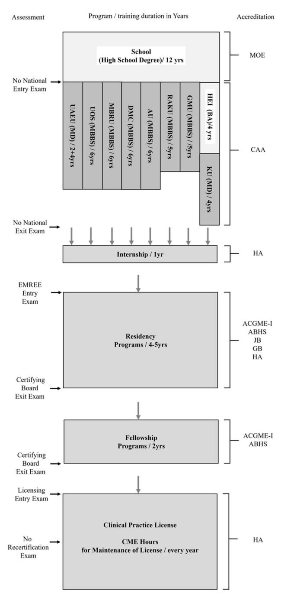

<!-- A1.R02 | source: papers_json/A1.R02/ -->

## **Medical Teacher**

**ISSN: (Print) (Online) Journal homepage:****[ www.tandfonline.com/journals/imte20](https://www.tandfonline.com/journals/imte20?src=pdf)**

## **التعليم الطبي في دولة الإمارات العربية المتحدة:** **التحديات والفرص**

**Hatem Alameri, Hossam Hamdy & Danica Sims**

**للاستشهاد بهذه المقالة:** Hatem Alameri, Hossam Hamdy & Danica Sims (2021) Medical education in the United Arab Emirates: Challenges and opportunities, Medical Teacher, 43:6, 625-632, DOI: [10.1080/0142159X.2021.1908978](https://www.tandfonline.com/action/showCitFormats?doi=10.1080/0142159X.2021.1908978)

**للربط بهذه المقالة: **[https://doi.org/10.1080/0142159X.2021.1908978](https://doi.org/10.1080/0142159X.2021.1908978)

| نُشر إلكترونياً في: 29 Apr 2021. |
| --- |
| أرسل مقالتك إلى هذه المجلة |
| مشاهدات المقالة: 501 |
| عرض المقالات ذات الصلة |
| عرض بيانات Crossmark |
| المقالات المستشهد بها: 5 عرض المقالات المستشهد بها |

<!-- page 2 -->

## حول العالم

## التعليم الطبي في دولة الإمارات العربية المتحدة: التحديات والفرص

Hatem Alameria , Hossam Hamdyb and Danica Simsc

a Department of Medical Education and Examination, Department of Health, Abu Dhabi, United Arab Emirates; ^b^ Chancellor Office, Gulf Medical University, Ajman, United Arab Emirates; ^c^ Department of Health Sciences Education, University of Cape Town, Cape Town, South Africa

## الملخص

للتعليم الطبي (ME) في دولة الإمارات العربية المتحدة (UAE) تاريخ قصير نسبياً، يبدأ مع تأسيس دولة الإمارات قبل نحو 50 عاماً. حققت دولة الإمارات تقدماً كبيراً في توسيع فرص الوصول إلى التعليم الطبي من خلال التنفيذ السريع لأجندات وطنية تهدف إلى تطوير الرعاية الصحية وتوسيع التعليم العالي، إلى جانب وجود بنية تحتية قوية للخصخصة وتطوير الأعمال. ورغم التقدم الحاصل على جميع مستويات التعليم الطبي، لا تزال هناك تحديات معقدة تواجه التعليم الطبي على المستويين الجامعي والدراسات العليا. ومن الضروري، في المستقبل، الاستمرار في معالجة قضايا التوحيد القياسي، والجودة، واستدامة القوى العاملة الأكاديمية والصحية، والبحث العلمي.

## الكلمات المفتاحية

Medical education; United Arab Emirates; UAE

## خلفية عامة

في عام 2021، تحتفل دولة الإمارات بمرور 50 عاماً على اتحادها في عام 1971 من خلال اندماج سبع إمارات في الخليج العربي. وهذه الإمارات هي أبوظبي (أكبر الإمارات؛ ومقر العاصمة)، ودبي، والشارقة، وعجمان، وأم القيوين، ورأس الخيمة، والفجيرة (Government of United Arab Emirates [1971](#page-8-0)). واشتهرت هذه الدولة الغنية بالنفط باقتصادها المتقدم، وخدماتها المتطورة، ومشاريعها المعمارية المبتكرة. ونشرت حكومة دولة الإمارات "رؤية 2021" كأجندة وطنية للتخطيط للمرحلة القادمة من تطور الاتحاد و"التوطين" نحو دولة حديثة ومتقدمة (Government of United Arab Emirates [2014؛](#page-8-0) Sarker and Rahman [2020)](#page-8-0). ويشير التوطين إلى الهدف الاستراتيجي للحكومة المتمثل في زيادة مشاركة المواطنين الإماراتيين في سوق العمل، وخاصة القطاع الخاص، الذي كان يهيمن عليه تقليدياً الوافدون (Sarker and Rahman [2020](#page-8-0)). في هذا المقال، نقدم لمحة عامة عن نظام التعليم الطبي (ME) في دولة الإمارات، ونسلط الضوء على التحديات، ونصف الفرص المتاحة لأجندات التعليم الطبي في الدولة.

## التعليم العالي في دولة الإمارات

من الطرق التي تسعى بها دولة الإمارات إلى تنويع اقتصادها بشكل مستدام وتنافسي مع تراجع الموارد الطبيعية، الاستفادة الكاملة من رأس المال البشري عبر بناء "اقتصاد قائم على المعرفة" من خلال الاستثمار في تعليم من الطراز الأول (Kirk [2010؛](#page-8-0) Government of United Arab Emirates [2014](#page-8-0)؛ Matsumoto [2019](#page-8-0)). والواقع أن الحق في التعليم المجاني على جميع المستويات، بوصفه محركاً أساسياً لمجتمع تقدمي وناجح، منصوص عليه في الدستور (Government of United Arab Emirates [1971](#page-8-0)). وقد عكس التوسع السريع في التعليم العالي (HE)، العام والخاص على حد سواء، هذا

## نقاط عملية

- يعكس تزايد عدد برامج البكالوريوس والدراسات العليا اتساع فرص الوصول إلى التعليم الطبي وزيادة مخرجاته في دولة الإمارات.
- لا تزال دولة الإمارات في طريقها نحو تحسين جودة التعليم الطبي وتوحيده القياسي.
- يواصل التعليم الطبي في دولة الإمارات جذب أفضل الممارسات الدولية.
- يجب الاستمرار في معالجة قضايا التوحيد القياسي، واستدامة القوى العاملة الأكاديمية والصحية، والبحث العلمي.
- سيحتاج التعليم الطبي إلى تحقيق توازن بين معايير الجودة العالمية والتنافسية وهدف البقاء ملائماً للاحتياجات المحلية.

التحول في أهداف التنمية الوطنية والتنافسية العالمية (Kirk [2010](#page-8-0)؛ Kirk and Napier [2010)](#page-8-0).

ينقسم قطاع التعليم العالي في دولة الإمارات إلى مؤسسات اتحادية (عامة)، ومؤسسات ممولة من الإمارات (شبه عامة)، ومؤسسات خاصة للتعليم العالي (HEIs) (Kirk and Napier [2010)](#page-8-0). والغالبية العظمى من مؤسسات التعليم العالي خاصة، إذ لا توجد سوى ثلاث مؤسسات اتحادية للتعليم العالي (HE): جامعة الإمارات العربية المتحدة (UAEU)، وكليات التقنية العليا، وجامعة زايد. وتُتاح المؤسسات العامة في الغالب للمواطنين الإماراتيين، لكن بسبب العدد المحدود من المؤسسات العامة، يلتحق نصف الإماراتيين بمؤسسات خاصة إلى جانب الوافدين والطلاب الدوليين (Stephenson and Rajendram [2019)](#page-8-0). وقد تحظى المؤسسات شبه العامة والخاصة بانتماءات واعتمادات مؤسسية مع مؤسسات دولية، وخاصة مع جامعات من أمريكا الشمالية وأوروبا الغربية (Findlow [2005](#page-8-0)). والواقع أن دولة الإمارات أصبحت أكبر مركز للتعليم العالي للفروع الجامعية الدولية في

<!-- page 3 -->

العالم، بفضل "المناطق الحرة"، التي دعمت توسع مؤسسات أكاديمية أجنبية متعددة خارج نطاق التنظيم الاتحادي (Ashour and Fatima [2016](#page-7-0)). ويُعد المجتمع متعدد الأعراق في دولة الإمارات وجهة شائعة للدراسة في منطقة الشرق الأوسط وشمال أفريقيا (MENA)، وذلك بفضل الاستقرار السياسي، والأمن، والقرب الجغرافي من دول الشرق الأوسط وغرب آسيا وأوروبا (Jose and Chacko [2017](#page-8-0)).

وباعتبارها دولة اتحادية، قد يكون لدولة الإمارات متطلبات مختلفة لتنظيم مؤسسات التعليم العالي على المستويين الاتحادي والإماراتي (Jose and Chacko [2017](#page-8-0)). فعلى سبيل المثال، الجهة الاتحادية المشرفة على التعليم العالي في دولة الإمارات هي "وزارة التربية والتعليم"؛ إلا أن إمارات مختلفة قد تمتلك جهاتها التنظيمية الخاصة، مثل "دائرة التعليم والمعرفة" في أبوظبي أو "هيئة المعرفة والتنمية البشرية" (KHDA) في دبي (Jose and Chacko [2017](#page-8-0)). وارتبطت أجندة دولة الإمارات نحو التنويع الاقتصادي وجذب الاستثمار الأجنبي باعتماد مفاهيم "المناطق الحرة". وقد خلق تشكيل مناطق حرة طبقة إضافية من المرونة وميزة للمؤسسات الأكاديمية الخاصة للعمل في ظل قيود تنظيمية أقل (Jose and Chacko [2017](#page-8-0)). وفيما يتعلق بالاعتماد، فإن الجهتين الاتحاديتين هما "هيئة الاعتماد الأكاديمي" (CAA) و"الهيئة الوطنية للمؤهلات" (NQA)؛ إلا أن دبي لديها جهة اعتماد إضافية تُسمى "مجلس دبي الدولي لضمان الجودة والاعتماد الجامعي" (UQAIB)، التي تشرف على مؤسسات التعليم العالي الدولية داخل مناطقها الحرة غير المعتمدة من قِبل CAA (Jose and Chacko [2017)](#page-8-0). كما تحافظ الفروع الجامعية الدولية على اعتماد من بلدانها الأم، وتجذب الوافدين المهتمين بالحصول على شهادة معترف بها دولياً (Wilkins [2020](#page-8-0)).

وبوجه عام، تعمل CAA مع الجهات المحلية والوطنية عبر الإمارات لضمان الجودة الأكاديمية للتعليم العالي في دولة الإمارات وفق المعايير الدولية، وتوفير تراخيص المؤسسات واعتماد البرامج. وتُشجَّع مؤسسات التعليم العالي على الحصول على اعتماد CAA، لأن القطاع العام في ست من الإمارات السبع لا يعترف إلا بالشهادات المعتمدة من CAA لأغراض التوظيف (Wilkins [2020](#page-8-0)). ولهذا السبب، تقدّمت بعض مؤسسات التعليم العالي داخل المناطق الحرة طواعية لتدقيق CAA لجذب الطلاب الوطنيين الذين ينوون البقاء في دولة الإمارات للعمل؛ في حين قد تتبع مؤسسات أخرى في المناطق الحرة لوائح الإمارة المحلية لأنها تُعتبر أقل صرامة (Wilkins [2020)](#page-8-0).

## النظام الصحي في دولة الإمارات

تتضمن أجندة "رؤية 2021" الوطنية لدولة الإمارات تحسين صحة المواطنين وأداء النظام الصحي (Government of United Arab Emirates [2014](#page-8-0)). ويُعد الوصول إلى رعاية صحية عالية الجودة وتحقيق نتائج صحية إيجابية حقاً دستورياً للمواطنين الإماراتيين، وهدفاً استراتيجياً رئيسياً للحكومة منذ تأسيس الاتحاد (Government of United Arab Emirates [1971؛](#page-8-0) Koornneef et al. [2017](#page-8-0)). وكما وُصف أعلاه بالنسبة لنظام التعليم العالي، فإن أبوظبي ودبي لديهما جهتاهما الصحيتان الخاصتان للترخيص والتنظيم وضمان الجودة، بينما تخدم الإمارات الخمس الأخرى جهة اتحادية تُسمى هنا "وزارة الصحة ووقاية المجتمع"

(MOHAP). كما أن مدينة دبي الطبية، وهي منطقة حرة، لديها معايير تنظيمية صحية مستقلة وتقديم خدمات مستقل، وتُعد أكبر هيكل صحي في منطقة حرة في المنطقة.

ووفقاً لمنظمة الصحة العالمية (WHO)، حققت دولة الإمارات تحسينات كبيرة في مجال الرعاية الصحية منذ تأسيس الاتحاد: من خلال زيادة العمر المتوقع (79.7 عاماً)، وخفض معدلات وفيات الأمهات (3 لكل 100,000 ولادة حية) والرضع (4 لكل 1000 ولادة حية)، بينما ازداد عدد السكان بسرعة عبر النمو الطبيعي (المواليد ناقص الوفيات) والهجرة (WHO [2020](#page-8-0)). وتم القضاء على معظم الأمراض المعدية التي كانت منتشرة سابقاً في دولة الإمارات، مثل الملاريا والحصبة وشلل الأطفال، جزئياً من خلال حملات التطعيم (Koornneef et al. [2017؛](#page-8-0) WHO [2020)](#page-8-0). وشهد القطاع الصحي إصلاحات مستمرة، من بينها التأمين الصحي الإلزامي لجميع المواطنين والوافدين، وخصخصة الرعاية الصحية، وحوكمة القطاع الصحي (Blair and Sharif [2013؛](#page-8-0) Koornneef et al. [2017)](#page-8-0)؛ إلا أن معدلات الأمراض المزمنة آخذة في الارتفاع، وقد أثبتت أنها تحدٍ كبير (Blair and Sharif [2013](#page-8-0)).

وتُعد الأمراض غير المعدية (NCDs) السبب الرئيسي للوفيات والاعتلال في دولة الإمارات؛ إذ تمثل أمراض القلب والأوعية الدموية 29% من إجمالي الوفيات، تليها الإصابات (16%) والسرطان (10%) (Hajat et al. [2012](#page-8-0)؛ Loney et al. [2013؛](#page-8-0) Koornneef et al. [2017)](#page-8-0). وقد تم تحديد معالجة الأمراض غير المعدية كأولوية للصحة العامة، بقيادة دائرة الصحة (DOH) في أبوظبي، الإمارة الأكبر والأكثر سكاناً (Hajat et al. [2012](#page-8-0)). وتشمل الاستراتيجيات والتوصيات لمواجهة هذه الأعباء المرضية تحسين المراقبة والرصد والإبلاغ والبحث المحلي وتدريب المتخصصين الصحيين؛ وتعزيز الرعاية الوقائية على الرعاية العلاجية؛ وتوعية الجمهور؛ واستحداث تشريعات اتحادية إضافية، مثل السياسات على مستوى السكان (Hajat et al. [2012؛](#page-8-0) Loney et al. [2013](#page-8-0)؛ Koornneef et al. [2017](#page-8-0)). ويجب معالجة هذه التحديات الصحية، لأنها تهدد أهداف التنمية الوطنية المتعلقة بالاستدامة والتنمية الاقتصادية من خلال تعريض رأس المال البشري والإنتاجية لمخاطر سلبية (Hajat et al. [2012](#page-8-0)).

وفيما يتعلق بكثافة المهنيين الصحيين، فإن كثافة الأطباء (25.3 لكل 10,000 نسمة) والممرضين/القابلات (57.3 لكل 10,000 نسمة) أعلى من المتوسط العالمي (15.6 و37.6 على التوالي) والمتوسط الإقليمي (10.1 و14.5 على التوالي) (WHO [2020)](#page-8-0). وكثافة أطباء الأسنان (6.5 لكل 10,000 نسمة) والصيادلة (8.8 لكل 10,000 نسمة) مماثلة لتلك الموجودة في المملكة المتحدة (5.2 و8.3 على التوالي) والولايات المتحدة الأمريكية (5.8 و9.2 على التوالي) (WHO [2020](#page-8-0)). وفي حين يشير ذلك إلى قدرة عالية نسبياً للقوى العاملة الصحية، إلا أن هناك جدلاً حول ما إذا كان هناك فائض في المتخصصين الصحيين أو ما إذا كانت القدرة بحاجة إلى مزيد من الزيادة لمواكبة النمو السكاني السريع (Koornneef et al. [2017)](#page-8-0). وغالبية المتخصصين الصحيين من الوافدين؛ لذا فمن المرجح أنهم تدربوا خارج دولة الإمارات وقد لا يكونون ملائمين للاحتياجات الخاصة بالسكان. ويُعد تدريب قوى عاملة صحية من الإماراتيين والمقيمين أمراً بالغ الأهمية لضمان نظام صحي مستدام وفعال (Abdel-Razig and Alameri [2013](#page-7-0)؛ Blair and Sharif [2013)](#page-8-0).

<!-- page 4 -->

## التعليم الطبي في دولة الإمارات

شهد مشهد التعليم الطبي في دولة الإمارات تقدماً كبيراً خلال العقد الماضي. وقد امتد نطاق التعليم الطبي إلى ما هو أبعد من التعليم الطبي الجامعي والدراسات العليا ليصبح جزءاً أساسياً من الممارسة السريرية وترخيص الأطباء. وقد أوجد توسع كليات الطب الجامعية بيئة تنافسية لكنها تعاونية، أدت إلى زيادة إجمالية في عدد الأطباء المنضمين إلى القوى العاملة الصحية في الدولة. علاوة على ذلك، حوّل الاعتماد الدولي لبرامج الدراسات العليا نظام التعليم الطبي من نموذج التعلم بالتلمذة الصناعية الذي كان معتمداً سابقاً إلى نموذج تعلم قائم على النتائج والنظام. وقد ضمن استحداث عدة قوانين تنظيمية للمهن الصحية أن يكون التعليم الطبي والتطوير المهني المستمر جزءاً لا يتجزأ من إطار تنظيم المهن الصحية (انظر الشكل 1).

## التعليم الطبي الجامعي

توجد ثماني مؤسسات طبية للتعليم العالي في دولة الإمارات (انظر [الجدول 1)](#page-4-0). وغالبية هذه المؤسسات خاصة. وتوجد جامعة عامة واحدة فقط: جامعة الإمارات العربية المتحدة (UAEU) في مدينة العين بإمارة أبوظبي، التي تأسست عام 1976 وهي أقدم مؤسسة للتعليم العالي في الدولة وأعلاها تصنيفاً. وافتُتحت كلية الطب والعلوم الصحية في جامعة الإمارات عام 1984 واستقبلت أول دفعة من الطلاب عام 1986. واليوم، يتخرج نحو 400 طالب من المؤسسات الطبية للتعليم العالي في جميع أنحاء دولة الإمارات، ويُقدَّر أن ما بين 700 و800 طالب يُقبلون حديثاً في برامج جديدة، وهو ما يعكس تنامي فرص الوصول إلى التعليم الطبي ومخرجاته في دولة الإمارات (World Directory of Medical Schools 2020).

## القبول

تختلف معايير القبول في برامج البكالوريوس بين مؤسسات التعليم العالي. وبوجه عام، يُشترط للقبول في إحدى مؤسسات التعليم العالي الحصول على شهادة أو دبلوم إتمام التعليم الثانوي (الصف الثاني عشر) بمعدل تراكمي يتراوح بين 70% و80%، أو ما يعادله. أما بالنسبة لكليات الطب، فيُطلب تحقيق معدل تراكمي أعلى لا يقل عن 90% لشهادة الصف الثاني عشر. كما تُشترط درجات عالية في مواد علمية محددة (الأحياء والكيمياء/الفيزياء) في اختبار "الإمسات" (EmSAT) الوطني الموحد للقبول في كليات الطب. وتُعد الدرجة المرتفعة نسبياً في اختبار الإمسات للغة العربية، بالإضافة إلى إثبات الكفاءة في اللغة الإنجليزية (وهي لغة التدريس)، متطلبات إضافية. وقد تتضمن بعض كليات الطب أيضاً مقابلات متعددة قصيرة أو مقابلات شخصية ضمن عملية القبول. وعادة ما تكون إجراءات التقديم مجانية، لكن بعض مؤسسات التعليم العالي تفرض رسماً غير قابل للاسترداد يُعتبر جزءاً من العملية التنافسية.

## هيكل البرنامج

يُصنَّف برنامجا بكالوريوس الطب والجراحة (MBBS) ودكتور الطب (MD) على المستوى السابع (وكلاهما يعادل درجة البكالوريوس) ضمن الإطار الوطني للمؤهلات (NQF). ومدة معظم البرامج تتراوح بين 5 و6 سنوات. وتتألف هذه البرامج الجامعية من مرحلتين: ما قبل السريرية (ما قبل التدريب الإكلينيكي) والسريرية (التدريب الإكلينيكي).

*Figure 1. The overview of the medical education structure in the UAE. ABHS: Arab Board of Health Specialties; ACGME-I: Accreditation Council of Graduate Medical Education International; AU: Ajman University; BA: Bachelor Degree; CAA: Council for academic accreditation; CME: Continuous Medical Education; DMC: Dubai Medical College; EMREE: Emirates Medical Residency Entry Examination; GB: German Board; HA: Health Authorities; HEI: High Education Institutions; JB: Jordanian Board; MBRU: Mohammed Bin Rashid University; MOE: Ministry of Education; UAEU: United Arab Emirates University; UOS: University of Sharjah. The overview of the ME system in the UAE at all levels of education and its interaction with the healthcare, different external accreditations, and certifications systems.*

ويكون البرنامج المدته 6 سنوات مماثلاً للبرنامج المدته 5 سنوات، مع إضافة سنة "تأسيسية" في البداية تركز على العلوم الأساسية (الأحياء والكيمياء والفيزياء). وتُعد جامعة خليفة المؤسسة الوحيدة التي تقدم برنامجاً مدته 4 سنوات، على غرار نظام التعليم الطبي في أمريكا الشمالية، ولا تقبل فيه سوى الطلاب الحاصلين مسبقاً على درجة بكالوريوس في مجال علمي (الأحياء أو الكيمياء أو الفيزياء أو الرياضيات). وقد انتقلت كلية العلوم الصحية بجامعة الإمارات العربية المتحدة مؤخراً من درجة MBBS مدتها 6 سنوات إلى درجة MD مدتها 4 سنوات، بشرط إتمام سنتين تأسيسيتين بنجاح.

<!-- page 5 -->

## المنهج الدراسي

قد يختلف المحتوى المنهجي وبنيته بين مؤسسات التعليم العالي، لكن المناهج الطبية بشكل عام تكون منهجاً قائماً على الكفاءات ومنظماً حول الأجهزة العضوية (الجهاز العضلي الهيكلي، والتنفسي، والقلبي الوعائي، والهضمي، وغيرها)، وتكون متكاملة (Hamdy, Telmesani, Al Wardy, et al. [2010)](#page-8-0). وخلال المرحلة ما قبل السريرية (السنتان أو الثلاث سنوات الأولى)، يركز المنهج على العلوم الأساسية والطبية الحيوية كأساس للطب (مثل التشريح، وعلم وظائف الأعضاء، والكيمياء الحيوية، والمناعة، وعلم الأحياء الدقيقة، وعلم الفيروسات، وعلم الأمراض، وعلم الأدوية)، والتطوير الشخصي والمهني، والعلوم السلوكية، والمهارات السريرية. وتعتمد استراتيجية التعلم في جامعتين، هما جامعة الشارقة وجامعة الخليج الطبية، بشكل أساسي على التعلم القائم على حل المشكلات (PBL).

أما بالنسبة للمرحلة السريرية (السنتان أو الثلاث سنوات الأخيرة)، فيتألف البرنامج من دورات تناوب سريرية، أو تدريبات إكلينيكية، في مستشفيات تابعة للجامعات ومواقع تدريب سريري في الرعاية الإسعافية والداخلية والأولية و/أو التخصصية. ويجري هذا التدريب بشكل رئيسي في مرافق سريرية عامة، مع تناوبات محدودة في مؤسسات القطاع الخاص، بما في ذلك أقسام الطوارئ والرعاية المجتمعية. ويتلقى الطلاب أولاً تدريباً في مجالات الطب العام (بما في ذلك طب الأسرة والمجتمع)، والجراحة العامة، وأمراض النساء والتوليد، وطب الأطفال وحديثي الولادة. ويلي ذلك تدريب في التخصصات الفرعية الطبية والجراحية، مثل طب الأعصاب، والأمراض الجلدية، وأمراض القلب، وأمراض الكلى، وأنف وأذن وحنجرة، وطب العيون، والطب النفسي. وخلال هذه التناوبات، تُتاح للطلاب فرصة الممارسة العملية في أخذ التاريخ المرضي، والفحص السريري، وتفسير الفحوصات الخاصة، والتشخيص، وإدارة المرضى، والإجراءات العامة.

وتختلف كفاءات الخريجين بين كليات الطب، لكن هناك كفاءات معينة تظهر في صميم جميع المناهج: المعرفة بالممارسة، والممارسة القائمة على الأدلة والتعلم مدى الحياة، والتطوير الشخصي والمهني المستمر، والبحث العلمي، ورعاية المرضى والسكان، والمسؤولية الاجتماعية، والأنظمة الصحية والممارسة الفعالة من حيث التكلفة، والأخلاقيات والمهنية، ومهارات التواصل الشخصي، والتعاون بين المهن، والرعاية الصحية المعززة بالتقنية. وقد تمت مقارنة هذه الكفاءات مرجعياً بأطر كفاءات معروفة دولياً، مثل مجلس اعتماد التعليم الطبي للدراسات العليا (ACGME)، لكن جرى أيضاً

تكييفها لتكون ملائمة سياقياً وثقافياً واجتماعياً.

وتختلف أساليب التدريس والتعلم والتقييم في كليات الطب بدولة الإمارات، لكن التعلم النشط المتمحور حول الطالب، مثل التعلم القائم على حل المشكلات (PBL)، قد اعتُمد على نطاق واسع في معظم الكليات (Hamdy [2017](#page-8-0)). فعلى سبيل المثال، تسلط جامعة الخليج الطبية الضوء على نهج متمحور حول الطالب في التدريس والتعلم، حيث يُقلَّل من التلقين التقليدي لصالح استراتيجيات التعلم النشط في مجموعات صغيرة، بما في ذلك PBL، والتعلم القائم على فرق العمل، والندوات التي يقودها الطلاب. ولدى جامعة الإمارات العربية المتحدة لجنة مؤسسية لإدارة المنهج الدراسي تنسق أنشطة التدريس والتعلم والتقييم القائمة على الأدلة، مثل التعليم القائم على النتائج، وتقنيات التعلم النشط، وتخطيط التقييم، والتغذية الراجعة. وتمارس جامعة رأس الخيمة الطبية وعلوم الصحة التقييم المستمر، الذي يستخدم اختبارات الممارسة العملية المنظمة الملاحظة (OSPEs)، والاختبارات السريرية المصغرة (Mini-CEX)، وسجلات التدريب، ومراجعات الحالات، وعروض الحالات، والامتحان النهائي.

## التعليم الطبي للدراسات العليا

تُعتمد مؤسسات التعليم العالي وبرامجها من قِبل وزارة التربية والتعليم/شؤون التعليم العالي، وتُرخَّص وتُعتمد من قِبل CAA. وبمجرد حصول الخريجين على درجة البكالوريوس، يمكنهم إما المتابعة في الدراسات العليا، بالحصول على درجة الماجستير أو الدكتوراه في عدة مؤسسات للتعليم العالي (مثلاً في الصحة العامة)، أو الانتقال إلى التدريب في برامج الإقامة الطبية. ويُشترط إتمام سنة تدريب داخلي، وهي سنة واحدة من الممارسة السريرية تحت الإشراف في مستشفيات معتمدة، قبل التخصص في برنامج الإقامة (Bakir and Abdel-Razig [2019](#page-7-0)).

وبمجرد إتمام الطالب لسنة التدريب الداخلي بنجاح، يجب عليه اجتياز امتحان طبي للإقامة، يُتيح له الالتحاق ببرامج إقامة الدراسات العليا في دولة الإمارات (انظر [الجدول 2](#page-5-0)). ويُعد امتحان دخول الإقامة الطبية الإماراتي (EMREE) اختباراً من نوع الاختيار من متعدد مدته 3 ساعات ويتكون من 120 سؤالاً، يغطي الطب الباطني العام، وأمراض النساء والتوليد، وطب الأطفال، والجراحة العامة، وطب الأسرة، والطب النفسي، والصحة العامة. وقد صُمم هذا الامتحان لاختبار التفكير السريري من خلال سيناريوهات إكلينيكية. ويحتاج من يخوض الامتحان إلى إظهار فهم لآليات

<!-- page 6 -->

المرض والتشخيص وإدارة المرضى وعلاجهم.

وعلى مدى السنوات الخمس الماضية، أصبح امتحان العلوم الطبية الأساسية للمؤسسة الدولية للامتحان الطبي، والعلوم السريرية الذي يقدمه المجلس الوطني الأمريكي للامتحانات الطبية "NBME"، امتحاناً إلزامياً في جميع كليات الطب. وتعتبره وزارة التربية والتعليم وCAA معياراً دولياً مرجعياً.

## الاعتماد والشهادات

منذ منتصف تسعينيات القرن الماضي، يُعتمد التعليم الطبي للدراسات العليا من قِبل المجلس العربي للتخصصات الصحية (ABHS). إلا أن هناك تفاوتات في تطبيق الأطر التنظيمية على مستوى البرنامج، مما يؤدي إلى نتائج تعليمية غير واضحة. وهذا يبرز الحاجة إلى ضمان جودة صارم وموحد قياسياً للتعليم الطبي للدراسات العليا من خلال معايير اعتماد إضافية (Abdel-Razig and Alameri [2013؛](#page-7-0) Hamdy [2017](#page-8-0) ، [2018](#page-8-0)).

وفي الآونة الأخيرة، اعتمدت الهيئة السعودية للتخصصات الصحية بعض برامج الإقامة في دبي (الطب الباطني، وطب الأعصاب، وطب الرئة، والتخدير، وجراحة الأعصاب)، والمجلس الألماني للتخصص (جراحة العظام والصدمات) (Abdulrahman et al. [2018)](#page-7-0). وبالمثل، حصلت عدة مستشفيات تدريب للإقامة الطبية وبرامجها التخصصية في أبوظبي على اعتماد من المجلس الطبي الأردني.

والمهم أن اعتماد برامج الإقامة في أبوظبي من قِبل مجلس اعتماد التعليم الطبي للدراسات العليا الدولي الأمريكي (ACGME-I) قد أدى إلى نتائج تعليمية أكثر تنظيماً وتحسينات في الكفاءات التي تتوافق مع الاحتياجات الصحية للسكان (Ibrahim et al. [2014](#page-8-0)؛ Ibrahim, Al Tatari, et al. [2015](#page-8-0)؛ Elghul [2016](#page-8-0) ، [2019)](#page-8-0). وفي حين واجهت عملية الانتقال من نموذج التعليم بالإشراف المُستخدم سابقاً إلى نموذج التعليم الطبي القائم على الكفاءات غير المألوف في الإقامة بعض الصعوبات (Elghul [2019](#page-8-0))، كانت تصورات الأطباء المقيمين حول اعتماد ACGME-I إيجابية بشكل مشجع (Ibrahim, Abdel-Razig, et al. [2015](#page-8-0)) (انظر الجدول 2).

ويحق للأطباء المقيمين والزملاء المسجلين خوض الامتحان (أو الامتحانات) المطلوبة من قِبل جهة الاعتماد المعنية. فعلى سبيل المثال، يتألف امتحان ABHS من جزأين: امتحان أول يُخاض خلال أول سنتين من الإقامة، وامتحان ثانٍ يركز على الكفاءات السريرية. ويجب على الطبيب المقيم إتمام كلا الجزأين ليُعتمد كأخصائي.

## المعهد الوطني للتخصصات الصحية

في عام 2014، أُعلن عن تأسيس "المعهد الوطني للتخصصات الصحية" في دولة الإمارات. وتتمثل مهمة هذا المعهد في دعم تدريب تخصصي عالي الجودة وشامل لتوفير القوى العاملة المطلوبة في دولة الإمارات. وشكّل هذا معلماً مهماً في أجندة التعليم الطبي بدولة الإمارات، إذ سعى إلى ضمان جودة تدريب التخصصات في الدراسات العليا، الذي يوجد عليه طلب لكن قدرة تقديمه محدودة (Abdel-Razig and Alameri [2013](#page-7-0)؛ Abdulrahman et al. [2018؛](#page-7-0) Government of Dubai and Dubai Health Authority [2020](#page-8-0)). ومؤخراً، وقّع المعهد عدة اتفاقيات مع منظمات دولية بارزة في مجال التعليم الطبي، من بينها الكلية الملكية للأطباء والجراحين في كندا. وتهدف هذه الاتفاقية إلى تعزيز التعاون بين المنظمتين في مجال الاعتماد

*Emirate Specialties Anesthesiology Cardiology Dermatology Emergency medicine Family medicine Gastroenterology Hematology Internal Medicine Neonatology Nephrology Neurology Neurosurgery Obstetrics and gynecology Oncology Ophthalmology Orthopedics Otolaryngology Pathology Pediatrics Pediatric Gastroenterology Rheumatology Psychiatry Radiology Surgery ( general) Urology Abu Dhabi Tanseeqa Dubai DRTPb Al Jalila Hospitalc Other Emirates MOHAPd The residency programs available across UAE for the 2020 entry cycle. aTanseeq: application and matching residency system conducted by the Department of Health Abu Dhabi. bDRTP: Dubai Residency Training Programs conducted by Dubai Health Authority. cAl Jalila Hospital in Dubai independently conducts a*

Table 2. Residency and fellowship programs in the UAE.

*pediatrics program. dOther Emirates Residency Programs are under the Ministry of Health and Prevention.*

<!-- page 7 -->

معايير التقييم، ونظام التقييم، وتطوير الكوادر التدريسية المهنية.

## الممارسة السريرية

يُشترط اعتماد CAA أو الاعتماد الدولي لبرنامج جامعي أو دراسات عليا لكي يُعترف بهذه المؤهلات من قِبل حكومة دولة الإمارات؛ وفي غياب ذلك، لا يمكن اعتماد الخريجين، وبالتالي لا يحق لهم خوض امتحان الترخيص الوطني للممارسة السريرية. وعلى غرار نظامي التعليم والرعاية الصحية، تمتلك الإمارات المختلفة جهات ترخيص وتنظيم مختلفة. ولكي يمارس الخريج الطب السريري، يجب عليه اجتياز امتحان الترخيص من DOH في أبوظبي، وDHA في دبي، وMOHAP للممارسة السريرية في أي من الإمارات الخمس الأخرى. وتشمل عملية الترخيص الطبي التوثيق، والتحقق من الوثائق، والامتحان. ويلزم الحصول على ترخيص طبي جديد لكل مستوى من مستويات الممارسة المهنية الصحية: يُسمى الخريج الطبي الذي لا يملك خبرة ويبدأ الممارسة السريرية "متدرباً" (intern). وبعد سنة من التدريب الداخلي، يُرخَّص له بصفة "طبيب مقيم" (resident). وإذا قرر الخريج عدم الالتحاق ببرنامج الإقامة، يحصل على لقب "ممارس طبي" (MP). وعند إتمام تخصص المجلس، يمكن أن يُطلق على الممارس السريري لقب "أخصائي". وبعد 5 سنوات كأخصائي، قد يُطلق عليه لقب "استشاري". ويسترشد توثيق أوراق اعتماد الأطباء بوثيقة متطلبات المؤهل المهني (PQR)، وهي معيار اتحادي صدر عام 2014 لتوحيد معايير التوثيق ومتطلبات الترخيص ضمن جهات التنظيم الصحي الثلاث.

## التطوير المهني المستمر (CPD)

من المبادئ الأساسية للرعاية الصحية في دولة الإمارات أن يكون الممارسون متعلمين مدى الحياة من خلال التطوير والتدريب المهني بعد المؤهل الأساسي (Abdel-Razig et al. [2016](#page-7-0)). ويُعد التعليم الطبي المستمر (CME) أداة رئيسية يمكن من خلالها للممارس تحديث خبرته وتجديدها، وبالتالي دعم هدف أن يكون متخصصاً صحياً كفؤاً. وتوفر DOH وDHA وMOHAP الاعتماد للتعليم الطبي المستمر في الإمارة (أو الإمارات) المعنية.

ويُعد التعليم الطبي المستمر إلزامياً لتجديد ترخيص المهن الصحية. ووفقاً لوثيقة PQR، يُطلب من الطبيب المرخَّص تقديم 40 ساعة معتمدة من CME سنوياً عند تجديد الترخيص. ويُفرض متطلب مماثل على الطبيب الذي يسعى للعودة إلى الممارسة السريرية بعد انقطاع. ومعايير الاعتماد مماثلة لتلك الخاصة بمجلس اعتماد التعليم الطبي المستمر (ACCME) والمجلس الأوروبي لاعتماد التعليم الطبي المستمر.

## البحث في التعليم الطبي

في حين ازداد البحث الصحي في دولة الإمارات، وخاصة حول الأمراض غير المعدية المتزايدة بسرعة، لا تزال مخرجات البحث أقل مما هي عليه في أجزاء أخرى من العالم (United Arab Emirates Ministry of Health and Prevention and Monash University 2019). وبوجه عام، يُعد نقص التمويل عائقاً رئيسياً أمام البحث في التعليم العالي (Jose and Chacko [2017)](#page-8-0). وتنفق حكومة دولة الإمارات حالياً 0.16% فقط من ناتجها المحلي الإجمالي على البحث، وهو أدنى إنفاق من نوعه في

منطقة الخليج العربي. وقد أُوصي بزيادة تمويل البحث، مع تحديد الشراكات بين القطاعين العام والخاص كمجال واعد محتمل (Hamdy [2017](#page-8-0)، [2018](#page-8-0)).

والتعليم الطبي تحديداً بحث فيه بشكل غير كافٍ (Meo et al. [2015)](#page-8-0). ومع ذلك، هناك اهتمام متزايد واعتراف بالتعليم الطبي كمجال علمي وبحثي، إلى جانب مجالات البحث الأكثر رسوخاً في الطب الحيوي والسريري والصحة العامة. وقد عولجت الحاجة إلى تحسين البحث من خلال إدراج مكونات بحثية إلزامية أو اختيارية في برامج البكالوريوس والدراسات العليا، والعلاقات بين القطاعين العام والخاص، والتعاون مع مؤسسات التعليم العالي الدولية (Meo et al. [2015](#page-8-0)؛ Hamdy [2018)](#page-8-0). وفي المستقبل، يُعد البحث في التعليم الطبي بدولة الإمارات أمراً ضرورياً.

## التحديات والفرص

حققت دولة الإمارات الكثير في مجال التعليم الطبي منذ بداياته الحديثة. وقد أعطت جميع الجهات الصحية الاتحادية (DOH وDHA وMOHAP) الأولوية لتطوير تعليم طبي عالي الجودة. ولوحظ ذلك في التشريعات الداعمة لتدريب الطلاب، بما في ذلك الجهود الرامية إلى زيادة فرص الوصول إلى التعليم الطبي عبر توسيع القطاع الخاص. وقد امتد هذا التشريع إلى ترخيص جميع الأطباء المقيمين كأعضاء فاعلين وقيّمين في سوق العمل الصحي، وهو ما شكّل خطوة مهمة إلى الأمام في تزويد دولة الإمارات بقوى عاملة صحية مستدامة، خاصة في أوقات الأزمات (Fares [2014](#page-8-0)). وخصصت هذه الجهات الصحية مكاتب إدارية مخصصة للتعليم الطبي. ويشمل عملها تطوير استراتيجية التعليم الطبي، ووضع سياساته، وضمان الامتثال التنظيمي له. ورغم هذه الإنجازات، لا تزال هناك تحديات عديدة قائمة.

## الحاجة إلى التوحيد القياسي

من عيوب وجود جهات تنظيمية منفصلة للتعليم والرعاية الصحية غياب ممارسة موحدة قياسياً للتعليم الطبي عبر دولة الإمارات (Ashour and Fatima [2016](#page-7-0)؛ Jose and Chacko [2017)](#page-8-0). وتتفاقم هذه المشكلة بسبب غياب مستشفيات تعليمية مخصصة لمؤسسات التعليم العالي. وحالياً، مع استثناءين (جامعة الخليج الطبية وجامعة الشارقة)، يتلقى الطلاب الجامعيون تدريبهم السريري في مستشفيات مستقلة. وهذه المستشفيات حرة في إجراء تغييرات تشغيلية قد تؤثر على التدريب السريري. ومن المتوقع أن يدعم اعتراف الاتحاد العالمي للتعليم الطبي (WFME) الأخير بـ CAA تطوير نظام اعتماد وطني أكثر صرامة، يعزز ضمان الجودة في التعليم الطبي ويدعم مواءمة مخرجات كليات الطب مع احتياجات النظام الصحي.

وبالمثل، بالنسبة للتدريب الطبي للدراسات العليا وCME، دفع غياب معايير اعتماد اتحادية موحدة لهذه البرامج بعض المرافق إلى البحث عن أنظمة اعتماد من طرف ثالث. غير أن اختلاف معايير الاعتماد والشهادات خلق بيئة معقدة يصعب التعامل معها، وإجراءات تشغيلية مكررة، وأحياناً نتائج تدريبية غير متسقة (Elghul [2019](#page-8-0)). وينبغي لدولة الإمارات، في المستقبل، أن تعمل على وضع منهج وطني موحد للتعليم الطبي، وامتحانات ترخيص وطنية، ومجلس وطني للتخصصات، ومجموعة وطنية من اللوائح لمخرجات التعليم الطبي (Hamdy, Telmesani, Al Wardy, et al. [2010؛](#page-8-0) Hamdy, Telmesani, Wardy, et al. [2010)](#page-8-0). فعلى سبيل المثال، بمجرد أن يصبح "المعهد الوطني للتخصصات

<!-- page 8 -->

الصحية" فعالاً وتتوافق معايير التعليم الطبي والممارسات الأكاديمية بشكل أوضح مع الرعاية الصحية للسكان، من المتوقع أن يُشهد تحسن في التعليم الطبي للدراسات العليا (Abdel-Razig and Alameri 2013؛ Abdulrahman et al. 2018).

## استدامة القوى العاملة

في حين يُعد التوطين هدفاً طويل الأمد لدولة الإمارات، لا يزال العدد الكبير من السكان الوافدين عائقاً رئيسياً أمام تطوير قوى عاملة إماراتية مستدامة. ويتفاقم هذا التحدي بسبب طلب مرتفع مقابل قدرة تدريب محدودة: إذ يتجاوز عدد الخريجين الطبيين عدد مواقع التدريب المتاحة في الدراسات العليا واحتياجات النظام الصحي (Hamdy, Telmesani, Wardy, et al. [2010](#page-8-0)؛ Abdulrahman et al. 2018). وقد يؤدي هذا، إلى جانب انخفاض عدد الأطباء الإماراتيين، إلى شكل من "هجرة الأدمغة" حيث يغادر الخريجون الطبيون غير الإماراتيين دولة الإمارات بحثاً عن مزيد من التعليم والشهادات في الدراسات العليا وفرص العمل في أماكن أخرى، دون ضمان للعودة. وتُعد زيادة القوى العاملة الصحية والتعليمية الطبية والاحتفاظ بها أمراً بالغ الأهمية (Hamdy, Telmesani, Al Wardy, et al. [2010؛](#page-8-0) Hamdy, Telmesani, Wardy, et al. [2010)](#page-8-0). ويجب أن يكون هناك توازن بين بناء قدرة القوى العاملة والحفاظ على تدريب طبي عالي الجودة ومستجيب محلياً (Hamdy [2017)](#page-8-0). ونوصي بالتركيز بشكل خاص على تطوير الكوادر التدريسية، والتعليم، والقيادة، من أجل زيادة الوظائف في التعليم الطبي وإعداد أفضل لمدرسين سريريين مستدامين، ومديري برامج، ومديري كوادر تدريسية، إذ سيتحمل هؤلاء الأفراد مسؤولية كبيرة في توجيه مستقبل التعليم الطبي والمهن الصحية في دولة الإمارات (Hamdy, Telmesani, Wardy, et al. [2010](#page-8-0)).

## تمويل التعليم الطبي

أوجد استحداث التأمين الصحي الإلزامي نظاماً أكثر تنظيماً لتقديم الرعاية الصحية في دولة الإمارات. وقد دفع الإصلاح المالي في الرعاية الصحية وزيادة الشراكة بين القطاعين العام والخاص تغييرات كبيرة في الممارسات الصحية، مثل قياس وتقييم أنشطة الخدمات السريرية ونتائجها، وما يترتب على ذلك من قدرة على توجيه الجهود بشكل مناسب لتلبية احتياجات السكان الصحية. غير أن تغييرات مماثلة لم تُلاحَظ في نظام التعليم الطبي. فتمويل التعليم الطبي يفتقر إلى التكامل بين التعليم الطبي الجامعي، الذي هو في معظمه خاص، والتعليم الطبي للدراسات العليا، الذي يُدعم حصرياً من الأموال العامة. وقد يؤدي هذا إلى فروق في الأهداف الاستراتيجية بين القطاعين، ما قد يفضي إلى مخرجات في التعليم الطبي لا ترتبط بالنظام الصحي. وينبغي توجيه جهود إضافية نحو هيكلة النظام المالي للتعليم الطبي بحيث يخدم احتياجات السكان الصحية بشكل كامل.

## فرصة لتصبح مركزاً للتعليم الطبي

يوفر الموقع الجغرافي لدولة الإمارات فرصاً إضافية لإنشاء "مركز" جديد للتعليم الطبي للمنطقة وما وراءها. علاوة على ذلك، هناك تفويض وطني ودعم سياسي لتطوير رأس المال البشري، مصحوبان ببنية تحتية ممتازة ووفرة في الموارد. وهذا يجعل الشراكات والتعاون مع مؤسسات التعليم العالي الأخرى جذابة، وقد يساهم في تطوير وتحسين ممارسات التعليم الطبي في

دولة الإمارات. وفي السنوات الأخيرة، أصبحت دولة الإمارات مركزاً لعدة مؤتمرات طبية ضخمة، مثل "Arab Health"، الذي جذب أكثر من 57,000 زائر و4142 عارضاً في عام 2020. وقد شهد التعليم الطبي الجامعي نجاحاً مماثلاً، مع تزايد وجود جامعات أجنبية مرموقة في مختلف الإمارات. ويُعد المزيد من العمل في التعليم الطبي للدراسات العليا وبحث التعليم الطبي أمراً حيوياً.

وفي الختام، وبينما لا تزال دولة الإمارات في طريقها نحو مواصلة تحسين جودة التعليم الطبي وتوحيده القياسي، ينبغي ألا يتم ذلك على حساب السياق المحلي وسكانه وثقافتهم واحتياجاتهم. وقد استكشف بحث حديث معنى أن يكون المرء متخصصاً صحياً في دولة الإمارات وكيف قد يحتاج التعليم الطبي للدراسات العليا إلى التغيير لخدمة الشعب الإماراتي على أفضل وجه. ومستقبلاً، سيحتاج التعليم الطبي في دولة الإمارات إلى تحقيق توازن بين معايير الجودة العالمية والتنافسية وهدف البقاء ملائماً للاحتياجات المحلية.

## بيان الإفصاح

لا يُبلغ المؤلفون عن أي تضارب في المصالح. ويتحمل المؤلفون وحدهم مسؤولية محتوى المقالة وكتابتها.

## ملاحظات عن المساهمين

Hatem Alameri, MD, FCCP, أستاذ مشارك ملحق في الطب ومدير قسم التعليم الطبي والامتحانات بدائرة الصحة في أبوظبي، دولة الإمارات. وهو عضو في عدة لجان استشارية وطنية ودولية للتعليم الطبي. يمتلك أكثر من 20 عاماً من الخبرة في التعليم الطبي وتطوير الأطر التنظيمية الصحية؛ مع تركيز رئيسي على استراتيجيات التعليم الطبي التحويلية.

Hossam Hamdy, MBChB, FRCS, PhD، هو المستشار وأستاذ الجراحة والتعليم الطبي في جامعة الخليج الطبية، عجمان، دولة الإمارات. وهو مستشار لدى منظمة الصحة العالمية، وعضو في هيئات تحرير عدة مجلات للتعليم الطبي، بخبرة تفوق 40 عاماً وأكثر من 70 منشوراً في مجال التعليم الطبي. وقد حصل على عدة جوائز عالمية تقديراً لالتزامه ومساهمته في التعليم الطبي.

Danica Sims, BSc, BMedScHons, MScMed, PhD HSE، هي أخصائية وباحثة في علوم الصحة من كيب تاون، جنوب أفريقيا. تعمل بصفات متعددة في التعليم العالي، وتعمل حالياً في جامعة كيب تاون وجامعة كيب الغربية. ويركز عملها على المنهج الدراسي والتقييم والتطوير المهني المستمر.

## ORCID

Hossam Hamdy http://orcid.org/0000-0001-6096-6139

## المراجع

Abdel-Razig S, Alameri H.[ 2013.](#page-2-0) Restructuring graduate medical education to meet the health care needs of Emirati citizens. J Grad Med Educ. 5(2):195–200.

Abdel-Razig S, Ibrahim H, Alameri H, Hamdy H, Haleeqa KA, Qayed KI, Obaid LO, Fahim MA, Ezimokhai M, Sulaiman ND, et al.[ 2016.](#page-6-0) Creating a framework for medical professionalism: an initial consensus statement from an Arab Nation. J Grad Med Educ. 8(2):165–172.

Abdulrahman M, Ahmed A, Withnall R.[ 2018](#page-5-0). Evolution of the Dubai health authority's residency training program: a 25-year review, challenges and outcomes. J Family Med Prim Care. 7(2):319.

Ashour S, Fatima SK.[ 2016.](#page-2-0) Factors favouring or impeding building a stronger higher education system in the United Arab Emirates. J Higher Educ Policy Manage. 38(5):576–591.

Bakir I, Abdel-Razig S.[ 2019.](#page-4-0) The internship year: a potential missed opportunity to expand medical access in international settings. J Grad Med Educ. 11(4 Suppl):30–33.

<!-- page 9 -->

- Blair I, Sharif A.[ 2013](#page-2-0). Health and health systems performance in the United Arab Emirates. World Hosp Health Serv. 49(4):12–17.
- Elghul AM.[ 2016.](#page-5-0) The ACGME-I effect. J Grad Med Educ. 8(2):285.
- Elghul AM.[ 2019.](#page-5-0) Challenges and the future of residency education in the UAE after ACGME-I accreditation. J Grad Med Educ. 11(4 Suppl): 14–15.
- Fares S, Irfan FB, Corder RF, Al Marzouqi MA, Al Zaabi AH, Idrees MM, Abbo M.[ 2014](#page-6-0). Emergency medicine in the United Arab Emirates. Int J Emerg Med. 7(1):4.
- Findlow S.[ 2005.](#page-1-0) International networking in the United Arab Emirates higher education system: global–local tensions. Compare. 35(3): 285–302.
- Government of Dubai, Dubai Health Authority[ 2020](#page-5-0). Dubai clinical services capacity plan: 2018-2030. [https://www.dha.gov.ae/](https://www.dha.gov.ae/DHAOpenData/Annual%20Statistical%20Books/DHADoc1260173559-03-06-2020.pdf) [DHAOpenData/Annual%20Statistical%20Books/DHADoc1260173559-](https://www.dha.gov.ae/DHAOpenData/Annual%20Statistical%20Books/DHADoc1260173559-03-06-2020.pdf) [03-06-2020.pdf.](https://www.dha.gov.ae/DHAOpenData/Annual%20Statistical%20Books/DHADoc1260173559-03-06-2020.pdf)
- Government of United Arab Emirates.[ 1971](#page-1-0). United Arab Emirates's Constitution of 1971. [https://www.constituteproject.org/constitu](https://www.constituteproject.org/constitution/United_Arab_Emirates_2004.pdf)[tion/United_Arab_Emirates_2004.pdf.](https://www.constituteproject.org/constitution/United_Arab_Emirates_2004.pdf)
- Government of United Arab Emirates.[ 2014](#page-1-0). Vision 2021. [https://www.](https://www.vision2021.ae/en/national-agenda-2021) [vision2021.ae/en/national-agenda-2021](https://www.vision2021.ae/en/national-agenda-2021).
- Hajat C, Harrison O, Shather Z.[ 2012](#page-2-0). A profile and approach to chronic disease in Abu Dhabi. Global Health. 8:18
- Hamdy H, Telmesani AW, Al Wardy N, Abdel-Khalek N, Carruthers G, Hassan F, Kassab S, Abu-Hijleh M, Al-Roomi K, O'Malley K, et al. [2010](#page-4-0). Undergraduate medical education in the Gulf Cooperation Council: a multi-countries study (part 1). Med Teach. 32(3):219–224.
- Hamdy H, Telmesani AW, Wardy NA, Abdel-Khalek N, Carruthers G, Hassan F, Kassab S, Abu-Hijleh M, Al-Roomi K, O'Malley K, et al. [2010](#page-6-0). Undergraduate medical education in the Gulf Cooperation Council: a multi-countries study (part 2). Med Teach. 32(4):290–295.
- Hamdy H.[ 2017](#page-4-0). The problem and goals are global, the solutions are local: Revisiting quality measurements and the role of the private sector in global health professions education. Acad Med. 92(8): 1082–1085.
- Hamdy H.[ 2018.](#page-5-0) Medical college of the future: from informative to transformative. Med Teach. 40(10):986–984.
- Ibrahim H, Abdel-Razig S, Nair SC.[ 2015](#page-5-0). Medical students' perceptions of international accreditation. Int J Med Educ. 6:121–124.
- Ibrahim H, Al Tatari H, Holmboe E.[ 2015.](#page-5-0) The transition to competency-based pediatric training in the United Arab Emirates. BMC Med Educ. 15(1):65.

- Ibrahim H, Lindeman B, Matarelli SA, Nair SC.[ 2014](#page-5-0). International residency program evaluation: Assessing the reliability and initial validity of the ACGME-I resident survey in Abu Dhabi, United Arab Emirates. J Grad Med Educ. 6(3):517–520.
- Jose S, Chacko J.[ 2017.](#page-2-0) Building a sustainable higher education sector in the UAE. Int J Educ Manage. 31(6):752–765.
- Kirk D, Napier D.[ 2010.](#page-1-0) Global competition, local implications: Higher education development in the United Arab Emirates. (Higher education, policy, and the global competition phenomenon). Basingstoke: Palgrave Macmillan.
- Kirk D.[ 2010](#page-1-0). The development of higher education in the United Arab Emirates. Abu Dhabi: Emirates Center for Strategic Studies and Research.
- Koornneef E, Robben P, Blair I.[ 2017](#page-2-0). Progress and outcomes of health systems reform in the United Arab Emirates: a systematic review. BMC Health Serv Res. 17(1):672.
- Loney T, Aw TC, Handysides DG, Ali R, Blair I, Grivna M, Shah SM, Sheek-Hussein M, El-Sadig M, Sharif AA, et al.[ 2013.](#page-2-0) An analysis of the health status of the United Arab Emirates: the 'Big 4' public health issues. Glob Health Action. 6:20100.
- Matsumoto A.[ 2019.](#page-1-0) Literature review on education reform in the UAE. Int J Educ Reform. 28(1):4–23.
- Meo S, Hassan A, Aqil M, Usmani A.[ 2015](#page-6-0). Medical education research in GCC countries. BMC Med Educ. 15:8
- Sarker AE, Rahman M.[ 2020.](#page-1-0) Social engineering and Emiratization in the United Arab Emirates. Public Admin Policy. 23(2):173–186.
- Stephenson GK, Rajendram S.[ 2019.](#page-1-0) "This barrier between:" the ethnic divisions of higher education in Malaysia and the United Arab Emirates. High Educ. 77(5):889–903.
- United Arab Emirates Ministry of Health and Prevention, Monash University. 2019. The state of health research in the United Arab Emirates: a bibliometric study of research outputs as a measure of health research activity, quality and international engagement from 2014 to 2018. Dubai: United Arab Emirates Ministry of Health and Prevention.
- WHO.[ 2020.](#page-2-0) World health statistics 2020: monitoring health for the sustainable development goals. Geneva: WHO.
- Wilkins S.[ 2010.](#page-2-0) Higher education in the United Arab Emirates: an analysis of the outcomes of significant increases in supply and competition. J Higher Educ Policy Manage. 32(4):389–400.
