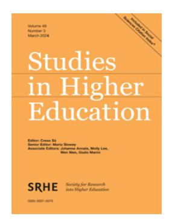

<!-- A1.R03 | source: papers_json/A1.R03/ -->

## **Studies in Higher Education**

**ISSN: (Print) (Online) Journal homepage:****[ www.tandfonline.com/journals/cshe20](https://www.tandfonline.com/journals/cshe20?src=pdf)**

## **تفتت الهوية التنظيمية في الجامعات السعودية: أثر النيوليبرالية**

## **Ahmed Ali Alhazmi & Rasha Ahmed Almashhour**

**للاستشهاد بهذا المقال:** Ahmed Ali Alhazmi & Rasha Ahmed Almashhour (28 Dec 2023): Fragmentation of organizational identity in Saudi Universities: the impact of neoliberalism, Studies in Higher Education, DOI:[ 10.1080/03075079.2023.2299326](https://www.tandfonline.com/action/showCitFormats?doi=10.1080/03075079.2023.2299326)

**للربط بهذا المقال: **[https://doi.org/10.1080/03075079.2023.2299326](https://doi.org/10.1080/03075079.2023.2299326)

*[Calendar icon]* نُشر إلكترونيًا في:28 Dec 2023.*[Pencil icon]*أرسل مقالك إلى هذه المجلة *[external link icon]**[Bar chart icon]* عدد مشاهدات المقال:68*[Magnifying glass icon]*اطّلع على مقالات ذات صلة *[external link icon]**[Crossmark logo]*اطّلع على بيانات Crossmark *[external link icon]*

<!-- page 2 -->

## تفتت الهوية التنظيمية في الجامعات السعودية: أثر النيوليبرالية

Ahmed Ali Alhazmi © and Rasha Ahmed Almashhourb

aDepartment of Education, Jazan University, Jazan, Saudi Arabia; bDepartment of Curriculum and Teaching Methods, Jazan University, Jazan, Saudi Arabia

## الملخص

استكشفت هذه الدراسة النوعية كيف تسهم النيوليبرالية في تفتت الهوية التنظيمية داخل الجامعات السعودية، وما يترتب على هذا التفتت من آثار. أُجريت مقابلات شبه منظمة مع 19 عضو هيئة تدريس من جامعة سعودية حكومية. كشف التحليل الموضوعي أن السياسات النيوليبرالية المتعلقة بالحوكمة والتمويل والاستدامة المالية والتسويق ومقاييس الأداء أثّرت تأثيرًا عميقًا في التعليم العالي السعودي. تُبرز النتائج خمسة موضوعات رئيسية: (1) تزايد تأثير أصحاب المصلحة الخارجيين في الحوكمة وصنع القرار، مع تراجع الأصوات الداخلية؛ (2) الضغط لجذب التمويل الخارجي يحوّل التركيز بعيدًا عن الرسالة التعليمية؛ (3) تُمنح الأولوية للاستدامة المالية على حساب الأهداف الأكاديمية؛ (4) القيم القائمة على السوق تطغى على القيم الأكاديمية التقليدية؛ (5) مقاييس الأداء لا تتوافق مع الأولويات الأكاديمية. تشمل الآثار المترتبة تراجع جودة التدريس، وتسليع البحث العلمي، وفقدان الحرية الأكاديمية، والتوتر بين متطلبات التنافسية العالمية والملاءمة المحلية. يُنتج تفتت الهوية التنظيمية هذا رؤية واتجاهًا مؤسسيين غير متماسكين. تركز الاستراتيجيات المقترحة لبناء بيئة أكاديمية أكثر تماسكًا على تعزيز الرؤية والقيم المشتركة، وتشجيع التعاون بين التخصصات، ورعاية ثقافة أكاديمية داعمة، والاستفادة من التقنية، والتأمل الذاتي المستمر. تخلص الدراسة إلى أن النيوليبرالية أثّرت سلبًا في الهوية التنظيمية للجامعات السعودية. ويُعد فهم هذا التأثير أمرًا أساسيًا لوضع سياسات وممارسات تحافظ على النزاهة الأكاديمية والغاية منها.

## ARTICLE HISTORY

Received 14 October 2023 Accepted 19 December 2023

## **KEYWORDS **

neoliberalism; organizational iedntity; fragmentation; Saudi universities; academic

## المقدمة

شهد المشهد المتطور للتعليم العالي العالمي تحولات عميقة، مع تزايد تأثير النيوليبرالية في صميمه. لقد تغلغلت الأيديولوجيات النيوليبرالية، التي تتسم بإعطاء الأولوية للمبادئ القائمة على السوق وإلغاء التنظيم وزيادة التنافس، في قطاعات عديدة، ولم يكن التعليم استثناءً (Olssen 2015). وقد أحدث هذا النموذج، الذي يتبنى استراتيجيات موجهة نحو السوق، تحولات جذرية في حوكمة الجامعات وآليات تمويلها، والأهم من ذلك، في هوياتها التنظيمية الشاملة (Barkhuizen 2021).

توفر المملكة العربية السعودية، بنسيجها الاجتماعي والثقافي الغني وتعقيداتها السياسية، سياقًا مقنعًا لدراسة تداعيات النيوليبرالية داخل التعليم العالي. وبينما تسعى الجامعات السعودية بحماس إلى نيل اعتراف عالمي وميزة تنافسية، تجد نفسها في خضم شبكة معقدة من التحديات والفرص التي تنسجها المبادئ النيوليبرالية (Barnawi

<!-- page 3 -->

[2018)](#page-15-1). ومع ذلك، وعلى الرغم من التحولات الملموسة في البيئة الأكاديمية، هناك فراغ بحثي واضح يتناول انعكاسات هذه السياسات على الجوهر الأساسي لهذه المؤسسات: هويتها التنظيمية (Puusa [2009)](#page-17-0).

تاريخيًا، كانت الهوية التنظيمية الأساس الذي ترسي عليه المؤسسات قيمها ومبادئها وغايتها (Muzzatti [2022)](#page-16-1). غير أن تشعبات النيوليبرالية، بتركيزها على التسليع والربحية والقابلية للتسويق، تهدد بتصدع هذا الأساس، مما قد يؤدي إلى تفتت الهوية (Tight [2019)](#page-17-1). وبينما يرى بعض الباحثين أن هذا التفتت قد يحفز الابتكار والقدرة على التكيف (Giannakakis [2019](#page-16-2))، يحذر آخرون من احتمال فقدان القيم الأساسية وتماثل المؤسسات التعليمية (Morley [2023](#page-16-3)).

تزداد الديناميكيات بين السياسات النيوليبرالية والهوية التنظيمية تعقيدًا داخل الجامعات السعودية. فهذه المؤسسات، التي كانت تقليديًا معاقل للحفاظ على الثقافة ونشر المعرفة، تواجه اليوم ضغطًا مزدوجًا بين التنافسية العالمية والحفاظ على الهوية الوطنية (Skea [2021)](#page-17-2). ويتطلب هذا التجاور استكشافًا دقيقًا يتجاوز التحليل الإحصائي المجرد ليتعمق في التجارب المعيشة لمن هم في الخط الأمامي الأكاديمي: أعضاء هيئة التدريس.

ينطلق هذا البحث، عبر منظوره النوعي، في هذا الاستكشاف. وباستخدام المقابلات شبه المنظمة، وهي طريقة يُشاد بها لقدرتها على استخلاص رؤى عميقة وسرديات شخصية (Moustakas [1994](#page-16-4))، نتواصل مع أعضاء هيئة تدريس من جامعة سعودية حكومية بارزة. هدفنا هو فك تعقيدات تفتت الهوية، وتتبع أصولها، وفهم آثارها الأوسع.

وبذلك، تسعى هذه الدراسة إلى سد الفجوة البحثية المذكورة، وتقديم فهم دقيق للتفاعل بين النيوليبرالية والهوية التنظيمية في التعليم العالي السعودي. ورغم أن النتائج متجذرة في السياق السعودي، فإنها قد تجد صدى لدى جامعات حول العالم، تتنقل كثير منها في متاهة التوجيهات النيوليبرالية المعقدة وتبعاتها (Barkhuizen [2021)](#page-15-0).

ومن خلال رسم خريطة هذا المجال غير المستكشف، لا يُثري هذا البحث الخطاب الأكاديمي حول التعليم العالي السعودي فحسب، بل يقدم أيضًا رؤى قيّمة لصانعي السياسات والمربين وقادة الجامعات، داخل المملكة وخارجها.

## منظورات مفاهيمية

## النيوليبرالية في التعليم العالي

النيوليبرالية مفهوم غير محدد بوضوح بشكل عام (Flew [2014](#page-16-5); Lorenzini [2018](#page-16-6)). يعرّفها Vallier [(2021](#page-17-3)) بأنها عقيدة سياسية اقتصادية تدمج الرأسمالية الليبرالية، والديمقراطية الدستورية، ودولة الرفاه بحد أدنى من المزايا. ويعرّفها Harrison ([2019](#page-16-7)) بأنها مشروع اجتماعي عالمي يهدف إلى نشر أيديولوجية السوق الحرة في جميع جوانب الاقتصاد السياسي عبر تسويق شامل للحياة الاجتماعية، وتحويل الدول إلى جهات إنفاذ للتسويق. ويعرّف Berry ([2020](#page-15-2)) النيوليبرالية بأنها 'مجموعة معايير أساسية تمنح الأولوية للنشاط الاقتصادي الخاص والساعي للربح باعتباره المصدر الرئيسي للرفاه، وترتكز على إبستمولوجيا فردية تنزع الشرعية عن الآليات الجماعية [تأكيد أصلي] في السعي وراء المنافع العامة' (2). وفي سياق التعليم العالي، صيغ مفهوم النيوليبرالية بلغة الأعمال، مثل التنافس والإيرادات والإنتاجية والمساءلة والكفاءة والتركيز على العميل (الطلاب)، وهو ما عنى إعادة صياغة الجامعات باعتبارها منشآت تنتج منتجات أكاديمية تلبي متطلبات رأس المال عبر تيسير فرص للشركات لتحقيق الربح من الجامعات (Dugas et al. [2018](#page-15-3); Giroux [2019](#page-16-8)). في ظل النيوليبرالية، لم تعد الجامعات معنية بتوليد المعرفة بقدر ما هي شريكة للشركات وجهات المنح الحكومية والمؤسسات الخيرية لإنتاج معرفة ذات فائدة اقتصادية تُعد سلعة قابلة للشراء (Hursh and Wall [2011)](#page-16-9). وتتبنى هذه الدراسة تعريف Berry ([2020](#page-15-2)) لأنه يتناول أو يعترف بتجاهل النيوليبرالية للجماعية، وهو ما قد يمثل إشكالية في مجتمع السعودية ذي الطابع الجماعي الغالب.

<!-- page 4 -->

نتجت إصلاحات واسعة في التعليم العالي عن ثلاث نظريات نيوليبرالية: نظرية الوكيل والموكل، وإدارة الأداء، ونظرية الإدارة العامة (Dougherty and Natow [2020)](#page-15-4). ترتبط نظرية الوكيل والموكل بالجامعات الريادية. غير أن تطبيق علاقات الوكيل والموكل يصعب في التعليم العالي لأن الموكلين يواجهون تحديات في ضبط الوكلاء الذين قد تختلف أهدافهم عن أهداف الموكلين (Kivisto and Zalyevska [2015)](#page-16-10). وترتكز نظرية إدارة الأداء عليها إصلاحات تتعلق بالتمويل القائم على الأداء (Dougherty and Natow [2020)](#page-15-4)، وتفسر التنافس بين المؤسسات التعليمية وداخلها. أما نظرية الإدارة العامة فترتبط بإصلاحات الحوكمة لجعل القطاع العام أكثر كفاءة (Dutta, Knafo, and Lovering [2023)](#page-15-5). وفي الجامعات، ينعكس هذا في تبني إداريي الجامعات للإدارة المؤسسية على النمط الشركاتي بقيمها وممارساتها المصاحبة (Muzzatti [2022)](#page-16-1).

تتغلغل النيوليبرالية في معظم جوانب التعليم العالي، وأصبحت مفاهيمها المتعلقة بالتنافسية والأسواق وخفض التمويل الحكومي أمرًا شائعًا (Tight [2019](#page-17-1)). ففي المملكة المتحدة، أدى التنافس والسعي نحو الكفاءة المرتبطان بالنيوليبرالية في قطاع التعليم العالي إلى تحويل الأكاديميين إلى ما يسميه 'ذوات نيوليبرالية' (Skea [2021](#page-17-2)). وهكذا، فإن تبعات تحول الجامعات إلى نمط شركاتي بعيدة الأثر، بما في ذلك ما يصفه Giroux ([2019](#page-16-8)) بـ'شبه موت الجامعة كفضاء عام ديمقراطي' (16)، وهو وصف يلخص كيف تحولت تعريفات الجامعات لذاتها ومبررات وجودها. وكان تأثير النيوليبرالية شاملًا وبعيد المدى. فقد حلّت مقاييس الأداء والجودة من نوع الأعمال، التي تشمل جوانب متعددة من خدمات الجامعات، محل ثقافة الاستقصاء الفكري المفتوح والانخراط في النقاش النقدي (Tight [2019)](#page-17-1)، ومعايير مثل 'مهارة الحصول على المنح، والتعبيرات المبررة ذاتيًا عن المصلحة، والمطالبات الهامشية بالتأليف' (Macfarlane [2021,](#page-16-11) 459). وتكافح الجامعات التقليدية للتوفيق بين التناقضات المتعلقة بمسؤولياتها الاجتماعية والاقتصادية باستخدام مقاربات ريادية قائمة على النيوليبرالية في التعليم العالي. وقد أبرزت دراسات تناقضات وتوترات تنشأ بين رسالة الجامعات وأنشطتها (Al-Haija and Mahamid [2021;](#page-15-6) Taberner [2018](#page-17-4); Tayan [2017](#page-17-5)). ورغم أن مدى تأثير النيوليبرالية يختلف باختلاف المناطق والدول وأنواع الجامعات، فثمة جوانب مشتركة بينها.

تدفع النيوليبرالية بأن أنظمة التعليم الجامعي يجب أن تلبي متطلبات الاقتصاد العالمي الجديد، الذي يختلف اختلافًا صارخًا عن سابقه، مع تركيزه على تقنيات المعلومات والاتصالات (del Cerro Santamaría [2019](#page-15-7)). وهي تشكك في معنى التعليم العالي وهويته وتعيد تعريفهما عبر تسليعه وتركيزه على مهارات وكفاءات قابلة للنقل المباشر، بعيدًا عن القيمة الجوهرية غير النقدية (del Cerro Santamaría [2019](#page-15-7)). كما تُخضع أنظمة حوكمة الجامعات الجوانب الجوهرية التقليدية للجامعة، كالتعليم والبحث العلمي وأعضاء هيئة التدريس والطلاب، لتوجيهات إدارية (Morley [2023](#page-16-3)).

إن إدخال أنظمة إدارة الأداء والمساءلة المشابهة لعالم الشركات يعادل تغيير الهويات الأكاديمية (Harris [2005](#page-16-12); Skea [2021)](#page-17-2). وتركز مقاييس الأداء على مؤشرات كمية مثل توزيع عبء العمل، وتصنيفات الجامعات، واستطلاعات رضا الطلاب، وتوليد الدخل (Boncori, Bizjak, and Sicca [2020;](#page-15-8) Martin-Sardesai, Guthrie AM, and Parker [2021)](#page-16-13)، وهي مقاييس قد لا تكون مثالية للجوانب الجوهرية وغير النقدية في أنشطة الجامعة (del Cerro Santamaría [2019)](#page-15-7)، وتضر بجوانب مثل البحث العلمي التي قد لا يمكن قياسها كميًا. ومن بين آثار أخرى، ترتبط النيوليبرالية بمشاعر معضلة الهوية لدى المعلمين والباحثين. فعلى سبيل المثال، وجد Barkhuizen [(2021)](#page-15-0)، في دراسة أُجريت في كولومبيا، أن أساتذة الجامعات عانوا صراعًا في هوياتهم عند التعامل مع التوتر بين البحث ذي المعنى والبحث عديم المعنى، وبين تلبية المعايير المؤسسية وإجراء بحث يؤثر في المجتمع.

هناك مقاومة واسعة النطاق للنيوليبرالية في المجال الأكاديمي (del Cerro Santamaría [2019;](#page-15-7) Leišytė and Gozlan [2023](#page-16-14); Morley [2023)](#page-16-3). ويرى del Cerro Santamaría ([2019](#page-15-7)) أن هذه المقاومة تنبع من التبني غير المبرر والمتشعب للنماذج الشركاتية المنحازة لصالح الربحية والتنافس. وثمة سبب آخر للمقاومة يتمثل في النزعة الإدارية للنيوليبرالية التي تقترب من التدخل الدقيق في شؤون الأكاديميين (Muzzatti [2022)](#page-16-1)، وهو ما يقوّض هويتهم الذاتية.

<!-- page 5 -->

أبرز del Cerro Santamaría ([2019](#page-15-7)) بعض سمات النيوليبرالية التي تؤثر في التعليم العالي، منها: التخطيط التنظيمي والأولويات وأنظمة المكافآت والعمليات القائمة حصريًا على الريادة؛ وتماثل التعليم العالي عبر استخدام التصنيفات لقياس الأداء استنادًا إلى أولويات تُقدّم التميز على الإنصاف؛ واختزال 'التعليم' إلى 'تدريب' والتركيز على المخرجات مع الإقصاء التام للأصول والعمليات والسياقات؛ وعدم اعتبار التعليم العالي منفعة عامة في الأولويات السياسية والاقتصادية الوطنية؛ واستبعاد الجوانب غير النقدية من العملية التعليمية؛ وتحويل الطلاب إلى عملاء يجب إرضاؤهم؛ وتزايد التداخل بين البحث العلمي وأولويات السوق، مع تفاقم الاعتماد المتزايد للبحث على الممولين من الشركات وأهدافهم. ومن الجوانب الأخرى ذات الصلة تهميش تخصصات مثل الفلسفة والدراسات الدينية واللاهوتية، مع تجاهل التعلم المتعلق بالجوانب الأخلاقية والمعرفية والعاطفية الأساسية، وإهمال التحيز البنيوي، مما يؤدي إلى افتقار الطلاب لحس العدالة الاجتماعية والمسؤولية الاجتماعية والمدنية.

ورغم أن تأثير النيوليبرالية طال في البداية الولايات المتحدة والمملكة المتحدة وأوروبا وأستراليا، فقد امتد نفوذها في قطاع التعليم إلى مناطق أخرى، بما فيها المملكة العربية السعودية (Barnawi [2018](#page-15-1); Shams [2019](#page-17-6)). ومن بين تبعات تبني النيوليبرالية في قطاع التعليم العالي العالمي تفتت هويات الجامعات مع تحولها من منفعة عامة إلى جزء من العالم الشركاتي التنافسي.

## الهوية التنظيمية

يُنظر بشكل متزايد إلى مفهوم الهوية التنظيمية في التعليم العالي، لا سيما في سياق النيوليبرالية، على أنه مفهوم مرن لا ثابت. وتأتي هذه المرونة استجابة للمشهد المتغير باستمرار للأسواق التعليمية العالمية، حيث تتكيف المؤسسات باستمرار للحفاظ على أهميتها وتنافسيتها. وقد أثّر النهج النيوليبرالي في التعليم العالي، بتركيزه على الممارسات القائمة على السوق، تأثيرًا كبيرًا في كيفية رؤية المؤسسات التعليمية لهويتها وعرضها. وتتجلى هذه الديناميكية في المواقف المتناقضة التي يواجهها الطلاب والمؤسسات، وهم يتنقلون بين تحديات تلبية الاحتياجات الأساسية والأهداف التعليمية في بيئة نيوليبرالية (Schraedley et al. [2021](#page-17-7)).

منذ أن صاغ Albert and Whetten [(1985)](#page-15-9) مفهوم الهوية التنظيمية بوصفها ما يراه أعضاء المؤسسة سمات مركزية ومميزة ودائمة للمنظمة، عرّف الأدب المتوفر هذا المفهوم بطرق متعددة. يعرّف Jeyavelu [(2009)](#page-16-15) الهوية التنظيمية بأنها مجموع الإجابات على سؤال 'من نحن؟'. ويوسّع Bider and Perjons ([2021](#page-15-10)) التعريف ليتجاوز 'من نحن' بإدراج البنية التحتية أو القدرة المستخدمة في عمليات المنظمة، والاستراتيجية الكبرى، وتحديد القطاع الذي تعمل فيه والحلفاء الذين تتعامل معهم، والاستراتيجية المتعلقة بروابط المنظمة بالأطراف الخارجية. ويعرّف Gioia et al. [(2013)](#page-16-16) الهوية التنظيمية بأنها محور صورة المنظمة الذاتية، تُستخدم لتفسير أفعالها، وتميزها عن المنظمات المشابهة الأخرى. وتتشارك التعريفات المختلفة الاعتقاد بأن الهوية تتعلق بمن أو بما تكون عليه المنظمة الذي يميزها.

أبرز Gioia et al. [2013](#page-16-16) أربعة منظورات للهوية التنظيمية: البناء الاجتماعي (Gioia, Schultz, and Corley [2000](#page-16-17))، ومنظور الفاعل الاجتماعي (Whetten and Mackey [2002](#page-17-8))، والمنظور المؤسسي (Glynn and Abzug [2002](#page-16-18))، ومنظور علم البيئة السكانية (Hannan and Freeman [1977)](#page-16-19). يفترض منظور البناء الاجتماعي أن الهوية مفهوم ذاتي المرجعية يحدد فيه أعضاء المنظمة من هم لأنفسهم وللآخرين. ويتضمن منظور الفاعل الاجتماعي المرجعية الذاتية لكنه يركز على المزاعم الظاهرة للمنظمة حول من تكون كفاعل في المجتمع. أما المنظور المؤسسي فيدمج عناصر من منظوري البناء الاجتماعي والفاعل الاجتماعي. وبينما يصوغ الهوية كمفهوم يُحدَّد داخليًا، يعتبر المنظمات كيانات مُطبَّعة اجتماعيًا تتأثر بالقوى المؤسسية. ولا تمتلك المنظمات التمايز الذي يشير إليه منظورا الفاعل الاجتماعي والبناء الاجتماعي، لكنها تحمل عنصرًا من التماثل (Glynn and Abzug [2002)](#page-16-18). أما المنظور الرابع، منظور علم البيئة السكانية (Hannan

<!-- page 6 -->

and Freeman [1977)](#page-16-19)، فيتبنى رؤية للهوية التنظيمية مُحدَّدة خارجيًا؛ وبناءً على ذلك، يُنظر إلى هوية المنظمة أو تُحمَل من قبل من هم خارجها (Pólos, Hannan, and Carroll [2002](#page-16-20)).

في دراسة تأثير النيوليبرالية في الهوية التنظيمية والتفتت، تتبنى هذه الدراسة منظور 'البناء الاجتماعي' لدى Gioia et al.'s ([2000](#page-16-17)) القائل بأن الهوية تتضمن أعضاء المنظمة (كمجموعة) وهم يحددون من هم لأنفسهم وللآخرين. كما تتبنى الدراسة المنظور المؤسسي (Glynn and Abzug [2002](#page-16-18)) القائل بأن المنظمات، بوصفها كيانات مُطبَّعة اجتماعيًا، تتأثر بالمؤسسات التي توجد ضمنها، وطرح Belamghari [(2020)](#page-15-11) بأن الهوية التنظيمية تتطور خضوعًا للقيود التي يفرضها سياق محدد.

مثّلت النيوليبرالية في التعليم العالي تحولًا كبيرًا في البيئة الكلية والجزئية لمؤسسات التعليم العالي، مما استلزم تغييرًا في الهوية قد يشمل التفتت أو ينتج عنه، إذ إن أقسام المنظمة أو الأفراد فيها لا يستجيبون جميعًا بالضرورة بشكل متوافق للتغيير. وقد يفضي هذا الوضع إلى استجابات متباينة، مثل جيوب من المقاومة أو الرفض أو القبول للتغيير، ينتج عنها ما يصفه Schou ([2023](#page-17-9)) بأنه تحول في المنطق من متوافق إلى متعارض، يفضي إلى تفتت الهوية التنظيمية.

## تفتت الهوية

ينشأ تفتت الهوية التنظيمية عندما تتسع الفجوة بين الهوية التنظيمية والهوية الفردية، حين تُغيّر المنظمة هويتها نتيجة، على سبيل المثال، إعادة تموضع استراتيجي أو استجابة لضغوط على المستوى الكلي (Veldsman and Veldsman [2020a](#page-17-10); Veldsman and Veldsman [2020b)](#page-17-11)، كما هو الحال في مؤسسات التعليم العالي والنيوليبرالية. وقد أظهرت الدراسات أن المنظمات لا تمتلك بالضرورة هوية واحدة، بل قد تحمل (عبر أعضائها) تفسيرات متضاربة لما تمثله المنظمة، مما يؤدي إلى هويات متعددة أو حتى متضاربة (Puusa [2009](#page-17-0))، وبالتالي هوية تنظيمية مفتتة. ويتجلى تفتت الهوية بأشكال متعددة. ففي دراسة حالة لجامعة فنلندية، تجلى التفتت في شكل اختلافات بين الإدارة وبقية العاملين في تفسير السمات الجوهرية لهوية منظمتهم (Puusa [2009)](#page-17-0). وظل ما إذا كانت الهوية التنظيمية ثابتة ودائمة أو تتغير مع الوقت محل جدل (Gioia et al. [2013](#page-16-16)).

وبالمثل، هناك جدل حول ما إذا كانت هوية المنظمة واحدة أو متعددة. ومن العوامل المرتبطة بتفتت الهوية التنظيمية التغيير المفاجئ أو الجذري. وتمثل النيوليبرالية في قطاع التعليم العالي تغييرًا جذريًا في عمليات الجامعات، وأدت إلى تفتت في هوياتها (Dugas et al. [2018;](#page-15-3) Mula-Falcón, Caballero, and Domingo Segovia [2022)](#page-16-21).

## النيوليبرالية وتفتت الهوية في التعليم العالي السعودي

يمثل التاريخ مكونًا مهمًا للهوية يُستخدم كنقطة مرجعية لمعرفة ما إذا كانت أفعال المنظمة متسقة مع شخصيتها أو قيمها التأسيسية، ويضع التجارب في سياقها (Gioia et al. [2013)](#page-16-16).

وفي حالة الجامعات السعودية، يجيب التاريخ عن أسئلة الهوية المتعلقة بما كان دائمًا محوريًا للجامعة، وما هي الجوانب الدائمة، وما الذي يميزها عن أي شكل آخر من أشكال المنظمات، وأخيرًا، ما تأثير النيوليبرالية في تفتت هوية الجامعة التنظيمية. وتُعد هذه الأسئلة جوهرية في السعودية، حيث حدثت تغييرات أخرى عديدة قد ترتبط ارتباطًا غير مباشر فقط بالنيوليبرالية (Lebeau and Alruwaili [2022;](#page-16-22) Pavan [2016)](#page-16-23).

قبل عام 2016، كان يُنظر إلى التعليم في السعودية بوصفه عملية اجتماعية ومنفعة اجتماعية غايتها التحول الاجتماعي والتماسك الاجتماعي وتعزيز التعلم مدى الحياة، من بين منافع اجتماعية أخرى. وكان هذا التصور مدعومًا بعقود اجتماعية قوية بين الهيئات التعليمية والحكومة (Barnawi [2018)](#page-15-1). ومع الإعلان عن رؤية 2030 وبرنامج التحول الوطني، أُضيف بُعد اقتصادي إلى تصورات

<!-- page 7 -->

التعليم، مما جعله مسؤولًا عن تمكين البلاد من تبوّؤ مكانة رائدة في الاقتصاد العالمي (Barnawi [2022;](#page-15-12) Mohiuddin et al. [2023](#page-16-24)). وترافق مع هذا التركيز الجديد إدخال مقاييس أداء قائمة على النيوليبرالية تشمل الاعتماد العالمي، والمقارنة المرجعية، والتصنيف، وخصخصة الجامعات التي كانت مملوكة سابقًا للدولة، والتركيز على التنافسية العالمية (Barnawi [2022;](#page-15-12) Tayan [2017)](#page-17-5). وعلاوة على ذلك، خصخصت الحكومة عام 2020 جامعات الملك سعود والملك عبد العزيز والإمام عبد الرحمن بن فيصل. وتقرر تقييم أداء الجامعات الثلاث من منظور أكاديمي وإداري ومالي، وهو ما مثّل تحولًا كبيرًا من النظر إلى التعليم كـ'منفعة اجتماعية' إلى 'منفعة اقتصادية' (Barnawi [2022](#page-15-12) نقلًا عن Giroux 2009)، ومن 'التوحيد والمساواة' إلى 'الاستقلالية والتنافس' (Barnawi [2022)](#page-15-12).

مثّلت التغييرات المرتبطة بالنيوليبرالية في قطاع التعليم العالي السعودي ابتعادًا كبيرًا عن تصورات التعليم السابقة. أبرز Elyas and Picard [(2013)](#page-16-25) التحديات التي يواجهها المعلمون السعوديون في مختلف مستويات التعليم في تحديد هوياتهم المهنية في مواجهة تغييرات مستوحاة من النيوليبرالية، كتلك المرتبطة بسياسة تطوير. ويقترحان 'شكلًا معولمًا محليًا من النيوليبرالية' يأخذ بعين الاعتبار الاحتياجات الفردية والوطنية. لذا، كانت التغييرات في قطاع التعليم العالي السعودي جذرية، إذ إن الممارسات النيوليبرالية المطبقة في سياقات أخرى، خاصة الغرب، غير ملائمة لبيئة السعودية. ووفقًا لـ Veldsman and Veldsman ([2020a)](#page-17-10)، عندما تمر منظمة بتغيير جذري، فقد تتفتت هويتها. وبالتركيز على مؤسسة تعليم عالٍ في السعودية، تستكشف هذه الورقة كيف تسهم النيوليبرالية في تفتت الهوية التنظيمية، وما يترتب على هذا التفتت من آثار على مؤسسات التعليم العالي.

## المنهجية

تستند منهجية هذه الدراسة إلى نموذج بحثي نوعي، اختير لقدرته على تقديم فهم عميق لتجارب الأفراد ووجهات نظرهم وتفاعلاتهم ضمن سياقاتهم الفريدة (Creswell and Poth [2016)](#page-15-13). واعتُمد منهج ظاهراتي لالتقاط التجارب المعيشة للمشاركين، مما يوفر نافذة على جوهر إدراكاتهم وتفسيراتهم لتأثير النيوليبرالية في الهوية التنظيمية (Moustakas [1994](#page-16-4)).

نُفذ جمع البيانات عبر مقابلات شبه منظمة، بما يسمح بتفاعل متوازن بين الاستقصاء المنظم والنقاشات المفتوحة (Rubin and Rubin [2005](#page-17-12)). صُممت المقابلات لسبر آراء المشاركين وتجاربهم ومعتقداتهم بشأن أثر النيوليبرالية في الهوية التنظيمية. ونُسجت أسئلة استقصائية داخل الحوار، تحث المشاركين على التعمق في إجاباتهم وتقديم سرديات مفصلة (Tindall [2009)](#page-17-13).

استُخدم أسلوب أخذ العينات الهادف لاختيار المشاركين في الدراسة. وضمن هذا النهج أن يلتقط البحث وجهات نظر متنوعة حول التفتت في مؤسسات التعليم العالي. وطُوّر إطار لأخذ العينات من دليل هيئة التدريس بجامعة سعودية حكومية، واختير 19 مشاركًا بناءً على الخلفية التخصصية وسنوات الخبرة والتمثيل من رتب أكاديمية مختلفة.

كان أحد الجوانب المهمة لهذه الدراسة مجمع المشاركين، الذي اختير بعناية ليشمل تنوعًا في الخلفيات التخصصية وسنوات الخبرة والتمثيل من رتب أكاديمية مختلفة ([الجدول 1)](#page-7-0). وأثرى هذا التنوع بين المشاركين البيانات، وقدّم رؤية متعددة الأبعاد لتأثير النيوليبرالية في الهوية التنظيمية بالجامعات السعودية.

شارك المشاركون ملاحظاتهم وتجاربهم، مسلطين الضوء على التفتت الناتج عن الأيديولوجيات والسياسات النيوليبرالية داخل مؤسساتهم التعليمية. وأبرزت سردياتهم هيمنة القيم القائمة على السوق والفردية والسعي نحو الكفاءة الاقتصادية بوصفها ركائز أساسية للنيوليبرالية. وقدّمت رؤى المشاركين توجيهًا قيّمًا لتطوير استراتيجيات وتدخلات تعزز بيئة أكاديمية أكثر تماسكًا واستدامة.

<!-- page 8 -->

|  |  | Table 1. Diversity among the participant pool. |
| --- | --- | --- |

| رقم المشارك | الخلفية التخصصية | سنوات الخبرة | الرتبة الأكاديمية | الجنس |
| --- | --- | --- | --- | --- |
| 1 | علوم اجتماعية | 10 | أستاذ مشارك | ذكر |
| 2 | هندسة | 5 | أستاذ مساعد | أنثى |
| 3 | علوم | 15 | أستاذ | ذكر |
| 4 | علوم إنسانية | 7 | أستاذ مساعد | أنثى |
| 5 | إدارة أعمال | 20 | أستاذ | ذكر |
| 6 | قانون | 8 | أستاذ مشارك | أنثى |
| 7 | طب | 12 | أستاذ | ذكر |
| 8 | تربية | 9 | أستاذ مساعد | أنثى |
| 9 | علوم حاسب | 6 | أستاذ مشارك | ذكر |
| 10 | علوم اجتماعية | 11 | أستاذ مساعد | أنثى |
| 11 | هندسة | 13 | أستاذ | ذكر |
| 12 | علوم طبيعية | 14 | أستاذ مساعد | أنثى |
| 13 | علوم إنسانية | 10 | أستاذ | ذكر |
| 14 | إدارة أعمال | 5 | أستاذ مشارك | أنثى |
| 15 | قانون | 15 | أستاذ | ذكر |
| 16 | طب | 7 | أستاذ مساعد | أنثى |
| 17 | تربية | 20 | أستاذ مشارك | ذكر |
| 18 | علوم حاسب | 8 | أستاذ مساعد | أنثى |
| 19 | علوم اجتماعية | 12 | أستاذ مشارك | ذكر |

تمت مقاربة عملية تحليل البيانات بمزيج من الدقة والتأمل الذاتي. وبعد تفريغ المقابلات شبه المنظمة، خضعت البيانات لفحص أولي لضمان الإلمام بها. ثم بدأت عملية تكرارية، انطلاقًا من الترميز المفتوح، حيث خُصصت رموز أولية لأجزاء من البيانات بدت أنها تلتقط أفكارًا أو مفاهيم رئيسية.

تلا ذلك اعتماد الترميز المحوري. وتضمنت هذه الخطوة تجميع الرموز المفتوحة في فئات أكبر استنادًا إلى العلاقات المحتملة والاستمرارية الموضوعية. ثم نُقّحت هذه الفئات أو دُمجت أو حتى قُسّمت لضمان تضمينها الأفكار الجوهرية المنبثقة من البيانات.

ومع تقدم عملية الترميز، استُخدم التحليل الموضوعي لتمييز الموضوعات الرئيسية والفرعية من البيانات المصنفة. وكان الهدف تحديد أنماط متكررة يمكن أن تقدم سردية متماسكة عن تجارب المشاركين وإدراكاتهم بشأن تأثير النيوليبرالية في الهوية التنظيمية.

ولتعزيز موثوقية التحليل وصحته، استخدم البحث برنامج NVivo. وقد يسّر استخدام هذا البرنامج عملية الترميز، وسهّل تنظيم البيانات، وأتاح استرجاع مقاطع البيانات المرتبطة برموز أو موضوعات محددة. كما وفّر أدوات لتمثيل البيانات بصريًا، مثل سُحُب الرموز أو الخرائط الموضوعية، مما ساعد في تفسير النتائج وعرضها.

ولزيادة تعزيز متانة التحليل، أُجريت جلسات مراجعة دورية مع الزملاء. وأُشرك زملاء أو باحثون آخرون في نقاشات حول النتائج الناشئة، فقدموا وجهات نظر خارجية وتحديات للتحيزات المحتملة، مما عزز صحة التفسير.

وأخيرًا، طُبق التحقق مع المشاركين كخطوة تحقق. أُتيحت للمشاركين فرصة مراجعة النتائج الأولية للتحقق مما إذا كانت التفسيرات تتوافق مع تجاربهم ووجهات نظرهم. ولم تعزز هذه الخطوة مصداقية النتائج فحسب، بل ضمنت أيضًا تمثيل أصوات المشاركين تمثيلًا حقيقيًا في استنتاجات الدراسة.

كان الالتزام الأخلاقي شاغلًا رئيسيًا طوال مسار البحث. واتُخذت تدابير لضمان الحصول على موافقة مستنيرة من جميع المشاركين، وحماية سريتهم، والحفاظ على نزاهة عملية البحث عمومًا. وضمن هذا الأساس الأخلاقي تمكّن المشاركين من التعبير عن آرائهم بحرية، مما أسهم في مصداقية النتائج وصحتها.

<!-- page 9 -->

## النتائج

تكشف النتائج تأثيرًا عميقًا للنيوليبرالية في الهوية التنظيمية للجامعات السعودية. شارك المشاركون ملاحظاتهم وتجاربهم، مسلطين الضوء على التفتت الناتج عن الأيديولوجيات والسياسات النيوليبرالية داخل مؤسساتهم التعليمية. وبرزت خمسة مجالات محددة على أنها شكلت جوانب متعددة من الحياة الأكاديمية أسهمت في تفتت الهوية التنظيمية داخل مؤسسات التعليم العالي في السعودية. وهذه المجالات هي: الحوكمة؛ والتمويل؛ وتفضيل الاستدامة المالية، والقيم القائمة على السوق؛ ومقاييس الأداء المنفصلة عن الأولويات الأكاديمية.

## الحوكمة

أدت السياسات النيوليبرالية إلى تحول في هياكل الحوكمة وعمليات صنع القرار. أكد المشارك رقم 10 على دور أصحاب المصلحة الخارجيين، قائلًا: 'تتأثر قرارات السياسات بشكل متزايد بجهات فاعلة خارجية، مثل الوكالات الحكومية وممثلي الصناعة، بدلًا من أن يقودها المجتمع الأكاديمي نفسه.' وفيما يتعلق أيضًا بصنع القرار، قال المشارك رقم 1: 'غالبًا ما ترتبط قرارات التمويل وتخصيص الموارد بمقاييس مثل قيد الطلاب، والمنح البحثية، والمنشورات، مما يخلق ثقافة من التنافس والفردية' مشيرًا إلى مشاركة محدودة لأصحاب المصلحة الداخليين الرئيسيين. وأبرز المشارك رقم 15 تبعات هذا التحول، قائلًا: 'تراجع صوت أعضاء هيئة التدريس والطلاب في صياغة السياسات والأولويات المؤسسية، مما أدى إلى شعور بالاغتراب وفقدان التمكين.'

تغيرت حوكمة الجامعات بسبب تبني إدارة على النمط الشركاتي بشكل رئيسي. أبرز المشارك رقم 8 أن 'السياسات النيوليبرالية تميل إلى إعطاء الأولوية للرقابة الإدارية والمساءلة، مما يحد من استقلالية أعضاء هيئة التدريس.' كما أشار المشارك رقم 1 إلى أن 'الدفع النيوليبرالي نحو الكفاءة وفعالية التكلفة يزيد من حدة التفتت، إذ قد تواجه الأقسام الأكاديمية قيودًا في الميزانية وتفاوتًا في الموارد' الناتجين عن آليات صنع القرار التي لا تعطي الأولوية لاحتياجات الأقسام.

## التمويل

أبرز معظم المشاركين في الدراسة موضوع التمويل. وأشار المشارك رقم 1: 'نتعرض لضغط مستمر لجلب التمويل وتوليد الإيرادات، وهو ما قد يحول أولوياتنا أحيانًا بعيدًا عما يهم حقًا في التعليم،' وهو موقف أكده المشارك رقم 16 الذي ذكر أن 'الضغط لتوليد الإيرادات عبر الأنشطة التجارية حوّل الاهتمام بعيدًا عن الرسالة الجوهرية للتعليم والبحث العلمي.'

وأشار المشارك رقم 5 إلى تزايد التركيز على التمويل القائم على الأداء، والذي، إلى جانب أنظمة التصنيف، 'غذّى التنافس بين الجامعات، محوّلًا تركيزها من سعي جماعي نحو المعرفة إلى سباق نحو المكانة والموارد المالية،' و'اضطرت المؤسسات إلى إعطاء الأولوية لنجاحها في تأمين التمويل واستقطاب الطلاب' (المشارك رقم 8).

أدى الضغط لجذب التمويل الخارجي إلى خصخصة التعليم العالي وتسويقه عبر 'تكاثر الشراكات مع كيانات خاصة' (المشارك رقم 3)؛ و'تحويل الجامعات إلى كيانات ربحية التوجه، مما يقوّض دورها التقليدي كمراكز للسعي الفكري' (المشارك رقم 13)؛ و'التركيز على نتائج قصيرة المدى، مع إهمال التطور الفكري والاجتماعي طويل المدى للطلاب وأعضاء هيئة التدريس' (المشارك رقم 4)؛ و'تحويل الاهتمام بعيدًا عن التعليم الشامل والانخراط المجتمعي' (المشارك رقم 7)؛ مما أدى إلى تفتت الهوية.

وترافق التركيز على جذب التمويل الخارجي مع إعطاء الأولوية للاستدامة المالية والقيم القائمة على السوق.

## تفضيل الاستدامة المالية

أبرز المشاركون تفضيل الاستدامة المالية. وأكد المشارك رقم 1 على التحول الكبير في أولويات الجامعة، قائلًا: 'نعطي الآن الأولوية للاستدامة المالية و

<!-- page 10 -->

القيم القائمة على السوق، التي أعادت تشكيل أولوياتنا وممارساتنا،' بينما ذكر المشارك رقم 4: '... أصبحت جامعتنا موجهة نحو الربح، وتضع التنافس والاعتبارات المالية فوق الرسالة الجوهرية للتعليم' إلى الحد الذي 'يأخذ فيه السعي نحو الاستدامة المالية الأولوية غالبًا على الأهداف التعليمية الأوسع' (المشارك رقم 10). وأكد المشارك رقم 2: 'طغت الاستدامة المالية على جوانب مهمة أخرى.' وثمة جانب آخر هو أن '... الضغط للانخراط في أنشطة ريادية والسعي وراء شراكات خارجية من أجل التمويل قد يحوّل انتباهنا بعيدًا عن الرسالة الأكاديمية الجوهرية' (المشارك رقم 1).

## القيم القائمة على السوق

بالتزامن مع السعي نحو الاستدامة المالية، تواجه الجامعات ضغطًا للامتثال لمتطلبات السوق عبر إعطاء الأولوية للمخرجات الاقتصادية على القيم الأكاديمية بسبب 'التركيز المتزايد على القيم القائمة على السوق وإعطاء الأولوية لتوليد الإيرادات' (المشارك رقم 4) وذلك 'على حساب الحفاظ على هوية تنظيمية واضحة وموحدة' (المشارك رقم 5). وأشار المشاركان رقم 6 و7 إلى تبني 'ممارسات موجهة نحو السوق'، وأشار المشارك رقم 8 إلى 'التسويق'، وهو ما أدى إلى تفتت الهوية التنظيمية.

وأبرز المشارك رقم 2 أن 'الدفع نحو مزيد من التسويق والخصخصة ... أدى إلى تبني الجامعات نهجًا أكثر توجهًا نحو الأعمال، مع إعطاء الأولوية للربح والكفاءة على الأهداف التعليمية الأوسع.' وفيما يتعلق أيضًا بالضغط للامتثال لمتطلبات السوق، أبرز المشاركون الصعوبات في التنقل بين التوتر القائم بين التنافسية العالمية والملاءمة المحلية. وأوضح المشارك رقم 14: 'غالبًا ما تواجه الجامعات السعودية تحدي مواءمة برامجها الأكاديمية وأجندات بحثها مع المعايير الدولية مع تلبية احتياجات المجتمع المحلي وسياقه الثقافي في الوقت نفسه.'

تُظهر النتائج كيف أعادت سياسات نيوليبرالية محددة، تركز على التنافس وتأثير قوى السوق وخصخصة التعليم، تشكيل مشهد التعليم العالي، مؤثرة في قيم الجامعات وعمليات صنع القرار فيها وأولوياتها، ومسهمة في تفتت الهوية التنظيمية داخل مؤسسات التعليم العالي في السعودية.

## آثار النيوليبرالية على مؤسسات التعليم العالي في السعودية

شكلت سياسات وممارسات النيوليبرالية المتعلقة بالحوكمة والتمويل وتفضيل الاستدامة المالية والقيم القائمة على السوق ومقاييس الأداء المنفصلة عن الأولويات الأكاديمية جوانب متعددة من الحياة الأكاديمية، بآثار بعيدة المدى على الهوية التنظيمية للجامعات. وأبرز المشاركون آثارًا على الهوية التنظيمية في ثلاثة مجالات: التدريس، والبحث العلمي، والحرية الأكاديمية والاستقلالية، وممارسات البحث، وكلها تؤثر في الهوية التنظيمية للمؤسسة التعليمية.

## الآثار على التدريس

تسلط رؤى المشاركين الضوء على آثار النيوليبرالية في ممارسات التدريس داخل الجامعات السعودية. شكلت السياسات النيوليبرالية كيفية إنتاج المعرفة ونشرها وتقييمها، مؤثرة في أولويات العمل الأكاديمي ومقارباته. أوضح المشارك رقم 7 أن 'الضغط لتحقيق أهداف قابلة للقياس الكمي وتقديم نتائج قابلة للقياس أدى إلى تحول نحو مقاربات أداتية في التدريس،' مع إعطاء الأولوية لـ'تطوير مهارات قصيرة المدى بدلًا من تعزيز التفكير النقدي والاستكشاف الفكري.' وردد المشارك رقم 12 هذا الرأي بقوله إن 'التركيز على قابلية التوظيف أدى إلى نظرة ضيقة للتعليم، حيث تُقاس المخرجات بمدى ملاءمتها لسوق العمل بدلًا من بناء أفراد متكاملين.' وبالإضافة إلى ذلك، ذكر المشارك رقم 2: 'هناك تركيز متزايد على التدريب القائم على المهارات وقابلية التوظيف، غالبًا على حساب تعزيز التفكير النقدي وفهم أوسع للموضوع.'

<!-- page 11 -->

## الآثار على ممارسات البحث

أدى تزايد التسويق والخصخصة في التعليم العالي إلى تسليع البحث العلمي. 'تفضل جهات التمويل بشكل متزايد المشاريع البحثية التي تتماشى مع متطلبات السوق ولها أثر اقتصادي مباشر' (المشارك رقم 9)، مما أدى إلى 'تهميش البحث في المجالات غير المربحة وتضييق النطاق الفكري' (المشارك رقم 9). ويحد التركيز على 'البحث التطبيقي على حساب الاستقصاءات الأساسية' من 'السعي نحو المعرفة لذاتها' (المشارك رقم 14)، وهو وضع، وفقًا للمشارك رقم 2، 'قد يؤدي إلى تفتت الرسالة الأكاديمية وإهمال مجالات مهمة من الاستقصاء قد لا تحمل قيمة تجارية فورية.'

وبالإضافة إلى ذلك، عززت السياسات النيوليبرالية ثقافة الفردية والتنافس بين الأكاديميين. ناقش المشارك رقم 11 تبعات ذلك، قائلًا: 'خلق الضغط للنشر في مجلات عالية التأثير وتأمين المنح البحثية بيئة شديدة التنافس. ويتعرض التعاون وتبادل المعرفة أحيانًا للتقويض مع سعي الباحثين للتفوق على أقرانهم.' وردد المشارك رقم 18 هذا القلق، مضيفًا: 'غالبًا ما يأخذ السعي نحو النجاح الفردي الأولوية على الانخراط الجماعي والتعاون، مما يعيق تطور مجتمع أكاديمي متماسك.'

تسلط هذه الأمثلة الضوء على كيفية تأثير النيوليبرالية في ممارسات التدريس والبحث داخل الجامعات السعودية، بآثار على طبيعة التعليم وغايته، وتركيز البحث العلمي، والديناميكيات داخل المجتمعات الأكاديمية.

## الآثار على الحرية الأكاديمية والاستقلالية

برز تأثير السياسات النيوليبرالية في الحرية الأكاديمية والاستقلالية بوصفه موضوعًا متكررًا. أعرب المشارك رقم 2 عن قلقه من تأثير أصحاب المصلحة الخارجيين، قائلًا: 'غالبًا ما تُشكَّل أجندات بحثنا من قِبل شركاء صناعيين وجهات تمويل، مما يحد من حريتنا الأكاديمية ويعيق البحث النقدي والمستقل.' وأضاف المشارك رقم 9: 'تضيّق متطلبات السوق نطاق مجالات البحث، مما يخنق الابتكار والإبداع.' وقد أُبرز تهديد النيوليبرالية للحرية والاستقلالية الأكاديميتين أيضًا في دراسات سابقة، إذ وصفه Giroux ([2014](#page-16-26)) بأنه يشير إلى نهاية الجامعات كفضاءات عامة ديمقراطية. ومن التحديات الأخرى تآكل الاستقلالية الأكاديمية وفقدان الحرية الأكاديمية. وأكد المشارك رقم 8 هذا القلق، قائلًا: 'النيوليبرالية ... تحد من استقلالية أعضاء هيئة التدريس في تشكيل الهوية التنظيمية لأقسامهم.'

توفر التجارب التي رواها المشاركون في الدراسة دليلًا ملموسًا على كيفية تأثير النيوليبرالية في الهوية التنظيمية للجامعات السعودية.

## الآثار على الهوية التنظيمية

تسلط وجهات نظر المشاركين الضوء على التحديات التي تواجهها الجامعات السعودية في الحفاظ على هوية تنظيمية متماسكة ضمن سياق النيوليبرالية. وحدد المشاركون ثلاثة مجالات أدخل فيها تطبيق السياسات النيوليبرالية ضغوطًا وتوترات كبيرة تؤثر في تماسك هذه المؤسسات ووحدتها العامة: الضغط للامتثال لمتطلبات السوق، وتآكل الاستقلالية الأكاديمية، وموازنة توقعات أصحاب المصلحة، والتنافس المختل.

## الضغط للامتثال

ترك الضغط للامتثال لتوجيهات النيوليبرالية أعضاء هيئة التدريس أمام تحدي 'موازنة الجدوى الاقتصادية مع الحفاظ على القيم الأكاديمية' (المشارك رقم 5)، و'يمثل التوفيق بين هذه المتطلبات مع الحفاظ على نزاهة التعليم وقيمه الجوهرية تحديًا كبيرًا للجامعات' (المشارك رقم 7). وثمة تحدٍ آخر يتمثل في التوتر بين تركيز النيوليبرالية على

<!-- page 12 -->

'النجاح الفردي والملاءمة الاقتصادية، والتوقعات المجتمعية الأوسع التي تشمل الحفاظ على التراث الثقافي والتماسك الاجتماعي والسعي نحو المعرفة للمنفعة العامة' (المشارك رقم 9).

## فقدان الاستقلالية والهوية الأكاديميتين

مارس الضغط للامتثال لمطالب أصحاب المصلحة المتنوعة ضغوطًا على هوية الجامعات وتعدى على استقلاليتها الأكاديمية. ذكر المشارك رقم 3: 'يُتوقع من الجامعات السعودية تلبية احتياجات وتوقعات أصحاب مصلحة مختلفين، وهو ما قد يجرّها أحيانًا في اتجاهات متعارضة.' كما أوضح المشارك رقم 9: 'يمكن أن تخلق موازنة هذه التوقعات مع متطلبات السياسات النيوليبرالية تعارضات وتحديات في الحفاظ على هوية تنظيمية متماسكة ومتكاملة.'

## التنافس المختل

سلطت البيانات الضوء أيضًا على التفتت الذي شهدته الهوية التنظيمية للجامعات السعودية نتيجة نمو الفردية والتنافس المختل. أبرز المشارك رقم 7 تنامي الثقافة الفردية، مشيرًا إلى 'تراجع التعاون والبحث المشترك بين التخصصات بسبب التركيز على النجاح الفردي والمصلحة الذاتية.' وبالمثل، أعرب المشارك رقم 12 عن قلقه من تآكل الغاية والمجتمع المشتركين، قائلًا: 'تُقدّر النيوليبرالية الفردية، مقوّضة الأهداف الجماعية ومعززة التفتت.'

إن التحديات التي تواجهها الجامعات السعودية في الحفاظ على هوية تنظيمية متماسكة في مواجهة النيوليبرالية متعددة الأوجه ومعقدة. وتتطلب معالجة هذه التحديات استراتيجيات مدروسة ونهجًا استباقيًا لضمان هوية تنظيمية متماسكة ومستدامة.

## استراتيجيات ومقاربات لتعزيز بيئة أكاديمية أكثر تماسكًا واستدامة

استجابة للتحديات التي نُوقشت في الأقسام السابقة، قدم المشاركون رؤى حول استراتيجيات ومقاربات محتملة يمكن أن تعزز بيئة أكاديمية أكثر تماسكًا واستدامة داخل الجامعات السعودية. وتهدف هذه الاستراتيجيات إلى معالجة تفتت الهوية التنظيمية وتعزيز شعور أقوى بالوحدة والغاية.

تعزيز رؤية وقيم مشتركة: من الاستراتيجيات الرئيسية التي ذكرها المشاركون أهمية تعزيز رؤية وقيم مشتركة بين أعضاء هيئة التدريس وأصحاب المصلحة. وأكد المشارك رقم 10 على الحاجة إلى 'خلق فرص لنقاشات هادفة وعمليات صنع قرار مشتركة يمكن أن تساعد في مواءمة وجهات النظر المتنوعة داخل الجامعة وترسيخ رؤية مشتركة للهوية التنظيمية.'

تعزيز التعاون بين التخصصات: أبرز المشاركون أيضًا أهمية تعزيز التعاون والتكامل بين التخصصات. وذكر المشارك رقم 16: 'يمكن أن يسهم كسر الحواجز بين التخصصات الأكاديمية المختلفة وتشجيع التعاون العابر للتخصصات في هوية تنظيمية أكثر شمولًا وتماسكًا.'

ثقافة أكاديمية داعمة وشاملة: أكد المشاركون أهمية رعاية ثقافة أكاديمية داعمة وشاملة بين أعضاء هيئة التدريس والطلاب، يمكن 'تحقيقها من خلال برامج الإرشاد، وفرص التطوير المهني، وتعزيز ثقافة الاحترام المتبادل والشمولية' (المشارك رقم 19).

الاستفادة من التقنية الرقمية: من الاستراتيجيات الأخرى التي ناقشها المشاركون الحاجة إلى الاستفادة من التقنية والمنصات الرقمية لتعزيز التواصل وتبادل المعرفة. وأبرز المشارك رقم 12 إمكانات المنصات الإلكترونية إذ يمكنها 'تسهيل التواصل والتعاون بين أعضاء هيئة التدريس، وتمكين تبادل الأفكار وتعزيز شعور بالغاية المشتركة.'

التأمل الذاتي: بالإضافة إلى ذلك، شدد المشاركون على أهمية التأمل المستمر والتكيف بما 'يضمن الاتساق مع رسالتها وقيمها. ويشمل ذلك المراجعة والتحديث المنتظمين للمناهج وأجندات البحث والسياسات المؤسسية للتكيف مع الاحتياجات المجتمعية المتغيرة' (المشارك رقم 7).

<!-- page 13 -->

يتطلب تعزيز بيئة أكاديمية أكثر تماسكًا واستدامة استراتيجيات تعزز الرؤية والقيم المشتركة، والتعاون بين التخصصات، وثقافة أكاديمية داعمة، والتقدم التقني، والتأمل المستمر.

## المناقشة

من خلال أصوات المشاركين، برزت عدة موضوعات وأنماط رئيسية من البيانات، تقدم فهمًا شاملًا للتحديات التي تفرضها النيوليبرالية على الجامعات.

الموضوع الأول الذي برز هو التأثير الكبير للسياسات النيوليبرالية في الهوية التنظيمية للجامعات السعودية. أبرز المشاركون كيف أدى التركيز على المبادئ القائمة على السوق وتسليع التعليم إلى تفتت الهوية التنظيمية. وطغى السعي نحو الاستدامة المالية والتصنيفات الخارجية ومؤشرات الأداء على القيم الجوهرية ورسالة مؤسسات التعليم العالي.

يتسق إعطاء الأولوية للاستدامة المالية والقيم القائمة على السوق مع جوهر النيوليبرالية داخل مؤسسات التعليم العالي – التي تميزت بتحويل أنظمة المساءلة لتشابه أنظمة عالم الشركات، مع تركيز قوي على التسويق (Harris [2005;](#page-16-12) Skea [2021](#page-17-2)).

تركز الرسالة الجوهرية للتعليم، التي أشار إليها المشارك رقم 4، في ظل النيوليبرالية، على تلبية متطلبات الاقتصاد العالمي الجديد، وهو وضع وصفه الأدب بأنه تسليع التعليم العالي (del Cerro Santamaría [2019)](#page-15-7). ويؤكد المشارك رقم 4 ما أبرزته دراسات سابقة من تناقضات بين متطلبات النيوليبرالية المتعلقة بالتعليم العالي ورسالة الجامعات التقليدية (Al-Haija and Mahamid [2021](#page-15-6); Taberner [2018;](#page-17-4) Tayan [2017)](#page-17-5). وفي الحالة السعودية، ينقل النهج التجاري للتعليم بعيدًا عن موقعه التقليدي كعملية اجتماعية ممولة حكوميًا غايتها تعزيز التحول الاجتماعي والتماسك والتعلم مدى الحياة (Barnawi [2018](#page-15-1)).

ثمة موضوع مهم آخر يتمثل في السياسات النيوليبرالية المحددة المسهمة في التفتت داخل مؤسسات التعليم العالي. حدد المشاركون سياسات مثل تزايد التنافس، والتمويل القائم على الأداء، وتسويق البحث والتدريس. وقد كانت لهذه السياسات آثار مماثلة في أماكن أخرى، وهو ما وصفه Giroux [(2014)](#page-16-26) بشبه اختفاء الجامعات كفضاءات عامة ديمقراطية. وخلقت هذه السياسات مناخًا من الفردية، وكثفت ضغوط عبء العمل، وأعاقت تكامل التدريس والبحث، بما وصفه Skea [(2021](#page-17-2)) بأنه اختزال الأكاديميين إلى 'ذوات نيوليبرالية.'

إن تهديد النيوليبرالية للتماسك الاجتماعي في السياق السعودي (المبني حول الجماعية) يؤدي حتمًا إلى تفتت هوية مؤسسات التعليم العالي، إذ يزيل تآكل الأهداف الجماعية ما يسميه Gioia et al. [(2013)](#page-16-16) مكونًا تاريخيًا للهوية يُستخدم كنقطة مرجعية لاتساق أفعال المنظمة مع قيمها التأسيسية.

كما ناقش المشاركون آثار النيوليبرالية في ممارسات التدريس والبحث. ولاحظوا التركيز المتزايد على إنتاجية البحث ومخرجات النشر، وهو ما طغى غالبًا على أهمية جودة التدريس والانخراط مع الطلاب. وتؤكد النتائج الملاحظات القائلة بأن مقاييس الأداء المستوحاة من النيوليبرالية تضر بالأبعاد غير النقدية لأنشطة الجامعة إذ تعيق تكامل التدريس والبحث (Boncori, Bizjak, and Sicca [2020](#page-15-8); del Cerro Santamaría [2019](#page-15-7); Martin-Sardesai, Guthrie AM, and Parker [2021)](#page-16-13).

واتساقًا مع Giroux [(2014)](#page-16-26)، من بين آخرين، أعرب المشاركون عن قلقهم من احتمال فقدان الحرية الفكرية، وتآكل الاستقلالية الأكاديمية، ونهاية الجامعات كفضاءات عامة ديمقراطية. علاوة على ذلك، أدى التنافس على التمويل بين المؤسسات إلى انحراف البحث المُجرى لصالح مصالح الممولين من الشركات (del Cerro Santamaría [2019](#page-15-7))، مما قوّض الاستقلالية الأكاديمية (Brown [2022;](#page-15-14) Tutkal [2023](#page-17-14))، ونتج عنه معضلة هوية (Barkhuizen [2021)](#page-15-0).

وفيما يتعلق بالتحديات التي تواجهها الجامعات السعودية في الحفاظ على هوية تنظيمية متماسكة، أبرز المشاركون التوتر بين المتطلبات الخارجية والقيم الداخلية.

<!-- page 14 -->

وغالبًا ما تصادم الضغط للامتثال للمقاييس والمعايير النيوليبرالية مع التزام الجامعات بالانخراط المجتمعي والعدالة الاجتماعية والحفاظ على الثقافة. وليست هذه التصادمات خاصة بالبيئة السعودية، إذ أظهرت دراسات في أماكن أخرى استبدال ثقافات الجامعات القائمة على النقاش النقدي بممارسات أداء من نوع الأعمال (Tight [2019)](#page-17-1)، واختزال الأكاديميين إلى ذوات نيوليبرالية (Skea [2021](#page-17-2))، وتناقضات وتوترات بين رسالة الجامعات وما تقوم به (Al-Haija and Mahamid [2021;](#page-15-6) Taberner [2018](#page-17-4); Tayan [2017)](#page-17-5)، وكلها أدت إلى تفتت هويات الجامعات (Dugas et al. [2018;](#page-15-3) Mula-Falcón, Caballero, and Domingo Segovia [2022)](#page-16-21). ويتحدى هذا التوتر مؤسسات التعليم العالي في مواءمة هويتها التنظيمية مع التوقعات المجتمعية، وهو عامل أقر به Barnawi ([2022](#page-15-12))، من بين آخرين.

## ملاحظات وخاتمة

تسلط وجهات نظر المشاركين الضوء على الديناميكيات المعقدة بين الأيديولوجيات النيوليبرالية والممارسات المؤسسية وتفتت الهوية التنظيمية. وستتناول المراحل التالية بمزيد من التعمق هذه الآثار، مناقشة الأسس النظرية للنتائج واستكشاف الآثار العملية لمؤسسات التعليم العالي.

## الآثار النظرية

## أهمية النظريات النقدية للنيوليبرالية

تعزز النتائج النظريات النقدية للنيوليبرالية في فهم الهوية التنظيمية لمؤسسات التعليم العالي. وتعكس النتائج القيم القائمة على السوق والفردية والسعي نحو الكفاءة الاقتصادية بوصفها ركائز أساسية للنيوليبرالية، متسقة مع المنظورات النقدية لتأثير الأيديولوجيا الاجتماعية والاقتصادية للنيوليبرالية في الممارسات التنظيمية في التعليم العالي (Al-Haija and Mahamid [2021;](#page-15-6) Taberner [2018;](#page-17-4) Tayan [2017](#page-17-5)).

## تفكك الهوية التنظيمية

توضح السردية كيف يمكن للسياسات والممارسات النيوليبرالية أن تفكك تماسك الهوية وتكاملها داخل مؤسسات التعليم العالي. ويؤدي التوتر بين متطلبات التنافسية السوقية والقيم التاريخية الداخلية للتعليم إلى تفتت الهوية، وهو ما يتوافق مع نظريات الهوية التنظيمية (Gioia et al. [2013](#page-16-16)).

## ديناميكيات القوة والهوية التنظيمية

تبرز النتائج دور ديناميكيات القوة في تشكيل الهوية التنظيمية ضمن السياقات النيوليبرالية. ويعكس تأثير أصحاب المصلحة الخارجيين، كما يتجلى في هياكل الحوكمة النيوليبرالية التي تهيمن عليها النزعة الإدارية، منظورات نقدية حول فوارق القوة والتفاوتات (del Cerro Santamaría [2019](#page-15-7); Morley [2023](#page-16-3)).

## الحاجة إلى فحص نقدي

تدعو النتائج إلى فحص نقدي للأيديولوجيات والممارسات النيوليبرالية التي تشكل مؤسسات التعليم العالي في السعودية، حاثةً الباحثين والممارسين على تطوير أطر دقيقة لتحليل تفتت الهوية التنظيمية ومعالجته ضمن السياقات النيوليبرالية.

## الآثار العملية

## تعزيز القيم المشتركة

التأكيد على أهمية تعزيز شعور قوي بالقيم المشتركة والهوية الجماعية داخل مؤسسات التعليم العالي، وخلق مساحات للحوار المفتوح والتعاون والانخراط بين أعضاء هيئة التدريس والإداريين والطلاب لمواجهة الآثار التقسيمية للسياسات النيوليبرالية (Figueiredo and Siqueira [2020;](#page-16-27) Younis and Hatim [2021)](#page-17-15).

<!-- page 15 -->

## تقدير الأنشطة الأكاديمية الجوهرية

إبراز الحاجة إلى تركيز أكبر على القيمة الجوهرية للتدريس والبحث العلمي، وتوفير الموارد والتقدير وفرص التطوير المهني التي تعطي الأولوية للرسالة العلمية وتنمية التفكير النقدي وخلق المعرفة.

## تطوير أطر تقييم بديلة

اقتراح تطوير مقاييس وأطر تقييم بديلة تتجاوز مؤشرات الأداء المبسطة للتخفيف من الضغوط المرتبطة بثقافات النيوليبرالية القائمة على الأداء، مع إعطاء الأولوية لمقاييس شمولية تراعي التميز في التدريس والانخراط المجتمعي والأثر المجتمعي.

## التواصل مع صانعي السياسات

الدعوة إلى انخراط فاعل مع صانعي السياسات وأصحاب المصلحة للدفاع عن نهج أكثر توازنًا ودقة في حوكمة التعليم العالي، وتعزيز الحوار والتأثير في نقاشات السياسات لضمان أن تكون القيم الأكاديمية والسعي نحو المعرفة في صدارة عمليات صنع القرار.

## الخاتمة

سعت هذه الدراسة إلى استكشاف تأثير السياسات النيوليبرالية في الهوية التنظيمية للجامعات السعودية، بهدف الإجابة عن أسئلة بحثية رئيسية بشأن طبيعة هذا التأثير وآثاره اللاحقة على الحوكمة والتمويل والثقافة الأكاديمية داخل هذه المؤسسات. ومن خلال فحص منهجي، توضح النتائج سردية واضحة للتحول الذي تشكله الأيديولوجيات النيوليبرالية.

يتجلى التأثير العميق للنيوليبرالية في الهوية التنظيمية للجامعات السعودية بوضوح لا لبس فيه من خلال التجارب والملاحظات التي شاركها المشاركون. وقد غيّر التفتت الناتج عن الأيديولوجيات والسياسات النيوليبرالية بشكل كبير مشهد مؤسسات التعليم العالي في السعودية. وبرزت خمسة مجالات محددة بوصفها محورية في تشكيل جوانب متعددة من الحياة الأكاديمية، مسهمة في تفتت الهوية التنظيمية: الحوكمة، والتمويل، وتفضيل الاستدامة المالية، والقيم القائمة على السوق، ومقاييس الأداء المنفصلة عن الأولويات الأكاديمية.

يعكس التحول في هياكل الحوكمة وعمليات صنع القرار الهيمنة المفرطة لأصحاب المصلحة الخارجيين والتحول نحو نهج قائم على السوق. وقد عجّل هذا التحول بثقافة من التنافس والفردية، والتي، كما لاحظ المشاركون، خنقت الروح الأكاديمية التقليدية وقلّصت صوت أعضاء هيئة التدريس والطلاب في صياغة السياسات والأولويات المؤسسية.

وحوّل الضغط لتأمين التمويل وتوليد الإيرادات، بوضوح، التركيز بعيدًا عن الأهداف التعليمية الجوهرية، حيث تنخرط الجامعات الآن في سباق نحو المكانة والموارد المالية. وقد قوّض ما نتج عن ذلك من تحول نحو التجارة والخصخصة في التعليم العالي الدور التقليدي للجامعات كمراكز للسعي الفكري، مع تحول ملحوظ نحو النتائج قصيرة المدى.

علاوة على ذلك، أدى إعطاء الأولوية للاستدامة المالية والقيم القائمة على السوق إلى إعادة توجيه كبيرة للأولويات داخل الجامعات السعودية. ورسمت سرديات المشاركين صورة حية لبيئة أكاديمية أصبحت الآن شديدة الميل نحو الممارسات الموجهة نحو الربح والتسويق، على حساب هوية تنظيمية واضحة وموحدة.

<!-- page 16 -->

توفر هذه الدراسة فهمًا شاملًا للتفاعل المعقد بين السياسات النيوليبرالية والهوية التنظيمية للجامعات السعودية. وتقدم النتائج والمناقشة معًا إطارًا متينًا للتعامل مع التحديات التي تفرضها النيوليبرالية، ليس فقط داخل قطاع التعليم العالي السعودي، بل في سياق عالمي أيضًا. وتمثل هذه الدراسة، بالتالي، نقطة انطلاق مهمة نحو تعزيز بيئة أكاديمية أكثر تماسكًا واستدامة في مواجهة تغلغل النيوليبرالية.

تقدم هذه الدراسة، رغم ما توفره من رؤى قيّمة حول تأثير النيوليبرالية في الهوية التنظيمية لجامعة سعودية حكومية، عدة محدوديات. فقد لا يكون حجم العينة الصغير ممثلًا لسياقات أوسع، وقد تحد الطبيعة النوعية للبحث من قابلية تعميم نتائجه. وعلى الرغم من الجهود المبذولة لضمان الموضوعية، يبقى احتمال تحيز الباحث وذاتيته قائمًا. وترتبط نتائج الدراسة بشكل خاص بسياق السعودية، مما يؤكد الحاجة إلى بحوث مستقبلية بعينات أكبر وأكثر تنوعًا، وتكرار الدراسة في سياقات مختلفة، ودراسات مقارنة عبر مناطق مختلفة لتبيّن مدى عمومية تفتت الهوية التنظيمية.

## Disclosure statement

No potential conflict of interest was reported by the author(s).

## Ethics approval

All applicable international, national and institutional guidelines for the care and use of human individuals were followed.

## ORCID

Ahmed Ali Alhazmi [http://orcid.org/0000-0002-0409-306X](http://orcid.org/0000-0002-0409-306X)

## References

- Al-Haija, Y.A., and H. Mahamid. [2021.](#page-3-0) "Trends in Higher Education Under Neoliberalism: Between Traditional Education and the Culture of Globalization." Educational Research and Reviews 16 (2): 16–26. [https://doi.org/10.5897/ERR2020.](https://doi.org/10.5897/ERR2020.4101) [4101](https://doi.org/10.5897/ERR2020.4101).
- Albert, S., and D. A. Whetten. [1985.](#page-4-0) "Organizational Identity." In Research in Organizational Behavior, edited by B. M. Staw and L. L. Cummings, 263–295. Greenwich: JAI Press.
- Barkhuizen, G. [2021.](#page-1-0) "Identity Dilemmas of a Teacher (Educator) Researcher: Teacher Research Versus Academic Institutional Research." Educational Action Research 29 (3): 358–77. [https://doi.org/10.1080/09650792.2020.1842779.](https://doi.org/10.1080/09650792.2020.1842779)
- Barnawi, O. [2018.](#page-1-1) Neoliberalism and English Language Education Policies in the Arabian Gulf Region. Routledge. [https://](https://doi.org/10.4324/9781315276717) [doi.org/10.4324/9781315276717](https://doi.org/10.4324/9781315276717).
- Barnawi, O.Z. [2022](#page-6-0). "Resisting and Creating Alternatives to Neoliberalism in ELT: A Case Study of Three Transnational Language Teachers in Saudi Arabia." Critical Inquiry in Language Studies 19 (4): 377–99. [https://doi.org/10.1080/](https://doi.org/10.1080/15427587.2022.2102015) [15427587.2022.2102015](https://doi.org/10.1080/15427587.2022.2102015).
- Belamghari, M. [2020.](#page-5-0) "The Fragmentation of Identity Formation in the Age of Glocalization." SAGE Open 10 (2): 215824402093487. [https://doi.org/10.1177/2158244020934877.](https://doi.org/10.1177/2158244020934877)
- Berry, C. [2020.](#page-2-0) "From Receding to Reseeding: Industrial Policy, Governance Strategies and Neoliberal Resilience in Post-Crisis Britain." New Political Economy 25 (4): 607–25. [https://doi.org/10.1080/13563467.2019.1625316.](https://doi.org/10.1080/13563467.2019.1625316)
- Bider, I., and E. Perjons. [2021](#page-4-1). "Identity Management in an Institution of Higher Education: A Case Study Using Structural Coupling and Fractal Enterprise Model." Complex Systems Informatics and Modeling Quarterly 27: 60–86.
- Boncori, I., D. Bizjak, and L. Sicca. [2020.](#page-3-1) "Workload Allocation Models in Academia: A Panopticon of Neoliberal Control or Tools for Resistance?" Tamara. Journal for Critical Organization Inquiry 18 (1): 51–69.
- Brown, B. A. [2022](#page-12-0). "Neoliberalism Crisis and Fundamental Shifts in Africa's Higher Education Provision in the 21st Century." In The Emerald Handbook of Higher Education in a Post-Covid World: New Approaches and Technologies for Teaching and Learning, edited by B. A. Brown and A. Irons, 13–36. Emerald Publishing Limited.
- Creswell, J.W., and C.N. Poth. [2016.](#page-6-1) Qualitative Inquiry and Research Design: Choosing among Five Approaches. London: SAGE.
- del Cerro Santamaría, G. [2019](#page-3-2). "A Critique of Neoliberalism in Higher Education." In Oxford Research Encyclopedia of Education. Oxford: Oxford University Press.
- Dougherty, K.J., and R.S. Natow. [2020](#page-3-3). "Performance-based Funding for Higher Education: How Well Does Neoliberal Theory Capture Neoliberal Practice?" Higher Education 80 (3): 457–78. [https://doi.org/10.1007/s10734-019-00491-4](https://doi.org/10.1007/s10734-019-00491-4)
- Dugas, D., K.H. Summers, L.N. Harris, and A.E. Stich. [2018](#page-2-1). "Shrinking Budgets, Growing Demands: Neoliberalism and Academic Identity Tension at Regional Public Universities." AERA Open 4 (1): 2332858418757736. [https://doi.org/](https://doi.org/10.1177/2332858418757736) [10.1177/2332858418757736](https://doi.org/10.1177/2332858418757736)
- Dutta, S.J., S. Knafo, and I. Lovering. [2023.](#page-3-4) "7. What is Neoliberal About New Public Management?". Handbook on Critical Political Economy and Public Policy, 95.

<!-- page 17 -->

- Elyas, T., and M. Picard. [2013.](#page-6-2) "Critiquing of Higher Education Policy in Saudi Arabia: Towards a new Neoliberalism." Education, Business and Society: Contemporary Middle Eastern Issues 6 (1): 31–41. [https://doi.org/10.1108/](https://doi.org/10.1108/17537981311314709) [17537981311314709.](https://doi.org/10.1108/17537981311314709)
- Figueiredo, G.D.O., and V.H.F.D. Siqueira. [2020.](#page-13-0) "Democracy is on Exile. Facing the Challenge of Neoliberal Authoritarianism: An Interview with Professor Henry Giroux." Revista Brasileira De Educação 25. [https://doi.org/10.](https://doi.org/10.1590/s1413-24782020250032) [1590/s1413-24782020250032.](https://doi.org/10.1590/s1413-24782020250032)
- Flew, T. [2014.](#page-2-2) "Six Theories of Neoliberalism." Thesis eleven 122 (1): 49–71. [https://doi.org/10.1177/0725513614535965.](https://doi.org/10.1177/0725513614535965) Giannakakis, V. [2019, August 31](#page-2-3). "Neoliberalism and Culture in Higher Education: On the Loss of the Humanistic Character of the University and the Possibility of Its Reconstitution." Studies in Philosophy and Education 39 (4): 365–82. [https://doi.org/10.1007/s11217-019-09682-z](https://doi.org/10.1007/s11217-019-09682-z).
- Gioia, D.A., S.D. Patvardhan, A.L. Hamilton, and K.G. Corley. [2013](#page-4-2). "Organizational Identity Formation and Change." Academy of Management Annals 7 (1): 123–93. [https://doi.org/10.5465/19416520.2013.762225.](https://doi.org/10.5465/19416520.2013.762225)
- Gioia, D. A., M. Schultz, and K. G. Corley. [2000](#page-4-3). "Organizational Identity, Image, and Adaptive Instability." Academy of Management Review 25 (1): 63–81.
- Giroux, H. A. [2014.](#page-10-0) "The Swindle of Democracy in the Neoliberal University and the Responsibility of Intellectuals." Democratic Theory 1 (1): 9–37.
- Giroux, H.A. [2019.](#page-2-1) "Neoliberalism and the Weaponising of Language and Education." Race & Class 61 (1): 26–45. [https://](https://doi.org/10.1177/0306396819847945) [doi.org/10.1177/0306396819847945](https://doi.org/10.1177/0306396819847945).
- Glynn, M. A., and R. Abzug. [2002.](#page-4-4) "Institutionalizing Identity: Symbolic Isomorphism and Organizational Names." Academy of Management Journal 45 (1): 267–280.
- Hannan, M. T, and J. Freeman. [1977](#page-4-5). "The Population Ecology of Organizations." American Journal of Sociology 82 (5): 929–964.
- Harris, S. [2005.](#page-3-5) "Rethinking Academic Identities in Neo-Liberal Times." Teaching in Higher Education 10 (4): 421–433. Harrison, G. [2019.](#page-2-4) "Authoritarian Neoliberalism and Capitalist Transformation in Africa: All Pain, No Gain." Globalizations
- 16 (3): 274–288. Hursh, D., and A.F. Wall. [2011](#page-2-0). "Repoliticizing Higher Education Assessment Within Neoliberal Globalization." Policy Futures in Education 9 (5): 560–72. [https://doi.org/10.2304/p](https://doi.org/10.2304/pfie.2011.9.5.560)fie.2011.9.5.560
- Jeyavelu, S. [2009](#page-4-6). "Organisational Identity Dissonance in Organisational Decline and Turnaround." Vision: The Journal of Business Perspective 13 (2): 33–45. [https://doi.org/10.1177/097226290901300204](https://doi.org/10.1177/097226290901300204)
- Kivisto, J. A., and I. Zyalevska. [2015](#page-3-6). "Agency Theory as a Framework for Higher Education Governance." In The Palgrave International Handbook of Higher Education Policy and Governance, edited by J. Huisman, H. de Boer, D. D. Dill, and M. Souto-Otero, 132–151. London: London: Palgrave Macmillan UK.
- Lebeau, Y., and J. Alruwaili. [2022](#page-5-1). "Convergence and Local Orders in the Dynamics of Change in Higher Education: A Perspective from Saudi Arabia." Policy Reviews in Higher Education 6 (1): 6–26. [https://doi.org/10.1080/23322969.](https://doi.org/10.1080/23322969.2021.1904791) [2021.1904791.](https://doi.org/10.1080/23322969.2021.1904791)
- Leišytė, L., and C. Gozlan. [2023.](#page-3-2) "The Emergence of Academic Resistance Platforms Against new Public Management: Towards" new" Forms of Movement Organizing?" Research Handbook on the Transformation of Higher Education 0: 127.
- Lorenzini, D.. [2018.](#page-2-2) "Governmentality, Subjectivity and the Neoliberal Form of Life." Journal for Cultural Research 22 (1): 1–13.
- Macfarlane, B. [2021.](#page-3-7) "The Neoliberal Academic: Illustrating Shifting Academic Norms in an age of Hyper-Performativity." Educational Philosophy and Theory 53 (5): 459–68. [https://doi.org/10.1080/00131857.2019.1684262](https://doi.org/10.1080/00131857.2019.1684262).
- Martin-Sardesai, A., J. Guthrie AM, and L. Parker. [2021.](#page-3-1) "The Neoliberal Reality of Higher Education in Australia: How Accountingisation is Corporatising Knowledge." Meditari Accountancy Research 29 (6): 1261–82. [https://doi.org/10.](https://doi.org/10.1108/MEDAR-10-2019-0598) [1108/MEDAR-10-2019-0598](https://doi.org/10.1108/MEDAR-10-2019-0598).
- Mohiuddin, K., O.A. Nasr, N. Miladi, H. Fatima, S. Shahwar, and N. Naveed. [2023](#page-6-3). "Potentialities and Priorities for Higher Educational Development in Saudi Arabia for the Next Decade: Critical Reflections of the Vision 2030 Framework." Heliyon 9 (5): e16368. [https://doi.org/10.1016/j.heliyon.2023.e16368](https://doi.org/10.1016/j.heliyon.2023.e16368).
- Morley, C. [2023.](#page-2-5) "The Systemic Neoliberal Colonisation of Higher Education: A Critical Analysis of the Obliteration of Academic Practice." The Australian Educational Researcher 1: 1–16. [https://doi.org/10.1007/s13384-023-00613-z.](https://doi.org/10.1007/s13384-023-00613-z)
- Moustakas, C. [1994.](#page-2-6) Phenomenological Research Methods. Thousand Oaks: SAGE.
- Mula-Falcón, J., K. Caballero, and J. Domingo Segovia. [2022.](#page-5-2) "Exploring Academics' Identities in Today's Universities: A Systematic Review." Quality Assurance in Education 30 (1): 118–34. [https://doi.org/10.1108/QAE-09-2021-0152.](https://doi.org/10.1108/QAE-09-2021-0152)
- Muzzatti, S.L. [2022](#page-2-7). "Strange Bedfellows: Austerity and Social Justice at the Neoliberal University." Critical Criminology 30 (3): 495–507. [https://doi.org/10.1007/s10612-022-09646-9.](https://doi.org/10.1007/s10612-022-09646-9)
- Olssen, M. [2015.](#page-1-2) "Neoliberal Competition in Higher Education Today: Research, Accountability and Impact." British Journal of Sociology of Education 37 (1): 129–48. [https://doi.org/10.1080/01425692.2015.1100530.](https://doi.org/10.1080/01425692.2015.1100530)
- Pavan, A. [2016.](#page-5-1) "Higher Education in Saudi Arabia: Rooted in Heritage and Values, Aspiring to Progress." International Research in Higher Education 1 (1): 91–100.
- Pólos, L., M. T. Hannan, and G. R. Carroll. [2002.](#page-5-3) "Foundations of a Theory of Social Forms." Industrial and Corporate Change 11 (1): 85–115.

<!-- page 18 -->

- Puusa, A. [2009.](#page-2-8) "The Meaning and Implications of a Fragmented Organizational Identity: A Case Study of a Finnish University of Applied Sciences." Administrative Studies 28: 16–29.
- Rubin, H.J., and I.S. Rubin. [2005.](#page-6-4) Qualitative Interviewing: The Art of Hearing the Data. 2nd ed.Thousand Oaks, CA: SAGE. Schou, P.K. [2023](#page-5-4). "Coming Apart While Scaling Up – Adoption of Logics and the Fragmentation of Organizational Identity in Science-Based Ventures." Journal of Management Studies 60 (3): 688–721. [https://doi.org/10.1111/joms.](https://doi.org/10.1111/joms.12908) [12908.](https://doi.org/10.1111/joms.12908)
- Schraedley, M.K., J.J. Jenkins, M. Irelan, and M. Umana. [2021.](#page-4-7) "The Neoliberalization of Higher Education: Paradoxing Students' Basic Needs at a Hispanic-Serving Institution." Frontiers in Sustainable Food Systems 5. [https://doi.org/10.](https://doi.org/10.3389/fsufs.2021.689499) [3389/fsufs.2021.689499.](https://doi.org/10.3389/fsufs.2021.689499)
- Shams, F. [2019.](#page-4-8) "Managing Academic Identity Tensions in a Canadian Public University: The Role of Identity Work in Coping with Managerialism." Journal of Higher Education Policy and Management 41 (6): 619–32. [https://doi.org/](https://doi.org/10.1080/1360080X.2019.1643960) [10.1080/1360080X.2019.1643960.](https://doi.org/10.1080/1360080X.2019.1643960)
- Skea, R. [2021](#page-2-9). Leadership, Organizational Change and Sensemaking (1st ed.). Routledge. [https://doi.org/10.4324/](https://doi.org/10.4324/9781003022503) [9781003022503](https://doi.org/10.4324/9781003022503)
- Taberner, A.M. [2018](#page-3-8). "The Marketisation of the English Higher Education Sector and Its Impact on Academic Staff and the Nature of Their Work." International Journal of Organizational Analysis 26 (1): 129–52. [https://doi.org/10.1108/](https://doi.org/10.1108/IJOA-07-2017-1198) [IJOA-07-2017-1198.](https://doi.org/10.1108/IJOA-07-2017-1198)
- Tayan, B.M. [2017](#page-3-8). "The Saudi Tatweer Education Reforms: Implications of Neoliberal Thought to Saudi Education Policy." International Education Studies 10 (5): 61–71. [https://doi.org/10.5539/ies.v10n5p61.](https://doi.org/10.5539/ies.v10n5p61)
- Tight, M. [2019.](#page-2-10) "The Neoliberal Turn in Higher Education." Higher Education Quarterly 73 (3): 273–84. [https://doi.org/10.](https://doi.org/10.1111/hequ.12197) [1111/hequ.12197.](https://doi.org/10.1111/hequ.12197)
- Tindall, L. [2009.](#page-6-5) JA Smith, P. Flower and M. Larkin (2009), Interpretative Phenomenological Analysis: Theory, Method and Research. London: Sage.
- Tutkal, S. [2023.](#page-12-0) "Academia and Authoritarian Neoliberalism in Turkey: The Embodied Consequences of the 'Peace Petition'." Journal of Education Policy 38 (2): 233–53. [https://doi.org/10.1080/02680939.2021.1990414.](https://doi.org/10.1080/02680939.2021.1990414)
- Vallier, K. [2021](#page-2-2). Neoliberalism. [https://plato.stanford.edu/ENTRIES/neoliberalism/.](https://plato.stanford.edu/ENTRIES/neoliberalism/)
- Veldsman, T.H., and D. Veldsman. [2020a](#page-5-5). "Critically Problematising Existing Organisational Identity Theory Against Practice: Part 1 – The Thinking Framework of Organisational Identity." SA Journal of Industrial Psychology 46 (0): a1799. [https://doi.org/10.4102/sajip.v46i0.1799.](https://doi.org/10.4102/sajip.v46i0.1799)
- Veldsman, T.H., and D. Veldsman. [2020b.](#page-5-5) "Critically Problematising Existing Organisational Identity Theory Against Practice: Part 2 – Organisational Identity-in-Action." SA Journal of Industrial Psychology 46 (0): a1800. [https://doi.](https://doi.org/10.4102/sajip.v46i0.1800) [org/10.4102/sajip.v46i0.1800](https://doi.org/10.4102/sajip.v46i0.1800).
- Whetten, D. A., and A. Mackey. [2002.](#page-4-3) "A Social Actor Conception of Organizational Identity and Its Implications for the Study of Organizational Reputation." Business and Society 41 (4): 393–414.
- Younis, A.A.H., and M. Hatim. [2021.](#page-13-0) "Trends in Higher Education Under Neoliberalism: Between Traditional Education and the Culture of Globalization." Educational Research and Reviews 16 (2): 16–26. [https://doi.org/10.5897/](https://doi.org/10.5897/ERR2020.4101) [ERR2020.4101](https://doi.org/10.5897/ERR2020.4101).

<!-- page 19 -->

## تفتت الهوية التنظيمية في الجامعات السعودية: أثر النيوليبرالية

Alhazmi, Ahmed Ali; Almashhour, Rasha Ahmed

01Ahmad BinEidPage 221/3/2024 5:5602Ahmad BinEidPage 221/3/2024 5:56this is abstract
