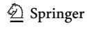
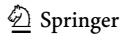
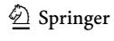
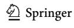
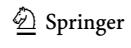
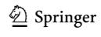
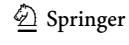

<!-- A1.R08 | source: papers_json/A1.R08/ -->

## **مأسسة الترتيبات في التعليم العالي: ** **الاستمراريات، والترابطات، والتفاعل**

**Jelena Brankovic1** **[ ·](http://orcid.org/0000-0002-0485-9096)**** Julian Hamann2** **[ ·](http://orcid.org/0000-0002-3196-908X)**** Leopold Ringel****[1](http://orcid.org/0000-0002-4894-3337)**

قُبل بتاريخ: 23 February 2023 / نُشر إلكترونيًا في: 5 April 2023 © The Author(s) 2023

## **الملخص**

في هذه المقالة، نقدّم العدد الخاص من مجلة *Higher Education* الذي يركّز على مسألة مأسسة الترتيبات في التعليم العالي. تتكوّن المقالة من ثلاثة أجزاء. في الجزء الأول، نجادل بأن السرديات الكبرى مثل العولمة والنيوليبرالية غير كافية بمفردها لتفسير سبب وكيفية مأسسة ترتيبات الكليات والجامعات. وكبديل عن ذلك، ندعو الباحثين إلى الانتباه بشكل أدق للديناميكيات الخاصة بالتعليم العالي التي تسهم في انتشار الترتيبات واستمرارها وترسّخها. في الجزء الثاني، نربط المقالات المدرجة في هذا العدد بثلاثة محاور فرعية—الاستمرارية، والترابط، والتفاعل—ونصلها بالموضوع الجامع وهو المأسسة. يتناول كل إسهام موضوع الترتيبات من زاوية مختلفة، ويسلّط ضوءًا مختلفًا على الاستمرارية والترابط والتفاعل، مما يشير إلى أن القصة الكاملة أكثر تعقيدًا مما يُفترض عادة. أما في الجزء الثالث والأخير، فنعيد صياغة الاستنتاجات الرئيسية للعدد، ونشير إلى أن البحث المقارن المنهجي يحمل وعدًا كبيرًا لتعزيز معرفتنا بهذا الموضوع. نختتم المقالة بالأمل في أن يحفّز هذا العدد الخاص مزيدًا من التساؤل حول الترتيبات—في التعليم العالي وفي أبحاث التعليم العالي.

**الكلمات المفتاحية** التعليم العالي · الترتيبات · المأسسة · التقييم · المنظمات

## **حقائق قاطعة؟**

على مدى القرن الماضي، انتشرت الترتيبات بشكل كبير. وبفهم فضفاض لها بوصفها طريقة محددة لقياس وعرض مقارنات الأداء (Werron & Ringel,[ 2017)](#page-12-0)، يمكن اليوم إيجاد الترتيبات في عدد متزايد من القطاعات، وعلى كل

* Jelena Brankovic jelena.brankovic@uni-bielefeld.de Julian Hamann julian.hamann@hu-berlin.de Leopold Ringel leopold.ringel@uni-bielefeld.de

- ^1^ Faculty of Sociology, Bielefeld University, Universitätsstraße 25, 33615 Bielefeld, Germany
- ^2^ Department of Educational Sciences, Humboldt-Universität zu Berlin, Unter den Linden 6, 10099 Berlin, Germany

<!-- page 2 -->

مستوى، من المحلي إلى العالمي. فالدول والشركات والمدن والمطاعم والفنانون هم من بين الكيانات العديدة التي تُقارَن أداءاتها بانتظام وتُقاس وتُرتَّب. ولم تعد الترتيبات فقط أكثر شيوعًا وبارزة في بعض الحالات، بل أصبحت أيضًا أكثر تنوعًا وتعقيدًا، وبعضها بات يتطلب موارد كبيرة لإنتاجه واستمراره. وفي الوقت نفسه، أصبح تتبّع نتائج الترتيبات الأخيرة، وليس أقلها متطلبات المشاركة وتقديم البيانات، أمرًا أكثر إلحاحًا من ذي قبل. وفي بعض المجالات، أصبحت الترتيبات منتشرة إلى درجة أنها باتت موضع اهتمام مستمر من قبل أصحاب المصلحة الرئيسيين والباحثين الذين يدرسونها. ويُعدّ التعليم العالي أحد هذه المجالات.

إن ترتيبات مؤسسات التعليم العالي، سواء أشرنا إليها بترتيبات الكليات أو الجامعات، موجودة منذ أكثر من قرن (Hammarfelt et al., [2017;](#page-11-0) Myers & Robe,[ 2009](#page-11-1)). لكن رغم هذا التاريخ الطويل، لم تبلغ الترتيبات مكانة الظاهرة التي تتجاوز الدوائر السياساتية الضيقة والمتخصصة إلا مع ثمانينيات القرن الماضي وصدور أول إصدارات ترتيب الكليات من قبل *US News & World Report*، وذلك على الأقل في United States (Espeland & Sauder, [2007](#page-10-0)). وبطريقة مشابهة نوعًا ما، أثارت الترتيبات العالمية الأولى للجامعات في أوائل الألفينيات اهتمامًا عالميًا، وحوّلتها فعليًا إلى موضوع نقاش حاد في الدوائر السياساتية والإدارية والأكاديمية (Brankovic et al., [2022;](#page-10-1) O'Connell, [2013](#page-11-2); Paradeise & Filliatreau, [2016](#page-11-3)). وبعد نحو عقد من الزمن، لاحظت Sarah Amsler ما يلي:

نحن غارقون في الكلام عن الترتيبات: كيف نشأت، وكيف تُصمَّم، وكيف تُنظَّر، وتصنيفاتها ومقارناتها، ومدى فاعليتها لأغراض مختلفة، ولماذا نُنتقدها، ولماذا نُدافع عنها، والتحسينات التي ستجعلها منهجيًا أكثر متانة، وما إلى ذلك. لقد أصبحت الكتابة عن الترتيبات نشاطًا عالميًا. *فماذا يمكن أن يُقال أكثر من ذلك؟* (Amsler, [2014](#page-9-0), p. 155, emphasis added)

كان بالإمكان في هذه المرحلة توقّع أن الحوار الأكاديمي حول الترتيبات على وشك بلوغ حالة من التشبّع، مما يؤدي إلى تراجع الاهتمام العام. لكن هذا ليس ما حدث. فإذا كانت "الكتابة عن الترتيبات"، كما وصفتها Amsler، نشاطًا عالميًا قبل عقد من الزمن، فيبدو أن هذا النشاط ازداد في السنوات التالية. ومن الملاحظ أن الترتيبات، خلال العقد الثاني من هذا القرن، تطورت أكثر، وأصبح إنتاجها وصيانتها أكثر تعقيدًا، لكنها أيضًا أصبحت جزءًا اعتياديًا من شؤون التعليم العالي اليومية. وبحلول هذه المرحلة، أصبح Academic Ranking of World Universities (ARWU، المعروف أيضًا بترتيب شنغهاي)، والترتيبات الصادرة عن Quacquarelli Symonds (QS) وTimes Higher Education (THE)، ولاحقًا U-Multirank، مراجع شائعة في إدارة التعليم العالي وسياساته وأبحاثه. ورغم أن الترتيبات بحد ذاتها لم تعد بالضرورة خبرًا مثيرًا لكثير من الأشخاص المعنيين بالتعليم العالي، فإنها ما زالت تصنع أخبارًا دولية ووطنية حول العالم (Barats, [2020;](#page-10-2) Shahjahan et al., [2022)](#page-12-1). وقد واصل الباحثون الكتابة عنها، بل بدا أن ذلك يجري بوتيرة أكبر[.1](#page-1-0)

من السمات اللافتة لكثير من الأدبيات المتعلقة بالترتيبات في التعليم العالي، لا سيما تلك المنشورة في المجلات المتخصصة في التعليم والتعليم العالي ودراسات العلوم، أنها تسلّم في الغالب بوجود الترتيبات كأمر مفروغ منه. أما

<!-- page 3 -->

أسئلة من قبيل لماذا وكيف أصبحت الترتيبات بهذا الانتشار الواسع، فنادرًا ما تُطرح بوصفها لغزًا تجريبيًا. بل إن الباحثين، بصرف النظر عن موقفهم من تقييم الأداء الأكاديمي (نقدي، أو محايد، أو مؤيّد)، يفترضون عادة أن للترتيبات جذورًا ومحرّكات خارج نطاق التعليم العالي، وأنها مرتبطة بشكل فضفاض، وأحيانًا سببيًا حتى، بالعولمة والإدارية والنيوليبرالية والتطورات الجيوسياسية الأخيرة وغيرها من الاتجاهات الأوسع (e.g., Collins & Park, [2015](#page-10-3); Hazelkorn, [2016](#page-11-4); Locke, [2014](#page-11-5); Lynch, [2014;](#page-11-6) Peters, [2019)](#page-11-7).[2](#page-2-0) وغالبًا ما تتخلل هذه الكتابات فكرة مفادها أن الترتيبات كانت وما زالت، بطريقة أو بأخرى، أمرًا حتميًا. ومن الملاحظ أيضًا أن قدرًا كبيرًا من البحث تقييمي ومعياري بشكل صريح أو ضمني: فترتيبات الجامعات تُحاكَم—وغالبًا ما تُعتبر غير كافية—من حيث ملاءمتها للغرض، وسلامة منهجياتها، وشفافيتها، أو آثارها الأدائية وغيرها على التعليم العالي (e.g., see recent volumes edited by Hazelkorn & Mihut, [2021b](#page-11-8); Stack, [2021;](#page-12-2) Welch & Li, [2021](#page-12-3)). ولا شك أن البحث حول الترتيبات حتى اليوم قد أسهم بشكل كبير في فهم أفضل للديناميكيات المحيطة بالترتيبات في التعليم العالي. ومع ذلك، لا يبدو أننا اقتربنا من تفسير انتشارها الواسع—وإلى حد ما شرعيتها—أكثر مما كنا عليه قبل عقد من الزمن.

لمعالجة هذه المشكلة، نقترح النظر إلى انتشار الترتيبات وتطبيعها في التعليم العالي كجزء من عملية أوسع هي المأسسة (Colyvas & Jonsson, [2011](#page-10-4)). غير أن الادعاء بأن الترتيبات في طور التحول إلى مؤسسة، مهما بدا غير إشكالي، يحتاج إلى توضيح. وبشكل عام، ولأغراضنا هنا، ننظر إلى المأسسة كعملية يصبح فيها ظاهرة ما، مثل الترتيبات، مترسّخة تدريجيًا في أنظمة المعتقدات والأعراف والممارسات الخاصة بمجتمع ما (Berger & Luckmann, [1966;](#page-10-5) DiMaggio & Powell, [1983;](#page-10-6) Jepperson, [1991;](#page-11-9) Zucker, [1977](#page-12-4)). ويصبح وجودها أمرًا مسلّمًا به ونادرًا ما يُشكّك فيه أعضاء ذلك المجتمع. وعندما نقترح أن هذا قد يكون هو الحال مع الترتيبات في التعليم العالي، فإننا لا نعني أن الترتيبات لا تخضع للنقد أو أن البدائل عن الترتيبات القائمة لا تُناقش. ما نعنيه هو أنه حتى بالنسبة للباحثين النقديين، فإن عالمًا بلا ترتيبات قد يبدو بعيد المنال. والشعور الواسع الانتشار المشترك بين المؤيدين والمعارضين بأن الترتيبات حتمية يشهد فعلًا على أن هذا قد يكون صحيحًا. ورغم النقد المستمر الموجّه إلى ترتيبات محددة ومنتِجيها، فإن فكرة أن مؤسسات التعليم العالي تعمل ضمن تراتبيات، بناءً على مفهوم ما للجودة أو الأداء، تبدو مشروعة لدى معظم الفاعلين في التعليم العالي. وفي ضوء هذا التوافق الواسع، لا يثير الاستغراب أن الترتيب الممنوح لجامعة ما غالبًا ما يتّخذ صفة "الحقيقة القاطعة"—التي لا تستطيع الجامعات فعل الكثير لتجاهلها (Sauder & Espeland,[ 2009](#page-12-5), p. 77).

غير أن النظر إلى الترتيبات من منظور المأسسة لا يعني أن التطورات المستقبلية يمكن أن تسير في اتجاه واحد فقط، أي اتجاه مزيد من المأسسة أو تعميقها. ذلك أن المأسسة، كقاعدة عامة، عملية متفاوتة وغير منتظمة، ومتغيرة العمق، وليست أقل من ذلك قابلة للانعكاس (Oliver, [1992)](#page-11-10). ولذلك فإن تطبيق منظور المأسسة يتيح لنا فتح مجال لطرح أسئلة حول طبيعة هذه العملية. ويتطلب ذلك أن نتجاوز قضايا شرعية الترتيبات بحد ذاتها وانسجامها مع النزعة التاريخية للتعليم العالي—في بعض السياقات على الأقل—نحو التمايز الرأسي بين مؤسسات التعليم العالي بناءً على مفهوم ما للجودة أو الأداء أو المكانة (Brankovic, [2018;](#page-10-7) Clark, [1983](#page-10-8)). والمأسسة، لا سيما بصيغتها القوية، تعني على الأرجح أن الترتيبات نفسها تصبح مؤسسة، وتصبح

<!-- page 4 -->

بهذا الشكل مندمجة في أنماط إعادة الإنتاج، وليست فقط "مشروطة بالتوافق مع الأطر الثقافية والمعرفية القائمة" (Colyvas & Jonsson, [2011,](#page-10-4) p. 45). فلا التسليم الضمني بوجودها ولا الشرعية وحدهما كافيان لاعتبار الترتيبات سمة دائمة للتعليم العالي. ولكي يتحقق ذلك، يجب أن يكون "إعادة الإنتاج" (بشكل مزمن) وشرعنة الترتيبات وصيانتها متجذرة أيضًا في أطر التعليم العالي وقواعده وروتينياته (Colyvas & Jonsson, [2011](#page-10-4); Jepperson, [1991](#page-11-9)).[3](#page-3-0) وبناءً على ذلك، لكي تُعتبر مأسسة الترتيبات عملية تجري *على نطاق عالمي*، ينبغي أن يظهر هذا التجذّر ليس فقط في بعض أنحاء العالم، بل تدريجيًا في العالم بأسره. وسواء كان هذا يحدث فعلًا، وإلى أي مدى، فذلك سؤال تجريبي يتطلب الإجابة عنه تجاوز الطروحات المعتادة حول كيف ولماذا أصبحت الترتيبات منتشرة في التعليم العالي.

في دراسة هذه العملية، نبدأ بنقطة بسيطة: للتساؤل عن مأسسة الترتيبات كظاهرة اجتماعية، نحتاج إلى أخذ *كل من* الظروف الاجتماعية والسياسية والتاريخية الأوسع، *والظروف* الخاصة بالتعليم العالي، على محمل الجد، ومعاملتها كموضوعات للبحث التجريبي. ويترتب على ذلك أننا بحاجة إلى ملاحظة *ليس فقط* التطورات المؤسسية الواسعة، *بل أيضًا* كيف تشكّل هذه التطورات وتتشكّل بدورها من خلال الديناميكيات المتعلقة بالمستويات الاجتماعية-التنظيمية بل والفردية للنظام الاجتماعي (Jepperson & Meyer, [2011](#page-11-11))؛ وبالمثل، ليس فقط كيف تنتشر الترتيبات، بل أيضًا كيف "تلتصق" (Colyvas & Jonsson, [2011,](#page-10-4) p. 30). ويتطلب ذلك توجيه نظرنا إلى المجموعة التي ربما تعزّز مأسسة الترتيبات: ليس فقط المؤسسات التي تنتجها، بل أيضًا صانعو السياسات، والجامعات وإدارييها، والناشرون، والباحثون، والاستشاريون، وكثيرون غيرهم (كما هو موضح أو موثّق تجريبيًا في، على سبيل المثال، Hallett & Ventresca, [2006;](#page-10-10) Scott et al., [2000;](#page-12-6) Zilber, [2002)](#page-12-7))، وبعضهم ربما لا يدرك حتى إسهامه. بالنسبة لنا، نحن الباحثين الذين ندرس الترتيبات، فإن معالجة هذا السؤال تعني بالتعريف أيضًا توجيه النظرة التحليلية نحو أنفسنا، لأننا نحن أيضًا—مثل تلك الترتيبات التي نكتب عنها (وننتقدها)—منخرطون في ادعاءات معرفية حول التعليم العالي. وأخيرًا وليس آخرًا، يعني ذلك أن نكون واعين لموقعنا كمشاركين في التعليم العالي، ممن يعملون عادة في المؤسسات التي تُقيَّم من قبل الترتيبات ذاتها التي نسعى لدراستها بموضوعية. وهذه إحدى الطرق التي قد تختلف بها التحديات التي تنشأ في بحث ترتيبات الجامعات عن تلك التي تنشأ، على سبيل المثال، في بحث ترتيبات السجون أو المستشفيات: فـ"نحن" ملاحظون *و*أطراف معنية *في آن واحد*.

عندما نعيد ضبط منظورنا لالتقاط الظروف المادية والخطابية التي تُسند الترتيبات، وكذلك الظروف المكانية والزمانية، يتضح أن أمامنا ليست قوى غامضة وثابتة، بل أناس وعمليات وهياكل حقيقية جدًا. وعندما نبدأ بملاحظة التفاعلات والروتينيات والممارسات والفاعلين، وكيف يتطورون، نصبح في موقع يتيح لنا رؤية الترتيبات—والتراتبيات المؤسسية للمكانة المُعاد إنتاجها من خلالها—كصنعة اصطناعية لا تسير مأسستها في مسار خطي محدد سلفًا، بل هي إنجاز عملي ما زلنا نعرف عنه القليل جدًا. عندئذ يصبح السؤال كيف تنتشر الترتيبات وتستمر وتترسّخ، مما يدفعنا إلى تبنّي نظرة أكثر شمولًا لتعدد العوامل المساهمة والمتشابكة المحتملة. وعندما نبدأ بمعاملة انتشار الترتيبات وشرعيتها كأسئلة تجريبية، فإن السرديات الكبرى مثل العولمة والنيوليبرالية—وإن كانت شروطًا كلية مهمة بالتأكيد—تصبح بحد ذاتها غير كافية كتفسيرات قائمة بذاتها.

<!-- page 5 -->

## **الاستمراريات والترابطات والتفاعل**

يهدف العدد الخاص *The Institutionalization of University Rankings: Continuities, Interdependencies, Engagement* إلى توسيع الحوار الأكاديمي المتنامي حول الترتيبات في التعليم العالي، وذلك تحديدًا من خلال تحويل الاهتمام نحو أسئلة تجريبية حول الظروف الكامنة وراء انتشارها الواسع، سواء في التعليم العالي أو في أبحاث التعليم العالي. يجمع هذا العدد الخاص باحثين من خلفيات متنوعة ذوي اهتمامات مختلفة فيما يتعلق بالترتيبات والتعليم العالي. وانسجامًا مع روح المجلة، يستمدّون من مجموعة من التقاليد المعرفية، بما فيها علم الاجتماع، والتاريخ، ودراسات المنظمات والإدارة، والنظرية النقدية، وبالطبع دراسات التعليم العالي والعلوم. وتهدف المقالات السبع، كل منها من زاوية مختلفة وبتركيز نظري أو تجريبي مختلف، إلى الإسهام في فهم أفضل لماهية ترتيبات الجامعات، ومن أين أتت، وكيفية عملها، وكيف أصبحت متشابكة على نحو متزايد في عمليات وهياكل التعليم العالي والعلوم.

في بقية هذا القسم، ننظّم الإسهامات وفق ثلاثة محاور: الاستمرارية، والترابط، والتفاعل. وتحديدًا، تلفت هذه المحاور الانتباه إلى (أ) كيف تتطور الترتيبات وأهميتها والأغراض والمعاني المُسندة إليها عبر الزمن (*الاستمرارية*)؛ و(ب) العلاقات والتشابكات الهيكلية التي تنشأ حول الترتيبات وتُبقيها مستمرة (*الترابط*)؛ و(ج) كيف تتعزز مأسسة الترتيبات من خلال التفاعل مع جماهير مختلفة (*التفاعل*). وهذه ليست فئات منفصلة، بل من الأفضل النظر إليها كاستراتيجيات لتوثيق تعدد الظروف التي تتيح استمرار الترتيبات وانتشارها في التعليم العالي. وفي إطار كل محور، نناقش مجموعة مختارة من المقالات المدرجة في العدد الخاص، مع تسليط الضوء على كيفية ارتباط كل منها بالاستمرارية أو الترابط أو التفاعل. ومن الملاحظ، كما سنبيّن لاحقًا، أن أيًا من المقالات لا يقتصر على محور واحد فقط، فكلها أعمال قائمة بذاتها تقدم إسهاماتها الخاصة في دراسة الترتيبات، وتتجاوز هذا العدد الخاص. وسننتقل الآن إلى مناقشة كل محور على حدة.

## **الاستمرارية**

هناك ميل في الأدبيات إلى سرد تاريخ ترتيبات الكليات والجامعات كسلسلة من الأحداث، تتمحور عادة حول نشر ترتيبات "ناجحة" مختلفة ومنهجياتها (e.g., Hazelkorn & Mihut, [2021a](#page-11-12); Myers & Robe, [2009](#page-11-1); Usher, [2017)](#page-12-8)). وبالاقتران مع الاهتمام المستمر بالآثار، أدى هذا الميل إلى إبراز ترتيبات معينة، لا سيما الأحدث منها، على حساب السياق الذي أُنتجت فيه الترتيبات الحالية والسابقة والظروف التي مكّنت (أو أعاقت) تأثيراتها. غير أن هذا الميل، إن تُرك بلا مراجعة، يحمل معه خطر تعزيز سرديات تاريخية حتمية بشكل مفرط ومبسطة أكثر مما ينبغي. علاوة على ذلك، فإن التسليم بأحداث تاريخية محددة وحقب مرسومة بدقة، بدلًا من التشكيك فيها، قد يضخّم بسهولة التغيير والجدة على حساب الاستمرارية والتحولات الأكثر تدرجًا. ففي نهاية المطاف، يتطلب التساؤل عن مأسسة الترتيبات فهمًا أفضل ليس فقط لسبب نجاح بعض الترتيبات أو زوالها، بالمعنى المذكور أعلاه، بل أيضًا تقدير الظروف التاريخية العرضية في تطورها.

من الأمثلة اللافتة على اهتمام مستمر ومتصاعد تدريجيًا بالترتيبات يمتد لعقود عديدة ما نجده في تاريخ الترتيبات في United States. في إسهامهما المعنون "The emergence of university rankings: a historical-sociological account،"

<!-- page 6 -->

يُدقّق Wilbers and Brankovic [(2021)](#page-12-9) في هذه العملية، بهدف فهم أفضل للظروف التي جعلت من ترتيب الجامعات استنادًا إلى ملاحظات متكررة طريقة مقبولة على نطاق واسع لمناقشة الجودة والتميّز. ويجادل المؤلفان بأن الاهتمام المتزايد بالترتيبات خلال الستينيات والسبعينيات—عبر الدوائر الإدارية والسياساتية والعلمية—كان ممكنًا إلى حد كبير بفضل تحول في فهم ما يعنيه أن تؤدي الجامعة دورها. وجوهر هذا الفهم، الذي وجد تعبيرًا ملائمًا في جدول الترتيب الصفري المجموع، هو أن أداء منظمة ما لا يمكن تحديده إلا بالمقارنة مع أداء منظمات أخرى. ومن خلال تسليط الضوء على التطورات المهمَلة غالبًا خلال الستينيات والسبعينيات، تسهم المقالة أيضًا في فهم أشمل للسياق التاريخي المؤدي إلى الثمانينيات—العقد الذي ظهرت فيه *US News & World Report* على مسرح ترتيب الكليات.

تمثّل China حالة مغايرة نوعًا ما. فهنا أيضًا نجد اهتمامًا طويل الأمد بالترتيبات، لكنه مدفوع بشكل رئيسي من الحكومة المركزية للبلاد. في مقالتهما "The politics of university rankings in China،" يجادل Ahlers and Christmann-Budian [(2023](#page-9-1)) بأن ترتيبات الجامعات في حالة China هي جزء عضوي من هيكل السياسة العلمية والتكنولوجية والابتكارية الحكومية من أعلى إلى أسفل، وليست أداة أولية للمقارنة الدولية كما يُصوَّر أحيانًا. فمنذ أول ترتيب وطني نشرته وزارة العلوم والتكنولوجيا في الثمانينيات، مرورًا بأول ترتيب دولي أصدرته Shanghai Jiao Tong University في أوائل الألفينيات، وحتى اليوم، ظل الخطاب حول الترتيبات في China متشكّلًا إلى حد كبير بالاعتبارات الوطنية. وتُواجَه الترتيبات الغربية والمؤشرات الأدائية الأخرى بتحديات متزايدة، وذلك أيضًا بحجة أنها غير ملائمة بما يكفي للسياق الصيني. ويخلص Ahlers and Christmann-Budian إلى أنه، على عكس معظم البلدان التي تميل فيها الترتيبات الدولية إلى ممارسة تأثير مباشر أكبر على الجامعات، ظل هذا التأثير في China دائمًا محكومًا بشدة بالمصلحة الاستراتيجية لحكومتها في التعليم العالي والعلوم، وهي مصلحة تسبق ظهور الترتيبات العالمية الأولى بزمن طويل.

ومع أن المقالتين تتناولان موضوع الاستمرارية، فإنهما تكشفان أيضًا عن الترابطات بين المنسوبين إلى إنتاج الترتيب والأطراف الأخرى المساهمة فيه، بما فيها الداعمون والرعاة والنقاد، مما يقدّم صورة أكثر دقة لما يجعل الترتيب—وأثره—ممكنًا بل ومرجحًا. ومن الواضح، كما توضح الحالتان أيضًا، أن تشكيلة الفاعلين وطبيعة مشاركتهم تتفاوت عبر البلدان وعبر الزمن. غير أن هذا يعقّد الفهم المعتاد لمفهوم الفاعلية عندما يتعلق الأمر بترتيبات الجامعات، الذي يميل فيه دور من يُطلق عليهم "المرتِّبون" إلى المبالغة الدرامية. ومع ذلك، كما سنجادل في القسم التالي، فإن اعتبار الفاعلية موزعة بدلًا من كونها موحدة قد يقدّم الكثير لدراسة الترتيبات.

## **الترابطات**

أصبحت أشهر ترتيبات الجامعات اليوم مشاريع معقدة. ولإنتاج ترتيب ما، تعتمد المنظمات الكبرى المسؤولة عن الترتيبات على مشاركة مستمرة من أطراف ثالثة متعددة، تشمل الجامعات وموظفيها الإداريين وأعضاء هيئة التدريس الأفراد. ومن أمثلة هذه المشاركة الجامعات التي تزوّد بالبيانات أو الأكاديميون الذين يُكملون استبيانات السمعة. وتتضح هذه التعقيدات أيضًا عندما نلاحظ أن الجهات المرتِّبة مندمجة في شبكة متزايدة الكثافة من المنظمات التي تجمع البيانات وتزوّدها وتُجمّعها لترتيبات مختلفة (Chen & Chan, [2021](#page-10-12); Krüger, [2020;](#page-11-13) Williamson, [2021)](#page-12-10). وأخيرًا، يتضح هذا التعقيد أيضًا من كون بعض الجهات المرتِّبة تنخرط في مجموعة من الأنشطة الإضافية والتكميلية: فمثلًا، تنظّم فعاليات، وتبيع خدمات استشارية للجامعات والحكومات، وتتفاعل بنشاط مع جماهير أخرى متنوعة. ومع ذلك، يميل البحث إلى معاملة الترتيبات بشكل شبه حصري كعمل تقوم به المنظمات المالكة

<!-- page 7 -->

للترتيبات الكبرى، مثل THE وQS، بينما يُهمَل غالبًا دور وفاعلية الأطراف الأخرى، مثل مؤسسات التعليم العالي (كما جادل مؤخرًا أيضًا Locke, [2021)](#page-11-14)). ويتطلب فهم كيفية مأسسة الترتيبات (أو عدم مأسستها) توسيع هذا النطاق من خلال الانتباه، على سبيل المثال لا الحصر، إلى الفاعليات الموزعة، وبالتالي الترابطات بين الجهات المرتِّبة والفاعلين الآخرين في التعليم العالي.

في دراستهما "The power in managing numbers: changing interdependencies and the rise of ranking expertise،" يبحث Chun and Sauder [(2022)](#page-10-13) في أقسام إدارة الترتيب الجامعي في South Korea. ويلاحظ المؤلفان أن هذه الوحدات أصبحت متزايدة التأثير لأنها حوّلت إدارة الترتيبات داخل الجامعات وبينها إلى شكل جديد وقيّم من الخبرة. وهذا النوع الجديد من الخبرة، كما يجادل المؤلفان، أعاد تشكيل ترابطات رئيسية داخل الجامعات وبينها وبين أطراف خارجية، وأدى كذلك إلى تغيير في روتينيات العمل وممارسات تنظيمية جديدة. واستنادًا إلى نتائج دراستهما، يتحدى Chun and Sauder الخط الحجاجي المعتاد الذي يُنسب فيه إلى الترتيبات توليد المنافسة، من خلال لفت الانتباه إلى كيفية تأديتها أيضًا إلى أشكال جديدة من التعاون. ويخلصان إلى ما يلي:

من الوصفات الأساسية لنجاح الترتيبات إشراك فاعلين متعددين لبناء خبرة جماعية في إدارة الترتيبات. وتحافظ الترتيبات على تأثيرها في التعليم العالي وتوسّعه من خلال تكثير الروابط والترابطات العلائقية بين الجامعات والترتيبات والأطراف الخارجية الأخرى. (Chun & Sauder, [2022](#page-10-13), p. 17).

غالبًا ما تنشأ الترابطات فيما يتعلق بالموارد، وهو أمر مهم بشكل خاص عند النظر في حالة منظمات الترتيب ذات الدوافع التجارية. فبالإضافة إلى دورها كحكم محايد في وضع ترتيبات مؤسسات التعليم العالي، تعمل هذه المنظمات أيضًا كشركات تبيع خدمات لتلك المؤسسات نفسها، بما فيها الإعلان والاستشارات. في إسهامه بالعدد الخاص، المعنون "Does conflict of interest distort global university rankings؟" يتناول Igor Chirikov [(2022](#page-10-14)) العلاقة بين هذين الدورين. ويسعى إلى التحديد التجريبي لما إذا كان تعارض المصالح يؤدي إلى تفضيل بعض الجامعات على غيرها، وذلك من خلال دراسة أثر تعاقد الجامعات في Russia مع QS على نتائج الترتيب. وتشير النتائج إلى أنه، بصرف النظر عن التغيرات في الخصائص المؤسسية، حسّنت الجامعات ذات العقود المتكررة مع QS ترتيبها أكثر من منافساتها. وعلى غرار الدراسة الحديثة لـ Jacqmin ([2021](#page-11-15))، التي يحلل فيها المؤلف العلاقة بين الإعلان على موقع THE وترتيبات THE، يدعونا عمل Chirikov إلى الانتباه بشكل أدق لطبيعة الروابط والترابطات (البينية) التي تنشأ بين منظمات الترتيب ومؤسسات التعليم العالي وأطراف أخرى معنية بشكل مباشر وغير مباشر بإدامة الترتيبات.

وكما تُظهر كل من دراسة Chun and Sauder ودراسة Chirikov، تتحقق الترتيبات من خلال تعاون وتنسيق مستمرين بين أطراف مختلفة، تتفاوت مصالحها وتوجهاتها في مدى انسجامها. في إسهامه بالعدد الخاص، "How university rankings are made through globally coordinated action: a transnational institutional ethnography in the sociology of quantification،" يهتم Gary Barron ([2022)](#page-10-15) تحديدًا بالطابع الموزّع لإنتاج الترتيبات. ويصوغ عمل البيانات والبنية التحتية عبر المواقع بوصفه فعلًا منسقًا عالميًا، حيث يصبح الأفراد من الموظفين الأكاديميين والإداريين جزءًا من تلك البنية التحتية، إذ يعملون مع البيانات باستمرار عبر مواقع مادية لا حصر لها. ويلاحظ Barron أن مساهمة مؤسسات التعليم العالي في إنتاج الترتيبات ليست موحّدة؛ بل تتخذ أشكالًا مختلفة، تتمحور حول أفراد ووحدات تنظيمية تقوم بعمل روتيني، وغالبًا دون فهم كامل للشبكة الشاملة من العلاقات التي يشكّلون جزءًا حيويًا منها.

<!-- page 8 -->

تحمل دراسة الترابطات، وكذلك كيفية تطورها، وعدًا بتحسين فهمنا ليس فقط لكيفية إنتاج الترتيبات لعلاقات جديدة في التعليم العالي، بل أيضًا كيف تعزّز العلاقات القائمة وتحوّلها. وقد اعترف بأهمية العلاقات بين الفاعلين كذلك العمل الحديث لـ Engwall, Edlund, and Wedlin ([2023)](#page-10-16) حول انتشار عمليات التقييم، بما فيها الترتيبات، في الأوساط الأكاديمية، وعمل Brankovic, Ringel, and Werron ([2022)](#page-10-1) حول دور العمل الحدودي في شرعنة ترتيبات الجامعات. علاوة على ذلك، يمكن بسهولة إدراك أهمية دراسة الديناميكيات التفاعلية والعلائقية لتعزيز فهمنا للاستمرارية فيما يتعلق بالترتيبات، وبالتاريخ بشكل أعم. وكما سنرى في القسم التالي، فإن الترابطات ليست هيكلية فحسب، بل خطابية إلى حد كبير أيضًا، بل ومبادَر بها ومحافَظ عليها بنشاط من قبل الجهات المرتِّبة وجماهيرها.

## **التفاعل**

من الجوانب المهمة للترتيبات أنها مقارنة *علنية* للأداءات (Brankovic et al., [2018)](#page-10-17)). ورغم أن هذا الجانب قد سُلّط عليه الضوء في بعض الأعمال الكلاسيكية حول الموضوع (e.g., Espeland & Sauder, [2007](#page-10-0))، فإن البحث يتعامل في الغالب مع الطابع العلني للترتيبات كأمر مسلّم به. ومن ثم، فإن ما يترتب عليه بالضبط غير مفهوم جيدًا. وبعد تدقيق أوثق، نلاحظ أنه، نتيجة لطابعها العلني، تتفاعل الترتيبات مع جماهير متخصصة وغير متخصصة متنوعة، تخدمها—أو يُعتقد أنها تخدمها—احتياجات مختلفة. ورغم تنوع هذه الجماهير، فإن ما يجمعها هو أنها تحتاج، أو يُنظر إليها على أنها بحاجة، إلى توجيه أو شرعنة أو إشارات مكانة (Esposito & Stark, [2019;](#page-10-18) Hamann & Schmidt-Wellenburg,[ 2020](#page-10-19)). لكن كيف تستحضر الترتيبات جماهيرها وتشركها وتؤثر فيها، وكيف يسهم هذا التفاعل في مأسستها أو يتحداها، أمر لدينا عنه معرفة ضئيلة جدًا.

لطالما ميّز الوصول إلى الجماهير المتنوعة وتلبية احتياجاتها جهود الجهات المرتِّبة لتأمين الاهتمام والشرعية. وقد جعلت الأهمية المتنامية لوسائل التواصل الاجتماعي في الحياة العامة منها فضاءً جذابًا لمنظمات متنوعة، من جهة للترويج لقضاياها أو خدماتها أو منتجاتها، ومن جهة أخرى لتعزيز التفاعل عبر جماهير متنوعة. في مقالتهم "The 'LOOMING DISASTER' for higher education: how commercial rankers use social media to amplify and foster affect،" يفحص Riyad Shahjahan, Adam Grimm, and Ryan Allen [(2021](#page-12-11)) بشكل نقدي أنشطة THE وQS على وسائل التواصل الاجتماعي. وبتحليل حساب THE على Twitter وصفحة QS على Facebook، يُظهر المؤلفون كيف تستخدم هاتان المنظمتان السرد القصصي لصياغة منتجاتهما وخدماتهما وبيعها. ويجد المؤلفون أن كلتا المنظمتين تستخدمان منصات التواصل الاجتماعي لتعبئة حالات وأفعال عاطفية جماعية، لا سيما حالة عدم الاستقرار المصحوبة بمشاعر عدم اليقين وانعدام الأمان والقلق و/أو التنافس. وتُبرز المقالة تفرّد وسائل التواصل الاجتماعي كبنية تحتية عاطفية، نظرًا لفعاليتها من حيث التكلفة، وسهولة استهلاكها، ومدى الوصول الواسع والسريع الذي تتيحه، وكذلك طابعها التفاعلي.

في إسهامهما "The discursive resilience of university rankings،" يستقصي Hamann and Ringel ([2023)](#page-11-16) البيئة الخطابية للترتيبات، ويميّزان بين نمطين من النقد: نمط أساسي إلى حد ما يلفت الانتباه إلى الآثار السلبية للترتيبات، ونمط أكثر تقنية يُعنى بأوجه القصور المنهجية فيها. وتقوم الجهات المرتِّبة إما بمواجهة هذا النقد وتقديم سرديات بديلة، أو التأكيد بثقة على كفاءتها العلمية والتشديد على أن الترتيبات دائمًا في طور التطوير والتحسين. والأهم من ذلك، أن الردود الواثقة على النقد تشمل أيضًا محاولات لإشراك النقاد، ودعوتهم إلى حوار بنّاء حول كيفية تطوير الترتيبات مستقبلًا. والحوار المستمر الذي يبدو بلا نهاية بين الجهات المرتِّبة

<!-- page 9 -->

والنقاد حول كيفية التوصل إلى تقييمات أكثر صرامة يساعد على منح ترتيبات الجامعات ما يسمّيه المؤلفان "المرونة الخطابية." ولا يبرز هذا الإسهام فقط أن النقد عنصر مهم من مأسسة ترتيبات الجامعات، بل يُنبّه أيضًا، بمعنى عام، إلى الديناميكيات الخطابية التي تنشأ عضويًا وبالتالي تتكشف "خلف ظهور" الجهات المرتِّبة ونقادها.

يبرز الإسهامان أهمية الفضاء الرقمي كموقع للتفاعل والتواصل، لا سيما وسائل التواصل الاجتماعي، التي لم تجذب حتى الآن اهتمامًا كبيرًا من بحوث الترتيبات (for some exceptions, see Lim, [2021](#page-11-17); Stack, [2016](#page-12-12)). ويبدو أن الجهات المرتِّبة تأخذ وسائل التواصل الاجتماعي وأشكال التفاعل الرقمي الأخرى على محمل الجد، مما يدفعنا إلى النظر إلى ما هو أبعد من جداول الترتيب إذا أردنا التقاط صورة أشمل عن كيفية إنتاج أثر معيّن. وتُظهر الدراسة الحديثة لـ Hansen and Van den Bossche ([2022)](#page-11-18)، التي تتبّع التغيّر البلاغي في تغطية Times Higher Education للترتيبات، بشكل حيّ كيف يمكن أن يكون هذا الأثر خفيًا لكنه شديد التأثير. وبشكل عام، تشير هذه الرؤى إلى أن الديناميكيات في المجال العام—سواء الرقمية أو المطبوعة أو الشخصية—تستحق الملاحظة عند طرح أسئلة حول كيفية استحضار الجهات المرتِّبة لجماهيرها وإشراكها والتأثير فيها.

## **فماذا يمكن أن يُقال أكثر من ذلك؟**

الاستنتاج الجامع لهذا العدد الخاص هو أن *مأسسة الترتيبات لا تحرّكها فقط اتجاهات مجتمعية كلية، بل أيضًا التفاعل المستمر في ساحات ومجالات متعددة بين أطراف مختلفة، داخل التعليم العالي وخارجه على حد سواء*. غير أن كيفية حدوث ذلك لم تُصبح موضوعًا لاهتمام تجريبي أو نظري مستمر في دراسات التعليم العالي، لا سيما ليس بمستوى الاهتمام بوصف وتفسير آثار الترتيبات أو منهجياتها. لذلك نرغب في التأكيد مجددًا على أنه، إذا أردنا فهمًا أفضل لكيفية تحوّل الترتيبات في التعليم العالي إلى حقيقة اجتماعية مسلّم بها، وكذلك كيفية التشكيك في هذا التسليم، فإن الأمر يتطلب اهتمامًا نظريًا وتجريبيًا أكبر بالديناميكيات المتعلقة بالمستويات الاجتماعية-التنظيمية والفردية للنظام الاجتماعي. ونقترح أن يُوجَّه هذا الاهتمام إلى الأسئلة المتعلقة بالاستمرارية والترابط وتفاعل الجماهير.

تُعدّ مجموعة المقالات المدرجة في هذا العدد خطوة في اتجاه ما نراه تحديًا نظريًا وتجريبيًا مهمًا. وكما لاحظنا، فإن المحاور الثلاثة ليست حصرية متبادلة، ولا تُلقي إسهامات العدد الخاص الضوء على محور واحد فقط في كل مرة. بل إنها مترابطة بشكل وثيق ومتشابكة إلى حد كبير. وهكذا، ومع تطور الترتيبات، فإنها تشكّل وتعيد تشكيل الترابطات بين الفاعلين وتستوعب توقعات جماهير مختلفة. والاستمرارية، في نهاية المطاف، طريقة أخرى للاعتراف بدرجة ما على الأقل من الاعتماد على المسار السابق في العمل. وتبني الترتيبات مرونتها جزئيًا لأن تفاعلها مع الجماهير المختلفة مستمر ومُطبَّع تدريجيًا، وجزئيًا لأن إنتاجها هو عمل فاعلين متنوعين كثر، يسهمون بشكل متكرر في المسعى الجماعي، من دورة ترتيب إلى أخرى. وتستحق هذه الاعتبارات مزيدًا من البحث. وفي نهاية المطاف، وكما هو الحال مع دراسة عمليات المأسسة بشكل أعم، فإن التساؤل حول مأسسة الترتيبات يدعونا بالمثل إلى النظر في البُعد الزماني *و*المكاني، والمادي *و*الخطابي.

وترديدًا للدعوات التي وجّهها بعض المؤلفين في العدد الخاص، نعتقد أن هناك الكثير مما يمكننا تعلّمه عن الترتيبات من خلال المقارنة المنهجية للاستمرارية والترابط والتفاعل في أنحاء مختلفة من العالم وعلى مستويات مختلفة. وقد ساهمت الدراسات المقارنة حتى الآن في تعزيز فهمنا لطائفة من الظواهر في التعليم

<!-- page 10 -->

العالي (Kosmützky & Nokkala, [2014;](#page-11-19) Kosmützky et al., [2020](#page-11-20); Teichler, [2014)](#page-12-13)). وتحمل هذه الدراسات وعدًا جيدًا لكشف السوابق والنتائج المترتبة على الاستمرارية، وكذلك على انقطاعها؛ وعلى الترابط وغيابه؛ وأخيرًا، على التفاعل وكذلك عدم التفاعل. علاوة على ذلك، هناك الكثير مما يمكن تعلّمه عن الترتيبات في التعليم العالي من خلال توسيع نطاقنا ومقارنتها بمأسسة أدوات تقييم أخرى (Hamann et al., [2023](#page-11-21)). لكن البحث المقارن لا يجب أن يقتصر على التعليم العالي، ويمكنه أن يأخذ في الحسبان الترتيبات في مجالات أخرى (for an illustration, see Brankovic et al., [2021](#page-10-20)). ففي نهاية المطاف، ينبغي ألا ننسى أن الترتيبات في التعليم العالي (والتعليم العالي بحد ذاته، في هذا الصدد) جزء من مجال مجتمعي أوسع اكتسبت فيه مؤشرات كمية مختلفة تأثيرًا كبيرًا في السنوات الأخيرة (de Rijcke et al., [2016](#page-10-21); Erkkilä & Piironen, [2018](#page-10-22); Mennicken & Espeland,[ 2019;](#page-11-22) Pardo-Guerra,[ 2022)](#page-11-23)). وفي ضوء ذلك، يمكن استثمار أوجه التشابه والاختلاف المحددة تجريبيًا بين الترتيبات وأنواع أخرى من المقارنات القائمة على القياس الكمي—داخل التعليم العالي وخارجه—بشكل مثمر لتعزيز فهمنا للترتيبات في التعليم العالي.

وختامًا، نأمل أن يعزّز هذا العدد الخاص تقديرنا الجماعي لتعقيد الترتيبات كظاهرة اجتماعية، وأن يُلهم العاملين على هذا الموضوع للنظر في بعض المنظورات والرؤى المقدَّمة هنا. ونأمل بالمثل أن يحفّز هذا العدد جميعنا على مزيد من التساؤل حول التسليم الضمني بوجود الترتيبات في التعليم العالي وفي أبحاث التعليم العالي على حد سواء. ليس لأننا نعتقد أن الترتيبات كلها سيئة أو ضارة (فلو كان الأمر كذلك فعلًا، لكانت الأمور، كما نشتبه، أبسط بكثير)، بل لأن مهمتنا كباحثين هي التشكيك في كل شيء في المجتمع، بما في ذلك—وربما خاصة—افتراضاتنا ومعتقداتنا الخاصة.

**شكر وتقدير** نودّ أن نشكر جميع المؤلفين الذين ساهموا في هذا العدد الخاص. لم يكن أي من هذا ليتحقق لولا أفكارهم وعملهم وصبرهم. كما لم يكن هذا العدد ليتحقق دون كل العمل الذي بذله المحكّمون، ودعم وتوجيه رؤساء التحرير في مجلة *Higher Education* طوال هذه العملية. وجميع الأخطاء هي أخطاؤنا وحدنا.

**التمويل** تم تمكين وتنظيم تمويل الوصول المفتوح من قبل Projekt DEAL.

## **إقرارات**

**تعارض المصالح** يقر المؤلفون بعدم وجود مصالح متضاربة.

**الوصول المفتوح** هذه المقالة مرخّصة بموجب Creative Commons Attribution 4.0 International License، التي تسمح بالاستخدام والمشاركة والتكييف والتوزيع وإعادة الإنتاج بأي وسيلة أو صيغة، طالما يُنسب الفضل المناسب للمؤلف (المؤلفين) الأصليين وللمصدر، ويُقدَّم رابط لترخيص Creative Commons، ويُشار إلى أي تعديلات أُجريت. وتُدرج الصور أو المواد الأخرى العائدة لأطراف ثالثة في هذه المقالة ضمن ترخيص Creative Commons الخاص بالمقالة، ما لم يُذكر خلاف ذلك في سطر الإسناد الخاص بالمادة. وإذا لم تكن المادة مدرجة ضمن ترخيص Creative Commons الخاص بالمقالة وكان استخدامك المقصود غير مسموح به بموجب التنظيم القانوني أو يتجاوز الاستخدام المسموح به، فسيتعين عليك الحصول على إذن مباشرة من صاحب حقوق الملكية. لعرض نسخة من هذا الترخيص، تفضّل بزيارة [http://creativecommons.org/licenses/by/4.0/.](http://creativecommons.org/licenses/by/4.0/)

## **المراجع**

Ahlers, A. L., & Christmann-Budian, S. (2023). The politics of university rankings in China. *Higher Educa**tion*.[ https://link.springer.com/article/10.1007/s10734-023-01014-y](https://link.springer.com/article/10.1007/s10734-023-01014-y)

Amsler, S. S. (2014). University ranking: A dialogue on turning towards alternatives. *Ethics in Science and * *Environmental Politics,* *13*(2), 155–166.[ https://doi.org/10.3354/esep00136](https://doi.org/10.3354/esep00136)

<!-- page 11 -->

- Barats, C. (2020). Dissemination of international rankings: Characteristics of the media coverage of the Shanghai Ranking in the French press. *Palgrave Communications,* *6*(1), Article 1. [https://doi.org/10.](https://doi.org/10.1057/s41599-020-0440-5) [1057/s41599-020-0440-5](https://doi.org/10.1057/s41599-020-0440-5)
- Barron, G. R. S. (2022). How university rankings are made through globally coordinated action: A transnational institutional ethnography in the sociology of quantifcation. *Higher Education*. [https://doi.](https://doi.org/10.1007/s10734-022-00903-y) [org/10.1007/s10734-022-00903-y](https://doi.org/10.1007/s10734-022-00903-y)
- Berger, P. L., & Luckmann, T. (1966). *The Social Construction of Reality: A Treatise in the Sociology of * *Knowledge*. Anchor Books.
- Brankovic, J. (2018). The status games they play: Unpacking the dynamics of organisational status competition in higher education. *Higher Education,* *75*(4), 695–709. [https://doi.org/10.1007/](https://doi.org/10.1007/s10734-017-0169-2) [s10734-017-0169-2](https://doi.org/10.1007/s10734-017-0169-2)
- Brankovic, J., Ringel, L., & Werron, T. (2018). How rankings produce competition: The case of global university rankings. *Zeitschrift für Soziologie,* *47*(4), 270–288. [https://doi.org/10.1515/](https://doi.org/10.1515/zfsoz-2018-0118) [zfsoz-2018-0118](https://doi.org/10.1515/zfsoz-2018-0118)
- Brankovic, J., Ringel, L., & Werron, T. (2021). Theorizing University Rankings by Comparison: Systematic and historical analogies with arts and sports. In E. Hazelkorn & G. Mihut (Eds.), *Research * *Handbook on University Rankings: History, Methodology, Infuence and Impact* (pp. 67–79). Edward Elgar Publishing. [https://doi.org/10.4337/9781788974981.00013](https://doi.org/10.4337/9781788974981.00013)
- Brankovic, J., Ringel, L., & Werron, T. (2022). Spreading the gospel: Legitimating university rankings as boundary work. *Research Evaluation*, rvac035.[ https://doi.org/10.1093/reseval/rvac035](https://doi.org/10.1093/reseval/rvac035)
- Chen, G., & Chan, L. (2021). University Rankings and Governance by Metrics and Algorithms. In E. Hazelkorn & G. Mihut (Eds.), *Research Handbook on University Rankings: Theory, Methodology, * *Infuence and Impact*. Edward Elgar Publishing. [https://doi.org/10.5281/zenodo.4730593](https://doi.org/10.5281/zenodo.4730593)
- Chirikov, I. (2022). Does confict of interest distort global university rankings? *Higher Education*. [https://doi.org/10.1007/s10734-022-00942-5](https://doi.org/10.1007/s10734-022-00942-5)
- Chun, H., & Sauder, M. (2022). The power in managing numbers: Changing interdependencies and the rise of ranking expertise. *Higher Education*. [https://doi.org/10.1007/s10734-022-00823-x](https://doi.org/10.1007/s10734-022-00823-x)
- Clark, B. R. (1983). The Higher Education System: Academic Organization in Cross-National Perspective. University of California Press.
- Collins, F. L., & Park, G.-S. (2015). Ranking and the multiplication of reputation: Refections from the frontier of globalizing higher education. *Higher Education,* *72*(1), 115–129. [https://doi.org/10.](https://doi.org/10.1007/s10734-015-9941-3) [1007/s10734-015-9941-3](https://doi.org/10.1007/s10734-015-9941-3)
- Colyvas, J. A., & Jonsson, S. (2011). Ubiquity and Legitimacy: Disentangling Difusion and Institutionalization. *Sociological Theory,* *29*(1), 27–53.
- de Rijcke, S., Wallenburg, I., Wouters, P., & Bal, R. (2016). Comparing Comparisons. On Rankings and Accounting in Hospitals and Universities. In J. Deville, M. Guggenheim, & Z. Hrdličková (Eds.), *Practising Comparison: Logics, Relations, Collaborations* (pp. 251–280). Mattering Press.
- DiMaggio, P. J., & Powell, W. W. (1983). The Iron Cage Revisited: Institutional Isomorphism and Collective Rationality in Organizational Fields. *American Sociological Review,* *48*(2), 147–160.
- Elken, M., & Stensaker, B. (2018). Conceptualising 'quality work' in higher education. *Quality in * *Higher Education,* *24*(3), 189–202.[ https://doi.org/10.1080/13538322.2018.1554782](https://doi.org/10.1080/13538322.2018.1554782)
- Engwall, L., Edlund, P., & Wedlin, L. (2023). Who is to blame? Evaluations in academia spreading through relationships among multiple actor types. *Social Science Information*. [https://doi.org/10.](https://doi.org/10.1177/05390184221146476) [1177/05390184221146476](https://doi.org/10.1177/05390184221146476)
- Erkkilä, T., & Piironen, O. (2018). *Rankings and Global Knowledge Governance: Higher Education*. Palgrave Macmillan.[ https://doi.org/10.1007/978-3-319-68941-8](https://doi.org/10.1007/978-3-319-68941-8)
- Espeland, W. N., & Sauder, M. (2007). Rankings and Reactivity: How Public Measures Recreate Social Worlds. *American Journal of Sociology,* *113*(1), 1–40.
- Esposito, E., & Stark, D. (2019). What's Observed in a Rating? Rankings as Orientation in the Face of Uncertainty. *Theory, Culture and Society,* *36*(4), 3–26.[ https://doi.org/10.1177/0263276419826276](https://doi.org/10.1177/0263276419826276)
- Gelber, S. M. (2020). Grading the College: A History of Evaluating Teaching and Learning. JHU Press. [https://jhupbooks.press.jhu.edu/title/grading-college](https://jhupbooks.press.jhu.edu/title/grading-college)
- Hallett, T., & Ventresca, M. J. (2006). Inhabited Institutions: Social Interactions and Organizational Forms in Gouldner's Patterns of Industrial Bureaucracy. *Theory and Society,* *35*(2), 213–236. [https://doi.org/10.1007/s11186-006-9003-z](https://doi.org/10.1007/s11186-006-9003-z)
- Hamann, J., & Schmidt-Wellenburg, C. (2020). The double function of rankings: Consecration and dispositif in transnational academic felds. In C. Schmidt-Wellenburg & S. Bernhard (Eds.), *Charting * *Transnational Fields: Methodology for a Political Sociology of Knowledge*. Routledge. [https://doi.](https://doi.org/10.4324/9780429274947) [org/10.4324/9780429274947](https://doi.org/10.4324/9780429274947)

<!-- page 12 -->

- Hamann, J., Blome, F., & Kosmützky, A. (2023). Devices of evaluation: Institutionalization and impact – Introduction to the special issue. *Research Evaluation*.
- Hamann, J., & Ringel, L. (2023). The discursive resilience of university rankings. *Higher Education*. [https://doi.org/10.1007/s10734-022-00990-x](https://doi.org/10.1007/s10734-022-00990-x)
- Hammarfelt, B., de Rijcke, S., & Wouters, P. (2017). From Eminent Men to Excellent Universities: University Rankings as Calculative Devices. *Minerva,* *55*(4), 391–411. [https://doi.org/10.1007/](https://doi.org/10.1007/s11024-017-9329-x) [s11024-017-9329-x](https://doi.org/10.1007/s11024-017-9329-x)
- Hansen, M., & Van den Bossche, A. (2022). From newspaper supplement to data company: Tracking rhetorical change in the Times Higher Education's rankings coverage. *Poetics*, *92*, 101637.[ https://doi.org/](https://doi.org/10.1016/j.poetic.2021.101637) [10.1016/j.poetic.2021.101637](https://doi.org/10.1016/j.poetic.2021.101637)
- Hazelkorn, E. (2016). Introduction: The geopolitics of rankings. In E. Hazelkorn (Ed.), *Global Rankings * *and the Geopolitics of Higher Education: Understanding the infuence and impact of rankings on * *higher education, policy and society* (pp. 1–20). Routledge.
- Hazelkorn, E., & Mihut, G. (Eds.). (2021). *Research Handbook on University Rankings: Theory, Methodol**ogy*. Edward Elgar Publishing.
- Hazelkorn, E., & Mihut, G. (2021). Introduction: Putting rankings in context - looking back, looking forward. In E. Hazelkorn & G. Mihut (Eds.), *Research Handbook on University Rankings: Theory, Meth**odology, Infuence and Impact* (pp. 1–17). Edward Elgar Publishing.
- Jacqmin, J. (2021). Do ads infuence rankings? Evidence from the higher education sector. *Education Eco**nomics,* *29*(5), 509–526. [https://doi.org/10.1080/09645292.2021.1918642](https://doi.org/10.1080/09645292.2021.1918642)
- Jepperson, R. L. (1991). Institutions, institutional efects, and institutionalization. In W. W. Powell & P. J. DiMaggio (Eds.), *The New Institutionalism in Organizational Analysis* (pp. 143–163). University of Chicago Press.
- Jepperson, R. L., & Meyer, J. W. (2011). Multiple Levels of Analysis and the Limitations of Methodological Individualisms. *Sociological Theory,* *29*(1), 54–73.[ https://doi.org/10.1111/j.1467-9558.2010.01387.x](https://doi.org/10.1111/j.1467-9558.2010.01387.x)
- Kosmützky, A., & Nokkala, T. (2014). Challenges and trends in comparative higher education: An editorial. *Higher Education,* *67*(4), 369–380. [https://doi.org/10.1007/s10734-013-9693-x](https://doi.org/10.1007/s10734-013-9693-x)
- Kosmützky, A., Nokkala, T., & Diogo, S. (2020). Between context and comparability: Exploring new solutions for a familiar methodological challenge in qualitative comparative research. *Higher Education * *Quarterly,* *74*(2), 176–192.[ https://doi.org/10.1111/hequ.12255](https://doi.org/10.1111/hequ.12255)
- Krüger, A. K. (2020). Quantifcation 2.0? Bibliometric Infrastructures in Academic Evaluation. *Politics and * *Governance,* *8*(2), Article 2.[ https://doi.org/10.17645/pag.v8i2.2575](https://doi.org/10.17645/pag.v8i2.2575)
- Lim, M. A. (2021). The business of university rankings: The case of Times Higher Education. In E. Hazelkorn & G. Mihut (Eds.), *Research Handbook on University Rankings: Theory, Methodology, * *Infuence and Impact* (pp. 444–453). Edward Elgar Publishing. [https://doi.org/10.5281/zenodo.47305](https://doi.org/10.5281/zenodo.4730593) [93](https://doi.org/10.5281/zenodo.4730593)
- Locke, W. (2014). The Intensifcation of Rankings Logic in an Increasingly Marketised Higher Education Environment. *European Journal of Education,* *49*(1), 77–90.[ https://doi.org/10.1111/ejed.12060](https://doi.org/10.1111/ejed.12060)
- Locke, W. (2021). Researching and understanding the infuence of rankings on higher education institutions: Logics, methodologies and conceptualisations. In E. Hazelkorn & G. Mihut (Eds.), *Research Hand**book on University Rankings: Theory, Methodology, Infuence and Impact* (pp. 80–92). Edward Elgar Publishing.
- Lynch, K. (2014). New managerialism, neoliberalism and ranking. *Ethics in Science and Environmental * *Politics,* *13*(2), 141–153.[ https://doi.org/10.3354/esep00137](https://doi.org/10.3354/esep00137)
- Mennicken, A., & Espeland, W. N. (2019). What's New with Numbers? Sociological Approaches to the Study of Quantifcation. *Annual Review of Sociology,* *45*(1), 223–245. [https://doi.org/10.1146/annur](https://doi.org/10.1146/annurev-soc-073117-041343) [ev-soc-073117-041343](https://doi.org/10.1146/annurev-soc-073117-041343)
- Myers, L., & Robe, J. (2009). *College Rankings: History, Criticism and Reform*. Center for College Afordability and Productivity. [https://eric.ed.gov/?id=ED536277](https://eric.ed.gov/?id=ED536277)
- O' Connell, C. (2013). Research Discourses Surrounding Global University Rankings. Exploring the Relationship with Policy and Practice Recommendations. *Higher Education,* *65*(6), 709–723.
- Oliver, C. (1992). The Antecedents of Deinstitutionalization. *Organization Studies,* *13*(4), 563–588.[ https://](https://doi.org/10.1177/017084069201300403) [doi.org/10.1177/017084069201300403](https://doi.org/10.1177/017084069201300403)
- Paradeise, C., & Filliatreau, G. (2016). The Emergent Action Field of Metrics: From rankings to altmetrics. In E. Popp Berman & C. Paradeise (Eds.), *The University Under Pressure* (Vol. 46, pp. 87–128). Emerald Group Publishing Limited.
- Pardo-Guerra, J. P. (2022). *The Quantifed Scholar: How Research Evaluations Transformed the British * *Social Sciences*. Columbia University Press.
- Peters, M. A. (2019). Global university rankings: Metrics, performance, governance. *Educational Philoso**phy and Theory,* *51*(1), 5–13.[ https://doi.org/10.1080/00131857.2017.1381472](https://doi.org/10.1080/00131857.2017.1381472)

<!-- page 13 -->

- Sauder, M., & Espeland, W. N. (2009). The Discipline of Rankings: Tight Coupling and Organizational Change. *American Sociological Review,* *74*(1), 63–82.[ https://doi.org/10.1177/000312240907400104](https://doi.org/10.1177/000312240907400104)
- Scott, W. R., Ruef, M., Mendel, P. J., & Caronna, C. A. (2000). Institutional Change and Healthcare Organizations: From Professional Dominance to Managed Care. University of Chicago Press.
- Shahjahan, R. A., Grimm, A., & Allen, R. M. (2021). The "LOOMING DISASTER" for higher education: How commercial rankers use social media to amplify and foster afect. *Higher Education*. [https://doi.](https://doi.org/10.1007/s10734-021-00762-z) [org/10.1007/s10734-021-00762-z](https://doi.org/10.1007/s10734-021-00762-z)
- Shahjahan, R. A., Bylsma, P. E., & Singai, C. (2022). Global university rankings as 'sticky' objects and 'refrains': Afect and mediatisation in India. *Comparative Education,* *58*(2), 224–241. [https://doi.org/](https://doi.org/10.1080/03050068.2021.1935880) [10.1080/03050068.2021.1935880](https://doi.org/10.1080/03050068.2021.1935880)
- Stack, M. (2016). Global University Rankings and the Mediatization of Higher Education. Palgrave Macmillan UK.
- Stack, M. (Ed.). (2021). Global University Rankings and the Politics of Knowledge. University of Toronto Press. [https://utorontopress.com/us/global-university-rankings-and-the-politics-of-knowledge-4](https://utorontopress.com/us/global-university-rankings-and-the-politics-of-knowledge-4)
- Teichler, U. (2014). Opportunities and problems of comparative higher education research: The daily life of research. *Higher Education,* *67*(4), 393–408.[ https://doi.org/10.1007/s10734-013-9682-0](https://doi.org/10.1007/s10734-013-9682-0)
- Usher, A. (2017). A short global history of rankings. In E. Hazelkorn (Ed.), *Global Rankings and the Geo**politics of Higher Education: Understanding the infuence and impact of rankings on higher educa**tion, policy and society* (pp. 23–53). Routledge.
- Welch, A., & Li, J. (Eds.). (2021). *Measuring up in higher education: How university rankings and league * *tables are re-shaping knowledge production in the global era*. Palgrave Macmillan. [https://doi.org/10.](https://doi.org/10.1007/978-981-15-7921-9) [1007/978-981-15-7921-9](https://doi.org/10.1007/978-981-15-7921-9)
- Werron, T., & Ringel, L. (2017). Rankings in a comparative perspective. Conceptual remarks. In S. Lessenich (Ed.), *Geschlossene Gesellschaften. Verhandlungen des 38. Kongresses der Deutschen Gesells**chaft für Soziologie in Bamberg 2016* (pp. 1–10). DGS.
- Wilbers, S., & Brankovic, J. (2021). The emergence of university rankings: A historical-sociological account. *Higher Education*.[ https://doi.org/10.1007/s10734-021-00776-7](https://doi.org/10.1007/s10734-021-00776-7)
- Williamson, B. (2021). Making markets through digital platforms: Pearson, edu-business, and the (e)valuation of higher education. *Critical Studies in Education,* *62*(1), 50–66. [https://doi.org/10.1080/17508](https://doi.org/10.1080/17508487.2020.1737556) [487.2020.1737556](https://doi.org/10.1080/17508487.2020.1737556)
- Zilber, T. B. (2002). Institutionalization as an Interplay Between Actions, Meanings, and Actors: The Case of a Rape Crisis Center in Israel. *Academy of Management Journal,* *45*(1), 234–254.[ https://doi.org/10.](https://doi.org/10.5465/3069294) [5465/3069294](https://doi.org/10.5465/3069294)
- Zucker, L. G. (1977). The Role of Institutionalization in Cultural Persistence. *American Sociological * *Review,* *42*(5), 726–743. [https://doi.org/10.2307/2094862](https://doi.org/10.2307/2094862)

**ملاحظة الناشر** تبقى Springer Nature محايدة فيما يتعلق بالمطالبات القضائية الواردة في الخرائط والانتماءات المؤسسية المنشورة.

