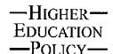

<!-- A1.R12 | source: papers_json/A1.R12/ -->

## Similar Agendas, Diverse Strategies: The Quest for a Regional Hub of Higher Education in Hong Kong and Singapore

David Chan^1^ and Pak Tee Ng^2^

1 Department of Asian & International Studies, City University of Hong Kong, 83 Tat Chee Avenue, Kowloon Tong, Kowloon, Hong Kong.

E-mail: chan.david@cityu.edu.hk.

National Institute of Education, Nanyang Technological University, Singapore.

E-mail: paktee.ng@nie.edu.sg.

تبحث هذه المقالة الأساليب التي تتبعها Hong Kong وSingapore لتطوير نفسيهما كـ'مركز إقليمي للتعليم العالي'، وتبحث أيضاً الآثار المترتبة على هذه الأساليب. تبدأ المقالة برسم صورة لكيفية تغيير تدويل التعليم العالي لبنية سوق التعليم العالي العالمي. هذه التغيرات تدفع كلاً من Hong Kong وSingapore إلى التنافس على حصة من سوق التعليم العالي. وعلى الرغم من وجود أوجه تشابه كثيرة في الرؤية والأدوات السياسية، تُقيم المقالة أن هناك فروقاً مهمة في طريقة التنفيذ. والأهم من ذلك، تعكس هذه الفروق اختلاف عقلية الحكومتين في إدارة قطاع الجامعات. Higher Education Policy (2008) 21, 487–503. doi:10.1057/hep.2008.19

Keywords: regional hub; internationalization; transnational education; Hong Kong; Singapore

## The Internationalization of Higher Education in East Asia

لفترة طويلة، كانت الأوساط الأكاديمية في East Asia صناعة محمية ومعزولة.^1^ كانت الجامعات المرموقة راضية عن مكانتها المهيمنة سواء على المستوى المحلي أو الإقليمي. سمح غياب المنافسة العالمية لمؤسسات التعليم العالي بالتمتع بأجواء نخبوية في عالم محمي (Postiglione, 2007; Yonezawa, 2007). ومع ذلك، كسرت العولمة الحدود الوطنية وطمست كثيراً من الفروق بين المجتمعات (Ohmae, 1990; Urry, 1998). أدى هذا إلى تنظيم منهجي للمعرفة العالمية، اندمجت فيه الأفكار والأشخاص والموارد بطرق مختلفة (Denman, 2000). واستجابة لهذا الاتجاه العالمي، تحتاج الآن مؤسسات كثيرة للتعليم العالي إلى بناء روابط مع المجتمع الأكاديمي الدولي، كجزء من استراتيجية تطوير نفسها كـ'جامعات عالمية المستوى'. علاوة على ذلك، تحتاج هذه المؤسسات إلى بلوغ أو تجاوز المعايير الدولية في التعليم والبحث. لهذا السبب تُعد جداول الترتيب العالمية الآن

<!-- page 2 -->

مؤشراً قوياً لإثبات مستوى الجامعات والترويج له في سوق التعليم العالمي المُسوَّق. تأخذ حكومات وجامعات كثيرة في East Asia هذه العمليات التصنيفية على محمل الجد، وتنمو تأثيرات هذه المؤشرات بسرعة في المجال الأكاديمي (Mok, 2007).

يُنظر إلى تسلق جداول الترتيب الجامعية الدولية كخطوة مهمة نحو تدويل التعليم العالي. ومع ذلك، وكما أشار Knight and de Wit (1995, 15)، فإن تدويل التعليم العالي هو 'عملية دمج بُعد دولي في وظائف التدريس والبحث والخدمة في مؤسسة التعليم العالي'، مع إدخال البُعد الدولي إلى التعليم العالي كـ'منظور أو نشاط أو برنامج يُدخل أو يدمج منظوراً دولياً/بين ثقافياً/عالمياً في الوظائف الرئيسية للجامعة أو الكلية'. ووفقاً لـ Knight (2006, 18)، يشمل تدويل التعليم العالي كلاً من الأنشطة داخل الحرم الجامعي والمبادرات العابرة للحدود، بتنوع واسع من الأنشطة، منها 'مشاريع التعاون والتنمية الدولية؛ الاتفاقيات والشبكات المؤسسية؛ البُعد الدولي/بين الثقافي في عملية التعليم والتعلم والمناهج والبحث؛ الأندية والأنشطة اللامنهجية داخل الحرم الجامعي؛ تنقل الأكاديميين عبر التبادل والعمل الميداني والإجازات التفرغية وأعمال الاستشارة؛ استقطاب الطلاب الدوليين؛ برامج تبادل الطلاب والفصول الدراسية في الخارج؛ برامج الدرجات المزدوجة/المشتركة؛ الشراكات التوأمية؛ والفروع الجامعية'. لذلك، لا ينبغي أن يقتصر التدويل على تسلق جداول الترتيب فقط. بل ينبغي أن يستهدف بناء منصة دولية لقطاع التعليم العالي.

تتناول هذه المقالة جانبين من تدويل التعليم العالي. الجانب الأول هو تزايد تنقل الطلاب على مستوى العالم. تقليدياً، ينتقل الطلاب من الدول النامية، حيث لا يستطيع قطاع التعليم العالي عادة تلبية الطلب على التعليم الجامعي في المجتمع، إلى الدول المتقدمة، مثل United States وUnited Kingdom وCanada وAustralia، حيث تكون نظم التعليم أكثر تقدماً. ويقوم عدد متزايد من الطلاب بذلك في الوقت الحالي. لا يزال كثير من الطلاب في East Asia، بمن فيهم طلاب دراستَي الحالة الحاليتين Hong Kong وSingapore، يسعون للتعليم الجامعي في الدول الناطقة بالإنجليزية المذكورة أعلاه. ومع ذلك، تحاول دول شرق آسيوية مختلفة، مثل Hong Kong وSingapore، الآن جذب طلاب دوليين للالتحاق بمؤسسات التعليم العالي لديها، وهناك عدد متزايد من هؤلاء الطلاب. لذلك، هناك زيادة في تنقل الطلاب مع تدويل التعليم العالي.

الجانب الثاني من تدويل التعليم العالي في East Asia هو التآكل المتزايد للحدود بين النظم التعليمية العالية المختلفة على مستوى العالم. وينعكس هذا في النمو السريع لـ

<!-- page 3 -->

التعليم العالي العابر للحدود، وهو 'حركة الأشخاص والمعرفة والبرامج ومقدمي الخدمة والمناهج عبر الحدود الوطنية أو الإقليمية القضائية' (Knight, 2006, 18). ورغم أن مبادرات التعليم العابر للحدود 'يمكن أن تكون عنصراً في مشاريع التعاون التنموي وبرامج التبادل الأكاديمي والمبادرات التجارية'، إلا أنها في كثير من الحالات 'ذات طبيعة تجارية وتهدف عادة إلى الربح'. يمكن فهم هذه الأنشطة كحركة على طول 'سلسلة متصلة من التعليم وجهاً لوجه (بأشكال مختلفة تتراوح من سفر الطلاب إلى الخارج إلى الفروع الجامعية بالخارج) إلى التعلم عن بُعد (باستخدام مجموعة من التقنيات، بما فيها التعلم الإلكتروني)'. التعليم العابر للحدود هو نمط ضمن هذه السلسلة (Knight, 2006, 19). ويُغذي ظهور التعليم العابر للحدود إدراج التعليم العالي كصناعة ضمن إطار General Agreement on Trade in Service (GATS) (Knight, 2002). ونتيجة لذلك، فتحت دول كثيرة في المنطقة، مثل Hong Kong وSingapore، أسواقها التعليمية بشكل فعّال أمام مقدمي التعليم الأجانب لتأسيس حرم جامعية خارجية، وتنفيذ برامج توأمية، وما إلى ذلك.

بشكل عام، تواجه قطاعات التعليم العالي في East Asia ضغطاً ومنافسة أكبر بكثير من نظيراتها في السوق العالمية. لذلك، يُتوقع من أصحاب المصلحة المختلفين في التعليم العالي، بمن فيهم الحكومات ومؤسسات التعليم العالي وهيئات الطلاب وهيئات ضمان الجودة والاعتماد وهيئات الاعتراف الأكاديمي والهيئات المهنية، الاستجابة لهذه التغيرات بشكل استباقي واستراتيجي (UNESCO, 2005).

تهدف هذه الورقة إلى دراسة كيفية محاولة مدينتين في East Asia، هما Hong Kong وSingapore، تطوير نفسيهما كـ'مركز إقليمي للتعليم العالي'، في ضوء تدويل التعليم العالي. تبحث الورقة الإصلاحات الحديثة في التعليم العالي في Hong Kong والتطورات الموازية في Singapore، وتقارن أوجه التشابه والاختلاف من حيث دوافع السياسة وأساليب التنفيذ، لتُقارن بذلك معنى 'مركز إقليمي للتعليم العالي' كما تستخدمه الحكومتان.

## Strategies for Developing Hong Kong as a Regional Higher Education Hub

## Policy background

أنهى قطاع التعليم العالي في Hong Kong أساساً مرحلة التوسع الكمي للتعليم العالي في أوائل التسعينيات، وبذلك انتقل نحو السعي لتحقيق الجودة والتميز بعد منتصف التسعينيات (Cheng, 2001). بذلت حكومة Hong Kong وسلطاتها التعليمية (مثل University Grants Committee) جهوداً كبيرة في إصلاح قطاع التعليم العالي من خلال تبني مبادئ الإدارية التي تُشدد على الكفاءة وفعالية التكلفة في أواخر التسعينيات. ومع مطلع القرن الجديد، بدأت حكومة Hong Kong

<!-- page 4 -->

في إدخال عناصر جديدة إلى إصلاحات التعليم العالي لديها، مع استمرار الإدارية في لعب دور رئيسي في توجيه قطاع التعليم العالي. في عام 2000، نشرت حكومة Hong Kong Review of Education System Reform Proposal، الذي حث الحكومة على توفير فرص تعليمية لشعبها لتطوير كفاءاتهم ومهاراتهم العالمية من أجل الحفاظ على تنافسية Hong Kong في الاقتصاد القائم على المعرفة (Education Commission, 2000). واستجابة للمقترح، قرر الرئيس التنفيذي آنذاك توسيع قطاع التعليم العالي عن طريق مضاعفة مقاعد الدرجات الفرعية بحلول عام 2010 (Tung, 2000). بالإضافة إلى ذلك، أشار في خطاب السياسة العامة لعام 2004 إلى طموحه في الترويج لـ Hong Kong كـ'المدينة العالمية لآسيا، على غرار الدور الذي تلعبه New York في North America وLondon في Europe' (Tung, 2004, cited in UGC, 2004a: 5).

قامت University Grants Committee (UGC)، وهي الذراع التنفيذي للحكومة في تخطيط سياسات التعليم العالي وتنفيذها، بربط هذه الرؤية والطموح بسياساتها الخاصة بتمايز الأدوار والتعاون العميق بين الجامعات المحلية، مؤكدة أن توجيه قطاع منح الدرجات، وضمان اتباع مؤسسات التعليم العالي المحلية للأدوار والمهام المُسندة إليها، هو مفتاح الترويج للتعليم العالي في Hong Kong (UGC, 2004a, b). والحقيقة أنه يمكن تتبع منظور UGC لهذه الرؤية إلى وقت سابق. فقد أشار تقرير المراجعة الصادر عنها عام 2002 بالفعل إلى ما يلي:

The ambition to be Asia's world city is a worthy one, but there is no doubt that realization of that vision is only possible if it is based upon the platform of a very strong education and higher education sector. There are very good reasons for that which have to do with what universities are and what makes them excellent. (UGC, 2002, 1)

تردد صدى هذا الطموح لاحقاً على لسان رئيس Education and Manpower Bureau آنذاك، الذي اقترح تطوير Hong Kong لتصبح 'المركز الإقليمي للتعليم'. وبناءً على ذلك، أنشأت حكومة Hong Kong لجنة خاصة برئاسة رئيس السكرتيرية آنذاك لوضع خطط لإشراك Hong Kong في التجارة الدولية لخدمات التعليم العالي الخاصة بالمنطقة (Li, 2006). وفي ضوء هذه الخلفية السياسية، تطورت السياسات والأطر التنظيمية الجديدة تدريجياً. تصف الأقسام التالية بإيجاز وتُعلق على السياسات التي تهدف إلى تحقيق هذه الرؤية.

## The policies

لعبت المؤسسات الممولة من UGC دوراً مهيمناً في قطاع منح الدرجات في Hong Kong. وشكّلت المؤسسات الخاصة نسبة صغيرة جداً فقط من مجمل التعليم العالي المقدم. وعلى الرغم من أن الوضع لم

<!-- page 5 -->

يتغير جوهرياً، أشارت الإصلاحات الأخيرة إلى التزام الحكومة المتزايد بإشراك المؤسسات الخاصة في تقديم التعليم العالي. أدى ترقية Shue Yan University وإعادة تسميتها إلى أن أصبحت هذه المؤسسة، التي يبلغ عمرها 35 عاماً، أول جامعة خاصة في Hong Kong. والأهم من ذلك، أن هذا مثّل كسراً لاحتكار الجامعات الممولة حكومياً أو البرامج التي تُدار بالشراكة مع جامعات أجنبية أخرى لصلاحية منح الدرجات.

بالإضافة إلى ذلك، حددت الحكومة هدف إلحاق 60% من خريجي المدارس الثانوية بالتعليم الجامعي بحلول عام 2010. وهذا يفتح جولة أخرى من التوسع الكمي للتعليم العالي. 'في تحقيق هذا الهدف، ستُسهّل الحكومة مهمة المؤسسات الجامعية والمنشآت الخاصة والمنظمات الأخرى في توفير خيارات غير التعليم التقليدي للصف السادس، مثل الدورات الدبلومية المهنية ودورات الدرجات الفرعية' (Tung, 2000, 23). واستجابة لدعوة الحكومة إلى مزيد من التوسع الكمي في التعليم العالي، اقترحت Education Commission (EC) في Review of Education System Proposal ثلاثة عناصر رئيسية لتوفير التعليم الجامعي، وهي: (أ) الجامعات، أي المؤسسات التعليمية المانحة للدرجات؛ (ب) الكليات ما بعد الثانوية، أي المؤسسات التي تقدم دورات فوق المستوى الثانوي، عادة لخريجي المدارس الثانوية؛ و(ج) مؤسسات التعليم المستمر، أي المؤسسات التعليمية التي تقدم أنواعاً مختلفة من الدورات والبرامج فوق المستوى الثانوي، عادة للأشخاص العاملين نهاراً (EC, 2000).

يشير المقترح إلى أن الخصخصة، بوصفها وسيلة فعالة لتنويع نظام التعليم العالي بما يمنح الطلاب مزيداً من الخيارات، ستكون اتجاهاً محتملاً مع النمو السريع المتوقع لبرامج الدرجة المشاركة التي تقدمها كليات المجتمع غير الممولة حكومياً (Lo and Tai, 2003). والواقع أنه في السنوات الأخيرة، تأسست كليات مجتمع عديدة لتقديم برامج الدرجات الفرعية، بما فيها الدرجات المشاركة والدبلومات العليا والدبلومات المهنية وبرامج أخرى ما بعد ثانوية بمستوى معادل، على أساس التمويل الذاتي. وتوجد حالياً 20 مؤسسة من هذا النوع تقدم برامج درجات فرعية معتمدة بدوام كامل وتمويل ذاتي، وقد انضمت جميع المؤسسات الممولة من UGC إلى هذا السوق الجديد من خلال إنشاء كليات مجتمع أو وحدات تعليم مستمر خاصة بها، ويمكن اعتبارها مؤسسات 'شبه خاصة' في حد ذاتها. ورغم أن هذه البرامج الفرعية تُدار على أساس التمويل الذاتي، تُقدم الحكومة حزمة من برامج المساعدة المالية للطلاب المؤهلين، تشمل المنح المشروطة بالدخل، والقروض منخفضة الفائدة، والقروض غير المشروطة بالدخل، وإعانات السفر (EMB, 2006). ويُظهر هذا أن حكومة Hong Kong، في عملية خصخصة التعليم العالي، تبنّت 'نهجاً مدعوماً من القطاع العام' لتحويل مشهد التعليم العالي من نمط الهيمنة الحكومية إلى نمط مختلط بين القطاعين العام والخاص.

<!-- page 6 -->

تنخرط وحدات التعليم المستمر التابعة للمؤسسات الممولة من UGC أيضاً بنشاط في تطوير دورات التعلم عن بُعد ودورات التحويل وبرامج تعليم مستمر أخرى بالتعاون مع جامعات أجنبية أخرى. وخلافاً لـ Singapore وMalaysia، حيث تتدخل الحكومة بشكل مباشر في تشكيل تطوير البرامج المشتركة، تبنّت حكومة Hong Kong نهجاً أكثر تحرراً بكثير في السماح لقوى السوق بتحديد اتجاه سوق التعليم العالي. يمكن للجامعات الأجنبية دخول سوق Hong Kong بسهولة. لكن للحفاظ على ضبط أساسي للجودة، يجب أن تكون جميع الدورات المُقامة في Hong Kong المؤدية إلى منح مؤهلات أكاديمية عليا غير محلية (بما فيها مؤهلات الدرجة الفرعية والدرجة الجامعية والدراسات العليا أو غيرها من المؤهلات ما بعد الثانوية)، أو المؤهلات المهنية، إما مسجلة بشكل سليم أو معفاة من التسجيل.

يُطلب من أي مؤسسة أجنبية الحصول على اعتماد، أو إذن رسمي آخر، من Education Bureau (EDB) قبل بدء عملها. وتتنوع هذه الفئة، من التسجيل الإلزامي إلى التقييم الرسمي للمعايير الأكاديمية. تسعى EDB عادة للحصول على المشورة المستقلة من الخبراء في Hong Kong Council for Accreditation of Academic and Vocational Qualifications (HKCAAVQ) لتحديد ما إذا كانت الدورة أو البرنامج يستوفي المعايير اللازمة إما للتسجيل أو للإعفاء منه. ومع ذلك، تُعتبر المتطلبات ذات الصلة واضحة وغير مرهقة. ويُلاحظ أن حكومة Hong Kong تميل إلى عدم تقييد وتنظيم جودة ومحتوى ومستوى وتكلفة الدورات والبرامج التي تقدمها المؤسسات التعليمية الأجنبية بشكل مباشر. وبدلاً من ذلك، تعتمد الحكومة بشكل كبير على آلية السوق للتعديلات، حيث يتمثل دور الحكومة الرئيسي في توفير معلومات كافية للمستهلكين لاتخاذ قرارهم (Yang, 2006).

استناداً إلى المبادئ السابقة، تُركز اللوائح الحكومية بشكل أساسي على العمل كحارس بوابة لضمان الجودة من أجل حماية المستهلكين. ووفقاً للمادة 10 من Non-local Higher and Professional Education (Regulation) Ordinance Cap 493، سيوافق مسجل Non-local Higher and Professional Education Courses على تسجيل الدورة إذا استوفت المعايير المذكورة أدناه:

- (a) In the case of a course leading to the award of non-local higher academic qualification by a non-local institution, the institution must be a recognized non-local institution; effective measures must be in place to ensure that the standard of the course offered is maintained at a level comparable to a course leading to the same qualification conducted in its home country; and this comparability in standard must be recognized by the institution, the academic community and the relevant accreditation authority (if any) of the home country.

<!-- page 7 -->

- (b) As for a course leading to the award of non-local professional qualification by a non-local professional body, the professional body must itself recognize the course for the purpose of awarding the qualification or for the purpose of preparing students for the sitting of the relevant professional examinations; and the professional body must also be generally recognized in its home country as an authoritative and representative professional body in the relevant profession.
- (c) Satisfactory arrangements for payment and refund of the fee charged for the course. All the fees as well as the arrangements for payment and refund of fees and charges approved by the Registrar should be stated clearly in the contract with students (quoted in EDB, 2008).

من الجدير بالذكر أن متطلب التسجيل أعلاه لا ينطبق على البرامج المُدارة بالتعاون مع مؤسسات التعليم العالي المحلية المحددة. فإذا شهدت هذه المؤسسات المحلية بأن الدورة تستوفي المعايير المطلوبة للتسجيل، من حيث مكانة المؤسسة/الهيئة المهنية وحالة ضمان الجودة والاعتراف بالدورات، تُعفى هذه الدورات/البرامج المُدارة بشكل مشترك من التسجيل. وتشمل هذه المؤسسات: City University of Hong Kong وHong Kong Baptist University وHong Kong Shue Yan University وLingnan University وthe Chinese University of Hong Kong وthe Hong Kong Polytechnic University وthe Hong Kong University of Science and Technology وthe Open University of Hong Kong وthe University of Hong Kong (EDB, 2008).

بدأ النهج التنظيمي المُتحرر نسبياً تجاه التعليم العالي العابر للحدود في جذب مؤسسات تعليمية أجنبية من United States وUnited Kingdom وAustralia للتنافس على هذا السوق الناشئ للتعليم العالي من خلال تقديم دورات في شكل برامج مشتركة وتعلم عن بُعد وبرامج توأمية. لا يُقدم التعليم العابر للحدود في Hong Kong إلا في شكل برامج خارجية أو مشتركة أو عن بُعد. وحتى الآن، لا يوجد فرع جامعي لأي جامعة أجنبية في Hong Kong. ويُحتمل أن يكون سبب ذلك أن حكومة Hong Kong Special Administrative Region (HKSAR) تعمل بطريقة مختلفة تماماً عن حكومتَي Singapore وMalaysia، اللتين دعتا الجامعات الأجنبية إلى إنشاء فروع جامعية لها في أراضيهما. ومع ذلك، وفي ضوء سوق China، أصبحت المؤسسات الأجنبية أكثر استباقية في إنشاء برامجها الأكاديمية في Hong Kong في السنوات الأخيرة لجذب الطلاب من البر الرئيسي (Yang, 2006). حتى ديسمبر 2007، بلغ عدد برامج التعليم العالي غير المحلية في Hong Kong 1,173 برنامجاً، منها 426 (36%) مسجلة، بينما كانت 747 (64%) دورات معفاة. أما بخصوص الدول المصدرة لمقدمي الدورات، فكانت معظم المؤسسات من دول متقدمة

<!-- page 8 -->

ناطقة بالإنجليزية، وكانت United Kingdom وAustralia وUnited States أكثر مُصدّري التعليم شيوعاً إلى Hong Kong (EDB, 2008).

من الجدير بالذكر أن mainland China توسع أيضاً حصتها السوقية، إذ قدمت جامعات مرموقة من mainland China برامجها في Hong Kong. ومنذ أن وقعت Hong Kong وmainland China مذكرة بشأن الاعتراف المتبادل بالدرجات الأكاديمية في التعليم العالي عام 2004، لم تعد البرامج الجامعية التي تقدمها جامعات mainland China بحاجة إلى التسجيل في Hong Kong. لذلك، يجذب الإطار السياسي الجديد عدداً متزايداً من الجامعات الصينية لإدارة دورات وبرامج في HKSAR. فعلى سبيل المثال، تقدم Tsinghua University وBeijing University، بالتعاون مع HKU SPACE وHong Kong Shue Yan University، برامج أكاديمية تتراوح من الشهادات المهنية إلى درجات الماجستير في القانون والاقتصاد والأدب والعمارة على التوالي. تُظهر أحدث الأرقام أن الحصة السوقية للدورات المعفاة من الجامعات الصينية بلغت 9% في عامَي 2005 و2006، بينما نمت حصة الدورات المسجلة من 5% في 2005 إلى 6% في 2006. وتعكس هذه الزيادة العلاقات والتفاعلات الأوثق بين Hong Kong والبر الرئيسي.

أدى التوسع السريع في برامج الدرجات الفرعية والتعليم المستمر إلى تنويع مصادر التعليم العالي في Hong Kong. ونتيجة لذلك، نشأ سوق تعليمي تدريجياً وأصبح أكثر نضجاً في قطاع التعليم العالي. أصبحت الجامعات الآن مطالبة بالتنافس فيما بينها، وبالتالي تميل إلى إصلاح تصميم مناهجها وفقاً لاحتياجات السوق. أصبحت الدراسات ذات التوجه المهني مواد شائعة في الجامعات المحلية. ولزيادة تنافسيتها، بدأت بعض الجامعات في مراجعة هياكل برامجها وتوفير مزيد من الفرص من حيث برامج تبادل الطلاب الدوليين وبرامج التدريب المهني وبرامج التخصص المزدوج وما إلى ذلك، من أجل جذب مزيد من الطلاب الموهوبين.

كل هذه التغيرات هي شكل من أشكال التسويق، الذي يمثل انتقالاً من النموذج التقليدي المتمحور حول المعلم إلى نموذج متمحور حول المتعلم (Mok, 2005). بالإضافة إلى ذلك، توفر هذه التغيرات مزيداً من الخيارات من حيث المواد الدراسية، وبالتالي تجذب مزيداً من الطلاب بمختلف احتياجاتهم وتطلعاتهم إلى Hong Kong.

## Parallel Developments in Singapore

## Policy background

على غرار رؤية Hong Kong، تسعى Singapore لأن تصبح 'Boston آسيا' أو 'قبلة للدبلومات والدرجات والتعليم العالي' (Duhamel, 2004, 40).

<!-- page 9 -->

استجابة للعولمة وظهور اقتصاد المعرفة، تحاول حكومة Singapore إصلاح نظامها التعليمي بأكمله لتعزيز تنافسيتها في السوق العالمية. تُعد الرؤية الرسمية، Thinking Schools, Learning Nation (TSLN)، التي نُفذت عام 1997، استراتيجية رئيسية لتحقيق Singapore هذا الهدف. وقد وجّهت هذه الرؤية تطور Singapore التعليمي منذ ذلك الحين (Ng, 2007). إنها رؤية لبيئة تعلم شاملة، تضم الطلاب والمعلمين والآباء والعمال والشركات ومنظمات المجتمع والحكومة. Thinking Schools رؤية لنظام مدرسي قادر على تنمية مهارات التفكير الإبداعي وشغف التعلم مدى الحياة والالتزام الوطني لدى الشباب. أما Learning Nation فهي رؤية للتعلم كثقافة وطنية، يزدهر فيها الإبداع والابتكار في كل مستوى من مستويات المجتمع (Ng, 2005a, b). بشكل عام، وفي إطار رؤية TSLN، أدخلت الحكومة مزيداً من المرونة والاستقلالية في قطاع التعليم من أجل تعظيم إمكانات الطلاب وتنمية قدرتهم على التفكير المستقل والمبتكر (Fitzpatrick, 2003). قال Teo Chee Hean، الذي كان آنذاك وزيراً للتعليم: 'نأمل أن نطور كل طالب من طلابنا بشكل أفضل ليبلغ إمكاناته الكاملة، بحيث يكون مستعداً لمواجهة تحديات الاقتصاد الجديد' (cited in Tan and Ng, 2007, 164).

في قطاع التعليم العالي، تُفسَّر رؤية TSLN وتُنفذ كخطوة لتعزيز استقلالية الجامعات الممولة حكومياً ومساءلتها. وتُمنح الجامعات مزيداً من الاستقلالية في الإدارة المالية وشؤون الموظفين لتمكينها من إيجاد ميزتها التنافسية الخاصة. وفي الوقت نفسه، من خلال مخططات إعادة الهيكلة وإدخال تدقيق ورقابة الجودة، تضمن الحكومة استمرار الجامعات في أداء دورها الحيوي في تدريب الكوادر البشرية لاقتصاد Singapore (Ng and Tan, forthcoming). وقد غيّر University Corporatization Act لعام 2005، الذي يجسّد هاتين الاستراتيجيتين التوأمتين، الجامعات الممولة حكومياً إلى 'شركات'، بينما تحتفظ الحكومة بسيطرتها على قطاع التعليم العالي من خلال إطارها السياسي الوطني للتعليم العالي (Lee and Gopinathan, 2007).

على غرار حكومة Hong Kong، تتبنى حكومة Singapore 'الاستقلالية' (التنويع) و'المساءلة' (التوجيه الحكومي) كوسيلتين لإصلاح قطاع التعليم العالي في سعيها لتحقيق مكانة 'مركز تعليمي' في المنطقة. ومع ذلك، تختلف Singapore عن Hong Kong في أنها لا تنوي توسيع قطاع التعليم العالي لديها بسرعة كبيرة من خلال آلية سوق حرة كاملة، بل تختار بدلاً من ذلك تطوراً أكثر ضبطاً في جذب مقدمي خدمات التعليم العالي الجدد، وفي تحويل الجامعات القائمة إلى شركات، وفي تمييز سلعها وخدماتها التعليمية. ويميز هذا الفرق المدينتين بشكل جوهري عن بعضهما، رغم تطابق طموحهما في أن تصبحا 'مركزاً إقليمياً للتعليم العالي'.

<!-- page 10 -->

## The policies

من أجل تطوير هذه المدينة-الدولة كـ'مركز إقليمي للتعليم العالي'، دأبت حكومة Singapore على دعوة 'World Class Universities' (WCU) من الخارج لإنشاء عمليات في الدولة منذ منتصف التسعينيات بشكل استراتيجي. تُدعى هذه الجامعات الرائدة عالمياً من قبل الحكومة لإنشاء Centres of Excellence في Singapore لقيادة البحث والتطوير (R&D)، ونقل المعرفة إلى الصناعة، وتموضع Singapore كـ'مركز تعليمي' (MTI, 2002).

اليوم، أنشأت جامعات WCU مختلفة مراكز في Singapore، منها INSEAD (Institut Européen d'Administration des Affaires) وUniversity of Pennsylvania's Wharton School وMassachusetts Institute of Technology وUniversity of Chicago Graduate School of Business وGeorgia Institute of Technology وJohns Hopkins University وTechnische Universiteit Eindhoven وTechnische Universität München. كما تُشجع الحكومة 'الشراكات بين الجامعات والمعاهد' لوضع Singapore على الخريطة العالمية. فعلى سبيل المثال، ارتبطت Lee Kuan Yew School of Public Policy التابعة لـ National University of Singapore (NUS) بشراكة مع Columbia University's School of International and Public Affairs (SIPA) وLondon School of Economics and Political Science (LSE) وInstitut d'Etudes Politiques de Paris لتقديم درجة ماجستير مزدوجة (Chia, 2007). كما أطلقت Singapore National Institute of Education (NIE) دكتوراه تعليمية مشتركة مع Institute of Education التابع لـ University of London عام 2007.

أضاف تدفق المؤسسات الأجنبية إلى مشهد التعليم العالي في Singapore تنوعاً إلى السلع والخدمات التعليمية المُقدمة، وواصلت حكومة Singapore جهودها لاستقطاب لاعبين أجانب مرموقين في التعليم العالي للمساهمة في هذا القطاع. ومع ذلك، شهدت هذه الجهود نكسة مؤخراً. كانت University of New South Wales (UNSW) قد قررت تطوير حرمها الآسيوي في Singapore باسم UNSW Asia، الذي كان يُقصد به أن يكون جامعة بحثية وتعليمية شاملة مملوكة بالكامل لمؤسستها الأم، تقدم مجموعة واسعة من البرامج من مرحلة البكالوريوس إلى الدراسات العليا. وكان هدفها استقطاب طلاب دوليين من مختلف أنحاء المنطقة، على أن يمثل السنغافوريون المحليون نحو 30% من طلابها (UNSW Singapore, 2007). بدأت UNSW Asia استقبال أول دفعة من طلابها في مارس 2007. لكن بعد شهرين فقط من بدء عملها، أعلنت فجأة إغلاقها وانسحابها الكامل من Singapore، مما شكّل صدمة كبيرة لموظفيها وطلابها. وبحسب Professor Hilmer، نائب رئيس UNSW الجديد، فإن الانسحاب المفاجئ يعود إلى تسجيلات أقل من المتوقع، مما كان سيؤدي إلى وضع مالي غير مستدام، كان من المحتمل أن يستنزف كل احتياطياتها الحرة غير المُلتزم بها البالغة A$200 million (S$255 million) (quoted in Davie, 2007).

<!-- page 11 -->

كانت هناك تكهنات أخرى في الإعلام حول أسباب وديناميكيات إغلاق UNSW Asia (انظر Ng and Tan, forthcoming، لتحليل أكثر تفصيلاً). لكن هذا يمثل بالتأكيد نكسة لحكومة Singapore في سعيها لتصبح 'مركزاً إقليمياً للتعليم العالي'. ومع ذلك، لم يُفقد كل شيء. ففي يناير 2008، أعلنت Murdoch University الأسترالية، التي كانت تُقدم مواد دراسية من خلال School of Management التابعة لـ Singapore Manufacturing Federation (SMa)، أنها ستفتتح International Study Centre ضمن SMa School of Management، وستوفر مزيداً من المواد للسوق. ووفقاً لـ Murdoch، لم يؤثر انسحاب UNSW Asia المفاجئ من Singapore على قرارها بزيادة تواجدها في Singapore، رغم أنها ستعمل بنموذج مختلف عن النموذج الذي اعتمدته UNSW Asia (Cheney, 2008).

لذلك، وعلى الرغم من بعض النكسات في هذه العملية، يواصل تطور التعليم العابر للحدود في Singapore تدويل التعليم العالي في Singapore، ويساعدها على السعي لتحقيق مكانة 'عالمية المستوى' في التعليم. ويجلب هذا أيضاً تنوعاً في مجال التعليم العالي، مما يمنح الطلاب المحليين والدوليين مزيداً من الخيارات والأسباب لمتابعة التعليم العالي في Singapore.

## Comparing the Strategies Adopted by Hong Kong and Singapore

تبنّت كل من Hong Kong وSingapore نهج التنويع من أجل تطوير نفسيهما كـ'مركز إقليمي للتعليم العالي'. ومع ذلك، هناك فروق في طريقة تنفيذ هاتين الاستراتيجيتين. ففي Hong Kong، يُعامل التعليم العابر للحدود كنوع من المُكمّل لقطاع التعليم العالي المحلي، في ظل موجة التوسع الكمي للتعليم العالي، حيث توجد سوق حرة في هذا القطاع. أساساً، يمكن لأي مؤسسة دخول سوق Hong Kong إذا رغبت في ذلك. ونادراً ما ترفض الحكومة أو تدعم أياً من مقدمي التعليم العالي الأجانب هؤلاء. وتعتمد الحكومة ببساطة على آليات السوق لتشغيل هذا القطاع. لكن مع هذا النهج الليبرالي التحرري، يمكن أن يكون كل من كمية ونوعية المؤسسات والبرامج متبايناً إلى حد كبير (Huang, 2006; Chan and Lo, 2007). وباختصار، تنظر حكومة Hong Kong إلى التعليم العالي العابر للحدود كقطاع مُكمّل فقط، والدافع للسماح بمثل هذا القطاع هو ببساطة تحقيق الربح. لذا يمكن القول إن هذا النهج ذو طابع ليبرالي جديد إلى حد كبير.

أما في Singapore، فإن السماح للجامعات الأجنبية بإقامة أعمال في الدولة هو خطوة استراتيجية لبناء 'جامعات عالمية المستوى'. لذلك، تكون مؤسسات التعليم الأجنبية القادرة على دخول السوق عادة جامعات رفيعة المستوى في العالم، وتُدعى تحديداً من قبل حكومة Singapore (Lee and Gopinathan, 2007). لذلك، فإن عدد المؤسسات

<!-- page 12 -->

الداخلة إلى سوق التعليم العالي في Singapore محدود ومضبوط. فقط المؤسسات التي تُعتبر جامعات مرموقة تُدعى لإقامة أعمالها في هذه المدينة-الدولة. وتكون الحكومة سخية في تقديم المساعدة المالية لإقامة الحرم الجامعية في Singapore، لكن في المقابل، يُتوقع من الجامعات أن ترقى إلى تطلعات الحكومة وأن تُحقق أداءً جيداً. ويُعد إغلاق Division of Biomedical Sciences التابع لـ John Hopkins University عام 2006 مثالاً يُظهر الموقف الحازم الذي تتخذه الحكومة (Lee and Gopinathan, 2007, 128). ويُظهر هذا أن إدخال التعليم العابر للحدود في Singapore هو خطوة استراتيجية لتعزيز قطاع التعليم العالي لديها لتحقيق مكانة 'عالمية المستوى'. لذلك، فإن مبادرات التنويع مضبوطة ومُقاسة بعناية.

## Discussion: What Does the 'Regional Hub of Higher Education' Mean to Hong Kong and Singapore?

تعمل الجامعات الآن في بيئة تنافسية عالية في سوق التعليم العالي الدولي، حيث يمكن أن يأتي الموظفون والطلاب وكذلك المنافسون من أي مكان في العالم. وفي East Asia، تشتد المنافسة ويرتفع الضغط. لكن اختفاء الحدود بين نظم التعليم العالي يوفر أيضاً فرصة لتغيير المشهد التعليمي العالمي من نمط 'المركز-الأطراف' إلى نمط 'متعدد المراكز' (Altbach, 2002; Chan and Lo, 2008). وهذا هو الدافع وراء السعي إلى جامعة 'عالمية المستوى' في دول واقتصادات كثيرة، مثل China وTaiwan وJapan وHong Kong وSingapore. وتريد كل مدينة الترويج لنفسها كـ'مركز إقليمي للتعليم العالي' أو صيغة مشابهة لهذا المفهوم. ومع ذلك، نُقيم أن هذه الرؤية تحمل معنى مختلفاً لكل من Hong Kong وSingapore.

في حالة Hong Kong، تدير الحكومة قطاع التعليم العالي بتقسيمه إلى جزأين. الجزء الأول هو القطاع التقليدي، المسؤول أساساً عن برامج البكالوريوس والدراسات العليا والبحث. أما الجزء الآخر فهو القطاع الناشئ، الذي يقدم أساساً برامج الدرجات الفرعية والتعليم المستمر. تعتبر حكومة Hong Kong الجزء الأول 'النواة' لتعليمها العالي وتحتفظ بدور توجيهي قوي فيه، بينما تعتبر الجزء الثاني 'قطاعاً مُكملاً' وتكون أكثر تحرراً تجاهه. ونرى أن هذا يُمثل 'نهجاً انتقائياً للتدخل' في إدارة الجامعات. تُوجّه الحكومة بشكل استباقي تطور 'الجزء الأساسي' عبر تشجيع الاندماج بين المؤسسات، بينما تترك 'الجزء المُكمّل' خاضعاً لإدارة أكثر مرونة لتشجيع التنوع في السوق. ومع هذا النهج، سيُعطي أصحاب المصلحة المختلفون في قطاع التعليم العالي معاني مختلفة لكونه 'مركزاً إقليمياً'.

<!-- page 13 -->

فيما يتعلق بالحكومة، فإن كون التعليم العالي 'مركزاً إقليمياً' يعني أساساً زيادة أعداد الطلاب الدوليين. فمؤخراً، قرر الرئيس التنفيذي لـ Hong Kong، Donald Tsang، توسيع أعداد الطلاب الدوليين عبر 'زيادة حصص القبول للطلاب غير المحليين في المؤسسات الجامعية المحلية، وتخفيف قيود التوظيف على الطلاب غير المحليين، فضلاً عن توفير المنح الدراسية' (Tsang, 2007, 40). ومع ذلك، بالنسبة لتلك الجامعات القليلة المختارة (the University of Hong Kong وthe Chinese University of Hong Kong وthe Hong Kong University of Science and Technology)، فإن كونها 'مركزاً إقليمياً' في ظل سياسة التمايز يعني أنها ستحتاج إلى مزيد من التسلق في جدول الترتيب الدولي لجذب مزيد من الطلاب الدوليين. أما بالنسبة لبعض المؤسسات التعليمية الأخرى (مثل City University of Hong Kong)، فهي بحاجة إلى تعزيز استقطابها للطلاب من mainland China.^2^ في الوقت نفسه، تشارك مؤسسات قائمة وجديدة عديدة بنشاط في سوق التعليم العابر للحدود، الذي ينمو بسرعة استجابة للدعوات الدولية والمحلية على حد سواء لتنويع التمويل وتوفير التعليم. وتعكس هذه التطورات المتنوعة 'نهج Hong Kong الانتقائي للتدخل' في سياق الظروف الاجتماعية-الاقتصادية الليبرالية الجديدة. ومع ذلك، ومع الإرادة القوية للحكومة في الحفاظ على المساءلة (البيروقراطية)، لا يعني هذا النهج بالفعل استقلالية مؤسسية كاملة، وقد يؤدي إلى توترات بين المؤسسات الفردية والحكومة. ويُعد تحقيق Hong Kong Institute of Education الأخير^3^ حالة تعكس مثل هذا التوتر.

في Singapore، كان التعليم دائماً وسيلة داعمة للاقتصاد، وبالتالي يُراقب ويُنظم عن كثب. لذا، ورغم أن 'مركز' التعليم العالي يعني ضمنياً الترابط العالمي والتنوع، فإن ما تأمل حكومة Singapore في تطويره لا يزال 'مركزاً' مُدارًا ومنظمًا، بمزيد قليل من الاستقلالية عمّا كانت عليه سابقاً. والواقع أن كثيراً من المؤسسات التعليمية في Singapore ظلت تعمل ضمن مفارقة المركزية واللامركزية المتزامنتين (Ng, 2007; Tan and Ng, 2007; Ng, 2008; Ng and Tan, forthcoming). فمن ناحية، ومنذ إطلاق رؤية TSLN، مُنحت الجامعات في Singapore مزيداً من الاستقلالية لإصلاح مؤسساتها لمنافسة الأفضل في العالم. ومن ناحية أخرى، لم تتقوض سيطرة الحكومة على القطاع. والواقع أن 'الاستقلالية' تُنشئ 'موقعاً أكثر لامركزية' للحوكمة يسمح للحكومة بالحكم عن بُعد (Jayasuriya, 2005, 24). وهذا 'نهج تنظيمي شامل'، تكون فيه الاستقلالية والابتكار والتنوع محصورة ضمن مساحات محددة ومنظمة بمعايير معينة. لذلك، فإن رؤية 'المركز الإقليمي للتعليم العالي' لا تعكس سوى طموح الدولة لتحقيق مكانة 'عالمية المستوى' على المستوى الإقليمي. والحكومة مستعدة لتسهيل أي تطور يتماشى مع نيتها، لكنها تظل دائماً حذرة على مستوى الحوكمة.

<!-- page 14 -->

## Concluding Remarks

نشرت UNESCO مؤخراً Guidelines for Quality Provision in Crossborder Education، التي أوصت الحكومات بما يلي:

- establish, or encourage the establishment of, a comprehensive, fair and transparent system of registration or licensing for cross-border higher education providers wishing to operate in their territory;
- establish, or encourage the establishment of, a comprehensive capacity for reliable quality assurance and accreditation of cross-border higher education provision, recognizing that quality assurance and accreditation of crossborder higher education provision involves both sending and receiving countries;
- consult and coordinate among the various competent bodies for quality assurance and accreditation both nationally and internationally;
- provide accurate, reliable and easily accessible information on the criteria and standards for registration, licensure, quality assurance and accreditation of cross-border higher education, their consequences on the funding of students, institutions or programmes, where applicable, and their voluntary or mandatory nature (UNESCO, 2005, 13–14).

بمقارنة ذلك بالتوصيات أعلاه، يبدو أن Singapore أنجزت أكثر من Hong Kong في التقدم نحو أن تصبح 'مركزاً إقليمياً للتعليم العالي'. فنهج Hong Kong ليبرالي جديد، خاصة فيما يتعلق بترخيص مقدمي التعليم العالي العابر للحدود للعمل في المدينة. وتعتمد Hong Kong بشكل كبير على السوق لتنظيم نفسها، رغم أن الحكومة بذلت محاولة استراتيجية لتعزيز سيطرتها على 'الجزء الأساسي' من قطاع الجامعات. وفي المقابل، يكون نهج حكومة Singapore أكثر تروياً وقياساً. فترخيص مقدمي التعليم العالي الأجانب ليس أمراً عشوائياً. فالجامعات الأجنبية المرموقة تُستهدف بعناية وتُجلب إلى هذه المدينة-الدولة.

من الدراسة المقارنة لهاتين المدينتين، يمكن استخلاص رؤيتين حول تدويل التعليم العالي في مختلف أنحاء العالم. أولاً، ورغم تشابه الرؤى، نُقيم أن الدول والمدن المختلفة ستستخدم استراتيجيات مختلفة بناءً على ظروفها الاجتماعية-الاقتصادية المختلفة. ويُعد نهج Hong Kong الليبرالي الجديد، الذي يتناقض بشدة مع نهج Singapore المُنظم والمُقاس، انعكاساً للفروق الجوهرية في الخلفيات السياسية والثقافية للمدينتين. ثانياً، نُقيم أن تدويل التعليم العالي لا يعني بالضرورة مستويات أعلى من الحرية الأكاديمية. والواقع أن العكس قد يكون صحيحاً. إذ يصبح تدويل التعليم العالي ساحة معركة اقتصادية تتآمر فيها الدول والمدن للتفوق على منافسيها. ومع صعود الإدارية (Burke, 2005) في قطاع التعليم

<!-- page 15 -->

العالي، تصبح المساءلة والاقتصاد والكفاءة والفعالية خطابات رئيسية في الأوساط الأكاديمية حول العالم. ويوفر هذا مبرراً قوياً للحكومات لاتخاذ شكل أو آخر من التدخل لتشكيل مجال التعليم العالي. وفي حالة Hong Kong وSingapore، ونظراً للثقافة الآسيوية التقليدية المتمثلة في الامتثال للسلطات، لا تُسبب معظم التدخلات الحكومية نزاعات جدية بين الحكومات ومؤسسات التعليم العالي (Petersen and Currie, 2008; Chan and Lo, 2008).

ومع ذلك، ومع تدفق مؤسسات التعليم العالي الأجنبية ذات التقاليد الأكاديمية والخلفيات الثقافية المختلفة، قد تتغير الخلفية السياسية والثقافية، وبالتالي قد تختلف الاستجابات للتدخلات الحكومية في المستقبل. وفي هذا الصدد، سيظل التطور المستقبلي لقطاعَي التعليم العالي في كل من Hong Kong وSingapore جديراً باهتمامنا.

## Notes

- 1 يستند جزء كبير من هذا القسم من الورقة إلى David Chan and William Lo (2008)، 'University restructuring in East Asia: trends, challenges and prospects'، ورقة مقبولة للنشر في Policy Future in Education (forthcoming).
- 2 كانت City University of Hong Kong أول مؤسسة في Hong Kong تستقطب طلاباً من mainland China من خلال نظام القبول المشترك.
- 3 حقق تحقيق Hong Kong Institute of Education (HKIEd) في مزاعم بأن رئيس Education and Manpower Bureau آنذاك، Professor Arthur Li، هدد Professor Paul Morris، رئيس HKIEd آنذاك، بدمج المعهد مع Chinese University of Hong Kong، وإلا فسيسمح لـ Mrs. Fanny Law، الأمينة الدائمة للتعليم والقوى العاملة آنذاك، بتقليص أعداد طلاب المعهد. كما زُعم أن Mrs. Law ضغطت على المعهد لفصل أربعة أكاديميين انتقدوا علناً سياسات التعليم الحكومية، وأن Professor Li قال لنائب رئيس HKIEd، Professor Bernard Luk: 'سأتذكر هذا؛ ستدفع الثمن' عندما رفض Professor Luk إصدار بيان يُدين المعلمين الفائضين الذين أضربوا عام 2004. وخلص تقرير لجنة التحقيق في هذه المزاعم إلى أن Mrs. Law تدخلت بشكل غير سليم في الحرية الأكاديمية، بينما وجدت اللجنة أن الاتهام الموجه ضد Professor Li غير ثابت.

## References

- Altbach, P.G. (2002) 'Centers and Peripheries in the Academic Profession: The Special Challenges of Developing Countries', in P.G. Altbach (ed.) The Decline of the Guru: The Academic Profession in Developing and Middle-income Countries, New York: Palgrave, pp. 1–21.
- Burke, J.C. (2005) 'The Many Faces of Accountability', in J.C. Burke (ed.) Achieving Accountability in Higher Education: Balancing Public, Academic, and Market Demands, San Francisco: Jossey-Bass, pp. 1–24.
- Chan, D. and Lo, W. (2007) 'Running universities as enterprises: university governance changes in Hong Kong', Asian Pacific Journal of Education 27(3): 305–322.
- Chan, D. and Lo, W. (2008) 'University restructuring in East Asia: trends, challenges and prospects', Policy Future in Education (forthcoming).

<!-- page 16 -->

- Cheney, S. (2008) 'Murdoch University to expand its presence in Singapore', Channel NewsAsia, 14 January.
- Cheng, Y.C. (2001) 'Education reforms in Hong Kong: challenges, strategies and international implications', plenary speech presented at the International Forum on Education Reform: Experiences in Selected Countries; 30 July–2 August; Bangkok, Thailand.
- Chia, S.A. (2007) 'Double master's with LKY School tie-up: local institution joins top league of schools studying global public policy issues', The Straits Times, 21 July.
- Davie, S. (2007) 'Why UNSW Asia went under', The Sunday Times, 3 June.
- Denman, B. (2000) 'Globalisation and its impact on international university cooperation', paper presented at the Organisation for Economic Cooperation and Development — Programme on Institutional Management in Higher Education Conference; September; Paris, France.
- Duhamel, D. (2004) 'Can Singapore be the Boston of Asia?', Singapore Business Review October: 40–42.
- Education and Manpower Bureau [EMB]. (2006) The Bureau's website, http://www.emb.gov.hk. Education Bureau [EDB]. (2008) The Bureau's website, http://www.edb.gov.hk.
- Education Commission [EC]. (2000) Review of Education System Reform Proposal, Hong Kong: Government Printer.
- Fitzpatrick, P. (2003) 'Reinventing Singapore: changing a country's mindset by changing its education system', International Higher Education 31: 22–23.
- Huang, F. (2006) 'Transnational Higher Education in Mainland China: A Focus on Foreign Degree-Conferring Programs', in F. Huang (ed.) Transnational Higher Education in Asia and the Pacific Region, RIHE International Publication Series, No. 10, Hiroshima: Research Institute for Higher Education, Hiroshima University, pp. 21–34.
- Jayasuriya, K. (2005) 'Capacity Beyond the Boundary: New Regulatory State, Fragmentation and Relational Capacity', in M. Painter and J. Pierre (eds.) Challenges to State Policy Capacity: Global Trends and Comparative Perspectives, Houndmills, Basingstoke, Hampshire: Palgrave Macmillan, pp. 19–37.
- Knight, J. (2002) 'Trade talk: an analysis of the impact of trade liberalization and the general agreement on trade in services on higher education', Journal of Studies in International Education 6(3): 209–229.
- Knight, J. (2006) Higher Education Crossing Borders: A Guide to the Implications of the General Agreement on Trade in Services (GATS) for Cross-border Education, Paris: UNESCO.
- Knight, J. and de Wit, H. (1995) 'Strategies for Internationalisation of Higher Education: Historical and Conceptual Perspectives', in H. de Wit (ed.) Strategies for Internationalisation of Higher Education, Amsterdam: European Association fro International Education Publications, pp. 5–32.
- Lee, M.H.H. and Gopinathan, S. (2007) 'University restructuring in Singapore: Amazing! Or a maze?', Journal of Comparative Asian Development 6(1): 107–141.
- Li, A.K.C. (2006) 'Developing Hong Kong into a regional education hub', Wen Wei Pao, 14 September.
- Lo, H.C. and Tai, H.H. (2003) 'Centralization and Decentralization in Higher Education: A Comparative Study of Hong Kong and Taiwan', in K.H. Mok (ed.) Centralization and Decentralization: Educational Reforms and Changing Governance in Chinese Studies, Hong Kong: Comparative Education Research Centre, University of Hong Kong, pp. 137–156.
- Ministry of Trade and Industry [MTI]. (2002) Developing Singapore's Education Industry, Singapore: Ministry of Trade and Industry.
- Mok, K.H. (2005) 'Fostering entrepreneurship: changing role of government and higher education governance in Hong Kong', Research Policy 34: 537–554.
- Mok, K.H. (2007) 'Questing for internationalization of universities in Asia: critical reflections', Journal of Studies in International Education 11(3–4): 433–454.

<!-- page 17 -->

- Ng, P.T. (2005a) 'Students' perception of change in the Singapore education system', Educational Research for Policy and Practice 3(1): 77–92.
- Ng, P.T. (2005b) 'Innovation and enterprise in Singapore schools', Educational Research for Policy and Practice 3(3): 183–198.
- Ng, P.T. (2007) 'Quality assurance in the Singapore education system in an era of diversity and innovation', Educational Research for Policy and Practice 6(3): 235–247.
- Ng, P.T. (2008) 'Quality assurance in the Singapore education system: phases and paradoxes', Quality Assurance in Education 16(2): 112–125.
- Ng, P.T. and Tan, C. (in press) 'Meeting global competition: the case of tertiary education in Singapore', ACCESS: Critical Perspectives on Communication, Cultural & Policy Studies (forthcoming).
- Ohmae, K. (1990) The Borderless World, New York: Harper Collins.
- Petersen, C.J. and Currie, J. (2008, forthcoming) 'Higher education restructuring and academic freedom in Hong Kong', Policy Future in Education.
- Postiglione, G. (2007) 'Expect some surprises in second survey of Hong Kong academics', South China Morning Post, 12 May.
- Tan, C. and Ng, P.T. (2007) 'Dynamics of change: decentralized centralism of education in Singapore', Journal of Education Change 8: 155–168.
- Tsang, D. (2007) The 2007–2008 Policy Address: The New Direction for Hong Kong, Hong Kong: Government Printer.
- Tung, C.W. (2000) The 2000 Policy Address: Quality Education, Policy Objective for Education and Manpower Bureau, Hong Kong: Government Printer.
- Tung, C.W. (2004) The 2004 Policy Address: Seizing Opportunities for Development Promoting People-based Governance, Hong Kong: Government Printer.
- UNESCO. (2005) Guidelines for Quality Provision in Cross-border Higher Education, Paris: UNESCO.
- University Grants Committee [UGC]. (2002) Higher Education in Hong Kong: Report of the University Grant Committee, Hong Kong: UGC.
- University Grants Committee [UGC]. (2004a) Hong Kong Higher Education: To Make A Difference, To Move with the Times, Hong Kong: UGC.
- University Grants Committee [UGC]. (2004b) Hong Kong Higher Education Integration Matters: A Report of the Institutional Integration Working Party of the University Grants Committee, Hong Kong: University Grants Committee.
- UNSW Singapore. (2007) 'UNSW Asia school foundation year program to continue into 2008', http://www.singapore.unsw.edu.au/unsw_asia.asp.
- Urry, J. (1998) 'Contemporary Transformation of Time and Space', in P. Scott (ed.) The Globalisation of Higher Education, Buckingham: Open University Press and Society for Research into Higher Education.
- Yang, R. (2006) 'Transnational Higher Education in Hong Kong: An Analysis', in F. Huang (ed.) Transnational Higher Education in Asia and the Pacific Region, RIHE International Publication Series, No. 10, Hiroshima: Research Institute for Higher Education, Hiroshima University, pp. 35–58.
- Yonezawa, A. (2007) 'Japanese flagship universities at a crossroads', Higher Education 54(4): 483–499.
