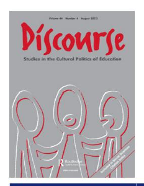

<!-- A1.R14 | source: papers_json/A1.R14/ -->

## **Discourse: Studies in the Cultural Politics of Education**

**ISSN: (Print) (Online) Journal homepage:****[ www.tandfonline.com/journals/cdis20](https://www.tandfonline.com/journals/cdis20?src=pdf)**

## **Globalization and privatization of education** **in Honduras—Or the need to reconsider the** **dynamics and legacy of state formation**

**D. Brent Edwards Jr, M. Moschetti & A. Caravaca**

**To cite this article:** D. Brent Edwards Jr, M. Moschetti & A. Caravaca (2023) Globalization and privatization of education in Honduras—Or the need to reconsider the dynamics and legacy of state formation, Discourse: Studies in the Cultural Politics of Education, 44:4, 635-649, DOI: [10.1080/01596306.2020.1852181](https://www.tandfonline.com/action/showCitFormats?doi=10.1080/01596306.2020.1852181)

**To link to this article: **[https://doi.org/10.1080/01596306.2020.1852181](https://doi.org/10.1080/01596306.2020.1852181)

Published online:28 Nov 2020.Submit your article to this journalArticle views:462View related articlesView Crossmark dataCiting articles:1 View citing articles

<!-- page 2 -->

## Globalization and privatization of education in Honduras—Or the need to reconsider the dynamics and legacy of state formation

D. Brent Edwards Jr ^a^ , M. Moschetti ^b^ and A. Caravaca ^c^

a Department of Educational Foundations, University of Hawaii, Honolulu, USA; ^b^ Department of Pedagogy, University of Girona, Girona, Spain; ^c^ Department of Educational Theory and Social Pedagogy, Autonomous University of Barcelona, Bellaterra, Spain

## ABSTRACT

بينما أُنتِج قدر كبير من الأدبيات حول العولمة والخصخصة والدولة كلٍّ على حدة، لم يكن من المعتاد تناولها معًا، على الأقل في مجال التربية المقارنة والدولية. توجد أعمال ممتازة وثّقت الطرق التي أثّرت بها العولمة والخصخصة في إصلاح التعليم، لكن الأدبيات القائمة عادة لم تتفاعل مع نظريات الدولة. في هذه الورقة، ومن خلال حالة Honduras، نستكشف القضايا المذكورة أعلاه. أولًا، نعتمد على منهج Critical International Political Economy (CIPE) لفهم الطرق التي أثّرت بها العولمة والخصخصة (السياسية-الاقتصادية) وتجلّت في كل من صنع السياسات وتقديم التعليم. أما النصف الثاني من الورقة فيعيد توجيه النظر نحو دولة Honduras ويعتمد على أدبيات نظرية الدولة للنظر في سبب قدرة العولمة والخصخصة على أن تكونا مؤثرتين إلى هذا الحد في المقام الأول.

## KEYWORDS

Education privatization; globalization; theories of the State; Honduras

## Introduction

باستثناءات قليلة، يناقش البحث في مجال التربية المقارنة والدولية بانتظام دور الجهات الحكومية أو "الدولة" دون التساؤل عمّا تكون عليه الدولة بالضبط.[1](#page-12-0) وبدلًا من استكشاف نظرية الدولة، شهدت العقود الأخيرة انشغالًا بتعريف العولمة، وبتصوّر حقل السياسة التعليمية العالمية، وضمن هذين الأمرين، برسم تفاعل وتأثير أنواع مختلفة من الفاعلين (انظر مثلًا مساهمات Mundy, Green, Lingard, & Verger, [2016](#page-15-0)). وهذا أمر مفهوم جزئيًا، نظرًا للنشاط المتزايد لمشاركة المنظمات الدولية في قطاع التعليم في فترة ما بعد الحرب العالمية الثانية، وإلى أي مدى "أُعيد تحجيم" عمل الجهات الحكومية (Lingard & Rawolle, [2011](#page-14-0)) و"تعوملت عبر الحدود الوطنية" (Moutsios, [2009](#page-14-1)).[2](#page-12-1) تشير هذه المصطلحات، في المقام الأول، إلى "إعادة توطين السلطة السياسية" من المستوى الوطني إلى المستوى الدولي (Lingard & Rawolle, [2011](#page-14-0), p. 498)، وفي المقام الثاني، إلى الطريقة التي "تتدفق بها القوة من المجال العالمي إلى ساحات القوة داخل الدول القومية" (Moutsios, [2009](#page-14-1), p. 471).

<!-- page 3 -->

إن إعادة تحجيم السياسة التعليمية وتعوملها عبر الحدود ظاهرتان تكثّفتا مع تقدّم العولمة الاقتصادية والسياسية. ومع ذلك، تسعى هذه المقالة إلى تشجيع الباحثين على "إعادة الدولة إلى الحسبان" مرة أخرى في تحليلات التغيّر السياسي، تمامًا كما فعل الكتاب المرجعي بالاسم نفسه في ثمانينيات القرن الماضي (Rueschemeyer, Evans, & Skocpol, [1985](#page-15-1)). وبينما كان ذلك الكتاب جزءًا من موجة من الأدبيات في مجال السياسة المقارنة سعت لتفسير فشل الدولة في أعقاب إنهاء الاستعمار والاستقلال، تسعى هذه المقالة إلى المساهمة في تحليلات أحدث لم تكتفِ بجعل السياسة التعليمية والسياسة تتحاوران مع نظرية الدولة (مثل Tarlau, [2017](#page-15-2)) بل وضعت أيضًا هذه الديناميكيات في حوار مع قوى العولمة والخصخصة (Edwards & Means, [2019](#page-14-2)). ونحن نرى أن القيام بذلك سيساعد في إنتاج رؤى تتجاوز وصف كيفية عمل، على سبيل المثال، العولمة والخصخصة في التغيّر السياسي على المستويين الوطني والمحلي، لتسهم أيضًا في تفسير السبب الدقيق وراء قدرة هذه القوى على أن تكون مؤثرة إلى هذا الحد - خاصة في سياقات البلدان منخفضة الدخل وما بعد الاستعمارية.

لسببين مترابطين تُعد Honduras حالة مثالية لمعالجة تقاطع العولمة والخصخصة ونظرية الدولة. السبب الأول هو أن العولمة والخصخصة كانتا مؤثرتين للغاية في الأزمنة الحديثة وتاريخيًا فيما يتعلق بكيفية عمل قطاع التعليم. أما السبب الثاني، كما أشارت هذه المقدمة، فهو أننا لا نستطيع فهم سبب ذلك حقًا دون الغوص في ديناميكيات وإرث تشكّل الدولة، حيث تُفهَم الدولة على أنها مجموع الأجهزة الإدارية والموظفين المتخصصين المسؤولين، على الأقل اسميًا، عن تحقيق الأهداف المعلنة رسميًا للحكومة (Jessop, [2016](#page-14-3)).

نتّبع منهجًا خاصًا لفكّ تشابك الترابط بين العولمة والخصخصة والدولة في Honduras، ويتوافق هذا المنهج مع البحث السابق الذي تبني عليه هذه الورقة (Edwards, Moschetti, & Caravaca, [2019](#page-14-4), [forthcoming](#page-14-5)). في عام 2019، أجرى مؤلفو هذه الورقة بحثًا في Honduras للإجابة عن السؤال التالي: بأي طرق، ولأي أسباب، وبأي آثار أثّرت الجهات الفاعلة الخاصة المحلية والدولية واتجاهات الخصخصة في السياسة التعليمية وقطاع التعليم في Honduras؟ وقد تطلّبت الإجابة عن هذا السؤال أن نستوعب أولًا سياق قطاع التعليم في Honduras، وثانيًا أن نحدد ونصف العمليات والممارسات التي مارست من خلالها مجموعة من الجهات الفاعلة الخاصة (أي غير الحكومية) تأثيرها ووسّعته في السنوات الأخيرة (مع التركيز على فترة ما بعد الانقلاب منذ 2009). ووفقًا لهذا التركيز، صُمِّمت هذه الورقة لعرض الرؤى الأساسية المتعلقة بهاتين المهمتين. غير أنه، انطلاقًا من الغرض الأوسع المحدد أعلاه، تسعى هذه الورقة إلى توسيع بحثنا السابق، أولًا، من خلال وضع ديناميكيات القطاع المعاصرة في منظور تاريخي، وثانيًا، من خلال النظر إلى كل من الأسس التاريخية والوظيفة المعاصرة لقطاع التعليم في علاقتها بأدبيات نظرية الدولة.

وكما سيتضح، لا يمكن في سياق العولمة فهم خصخصة صنع السياسات أو خصخصة تقديم التعليم دون فهم القوى التي شكّلت أساس الدولة الحديثة أولًا، والممارسات المرتبطة بها - أو "التحيّزات" بحسب مصطلح Jessop ([2016](#page-14-3)) - التي ترسّخت والتي تشكّل سلوك جهاز الدولة فيما يتعلق بمسؤولياته (مثل تقديم التعليم). وبدورها، سيُطرَح أنه لا يمكن، في السياقات منخفضة الدخل وما بعد الاستعمارية، فهم نزعات الخصخصة

<!-- page 4 -->

داخل الدولة دون وضع الدولة أيضًا في سياق العلاقات الرأسمالية التاريخية وعبر الوطنية التي وُلِدت من خلالها هذه البلدان.

شملت مصادر البيانات مقابلات مع 42 فاعلًا رئيسيًا من النظام التعليمي، ومراجعة لوثائق السياسات والأدبيات القائمة، وزيارات مدرسية (حضرية وريفية) للحصول على منظور "عمودي" حول كيفية تأثير الخصخصة على المستويين الوطني والمحلي (انظر Edwards et al., [2019](#page-14-4) لمزيد من التفاصيل حول المنهجية). ثم حُلِّلت المعلومات المستمدة من هذه المصادر في إطار منهج متجذر في الاقتصاد السياسي. وكما سيُناقَش أدناه، اختير هذا المنهج لأنه يتوافق مع محور الدراسة الأساسية (الموصوفة أعلاه). في نهاية المطاف، تُبرز هذه الورقة قيمة هذا المنهج مع الإشارة أيضًا إلى أهمية استكماله بأطر تعالج نقطته العمياء - أي نظرية الدولة.

## Situating and studying the privatization of education in the context of globalization

يعرض هذا القسم بعض التصورات النظرية المتعلقة بخصخصة التعليم، ويشير إلى أحدث - وأقل وضوحًا - مظاهر هذه الظاهرة. ثانيًا، يستعرض التوجه النظري للدراسة. وكما ذُكِر أعلاه، لا يتفاعل هذا القسم بشكل موسّع مع نظرية الدولة. بل نستخدم منظورًا خاصًا للاقتصاد السياسي لتنظيم الأقسام التجريبية التالية وتوجيهها. وبعد عرضها، نعود لنتأمل في النتائج في إطار مناقشة نظرية الدولة.

## The privatization of education: scope and policies

رغم أن عمليات الخصخصة ليست حكرًا على مجال التعليم - إذ تُنفَّذ أيضًا في خدمات عامة متنوعة مثل النقل والطاقة والاتصالات - فإنه يمكن ملاحظة خصائص فريدة معينة. وخلافًا لحالات الخدمات المذكورة أعلاه، ليس من المعتاد أن تُنفَّذ خصخصة التعليم عبر نقل ملكية المرافق التعليمية العامة إلى جهات خاصة (Bellei & Orellana, [2014](#page-13-0)). بل تُنفَّذ خصخصة التعليم في أغلب الأحيان على مستوى التقديم - أي من خلال زيادة حضور الجهات الفاعلة الخاصة، سواء كانت مرتبطة بالدولة بشكل ما أم لا - وفي علاقتها بنظام تمويلها - أي من خلال زيادة المساهمة الاقتصادية النسبية للجهات الخاصة، وبخاصة الأسر (Verger, Fontdevila, & Zancajo, [2016](#page-15-3)). ويمكن القول إن خصخصة التعليم تنتج، إذن، عن نقل الأنشطة والمسؤوليات - التقديم والتمويل والتنظيم - التي كانت تقليديًا من اختصاص الجهات العامة إلى جهات فاعلة خاصة (Belfield & Levin, [2002](#page-13-1); Lubienski, [2006](#page-14-6)).

علاوة على ذلك، قد تحدث خصخصة التعليم، في سياقات معينة، بشكل عفوي في غياب سياسات فعّالة تشجّع بشكل مباشر مشاركة القطاع الخاص. وهذه الحالات، التي تُعرف بـ"الخصخصة الافتراضية"، شائعة إما في سياقات تواجه فيها الدولة قيودًا هيكلية - غالبًا مالية - في تلبية الطلب التعليمي المتزايد (Day Ashley et al., [2014](#page-14-7))، أو حيث يواجه التعليم العام صعوبة في استيعاب المتطلبات والتفضيلات الجديدة لطبقة وسطى متنامية (Plank, [2006](#page-15-4)). ومع ذلك، في معظم الحالات، تكون خصخصة التعليم نتيجة سياسات فعّالة تحفّز مشاركة

<!-- page 5 -->

القطاع الخاص. وتضع هذه السياسات عادة قواعد جديدة تسهّل مشاركة الجهات الخاصة ضمن تعدد من المخططات والترتيبات.

في محاولة لتصنيف مختلف أشكال سياسات الخصخصة ومشاركة القطاع الخاص في التعليم، طوّر Ball and Youdell ([2008](#page-13-2)) تصنيفًا ثنائيًا معروفًا يقترح نمطين رئيسيين من الخصخصة: (1) خصخصة التعليم - أو الخصخصة "الخارجية" - حيث تفتح الحكومات الخدمات التعليمية العامة أمام مشاركة القطاع الخاص لتصميم أو إدارة أو تقديم جوانب من التعليم العام؛ و(2) الخصخصة في التعليم - أو الخصخصة "الداخلية" - التي تنطوي على استيراد أفكار وتقنيات وممارسات من القطاع الخاص لجعل القطاع العام "أشبه بالشركات وأقرب إلى أسلوب العمل التجاري" (pp. 8–9).

والجدير بالذكر أنه، كما يؤكد Ball and Youdell أيضًا، "ليس التعليم وخدماته وحدهما اللذين يخضعان لأشكال من الخصخصة: فسياسة التعليم نفسها - عبر الاستشارة والتشاور والبحث والتقييم وأشكال التأثير - تخضع للخصخصة" ([2008](#page-13-2), p. 12). ويرتبط هذا بحقيقة أنه، بينما كان يُنظر تقليديًا إلى القطاع الخاص كمقدّم خدمة (أو مستفيد من سياسات خصخصة تقودها الدولة)، أشار البعض مؤخرًا إلى أن هذا التوصيف أصبح متجاوَزًا بشكل متزايد. وإلى جانب الدور الذي تلعبه بعض المنظمات الدولية، مثل World Bank، منذ الثمانينيات (Edwards, [2012](#page-14-8))، بدأت جهات فاعلة جديدة غير حكومية تكتسب أهمية من حيث الترويج والنشر وصياغة سياسات خصخصة التعليم، وبذلك تتحدى الدور المركزي التقليدي للدول كصانعة للسياسات (Fontdevila, Verger, & Avelar, [2019](#page-14-9); Saltman, [2009](#page-15-5); Scott, [2009](#page-15-6); Verger, [2016](#page-15-7)). وفي هذا الصدد - وتجاوزًا لمفهومَي خصخصة التعليم والخصخصة فيه - يقترح Ball ([2009](#page-13-3), [2012](#page-13-4)) نمطًا ثالثًا من الخصخصة عبر السياسة التعليمية لتفسير التداخل المتزايد لأنواع مختلفة من الجهات الخاصة (الشركات والمنظمات غير الحكومية والمنظمات الخيرية) في صياغة السياسة التعليمية وتنفيذها.

## A critical international political economy approach[3](#page-12-2)

رغم وجود العديد من خطوط البحث التي تندرج تحت مظلة منهج الاقتصاد السياسي، فإن التوجه النظري المستخدم هنا يستند إلى أعمال حول ما يُسمى "الاقتصاد السياسي الدولي النقدي" (CIPE). ونظرًا لقيود المساحة، تُبرَز أدناه بعض الأبعاد الرئيسية لهذا المنهج. ونركّز على وجه الخصوص على الأبعاد التي يوضّح تفاعلها بأكبر قدر من الوضوح الديناميكيات التي تُحلَّل في هذه المخطوطة فيما يتعلق بالتعليم في Honduras.

من منظور CIPE، يُعتبر أن الحقل التعليمي متغلغل ومتأثر بجوانب سياسية واقتصادية مختلفة، على المستويين الوطني والدولي. وخلافًا لمنظور الواقعية السياسية في العلاقات الدولية، يشدد CIPE على وجوب أيضًا مراعاة الحيز السياسي الذي تشغله الجهات الفاعلة غير الحكومية (Hay & Marsh, [1999](#page-14-10)). وبناءً على أغراضنا في هذه الدراسة، يعني هذا مراعاة كامل نطاق المنظمات خارج الدولة التي تشارك في عمليات تحديد واعتماد السياسات التعليمية، مثل المنظمات غير الحكومية والجمعيات الخيرية ومراكز الفكر والمنظمات الثنائية والمتعددة الأطراف والمنظمات الإقليمية، من بين أخرى. وهذا مهم لأنه، رغم أن العديد من الجهات ذات المدى الدولي تشارك بالفعل في عمليات تحديد وتشكيل السياسات التعليمية، فإن جهات فاعلة محلية مختلفة تلعب أيضًا دورًا مهمًا في إعادة صياغة هذه السياسات العالمية

<!-- page 6 -->

في سياقاتها المحلية (Verger, [2019](#page-15-8)). وهذا يفسّر لماذا لا يتم نقل هذه السياسات "العالمية" إلى مختلف الأقاليم بشكل موحد (Appadurai, [1996](#page-13-5); Robertson & Dale, [2015](#page-15-9)).

ثانيًا، تتيح لنا العدسة التحليلية لـCIPE تجنّب منهج يقتصر حصريًا على العمليات السياسية الرسمية، والفحص، إضافة إلى ذلك، للطرق التي تؤثر بها مختلف أنواع المنظمات المذكورة أعلاه في التعليم داخل المجال السياسي الرسمي وخارجه (Hay & Marsh, [1999](#page-14-10)). ومن نقاط الاهتمام في هذا الصدد البحوث المنتجة حول التعليم، والأنشطة الهادفة إلى التأثير في أجندة الإصلاح التعليمي، وتنفيذ البرامج التعليمية، والقروض المخصصة للإصلاح التعليمي، من بين أخرى (Dale, [2000](#page-14-11); Samoff, [2009](#page-15-10)).

يتعلق العنصر الثالث الذي يجب إبرازه بالخطاب والعوامل الفكرية. وبلفت الانتباه إلى هذا البعد، يسلّط CIPE الضوء على مخاوف معينة متعلقة بتوزيع القوة والموارد، وبذلك يستكشف كيف تُستخدَم القوة والموارد لتعزيز منظورات معينة على حساب أخرى فيما يتعلق بتأثير الخطاب والإصلاحات المهيمنة على النقاشات التعليمية (Verger et al., [2016](#page-15-3)). وبتعبير Novelli, Higgins, Ugur, and Valiente ([2014](#page-15-11))، ينطوي هذا البعد الثالث على تفكيك "المفاهيم والحكمة المتوارثة عبر لفت الانتباه إلى العلاقات المحتملة بين الحجج والإيديولوجيا ومصالح الفئات/الطبقات" (p. 27). والنقطة الأساسية هنا هي الانتباه إلى الطرق التي تستطيع بها الجهات الفاعلة استخدام مواردها المادية للتأثير في إنتاج ونشر الخطاب الذي تُرى من خلاله إصلاحات معينة على أنها مرغوبة.

أما البعد الرابع والأخير الذي يجب التأكيد عليه بخصوص CIPE فيربط الأبعاد الأخرى، إذ يبرز الحاجة إلى مراقبة دقيقة للطرق التي تنخرط بها الجهات الفاعلة غير الحكومية في التعليم على مستويات متعددة، من المحلي إلى العالمي. وكما يشير Hay ([2002](#page-14-12))، يعني هذا الانتباه إلى "العلاقات بين الفاعلين وسياقاتهم البنيوية على نطاقات مكانية متنوعة" (p. 385). بعبارة أخرى، فإن حقل السياسة التعليمية العالمية - مثل جميع السياقات الاجتماعية والسياسية والاقتصادية - "شديد التركيب وواضح المعالم"، وبالتالي ييسّر بشكل متفاوت "قدرة الجهات الفاعلة الغنية بالموارد والمعرفة على تعزيز مصالحها الاستراتيجية" (p. 381). والمهمة المطروحة هي إذن تحديد وتفكيك معالم هذا الحقل على مستويات متعددة، والعمليات التي تمارس من خلالها الجهات المعنية تأثيرها.

باختصار، يوجّه منهج CIPE انتباهنا، أولًا، إلى السياق الذي تنخرط فيه الجهات الفاعلة الوطنية والدولية، وثانيًا، إلى طبيعة وعمليات تفاعل هذه الجهات. وكما سيتضح في الأقسام التالية، هناك تآزر تحليلي بين الأبعاد الأربعة المناقشة أعلاه.

## The political economy of contemporary education reform in Honduras

في العقد الماضي، ومنذ الإطاحة بالرئيس Manuel Zelaya، ظلت المنظمات الدولية منخرطة بعمق - وذات تأثير كبير - في صنع السياسة التعليمية في Honduras. غير أنه، إلى جانب المنظمات الدولية، أصبحت جهات فاعلة خاصة أخرى مؤثرة بشكل متزايد أيضًا. وعلى وجه الخصوص، أصبح المحسنون والشركات المحليون والدوليون متشابكين بشكل متزايد مع عملية تشكيل السياسات. في هذا القسم، وقبل تحليل ديناميكيات مشاركة القطاع الخاص في صنع السياسات، نتناول أولًا مناقشة ضعف دولة Honduras، والطرق التي أدارت بها الحكومة مواردها بشكل سيء، والاستراتيجيات الفاترة التي نُفِّذت لتحسين الحوكمة. توضّح هذه المناقشة الأولية لماذا رأت الجهات الفاعلة المحلية والدولية

<!-- page 7 -->

والكيانات الخاصة أنه من الضروري التوغل في مجال الحكومة - لأن الحكومة لا تفي بمسؤولياتها فيما يتعلق بوضع السياسات وتقديم تعليم جيد متاح لجميع الأطفال.

## State failure: underfunding, system misgovernment, and 'inertial privatization'

من أكثر النتائج وضوحًا التي تعكسها مراجعة الأدبيات وأكدتها المقابلات هو ضعف - أو "فشل" - دولة Honduras. واستنادًا إلى Jessop ([2016](#page-14-3))، يشير فشل الدولة هنا إلى نقص القدرة أو الإمكانية أو الرغبة لدى الدولة في تحقيق "الأهداف الجماعية المحددة في مشاريع الدولة بشأن طبيعة وأغراض الحكم" (p. 40) - بما في ذلك، في حالتنا، فيما يتعلق بتقديم تعليم جيد.

يمكن استنتاج فشل دولة Honduras بطرق متعددة، من بينها نقص التمويل المنهجي للتعليم العام وسوء حوكمة النظام بشكل عام، وهما مؤشران رئيسيان. وأكد العمل الميداني في المدارس أن نقص التمويل لا يؤثر فقط في توافر المهنيين التعليميين المؤهلين، بل أيضًا في الموارد المادية (الكتب المدرسية والنسخ الضوئية، إلخ) والبنية التحتية. ويتفق ممثلو القطاع غير الحكومي، وكذلك المسؤولون الحكوميون السابقون والحاليون، على عدم كفاية أمور أساسية مثل المباني المدرسية، ناهيك عن مدخلات أخرى. وكما وصف أحد المستجوَبين: "لدى Honduras مشكلة كبيرة: قضية البنية التحتية المدرسية، وهي مشكلة خطيرة، ونحتاج إلى مليار دولار لإعادة بنائها، ولدى الدولة 60 مليون دولار متاحة هذا العام لهذا الغرض" (NGO representative 3).

يحدث هذا أساسًا لأن الدولة لا تستثمر موارد كافية في التعليم (لأسباب ستُناقَش لاحقًا). وفي هذا الصدد، يؤكد مسؤولون في National Board of Education[4](#page-12-3) أن Honduras تعتمد بشكل كبير وهيكلي، فيما يتعلق بالتعليم، على أموال التعاون الدولي والقروض من المنظمات الدولية والتبرعات من المنظمات الخيرية الوطنية والدولية. وبما أنها غير قادرة على تغيير معادلة الإنفاق الحكومي، تعمل وزارة التعليم الهندوراسية في بحث دائم عن التمويل في شكل تبرعات أو قروض من هذه الجهات:

نعتقد أن الخطة [Education Sector Strategic Plan، التي نناقشها أدناه] أساسية لـ[…] رسم [احتياجات قطاع التعليم] بحيث نستطيع أن نقول لهم [المانحين، المنظمات الدولية، إلخ]، "هذا الجزء سنغطيه بأنفسنا، وهذا الجزء يغطيه التعاون، وهذا الجزء يغطيه … من سيغطي هذا الجزء؟ كيف ستساعدوننا؟" (National Board of Education official 1)

إلى جانب مشكلة نقص التمويل، أشار العديد من الجهات الفاعلة إلى ما يصفونه بـ"سوء حوكمة" عام للنظام التعليمي الهندوراسي. وفي هذا الصدد، تجدر الإشارة إلى المستوى المرتفع لتبدّل وزراء التعليم في السنوات الأخيرة. وتحديدًا، بعد مغادرة Marlon Escoto منصبه (فبراير 2012–يناير 2017)، عُيِّن ثلاثة وزراء - أي Rutilia Calderón (فبراير 2017–يناير 2018)، وMarcial Solís (يناير-ديسمبر 2018)، وArnaldo Bueso (ديسمبر 2018–حتى الآن). وقد أسهمت هذه الفترات القصيرة، إلى جانب النقص المتكرر في خبرة الوزراء المعيَّنين في مجال التعليم، في توليد شعور بعدم الاستقرار وعدم اتساق القيادة للنظام لدى مختلف الجهات الفاعلة. وكما وصف أحد المستجوَبين: "يأتي كل وزير بفكرة مختلفة وينفّذها، لذا لا توجد خطط محددة، ولا توجد خطط طويلة الأمد" (Business chamber representative 2).

<!-- page 8 -->

علاوة على ذلك، أنشأت الحكومة خلال العقد الماضي سلسلة من الهياكل التنفيذية المتعايشة المختلفة ذات المسؤوليات المتشابهة أو غير المحددة بوضوح. وهذه هي حالة ما يُعرف بـCommission for the Transformation of the Educational System،[5](#page-13-6) وهي هيكل آخر ذو وظائف متداخلة مع وزارة التعليم وNational Board of Education. وطبيعة أعضاء هذه اللجنة نفسها - التي تضم وزراء تعليم سابقين، وممثلين عن القطاع الخاص، وعن النظام الديني الإنجيلي، من بين آخرين - تولّد تضاربًا في المصالح وتناقضات في التسلسل الهرمي، مما يخلق سيناريو يصعب فيه على الجهات الفاعلة في النظام فهم دور كل هيكل، وخاصة دور وزارة التعليم. ويعبّر ممثل إحدى المنظمات غير الحكومية عن هذا بسؤاله: "من يحكم التعليم؟ من المسؤول؟ حسنًا، سأخبرك بشيء واحد: ليس الوزير" (NGO representative 3).

وبالإضافة إلى المشكلات على المستوى الحكومي الكلي، يواجه النظام التعليمي الهندوراسي تحديات شديدة على المستوى الإداري المحلي، أساسًا نتيجة إصلاح لامركزية معيب بدأه البلد في تسعينيات القرن الماضي. وتحديدًا في سياق إصلاح يهدف إلى "تحديث" النظام التعليمي - وهو إصلاح روّجت له في ذلك الوقت منظمات دولية مختلفة إلى حد كبير - فوّضت وزارة التعليم الوطنية وظائف الإدارة من الحكومة المركزية إلى "الوحدات الإدارية والمحافظاتية". وكما حدث في بلدان أخرى في المنطقة، جاءت هذه اللامركزية دون نقل مناسب للتمويل والقدرات. وتكشف البيانات أنه، بموارد قليلة جدًا (مالية وتقنية-تربوية)، تعجز هذه الهياكل الإدارية اللامركزية "الجديدة" عن أداء وظائفها المقررة الهادفة إلى زيادة الكفاءة والاستجابة (Edwards et al., [2019](#page-14-4), [forthcoming](#page-14-5); Morales, [2013](#page-14-13)). ويتفق المستجوَبون على هذه النقطة ويشيرون إلى أن الوحدات الإدارية والمحافظاتية "تفتقر إلى الموظفين ولا تنفّذ سوى مهام بيروقراطية غير أساسية" (Union leader 2)، وأن "النظام يبقى شديد المركزية" من الناحية العملية (NGO representative 2). وفي سياق نقص التمويل الحاد، مع ذلك، يشير البعض إلى أن النظام في الواقع "لا مركزي بحكم الأمر الواقع" (Scholar 2) ببساطة لأن الدعم الفني والموارد نادرًا ما تصل إلى المدارس، مما يعني أن المدارس تُترَك لمعالجة مشكلاتها بمفردها بأفضل ما يمكنها.

من نتائج فشل الدولة الموصوف أعلاه أن عمليات خصخصة التعليم في Honduras اتسمت، من الناحية العملية، بديناميكية "الخصخصة القصورية" (Morales, [2013](#page-14-13)). والفكرة هنا هي أن الخصخصة تتزايد لأن الدولة تواصل فعل ما كانت تفعله دائمًا: توفير تمويل غير كافٍ للتعليم، وتحويل الموارد (مثل الزبونية والفساد، اللذين نتناولهما أدناه)، والتركيز أساسًا على التعليم الابتدائي. وقد أدى هذا إلى وضع تسدّ فيه الجهات الفاعلة الخاصة الفجوات التي خلّفتها "دولة غائبة" لا تفي بمسؤوليتها في تقديم تعليم جيد للجميع (Graham-Brown, [1991](#page-14-14); Paz & Morales, [2020](#page-15-12); Tinoco, [2010](#page-15-13)).

يمكن سرد أمثلة عديدة على "الخصخصة القصورية". وعلى الرغم من عدم توفر المساحة لمناقشتها جميعًا، يمكننا الإشارة إلى أن هذا الشكل من الخصخصة أدى إلى (1) تقديم التعليم قبل الابتدائي من قِبل مؤسسات خاصة، (2) ظهور المدارس الخاصة منخفضة الرسوم، (3) تحصيل رسوم من الأسر في المدارس العامة، (4) التقديم الخاص في المدارس الثانوية نتيجة عدم كفاية العرض العام، (5) توغّل الشركات الخاصة في التعليم عبر المسؤولية الاجتماعية للشركات (مثل بناء مبانٍ مدرسية)، (6) تزايد مشاركة المنظمات غير الحكومية والمنظمات الهادفة للربح المتعاقد معها من الباطن من قِبل وكالات التعاون الدولي، و(7) تنفيذ سياسات المساءلة (مثل قيام أولياء الأمور بالإبلاغ عن غياب المعلمين

<!-- page 9 -->

عبر تطبيق هاتف ذكي - وهو أمر ضروري بسبب عجز الدولة ورغبتها الضعيفة في إدارة المعلمين بنفسها). ونوقش كل شكل من هذه الأشكال بمزيد من التفصيل في منشورات أخرى (Edwards et al., [2019](#page-14-4), [forthcoming](#page-14-5)). والرؤية البارزة هنا هي أنه - في جميع الأمثلة باستثناء الأخير - تطوّرت أشكال الخصخصة هذه ليس بسبب سياسات حكومية حفّزتها، بل بسبب الفجوة في الخدمات أو حتى البنية التحتية التي نشأت نتيجة فشل الدولة. وكما يوضّح القسم التالي، لا تقتصر تبعات فشل الدولة على خصخصة تقديم الخدمات؛ بل تمتد إلى مجال صنع السياسات أيضًا.

## Intervention of non-State actors in policy-making

يوجد نطاق واسع من الجهات الفاعلة المؤثرة غير الحكومية في مجال التعليم في Honduras، بما في ذلك البنوك متعددة الأطراف والمنظمات الدولية والمنظمات غير الحكومية المحلية والمقاولين المحليين والدوليين وغرف التجارة ومراكز الفكر. وبسبب مشاركة هذه الجهات، خضعت عملية صنع السياسة التعليمية نفسها لخصخصة جوهرية، خاصة منذ الإطاحة بالرئيس Zelaya عام 2009. وكما ذُكِر سابقًا، تعكس هذه الظاهرة ما يسمّيه Ball ([2009](#page-13-3), [2012](#page-13-4)) الخصخصة "عبر" السياسة التعليمية، بمعنى أن الجهات الفاعلة غير الحكومية أُدمِجت في عمليات صنع القرار الحكومي.

من أوضح الحالات ما يُعرف بـ"Roundtable of Education Cooperation Agencies" أو MERECE، وهو اختصارها بالإسبانية. تهدف هذه المنظمة إلى تنسيق أعمال وكالات التعاون الدولي والبنوك متعددة الأطراف في Honduras. وتضم المنظمة، بحسب أحد ممثليها، "World Bank، وInter-American Development Bank، وUS Agency for International Development، وGerman Agency for International Cooperation (GIZ)، وCanada، وOrganization of Ibero-American States … كل واحدة منها" (International organization representative 2). واللافت أن MERECE ممثَّلة في بعض الهياكل التنفيذية الحكومية، بما في ذلك وزارة التعليم. ويتيح هذا الموقع المميز لها ممارسة تأثير مباشر في هذا الصدد، لا يقتصر على استشارة رسمية، بل يشمل أيضًا لعب دور فعّال في تشكيل قرارات السياسة التعليمية.

كما يستحق الدور المتنامي الذي تلعبه غرف التجارة الذكر. وقد أصبح "Honduran Council of Private Businesses" (COHEP) مؤخرًا جزءًا من "Presidential Committee for Educational Reform"، المسؤولة عن تحديد الأولويات الرئيسية وصياغة خطوط العمل المقابلة في مجال التعليم. ويصف أحد ممثلي COHEP دورهم ونطاق عملهم كالتالي: "نحن الآن جزء من Presidential Committee، ونعمل على إعادة هيكلة النظام التعليمي بأكمله في البلد" - ويضيف - "أحد أهدافنا الرئيسية هو إصلاح المنهج […] بحيث يستطيع النظام تشكيل الطلاب ضمن ثقافة تجارية" (Business chamber representative 1). كما أصبح قطاع الأعمال الخاص منخرطًا بشكل متزايد في صنع السياسة التعليمية من خلال منظماته الخيرية، وتنسّق هذه المنظمات الآن نشاطها عبر كيان يُدعى "Honduran Foundation for Corporate Social Responsibility" (FUNDARHSE). وأطلقت FUNDARHSE مؤخرًا منصة ضغط أخرى تُدعى "Businessmen for Education and Employment" على تواصل مباشر مع وزارة التعليم وNational Board of Education.

<!-- page 10 -->

تُعد عملية تحديد "Education Sector Strategic Plan" (PESE، اختصارها بالإسبانية)، التي جرت بين عامي 2018 و2020، مثالًا واضحًا على الطريقة التي تؤثر بها هذه الشبكة من الجهات غير الحكومية في صنع السياسات وسط صعوبات الدولة في تحديد أجندتها السياسية الخاصة. وقد شارك عدة جهات فاعلة الحاجة إلى خطة استراتيجية في المجال التعليمي منذ سنوات، لكن لم يبدأ صياغة الخطة إلا بعد ظهور فرصة تمويل خارجي. ومن اللافت أن فرصة التمويل وصلت إلى وزارة التعليم بالصدفة عبر مسؤول في الوزارة كان على تواصل وثيق مع Global Partnership for Education (GPE).[6](#page-13-7) وكان من المفترض صياغة الخطة واعتمادها عام 2018، لكن بعد نكسات عديدة استغرقت العملية وقتًا أطول بكثير من المتوقع. ورُفِضت الإصدارات الأولى من الخطة جزئيًا وتطلّبت إعادة تعديل من مختلف المستويات الحكومية المتداخلة، وهو ما استغرق نحو عامين.

غير أنه، عندما تحقق أخيرًا توافق شامل ومنح National Congress موافقته، كانت GPE هي التي رفضت الخطة لكونها "طموحة أكثر مما ينبغي" استنادًا إلى تقييم لجنة استشارية خارجية (National Board of Education official 1). وتبيّن أن GPE لم تكن راغبة ولا قادرة على منح أكثر من 10 ملايين دولار لتنفيذ الخطة. علاوة على ذلك، اشترطت GPE، لكي تحصل الخطة على الموافقة، أن (1) تركز الحكومة حصريًا على التعليم قبل الابتدائي، و(2) يتوفر ما لا يقل عن 30 مليون دولار من الموارد الحقيقية الملتزَم بها للخطة، و(3) يُحصَل على "الموافقة" من مختلف وكالات التعاون الدولي والبنوك متعددة الأطراف في MERECE. وليس من المستغرب أن تواصلت الحكومة مع World Bank لطلب قرض لتلبية هذه المتطلبات المالية، واستعانت باستشاري من World Bank لإعداد خطة جدوى بحيث توافق عليها MERECE، وهو ما لم يحدث بعد، حتى أوائل عام 2020. وقد وصفت ممثلة من (GIZ) العملية بأكملها دون إخفاء خيبة أملها:

هذا الأمر الخاص بـPESE يستغرق وقتًا طويلًا جدًا … مرت أربع سنوات تقريبًا وأشعر أنه غير قابل للتحقيق سواء بالنسبة للحكومة أو لوكالات المعونة المختلفة […]. كنا نردد "PESE، PESE، PESE" طوال السنوات الأخيرة، وفي النهاية لا تملك GPE التمويل اللازم لـPESE، ولا تريد الاستثمار سوى في التعليم قبل الابتدائي … (German cooperation agency representative 2)

وأخيرًا، وبالإضافة إلى المشكلات المستمرة المتعلقة بـPESE، تمكّنت وزارة التعليم مؤخرًا من الحصول على قرض من البنك الألماني للتنمية (KFW) لبناء مرافق مدرسية جديدة في المناطق التي تفتقر إلى مدارس عامة. غير أن الوزارة تواجه حاليًا، وبالقدر نفسه من الأهمية، المفارقة بين الحاجة إلى توظيف معلمين للمرافق الجديدة القليلة التي بُنِيت، والقيود الصارمة التي يفرضها International Monetary Fund على الإنفاق الجاري، مما يخلق "شللًا" في خطط الحكومة لتوسيع الوصول (Ministry of Education official 1). وهكذا يتضح أن اعتماد دولة Honduras على التمويل الخارجي، مقترنًا بالتوترات الناشئة عن أجندات ومصالح مختلف المنظمات الدولية، يشكّل عائقًا آخر أمام توسّع النظام التعليمي الهندوراسي.

## The value and limitations of critical international political economy

كما ذُكِر سابقًا، يوجّه منهج CIPE انتباهنا، أولًا، إلى السياق الذي تنخرط فيه الجهات الفاعلة الوطنية والدولية، وثانيًا، إلى طبيعة وعمليات تفاعل هذه الجهات. وطُبِّق هذا الإطار على حالة Honduras، أعلاه

<!-- page 11 -->

جميعها، في هذه الورقة، لرسم وتوصيف الطرق التي أسهمت بها مجموعة من الجهات غير الحكومية في الخصخصة عبر صنع السياسة التعليمية. ونوقش دور مختلف الكيانات وديناميكيات مختلف العمليات، خاصة من حيث ارتباطها بالجهات الممثلة للتعاون الدولي وقطاع الأعمال (ومؤسساتها الخيرية).

في هذا التمرين، كان منهج CIPE المستخدم قيّمًا. أولًا، لأنه كان إطارًا مناسبًا في ضوء سؤال البحث الموجِّه، وثانيًا، لأنه يتجاوز مناهج أخرى أكثر محدودية لا تسهّل تحليل الديناميكيات بين الجهات العالمية والوطنية (مثل المناهج المتجذرة في القومية المنهجية وأطر العلوم السياسية التقليدية، بتركيزها فقط على عمليات صنع السياسة الرسمية ودور الجهات الحكومية). ويُعد CIPE، إذن، مناسبًا لتوجيه الانتباه إلى الاعتبارات البنيوية (أي السياسية-الاقتصادية) والإجرائية والفاعلة الرئيسية في سياق حقل السياسة التعليمية العالمية. ومع ذلك، وفي الوقت الذي يؤدي فيه CIPE إلى وصف تأثيرات العولمة السياسية-الاقتصادية وتطوّر الخصخصة، نرى أنه يمكن أن يستفيد من التفاعل مع نظرية الدولة. وبعبارة أخرى، بينما أشار بحثنا السابق، في اهتمامه بالبعد السياقي، إلى فشل الدولة، لا يوفر إطار CIPE (مثل أطر أخرى) القواعد المفاهيمية اللازمة لتفسير كيف نشأت الدولة الضعيفة، ولا علاقة أصول الدولة بمواضيع العولمة والخصخصة. ويمضي القسم الأخير من هذه الورقة في تناول هاتين المسألتين.

## State theory, state formation in Honduras, and future implications

ركّز تعريف الدولة الوارد سابقًا في هذه الورقة على الجهاز الإداري الذي يُفترَض أن تفي الدولة من خلاله بمسؤولياتها. وبالاستناد أكثر إلى عمل منظّر الدولة Bob Jessop، نلاحظ أن طبيعة هذا الجهاز لا يمكن اعتبارها أمرًا مسلَّمًا به. وكما يكتب Jessop ([2016](#page-14-3))، "يتمثل التحدي أمام علماء الاجتماع في نزع الغموض عن الدولة، وكشفها بشكل جذري، وإثبات أن الدولة لا 'توجد دائمًا مسبقًا'" (p. 18). وبتحديد أكبر، لا تقتصر المهمة على كشف الطريقة التي تعكس بها الأصول الأولى للدولة تبلورات مختلفة للقوى حسب تركيبة العوامل التي اجتمعت عند تشكّل الدولة، بل تشمل أيضًا إبراز آثار هذه التبلورات للقوى فيما يتعلق، من بين أمور أخرى، بأنماط التمثيل السياسي (أي من يملك حق الوصول إلى جهاز الدولة وقدراته) والأساس الاجتماعي للدولة (أي "التوزيع غير المتكافئ للتنازلات المادية … لـ'السكان' لضمان الدعم للدولة"، p. 58). ويقع تحليل Jessop ([2016](#page-14-3)) لهذه المسائل، بدوره، ضمن اعتبار الطريقة التي تعمل بها سلطة الدولة في البلدان الرأسمالية، مع الإقرار بأن هذه المجتمعات، أولًا، منظّمة وفق "تراكم موجَّه نحو الربح ومتوسَّط بالسوق" (p. 3)، وثانيًا، أن هذه البلدان مندمجة في الاقتصاد العالمي. وتجعل هذه السمات في عمل Jessop ([2016](#page-14-3)) عمله مفيدًا لأغراضنا لسببين - أولًا، لأنه من الناحية المفاهيمية يتوافق مع تركيز CIPE على فهم البنى السياسية-الاقتصادية التي يحدث ضمنها التغيّر السياسي، وثانيًا، لأنه من الناحية التحليلية يربط ويساعد في التفاعل مع المسائل التي برزت باعتبارها ذات صلة بتفسير حالة Honduras.

غير أنه، بما أن عمل Jessop ([2016](#page-14-3)) يركّز على تشكّل الدول الأوروبية، فإنه لا يأخذ في الاعتبار إمكانية أن تكون الدولة (أو المكونات والسلوكيات الرئيسية لجهاز

<!-- page 12 -->

الدولة) قد تأسست بفعل مصالح رأسمالية أجنبية. غير أن هذا هو بالضبط ما حدث في Honduras، وبعواقب جذرية على "التحيّزات المتأصلة التي تمنح امتيازًا لبعض الجهات والمصالح على حساب أخرى" (p. 54). ورغم إمكانية - وقد جرى بالفعل - كتابة الكثير عن أصول وتطور دولة Honduras، فإن الأهم أن نذكر هنا أنه، في أواخر تسعينيات القرن التاسع عشر، تشابك التشكّل الأولي لدولة Honduras - بمعنى جهاز الدولة، وبعد عقود من عدم الاستقرار السياسي - بشكل وثيق مع تدخل رأس المال الأجنبي. ويلاحظ Coatsworth ([1994](#page-14-15)) أنه خلال الفترة 1898–1933 أصبحت بلدان أمريكا الوسطى "دولًا زبونة" للولايات المتحدة، بفضل الفرص الاقتصادية المرتبطة بالبن والموز ورغبة الولايات المتحدة في الدفاع عن الاستثمارات التجارية الأمريكية والتدخل نيابة عنها. وفي سياق Honduras، أعاق وجود وتأثير الشركات عبر الوطنية بروز نخبة محلية قوية، وبالتبعية، دولة مستقلة، على عكس ما حدث في البلدان المجاورة (World Bank, [2009](#page-15-14)). علاوة على ذلك، لم يُؤسَّس الحزبان السياسيان الرئيسيان (اللذان لا يزالان يهيمنان على السياسة اليوم) بدعم من شركات موز متنافسة فحسب، بل - وهذا أمر جوهري - عملت هذه الشركات كمصدر تمويل رئيسي للحكومة. وكما يصف Bull ([2005](#page-13-8))، ضمنت هذه الشركات "ولاء المسؤولين الحكوميين من المستوى الأدنى من خلال أجور سخية [للرواتب] … كانت ضعف ما دفعته الحكومة" (p. 132).

لا يمكن التقليل من شأن تبعات ما سبق. فقد أنشأ تضافر العوامل الموصوفة أعلاه الأساس للطريقة التي تواصل بها دولة Honduras العمل حتى اليوم، حيث تُعتبر الزبونية والاعتماد على الجهات الأجنبية والأسواق الدولية أمرًا مسلَّمًا به. وواصلت Honduras العمل كاقتصاد يعتمد على كل من المعونة الأجنبية والأسواق الأجنبية - وتُستخدَم مصادر رأس المال المالي هذه بعد ذلك لصالح الحزب الحاكم، الذي يستخدم تحيّزاته السياسية لتنظيم الوصول إلى جهاز الدولة استنادًا إلى الولاء الحزبي (مثل توزيع الوظائف التعليمية والمباني المدرسية، إلخ). وهكذا أصبح مقبولًا ومتوقَّعًا أن تكون وظيفة الدولة توزيع الامتيازات على من هم جزء منها أو مرتبطون بها بشكل ما - إلى درجة استنتج معها باحثون هندوراسيون أن "الطبقة السياسية تقاوم التعزيز المؤسسي للدولة كموزِّع للرفاه الاجتماعي، لأن اللعبة السياسية تعمل وفق منطق المنفعة الشخصية والخاصة" (Morales, [2013](#page-14-13), p. 315)، تمامًا كما يقترح Jessop ([2016](#page-14-3)).

بطبيعة الحال، تطرح الصورة المرسومة أعلاه تحديات جدية للسياسة والممارسة من حيث ما يمكن فعله لمعالجة فشل الدولة في Honduras. وتصبح مصطلحات مثل "فشل الدولة" نفسها متناقضة في سياق لم تملك فيه الدولة لا القدرة على العمل بمعزل عن الجهات الأخرى ولا القدرة المالية على أداء وظيفتها الرئيسية المتعلقة بالرفاه العام. غير أنه، في الختام، النقطة التي نودّ إعادة تأكيدها هنا نظرية بطبيعتها. فلو لم نكن قد وسّعنا تحليلنا ليتجاوز الديناميكيات المعاصرة لصنع السياسات، لما فهمنا بالضبط سبب عمل النظام على هذا النحو. صحيح أن CIPE يوجّه الانتباه إلى أمور مثل انخراط مختلف الجهات السياسية والتنظيمية في عمليات صنع السياسات وحولها، وكذلك إلى القيود السياسية-الاقتصادية التي تؤثر في تلك الجهات والعمليات التي تتفاعل من خلالها. غير أن هذه المسائل، بدورها، تتشكل بالطريقة التي تتشكل بها أجهزة الدولة في البداية، والتي غالبًا ما تُصاغ عند تقاطع التنافسات السياسية المحلية؛ ومصالح رأس المال الأجنبي؛ ومنطق "التراكم الموجَّه نحو الربح والمتوسَّط بالسوق"؛ والمشاريع الجيوسياسية الأوسع التي ظلت الرأسمالية العالمية متشابكة معها منذ زمن طويل (Jessop, [2016](#page-14-3), p. 3).

<!-- page 13 -->

ورغم أن CIPE قد يوجّه انتباه الباحثين إلى بعض هذه العوامل من خلال تركيزه على البنى السياسية-الاقتصادية، فإن تفاعلًا أوضح مع نظرية الدولة يمكن أن يضمن إدراج العوامل المذكورة أعلاه في حوار مع - بل وقد يكشف علاقتها الجدلية بـ - الضغوط والعمليات والأولويات الحالية في حقل السياسة التعليمية العالمية، بما في ذلك ظاهرة الخصخصة الحديثة وما وراءها. وبعبارة أخرى، فإن أخذ ديناميكيات وإرث تشكّل الدولة على محمل الجد سيتيح تحليلًا أعمق من ذلك الذي يتيحه CIPE وحده. وسيدفع الجمع بين هذين الأمرين الباحثين، على سبيل المثال، إلى تجاوز، أولًا، السردية الغائية للخصخصة المتوسعة، وثانيًا، وصف تلك الجهات والعمليات التي تُدفَع الخصخصة من خلالها، ليشمل، بالإضافة إلى ذلك، تفسيرًا لما يحرّك تلك الديناميكيات في صميم الدولة والتي تعمل بدورها كمحرك للظروف التي تنشأ منها الخصخصة.

في الوقت نفسه، تشير حالة Honduras إلى أنه لا يزال هناك مجال لنظرية الدولة كي تتقدم أكثر، خاصة فيما يتعلق بتفكيك التشكّل الأولي للدول خارج أوروبا والشمال العالمي. وسيكون من الضروري مستقبلًا تجاوز الإقرار بأن الدول، بعد تشكّلها الأولي، تعمل ضمن ديناميكيات رأسمالية، لمعالجة أيضًا حقيقة وتبعات الطرق التي مهّدت بها الرأسمالية لظهور أجهزة الدولة في أجزاء عديدة من العالم. ولتحقيق ذلك، يُعد الجمع بين نظريات العولمة والدولة والسياقات ما بعد الاستعمارية أفقًا مهمًا في بحث التعليم (انظر مثلًا Amin-Khan, [2012](#page-13-9)). وبتوضيح أكبر، فإن الحساسية تجاه التاريخ الاستعماري للعولمة ستتحدى الفكرة القائلة إن تكثيف العولمة ظاهرة حديثة فقط، وذلك عبر كشف الروابط الاستعمارية وعبر الوطنية الوثيقة التي تصلّبت تاريخيًا عبر التجارة الدولية، أو ما يمكننا التعرف عليه اليوم على أنه خصخصة "لـ" الدولة، تكييفًا لمصطلح Ball and Youdell ([2008](#page-13-2))، والتي لا تزال تعمل كنموذج لعلاقات الدولة والمجتمع في العصر الحاضر.

## Notes

- 1. تاريخيًا، توجد بعض الاستثناءات من المؤلفين الذين ركّزوا، على التوالي، على التعليم والتنمية الدولية (مثل Carnoy & Samoff, [1990](#page-14-16)) وعلى العولمة والتعليم (مثل Dale, [1989](#page-14-17); Green, [1997](#page-14-18)). غير أن هذه النقاشات يبدو أنها حظيت باهتمام أقل في العقود الأخيرة، رغم أن مؤلفين بدأوا يشددون على الحاجة إلى التفاعل مجددًا مع نظرية الدولة (مثل Carnoy, [2016](#page-14-19); Tarlau, [2017](#page-15-2)).
- 2. رغم أن مؤلفين مختلفين في مجال التربية المقارنة والدولية تبنّوا مفهوم النطاق (scale)، تجدر الإشارة إلى أنهم استندوا إلى عمل جغرافيين نقديين (مثل Brenner, [2004](#page-13-10); Jessop, [2009](#page-14-20)) اهتموا هم أنفسهم بالطبيعة المتغيرة للدولة.
- 3. للاطلاع على توصيف شامل لهذا المنهج، انظر Edwards ([2018](#page-14-21)).
- 4. منذ عام 1989، تُعد National Board of Education الكيان الحكومي المسؤول عن تصميم السياسات التعليمية - على الأقل من الناحية الرسمية. وتحديدًا، يتألف National Council of Education من: رئيس Honduras؛ وزير التعليم؛ وزير الثقافة والفنون والرياضة؛ عميد National Autonomous University of Honduras؛ عميد National Pedagogical University؛ مدير Vocational Training Institute؛ رئيس Science and Technology Commission؛ وممثلين عن Federation of Teacher Unions، ونقابات عمالية وطنية أخرى، ومنظمات فلاحية، وFederation of Professional Associations of Honduras، وHonduran Council of Private Enterprise.

<!-- page 14 -->

- 5. أُنشِئت Commission for the Transformation of the Educational System بموجب مرسوم رئاسي في سبتمبر 2018، وتتألف من: Rutilia Calderón، وزيرة التعليم السابقة؛ Jancy Carolina Fúnez، الرئيسة السابقة لـAssociation of Private Universities؛ Sandra Maribel Sánchez، المديرة التنفيذية لـBoard of Education؛ Alberto Solórzano، ممثل Evangelical Church of Honduras؛ Carlos Hernández، رئيس Asociación para una Sociedad Más Justa (ASJ)؛ Ramón Salgado، العميد السابق لـNational Pedagogical University؛ Gabriel Molina، مدير Honduran Council of Private Enterprise (COHEP)؛ Jorge Galeano، المدير التنفيذي لـWorld Vision؛ وCristian Loui، ممثل Round Table of Education Co-operators (MERECE).
- 6. تُعد Global Partnership for Education شراكة متعددة أصحاب المصلحة ومنصة تمويل تهدف إلى تعزيز الأنظمة التعليمية في البلدان النامية، خاصة فيما يتعلق بمرحلة K-12.

## Acknowledgment

This work was supported by Education International under Grant 10b102018.

## Disclosure statement

No potential conflict of interest was reported by the author(s).

## Funding

This work was supported by Education International.

## ORCID

D. Brent Edwards [http://orcid.org/0000-0003-3955-9525](http://orcid.org/0000-0003-3955-9525) M. Moschetti [http://orcid.org/0000-0002-0162-6860](http://orcid.org/0000-0002-0162-6860) A. Caravaca [http://orcid.org/0000-0002-7394-5721](http://orcid.org/0000-0002-7394-5721)

## References

Amin-Khan, T. [(2012)](#page-12-4). The post-colonial state in the era of capitalist globalization: Historical, political and theoretical approaches to state formation. New York: Routledge.

Appadurai, A. [(1996)](#page-5-0). Modernity at large: Cultural dimensions of globalization (Vol. 1). Minneapolis: University of Minnesota Press.

Ball, S. J. [(2009)](#page-4-0). Privatising education, privatising education policy, privatising educational research: Network governance and the 'competition state'. Journal of Education Policy, 24(1), 83–99. doi[:10.](https://doi.org/10.1080/02680930802419474) [1080/02680930802419474](https://doi.org/10.1080/02680930802419474)

Ball, S. J. [(2012)](#page-4-0). Global education Inc: New policy networks and the neo-liberal imaginary. London/ New York: Routledge.

Ball, S. J. & Youdell, D. ([2008](#page-4-1)). Hidden privatisation in public education. Brussels: Education International. doi:[10.1080/02680930802419474](https://doi.org/10.1080/02680930802419474)

Belfield, C. R., & Levin, H. M. [(2002)](#page-3-0). Education privatization: Causes, consequences and planning implications. Paris: IIEP-UNESCO.

Bellei, C., & Orellana, V. ([2014](#page-3-1)). What does 'education privatisation' mean? Conceptual discussion and empirical review of Latin American cases (ESP Working Paper Series, Open Society Foundations No. 62). New York.

Brenner, N. ([2004](#page-12-5)). New state spaces: Urban governance and the rescaling of statehood. Oxford: OUP. Bull, B. [(2005)](#page-11-0). Aid, power and privatization: The politics of telecommunication reform in Central America. Cheltenham, UK: Edward Elgar.

<!-- page 15 -->

- Carnoy, M. (2016). Educational policies in the face of globalization: Whither the nation-state? In K. Mundy, A. Green, B. Lingard, & A. Verger (Eds.), The handbook of global education policy (pp. 27-42). Oxford: Wiley & Sons.
- Carnoy, M., & Samoff, J. (1990). Education and social transformation: Theory and practice. In M. Carnoy, & J. Samoff (Eds.), Education and social transition in the third World (pp. 361–380). Princeton, NJ: Princeton University Press.
- Coatsworth, J. (1994). Central America and the United States: The clients and the colossus. New York: Twavne.
- Dale, R. (1989). The state and education policy. Maidenhead, UK: Open University Press.
- Dale, R. (2000). Globalization and education: Demonstrating a 'common world educational culture' or locating a 'globally structured educational agenda'? Educational Theory, 50(4), 427–448.
- Day Ashley, L., McLoughlin, C., Aslam, M., Engel, J., Wales, J., Rawal, S., ... Rose, P. M. (2014). The role and impact of private schools in developing countries. Education rigorous literature review. London:
- Edwards Jr, D. B. (2018). The Trajectory of global education policy. Community-based management in El Salvador and the global reform agenda. New York: Palgrave.
- Edwards Jr, D. B. (2012). The approach of the World Bank to participation in development and education governance: Trajectories, frameworks, results. In C. S. Collins & A. W. Wiseman (Eds.), Education strategy in the developing world: Revising the World Bank's education policy (International Perspectives on Education and Society, Vol. 16) (pp. 249–273). Bingley: Emerald Group Publishing Limited.
- Edwards Jr, D. B., & Means, A. (2019). Globalization, privatization, marginalization: Mapping and assessing connections and consequences in/through education. Education Policy Analysis Archives, 27(123), 1–37.
- Edwards Jr, D. B., Moschetti, M., & Caravaca, A. (2019). La educación en Honduras: Entre la privatización y la globalización. [Education in Honduras: Between privatization and globalization.] Brussels: Education International.
- Edwards Jr, D. B., Moschetti, M., & Caravaca, A. (forthcoming). Globalization, privatization, and theories of the State: Contemporary education reform in Honduras. London: Routledge.
- Fontdevila, C., Verger, A., & Avelar, M. (2019). The business of policy: A review of the corporate sector's emerging strategies in the promotion of education reform. Critical Studies in Education, (ahead-of-print), 1–16. doi:10.1080/17508487.2019.1573749
- Graham-Brown, S. (1991). Education in the developing world: Conflict and crisis. New York: Longman. Green, A. (1997). Education, globalization and the nation state. London: Palgrave Macmillan UK. doi:10.1057/9780230371132
- Hay, C. (2002). Political analysis: A critical introduction. New York: Macmillan International Higher Education.
- Hay, C., & Marsh, D. (1999). Introduction: Towards a new (international) political economy? New Political Economy, 4(1), 5-22.
- Jessop, B. (2009). Avoiding traps, rescaling the state, governing Europe. In R. Keil, & R. Mahon (Eds.), Leviathan undone? Towards a political economy of scale (pp. 87–104). Vancouver: University of British Columbia Press.
- Jessop, B. (2016). The state: Past, present, and future. Cambridge, UK: Polity.
- Lingard, B., & Rawolle, S. (2011). New scalar politics: Implications for education policy. Comparative Education, 47(4), 489-502. doi:10.1080/03050068.2011.555941
- Lubienski, C. (2006). School choice and privatization in education: An alternative analytical framework. Journal for Critical Education Policy Studies, 4(1), 1–26.
- Morales, R. (2013). Los cambios en la gobernanza del sistema educativo en Honduras: La política de desconcentración de la educación pre-básica, básica y media (1990-2010). [The changes in the educational system governance in Honduras: The politics of de-concentration of pre-primary, primary and middle education.] Oporto: Universidade do Porto.
- Moutsios, S. (2009). International organisations and transnational education policy. Compare, 39(4), 469-481. doi:10.1080/03057920802156500

<!-- page 16 -->

- Mundy, K., Green, A., Lingard, B., & Verger, A. (Eds.). ([2016](#page-1-2)). The handbook of global education policy. Chichester, UK: John Wiley & Sons, Ltd. doi[:10.1002/9781118468005](https://doi.org/10.1002/9781118468005)
- Novelli, M., Higgins, S., Ugur, M., & Valiente, O. [(2014)](#page-5-3). The political economy of education systems in conflict-affected contexts: A rigorous literature review. Project report. London: Department for International Development.
- Paz, C., & Morales, R. [(2020)](#page-7-0). La política de rendición de cuentas y evaluación como sinónimo de calidad educativa: El caso Hondureño. [The politics of accountability and evaluation as synonymous of education quality: the Honduran case] [Unpublished manuscript]. Tegucigalpa: Universidad Pedagógica Nacional Francisco Morazán.
- Plank, D. N. ([2006](#page-3-3)). Unsettling the state: How 'demand' challenges the education system in the US. European Journal of Education, 41(1), 13–27. doi[:10.1111/j.1465-3435.2006.00243.x](https://doi.org/10.1111/j.1465-3435.2006.00243.x)
- Robertson, S. L., & Dale, R. ([2015](#page-5-0)). Towards a 'critical cultural political economy' account of the globalising of education. Globalisation, Societies and Education, 13(1), 149–170.
- Rueschemeyer, D., Evans, P., & Skocpol, T. [(1985)](#page-2-3). Bringing the state back in. Cambridge, UK: Cambridge University Press.
- Saltman, K. ([2009](#page-4-3)). The rise of venture philanthropy and the ongoing neoliberal assault on public education: The Eli and Edythe Broad foundation Kenneth. Workplace: A Journal for Academic Labor, 16, 53–72.
- Samoff, J. ([2009](#page-5-1)). Foreign aid to education: Managing global transfers and exchanges. In L. Chisholm, & G. Steiner-Khamsi (Eds.), South-South cooperation in education and development (pp. 123–156). New York: Teachers College Press.
- Scott, J. ([2009](#page-4-3)). The politics of venture philanthropy in charter school policy and advocacy. Educational Policy, 23(1), 106–136. doi:[10.1177/0895904808328531](https://doi.org/10.1177/0895904808328531)
- Tarlau, R. ([2017](#page-2-4)). State theory, grassroots agency, and global policy transfer: The life and death of Colombia's Escuela Nueva in Brazil (1997–2012). Comparative Education Review, 61(4), 675–700. doi[:10.1086/693923](https://doi.org/10.1086/693923)
- Tinoco, M. A. [(2010)](#page-7-0). Política educative y Banco Mundial: La educación comunitaria en Honduras. [Education policy and the World Bank: Community education in Honduras]. Tegucigalpa: Guaymuras.
- Verger, A. [(2016)](#page-4-3). The global diffusion of education privatization: Unpacking and theorizing policy adoption. In K. Mundy, A. Green, B. Lingard, & A. Verger (Eds.), Handbook of global education policy (pp. 64–80). New York: Wiley-Blackwell.
- Verger, A. [(2019)](#page-5-4). A política educacional global: Conceitos e marcos teóricos chave [Global education policy: Key concepts and theoretical frameworks]. Práxis Educativa, 14(1), 9–33.
- Verger, A., Fontdevila, C., & Zancajo, A. [(2016)](#page-3-4). The privatisation of education: A political economy of global education reform. New York: Teachers College Press.
- World Bank. ([2009](#page-11-2)). Strengthening performance accountability in Honduras. Volume II: Background chapters. Washington, DC: World Bank.
