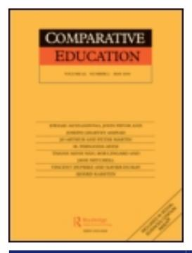

<!-- A1.R15 | source: papers_json/A1.R15/ -->

## **Comparative Education**

**ISSN: 0305-0068 (Print) 1360-0486 (Online) Journal homepage:****[ www.tandfonline.com/journals/cced20](https://www.tandfonline.com/journals/cced20?src=pdf)**

## **التحولات في أسس حوكمة التعليم العالي الأوروبي: المنافسة، والتصنيف، والاستقلالية، والمساءلة**

## **Tero Erkkilä
& Ossi Piironen**

**To cite this article:** Tero Erkkilä & Ossi Piironen (2014) Shifting fundaments of European higher education governance: competition, ranking, autonomy and accountability, Comparative Education, 50:2, 177-191, DOI: [10.1080/03050068.2013.807643](https://www.tandfonline.com/action/showCitFormats?doi=10.1080/03050068.2013.807643)

**To link to this article: **[https://doi.org/10.1080/03050068.2013.807643](https://doi.org/10.1080/03050068.2013.807643)

| Image: Calendar icon | Published online: 30 Jul 2013. |
| --- | --- |
| Image: Pencil icon | Submit your article to this journal Image: External link icon |
| Image: Bar chart icon | Article views: 1223 |
| Image: Magnifying glass on document icon | View related articles Image: External link icon |
| Image: CrossMark logo | View Crossmark data Image: External link icon |
| Image: Two documents icon | Citing articles: 8 View citing articles Image: External link icon |

<!-- page 2 -->

## التحولات في أسس حوكمة التعليم العالي الأوروبي: المنافسة، والتصنيف، والاستقلالية، والمساءلة

Tero Erkkilä* and Ossi Piironen

قسم الدراسات السياسية والاقتصادية، جامعة هلسنكي، فنلندا

في هذه الدراسة، نقدم تفسيرا لسردية عامة عن الحوكمة عبر الوطنية للتعليم العالي. جميع عناصر هذه السردية - المنافسة والتصنيف والاستقلالية والمساءلة - حاضرة بوضوح في أجندة سياسة التعليم العالي المعاصرة. نحن لا ندرس هذه العناصر كأفكار وممارسات منفصلة، بل كوحدة مترابطة، مما يضفي قدرا من التماسك على الحوكمة عبر الوطنية للتعليم العالي في أوروبا. جميع هذه العناصر، كما تظهر حاليا في بيانات السياسة الصادرة عن مؤسسة التعليم العالي الأوروبية، تقوم على فلسفة وجودية ذرية اجتماعية وأيديولوجية المنافسة. وبناء على أدلة نصية، نرى أن الاتجاه الأخير نحو زيادة الاستقلالية المؤسسية والمساءلة للجامعات قد بُرر بالاستناد إلى منطق تنافسي، وهو منطق تعزز بدوره من خلال ممارسة التصنيف المقارن. تسهم هذه المقالة في تشخيص المفاهيم الخاطئة المحتملة التي تؤطر صنع سياسة التعليم العالي الحالية في أوروبا.

## المقدمة

'المنافسة' هي بلا شك من أكثر الكلمات ذات الصلة بالسياسة في أوروبا في مطلع الألفية الجديدة (قارن Sum 2009). فهي الآن تؤطر السلوك في جميع مجالات الحياة، سواء كانت خاصة أو ثقافية أو اجتماعية أو سياسية أو اقتصادية. معظم الناس هم (على الأقل بشكل غير واعٍ) ذريون اجتماعيون، إذ غالبا ما نفترض أن الكيانات 'قابلة للانفصال إذا كانت قابلة للتمييز' (Weissman 2000, 2). علاوة على ذلك، يعتقد كثيرون أن البيئة التنافسية أمر حتمي وبالتالي لا يمكن الهروب من المنافسة. يعتقد بعض الليبراليين أيضا أن المنافسة بين الكيانات المنفصلة ستفيد الجميع في نهاية المطاف (Porter 1990). أيا كان الأمر، فقد أصبح تعظيم القدرة التنافسية يحدد ويبرر بعضا من أهم السياسات والإصلاحات السياسية في أوروبا (قارن Cerny 1997؛ Hall and Soskice 2001): كل ما يريد الازدهار أو البقاء يجب أن يتنافس. نسمي تبرير أي سياسة ملموسة استنادا إلى هذه الحقيقة البديهية 'المنطق التنافسي' - وهو استنتاج منطقي مستمد من أيديولوجية المنافسة.

في هذه المقالة، نرى أن الكثير من التفكير الحالي الذي أطّر صنع سياسة التعليم العالي في أوروبا خلال السنوات الأخيرة يعود في جوهره إلى أيديولوجية المنافسة. وبالاستناد إلى تحليل مفاهيمي لخطاب سياسة الاتحاد الأوروبي (Skinner 1969؛ Miller and Rose 1990؛ Bacchi 1999؛ Palonen 2003)، نرى أن هناك درجة من التماسك الأيديولوجي في الحوكمة عبر الوطنية للتعليم العالي، على الأقل في أوروبا، وذلك من خلال إظهار كيف أن بعض المفاهيم والممارسات المعاصرة ذات الصلة بالسياسة، والتي كان لها تأثير كبير على سياسات التعليم العالي الإقليمية والوطنية والمؤسسية في أوروبا، مترابطة وجوهرية

> ^*^Corresponding author. Email: tero.erkkila@helsinki.fi

<!-- page 3 -->

الاتصال. وبالاستناد إلى أدلة تجريبية - عينات رئيسية من خطاب سياسة التعليم العالي الأوروبي - نرى أن الاتجاه الأخير نحو زيادة الاستقلالية المؤسسية للجامعات ومساءلتها قد بُرر بالإشارة إلى المنطق التنافسي. وهذا المنطق تعزز بدوره من خلال ممارسة التصنيف المقارن: فالاتجاه نحو زيادة الاستقلالية المؤسسية للجامعات بُرر بالإشارة إلى المنطق التنافسي الذي تدعمه ممارسة التصنيف المقارن (قارن King 2009).

يمكن القول إن هناك قدرا من الدائرية في حجج المؤيدين للأفكار السائدة الأوروبية بشأن سياسات التعليم العالي، على النحو التالي: (1) القلق بشأن القدرة التنافسية الأوروبية والوطنية يزيد من القلق بشأن القدرة التنافسية لأنظمة التعليم العالي؛ (2) تُبنى مقاييس الأداء المرجعية والتصنيفات للفصل بين النجاح (الجامعات الأمريكية 'المستقلة') والفشل (الجامعات الأوروبية 'المفرطة في التنظيم')؛ (3) تُحدد الاستقلالية المؤسسية ذات التوجه السوقي المعززة باعتبارها أمرا محوريا لتحسين أداء الجامعات الأوروبية؛ (4) يُستبدل التنظيم الحكومي المباشر لمؤسسات التعليم العالي بآليات بديلة للمساءلة والشفافية مثل إدارة الأداء، والفحوصات، والاعتمادات، والتصنيفات؛ و(5) يتعزز القلق بشأن القدرة التنافسية (الإقليمية والوطنية والمؤسسية) - وبالتالي أيديولوجية المنافسة - من خلال ممارسة التصنيف.

نستكشف هذه الدورة من خلال تحليل كل مفهوم من هذه المفاهيم والمعتقدات السببية المرتبطة بها في الوثائق الرئيسية للاتحاد الأوروبي. نبدأ بفحص الطرق التي تُستخدم بها المنافسة والبيئة التنافسية والقدرة التنافسية في وثائق السياسة. نُظهر كيف ترتبط القدرة التنافسية للجامعات بالقدرة التنافسية الوطنية والإقليمية التي يُعتقد أنها تعزز أهدافا اقتصادية مثل النمو والتوظيف والرفاهية. ثم ننتقل إلى فحص كيف تزيد التصنيفات الجامعية العالمية من القلق بشأن الفقدان المُتصور للقدرة التنافسية على جميع المستويات. والواقع أنه بعد نشر تصنيف شنغهاي الأول في عام 2003 (التصنيف الأكاديمي للجامعات العالمية، ARWU)، حظي القلق بشأن أداء الجامعات الأوروبية ونظام الابتكار الأوروبي ككل بأهمية كبيرة في أجندة سياسة التعليم العالي في جميع أنحاء أوروبا. وبناء على ذلك، نحلل كيف بُنيت العقبة الرئيسية أمام تحسين القدرة التنافسية (التنظيم الحكومي المفرط)، والعلاج الرئيسي (تعزيز الاستقلالية المؤسسية)، وارتباطهما السببي، وكيف مُثّلت هذه العناصر. نرى أن الاستقلالية المؤسسية في هذا السياق صيغت بمصطلحات اقتصادية وذات توجه سوقي على حساب السمات التقليدية لاستقلالية الجامعة التي تؤثر على السياسات والممارسات المؤسسية. وهذا أمر مهم، لأن المفاهيم لا تعكس فقط التغيرات المؤسسية بل تدفعها وتوجهها أيضا (قارن Skinner 1969).

ثم نُظهر كيف أن الدعوات إلى إلغاء التنظيم قد طرحت خطاب المساءلة والشفافية على الطاولة. غير أن المساءلة لم تكن موجهة نحو العلم نفسه أو الحكومات الديمقراطية، بل مُثّلت بدلا من ذلك كمساءلة اقتصادية تجاه المجتمع ككل. وقد رافق إلغاء التنظيم الفكرة القائلة إن على المؤسسات نفسها ضمان المساءلة ليس فقط أمام السياسيين ودافعي الضرائب، بل أيضا أمام الطلاب (القابلية للتوظيف)، وأصحاب العمل (القوى العاملة)، والشركات (الابتكارات)، والممولين من القطاع الخاص، وعملاء خدمات التعليم (قارن Neave 2009). يُنظر الآن إلى التعليم العالي على أنه استثمار تقع مسؤولية إنتاجيته المالية على عاتق مديري الجامعات.

ولضمان المساءلة، يجب أن يكون أداء الجامعات وسلوكها شفافين، ما يعني أنه يجب إدراج مجموعة من آليات الرصد والتقييم الجديدة - بما في ذلك المقارنة المرجعية الدولية عبر التصنيفات الجامعية -

<!-- page 4 -->

في مجموعة أدوات الحوكمة، ومن الأمثلة الملموسة على ذلك إنشاء أداة U-Multirank بمبادرة من المفوضية الأوروبية. تخلق عملية إعادة التأمل بشأن التصنيفات الجامعية أنماطا جديدة من علاقات القوة، حيث توجه التصنيفات الوطنية النسبية السياسات على المستويين الوطني والأوروبي. ومع ذلك، فإن إدخال ثقافة التدقيق الجديدة في التعليم العالي عرضة لجلب آثار جانبية سلبية (Shore 2008) وعواقب غير مقصودة مثل إعادة إنتاج أيديولوجية المنافسة وتقليص الاستقلالية الأكاديمية.

نختتم بحجتين. أولا، أيديولوجية المنافسة تولّد التصنيفات، بينما تُبقي التصنيفات على أيديولوجية المنافسة - في دورة قائمة بذاتها. ثانيا، يُبنى مفهوم الاستقلالية المؤسسية المُتنازَع عليه كشرط مسبق للنجاح في بيئة متزايدة التنافسية: فكلما كانت الجامعة أكثر استقلالية، كان أداؤها أفضل في مواجهة منافسيها من حيث التمويل والتوظيف والأداء البحثي، كما تُشير إليه التصنيفات المرتفعة في جداول الترتيب. أيديولوجية المنافسة، وممارسات التصنيف، والمثال المعاصر لاستقلالية الجامعة، كلها مشتقة من مقدمات وجودية مشتركة. الواقع المُتصوَّر الذري يستدعي حلولا ذرية.

## المنافسة

للأفكار الحديثة عن المنافسة مصدران رئيسيان: السلطة العلمية للنظرية الاقتصادية وعلم الأحياء التطوري. وقد امتد كلاهما خارج مجاله الأصلي وكان له تأثير هائل على تفكيرنا الاجتماعي والسياسي. لذلك تبدو لنا المنافسة ليست فقط طبيعية بل مفيدة بشكل عام. وبينما لم تعد التطبيقات الداروينية الصريحة رائجة في الفكر الاجتماعي منذ أكثر من نصف قرن، ظلت الليبرالية الجديدة، القائمة على الاقتصاد الكلاسيكي الجديد، كذلك. وبالطبع، كانت هناك دائما مقاومة لمحاولات جعل المنافسة أيديولوجية عليا شاملة تخضع لها القيم والعقائد المتناقضة المحتملة. وفي أوروبا، تمكن التقليد الاشتراكي الديمقراطي القوي، المصحوب أحيانا بنزعات قومية، من تأخير تعزيز أيديولوجية المنافسة حتى الثمانينيات. وإذا كانت فكرة الكفاءة الناتجة عن المنافسة قد أثرت أولا على السياسات النقدية والمالية، فقد انتقلت بسرعة إلى مجالات أخرى من السياسات العامة في الدول الأوروبية.

في أواخر الثمانينيات وأوائل التسعينيات، نُوقشت المنافسة على المستوى فوق الوطني في إطار إنشاء الأسواق المشتركة الأوروبية. وقد أُقر هذا الهدف أولا بموجب الوثيقة الأوروبية الموحدة عام 1987، وهي سياسة عززتها معاهدة ماستريخت وإنشاء العملة الموحدة: كان من المقرر إزالة مختلف الحواجز التجارية وسن مواءمة اللوائح الوطنية التي تؤثر على المنافسة. وكانت المهمة الرئيسية للمديرية العامة للمنافسة هي خلق بيئة تنافسية حقيقية للشركات الأوروبية. وكان يُعتقد أن المنافسة الفعالة داخل الأسواق الأوروبية تعزز الكفاءة والإنتاجية والنمو الاقتصادي والرفاهية العامة. والواقع أن بناء أسواق داخلية تنافسية كان المبادرة السياسية المهيمنة التي قادتها المفوضية خلال التسعينيات - مع تأخر مشروع التوسع - بأثرٍ فاق السياسات والأهداف المتناقضة (Wallace, Wallace, and Pollack 2005, 114–115).

وعلى الصعيد العالمي، كان الاتجاه مشابها إلى حد كبير: في إطار الاتفاقية العامة للتعريفات الجمركية والتجارة (GATT)، أدت جولة أوروغواي (1986-1994) إلى تخفيض غير مسبوق في التعريفات الجمركية والإعانات الزراعية ووسّعت نطاق المفاوضات بشكل كبير. وفي عام 1995 بدأت منظمة التجارة العالمية (WTO)، التي 'تتمثل وظيفتها الرئيسية في ضمان أن

<!-- page 5 -->

تدفقات التجارة تسير بسلاسة وقابلية للتنبؤ وحرية قدر الإمكان'.3 وكان من المفترض أن يستفيد الجميع من تحرير التجارة العالمية.

ومع مطلع الألفية، التقت أخيرا أيديولوجيات - أو حقائق - الليبرالية الجديدة والعولمة. وكلما انفتحت الأسواق - إقليميا وعالميا - ازداد انتشار القلق المحلي بشأن الإنجاز الاقتصادي الخاص في العالم الغربي. تنطوي المنافسة العالمية على مخاطر هائلة، وقد أُقر بأن الجميع لن يستفيد تلقائيا. وهذا يفسر ظهور مفهوم *القدرة التنافسية* في المفردات السائدة والأجندة السياسية. علاوة على ذلك، لم تعد المنافسة حكرا على الشركات وحدها: فقد بدأ الأفراد يتنافسون على وظائفهم؛ والدول على الاستثمارات والعمال والقروض الميسورة؛ والوكالات الحكومية على الموظفين المهرة؛ والمؤسسات التعليمية على التمويل وكبار الباحثين والطلاب الموهوبين. وأصبح من المعتاد أن تُقيّم حكومات الدول الصغيرة قدرتها التنافسية الوطنية. وعززت المنظمات الدولية (المنتدى الاقتصادي العالمي ومركز IMD للقدرة التنافسية العالمية) انطباع 'صراع البقاء للأقوى' في النظام العالمي المعاصر من خلال تصنيفات القدرة التنافسية الخاصة بها، والتي - بمساعدة الاهتمام الإعلامي المستمر - انتقلت من شبه انعدام الوجود إلى الوعي العام خلال العقد الأول من الألفية.

في مجال السياسة الأوروبية، تجاوز القلق بشأن القدرة التنافسية الإقليمية بوضوح المشاريع السابقة للتوسع وإنشاء الأسواق الموحدة عند مطلع الألفية، عندما أقر المجلس الأوروبي في لشبونة أن الاتحاد الأوروبي 'يواجه تحولا نوعيا ناتجا عن العولمة وتحديات اقتصاد جديد قائم على المعرفة' واتفق على الهدف الاستراتيجي 'أن يصبح الاقتصاد الأكثر تنافسية وديناميكية القائم على المعرفة في العالم' (European Council 2000, 2؛ قارن High Level Group 2004, 24). وقد صيغت هذه الصلة بين المعرفة والنمو مسبقا في بيان المفوضية لعام 1997 بعنوان *نحو أوروبا المعرفة* (European Commission 1997) وشكّلت الفكرة السببية المحددة في تأسيس عقيدة سياسة التعليم العالي المعاصرة في أوروبا. وبعد اجتماع لشبونة، اعتُبر البحث والتطوير أمرا حيويا لـ 'النمو الاقتصادي والتوظيف والتماسك الاجتماعي'. ودعت أجندة لشبونة إلى إنشاء منطقة بحثية أوروبية تهدف إلى تكامل الموارد العلمية الأوروبية ونمو الاستثمارات الخاصة في البحث والتطوير.

وفي نوفمبر 2004، قُدم تقرير Kok - الذي كان يهدف إلى إعطاء زخم جديد لعملية كان يُعتقد على نطاق واسع أنها تتباطأ - إلى أجهزة الاتحاد الأوروبي. وأكد التقرير الحالة المتدهورة لتنفيذ أجندة لشبونة وقدم مقترحات لتبسيطها. واستند التقرير إلى فكرة التنافس العالمي: 'المنافسة الدولية تتصاعد، وتواجه أوروبا تحديا مزدوجا من آسيا والولايات المتحدة' (High Level Group 2004, 12). وكانت هناك حاجة ملحة للاستجابة لهذه التحديات. وقد تعثرت الجهود لإتمام الأسواق الداخلية، وكانت أوروبا تفقد أرضية، خاصة أمام الولايات المتحدة، في بناء مجتمع معرفي حقيقي: 'سواء من حيث طلبات براءات الاختراع، أو أعداد الباحثين العلميين، أو مكانة الجامعات في التصنيفات الدولية، أو أعداد الفائزين بجائزة نوبل، أو الإشارات إلى الأوراق العلمية، تتخلف أوروبا عن الولايات المتحدة' (20). وكانت الرسالة أن أوروبا، من أجل القدرة التنافسية الاقتصادية، يجب أن تسرّع جهودها للتنافس في البحث والابتكار.

في الآونة الأخيرة، رافقت استراتيجية المنافسة رفيعة المستوى للاتحاد الأوروبي عمليات داعمة في مجال سياسات التعليم. وتاريخ التعاون الأوروبي في مجال التعليم منذ الحرب العالمية الثانية، وفقا لـ Corbett (2012, 39)، كان مليئا بـ 'الجهد والمبادرة، والنجاح والفشل'، وشمل أفكارا ثابتة مثل الديمقراطية واحترام التنوع الثقافي ولكن أيضا تغيرات في المبادئ والأهداف السياسية الخاصة بالقطاع. وبعد التصديق على

<!-- page 6 -->

معاهدة ماستريخت (1992) ومعاهدة أمستردام (1997) التي منحت المفوضية الأوروبية اختصاصا رسميا ولكن محدودا في سياسات التعليم، تعززت الروابط بين التعليم العالي والبحث والمنافسة (Corbett 2012, 51). وفي عام 1999، أطلق إعلان بولونيا عملية طوعية (غير تابعة للاتحاد الأوروبي) لإنشاء منطقة التعليم العالي الأوروبية (EHEA) والتي كانت محورية في تشكيل الهياكل التعليمية الأوروبية باتجاه أقل تباينا وباتجاه سوق تعليمية أكثر تناسقا (Ahola and Mesikämmen 2003؛ Huisman and van der Wende 2004). وإذا كانت عملية بولونيا قد تضمنت مجموعة متنوعة من الأهداف والمبادئ، فيبدو أنها استوعبت أهدافا اقتصادية منذ البداية (Corbett 2012؛ Zgaga 2012). وبينما لم يُشر الإعلان صراحة إلى تصاعد المنافسة الاقتصادية بين الكتل القوية، فقد استهدف، من أجل اكتساب 'درجة جذب عالمية تساوي تقاليدنا الثقافية والعلمية الاستثنائية'، من بين أمور أخرى، زيادة القدرة التنافسية الدولية لنظام التعليم العالي الأوروبي (Nokkala 2012).

دعمت المفوضية مبادرة بولونيا واستخدمتها أيضا كذريعة لاختراق أعمق في مجال السياسة الذي كان يقع بحزم ضمن ولاية الدول الأعضاء. وفي بيان صدر عام 2003، تركز الاهتمام - على عكس السابق - على المستوى المؤسسي، على الجامعات:

والواقع أن الجامعات تمارس نشاطها في بيئة متزايدة العولمة تتغير باستمرار وتتسم بمنافسة متزايدة لاجتذاب المواهب المتميزة والاحتفاظ بها، وبظهور متطلبات جديدة عليها تلبيتها. ومع ذلك، فإن الجامعات الأوروبية بشكل عام لديها القليل لتقدمه وموارد مالية أقل من نظيراتها في الدول المتقدمة الأخرى، وبخاصة الولايات المتحدة. (European Commission 2003, 3)

المشكلة الرئيسية، وفقا لهذا التفسير، كانت عجز الجامعات الأوروبية عن اجتذاب المواهب، ما أدى إلى انخفاض مستويات التميز.

وخلاصة القول، أصبح التعليم العالي مُسيّسا بطريقة جديدة خلال العقدين الماضيين: فهو يُنظر إليه الآن كجزء عضوي من استراتيجية النمو والبقاء الإقليمية والوطنية. وقد عُبّر بوضوح عن الرابط بين التعليم/البحث والنمو في مختلف أوراق الاستراتيجية والسياسة الصادرة عن الاتحاد الأوروبي، لتكون بمثابة تبرير للدعوات (والإعلانات المشتركة الواعدة) بإصلاح أنظمة التعليم العالي الوطنية (Huisman and van der Wende 2004؛ Blomqvist 2007؛ Robertson and Keeling 2008). ويمكن تتبع اتجاه مماثل في صنع السياسة على مستوى الدول الأعضاء في الاتحاد الأوروبي: ففي فنلندا، على سبيل المثال، يُبنى التعليم العالي كجزء من 'نظام الابتكار' الوطني الذي ينبغي أن يعزز النمو الاقتصادي والرفاهية (STPC 2003؛ Prime Minister's Office 2006). وبناء على ذلك، تسلل منطق المنافسة إلى مجال سياسات التعليم، محددا ليس فقط مجال العمل الذي يجب أن تعمل فيه مؤسسات التعليم العالي؛ بل يحدد أيضا هوياتها المؤسسية ككيانات منفصلة وظيفتها الأساسية هي التنافس من أجل البقاء. ويُقاس النجاح في هذه المنافسة المفترضة بمقدار التمويل والمكانة، ولكن أيضا، بشكل متزايد، بالترتيب في مؤشرات الأداء الدولية التي أصبحت اليوم متعددة.

## التصنيف

نُشر أول تصنيف جامعي عالمي عام 2003 من قبل جامعة شنغهاي جياو تونغ. وتبعت هذه 'قائمة شنغهاي' قائمة تصنيف عالمي أخرى أنتجتها مجلة *Times Higher Education Supplement* عام 2004. وبينما كانت الجامعات في السياق الأنجلو-أمريكي قد صُنّفت من قبل، كانت هذه هي المرة الأولى التي يُرسم فيها ويُبنى بالتالي

<!-- page 7 -->

المشهد العالمي للتعليم العالي. وفي السياق الأوروبي، ساهمت التصنيفات العالمية في بناء مشكلة سياسية للتعليم العالي الأوروبي. ويتمثل جوهر هذه المشكلة في التصنيف الضعيف للجامعات الأوروبية في التصنيفات العالمية، كما يُظهر الاقتباس التالي من عام 2005:

أظهر مسحان حديثان يركزان على البحث أنه باستثناء عدد قليل من الجامعات في بريطانيا، لا توجد جامعات من الاتحاد الأوروبي ضمن أفضل 20 جامعة في العالم وقليل نسبيا منها ضمن أفضل 50 جامعة. كما أن النمو السريع للجامعات الآسيوية، العامة والخاصة على حد سواء، أصبح الآن يشكل تحديا لأوروبا - والولايات المتحدة - من حيث طلاب الدكتوراه في العلوم والهندسة. (European Commission 2005a, 3)

تقوم التصنيفات على نفس الفلسفة الخلفية الذرية التي تقوم عليها أيديولوجية المنافسة: فهي تعيد إنتاج تصور سياسي تُرى فيه الجامعات ككيانات 'كليّة' منفصلة، من طبيعتها التنافس عالميا فيما بينها على التمويل والطلاب والباحثين والمنشورات وحتى جوائز نوبل. ومنذ منتصف العقد الأول من الألفية، ارتبط هذان العنصران مفاهيميا في العمل السياسي للمفوضية الأوروبية (European Commission 2005b): فالتفوق في المنافسة على التعليم العالي، كما تُجسده مرتبة التصنيف، هو تعزيز للقدرة التنافسية الاقتصادية.

كانت الاستجابة للتصنيفات ذات شقين: من جهة، تُقر الجهات الفاعلة بسرور بأوجه القصور والاختلالات في التصنيفات (Rauhvargers 2011)، ولكنها مع ذلك تشير إليها في تحديد أهدافها. وتتمتع التصنيفات بخاصية غريبة، إذ إنها لا تحدد فقط أهدافا لمؤسسات التعليم العالي (تصنيف أعلى) بل تحدد أيضا سمات النجاح. وتأخذ الجامعات ملاحظات حول تكوين التصنيفات، محاولة 'رفع مستواها'، ولكن على مستوى أعم، أدت التصنيفات إلى محاكاة نماذج نجاح معينة - ما يُسمى بتأثير 'هارفارد هنا'. وقد أدى هذا إلى تحديد ونسخ ممارسات مؤسسية معينة تُعتبر وصفات للنجاح. والواقع أن معهد ماساتشوستس للتكنولوجيا (MIT) خدم كنموذج لعمليات دمج جامعية مختلفة في أوروبا (على سبيل المثال في هلسنكي ودبلن)، ما يُظهر تجاهلا للتاريخ المؤسسي الخاص والجوانب السياقية لهذا النموذج.

عند فحص التقديم من أعلى إلى أسفل لنظام المسار الوظيفي الثابت (tenure track) في جامعة آلتو في هلسنكي، يقدم Herbert and Tienari (2013) مثالا ملموسا جدا على كيف يمكن أن يؤدي نقل نماذج السياسة من سياق اجتماعي-ثقافي إلى آخر إلى نتائج غير متوقعة: فنموذج الوظيفة الثابتة، الذي قُدّم في سياقه الأمريكي الأصلي كحماية للموظفين من الضغوط السياسية والنظرة قصيرة المدى، أصبح في نظر الأكاديميين من المستوى المتوسط في جامعة آلتو أداة للسيطرة الإدارية والنخبوية و'تقييد الإبداع'. علاوة على ذلك، ما يُنسى تماما في كثير من الأحيان في النقاشات الأوروبية هو تنوع نظام (أو أنظمة) التعليم العالي الأمريكي، الذي تشكل فيه المؤسسات الناجحة والتنافسية دوليا حصة منخفضة نسبيا (انظر Cohen and Kisker 2010). بالنسبة لنا، يبدو من غير المعقول استيراد نماذج مؤسسية إلى سياق مختلف تماما، أي *نظام* التعليم العالي الأوروبي، وتوقع أن تعمل كما عملت في بيئتها الأصلية.

ومع ذلك، خلقت تصنيفات الجامعات في الاتحاد الأوروبي مشكلة سياسية لأن هناك عددا قليلا جدا فقط من المؤسسات الأوروبية بين أفضل الجامعات المصنفة، وجميعها من المملكة المتحدة. وخلال سباق رئاسة الاتحاد الأوروبي الفرنسية عام 2007، أصبح هذا الوضع مصدر قلق سعت المفوضية الأوروبية منذ ذلك الحين إلى تصحيحه. وكان أحد التدابير هو إنشاء تصنيف جامعي أوروبي ذي نطاق عالمي 'ينصف' التعليم العالي الأوروبي

<!-- page 8 -->

المؤسسات أو يأخذ في الاعتبار 'التنوع' في التعليم العالي الأوروبي (European Commission 2007, 5). وأدت هذه المبادرة الممولة من المفوضية الأوروبية إلى أداة U-Multirank، التي لا تُعد تصنيفا بالمعنى الدقيق للكلمة لأنه لا يُنتج رقم إجمالي. وبدلا من ذلك، يُبنى مسح لجوانب معينة من التعليم العالي، ما يسمح للمستخدمين بتصفح الجامعات وفقا لسمات (مُحددة مسبقا) (Kauppi and Erkkilä 2011).

لكن ما بدأ كقلق أوروبي بشأن حدود التصنيف أصبح الآن جزءا من ممارسة أوسع في تقييم التعليم العالي. وبينما كانت هناك في البداية مقاومة لاستخدام التصنيفات في سياق الاتحاد الأوروبي، أصبحت التصنيفات العالمية منذ ذلك الحين أداة لتقييم جودة التعليم العالي في سياق استراتيجية لشبونة (European Commission 2008, 2009). ومع خروج أداة U-Multirank من مرحلتها التجريبية عام 2011، أصبحت المفوضية الأوروبية أكثر إيجابية تجاه استخدام التصنيفات في التعليم العالي. وفي أجندتها لدعم الوظائف والنمو، تلاحظ المفوضية الأوروبية أن الجامعات الأوروبية متأخرة عن نظيراتها عالميا. وهذا يستدعي المزيد من 'الشفافية' بشأن أدائها، أي التصنيفات:

[إن] عددا قليلا جدا من مؤسسات التعليم العالي الأوروبية يُعترف بها كمؤسسات ذات مستوى عالمي في التصنيفات الجامعية العالمية الحالية الموجهة نحو البحث. فعلى سبيل المثال، لا يُدرج ضمن أفضل 500 جامعة سوى نحو 200 من بين 4000 مؤسسة تعليم عالٍ في أوروبا، وثلاث فقط ضمن أفضل 20، وفقا لأحدث تصنيف أكاديمي للجامعات العالمية. ولم يحدث تحسن حقيقي خلال السنوات الماضية. لا يوجد نموذج تميز واحد: تحتاج أوروبا إلى تنوع واسع من مؤسسات التعليم العالي، ويجب أن تسعى كل منها للتميز بما يتماشى مع رسالتها وأولوياتها الاستراتيجية. ومع توفر معلومات أكثر شفافية عن الملف الخاص وأداء كل مؤسسة، سيكون صناع السياسة في وضع أفضل لتطوير استراتيجيات فعالة للتعليم العالي، وستجد المؤسسات أنه من الأسهل البناء على نقاط قوتها. (European Commission 2011, 2–3)

في الوقت الحالي، تتوافق التصورات المذكورة أعلاه للمنافسة في التعليم العالي مع التصنيفات العالمية للقدرة التنافسية الاقتصادية. ويرتبط هذا أيضا بالخطاب القوي لاقتصاد المعرفة الذي يجعل مؤسسات التعليم العالي جزءا ظاهريا من نظام الابتكار (انظر أعلاه). ومن ثم، تُقيَّم الجامعات بمعايير اقتصادية، وتميل حلول تحسين تصنيفها إلى أن تكون اقتصادية. وفي السياق الأوروبي، أطلق هذا خطابا غريبا حول استقلالية الجامعة لا يشير إلى الحرية الأكاديمية لهذه المؤسسات، بل - في محاولة لمحاكاة 'النموذج الأمريكي' للجامعة - يدعو إلى تنوع في قاعدة تمويل الجامعات الأوروبية، الممولة في معظمها من القطاع العام. ويُقال، وإن كان بأدلة تجريبية مشكوك فيها (انظر Nokkala 2012)، إنه بسبب اللوائح الحكومية والقانونية الواسعة تفشل الجامعات الأوروبية في التنافس مع نظيراتها الأمريكية. وقد اعتُبرت زيادة 'استقلالية' مؤسسات التعليم العالي الأوروبية العلاج لهذه المشكلة السياسية.

## الاستقلالية

اكتسب مفهوم استقلالية الجامعة زخما جديدا منذ أواخر التسعينيات فصاعدا. الاستقلالية مبدأ قوي يُقدّره الأكاديميون في جميع أنحاء العالم، لكنه اليوم يُدافَع عنه بقوة أيضا في الخطابات وأوراق الاستراتيجية والتقارير الصادرة عن الحكومات الوطنية والجمعيات الأكاديمية والمنظمات الدولية مثل الاتحاد الأوروبي ومنظمة التعاون الاقتصادي والتنمية. وهناك إجماع واسع داخل مجال التعليم العالي الأوروبي على ضرورة تعزيز الاستقلالية الأكاديمية. ويكمن السبب الرئيسي لهذا الحماس الجديد في سلسلة بسيطة من الأفكار السببية التي تنص على أن الاستقلالية المؤسسية للجامعات - من خلال تحسين الأداء المؤسسي والعلمي - تؤدي إلى نجاح يعزز القدرة التنافسية الوطنية،

<!-- page 9 -->

والنمو الاقتصادي والرفاهية. ووفقا لـ Nokkala (2012, 61)، تُصاغ الاستقلالية 'كشرط مسبق للقدرة التنافسية' حتى 'في خطاب عملية بولونيا'. لنبدأ باستعراض هذه الحجة كما تظهر في بعض الوثائق البارزة التي حددت رؤى السياسة التعليمية الأوروبية خلال العقد الماضي:

تقبل مؤسسات التعليم العالي الأوروبية تحديات العمل في بيئة تنافسية في الداخل، وفي أوروبا، وفي العالم، ولكن للقيام بذلك تحتاج إلى الحرية الإدارية اللازمة، وأطر تنظيمية خفيفة وداعمة، وتمويل عادل، وإلا ستوضع في وضع غير موات في التعاون والمنافسة. (European Universities Association 2001, 7)

الإفراط في تنظيم الحياة الجامعية يعيق التحديث والكفاءة. الرقابة الدقيقة *المسبقة* تعيق قدرة الجامعات على الاستجابة بسرعة للتغيرات في بيئتها. ... في بيئة منفتحة وتنافسية ومتغيرة، تُعد الاستقلالية شرطا مسبقا لتمكين الجامعات من الاستجابة للاحتياجات المتغيرة للمجتمع وتحمل المسؤولية الكاملة عن تلك الاستجابات. (European Commission 2005a, 4 and 7)

باختصار، لا تستطيع الجامعات الأوروبية حاليا تحقيق إمكاناتها الكاملة في عدد من الجوانب المهمة. ونتيجة لذلك، فهي متأخرة في المنافسة الدولية المتزايدة على الأكاديميين والطلاب الموهوبين، وتفوتها أجندات البحث سريعة التغير وتوليد الكتلة الحرجة والتميز والمرونة اللازمة للنجاح. وتتفاقم هذه الإخفاقات بسبب مزيج من الرقابة العامة المفرطة مع نقص التمويل. ... لن تصبح الجامعات مبتكرة ومستجيبة للتغيير ما لم تُمنح استقلالية ومساءلة حقيقيتين. (European Commission 2006b, 4–5)

تُظهر الحجة أعلاه مشكلتين واضحتين. الأولى تستند إلى تفكير تجريبي ومنهجي معا. فتجريبيا، لا يبدو أن هناك دليلا كافيا على وجود الرابط السببي المقترح بين الاستقلالية المؤسسية والبحث عالي الجودة، ناهيك عن القدرة التنافسية الوطنية. علاوة على ذلك، وعلى عكس المعتقدات الشائعة، تخضع كثير من الجامعات الشاملة الأمريكية الناجحة لتنظيم كبير على مستوى الولاية، والعكس صحيح أيضا، إذ تأثرت كثير من كليات المجتمع ذات المستوى الأدنى بإلغاء التنظيم والخصخصة الأخيرين في ولايات مختلفة (قارن Cohen and Kisker 2010). ومنهجيا، من غير المرجح أن يكون من الممكن أصلا تقديم أدلة كافية تؤيد أو تدحض هذا الادعاء بصيغته العامة: فلا توجد طريقة بديهية لتحديد أو قياس أداء الجامعات أو جودتها كما بيّنا في القسم السابق. أما المشكلة الأخرى فتستند إلى تفكير مفاهيمي (وقد تكون لها آثار معيارية) وحقيقة أن الاستقلالية يمكن - وقد جرى بالفعل - تعريفها والدفاع عنها بطرق مختلفة. ونرى أن مفهوما غريبا جدا للاستقلالية، قد يتناقض مع الروايات التقليدية الأكثر شيوعا (بما في ذلك مفهوم الحرية الأكاديمية)، قد أصبح مهيمنا على النقاش الأوروبي الأخير.

هناك أدلة قوية تدعم وجهة نظر مفادها أن خطاب التعليم العالي الأوروبي السائد يستخدم فكرة الاستقلالية لدعم حجج تعزز الإصلاحات الإدارية (Neave 2009؛ Christensen 2011؛ Piironen 2013). وتُناقش استقلالية الجامعة الآن بصورة أساسية في شكلها المؤسسي، متضمنة الكفاءة الإدارية بدلا من التداول الجماعي، ومُدركة عقبات الاستقلالية على أنها ناتجة عن التنظيم العام المفرط للشؤون المالية والتنظيمية، بدلا من الرأي العام غير المتسامح، أو الرقابة الحكومية، أو تسليع التعليم العالي. وتُعامل كأداة للكفاءة والجودة، أو كشرط مسبق للبقاء. ويُنظر إلى الاستقلالية بشكل متزايد على أنها ملكية إدارية لقيادة الجامعة، وليست ملكية للمجتمع الأكاديمي بأكمله.

تتطلب التحديات التي يواجهها التعليم العالي نظم حوكمة وتمويل أكثر مرونة توازن بين استقلالية أكبر لمؤسسات التعليم والمساءلة

<!-- page 10 -->

أمام جميع أصحاب المصلحة. يمكن للمؤسسات المستقلة أن تتخصص بسهولة أكبر، ما يعزز الأداء التعليمي والبحثي ويشجع التنوع داخل أنظمة التعليم العالي. لكن القيود القانونية والمالية والإدارية لا تزال تحد من حرية المؤسسات في تحديد استراتيجياتها وهياكلها وفي التمايز عن منافسيها. ويمكن تعزيز كفاءة مؤسسات التعليم العالي، وبالتالي فعالية الاستثمار العام، من خلال تقليل القيود: على جمع الإيرادات الخاصة، وعلى الاستثمار الرأسمالي، وعلى ملكية البنية التحتية، وعلى حرية توظيف الموظفين، وعلى الاعتماد. ويمكن للاستثمار في الإدارة المهنية أن يوفر رؤية استراتيجية وقيادة مع السماح للمعلمين والباحثين بالحرية الأكاديمية اللازمة للتركيز على مهامهم الأساسية. (European Commission 2011, 9)

ليس من المستغرب أن يكون الفهم السائد للاستقلالية قائما على التفكير الذري. فمعظمنا تعلم ربط الاستقلالية بالفردية الليبرالية (بشكل صريح) وبالذرية الاجتماعية (بشكل ضمني). خذ على سبيل المثال هذا الاقتباس من Robert C. Bishop (2007, 87):

مثال التنوير للاستقلالية يرانا نتخلى عن العادة والتقليد والسلطة كي نصبح أفرادا مستقلين ومحددين لذواتهم. ... وتبدو الاستقلالية جذابة لأنها تُمكّن الأفراد على ما يبدو، وتعزز حريتهم وكرامتهم وقدرتهم على عيش حياتهم الخاصة. لكن التركيز على الاستقلالية يأتي على حساب الروابط والالتزامات الاجتماعية الدائمة - فلا يمكن للمرء أن يكون مستقلا ومرتبطا بالآخرين في آن واحد.

تقوم التصنيفات الجامعية على هذا التفكير: فهي تُبرز الانفصال المؤسسي للجامعات والكيانات المحددة جغرافيا مثل الدول؛ وتفترض وتشجع وتفرض المنافسة بين كيانات منفصلة (فقط) مرتبطة خارجيا.

لكننا لسنا متأكدين من أن هذه هي الطريقة الوحيدة لقراءة كانط وهومبولت وميل - المفكرين الليبراليين الذين أدخلوا مفهوم الاستقلالية إلى الفلسفة الحديثة. ربما سُلب مفهوم الاستقلالية بطريقة مماثلة لما حدث للتقليد الفلسفي الليبرالي بأكمله (انظر Simhony and Weinstein 2001)، إذ يبدو أنه من الممكن ربط الاستقلالية بدلالات أخلاقية وديمقراطية واجتماعية وتنموية (انظر Baum 2000, 136–139؛ Simhony and Weinstein 2001, 14–20؛ Capaldi 2004, 253, 281, 287–288؛ Guyer 2007, 95-103؛ Roberts 2009, 63-69). ويمكن فهم استقلالية الجامعة تماما بمصطلحات أقل ذرية وأقل إدارية وأقل ليبرالية جديدة. يمكن أن يزدهر العلم في جامعات مُنظّمة بشكل جماعي وديمقراطي؛ في جامعات يتباطأ فيها وقت البحث والنشر؛ حيث لا يُهدر الوقت والطاقة في جهود مستمرة للتقدم بطلبات التمويل؛ حيث يملك المعلمون الوقت والموارد لتخطيط وتطوير مقرراتهم؛ حيث تُنتج المعرفة اجتماعيا وحيث تُعتبر المشاركة والتعاون بنفس أهمية المنافسة الفردية والمؤسسية. للأسف، مع ذلك، تُمثل الاستقلالية حاليا قصر النظر والمحلية والاقتصادوية (Schmidt and Langberg 2007–2008؛ قارن Christensen 2011؛ Piironen 2013). ويُعزز هذا الوضع بتدابير المساءلة الجديدة.

## **المساءلة **

غالبا ما تُستكمل الدعوات إلى زيادة الاستقلالية بمطالب بـ'المساءلة'، كوسيلة *لاحقة* لفرض التجانس والتوحيد القياسي من خلال آليات التقييم والاعتماد (Neave 2009).

مفهوم المساءلة حديث نسبيا، ويمكن ربطه بصعود إصلاحات الإدارة العامة الجديدة التي بدأت في أوائل التسعينيات في أوروبا. وقبل ذلك، كانت المفاهيم

<!-- page 11 -->

المستخدمة هي المسؤولية أو الرقابة، ما يعني فهما أكثر تمركزا حول الدولة أو ديمقراطيا للسيطرة على الحكومة. ومع تفكك التسلسلات القانونية الهرمية للبيروقراطية الحكومية خلال التسعينيات، حلت أشكال جديدة من الرقابة الاقتصادية محل الوسائل الهرمية للسيطرة على الحكومة. وبعد أن كانت المساءلة موجودة سابقا في مجال المحاسبة، أصبحت مفهوما رائجا لوصف الوسائل غير الهرمية الجديدة للسيطرة على الحكومة. وباختصار، يشير هذا التحول المفاهيمي إلى تغيرات في الآليات المُتصورة للمساءلة التي تُشدد الآن على الأداء (النتيجة) أكثر من المسؤولية عن العملية (Erkkilä 2007).

يرتبط استخدام المعلومات الرقمية، مثل المؤشرات، ارتباطا وثيقا أيضا بالمطالب الجديدة للأداء. ومع تزايد مساءلة المؤسسات العامة عن أدائها بمصطلحات اقتصادية، هناك طلب متزايد على جعل أنشطتها قابلة للقياس. وهذا لا يشمل فقط استخدام الأموال، بل أدى أيضا إلى تكميم الأنشطة الفعلية للمؤسسات التي تُدار الآن بمخططات إدارة الأداء؛ حيث تُقيّم المعلومات المالية هنا مقابل مقاييس مختلفة لمخرجات المؤسسة. حتى الجامعات، وهي مؤسسات عامة إلى حد كبير في أوروبا، لم تكن محصنة ضد هذا التطور. علاوة على ذلك، فهي في موقف فريد، لأن أداءها لا يُقاس محليا فحسب: بل تتنافس أيضا في التصنيفات العالمية.

وبينما كانت فكرة المساءلة عبر النتائج قد طُبقت في الجامعات بالفعل قبل التصنيفات العالمية، فإن ظهورها قد عزز بالتأكيد هذه المطالب. وفي وثائق سياسة المفوضية الأوروبية، تُقرن التصنيفات الجامعية العالمية الآن بمفهوم المساءلة، وبالتالي بالمسؤولية التي تُحقق على أفضل وجه من خلال الاستقلالية المؤسسية. وبطريقة ما يبدو هذا منطقيا: فمع استبدال آليات المساءلة الجديدة للوسائل الهرمية السابقة للرقابة بمطالب الأداء، تُمنح المؤسسات مزيدا من 'الاستقلالية' لتحقيق أهداف أدائها. وغالبا ما يُترجم هذا إلى إدخال آليات ذات طابع سوقي في مؤسسات التعليم العالي. لذلك تُكمّل تدابير المساءلة الجديدة الرقابة البيروقراطية المتناقصة.

عند تقييم المساءلة، يمكن أن تكون ثلاثة عناصر أو أسئلة أساسية مفيدة في تحديد التغيرات القائمة: المساءلة *عن ماذا*، و*أمام من*، و*كيف* (Mulgan 2000). وقد تحول موضع المساءلة - *أمام من تكون المساءلة* -. فبدلا من كونها مسؤولة أمام أقرانها الأكاديميين وطلابها، يُفترض الآن أن تكون المؤسسات الأكاديمية مسؤولة أمام المجتمع بأكمله، بشكل أساسي بالمعنى الاقتصادي. وفي خطاب سياسة المفوضية الأوروبية، ارتفعت المساءلة في أوائل الألفية، في سياق اقتصاد المعرفة، كرمز للإدارة الفعالة التي ينبغي أن تكون منفتحة على المهنيين القادمين من خارج الأوساط الأكاديمية (European Commission 2003, 17). ومنذ منتصف العقد الأول من الألفية، حُددت المساءلة كأحد محركات 'التحديث'؛ إذ يُنظر إلى زيادة المساءلة والاستقلالية على أنهما يدعمان البحث متعدد التخصصات والتطبيقي (European Commission 2006a)، ما يعني تحولا 'من رقابة الدولة إلى المساءلة أمام المجتمع' (European Commission 2005a, 9). يجب تحديث التعليم العالي الأوروبي كي يصبح الاتحاد الأوروبي اقتصادا معرفيا عالميا. لذلك لم تعد الجامعات والأكاديميون مسؤولين أمام طلابهم وأقرانهم، بل أمام 'المجتمع' الأوسع، الذي يطالب الآن بأداء اقتصادي.

لكن كما يتحول موضوع المساءلة أمام من من رقابة الدولة، يتحول أيضا موضوع المساءلة عن ماذا وكيف. يُنظر إلى مساءلة الجامعات أمام المجتمع على أنها تتطلب 'ضمان الجودة' وتقييمات الأداء (European Commission 2005a, 7)، مرتبطة باستراتيجية لشبونة للنمو الاقتصادي. وتتطلب هذه 'الاحتياجات المجتمعية الجديدة' استقلالية ومساءلة كافيتين لتحسين الإدارة، ما يعني أيضا تنوع مصادر التمويل العامة والخاصة (Council of the European Union 2007, 2, 4). إن

<!-- page 12 -->

الاستقلالية المؤسسية الجديدة لا تتعلق بالحرية المطلقة كما يحرص مؤيدوها على تذكيرنا:

ينبغي على الدول الأعضاء توجيه قطاع الجامعات ككل من خلال إطار من القواعد العامة، وأهداف السياسة، وآليات التمويل، وحوافز لأنشطة التعليم والبحث والابتكار. وفي مقابل التحرر من الإفراط في التنظيم والإدارة الدقيقة، ينبغي على الجامعات قبول المساءلة المؤسسية الكاملة أمام المجتمع ككل عن نتائجها. (European Commission 2006b, 11)

حُددت المساءلة والاستقلالية الآن من قبل المفوضية الأوروبية كواحدة من تسعة تدابير من شأنها المساعدة في مواجهة التحديات الواردة في أجندة لشبونة (European Commission 2006b). ووفقا للمفوضية الأوروبية، فإن لاستقلالية الجامعة ومساءلتها آثارا مؤسسية إذ 'لا يمكن تنفيذهما بفعالية دون تكييف أنظمة الحوكمة'، أي إصلاحات الحوكمة (European Commission 2008, 5). علاوة على ذلك، تعِد المساءلة والاستقلالية بأنظمة حوكمة وتمويل أكثر مرونة في شكل إدارة مؤسسية وخصخصة. وإجمالا، أصبح المفهومان يرمزان إلى مجموعة من المعتقدات السببية، لتشكلا الآن أجندة إصلاح كاملة. ويتمتع كلا المفهومين بجاذبية معيارية - فمن قد يرغب في معارضة الاستقلالية أو المساءلة؟ - ما يسمح بإضفاء الشرعية على التغيير السياسي بمساعدتهما. والواقع أن استخدام هذين المفهومين يدفع التغيير أيضا، إذ ينقلان أفكار الإصلاح الجديدة التي ظهرت تحت المفاهيم المُشيدة بها (Skinner 1969).

وهذا يؤدي إلى نشاط دائري، حيث تخلق التصنيفات الجامعية العالمية طلبا على الاستقلالية المُكمّلة بالمساءلة، التي تُقيّم مقابل مقاييس ضمان الجودة الجديدة وأهداف الأداء، بما فيها تلك التي تحددها التصنيفات العالمية. والأفكار المعيارية أعلاه عن المساءلة والمعتقدات السببية المرتبطة بها مشتركة حاليا على نطاق واسع وبشكل موحد بين الجهات الفاعلة المركزية في مجال التعليم العالي الأوروبي، لدرجة أن الآراء البديلة حول مسؤوليات الجامعات - مثل الحفاظ على القيم المشتركة للبشرية والمعايير الأكاديمية (قارن International Association of Universities 1998؛ UNESCO 1997) - تميل إلى أن تُطغى عليها. وباختصار، بما أن مساءلة مؤسسات التعليم العالي تُقيّم الآن بصورة أساسية من حيث الأداء، فإنها تصبح جزءا من المنطق الدائري الذي يعزز أيديولوجية المنافسة. لذلك، لا تُعلم التصنيفات موضوع المساءلة (عن ماذا) فحسب، بل تصبح أيضا آلية المساءلة (كيف). ويسهم هذا في تصعيد التصور السياسي للمنافسة كسياق للتعليم العالي الأوروبي الذي يحتاج إلى الإصلاح تبعا لذلك لمواجهة هذا التحدي.

## الخلاصة

ما قدمناه في هذه المقالة هو تفسير لسردية عامة عن الحوكمة عبر الوطنية للتعليم العالي. ويشير تحليلنا في السياق الأوروبي إلى وجود قدر من التماسك في الحوكمة عبر الوطنية - وهي رؤية غالبا ما تُحجب بعادة النظر إلى الجزئيات، والأجزاء التي يُفترض أنها منفصلة. جميع عناصر السردية - المنافسة والتصنيف والاستقلالية والمساءلة - حاضرة بوضوح في أجندة سياسة التعليم العالي المعاصرة؛ وهي مترابطة وقائمة على موقف وجودي مشترك (الذرية الاجتماعية) يمثل مقدمة خلفية لرؤية سياسية أكثر صراحة تحيط بصنع سياسة التعليم العالي في أوروبا. وفي سرديتنا، هذه هي أيديولوجية المنافسة - قاعدة تُحفز المنافسة على جميع مستويات الفعل.

<!-- page 13 -->

عند النظر إلى هذه العناصر معا، وفحص كل من الروايات الأكاديمية وتجريبيا، بيانات الجهات الفاعلة الرئيسية مثل المفوضية الأوروبية، طرحنا الترابطات التالية: أيديولوجية المنافسة تولّد التصنيفات، بينما تُبقي التصنيفات على أيديولوجية المنافسة؛ ويُبنى مفهوم محدد جدا للاستقلالية المؤسسية كشرط ضروري للنجاح في بيئة متزايدة التنافسية أكثر فأكثر: فكلما كانت الجامعة أكثر استقلالية، كان أداؤها أفضل في مواجهة منافسيها من حيث التمويل والتوظيف والأداء البحثي، وكلما ارتفعت مرتبتها في جداول الترتيب. أيديولوجية المنافسة، وممارسات التصنيف، والمثال المعاصر لاستقلالية الجامعة، كلها مشتقة من مقدمات مشتركة. وبناء على ذلك، تعود إصلاحات التعليم العالي الأخيرة في جميع أنحاء أوروبا في جوهرها إلى المنطق التنافسي، ولكن مع أدلة شحيحة على أن هذا المنطق سيصمد فعليا.

خلقت التصنيفات الجامعية العالمية قلقا سياسيا بشأن التعليم العالي الأوروبي من حيث العولمة الاقتصادية، وليس العلم. وقد أدى هذا إلى إشارة كثيفة إلى مصطلحات مثل المساءلة والاستقلالية ذات الجاذبية المعيارية. ومع ذلك، فإن الإشارات إلى هذين المفهومين تجعلهما موضوعا لصراع سياسي يمكن أن يجلب آثارا متناقضة وسلبية للإصلاحات المنشودة. فعلى سبيل المثال، يمكن أن يؤدي فهم الاستقلالية بمعنى إداري ضيق إلى ظروف تتمتع فيها المؤسسات الأكاديمية فعليا بحرية أكاديمية أقل. علاوة على ذلك، يمكن أن تُعيق المرونة المنشودة تدابير ضمان الجودة الصارمة وعبء التقارير اللازمة لتلبية الطلب على معلومات قابلة للقياس الكمي عن الأنشطة الأكاديمية. ونسخ النماذج المؤسسية من سياق (أو نظام) إلى آخر قد يُنتج بالفعل عواقب غير مقصودة.

الإشارات غير النقدية إلى التصنيفات الجامعية العالمية والاستقلالية والمساءلة تمهد الآن الطريق لتحولات كبيرة في التعليم العالي الأوروبي. وبناء على التصنيفات الجامعية، حُددت الاستقلالية كسمة للنجاح. ومع ذلك، وفي فهمهما الضيق الحالي، ارتبطت كل من الاستقلالية والمساءلة بتعزيز الأداء الاقتصادي في ظل العولمة. وعلى الرغم من وعود المزيد من المرونة والحرية، فإن هذين المفهومين هما حاليا جزء من دفع عالمي نحو تسليع التعليم العالي. وتلعب التصنيفات العالمية دورا خاصا في هذا، إذ تخلق الإشارات إليها دوامة متصاعدة، حيث تبني التصنيفات مشكلات السياسة في التعليم العالي وتعِد أيضا بحل ظاهري لها.

نرى أن تحليلنا الحالي، إلى جانب التحليلات المفاهيمية والحجاجية للآخرين، ليس كافيا لتغيير الخطاب السائد للتعليم العالي أو إقناع الجهات الفاعلة السياسية، لكنه يساعد في تشخيص المغالطات وسوء الفهم المفاهيمي والحجاجي وكشف أسئلة جديدة تحتاج إلى مزيد من البحث التجريبي.

## **الشكر والتقدير **

قُدمت المسودة الأولى لهذه المقالة في المؤتمر السنوي لجمعية الدراسات الدولية، 1-4 أبريل 2012، في سان دييغو. نود أن نشكر الدكتور Terence Karran (جامعة لينكولن) ومراجعينا على ملاحظاتهم القيمة على المخطوطة. كما نشكر Caroline Werner على عملها الممتاز في تحرير النص. مُوّل هذا البحث من قبل شبكة أبحاث التعليم العالي والابتكار وشبكة الدراسات الأوروبية في جامعة هلسنكي، والأكاديمية الفنلندية.

## **الملاحظات **

نُدرك أن اهتمامات الأداء - حتى تلك المتعلقة بالبحث والتعليم - تسبق انتشار أيديولوجية الإدارة العامة الجديدة (NPM) وتقييمات الأداء المؤسسي،

<!-- page 14 -->

- ويعود تاريخها إلى الخمسينيات والستينيات. لا نعتقد أن هذا يُضعف تحليلنا، حتى وإن لم نُبرز الاستمراريات في هذا العمل: فالتفكير الاقتصادوي (مثل القلق بشأن القدرة التنافسية) حاضر بوضوح أكبر في خطاب وأجندة سياسة التعليم العالي اليوم مما كان عليه في الخمسينيات.
- 2. قدم Neave (2009) ملاحظة قابلة للمقارنة على نطاق واسع عند مناقشة آثار تحولات الإدارة العامة: التحول من التنظيم الرسمي إلى التوجيه التقييمي، والتحول مما يُسميه من التجانس القانوني إلى التجانس التقييمي لمؤسسات التعليم العالي، قد أدى إلى تفريد الوضع المؤسسي للجامعات: وبالتالي، 'يرتبط الوضع المؤسسي صراحة بالخدمات والأداء المؤسسي ويُجعل معتمدا عليهما. وبدورها، تحدد المعايير نفسها المكانة والسمعة والتميز المعترف به الذي تحظى به الجامعة الفردية - أو تفتقر إليه!' (11).
- 3.[ http://www.wto.org/english/thewto_e/whatis_e/inbrief_e/inbr00_e.htm](http://www.wto.org/english/thewto_e/whatis_e/inbrief_e/inbr00_e.htm)
- 4.[ http://www.eua.be/eua/jsp/en/upload/OFFDOC_BP_bologna_declaration.1068714825768.](http://www.eua.be/eua/jsp/en/upload/OFFDOC_BP_bologna_declaration.1068714825768.pdf) [pdf](http://www.eua.be/eua/jsp/en/upload/OFFDOC_BP_bologna_declaration.1068714825768.pdf)
- 5.[ http://www.timeshighereducation.co.uk/story.asp?storycode=410392](http://www.timeshighereducation.co.uk/story.asp?storycode=410392)
- 6. نتقدم بالشكر للدكتور Terence Karran على ملاحظاته القيمة بشأن نظام التعليم العالي الأمريكي مقارنة بالأنظمة الأوروبية.

## ملاحظات عن المساهمين

Tero Erkkilä is Assistant Professor of Political Science at the Department of Political and Economic Studies, University of Helsinki. His research interests include transnational knowledge governance, public institutions and collective identities. His recent publications include 'The Making of a Global Field of Higher Education: Actors, Institutions and Public Policy Instruments' (with Niilo Kauppi) in International Political Sociology (2011), 'Alternatives to Existing International Rankings' (with Niilo Kauppi) in UNESCO World Social Science Report, 2010, and Government Transparency. Impacts and Unintended Consequences by Palgrave Macmillan (2012). His edited book Global University Rankings: Challenges for European Higher Education is forthcoming by Palgrave Macmillan.

Ossi Piironen is a researcher and doctoral candidate at the Department of Political and Economic Studies at the University of Helsinki. His academic interests range from conceptual analysis to quantitative measurement. A recurrent theme in his works is the notion of autonomy, which he has examined from national, institutional and individual perspectives. His recent publications include the co-authored (together with Tero Erkkilä) article 'Politics and Numbers: The Iron Cage of Governance Indicators' published in Raymond W. Cox III (ed.) Ethics and Integrity in Public Administration (2009), and 'The Transnational Idea of University Autonomy and the Reform of the Finnish Universities Act' published in the Higher Education Policy in 2013.

## References

Ahola, Sakari, and Jani Mesikämmen. 2003. "Finnish Higher Education Policy and the Ongoing Bologna Process." Higher Education in Europe XXVIII (2) July 2003, 217–227.

Bacchi, C. L. 1999. Women, Policy and Politics: The Construction of Policy Problems. London: Sage Publications.

Baum, B. 2000. Rereading Power and Freedom in J.S. Mill. Toronto: University of Toronto Press.

Bishop, R. 2007. Philosophy of Social Sciences: An Introduction. London: Continuum.

Blomqvist, C. 2007. "Avoin koordinaatiomenetelmä Euroopan unionin koulutuspolitiikassa." Ph.D. dissertation, Department of Management Studies, University of Tampere.

Capaldi, N. 2004. John Stuart Mill. Cambridge: Cambridge University Press.

Cerny, Philip G. 1997. "Paradoxes of the Competition State: The Dynamics of Political Globalization." Government and Opposition 32 (2): 251–274.

Christensen, T. 2011. "University Governance Reforms: Potential Problems of More Autonomy?" Higher Education 62: 503–517.

Cohen, A. M., and C. B. Kisker. 2010. The Shaping of American Higher Education: Emergence and Growth of the Contemporary System. 2nd ed. San Francisco: Jossey-Bass.

<!-- page 15 -->

- Corbett, A. 2012. "Principles, Problems, Politics… What Does the Historical Record of EU Cooperation in Higher Education Tell the EHEA Generation?" In European Higher Education at the Crossroads: Between the Bologna Process and National Reforms, edited by A. Curaj, P. Scott, L. Vlasceanu and L. Wilson, 39–57. Dordrecht: Springer Science + Business Media.
- Council of the European Union. 2007. "Council resolution of 23 November 2007 on modernising universities for Europe's competitiveness in a global knowledge economy," 16096/1/07. Brussels: Council of the European Union.
- Erkkilä, T. 2007. "Governance and Accountability A Shift in Conceptualisation." Public Administration Quarterly 31 (1): 1–38.
- European Commission. 1997. "Towards a Europe of Knowledge," COM(97) 563 final. Brussels: European Commission, 12 November.
- European Commission. 2003. "The Role of the Universities in the Europe of Knowledge." COM (2003) 58 final. Brussels: European Commission, 5 February.
- European Commission. 2005a. "Mobilising the Brainpower of Europe: Enabling Universities to Make their Full Contribution to the Lisbon Strategy," COM(2005) 152 final. Brussels: European Commission, 20 April.
- European Commission. 2005b. "Annex to the Communication from the Commission. Mobilising the brainpower of Europe: Enabling Universities to make their Full Contribution to the Lisbon Strategy. European Higher Education in a Worldwide Perspective," SEC(2005) 518. Brussels: European Commission, 20 April.
- European Commission. 2006a. "Europe Needs Modernised Universities, Says European Commission," Press release, IP/06/592. Brussels: European Commission, 10 May.
- European Commission. 2006b. "Delivering on the Modernisation Agenda for Universities: Education, Research and Innovation," COM(2006) 208 final. Brussels: European Commission, 10 May.
- European Commission. 2007. From Bergen to London. The contribution of the European Commission to the Bologna Process.
- European Commission. 2008. "Commission staff working document. Accompanying document to the Report from the Commission to the Council on the Council Resolution of 23 November 2007 on Modernising Universities for Europe's Competitiveness in a Global Knowledge Economy." SEC(2008) 2719. Brussels: European Commission, 30 October.
- European Commission. 2009. "Commission Staff Working Document. Progress Towards the Lisbon Objectives in Education and Training: Indicators and Benchmarks 2009." SEC (2009) 1616. Brussels: European Commission, 23 November.
- European Commission. 2011. "Supporting Growth and Jobs An Agenda for the Modernisation of Europe's Higher Education System," COM(2011) 567 final. Brussels: European Commission, 20 September.
- European Council. 2000. "Presidency Conclusions, Lisbon European Council, 23 and 24 March 2000." Lisbon: European Council.
- European University Association. 2001. "Salamanca Convention 2001: The Bologna Process and the European Higher Education Area," Geneva: European University Association.
- Guyer, P. 2007. Kant's Groundwork for the Metaphysics of Morals. London: Continuum.
- Hall, Peter A., and David Soskice. 2001. "An Introduction to Varieties of Capitalism." In Varieties of Capitalism: The Institutional Foundations of Comparative Advantage, edited by Peter A. Hall and Soskice David, 1–70. Oxford: Oxford University Press.
- Herbert, A., and J. Tienari. 2013. "Transplanting Tenure and (re)Construction of Academic Freedom." Studies in Higher Education 38 (2): 157–173.
- High Level Group. 2004. "Facing the Challenge: The Lisbon Strategy for Growth and Employment," Report from the High Level Group chaired by Wim Kok, November.
- Huisman, J., and M. van der Wende. 2004. "The EU and Bologna: Are Supra- and International Initiatives Threatening Domestic Agendas?" European Journal of Education 39 (3): 349–357.
- International Association of Universities. 1998. "Academic Freedom, University Autonomy and Social Responsibility," IAU Policy Statement, April, Accessed August 13, 2012.[ http://](http://www.iau-aiu.net/sites/all/files/Academic_Freedom_Policy_Statement.pdf) www.iau-aiu.net/sites/all/fi[les/Academic_Freedom_Policy_Statement.pdf](http://www.iau-aiu.net/sites/all/files/Academic_Freedom_Policy_Statement.pdf)
- Kauppi, N., and T. Erkkilä. 2011. "The Struggle Over Global Higher Education: Actors, Institutions, and Practices." International Political Sociology 5 (3): 314–326.

<!-- page 16 -->

- King, R. 2009. Governing Universities Globally: Organizations, Regulation and Rankings. Cheltenham: Elgar.
- Miller, P., and N. Rose. 1990. "Political Rationalities and Technologies of Government." In Texts, Contexts, Concepts: Studies on Politics and Power in Language, edited by S. Hänninen and K. Palonen, 166–183. Helsinki: The Finnish Political Science Association.
- Mulgan, R. 2000. "Accountability: An Ever-Expanding Concept?" Public Administration 78 (3): 555–573.
- Neave, G. 2009. "Institutional Autonomy 2010–2012. A Tale of Elan Two Steps back to make one very Large Leap Forward." In The European Higher Education Area: Perspectives on a Moving Target, edited by B. M. Kehm, J. Huisman and B. Stensaker, 3–22. Rotterdam: Sense Publishers.
- Nokkala, T. 2012. "Institutional Autonomy and the Attractiveness of the European Higher Education Area – Facts or Tokenistic Discourse?" In European Higher Education at the Crossroads: Between the Bologna Process and National Reforms, edited by A. Curaj, P. Scott, L. Vlasceanu and L. Wilson, 59–81. Dordrecht: Springer Science + Business Media.
- Palonen, K. 2003. "Four Times of Politics: Policy, Polity, Politicking, and Politicization." Alternatives 28 (2): 171–186.
- Piironen, Ossi. 2013. "The Transnational Idea of University Autonomy and the Reform of the Finnish Universities Act." Higher Education Policy 26 (1): 127–146.
- Porter, Michael E. 1990. Competitive Advantage of Nations. London: Macmillan Press.
- Prime Minister's Office. 2006. "Suomen vastaus globalisaation haasteeseen: Talousneuvoston sihteeristön globalisaatioselvitys - OSA II," Valtioneuvoston kanslian julkaisusarja 17/ 2006.
- Rauhvargers, A. 2011. Global University Rankings and Their Impact: EUA Report on Rankings 2011. Brussels: European University Association.
- Roberts, J. 2009. Wilhelm von Humboldt and German Liberalism. Oakville: Mosaic Press.
- Robertson, S., and R. Keeling. 2008. "Stirring the Lions: Strategy and Tactics in Global Higher Education." Globalisation, Societies and Education 6 (3): 221–240.
- Schmidt, E. Kalpazidou, and K. Langberg. 2007–2008. "Academic Autonomy in a Rapidly Changing Higher Education Framework: Academia on the Procrustean Bed." European Education 49 (4): 80–94.
- Shore, C. 2008. "Audit Culture and Illiberal Governance: Universities and the Politics of Accountability." Anthropological Theory 8 (3): 278–298.
- Simhony, A., and D. Weinstein. 2001. The New Liberalism: Reconciling Liberty and Community. Cambridge: Cambridge University Press.
- Skinner, Q. 1969. "Meaning and Understanding in the History of Ideas." History and Theory 8 (1): 3–53.
- STPC. 2003. Osaaminen, innovaatiot ja kansainvälistyminen. Helsinki: The Science and Technology Policy Council of Finland.
- Sum, Ngai-Ling. 2009. "The Production of Hegemonic Policy Discourses: 'Competitiveness' as a Knowledge Brand and its (re-)Contextualizations." Critical Policy Studies 3 (2): 184–203.
- UNESCO. 1997. "Recommendation Concerning the Status of Higher-Education Teaching Personnel: Resolution Adopted on the Report of Commission II at the 26th Plenary Meeting, on 11 November 1997." Paris: UNESCO, 11 November, Accessed August 13, 2012.[ http://portal.unesco.org/en/ev.php-URL_ID=13144&URL_DO=DO_TOPIC&URL_](http://portal.unesco.org/en/ev.php-URL_ID=13144&URL_DO=DO_TOPIC&URL_SECTION=201.html) [SECTION=201.html](http://portal.unesco.org/en/ev.php-URL_ID=13144&URL_DO=DO_TOPIC&URL_SECTION=201.html)
- Wallace, W., H. Wallace, and M. Pollack. 2005. Policy-Making in the European Union. Oxford: Oxford University Press.
- Weissman, D. 2000. A Social Ontology. New Haven, Connecticut: Yale University Press.
- Zgaga, P. 2012. "Reconsidering the EHEA Principles: Is There a 'Bologna Philosophy'?" In European Higher Education at the Crossroads: Between the Bologna Process and National Reforms, edited by A. Curaj, P. Scott, L. Vlasceanu and L. Wilson, 17–38. Dordrecht: Springer Science + Business Media.
