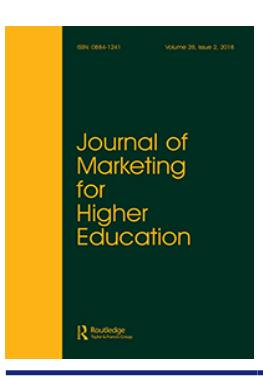
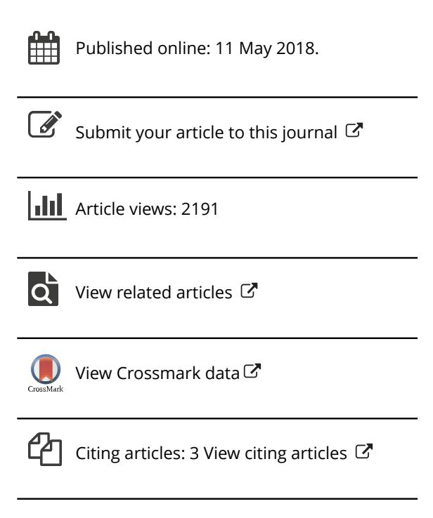
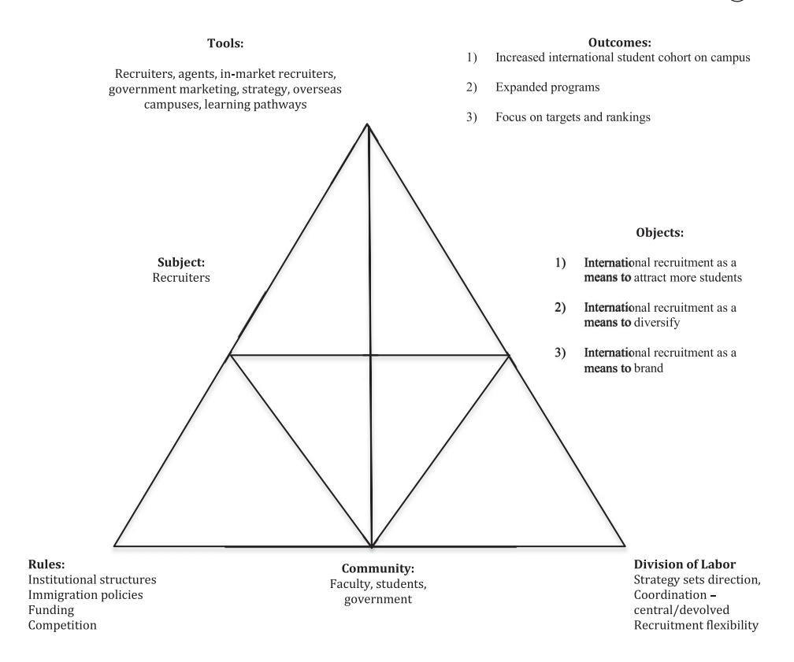

<!-- A1.R21 | source: papers_json/A1.R21/ -->

## **Journal of Marketing for Higher Education**

**ISSN: 0884-1241 (Print) 1540-7144 (Online) Journal homepage:****[ www.tandfonline.com/journals/wmhe20](https://www.tandfonline.com/journals/wmhe20?src=pdf)**

## **A comparative study of international recruitment** **– tensions and opportunities in institutional** **recruitment practice**

## **Melissa James-MacEachern**

**To cite this article:** Melissa James-MacEachern (2018) A comparative study of international recruitment – tensions and opportunities in institutional recruitment practice, Journal of Marketing for Higher Education, 28:2, 247-265, DOI:[ 10.1080/08841241.2018.1471014](https://www.tandfonline.com/action/showCitFormats?doi=10.1080/08841241.2018.1471014)

**To link to this article: **[https://doi.org/10.1080/08841241.2018.1471014](https://doi.org/10.1080/08841241.2018.1471014)

<!-- page 2 -->

## A comparative study of international recruitment – tensions and opportunities in institutional recruitment practice

Melissa James-MacEachern

Faculty of Business, University of Prince Edward Island, Charlottetown, Canada

## ABSTRACT

الهدف من هذا البحث هو استكشاف استقطاب الطلاب الدوليين في مؤسسات التعليم العالي (HEIs) من خلال دراسة تطوير وتنفيذ أنشطة الاستقطاب الدولي. توجد أبحاث قليلة حول العمليات الداخلية لمؤسسات التعليم العالي، وكيفية تنفيذها لجهود الاستقطاب الدولي، والتحديات التي يواجهها القائمون على الاستقطاب الدولي. تخلص هذه الدراسة إلى أنه على الرغم من تباين أطر السياسات الوطنية بين الدول، فإن ممارسة الاستقطاب الدولي تبقى متشابهة بشكل ملحوظ بين المؤسسات محل الدراسة. كما تشير الدراسة إلى أن مؤسسات التعليم العالي تواجه، بغض النظر عن ترتيبها، عملية تسليع (commodification) داخل سوق استقطاب الطلاب الدوليين. علاوة على ذلك، تشير إلى أن المؤسسات قد تحسّن نشاطها في الاستقطاب من خلال توضيح الأدوار، وتحسين التنسيق، وتمييز عروضها، وضمان المرونة للاستجابة لقوى السوق.

ARTICLE HISTORY Received 8 August 2017 Accepted 15 October 2017

KEYWORDS Higher education; international student recruitment; recruiters; activity theory

## Introduction

من المعروف والموثق جيداً أن الطلاب في جميع أنحاء العالم يرغبون في متابعة التعليم العالي في دول غير دولهم (Briggs, [2006;](#page-17-0) Soutar & Turner, [2002;](#page-18-0) Szekeres, [2010](#page-18-0); Tatar & Oktay, [2006)](#page-18-0). فهم يسعون إلى الحصول على شهادات من جامعات ذات سمعة مرموقة، خاصة في الدول الناطقة بالإنجليزية (Zinn & Johansson, [2015](#page-19-0)). وهذا في حد ذاته ليس مفهوماً جديداً، إذ اجتذبت مؤسسات التعليم العالي (HEIs) الطلاب الدوليين منذ منتصف القرن السادس عشر. غير أن التسارع الكبير في العولمة والتدويل أدى إلى تغيرات ديناميكية في التعليم الدولي، مثل تنقل الطلاب، والحرم الجامعي الخارجي، والمؤسسات التعليمية المخصخصة (كما ورد في Wilkins & Huisman, [2011](#page-19-0)). ووفقاً لمنظمة التعاون والتنمية الاقتصادية، من المتوقع أن ينمو الطلب العالمي على التعليم العالي الدولي من نحو 4.1 مليون طالب عام 2010 إلى 7.2 مليون طالب عام 2025 (Organisation for Economic Cooperation and Development, [2015)](#page-18-0). ومع اشتداد المنافسة على استقطاب أفضل المواهب الطلابية، تعمل المؤسسات على تطوير استراتيجيات وسياسات صارمة، مدعومة باستثمارات مالية، لزيادة معدلات الالتحاق.

يمكن تعريف استقطاب الطلاب على أنه وظيفة "لتوليد اهتمام بمؤسسة تعليمية واستقطاب عدد كافٍ من الطلاب المحتملين الذين يتقدمون بطلبات الالتحاق وينتهي بهم الأمر إلى التسجيل في البرنامج" (Beneke & Human, [2010](#page-17-0), p. 436). والطالب المحتمل هو أي طالب ترغب مؤسسة التعليم العالي في استقطابه وتسجيله في نهاية المطاف (Zinn & Johansson,

<!-- page 3 -->

[2015](#page-19-0)). وفي هذا السياق، يشير استقطاب الطلاب الدوليين إلى الممارسة التي من خلالها تتواصل مؤسسات التعليم العالي مع الطلاب من دول أخرى وتحاول جذبهم.

تتناول هذه الورقة ممارسة استقطاب الطلاب الدوليين في ثلاث مؤسسات تعليم عالٍ في كندا، والمملكة المتحدة (UK)، وهونغ كونغ. وتستخدم الدراسة استجابات ووجهات نظر القائمين على الاستقطاب في هذه المؤسسات لوضع الأنظمة الوطنية في سياقها ولاستكشاف التأثيرات على المستويات الكلي والمتوسط والجزئي التي تشكل ممارسة الاستقطاب الدولي في مؤسسات التعليم العالي.

## Literature review

تستخدم مؤسسات التعليم العالي التدويل لربط منظماتها بالوتيرة المتسارعة للعولمة. فعلى المستوى الوطني، يؤثر التدويل على تمويل التدريس والبحث، وإصلاح السياسات، والبرامج، واللوائح المؤسسية. غير أن عملية التدويل الفعلية تحدث على المستوى المؤسسي الفردي (Knight, [2004](#page-18-0)). ويحدث هذا التدويل من خلال توسع المؤسسات، مادياً ومعنوياً، عبر الحدود، وجلب ثقافات وأنشطة دولية مختلفة إلى المؤسسات (Knight, [2004](#page-18-0)). ويظهر هذا النشاط في استقطاب الطلاب الدوليين، والشراكات المدرسية الدولية، والبرامج الأكاديمية الدولية، وفرص البحث الدولية، والحرم الجامعي الفرعي، والتعليم عن بعد، وإدماج أوسع للممارسات الدولية والثقافية المتعددة في المناهج التعليمية (Knight, [2004](#page-18-0)).

تاريخياً، لم يكن الاستقطاب الدولي ممارسة متجذرة بعمق بين مؤسسات التعليم العالي. غير أنه اكتسب تأثيراً متزايداً على هذه المؤسسات خلال العقود القليلة الماضية. ففي عام 1975، درس نحو 800,000 طالب في الخارج. وبعد عقد من الزمن، درس ما يقدَّر بـ 1.1 مليون طالب خارج بلدانهم (Sood, [2012](#page-18-0)). وفي عام 2012، بلغ عدد الطلاب الدوليين نحو 4.5 مليون طالب (Sood, [2012](#page-18-0)). ومن المتوقع أن يتجاوز عدد الطلاب المتنقلين دولياً 7 ملايين طالب بحلول عام 2025 (West & Addington, [2014](#page-19-0)).

تُعد أستراليا واحدة من أهم أربع وجهات في العالم للطلاب الدوليين. ونتيجة لخبرتها ونجاحها الملحوظ في استقطاب الطلاب الدوليين، تسعى دول أخرى كثيرة إلى محاكاة جهودها. بدأت أستراليا في استقطاب الطلاب الدوليين منذ نحو عام 1950، لكن التحول الرئيسي نحو الاستقطاب الدولي الاستباقي حدث عام 1986 مع تغييرات كبيرة في السياسة الحكومية وتراجع في التمويل العام لمؤسسات التعليم العالي. وقد أدى هذا إلى تبني ممارسات أشبه بالأعمال التجارية بين مؤسسات التعليم العالي لتمويل عملياتها (West & Addington, [2014](#page-19-0))، وهي خطوة شجعتها الحكومة الأسترالية بمنح تصل إلى 200,000 دولار "لتطوير مواد ترويجية وخطط تسويقية لاستقطاب الطلاب الدوليين" (West & Addington, [2014](#page-19-0), p. 24). ومن خلال استقطاب الطلاب الدوليين، إلى جانب الحرم الجامعي الفرعي، والامتيازات، وترتيبات التوأمة، حققت مؤسسات التعليم العالي الأسترالية فرصاً مربحة من الاستقطاب الدولي (Trilokekar & Kizilbash, [2013)](#page-19-0). فعلى سبيل المثال، تمكنت العديد من مؤسسات التعليم العالي الأسترالية من الاحتفاظ بجزء كبير من دخلها من رسوم الطلاب الدوليين، والتي كانت عادة أعلى بكثير من الرسوم التي يدفعها الطلاب المحليون.

جادل كثيرون بأن هذا النوع من التحولات في السياسة الحكومية أدى إلى تسليع منصة التعليم العالي، وأن التعليم العالي لم يعد يتعلق فقط بتعليم الطلاب بقدر ما أصبح يتعلق بتحقيق الربح. ومع ذلك، عزز النموذج الأسترالي فكرة استقطاب الطلاب الدوليين كوسيلة لسد الفجوات المالية الناتجة عن تراجع التمويل العام. وبعد أن أصبح نجاح

<!-- page 4 -->

الاستثمار الأولي واضحاً وبدأت مؤسسات التعليم العالي تجني أرباحاً من جهودها التسويقية، بدأت مؤسسات كثيرة أخرى حول العالم في إنشاء مكاتب دولية لدعم جهود التسويق والاستقطاب المستمرة (West & Addington, [2014](#page-19-0)).

على الصعيد العالمي، شهدت مؤسسات تعليم عالٍ كثيرة تخفيضات في التمويل مماثلة لما شهدته أستراليا، وسعت إلى فرص الاستقطاب الدولي لسد هذا الفراغ. واليوم، تُعد الولايات المتحدة (US)، وكندا، والمملكة المتحدة، وأستراليا الدول الأربع الأولى لدراسة الطلاب الدوليين (Goralski & Tootoonchi, [2015)](#page-17-0). ومن الواضح ضمنياً أن هذه الدول تتنافس على استقطاب وتسجيل الطلاب من جميع أنحاء العالم. وهذه المنافسة المتزايدة بين الدول ومؤسسات التعليم العالي، فيما يتعلق باستقطاب الطلاب الدوليين، لم تغيّر فقط الطريقة التي ينظر بها الناس إلى هذه المؤسسات، بل غيّرت أيضاً طريقة عملها. ونظراً للنقص المُتصوَّر في تمويل مؤسسات التعليم العالي، يُنظر إلى الاستقطاب باعتباره استراتيجية ضرورية للبحث عن وسائل جديدة للتمويل والتمويل الذاتي (Marginson, [2011)](#page-18-0).

أثبتت رسوم وأقساط الطلاب الدوليين أنها مصدر دخل جيد وبديل مناسب لتدفق الإيرادات لدى العديد من مؤسسات التعليم العالي التي تواجه تهديد محدودية التمويل (Zinn & Johansson, [2015](#page-19-0)). وتنخرط المؤسسات في ممارسات أشبه بالأعمال التجارية، مثل التسويق والاستقطاب والمنافسة فيما يمكن تسميته بسوق الطلاب الدولي (Zinn & Johansson, [2015)](#page-19-0). وفي هذا السياق، يُنظر إلى التعليم العالي ويُسوَّق باعتباره خدمة تُباع للطلاب في الأسواق الوطنية والدولية، حيث تتنافس الدول ومؤسسات التعليم العالي على حصة من مجموع الطلاب.

How do I promote the university? It's a tough question... (Interviewee 12)

بلغت رسوم الطلاب الدوليين ونفقاتهم مساهمة ملحوظة في النمو الاقتصادي خلال ثمانينيات القرن الماضي مع إدخال عامل فارق تكلفة الرسوم الدراسية (Koh, [2015)](#page-18-0). وقد استُخدم هذا النموذج، الذي طبقته غالباً دول غربية مثل الولايات المتحدة، كاستراتيجية للحصول على مزيد من الأموال لتمويل العمليات. ورغم أن المملكة المتحدة أدخلت فارقاً في الرسوم الدراسية في وقت لاحق بكثير، فإن دولاً أوروبية أخرى لم تطبق نموذج رسوم يفصل بين المقيمين والطلاب الدوليين؛ ويُستخدم هذا كوسيلة للمنافسة مع الدول الأخرى (De Wit, [2015)](#page-17-0).

تم استكشاف عملية اتخاذ القرار لدى الطلاب فيما يخص اختيار مؤسسة التعليم العالي بشكل جيد في الأدبيات (Briggs, [2006;](#page-17-0) Soutar & Turner, [2002](#page-18-0); Szekeres, [2010](#page-18-0); Tatar & Oktay, [2006](#page-18-0)). وتدرك مؤسسات كثيرة أن الطلاب هم صانعو القرار الأساسيون عند اختيار مكان الدراسة؛ غير أن مؤثرات عديدة، مثل الوالدين والترتيبات والبرامج، تؤثر في ذلك الاختيار (Lindsay, [1994](#page-18-0)). ويضع تعقيد عملية اتخاذ القرار ضغطاً أكبر على مؤسسات التعليم العالي للتأثير في الطلاب بوسائل مختلفة وفي مراحل متعددة من العملية. ويشمل ذلك تقنيات التسويق والمبيعات التجارية، التي تأخذ عادة شكل الوكلاء، والكتيبات، والمواقع الإلكترونية، ووسائل التواصل الاجتماعي، والنشرات التعريفية، والعلاقات الإعلامية، وشبكات الخريجين، والقائمين على الاستقطاب (Briggs, [2006;](#page-17-0) Soutar & Turner, [2002;](#page-18-0) Szekeres, [2010](#page-18-0)).

يُعد سوق الطلاب الدوليين أحد أكثر الساحات تنافسية بالنسبة لمؤسسات التعليم العالي (Hanover Research Council, [2014)](#page-17-0)، وقد تبنت المؤسسات استراتيجيات فريدة لاستقطاب الطلاب. وأشارت دراسة أجراها Chankseliani و Hessel في جامعة أكسفورد عام 2016، شملت مقابلات مع موظفي القبول والمكاتب الدولية في 14 مؤسسة تعليم عالٍ عبر المملكة المتحدة، إلى أن الوكلاء موارد ذات تأثير كبير. فالوكلاء، الذين يملكون شبكات في

<!-- page 5 -->

دول لا تستطيع المؤسسات دعمها بطريقة أخرى، لديهم معرفة بالسوق المحلي وتفضيلات الطلاب. ووجدت هذه الدراسة، إلى جانب الوكلاء، أن الزيارات القطرية، واستخدام أنظمة إدارة علاقات العملاء (CRM)، وإشراك الخريجين، والمنح الدراسية الخاصة بكل دولة كانت استراتيجيات استقطاب فعالة. كما تشير الدراسة إلى أن هذه المؤسسات كانت تدرك أنها لا تستطيع منافسة المدارس الأكبر في أمريكا الشمالية والصين على استقطاب الطلاب، ولذلك حاولت التفاعل أكثر مع مناطق خارج الدول المهيمنة. وأخيراً، وجدت دراسة Chankseliani & Hessel أن وجود نظام دعم كبير يُعد استثماراً جيداً للاستقطاب الدولي. وذكر أحد المشاركين في هذه الدراسة أن المكتب الدولي في مؤسسته نما ليضم أكثر من 60 شخصاً، وأن الجامعة وظفت أيضاً فرقاً أخرى لمساعدة الطلاب في شؤون الهجرة، والسكن، والاستقرار في الحرم الجامعي، ورفاهيتهم العامة أثناء دراستهم في المملكة المتحدة. وكان يُعتقد أن هذا الدعم الإضافي أسهم في نمو عدد الطلاب الدوليين لدى المؤسسة بمعدل أقوى (Chankseliani & Hessel, [2016](#page-17-0)).

أثبتت دراسات سابقة أن للطلاب مجموعة واسعة من الدوافع لحضور مؤسسات التعليم العالي (Binney & Martin, [1997;](#page-17-0) Hesketh & Knight, [1999](#page-17-0); Moogan, Baron, & Harris, [1999](#page-18-0); Payne, [2003;](#page-18-0) Soutar & Turner, [2002)](#page-18-0)، وتشير إلى أن البرامج الأكاديمية، والفرص الوظيفية، وتأثير الوالدين والأقران، والقدرات المالية عوامل رئيسية تؤثر في اختيار الطالب للمؤسسة. وفي الوقت نفسه، يمكن لاعتبارات أخرى، مثل "علامة" المؤسسة التجارية، أن تلعب دوراً بالغ التأثير في قرار الطالب الدولي. "للطلاب الدوليين مجموعة مختلفة إلى حد ما من الاعتبارات، حيث تكون سمعة المؤسسة أكثر أهمية بكثير" (Szekeres, [2010](#page-18-0), p. 431). ولذلك، استثمرت المؤسسات في استراتيجيات بناء العلامة التجارية وركزت على الترتيبات لجذب هذا النوع من الطلاب (Farrell & Van der Werf, [2007](#page-17-0); Hemsley-Brown & Oplatka, [2010](#page-17-0); Marginson, [2011)](#page-18-0).

في حين أن العوامل المؤثرة في اتخاذ قرار الطالب مدروسة جيداً، فإن فهم تبني المؤسسات لاستراتيجية وممارسة الاستقطاب يظل ناقصاً. وقد أسهم نمو الطبقة الوسطى في الدول النامية، والاعتماد على معدلات التسجيل الدولية لتلبية الاحتياجات المالية الجديدة لمؤسسات التعليم العالي، وتزايد أهمية أن تكون هذه المؤسسات ذات صلة عالمية، في زيادة ظاهرة الاستقطاب الدولي (Choudaha, Chang, & Kono, [2013)](#page-17-0). وتواصل مؤسسات التعليم العالي تكييف وتطوير استراتيجيات الاستقطاب لمواكبة التغير في هيكل التعليم العالي. ووجدت دراسة نوعية شملت 35 مسؤول تسجيل دولي ثلاثة محاور رئيسية لممارسات الاستقطاب الناجحة:

- (1) التكنولوجيا لتوسيع مدى الوصول بطريقة فعالة من حيث التكلفة؛
- (2) الشراكات لخلق مسارات ووضوح رؤية؛ و
- (3) البحث لترتيب أولويات الجهود وقياس العائد على الاستثمار (Choudaha et al., [2013](#page-17-0)).

تشير هذه العناصر إلى أن ممارسة الاستقطاب الدولي عملية ديناميكية. فالتكنولوجيا تتقدم، وتستخدم المؤسسات استراتيجيات وتتبنى تقنيات مشابهة لتلك التي تستخدمها المؤسسات التجارية. وتشمل هذه الاستراتيجيات حضور المعارض الافتراضية، وتحديث المواقع الإلكترونية وترجمتها، وتقديم جولات افتراضية، واستضافة الندوات عبر الإنترنت، وزيادة استخدام منصات التواصل الاجتماعي، وهو مجال أصبح بالغ الأهمية في السنوات الأخيرة (Choudaha et al., [2013)](#page-17-0). والشراكات مع جهات خارجية،

<!-- page 6 -->

مثل المدارس الثانوية والوكلاء والحكومات ومنظمات أخرى، تُوصف بأنها بالغة الأهمية لاستراتيجيات الاستقطاب الدولي الناجحة. وتُمكِّن هذه الشراكات مؤسسات التعليم العالي من استكشاف وتطوير أسواق جديدة والتواصل مع السلطات المحلية التي لديها إمكانية الوصول إلى الطلاب المحتملين وأسرهم (Choudaha et al., [2013)](#page-17-0). وأخيراً، تستخدم مؤسسات التعليم العالي البحث كاستراتيجية لفهم ديناميكيات السوق المتغيرة بشكل أفضل. ويجمع هذا البحث معلومات تُستخدم لتقييم عوائد معينة على الاستثمار؛ وقد ذُكر استخدام قمع القبول ومواءمة شرائح الطلاب مع ملامح المؤسسة كعناصر مهمة لجمع البيانات البحثية والاستراتيجيات المرتبطة بها التي تنفذها المؤسسات الدولية (Choudaha et al., [2013](#page-17-0)).

اليوم، ومع تحول استقطاب الطلاب إلى قضية متزايدة الأهمية (وممارسة ضرورية) لكثير من مؤسسات التعليم العالي، تواجه هذه المؤسسات تحدياً يتمثل في تبني طرق مبتكرة لتسويق نفسها (Zinn & Johansson, [2015](#page-19-0)). وتشير مراجعة الأدبيات هذه، التي توضح عوامل الطلب (أي الطلاب المحتملين) والعرض (أي مؤسسات التعليم العالي) المؤثرة في استقطاب الطلاب الدوليين، إلى وجود بحث واسع حول اتخاذ القرار لدى الطلاب ونماذج الاختيار المعقدة المرتبطة بتلك العملية. غير أن الأدبيات المتعلقة بنشاط الاستقطاب الدولي داخل مؤسسات التعليم العالي ليست واسعة. وقد يعود ذلك جزئياً إلى الطبيعة التنافسية لاستقطاب الطلاب الدوليين. ومع ذلك، هناك الكثير مما يمكن تعلمه من استكشاف نشاط الاستقطاب في مؤسسات التعليم العالي وكيفية تطور الاستقطاب المؤسسي على المستويات الكلي والمتوسط والجزئي. علاوة على ذلك، ونظراً لشدة تنافسية سوق الطلاب الدولي والطبيعة المعقدة لاختيار المؤسسة، يجب على مؤسسات التعليم العالي فحص ممارستها للاستقطاب. "يركز مديرو المؤسسات بشكل متزايد على تقنيات التسويق، مثل استهداف شرائح السوق والتواصل معها" (Rindfleish, [2003](#page-18-0), p. 148). ومع تبني المؤسسات لمقاربات مسوَّقة مثل الاستقطاب، يلزم استكشاف تأثير اتخاذ قرار الطالب، والمؤسسات الأخرى، والسياسة الحكومية، والديناميكيات الداخلية لفهم ممارسة الاستقطاب الفعالة بشكل أفضل.

## Theoretical framework

استخدمت هذه الدراسة نظرية النشاط (activity theory) كإطار نظري رئيسي لفحص نشاط الاستقطاب الدولي في ثلاث مؤسسات تعليم عالٍ في كندا وهونغ كونغ والمملكة المتحدة. ونظرية النشاط، وهي نظرية متعددة التخصصات، تُستخدم لتحليل الأنظمة بطريقة ثلاثية (Engeström, [1987,](#page-17-0) [1999a,](#page-17-0) [1999b](#page-17-0); Russell, [1995)](#page-18-0). ونظرية النشاط وصفية وتفسيرية؛ فهي تتيح فحص نشاط ما في سياقات تاريخية وثقافية، ويمكن أن تساعد في الكشف عن معرفة وفهم جديدين للباحثين والممارسين على حد سواء. وتكمن قيمتها في أنها تستمد فهمها من النظر إلى النظام ككل بدلاً من دراسة الأجزاء الفردية للنشاط (Barab, Evans, & Baek, [2004)](#page-17-0). ويشير Barab وآخرون ([2004)](#page-17-0) أيضاً إلى أن نظرية النشاط تُسهّل فحص تطور النظام أثناء حدوثه وتطوره بدلاً من نقطة ثابتة. وهذا مهم بشكل خاص في سياق هذه الدراسة، حيث يُعد الاستقطاب الدولي نشاطاً متجذراً ثقافياً يتطور داخل كل مؤسسة من مؤسسات الدراسة.

نظرية النشاط مفيدة، خاصة في مؤسسات التعليم العالي، لأنها توفر إطاراً لفهم السلوك البشري ضمن مقاربة هرمية ومنظمة وديناميكية (Hashim & Jones, [2007](#page-17-0)). وهي تُقر بالموقع الثقافي والتاريخي للبيئة والأشخاص، وتنظر إلى النشاط كوحدة تحليل بدلاً من فعل فردي (Hashim & Jones, [2007](#page-17-0)). وهذا مفيد بشكل خاص عند فحص تطور

<!-- page 7 -->

نشاط الإدارية (managerialism) مثل التوجه التسويقي التصديري وأجندات التدويل داخل مؤسسات التعليم العالي. وضمن بيئة التعليم العالي، يُعد تحليل نظام النشاط الهرمي ذا صلة بالتطور الديناميكي للتعليم من خلال استخدام أدوات وإعدادات وقواعد جديدة وغيرها (Isssroff & Scanlon, [2002](#page-18-0)).

كما تحدد نظرية النشاط المقاومة للتغيير والاضطرابات الناتجة عن دمج عناصر جديدة، وهو ما ينتج عن التناقضات (contradictions) (Blin & Munro, [2008;](#page-17-0) Hu & Webb, [2009](#page-18-0)). وتلعب التناقضات دوراً مهماً عند فحص نجاح أو فشل نظام ما استجابة للتغيير. ولاحظ Murphy و Rodriguez-Manzanares ([2008](#page-18-0)) أن "فحص التغيير يتسهّل من خلال دراسة كيفية التعامل مع التناقضات وحلها" (p. 246). والنظر إلى نظرية النشاط والتناقضات يوضح كيفية حدوث التغيرات وتحولها داخل النظام (Murphy & Rodriguez-Manzanares, [2008](#page-18-0)).

وقد سمح وضع هذه الدراسة ضمن نظرية النشاط بمقارنة الأنظمة الثلاثة للاستقطاب الدولي محل الدراسة (والعوامل التي تشكلها) ومقابلتها في سياقات محلية وعالمية. ومن خلال تسليط الضوء على النشاط الوسيط بدلاً من الأفعال الفردية، أمكن فحص الاستقطاب الدولي كاستراتيجية تضع العوامل الاجتماعية والثقافية والتاريخية في إعدادات محلية (مؤسسية) وأوسع (حكومية وسوقية) (Engeström, [1987;](#page-17-0) Vygotsky, [1978)](#page-19-0). وساعد استخدام نظرية النشاط على تحديد التعقيد المتأصل في الممارسة الاستراتيجية داخل بيئات التعليم العالي من خلال الإقرار بالقيم القائمة داخل كل مؤسسة تعليم عالٍ، كما تم تحديدها من خلال وجهات نظر المشاركين المختلفة في الدراسة (القائمون على الاستقطاب). ومن خلال هذه الآراء، ساعد الإطار على كشف التنافر داخل كل نظام، وساهم في وضع الاستقطاب الدولي في سياقه ومقارنته على المستويات الجزئية والمتوسطة والكلية.

وكما ورد سابقاً، تُعرض البيانات في [Figure 1](#page-7-0) بطريقة ثلاثية باستخدام نظرية النشاط (Engeström, [1987,](#page-17-0) [1999a](#page-17-0), [1999b](#page-17-0); Russell, [1995](#page-18-0)). ويوضح [Figure 1](#page-7-0) نظام نشاط الاستقطاب الدولي المستخدم في هذه الدراسة، ويحدد العناصر المختلفة المؤثرة في النظام، مثل القواعد، والأدوات، والأهداف، والنتائج، والمجتمع، التي حددها المشاركون في الدراسة. ويُسهّل نظام النشاط هذا تقييم أنماط النمو أو التراجع مع ظهور التناقضات في بيئة متطورة (وهو ما يُلاحظ غالباً عند تقييم التعلم التنظيمي مثل الاستقطاب الدولي). ويوفر منهجية نوعية يمكن من خلالها النظر إلى مجموعة واسعة من الأساليب والسياقات (Hashim & Jones, [2007](#page-17-0)).

يُعد فهم تطوير وتنفيذ الممارسة التجارية للاستقطاب الدولي في مؤسسات التعليم العالي إضافة ذات معنى إلى الأبحاث القائمة حول الاستقطاب وإدارة التعليم العالي. والمعرفة الأكاديمية حول العمليات الداخلية لمؤسسات التعليم العالي محدودة؛ وسيسهم هذا البحث في الأدبيات الأكاديمية حول الإدارية داخل التعليم العالي وممارسة الاستقطاب الدولي. ويسهّل استخدام نظرية النشاط فحص التعلم التنظيمي وتعلم مكان العمل، فيما يتعلق بالاستقطاب الدولي في مؤسسات التعليم العالي. وقد يُثري هذا البحث أيضاً سياسات الاستقطاب من خلال توفير رؤية عملية حول الاستقطاب الدولي داخل مؤسسات التعليم العالي.

## Methodology

قارنت هذه الدراسة بين ممارسة استقطاب الطلاب الدوليين في ثلاث مؤسسات في ثلاث دول: كندا، وهونغ كونغ، والمملكة المتحدة. ودعمت مقارنة هذه المؤسسات والأنظمة الوطنية المرتبطة بها فحص العوامل الكلية والمتوسطة و

<!-- page 8 -->

*Figure 1. Activity system of international recruitment adapted from Engeström's activity theory diagram from 'Learning by expanding: An activity-theoretical approach to developmental research,' by Y. Engeström, [1987,](#page-17-0) 78, Helsinki, Orienta-Konsultit.*

الجزئية التي تشكل ممارسات الاستقطاب الدولي في مؤسسات التعليم العالي. وعلى وجه التحديد، سعت هذه الدراسة إلى الإجابة عن الأسئلة التالية:

- (1) ما هي التحديات المُتصوَّرة التي يواجهها القائمون على الاستقطاب في أدوارهم المتعلقة بالاستقطاب الدولي؟
- (2) كيف يمكن للدروس المستفادة من هذه الحالات الدراسية أن تسهم في توجيه استراتيجيات الاستقطاب الدولي لمؤسسات التعليم العالي؟

استخدمت الدراسة منهج البحث بدراسة الحالة (case study) للمقارنة بين المؤسسات الثلاث. ويُعد بحث دراسة الحالة قيّماً لأنه يتيح فحص حالات متعددة بشكل فردي وككل. وقد وُجهت دعوات عديدة لإجراء بحث تجريبي في إدارة العمليات التعليمية العليا (McCutcheon & Meredith, [1993](#page-18-0))، مع الإشارة إلى أن مزيداً من البيانات الميدانية من شأنها تحسين المعلومات حول أنظمة إدارة العمليات في سياق واقعي. ويدعم بحث دراسة الحالة، رغم انتقاد البعض له لافتقاره إلى الموضوعية أو الصرامة، دراسة الظروف الواقعية (McCutcheon & Meredith, [1993)](#page-18-0). ويمكن استخدام هذا النهج بفعالية لفحص ممارسات الاستقطاب الدولي من خلال النظر إلى عدة مصادر بيانات في سياقات واقعية، حيث لم يكن هناك بحث سابق (Jensen & Rodgers, [2001](#page-18-0)). وكما وُجد في

<!-- page 9 -->

مراجعة الأدبيات، لا يوجد سوى بحث تجريبي محدود بشأن مؤسسات التعليم العالي والاستقطاب الدولي؛ ولذلك، وفر نهج دراسة الحالة المرونة اللازمة لفحص مصادر متعددة وجمع البيانات النوعية المناسبة لهذه الدراسة.

ضمن كل دولة، تم اختيار مؤسسة واحدة، والأهم من ذلك أنها وافقت على المشاركة في البحث. ونظراً للطبيعة التنافسية والحصرية للاستقطاب الدولي، يمكن أن تكون مشاركة المؤسسات أمراً صعباً. غير أن هذه المؤسسات، وهي جامعة برينس إدوارد آيلاند (University of Prince Edward Island - كندا)، وجامعة لانكستر (University of Lancaster - المملكة المتحدة)، وجامعة هونغ كونغ (University of Hong Kong - هونغ كونغ)، وافقت على المشاركة. وقد اختيرت هذه المؤسسات، التي كانت جميعها نشطة في استقطاب طلاب الدراسات العليا والبكالوريوس، عمداً للأسباب التالية:

- . إظهار تاريخ وخبرة مؤسسية في الاستقطاب الدولي؛
- . إظهار أطر سياسات وطنية مختلفة (لأغراض المقارنة)؛
- . توفير مدى من حجم المؤسسة والفوج الطلابي (مزيج من برامج الدراسات العليا والبكالوريوس)؛
- . الجمع بين مؤسسات مصنَّفة وغير مصنَّفة.

وقد فُهم، عند اختيار حالات الدراسة، أن الفروق في التاريخ المؤسسي، والثقافة، والسياسة الوطنية، والقيادة ستؤثر في دور الاستقطاب الدولي في كل مؤسسة. وشكّل هذا جوهر مقارنة دراسة الحالة. وضمن كل مؤسسة، تم تحديد المشاركين في البحث من خلال أدوارهم المهنية المؤسسية المتعلقة بالاستقطاب الدولي. واستُخدمت طريقتان مختلفتان لجمع البيانات في هذا البحث: التحليل الوثائقي والمقابلات شبه المنظمة. أما بالنسبة للتحليل الوثائقي، فقد جُلبت الوثائق من مجالين أساسيين: السياسات الحكومية المتعلقة باستقطاب الطلاب الدوليين، والوثائق المؤسسية المتعلقة بالخطط الاستراتيجية، وخطط التسجيل، وحضور الطلاب الدوليين، والهياكل التنظيمية، ومحتوى الموقع الإلكتروني للمؤسسة. وتوفر هذه الوثائق سياقاً وتاريخاً بشأن السياسة الوطنية ونشاط المؤسسات المتعلق بالاستقطاب الدولي، ونتائج التسجيل، والعمليات، والهيكل، والتنظيم. كما جُمعت البيانات باستخدام المقابلات شبه المنظمة، التي توفر مرونة عند استكشاف طبيعة النشاط ووجهات نظر المشاركين المختلفة في ذلك النشاط. وصُممت المقابلات وعُدّلت لضمان أن تكون الأسئلة ذات صلة بدور كل مشارك في الاستقطاب الدولي (Ashworth & Lucas, [2000;](#page-17-0) Penner & McClement, [2008](#page-18-0)). وفي المجموع، أُجريت 28 مقابلة شخصية عبر مواقع الحالات الدراسية الثلاث: 5 مقابلات في مؤسسة واحدة، و8 مقابلات في أخرى، و15 مقابلة في الثالثة. واستغرقت كل مقابلة نحو ستين دقيقة. وتعكس الفروق في الحجم مستوى الجهد والموارد المخصصة للاستقطاب الدولي في كل مؤسسة.

## Analysis

استناداً إلى أطر السياسات الوطنية، والثقافة المؤسسية، والهياكل التاريخية، أظهرت وجهات نظر المشاركين حول ممارسات الاستقطاب الدولي فروقاً بين مؤسسات التعليم العالي. غير أن نشاط استقطاب الطلاب الدوليين ظل متشابهاً بدرجة كبيرة بالنسبة للقائمين على الاستقطاب، بغض النظر عن هذه القوى. ويركز هذا التحليل على أربعة مجالات رئيسية للتوتر شارك فيها المشاركون في حالات الدراسة: (1) الأهداف والغايات؛ (2) التغيرات الثقافية في الإدارة، وأعضاء هيئة التدريس، والطلاب؛ (3) التسليع والترتيبات؛ و

<!-- page 10 -->

(4) الموارد. وتُبرز أوجه التشابه والاختلاف في كل مجال الديناميكيات المحلية المؤثرة في ممارسات الاستقطاب. ويوضح الجدول 1 المجالات الرئيسية للتوتر داخل كل نظام، والتي تُشرح أكثر في التحليل.

## Shared tensions

## Goals and targets

حدد المشاركون، بصفتهم قائمين على الاستقطاب، فعل استقطاب مزيد من الطلاب باعتباره هدفهم الأساسي. غير أن تفسير ومعنى "استقطاب مزيد من الطلاب" اختلف في كل حالة. ففي المؤسسة الكندية، وهي مؤسسة غير مصنَّفة، كان الهدف زيادة الطلبات مع افتراض ضمني بأن ذلك سيؤدي إلى تحويلها إلى تسجيلات. وفي هونغ كونغ، حدد القائمون على الاستقطاب أهدافهم بالتنافس على أفضل الطلاب وترويج العلامة التجارية للمؤسسة عالمياً، تماشياً مع استراتيجية المؤسسة في أن تكون معترفاً بها دولياً كمؤسسة متنوعة. وفي مؤسسة المملكة المتحدة، كانت الأهداف مختلطة؛ إذ عمل القائمون على الاستقطاب على زيادة تسجيل الطلاب الدوليين، واستقطاب أفضل الطلاب، وتنويع البرامج. ومع ذلك، وبغض النظر عن المؤسسة، كان هناك عنصر تسويقي أو بيعي في أدوار القائمين على الاستقطاب، وعمل هؤلاء في بيئات شديدة التنافسية (مقابل مؤسسات أخرى) لاستقطاب الطلاب.

… I think of it like a branding war. You want to have your name branded in a certain country, you know, India, Thailand, Dubai or whatever, but in the meantime, you need to remember there are probably 12,000 other universities who are also trying to achieve the same thing you are. Everybody's competing. (Interviewee 3)

في هذا السياق، عمل القائمون على الاستقطاب على جذب أكبر عدد ممكن من الطلبات من أفضل الطلاب الممكنين من خلال التفوق على المؤسسات "المنافسة" الأخرى. وشعروا بمسؤولية توصيل فوائد الالتحاق بمؤسستهم مقارنة بأخرى. ومع ذلك، وبينما شعروا بضغط لزيادة أعداد الطلبات أو التسجيل، كان هناك انفصال بين تلك الأعداد وكيفية ارتباطها بأدائهم في الاستقطاب الدولي.

I don't actually know how many students we actually enrolled in September... (Interviewee 4)

في المؤسستين الكندية والبريطانية، لم تكن الأهداف والغايات مفهومة جيداً. وفي كلتا الحالتين، اعتُبرت الأهداف الموضوعة للاستقطاب الدولي أهدافاً "من أعلى إلى أسفل" مع توقع نمو كل عام. أما في هونغ كونغ، فقد استندت تسجيلات الطلاب الدوليين إلى نظام حصص وضعته لجنة منح الجامعات (UGC)، وهي منظمة حكومية. وحددت الحصة العدد السنوي للطلاب الدوليين بنسبة 20% من تسجيل البكالوريوس (إجمالي 600 طالب)،

<!-- page 11 -->

مع تخصيص نصف الحصة للطلاب من الصين القارية والنصف الآخر للطلاب من بقية العالم. وبالنسبة للمشاركين في الدراسة، كان من الضروري موازنة الحصة التي وضعتها لجنة منح الجامعات.

We have to be accountable to meet the quotas that are set aside by our Government... (Interviewee 13)

وفي حين حددت الحصة أهدافاً واضحة في حالة هونغ كونغ، فقد خلقت توتراً لأن على القائمين على الاستقطاب إدارة عدد محدود من المقاعد للطلاب المحتملين من خلال تعديل الأسواق المستهدفة (لتلبية تخصيصات الطلاب من الصين القارية والأسواق الدولية الأخرى) والعمل داخلياً لضمان الامتثال للجنة. وقد شكّلت الحصة استراتيجية الاستقطاب بشكل كبير وأولت أهمية أكبر لعملية القبول مقارنة بعملية الاستقطاب.

تشير نتائج الدراسة إلى أن دوافع القائمين على الاستقطاب لزيادة الطلبات، واستقطاب أفضل الطلاب، وتنويع تركيبة الطلاب كانت مرتبطة بالأداء، لكن فجوات التواصل داخل الأنظمة خلقت نقصاً في فهم الأهداف. وباستمرار، في كل حالة، لم يكن المشاركون واضحين بشأن كيفية تعريف النجاح ضمن أدوارهم كقائمين على الاستقطاب. وبشكل خاص، وجدوا صعوبة في فهم كيفية تشكيل دورهم للاستراتيجية وكيفية ترتيب أولويات أجندات المؤسسة المختلفة للتنوع، ونمو أعداد الطلاب، ومتطلبات هيئة التدريس.

## Cultural changes in administration, faculty, and students

أظهرت حالة الدراسة في المملكة المتحدة نهجاً شاملاً للاستقطاب الدولي من خلال تضمين مسؤولية التدويل داخل الكليات. وكانت المؤسسة تخضع لتغيير في هيكلها لمركزة الاستقطاب وغرس تركيز دولي داخل الإدارة والهيئة الأكاديمية. وكانت المؤسسة تسعى لأن تكون ذات صلة دولياً والتقدم في ترتيبات الجداول العالمية. وفي هذه الحالة، أقر إشراك هيئة التدريس، إلى حد ما، بأهمية ثقافة المؤسسة وتاريخها وممارساتها. وأعطى هذا المشاركين في الدراسة تقديراً أكبر لاستراتيجيات المؤسسة. ورغم استمرار وجود بعض المشكلات، بدا أن إشراك الهيئات الأكاديمية في استراتيجية الاستقطاب ساعد المؤسسة على تعزيز أجندتها المركزية لتكون مؤسسة ذات صلة عالمية. وشكّلت كلية إدارة الأعمال في المؤسسة استثناءً من النموذج المركزي. ونظراً لنجاحها التاريخي في الاستقطاب والطلب المرتفع من الطلاب الدوليين، قوبل تغيير هيكل استقطاب الكلية ببعض التردد. ونتيجة لذلك، واصلت تشغيل وظيفتها الرسمية الخاصة للاستقطاب الدولي إلى حد ما خارج النهج المركزي.

Probably because they've got the money to do it... (Interviewee 20)

في حالة المملكة المتحدة، دعم الجمع بين استقلالية هيئة التدريس ومركزة الاستقطاب والإدارة المتفاوض عليها توسع البرامج، والحرم الجامعي الخارجي، وجهود الاستقطاب الدولي. ويشير هذا إلى أن مواءمة الأجندات داخل النظام، قدر الإمكان، قد تدفع أجندات الاستقطاب الدولي والدولي قدماً.

وفي الحالة الكندية، أشار المشاركون إلى أن هيئة التدريس كانت حيوية لنجاح الاستقطاب الدولي من حيث تجربة الطلاب، وخاصة فيما يتعلق باستمرارية

<!-- page 12 -->

الطلاب واستبقائهم، لكن ليس لاستقطاب الطلاب المحتملين. وفيما يتعلق بنشاط الاستقطاب الدولي، كان يُنظر إلى هيئة التدريس كأعضاء سلبيين في المجتمع.

No one approaches us to say 'hey, you're recruiters...' (Interviewee 4)

في المؤسسة الكندية، انخرطت هيئة التدريس في نشاط الاستقطاب بشكل متقطع وبتخطيط ضئيل. وفي بعض الأحيان استشار القائمون على الاستقطاب هيئة التدريس عند حاجتهم إلى فهم البرامج وتفاصيلها؛ كما شارك أعضاء هيئة التدريس أحياناً في رحلات الاستقطاب. وبوجه عام، احتلت هيئة التدريس موقفاً استجابياً؛ إذ لم تكن منخرطة بنشاط في التخطيط الاستراتيجي أو تنفيذ نشاط الاستقطاب.

في مؤسسة هونغ كونغ، أملت معايير قبول وجودة هيئة التدريس الكثير من النشاط المرتبط بالاستقطاب وخلقت تركيزاً على القبول. وتباينت معايير هيئة التدريس ومدى تسجيل الطلاب الدوليين حسب البرنامج. فعلى سبيل المثال، اقتصرت كلية الطب على قبول أفواج محلية فقط من الطلاب. وكان هناك شعور لدى المشاركين في الدراسة بأن بعض الكليات تفضل جنسيات معينة على أخرى؛ وكانت هذه التفضيلات ضمنية وتُعالج بين القبول والكلية. وعموماً، كان الطلب مرتفعاً، مع عدد طلبات يفوق المقاعد المتاحة في المؤسسة، مما يضع ضغطاً على القبول والاستقطاب والكليات لإيجاد الطلاب المناسبين لبرامجهم.

It's still the faculties who have the final decision... (Interviewee 13)

وبالنسبة لحالة دراسة هونغ كونغ، أدرك المشاركون ديناميكيات متوترة بين الطلاب داخل الحرم الجامعي. ومع حدوث التدويل داخل الحرم الجامعي، تغيّرت تركيبة الطلاب من سكان محليين بشكل غالب إلى تركيبة تضم مزيداً من الطلاب من الخارج. وبدا أن هذا التغير الثقافي أثّر على عمل القائمين على الاستقطاب أثناء محاولتهم نقل تجربة الحرم الجامعي إلى الطلاب المحتملين. وأحجم القائمون على الاستقطاب عن تصوير المؤسسة على أنها شديدة التدويل بينما قد يكون واقع الحياة الطلابية مختلفاً إلى حد ما. ومع ذلك، كانت استراتيجية المؤسسة تركز بشدة على أن تكون مؤسسة دولية.

The Student Union carries out their business in Cantonese... (Interviewee 12)

لاحظ بعض المشاركين في الدراسة أن الاستقطاب الدولي كان يؤثر في المشهد الثقافي للطلاب، وأن الاندماج الاجتماعي لم يكن يحدث بالطريقة التي توحي بحرم جامعي دولي حقيقي. وبدا هذا الانقسام أكثر شيوعاً في المؤسستين الكندية والهونغ كونغية، لكن في الحالة الكندية، ومع تحقيق المؤسسة نمواً كبيراً في تسجيل الطلاب الدوليين، تعزز أيضاً تصور نجاح المؤسسة، بصرف النظر عن التوترات المُتصوَّرة.

… over the last number of years, our international student numbers have grown very, very significantly... (Interviewee 2)

<!-- page 13 -->

أشارت التوترات المُتصوَّرة داخل المجتمعات الطلابية إلى عدم اتساق بين مظهر الحرم الجامعي المُدوَّل وتجارب الطلاب. وقد وضع الطلب المتزايد على دعم الطلاب ضغطاً على البنية التحتية والبرامج، وكان هناك شعور بأن المؤسسات تقترب من طاقتها الاستيعابية، سواء من حيث الدعم الأكاديمي أو البنية التحتية. ورغم أن هذه الطاقات الاستيعابية لم تكن محددة بوضوح، شعر المشاركون بأن موارد المؤسسة مُجهدة. وأشار المشاركون إلى أن المشهد الثقافي المتغير خلق أيضاً ضغطاً على الكليات وأن ليس جميع أعضاء هيئة التدريس كانوا مستعدين للتغير في تركيبة الطلاب.

We also have to have the capacity to support them through student affairs... (Interviewee 1)

كما أشار المشاركون في الدراسة إلى أن الطلاب المحليين لم يكونوا يجنون فوائد حرم جامعي متزايد التدويل؛ وكما ذُكر سابقاً، لم يكن "أمراً مسلَّماً به" أن الطلاب يتقبلون التغير الثقافي في الحرم الجامعي، وكان لدى القائمين على الاستقطاب مخاوف بشأن الاندماج الاجتماعي للطلاب الدوليين في الحرم الجامعي.

ومع تجربة التغيرات الثقافية (فيما يتعلق بالطلاب وهيئة التدريس والإدارة) داخل كل نظام، أبرز المشاركون توترات تخلق فرصاً للتعلم والتغيير ضمن ممارسة الاستقطاب الدولي.

## Commodification and rankings

عبّرت جميع مؤسسات حالات الدراسة عن قضايا مماثلة بشأن التنافس على الطلاب، نابعة في معظمها من تسليع التعليم العالي. وفي كل مؤسسة، وصف المشاركون تحدي استقطاب الطلاب، مشيرين إلى أن "الجميع يقول الشيء نفسه."

How do I promote the university? It's a tough question. Everyone is offering internship or coop... (Interviewee 12)

يمكن القول إن الترتيبات كانت بمثابة نقطة تمييز حين تميل البرامج والبحث والخدمات إلى التماهي في مشهد التعليم العالي. غير أن العوامل المميزة بين المؤسسات أصبحت أكثر أهمية عندما تمكن القائمون على الاستقطاب من مناقشة سمات مؤسساتهم، إلى ما وراء الترتيبات، وتقديم تفاصيل محددة على مستوى فردي للطلاب المحتملين وأولياء أمورهم.

You struggle with the concept of this aggressive sales idea... (Interviewee 25)

يبدو أن التسليع يحدث مع تزايد تنافسية بيئة الاستقطاب الدولي في مؤسسات التعليم العالي، وقد يسهم في التركيز على الترتيبات. غير أن الطلب كان يتزايد في كل مؤسسة من مؤسسات حالات الدراسة، حتى ضمن المؤسسة الكندية

<!-- page 14 -->

التي لم يكن لديها أي ترتيب في جداول التصنيف الدولية. ويشير هذا إلى أن التسليع يمكن أن يحدث بوجود الترتيبات أو بدونها، وأن التسجيلات يمكن أن تزداد بصرف النظر عن حالة الترتيب (Asaad, Melewar, & Cohen, [2014)](#page-16-0).

بالنسبة للمؤسسات، يمكن استخلاص دروس من التركيز على "المبيعات" (الطلبات والتسجيلات) على حساب الاستبقاء ونجاح الطلاب. وهناك قوى متنافسة داخل نشاط الاستقطاب تشير إلى ضرورة اتخاذ نظرة أطول أمداً نحو النجاح، حيث يُستخدم "التخرج" كمقياس أداء ضمن الاستقطاب. وتشير حالات الدراسة هذه إلى أن تصورات الطلاب حول الجودة تتجاوز الترتيبات، إلا أن الأنظمة والهياكل القائمة اليوم يبدو أنها تتحرك نحو نماذج أكثر توجهاً نحو المبيعات.

Often they (rankings) are used by students and, to a certain extent, staff as a proxy for quality... (Interviewee 27)

نظر المشاركون في الدراسة إلى الترتيبات باعتبارها مقياساً رمزياً، لكنهم اعتبروها مفرطة التبسيط فيما يتعلق باستقطاب الطلاب. واستخدم القائمون على الاستقطاب الترتيبات كنقطة انطلاق مع الطلاب المحتملين، لكن تركيزهم الحقيقي كان على تحقيق "الملاءمة الصحيحة" بين الطالب المحتمل والمؤسسة والبرنامج.

There are so many factors that determine the rankings... (Interviewee 25)

أدرك المشاركون أن الاستقطاب الدولي في مؤسسات التعليم العالي بيئة شديدة التنافسية ومسوَّقة تخضع لضغط متزايد بسبب التسليع. وباعتبارهم قائمين على الاستقطاب، رأوا فرصاً لمؤسسات التعليم العالي للتجاوز إلى ما وراء الترتيبات والعلامة التجارية والتركيز على مقاربات أكثر تفرداً للاستقطاب.

## Resources and investment

في كل حالة دراسة، كان هناك مجتمع من الفاعلين المنخرطين على مستويات مختلفة من ممارسة الاستقطاب الدولي واستراتيجيته وتنفيذه. وأشار المشاركون إلى وجود نقص في التنسيق بين اللاعبين وكذلك نقص في فهم الأدوار المختلفة وتطوير الخطط داخل كل مؤسسة. وعلى وجه التحديد، افتقر القائمون على الاستقطاب إلى فهم استراتيجية مؤسستهم الأوسع - كيفية إنشائها وترتيب أولوياتها - خاصة مع تزايد المنافسة وطلب السوق. ويمكن أن يكون وضوح الأدوار معقداً في كل من الأنظمة الأكبر (مثل مؤسسة المملكة المتحدة) والأنظمة الأصغر (مثل مؤسسة هونغ كونغ)، بسبب علاقات القوة أو نقص الوعي. وقد يكون نقص الوضوح أيضاً نتيجة فراغ في التواصل، وهو ما يخلق ضغطاً داخل الأنظمة التي تعاني من محدودية الموارد.

شهدت كل مؤسسة تعليم عالٍ في حالات الدراسة نمواً ملحوظاً في الطلبات الدولية، لكن البنية التحتية وأنظمة الدعم لم تواكب على ما يبدو الطلب المتزايد. فعلى سبيل المثال، في هونغ كونغ، أشار المشاركون إلى أن تخصيص الموارد للقبول كان مصدر تنافر داخل نشاط الاستقطاب. ونتيجة لذلك، كانت الموارد مُجهدة، مما أدى إلى تعدد الأدوار لأي فاعل واحد أو وضع تركيز على القبول بدلاً من الاستقطاب. وفي حين ركزت الاستراتيجية على التدويل، لم تتماشَ الموارد مع الاستراتيجية.

You see that system that [once] supported 100 to 1500 [applications]... (Interviewee 12)

<!-- page 15 -->

في كل حالة، اعتبر المشاركون مؤسساتهم جديدة نسبياً على "لعبة" الاستقطاب الدولي، وأشاروا إلى أن مؤسسات أخرى كثيرة كانت تستثمر في تقنيات تسويق متقدمة.

Some universities are so aggressive in their marketing... (Interviewee 26)

في حالة دراسة المملكة المتحدة، خلق تخصيص الموارد والتنظيم الهيكلي توتراً بين مكتب الاستقطاب الدولي وكلية إدارة الأعمال، خاصة فيما يتعلق بالأدوار والوظائف والموارد. وقد وضعت عملية التخطيط المركزية الاستقطاب الدولي كنشاط مركزي، لكن المشاركين في الأدوار المركزية نظروا إلى النشاط بشكل مختلف عن أولئك في كلية إدارة الأعمال.

What we'd like to get to is where the central international office does recruitment... (Interviewee 15)

وأخيراً، كان هناك مستوى ثابت من المرونة الممنوحة للقائمين على الاستقطاب في كل مؤسسة من حالات الدراسة. وفي كل حالة، فُوِّضت القرارات المتعلقة بالأسواق ذات الأولوية، والشراكات السوقية، أو أنواع تكتيكات الاستقطاب (مثل المعارض والوكلاء وغيرها) عمداً إلى فرق الاستقطاب. وبدت هذه المرونة مبررة وضرورية نظراً للواقع السياسي والسوقي الديناميكي الذي يواجهه القائمون على الاستقطاب والمؤسسات. وواجه القائمون على الاستقطاب قوى ديناميكية، مثل تقلبات العملة، والخطاب السياسي، والتغيرات في سياسات المنح الدراسية، وأعمال الإرهاب، والأمراض، وقضايا التأشيرات، كضغوط فورية يمكن أن تعطل نشاط الاستقطاب. وفي تلك البيئة، بدت المرونة الممنوحة للاستقطاب الدولي نهجاً فعالاً. وكما ذكر أحد المستجيبين، "كنت أفكر أن الحفاظ على حصة السوق هو الأمر الأصعب (الذي لم يأتِ بعد)." والحاجة إلى المرونة لا تنفي الحاجة إلى التخطيط متوسط إلى طويل الأمد، لكنها تشير إلى أن المرونة والاستجابة السوقية اعتبارات مهمة عند السعي لاستقطاب حصة سوقية (Asaad et al., [2014)](#page-16-0).

## Discussion

تسعى مؤسسات التعليم العالي إلى الاستقطاب الدولي "لتوليد اهتمام بمؤسسة تعليمية واستقطاب عدد كافٍ من الطلاب المحتملين الذين يتقدمون بطلبات الالتحاق وينتهي بهم الأمر إلى التسجيل في البرنامج" (Beneke & Human, [2010,](#page-17-0) p. 436). ووجدت هذه الدراسة أن هدف تحقيق "عدد كافٍ" من الطلاب لم يكن مفهوماً جيداً داخل مؤسسات حالات الدراسة إلا في حال وجود سياسات محددة، مثل نظام الحصص في هونغ كونغ. ومع ذلك، أشار المشاركون في هونغ كونغ إلى أن طلب السوق يفوق العرض وأن المنافسة على أفضل الطلاب خلقت ضغطاً للتنافس. وتواجه مؤسسات التعليم العالي في أجزاء مختلفة من العالم ضغوطاً تنافسية مماثلة، بصرف النظر عن الديناميكيات الداخلية التي تحدث ضمن نشاط الاستقطاب. ولذلك، تعتمد ممارسة الاستقطاب الدولي بشكل كبير على المشهد التنافسي المتزايد في التعليم العالي.

كما أشارت نتائج الدراسة إلى أن الترتيبات ليست عنصراً ضرورياً لتحقيق نمو في تسجيل الطلاب الدوليين. فمن بين مؤسستي حالات الدراسة اللتين اعتمدتا استراتيجية قائمة على الترتيبات، كانت الترتيبات وسيلة للسعي نحو "أفضل الطلاب" ولوضع أنفسهما عالمياً، من حيث جودة الطلاب وكميتهم. وكانت حالة الدراسة الكندية مؤسسة غير مصنَّفة شهدت نمواً كبيراً في تسجيل الطلاب الدوليين. وهذه نتيجة مثيرة للاهتمام تشير إلى أن الترتيبات مهمة للطلاب الدوليين، لكن ليس جميع الطلاب يتأثرون بالترتيبات؛ وهي تدعم دراسات سابقة

<!-- page 16 -->

تشير إلى أن الطلاب المحتملين يتأثرون بعوامل أخرى خارج نطاق الترتيبات (Asaad et al., [2014](#page-16-0); Asaad, Melewar, Cohen, & M.T. Balmer, [2013](#page-16-0); Hemsley-Brown & Oplatka, [2010](#page-17-0); Marginson, [2011](#page-18-0); Marginson & van der Wende, [2007)](#page-18-0).

وجدت هذه الدراسة قواسم وظيفية مشتركة بين مؤسسات حالات الدراسة، فيما يتعلق بالاستقطاب الدولي، وسلطت الضوء على فجوات قد تواجهها هذه المؤسسات تحديداً عند تبني ممارسات تجارية إضافية. ووجد Choudaha وآخرون ([2013)](#page-17-0) أن التكنولوجيا والبحث كانا عنصرين أساسيين للاستقطاب الدولي الفعال. وأشار المشاركون في الدراسة إلى أن البحث والتكنولوجيا كانا موارد أو أدوات غير مستغلة بشكل كافٍ داخل الأنظمة. وكان مفهوماً أن الفعالية تُقاس من خلال تحقيق الأهداف، وتوليد الطلبات، وتحويل تلك الطلبات إلى تسجيلات. وهذا التعريف للفعالية محدود، ويشير إلى أن الاستقطاب الدولي قد يتحسن إذا أُعطي اعتراف أكبر للأدوات التي تُمكّن الفعالية، وتحديداً التسويق والبحث والتكنولوجيا (Choudaha et al., [2013)](#page-17-0).

ومن المثير للاهتمام أن المشاركين لاحظوا أنهم عايشوا التسليع على المستوى المباشر لنشاط الاستقطاب. وشعر القائمون على الاستقطاب بالتحدي في تمييز مؤسساتهم وبرامجهم وعروضهم مقارنة بمؤسسات أخرى. ويشير هذا إلى أن ترويج التعليم متجانس إلى حد ما في طبيعته (Molesworth, Scullion, & Nixon, [2010;](#page-18-0) Schwartzman, [2013)](#page-18-0). ومع ذلك، وبينما يبدو أن التسليع يحدث، يستمر الطلب السوقي في النمو. "في الأساس، تقوم جميع الكليات والجامعات بالأشياء نفسها وتقدم الأشياء نفسها. وهذا يُنشئ سباقاً نحو البناء أكثر والنمو أكبر" (Sickler, [2017,](#page-18-0) p. 4). وفي حالتي دراسة المملكة المتحدة وكندا، تجلى الضغط للنمو من خلال المشاركين، والخطط الاستراتيجية، وخطط التسجيل. أما في هونغ كونغ، فعمل نظام الحصص على تقييد النمو. غير أن جميع حالات الدراسة عايشت التسليع في جهودها الترويجية. ويمكن القول إن نقص التمييز نتيجة لقوى السوق والطلب وتغير التصورات حول التعليم من كونه منفعة اجتماعية إلى منتج تجاري. وكما ظهر في هونغ كونغ، قد تكون أجندات النمو مُتوسَّطة، وهو ما يشير إلى أن النمو قد يكون مدفوعاً بأهداف إيرادية تفرضها البيئات السياسية والسياساتية.

وجدت هذه الدراسة أن نظرية النشاط مفيدة لاستكشاف الاستقطاب الدولي لأنها تضع الاستراتيجية والتنفيذ المؤسسي في سياق دولي. وتوضح هذه الدراسة أهمية الاستجابة السوقية والتنسيق ضمن الاستقطاب الدولي، وتحدد مجالات للتحسين في ممارسة الاستقطاب الدولي داخل مؤسسات التعليم العالي. وتشير التحديات التي تفرضها الأسواق التي قد تكون مُسلَّعة إلى ضرورة إيلاء اهتمام أكبر للاستراتيجيات والعمليات الداخلية لمؤسسات التعليم العالي ونهجها تجاه الاستقطاب.

## Conclusion

باختصار، تقدم نتائج الدراسة فرصاً للتعلم لمؤسسات التعليم العالي. وكما ورد، تشاركت مؤسسات حالات الدراسة أوجه تشابه في طريقة عمل أنظمة الاستقطاب لديها، بما في ذلك نقص التنسيق؛ والتوترات بين الحكومة وهيئة التدريس والطلاب والإدارة؛ وتبني هياكل وأفعال تنافسية. كما كشفت الدراسة عن فرص لتحسين ممارسة الاستقطاب الدولي من خلال معالجة وضوح الأدوار، والتنسيق، والتسليع، وتبني استجابة مرنة للقوى المتغيرة.

للبحث النوعي حدود فيما يتعلق بقابلية التعميم، وعليه فإن نتائج هذه الدراسة تقدم دلالات لا تعميمات، وتشير إلى الحاجة إلى مزيد من البحث من أجل

<!-- page 17 -->

التحقق من صحة النتائج فيما يتعلق باستراتيجية مؤسسات التعليم العالي والاستقطاب الدولي. ولم يستكشف البحث تحديداً وجهة النظر الأكاديمية بشأن الاستقطاب الدولي. وكان هذا قراراً متعمداً استند إلى أسئلة البحث ونقص الأبحاث القائمة حول الجوانب المهنية والإدارية للاستقطاب الدولي. غير أن استكشافاً إضافياً لوجهات نظر الأكاديميين حول الاستقطاب الدولي سيكون مفيداً وسيوفر رؤية أعمق لممارسة وبحث الاستقطاب الدولي في مؤسسات التعليم العالي على حد سواء. وتسلط هذه الدراسة الضوء على التناقضات القائمة داخل الهيئات الإدارية والأكاديمية لمؤسسات التعليم العالي، وتوفر إطاراً مفيداً لمواصلة استكشاف ممارسة وتعلم مكان العمل لتحسين النتائج لمؤسسات التعليم العالي. كما تشير إلى ضرورة إجراء مزيد من البحث حول طبيعة تغير الحرم الجامعي وكيفية تأثير تلك التغيرات على مؤسسات التعليم العالي والطلاب.

تسهم هذه الدراسة في المجال غير المستكشف بشكل كافٍ لممارسة الاستقطاب الدولي الداخلي في مؤسسات التعليم العالي. وتهيمن وجهات نظر السوق، واتخاذ قرار الطالب، وأساليب التسويق على جزء كبير من الأدبيات المتعلقة بالاستقطاب الدولي (Briggs, [2006;](#page-17-0) Eder, Smith, & Pitts, [2010](#page-17-0); Mazzarol & Soutar, [2002](#page-18-0); Rindfleish, [2003](#page-18-0)). ويوسع هذا البحث الأدبيات من خلال إظهار كيفية تأثير القوى الداخلية والخارجية على الممارسة المؤسسية في أجزاء مختلفة من العالم، وتحديد كيفية تشكيل الثقافة والتاريخ المؤسسي لممارسة الاستقطاب الدولي.

كما أن لهذه الدراسة آثاراً عملية. فبالنسبة للممارسين المؤسسيين، يمكن أن تساعد في فحص التفاعلات التي تحدث داخل المؤسسات وكيفية النظر إلى النشاط المشترك للاستقطاب الدولي بين المشاركين. وبالنسبة للقيادة العليا والأفراد المنخرطين في نشاط الاستقطاب الدولي، يمكن أن تساعد نتائج الدراسة في توجيه الاستراتيجيات والسياسات من خلال ضمان وضوح الأدوار بين الفاعلين، وتحسين آليات التنسيق داخل الاستقطاب والمؤسسة، ومعالجة التسليع المحتمل وتمييز العرض التعليمي، وتمكين المرونة داخل وظائف الاستقطاب للاستجابة للقوى البيئية المتغيرة. بالإضافة إلى ذلك، توفر البيئة الفريدة لكل حالة دراسة رؤى لصانعي السياسات لتوجيه اتخاذ القرار فيما يتعلق بالتمويل والسياسة. وأخيراً، يوفر هذا البحث فهماً أعمق لممارسة الاستقطاب الدولي يمكن أن يساعد الموظفين المهنيين في تخصيص الموارد، وإنشاء استراتيجيات الاستقطاب الدولي، وربما تطوير نظرة أطول أمداً للأهداف المؤسسية المتعلقة بالاستقطاب.

## Disclosure statement

No potential conflict of interest was reported by the author.

## ORCID

Melissa James-MacEachern [http://orcid.org/0000-0002-6805-8132](http://orcid.org/0000-0002-6805-8132)

## References

Asaad, Y., Melewar, T. C., Cohen, G., & M.T. Balmer, J. ([2013)](#page-15-0). Universities and export market orientation: An exploratory study of UK post-92 universities. Marketing Intelligence & Planning, 31(7), 838–856.

Asaad, Y., Melewar, T. C., & Cohen, G. ([2014](#page-13-0)). Export market orientation in universities: Bridging the gap between export marketing and higher education. The Marketing Review, 14(2), 145–162.

<!-- page 18 -->

- Ashworth, P., & Lucas, U. [(2000)](#page-8-0). Achieving empathy and engagement: A practical approach to the design, conduct and reporting of phenomenographic research. Studies in Higher Education, 25 (3), 295–308.
- Barab, S. A., Evans, M. A., & Baek, E. O. ([2004](#page-5-0)). Activity theory as a lens for characterizing the participatory unit. Handbook of Research on Educational Communications and Technology, 2, 199–213. Retrieved from [http://www.aect.org/edtech/ed1/09.pdf](http://www.aect.org/edtech/ed1/09.pdf)
- Beneke, J., & Human, G. [(2010)](#page-1-0). Student recruitment marketing in South Africa An exploratory study into the adoption of a relationship orientation. African Journal of Business Management, 4(4), 435– 447. Retrieved from [http://www.academicjournals.org/journal/AJBM/article-full-text-pdf/](http://www.academicjournals.org/journal/AJBM/article-full-text-pdf/053C9E422073) [053C9E422073](http://www.academicjournals.org/journal/AJBM/article-full-text-pdf/053C9E422073)
- Binney, W., & Martin, C. ([1997](#page-4-0)). How do rural students choose their higher education institutions? Two regional Australian cases. Journal of Institutional Research in Australasia, 6(2), 74–80.
- Blin, F., & Munro, M. [(2008](#page-6-0)). Why hasn't technology disrupted academics' teaching practices? Understanding resistance to change through the lens of activity theory. Computer & Education, 50(2), 475–490. [doi:10.1016/j.compedu.2007.09.017](https://doi.org/10.1016/j.compedu.2007.09.017)
- Briggs, S. ([2006)](#page-1-0). An exploratory study of the factors influencing undergraduate student choice: The case of higher education in Scotland. Studies in Higher Education, 31(6), 705–722. [doi:10.1080/](https://doi.org/10.1080/03075070601004333) [03075070601004333](https://doi.org/10.1080/03075070601004333)
- Chankseliani, M., & Hessel, G. [(2016)](#page-4-0). International student mobility from Russia, Eastern Europe, Caucasus, and Central Asia to the UK: Trends, institutional rationales and strategies for student recruitment. Oxford: The Centre for Comparative and International Education, University of Oxford.
- Choudaha, R., Chang, L., & Kono, Y. ([2013](#page-4-0)). International student mobility trends 2013: Towards responsive recruitment strategies. World Education News & Reviews, 26(2). Retrieved from [https://papers.ssrn.com/sol3/papers.cfm?abstract_id=2275946](https://papers.ssrn.com/sol3/papers.cfm?abstract_id=2275946)
- De Wit, H. ([2015](#page-3-0)). Recent trends and issues in international student mobility. International Higher Education, 59, 13–14.
- Eder, J., Smith, W. W., & Pitts, R. E. [(2010)](#page-16-0). Exploring factors influencing student study abroad destination choice. Journal of Teaching in Travel & Tourism, 10(3), 232–250. [doi:10.1080/15313220.2010.](https://doi.org/10.1080/15313220.2010.503534) [503534](https://doi.org/10.1080/15313220.2010.503534)
- Engeström, Y. ([1987](#page-5-0)). Learning by expanding: An activity-theoretical approach to developmental research. Helsinki: Orienta-Konsultit.
- Engeström, Y. ([1999a)](#page-5-0). Activity theory and individual social transformation. In Y. Engeström, R. Miettinen, & R. L. Punamäki (Eds.), Perspectives on activity theory (pp. 19–37). New York: Cambridge University Press.
- Engeström, Y. ([1999b](#page-5-0)). Innovative learning in work teams: Analyzing cycles of knowledge creation in practice. In Y. Engeström, R. Miettinen, & R. L. Punamäki (Eds.), Perspectives on activity theory (pp. 377–406). New York: Cambridge University Press.
- Farrell, E. F., & Van der Werf, M. [(2007)](#page-4-0). Playing the ranking game. The Chronicle of Higher Education, 53 (38), A11.
- Goralski, M. A., & Tootoonchi, A. ([2015)](#page-3-0). Recruitment of international students to the United States: Implications for institutions of higher education. International Journal of Education, 10(1), 53–66.
- Hanover Research Council. [(2014)](#page-3-0). Trends in higher education and marketing, recruitment, and technology. Retrieved from [http://www.hanoverresearch.com/media/Trends-in-Higher-Education-](http://www.hanoverresearch.com/media/Trends-in-Higher-Education-Marketing-Recruitment-and-Technology-2.pdf)[Marketing-Recruitment-and-Technology-2.pdf](http://www.hanoverresearch.com/media/Trends-in-Higher-Education-Marketing-Recruitment-and-Technology-2.pdf)
- Hashim, N. H., & Jones, M. L. [(2007)](#page-5-0). Activity theory: A framework for qualitative analysis. Retrieved from [http://ro.uow.edu.au/cgi/viewcontent.cgi?article=1434&context=commpapers](http://ro.uow.edu.au/cgi/viewcontent.cgi?article=1434%26context=commpapers)
- Hemsley-Brown, J., & Oplatka, I. ([2010](#page-4-0)). Market orientation in universities: A comparative study of two national higher education systems. International Journal of Educational Management, 24(3), 204– 220.
- Hesketh, A. J., & Knight, P. T. ([1999)](#page-4-0). Postgraduates' choice of programme: Helping universities to market and postgraduates to choose. Studies in Higher Education, 24(2), 151–163. [doi:10.1080/](https://doi.org/10.1080/030750799123) [030750799123](https://doi.org/10.1080/030750799123)

<!-- page 19 -->

- Hu, L., & Webb, M. ([2009](#page-6-0)). Integrating ICT to higher education in China: From the perspective of activity theory. Education and Information Technologies, 14(2), 143–161. [doi:10.1007/s10639-008-](https://doi.org/10.1007/s10639-008-9084-6) [9084-6](https://doi.org/10.1007/s10639-008-9084-6)
- Isssroff, K., & Scanlon, E. [(2002)](#page-6-0). Using technology in higher education: An activity theory perspective. Journal of Computer Assisted Learning, 18(1), 77–83. [doi:10.1046/j.0266-4909.2001.00213.x](https://doi.org/10.1046/j.0266-4909.2001.00213.x)
- Jensen, J. L., & Rodgers, R. [(2001](#page-7-0)). Cumulating the intellectual gold of case study research. Public Administration Review, 61(2), 235–246. [doi:10.1111/0033-3352.00025](https://doi.org/10.1111/0033-3352.00025)
- Knight, J. [(2004)](#page-2-0). Internationalization remodeled: Definition, approaches, and rationales. Journal of Studies in International Education, 8(1), 5–31. [doi:10.1177/1028315303260832](https://doi.org/10.1177/1028315303260832)
- Koh, H. K. ([2015)](#page-3-0). Trends in international student flows to the United States. International Higher Education, 28, 18–20.
- Lindsay, A. ([1994](#page-3-0)). Quality and management in universities. Journal of Tertiary Education Administration, 16(1), 55–68. [doi:10.1080/1036970940160105](https://doi.org/10.1080/1036970940160105)
- Marginson, S. ([2011)](#page-3-0). Higher education and public good. Higher Education Quarterly, 65(4), 411– 433.
- Marginson, S., & van der Wende, M. [(2007)](#page-15-0). To rank or to be ranked: The impact of global rankings in higher education. Journal of Studies in International Education, 11(3–4), 306–329.
- Mazzarol, T., & Soutar, G. N. [(2002](#page-16-0)). Push-pull factors influencing international student destination choice. International Journal of Educational Management, 16(2), 82–90. [doi:10.1108/](https://doi.org/10.1108/09513540210418403) [09513540210418403](https://doi.org/10.1108/09513540210418403)
- McCutcheon, D. M., & Meredith, J. R. [(1993)](#page-7-0). Conducting case study research in operations management. Journal of Operations Management, 11(3), 239–256. [doi:10.1016/0272-6963(93)90002-7](https://doi.org/10.1016/0272-6963(93)90002-7)
- Molesworth, M., Scullion, R., & Nixon, E. (Eds.). [(2010](#page-15-0)). The marketisation of higher education. New York: Routledge.
- Moogan, Y., Baron, S., & Harris, K. [(1999)](#page-4-0). Decision-making behaviour of potential higher education students. Higher Education Quarterly, 53(3), 211–228. [doi:10.1111/1468-2273.00127](https://doi.org/10.1111/1468-2273.00127)
- Murphy, E., & Rodriguez-Manzanares, M. A. ([2008)](#page-6-0). Using activity theory and its principle of contradictions to guide research in educational technology. Australasian Journal of Educational Technology, 24(4), 442–457.
- OECD. ([2015)](#page-1-0). Education at a glance 2012: OECD indicators. Paris: OECD Publishing.
- Payne, J. [(2003](#page-4-0)). Choice at the end of compulsory schooling: A research review (Research Report RR414). Nottingham: Department for Education and Skills.
- Penner, J. L., & McClement, S. E. ([2008](#page-8-0)). Using phenomenology to examine the experiences of family caregivers of patients with advanced head and neck cancer: Reflections of a novice researcher. International Journal of Qualitative Methods, 7(2), 92–101.
- Rindfleish, J. M. ([2003](#page-5-0)). Segment profiling: Reducing strategic risk in higher education management. Journal of Higher Education Policy and Management, 25(2), 147–159. [doi:10.1080/](https://doi.org/10.1080/136008003200012) [136008003200012](https://doi.org/10.1080/136008003200012)
- Russell, D. [(1995)](#page-5-0). Activity theory and its implications for writing instruction. In Reconceiving writing, rethinking writing instruction (pp. 51–77). Mahwah, NJ: Lawrence Erlbaum Associates, Inc.
- Schwartzman, R. [(2013)](#page-15-0). Consequences of commodifying education. Academic Exchange Quarterly, 17 (3), 1096–1463. ISSN: 1096-1453.
- Sickler, J. [(2017, May 9)](#page-15-0). People don't buy different. Retrieved from [http://www.stamats.com/stamats](http://www.stamats.com/stamats-insights/2017/people-dont-buy-different)[insights/2017/people-dont-buy-different](http://www.stamats.com/stamats-insights/2017/people-dont-buy-different)
- Sood, S. ([2012, September 26)](#page-2-0). The statistics of studying abroad. Retrieved from [http://www.bbc.com/](http://www.bbc.com/travel/story/20120926-the-statistics-of-studying-abroad) [travel/story/20120926-the-statistics-of-studying-abroad](http://www.bbc.com/travel/story/20120926-the-statistics-of-studying-abroad)
- Soutar, G. N., & Turner, J. P. [(2002)](#page-1-0). Students' preferences for university: A conjoint analysis. International Journal of Educational Management, 16(1), 40–45. [doi:10.1108/09513540210415523](https://doi.org/10.1108/09513540210415523)
- Szekeres, J. [(2010](#page-1-0)). Sustaining student numbers in the competitive marketplace. Journal of Higher Education Policy and Management, 32(5), 429–439.
- Tatar, E., & Oktay, M. ([2006)](#page-1-0). Search, choice and persistence for higher education: A case study in Turkey. Eurasia Journal of Mathematics, Science and Technology Education, 2(2), 115–129.

<!-- page 20 -->

- Trilokekar, R. D., & Kizilbash, Z. [(2013)](#page-2-0). IMAGINE: Canada as a leader in international education. How can Canada benefit from the Australian experience? Canadian Journal of Higher Education, 43(2), 1–26. Retrieved from [http://hj.divaportal.org/smash/get/diva2:852363/FULLTEXT01.pdf](http://hj.divaportal.org/smash/get/diva2:852363/FULLTEXT01.pdf)
- Vygotsky, L. ([1978](#page-6-0)). Interaction between learning and development. Readings on the Development of Children, 23(3), 34–41.
- West, E., & Addington, L. [(2014)](#page-2-0). International student recruitment agencies: A guide for schools, colleges and universities. Retrieved from [http://www.nacacnet.org/international/documents/](http://www.nacacnet.org/international/documents/intlstudentrecruitment.pdf) [intlstudentrecruitment.pdf](http://www.nacacnet.org/international/documents/intlstudentrecruitment.pdf)
- Wilkins, S., & Huisman, J. [(2011](#page-1-0)). Student recruitment at international branch campuses: Can they compete in the global market? Journal of Studies in International Education, 15(3), 299–316. [doi:10.1177/1028315310385](https://doi.org/10.1177/1028315310385)
- Zinn, M., & Johansson, H. [(2015)](#page-1-0). Student recruitment for the mobile generation: An exploratory study of mobile marketing practices in the international higher education industry (Master's thesis). Jonkoping International Business School, Jonkoping University, Jonkoping.
