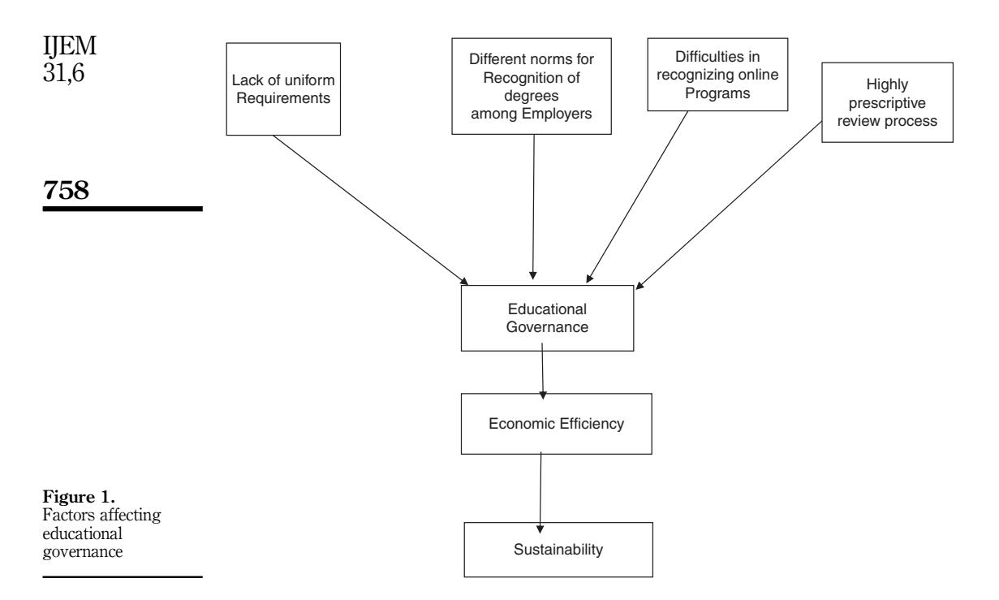
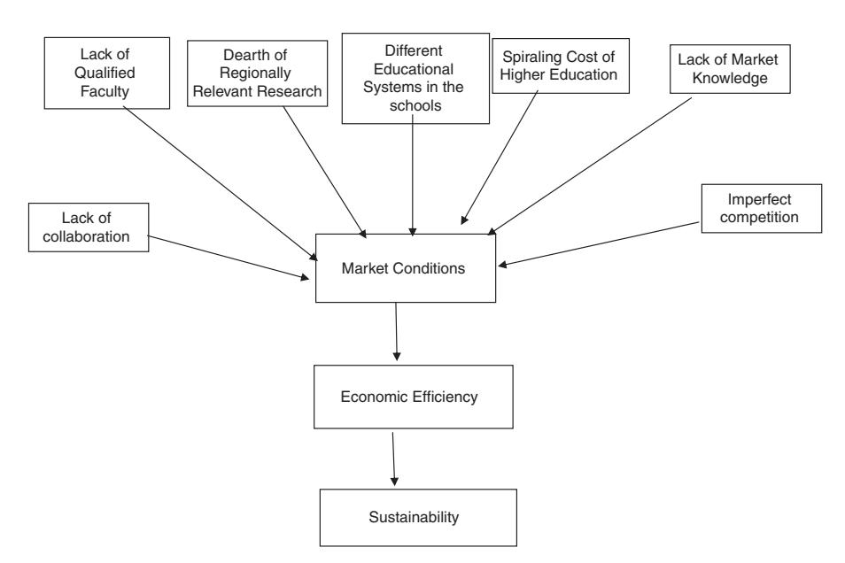

<!-- A1.R22 | source: papers_json/A1.R22/ -->

IJEM 31,6

752

Received 13 May 2016 Revised 7 September 2016 12 December 2016 Accepted 9 January 2017

## Building a sustainable higher education sector in the UAE

Saju Jose

Abu Dhabi University, Abu Dhabi, United Arab Emirates, and Jacob Chacko

College of Business, Abu Dhabi University, Abu Dhabi, United Arab Emirates

## Abstract

الغرض – الغرض من هذه الورقة هو دراسة الجوانب الاقتصادية ذات الصلة التي يمكن أن تؤثر على استدامة قطاع التعليم العالي (HE) في UAE.

التصميم/المنهجية/الأسلوب – تُجمع البيانات بشكل أساسي من مصادر ثانوية وتستند إلى المعلومات ذات الصلة. تم تحديد بُعدين، وهما عوامل السوق والحوكمة التعليمية، انطلاقاً من الأدبيات. كما تم عرض نموذج تجريبي يوضح العوامل المختلفة التي تسهم في هذين المتغيرين. النتائج – تم تحديد الحوكمة التعليمية وعوامل السوق باعتبارها الركيزتين الأساسيتين اللتين تسهمان في الكفاءة الاقتصادية لقطاع HE في UAE. وتتأثر هاتان الركيزتان بعوامل ذات صلة. يمكن التحكم في بعض القضايا المتعلقة بالحوكمة التعليمية. وعلى الرغم من أن العوامل المؤثرة في ظروف السوق قد تُعد غير قابلة للتحكم، إلا أن مؤسسات HE يمكنها وضع استراتيجيات أفضل للتعامل مع هذه القضايا.

حدود البحث/الآثار المترتبة عليه – نظراً لأن قطاع HE في UAE يمكن أن يكون مساهماً رئيسياً في الاقتصاد مستقبلاً، فمن المهم تحديد الركائز الأساسية والقوى المرتبطة بها التي يمكن أن تؤثر على الكفاءة الاقتصادية لقطاع HE. ويمكن اختبار النموذج المقترح تجريبياً في دراسات مستقبلية. الأصالة/القيمة – تمثل هذه الدراسة محاولة جديدة لدراسة الاستدامة في قطاع HE من حيث الكفاءة الاقتصادية، في حين ركزت الدراسات السابقة على الجانب الاجتماعي والبيئي للاستدامة في قطاع HE. وبذلك تحاول هذه الدراسة معالجة هذه الفجوة في هذا المجال من خلال التركيز على جانب الكفاءة الاقتصادية الذي يُعد مساهماً مهماً في التنمية المستدامة. وقد تقدم النتائج رؤى قيّمة للجامعات والجهات التنظيمية في وضع استراتيجيات مناسبة لتحسين قطاع HE.

Keywords United Arab Emirates, Sustainability, Higher education, Educational governance, Market factors Paper type Conceptual paper

## 1. Introduction

أصبح التعليم العالي (HE) مساهماً بالغ الأهمية في التنمية الاقتصادية في العديد من الدول. وتزيد الدول المتقدمة وبعض الدول النامية حول العالم من جهودها لاستقطاب الطلاب من دول أخرى للدراسة في مؤسسات التعليم العالي (HEI)، وبذلك تحقق عائدات يمكن أن تنافس حتى عائداتها من الصادرات. واليوم، تعتبر دول في أوروبا وأستراليا وأمريكا الشمالية أن HE قطاع اقتصادي مهم (Keller, 1983; Clark, 1983; Delanty, 2001; Kerr, 1987; Vaira, 2004). فعلى سبيل المثال، يجتذب قطاع التعليم في أستراليا أعداداً كبيرة من الطلاب الدوليين، وتسهم عائدات هؤلاء الطلاب بمبلغ ضخم يبلغ AU$17.5 billion في الاقتصاد الأسترالي (Australian Bureau of Statistics, 2015). وحتى الدول التي تعتمد تقليدياً على اقتصاد قائم على السلع الأساسية بدأت هذا التحول. فقد حددت دولة الإمارات العربية المتحدة (UAE) في وثيقة رؤيتها 2021 خططاً لاقتصاد قائم على المعرفة، يوفر قوى عاملة متعلمة ومؤهلة، تستمر في دفع التنمية الاقتصادية للبلاد (Cedwyn et al., 2013). وهذا يبيّن أن نموذجاً مستداماً لـ HE يمكن أن يكون قوة مهمة في دفع التغيير الاقتصادي. والسؤال الجوهري الذي ينبغي طرحه هو: كيف يمكن لقطاع HE أن يظل مستداماً وفي الوقت نفسه قادراً على المنافسة في بيئة ديناميكية؟

تعني الاستدامة أشياء مختلفة لأشخاص مختلفين. ففي علم البيئة، تُعرَّف الاستدامة بأنها صفة عدم الإضرار بالبيئة أو استنزاف الموارد الطبيعية، وبالتالي دعم التوازن البيئي على المدى الطويل. أما الاستدامة الاقتصادية فهي

International Journal of Educational Management Vol. 31 No. 6, 2017 pp. 752-765 © Emerald Publishing Limited 0951-354X DOI 10.1108/IJEM-05-2016-0102

<!-- page 2 -->

القدرة على دعم مستوى محدد من الإنتاج الاقتصادي بشكل غير محدود. أما الاستدامة الاجتماعية فهي قدرة نظام اجتماعي، كالدولة، على العمل عند مستوى محدد من الرفاه الاجتماعي بشكل غير محدود. وبشكل عام، تُعرَّف الاستدامة بأنها متطلب على جيلنا أن يدير قاعدة الموارد بحيث يمكن أن يشارك متوسط جودة الحياة الذي نضمنه لأنفسنا مع جميع الأجيال القادمة. ومن الواضح أن التنمية تكون مستدامة إذا وفقط إذا انطوت على متوسط جودة حياة غير متناقص (Asheim, 1994). وبعبارة بسيطة، الاستدامة هي القدرة على الاستمرار أو الدعم أو التأييد أو التثبيت. وهذا يعني أن مبادرات الاستدامة لا تستند إلى قواعد ولوائح ثابتة. فالممارسات المستدامة تتطور كعملية تعلّم، والاستدامة مصطلح ذو معانٍ متغيرة ومتنازع عليها (Wals and Jickling, 2002). وقد أدى هذا إلى بعض الالتباس حول المعنى الحقيقي للاستدامة (Piotrowicz and Cuthbertson, 2009). وحتى الجامعات (Velazquez et al., 2006) والأكاديميون (Reid and Petocz, 2006) ليسوا واضحين بشأن مبادرات الاستدامة. وتعتقد بعض الجامعات أن الاستدامة يمكن تحقيقها من خلال الحد من الفقر (Sanusi and Khelgat-Doost, 2008)، والحرم الجامعي الأخضر (Alshuwaikhat and Abubakar, 2008)، وتطوير المناهج (Lozano, 2010; Beusch, 2014). ووفقاً لـ Velazquez et al. (2006)، ينبغي أن تشمل المؤسسات العاملة في HE البحث والتواصل المجتمعي والشراكات والاستدامة. وعلى الرغم من إجراء عدد كبير من الأبحاث حول مبادرات الاستدامة المختلفة في قطاع HE، فإن معظم الدراسات تركز على مبادرات الاستدامة من حيث تطوير المناهج وبناء الحرم الجامعي الأخضر والحد من الفقر والتواصل المجتمعي. وحتى الآن لم تستكشف أي دراسة العوامل الرئيسية التي يمكن أن تسهم في استدامة قطاع التعليم العالي من منظور اقتصادي بحت. ويكتسب هذا الأمر أهمية خاصة نظراً لأن الجامعات حول العالم تتوسع نحو الأسواق الدولية وأن حدة المنافسة في قطاع HE أصبحت الآن شديدة. تحاول هذه الدراسة اقتراح نموذج لاستدامة قطاع HE من خلال تحديد العوامل الرئيسية التي يمكن أن تؤثر على التنمية المستدامة لـ HE. وتركز الدراسة على UAE التي تضم أكثر من 100 مؤسسة تعليم عالي مرتبطة بجامعات من جميع أنحاء العالم تقدم برامج مختلفة (Knowledge and Human Development Authority, 2014). والمنافسة في قطاع HE في UAE شديدة على الرغم من وجود العديد من عوائق الدخول في شكل موافقات متعددة (Wilkins, 2010). وتجعل اللوائح الصارمة مقترنة بعدد الجهات المقدِّمة للخدمة بيئة تشغيل صعبة لمقدمي HE. يهدف هذا البحث إلى الكشف عن العوامل الحاسمة التي يمكن أن تؤثر على استدامة قطاع HE. وتستند الورقة إلى المفهوم النظري لخط الأساس الثلاثي (Triple bottom line) الذي طوره Elkington (1998)، والذي يراعي ويوازن في آنٍ واحد القضايا الاقتصادية والبيئية والاجتماعية من منظور اقتصادي جزئي. ومع الإقرار بآراء Elkington (1998) حول الاستدامة، تركز هذه الورقة على وجهة النظر القائلة إن الكفاءة الاقتصادية لقطاع HE هي حجر الزاوية الأساسي للاستدامة. ويمكن لقطاع HE المستدام أن يجتذب أعداداً كبيرة من الطلاب محلياً ودولياً، وبذلك يجلب عائدات ضخمة للجامعات وللبلاد. ومع انخفاض الإيرادات من النفط، يمكن تطوير قطاع HE كمصدر بديل للإيرادات لدولة UAE في القرن الحادي والعشرين.

## 2. Economic efficiency is the key pillar of sustainability in HE sector

وفقاً للمجلس العالمي للتنمية الاقتصادية، تلبي التنمية المستدامة احتياجات الأجيال الحالية دون المساس بقدرة الأجيال القادمة على تلبية احتياجاتها الخاصة. وعلى المستوى الكلي، يعني هذا معالجة قضايا مهمة مثل: الكفاءة الاقتصادية (الابتكار، الازدهار، والإنتاجية)، والعدالة الاجتماعية (الفقر، المجتمع، الصحة والرفاه، حقوق الإنسان)، والمساءلة البيئية (تغير المناخ، استخدام الأراضي، التنوع البيولوجي). وبذلك، فإن الاستدامة موضوع واسع ذو أهداف متنوعة تركز على احتياجات التنمية للأجيال الحالية والقادمة في ظل ظروف متغيرة. وفيما يخص قطاع HE، يمكن القول إن قضايا مثل العدالة الاجتماعية والمساءلة البيئية تمثل قضايا اجتماعية مهمة لهذا القطاع، غير أن تحقيق الكفاءة الاقتصادية ينبغي أن يُمنح أولوية مساوية إن لم تكن أكبر، إلى جانب مبادرات الاستدامة الأخرى. وقد ركز البحث في

<!-- page 3 -->

قطاع HE دائماً على الجانب الاجتماعي للاستدامة. غير أنه في ظل المناخ الاقتصادي الحالي، حيث تواجه الجامعات ومقدمو HE الآخرون تحديات مثل انخفاض التمويل (Khalifa, 2009)، وزيادة المنافسة، وتغيّر متطلبات السوق (D'Alessio and Avolio, 2009)، أخذت الكفاءة الاقتصادية تبرز الآن باعتبارها الركيزة الأساسية التي تسهم في التنمية المستدامة لهذا القطاع. وبالنسبة لقطاع HE، قد يكون من المجدي اعتماد نهج استراتيجي أكثر توافقاً مع الأعمال الخاصة، مع تركيز أكبر على الكفاءة والربح التشغيلي، بل قد يكون ذلك أمراً حتمياً، أو ربما مستحسناً (Curtis and Samy, 2014). وقد استثمرت دول مثل UAE بكثافة في قطاع HE، وتتوقع أن تسهم هذه المؤسسات في الاقتصاد مستقبلاً (Mahani and Molki, 2011). غير أن التحدي يكمن في التوصل إلى نموذج مستدام يعالج المتغيرات المهمة التي تسهم في استدامة قطاع HE في UAE. وتحدد نظرية خط الأساس الثلاثي الركائز الثلاث المهمة للاستدامة، وهي: البيئة والمجتمع والاقتصاد. وتقوم الحجة وراء هذه النظرية على أن الشركات ينبغي أن تركز على ثلاثة خطوط أساس. الأول والأهم هو خط الربح، والثاني هو التركيز على الأفراد. أما الخط الثالث فهو الكوكب الذي يركز على البيئة. ونظرية خط الأساس الثلاثي هي طريقة للتعبير عن أثر الشركة واستدامتها على المستويين المحلي والعالمي. وتُناقش النظرية وصلتها بقطاع HE بالتفصيل في القسم التالي. وتنظَّم الورقة على النحو التالي: تقدم الأقسام القليلة القادمة مناقشة موجزة لنظرية خط الأساس الثلاثي ثم لمحة عامة عن قطاع HE في UAE. ويلي ذلك مناقشة سمتين رئيسيتين يمكن أن تؤثرا على الكفاءة الاقتصادية، وهما الحوكمة التعليمية وظروف السوق. ويقدم القسم الأخير توصيات وحدود البحث.

## 3. Triple bottom line and sustainability

طرح Elkington (1997) نظرية خط الأساس الثلاثي. ويرى أن على الشركات أن تنخرط في سلوك مسؤول اجتماعياً وبيئياً وأن تحقق مكاسب مالية إيجابية. وتذهب النظرية إلى أن المؤسسات ينبغي أن توازن بين القضايا الاقتصادية والبيئية والاجتماعية. وترتبط الاستدامة البيئية غالباً بالعناية بالبيئة الطبيعية، وهو ما يشمل تدابير مثل الحد من النفايات، والحد من التلوث، وكفاءة الطاقة، وخفض الانبعاثات، وتقليل استهلاك المواد الخطرة/الضارة/السامة، وتقليل تكرار الحوادث البيئية. ويركز رأس المال الاجتماعي على تحسين المجتمعات الداخلية والخارجية، ويمكن أن يتراوح من التخفيف من حدة الفقر إلى رعاية الموظفين. وتعني الاستدامة الاجتماعية أن المؤسسات توفر فرصاً عادلة، وتشجع التنوع، وتعزز الترابط داخل المجتمع وخارجه، وتضمن جودة الحياة، وتوفر عمليات ديمقراطية وهياكل حوكمة خاضعة للمساءلة (Elkington, 1997). أما الاستدامة الاقتصادية فتتعلق بامتلاك تدفق نقدي ثابت والحفاظ على عوائد أعلى من المتوسط لأصحاب المصلحة (Dyllick and Hockerts, 2002). والأبعاد الثلاثة لنظرية خط الأساس الثلاثي مترابطة، وقد تؤثر بطرق مختلفة (Elkington, 1997). وكما سبقت الإشارة، تسعى الجامعات إلى تحقيق الاستدامة من خلال معالجة البعدين الاجتماعي والبيئي، وهما الحد من الفقر (Sanusi and Khelgat-Doost, 2008)، والحرم الجامعي الأخضر (Alshuwaikhat and Abubakar, 2008)، وتطوير المناهج (Lozano, 2010; Beusch, 2014). غير أن المتغير الأساسي الذي ينبغي أن يحفز البعدين البيئي والاجتماعي هو الكفاءة الاقتصادية. وينبغي للجامعات أن تعطي الأولوية لهذا الجانب من نظرية خط الأساس الثلاثي. ويشير مفهوم خط الأساس الثلاثي إلى أن الشركات لا تحتاج فقط إلى الانخراط في سلوك مسؤول اجتماعياً وبيئياً، بل ينبغي أن تتأكد من إمكانية تحقيق مكاسب مالية إيجابية في هذه العملية (Gimenez et al., 2012).

## 4. Overview of the HE in the UAE

شهد قطاع HE في UAE تطوراً كبيراً من حيث عدد وتنوع وجودة البرامج والجهات المقدِّمة لها. ويعود هذا النمو السريع إلى تزايد عدد طلاب الجامعات في UAE، ومجلس التعاون الخليجي (GCC)، ومنطقة

<!-- page 4 -->

الشرق الأوسط وشمال أفريقيا (MENA). ووفقاً لـ CIA World Fact Book، تضم UAE نحو 5.6 مليون نسمة، وتحتل المرتبة 112 من حيث عدد السكان بين دول العالم. ويشكل مواطنو UAE نسبة 19 في المائة من هذا العدد، فيما يشكل المقيمون الأجانب النسبة المتبقية البالغة 81 في المائة. ويأتي نحو 50 في المائة من سكان UAE من جنوب آسيا، ونحو 8 في المائة من دول غربية، فيما تمثل النسبة المتبقية البالغة 23 في المائة مقيمين من أصول عربية وفارسية. وتبلغ نسبة السكان في سن الجامعة في UAE نحو 14 في المائة. وقد جعل عدم الاستقرار السياسي والمخاوف الأمنية في بقية منطقة MENA من UAE وجهة مفضلة لطلاب تلك المنطقة الملتحقين بمؤسسات التعليم العالي.

وقد أسهمت الحيوية الاقتصادية لدولة UAE، مقترنة بانفتاحها على المقيمين الأجانب والمؤسسات الأجنبية، في تدفق مقدمي التعليم الأجانب من الغرب والشرق على حد سواء. ومن بين الدول الغربية، تشكل الجامعات من UK وأمريكا الشمالية وفرنسا وأستراليا الغالبية. وتمثل الجامعات الهندية الغالبية من الدول الشرقية. ووفقاً لصحيفة Times of India، تُظهر بيانات التعداد لعام 2011 أن 41 في المائة من السكان الهنود دون سن 20 عاماً. كذلك، فإن 50 في المائة من السكان تتراوح أعمارهم بين 20 و59 عاماً. وتوفر العلاقة الطويلة الأمد بين الهند وUAE، مقترنة بالقرب الجغرافي بين البلدين، فرصة هائلة لـ UAE لاستقطاب الطلاب من الهند (MOE, 2016).

وإلى جانب عوامل الجذب المذكورة أعلاه، دفع تقدم عمر السكان مقترناً بتراجع التمويل الحكومي لـ HE في الدول الغربية العديد من المؤسسات الأوروبية والأمريكية الشمالية إلى إنشاء عمليات لها في UAE. وفي حين أن إغراء الحصول على إيرادات إضافية هو الدافع المشترك بين جامعات الغرب والشرق، فإن الجامعات الهندية التي تنشئ حرماً جامعياً في UAE لا تواجه تقلص السكان في بلدها الأم كما هو الحال لدى نظيراتها الغربية. ومن خلال إنشاء حرم جامعي في UAE، تمكنت الجامعات الهندية من تجاوز القيود الصارمة المفروضة على القبول والمرتبطة بالبنية التحتية وفرص التوظيف في بلدها والتي تفرضها الحكومة الهندية. ففي معظم الجامعات الراسخة في الهند، يفوق عدد الطلاب الساعين للقبول في مؤسسات HEI عدد المقاعد المتاحة في تلك المؤسسات بكثير. غير أن الطلاب الذين لم يتمكنوا من الحصول على قبول في هذه الكليات في الهند يمكنهم السفر إلى UAE للدراسة والتخرج من مؤسستهم المفضلة. إضافة إلى ذلك، فإن الرسوم الدراسية التي تفرضها هذه المؤسسات على عملياتها خارج الهند لا تخضع أيضاً لرقابة السلطات الهندية.

## 4.1 Comparative analysis of HE sector of UAE

يستند النظام التعليمي في UAE إلى حد كبير على نموذج غربي، ولا سيما النظام الأمريكي. وتقدم معظم الجامعات في UAE عموماً برامج بكالوريوس مدتها أربع سنوات. وفي USA، يوجد أكثر من 3,900 كلية وجامعة تقدم مجموعة واسعة من برامج البكالوريوس (Iyanna and Abraham, 2012). وتكاد جميع هذه المؤسسات الأمريكية الشمالية تكون معتمدة من هيئات الاعتماد الإقليمية في USA. وفي UK، يوجد 154 مؤسسة تعليم عالٍ معترف بها يمكنها منح الدرجات العلمية. وتخضع برامجها لتنظيم Higher Education Funding Council for England. أما مقدمو HE الأستراليون في UAE فعددهم منخفض نسبياً. ويوجد في أستراليا نحو 37 جامعة حكومية وجامعتان خاصتان. وهناك جهتان تنظيميتان رئيسيتان، وهما Tertiary Education Quality and Standards Agency وAustralian Skills Quality Agency التي تُعنى بالتعليم والتدريب المهني.

ويجعل وجود الجامعات المحلية وتزايد عدد الحرم الجامعي الخارجي، مقترناً بالعدد الكبير من المتطلبات التنظيمية التي تفرضها MOHSE، وKnowledge and Human Development Authority (KHDA)، وCommission for Academic Accreditation (CAA)، وNational Qualifications Authority (NQA)، بيئة UAE أكثر تعقيداً مقارنة بمناطق أخرى من العالم. ويُعد تمثيل قطاع HE الحكومي في UAE، الذي يشكل نحو 8 في المائة من المؤسسات، منخفضاً مقارنة بالقطاعات الحكومية في الدول المماثلة (Centre for Higher Education Data and Statistics, 2013).

<!-- page 5 -->

## 5. HE regulatory agencies in the UAE

لا يزال قطاع HE في UAE في مرحلة نشأته مقارنة بالشرق والغرب. فأقدم مؤسسة تعليم عالٍ، جامعة الإمارات العربية المتحدة (UAEU)، لا يتجاوز عمرها 40 عاماً. إضافة إلى ذلك، لم يمض سوى 45 عاماً منذ أن اتحدت الإمارات السبع، التي كانت تتمتع كل منها بوضع دولة مستقلة، لتشكل اتحاداً اقتصادياً وسياسياً هو UAE. وبذلك، فإن الجهات التنظيمية على المستويين الاتحادي والمحلي لديها متطلبات مختلفة لمؤسسات HEI. والجهة الاتحادية المشرفة على HE في UAE هي وزارة التعليم العالي والبحث العلمي (MOHESR). غير أن هناك مناطق تجارة حرة لـ HE في إمارات مختلفة لا تخضع لمتطلبات MOHESR. فعلى سبيل المثال، تعمل العديد من الجامعات الدولية في إمارة دبي وتقدم درجاتها العلمية الخاصة ببلدها الأم. وهذه الجامعات مرخصة من KHDA ومعظمها غير معتمد من CAA التابعة لـ MOHESR. والقاعدة بالنسبة للطلاب الإماراتيين هي أن درجاتهم العلمية يجب أن تكون معتمدة من CAA حتى يُعترف بإنجازاتهم التعليمية في القطاع الحكومي. ونظراً لأن الغالبية العظمى من المقيمين في UAE من الجنسيات الأخرى لا تتاح لهم فرص العمل في الحكومة، فإن هذا القيد لا يمثل عائقاً كبيراً. وتحظى بعض هذه الجامعات المرخصة من KHDA وغير المعتمدة من CAA بشعبية كبيرة لدى الطلاب المقيمين الأجانب وأقلية من المواطنين الإماراتيين. ويعود ذلك بشكل رئيسي إلى الهيبة المتصورة المرتبطة بالحصول على درجات علمية من مؤسسات غربية. وبالمثل، يختار كثير من الطلاب المقيمين من شبه القارة الهندية الالتحاق بالحرم الجامعي الخارجي للجامعات الهندية غير المعتمدة من CAA نظراً لشهرتها/اسمها المعروف في الهند وبسبب هيكل رسومها الأقل نسبياً في معظم الأحيان. وقد أدى هذا التنوع في الجنسيات، والفروق في فرص العمل بين المواطنين وغير المواطنين، ووجود جهات تنظيمية اتحادية ومحلية مختلفة، وعدم وضوح حوكمة HE في UAE إلى بيئة HE معقدة جداً تثير الحيرة في أحسن الأحوال لدى الطلاب في سن الجامعة وأولياء أمورهم.

وعلى غرار دور KHDA في دبي، يشرف في إمارة أبوظبي Abu Dhabi Education Council (ADEC) على إنشاء وتشغيل المدارس ومؤسسات HEI. وتتمتع هاتان الجهتان التنظيميتان بحق الرفض ضمن إمارتيهما المعنيتين. إضافة إلى ذلك، أنشأت UAE في عام 2012 NQA، وهي جهة اتحادية مسؤولة عن التنسيق مع الجهات ذات الصلة في تطوير الاستراتيجيات والخطط والسياسات والمعايير للتعليم العالي والتعليم العام والتعليم والتدريب التقني والمهني والفني في UAE. وبذلك، يضم قطاع HE في UAE بشكل عام عدة جهات تنظيمية تضيف طبقات من الموافقات للجامعات خارج المناطق الحرة.

وقد اتسم قطاع HE في UAE بنمو سريع على مدى العقود منذ إنشاء UAEU، أول مؤسسة من نوعها في البلاد. وأصبحت UAE الآن مركزاً لـ HE يضم ثلاث جامعات اتحادية وأكثر من 70 مؤسسة معتمدة من الوزارة في البلاد. وفي حين أن بعض الجامعات لديها حرم جامعي مستقل، تعمل جامعات أخرى ضمن مناطق حرة للتعليم أو تجمعات تعليمية. ويوجد نحو 120,000 طالب مسجل في مؤسسات مختلفة في البلاد. وفي دبي وحدها، يوجد أكثر من 39,000 طالب مسجل في 12 نظاماً تعليمياً من HE، بما في ذلك الأنظمة الأمريكية والبريطانية والفرنسية والكندية والأسترالية والهندية والإماراتية. ويوجد أكثر من 390 برنامجاً أكاديمياً، معظمها يتركز في مجالات الأعمال والإدارة وتقنية المعلومات والتسويق. وتستحوذ إمارتا UAE على أكثر من 80 في المائة من جميع مؤسسات HEI، وأكثر من 90 في المائة من الطلاب في أبوظبي ودبي (MOE, 2016). ولذلك، سيركز النقاش هنا على بيئة HE في هاتين الإمارتين.

## 5.1 Emirate of Dubai

وفقاً لـ KHDA، يوجد 57 مؤسسة تقدم برامج HE في دبي. وتُصنَّف هذه المؤسسات ضمن أربع فئات (Table I):

(1) Federal institutions: هذه مؤسسات ممولة من حكومة UAE، وهناك ثلاث مؤسسات اتحادية تخدم بشكل أساسي المواطنين الإماراتيين.

<!-- page 6 -->

- (2) International universities: يوجد 26 مؤسسة دولية تعمل في دبي وهي مؤسسات مانحة للدرجات العلمية وتحمل اعتماداً مؤسسياً دولياً أو من بلدها الأم.
- (3) Local universities: يوجد 25 مؤسسة محلية معتمدة مؤسسياً من CAA في UAE، وقد تحمل بعض هذه الجامعات المحلية أيضاً اعتماداً مؤسسياً و/أو برامجياً دولياً.
- (4) Vocational: توجد ثلاث مؤسسات مهنية لا تمنح عموماً درجات علمية.

وتستحوذ المؤسسات الاتحادية في دبي على 18 في المائة من الطلاب، وتستحوذ المؤسسات الخاصة في المناطق الحرة على 46 في المائة من الطلاب، فيما تضم المؤسسات الخاصة خارج المناطق الحرة 36 في المائة من الطلاب. ويأتي الطلاب الدارسون في دبي من مجموعة واسعة من الجنسيات. ويشكل الطلاب الإماراتيون أكبر مجموعة بفارق كبير، بما يزيد على 20,000 طالب أو 43 في المائة، يليهم الطلاب الآسيويون بنحو 10,000 طالب أو 21 في المائة. ومع الاضطرابات السياسية والاقتصادية الأخيرة في منطقة MENA، حدثت زيادة كبيرة في أعداد الطلاب المقيمين الأفارقة والعرب.

وفي إمارة دبي، يمكن أن تكون الجامعات الدولية معتمدة من CAA التابعة لـ MOHESR، أو أن تخضع لضمان الجودة من خلال University and Quality Assurance International Board (UQAIB) التابعة لدبي. وقد أنشأت KHDA UQAIB في عام 2008 لضمان جودة مؤسسات HEI في المنطقة الحرة غير المعتمدة من CAA. كما توافق UQAIB على جميع البرامج الجديدة التي يقدمها مقدمو HE (Knowledge and Human Development Authority (KHDA), 2014).

## 5.2 In the Emirate of Abu Dhabi

وفقاً لـ ADEC، يوجد 23 مؤسسة تعليم عالٍ في أبوظبي تقدم مجموعة واسعة من برامج البكالوريوس والماجستير والدكتوراه. ويمكن تقسيم هذه المؤسسات إلى ثلاث فئات: المؤسسات الممولة اتحادياً، والمؤسسات الممولة من إمارة أبوظبي والمعروفة بالمؤسسات الحكومية غير الممولة اتحادياً، والمؤسسات الممولة بشكل خاص التي لا تتلقى أي تمويل من الدولة أو من إمارة أبوظبي (ADEC, 2014).

## 6. Educational governance and market conditions

يكشف بحثنا الاستكشافي من خلال البيانات الثانوية ذات الصلة أن الكفاءة الاقتصادية في قطاع HE في UAE تعتمد بشكل أساسي على جانبين، هما الحوكمة التعليمية وظروف السوق.

## 6.1 Educational governance

يعيق وجود هيئات اعتماد متعددة ذات عملية مراجعة شديدة التفصيل قدرة مقدمي HE على إطلاق برامج مبتكرة تستجيب بسرعة لاحتياجات الصناعة. ويمكن أن يعيق هذا أيضاً إنتاجية المؤسسة. وتُعرض العوامل التي كشف عنها البحث في Figure 1.

## 6.2 Educational governance regime in the UAE

تُناط بـ ADEC وDubai Education Council (DEC) ووزارة التربية والتعليم في UAE مهام إصلاح التعليم، مع الحفاظ على التقاليد المحلية والمبادئ والهوية الثقافية لـ UAE (Watt, 2012). وعلى الرغم من أن هذه آلية فعالة

| Type | Categories of higher education institutions in Dubai |  |  |  |
| --- | --- | --- | --- | --- |
| Federal institutions | International universities | Local universities | Vocational institutions |  |
| Number | 3 | 26 | 25 | 3 |

<!-- page 7 -->

تضمن الجودة وأفضل الممارسات، إلا أنها قد تكون في بعض الأحيان عملية مرهقة للمؤسسات. وفيما يلي بعض الصعوبات الناشئة عن الحوكمة التعليمية الحالية.

عدم وجود توحيد في المتطلبات. تعمل UAE بسرعة وجدية لوضع آليات تضمن برامج ذات جودة في مؤسسات HEI. ويجب طلب الموافقات من CAA وADEC/KHDA إلى جانب وكالات الاعتماد الإقليمية والدولية ووكالات الاعتماد المهنية إن انطبق ذلك. وغالباً ما تكون هذه الموافقات متسلسلة بدلاً من أن تكون متزامنة. وتهدف عملية الموافقة الصارمة والمتسلسلة إلى ضمان الجودة وحاجة السوق، مع ضمان عدم دخول مقدمي التعليم غير الجادين وإنشائهم لعمليات. وهناك منحنى تعلّم مصاحب لهذا الأمر، خاصة عندما يتعين أن تغطي اللوائح نطاقاً واسعاً من مؤسسات HEI من مختلف أنحاء العالم. وفي محاولة لضمان الجودة، أنشأت UAE نظام حوكمة تعليمية يخلق عدة طبقات من الموافقات قد تستغرق وقتاً طويلاً نسبياً. وفي الوقت نفسه، فإن إنشاء المناطق الحرة لاستقطاب جامعات دولية معروفة يسمح، بحكم التصميم، لهذه الجامعات بتجاوز متطلبات اعتماد CAA، وبالتالي يسمح بمعايير مختلفة في عملياتها.

اختلاف معايير الاعتراف بالدرجات العلمية بين أصحاب العمل. في حين تتمتع الجامعات الدولية في المناطق التعليمية الحرة بتقدير أكبر للعلامة التجارية وبالتالي تجتذب مجموعة متنوعة من الطلاب من UAE والمنطقة، فإنها لا تجتذب أعداداً كبيرة من المواطنين الإماراتيين إلى برامجها. ويعود ذلك إلى أن الجهات الحكومية في UAE تعترف عموماً فقط بالدرجات العلمية من المؤسسات المعتمدة من CAA.

صعوبات في الاعتراف بالبرامج الإلكترونية. كان عدم اعتراف أصحاب العمل المحتملين بالبرامج الإلكترونية عائقاً أمام التعليم الإلكتروني (Elaine and Seaman, 2013). وحتى وقت قريب، لم تكن MOHE تعترف ببرامج الدرجات العلمية التي أُنجزت أو قُدِّمت بنمط إلكتروني. وفي العام الماضي، وضعت MOHE قائمة بأبرز الجامعات من

<!-- page 8 -->

Higher education sector in the UAE

759

عملية مراجعة شديدة التفصيل. نظراً لحداثة قطاع HE في UAE، فإن عملية المراجعة على مختلف المستويات دقيقة الطابع وشديدة التفصيل. وقد وُضعت العملية الحالية لضمان الجودة، لكنها غالباً ما تؤدي إلى فترات زمنية طويلة. وعلى الرغم من أن الغرض من وضع هذه العملية شديدة التفصيل هو منع القلة التي قد تحاول التحايل على معايير الجودة، فإنها تجعل البيئة غير مرنة وشاقة في الاستجابة بسرعة للاحتياجات التعليمية لمختلف أصحاب المصلحة.

## 7. Market conditions

يشير هذا المتغير إلى ظروف السوق الخارجية التي يمكن أن تؤثر على التنمية المستدامة لقطاع HE. وقد كشف بحثنا عن عدد من العوامل ضمن ظروف السوق التي يمكن أن تؤثر على استدامة قطاع HE (Figure 2).

## 7.1 Challenges facing HE in the UAE and the region

نقص الأعداد الكافية من أعضاء هيئة التدريس المؤهلين. على المستوى العالمي، هناك نقص في أعضاء هيئة التدريس الحاصلين على درجات الدكتوراه من جامعات مرموقة. وفي منطقة MENA، هذا النقص أكثر حدة. وقد وجدت دراسة أجراها Cedwyn et al. (2013) في قطاع HE في UAE أن جودة التدريس تؤثر على رضا الطلاب، مما يشير إلى الحاجة إلى أعضاء هيئة تدريس ذوي جودة. ومع حالات عدم الاستقرار الإقليمي، أصبح استقطاب أعضاء هيئة التدريس من الغرب أكثر صعوبة.

نقص المعرفة الواضحة بالسوق. يخلق النظام متعدد الطبقات، بجهاته المتعددة على مستوى الولاية والمناطق التعليمية الحرة، بيئة HE محيّرة إلى حد ما لطلاب المدارس الثانوية وأولياء أمورهم عند اتخاذ قرارات بشأن الوجهة والجامعة التي سيلتحقون بها.

ندرة الأبحاث ذات الصلة بالمنطقة. أسهم انخفاض مستويات تمويل البحث والافتقار العام إلى تركيز بحثي في الجامعات الإقليمية في ندرة الأبحاث من منطقة الخليج (Hvdit, 2015). ومع القليل جداً من الأبحاث ذات الجودة التي أُجريت في المنطقة،

*Figure 2. Factors affecting market conditions*

<!-- page 9 -->

يصبح الابتكار وتخصيص المناهج أمراً صعباً. ونظراً لأن معظم الكتب الدراسية مكتوبة للسوق الغربية، فإن الكتب المستخدمة في المنطقة تكاد لا تحتوي على دراسات حالة ذات صلة بالأوضاع الإقليمية والمحلية. وقد بدأت العديد من الجامعات الآن جهداً منسقاً لتطوير كتب دراسية تتضمن دراسات حالة متعلقة بالمنطقة. ولهذا الغرض، تتواصل مع أكاديميين في المنطقة. وتعمل هذه الجامعات أيضاً مع دور نشر غربية لإنتاج كتب دراسية تتضمن دراسات حالة ذات صلة بالمنطقة. ولا تزال هذه الأنشطة في مراحلها الأولى.

التنوع في الإعداد التعليمي للطلاب القادمين من أنظمة تعليمية مختلفة. أصبحت UAE خياراً جذاباً بشكل متزايد للطلاب الدوليين ليس فقط من المنطقة العربية، بل أيضاً من أنحاء أخرى من العالم (Ahmad and Hussain, 2015). ويعيش في دبي أشخاص من 200 دولة. وهذا يجعل دبي مدينة دولية حقيقية. ومع هذا التنوع، ليس مستغرباً أن تكون الأنظمة المدرسية في UAE متنوعة أيضاً. وعندما يتخرج هؤلاء الطلاب من المرحلة الثانوية وينضمون إلى الجامعات، تُختزل المناهج بشكل كبير إلى عدد قليل منها. وتتبع غالبية مؤسسات HEI في UAE المناهج الأمريكية. ويخلق تنوع الطلاب الملتحقين بالكليات تحدياً كبيراً لأعضاء هيئة التدريس والإداريين في إيجاد بيئة تعلّم مثلى تشمل الجميع. إضافة إلى ذلك، فإن ما يقرب من 100 في المائة من أعضاء هيئة التدريس في الكليات هم من المقيمين الأجانب. وهم قادمون من أنظمة تعليمية مختلفة. وفي ظل هذه الظروف، يصبح ضمان الاتساق في التدريس والتعلم في مؤسسات HEI تحدياً.

التكلفة المتنامية بسرعة للتعليم العالي. على الرغم من أن تكلفة الدراسة في UAE أقل بكثير مقارنة بدول مثل كندا وأستراليا وUSA، لا تزال UAE تُعد من الدول ذات تكلفة معيشة ورسوم جامعية مرتفعة (Sadaqat, 2014). وتنمو تكلفة HE في UAE بمعدل أسرع بكثير من معدل التضخم. ويمكن أن يكون هذا صعباً بشكل خاص في وقت التباطؤ الاقتصادي الناتج عن انخفاض أسعار النفط. وباستثناء المؤسسات الاتحادية، تعتمد معظم المؤسسات الخاصة على المقيمين الأجانب كطلاب. ويمكن أن تؤدي المنافسة الشديدة، مقترنة بانخفاض الدخل المتاح بسبب التباطؤ الاقتصادي، إلى إغلاق المؤسسات الصغيرة والأضعف وانخفاض أعداد الطلاب المقيمين الأجانب الذين يغادرون مؤسسات HEI في UAE.

تراجع الدعم الحكومي للمؤسسات الاتحادية وشبه الحكومية. في الوقت الحالي، لا تفرض المؤسسات الاتحادية أي رسوم دراسية على المواطنين الإماراتيين. أما المؤسسات المدعومة حكومياً مثل NYU-Abu Dhabi، وParis Sorbonne-Abu Dhabi، وKhalifa University، وAmerican University of Sharjah، وغيرها، فتفرض رسوماً دراسية مرتفعة. غير أن الجزء الأكبر من ميزانياتها يُموَّل من الإمارة المعنية أو من حكومة UAE. ومع التباطؤ الاقتصادي الناتج عن انخفاض إيرادات النفط، بدأت مستويات الدعم بالفعل في التراجع. ونظراً لاعتياد هذه المؤسسات التعليمية على دعم كبير لاستمرار عملياتها، سيتعين عليها تغيير أنماط تشغيلها بشكل جذري. ومن المتوقع أن يحدث هذا اضطراباً كبيراً في قطاع HE في UAE وفي منطقة GCC.

نقص التعاون بين الجامعات في منطقة MENA. على عكس مؤسسات الغرب، يُعد مفهوم التعاون في ظل المنافسة مفهوماً غريباً في MENA. ويؤدي عدم تبادل المعلومات وغياب التعاون الفعّال بين المؤسسات في هذه المنطقة إلى ازدواجية الجهود، وثغرات في السوق، وقلة التنسيق. وعلى عكس الغرب، لا يوجد توجه نحو تبادل المعلومات أو الاستفادة من موارد بعضها البعض لتحسين العمليات. وقد أدى هذا الغياب لتبادل المعلومات المتعلقة بالرواتب والمزايا والخطط وغيرها إلى خلق بيئة من الريبة بين المؤسسات التعليمية. ونتيجة لذلك، غالباً ما تفشل محاولات التعاون فيما بينها في هذه المنطقة.

المنافسة غير الكاملة. أدى انفتاح قطاع HE من قبل حكومات UAE، بشكل رئيسي من خلال إنشاء المناطق الأكاديمية، إلى استقطاب العديد من الجامعات الخاصة من مختلف أنحاء العالم، بما في ذلك USA وUK والهند وأستراليا وباكستان وإيران وروسيا (Cedwyn et al., 2013). ويعتمد معظمها على رسوم الطلاب لتحقيق الكفاءة الاقتصادية. وستشهد السنوات القادمة بالتأكيد منافسة شديدة بين

<!-- page 10 -->

Higher education

مؤسسات HE لاستقطاب مزيد من الطلاب. ومن المتوقع أن يقيّم العملاء المحتملون كل مؤسسة بناءً على سمعتها وفرص التوظيف المتاحة لطلابها. كما تلعب تقييمات الطلاب دوراً مهماً في بناء سمعة جيدة. وبذلك، يتعين على المؤسسات مضاعفة جهودها لتكون في الصدارة.

## 8. Important parameters for the sustainability of HE in the UAE

## 8.1 Expedite approval processes

ستحتاج الجهات المختلفة على مستوى الإمارات والمستوى الاتحادي إلى التنسيق وتبادل البيانات لتطوير نظام حوكمة تعليمية مبسّط بأقل قدر من الازدواجية مع الحفاظ على صرامة ضمان الجودة. ويمكن تحقيق ذلك من خلال إنشاء نظام حوكمة تعليمية موحد على مستوى UAE بالكامل، يُفتح بعد ذلك للتنسيق مع وكالات الاعتماد الدولية للتحقق من ضمان الجودة. إضافة إلى ذلك، من خلال التعاون مع وكالات الاعتماد الدولية، يمكن تبسيط عملية مراجعة البرامج الجديدة والقائمة.

## 8.2 Embrace e-learning

مع الابتكارات السريعة في التقنية اليوم، يمكن أن تكون عمليات التعلم المدمج والإلكتروني إضافة رائعة للأساليب التقليدية في تقديم التعليم. ومع ضمان الجودة، يمكن لمنصات التعلم الإلكتروني أن تقدم خيارات رائعة للطلاب في UAE مع توفير فرص أكبر للوصول إلى التعليم العالي.

## 8.3 Expand availability of part-time faculty members

نظراً لندرة الموارد المؤهلة من أعضاء هيئة التدريس، من الضروري استقطاب الممارسين المؤهلين العاملين في UAE للتدريس كمدرّسين بدوام جزئي. ولتشجيع ذلك، يجب تبسيط عملية الموافقة على تدريسهم بدوام جزئي وأن تستند إلى مؤهلاتهم. إضافة إلى ذلك، من خلال تبسيط متطلبات ممارسي الصناعة للتدريس وإلقاء محاضرات كضيوف، يمكن التخفيف من نقص أعضاء هيئة التدريس مع ضمان حداثة المادة العلمية.

## 8.4 Promote a culture of giving and endowments for higher education

على غرار المؤسسات الغربية، تحتاج المؤسسات الخاصة إلى استقطاب الأوقاف لتقليل مستوى اعتمادها على الرسوم الدراسية للطلاب. وسيساعد هذا في تعزيز استدامة بيئة HE، لا سيما خلال فترات التراجع الاقتصادي. ويمكن للحكومة أن تساعد من خلال تشجيع المساهمات لدعم التعليم في المؤسسات الخاصة. ومن المتوقع أن يوفر صندوق The Abdulla Al Ghurair Foundations المقترح مؤخراً بقيمة 4 مليارات درهم منحاً دراسية لـ 15,000 طالب. وستضمن مبادرات كهذه حصول المرشحين المستحقين على فرصة للدراسة في أفضل المؤسسات في UAE. وقد وُجد أن ممارسات الأعمال مثل بناء العلامة التجارية آلية فعالة لزيادة تفاعل الخريجين والمانحين المحتملين (Stephenson and Yerger, 2014).

## 8.5 Enhance collaboration through research funding

كما ذُكر سابقاً، هناك حاجة ملحة لتحفيز أبحاث ذات صلة وجودة في UAE ومنطقة MENA. ويمكن تحقيق ذلك من خلال تعزيز التعاون بين الجامعات داخل UAE وMENA عن طريق تمويل مشاريع بحثية مشتركة. ويساعد هذا في تقليل ازدواجية الجهود البحثية مع تعزيز القدرات البحثية داخل المؤسسات الاتحادية والخاصة. ومن خلال تطوير القدرات في جميع المؤسسات، ستتعزز جودة وحداثة التدريس في جميع المؤسسات. وينبغي تشجيع التعاون مع أكاديميات أخرى، لا سيما من الجامعات المرموقة. ويُعد هذا أمراً بالغ الأهمية لتعزيز البحث وزيادة إنتاج المنشورات (Munoz et al., 2016).

<!-- page 11 -->

IJEM 31,6

762

8.6 Ensure relevance and curricular currency through close ties to the industry

لضمان حداثة وملاءمة المناهج، يلزم وجود شراكات وثيقة مع الممارسين والصناعة. ويمكن لحكومة UAE أن تلعب دوراً مهماً في تثقيف الصناعة حول قدرات مؤسسات HEI في البلاد وتعزيز البحث المدعوم من الصناعة داخل جميع المؤسسات المعتمدة من CAA. ويمكن لهذه الشراكات أيضاً أن تشجع الممارسين على أن يكونوا متحدثين ضيوفاً، وأعضاء هيئة تدريس بدوام جزئي، وأعضاء في لجان المناهج في مؤسسات HEI. وإضافة إلى تثقيف الصناعة حول مؤسسات HEI في البلاد، يجب تسهيل عمليات الموافقة المطلوبة للممارسين للانخراط بشكل وثيق مع مؤسسات HEI.

## 8.7 Federal scholarships for nationals at private institutions

في الوقت الحالي، توفر المؤسسات الاتحادية الثلاث التعليم مجاناً للمواطنين الإماراتيين، في حين أنه إذا رغب المواطنون الإماراتيون في الالتحاق بأي مؤسسة خاصة، فسيتعين عليهم دفع الرسوم. ويحد هذا من خيارات المواطنين، وفي الوقت نفسه يقلل الضغط على المؤسسات الاتحادية للتنافس على الطلاب من خلال تعزيز البرمجة والمناهج وخدمات الطلاب. وإذا كانت المنحة التعليمية الممنوحة للمواطنين الإماراتيين قابلة للنقل إلى المؤسسات التي يختارونها، فستتعزز جودة عرض البرامج وتنوع الطلاب في جميع المؤسسات. وتوجد ممارسة كهذه في بعض دول GCC مثل الكويت.

## 8.8 National ranking of HEI's

تجمع ADEC بيانات مقارنة وتنشرها لمؤسسات HEI في إمارة أبوظبي. وإذا أمكن تطوير نظام تصنيف على المستوى الوطني بناءً على مجموعة بيانات مماثلة تنظر في معايير الجودة مثل الإنتاج البحثي، ومنشورات أعضاء هيئة التدريس، والاعتمادات الدولية، وفرص التبادل، ونسبة الطلاب إلى أعضاء هيئة التدريس، ونجاح الطلاب، والتوظيف وما شابه، فسيتمكن الطلاب وأولياء الأمور من اتخاذ قرارات أكثر استنارة. وقد أصبح تطوير استراتيجيات خدمة مناسبة لتقديم خدمة تعليمية ذات جودة للطلاب، من أجل تحقيق ميزة تنافسية، معياراً مهماً (Poole et al., 2000; Khan and Matlay, 2009). إضافة إلى ذلك، يمكن تخصيص المنح الاتحادية بناءً على هذه التصنيفات. ومن شأن تخصيص الأموال الحكومية بهذه الطريقة أن يحقق أعلى عائد على الاستثمار مع ضمان توجيه الاستثمار التعليمي داخل البلاد بدلاً من الممارسة الحالية المتمثلة في منح المنح الدراسية للدراسة في الخارج.

## 9. Summary discussion and conclusion

جعل موقعها المركزي، ومستوى المعيشة المرتفع، والحيوية الاقتصادية، وتقبّل التنوع، والبنية التحتية المتطورة، وسلامة وأمن مقيميها، من UAE مركزاً تجارياً للمنطقة. وتجعلها السمات نفسها موقعاً مرغوباً للغاية لتكون مركزاً تعليمياً. وتُعد هذه السمات أعظم أصول الدولة لتنويعها الاقتصادي. وللحفاظ على الحيوية الاقتصادية المستمرة، تحتاج UAE إلى ضمان استدامة ونمو قطاعها التعليمي من خلال توفير بيئة تعزز التحسين المستمر في الجودة مع ضمان الابتكار في البنية التحتية والبرمجة التعليمية. ولتحقيق النمو المستدام لهذا القطاع، من الضروري أن تكون الحوكمة التعليمية داخل البلاد منسقة جيداً ومحفَّزة لتعزيز التعاون وتبادل الموارد بين مؤسسات HEI. إضافة إلى ذلك، من المهم للدولة أن تُثقّف مقيميها حول مختلف فئات مقدمي الخدمة التعليمية العاملين داخل UAE وأن توضح مختلف السمات والمعايير لتمكينهم من فهم واضح لجودة ومستوى وقيمة HE المتاح داخل الدولة.

إضافة إلى ذلك، يمكن أن يؤدي التخصيص الأفضل للتمويل الحكومي بناءً على معايير الجودة والنشر الفعّال للموارد إلى عائد أفضل على الاستثمار من قطاع HE. وسيحقق الدعم الذي تشتد الحاجة إليه للبحث والتطوير في القطاعات الحيوية داخل مؤسسات HEI

<!-- page 12 -->

عائداً أكبر بكثير على المدى القصير مع تطوير القدرات الداخلية لرعاية الابتكار والنمو الاقتصادي المستدام. وقد أدى النموذج الحالي لتمويل مؤسسات HEI إلى نمو المؤسسات الاتحادية واستقطاب مؤسسات عالمية بارزة إلى البلاد. غير أنه مع انخفاض الإيرادات من قطاع النفط والحاجة الملحة لتنويع قاعدتها الاقتصادية من خلال تطوير قوتها العاملة الوطنية في القطاعات الناشئة والابتعاد عن القطاعات الحكومية، من الضروري أن تركز UAE مواردها على تطوير بيئة HE الخاصة بها التي من شأنها تدريب مواطنيها مع استقطاب طلاب متميزين من المنطقة الأوسع. وإذا تمكنت UAE من بناء بيئة HE مستدامة، فقد تصبح قوة جذب لمجموعة أكبر بكثير من الطلاب من الشرق الأوسط، وشمال وشرق وغرب أفريقيا، وشبه القارة الهندية. إضافة إلى ذلك، ستكون العديد من جمهوريات الاتحاد السوفيتي السابقة التي تضم شرائح كبيرة من السكان المسلمين هدفاً جديداً لمؤسسات HEI داخل UAE. وعلى غرار النموذج في الدول المتقدمة، سيساعد استقطاب طلاب دوليين متميزين على تنويع القاعدة الاقتصادية لـ UAE من خلال تطوير قطاعات جديدة داخل البلاد. وإضافة إلى استقطاب المتميزين، يتيح قطاع تعليمي متطور لـ UAE توجيه مواردها على المستوى الوطني لإيجاد حلول لمشكلاتها المؤسسية والشركاتية بدلاً من الممارسة الحالية المتمثلة في استيراد هذه الخبرات.

## 10. Directions for future research, limitations and implications

تستند التحديات المحددة من حيث الحوكمة التعليمية وظروف السوق إلى بحث ثانوي. ويمكن اختبار المتغيرات المحددة من النموذج باستخدام منهجيات مناسبة مستقبلاً للتحقق من موثوقيتها. وينبغي اختيار عينة دراسة كهذه باستخدام عينة تضم أكاديميين وإداريين وطلاباً في قطاع HE. وقد أصبحت UAE مهيأة تماماً لتكون مركز التعليم في منطقة الشرق الأوسط (Knight, 2013). وتقدم الدراسة رؤى مفيدة لأصحاب المصلحة المعنيين من خلال تحديد العوامل الرئيسية التي يمكن أن تؤثر على استدامة قطاع HE في UAE. ومن المنظور النظري، تدرس الدراسة أهمية المتغير الاقتصادي في نظرية خط الأساس الثلاثي في سياق التعليم العالي.

## References

- Ahmad, S. and Hussain, M. (2015), "An investigation of the factors determining student destination choice for higher education in the United Arab Emirates", Studies in Higher Education, Vol. 42 No. 7, pp. 1324-1353, available at:[ http://dx.doi.org/10.1080/03075079.201 5.1099622](http://dx.doi.org/10.1080/03075079.201 5.1099622)
- ADEC (2016), "Education history in Abu Dhabi", available at:[ www.adec.ac.ae/en/Students/Pages/](www.adec.ac.ae/en/Students/Pages/List-of-Higher-Education-Institution.aspx) [List-of-Higher-Education-Institution.aspx](www.adec.ac.ae/en/Students/Pages/List-of-Higher-Education-Institution.aspx) (accessed March 20, 2016).
- Alshuwaikhat, H.M. and Abubakar, I. (2008), "An integrated approach to achieving campus sustainability: assessment of the current campus environmental management practices", Journal of Cleaner Production, Vol. 16 No. 16, pp. 1777-1785.
- Asheim, G.B. (1994), "Net national product as an indicator of sustainability", Scandinavian Journal of Economics, Vol. 96 No. 2, pp. 257-265.
- Australian Bureau of Statistics (2015), "Export income to Australia from international education activity", available at:[ https://Snapshots/Documents/Export%20Income%20CY2014.pdfSnapshots/](https://Snapshots/Documents/Export%20Income%20CY2014.pdfSnapshots/Documents/Export%20Income%20CY2014.pdf) [Documents/Export%20Income%20CY2014.pdf](https://Snapshots/Documents/Export%20Income%20CY2014.pdfSnapshots/Documents/Export%20Income%20CY2014.pdf) (accessed March 18, 2016).
- Beusch, P. (2014), "Towards sustainable capitalism in the development of higher education business school curricula and management", International Journal of Educational Management, Vol. 28 No. 5, pp. 523-545.
- Cedwyn, F., Kieran, R. and Mohammad, M. (2013), "Understanding student satisfaction and loyalty in the UAE HE sector", International Journal of Educational Management, Vol. 27 No. 6, pp. 613-630.
- Centre for Higher Education Data and Statistics (2013), "Indicators of the UAE Higher Education Sector, International Comparison", Ministry of Higher Education and Scientific Research United Arab Emirates, Abu Dhabi.

<!-- page 13 -->

- Clark, B.R. (1983), The Higher Education System: Academic Organization in Cross-national Perspective, University of California Press, Berkeley, CA.
- Curtis, L. and Samy, M. (2014), "Investigating whether UK business schools need to be more businesslike in order to survive in today's dynamic environment", International Journal of Educational Management, Vol. 28 No. 6, pp. 728-750.
- D'Alessio, F.A. and Avolio, B. (2009), "Business schools and resources constraints: a task for deans or magicians?", available at:[ www.aabri.com/manuscripts/11912.pdf](www.aabri.com/manuscripts/11912.pdf) (accessed March 16).
- Delanty, G. (2001), "The university in the knowledge society", Organization, Vol. 8 No. 2, pp. 149-153.
- Dyllick, T. and Hockerts, K.N. (2002), "Beyond the business case for corporate sustainability", Business Strategy and the Environment, Vol. 11, pp. 130-141.
- Elaine, A. and Seaman, J. (2013), "Changing course: ten years of tracking online education in the United States", available at:[ www.onlinelearningsurvey.com/reports/changingcourse.pdf](www.onlinelearningsurvey.com/reports/changingcourse.pdf) (accessed March 19).
- Elkington, J. (1997), Cannibals with Forks: The Triple Bottom Line of 21st Century Business, Capstone, Oxford.
- Elkington, J. (1998), Cannibals with Forks: The Triple Bottom Line of 21st Century Business, 2nd ed., New Society Publishers.
- Gimenez, C., Sierra, V. and Rodon, J. (2012), "Sustainable operations: their impact on the triple bottom line", International Journal of Production Economics, Vol. 140 No. 1, pp. 149-159.
- Hvdit, M. (2015), "Transformation of the Arab Gulf economies into knowledge economies: motivational issues related to the tertiary education sector", Arab Center for Research and Policy Studies, Doha.
- Iyanna, S. and Abraham, J. (2012), "A comparative cost analysis of undergraduate business degrees for international students in selected countries", International Journal of Business and Management, Vol. 7 No. 4.
- Keller, G. (1983), Academic Strategy: The Management Revolution in American Higher Education, Johns Hopkins University Press, Baltimore, MD.
- Kerr, C. (1987), "A critical age in the university world: accumulated heritage versus modern imperatives", European Journal of Education, Vol. 22 No. 2, pp. 183-193.
- Khan, H. and Matlay, H. (2009), "Implementing service excellence in higher education", Journal of Education and Training, Vol. 51 Nos 8/9, pp. 769-780.
- Khalifa, S.A. (2009), "Student-as-aspirant; strategic implications for business education", European Business Review, Vol. 21 No. 2, pp. 172-190.
- Knight, J. (2013), "Education hubs: international, regional and local dimensions of scale and scope", Comparative Education, Vol. 49 No. 3, pp. 374-387.
- Knowledge and Human Development Authority (KHDA) (2014), "The higher education landscape in Dubai 2014", available at:[ www.khda.gov.ae/CMS/WebParts/TextEditor/Documents/](www.khda.gov.ae/CMS/WebParts/TextEditor/Documents/LandscapePEEnglish.pdf) [LandscapePEEnglish.pdf](www.khda.gov.ae/CMS/WebParts/TextEditor/Documents/LandscapePEEnglish.pdf) (accessed March 20).
- Lozano, R. (2010), "Diffusion of sustainable development in universities' curricula: an empirical example from Cardiff University", Journal of Cleaner Production, Vol. 18 No. 7, pp. 637-644.
- MOE (2016), "Open data", available at:[ www.moe.gov.ae/English/Pages/opendata.aspx](www.moe.gov.ae/English/Pages/opendata.aspx) (accessed March 20, 2016).
- Mahani, S. and Molki, A. (2011), "Internationalization of higher education: a reflection on success and failures among foreign universities in the United Arab Emirates", Journal of International Education Research – Third Quarter 2011, Vol. 7 No. 3, pp. 1-8.
- Munoz, D.A., Queupil, J.P. and Fraser, P. (2016), "Assessing collaboration networks in educational research a co-authorship-based social network analysis approach", International Journal of Educational Management, Vol. 30 No. 3, pp. 416-436.

<!-- page 14 -->

Higher education sector in the UAE

- Piotrowicz, W. and Cuthbertson, R. (2009), "Sustainability a new dimension in information systems evaluation", Journal of Enterprise Information Management, Vol. 22 No. 5, pp. 492-503.
- Poole, M., Harman, E., Snell, W., Deden, A. and Murray, S. (2000), "ECU Service 2000: a Client-Centred Transformation of Corporate Services", Evaluations and Investigations Programme 00/16, Higher Education Division, Department of Education Training and Youth Affairs, Canberra.
- Reid, A. and Petocz, P. (2006), "University lecturers' understanding of sustainability", Higher Education, Vol. 51 No. 1, pp. 105-123.
- Sadaqat, R. (2014), "High education costs challenge UAE parents", available at:[ www.khaleejtimes.com/](www.khaleejtimes.com/nation/education/high-education-costs-challenge-uae-parents) [nation/education/high-education-costs-challenge-uae-parents](www.khaleejtimes.com/nation/education/high-education-costs-challenge-uae-parents) (accessed April 13, 2016).
- Sanusi, Z.A. and Khelgat-Doost, H. (2008), "Regional centre of expertise as a transformational platform for sustainability: a case study of Universiti Sains Malaysia", Penang International Journal of Sustainability in Higher Education, Vol. 9, pp. 487-497.
- Stephenson, L.A. and Yerger, D.B. (2014), "Optimizing engagement: brand identification and alumni donation behaviors", International Journal of Educational Management, Vol. 28 No. 6, pp. 765-778.
- Vaira, M. (2004), "Globalization and higher education organizational change: a framework for analysis", Higher Education, Vol. 48 No. 4, pp. 483-510.
- Velazquez, L., Munguia, N., Platt, A. and Taddei, J. (2006), "Sustainable university: what can be the matter?", Journal of Cleaner Production, Vol. 14 Nos 9/11, pp. 810-819.
- Wals, A.E.J. and Jickling, B. (2002), " 'Sustainability' in higher education: from doublethink and newspeak to critical thinking and meaningful learning", Higher Education Policy, Vol. 15 No. 2, pp. 121-131.
- Watt, C. (2012), "Education, ICT and OER in the United Arab Emirates", available at:[ http://poerup.](http://poerup.referata.com/w/images/OER_in_UAE_edited.pdf) [referata.com/w/images/OER_in_UAE_edited.pdf](http://poerup.referata.com/w/images/OER_in_UAE_edited.pdf) (accessed March 20).
- Wilkins, S. (2010), "Higher education in the United Arab Emirates: an analysis of the outcomes of significant increases in supply and competition", Journal of Higher Education Policy & Management, Vol. 32 No. 4, pp. 389-400.

## Further reading

- Deus, M.R. (2016), "Sustainability insights from the mission statements of leading Brazilian Universities", International Journal of Educational Management, Vol. 30 No. 3, pp. 403-415.
- Kemelgor, B.H., Johnson, S.D. and Srinivasan, S. (2000), "Forces driving organisational change: a business school perspective", Journal of Education for Business, Vol. 75 No. 3, pp. 133-137.
- World Commission on Environment and Development (1987), Our Common Future, Oxford University Press, Oxford.

## Corresponding author

Saju Jose can be contacted at: sajuvjose@hotmail.com
