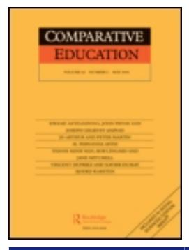

<!-- A1.R26 | source: papers_json/A1.R26/ -->

## [Education hubs: international, regional and local dimensions of scale and](https://www.researchgate.net/publication/262947279_Education_hubs_international_regional_and_local_dimensions_of_scale_and_scope?enrichId=rgreq-89246b0756b1478570620cbf2da34f18-XXX&enrichSource=Y292ZXJQYWdlOzI2Mjk0NzI3OTtBUzoxMDA5NjY3NTgwODk5MzI4QDE2MTc3MzQ5MTg0NjM%3D&el=1_x_3&_esc=publicationCoverPdf) scope

**Article** *in* Comparative Education · July 2013DOI: 10.1080/03050068.2013.803783CITATIONS64READS432**1 author:**Jane KnightUniversity of TorontoPUBLICATIONS**208**CITATIONS**16,743**SEE PROFILE

<!-- page 2 -->

## **Comparative Education**

**ISSN: 0305-0068 (Print) 1360-0486 (Online) Journal homepage:****[ https://www.tandfonline.com/loi/cced20](https://www.tandfonline.com/loi/cced20)**

## **Education hubs: international, regional and local** **dimensions of scale and scope**

## **Jane Knight**

**To cite this article:** Jane Knight (2013) Education hubs: international, regional and local dimensions of scale and scope, Comparative Education, 49:3, 374-387, DOI: [10.1080/03050068.2013.803783](https://www.tandfonline.com/action/showCitFormats?doi=10.1080/03050068.2013.803783)

**To link to this article: **[https://doi.org/10.1080/03050068.2013.803783](https://doi.org/10.1080/03050068.2013.803783)

| Image: Calendar icon Published online: 18 Jul 2013. |
| --- |
| Image: Pencil icon Submit your article to this journal Image: External link icon |
| Image: Bar chart icon Article views: 1513 |
| Image: Magnifying glass on document icon View related articles Image: External link icon |
| Image: Two documents icon Citing articles: 9 View citing articles Image: External link icon |

<!-- page 3 -->

## Education hubs: international, regional and local dimensions of scale and scope

Jane Knight*

OISE, University of Toronto, Toronto, Canada

مراكز التعليم (education hubs) هي تطورات جديدة ومهمة. وهي تمثل جيلاً جديداً من أنشطة التعليم العابر للحدود، حيث تكون الكتلة الحرجة (critical mass)، والتشارك في الموقع (co-location)، والترابط بين الجامعات الدولية والإقليمية والمحلية، والطلاب، ومراكز البحث، والقطاع الخاص، عناصر أساسية. توجد مقاييس مختلفة (المدينة، والمنطقة، والدولة) وأنواع مختلفة (الطالب، والموهبة، والمعرفة) من مراكز التعليم. تختلف المبررات والجهات الفاعلة والنتائج المتوقعة تبعاً لما إذا كان مركز التعليم موجهاً بشكل أكبر نحو زيادة فرص التعليم العالي للطلاب، أو التعليم والتدريب لبناء قوة عاملة ماهرة، أو إنتاج المعرفة والابتكار. يستكشف هذا المقال ثلاث قضايا أساسية: المقياس، ومستوى المشاركة، ونطاق الأثر. تُحلَّل هذه القضايا في سياق ثلاثة أنواع من مراكز التعليم التي يجري التخطيط لها وتطويرها في آسيا وأفريقيا والشرق الأوسط.

## Introduction

اتّسم البعد الدولي بالتعليم العالي منذ قرون؛ حتى مفهوم "الكون" (universe) كان محورياً في تسمية أولى المؤسسات الرسمية للتعليم العالي باسم "الجامعة" (university). لا شك أن العلاقات والأنشطة الأكاديمية الدولية قد تغيرت على مر السنين استجابةً لاحتياجات وفرص الأوضاع الاجتماعية والثقافية والسياسية والاقتصادية في كل حقبة، محلياً ودولياً. وفي العقود الثلاثة الأخيرة، كانت العولمة (globalisation) هي المحفز الأهم للتغيير. فالتطورات غير المسبوقة في تقنيات المعلومات ووسائل التواصل الاجتماعي؛ والأثر المنتشر لتحرير الاقتصاد واتفاقيات التجارة؛ والتحول نحو اقتصاد المعرفة؛ وزيادة تدفق الأشخاص والمعرفة ورأس المال والقيم والخدمات والسلع والتكنولوجيا عبر الحدود، كلها أمثلة على قوى العولمة التي تعيد تشكيل الأجندة. واستجابةً لفرص العولمة ومخاطرها على حد سواء، تحول التعليم العالي نحو إعطاء أهمية أكبر لسياسات واستراتيجيات التعليم العالي على المستويين الإقليمي والدولي.

يختلف التدويل (internationalisation) عن العولمة، لكنه مرتبط بها ارتباطاً وثيقاً كعملية ديناميكية. ويتضمن المفهوم الأساسي للعلاقة بين الأمم (inter-nation) العلاقات بين البلدان والشعوب والأنظمة والثقافات. وهذا يختلف اختلافاً كبيراً عن المفهوم الأساسي للتدفق العالمي أو الشامل الذي تمثله العولمة (Knight 2008). ولا يزال هناك جدل محتدم حول ما إذا كانت العولمة محفزاً لتدويل التعليم العالي أم العكس (Donn and Al Manthri 2010; Scott 2005). ويقر كلا المنظورين بالعلاقة المعقدة والديناميكية بين العمليتين، وبأن مقياس التعليم العالي وأثره قد تجاوزا فعلاً الحدود الوطنية، خاصةً فيما يتعلق بالتنقل الأكاديمي وطرق تقديم التعليم.

> ^*^Email: jane.knight@utoronto.ca

<!-- page 4 -->

من التطورات الجديدة المهمة في تدويل التعليم العالي، وتحديداً في التعليم العابر للحدود، ظهور مراكز التعليم الدولية. ويشير التعليم العابر للحدود إلى "حركة الأشخاص والمعرفة والبرامج ومقدمي الخدمة والسياسات والأفكار والمناهج والمشاريع والبحوث والخدمات عبر الحدود الوطنية أو الإقليمية" (Knight 2012). لقد انتقل التعليم العابر للحدود من تنقل الأشخاص (الطلاب وأعضاء هيئة التدريس والباحثين) إلى تنقل البرامج (التوأمة، والامتياز، والتعليم الافتراضي)، ثم إلى تنقل مقدمي الخدمة (الفروع الجامعية)، ثم إلى تنقل السياسات (ضمان الجودة، وأطر المؤهلات، وأنظمة الساعات المعتمدة)، والآن إلى تطوير مراكز التعليم الدولية. وتبني مراكز التعليم على كل هذه الأشكال من التنقل الأكاديمي وتشملها، لكنها تمثل جيلاً جديداً من أنشطة التعليم العابر للحدود، حيث تكون الكتلة الحرجة والتشارك في الموقع والتفاعل بين الجامعات الدولية والمحلية والطلاب ومراكز البحث والقطاع الخاص عناصر أساسية. ومركز التعليم هو جهد منسق ومخطط له تقوم به دولة (أو منطقة أو مدينة) لبناء كتلة حرجة من الجهات الفاعلة المحلية والدولية، بهدف تعزيز جهودها لبناء قطاع التعليم العالي، أو توسيع مجمع المواهب، أو المساهمة في اقتصاد المعرفة.

اعتباراً من عام 2013، لا يوجد سوى عدد قليل من الدول حول العالم تسعى بجدية لأن تصبح مراكز تعليم معترف بها ومحترمة. وتشمل هذه الدول هونغ كونغ وسنغافورة وماليزيا والإمارات العربية المتحدة وقطر وبوتسوانا (Knight 2011a). أما دول أخرى فما زالت في مراحل أولية أو ربما "متعثرة" من التطور، مثل البحرين وموريشيوس وكوريا وسريلانكا. وهناك دول أخرى يبدو أنها تستخدم مصطلح "مركز التعليم" كأداة تسويقية أو علامة تجارية لجذب مزيد من الطلاب الدوليين ومقدمي الخدمة أكثر من كونها تسعى بجدية لتصبح مركز تعليم فعلياً. إضافة إلى ذلك، هناك مدن حول العالم، مثل مدينة بنما وبنغالور في الهند ومونتيري في المكسيك، تحاول أن تُموضِع نفسها كمدن تعليمية أو مدن معرفة. وتحاول بعض المبادرات على مستوى المدينة، وبنما مثال بارز عليها، أن تكون ذات طابع دولي في مقياسها، بينما تظل مبادرات أخرى محلية فقط. وبوسطن هي على الأرجح المدينة الأكثر شهرة كمركز تعليم على مستوى المدينة.

لا يوجد نموذج واحد أو "مقاس واحد يناسب الجميع" لإنشاء مركز تعليم دولي. فلكل دولة أو جهة اختصاص مجموعتها الخاصة من الدوافع والمناهج والتوقعات. وتتمثل إحدى السمات الجديدة لبعض مراكز التعليم في التركيز على إنتاج المعرفة والابتكار. وقد ارتبطت مبادرات التعليم والتدريب تقليدياً بأنشطة التعليم العابر للحدود مثل التوأمة والامتياز والتعليم الافتراضي والفروع الجامعية (Becker 2009)، لكن إضافة توليد المعرفة والابتكار يُعد تطوراً وسمة جديرة بالملاحظة لمراكز التعليم.

معظم المعلومات المتاحة عن مراكز التعليم تندرج ضمن الأدبيات الرمادية (grey literature) — أساساً وثائق السياسات وخطط الأعمال. وتكثر المقالات الإعلامية، وغالباً ما تتناول خطط الدولة الطموحة والمبالغات التسويقية. ومن المهم ملاحظة أن مصطلح "مركز التعليم" هو تسمية ذاتية يمكن لأي جهة أن تستخدمها لوصف جهودها التعليمية، وكثيرون يفعلون ذلك. فعلى سبيل المثال، تُطلق بعض الجامعات والفروع الجامعية على نفسها اسم "مراكز"؛ وتستخدم مدن لا تمتلك أي نشاط تعليم عابر للحدود مصطلح مركز التعليم؛ وتتبنى دول صغيرة ذات طموحات كبيرة في التدويل لكن بأفعال محدودة هذا المصطلح. والاستخدام المتزايد لمصطلح "مركز التعليم" وشعبيته واضحان، لكنهما يثيران تساؤلات حول ما إذا كان المصطلح يُستخدم كعلامة تجارية لزيادة الظهور الدولي، أو موضة عابرة مبنية على الطلب المتنامي على التعليم العابر للحدود، أو ابتكار جاد يستحق الدراسة الجادة (Knight 2010).

الغرض من هذا المقال هو دراسة ظاهرة مراكز التعليم الدولية بوصفها تشكيلاً جديداً من الجهات الفاعلة المحلية والإقليمية والدولية التي

<!-- page 5 -->

تتعاون من خلال التشبيك أو التشارك في الموقع لتقديم التعليم العالي والتدريب وإنتاج المعرفة لصالح الدولة المضيفة والمنطقة وما وراءهما. وتُعد ثلاثة جوانب أساسية للتحليل: المقياس، ومستوى المشاركة، ونطاق الأثر. الجانب الأول هو "المقياس" (scale)، ويشير إلى حجم أو مستوى المركز، سواء كان مدينة أو منطقة أو دولة. ويوضح هذا ما إذا كان المركز يقع في منطقة جغرافية محددة كالمدينة أو المنطقة، أو أنه أكثر انتشاراً كما هو الحال على مستوى الدولة، حيث يصبح الترابط بين الجهات الفاعلة والمبادرات أهم من التشارك في موقع جغرافي واحد. والأمثلة المستخدمة في هذا المقال جميعها مراكز على مستوى الدولة، رغم أن العديد منها يتضمن مناطق اقتصادية خاصة تجذب مقدمي خدمات التعليم والتدريب وشركات البحث من خلال تقديم حوافز ضريبية ومرافق مُصممة خصيصاً وإمكانية إعادة تحويل الأرباح. أما الجانب الثاني فيتعلق بمستوى "المشاركة" (engagement) أو مدى الوصول لجذب الجهات الفاعلة لتكون جزءاً من أنشطة المركز أو خدماته أو منتجاته. فعلى سبيل المثال، يمكن أن يضم مركز التعليم جهات فاعلة محلية وإقليمية ودولية مثل مؤسسات التعليم العالي الأجنبية، وشركات البحث والتطوير، والطلاب. وتفسير مصطلح "إقليمي" في هذا المقال يعني المستوى فوق الوطني وليس دون الوطني. والمناطق موضع الاهتمام بالنسبة لمراكز التعليم الست على مستوى الدولة التي يتناولها هذا المقال هي منطقة الخليج، وجنوب شرق آسيا، وأفريقيا جنوب الصحراء. ومرة أخرى، فإن جميع الأمثلة في هذا المقال إقليمية أو دولية من حيث المدى، لكنها تختلف في ما إذا كان مقدمو التعليم والتدريب أكثر محلية أم دولية، أو ما إذا كان الطلاب أكثر دولية أو إقليمية أو محلية. والجانب الثالث هو نطاق "الأثر" (impact) أو انتشار التأثير والفائدة الناتجة عن مركز التعليم. فعلى سبيل المثال، هل يُقصد بأثر أو نتيجة مركز التعليم، مثل توفير التعليم والعمالة الماهرة أو توليد المعرفة/الابتكار الجديد، أن يفيد منطقة محددة أو ولاية أو دولة أو إقليماً أو ما هو أبعد من ذلك؟ وتُبحث هذه القضايا من خلال ثلاثة أنواع من مراكز التعليم — الطالب، والموهبة، والمعرفة/الابتكار — مع تقديم أمثلة من دول تمتلك مراكز تعليم قائمة بالفعل.

يسير هيكل المقال على النحو التالي. يقدم القسم الأول مراكز التعليم الست على مستوى الدولة المذكورة أعلاه، ويوفر نظرة عامة موجزة عن نهج كل منها، بما في ذلك مبرراتها الرئيسية وأنشطتها الأساسية. ويقود تنوع المناهج في تطوير المراكز إلى القسم التالي، الذي يقترح تعريفاً عاماً وعملياً لمراكز التعليم بمعزل عن المقياس أو النطاق أو منطقة الموقع. وبناءً على هذا التعريف، تُناقش في القسم الثالث نمذجة ثلاثة نماذج لمراكز التعليم — مركز الطالب، ومركز الموهبة، ومركز المعرفة/الابتكار. ويُوصف كل نوع من حيث التركيز الرئيسي، والأهداف، والاستراتيجيات، والجهات الفاعلة الرئيسية، وقطاعات السياسات، ونطاق الأثر. ويثير هذا التصنيف تساؤلاً حول ما إذا كان تطور مركز التعليم ينتقل من مركز طالب إلى مركز موهبة ثم إلى مركز معرفة. ومن الناحية النظرية، من المتوقع ألا يكون هناك تطور خطي لمراكز التعليم، لكن الواقع يكشف رؤى أعمق. ويُبرهن على ذلك في القسم التالي، الذي يحاول تصنيف كل من مراكز التعليم الست على مستوى الدولة من حيث كونها مركز طالب أو موهبة أو معرفة، ويحلل مسار تطورها بالنظر إلى الماضي والمستقبل. ويقدم القسم الأخير بعض الأفكار الختامية حول تعقيدات مراكز التعليم من حيث نطاق الأثر، وضرورة تطوير مقاييس قوية لقياس النتائج والأثر المتوقعين فعلياً.

## Overview of six education hubs located in Asia, Africa and the Middle East

الغرض من هذا القسم هو تقديم نظرة عامة موجزة عن ست دول توجد في مراحل مختلفة من التخطيط أو التطوير لنفسها كمراكز تعليم دولية. وتساعد بعض معلومات السياق والخلفية في توفير تطبيقات عملية

<!-- page 6 -->

وإحساس بالواقع للنقاش حول تعريف مراكز التعليم والتصنيف المقترح الذي يتبع ذلك.

كانت قطر من أوائل الدول التي أعلنت عزمها أن تصبح مركز تعليم واستثمرت في تطويره. وعلى مدى العقد الماضي، ركزت قطر على تقليل اعتمادها على الموارد الطبيعية والتقدم نحو أن تصبح واحدة من الجهات الفاعلة الرئيسية في اقتصاد المعرفة. ولتحقيق هذا الهدف، قررت قطر السعي لتحقيق أهدافها من خلال التعليم وتحويل نفسها إلى مركز تعليم. وفي أقل من 15 عاماً، أصبحت قطر موطناً لأكثر من 10 مؤسسات أكاديمية أجنبية، ومنظمات علمية وبحثية رائدة، وأكثر من 4000 طالب وباحث من المنطقة ومن جميع أنحاء العالم. وتتألف جهود قطر في مجال مركز التعليم من ثلاثة عناصر مترابطة: البرامج الأكاديمية من خلال الفروع الجامعية الدولية؛ وإنشاء مدينة قطر للعلوم والتكنولوجيا؛ وتأسيس مؤسسات علمية وطبية جديدة ذات مهمة بحثية قوية. ومن السمات المهمة للنهج القطري التمويل السخي والمستمر لعمليات الفروع الجامعية وبرامج البحث والمرافق العلمية والبحثية الجديدة من قِبل مؤسسة قطر. والهدف طويل الأمد من مبادرة مركز التعليم هو تعزيز الموارد البشرية اللازمة لاقتصاد المعرفة والاحتفاظ بها، وتطوير ثقافة وقدرة بحثية (Tsang 2010).

تستضيف الإمارات العربية المتحدة أكبر عدد من الفروع الجامعية الدولية في العالم، حوالي 37 فرعاً إجمالاً (OBHE 2012). وهي معروفة بنجاحها في جذب الفروع الجامعية إلى منطقتين حرتين اقتصاديتين تابعتين لها — قرية المعرفة ومدينة دبي الأكاديمية الدولية. وتنخرط ثلاث إمارات أخرى — أبوظبي والشارقة ورأس الخيمة — بشكل فاعل في جهود التعليم والبحث الدولية، إضافة إلى استضافة فروع جامعية. فعلى سبيل المثال، تستضيف أبوظبي جامعة السوربون وجامعة نيويورك، وقد دُعيت كلتاهما ويجري تمويلهما بسخاء وبناء مرافق مخصصة لهما. ومن السمات اللافتة لنهج الإمارات في مركز التعليم أنه لا توجد خطة وطنية أو آلية تنسيق، وبالتالي تضع كل إمارة خطتها الاستراتيجية ومبادراتها المحلية الخاصة بها. ومن المعروف على نطاق واسع أن الإمارات تعتمد على قوة عاملة أجنبية لتنتقل من اقتصاد قائم على النفط إلى اقتصاد أكثر توجهاً نحو الخدمات والمعرفة. وعلاوة على ذلك، يشكل الوافدون نحو 85% من القوى العاملة في الإمارات. ولتحقيق ذلك، تحتاج الإمارات إلى مواهب أجنبية، وتدرك أن أن تصبح مركز تعليم سيدعم جهودها في تدريب واستبقاء الأعداد الكبيرة من الطلاب الوافدين المقيمين، وجذب طلاب وعمال دوليين من المنطقة وخارجها (Knight 2011b).

بعد تجربة الأزمة المالية الآسيوية عام 1998 والأزمة المالية العالمية عام 2008، أدركت حكومة منطقة هونغ كونغ الإدارية الخاصة (HKSAR) أن الاعتماد على الركائز الاقتصادية التقليدية (أي التمويل الدولي، والسياحة، وسوق العقارات، والخدمات اللوجستية) لن يكون كافياً لدعم النمو الاقتصادي المستمر في هذه المدينة-الدولة (Tsang 2010). وإدراكاً منها لتزايد شعبية التجارة في خدمات التعليم العالي في آسيا، وأن التعليم العالي أداة فاعلة من أدوات القوة الناعمة، عملت حكومة هونغ كونغ على تطوير نفسها كمركز تعليم إقليمي من خلال جعل خدمات التعليم أحد المحركات الاقتصادية الجديدة (Shive 2010). وتُعد الجهود الجديدة لجذب الطلاب الدوليين والفروع الجامعية، إلى جانب علاقات أقوى مع مؤسسات التعليم العالي في البر الرئيسي، عناصر أساسية في استراتيجية هونغ كونغ لتصبح مركز تعليم (Cheng 2009).

نجحت ماليزيا في جذب عدد كبير من برامج التوأمة والامتياز، وسبعة فروع جامعية، وعدد متزايد باستمرار من الطلاب الدوليين

<!-- page 7 -->

لكن عدة مبادرات جديدة للتعليم العابر للحدود تُظهر مدى جدية ماليزيا في العمل نحو ترسيخ نفسها كمركز تعليم (Knight and Morshidi 2011). المبادرة الأولى هي تطوير "إيديوسيتي" (Educity)، الواقعة في إسكندر بماليزيا، وهي منطقة اقتصادية جديدة كبرى ومتعددة الأبعاد بجوار سنغافورة، وستضم مدارس دولية وفروعاً جامعية (Iskandar Malaysia 2010). أما الثانية فهي مدينة كوالالمبور التعليمية، وهي مبادرة تعليمية استراتيجية أخرى مدمجة ضمن مشروع تجاري وسكني جديد في وادي كلانغ جنوب كوالالمبور؛ والثالثة هي خطة متجددة لاستقطاب الطلاب الدوليين من المنطقة ومن الدول الإسلامية. وتُحرّك أجندة ماليزيا لترسيخ نفسها كمركز تعليم حاجتها إلى بناء قدراتها في الموارد البشرية والمعرفة والابتكار، إضافة إلى تعزيز التعليم كقطاع تجاري لتوليد الإيرادات (Ministry of Higher Education (MOHE), Malaysia 2011). وتشارك في بناء ماليزيا كمركز تعليم قطاعات وجهات فاعلة استراتيجية مثل إدارات التعليم العالي، والهجرة، وتنمية الموارد البشرية، وقطاع التمويل والاستثمار.

على مدى فترة 15 عاماً، انخرطت سنغافورة بشكل كامل في الانتقال من مشروع "المدرسة العالمية" (Global Schoolhouse)، الذي ركز على جذب الطلاب والبرامج والمؤسسات الأجنبية، إلى أن تصبح مركز تعليم ومعرفة في القرن الحادي والعشرين. وتشمل ثلاث استراتيجيات مهمة لمكانة سنغافورة كمركز مرموق للتعليم والبحث: (1) دعوة "الجامعات ذات المستوى العالمي" وتقديم دعم مالي لها لإنشاء برامج وشراكات بحثية وفروع جامعية في سنغافورة؛ (2) جذب باحثين وعلماء بارزين وتحديث مؤسسات التعليم العالي المحلية من خلال شراكات دولية مع جامعات نخبوية من حول العالم؛ و(3) الاستثمار بكثافة في أجندة بحثية وطنية استراتيجية وطموحة تشمل التعاون الأجنبي وبناء مرافق بحثية من الطراز الأول (Sidhu, Ho, and Yeoh 2011). وتؤتي هذه الجهود ثمارها، إذ يُشار إلى سنغافورة عادةً بوصفها مركز تعليم ومعرفة ناجحاً بفضل استثمارات كبيرة واستراتيجية مركز واضحة وطويلة الأمد ومنسقة من قِبل الحكومة السنغافورية. ومع ذلك، فإن جهود سنغافورة لا تخلو من تحديات عملية من حيث الموارد البشرية واستدامة التعاون الدولي والمحلي.

بوتسوانا هي مركز التعليم الوحيد المعترف به في أفريقيا، وتحتل مرتبة عالية من حيث الطموح والاستراتيجية، لكنها أقل من ذلك من حيث التنفيذ. ورغم أن بوتسوانا تمكنت من توفير مقاعد في التعليم العالي لجميع المؤهلين، بما في ذلك الابتعاث للخارج، فإن التطور الاقتصادي السريع خلق نقصاً في القدرة التعليمية وفجوات في المهارات المهنية اللازمة للمشاركة في اقتصاد المعرفة العالمي. وبناءً على ذلك، وكجزء من سياسة التنويع في عدد من المنافذ السوقية التي تتمتع فيها بوتسوانا بميزة تنافسية، سعت الحكومة إلى تطوير الدولة كمركز تعليم (Botswana Ministry of Education and Skills Development 2008). وقد نظرت الحكومة في إنشاء مرفق مخصص وباهظ التكلفة لبناء تجمع حرمي جامعي نخبوي ثم رفضت ذلك، وسعت بدلاً من ذلك إلى بناء بوتسوانا كمركز تعليم على مستوى الدولة يتألف من أنواع مختلفة من المبادرات. وتهدف استراتيجية مركز التعليم إلى تحديث قطاع التعليم، وبناء القدرة المحلية للموارد البشرية، وتقليل الاعتماد على الابتعاث الخارجي وتكاليفه، وتدويل توجهات الطلاب والقوى العاملة، وجذب الطلاب الدوليين والاستثمار.

توضح هذه النظرة العامة رسالة واضحة مفادها أن المراكز تمر بمراحل مختلفة من التطور، ولها مبررات ومختلفة، وأولويات مختلفة، واستراتيجيات مختلفة، وجهات راعية مختلفة، وتوقعات مختلفة. وعلى الرغم من هذا التنوع، من الضروري وجود

<!-- page 8 -->

تعريف عام لمركز التعليم من أجل دراسة هذه الظاهرة عن كثب وتمييز المراكز عن أنواع أخرى أحادية المستوى من مبادرات التعليم العابر للحدود.

## Definition and key concepts of an education hub1

انطلاقاً من افتراض أن عدد وأنواع مراكز التعليم سيزداد، يجب أن يكون أي تعريف عملي عاماً بما يكفي لينطبق على جميع أنواع ونماذج مراكز التعليم، وكذلك المستويات المختلفة من المقياس ومستوى المشاركة ونطاق الأثر. وفيما يلي تعريف عملي مقترح، بصرف النظر عن المقياس (الدولة أو المنطقة أو المدينة)، أو الجهات الفاعلة المعنية، أو المنطقة التي يقع فيها في العالم:

An education hub is a planned effort to build a critical mass of local and international actors strategically engaged in cross-border education, training, knowledge production and innovation initiatives. (Knight 2011a, 227)

جرى حذف تحديد المبررات الدافعة، والنتائج المتوقعة، والجهات الراعية، والجهات الفاعلة الرئيسية، وأنواع الأنشطة المحددة عمداً للسماح للتعريف بأن ينطبق على التنوع الناشئ للمراكز. ولفهم معنى وأبعاد التعريف المقترح بشكل كامل، من المفيد دراسة كل مفهوم أساسي على حدة.

يشير مفهوم *الجهد المخطط له* إلى أن المركز مشروع مقصود أو متعمد، وعادة ما ينطوي على استراتيجية وإطار سياسات واستثمار عام وخاص. وبعبارة أخرى، المركز أكثر من مجرد تفاعل عرضي أو تشارك في الموقع بين جهات فاعلة تعمل في قطاعي التعليم والمعرفة. ويساعد مفهوم كونه "مخططاً له" على تقليل احتمال أن يكون مجرد موضة عابرة أو أداة تسويقية أو مجموعة عشوائية من التفاعلات المؤقتة بين اللاعبين الرئيسيين.

يشير مفهوم *الكتلة الحرجة* إلى وجود أكثر من جهة فاعلة ومجموعة من الأنشطة. وهذا يعني أن فرعاً جامعياً واحداً، أو برنامج امتياز واحد، أو حديقة علوم وتكنولوجيا واحدة، أو مؤسسة واحدة منخرطة دولياً، لا يُشكل مركزاً. ويختلف المركز عن الأنشطة الفردية العابرة للحدود لأنه يجمع هذه الأنواع من المبادرات في مشروع مخطط أو منسق. ويتجاوز مفهوم الكتلة الحرجة عمداً مجرد مجموعة عشوائية من الأنشطة العابرة للحدود، إذ يدل على وجود تركيبة أساسية من الجهات الفاعلة. وقد جرى النظر في مصطلح "التشارك في الموقع" (co-location) لكن تقرر عمداً عدم إدراجه في التعريف، رغم أهميته لمعنى المركز. واستخدام مصطلح التشارك في الموقع على مستوى المدينة والمنطقة والدولة يحمل معاني مختلفة. فقد تتشارك الجهات الفاعلة في موقع واحد أو مواقع متعددة بسبب التكامل بين الخدمات، لكن هذا لا يعني أن جميع الجهات الفاعلة يجب أن تتشارك في منطقة واحدة محددة. وتُعد الدول الأكبر مثل ماليزيا والإمارات العربية المتحدة أمثلة جيدة على تعدد الأنشطة ومواقع التشارك المتعددة، بينما تُعد منطقة هونغ كونغ الإدارية الخاصة وسنغافورة، بوصفهما مدينتين-دولتين، صغيرتين بما يكفي لينطبق عليهما مفهوم موقع واحد أو موقع تشارك واحد.

يشير إدراج *الجهات الفاعلة المحلية والدولية* إلى أن مركز التعليم يشمل لاعبين محليين وأجانب. ونظراً لتضمن جهات فاعلة وأنشطة دولية، فإن طبيعة المركز دولية بحكم التعريف. ومع ذلك، قد يظل من الضروري استخدام مصطلح "مركز التعليم الدولي" لتمييزه عن مركز على مستوى المدينة أو المنطقة يشمل جهات فاعلة محلية وفوائد محلية دون أي تعليم عابر للحدود. ويمكن أن تشمل الجهات الفاعلة طلاباً وأكاديميين ومؤسسات وشركات ومنظمات ومراكز بحثية وصناعات معرفية محلية وإقليمية ودولية، إلخ. ويُستخدم مصطلح "الجهة الفاعلة"

<!-- page 9 -->

بطريقة شاملة بحيث يغطي مقدمي ومنتجي ومستخدمي خدمات ومنتجات التعليم والتدريب والمعرفة. ويختلف تنوع الجهات الفاعلة من مركز إلى آخر تبعاً لمبررات ووظائف كل مركز، ولذلك لم تُحدَّد أنواع الجهات الفاعلة عمداً في التعريف.

تُعد فكرة *المشاركة الاستراتيجية* محورية في التعريف، إذ تؤكد وجود إحساس متعمد بالتفاعل أو العلاقة بين الجهات الفاعلة. ورغم أن طبيعة المشاركة تختلف من مركز إلى آخر، فإن المبدأ الأساسي هو أن هناك قيمة مضافة عندما تكون الجهات الفاعلة مترابطة أو متعاونة أو تتشارك المرافق والموارد المشتركة. وهذا لا ينفي وجود منافسة بين الجهات الفاعلة التي تقدم خدمات أو منتجات مماثلة، لكن يبدو أن إيجابيات كونك جزءاً من مبادرة استراتيجية وتفاعلية تفوق سلبياتها. وطبيعة وعدد هذه التفاعلات غير محدودة نظراً لتنوع الجهات الفاعلة والمستخدمين المحليين والدوليين. ثانياً، نظراً لأن مركز التعليم جهد مخطط له، فإن وجود خطة رئيسية أو استراتيجية شاملة، إلى جانب السياسات واللوائح المتماشية معها، يساعد على تحقيق النجاح والاستدامة. وهذا يدعم مفهوم "الاستراتيجية" المهم في التعريف.

تصف *مبادرات التعليم والتدريب والمعرفة والابتكار العابرة للحدود* الفئات العريضة من أنشطة ومخرجات المراكز. وهناك مجموعة واسعة من المبادرات أو الخدمات المتاحة حسب نوع المركز وأولويات كل جهة فاعلة والخطة الاستراتيجية للجهة الراعية.

ومن الجدير بالملاحظة أن مقياس المركز غير مدرج في التعريف، لأن المقياس (المنطقة أو المدينة أو الدولة) تحدده الجهات الراعية للمركز، شأنه شأن مدى مشاركة الجهات الفاعلة وانتشار الأثر والتأثير. فعلى سبيل المثال، يمكن لمركز تعليم على مستوى المنطقة أو المدينة أو الدولة أن يهدف إلى جذب جهات فاعلة من محيطه المباشر أو من خارجه، ويمكن أن يكون أثره محلياً أو وطنياً أو إقليمياً أو عالمياً. لذلك، لا يُعد المقياس ونطاق الأنشطة جزءاً من التعريف العام، لكنهما عادة ما يكونان جزءاً من وصف مركز تعليم محدد.

وأخيراً، لم يُعرَّف مركز التعليم بمصطلحات مادية أو مكانية مثل منطقة محددة، لأن ذلك قد يكون مقيداً للغاية. بل إن المفهوم المحوري هو الترابط أو شبكة التفاعلات بين الجهات الفاعلة المحلية والدولية المنخرطة التي تقوم بأنشطة تعليم عابرة للحدود لتحقيق أهدافها الفردية إضافة إلى الأهداف الجماعية.

## Three models of education hubs: student, talent, knowledge/innovation

تُميّز المبررات والأهداف المختلفة مراكز التعليم حتى وإن كانت هناك أنشطة مشتركة بينها. فبعض الدول ترى في المراكز وسيلة لبناء كتلة حرجة من الطلاب ومقدمي الخدمة الأجانب لتوليد الدخل، إضافة إلى تحديث وتدويل قطاع التعليم العالي المحلي. وتريد دول أخرى أن تكون مركزاً من أجل تدريب واستبقاء الطلاب والموظفين الأجانب والمحليين ليكونوا جزءاً من قوة عاملة ماهرة، بينما تركز دول أخرى على جذب الطلاب والعمال والمؤسسات والشركات الأجنبية لبناء قطاع بحثي ومعرفي وابتكاري نشط يقودها نحو اقتصاد قائم على المعرفة.

من أجل رصد الاختلافات بين مناهج المراكز والسماح بفهم واستكشاف أكثر دقة لمراكز التعليم، يُقترح تصنيف من ثلاث فئات من المراكز (Knight 2011a). ويُناقش كل نوع من حيث الأهداف والاستراتيجيات والجهات الفاعلة وقطاعات السياسات والأثر، ويُظهر الأبعاد المحلية والإقليمية والدولية للنطاق والمقياس.

مركز الطالب (Student Hub) هو النوع الأكثر تركيزاً من مراكز التعليم، والأكثر شيوعاً حالياً. والنشاط الرئيسي هو تعليم وتدريب الطلاب المحليين والوافدين و

<!-- page 10 -->

الدوليين. وإضافة إلى استقطاب الطلاب، يركز أيضاً على جذب مؤسسات التعليم العالي الأجنبية لتقديم برامج امتياز وتوأمة أو إنشاء فروع جامعية كوسيلة لزيادة فرص الوصول. والأهداف الرئيسية لمراكز الطلاب هي: (1) زيادة فرص الوصول إلى التعليم العالي للطلاب المحليين؛ (2) توليد إيرادات من رسوم الطلاب الدوليين؛ (3) بناء قدرات مؤسسات التعليم العالي المحلية؛ (4) تدويل نظام التعليم العالي المحلي؛ و(5) تعزيز الصورة الذهنية والعلامة التجارية والترتيب لمؤسسات التعليم العالي والدولة.

في هذا السيناريو، تقوم مؤسسات التعليم العالي المحلية ومقدمو الخدمة الأجانب، وبالأخص الفروع الجامعية الدولية للمؤسسات الأجنبية، باستقطاب طلاب محليين ودوليين لبرامجها وحرمها الجامعي. ويجب أن تكون هناك استراتيجية استقطاب وطنية وسياسات ذات صلة قائمة لتحقيق نمو ناجح لمركز تعليم طلابي. ويمكن أن تشمل مثل هذه الخطة هدفاً رقمياً إجمالياً لعدد الطلاب الأجانب والبرامج العابرة للحدود والفروع الجامعية الدولية، بهدف اكتساب سمعة إقليمية أو عالمية كمكان جذاب للحصول على تعليم عالي الجودة. وغالباً ما يمنح مركز الطالب أولوية لتسجيل الطلاب الأجانب أو الوافدين، حتى مع وجود اهتمام بتوفير وصول أوسع للطلاب المحليين. وقد يسعى مركز الطالب إلى جذب طلاب من جميع أنحاء العالم، لكن في كثير من الحالات يأتي معظم الطلاب من دول مجاورة في المنطقة أو حتى من طلاب وافدين مقيمين بالفعل في الدولة. وفي مركز الطالب، يُستقطب الطلاب الأجانب لإكمال دراستهم في الدولة المضيفة ثم العودة إلى بلدانهم أو الانتقال إلى دولة ثالثة. وعموماً، لا يُشجَّعون أو تُقدَّم لهم حوافز للبقاء في الدولة المضيفة.

ربحية التعليم العالي العابر للحدود لا يمكن إنكارها، إذ يستمر عدد الطلاب الدوليين الذين يدفعون رسوماً في الازدياد عالمياً. وفي هذا السياق، يُنظر إلى التعليم العالي بوصفه صناعة يمكنها توليد دخل للمؤسسات والدولة ككل. وتزداد فرص الوصول إلى التعليم العالي عندما يتوفر مزيد من الخدمات العابرة للحدود للطلاب. كما يُنظر إلى تدفق الطلاب والبرامج ومقدمي الخدمة الدوليين على أنه يحقق أهداف تدويل وتحديث نظام التعليم العالي. ويكشف هدف تعزيز الصورة الذهنية والعلامة التجارية وترتيب مؤسسات التعليم العالي عن رغبة في المنافسة إقليمياً أو دولياً. ويسهم الوجود الفعلي لمقدمي خدمة أجانب راسخين في تعزيز صورة النظام التعليمي للدولة وعلامته التجارية. وباختصار، يسعى مركز الطالب إلى زيادة قدرة نظام التعليم العالي كماً ونوعاً.

ولتحقيق هذه الأهداف، يستخدم مركز الطالب عدة استراتيجيات لبناء كتلة حرجة من التعليم العالي تشمل جهات فاعلة محلية ودولية. ويستقطب مركز الطالب بنشاط مقدمي التعليم الأجانب لإنشاء برامج تعاونية وبناء فروع جامعية. وتشمل هذه البرامج التعاونية برامج التوأمة والامتياز التي تجذب الطلاب الذين يفضلون البقاء في وطنهم أو قريباً منه أثناء متابعتهم لشهادة أجنبية. علاوة على ذلك، تقدم المؤسسات أيضاً مزيداً من برامج الدرجات المشتركة والمزدوجة والمتتالية التي تربط مقدمي الخدمة المحليين والدوليين من خلال ترتيبات مبتكرة. وفي عدة دول، وفرت الحكومة رأس مال أولياً، وأراضٍ مدعومة، وحوافز ضريبية لاستقطاب مقدمي التعليم الأجانب لإنشاء فروع جامعية (Verbik and Merkley 2006). وبالمثل، تُعد حملة استقطاب وطنية لجذب الطلاب الدوليين استراتيجية شائعة لمراكز الطلاب. وتنسق هذه الحملات الترويج الدولي لنظام التعليم العالي لكل دولة وتُسهّل معالجة تأشيرات الطلاب أو ترتيبات السكن للطلاب الوافدين (Lasanowski 2009). وباختصار، يستخدم مركز الطالب وسائل مختلفة لزيادة ثلاثة أنواع من التنقل الأكاديمي: الطالب والبرنامج ومقدم الخدمة. وبالتزامن مع استراتيجيات بناء كتلة حرجة من الطلاب

<!-- page 11 -->

الدوليين ومقدمي الخدمة، تعمل جهات اختصاص عديدة الآن على سن لوائح أكثر صرامة. فقد تُقوّض سمعة التعليم المتدني الجودة وعدم رضا الطلاب الأساس الذي يقوم عليه مركز الطالب، ولذلك تُبذل جهود لتسجيل واعتماد وضمان جودة البرامج الأكاديمية ومقدمي الخدمة الوافدين.

قطاعات السياسة التي تُشكّل تطور مركز الطالب هي في المقام الأول قطاع التعليم العالي، يليه التجارة والشؤون الخارجية، وفي بعض الحالات السياحة كقطاعات ثانوية. ويعكس هذا التوزيع للتأثير مرة أخرى التركيز الأساسي لمركز الطالب: التعليم والتعلم. وتوفر القطاعات الثانوية الدعم من خلال الظهور الدولي، وتوزيع المعلومات، والمساعدة اللوجستية. أما على مستوى الجهات الفاعلة، فإن اللاعبين الرئيسيين هم مؤسسات التعليم العالي، محلية وأجنبية. وبالنسبة للمؤسسات الأجنبية، يكون ذلك أساساً في شكل فروع جامعية، بينما تستضيف المؤسسات المحلية طلاباً دوليين وتشارك في مشاريع بحثية دولية. وتضع الوزارات المعنية بالتعليم العالي أهداف الاستقطاب، وتقدم المنح الدراسية، وتضع مدونات للممارسات الجيدة، وتطور سياسات ولوائح توجيهية لإنشاء الفروع الجامعية والبرامج التعاونية الدولية. وتشمل الجهات الفاعلة الثانوية هيئات ضمان الجودة، والهيئات التعليمية الدولية، والمنظمات الثقافية/التراثية (Knight and Lee 2013).

وهكذا يتضح أن مستوى مشاركة مركز الطالب إقليمي ودولي من حيث استقطاب الطلاب، ولكن الأهم من ذلك من حيث جذب الفروع الجامعية من الجامعات الأجنبية. أما نطاق الأثر فيشمل جميع المستويات الثلاثة. فتستفيد كل من المؤسسات المحلية والدولية من تسجيل طلاب محليين ووافدين وإقليميين ودوليين في برامجها. ويستفيد قطاع التعليم في الدولة المضيفة من تحديث وتدويل مؤسساته المحلية، ويتعزز الاقتصاد المحلي من خلال توليد الدخل من الرسوم الدراسية وتكاليف السكن والمعيشة المرتبطة بالطلاب الأجانب، وجذب الاستثمار الأجنبي من قِبل المؤسسات الأجنبية.

مركز الموهبة (Talent Hub / Skilled Workforce) يركز على تعليم وتدريب الطلاب، لكنه يختلف عن مركز الطالب لأن الهدف الشامل هو تنمية الموارد البشرية لبناء قوة عاملة ماهرة. لذا يُشجَّع الطلاب الأجانب على البقاء في الدولة المضيفة لأغراض التوظيف. ويُعد استبقاء الطلاب الأجانب (والعمال) محورياً في مركز الموهبة. وتُشجَّع مؤسسات التعليم العالي الدولية، وكذلك شركات التدريب/التعليم الخاصة، على تقديم برامج أكاديمية وفرص تطوير مهني موجهة للطلاب الدوليين والوافدين والوطنيين، وكذلك للموظفين المحليين. والهدف العام هو تنمية الموارد البشرية. والأهداف الدافعة هي: (1) توسيع مجمع المواهب من العمال المهرة؛ (2) بناء اقتصاد قائم على الخدمات أو المعرفة؛ (3) زيادة التنافسية الاقتصادية والتأثير في المنطقة وخارجها؛ و(4) تعزيز جودة العمالة وملاءمتها.

ولتحقيق هذه الأهداف، يمكن لمركز الموهبة تنفيذ عدة استراتيجيات مختلفة. فبعض مراكز الموهبة تُعدّل معايير قبول الطلاب وعروض البرامج لتتناسب مع أوجه النقص المحددة في القوى العاملة. وبالتالي، يستهدف مركز الموهبة استقطاب مقدمي التعليم والتدريب استناداً إلى خبرتهم المحددة في مجال يشهد نقصاً في العمالة. ولا يقتصر التدريب على الطلاب، بل يشمل أيضاً المهنيين في منتصف مسيرتهم المهنية الذين يسعون للتعليم التنفيذي والتدريب المؤسسي والتعليم المستمر العام والتعلم مدى الحياة. ومن حيث الحوافز للطلاب الدوليين، قد يدعم مركز الموهبة رسومهم الدراسية مقابل فترة توظيف محددة تسهم في الاقتصاد المحلي/الوطني عند تخرج الطالب. ويُشار إلى هذا غالباً باتفاقية "سند العمل" (work bond agreement). وللمساعدة في تطوير مجمع مواهب مؤهل،

<!-- page 12 -->

يُخفَّف أيضاً تنظيم التوظيف والهجرة للأجانب. وقد يحصل الطالب الدولي الذي يتابع درجة متقدمة على معاملة تفضيلية في نظام الهجرة من حيث الحصول على تأشيرة عمل أو الإقامة الدائمة. وقد يُقدّم برنامج تعليمي أو تدريبي أيضاً مؤهلات دولية لزيادة جاذبيته للأفراد المتنقلين.

قطاعات السياسة الرئيسية التي تقود تطور مركز الموهبة هي العمل/الصناعة، والهجرة، والتعليم. ونظراً لتلاقي المصالح المتعددة في مركز الموهبة، نادراً ما يكون قطاع التعليم القطاع الوحيد المشارك في تشكيل تطوره. وفي الواقع، قد لا يكون قطاع التعليم حتى القطاع القائد وراء مركز الموهبة. وتؤدي قطاعات تنمية الموارد البشرية والصناعة والهجرة أدواراً محورية في الاستفادة من التعليم العالي والتدريب لأغراض تنمية الموارد البشرية طويلة الأمد. ويُعد قطاع الشؤون الخارجية قطاعاً ذا أهمية ثانوية، إذ يروّج لمركز الموهبة لدى مقدمي التعليم والتدريب المحتملين وكذلك الطلاب وأصحاب العمل. وتظل المؤسسات المحلية والأجنبية جهات فاعلة رئيسية، إلى جانب شركات التدريب ومجالس الأعمال التي تراقب عن كثب النبض الاقتصادي للدولة. وتشمل الجهات الفاعلة ذات الأهمية الثانوية هيئات ضمان الجودة وهيئات الترخيص المهني التي تنظم برامج التعلم وتطوير القوى العاملة الماهرة. وفي حين يهتم كل من مركز الطالب ومركز الموهبة باستقطاب الطلاب الدوليين، إلا أنهما يفعلان ذلك لأسباب مختلفة، ومن هنا تأتي أهمية المبررات. فعلى عكس مركز الطالب الذي يركز على تعليم الطلاب وإعادتهم إلى ديارهم، يشجع مركز الموهبة الطلاب والمهنيين على البقاء في الدولة المضيفة لأغراض التوظيف عند إكمال برنامج تعليمي أو تدريبي (Knight and Lee 2013).

في مركز الموهبة، غالباً ما تكون مؤسسات ومقدمو التعليم/التدريب، وليس بالضرورة، متشاركة في موقع واحد ضمن منطقة معينة لتيسير استخدام المرافق المشتركة وتعزيز التعاون فيما بينها ومع الصناعة. ومن أجل تطوير كتلة حرجة، يمكن أن يكون هناك أكثر من موقع تشارك واحد في الدولة. ومن حيث نطاق الأثر، يركز مركز الموهبة على بناء قوته العاملة الماهرة الخاصة، وبالتالي فإن الفوائد المباشرة وطنية في نطاقها أساساً، مع آثار إقليمية ثانوية من حيث النمو والاستقرار الاقتصاديين.

مركز المعرفة/الابتكار (Knowledge/Innovation Hub) يوسّع مهمته لتتجاوز التعليم والتدريب لتشمل إنتاج وتوزيع المعرفة والابتكار. وتشمل الجهات الفاعلة الأجنبية جامعات ومراكز بحثية وشركات ذات أنشطة بحث وتطوير رئيسية. وتُستقطب كل هذه الجهات الفاعلة من خلال حوافز تجارية مواتية لإقامة قاعدة في الدولة والتعاون مع شركاء محليين لتطوير البحوث التطبيقية والمعرفة والابتكار. والأهداف الرئيسية هي: (1) بناء اقتصاد قائم على المعرفة والابتكار؛ (2) جذب الاستثمار الأجنبي المباشر؛ (3) بناء قدرات مراكز البحث والتطوير المحلية؛ و(4) تعزيز القوة الناعمة. ويُعد التعاون بين اللاعبين الرئيسيين — مؤسسات التعليم الأجنبية والمحلية، والصناعات، ومراكز البحث، والشركات — عاملاً أساسياً في بناء مركز معرفة وابتكار وتوفير قيمة مضافة للجهات الفاعلة الرئيسية.

ولتحقيق هذه الأهداف، قد ينفذ مركز المعرفة مجموعة واسعة من الاستراتيجيات. فقد يزيد بشكل كبير من التمويل العام للبحوث ويستخدم سجلات النشر أو طلبات براءات الاختراع لقياس النجاح. وتتمثل استراتيجية أخرى في جذب الاستثمار الأجنبي المباشر لتمويل بحوث مكلفة والاستفادة من الملكية الفكرية لأغراض تجارية. كما يُعد إنشاء حدائق العلوم والتكنولوجيا بتمويل سخي مبادرة شائعة أخرى لجذب كتلة حرجة من الباحثين. وقد توسّع مؤسسات التعليم العالي برامج الدراسات العليا لزيادة عدد الأفراد ذوي التدريب البحثي. وقد تُضفي هذه المؤسسات أيضاً طابعاً رسمياً على الشراكات مع مراكز بحثية

<!-- page 13 -->

في الخارج للوصول إلى خبرات غير متوفرة محلياً. علاوة على ذلك، تصبح الروابط متعددة الأطراف بين مؤسسات التعليم العالي والصناعة أكثر شيوعاً مع توسع البحوث التطبيقية. وتصبح لوائح حقوق الملكية الفكرية ومعالجة براءات الاختراع أكثر تبسيطاً نظراً لأهمية هذه السياسات لمركز المعرفة/الابتكار. وقد يسعى مركز المعرفة أيضاً لمعالجة قضايا ذات أهمية إقليمية لاكتساب نفوذ على المستوى الإقليمي.

قطاعات السياسة التي تقود تطور مركز المعرفة/الابتكار هي العلوم والتكنولوجيا، والتجارة، والعمل، والصناعة، والتعليم. وتُوجّه هذه القطاعات مجتمعة المركز نحو المشاركة في اقتصاد قائم على المعرفة بدلاً من اقتصاد قائم على التصنيع أو الموارد الطبيعية. وقطاعات السياسة الثانوية هي الشؤون الخارجية والهجرة، اللذان يُسهّلان الترابط بين الجهات الفاعلة المحلية والأجنبية. والجهات الفاعلة الرئيسية هي وكالات المنح البحثية، ومؤسسات التعليم العالي المحلية/الأجنبية، وشركات البحث والتطوير المحلية/الأجنبية. والجهات الفاعلة الثانوية هي مجالس الأعمال ومجالس التجارة التي تُنمّي البعد التجاري لمركز المعرفة (Knight and Lee 2013).

ومن الأسئلة التي تنبثق عن هذا التصنيف: هل هناك تطور تدريجي من مركز الطالب إلى مركز تدريب القوى العاملة الماهرة ثم إلى مركز المعرفة/الابتكار؟ أم أنه من الممكن تحقيق قفزة نوعية من مركز تعليم موجه للطالب إلى مركز معرفة مباشرة؟

## The evolutionary process of education hub development

في حين لا يُفترض وجود تطور خطي من مركز طالب إلى مركز موهبة ثم إلى مركز معرفة، فإن تحليل مراكز التعليم الست على مستوى الدولة يُظهر، في الواقع، أن معظم مراكز التعليم تبدأ كمركز طالب، وإن كانت لأسباب وتوقعات مختلفة. وتُصنَّف أربع من الدول الست حالياً كمراكز طالب — هونغ كونغ وماليزيا والإمارات وبوتسوانا — استناداً إلى مبرراتها وأهدافها الدافعة. وسنغافورة وقطر فقط لا تندرجان تحت فئة مركز الطالب، لكن من المثير للاهتمام ملاحظة أنهما، عندما بدأتا تطوير مركزيهما في منتصف تسعينيات القرن الماضي، كان تركيزهما أساساً على استقطاب الطلاب ومقدمي الخدمة الإقليميين/الدوليين. وبالنسبة لسنغافورة، كان ذلك من خلال مشروع "المدرسة العالمية"، وبالنسبة لقطر كان من خلال "المدينة التعليمية". وعلى مدى الخمسة عشر عاماً الماضية، تحول هذان البلدان الرائدان إلى مركز طالب/موهبة بالنسبة لقطر، ومركز معرفة وابتكار بالنسبة لسنغافورة.

تبدو ماليزيا والإمارات مركزي طالب ناضجين نسبياً يتطلعان إلى المرحلة التالية من التطور. وترى ماليزيا نفسها دولة قادرة على القفز من مركز طالب إلى مركز معرفة. ونظراً للعناصر المختلفة للاستراتيجية الماليزية، ليس من المستبعد أن يحدث ذلك، لكن من المبكر جداً الجزم بذلك، والتركيز الحالي على تعزيز صناعة تصدير التعليم يشير إلى أنه أقرب إلى توليد الدخل منه إلى الاستثمار في التعليم كأداة لإنتاج المعرفة والابتكار. وخبرة ماليزيا الكبيرة في التخطيط الاستراتيجي لا تقابلها دائماً نفس الالتزام في التنفيذ، ولذلك لن يتضح إلا مع الوقت ما إذا كان هدفها في الانتقال من مركز تعليم محوره الطالب مباشرة إلى مركز تعليم قائم على المعرفة يمكن تحقيقه على المدى الطويل. وسيكون ذلك تحدياً.

بشكل عام، تُوصَف الإمارات بأنها مركز طالب/موهبة مركب. ومن الصعب عدم التأثر بأنشطة مركز التعليم في دبي نظراً لنجاحها المعترف به في جذب الطلاب وعدد كبير من الفروع الجامعية الدولية. ومع ذلك، وكما لوحظ سابقاً، تضم الإمارات أربع إمارات منخرطة بفاعلية في أنشطة عابرة للحدود، وقد تبنت كل منها نهجها الخاص. فأبوظبي لم تتبنَّ نهج المنطقة الاقتصادية الحرة

<!-- page 14 -->

بل استقطبت بدلاً من ذلك جامعات بارزة وذات سمعة عالية، وممولة جيداً، لتكون بمثابة واجهات للإمارة. والأهم من ذلك، تستثمر أبوظبي في تعزيز قدرتها البحثية من خلال الشراكة مع مراكز بحثية وجامعات معترف بها دولياً، ورعاية مبادرات بحثية كبرى في عدة قطاعات. وتبني رأس الخيمة قدرتها التعليمية وسمعتها من خلال جذب العديد من العقود البحثية ومؤسسات التعليم العالي. وفي نهاية المطاف، مع ذلك، تظل الدوافع الاقتصادية في المقدمة، إذ تسعى الإمارات إلى تقليل اعتمادها على النفط وتعزيز صناعاتها الخدمية والمعرفية. ومن هنا يأتي التزامها وحاجتها لتصبح مركز تعليم أقوى قائماً على الموهبة، مع التطلع إلى بناء القدرة البحثية. ولا تمتلك الإمارات تنسيقاً بين مختلف أنشطة مركز التعليم، ولا خطة وطنية شاملة على مستوى الدولة. وبالتالي، فإن الاتجاه المستقبلي للنمو والتطور غير واضح. ومن المرجح أن تستمر في البناء على أساسها كمركز طالب وموهبة، لكن من غير المؤكد ما إذا كانت ستتمكن من تحقيق طموحها طويل الأمد بأن تصبح مركز معرفة/ابتكار.

بوتسوانا وهونغ كونغ هما أيضاً مركزان موجّهان نحو الطالب، وكلاهما ملتزم بتعزيز سوق تصدير التعليم من خلال جذب مزيد من الطلاب ومقدمي الخدمة الأجانب. وقد اتّسم تطور هونغ كونغ بعدة تصريحات حول طموحات المركز، وبعض التطورات الجديدة في السياسات من حيث المنح الدراسية وتصاريح الإقامة، لكن مع استثمار مباشر عام محدود ودون تنسيق واضح. ولذلك، كان تطورها وسمعتها كمركز بطيئين. ويمكن التساؤل عما إذا كانت أكثر من مجرد خطة استقطاب طلابية تجذب أعداداً كبيرة من الطلاب من البر الرئيسي الصيني لكن أعداداً قليلة نسبياً من المنطقة. وحاولت هونغ كونغ أن تُموضِع نفسها كبوابة إلى الصين لبقية العالم. وربما يمكن وصفها في مرحلتها الحالية من التطور بأنها بوابة تعليمية إلى الصين أكثر من كونها مركز تعليم إقليمي مزدهر موجه نحو الطلاب.

ومن اللافت أن دولة واحدة فقط، قطر، تُعتبر مركز موهبة بشكل أساسي. ورغم أن أنشطتها قد تعكس أنشطة مركز طالب، فإن مبرراتها وأهدافها المعلنة تركز بوضوح على تنمية مجمع كبير من المواهب البشرية. وتريد قطر تقليل اعتمادها على السكان الوافدين وتحويل سوق العمل بحيث يعمل مزيد من المواطنين في القطاع الخاص. وباختصار، تطمح قطر إلى تنمية مواطنين متعلمين ومؤهلين تأهيلاً عالياً قادرين على المشاركة في تنمية الدولة، وبالأخص في تجاوز قيود الاعتماد المفرط على الموارد الطبيعية. وبالإضافة إلى ذلك، تهدف قطر إلى تزويد المنطقة بقوة عاملة ماهرة. وتُعد قطر مثالاً ممتازاً على مدى أهمية التركيز على المبررات والأهداف عند تحديد نوع مركز التعليم بدلاً من التركيز على الاستراتيجيات والأنشطة الفعلية. فإذا كان التركيز على "المدينة التعليمية"، التي تستضيف الفروع الجامعية الدولية ومزيجاً من الطلاب المحليين والوافدين والدوليين، لكان من السهل افتراض أنها مركز طالب. غير أن الحقيقة هي أن أنشطة التعليم والتدريب وسيلة لغاية، وليست غاية بحد ذاتها. والهدف النهائي هو تنمية قوة عاملة ماهرة في قطر، وفي نهاية المطاف في المنطقة.

سنغافورة هي الدولة الوحيدة التي تتوافق فيها المبررات والأهداف والاستراتيجيات بشكل وثيق لتخدم دورها كمركز معرفة وابتكار. وتتطلب إعادة تشكيل نفسها كمركز معرفة وتعليم دعم بحوث ذات صلة بالصناعة واستقطاب قوة عاملة عالية التعليم من الطلاب والأكاديميين والعلماء. وتبني سنغافورة على تجاربها السابقة في استقطاب الطلاب المكثف وجذب المؤسسات الأجنبية، وهي الآن تستثمر بكثافة في مشاريع بحثية دولية كبرى وتبحث عن تطبيق تجاري للمعرفة الجديدة التي تولّدها. وعلى عكس مراكز الطلاب، ليست سنغافورة مهتمة بصناعة تصدير التعليم من حيث استخدام رسوم الطلاب الدوليين لتوليد الدخل. بل تستثمر بدلاً من ذلك في استقطاب

<!-- page 15 -->

باحثين ذوي قيمة عالية، وحتى طلاب دراسات عليا قادرين على المساهمة في الابتكار ورأس المال الريادي لاقتصاد المعرفة. وبهذه الطريقة، تُطوّر سنغافورة وتستقطب المواهب في آن واحد من أجل تطوير نفسها وترسيخ سمعتها كمركز معرفة وابتكار رفيع المستوى.

## Scope of impact

بحكم التعريف، يجذب مركز التعليم ويُشرك الطلاب/المواهب، ومؤسسات التعليم العالي، وشركات البحث، والصناعات ذات الصلة من دول أخرى في المنطقة وخارجها. ومع ذلك، فإن نطاق أثر أنشطة المركز قد يكون وطنياً أو إقليمياً أو عالمياً. علاوة على ذلك، يمكن أن يتغير نطاق الأثر بمرور الوقت. ومن حيث النطاق الجغرافي للأثر، تُظهر جميع مراكز التعليم الست، اعتباراً من عام 2013، أن الأثر على المستوى الوطني كان الأولوية. ومع ذلك، تعتقد كل من قطر والإمارات أن أنشطة مراكزهما لها حالياً تأثير على المستوى الإقليمي وستحقق أثراً عالمياً في الأمد المتوسط إلى الطويل. ويختلف هذا المنظور اختلافاً كبيراً عن سنغافورة، التي تضع الأثر الوطني كأولوية أولى للحاضر وللمستقبل على حد سواء. وقد يعود ذلك إلى المستوى المرتفع للاستثمار العام في أنشطة المركز من قِبل سنغافورة والأولوية الشاملة الممنوحة لأهمية تنويع الاقتصاد الوطني نحو إنتاج المعرفة والابتكار. وباستثناء سنغافورة، ترى جميع الدول أثراً عالمياً لأنشطة مراكزها على المدى الطويل. وهذه نظرة متفائلة جداً، وقد تكون إشارة إلى زيادة التنافسية بين مراكز التعليم في المستقبل. وعلى العموم، قد يكون من السابق لأوانه تحليل مساهمات وأثر أنشطة مراكز التعليم، لأن هناك قضية أساسية تتعلق بكيفية رصد النتائج وقياسها من قِبل الجهات الراعية لمركز التعليم من أجل قياس الأثر. وإذا كان يُراد لمراكز التعليم أن تكون أكثر من مجرد علامات تجارية أو تسويقية، فمن الضروري إيلاء مزيد من الاهتمام لقياس النتائج والأثر الفعلي، وعدم الاعتماد على تصريحات النوايا (Knight 2013).

## Note

- 1. The section is adapted from Knight (2011a).
- 2. This article uses extensive material from Knight, J. 2013. *International Education Hubs: Student, Talent, Knowledge/Innovation Models*. Dordrecht, Netherlands: Springer Publishers (in press).

## **Notes on contributor **

Jane Knight of the Ontario Institute for Studies in Education (OISE) at the University of Toronto, focuses her research on the international dimension of higher education at the institutional, national, regional and international levels. Her work in over 65 countries with universities, governments and UN agencies helps to bring a comparative, development and international perspective to her research, teaching and policy work. She is the author of numerous publications on internationalisation concepts and strategies, quality assurance, institutional management, trade, education hubs and cross-border education. She is the co-founder of the African Network for Internationalization of Education and sits on the advisory boards of several international organisations, universities and journals. In 2010 the University of Exeter awarded her an Honorary LLD, in 2011 she was the recipient of the Outstanding Researcher Award from the European Association for Institutional Research, and in 2013 she was awarded the Gilbert Medal from Universitas 21 for her contribution to higher education internationalisation.

<!-- page 16 -->

## References

- Becker, R. 2009. International Branch Campuses: Markets and Strategies. London, UK: The Observatory on Borderless Higher Education.
- Botswana Ministry of Education and Skills Development. 2008. Botswana Education Hub: Project Initiation Workshop: Workshop Report. Gaborone, Botswana.
- Cheng, Y. C. 2009. A Technical Research Report on the Development of Hong Kong as a Regional Education Hub. Hong Kong: The Hong Kong Institute of Education.
- Donn, G., and Y. Al Manthri. 2010. Globalisation and Higher Education in the Arab Gulf States. Didcot: Symposium Books.
- Iskandar Malaysia. 2010. Comprehensive Development Plan. Retrieved November 4, 2012 from [http://www.iskandarmalaysia.com.my/comprehensive-development-plan-cdp](http://www.iskandarmalaysia.com.my/comprehensive-development-plan-cdp)
- Knight, J. 2008. Higher Education in Turmoil: The Changing World of Internationalization. Rotterdam, Netherlands: Sense Publishers.
- Knight, J. 2010. "Regional Education Hubs: Rhetoric or Reality?" International Higher Education 59 (Spring): 5–6.
- Knight, J. 2011a. "Education Hubs: A Fad, A Brand or an Innovation." Journal for Studies in International Education 15 (3): 221–240.
- Knight, J. 2011b. Three Types of Education Hubs-Are Indicators 'Useful and Feasible'? London, UK: Research Report, Observatory of Borderless Education.
- Knight, J. 2012. "Concepts, Rationales, and Interpretive Frameworks in the Internationalization of Higher Education." In Handbook for International Higher Education, edited by D. Deardoff, H. de Wit, J. Heyl and T. Adams. California, USA: Sage Publishers.
- Knight, J. 2013. International Education Hubs: Emerging Models in Asia, Africa and the Gulf States. Dordrecht, Netherlands: Springer Publishers (in press).
- Knight, J., and J. Lee. 2013. "An Analytical Framework for Education Hubs: Student, Talent and Knowledge/Innovation." In International Education Hubs: Student, Talent, Knowledge/Innovation models, edited by J. Knight. Dordrecht, Netherlands: Springer Publishers (in press).
- Knight, J., and S. Morshidi. 2011. "The Complexities and Challenges of Education Hubs: Focus on Malaysia." Journal of Higher Education 62 (5): 593–606.
- Lasanowski, V. 2009. International Student Mobility: Status Report. London, UK: The Observatory on Borderless Higher Education.
- Ministry of Higher Education (MOHE), Malaysia. 2011. National Higher Education Strategic Plan 2 – Malaysia's Global Reach: A New Direction. Putrajaya, Malaysia.
- OBHE. 2012. In International Branch Campuses: Data and Developments, edited by W. Lawton and A. Katsomitrous. London, UK: Observatory of Borderless Higher Education.
- Qatar Foundation. 2010. Annual report 2009–2010. Accessed 18 May, 2013. http://www.qf.org. qa/news-center/qf-publications/annual-report/annual-report?t=316
- Scott, P. 2005. "Opportunities and Threats of Globalization." In Creating Knowledge, Strengthening Nations: The Changing Role of Higher Education, edited by G. Jones, P. McCarney and M. Skolnik, 42–55. Toronto: University of Toronto Press.
- Shive, G. 2010. Exporting Higher Education Services: An Engine of Growth for Hong Kong? Retrieved November 8, 2012, from[ http://www.hkjournal.org/PDF/2010_spring/4.pdf](http://www.hkjournal.org/PDF/2010_spring/4.pdf)
- Sidhu, R., K.-C. Ho, and B. Yeoh. 2011. "Emerging Education Hubs: The Case of Singapore." Higher Education 61 (1): 23–40.
- Tsang, Y. K. 2010. The 2010–11 Policy Address. Hong Kong: Government Printer.
- Verbik, L., and C. Merkley. 2006. The International Branch Campus-Models and Trends. London, UK: Oberservatory on Borderless Higher Education.
