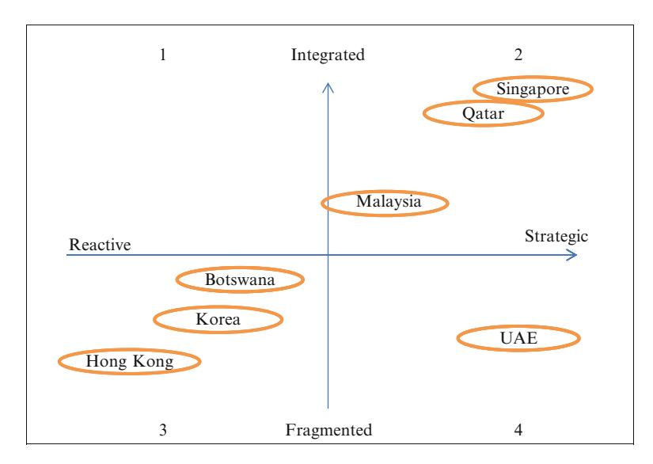

<!-- A1.R27 | source: papers_json/A1.R27/ -->

## ** Chapter 11 ** ** Comparative Analysis of Education Hubs **

** Jane Knight **

## ** Introduction **

أظهرت دراسات حالة مراكز التعليم بوضوح أن "المقاس الواحد لا يناسب الجميع". وفي حين قد توجد بعض أوجه التشابه بين الدول من حيث المبررات الدافعة لتصبح مركز تعليم، تختلف المناهج والخطط والاستراتيجيات وفقاً لأولويات كل دولة وسياقها المحلي.

الغرض من هذا الفصل هو إجراء تحليل مقارن شامل لمراكز التعليم الست. وتُدرج الدول الأربع الناشئة كمراكز تعليم في عدة نقاط من التحليل، لكن بشكل عام تتوفر معلومات أقل عن دراسات الحالة هذه نظراً لكونها في مرحلة تطور أحدث. ومن المهم ملاحظة أن التحليل المقارن يراعي الاختلافات بين الدول نظراً للدور الحاسم الذي تؤديه الثقافة المحلية والحوكمة والتاريخ في تحديد أهداف ومناهج تطوير مركز التعليم. وتشمل قضايا السياق الإضافية التركيبة العرقية للسكان، ونضج النظام التعليمي، وأولويات التنمية الاقتصادية. ويبني التحليل الشامل على الإطار الذي نُوقش في الفصل الثالث، ويهدف إلى دراسة السمات التي تُميّز الأنواع المختلفة من المراكز وتحديد العوامل الرئيسية لتطورها. والغرض ليس ترتيب أو تقييم إنجازات كل مركز على حدة. فكل مركز هو تشكيلة فريدة من الدوافع والسياسات والاستثمارات والجهات الفاعلة، وتكمن الثراء في النظر إلى الاختلافات وأوجه التشابه، وليس في تحديد تسلسل هرمي للإنجاز.

وبما أن التحليل المقارن يركز على المراكز على مستوى الدولة، فإن ذلك يعني أنه، حيثما أمكن، يجري إشراك الرؤية والتخطيط الاستراتيجي ووثائق السياسات على المستوى الوطني.

Ontario Institute for Studies in Education , University of Toronto , Toronto , ON , Canada e-mail: jane.knight@utoronto.ca

> ^ ^The analysis presented in this chapter is based on the information and data gleaned from six case study chapters, the emerging hub chapter, and an informal survey and interviews with the case study authors.

> ^ ^J. Knight (*)

<!-- page 2 -->

184 J. Knight

وهناك استثناءات مثل الإمارات، حيث يجري معظم التخطيط والتنفيذ على مستوى دون وطني. وفي المراكز على مستوى الدولة، يمكن أن يختلف عدد ومواقع المبادرات المختلفة. وينطبق هذا على الدول الأكبر مثل ماليزيا والإمارات وكوريا وبوتسوانا. ويختلف المركز على مستوى الدولة عن المركز على مستوى المنطقة أو المدينة، لأن هذا الأخير يشمل عادة منطقة جغرافية محددة وتشاركاً في الموقع بين الجهات الفاعلة. وتُعد وثائق التخطيط حاسمة أيضاً بالنسبة للمراكز على مستوى المنطقة والمدينة، لكنها تغطي مستوى اختصاص أكثر محلية، وبالتالي يصعب مقارنتها بالسياسات الوطنية.

والمحاور الرئيسية التي يتناولها التحليل المقارن هي: تواريخ التأسيس والتشغيل، ودرجة التقدم، ومناهج التخطيط والتنفيذ المستخدمة، والمبررات، وقطاعات السياسات، والجهات الفاعلة المؤثرة، والمستفيدون.

## ** Date of Establishment and Progress **

يؤثر عدد السنوات التي أمضتها الدولة في بناء نفسها كمركز تعليم تأثيراً كبيراً على تطور وتقدم بناء المركز. ورغم أن وجود خطة رئيسية أو نوع من الاستراتيجية أمر حاسم للنجاح، فلا شك أن بناء المركز عملية تطورية تشمل فرصاً وتغييرات غير متوقعة على طول الطريق. فعلى سبيل المثال، كان للأزمات الاقتصادية في عامي 2007 و2012 تأثير كبير في عدة دول، وبخاصة على خطط بوتسوانا لتصبح مركزاً للنشاط التعليمي. والخطوة الأولى هي النظر إلى تواريخ التأسيس والخطوط العامة للتقدم كما يوضح الجدول 11.1.

قطر وسنغافورة هما أول دولتين امتلكتا رؤية واضحة لتصبحا مركز تعليم، إذ أعلنتا نيتهما في عامي 1995 و1998 على التوالي. وعلى مدى السبعة عشر عاماً الماضية، حققت قطر تقدماً كبيراً في تطوير مدينتها التعليمية، ومدينة قطر للعلوم والتكنولوجيا، والمرافق والبرامج البحثية الجديدة. كما حققت سنغافورة درجة مثيرة للإعجاب من التقدم، بدءاً من إنشاء مشروع "المدرسة العالمية" في السنوات الأولى، وانتقالاً إلى مركز مكثف للبحث والابتكار بحلول عام 2012.

في الفترة 2003-2004، أعلنت الإمارات وهونغ كونغ خططهما لتصبحا مركزاً معترفاً به للتميز التعليمي والبرامج. ومن بين هاتين الدولتين، حققت

*Qatar UAE Hong Kong Malaysia Singapore Botswana Announce 1995 2003 2003 2007 1998 2008 Implement 1995 2003 2008 2007 1998 2008 Progress High High Low Mod–high High Low Current type of hub Talent/student Student/talent Student Student Knowledge Student Aspiration Talent/ knowledge Talent/ knowledge Talent Talent/ knowledge Knowledge Student/ talent*

*** Table 11.1 **Founding dates and progress of country-level hubs*

*Source* : Knight ( 2014 )

<!-- page 3 -->

الإمارات تقدماً كبيراً نحو تحقيق أهدافها، بينما لا تزال هونغ كونغ في مراحل مبكرة من التطور. وجاء إعلان ماليزيا عن خطط مركز التعليم في عام 2007، وقد تقدمت بطريقة لافتة، جزئياً لأنها كانت تمتلك بالفعل أساساً من الفروع الجامعية الدولية والطلاب لتبني عليه، وجزئياً بسبب الإرادة السياسية القوية. وبوتسوانا واحدة من الدول التي أعلنت خططها متأخرة نسبياً، في عام 2008. وهي بطيئة في إحراز تقدم ملموس نظراً لخطتها المعقدة نسبياً لتطوير ستة مراكز، أحدها مركز التعليم الذي يهدف إلى تزويد المراكز الصناعية الأخرى بالمواهب اللازمة.

وتصبح الصورة أقل وضوحاً عند دراسة تواريخ تأسيس المراكز الناشئة. فعلى سبيل المثال، بدأت كوريا العمل على حرم "سونغدو" الجامعي التعليمي العالمي (Songdo Global Education University Campus) في عام 2003، وعلى مدينة "جيجو" التعليمية العالمية (Jeju Global Education City) في عام 2009. وكان التقدم بطيئاً، ولم تصل كوريا بعد إلى كامل إمكاناتها كمركز تعليم. لذلك، وعلى الرغم من تاريخ بدايتها المبكر، لا تزال تُصنَّف كمركز ناشئ بعد نحو 10 سنوات من إعلانها الأول. والبحرين مثال آخر مثير للاهتمام. فقد أعلنت خطط مركز التعليم لديها لأول مرة في عام 2006، لكن كانت هناك تطورات ملموسة قليلة منذ ذلك الحين، وقد يتساءل المرء عما إذا كانت مركزاً ناشئاً تعثر أم أن ادعاء وضع مركز التعليم كان أقرب إلى أداة تسويقية منه إلى مسعى جاد. أما سريلانكا وموريشيوس فقد أعلنتا خططهما في عام 2011 وهما في مراحل مبكرة جداً من التطور. ومن المؤكد أن الوقت لا يزال مبكراً جداً لتحديد ما إذا كانت هذه مشاريع جادة أم مجرد جهود تسويقية للتعليم الدولي مصممة لاستقطاب مزيد من الطلاب الدوليين.

ويحدد الجدول 11.1 نوع مركز التعليم لكل دولة اعتباراً من عام 2012، ويشير إلى الطموحات على المدى المتوسط إلى الطويل. وتصنيف مراكز التعليم إلى مراكز طالب أو موهبة أو معرفة/ابتكار هو مجرد اقتراح. وتساعد عوامل عديدة في تحديد ما إذا كان مركز التعليم موجهاً نحو أغراض الطالب أو الموهبة أو المعرفة/الابتكار. وتشمل هذه العناصر الرئيسية الدوافع، والمبررات، والأهداف، والخطط، والسياسات، واللوائح، إضافة إلى الأنشطة والإنجازات الملموسة حتى الآن. ويُدرَس تصنيف أنواع المراكز بمزيد من التفصيل في نهاية هذا الفصل، لكن هذا التصنيف الأولي لنوع المركز كما هو مقترح في الجدول 11.1 يُقصد به المساعدة في الخطوات الأولى للتحليل الشامل.

## ** Plans, Policies, and Regulations **

كما نُوقش في الفصل الثاني، هناك مفهومان أساسيان في تعريف مركز التعليم هما "مخطط" و"استراتيجي". وتشير هذه المفاهيم إلى أن تطوير المركز ليس عملية عشوائية، وأنه ينبغي وجود أدلة على تخطيط استراتيجي متين. ويقدم الجدول 11.2 نظرة عامة على وثائق التخطيط والسياسات واللوائح الرئيسية التي استخدمتها كل دولة كما نُوقش في فصول دراسات الحالة. وقد جرى تحديد أربعة أنواع من الوثائق: (1) *رؤية وطنية* أو خطة تحدد الحاجة والمبررات وأولويات الدولة وكيفية ارتباطها بتطوير مركز التعليم؛ (2) *سياسات على المستوى الوطني* وخطط من قطاعات مختلفة مثل التعليم أو الاقتصاد أو الموارد البشرية وكيفية ارتباطها

<!-- page 4 -->

<!-- page 5 -->

أو تأثيرها على تطوير المركز؛ (3) *خطة رئيسية* للمركز أو خطط صريحة لعناصر مركز التعليم؛ و(4) لوائح وسياسات على المستوى التشغيلي لتوجيه ومراقبة تنفيذ خطط مركز التعليم.

يُظهر الجدول 11.2 أن الدول تتبع مناهج مختلفة جداً في تخطيط وتنفيذ استراتيجيات مركز التعليم. فعلى سبيل المثال، في قطر، تتضمن رؤية قطر الوطنية 2030 وضع قطر كمركز تعليم في المنطقة، ولتحقيق ذلك جرى تحديد مؤسسة قطر كجهة قيادية وطنية للإشراف على جميع جوانب تطوير مركز التعليم. أما الإمارات، على النقيض من ذلك، فلا تمتلك خطة وطنية أو آلية تنسيق لتصبح مركز تعليم. ويجري كل العمل على مستوى الإمارة، مع تصدر دبي وأبوظبي زمام المبادرة. ومن المثير للاهتمام أن كل إمارة طورت نهجها الفردي الخاص للاستثمارات والأولويات والإجراءات. وحقيقة أن دبي طورت منطقتين حرتين تعليميتين لجذب مقدمي الخدمة والطلاب تختلف عن نهج أبوظبي القائم على دعوة وتمويل جامعات ذات شهرة عالمية. وقد أكثرت هونغ كونغ من التصريحات حول خطط مركز التعليم لكنها كانت أقل حظاً من التخطيط الفعلي وخطوات التنفيذ الملموسة. وتتبع ماليزيا نهجاً متعدد الأوجه في تطوير المركز يشمل العديد من الجهات الفاعلة والمبادرات، وبالتالي تسترشد بسلسلة من السياسات واللوائح المختلفة التي تدعم جميعها تطوير المركز. غير أنه يبدو أن خطة رئيسية شاملة على مستوى الدولة لا تزال غائبة رغم المبادرات العديدة الجارية. وقد استرشدت بوتسوانا بوثيقة رؤية وطنية، مدعومة باستراتيجيات على مستوى القطاعات وكذلك خطة رئيسية للمركز. وعلى الرغم من نهج التخطيط الشامل، يبدو أن هناك تحركاً محدوداً من حيث التنفيذ. وفيما يتعلق بالمراكز الناشئة، حددت كوريا أولويتين — حرم "سونغدو" الجامعي العالمي (SGUC) ومدينة "جيجو" التعليمية العالمية (JGEC). وتقتصر السياسات والخطط على مستوى المكونات فقط نظراً لغياب خطة وطنية. وتركز سريلانكا وموريشيوس كل جهودهما على خطة استقطاب الطلاب الدوليين، ولا يزال من المشكوك فيه ما إذا كانت جهودهما في الواقع أكثر من مجرد جهد تسويقي واستقطابي.

ويشير الجدول 11.2 إلى أن جميع الدول باستثناء الإمارات وهونغ كونغ تمتلك وثيقة رؤية تتناول تحديداً أهمية ودور كونها مركز تعليم لأغراض التنمية الوطنية. ومن المثير للاهتمام التكهن بالأثر الذي قد تحدثه رؤية وطنية أو حتى خطة قطاعية في الإمارات. فهل من شأن نهج تخطيط وسياسات أكثر منهجية وتنسيقاً أن يُسفر عن مبادرة مركز معززة، أم أن غياب خطة وطنية قد أتاح لكل إمارة حرية تطوير نهجها الخاص؟ ومن جهة، تحظى الإمارات بتقدير كبير بوصفها مركز تعليم ناجحاً نظراً لاستضافتها لأكبر تركيز من الفروع الجامعية الدولية في أي دولة واحدة. لكن، من جهة أخرى، لا يمكن تقدير الأثر فيما لو اتُّبع نهج أكثر استراتيجية وتوحيداً. وبشكل عام، تُقرّ وثيقة الرؤية أو السياسة الرفيعة المستوى بأهمية وفوائد كون الدولة مركز تعليم، لكن هذا لا يترجم دائماً في الواقع إلى إجراء ملموس. وتُعد هونغ كونغ مثالاً على ذلك، وربما البحرين أيضاً.

وفي حين تتحدث وثائق السياسات على مستوى الرؤية أو القطاع عن الأولوية المُعطاة لتطوير المركز، فإن الخطة الرئيسية الفعلية للمركز واللوائح التشغيلية هي التي تترجم النية إلى واقع. ومن اللافت أن سنغافورة وبوتسوانا فقط لديهما خطة رئيسية فعلية للمركز. وفي سنغافورة، أدى ذلك بالتأكيد إلى نجاح و

<!-- page 6 -->

188 J. Knight

اعتراف بسنغافورة كمركز تعليم. أما في بوتسوانا، فمن المبكر الجزم بذلك، لكن التقدم كان متواضعاً منذ الإعلان الأول عن خطط المركز في عام 2008. وبالتالي، فإن بيانات الرؤية، والخطط على مستوى القطاع، والخطة الرئيسية للمركز، واللوائح التشغيلية أصول مهمة لكنها غير كافية. فالإرادة السياسية والاستثمار في أنشطة المركز على القدر نفسه من الأهمية. فعلى سبيل المثال، يُعد تمويل الحوافز لاستقطاب مقدمي التعليم وشركات البحث والتطوير، والمنح الدراسية للطلاب، وبرامج تمويل البحث، والبنية التحتية المادية، متطلبات إضافية. ومن المهم بالقدر نفسه دعم ومشاركة المجتمع في التعاون المحلي/الأجنبي، إذ إن هذه التفاعلات هي التي تساعد على ازدهار مركز التعليم.

## ** Planning and Implementation Approaches **

يقود تحليل وثائق السياسات واللوائح الرئيسية، كما نُوقش في القسم السابق، إلى تساؤل حول نوع النهج الذي تتبعه هذه الدول في التخطيط لطموحاتها في مركز التعليم وتحقيقها. ويقدم الشكل 11.1 منظوراً مقارناً لمناهج الدول ويتألف من محورين أفقيين. يمثل المحور الأول متصل *نهج التخطيط* (planning approach) من موقف رد الفعل مروراً بالاستباقي وصولاً إلى الاستراتيجي. ويشير الموقف "رد الفعل" (reactive) إلى أن الدولة تستجيب للاتجاهات والفرص والعوامل الخارجية التي تجعل المركز جذاباً. ويدل النهج "الاستباقي" (proactive) على اهتمام وإجراء متعمدين لضمان أن يساعد مركز التعليم على تحقيق أهداف محددة. أما النظرة "الاستراتيجية" (strategic) فهي نهج أكثر حساباً واستنارة يركز على كيفية ارتباط مركز التعليم بالخطط والأولويات الوطنية للتنمية.

ويمثل المحور الأفقي الثاني في الشكل 11.1 *نهج التنفيذ* (implementation approach). ويشمل النهج "المجزأ" (fragmented) تناول كل عنصر من عناصر المركز

**Planning Approach***Reactive*Hong Kong*Proactive*Botswana Malaysia UAE*Strategic*Qatar Singapore

**Implementation Approach*****Fragmented***UAE Hong Kong***Coordinated***Botswana Malaysia***Integrated***Singapore Qatar

*** Fig. 11.1 **Planning and implementation approaches ( *Source* : Knight 2014)*

<!-- page 7 -->

*** Fig. 11.2 **Planning and implementation positions of education hub countries*

بشكل منفصل. أما نقطة المنتصف فتشير إلى درجة من "التنسيق" (coordination) بين مبادرات المركز المختلفة. ويشمل النهج "المتكامل" (integrated) مستوى أعمق وأكثر منهجية من التعاون بين عناصر المركز لتحقيق القيمة المضافة الناتجة عن أن "الكل أكبر من مجموع أجزائه". ويوضح الشكل 11.1 موقع كل دولة تقريباً على كلا المحورين وفقاً للمعلومات الواردة في دراسة الحالة.

ويجمع الشكل 11.2 بين المحورين. يشير المحور الأفقي إلى نهج التخطيط، والمحور الرأسي إلى نهج التنفيذ. وعند دمجهما، يسمحان بتحليل لتحديد أي ربع (quadrant) يصف بشكل أفضل النهج العام لكل دولة. ومن الواضح أن هونغ كونغ وبوتسوانا تقعان في الربع الخاص برد الفعل (الثالث)، متبعتين نهجاً أكثر تجزؤاً في تنفيذ خططهما. وقد يساعد ذلك على فهم سبب كون تقدمهما العام منخفضاً إلى متوسط. من ناحية أخرى، تقع الإمارات بين النهج الاستباقي والاستراتيجي في تخطيطها، لكن غياب أي تنسيق منهجي بين الإمارات يضعها في الربع الرابع. ويشير الربع الثاني إلى نهج تخطيط استراتيجي أقوى ومسار أكثر تنسيقاً أو تكاملاً نحو التنفيذ. وتقع قطر وسنغافورة في الربع الثاني لأنهما تُظهران أكبر تقدم نحو نهج استراتيجي/متكامل. وتقع ماليزيا أيضاً في الربع الثاني لكنها أقرب إلى نهج منسق منها إلى نهج استراتيجي نظراً لغياب خطة رئيسية للمركز.

لم تُوضَع الدولتان الناشئتان سريلانكا وموريشيوس في الرسم البياني لأنهما لم تتقدما بما يكفي نحو التنفيذ. غير أن كوريا حققت تقدماً كبيراً في حرم "سونغدو" الجامعي العالمي، لكنها ستقع في الربع الثالث نظراً لنهجها المجزأ نسبياً.

<!-- page 8 -->

## ** Driving Rationales **

تكشف دراسة المبررات الرئيسية الكثير عن سبب وكيفية واتجاه توجه الدولة في مركز التعليم الخاص بها. وكما نُوقش في الفصلين الثاني والثالث، هناك خمس فئات رئيسية من المبررات الدافعة لمراكز التعليم: (1) التعليم والتدريب، (2) البحث، (3) الاقتصاد، (4) تنمية الموارد البشرية، و(5) المكانة. ويمكن تقسيم كل فئة رئيسية إلى مبررات فرعية كما هو موضح في الجدول 11.2. وتتيح فصول دراسات الحالة فحصاً دقيقاً للدوافع الصريحة والضمنية، وتروي قصة مثيرة للاهتمام حول سبب بناء الدولة لنفسها كمركز تعليم، وثانياً، ما إذا كانت الجهات الفاعلة والخطط والإنجازات متماسكة ومتسقة مع المبررات.

يقدم الجدول 11.3 استعراضاً انطباعياً لأهمية كل مبرر لكل دولة. ويُستخدم مصطلح "انطباعي" لأن التحليل يستند إلى تفسير المعلومات الواردة في كل دراسة حالة. وبالنظر إلى المربعات المُظللة بخط عريض في الجدول 11.3، يتضح أن المبرر الأول هو الاقتصاد. وهناك ثلاثة مبررات فرعية مدرجة ضمن المجموعة الاقتصادية. والمبرر الذي يبرز باعتباره الأهم هو الحاجة إلى تنويع الاقتصاد من خلال التحول إلى اقتصاد قائم على المعرفة والخدمات. وينطبق مبرر التنويع الاقتصادي على جميع مراكز الدول وإن كان بدرجات مختلفة من الأهمية. وبالنسبة لأربع دول، هي هونغ كونغ وماليزيا وبوتسوانا والإمارات، يكون الدافع هو تعزيز صناعة التعليم، وتوليد الإيرادات أهمية ثانوية في نهاية المطاف، بينما يُعد جذب الاستثمار الأجنبي المباشر مهماً بالنسبة للإمارات وبوتسوانا.

*Source* : Knight ( 2014 ) *H* high, *M* medium, *L* low

<!-- page 9 -->

والمبرر الثاني في الأهمية هو التعليم والتدريب. وتجعل أربع دول، هي قطر والإمارات وماليزيا وبوتسوانا، من هذا المبرر أولوية عالية. وتشمل مبررات التعليم والتدريب ثلاث مجموعات فرعية: (1) تحسين الجودة الإجمالية للتعليم؛ (2) زيادة فرص الوصول إلى التعليم العالي للطلاب المحليين والوافدين والدوليين؛ و(3) تعليم وتدريب العمال بالمهارات التي تحتاجها الصناعة. ويتسق هذا الترتيب للمبررات مع حقيقة أن غالبية الدول ترى نفسها كمركز تعليم من نوع "الطالب" يركز على توفير برامج وخدمات التعليم والتدريب (انظر الجدول 11.1).

وجاء تطوير قوة عاملة ماهرة في المرتبة الثالثة من حيث الأهمية. وينطبق هذا المبرر على جميع الدول بسبب رغبتها في تحويل اقتصاداتها إلى قطاعات المعرفة والخدمات، ويُعد امتلاك مجمع المواهب اللازم متطلباً أساسياً. وتحتل القوة العاملة الماهرة أهمية عالية بالنسبة لكل من قطر والإمارات نظراً لاعتمادهما الكبير على العمال الوافدين. أما سنغافورة فتمثل سيناريو مختلفاً، إذ تسعى بنشاط لاستقطاب علماء وعمال معرفة أجانب لتغذية سعيها نحو إنتاج معرفة وابتكارات جديدة.

ويأتي مبرر المكانة والعلامة التجارية في المرتبة الرابعة، وهو أعلى بالنسبة للدول الآسيوية الأربع. وقد يعكس هذا الميدان التنافسي إلى حد ما في هذه المنطقة، حيث تسعى أربع دول إضافة إلى سريلانكا لتصبح مركز تعليم. والجدير بالملاحظة بشكل خاص أن كلاً من قطر والإمارات تُصنّفان المكانة في مرتبة أدنى، رغم أن زيادة جاذبيتهما وتنافسيتهما في المنطقة تحتل مرتبة عالية على الأجندة.

وأخيراً، يأتي البحث وإنتاج المعرفة في أدنى مرتبة من بين المجموعات الخمس للمبررات. وتُصنّف سنغافورة وقطر فقط هذا المبرر بأنه عالي الأهمية، وهو ما يتسق مع نهجهما الاستراتيجي في التحرك نحو اقتصاد قائم على المعرفة والابتكار. ومن الجدير بالملاحظة أن هاتين الدولتين تمتلكان أطول تجربة في بناء المراكز. ومن اللافت أن ماليزيا تُصنّف البحث بأهمية عالية في قائمة مبرراتها، لكن حتى الآن لا تدعم خططها وسياساتها وإجراءاتها ذلك. ويبدو أنه طموح طويل الأمد.

يشير هذا التحليل للمبررات إلى أن الأسباب الاقتصادية هي المحركات الرئيسية لمراكز التعليم — وإن كانت الأسباب الاقتصادية تختلف من دولة إلى أخرى. ثانياً، تحتل دوافع التعليم والتدريب أهمية ثانوية، مع كون تحسين جودة نظام التعليم العالي وزيادة فرص الوصول أبرز الأسباب. وتأتي القوة العاملة الماهرة في مرتبة قريبة ثالثة، إذ إن أهمية استقطاب المواهب وتدريبها واستبقائها حاسمة تماماً للتحرك نحو قاعدة اقتصادية قائمة على المعرفة والخدمات. وتأتي المكانة في المرتبة الرابعة، وترتبط بالقوة الناعمة والنفوذ الجيوسياسي والموقع في المنطقة وخارجها. وهذا مبرر أصعب في تحديده بدقة، إذ يعني أشياء مختلفة جداً لدول وقطاعات مختلفة. ويكفي القول إن الهوس الحالي بترتيبات التعليم العالي قد يؤثر على تطوير المركز، وبخاصة من حيث استقطاب مؤسسات ذات شهرة عالمية وأكثر الباحثين والطلاب الواعدين والمنجزين. وهذا المبرر بالتحديد سائد لكنه سيستفيد من دراسة أكثر تعمقاً. وأخيراً، يُصنَّف البحث كخامس أهم المبررات، ويُفسَّر عادة على أنه يعني إنتاج المعرفة وتطبيقاتها لخدمة المجتمع من خلال الابتكار. وهذه أدوات مهمة للابتعاد عن الاعتماد على الموارد الطبيعية أو التصنيع نحو أنشطة قائمة على المعرفة والخدمات.

<!-- page 10 -->

يكشف تحليل متعمق لمراكز التعليم الست إضافة إلى الدول الأربع الناشئة عن كم كبير من المبررات الفردية. وهذا أمر متوقع نظراً لاختلاف السياقات والظروف في الدول المضيفة، والمشاركة الدولية لأنظمة التعليم العالي فيها. والمبررات الخمسة الموصوفة في هذا القسم تتناول فقط الأكثر شيوعاً وأهمية، لكنها ينبغي ألا تُغفل تلك الخاصة بظروف كل دولة. فعلى سبيل المثال، تُعد قطر الدولة الوحيدة التي تُحدد زيادة التبادل والتفاهم الثقافي كمبرر أساسي لعملها في مركز التعليم.

## ** Investment: Domestic/Foreign, Public/Private? **

تحتاج الدول الجادة في تطوير مركز التعليم الخاص بها إلى استثمار كبير لإطلاق المشاريع والحفاظ عليها. والأنواع الثلاثة الرئيسية للاستثمار في تطوير المركز هي: (1) الاستثمار العام المحلي، (2) الاستثمار الخاص المحلي، و(3) الاستثمار الخاص الأجنبي. ولا يُدرَج الاستثمار العام الأجنبي لأنه لعب حتى الآن دوراً هامشياً جداً. ويمكن اعتبار تكاليف إنشاء الجامعات العامة الأجنبية للفروع الجامعية نوعاً من الاستثمار العام الأجنبي، لكن حتى هذا النوع من التمويل يُفسَّر بأنه استثمار خاص أجنبي وفقاً لقانون التجارة الدولي. ومن الصعب، إن لم يكن من المستحيل، الحصول على بيانات موثوقة عن مقدار أو نسبة الاستثمار لكل فئة من الفئات الثلاث. والتقديرات المتوفرة فقط ليست قوية أو موثوقة. ومع ذلك، تشير التقديرات إلى أن الاستثمارات العامة المحلية هي الأهم. ويأتي أهم تمويل عام من وكالات الاستثمار الحكومية مثل "تيكوم" (TECOM) في دبي و"خزانة ناسيونال" (Khazanah Nasional) في ماليزيا. ومن الصعب تحديد المبلغ الفعلي الذي تقدمه هذه الهيئات الاستثمارية الحكومية بدقة، لأنها بدورها تجذب استثماراً خاصاً محلياً وأجنبياً.

وفي حين تُعد وكالات الاستثمار الحكومية المحلية أهم الممولين لمراكز التعليم، خاصة لبناء البنية التحتية والمرافق، تُساهم الإدارات الحكومية أيضاً بشكل كبير في تكاليف البرامج والتشغيل. ويُقدَّر أن نسبة الاستثمار *العام* المحلي تتراوح بين 98% في قطر تقريباً وما يكاد يكون معدوماً في بوتسوانا. أما مقدار المستثمر *الخاص* المحلي فيصعب تحديده بالقدر نفسه، لكنه يتراوح من نحو 50% في هونغ كونغ إلى 2% فقط في قطر. ومستوى الاستثمار الخاص الأجنبي منخفض بشكل مفاجئ ويبدو مقتصراً على تكاليف الإنشاء والتشغيل الفعلية لمؤسسات التعليم والتدريب الأجنبية، ووكالات البحث والتطوير، والشركات الأجنبية. وتشير فصول دراسات الحالة إلى أن نسبة الاستثمار الخاص الأجنبي تصل إلى 20% في كل من هونغ كونغ والإمارات، ونحو 5% في ماليزيا، وصفر في قطر.

من الواضح أن كل دولة تمتلك قدرتها واستراتيجياتها الخاصة لتمويل مبادرات مركز التعليم. وتُعد قطر نموذجاً مثيراً للاهتمام لكنه فريد. وكما لوحظ في فصل قطر (الفصل الرابع)، توفَّر كل البنية التحتية والمرافق المادية للفروع الجامعية والشركات الأجنبية الموجودة في المدينة التعليمية ومدينة العلوم والتكنولوجيا. علاوة على ذلك، تغطي مؤسسة قطر 100% من تكاليف التشغيل الكبيرة للفروع الجامعية الثمانية والكليتين الدوليتين.

<!-- page 11 -->

إضافة إلى ذلك، تُقدَّم منح بحثية سخية لمؤسسات الحرم الرئيسي وكذلك الفروع الجامعية. وتقع تكاليف التشغيل السنوية لدعم المدينة التعليمية ومدينة العلوم والتكنولوجيا والمجموعة الواسعة من البرامج والمنح البحثية على عاتق حكومة قطر بالكامل، وهي مرتفعة للغاية. فهل نموذج التمويل الحكومي الكامل هذا مستدام، وهل هو الأمثل؟ في جوهر الأمر، تقوم قطر باستيراد وشراء جميع برامج التعليم والخدمات والبحوث الخاصة بأنشطة مركز التعليم. وعلاوة على ذلك، إذا سُئل عما إذا كان هذا النموذج قابلاً للتكرار في أي دولة أخرى، فالإجابة على الأرجح هي لا، أو ربما فقط في دول صغيرة وغنية مثل دول منطقة الخليج. والسؤال المحوري هو إلى متى يمكن، أو ينبغي، لدولة أن تحاول بناء وتعزيز القدرة المحلية عن طريق شراء واستيراد الخبرة الأجنبية. لقد مرت 17 عاماً منذ أن بدأت قطر عملها في دعوة جامعات أجنبية مختارة لإنشاء برامج محددة في المدينة التعليمية. فهل هذه هي المرحلة الأولى من خطة قطر طويلة الأمد لتطوير مزيد من القدرة المحلية للموارد البشرية مع تخفيف اعتمادها على الغاز الطبيعي والمواهب الوافدة الأجنبية، أم أن هذا يصبح أسلوب العمل المعتاد؟ لم تتضح بعد المرحلة التالية من تطوير مركز قطر، لكن من المشكوك فيه، وربما من المستحسن، التساؤل عما إذا كان بالإمكان الاستمرار في النموذج الحالي إلى أجل غير مسمى. فهل سيركز نموذج جديد على جمع كل الفروع الجامعية المدرجة في المدينة التعليمية ضمن مؤسسة تعليم عالٍ قطرية جديدة؟ وهل ستُنشأ جامعة متعددة الجنسيات أو "مجموعة أعمال تعليمية" من خلال بناء أو تعزيز رابط مشترك بين المؤسسات الأجنبية؟ يمكن تخيل نماذج مختلفة، لكن لا توجد إشارة ملموسة إلى ماهية الخطوة التالية.

وتُقدم الإمارات مجموعة مختلفة تماماً من الظروف من حيث التمويل والاستثمارات وتوليد الإيرادات. وكما لوحظ سابقاً، طوّرت كل إمارة نهجها الخاص لجعل الإمارات مركز تعليم. فقد دعت أبوظبي مؤسسات ذات شهرة عالمية مثل جامعة نيويورك والسوربون لإنشاء فروع جامعية في مرافق مُصممة خصيصاً وفّرتها أبوظبي. إضافة إلى ذلك، دُعي معهد ماساتشوستس للتكنولوجيا (MIT) للمساعدة في تطوير وتقديم المشورة بشأن تطوير مدينة "مصدر"، أول منطقة خالية من الكربون في العالم. وتستضيف مدينة مصدر مرافق بحثية عالمية المستوى وعلماء وبرامج دراسات عليا، وجميعها مدعومة من حكومة أبوظبي أو الأسرة الحاكمة. ويمثل هذا استثماراً عاماً محلياً هائلاً. أما دبي فقصتها مختلفة. فقد دعت خطة دبي الاستراتيجية إلى إنشاء عدة مناطق اقتصادية حرة موضوعية. اثنتان من هذه المناطق موجهتان نحو التعليم — قرية المعرفة ومدينة دبي الأكاديمية الدولية. وتتولى "تيكوم"، الذراع الاستثمارية لحكومة دبي، مهمة بناء البنية التحتية والمرافق المادية لهاتين المنطقتين واستقطاب مؤسسات وشركات تدريب أجنبية ذات سمعة جيدة. وكما شُرح في فصل الإمارات (الفصل الخامس)، يتمتع مستأجرو هاتين المنطقتين بحوافز ضريبية وتنظيمية جذابة لإقامة عملياتهم وتقديم برامجهم التعليمية والتدريبية. وعلى عكس الوضع في قطر وأبوظبي، لا تُدعم تكاليف تشغيل المؤسسات ومقدمي الخدمة الأجانب، وهم يدفعون إيجاراً لاستخدام المرافق المشتركة. ويُقدَّر أن الاستثمار العام المحلي في منطقتي دبي الحرتين للتعليم يبلغ نحو 80%، والاستثمار الخاص الأجنبي نحو 20%. ولا تُعرَف كمية الإيرادات المتولدة من إيجارات المرافق لـ"تيكوم" ومن الرسوم الدراسية للفروع الجامعية/شركات التدريب الخاصة، لكن نظراً لأن هذه المناطق

<!-- page 12 -->

194 J. Knight

مستقرة نسبياً وتعمل بكامل طاقتها، يبدو أن صيغة التمويل تعمل بشكل جيد. ومن التطورات الجديدة المثيرة للاهتمام في مدينة دبي الأكاديمية الدولية (DIAC) إنشاء حرم جامعي مستقل من قِبل جامعة "مانيبال" وجامعة "هيريوت-وات". فهاتان المؤسستان المقيمتان منذ فترة طويلة في مدينة دبي الأكاديمية الدولية واثقتان بما يكفي للانتقال من المرافق المستأجرة وتغطية تكاليف بناء مرافقهما الخاصة. وهذا مثال على كيفية تزايد الاستثمار الخاص الأجنبي، لكنها حالات معزولة، وليست اتجاهاً عاماً.

وتُقدم هونغ كونغ سيناريو آخر مختلف. فقد قدمت الحكومة استثماراً عاماً محدوداً في تطوير المركز منذ إعلانها الأول في عام 2004. وبشكل عام، كان هناك تقدم ضئيل حتى الآن، مما يدفع المرء للتساؤل عما إذا كانت خطة المركز أقرب إلى الخطاب منها إلى الواقع. ومع ذلك، اعتباراً من عام 2012، جرى تخصيص قطعة أرض لتسمح للجامعات المحلية أو الأجنبية بإنشاء فروع جامعية. ولسوء الحظ، لا توجد معلومات ملموسة حول ما إذا كانت هونغ كونغ ستمول بناء البنية التحتية والمرافق المادية كما حدث في معظم دول المركز الأخرى، أو ما إذا كانت الجامعات المستأجرة ستكون مسؤولة عن بناء مرافقها الخاصة. وتمثل الاستثمار العام الرئيسي من هونغ كونغ في شكل منح دراسية لاستقطاب طلاب دوليين، ومعظمهم من الصين. ومن الناحية السياسية، طوّرت هونغ كونغ لوائح جديدة لتصاريح الإقامة. وبالتالي، ومنذ أول بيان سياسي أعلن هدف هونغ كونغ في أن تصبح مركز تعليم، كان الاستثمار العام المحلي منخفضاً بشكل مفاجئ والاستثمار الأجنبي ضئيلاً. وربما يكون غياب استثمار عام أو خاص كبير مسؤولاً عن غياب التقدم الملموس الواضح.

ويبدو الاستثمار العام لحكومة بوتسوانا، بخلاف الانخراط في عملية تخطيط واستشارة متطورة نسبياً، صغيراً. ولا تزال خطط مركز بوتسوانا على المسار الصحيح لكنها تأثرت سلباً بالأزمتين الاقتصاديتين في عامي 2008 و2012. وكما نُوقش في فصل بوتسوانا (الفصل التاسع)، يُعد مركز التعليم أحد عناصر نموذج معقد نسبياً من ستة مراكز. ومركز التعليم شامل على مستوى الدولة، بينما تكون المراكز الخمسة الأخرى خاصة بمناطق معينة وتُركز على أولويات القطاع الصناعي. وشملت جهود حكومة بوتسوانا حتى الآن خطة استقطاب جديدة للطلاب الدوليين، وتطوير جامعة جديدة — جامعة بوتسوانا الدولية للعلوم والتكنولوجيا (BIUST) — وتعزيز الشراكات الدولية بين المؤسسات الأجنبية والمحلية. ونظراً للمراحل المبكرة لتطوير مركز بوتسوانا، يصعب تحديد حجم الاستثمارات العامة/الخاصة والأجنبية/المحلية.

ومن المستحيل تحديد الاستثمارات المالية في أنشطة بناء المركز في سنغافورة منذ عام 1998 نظراً لغياب أي معلومات منشورة عن المصادر العامة/الخاصة أو المحلية/الأجنبية. وبالتالي، لا يمكن استخلاص أي استنتاجات. وكما نُوقش في فصل سنغافورة (الفصل الثامن)، الانطباع والافتراض العامان هما أن الاستثمارات العامة المحلية غذت تطوير مركز التعليم، وبخاصة إنشاء الجامعات الأجنبية. والجدير بالملاحظة أن دور حكومة سنغافورة أُشير إليه بوصفه دور "رأسمالي مغامر" (venture capitalist) من حيث تمويل جهود مركز التعليم.

والوضع في ماليزيا معقد نظراً لعدد العناصر المختلفة لاستراتيجية المركز. فقد كانت ماليزيا موطناً لخمسة فروع جامعية لما يقرب من عقد من الزمن، وأُنشئ فرعان إضافيان مؤخراً. واستُخدمت أموال خاصة أجنبية و

<!-- page 13 -->

محلية لتمويل هذه المبادرات. لكن، مع إنشاء منطقة اقتصادية حرة في شكل "إيديوسيتي @ إسكندر" (EduCity @ Iskandar)، كان هناك استثمار جاد من الذراع الاستثمارية العامة للحكومة، "خزانة ناسيونال". وقد موّلت بناء البنية التحتية والمرافق التعليمية لجذب المؤسسات الدولية. وشهدت ماليزيا زيادة لافتة في عدد الطلاب الدوليين المسجلين في مؤسسات التعليم العالي العامة والخاصة. واستُخدمت الأموال العامة لتوفير المنح الدراسية، بينما تمثل رسوم الطلاب الدوليين الدراسية، من جهة أخرى، استثماراً خاصاً كبيراً في الدولة. وبشكل عام، يُقدَّر أن الاستثمار العام المحلي يمثل 50% من التمويل، مكملاً بـ40% من الاستثمار الخاص المحلي. أما الـ10% المتبقية فتتألف من الاستثمار الخاص الأجنبي ومصادر أخرى.

يقود تحليل دراسات الحالة المختلفة للمركز إلى استنتاج أن الاستثمار العام المحلي حاسم لتطوير مراكز التعليم. كما يتطلب بناء المركز استثماراً خاصاً من مصادر محلية وأجنبية، لكن لا ينبغي التقليل من أهمية الدعم الحكومي في إطلاق وتعزيز مصادر التمويل الأخرى. وتُعد الإمارات وماليزيا مثالين حيث أثمر الاستثمار العام الأولي وجذب تدفقات أخرى من التمويل الخاص. أما هونغ كونغ، حيث يبدو أن هناك تقدماً ضئيلاً بعد نحو عقد من إعلانات السياسات، فقد عانت من غياب أي قيادة منسقة بين الجهات الفاعلة وغياب استثمارات عامة كبيرة — باستثناء ما تقوم به المؤسسات العامة للتعليم العالي الفردية من جهود لاستقطاب طلاب دوليين. وتُقدم سنغافورة وقطر نموذجين آخرين حيث جرى تمويل أنشطة مركز التعليم بشكل أساسي من قِبل الحكومة (أو الأسرة الحاكمة)، وعلى مدى الخمسة عشر عاماً الماضية تحقق الكثير. وبالطبع، تبقى استدامة هذا التمويل والقدرة على تكرار هذا النموذج في دول أخرى سؤالين لم تُجب عنهما.

## ** Active Policy Sectors **

كما نُوقش في الفصل الثالث، يُلقي تحليل الجهات الفاعلة الرئيسية وقطاعات السياسات المشاركة في تطوير مركز التعليم الضوء على الأولويات والاستراتيجيات. وتُظهر مراجعة دراسات الحالة تنوعاً في قطاعات السياسات النشطة، والتي تشمل التعليم، والتجارة والتصدير، والعلوم/التكنولوجيا، وتنمية الموارد البشرية أو العمل، والشؤون الخارجية، والهجرة، والتنمية الاقتصادية، والصناعة، والثقافة والتراث، من بين قطاعات أخرى. ويعطي فحص القطاعات التي تتولى دوراً قيادياً في تطوير المركز مؤشرات على المبررات الدافعة وكذلك نوع النتائج المتوقعة. وهذا بدوره يوفر أدلة داعمة على نوع مركز التعليم الذي تمثله الدولة أو تطمح إليه. ويحدد الجدول 11.4 ويقارن قطاعات السياسات التي تلعب دوراً رئيسياً أو ثانوياً أو ثانوياً جداً لكل من دراسات حالة المركز. ومن اللافت أن التعليم ليس بالضرورة القطاع السياسي الأول الذي يؤثر على تطوير المركز.

تُحدد هونغ كونغ التعليم بوصفه القطاع السياسي الأول لتطوير المركز، مع أهمية ثانوية للتجارة/التصدير والتنمية الاقتصادية،

<!-- page 14 -->

*** Table 11.4 **Comparison of policy sectors involved in each hub case study*

196

<!-- page 15 -->

وتنمية الموارد البشرية وقطاعات الهجرة. وتتماشى هذه القطاعات بشكل وثيق مع هدفها المتمثل في تعزيز التعليم العالي بوصفه صناعة ناجحة واستقطاب طلاب وأكاديميين أجانب لأغراض أكاديمية وتوظيفية.

وعلى عكس هونغ كونغ، ترى سنغافورة أن القطاعات السياسية الرئيسية هي العلوم والتكنولوجيا، وتنمية الموارد البشرية، والصناعة، إضافة إلى التنمية الاقتصادية. أما قطاعا التعليم والتجارة/التصدير فيُنظر إليهما بوصفهما ذوي أهمية ثانوية. ويعكس ذلك الأولوية التي توليها سنغافورة للمشاريع البحثية الدولية والتطبيق التجاري للمعرفة الجديدة. ويُعد استقطاب واستبقاء المواهب الأجنبية عنصراً أساسياً، وإن كان مثيراً للجدل إلى حد ما، في استراتيجية المركز، ويفسر الأهمية التي توليها سنغافورة لقطاع الموارد البشرية. ومن المثير للاهتمام أن سنغافورة هي الدولة الوحيدة التي صنّفت الشؤون الخارجية بوصفها قطاعاً سياسياً رئيسياً. وقد يرتبط ذلك مباشرة بالأهمية التي توليها للمكانة والاعتراف بها كمركز تعليم ومعرفة داخل المنطقة وحول العالم.

وتُقدم الإمارات العربية المتحدة تبايناً آخر في قطاعات السياسات الرئيسية، خاصة على مستوى الإمارة. ومرة أخرى، لا يُنظر إلى التعليم كقطاع رئيسي. وتُولي دبي بشكل خاص أهمية كبيرة لقطاعات تنمية الموارد البشرية والتجارة/التصدير والتنمية الاقتصادية، وهو ما يتسق مع تركيزها على تطوير المواهب من خلال الفروع الجامعية الدولية وشركات التدريب الأجنبية. ويعكس ذلك وضعها كمركز طالب يطمح إلى أن يصبح مركز تعليم ناجحاً موجهاً نحو الموهبة. ومن الجدير بالملاحظة الدور الذي يلعبه قطاع سياسة الثقافة/التراث في الإمارات. فرغم تصنيفه بأهمية ثانوية، إلا أنه يلعب دوراً كبيراً بسبب العدد الكبير من الوافدين الذين يدرسون ويعملون في الدولة، والحاجة إلى وجود سياسة صريحة "للتوطين" (emiratization). ويصبح دعم الثقافة والقيم الإماراتية بين السكان المحليين قضية أكبر نظراً للتدفق والنسبة العالية للأجانب من جميع أنحاء العالم، وبخاصة من جنوب آسيا. وأخيراً، تُعطى أهمية ثانوية للعلوم والتكنولوجيا والشؤون الخارجية والتجارة/التصدير. وتُركز الإمارات في نهاية المطاف على تقليل اعتمادها على النفط وتوسيع صناعتها الخدمية. ويتطلب ذلك قوة عاملة عالية المهارة. وترى الإمارات أن كونها مركز تعليم وسيلة لتحقيق هذا الهدف. وفي الإمارات، يُعترف بأن أهم لاعب في تطوير السياسات هو الأسرة الحاكمة في كل إمارة.

وفي قطر، تمتلك الأسرة الحاكمة أيضاً أكبر تأثير على التخطيط والسياسات لتطوير المركز. ويحظى قطاع التعليم، وتنمية الموارد البشرية، والعلوم والتكنولوجيا، إضافة إلى المالية/الاستثمار، بأهمية عالية، بينما تحظى الشؤون الخارجية والتنمية الاقتصادية بأهمية متوسطة، وتحظى التجارة/التصدير والهجرة والثقافة/التراث بأهمية منخفضة. ومن الواضح أن قطر لا ترى التعليم خدمة قابلة للتداول مصممة لزيادة الإيرادات. بل على العكس، ترى قطر التعليم استثماراً لتنمية الموارد البشرية للدولة، وبخاصة المواطنين القطريين. وفي حين تشترك قطر والإمارات في نفس الاعتقاد بأهمية قطاع التعليم، فإنهما تختلفان اختلافاً كبيراً من حيث القطاعات الرئيسية الأخرى. فقطر تُصنِّف العلوم والتكنولوجيا بأهمية عالية بسبب هدف تطوير ثقافة وخبرة بحثية في الدولة، بينما ترى الإمارات، وتحديداً دبي وليس أبوظبي، أنه ذو أهمية أقل.

<!-- page 16 -->

وفي حالة كوريا، وهي مركز ناشئ، فإن القطاعات السياسية الثلاثة الأهم هي التعليم، والعلوم والابتكار التكنولوجي، والمالية/الاستثمار. وينسجم ذلك مع رغبتها في أن تكون مركز طالب في المرحلة الأولى ثم التحرك نحو أن تصبح مركزاً أكثر توجهاً نحو المعرفة والبحث في المستقبل. وكوريا، على عكس دول مركز التعليم الأخرى، لا تجعل استقطاب المواهب الأجنبية أولوية رئيسية. لذلك، لا تُعد قطاعات تنمية الموارد البشرية والهجرة مهمة. والهدف الرئيسي لكوريا هو تقليل عدد الطلاب الكوريين الذين يسافرون للخارج للتعليم والتوظيف، وبالتالي تبذل جهوداً لإبقائهم في الوطن من خلال توفير تعليم وتدريب أجنبيين عاليي الجودة في كوريا.

يُبرز التحليل المقارن لقطاعات السياسات الرئيسية نقطتين مهمتين. الأولى أنه في حين قد يكون التعليم القطاع الأكثر شيوعاً، فإنه لا يتولى القيادة دائماً، وعليه أن يعمل جنباً إلى جنب مع مجالات سياسية مؤثرة أخرى. والتعاون بين القطاعات السياسية المختلفة ليس دائماً أمراً بسيطاً، إذ توجد أجندات مختلفة ومتنافسة غالباً. ومع ذلك، يُعد التعاون بين القطاعات أمراً حاسماً وقضية رئيسية لنجاح تخطيط المركز وتنفيذه. والنقطة الثانية أن الأنواع المختلفة من مراكز التعليم (الطالب، الموهبة، المعرفة/الابتكار) تتطلب تشكيلة مختلفة من القطاعات السياسية. ويتأثر ذلك كذلك بالرؤية الوطنية الشاملة أو الخطة متعددة السنوات وأجندة التنمية الاقتصادية. ويُعد دور وشكل القطاعات السياسية في تطوير مركز التعليم أساسياً لفهم تطور المركز. وهي قضية معقدة وحساسة سياسياً عادة، وتستحق مزيداً من التحقيق والتحليل.

## ** Infl uential Actors **

تناول القسم السابق قطاعات السياسات المنخرطة بفاعلية في تطوير مركز التعليم. ويتناول هذا القسم أنواع الجهات الفاعلة الأكثر تأثيراً. وتأتي الجهات الفاعلة بأشكال وأحجام مختلفة. فقد تكون عامة أو خاصة، أجنبية أو محلية، محلية أو وطنية، حكومية أو غير حكومية، ومقدمة للخدمة أو ممولة لها. وبشكل عام، هناك جهات فاعلة محددة تتكرر باستمرار عبر جميع دول المراكز وجميع أنواع المراكز. وأهم الجهات الفاعلة هي الإدارات الحكومية المحلية، إضافة إلى المنظمات غير الحكومية — وليس الشركات الخاصة. ولا ينبغي التقليل من أهمية الدور الذي تلعبه هذه الجهات الفاعلة الحكومية من حيث وضع الأولويات، والتمويل، وتطوير السياسات واللوائح التوجيهية، والتنفيذ. وهذا صحيح حتى في وجود مناطق اقتصادية حرة، إذ تحتاج هذه المناطق أيضاً إلى إرشادات تشغيلية ودعم مالي حتى وإن كانت تُعتبر مناطق خالية من اللوائح المرهقة. والغرض من الجدول 11.5 هو توضيح تنوع الجهات الفاعلة المؤثرة والمُشكِّلة لاتجاه وتطور كل مركز على حدة. ومن المثير للاهتمام التشكيلة المختلفة من الجهات الفاعلة التي تعكس في معظمها المبررات الدافعة ونوع المركز.

وبالنسبة لقطر وسنغافورة، يُنظر إلى وكالات تمويل البحث المحلية والأجنبية بوصفها جهات فاعلة رئيسية. وهذا يتسق مع تركيزهما على التعليم والمعرفة/الابتكار. أما بالنسبة لدول المركز الطلابي (هونغ كونغ وماليزيا وبوتسوانا)، فمن غير

<!-- page 17 -->

| Table 11.5 |
| --- |
| Example |
| Roles of |
| Keys factors for |
| County-level education hubs |

<!-- page 18 -->

المستغرب أن تُحدَّد مؤسسات التعليم العالي المحلية والأجنبية بوصفها جهات فاعلة رئيسية. وكانت شركات الاستثمار الخاصة (المحلية والأجنبية) والهيئات الإقليمية أو الدولية أقل أهمية بالنسبة لجميع الدول. ويؤكد هذا النتيجة القائلة بأن المستثمرين الرئيسيين في هذه المرحلة من التطور هم أساساً وكالات عامة أو شبه عامة، وأن الهيئات الإقليمية لها تأثير ضئيل جداً على سياسات أو أنشطة المركز على مستوى الدولة. وتُعد سنغافورة دراسة حالة مثيرة للاهتمام بشكل خاص، إذ تُظهر تنوع الجهات الفاعلة المشاركة، بما في ذلك مجلس التنمية الاقتصادية الذي يُرى أنه يتولى القيادة. وتشمل الجهات الفاعلة الرئيسية الأخرى وزارة التعليم، ومجلس السياحة، ووزارة التجارة والصناعة، إضافة إلى مجالس البحث. وكما هو الحال مع القطاعات السياسية، فإن تنوع الجهات الفاعلة التي تُشكِّل وتُدير مبادرات مركز التعليم مذهل، ويعكس بدقة الطبيعة المعقدة لتطوير مركز التعليم والجهات اللازمة لجعل المركز ناجحاً ومستداماً في آن واحد.

## ** Issues and Challenges **

تكشف مراجعة دراسات الحالة عن مزيج مثير للاهتمام من القضايا والتحديات الملحة. ويعكس تنوع القضايا السياقات الثقافية والأولويات ودرجة التقدم في كل دولة. وقد أُثيرت قضايا عديدة، لكن التحليل كشف عن 12 نقطة رئيسية، بعضها على المستوى الكلي للأولويات والاتجاهات الوطنية، وبعضها على المستوى المتوسط للتخطيط وصنع السياسات، وأخرى على المستوى الجزئي للتنفيذ. ويُناقش كل من هذه القضايا الرئيسية أدناه.

ذُكرت مواءمة مبادرات مركز التعليم مع الاحتياجات والأولويات الوطنية مراراً بوصفها تحدياً رئيسياً، وصُنِّفت بشكل عام كأول القضايا. ومن اللافت أن هذا كان أكثر شيوعاً في دول الخليج وبوتسوانا منه في مراكز جنوب شرق آسيا. وجاء الاستفادة من التمويل الكافي وإدارته في المرتبة الثانية. ونظراً للمستوى المرتفع من الاستثمار العام المحلي عبر جميع المراكز، يُعد جذب مزيد من الاستثمار الخاص وضمان الاستدامة المالية تحديين رئيسيين بالتأكيد.

وجاءت القضايا التشغيلية على مستوى التعليم والتدريب في المرتبة الثالثة. وشمل ذلك قضايا مثل المنح الدراسية، وملاءمة المناهج الدراسية، ودعم الطلاب، واستقطاب أعضاء هيئة التدريس، والسكن الجامعي، وإجراءات الاستقطاب، وسياسات القبول، وضمان الجودة/الاعتماد. وجاء استنزاف الأدمغة أو استبقاء المواهب المحلية والأجنبية في المرتبة الرابعة، وكان مهماً بشكل خاص لماليزيا والإمارات وبوتسوانا.

وعلى المستوى المتوسط، جاء تنسيق عناصر المركز المختلفة في المرتبة الخامسة من الأهمية، ويعكس ذلك حقيقة أن عدة دول مثل هونغ كونغ والإمارات وكوريا تتبع نهجاً أكثر تجزؤاً بسبب غياب خطة رئيسية أو استراتيجية لتطوير المركز. وحددت غالبية الدول مواءمة التعليم والتدريب مع احتياجات الصناعة بوصفها دافعاً وتحدياً رئيسياً لتطوير المركز. وكان استقطاب الشركاء الأجانب، سواء لأغراض التعليم أو التدريب أو البحث، قضية رئيسية بالنسبة لهونغ كونغ وبوتسوانا، وكلاهما شهد تقدماً محدوداً ولا يزال في مراحل مبكرة من التطور.

<!-- page 19 -->

وتُعد المنافسة داخل المنطقة قضية ذات أولوية للدول الثلاث في جنوب شرق آسيا، لكن من اللافت أنها لم تُحدَّد بوصفها تحدياً رئيسياً بالنسبة لدولتي الخليج. أما بالنسبة للدول الموجهة نحو إنتاج المعرفة والابتكار، وبخاصة سنغافورة وقطر، فتُشكل لوائح حقوق الملكية الفكرية وبراءات الاختراع قضية تشغيلية مهمة.

وهناك عدد من القضايا التي لم تكن مشتركة بين جميع الدول لكن كانت لها مع ذلك عواقب كبيرة على دول فردية. ومن أمثلة ذلك قضايا الهوية الثقافية واللغة بالنسبة لقطر وإلى حد ما الإمارات. أما بالنسبة لسنغافورة، فيُعد التماسك الاجتماعي بين المؤسسات المحلية والأجنبية وشركات البحث ووكالات التدريب والطلاب والباحثين قضية مستمرة. وبالنسبة للدول ذات التنوع في الجهات الفاعلة وعناصر المركز مثل ماليزيا والإمارات وكوريا وسنغافورة، يُشكل الالتزام ووضوح الأدوار بين الجهات الفاعلة والجهات الراعية المختلفة تحدياً. أما بالنسبة لهونغ كونغ، فيُعد غياب هيئة تنسيقية رئيسية تحدياً كبيراً وربما عائقاً أمام التقدم.

وأخيراً، هناك قضايا تشغيلية تتعلق بتصاريح العمل والتأشيرات والهجرة أو مسائل الإقامة تُشكل تحديات للعديد من الدول، وإن كانت قضايا ثانوية المستوى. وتشمل تحديات أخرى بطالة الخريجين، وأعضاء هيئة التدريس القادمين لفترات قصيرة، والاعتراف بالمؤهلات، وحوافز الاستقطاب للمستأجرين في المناطق الحرة، وسياحة التعليم، وحماية المستهلك، والتوازن والاندماج بين الجنسين، والتغير الديموغرافي، ودور أصحاب العمل، والبحث التجاري والتطبيقي مقابل البحث الاستكشافي الحر. وفي بعض النواحي، هذه القضايا عامة بالنسبة لأشكال عديدة مختلفة من التعليم العابر للحدود وليست مقتصرة على مراكز التعليم بحد ذاتها.

ومن المهم التأكيد على أن هذه القضايا والتحديات تمثل وجهات نظر ومخاوف الجهات الراعية والمنظمة للمركز أكثر من كونها وجهات نظر مؤسسات التعليم العالي المحلية أو الأجنبية، وهيئات البحث والتطوير، وشركات التدريب، والطلاب، والباحثين، وأعضاء هيئة التدريس وغيرهم.

## ** Benefi ciaries **

كان معظم التحليل المقارن عبر المراكز الستة من منظور الدولة المضيفة، حيث انصب التركيز على المبررات الدافعة، وقطاعات السياسات، والجهات الفاعلة المؤثرة. غير أنه من المهم بالقدر نفسه تحديد المستفيدين الرئيسيين وتنوع الفوائد.

قطر حالة مثيرة للاهتمام نظراً لأنها تندرج ضمن فئة مركز الموهبة/الطالب، والمستفيدون الرئيسيون المحددون هم الطلاب المحليون والدولة ككل. وبالنسبة للطلاب المحليين، أصبح لديهم الآن إمكانية الوصول إلى برامج تعليم دولية عالية الجودة مع البقاء في وطنهم. وقد استفادت مؤسسات التعليم المحلية أيضاً من الإصلاح التعليمي لتحسين معايير تعليمها. وتستفيد الدولة من بناء قوة عاملة قوية وتوليد معرفة جديدة من خلال البحث. ومن الواضح أن الفوائد المتراكمة كانت للسكان المحليين والدولة أولاً. ويشمل المستفيدون الثانويون الطلاب الإقليميين الذين لديهم أيضاً إمكانية الوصول إلى الفروع الجامعية الدولية الموجودة في المدينة التعليمية، والصناعات المحلية التي توظف الخريجين وتشارك في البحث التعاوني، والقطاع العام

<!-- page 20 -->

الذي يُعد أكبر جهة توظيف في الدولة، وأخيراً قطاع الرعاية الصحية نظراً لشراكاته الوثيقة مع كلية طب "وايل كورنيل". واستفاد الاقتصاد المحلي من إنشاء المرافق الجديدة في المدينة التعليمية ومدينة قطر للعلوم والتكنولوجيا. ومن المثير للاهتمام ملاحظة أن الشركات ومجموعات البحث والمستأجرين الآخرين في مدينة العلوم والتكنولوجيا يُنظر إليهم بوصفهم مستفيدين ثانويين. وقد يعكس ذلك المرحلة المبكرة من تطور ثقافة وخبرة البحث والابتكار في قطر. وفي حين ترى الدولة نفسها على طريق أن تصبح مركز معرفة/ابتكار، تتركز فوائدها الأساسية على تحسين مؤهلات القوة العاملة وتعزيز جودة التعليم المتاح للطلاب المحليين والإقليميين.

وتُركز ماليزيا، المصنفة بوصفها مركز طالب، على مؤسسات التعليم العالي المحلية والأجنبية بوصفها المستفيد الرئيسي نظراً للزيادة الكبيرة في عدد الطلاب الدوليين. غير أن كلاً من الطلاب المحليين والدوليين يستفيدون، إذ أصبح لديهم الآن إمكانية وصول أكبر وأكثر يسراً لفرص التعليم العالي. وتُرى الفوائد الاقتصادية أساساً فيما يتعلق برسوم الطلاب الدوليين ونفقاتهم المرتبطة بالسكن والإقامة والسياحة والطيران، إلخ. ومن المثير للاهتمام أن ماليزيا لا تربط فوائد الطلاب الدوليين بزيادة المواهب للصناعة أو للتنويع والتنافسية الاقتصادية. وهذا يؤكد بشكل أكبر وضع ماليزيا كمركز طالب.

وتُشبه هونغ كونغ ماليزيا من حيث أن المستفيدين الرئيسيين هم قطاع التعليم العالي بما في ذلك الطلاب والمؤسسات. ولم يُصرَّح بوضوح باعتراف الطلاب كمجمع مواهب مؤهل للصناعة الجديدة والتنمية الاقتصادية بوصفه فائدة لهونغ كونغ. وبوتسوانا مركز طالب ناشئ آخر، وتُصنِّف الطلاب ومقدمي التعليم، وبخاصة القطاع الخاص، بوصفهم المستفيدين الرئيسيين. ويأتي أصحاب العمل والصناعة بشكل عام في المرتبة الثانية من الأهمية. وهذا أمر حاسم لأن استراتيجية مركز التعليم في بوتسوانا مصممة لتوفير قوة عاملة مؤهلة للمناطق الصناعية الخمس في الدولة. وثمة فائدة إضافية متراكمة من جهود بوتسوانا في مركز التعليم تتمثل في تحسين السمعة في المنطقة كوجهة لتعليم عالي الجودة. أما الإمارات، من جهة أخرى، فتُركز على الفوائد للطلاب والمؤسسات، لكنها تُقر بالفوائد لأصحاب العمل والاقتصاد الأوسع وسمعة الإمارات كوجهة للتعليم العالي والتدريب.

وسنغافورة، بوصفها الدولة الوحيدة التي يُنظر إليها بوصفها مركز معرفة تعليمي، لديها فهم ونطاق أوسع للفوائد والمستفيدين المتراكمين. ويُعد الطلاب الأجانب، أساساً على مستوى الدراسات العليا، مستفيدين مباشرين من التعليم العالي عالي الجودة في سنغافورة، خاصة في ضوء توفر منح دراسية سخية وإعفاءات من الرسوم الدراسية. ويجلب البحث النشط لسنغافورة عن المواهب من العلماء والباحثين ذوي السمعة العالمية فوائد لأجندة سنغافورة البحثية والمعرفية، لكنه يفيد أيضاً الباحثين الأجانب أنفسهم. والهدف والفوائد على المدى الطويل هما بناء مجمع المواهب لسنغافورة وتحويل الاقتصاد نحو التركيز على إنتاج المعرفة وتطبيقها التجاري. وتجلب جهود سنغافورة الاستراتيجية لتصبح مركز تعليم وبحث ذا شهرة عالمية فوائد للمؤسسات المحلية من حيث التمويل السخي لتحسين البرامج، والبحث، وكذلك الرواتب الأكاديمية.

<!-- page 21 -->

## ** Economic Free Zones **

من الجدير بالملاحظة عدد الدول التي أنشأت مناطق اقتصادية حرة كجزء من استراتيجية مركز التعليم. وتُعرف الإمارات بشكل خاص بإنشاء مناطق اقتصادية في دبي ورأس الخيمة. ولعل قرية دبي للمعرفة، التي أُنشئت في عام 2003، ومدينة دبي الاقتصادية الدولية، التي أُنشئت في عام 2007، من أشهر هذه المناطق، إذ تستضيفان أكثر من 25 فرعاً جامعياً دولياً. وقد أنشأت ماليزيا "إيديوسيتي @ إسكندر" كمنطقة حرة تعمل اعتباراً من عام 2012. وتعمل مدينة العلوم والتكنولوجيا في قطر كمنطقة اقتصادية حرة، لكن ليس المدينة التعليمية. وقد تبنت كوريا نهج المنطقة الاقتصادية الحرة من خلال إنشاء حرم "سونغدو" الجامعي العالمي الواقع في منطقة إنتشون الحرة، واعتباراً من عام 2009، تعمل أيضاً مدينة "جيجو" التعليمية العالمية ضمن منطقة اقتصادية حرة. وفي بوتسوانا وهونغ كونغ، لم تُخصَّص أي مناطق اقتصادية حرة حتى عام 2012، رغم أنه قد يكون من السابق لأوانه استبعاد إمكانية القيام بذلك مستقبلاً. أما سنغافورة، بوصفها أقدم مركز تعليم مؤسس، فتبرز كدولة لم تستخدم أيضاً نموذج المنطقة الاقتصادية الحرة لتطوير مركز التعليم الخاص بها.

## ** Impact **

بحكم التعريف، يجذب مركز التعليم ويُشرك الطلاب والعمال ومؤسسات التعليم العالي وشركات البحث والصناعات ذات الصلة من دول أخرى في المنطقة وخارجها. ومع ذلك، قد يكون أثر أنشطة المركز وطنياً أو إقليمياً أو عالمياً في نطاقه. علاوة على ذلك، يمكن أن يتغير نطاق الأثر بمرور الوقت. ومن حيث التركيز الجغرافي للأثر، اعتقدت جميع دول المراكز الست أن الأثر على المستوى الوطني كان هو الواقع اعتباراً من عام 2012. غير أن كلتا دولتي منطقة الخليج اعتقدتا أن لأنشطة مركزيهما تأثيراً على المستوى الإقليمي في عام 2012 وستحققان أثراً عالمياً في الأمد المتوسط إلى الطويل. ويختلف هذا المنظور اختلافاً كبيراً عن سنغافورة التي تضع الأثر الوطني كأولوية أولى للحاضر وللمستقبل على حد سواء. وقد يعود ذلك إلى المستوى المرتفع للاستثمار العام في أنشطة المركز من قِبل سنغافورة والأولوية الشاملة الممنوحة لأهمية تنويع الاقتصاد الوطني نحو إنتاج المعرفة والابتكار. وباستثناء سنغافورة، ترى جميع الدول أثراً عالمياً لأنشطة مراكزها على المدى الطويل. وهذه نظرة متفائلة جداً، وقد تكون إشارة إلى زيادة التنافسية بين مراكز التعليم في المستقبل. وعلى العموم، قد يكون من السابق لأوانه تحليل مساهمات وأثر أنشطة مركز التعليم، لكن هناك قضية أساسية تتعلق بكيفية رصد النتائج وقياسها من قِبل الجهات الراعية لمركز التعليم من أجل تقييم الأثر. وإذا كان يُراد لمراكز التعليم أن تكون أكثر من مجرد علامات تجارية أو تسويقية، فمن الضروري إيلاء مزيد من الاهتمام لقياس النتائج والأثر الفعلي.

<!-- page 22 -->

## ** The Evolutionary Process of Education Hub Development **

يؤكد التصنيف، كما هو موضح في الفصل الثالث، أن التطور الخطي من مركز طالب إلى موهبة إلى معرفة ليس توقعاً أو شرطاً مسبقاً. ومع ذلك، يُظهر هذا التحليل أن معظم مراكز التعليم تبدأ فعلياً كمركز طالب، وإن كان ذلك لأسباب وتوقعات مختلفة. وتُصنَّف أربع من الدول الست كمراكز طالب — هونغ كونغ وماليزيا والإمارات وبوتسوانا. وسنغافورة وقطر فقط لا تندرجان تحت فئة مركز الطالب، لكن من المثير للاهتمام ملاحظة أنه عندما بدأتا تطوير مركزيهما لأول مرة في منتصف تسعينيات القرن الماضي، كان تركيزهما أساساً على الطلاب. وبالنسبة لسنغافورة، كان ذلك من خلال مشروع "المدرسة العالمية"، وبالنسبة لقطر كان من خلال "المدينة التعليمية". وعلى مدى الخمسة عشر إلى عشرين عاماً الماضية، تحول هذان البلدان الرائدان إلى مركز طالب/موهبة بالنسبة لقطر، ومركز معرفة وابتكار بالنسبة لسنغافورة.

وماليزيا والإمارات مركزا طالب ناضجان نسبياً يتطلعان إلى المرحلة التالية من التطور. وترى ماليزيا نفسها دولة قادرة على القفز من مركز طالب إلى مركز معرفة/ابتكار. ونظراً للعناصر المختلفة للاستراتيجية الماليزية، ليس من المستبعد أن يحدث ذلك، لكن من المبكر جداً تقديم أي توقعات. ويشير التركيز الحالي على تعزيز صناعة تصدير التعليم إلى أنه أقرب إلى توليد الدخل منه إلى الاستثمار في التعليم كأداة لإنتاج المعرفة والابتكار. وخبرة ماليزيا الكبيرة في التخطيط الاستراتيجي لا تقابلها دائماً نفس الالتزام في التنفيذ، ولذلك لن يتضح إلا مع الوقت ما إذا كان هدفها في الانتقال من مركز تعليم محوره الطالب إلى مركز تعليم قائم على المعرفة يمكن تحقيقه على المدى الطويل. وسيكون ذلك تحدياً.

وبشكل عام، صُنِّفت الإمارات كمركز طالب/موهبة مركب. ومن الصعب عدم التأثر بأنشطة مركز التعليم في دبي نظراً لنجاحها المعترف به في جذب الطلاب وعدد كبير من الفروع الجامعية الدولية. ومع ذلك، وكما لوحظ سابقاً، تضم الإمارات أربع إمارات منخرطة بفاعلية في أنشطة عابرة للحدود، وقد تبنت كل منها نهجها الخاص. فقد استقطبت أبوظبي جامعتين بارزتين وذواتي سمعة عالية (السوربون وجامعة نيويورك)، ولديهما حالياً أعداد تسجيل صغيرة جداً لكنهما ممولتان جيداً لتكونا واجهتين للإمارة. والأهم من ذلك، تستثمر أبوظبي في تعزيز قدرتها البحثية من خلال الشراكة مع مراكز بحثية وجامعات معترف بها دولياً، ورعاية مبادرات بحثية كبرى في عدة قطاعات. وما زالت الشارقة لاعباً صغيراً نسبياً في أنشطة مركز التعليم، ويتركز تركيزها الأساسي على جذب مؤسسات أجنبية. أما الإمارة الرابعة، رأس الخيمة، فتبني قدرتها التعليمية وسمعتها من خلال جذب العديد من العقود البحثية ومؤسسات التعليم العالي. لكن في نهاية المطاف، تظل الدوافع الاقتصادية في المقدمة، إذ تسعى الإمارات إلى تقليل اعتمادها على النفط وتعزيز صناعاتها الخدمية والمعرفية، ومن هنا يأتي التزامها بأن تصبح مركز تعليم أقوى قائماً على الموهبة. ولا تمتلك الإمارات تنسيقاً بين مختلف أنشطة مركز التعليم، ولا خطة وطنية شاملة على مستوى الدولة. وبالتالي، فإن الاتجاه المستقبلي للنمو والتطور غير واضح. ومن المرجح أن تستمر في البناء على أساسها كمركز طالب وموهبة، لكن من غير المؤكد ما إذا كانت ستتمكن من تحقيق طموحها طويل الأمد بأن تصبح مركز معرفة/ابتكار.

<!-- page 23 -->

بوتسوانا وهونغ كونغ هما أيضاً مركزان موجّهان نحو الطالب، وكلاهما ملتزم بتعزيز سوق تصدير التعليم من خلال جذب مزيد من الطلاب ومقدمي الخدمة الأجانب. وقد اتّسم تطور هونغ كونغ بعدة تصريحات حول طموحات المركز، وبعض التطورات الجديدة في السياسات من حيث المنح الدراسية وتصاريح الإقامة، لكن مع استثمار مباشر عام محدود ودون تنسيق واضح. ولذلك، كان تطورها وسمعتها كمركز بطيئين. ويمكن التساؤل عما إذا كانت أكثر من مجرد خطة استقطاب طلابية تجذب أعداداً كبيرة من الطلاب من البر الرئيسي الصيني لكن أعداداً قليلة نسبياً من المنطقة. وحاولت هونغ كونغ أن تُموضِع نفسها كبوابة إلى الصين لبقية العالم. وربما يمكن وصفها بأنها بوابة تعليمية إلى الصين أكثر من كونها مركز تعليم إقليمي مزدهر موجه نحو الطلاب.

ومن اللافت أن دولة واحدة فقط، قطر، تُعتبر مركز موهبة بشكل أساسي اعتباراً من عام 2012. ورغم أن أنشطتها قد تعكس أنشطة مركز طالب، فإن مبرراتها وأهدافها المعلنة تركز بوضوح على تنمية مجمع كبير من المواهب البشرية. وتريد قطر تقليل اعتمادها على السكان الوافدين وتحويل سوق العمل بحيث يعمل مزيد من المواطنين في القطاع الخاص. وباختصار، تطمح قطر إلى تنمية مواطنين متعلمين ومؤهلين تأهيلاً عالياً قادرين على المشاركة في تنمية الدولة، وبالأخص في تجاوز قيود الاعتماد المفرط على الموارد الطبيعية. وبالإضافة إلى ذلك، تهدف قطر إلى تزويد المنطقة بقوة عاملة ماهرة. وتُعد قطر مثالاً ممتازاً على مدى أهمية التركيز على المبررات والأهداف عند تحديد نوع مركز التعليم بدلاً من التركيز على الاستراتيجيات والأنشطة الفعلية. فإذا كان التركيز على المدينة التعليمية، التي تستضيف الفروع الجامعية الدولية ومزيجاً من الطلاب المحليين والوافدين والدوليين، لكان من السهل افتراض أنها مركز طالب. غير أن الحقيقة هي أن أنشطة التعليم والتدريب وسيلة لغاية، وليست غاية بحد ذاتها. والهدف النهائي هو تنمية قوة عاملة ماهرة في قطر، وفي نهاية المطاف في المنطقة.

سنغافورة هي الدولة الوحيدة التي تتوافق فيها المبررات والأهداف والاستراتيجيات بشكل وثيق لتخدم دورها كمركز معرفة وابتكار. وتتطلب إعادة تشكيل نفسها كمركز معرفة وتعليم دعم بحوث ذات صلة بالصناعة واستقطاب قوة عاملة عالية التعليم من الطلاب والأكاديميين والعلماء. وتبني سنغافورة على تجاربها السابقة في استقطاب الطلاب المكثف وجذب المؤسسات الأجنبية، وهي الآن تستثمر بكثافة في مشاريع بحثية دولية كبرى وتبحث عن تطبيق تجاري للمعرفة الجديدة التي تولّدها. وعلى عكس مراكز الطلاب، ليست سنغافورة مهتمة بصناعة تصدير التعليم من حيث استخدام رسوم الطلاب الدوليين لتوليد الدخل. بل تستثمر بدلاً من ذلك في استقطاب باحثين ذوي قيمة عالية، وحتى طلاب دراسات عليا قادرين على المساهمة في الابتكار ورأس المال الريادي لاقتصاد المعرفة. وبهذه الطريقة، تُطوّر سنغافورة وتستقطب المواهب في آن واحد من أجل تطوير نفسها وترسيخ سمعتها كمركز معرفة وابتكار رفيع المستوى.

كان الغرض من هذا الفصل هو تقديم تحليل شامل لمراكز التعليم وفقاً للعناصر المدرجة في الإطار التحليلي المُقدَّم في الفصل الثالث والقضايا الرئيسية الأخرى التي أثارتها دراسات الحالة. وأوجه التشابه والاختلاف بين الدول مُنيرة وأحياناً مذهلة. وهذا يقود إلى

<!-- page 24 -->

206 J. Knight

الاستنتاج بأنه لا توجد طريقة واحدة أو أفضل طريقة لبناء دولة كمركز تعليم. وفي حين توجد بعض العوامل الميسِّرة الرئيسية، لا توجد وصفة واضحة لبناء مركز تعليم.

ومن المثير للاهتمام بالقدر نفسه التباين في كيفية تعامل المراكز الأربعة الموجهة نحو الطالب مع تطوير المركز من حيث قطاعات السياسات الرئيسية والاستراتيجيات والاستثمارات والجهات الفاعلة المؤثرة. ومن نواحٍ عديدة، كان هناك تباين كبير بين دول المركز الطلابي الأربع بقدر ما كان بين أنواع المراكز الثلاثة. ويرتبط ذلك بالنتيجة القائلة إن كلاً من مركز الموهبة (قطر) ومركز المعرفة/الابتكار (سنغافورة) تطورا من توجه مركز طلابي. وهذا يشير إلى احتمال وجود تطور خطي من مركز طالب إلى موهبة إلى معرفة، وهو ما لم يكن متوقعاً لكن التحليل كشفه. ومع ذلك، فإن هذا المسار التطوري من طالب إلى موهبة إلى معرفة يُقر بأن أهم تمييز بين المراكز الثلاثة ليس الاستراتيجيات المستخدمة بل المبررات والأهداف الدافعة. لذلك، في حين أن التطور الخطي ممكن بل ومرجح، فإنه ليس ضرورياً. وسيتعمق الفصل التالي في هذا السؤال أكثر، وسيدرس أيضاً القضايا المشتركة بين جميع دول مراكز التعليم وتلك الخاصة بالوضع المحلي. ويُثار سؤال جدوى ومرغوبية مؤشرات مركز التعليم، إضافة إلى مجالات مزيد من التأمل والبحث.

## ** Bibliography**

Knight, J. (2014). Comparative analysis of education hubs. In J. Knight (Ed.), *International educa**tion hubs: Student, talent, knowledge-innovation* (pp. 183–206). Dordrecht: Springer.
