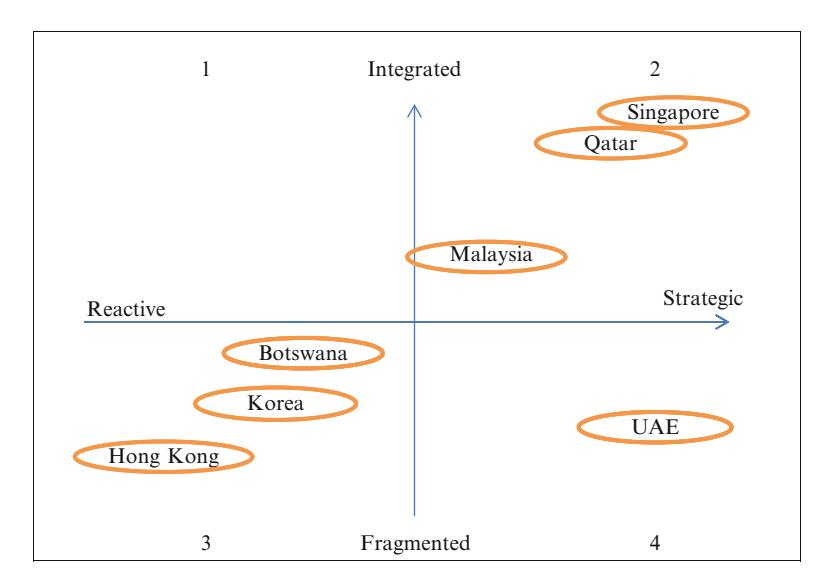
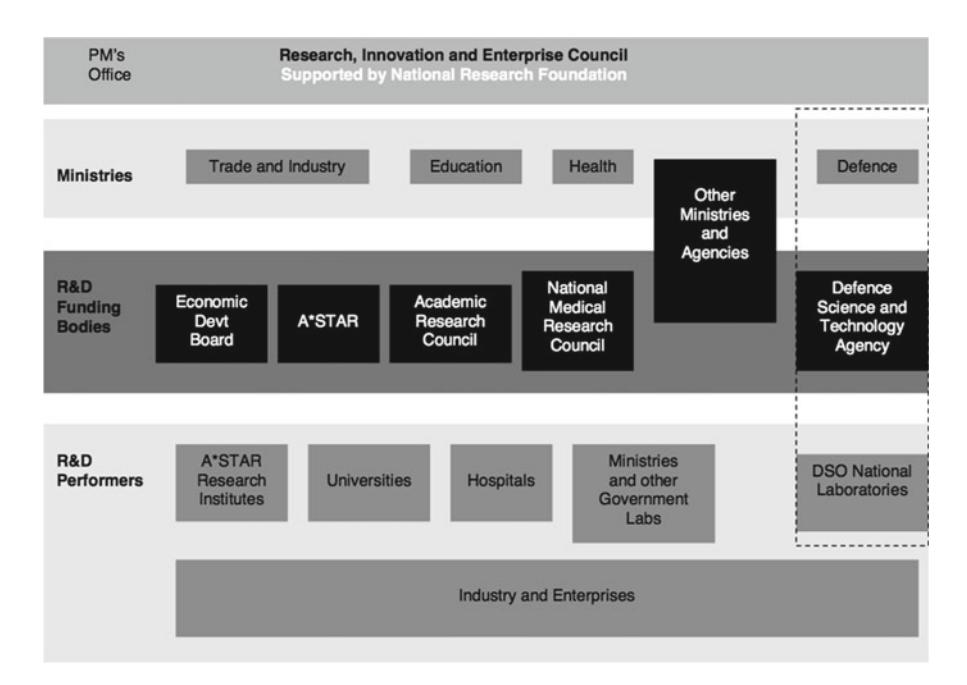

<!-- A1.R28 | source: papers_json/A1.R28/ -->

## [International Education Hubs: Student, Talent, Knowledge-Innovation](https://www.researchgate.net/publication/292384289_International_education_hubs_Student_talent_knowledge-innovation_models?enrichId=rgreq-18126fd7eca40545c1b64ffeae16408d-XXX&enrichSource=Y292ZXJQYWdlOzI5MjM4NDI4OTtBUzoxMDA5NjkyOTQzODcyMDAxQDE2MTc3NDA5NjUzMjM%3D&el=1_x_3&_esc=publicationCoverPdf) Models

**كتاب** · نوفمبر 2014DOI: 10.1007/978-94-007-7025-6CITATIONS181READS1,5841 مؤلف: Jane KnightUniversity of TorontoPUBLICATIONS208CITATIONS16,743SEE PROFILE

<!-- page 2 -->

Jane Knight محررة

## International Education Hubs

Student, Talent, Knowledge-Innovation Models

<!-- page 3 -->

## International Education Hubs

<!-- page 4 -->

<!-- page 5 -->

Jane Knight محررة

## International Education Hubs

Student, Talent, Knowledge-Innovation Models

<!-- page 6 -->

* محررة * Jane Knight Ontario Institute for Studies in Education University of Toronto Toronto, ON , Canada

ISBN 978-94-007-7024-9 ISBN 978-94-007-7025-6 (eBook) DOI 10.1007/978-94-007-7025-6 Springer Dordrecht Heidelberg New York London

Library of Congress Control Number: 2013947123

## يمكن اعتباره الخطوة الأولى في أي مسألة تحسين. والسبب في ذلك أن الخطوة الأولى في أي مسألة تحسين هي تحديد دالة الهدف. دالة الهدف هي الدالة التي نريد تصغيرها أو تكبيرها. وفي سياق التحسين، غالبًا ما يشار إلى دالة الهدف باسم دالة التكلفة أو دالة الخسارة أو دالة الطاقة. دالة الهدف هي تمثيل رياضي للمسألة التي نحاول حلها. وهي دالة تأخذ مجموعة من متغيرات الإدخال وتُرجع قيمة إخراج واحدة. تمثل قيمة الإخراج ال

هذا العمل محمي بحقوق النشر. تحتفظ الناشرة بجميع الحقوق، سواء تعلق الأمر بالعمل كله أو بجزء منه، وتحديدًا حقوق الترجمة وإعادة الطباعة وإعادة استخدام الرسوم التوضيحية والتلاوة والبث والاستنساخ على الميكروفيلم أو بأي وسيلة مادية أخرى، والنقل أو تخزين المعلومات واستعادتها، والتكيف الإلكتروني، وبرمجيات الحاسوب، أو بأي منهجية مماثلة أو مختلفة معروفة الآن أو تُستحدث لاحقًا. تُستثنى من هذا التحفظ القانوني المقتطفات الموجزة المرتبطة بالمراجعات أو التحليل الأكاديمي أو المواد المقدمة تحديدًا بغرض إدخالها وتنفيذها على نظام حاسوبي، للاستخدام الحصري من قبل مشتري العمل. لا يُسمح بنسخ هذا المنشور أو أجزاء منه إلا بموجب أحكام قانون حقوق النشر الخاص بمكان الناشرة، بنسخته الحالية، ويجب دائمًا الحصول على إذن الاستخدام من Springer. يمكن الحصول على أذونات الاستخدام عبر RightsLink التابع لمركز تخليص حقوق النشر. تخضع المخالفات للملاحقة القضائية بموجب قانون حقوق النشر ذي الصلة.

استخدام الأسماء الوصفية العامة والأسماء المسجلة والعلامات التجارية وعلامات الخدمة وما شابه في هذا المنشور لا يعني، حتى في غياب بيان محدد، أن هذه الأسماء معفاة من القوانين واللوائح الحمائية ذات الصلة وبالتالي متاحة للاستخدام العام.

وبينما يُعتقد أن النصيحة والمعلومات الواردة في هذا الكتاب صحيحة ودقيقة في تاريخ النشر، لا يتحمل المؤلفون ولا المحررون ولا الناشر أي مسؤولية قانونية عن أي أخطاء أو إغفالات قد تحدث. لا تقدم الناشرة أي ضمان، صريح أو ضمني، فيما يتعلق بالمواد الواردة هنا.

طُبع على ورق خالٍ من الأحماض

Springer جزء من Springer Science+Business Media [(www.springer.com)](www.springer.com)

<!-- page 7 -->

* هذا الكتاب مُهدى إلى Ruth Hayhoe * *و Philip Altbach، وهما باحثان * *محترمان جدًا وصديقان عزيزان. هذا الإهداء * *لا يكرّم فقط إسهامهما في مجال * *التعليم العالي المقارن والدولي، بل يقر أيضًا بدورهما * *كموجّهَين للجيل القادم * *من الباحثين والقادة الأكاديميين * *وصناع السياسات. لقد كان لهما تأثير كبير * *ودعم في رحلتي الخاصة * *لفهم الأبعاد الدولية * *للتعليم العالي حول * *العالم. لذلك أعبّر عن تقديري العميق * *وأهدي هذا الكتاب لهما، * *وللباحثين المستقبليين العاملين على * *تدويل التعليم العالي. *

<!-- page 8 -->

<!-- page 9 -->

## ** المحتويات**

1المقدمة
Jane Knight12فهم مراكز التعليم ضمن سياق
التعليم العابر للحدود
Jane Knight133إطار تحليلي لمراكز التعليم
Jane Knight and Jack Lee294تطور قطر كمركز تعليمي:
التحول نحو اقتصاد قائم على المعرفة
Arwa Ibnouf, Lois Dou, and Jane Knight435مركز التعليم في الإمارات العربية المتحدة:
عقد من التطور
Warren Halsey Fox and Sabha Al Shamisi636هونغ كونغ: السعي لمكانة مركز تعليمي إقليمي
Ka Ho Mok and Peter Bodycott817ماليزيا: التحول إلى مركز تعليمي
لخدمة التنمية الوطنية
Mohd Ismail Abd Aziz and Doria Abdullah1018سنغافورة: بناء مركز للمعرفة والتعليم
Ravinder Sidhu, Kong-Chong Ho, and Brenda S.A. Yeoh1219مركز بوتسوانا القُطري: أول مركز تعليمي في أفريقيا
Bridget Poppy John, David Wilmoth, and Brian Mokopakgosi14510مراكز ناشئة: كوريا الجنوبية وسريلانكا وموريشيوس
والبحرين
Lois Dou and Jane Knight165

<!-- page 10 -->

المحتوياتviii

11تحليل مقارن لمراكز التعليم
Jane Knight18312مراكز التعليم: القضايا والمؤشرات والتأملات
Jane Knight207عن المؤلفين229ببليوغرافيا شاملة ومصادر لمزيد من المعلومات233الفهرس247

<!-- page 11 -->

## ** الفصل الأول ** ** المقدمة **

** Jane Knight **

على مدى قرون، كان للتعليم العالي بُعد دولي. لاحظوا حركة العلماء والمعرفة حول العالم منذ العصور المبكرة، وفكرة "الكون" (universe) في تسمية الجامعات باعتبارها أولى المؤسسات الرسمية للتعليم العالي. وانتقالًا سريعًا إلى القرن العشرين، حين انفجرت الحركة الدولية للطلاب وتعززت العلاقات الأكاديمية الدولية من خلال تأسيس شبكات ورابطات جامعية عالمية. ومع ذلك، فإن تدويل التعليم، وهو مصطلح لم يُستخدم إلا منذ نحو ثلاثة عقود، غيّر بشكل جذري مشهد التعليم العالي في فترة قصيرة نسبيًا. يعني التدويل أشياء مختلفة لأشخاص ومؤسسات ودول مختلفة. فهو مدفوع بتنوع في المبررات، ويجد تعبيره في مجموعة متنوعة من الأنشطة، ويجلب فوائد ومخاطر ونتائج غير مقصودة متعددة. مراكز التعليم هي مظهر حديث للتدويل، تُظهر الطبيعة المتغيرة والمتجاوبة للتدويل مع الحقائق المعقدة لعالم اليوم الأكثر عولمة.

كان للعولمة تأثير هائل على تدويل التعليم العالي. التطورات غير المسبوقة في تقنيات المعلومات ووسائل التواصل الاجتماعي، والتأثير الواسع للتحرر الاقتصادي واتفاقيات التجارة، وزيادة تدفق الأشخاص والأفكار ورأس المال والقيم والخدمات والسلع والتكنولوجيا عبر الحدود، كلها أمثلة على قوى العولمة المُغيِّرة لجدول الأعمال. التدويل مختلف عن عملية العولمة الديناميكية لكنه وثيق الصلة بها. المفهوم الأساسي لـ *internation* يتضمن العلاقات بين وضمن الدول والشعوب والأنظمة والثقافات. وهذا يختلف اختلافًا كبيرًا عن المفهوم الأساسي لـ *التدفق أو النطاق العالمي* الخاص بالعولمة (Knight 2008). لا يزال الجدل محتدمًا حول ما إذا كانت العولمة هي المحفز لتدويل التعليم العالي أم العكس، أي أن تدويل التعليم العالي

Ontario Institute for Studies in Education , University of Toronto , Toronto , ON , Canada e-mail: jane.knight@utoronto.ca

> ^ ^J. Knight (*)

<!-- page 12 -->

هو أداة للعولمة (Cross et al. 2011 ; Donn and Al Manthri 2010 ; Scott 2005). يقر كلا المنظورين بالعلاقة المعقدة والديناميكية بين العمليتين.

## ** تفسير التدويل **

التدويل ليس مصطلحًا جديدًا، وكذلك الجدل المستمر حول معناه. استُخدم مصطلح التدويل لسنوات في العلوم السياسية والعلاقات الحكومية، لكن شعبيته في قطاع التعليم لم تزدهر إلا منذ أوائل الثمانينيات. وقبل ذلك، كانت مصطلحات "التعليم الدولي" و"التعاون الدولي" هي المفضلة، ولا تزال كذلك في بعض الدول.

يكمن التحدي في أي تعريف للتدويل في ضرورة أن يكون عامًا بما يكفي لينطبق على دول وثقافات وأنظمة تعليمية مختلفة كثيرة. وهذه ليست مهمة سهلة. وبينما لا تكمن النية في وضع تعريف عالمي، فمن الضروري أن يكون قابلاً للاستخدام في نطاق واسع من السياقات ولأغراض المقارنة بين دول ومناطق العالم. يحتاج التعريف إلى تجنب أن يكون أداة توحّد أو تُنمّط عملية التدويل حول العالم من خلال تحديد المبررات والفوائد والنتائج والفاعلين والأنشطة وأصحاب المصلحة في التدويل. فهذه العناصر تتفاوت بشكل كبير بين المناطق والدول ومن مؤسسة إلى أخرى. والمهم هو أن البُعد الدولي يرتبط بجميع جوانب التعليم العالي والدور الذي يلعبه في المجتمع.

من الجدير بالملاحظة أن اللاحقة "ization" تدل على أن التدويل عملية تعني عادة التغيير. ومن المهم بالقدر نفسه ألا يُوصف التدويل بأنه "أيديولوجيا" كما في "internationalism". كما أنه ليس "حالة" كما في "internationality" أو حالة كون الشيء دوليًا. فهو راسخ بوصفه عملية، وهذا ما يميزه أكثر عن فكرة التعليم الدولي بحد ذاته.

لأغراض هذا الكتاب، يُعرَّف تدويل التعليم العالي بأنه "عملية دمج بُعد دولي أو بين ثقافي أو عالمي في غرض ووظائف (بشكل أساسي التدريس/التعلم، البحث، الخدمة) أو تقديم التعليم العالي" (Knight 2004، ص 7). قوة هذا التعريف تكمن في أنه غير إلزامي ويركز على أهداف ووظائف التعليم. أما الضعف الذي بات واضحًا الآن، فهو أن القيم التقليدية المرتبطة بالتدويل مثل الشراكة والتعاون والمنفعة المتبادلة والتبادل لم تُذكر صراحة، بل افتُرضت فقط. تضمين هذه القيم في التعريف أمر ممكن، لكنه قد يثير مخاطر جديدة تتعلق بالإفراط في الإلزام. وبدلاً من ذلك، يحتاج خطاب وممارسة التدويل إلى إعادة توجيه نحو القيم (Knight 2012)، وخاصة القيم الأكاديمية.

لم يقتصر الأمر على أن التدويل غيّر التعليم العالي، بل خضع هو نفسه لتغيرات جذرية. من التطورات الحاسمة في مفهمة التدويل الاعتراف بـ"التدويل في الداخل" و"التعليم العابر للحدود" باعتبارهما ركيزتين لعملية التدويل. خلال السنوات العشر الأخيرة، شهد تنقل الطلاب والبرامج والمزوّدين عبر الحدود نموًا واهتمامًا غير مسبوقين. وقد أجبر التركيز على التنقل مؤيدي النهج القائم على الحرم الجامعي أو "التدويل في الداخل" على إعطاء أهمية

<!-- page 13 -->

3 1 المقدمة

أكبر للأبعاد الثقافية والدولية للتدريس/التعلم والبحث والأنشطة اللامنهجية والمهارات بين الثقافية والعلاقات مع مجموعات المجتمع الثقافي المحلي. من قصر النظر الاعتقاد بأن التدويل يقوم فقط على التنقل الأكاديمي بين الدول. فهو يمكن أن يحدث في الصف، وفي الحرم الجامعي، وفي المجتمع من خلال التركيز على القضايا بين الثقافية.

الركيزتان مترابطتان بشكل وثيق؛ فهما متكاملتان. للتعليم العابر للحدود آثار كبيرة على التدويل القائم على الحرم الجامعي، والعكس صحيح. ومن المثير للاهتمام أن كثيرًا من التطورات الجديدة في التدويل يبدو مرتبطًا بالأنشطة العابرة للحدود، بما فيها مراكز التعليم. هناك مصطلحات عدة، مثل عابر للأوطان (transnational) وغير محدود بالحدود (borderless) وخارج الحدود (offshore)، تُستخدم غالبًا بالتبادل مع التعليم العابر للحدود. التعليم العابر للحدود هو المصطلح المفضل في هذا الكتاب لأنه يقر بأهمية الحدود القضائية في هذا العصر من النشاط والتفاعل الدولي المكثف.

## ** فهم التعليم العابر للحدود **

لا شك أن التعليم العابر للحدود، الذي يُفسَّر بمعنى واسع على أنه حركة الأشخاص والبرامج والمزوّدين والمعرفة والسياسات والابتكار عبر الحدود، قد نما في نطاقه وحجمه وأثره (Knight 2008). وقد دفعته مبررات مختلفة ومتضاربة أحيانًا، وجلب فوائد ومخاطر للطلاب والدول المستقبِلة/المُرسِلة والمؤسسات والمزوّدين العامين/الخاصين (Altbach and Knight 2011).

تحول التعليم العابر للحدود تدريجيًا من إطار التعاون التنموي إلى نهج الشراكة والتبادل، والآن إلى نموذج تجاري وتنافسي. ويشمل ذلك تحول حركة الطلاب الدوليين، المرتبطة تقليديًا بمخططات المنح الدراسية السخية للطلاب من الدول النامية خلال الخمسينيات إلى الثمانينيات، إلى صناعة كبرى لاستقطاب الطلاب الدوليين وسباق العقول العظيم في القرن الحادي والعشرين. كما يتضمن نموًا غير مسبوق في الحرم الجامعي الفرعي الدولي والبرامج التعاونية مثل برامج التوأمة والامتياز والدرجات المزدوجة/المشتركة، وكلها تنقل البرامج الأكاديمية إلى الطلاب في بلدانهم الأصلية وتنطوي على إيجابيات وسلبيات لمختلف أصحاب المصلحة. تمثل مراكز التعليم الدولية أحدث تطور في التعليم العابر للحدود وتبني على تصاعد تنقل البرامج والمؤسسات/المزوّدين.

يُعد تطور المصطلحات المستخدمة لوصف الأبعاد الدولية للتعليم العالي عدسة كاشفة للنظر إلى التدويل بشكل عام والتعليم العابر للحدود بشكل خاص. توضح المصطلحات بالخط العريض في الجدول 1.1 الزيادة في عدد وتنوع المفاهيم المستخدمة الآن لوصف التنقل الأكاديمي للأشخاص والبرامج والمزوّدين والمشاريع والسياسات عبر الحدود الوطنية.

يركز هذا الكتاب على مراكز التعليم الدولية بشكل عام، وبشكل خاص، على النماذج الثلاثة المختلفة لمراكز التعليم – الطالب، والموهبة، والمعرفة/الابتكار. تظهر هذه المصطلحات في العمود الأول من الجدول 1.1، و

<!-- page 14 -->

| Evolution of international education terminology |  |
| --- | --- |
| Table 1.1 |  |

| Recent terms last 10 years | New terms last 20 years | Existing terms last 30 years | Traditional terms last 50 years |
| --- | --- | --- | --- |
| **Generic terms** |  |  |  |
| Regionalization | Globalization | Internationalization | International education |
| Planetization | **Borderless education** | Multicultural education | International development cooperation |
| Glocalization | **Crossborder education** | Intercultural education | Comparative education |
| Global citizenship | **Transnational education** | Global education | Correspondence education |
| Knowledge enterprise | **Virtual education** | **Distance education** |  |
| Green internationalization | **Internationalization "abroad"** | **Offshore or overseas education** |  |
| Global rankings | Internationalization "at home" |  |  |
| **Education hubs** |  |  |  |
| Innovation |  |  |  |
| **Specific elements** |  |  |  |
| International competencies | Education providers | International students | Foreign students |
| **Talent hub** | Corporate universities | Study abroad | Student exchange |
| **Student hub** | Liberalization of education services | Institution agreements | Development projects |
| **Knowledge/innovation hub** | Networks | Partnership projects | Cultural agreements |
| Degree mills | **Virtual universities** | Area studies | Language study |
| Visa factories | **Branch campus** | Binational cooperation |  |
| **Joint, double degrees** | Twinning and franchise programs |  |  |
| Branding, status-building |  |  |  |
| **Binational universities** |  |  |  |

<!-- page 15 -->

5 1 المقدمة

تمثل جيلاً جديدًا من أنشطة التعليم العابر للحدود، حيث يشكل التنقل والكتلة الحرجة والتعاون بين الجامعات الدولية/المحلية والطلاب ومعاهد البحث والصناعة الخاصة مفاهيم أساسية. تأتي مراكز التعليم بأشكال وأحجام مختلفة. الشكل الأكثر أهمية وشيوعًا هو المركز على مستوى الدولة، حيث تبني دولة ما نفسها وتموضعها كمركز جذاب ومعترف به للتعليم والتدريب وإنتاج المعرفة وأنشطة الابتكار. توجد أيضًا مراكز على مستوى المدينة والمنطقة، لكنها ليست محور هذا المنشور.
</content>
## ** غرض الكتاب ونطاقه **

اعتبارًا من عام 2012، معظم المعلومات المتوفرة عن مراكز التعليم هي "أدبيات رمادية" – أي وثائق سياسات وخطط عمل بشكل أساسي. تكثر المقالات الإعلامية وغالبًا ما تُغطي خطط الدول الطموحة والمبالغات التسويقية. من المهم ملاحظة أن "المركز التعليمي" لقب تُطلقه الجهة على نفسها. يمكن لأي جهة استخدامه لوصف جهودها التعليمية، وكثيرون يفعلون ذلك. فعلى سبيل المثال، تسمي جامعات فردية وحرم جامعي فرعي نفسها مراكز، وتستخدم مدن لا تملك أي نشاط تعليم عابر للحدود على الإطلاق لقب المركز التعليمي، وتستخدم دول صغيرة ذات طموحات تدويل كبيرة لكن بأفعال قليلة هذا المصطلح. الاستخدام المتزايد وشعبية "المركز التعليمي" واضحان، لكنهما يثيران تساؤلات حول ما إذا كان المصطلح يُستخدم كعلامة تجارية لزيادة الظهور الدولي، أو موضة عابرة مبنية على الطلب المتنامي على التعليم العابر للحدود، أو ابتكار جديد جاد يستحق الدراسة الجادة.

يبدو أن هناك تعريفات للمركز التعليمي بقدر عدد الدول التي تحاول أن تصبح مركزًا، لكن العكس صحيح فيما يتعلق بتوفر معلومات موثوقة. هناك نقص في البيانات التجريبية أو التحليل لهذه التطورات الجديدة، ولا توجد مؤشرات موضوعية لتحديد نوع وقابلية استمرار المركز التعليمي. الاستخدام المفرط لمصطلح المركز التعليمي يدفع المرء إلى التساؤل: ما هو الخطاب وما هو الواقع؟ باختصار، تستحق الجهود المتزايدة لتطوير مراكز التعليم تحليلاً أكثر منهجية واستنارة لمبرراتها وخصائصها وتطورها وإنجازاتها. هذا الفحص الدقيق لظاهرة مراكز التعليم الدولية هو هدف هذا الكتاب. مصطلح "مركز التعليم الدولي" يشير إلى تفاعل الفاعلين المحليين والدوليين في التعليم العابر للحدود. جميع دول التعليم في هذا الكتاب دولية بطبيعتها، وبالتالي فإن مصطلح المركز التعليمي يعني ضمنيًا وجود أنشطة تعليم وتدريب وبحث عابرة للحدود.

كجزء من التحليل، وُضع تعريف عملي لمراكز التعليم وتصنيف لثلاثة نماذج من مراكز التعليم (الطالب، الموهبة، المعرفة/الابتكار). وأُنشئ إطار يركز على الأهداف والقطاعات السياسية والفاعلين الرئيسيين واستراتيجيات الأنواع الثلاثة المختلفة من مراكز التعليم كأداة تحليلية. تُستخدم ست دول كدراسات حالة. وهي تمثل ما يبدو أنه الجهود الأكثر جدية وتقدمًا لتكون مركزًا تعليميًا، إذ استمر عملها لعدة سنوات. تقع هذه الدول في جنوب شرق آسيا،

<!-- page 16 -->

6 J. Knight

جنوب أفريقيا، ودول الخليج، مما يسمح باختلافات في السياقات الوطنية والإقليمية.

الدول الست هي قطر والإمارات العربية المتحدة ومنطقة هونغ كونغ الإدارية الخاصة وماليزيا وسنغافورة وبوتسوانا. أُجريت دراسات الحالة المعمقة بواسطة خبراء محليين مشاركين في تطوير المركز أو يراقبونه عن كثب. وفي عدة حالات، انضم خبراء دوليون إلى المؤلفين المحليين للمساعدة في إعداد فصل دراسة الحالة. وبينما يجلب جميع المؤلفين خبرة وتجربة في مراكز التعليم، فإنهم يمثلون مجموعة متنوعة ومثيرة للاهتمام من وجهات النظر والتخصصات.

يستجيب كل مركز قُطري للسياق المحلي والأولويات والاحتياجات، لذا تتطور جميعها بطرق مختلفة. وللسماح بنوع من التحليل الشامل، قُدم مخطط دراسة حالة مشترك كإرشاد للمؤلفين. كان عامًا ومرنًا بما يكفي للسماح باستيعاب وإبراز السمات المميزة لكل مركز. وأُدرجت أربع دول إضافية كمراكز ناشئة، وهي كوريا وسريلانكا وموريشيوس والبحرين. ونظرًا لنقص المعلومات و/أو التقدم في هذه الدول الأربع، لم تكن الدراسات المعمقة ممكنة. لذا صُنفت كمراكز ناشئة لأنها أُعلنت مؤخرًا فقط (سريلانكا وموريشيوس)، أو لأن التقدم توقف نوعًا ما منذ الإعلان الأولي (البحرين)، أو لعدم وضوح ما إذا كانت مبادرة المركز ستكون على مستوى الدولة أو المنطقة (كوريا). أكمل مؤلف/محرر الكتاب تحليلاً شاملاً لدراسات الحالة. ولتسهيل التحليل، أُجري استطلاع غير رسمي مع مؤلفي دراسات الحالة، وفي كثير من الحالات، أُجريت مقابلات إضافية.

من المهم توضيح نطاق هذا الكتاب. التركيز الأساسي هو على الدول أو الجهات القضائية التي تدّعي أنها مركز تعليمي، وليس المدن أو المناطق الفردية. اتُّبع نهج على مستوى الدولة بأكملها (أو على مستوى المنطقة الإدارية الخاصة، في حالة هونغ كونغ) لضمان تضمين جميع أنواع مبادرات التعليم العابر للحدود في التحليل. وهذا يعني أن الحرم الجامعي الفرعي الدولي ومدن التعليم ومجمعات العلوم والتكنولوجيا وترتيبات البرامج التعاونية الدولية مثل التوأمة أو الامتياز والمناطق الحرة التعليمية وشركات البحث والتطوير كلها مشمولة في دراسات الحالة. وهذه الكتلة الحرجة من الأنشطة العابرة للحدود والعلاقات بين الفاعلين المحليين والأجانب هي الحاسمة لتطور المركز التعليمي. حُددت عدة مدن تعليمية/معرفية ومناطق بحثية/معرفية، لكن مستوى المدينة أو المنطقة للمركز التعليمي الفردي ليس محور هذا الكتاب.

من القيود المهمة في مراجعة متعددة الدول لمراكز التعليم عدم وجود تعريفات مشتركة للتعليم العابر للحدود وندرة أي بيانات على المستوى الوطني عن المبادرات التعاونية مثل التوأمة والامتياز والبرامج المزدوجة/المشتركة. حتى غياب تعريف مشترك للطلاب الأجانب بين الوكالات الدولية مثل OECD وUNESCO يؤدي إلى بيانات متناقضة ومربكة عن أعداد الطلاب الدوليين. هذا الواقع يضع متانة البيانات لأغراض المقارنة موضع تساؤل. قيل هذا مرارًا من قبل، لكنه يستحق التكرار: يلعب التعليم العابر للحدود دورًا مهمًا في تقديم التعليم العالي، ومن واجب المؤسسات والوكالات الوطنية والدولية أن تواجه بجدية نقص القدرة والإرادة السياسية لجمع البيانات اللازمة.

<!-- page 17 -->

7 1 المقدمة

في الفصل [12](http://dx.doi.org/10.1007/978-94-007-7025-6_12)، جُمعت بيانات من مجموعة متنوعة من المصادر الدولية في محاولة لوضع عدد من المؤشرات لتمييز الأنواع الثلاثة من المراكز ومدى قابليتها للاستمرار. وبالرغم من غياب معلومات موثوقة، من الضروري المضي قدمًا في تحليل التعليم العابر للحدود ومراكز التعليم، والاستمرار في التأكيد على الحاجة إلى إحصاءات موثوقة.

## ** مخطط الكتاب **

يُقسَّم الكتاب أساسًا إلى ثلاثة أجزاء. يقدم الجزء الأول مقدمة وإطارًا تحليليًا لمراجعة ظاهرة مراكز التعليم. ويتضمن الجزء الثاني ست دراسات حالة معمقة وفصلاً عن المراكز الناشئة. ويقدم الجزء الأخير التحليل الشامل والمقارن لمراكز التعليم ويحدد بعض القضايا الرئيسية لمزيد من التأمل والبحث.

وبشكل أكثر تحديدًا، يبحث الفصل الثاني في الأجيال الثلاثة للتعليم العابر للحدود لإعطاء منظور تاريخي وسياق لفهم مراكز التعليم. يتبع ذلك تحليل مفاهيمي لمعنى ودوافع المركز التعليمي يتضمن تعريفًا وتصنيفًا للمبررات. وتنتهي الفصل بتصنيف مقترح لثلاثة نماذج من مراكز التعليم يقود إلى الإطار التحليلي الذي يُناقش في الفصل [3](http://dx.doi.org/10.1007/978-94-007-7025-6_3). غرض الإطار هو تحديد العناصر والخصائص الرئيسية لمركز التعليم من نوع الطالب، والمركز الموجه نحو الموهبة، ونموذج المعرفة/الابتكار. المكونات الرئيسية للإطار التحليلي هي التركيز والأهداف والقطاعات السياسية المؤثرة والفاعلون الرئيسيون والاستراتيجيات لكل نوع من مراكز التعليم. تبدأ فصول دراسات الحالة بالدولتين الواقعتين في دول الخليج – قطر والإمارات العربية المتحدة – تليهما الدول الثلاث في جنوب شرق آسيا (هونغ كونغ وماليزيا وسنغافورة)، وأخيرًا بوتسوانا، المركز التعليمي الوحيد المعلن ذاتيًا في أفريقيا.

## * قطر *

قطر من أوائل الدول التي أعلنت عن نيتها أن تصبح مركزًا تعليميًا إقليميًا واستثمرت في تطويره. على مدى العقد الماضي، ركزت قطر على تقليل اعتمادها على الموارد الطبيعية والتقدم لتصبح أحد اللاعبين الرئيسيين في اقتصاد المعرفة. وإدراكًا للتحدي الكبير الذي ينتظرها، قررت قطر متابعة أهدافها من خلال التعليم وبتحويل نفسها إلى مركز تعليمي. في أقل من 15 عامًا، أصبحت قطر موطنًا لأكثر من عشر مؤسسات أكاديمية أجنبية، وأبرز منظمات العلوم والبحث، وأكثر من 4,000 طالب وباحث من المنطقة والعالم. تفحص دراسة الحالة المبررات والمبادرات والسياسات الموجهة لتطور قطر كمركز تعليمي، وتتناول مكونات المركز الثلاثة: البرامج الأكاديمية عبر الحرم الجامعي الفرعي، ومدينة قطر للعلوم والتكنولوجيا والمبادرات البحثية المرتبطة بها، وإنشاء مؤسسات علمية

<!-- page 18 -->

وطبية جديدة. يبحث الفصل في طموحات أمة فتية لاستخدام التعليم لإضافة قيمة إلى "رأس المال البشري" الذي سيقود قطر نحو اقتصاد المعرفة. ينظر الفصل في النهج الذي اتبعته مؤسسة قطر لدعوة الجامعات الأجنبية لإنشاء حرم جامعي فرعي داخل مدينة قطر للتعليم، والتركيز على مجال برنامجي محدد تتمتع فيه بسمعة جيدة. من السمات المهمة للنهج القطري التمويل السخي والمستمر لعمليات الحرم الجامعي الفرعي وبرامج البحث والمرافق العلمية والبحثية الجديدة. النية طويلة الأمد لمبادرة المركز التعليمي هي تعزيز والاحتفاظ بالموارد البشرية اللازمة وتطوير ثقافة وقدرة بحثية. وهذا بدوره سيسهم في توليد المعرفة والابتكار ونجاح قطر مستقبلاً.

## * الإمارات العربية المتحدة *

تستضيف الإمارات أكبر عدد من الحرم الجامعي الفرعي الدولي في العالم. وهي معروفة بنجاحها في استقطاب الحرم الجامعي الفرعي إلى اثنتين من مناطقها الاقتصادية الحرة – قرية المعرفة ومدينة دبي الأكاديمية الدولية. لكن دبي ليست الإمارة الوحيدة المنخرطة بنجاح في التعليم العابر للحدود. إمارتان أخريان – أبوظبي ورأس الخيمة – منخرطتان بنشاط في جهود التعليم والبحث الدولي وكذلك استضافة الحرم الجامعي الفرعي. من السمات اللافتة لنهج المركز التعليمي الإماراتي عدم وجود خطة وطنية أو آلية تنسيق. تضع كل إمارة خطتها الاستراتيجية ومبادراتها المحلية الخاصة. من المعروف على نطاق واسع أن الإمارات تعتمد على القوى العاملة الأجنبية لنقلها من اقتصاد قائم على النفط إلى اقتصاد أكثر توجهًا نحو الخدمات والمعرفة. ولتحقيق ذلك، تحتاج الإمارات إلى الكفاءات الأجنبية، وتدرك أن أن تصبح مركزًا تعليميًا سيدعم جهودها لتدريب والاحتفاظ بالعدد الكبير من الطلاب المغتربين، إضافة إلى استقطاب الطلاب والعاملين الدوليين من المنطقة وخارجها.

## * هونغ كونغ *

بعد تجربة الأزمة المالية الآسيوية عام 1998 والأزمة المالية العالمية عام 2008، أدركت حكومة منطقة هونغ كونغ الإدارية الخاصة (HKSAR) أن الاعتماد على الركائز الاقتصادية التقليدية (أي التمويل الدولي والسياحة وسوق العقارات والخدمات اللوجستية) لن يكون كافيًا لاستدامة النمو الاقتصادي المستمر في المدينة-الدولة. وإدراكًا لتزايد شعبية تجارة خدمات التعليم العالي في آسيا، ولكون التعليم العالي أداة قوة ناعمة فعالة، عملت حكومة هونغ كونغ على تطوير نفسها كمركز تعليمي إقليمي عبر جعل خدمات التعليم أحد المحركات الاقتصادية الجديدة. يستعرض هذا الفصل بشكل نقدي السياق السياسي

<!-- page 19 -->

9 1 المقدمة

لمشروع المركز التعليمي الإقليمي الذي بدأ في هونغ كونغ، ويناقش الدوافع والمبررات الرئيسية والفاعلين الرئيسيين وأصحاب المصلحة المشاركين في مبادرة المركز. يفحص الفصل عن كثب اللوائح والسياسات التي تحكم مشروع المركز، ويناقش التحديات والعوائق أمام نجاح السعي لمكانة المركز الإقليمي.

## * ماليزيا *

أجندة ماليزيا لتأسيس نفسها كمركز تعليمي مدفوعة بالحاجة إلى بناء قدرتها في رأس المال البشري والمعرفة والابتكار، إضافة إلى تعزيز التعليم كقطاع تجاري لتوليد الإيرادات. وقد استرشد التقدم حتى الآن بسياسات ولوائح الحكومة المركزية لتحويل التعليم العالي بشكل عام وتطوير المركز التعليمي بشكل خاص. تشارك قطاعات وفاعلون سياسيون استراتيجيون مثل إدارات التعليم العالي والهجرة وتنمية الموارد البشرية والصناعة والتمويل والاستثمار في بناء ماليزيا كمركز تعليمي. الملف الحالي لماليزيا هو ملف مركز طلابي مبني على النمو الأسي لأعداد الطلاب الدوليين، خاصة في القطاع الخاص، خلال العقد الماضي. يوضح الفصل أنه بينما يُشاد كثيرًا بالتزام البلاد وتقدمها، لا تزال هناك عدة قضايا حرجة تحتاج إلى معالجة كي تثبت ماليزيا مكانتها كمركز تعليمي. وتشمل هذه القضايا تنويع التركيبة السكانية الحالية للطلاب الدوليين، وقابلية التوظيف للخريجين، وتنمية القوى العاملة الماهرة، وهجرة الأدمغة. كما يقترح الفصل أن على ماليزيا إعادة تقييم مواردها وإرادتها السياسية وقدرتها للانتقال نحو نموذج الموهبة و/أو المعرفة للمركز التعليمي. يعتمد مستقبل ماليزيا على قدرتها على دمج مختلف مكونات المركز التعليمي لضمان تحقيق قيمة مضافة من أنشطتها المتنوعة والمهمة العابرة للحدود.

## * سنغافورة *

تُصوَّر سنغافورة كمثال على التحديث، وقد جنى استثمارها في رأس المال البشري وأسلوبها الفريد في الحوكمة أرباحًا وفيرة من حيث التنمية الاقتصادية والاستقرار الاجتماعي. على مدى 15 عامًا، التزمت سنغافورة بحسم بالانتقال من مشروع "المدرسة العالمية" إلى مركز معرفي للقرن الحادي والعشرين. يصف هذا الفصل المبادرات الرئيسية التي أُدخلت لإعادة تشكيل المدينة-الدولة إلى مركز معرفي وتعليمي عالمي وموقع للتراكم المستمر لرأس المال والمواهب والمعرفة. وبالرغم من وضوح رؤيتها واستراتيجيتها، هناك عدد من التعقيدات العملية التي تواجه خطط سنغافورة لـ"القفز" إلى مجالات إنتاج المعرفة والابتكار "ذات القيمة المضافة". يستجوب الفصل العقلانية الحسابية للدولة التي

<!-- page 20 -->

تُبرز الشمال العالمي في التخيل والطموح. ويُطرح بدلاً من ذلك حجة لإعادة تخيل المحلي كمساحة للأفكار والرؤى التي تدعم الإبداع والابتكار.

## * بوتسوانا *

اعتمدت إدارة بوتسوانا لنموها الاقتصادي بشكل ضيق على تعدين الماس. وبينما مكّنت الثروة السيادية لبوتسوانا من تقديم مقاعد التعليم العالي لجميع المؤهلين، بما في ذلك التنسيبات في الخارج، جاءت التنمية الاقتصادية السريعة مصحوبة بتأخر القدرة التعليمية وفجوات في المهارات المهنية اللازمة لاقتصاد أكثر تنوعًا ودور في اقتصاد المعرفة العالمي. وبالتالي، وكجزء من سياسة للتنويع في عدد من المنافذ السوقية التي تتمتع فيها بوتسوانا بميزة تنافسية، سعت الحكومة إلى تطوير البلاد كمركز تعليمي. ونظرت في مرفق مخصص باهظ التكلفة لبناء مجمع حرم جامعي نخبوي ورفضته، وسعت بدلاً من ذلك لبناء بوتسوانا كمركز تعليمي على مستوى الدولة. تهدف استراتيجية المركز التعليمي إلى تحديث قطاع التعليم وبناء القدرة المحلية وتقليل الاعتماد وتكاليف التنسيبات الخارجية، وتدويل نظرة الطلاب والقوى العاملة، واستقطاب الطلاب والاستثمار الدوليين. وبناءً جزئيًا على مفهوم التكتلات الاقتصادية، شُكّلت استراتيجية وخطة عمل المركز التعليمي بالتعاون مع استراتيجيات تكتلات قطاعية أخرى للنقل وصناعة الماس والزراعة والصحة والابتكار.

تتبع دراسات الحالة الست فصلاً بعنوان "المراكز الناشئة" يقدم نبذات موجزة عن كوريا وسريلانكا وموريشيوس والبحرين. عبّرت هذه الدول الأربع جميعها عن طموحاتها لتكون مركزًا تعليميًا. لكن، لأسباب مختلفة، لم تحقق هدفها بالكامل بعد. أعلنت كل من سريلانكا وموريشيوس خططهما لتصبحا مركزًا تعليميًا عام 2010. لا يزال الوقت مبكرًا جدًا لتحديد ما إذا كانت هذه مساعٍ جادة بالسياسات والفاعلين والاستثمارات اللازمة أم أنها جزء من حملة تسويقية وترويجية كبرى لاستقطاب مزيد من الطلاب الدوليين. من الصعب الحصول على معلومات عن الخطط الملموسة رغم الخطط الطموحة نوعًا ما. سيكون من المهم رؤية ما إذا كانت إعلانات المركز التعليمي ستُترجم إلى أفعال وتحقق نتائج. كانت البحرين سباقة في الإعلان عن نفسها كمركز تعليمي. ففي عام 2005، أعلنت خططها للعمل مع شركة استثمار خاصة من الكويت لبناء مدينة تعليمية ومجمع علوم وتكنولوجيا حديث. وبينما تستضيف البحرين عدة حرم جامعي فرعي وطلابًا دوليين، يبدو أن خططها لتصبح مركزًا تعليميًا متكاملًا ومعترفًا به قد تعثرت. وأخيرًا، تُدرج كوريا في هذا الفصل بسبب تقدمها الكبير في بناء حرم جامعة سونغدو العالمية في منطقة إنتشون الاقتصادية الحرة، رغم أنها حتى الآن حققت نجاحًا محدودًا في استقطاب الحرم الجامعي الفرعي الأجنبي. حرم جيجو للتعليم العالمي هو ثاني منطقة اقتصادية حرة في كوريا مخصصة لجميع مستويات التعليم. ويركز بشكل أساسي على استقطاب مزوّدي التعليم الثانوي والعالي الأجانب إلى كوريا للاحتفاظ بالأعداد الكبيرة من الطلاب الكوريين الذين يسافرون للخارج كل عام من أجل

<!-- page 21 -->

11 1 المقدمة

التعليم. لا يزال غير محسوم ما إذا كانت كوريا تعتبر نفسها دولة مركز تعليمي أو تنظر إلى نفسها كمن يبني منطقتين تعليميتين منفصلتين.

يركز الفصلان الأخيران على تحليل شامل لدراسات الحالة القُطرية وفحص القضايا والتحديات الرئيسية المتعلقة بتطور المركز التعليمي. في الفصل [11](http://dx.doi.org/10.1007/978-94-007-7025-6_11)، تشمل المواضيع الرئيسية للتحليل المقارن: تواريخ الإعلان والتقدم المُدرَك حتى الآن، ونهج التخطيط (تفاعلي أو استباقي أو استراتيجي)، ونموذج التنفيذ (مجزأ أو منسق أو استراتيجي) لتطور المركز، والمبررات الدافعة، وإشراك القطاعات السياسية والفاعلين المؤثرين، إضافة إلى الأثر على المستفيدين. ويُختتم الفصل بتحليل العلاقة بين الأنواع الثلاثة لمراكز التعليم ويتساءل عما إذا كان هناك تطور خطي من مركز الطالب إلى الموهبة إلى مركز المعرفة.

يتناول الفصل الأخير بعض القضايا الجوهرية المتعلقة بمراكز التعليم ضمن السياق الأوسع للتعليم العابر للحدود. المواضيع التي يتناولها هي: العلاقة بين أهم وجهات الطلاب الدوليين ودول المركز التعليمي، وتطور مراكز التعليم على مستوى المنطقة أو المدينة، وتوزيع الحرم الجامعي الفرعي عبر دول المركز التعليمي، والطبيعة الإقليمية وانخراط مراكز التعليم، والتحديات الرئيسية المتعلقة بضمان الجودة والاعتراف بالمؤهلات. يتبع ذلك نقاش حول جدوى وفائدة تطوير مؤشرات للأنواع الثلاثة من مراكز التعليم، ويتضمن مجموعة تجريبية من المؤشرات لتوضيح الإمكانيات والمخاطر. ولإنهاء الفصل واختتام الكتاب، يطرح القسم الأخير أسئلة تستحق مزيدًا من التأمل والبحث لتعميق معرفتنا بتجارب مراكز التعليم. تتفاوت هذه الأسئلة حسب نوع المركز التعليمي وتشمل قضايا تنظيمية وسياسية وتشغيلية، إضافة إلى اهتمامات أكبر بالنتائج والأثر والفوائد والمخاطر والاستدامة. يختتم الفصل بطرح فكرة ما الذي يأتي بعد مراكز التعليم من حيث الجيل الرابع للتعليم العابر للحدود.

** الشكر والتقدير** هذا الكتاب هو نتاج فريق كبير ومتفانٍ من الأفراد الذين قدموا خبرتهم والتزامهم لتحليل تطورات مراكز التعليم على مدى العقد الماضي. يُعرب عن تقدير عميق لجميع مؤلفي دراسات الحالة. كان عملاً ضخمًا للغاية تحديد موقع وثائق التخطيط والسياسات، وإجراء مقابلات مع الفاعلين الرئيسيين، وتتبع البيانات الصلبة عن نطاق وحجم أنشطة التعليم العابر للحدود وعمليات المراكز. كل مركز تعليمي عمل قيد التطور، وجميع جهودهم في التقاط ونقل أبعاد تطور المركز الماضية والحاضرة والمستقبلية أثرت فهمنا لهذا الجيل الجديد من التعليم العالي العابر للحدود. يُوجَّه شكر وتقدير خاص إلى Lois Dou على مهاراتها البحثية المتميزة وتحليلها العميق وإصرارها الدؤوب على إيجاد المعلومات والبيانات اللازمة.

بُذل جهد متعمد لإشراك الجيل القادم من باحثي التدويل في إعداد هذا الكتاب. ويُعرب عن التقدير لطلاب الدراسات العليا في Ontario Institute for Studies in Education بجامعة تورنتو – Jack Lee وMohammed Khan وHana Lee وKristjan Sigurdson، الذين ساهموا جميعًا في مفهمة الكتاب والإطار التحليلي وبحث دراسات الحالة. وتُذكر بشكل خاص مساهمة Hana Lee في فهم تطورات المركز في كوريا. الفرصة التي أُتيحت لمناقشة القضايا ومشاركة المسودات الأولى مع David Wilmoth وStephan Vincent Lancrin عمّقت فهمي لمراكز التعليم، وأنا ممتنة جدًا لدعمهما الفكري والمعنوي. هذا الكتاب ليس سوى بداية رحلة طويلة لفهم ظاهرة مراكز التعليم. شكرًا مسبقًا للقارئ على مشاركة رؤاه واستفساراته وتجاربه معي حول هذا التطور المعقد والمثير للاهتمام في التعليم العابر للحدود.

<!-- page 22 -->

12 J. Knight

## ** الببليوغرافيا **

Altbach, P. G., & Knight, J. (2011). Higher education's landscape of internationalization. In P. G. Altbach (Ed.), *Leadership for world class universities: Challenges for developing countries* (pp. 108–127). New York: Routledge Publishers.

- Cross, M., Ehpraim, M., & Ojo, E. (2011). Emerging concept of internationalisation in South African Higher Education: Conversations on local and global exposure at the University of the Witwatersrand. *Journal of Studies in International Education, 15* (1), 75–92.
- Donn, G., & Al Manthri, Y. (2010). *Globalisation and higher education in the Arab Gulf States* . Oxford: Symposium Books.
- Knight, J. (2004). Internationalization remodeled: Rationales, strategies and approaches. *Journal * *for Studies in International Education, 8* (1), 5–31.
- Knight, J. (2008). *Higher education in turmoil: The changing world of internationalization* . Rotterdam: Sense Publishers.
- Knight, J. (2012). Concepts, rationales, and interpretive frameworks in the internationalization of higher education. In D. Deardoff, H. de Wit, J. Heyl, & T. Adams (Eds.), *Handbook for * *international higher education* . Thousand Oaks: Sage.
- Scott, P. (2005). Opportunities and threats of globalization. In G. Jones, P. McCarney, & M. Skolnik (Eds.), *Creating knowledge, strengthening nations: The changing role of higher * *education* (pp. 42–55). Toronto: University of Toronto Press.

<!-- page 23 -->

## ** الفصل الثاني ** ** فهم مراكز التعليم ضمن ** **سياق التعليم العابر للحدود **

** Jane Knight **

## ** المقدمة **

التدويل واحدة من القوى الرئيسية التي تؤثر وتُشكّل التعليم العالي مع تغيره لمواجهة تحديات القرن الحادي والعشرين. بشكل عام، الصورة الناشئة للتدويل هي صورة تعقيد وتنوع وتمايز. أحد جوانب التدويل المهمة والمثيرة للجدل بشكل خاص هو التعليم العابر للحدود. لم يعد الطلاب فقط من ينتقلون إلى دول أخرى لفرص التعليم. البرامج الأكاديمية والمؤسسات التعليمية والمزوّدون الجدد ينتقلون عبر الحدود لتقديم برامج التعليم والتدريب في دول أجنبية. علاوة على ذلك، بدأت الدول والمدن والمناطق ترى فائدة تطوير نفسها كمراكز تعليمية حيث تُربط أنواع مختلفة من التعليم العابر للحدود والتدريب والبحث وتجلب قيمة مضافة. التغيرات في التعليم العابر للحدود دراماتيكية. هذه التطورات الجديدة مليئة بالفوائد المحتملة، لكن كثيرًا من النتائج، المقصودة وغير المقصودة، لا تزال مجهولة.

مراكز التعليم الدولية هي أحدث تطور في التعليم العابر للحدود. وهي تمثل الجيل الثالث من التعليم العابر للحدود حيث يشكل التنقل والكتلة الحرجة والتعاون بين الجامعات الدولية/المحلية والطلاب ومعاهد البحث والصناعة الخاصة عناصر أساسية. يقوم مفهوم المركز التعليمي على الدافع لأن يُنظر إليه ويعمل كمركز مرموق للتعليم العالي والتدريب والبحث داخل المنطقة وخارجها. لذلك، المركز التعليمي ليس حرمًا جامعيًا فرعيًا فرديًا، أو مجرد عدد كبير من الطلاب الدوليين، أو مجرد مجمع علوم وتكنولوجيا. إنه أكثر من مبادرة أو مؤسسة واحدة. يتضمن المركز التعليمي جهدًا منسقًا و

Ontario Institute for Studies in Education , University of Toronto , Toronto , ON , Canada e-mail: jane.knight@utoronto.ca

> ^ ^J. Knight (*)

<!-- page 24 -->

استراتيجيًا لبناء كتلة حرجة من الفاعلين المحليين والأجانب – بما في ذلك الطلاب والمؤسسات التعليمية وشركات التدريب وصناعات المعرفة ومراكز العلوم والتكنولوجيا (Knight 2011a). من خلال التفاعل والشبكات وفي بعض الحالات التواجد المشترك، ينخرط الفاعلون في مبادرات التعليم والتدريب وإنتاج المعرفة والابتكار.

من المفهوم أن لمراكز التعليم أهدافًا وخصائص مختلفة تميزها عن بعضها البعض. بشكل عام، يُستخدم مصطلح المركز التعليمي من قبل الدول التي تحاول تموضع نفسها كمراكز لاستقطاب الطلاب والتعليم والتدريب، وفي بعض الحالات البحث والابتكار. تدفع مجموعة متنوعة من العوامل هذه الجهود، وتشمل توليد الدخل وتحديث قطاع التعليم العالي المحلي والتنافسية الاقتصادية والحاجة إلى قوى عاملة مدربة والحضور الإقليمي والقوة الناعمة والرغبة في الانتقال نحو اقتصاد قائم على المعرفة والخدمات (Knight and Morshidi 2011). لكن هل مراكز التعليم مجرد موضة؟ هل هي خطاب أكثر من كونها واقعًا؟ التصور الشائع هو أن الاعتراف كمركز تعليمي سيزيد من سمعة الدولة وتنافسيتها ومكانتها الجيوسياسية داخل المنطقة وخارجها. فهل مراكز التعليم ليست سوى تمرين ترويجي مصمم لزيادة المكانة وشعور بالقوة الناعمة (Knight 2010)؟ أم أنها تطور رائع وابتكار في التعليم العابر للحدود يستحق دراسة جادة؟ يضع القسم التالي مراكز التعليم الدولية في سياقها من خلال فحص سوابق رئيسية مثل حركة الطلاب والبرامج والمؤسسات التعليمية والشركات الخاصة عبر الحدود.

## ** الأجيال الثلاثة للتعليم العابر للحدود **

تُظهر أي دراسة للتعليم العالي أن التنقل الأكاديمي يحدث منذ زمن طويل جدًا. لطالما تنقل العلماء والمعرفة حول العالم منذ قرون. لكن، بحلول أوائل التسعينيات، ازدادت حركة البرامج والمؤسسات التعليمية بين الدول بشكل كبير بسبب تزايد الطلب على التعليم العالي وسعي بعض الدول والمؤسسات التعليمية لتعزيز العلاقات الأكاديمية الدولية وإيجاد أسواق تعليمية جديدة. لم تعد هناك حوادث معزولة لبرامج ومزوّدين أجانب مقيمين في عدد قليل من الدول حول العالم، بل بدأت الأعداد بالنمو بشكل أسي. وبحلول أوائل الألفينيات، بدأت بعض الدول في تطوير كتلة حرجة من المزوّدين والبرامج والطلاب الأجانب، وبدأ الجيل الثالث من التعليم العابر للحدود – مراكز التعليم والمدن والمناطق – بالظهور. الغرض من الجدول 2.1 هو تلخيص أبرز ملامح كل من الأجيال الثلاثة. من الجدير بالملاحظة أن هذه الأجيال ليست متبادلة الإقصاء. في الواقع، تبني مراكز التعليم على أنشطة الجيل الأول والثاني وتوسعها. في القسم التالي، يُفحص كل جيل لفهم الاختلافات والتشابهات بينها وطرح بعض القضايا والتحديات ذات الصلة.

<!-- page 25 -->

*المصدر* : Knight ( 2014 )

## * الجيل الأول: تنقل الطلاب *

لم يكن بمقدور أحد التنبؤ بالارتفاع الصاروخي في جميع أشكال تنقل الطلاب في السنوات الخمسين الماضية. الزيادة في الطلاب المتنقلين من حوالي 238,000 في الستينيات (Chen and Barnett 2000) إلى 4.1 مليون في 2010 (OECD 2012) مذهلة. وإذا كانت التوقعات صحيحة، سيتضاعف هذا الرقم خلال 10 إلى 15 عامًا أخرى. في العقود الأربعة الماضية، تغيرت أعداد الطلاب وأنواع تجارب التنقل والمبررات الدافعة والدول المقصودة بشكل كبير.

<!-- page 26 -->

عندما يُستخدم مصطلح تنقل الطلاب بمعنى شامل، فإنه عادة يشير إلى الطلاب الدوليين الذين يأخذون درجة كاملة في الخارج، أو ثانيًا، الطلاب المشاركين في برنامج فصل دراسي أو سنة في الخارج كجزء من برنامجهم الأكاديمي في جامعتهم الأم. وفي الآونة الأخيرة، يشمل أيضًا الطلاب المسجلين في برامج درجات تعاونية مثل البرامج المزدوجة/المشتركة أو الامتياز أو التوأمة أو برامج "الساندويتش". وبمعنى ضيق، قد لا يكون تنقل الطلاب مطلوبًا في هذه البرامج التعاونية، لكنه يُشجَّع بقوة ويُمارس عادة. ومع ذلك، يتضمن تنقل الطلاب أكثر من عمل المقرر/البرنامج، إذ يمكن أن يشمل البحث والعمل الميداني والتدريب أو الممارسات كجزء من البرنامج. ونظرًا لأهمية فهم الثقافات واللغات الأجنبية، يشارك الطلاب، خاصة أولئك الذين لا يستطيعون تحمل وقت أو تكاليف الفصل الدراسي في الخارج، في ورش عمل ثقافية قصيرة الأمد وجولات وأنشطة. تظهر أشكال جديدة من التنقل الافتراضي وتستحق مزيدًا من الاهتمام والبحث. يتضمن التنقل الافتراضي استخدام تقنيات المعلومات والاتصالات لتشجيع التعاون العابر للحدود في التدريس والتعلم، ويحل محل ضرورة السفر الدولي الفعلي. فوائد العمل معًا افتراضيًا مع نظراء من المعلمين والطلاب لإثراء تجربة التعلم وتعزيز الفهم بين الثقافي وتبادل المعرفة كثيرة. لا ينبغي الخلط بين التنقل الافتراضي والتعليم عبر الإنترنت أو عن بعد، إذ يتضمن تعاونًا وتبادلاً مباشرًا في بيئة تعلم افتراضية وليس مجرد الوصول إلى فرص أو برامج التعلم عبر الوسائل الإلكترونية.

ثلاث قضايا رئيسية مرتبطة بالأشكال المختلفة للتنقل الفعلي أو الافتراضي هي: اكتساب الساعات المعتمدة لعمل المقرر المأخوذ خارج المؤسسة الأم، وتحديد المؤسسة التي تمنح مؤهل البرنامج، وضمان الاعتراف بالشهادة في الدولة الأم أو المضيفة أو غيرها من الدول التي قد يرغب الطالب فيها بمتابعة تعليم إضافي أو البحث عن عمل. مسألة منح الدرجات والاعتراف بها تزداد تعقيدًا وإشكالية. وهذا صحيح بشكل خاص للبرامج التعاونية مثل برامج الدرجات المزدوجة أو المتعددة. يناقش الفصل [12](http://dx.doi.org/10.1007/978-94-007-7025-6_12) هذه المسألة بمزيد من التفصيل.

تلعب الإقليمية الآن دورًا مهمًا في اختيار موقع الدراسة الأجنبية. من المتوقع أن يحدث نحو 70% من تنقل الطلاب داخل آسيا (UNESCO 2010) في المستقبل. لماذا آسيا؟ جهود الاستقطاب الناجحة لليابان وماليزيا وسنغافورة والصين تؤتي ثمارها، وثانيًا، تمثل الهند وإندونيسيا والصين ثلاث دول بها أعداد هائلة من طلاب المرحلة الثانوية الراغبين في الانتقال إلى التعليم العالي في الداخل والخارج. يسرد الجدول 2.2 أفضل عشر دول مقصودة في العالم.

كما لم يتوقع أحد النمو في تنقل الطلاب، لم يكن بمقدور أحد التنبؤ بأن استقطاب الطلاب الدوليين سيرتبط ارتباطًا مباشرًا باستراتيجيات الابتكار والعلوم والتكنولوجيا الوطنية، إضافة إلى سياسات التجارة والهجرة في السعي وراء الكفاءات البشرية لخدمة اقتصاد الخدمات والمعرفة. "قطار الأدمغة" أو مفهوم "التداول" هو المصطلح الحالي المستخدم لوصف رحلة الطلاب والمهنيين الشباب من دولة إلى أخرى لأسباب الدراسة والعمل. لكن فكرة التداول تُخفي حقيقة أن هناك استنزافًا صافيًا للأدمغة بالنسبة لبعض الدول، عادة الدول النامية الأصغر، ومكسبًا صافيًا للأدمغة بالنسبة للدول الأكثر تقدمًا اقتصاديًا. بحلول عام 2025، يُقدَّر أن

<!-- page 27 -->

*** الجدول 2.2 **أفضل دول مقصودة للطلاب الأجانب في 2009*

| Countries | Standing | Total number in 2009 |
| --- | --- | --- |
| United States | 1 | 660,581 |
| United Kingdom | 2 | 368,968 |
| Australia | 3 | 257,637 |
| France | 4 | 249,143 |
| Germany | 5 | 197,895 |
| Japan | 6 | 131,599 |
| Russian Federal | 7 | 129,690 |
| Canada | 8 | 93,479 (2008) |
| Malaysia | 9 | 57,824 |
| South Korea | 10 | 50,030 |
| Spain | 11 | 48,517 |
| Singapore | 12 | 40,401 |

*المصدر* : UNESCO ( 2012 )

7.8 مليون طالب سيكونون مسجلين في دول أجنبية لتعليمهم العالي (Bohm et al. 2002)، مما يشير إلى أن أنشطة الجيل الأول من التعليم العابر للحدود ستستمر في التوسع من حيث النطاق والحجم. ومع ذلك، ستتغير مبررات وأثر تنقل الطلاب مع سعي الدول لاستقطاب والاحتفاظ بالطلاب لتلبية حاجتها للعاملين المعرفيين والعمالة الماهرة.
</content>
## * الجيل الثاني: تنقل البرامج والمزوّدين *

في أوائل التسعينيات، بدأت حركة البرامج والمزوّدين عبر الحدود بالازدياد بشكل كبير، وأثرت على عدد الطلاب القادرين على الوصول إلى برامج ومؤهلات التعليم العالي الأجنبية دون مغادرة بلادهم. أمثلة على تنقل *البرامج* العابر للحدود تشمل برامج التوأمة والامتياز وترتيبات المفاصلة والدرجات المزدوجة/المشتركة، وأحدث تطور – الدورات المفتوحة الجماهيرية عبر الإنترنت (MOOCs) (OBHE 2012a، b). الحرم الجامعي الفرعي ومراكز التدريس المدمجة والجامعات الافتراضية أمثلة على تنقل *المؤسسات/المزوّدين* العابر للحدود (Knight 2007). أصبح كلاهما أكثر شعبية واستوعبا أعدادًا كبيرة من الطلاب الراغبين في برنامج ومؤهل أكاديمي أجنبي.

للأسف، لا توجد قاعدة بيانات شاملة وموثوقة عن تنقل البرامج والمزوّدين. لا تجمع كثير من الدول هذه البيانات على المستوى الوطني. والأكثر تحديًا هو أن الدول لا تستخدم نفس التعريف أو مجموعة المعايير لتحديد برامج التوأمة والامتياز والدرجات المزدوجة/المشتركة. وبينما توجد هذه المشكلة بالفعل بالنسبة لإحصاءات الطلاب الدوليين، فإنها أكثر إشكالية عند التقاط بيانات موثوقة لتنقل البرامج. سنغافورة وماليزيا وهونغ كونغ هي مضيفة لأكبر تركيز من برامج التوأمة والامتياز في العالم. وهي تراقب وتحتفظ ببيانات عن أنواع وأعداد التسجيل في البرامج الأكاديمية المستوردة من خلال تطبيق نظام ضمان جودة أو اعتماد

<!-- page 28 -->

18 J. Knight

*المصدر* : Knight ( 2014 ) مأخوذ من بيانات OBHE ( 2009 , 2012a , b )

لجميع البرامج الأجنبية القادمة إلى البلاد أو المقدمة بالتعاون مع مؤسسة محلية. يمكن للدروس المستفادة من هذه التجارب أن تُفيد دولًا أخرى تستورد عددًا كبيرًا من البرامج الأجنبية.

يُقدم تنقل المزوّدين سيناريو مختلفًا. أنشأت الجامعات حرمًا جامعيًا في دول أجنبية منذ عقود، وإن كان ذلك بأعداد صغيرة جدًا وغالبًا دون اعتماد أو ترخيص من الدولة المضيفة. يتضمن التطور الأحدث مزوّدين جدد أو بديلين، مثل الشركات متعددة الجنسيات والهيئات غير الحكومية، يقدمون برامج تعليمية في دول أجنبية. تشمل العوامل الدافعة لهذا النمو زيادة الطلب على التعليم العالي الناشئة عن أفواج أكبر من طلاب المرحلة الثانوية، وحاجة اقتصاد المعرفة إلى قوى عاملة ماهرة. وجدت كثير من الدول أنه من الأجدى استضافة حرم جامعي فرعي لجامعات أجنبية عامة وخاصة بدلاً من الاستثمار في البنية التحتية المادية والبشرية اللازمة لقطاع تعليم عالٍ موسّع (Verbik and Merkley 2006). وفي الوقت نفسه، تشمل الآن اتفاقيات التجارة الإقليمية والعالمية التعليم كخدمة قابلة للتداول، مما يدفع مزوّدي التعليم الخاص والعام للبحث عن إمكانيات تجارية جديدة في التعليم العابر للحدود. أصبح واضحًا أن أعدادًا كبيرة من الطلاب وجدوا أنه أكثر جاذبية واقتصادًا الدراسة في الداخل في حرم جامعي فرعي دولي بدلاً من السفر إلى الخارج.

يُعرَّف الحرم الجامعي الفرعي الدولي بأنه "عملية تابعة لمؤسسة تعليم عالٍ أو مزوّد معترف به يقدم برامج ومؤهلات أكاديمية في بلد مختلف عن المؤسسة الأم" (Knight 2008، ص 122). وفقًا لبيانات OBHE (2012a، b)، كان هناك 24 حرمًا جامعيًا فرعيًا فقط في عام 2002. لكن بعد عقد واحد، يوجد أكثر من 200 حرم جامعي عامل في جميع مناطق العالم. من اللافت رؤية توزيع ونمو هذه المبادرات الجديدة حسب المنطقة. يُظهر الجدول 2.3 أنه اعتبارًا من 2011، تستضيف آسيا 69 من أصل 200 حرم جامعي فرعي حول العالم. وهذه زيادة قدرها 25 منذ 2009. يمثل هذا أكبر عدد في منطقة واحدة، ويشير التوقع إلى نمو متزايد بإضافة 31 حرمًا آخر بحلول 2014. وهذا يرفع الإجمالي إلى 100 حرم جامعي فرعي في آسيا. ظل نمو الحرم الجامعي الفرعي في الشرق الأوسط

<!-- page 29 -->

مستقرًا عند 55 منذ 2009، مع حرم واحد فقط في مراحل التخطيط اعتبارًا من 2011. ومن المثير للاهتمام أن عدد الدول المستقبلة أو المضيفة للحرم الجامعي الفرعي تضاعف تقريبًا من 36 في 2006 إلى 67 في 2011. وفي الوقت نفسه، أُغلقت بعض الحرم الجامعي الفرعي، 5 بين 2006 و2009 و12 بين 2009 و2011 (OBHE 2012b).

يبدو التوزيع الإقليمي لدول مصدر الحرم الجامعي الفرعي مختلفًا جدًا. أمريكا الشمالية هي المُصدّر الرئيسي للحرم الجامعي الفرعي بواقع 82 (بشكل أساسي من الولايات المتحدة)، تليها أوروبا في المرتبة الثانية بواقع 68، ثم آسيا والمحيط الهادئ بواقع 38 (OBHE 2012a، b). آسيا في وضع ديناميكي بشكل خاص، إذ إنها المنطقة الأولى من حيث استضافة أو استقبال أكبر عدد من الحرم الجامعي الفرعي، وتحتل المرتبة الثالثة من حيث تأسيسها في الخارج.

بشكل عام، هذه الزيادة غير المتوقعة في الحرم الجامعي الفرعي خلال العقد الماضي تُبرز الجيل الثاني من التعليم العابر للحدود وتؤثر بقوة في ظهور الجيل الثالث.

## * الجيل الثالث: مراكز التعليم *

مراكز التعليم هي أحدث تطور وتشكل الموجة الثالثة من مبادرات التعليم العابر للحدود. تبني مراكز التعليم على أنشطة الجيل الأول والثاني ويمكن أن تشملها، لكنها تمثل تشكيلة أوسع وأكثر استراتيجية من الفاعلين والأنشطة. المركز التعليمي هو جهد منسق ومخطط له من قبل دولة (أو منطقة، مدينة) لبناء كتلة حرجة من الفاعلين المحليين والدوليين لتعزيز قطاع التعليم العالي، وتوسيع مجموعة الكفاءات و/أو الإسهام في اقتصاد المعرفة.

في عام 2012، لا يوجد سوى عدد قليل من الدول حول العالم تحاول بجدية تطوير نفسها كمركز تعليمي. وتشمل هذه هونغ كونغ وسنغافورة وماليزيا والإمارات العربية المتحدة وقطر وبوتسوانا (Knight 2011b). دول أخرى مثل البحرين وموريشيوس وكوريا وسريلانكا لا تزال في مراحل أولية أو ربما "متعثرة". يبدو أن بعض الدول مثل بوتان تستخدم مصطلح المركز التعليمي فقط كعلامة تجارية لاستقطاب مزيد من الطلاب والمزوّدين الدوليين. إضافة إلى ذلك، هناك مدن حول العالم، مثل مدينة بنما وبنغالور في الهند ومونتيري في المكسيك، تحاول تموضع نفسها كمدن تعليمية أو معرفية. تحاول عدة مبادرات على مستوى المدينة، وبنما مثال بارز، أن تكون دولية النطاق، بينما تركز مبادرات أخرى على المستوى المحلي. تنوع النُهج والدوافع لتطوير مركز تعليمي يطرح السؤال حول ما يعنيه المركز التعليمي بالضبط وما يتضمنه.

لا يوجد نموذج واحد أو نهج "واحد يناسب الجميع" لتأسيس مركز تعليمي دولي. لكل دولة أو جهة قضائية مجموعتها الخاصة من الدوافع والنُهج والتوقعات. من السمات الجديدة للجيل الثالث من التعليم العابر للحدود التركيز على إنتاج المعرفة والابتكار. ارتبطت مبادرات التعليم والتدريب تقليديًا بالجيلين الأول والثاني من التعليم العابر للحدود، وإضافة توليد المعرفة وتطبيقها تطور وسمة جديرة بالملاحظة لمراكز التعليم.

<!-- page 30 -->

20 J. Knight

## ** خصائص ومعنى المركز التعليمي **

يُستخدم مصطلح "مركز" (hub) في قطاعات عديدة – النقل والتمويل والاتصالات والأزياء. فعلى سبيل المثال، من القطاع الاقتصادي، هناك اتفاقيات تجارة حرة "محورية-شعاعية" (Alba et al. 2010)، تمامًا كما توجد شبكات عُقد ومحاور نقل. مفهوم "التكتل" (cluster)، المُتصوَّر كشبكة من الفاعلين المتصلين العاملين في مجال محدد ومتمركزين في المنطقة نفسها، يزداد شعبية في عالم الأعمال والعلوم والصحة والتصنيع. هذه المصطلحات، عند استخدامها بمعنى تطبيقي، تدل على مجموعة أو تجمع أو مركز أو نواة أو أساس أو كتلة حرجة أو تجميع. لذا، فكرة المركز مفهوم مرن يُستخدم للدلالة على نوع من العلاقة أو الترابط على مستويات مختلفة مع تنوع من الفاعلين والأنشطة.

## * تعريف ومفاهيم أساسية للمركز التعليمي 1*

نظرًا لتنوع نماذج المركز التعليمي إضافة إلى غياب أي دراسة منهجية للظاهرة حتى الآن، فإن تحليل الخصائص المشتركة لمراكز التعليم أمر مبرر. وعلى افتراض أن عدد وأنواع مراكز التعليم ستزداد، يحتاج أي تعريف عملي إلى أن يكون عامًا بما يكفي لينطبق على جميع مستويات مراكز التعليم إضافة إلى نطاق الانخراط والأثر. التعريف العملي المقترح، بغض النظر عن المستوى الذي يقع فيه (دولة أو منطقة أو مدينة) أو المنطقة التي يقع فيها من العالم، هو كالتالي:

المركز التعليمي هو جهد مخطط له لبناء كتلة حرجة من الفاعلين المحليين والدوليين المنخرطين استراتيجيًا في مبادرات التعليم العابر للحدود والتدريب وإنتاج المعرفة والابتكار. (Knight 2011a، ص 227)

حُذف عمدًا تحديد المبررات الدافعة والنتائج المتوقعة والرعاة والفاعلين الرئيسيين وأنواع الأنشطة المحددة للسماح للتعريف بالانطباق على التنوع المتنامي للمراكز. ولفهم معنى وأبعاد التعريف المقترح بشكل كامل، من المفيد فحص كل مفهوم أساسي.

يشير مفهوم *الجهد المخطط له* إلى أن المركز مشروع مقصود أو متعمد، ويتضمن عادة استراتيجية وإطار سياسات واستثمارًا عامًا وخاصًا. بعبارة أخرى، المركز أكثر من تفاعل عرضي أو تواجد مشترك للفاعلين العاملين في قطاعي التعليم والمعرفة. فكرة كونه مخططًا له تساعد على تقليل احتمالية أن يكون مجرد موضة أو تمرين ترويجي أو مجموعة صدفوية من التفاعلات المؤقتة بين اللاعبين الرئيسيين.

تشير فكرة *الكتلة الحرجة* إلى وجود أكثر من فاعل واحد ومجموعة أنشطة معنية. وهذا يعني أن حرمًا جامعيًا فرعيًا واحدًا، أو برنامج امتياز واحد، أو مجمع علوم وتكنولوجيا واحد، أو مؤسسة منخرطة دوليًا لا تشكل مركزًا. المركز يختلف عن الأنشطة الفردية للجيل الأول والثاني العابرة للحدود لأنه يجمع هذه الأنواع من المبادرات معًا في نوع

> ^1^ هذا القسم مُقتبس من Knight ( 2011a ).

<!-- page 31 -->

من المشروع المخطط له أو المنسق. يتجاوز مفهوم الكتلة الحرجة عمدًا مجموعة عشوائية من الأنشطة العابرة للحدود، إذ يدل على وجود تركيبة أساسية من الفاعلين. جرى النظر في مصطلح التواجد المشترك ولم يُدرج عمدًا في التعريف رغم أهميته لمعنى المركز. استخدام مصطلح التواجد المشترك على مستوى المدينة والمنطقة والدولة يعني أشياء مختلفة. يمكن أن يتواجد الفاعلون في موقع واحد أو مواقع متعددة بسبب تكامل الخدمات، لكن هذا لا يعني أن جميع الفاعلين يجب أن يتواجدوا في منطقة واحدة محددة. تُعد دول أكبر مثل ماليزيا والإمارات العربية المتحدة أمثلة جيدة على أنشطة متعددة ومواقع تواجد مشترك متعددة، بينما هونغ كونغ الإدارية الخاصة وسنغافورة، وهما أساسًا مدينتان-دولتان، صغيرتان بما يكفي لينطبق عليهما مفهوم موقع تواجد مشترك واحد.

يشير إدراج *الفاعلين المحليين والدوليين* إلى أن المركز التعليمي يشمل لاعبين محليين وأجانب. ونظرًا لانخراط فاعلين وأنشطة دوليين، فإن طبيعة المركز دولية بحكم التعريف. ومع ذلك، قد يظل من الضروري استخدام مصطلح "المركز التعليمي الدولي" لتمييزه عن مركز على مستوى المدينة/المنطقة يشمل فاعلين محليين فقط ودون تعليم عابر للحدود. يمكن أن يشمل الفاعلون الطلاب والعلماء والمؤسسات والشركات والمنظمات ومراكز البحث وصناعات المعرفة، محليين وإقليميين ودوليين. يُستخدم مصطلح "الفاعل" بمعنى شامل ليغطي مزوّدي ومنتجي ومستخدمي خدمات ومنتجات التعليم والتدريب والمعرفة. سيختلف تنوع الفاعلين من مركز إلى آخر حسب مبررات ووظائف المركز، وبالتالي لم تُحدد أنواع الفاعلين عمدًا في التعريف. يفحص الفصل [3](http://dx.doi.org/10.1007/978-94-007-7025-6_3) القطاعات المختلفة وأنواع الفاعلين كجزء من الإطار التحليلي، ويقدم الفصل [11](http://dx.doi.org/10.1007/978-94-007-7025-6_11) تحليلاً للاعبين الرئيسيين النشطين في دراسات حالة المراكز التعليمية على مستوى الدولة.

فكرة *الانخراط الاستراتيجي* محورية في التعريف لأنها تُبرز اتصالاً أو تفاعلاً أو علاقة متعمدة بين الفاعلين. وبينما ستختلف طبيعة الانخراط من مركز إلى آخر، فإن المبدأ الأساسي هو وجود قيمة مضافة عندما يكون الفاعلون متصلين أو يتعاونون أو يتشاركون مرافق وموارد مشتركة. هذا لا ينفي وجود منافسة بين الفاعلين الذين يقدمون خدمات مماثلة، لكن يبدو أن إيجابيات كونهم جزءًا من مبادرة استراتيجية وتفاعلية تفوق سلبياتها. طبيعة وأعداد التفاعلات غير محدودة نظرًا لتنوع الفاعلين والمستخدمين المحليين والدوليين. ثانيًا، بما أن المركز التعليمي مخطط له، فإن خطة رئيسية أو استراتيجية شاملة، مع السياسات واللوائح المتوائمة معها، تساعد على تحقيق النجاح والاستدامة. وهذا يدعم المفهوم المهم لكلمة "استراتيجي" في التعريف.

*مبادرات التعليم والتدريب والمعرفة والابتكار العابرة للحدود* تُصوّر الفئات الواسعة من أنشطة ومخرجات المراكز. توجد مجموعة واسعة من المبادرات أو الخدمات المتاحة حسب نوع المركز وأولويات الفاعلين الأفراد والخطة الاستراتيجية للراعي.

من الجدير بالملاحظة أن مستوى المركز غير مُدرج في التعريف لأن المستوى (منطقة، مدينة، دولة) يُحدده رعاة المركز، وكذلك نطاق أو انخراط الفاعلين وامتداد الأثر والتأثير. فعلى سبيل المثال، يمكن لمركز تعليمي على مستوى المنطقة أو المدينة أو الدولة أن يهدف إلى استقطاب فاعلين من محيطه المباشر أو أبعد، ويمكن أن يكون الأثر محليًا أو وطنيًا أو إقليميًا أو عالميًا.

<!-- page 32 -->

22 J. Knight

لذلك، مستوى ونطاق الأنشطة ليسا جزءًا من التعريف العام، لكن عادة ما يكونان جزءًا من وصف مركز تعليمي محدد.

وأخيرًا، لم يُعرَّف المركز التعليمي بمصطلحات مادية أو مكانية مثل منطقة مخصصة لأن ذلك قد يكون مُقيّدًا للغاية. بل المفهوم المركزي هو الترابط أو شبكة من التفاعلات بين الفاعلين المحليين والدوليين المنخرطين الذين يقومون بأنشطة تعليم عابرة للحدود لتحقيق أهدافهم الفردية إضافة إلى الأهداف الجماعية.

## * مراكز التعليم: المستوى والانخراط والأثر *

يُظهر مسح لمراكز التعليم القائمة أن من المهم ملاحظة ثلاثة جوانب حرجة: المستوى والانخراط والأثر. الأول هو "مستوى" أو حجم المركز مثل المدينة أو المنطقة أو الدولة. وهذا يبين ما إذا كان يقع في منطقة جغرافية محددة مثل مدينة أو منطقة، أو ما إذا كان أوسع انتشارًا كما في المستوى القُطري حيث الترابط بين الفاعلين والمبادرات أهم من التواجد المشترك في منطقة جغرافية واحدة. الجانب الثاني يتعلق بـ*الانخراط* أو *النطاق* لاستقطاب الفاعلين ليكونوا جزءًا من أنشطة وخدمات المركز. فعلى سبيل المثال، يمكن أن يشمل المركز التعليمي فاعلين محليين وإقليميين ودوليين مثل مؤسسات التعليم العالي الأجنبية وشركات البحث والتطوير والطلاب. الجانب الثالث هو *الأثر* أو انتشار التأثير والفائدة للمركز التعليمي. فعلى سبيل المثال، يمكن أن يفيد أثر المركز التعليمي، مثل توفير التعليم والعمالة الماهرة أو توليد المعرفة/الابتكار الجديد، منطقة أو ولاية أو دولة أو إقليمًا محددًا أو أبعد من ذلك.

وبالتالي، فإن المفاهيم الثلاثة للمستوى والانخراط والأثر محورية لدراسة مراكز التعليم. لأغراض هذا الكتاب، *المستوى* هو بشكل أساسي على مستوى الدولة، بمعنى أن التخطيط والسياسات على المستوى الوطني منخرطة عادة. ثانيًا، الروابط بين الفاعلين والمبادرات مهمة، لكن التواجد المشترك ليس إلزاميًا. مثال على مركز على مستوى الدولة هو ماليزيا، إذ لديها عدد من مبادرات التعليم العابرة للحدود المختلفة. وتشمل سبعة حرم جامعي فرعي دولي مختلف تقع في ولايات مختلفة، واستراتيجية استقطاب طلاب دوليين على المستوى الوطني تشمل جامعات محلية وأجنبية في جميع أنحاء البلاد، ومنطقة اقتصادية خاصة تُدعى إسكندر تشمل مدينة تعليمية، وشراكات دولية متعددة وبرامج أكاديمية مشتركة بين مؤسسات التعليم العالي المحلية والأجنبية. وفي حالات أخرى، مثل الإمارات العربية المتحدة، لا توجد استراتيجية مركز على المستوى الوطني، لكن توجد أنشطة تعليم دولية متعددة تقع في مواقع أو مناطق مختلفة عبر البلاد. سنغافورة مثال مثير للاهتمام، إذ تُعتبر مركزًا على مستوى الدولة لأنها تتضمن عددًا كبيرًا من السياسات والمبادرات المترابطة، لكنها جغرافيًا مدينة-دولة صغيرة.

من حيث *الانخراط*، جميع دراسات حالة المركز التعليمي في هذا الكتاب دولية بطبيعتها لأنها تشمل مزوّدي تعليم وطلابًا وشركات محليين وأجانب. يمكن أن تكون بعض المراكز أكثر إقليمية في تركيزها الدولي. يُستخدم مصطلح "دولي" للتمييز بين

<!-- page 33 -->

مركز على المستوى المحلي يشمل فاعلين محليين فقط. في الواقع، التفاعل والتعاون بين الفاعلين المحليين والدوليين هو الأساس في مفهوم المركز التعليمي الدولي. وأخيرًا، مفهوم الأثر أو الانتشار جغرافي أيضًا لكنه أكثر تعقيدًا وصعوبة في التعبير عنه وقياسه. السؤال الرئيسي هو ما إذا كانت دوافع ونتائج استراتيجية المركز موجهة نحو فوائد وأثر محليين، أو ما إذا كان المركز يهدف إلى التأثير خارج الحدود الوطنية إلى المنطقة وبقية العالم.

قطر مثال مثير للاهتمام، إذ تنص بوضوح في وثائق تخطيطها على أنه كمركز تعليمي، الفوائد لقطر ولبقية المنطقة، بينما تؤكد في الوقت نفسه على موقعها وتأثيرها في المشهد الدولي للتعليم العالي. في الواقع، معظم الدول التي تستثمر أموالاً وجهودًا لتكون مركزًا تعليميًا لديها طموحات لأن يُعترف بها كمركز للتميز التعليمي والأنشطة الاقتصادية. قد تبدو الفروق بين المستوى والانخراط والأثر غير واضحة في هذه المرحلة، لكن دراسات حالة المراكز المعمقة في هذا الكتاب ستوضح أن معظم المراكز تهدف إلى أثر جيوسياسي إقليمي أو عالمي مع ضمان وجود فوائد ملموسة على المستوى الوطني.

## ** المبررات **

كما نوقش سابقًا، التعليم العابر للحدود هو إحدى الركيزتين الأساسيتين للتدويل، وثانيًا، تمثل مراكز التعليم الجيل الثالث من التعليم العابر للحدود. لذا، من المنطقي أن المبررات الدافعة لمراكز التعليم لها علاقة مباشرة بسبب انخراط المؤسسات والدول في عملية التدويل بشكل عام والتعليم العابر للحدود بشكل خاص. تكشف مراجعة أهم مبررات التدويل عن خمس فئات رئيسية: أكاديمية واقتصادية وسياسية واجتماعية-ثقافية ومكانة (Knight 2008). تشمل هذه الأنواع الخمسة من المبررات كلاً من "التدويل في الداخل" و"أنشطة التعليم العابر للحدود". يقدم الفصل [11](http://dx.doi.org/10.1007/978-94-007-7025-6_11) نظرة معمقة على المبررات العابرة للحدود ويوضح ارتباطًا وثيقًا بهذه الأنواع الرئيسية الخمسة.

يتطلب أي تحليل للتعليم العابر للحدود تحليلاً شاملاً لاستيعاب وجهات نظر الفاعلين وأصحاب المصلحة المحليين والأجانب. يوضح الجدول 2.4 وجهة نظر ثلاثة أصحاب مصلحة مختلفين منخرطين في التعليم العابر للحدود: الدولة المضيفة أو المستقبلة، والطلاب من الدولة المضيفة المسجلين في برامج أكاديمية أجنبية، والمؤسسة أو المزوّد الأجنبي من الدولة المُرسِلة. من الواضح أن تنوع المبررات الدافعة لتنقل البرامج والمزوّدين العابر للحدود يختلف حسب صاحب المصلحة. لكن جميعها مرتبطة بقضايا أكاديمية مثل زيادة الوصول وتنوع عروض البرامج والمؤهلات الأجنبية.

من حيث المبررات الاقتصادية، قد تكون لدى المؤسسات/المزوّدين من الدولة المُرسِلة نية توليد الدخل في الاعتبار، بينما يعتقد الطلاب أن أخذ برنامج أجنبي في بلدهم الأصلي يقلل من تكاليف السفر والإقامة والمعيشة في بلد أجنبي. يبدو أن السمعة والحضور تنطبق على جميع أصحاب المصلحة، إذ ترغب الدولة المضيفة في زيادة حضورها في المنطقة و

<!-- page 34 -->

|  |  |
| --- | --- |
|  |  |
| Stakeholder perspectives on crossborder education |  |
| Table 2.4 |  |

| Table 2.4 Stakeholder perspectives on crossborder education |  |  |  |
| --- | --- | --- | --- |
| Rationales | Government education departments (host/receiving country) | Students (in host country) | Institution/provider (from sending country) |
| Increased access to higher education | Increased opportunities for education training of local, expatriate and international students | Ability to gain foreign qualification without leaving home. Can continue to meet family and work commitments | Attracted to unmet need for higher education and training and or invitation to establish presence in foreign country |
| Cost/inco me | Students do not require funding to go abroad for education therefore decrease in foreign currency costs | Less expensive to take foreign programme at home as no travel or accommodation costs. But tuition fees of quality foreign providers may be higher than local HEIs | Strong imperative to generate a profit for crossborder operations as well as increased profile |
| Selection of courses and programmes | Foreign providers can offer modern courses with international content relevant to needs of industry and employers | Increased access to courses/pro- grammes in high demand by labour market | Tendency to offer high demand courses which require little infrastructure or investment unless provided by host country |
| Language/cultural and safety aspects | Relevance of teaching practices, course curriculum and new skills to culture and values. Impact of foreign providers on the selection of academic programmes offered by domestic institutions | Can have access to courses in foreign and/or indigenous language. Remain in familiar cultural and linguistic environment | Language of instruction and relevance of curriculum to host country. Additional academic and linguistic support may be needed |
| Quality | International branch campuses and foreign programmes can demonstrate new pedagogical and management approaches | Can be exposed to higher- or lower- quality course provision | Depending on delivery mode, quality may be at risk. Assurance of relevant and high quality courses may require significant investment |
| Recognition of qualification | Local and foreign employers and high education institutions need to recognize foreign credential for employment or further study purposes | Foreign qualification has to be recognized for academic and employment purposes | May be difficult for academic award and for institution to be recognized in foreign country |
| Reputation and profile | Country can be seen as centre of education excellence if reputable foreign programmes and branch campuses are available. Increase attractiveness/competitiveness of country | Due to massive marketing campaigns, international profile can be mistakenly equated with quality of provider/programme | Profile and visibility are key factors for high enrolments and strategic alliances |
| Knight (2014, updated) |  |  |  |

<!-- page 35 -->

خارجها، ويرغب الطلاب في الدراسة مع مؤسسات أجنبية مرموقة، وتحاول المؤسسات أو المزوّدون المُرسِلون تعزيز علامتهم التجارية ومكانتهم كمؤسسة دولية.

## * نظرة عامة على مبررات المركز التعليمي *

الأسباب الرئيسية الدافعة لمراكز التعليم لها تركيز مختلف قليلاً عن تلك الموصوفة أعلاه للتدويل بشكل عام وتنقل البرامج والمزوّدين العابر للحدود. ومع ذلك، الرابط واضح. لا يمكن المبالغة في أهمية المبررات المدروسة والمُعبَّر عنها بوضوح لأنها الخطوة الأولى في سلسلة من الأفعال المترابطة. تُترجم المبررات المُعرَّفة جيدًا إلى أهداف محددة لتخطيط مركز تعليمي، ثم تُحوَّل الأهداف إلى فعل من خلال صياغة الاستراتيجيات وتنفيذها، وتُسهم الاستراتيجيات مباشرة في تحديد النتائج المتوقعة والأثر النهائي. باختصار، تشكل المبررات الصريحة أساس الخطة الرئيسية للمركز. يصف القسم التالي خمس مجموعات من المبررات التي يبدو أنها الأكثر انتشارًا بين مراكز دراسات الحالة المُدرجة في هذا الكتاب. تتعمق فصول دراسات الحالة الفردية أكثر في هذه القوى الدافعة، بينما يقدم القسم التالي نظرة عامة.

*الأسباب الاقتصادية* تشكل الفئة الأولى. وهي مهيمنة وتأخذ أشكالاً عديدة. فعلى سبيل المثال، تعزيز "صناعة التعليم" (مصطلح يُستخدم أكثر من "قطاع التعليم" في نقاشات المراكز) مبرر اقتصادي رئيسي شائع. استقطاب الاستثمار الأجنبي هو الثاني، وأخيرًا، التنويع الاقتصادي لبناء اقتصاد معرفي وخدماتي ناجح هو الدافع الاقتصادي الثالث.

الفئة الثانية تتكون من *أسباب التعليم والتدريب*. من الضروري استخدام المصطلح الأكثر دقة "التعليم والتدريب" بدلاً من المصطلح العام "المبررات الأكاديمية" الذي يُستخدم لتحديد التدويل، لأن مراكز التعليم تميز بين الأنشطة الأكاديمية مثل التدريس والتدريب وتلك المشاريع المتعلقة بالبحث وإنتاج المعرفة. تشمل الدوافع الأساسية الثلاثة في هذه الفئة (1) مواءمة التعليم والتدريب مع احتياجات الصناعة، (2) تحسين الوصول إلى فرص التعلم للطلاب المحليين والمغتربين والدوليين، و(3) تعزيز الجودة الشاملة للتعليم العالي في الدولة المضيفة.

*توليد المعرفة والابتكار* هي الفئة الثالثة. تركز على (1) إنشاء أو تعزيز الثقافة والقدرة البحثية والمخرجات، و(2) دعم البحث التطبيقي لأغراض الابتكار. إضافة إلى ذلك، تُذكر أهمية البحث النظري أو "السماء الزرقاء" أيضًا كمبرر لبعض مراكز التعليم.

الفئة الرابعة تُبرز *تنمية الموارد البشرية*. الحاجة إلى عمال مهرة ومدربين للتحول إلى اقتصاد قائم على المعرفة والخدمات مبرر رئيسي. والثاني هو الحاجة إلى منع هجرة الأدمغة من خلال الاحتفاظ بالمواهب المحلية والأجنبية في البلاد. يمكن لتنمية الموارد البشرية

<!-- page 36 -->

أن تتجاوز حدود الدولة لتزويد المنطقة بمجموعة كفاءات مدربة.

المجموعة الخامسة أصعب في التصنيف لأنها تتضمن استخدام المركز التعليمي من أجل *المكانة* أو *القوة الناعمة* أو التأثير الجيوسياسي في المنطقة وخارجها. تشمل الدوافع الثلاثة المُدرجة في هذه الفئة (1) الترويج للبلد (الجهة القضائية) أو تصنيفه كمركز إقليمي للتميز، (2) استخدام التعليم لزيادة الجاذبية والتنافسية والمكانة داخل المنطقة وخارجها، و(3) إنشاء شراكات دولية للتعليم والبحث.

## ** ثلاثة نماذج لمراكز التعليم: الطالب والموهبة ** **والمعرفة/الابتكار **

كما نوقش، تُميّز مبررات وفاعلون وأنشطة مختلفة مراكز التعليم. تنظر بعض الدول إلى المراكز كوسيلة لبناء كتلة حرجة من الطلاب والمزوّدين الأجانب لتوليد الدخل، إضافة إلى تحديث وتدويل تعليمها العالي المحلي. تريد دول أخرى أن تكون مركزًا من أجل تدريب الطلاب والموظفين المحليين والأجانب ليكونوا جزءًا من قوى عاملة ماهرة. وتركز دول أخرى على استقطاب الطلاب والعمال والمؤسسات والشركات الأجنبية لبناء قطاع بحث ومعرفة وابتكار نابض بالحياة يقودها نحو اقتصاد قائم على المعرفة.

ولالتقاط الاختلافات بين نُهج المراكز والسماح بفهم واستكشاف أكثر دقة لمراكز التعليم، يُقترح تصنيف من ثلاث فئات من المراكز. النماذج الثلاثة لمراكز التعليم هي مركز الطالب، ومركز الموهبة أو القوى العاملة الماهرة، ومركز المعرفة/الابتكار (Knight 2011a). يقوم التصنيف على المبررات الدافعة لتطور المركز كما نوقش في القسم السابق، وليس على موقع أو مستوى المراكز.

سيطور الفصل [3](http://dx.doi.org/10.1007/978-94-007-7025-6_3) هذا التصنيف أكثر إلى إطار تحليلي يتعمق أكثر في الأهداف المحددة والفاعلين الرئيسيين والقطاعات السياسية الرئيسية والاستراتيجيات ذات الصلة لكل من الأنواع الثلاثة لمراكز التعليم.

## ** الببليوغرافيا **

- Alba, J., Hur, J., & Park, D. (2010). *Do Hub-and-Spoke free trade agreements increase trade? A * *panel data analysis* (An ADB working paper series on regional economic integration No. 46). Manila: Asian Development Bank.
- Bohm, A., Davis, D., Meares, D., & Pearce, D. (2002). *The global student mobility 2025 report: * *Forecasts of the global demand for international education* . Canberra: IDP.
- Chen, T., & Barnett, G. (2000). Research on international student fl ows from a macro perspective: A network analysis of 1985, 1989 and 1995. *Higher Education, 39* , 435–453.
- Knight, J. (2007). Cross-border tertiary education: An introduction. In *Cross-border tertiary * *education: A way towards capacity development* (pp. 21–46). Paris: OECD, World Bank and NUFFIC.

<!-- page 37 -->

- Knight, J. (2008). *Higher education in turmoil: The changing world of internationalization* . Rotterdam: Sense Publishers.
- Knight, J. (2010). Regional education hubs: Rhetoric or reality? *International Higher Education, * *59* , 20–21.
- Knight, J. (2011a). Education hubs: A fad, a brand or an innovation. *Journal for Studies in * *International Education, 15* (3), 221–240.
- Knight, J. (2011b). *Three types of education hubs-are indicators 'useful and feasible?* (Research report). London: Observatory of Borderless Education.
- Knight, J., & Morshidi, S. (2011). The complexities and challenges of education hubs: Focus on Malaysia. *Journal of Higher Education, 62* (5), 593–606.
- Knight, J. (2014). Understanding education hubs within the context of crossborder education. In J. Knight (Ed.), *International education hubs: Student, talent, knowledge-innovation* (pp. 13–28). Dordrecht: Springer.
- OBHE, & Becker, R. (2009). *International branch campuses: Markets and strategies* . London: The Observatory on Borderless Higher Education.
- OBHE, Lawton, W., & Katsomitros, A. (2012a). *MOOCs and disruptive innovation: The chal**lenge to HE business models* . London: The Observatory on Borderless Higher Education.
- OBHE, Lawton, W., & Katsomitros, A. (2012b). *International branch campuses: Data and devel**opments* . London: The Observatory of Borderless Higher Education.
- OECD. (2012). *Education at a glance 2012* . Organization for Economic and Community Development. Retrieved October 31, 2012 from[ http://www.oecd.org/edu/highlights.pdf ](http://www.oecd.org/edu/highlights.pdf)
- UNESCO Institute for Statistics. (2010). Global education digest. *Custom tables* . Retrieved August 14, 2011 from [http://stats.uis.unesco.org/unesco/TableViewer/document.aspx?ReportId=136&](http://stats.uis.unesco.org/unesco/TableViewer/document.aspx?ReportId=136&IF_Language=eng&BR_Topic=0) [IF_Language=eng&BR_Topic=0 ](http://stats.uis.unesco.org/unesco/TableViewer/document.aspx?ReportId=136&IF_Language=eng&BR_Topic=0)
- UNESCO. (2012). *Table 17: Inbound mobility rate, female percentage, and sums of internation**ally mobile students in tertiary education by host country and continent of origin (ISCED 5 and * *6)* . UNESCO Institute for Statistics, Montreal, Quebec, Canada. [http://stats.uis.unesco.org/](http://stats.uis.unesco.org/unesco/TableViewer/tableView.aspx?ReportId=170) [unesco/TableViewer/tableView.aspx?ReportId=170](http://stats.uis.unesco.org/unesco/TableViewer/tableView.aspx?ReportId=170). Accessed Oct 2012.
- Verbik, L., & Merkley, C. (2006). *The international branch campus-models and trends* . London: Observatory on Borderless Higher Education.

<!-- page 38 -->
</content>
## ** الفصل 3 ** ** إطار تحليلي لمراكز التعليم **

** جين نايت وجاك لي **

## ** مقدمة **

بوصفها ظاهرة جديدة في مشهد التعليم العالي، تظهر مراكز التعليم في مواقع مختلفة من العالم، ولكل منها سياقها السياسي والثقافي والاقتصادي الخاص. ركّز الفصل[ 2](http://dx.doi.org/10.1007/978-94-007-7025-6_2) على تطور التعليم العالي العابر للحدود خلال العقود الثلاثة الماضية بهدف وضع تطور مراكز التعليم ضمن الإطار الأوسع للتدويل. وعلى الرغم من الأسس المنطقية والسياقات الفردية لمراكز التعليم، يبدو أن هناك ثلاثة نماذج مختلفة، لكنها مترابطة، لمراكز التعليم آخذة في الظهور. ويشمل التصنيف المقترح لمراكز التعليم: مركز الطلاب، ومركز المواهب، ومركز المعرفة/الابتكار.

الغرض من هذا الفصل هو التوسع في هذا التصنيف وشرح كيفية اختلاف النماذج أو تداخلها في الخصائص وكيفية ارتباطها ببعضها البعض. يُستخدم إطار عمل لتوجيه استكشاف ومقارنة مراكز التعليم عبر خمسة محاور تحليل مختلفة: التركيز، والأهداف، والقطاعات السياساتية، والفاعلون، والاستراتيجيات. ولفهم هذا الإطار، يرد أدناه وصف موجز لكل عنصر أو مستوى من مستويات التحليل.

العنصر الأول من الإطار هو *التركيز*، وهو الهدف والسمة الشاملة لمركز التعليم. يلخّص جوهر مركز التعليم بعبارات موجزة. أما مستوى التحليل التالي فيتناول *أهداف* المركز، وهي الغايات والمقاصد المعبَّر عنها بشكل محدد. وغالبًا ما تُفهم الأهداف على أنها الغايات الملموسة أو القابلة للقياس لغرض تنفيذ السياسات. ترتبط الأهداف مباشرة بالنتائج المتوقعة، وبالتالي فهي تُسهم أيضًا في متابعة وتقييم التقدم لاحقًا. أما *القطاعات السياساتية* فهي العنصر الثالث، وتمثل مجالات النفوذ الرئيسية في تطوير مركز التعليم، إذ لم يعد صنع السياسات في التعليم العالي حكرًا

Ontario Institute for Studies in Education , University of Toronto , Toronto , ON , Canada e-mail: jane.knight@utoronto.ca; jackkultur@yahoo.com

> ^ ^J. Knight (*) • J. Lee

<!-- page 39 -->

30 J. Knight and J. Lee

على قطاع التعليم وحده. فالقطاعات خارج مجال التعليم، كالتجارة والشؤون الخارجية والعمل والهجرة والعلوم والتكنولوجيا، تؤثر بشكل متزايد على تطورات أنظمة التعليم العالي في جميع أنحاء العالم. وتُحدَّد القطاعات السياساتية الأساسية والثانوية لكل نوع من أنواع المراكز. أما *الفاعلون* فهم اللاعبون الرئيسيون الذين يملكون القدرة على التأثير في توجيه تطوير مركز التعليم. ويُحدَّد الفاعلون على أنهم أساسيون وثانويون لكل نوع من أنواع المراكز. وبينما قد تتداخل القطاعات السياساتية عبر النماذج الثلاثة، فإن تشكيلة الفاعلين الأساسيين والثانويين تظل فريدة لكل نوع. وتمثل *الاستراتيجيات* العنصر الخامس من الإطار، ويمكن وصفها بأنها الأدوات والأنشطة الفعلية المستخدمة لتطوير مركز التعليم. تُستخدم مجموعة واسعة من الاستراتيجيات لتحقيق الأهداف المختلفة، لكن يُسلَّط الضوء هنا على أمثلة قليلة فقط من الاستراتيجيات لكل نوع من مراكز التعليم.

من المهم الإشارة إلى بعض التحفظات عند تفسير هذا الإطار وتطبيقه. أولًا، لا تُعد أنواع مراكز التعليم الثلاثة فئات منفصلة تمامًا؛ فهي تشترك في بعض السمات المتداخلة. فمثلًا، يُعد التعليم والتعلم نشاطًا أساسيًا في كل من مركز الطلاب ومركز المواهب، لكن الأهداف والنتائج المتوقعة وراء الاستراتيجيات قد تختلف اختلافًا كبيرًا. وبالمثل، قد يكون القطاع السياساتي نفسه معنيًا بنوعين من مراكز التعليم لكن بدرجات متفاوتة من التأثير في صنع السياسات. ثانيًا، لا يُقصد بالتصنيف الإيحاء بتطور خطي من مركز الطلاب إلى مركز المواهب ثم إلى مركز المعرفة. فهذه ليست مراحل متعاقبة في تاريخ مركز التعليم، حتى وإن كانت بعض الدول تنظر إلى تطور مراكزها وتؤطره بهذه الطريقة. ثالثًا، لا يوجد حكم قيمي على مدى استحسان أو ملاءمة كل نوع من أنواع مراكز التعليم. بعبارة أخرى، لا يُعد أحد المراكز أفضل أو أكثر تطورًا من غيره، ولا يُنظر إلى مركز المعرفة/الابتكار على أنه الشكل النهائي من التطور الذي ينبغي أن تسعى إليه كل الجهات الراعية. فلكل مدينة أو دولة أو إقليم احتياجاته الخاصة؛ لذلك قد يكون نوع معين من مراكز التعليم أكثر ملاءمة من غيره حسب السياق. وأخيرًا، مركز التعليم ليس كيانًا ثابتًا مصبوبًا إلى الأبد. بل يمكن أن تتغير مبررات السياسات وتتغير فعلًا مع مرور الوقت. فعلى سبيل المثال، قد يقلّص مركز المواهب نطاقه ليصبح مركز طلاب أو يقرر التوسع ليصبح مركز معرفة. ومن المسلَّم به أن العدسة المستخدمة لتطوير هذا الإطار لدراسة مراكز التعليم هي التعليم العالي. غير أن التحليل يراعي وجهات نظر الاقتصاديين والجغرافيين والمخططين الحضريين والعلماء السياسيين، وهو ما يُثري الخطاب المتعلق بمراكز التعليم.

## ** ثلاثة أنواع من مراكز التعليم **

كما نوقش في الفصل [2،](http://dx.doi.org/10.1007/978-94-007-7025-6_2) يمكن التمييز بين مراكز التعليم بناءً على المبررات المحركة لتطورها. وتقوم النماذج الثلاثة لمراكز التعليم في هذا الكتاب على هذا الافتراض. والمبررات هي الدوافع والحوافز والأسباب الكامنة وراء مبادرة سياساتية وتطور جديد لاحق. وعادة ما يتفاوض القطاعات والفاعلون الرئيسيون على هذه المبررات، ثم تُترجم إلى أهداف واستراتيجيات ملموسة من أجل التنفيذ الناجح

<!-- page 40 -->

واستدامة مركز التعليم. يقدّم القسم التالي وصفًا مفصلًا لكل نوع من أنواع مراكز التعليم استنادًا إلى عناصر الإطار الخمسة.

## * مركز الطلاب *

ربما يُعد مركز الطلاب النوع الأكثر شيوعًا من مراكز التعليم نظرًا لتركيزه على المهمة التقليدية للتعليم العالي: التعليم والتعلم، لا سيما على مستوى البكالوريوس. وفي مركز الطلاب، يشمل المتعلمون الطلاب المحليين والأجانب، وكذلك الطلاب الوافدين في بعض الحالات. والطلاب الوافدون هم أبناء العمال الأجانب الوافدين، وقد عاش بعضهم في البلد المضيف لفترة طويلة، لكن أبناءهم يظلون مهمَّشين دون الوصول إلى فرص التعليم نفسها المتاحة للمواطنين المحليين. وقد يُولد هؤلاء الطلاب الوافدون ويترعرعون بالكامل في البلد المضيف، لكنهم يُعرَّفون مع ذلك بأنهم غير محليين. وقد يأتي الطلاب الأجانب من دول مجاورة ذات فرص محدودة للتعليم العالي أو من حلفاء تاريخيين يشتركون في قرابة ثقافية. وبدلًا من ذلك، يمكن أن يأتوا من دول خارج الإقليم. لذا، يوسّع مركز الطلاب نظام التعليم العالي على أمل تلبية احتياجات الطلاب من أصول متنوعة.

وبشكل أكثر تحديدًا، تتمثل أهداف مركز الطلاب في توسيع فرص الوصول إلى التعليم العالي، وتحديث مؤسسات التعليم العالي المحلية وتدويلها، ورفع مكانة نظام التعليم العالي في البلد، وتوليد إيرادات من تدفق الطلاب الأجانب. ومع استمرار تزايد عدد الطلاب الدوليين الذين يدفعون رسومًا دراسية حول العالم، يُنظر إلى التعليم العالي بشكل متزايد كصناعة يمكن أن تولّد دخلًا للمؤسسات وللبلد ككل. ويزداد الوصول إلى التعليم العالي كلما توفرت خدمات عابرة للحدود أكثر للطلاب. كما يُنظر إلى تدفق الطلاب والبرامج ومقدمي الخدمات الدوليين على أنه يلبّي أهداف تدويل نظام التعليم العالي وتحديثه. ويكشف هدف تعزيز مكانة مؤسسات التعليم العالي وعلامتها التجارية وترتيبها عن رغبة في المنافسة إقليميًا أو دوليًا. ويسهم الوجود المادي لمقدمي الخدمات الأجانب الراسخين في مكانة نظام التعليم العالي في البلد وعلامته التجارية. باختصار، يسعى مركز الطلاب إلى زيادة قدرة نظام التعليم العالي كمًا ونوعًا.

ولتحقيق هذه الأهداف، يستخدم مركز الطلاب عدة استراتيجيات لبناء كتلة حرجة من التعليم العالي تشمل فاعلين محليين ودوليين. فمركز الطلاب يستقطب بنشاط مقدمي التعليم الأجانب لإنشاء برامج تعاونية وبناء فروع للجامعات. وتشمل هذه البرامج التعاونية برامج التوأمة والامتياز التي تجذب الطلاب الذين يفضلون البقاء في وطنهم أو قريبًا منه أثناء سعيهم للحصول على شهادة أجنبية. علاوة على ذلك، تقدّم المؤسسات أيضًا مزيدًا من برامج الدرجات المشتركة والمزدوجة والمتتالية التي تربط المؤسسات المحلية والدولية من خلال تصميم المناهج وتقديمها بشكل تعاوني، وكذلك من خلال شراكات بحثية. وفي عدة دول،

<!-- page 41 -->

32 J. Knight and J. Lee

قدمت الحكومة رأس مال أولي وأراضٍ مدعومة وحوافز ضريبية لإغراء مقدمي التعليم الأجانب بإنشاء فروع جامعية. وبالمثل، تُعد الحملة الوطنية لاستقطاب الطلاب الدوليين استراتيجية شائعة لمراكز الطلاب. وتنسّق هذه الحملات الترويج الدولي لنظام التعليم العالي في البلد وتُسهّل معالجة تأشيرات الطلاب أو ترتيبات السكن للطلاب الوافدين. باختصار، يستخدم مركز الطلاب وسائل مختلفة لزيادة ثلاثة أنواع من التنقل: تنقل الطلاب، وتنقل البرامج، وتنقل مقدمي الخدمة. وبالتوازي مع استراتيجيات بناء كتلة حرجة من الطلاب ومقدمي التعليم المحليين والدوليين، تعمل العديد من الجهات القضائية الآن على سن لوائح أكثر صرامة. فسمعة التعليم المتدني الجودة وعدم رضا الطلاب قد يُعرِّضان أساس مركز الطلاب نفسه للخطر، ولذلك تُبذل جهود لتسجيل البرامج والمقدمين الأكاديميين الوافدين وترخيصهم واعتمادهم وضمان جودتهم. ويناقش الفصل[ 12](http://dx.doi.org/10.1007/978-94-007-7025-6_12) الجوانب المختلفة لضمان الجودة بمزيد من التفصيل.

وتشمل القطاعات السياساتية التي تُشكّل تطور مركز الطلاب في المقام الأول قطاع التعليم العالي، تليه التجارة والشؤون الخارجية، وفي بعض الحالات السياحة كقطاعات ثانوية. ويشير هذا التوزيع للتأثير مرة أخرى إلى التركيز الأساسي لمركز الطلاب: التعليم والتعلم. وتقدّم القطاعات الثانوية الدعم من خلال الظهور الدولي، وتوزيع المعلومات، والمساعدة اللوجستية. أما على مستوى الفاعلين، فإن اللاعبين الرئيسيين هم مؤسسات التعليم العالي المحلية والأجنبية. وبالنسبة للمؤسسات الأجنبية، يكون ذلك بشكل رئيسي في صورة فروع جامعية، بينما تستضيف المؤسسات المحلية الطلاب الدوليين وتشارك في مشاريع بحثية دولية. وتضع الوزارات المعنية بالتعليم العالي أهدافًا للاستقطاب، وتقدّم منحًا دراسية، وتضع مدونات للممارسات الجيدة، وتطوّر سياسات ولوائح توجيهية لإنشاء الفروع الجامعية والبرامج التعاونية الدولية. ويشمل الفاعلون الثانويون هيئات ضمان الجودة والهيئات التعليمية الدولية والمنظمات الثقافية/التراثية.

## * مركز المواهب *

يركّز مركز المواهب أيضًا على تعليم وتدريب الطلاب لكن بغرض مختلف. فالهدف العام هو تطوير قوى عاملة ماهرة. ويعمل أنصار مركز المواهب على أساس أن التنمية الشاملة للأمة تتطلب قوى عاملة مُعدّة إعدادًا كافيًا يمكنها مساعدة البلد على تحقيق أهداف التنمية الوطنية والمنافسة عالميًا. كما يتمثل التركيز أيضًا في استقطاب مؤسسات التعليم العالي الأجنبية، فضلًا عن مقدمي خدمات التدريب، لتوسيع أنواع فرص التعلم والتطوير المهني التي تُشكّل جوهر مركز المواهب.

وبشكل أكثر تحديدًا، تتمثل أهداف مركز المواهب في توسيع مجموعة العمال المهرة، والإسهام في اقتصاد الخدمات و/أو المعرفة، وزيادة القدرة التنافسية الاقتصادية، وتحسين جودة القوى العاملة وملاءمتها. وفي سعيه لتنمية قوى عاملة عالية التطور، لا يقصر مركز المواهب اهتمامه على المواهب المحلية بل يهدف إلى أن يصبح مركز جذب إقليميًا أو دوليًا للمواهب. ويتطلب بناء اقتصاد تنافسي ومتنوع فرصًا تعليمية وتدريبية لكل من الطلاب والمهنيين العاملين لتطوير مهاراتهم باستمرار.

<!-- page 42 -->

والهدف ليس فقط تحسين الجودة العامة للقوى العاملة، بل أيضًا زيادة قدرتها على خدمة الاحتياجات المحلية أو حتى الإقليمية. وهذا الاهتمام الأساسي بتنمية الموارد البشرية من أجل التنمية الوطنية والتنويع الاقتصادي هو السمة المميزة لمركز المواهب.

ولتحقيق هذه الأهداف، يمكن لمركز المواهب أن يطبّق عدة استراتيجيات مختلفة. تعدّل بعض مراكز المواهب قبول الطلاب وعروض البرامج لتتماشى مع النقص المحدد في سوق العمل. ونتيجة لذلك، يستهدف مركز المواهب استقطاب مقدمي التعليم والتدريب بناءً على خبرتهم المحددة في مجال يعاني من نقص في العمالة. ولا يقتصر التدريب على الطلاب فحسب، بل يشمل أيضًا المهنيين في منتصف مسيرتهم المهنية الذين يسعون للحصول على تعليم تنفيذي وتدريب مؤسسي وتعليم مستمر عام وتعلم مدى الحياة. أما من حيث الحوافز للطلاب الدوليين، فقد يدعم مركز المواهب رسومهم الدراسية مقابل فترة عمل ثابتة يسهمون خلالها في الاقتصاد المحلي/الوطني بعد تخرج الطالب. وغالبًا ما يُشار إلى هذا بـ"اتفاقية سندات العمل". وللمساعدة في تطوير مجموعة مواهب مؤهلة، تُخفَّف أيضًا لوائح التوظيف والهجرة للأجانب. وقد يحصل الطالب الدولي الذي يسعى للحصول على درجة متقدمة على معاملة تفضيلية في نظام الهجرة من حيث الحصول على تأشيرة عمل أو إقامة دائمة. وقد يقدّم برنامج تعليمي أو تدريبي أيضًا شهادات دولية لجذب مزيد من الأفراد المتنقلين.

والقطاعات السياساتية الرئيسية التي تقود تطور مركز المواهب هي العمل/الصناعة والهجرة والتعليم. ونظرًا لتلاقي المصالح المتعددة في مركز المواهب، نادرًا ما يكون قطاع التعليم القطاع الوحيد المعني بتشكيل تطوره. وفي الواقع، قد لا يكون قطاع التعليم حتى القطاع القائد وراء مركز المواهب. فقطاعات تنمية الموارد البشرية والصناعة والهجرة تلعب أدوارًا محورية في توظيف التعليم العالي والتدريب لغرض تنمية الموارد البشرية على المدى الطويل. أما القطاع السياساتي ذو الأهمية الثانوية فهو الشؤون الخارجية، الذي يروّج لمركز المواهب لدى مقدمي التعليم والتدريب المحتملين وكذلك الطلاب وأصحاب العمل. وتظل المؤسسات المحلية والأجنبية فاعلين رئيسيين، إلى جانب شركات التدريب ومجالس الأعمال التي تراقب عن كثب النبض الاقتصادي للبلد. ويشمل الفاعلون ذوو الأهمية الثانوية هيئات ضمان الجودة وهيئات الترخيص المهني التي تنظّم برامج التعلم وتنمية القوى العاملة الماهرة. وبينما يهتم كل من مركز الطلاب ومركز المواهب باستقطاب الطلاب الدوليين، فإنهما يفعلان ذلك لأسباب مختلفة، ومن هنا تأتي أهمية المبررات. فخلافًا لمركز الطلاب الذي يركّز على تعليم الطلاب وعودتهم إلى وطنهم، يشجّع مركز المواهب الطلاب والمهنيين على البقاء في البلد المضيف لأغراض التوظيف بعد إتمام برنامج التعليم أو التدريب.

## * مركز المعرفة/الابتكار *

يركّز مركز المعرفة/الابتكار على إنتاج المعرفة الجديدة وتطبيقها بما يحمل إمكانية الاستخدام التجاري. ولا يقتصر البحث في مركز المعرفة على مجال التعليم العالي؛ بل يشمل أيضًا البحث

<!-- page 43 -->

34 J. Knight and J. Lee

الذي تجريه الشراكات العامة والخاصة والقطاع الشركاتي. لذلك، يسعى مركز المعرفة إلى استقطاب ليس فقط مؤسسات التعليم العالي الأجنبية، بل أيضًا المعاهد المستقلة وشركات البحث والتطوير وشركات العلوم والتكنولوجيا النشطة في البحث التطبيقي وأحيانًا في البحث "الاستكشافي البحت" أيضًا.

وبشكل أكثر تحديدًا، يسعى مركز المعرفة إلى تعزيز ثقافة البحث وقدرته ومخرجاته لبلد أو منطقة أو مدينة كي تصبح أو تظل لاعبًا بارزًا في اقتصاد المعرفة العالمي. وفي استقطابه للخبرة والموارد المالية الأجنبية، يدرك مركز المعرفة أن المشاركة والاستثمار الأجنبيين ضروريان لنجاحه. وتُولي بعض مراكز المعرفة/الابتكار اهتمامًا ملحوظًا بالبحث في مجالات العلوم والتكنولوجيا والهندسة والطب. وبشكل عام، يتمثل الهدف في تعزيز الكفاءة والقدرة التنافسية في المجالات الاستراتيجية واستقطاب الخبراء والمؤسسات المنخرطة في اقتصاد المعرفة.

ولتحقيق هذه الأهداف، قد يطبّق مركز المعرفة مجموعة واسعة من الاستراتيجيات. فقد يزيد بشكل كبير من التمويل العام للبحث ويستخدم سجلات النشر أو طلبات براءات الاختراع لقياس النجاح. وهناك استراتيجية أخرى تتمثل في جذب الاستثمار الأجنبي المباشر لتمويل الأبحاث المكلفة وتوظيف الملكية الفكرية لأغراض تجارية. كما يُعد بناء المدن العلمية والتكنولوجية بتمويل سخي مبادرة شائعة أخرى لاستقطاب كتلة حرجة من الباحثين. وقد توسّع مؤسسات التعليم العالي برامجها العليا لزيادة عدد الأفراد المدرَّبين على البحث. وقد تُضفي هذه المؤسسات أيضًا طابعًا رسميًا على شراكاتها مع مراكز بحثية بالخارج للوصول إلى خبرات غير متوفرة محليًا. علاوة على ذلك، تصبح الروابط متعددة الأطراف بين مؤسسات التعليم العالي والصناعة أكثر شيوعًا مع توسّع البحث التطبيقي. وتصبح اللوائح المتعلقة بحقوق الملكية الفكرية ومعالجة براءات الاختراع أكثر تبسيطًا نظرًا لأهمية هذه السياسات لمركز المعرفة/الابتكار. وقد يسعى مركز المعرفة أيضًا إلى معالجة قضايا ذات أهمية إقليمية لاكتساب نفوذ على المستوى الإقليمي.

والقطاعات السياساتية التي تقود تطور مركز المعرفة/الابتكار هي العلوم والتكنولوجيا، والتجارة، والصناعة، والتنمية الاقتصادية، والتعليم. ويوجّه التآزر بين هذه القطاعات المركز نحو المشاركة في اقتصاد قائم على المعرفة بدلًا من اقتصاد قائم على التصنيع أو الموارد الطبيعية. أما القطاعان السياساتيان الثانويان فهما الشؤون الخارجية والهجرة، اللذان يُسهّلان الربط بين الفاعلين المحليين والأجانب. والفاعلون الرئيسيون هم وكالات المنح البحثية، ومقدمو الخدمات المحليون/الأجانب، وشركات البحث والتطوير. أما الفاعلون الثانويون فهم مجالس الأعمال ومجالس التجارة التي تنمّي البعد التجاري لمركز المعرفة.

## ** مقارنة النماذج الثلاثة لمراكز التعليم: ** **أوجه التشابه والاختلاف **

يقدّم وصف النماذج الثلاثة المختلفة لمراكز التعليم مدخلًا لهذه المبادرات الجديدة في تدويل التعليم العالي. سيقارن هذا القسم النماذج الثلاثة ويقابل بينها وفق العناصر الخمسة المختلفة للإطار التحليلي لمزيد من التوضيح لأوجه التشابه والاختلاف ضمن هذا التصنيف.

<!-- page 44 -->

## * التركيز *

يشير تركيز مركز التعليم إلى توجهه الشامل. وبينما تسعى المراكز الثلاثة جميعها إلى استقطاب مشاركين أجانب في محاولة لبناء كتلة حرجة من الفاعلين، فإن توجهها يختلف على مستوى أساسي. فبالنسبة لمركز الطلاب، ينصب التركيز على استقطاب الطلاب وتعليمهم في الجامعات والكليات والمعاهد المهنية. ويوسّع مركز المواهب هذا التركيز ليشمل تدريب المهنيين واستبقاءهم لدعم التنمية الاقتصادية الشاملة للبلد. وفي المقابل، يركّز مركز المعرفة/الابتكار بشكل استراتيجي على إنتاج المعرفة الجديدة وتطبيقها. وعلى الرغم من هذه الاختلافات، تُبدي المراكز الثلاثة جميعها اهتمامًا ملحوظًا بارتباط التعليم العالي بالاقتصاد والتنمية الوطنية. فسواء كان الأمر يتعلق بتوظيف التعليم العالي كخدمة قابلة للتداول، أو تنمية الموارد البشرية، أو إنتاج معرفة ذات إمكانية تجارية، تظل المصالح الاقتصادية محور اهتمام معظم مراكز التعليم.

## * الأهداف *

بعيدًا عن التركيز العام، تكشف أهداف مركز التعليم عن غاياته المحددة كمشروع مخطط له. وتتباين هذه الأهداف تباينًا واسعًا بين مراكز التعليم الثلاثة. فبالنسبة لمركز الطلاب، يتمثل أحد الأهداف الرئيسية في توظيف التعليم العالي كقطاع نمو في التنمية الوطنية. وعلى الرغم من أن توليد إيرادات للمؤسسات التي تسجّل طلابًا دوليين يدفعون رسومًا قد يكون جزءًا من هذا الهدف، فإنه ليس بالضرورة الهدف الوحيد أو حتى الأساسي لمركز الطلاب. ويمكن لمركز الطلاب أيضًا أن يسهم في تطوير منظور إقليمي أو دولي أكثر لقطاع التعليم، وكذلك في الفهم والمهارات بين الثقافات لدى الطلاب والمعلمين. وتأتي فوائد اقتصادية أخرى من نفقات معيشة الطلاب وزيارات الأسرة وأنشطة الشركات الصغيرة التي تقدّم خدمات دعم للطلاب. ومن الأهداف الأخرى لمركز الطلاب تحسين نظام التعليم العالي من حيث زيادة الوصول إليه، وتنويع عروض البرامج، وإنشاء مبادرات وبرامج دولية مشتركة، وتعزيز المكانة الدولية لنظام التعليم العالي في البلد. ومع وجود مزيد من الطلاب الدوليين في الحرم الجامعي والمجتمع، يعتقد كثير من صانعي السياسات أن مثل هذه البيئة توفّر تجربة تعليمية أكثر إثراءً للطلاب المحليين. وبشكل عام، تظل أهداف مركز الطلاب مركّزة على تعليم الطلاب باعتباره النشاط الرئيسي الذي يولّد فوائد أخرى للمؤسسة والاقتصاد ككل.

وبالمقارنة، فإن هدف مركز المواهب المتمثل في تنمية الموارد البشرية له توجه أطول أمدًا. وتشمل تنمية الموارد البشرية المواهب المحلية والأجنبية على حد سواء. ويتطلب استقطاب المواهب وتعليمها واستبقاؤها وقتًا واستثمارًا كبيرين. ولم يعد مركز التعليم مقتصرًا على تعليم الطلاب فحسب، بل أصبح يشمل الآن تدريب المهنيين العاملين وتطويرهم لتحديث مهاراتهم باستمرار. ومن ثم فإن مركز المواهب يدرك الحاجة الوطنية إلى قوى عاملة ماهرة، وكذلك المنافسة العالمية على المواهب التي تتطلب تهيئة الظروف اللازمة لاستبقاء الأفراد للعمل والعيش بإنتاجية.

<!-- page 45 -->

36 J. Knight and J. Lee

ويمثل مركز المعرفة تحولًا آخر في الأهداف. فبدلًا من تعليم الطلاب وتدريب المهنيين، يهتم مركز المعرفة في المقام الأول بإنتاج المعرفة الجديدة والابتكارات. ويُعد دعم البحث في مرحلة الدراسات العليا وتنمية روابط التعليم العالي بقادة الصناعة أهدافًا مهمة. كما تُعد زيادة عدد براءات الاختراع وعمليات نقل المعرفة أهدافًا ملموسة. وبعبارة أخرى، يسعى كل من مركز الطلاب ومركز المواهب إلى إنتاج أفراد متعلمين أو مدرَّبين، بينما يسعى مركز المعرفة إلى إنتاج ابتكارات ذات إمكانية سوقية. ويجب ربط هذه الأهداف بنتائج قابلة للقياس بالنسبة للأنواع الثلاثة جميعها من مراكز التعليم.

## * الاستراتيجيات *

كما أُشير في التعريف، يُعد مركز التعليم كتلة حرجة من الأنشطة التعليمية العابرة للحدود. فترويج خطة استقطاب طلاب دوليين أو بناء فرع جامعي من قِبل مؤسسة ذات شهرة عالمية لا يشكّل بالضرورة مركز تعليم. فمركز التعليم يضم مجموعة متنوعة من الفاعلين المحليين والدوليين المنخرطين استراتيجيًا في عدد من الأنشطة المتكاملة والمترابطة. والاستراتيجيات هي الإجراءات المتخذة لتحقيق هدف ما والحصول على نتائج. فما هي التدابير أو الخطوات أو الأنشطة المستخدمة لبناء مركز تعليم؟ يمكن ملاحظة وسائل تحقيق هذه الغاية في ثلاثة أشكال مختلفة: الخطط، والبرامج، والسياسات.

*الخطة* هي مفهوم كلي قد يحتوي على عدة برامج. ويحلّل الفصل [11 ](http://dx.doi.org/10.1007/978-94-007-7025-6_11) خطط دراسات الحالة الخاصة بالمراكز. ولدى كثير من مراكز الطلاب خطة لاستقطاب عدد مستهدف من الطلاب الدوليين بحلول تاريخ معين. وضمن هذه الخطة، توجد *برامج* عديدة: منح دراسية محددة لاستقطاب الطلاب، أو عملية تقديم ميسّرة للطلاب من مدارس ثانوية معترف بها، أو مخطط تمويل حكومي لمساعدة المؤسسات على الترويج لنفسها في المعارض التعليمية. أما *السياسة* فهي إرشاد تمكيني أو تنظيمي لدعم تحقيق هدف ما. فمثلًا، قد تتعاون وزارة التعليم مع وكالات الاستثمار لتقديم تمويل رأسمالي أو أراضٍ مدعومة لمقدمي الخدمة الأجانب لإنشاء فروع جامعية. وقد تطلب هيئة ضمان الجودة من جميع مقدمي التعليم الأجانب الخضوع لمراجعات دورية للحفاظ على حقوقهم في العمل. وفي مركز الطلاب، تُعد هذه الخطط والبرامج والسياسات آنفة الذكر شائعة.

وفي مركز المواهب، من الأمثلة على الخطط مواءمة قبول الطلاب مع احتياجات سوق العمل. وهناك خطة أخرى تتمثل في استقطاب المؤسسات والمقدمين الأجانب للتدريب بشكل انتقائي بناءً على خبرتهم المنهجية بدلًا من سمعتهم العامة كمقدمي تعليم/تدريب. ولدى بعض مراكز المواهب برامج سندات عمل لدعم مركزها، حيث يصبح الطلاب الدوليون مؤهلين لرسوم دراسية مخفضة إذا وافقوا على العمل لمدة 3 سنوات أو أكثر في البلد المضيف بعد التخرج. وقد يقدّم برنامج آخر لمركز المواهب فرص تدريب داخلي للطلاب لتسهيل الانتقال من المدرسة إلى العمل. ومن أمثلة سياسات مركز المواهب تقديم حوافز ضريبية للمغتربين.

وفي مركز المعرفة، قد تكون الخطة هي تنمية الروابط بين الأوساط الأكاديمية والصناعة والتركيز على القضايا الإقليمية في البحث. وقد تشمل البرامج توسيع

<!-- page 46 -->

الدراسات العليا، والشراكات مع مراكز بحثية في الخارج، والتمويل المشترك من الحكومة لدعم البحث. كما يُعد بناء المدن العلمية برنامجًا شائعًا آخر في مراكز المعرفة. ومن خلال تجميع الباحثين في موقع واحد وتقاسم المرافق المشتركة، يشجّع هذا الترتيب أيضًا على التعاون والشراكات بين الشركات الأجنبية والمحلية. أما من حيث السياسات، فقد يكافئ مركز المعرفة الأفراد والمؤسسات بناءً على النشر في المجلات العلمية ومطالبات الملكية الفكرية. وقد تقدّم الحكومات تمويلًا بحثيًا سخيًا لكنه تنافسي لتشجيع الشراكات المحلية/الأجنبية على المشاركة في البحث التطبيقي.

ومن الاستراتيجيات الأخرى التي قد تظهر في الأنواع الثلاثة جميعها من مراكز التعليم إنشاء مناطق حرة اقتصادية لاستقطاب الكيانات الأجنبية في الغالب. وغالبًا ما تُسمى هذه المناطق الحرة مدنًا تعليمية وأكاديمية أو مدنًا علمية وتكنولوجية. وتُقدّم حوافز مثل قاعدة ضريبية منخفضة، ومرافق منخفضة الإيجار، والقدرة على إعادة الأرباح إلى الوطن. ومن خلال تجميع هذه المؤسسات التعليمية وشركات التدريب الأجنبية (وأحيانًا المحلية) في موقع واحد، يمكنها توفير مرافق أكاديمية وترفيهية مشتركة، مما يحقق بعض وفورات الحجم. وفي حين يقدّم التجميع في موقع واحد عدة مزايا، فإنه ليس شرطًا مسبقًا. فعلى سبيل المثال، وكما نوقش في الفصل [11](http://dx.doi.org/10.1007/978-94-007-7025-6_11)، فإن عدد الفروع الجامعية الدولية غير المدرجة في مناطق حرة كبير، وليس لكل المراكز مناطق حرة اقتصادية. وبالنسبة للعديد من الفروع الجامعية المستقلة، كان هناك مستثمرون محليون وأجانب من القطاعين الخاص والعام تولوا مسؤولية بناء البنية التحتية المادية للحرم الجامعي.

يقدّم الجدول 3.1 بعض الأمثلة على الاستراتيجيات التي تستخدمها الأنواع الثلاثة المختلفة من مراكز التعليم. وقد اختيرت هذه الاستراتيجيات لأغراض توضيحية وليس شمولية. وليست الاستراتيجيات المدرَجة في الجدول 3.1 بأي حال من الأحوال وصفة لتطوير مراكز التعليم.

## * القطاعات السياساتية *

يمثل القطاع السياساتي مجال النفوذ في تصميم مركز التعليم وتخطيطه وتشغيله. وتشكّل القطاعات السياساتية المنخرطة حاليًا في مراكز التعليم حول العالم مجموعة مثيرة للاهتمام. وتكشف المقارنة بين مراكز التعليم الثلاثة عن اختلافات كبيرة. وعلى الرغم من انخراط قطاعات سياساتية عديدة، فإن بعضها له تأثير أكبر من غيره. لذلك، يفيد التمييز بين الأهمية الأساسية والثانوية في بيان النفوذ النسبي لكل قطاع. ويظهر قطاع التعليم العالي في الأنواع الثلاثة جميعها من مراكز التعليم، لكن لا ينبغي افتراض أن تأثيره ذو أهمية أساسية. فبالنسبة لمركز الطلاب، يُعد التعليم العالي بالفعل القطاع السياساتي الأساسي. ونظرًا لتركيزه على التعليم بمعناه المعياري، فليس من المستغرَب أن يكون قطاع التعليم الأكثر تأثيرًا في مركز الطلاب. أما القطاعات السياساتية الثانوية فهي التجارة والشؤون الخارجية والهجرة، التي تسهم في تشغيل مركز الطلاب ونجاحه. وبالنسبة لمركز المواهب، فإن القطاعات الأساسية هي العمل والصناعة والهجرة والتعليم العالي. وثمة تمييز مهم في مركز المواهب هو أن قطاع الهجرة ينظر إلى الطالب الدولي بوصفه مهاجرًا محتملًا قادرًا على الإسهام في الأمة كعامل ماهر بدلًا من كونه زائرًا قصير الأمد يحصل على شهادة أكاديمية.

<!-- page 47 -->

|  | مركز الطلاب | مركز المواهب | مركز المعرفة |
| --- | --- | --- | --- |
| Focus | Recruitment and education of students (domestic, foreign, expatriate) | Recruitment, education, training, and retention of students/workers as skilled labor | Production and application of new knowledge and innovation |
|  | Attraction of foreign HEIs and collaborative programs | Attraction of foreign HEIs and training and professional development providers | Attraction of foreign HEIs, R&D firms, and S&T companies |
| Objectives | To increase access for local/foreign/expat students and diversify program offer | To strengthen quality and relevance of labor force | To build knowledge- and innovation-based economy |
|  | To internationalize domestic HE system To generate revenue | To expand pool of skilled workers To build service and/or knowledge economy | To attract foreign direct investment To build research capacity |
|  | To enhance profile, branding, and ranking of HEIs and country | To increase economic competitiveness and influence in region and beyond | To increase status and competitiveness in region and beyond |
| Policy sectors | Primary | Primary | Primary |
|  | Higher education | Labor | Science and technology |
|  |  | Industry | Trade |
|  |  | Immigration | Industry |
|  |  | Education | Finance and investment |
|  | Secondary | Secondary | Secondary |
|  | Trade | Foreign affairs | Education |
|  | Foreign affairs |  | Immigration |
|  | Tourism |  |  |
|  | Culture and Heritage |  |  |
| Actors | Primary | Primary | Primary |
| Local/foreign HEIs | Local/foreign HEIs | Research grant agencies |  |
|  | Training companies | Local/foreign HEIs |  |
|  | Business councils | Local/foreign R&D (incubators) |  |
| Secondary | Secondary | Secondary |  |
| QA bodies | Professional regulatory and licensing bodies | Business councils |  |
| Culture/heritage organizations | Credential assessment agencies | Trade boards |  |
|  |  | Patent offices |  |
| Strategies | Setting targets for international students and foreign providers recruitment | Aligning admissions and program development with labor needs | Addressing key regional interests via research |
| Facilitating application process and visas for international students | Recruiting specific foreign HEIs and training providers | Cultivating academic-industry linkages |  |
| Funding HEIs to promote themselves at education fairs | Offering reduced tuition fees in exchange for work (bond) | Expanding graduate programs |  |
| Expanding twinning and franchised programs | Provide internships for all students | Formalizing partnerships with research centers overseas |  |
| Offering capital funding and subsidized land to branch campuses | Removing employment restrictions for international students | Matching funds from government to support research |  |
| Requiring all foreign education providers to undergo periodic quality assurance reviews | Facilitating work visas or permanent residency permits for foreign workers | Constructing science parks |  |
|  |  | Monitoring performance based on intellectual property claims and journal publications |  |

<!-- page 48 -->

<!-- page 49 -->

40 J. Knight and J. Lee

ويسهم صانعو سياسات العمل والصناعة من خلال تحديد النقص في المواهب داخل القوى العاملة وبناء سيناريوهات ووضع أهداف لتنمية الموارد البشرية. وقد يكون التعليم العالي حتى قطاعًا سياساتيًا ثانويًا في بعض مراكز المواهب عندما ينظر إليه أصحاب المصلحة كقطاع داعم لا كقطاع قائد.

وفي مركز المعرفة، تحظى القطاعات خارج مجال التعليم بأهمية أكبر حتى: العلوم والتكنولوجيا، والتمويل/الاستثمار، والتجارة، والصناعة. ويُعد الجمع بين هذه القطاعات في التركيز على البحث أمرًا غير مسبوق في التعليم العالي العابر للحدود نظرًا للتركيز التقليدي لهذا المجال على التعليم والتعلم. فقد كانت الشراكات البحثية الدولية موجودة لعقود عديدة، لكنها غالبًا ما تكون قائمة على مبادرات فردية أو مؤسسية بدلًا من جهود واسعة النطاق لتحويل جهة قضائية بأكملها إلى منطقة كثيفة البحث. ويضع صانعو السياسات مع قادة التجارة والصناعة استراتيجيات لدعم الابتكارات القابلة للتسويق. وقد يكون التعليم العالي مجرد قطاع سياساتي ثانوي، إذ لا تحتكر الجامعات والكليات البحث.

## * الفاعلون *

بينما تمثل القطاعات السياساتية مجتمعات واسعة توفّر القيادة، فإن الفاعلين هم المشاركون الرئيسيون الذين يقدّمون أنشطة مركز التعليم أو ينظّمونها أو يراقبونها لضمان نجاحه. وبهذا المعنى، يُعرَّف الفاعلون تعريفًا أضيق بوصفهم مشاركين ذوي *قدرة على الفعل* مقارنة بأصحاب المصلحة، الذين يشملون جميع أنواع المشاركين، بدءًا من الذين يقدّمون الأنشطة وصولًا إلى المستفيدين منها (الطلاب، أولياء الأمور، المجتمع، إلخ). بعبارة أخرى، من الذي ينفّذ فعليًا خطة مركز التعليم؟ ويفيد التمييز بين الأهمية الأساسية والثانوية مرة أخرى في تحديد الفاعلين. وعبر مراكز التعليم الثلاثة جميعها، تلعب الهيئات الحكومية دورًا محوريًا نظرًا للحوكمة العامة لمراكز التعليم. وفي مركز الطلاب، تُعد مؤسسات التعليم العالي المحلية والأجنبية أيضًا فاعلين أساسيين، بينما تُعد هيئات ضمان الجودة والمنظمات الثقافية/التراثية ذات أهمية ثانوية. وفي مركز المواهب، تواصل مؤسسات التعليم العالي المحلية والأجنبية لعب أدوار نشطة لكن مع إضافة شركات التدريب ومجالس الأعمال الأكثر حساسية لاحتياجات رأس المال البشري للاقتصاد. وتُعد هيئات ضمان الجودة وهيئات الترخيص المهني فاعلين ثانويين ينظّمون إنتاج القوى العاملة الماهرة ويراقبونه. وفي مركز المعرفة، يتوجّه الفاعلون بشكل ملحوظ نحو الأنشطة البحثية: وكالات المنح البحثية، والشركات متعددة الجنسيات، ومؤسسات التعليم العالي المحلية/الأجنبية. وتقدّم مجالس الأعمال ومجالس التجارة ووكالات براءات الاختراع دعمًا ثانويًا في تحويل المعرفة إلى تطبيقات تجارية.

## ** لمزيد من التأمل **

يثير استخدام هذا الإطار التحليلي لدراسة مراكز التعليم عدة قضايا وأسئلة وتحديات. ومن أبرز القضايا التوجه الاقتصادي الظاهر لدى المراكز الثلاثة جميعها على الرغم من سعيها إلى أهداف مختلفة. ويظل التنويع الاقتصادي

<!-- page 50 -->

والتنمية أولوية لدى كثير من مخططي مراكز التعليم، بصرف النظر عن نوع المركز. وبشكل أكثر تحديدًا، فإن الرأي القائل بأن التعليم العالي يمكن، بل ينبغي، أن يسهم في الرفاه الاقتصادي المحلي وأحيانًا الإقليمي موثّق جيدًا في بيانات السياسات المتعلقة بمراكز التعليم وكذلك في مجمل الأدبيات المتعلقة بالتعليم العالي. ومع ذلك، ماذا يعني التنويع الاقتصادي والتنمية في سياق هذه المراكز التعليمية الثلاثة المختلفة؟

فبينما قد يهتم مركز الطلاب بالإيرادات المالية من سوق التعليم العالي، يحرص مركز المواهب على خلق مجموعة من المواهب اللازمة للتنويع الاقتصادي والقدرة التنافسية والحفاظ عليها. ومن ناحية أخرى، يهدف مركز المعرفة/الابتكار تحديدًا إلى اقتصاد قائم على المعرفة باستخدام الاستثمارات الأجنبية والمحلية لإنتاج معرفة جديدة وتطبيقها، مما يقلّل من الاعتماد على التصنيع أو الموارد الطبيعية. ويعتمد الاقتصاد القائم على المعرفة على أفراد ذوي تفكير استشرافي للابتكار، ومهنيين مطّلعين لنشر رأس المال الفكري. وبهذا المعنى، يمكن أن يكون مركز المواهب ومركز المعرفة/الابتكار مترابطين بشكل متبادل إلى حد ما. وهذا يعكس الملاحظة السابقة بأن نماذج مراكز التعليم الثلاثة ترتبط ارتباطًا وثيقًا وليست متنافية.

ويثير هذا التحليل قضية ثانية، وهي أن التعليم العالي يعمل بالتنسيق مع عدة قطاعات سياساتية أخرى. فتصميم كل نوع من أنواع مراكز التعليم وتنفيذه وتأثيره يمكن أن يشمل قطاعات التجارة والعمل والصناعة والعلوم والتكنولوجيا. والمفتاح هو نهج متكامل تتعاون فيه القطاعات والفاعلون الأساسيون، لا يتنافسون، من أجل إنجاح مركز التعليم واستدامته. وفي بعض الحالات، ليس قطاع التعليم العالي هو الذي يتولى فعليًا الدور القيادي. وتُعد قيادة صانعي السياسات من القطاعات غير التعليمية ومشاركتهم في تطوير مركز التعليم مجالًا مثيرًا للاهتمام يستدعي مزيدًا من البحث.

وقد يثير الإطار التحليلي مسألة ما إذا كان ينبغي أن يستند تصنيف مراكز التعليم إلى الاستراتيجيات المستخدَمة بدلًا من مبرراتها وأهدافها المعلنة. فالخطط والبرامج والسياسات غالبًا ما تكون أكثر وضوحًا وقابلية للفهم كأدوات سياساتية مقارنة بالمبررات الدافعة والأهداف الطموحة. غير أن تعريف مركز التعليم أو تصنيفه بناءً على الاستراتيجيات قد يكون مضللًا. وكما بُيِّن في هذا الفصل وفُصِّل في الفصل [11](http://dx.doi.org/10.1007/978-94-007-7025-6_11)، هناك عدة استراتيجيات مشتركة بين أكثر من نوع واحد من مراكز التعليم. علاوة على ذلك، فإن بعض استراتيجيات التعليم العابر للحدود ليست فريدة بظاهرة مراكز التعليم. لذلك، لا تقدّم الاستراتيجيات تمييزات مقارنة أو قوية. وللتأكيد مجددًا، يستند التصنيف إلى المبررات المختلفة الكامنة وراء مراكز التعليم. وقد تشترك بعض هذه المراكز في استراتيجيات متشابهة، لكنها مدفوعة بمبررات مختلفة.

كما يثير الإطار التحليلي بعض الدلالات التي تقدّم نقاطًا مفيدة للنقاش. فقد يوحي التصنيف بأن مراكز التعليم كيانات ثابتة ذات أهداف محددة سلفًا. لكن في الواقع، قد تتغير مراكز التعليم، شأنها شأن أي مبادرة واسعة النطاق أخرى، في غرضها وبالتأكيد في استراتيجياتها مع الاحتفاظ باسمها. ومن المهم إدراك أن هذه المراكز تتطور بسرعة. إذ يجب أن تستجيب لمشهد متغير في التعليم العالي وتنقل العمالة وأنظمة الابتكار. وقد يؤدي اتخاذ اتجاهات جديدة أو الاستجابة لفرص جديدة إلى

<!-- page 51 -->

42 J. Knight and J. Lee

تغيرات جوهرية داخل مركز التعليم. وتثير هذه الدلالة سؤالًا جادًا حول مراكز التعليم. ما هو المسار التطوري لمراكز التعليم؟ هل يمكن لمركز طلاب أن يتحول إلى مركز معرفة؟ هل يمكن إنشاء مركز معرفة وابتكار من البداية دون بناء مركز طلاب أو مواهب أولًا؟ وعلى الرغم من أن التصنيف لا يقصد الإيحاء بتطور خطي لمراكز التعليم، فإن الانتقال المفاجئ من مركز طلاب إلى مركز معرفة سيتطلب موارد هائلة وإعادة صياغة استراتيجية واسعة. وما إذا كان من الأرجح أن يتحول مركز طلاب إلى مركز مواهب أو أن يتحول مركز مواهب إلى مركز معرفة فهو أمر لم يُحسم بعد ويُستكشف بمزيد من العمق في الفصل [11.](http://dx.doi.org/10.1007/978-94-007-7025-6_11)

وثمة سؤال يلوح في الأفق حول تطور مراكز التعليم يتعلق بإمكانية تطوير مؤشرات تسمح بشكل آخر من المقارنة. هل من الممكن وضع مجموعة موضوعية من المؤشرات أو المقاييس لتقييم مراكز التعليم وتصنيفها؟ وماذا بالضبط ستقيس هذه المؤشرات؟ يمكن أن يركّز التقييم على الجاهزية، والإمكانات، والمشاركة الدولية، والحجم، والمخرجات، أو الاستدامة. وقد لا تكون المؤشرات كمية بالضرورة أيضًا. ومن الواضح أن الغرض ينبغي ألا يكون ترتيب مراكز التعليم نظرًا لتنوع المبررات والاستراتيجيات والفاعلين المعنيين. وعلى مستوى أكثر جوهرية، هل ستكون المؤشرات مفيدة لمقارنة مراكز التعليم؟ يناقش الفصل [12](http://dx.doi.org/10.1007/978-94-007-7025-6_12) جدوى ومدى استحسان تطوير مؤشرات لكل من نماذج المراكز الثلاثة ويطرح مجموعة تجريبية من المؤشرات لتوضيح الإمكانات والمزالق المحتملة.

وتلقي فصول دراسات الحالة التالية الضوء على بعض هذه الأسئلة. ويقدّم الفصل [11 ](http://dx.doi.org/10.1007/978-94-007-7025-6_11)تحليلًا مقارنًا لدراسات حالة مراكز التعليم ويناقش بعض هذه القضايا بمزيد من العمق لفهم ظاهرة مراكز التعليم بشكل أفضل.

## ** المراجع **

Knight, J., & Lee, J. (2014). An analytical framwork for education hubs. In J. Knight (Ed.), *International education hubs: Student, talent, talent, knowledge-innovation* (pp. 29–42). Dordrecht: Springer.

<!-- page 52 -->

## ** الفصل 4 ** ** تطور قطر بوصفها مركزًا تعليميًا: ** **الانتقال إلى اقتصاد قائم على المعرفة **

** أروى ابنوف ، لويس دو ، وجين نايت **

## ** السياق الوطني **

قطر دولة صغيرة، سواء من الناحية الجغرافية أو السكانية. وتقع في وسط الخليج العربي وتغطي مساحة قدرها 11,437 كم². وقد كانت قطر دولة ملكية بعد أن كانت في السابق مجتمعًا قبليًا ثم محمية بريطانية. وفي عام 1972، دخل دستور مؤقت حيّز التنفيذ منح رئيس الدولة سلطات تشريعية وتنفيذية كاملة. ويُعد الدستور الدائم الذي صُودق عليه في عام 2003 معلمًا مهمًا أشار إلى جهود الأمة نحو التحول إلى دولة حديثة ذات طابع ديمقراطي. واللغة العربية هي اللغة الرسمية واللغة الرئيسية المستخدمة، بينما تُستخدم الإنجليزية على نطاق واسع في التجارة والتعليم.

النفط والغاز هما أهم صادرات قطر، إذ يشكّلان أكثر من نصف الناتج المحلي الإجمالي للبلد (Donn and Manthri 2010). وفي حين أن احتياطيات النفط في هذا البلد ليست ضخمة كما هي في دول الخليج العربي الأخرى، فإن احتياطياتها من الغاز الطبيعي تمثل ما يصل إلى 14% من احتياطيات العالم. وقد أصبحت قطر أكبر منتج ومصدّر للغاز والغاز الطبيعي المسال في العالم حتى الآن. واعتبارًا من عام 2011، اعتُرف بها كواحدة من أغنى دول العالم بمعدل تقديري يبلغ 102,700 دولار للفرد (CIA 2012).

وللحد من الاعتماد الاقتصادي على النفط والغاز، تبذل القيادة القطرية جهودًا لتنويع الاقتصاد المحلي من خلال توفير البنية التحتية للمشاريع الصغيرة والمتوسطة. كما تُعد الزراعة ومصايد الأسماك من القطاعات المهمة للاقتصاد التي تسهم في التنمية المستدامة.

A. Ibnouf

Offi ce for Faculty and Student Services, Qatar Foundation for Education Science and Community , Doha , Qatar e-mail: aibnouf@qf.org.qa

L. Dou • J. Knight (*)

Ontario Institute for Studies in Education , University of Toronto , Toronto , ON , Canada e-mail: Loisdou@gmail.com; jane.knight@utoronto.ca

<!-- page 53 -->

واعتبارًا من عام 2010، تُظهر بيانات التعداد إجمالي عدد سكان بلغ 1,696,563 نسمة، مما يشير إلى نمو بنسبة 128% في عدد السكان منذ عام 2004 (Qatar Statistics Authority 2010). ومن السمات المهمة لسكان قطر أن 220,000 منهم مواطنون، بينما 1.46 مليون هم مغتربون. أما من حيث سوق العمل، فإن القوى العاملة غير القطرية تمثل ما يصل إلى 94.3% من سوق العمل المحلي، ولا يشكّل نظراؤهم القطريون سوى 5.7% (Forstenlechner and Rutledge 2011). وتُظهر النسبة المرتفعة للقوى العاملة غير الوطنية اعتمادًا كبيرًا على القوى العاملة المغتربة من حيث الاقتصاد المحلي.

وتنظر الحكومة إلى التعليم بوصفه أداة رئيسية لتحديث البلد، والحد من الاعتماد على النفط والغاز، وتعزيز القدرة التنافسية الدولية للمواطنين القطريين. وفي هذا الإطار، شهد القطاع التعليمي تطورًا وإصلاحًا سريعين بنهج من أعلى إلى أسفل. ففي عام 2001، بدأت الحكومة تنفيذ نظام تعليمي بنمط غربي للمرحلة من الروضة إلى الثانوية (K-12). ولاحقًا، أُطلقت مبادرة المدارس المستقلة لتشجيع استقلالية المدارس المحلية وإبداعها. وبنهاية العقد الأول من القرن الحادي والعشرين، أصبحت قطر معترفًا بها عمومًا بوصفها الدولة الأفضل أداءً في منطقة دول الخليج العربي، من حيث ارتفاع معدل معرفة القراءة والكتابة وارتفاع معدلات التحاق الذكور والإناث بالتعليم الثانوي والجامعي (Donn and Manthri 2010). وهذا إنجاز مثير للإعجاب بكل المقاييس. ومع ذلك، لا يزال يتعين معرفة ما إذا كانت مجموعة الإصلاحات التعليمية أداة فعالة لتحقيق الهدف المنشود من التنمية الاجتماعية والاقتصادية.

## ** لمحة عامة عن التعليم العالي **

يُنظر إلى التعليم العالي بوصفه أساسيًا لتصبح قطر مجتمعًا قائمًا على المعرفة، ويلعب دورًا محوريًا في إرساء قطر وتطويرها كمركز تعليمي. ويتألف نظام التعليم العالي الرئيسي في قطر من أربعة عناصر مهمة هي: المجلس الأعلى للتعليم (SEC)، ومعهد التعليم العالي (HEI)، وجامعة قطر، ومؤسسة قطر للتربية والعلوم وتنمية المجتمع (QF). وقد أُنشئ المجلس الأعلى للتعليم بموجب المرسوم الأميري رقم 37 في نوفمبر 2002، وهو أعلى جهة حكومية مسؤولة عن سياسات التعليم في قطر. وتلعب هذه الوكالة الحكومية دورًا أساسيًا في تطوير إصلاح التعليم العالي وتنفيذه من خلال توجيه سياسات التعليم العالي في البلد والعمل عن كثب مع مراكز الفكر الخارجية مثل RAND Education لإجراء استشارات حول إصلاحات التعليم العالي (Stasz et al. 2007). وفي عام 2003، أنشأ المجلس الأعلى للتعليم ثلاث وكالات، من بينها معهد التعليم العالي. وتتمثل مهمة هذه المنظمة في إرشاد الأفراد بشأن الخيارات المهنية وفرص التعليم العالي في قطر والخارج وإدارة المنح والمساعدات الدراسية.

وحتى عام 2001، كانت جامعة قطر المعهد الوحيد للتعليم العالي في البلد. وقد أُنشئت في عام 1976 ككلية للتربية. وخلال الفترة من 1973 إلى 2006،

<!-- page 54 -->

| Institution | Year of establishment |
| --- | --- |
| Qatar University | 1976 |
| Virginia Commonwealth University in Qatar – Education City | 1997 |
| Weill Cornell Medical College in Qatar – Education City | 2001 |
| College of North Atlantic Qatar | 2002 |
| Texas A&M University in Qatar – Education City | 2003 |
| Carnegie Mellon University in Qatar – Education City | 2004 |
| Georgetown University in Qatar – Education City | 2005 |
| Qatar Faculty of Islamic Studies in Education City | 2007 |
| Northwestern University in Qatar – Education City | 2007 |
| University of Calgary – Qatar | 2007 |
| Stenden University Qatar | 2009 |
| Community College of Qatar | 2010 |
| University College of London in Qatar – Education City | 2010 |

HEC Paris – Education City 2011

*** الجدول 4.1 **لمحة عن مؤسسات التعليم العالي في قطر*

*المصدر* : Hukoomi ( 2012 )

تطورت جامعة قطر لتصبح جامعة كاملة تغطي معظم التخصصات، باستثناء الطب. وتحاكي جامعة قطر نظام التعليم العالي في أمريكا الشمالية، ومعظم أساتذة جامعة قطر وباحثيها من المغتربين. وبدأت جامعة قطر مؤسسة ثنائية اللغة (العربية والإنجليزية) ثم انتقلت إلى استخدام اللغة الإنجليزية كلغة للتدريس في عام 2003. وفي العام نفسه، أجرت إصلاحات كبرى لتحسين جودة التعليم وتطبيق الممارسات الأكاديمية الدولية والتحول نحو جامعة موجهة نحو البحث. ونُفِّذت عدة تغييرات جوهرية كجزء من هذا الإصلاح، مثل تصميم منهج أساسي، ومتطلبات اختبار موحدة للقبول، ودمج الكليات، وإنشاء مجلس أساتذة (Faculty Senate).

ومن اللافت للنظر التغير الدراماتيكي في تشكيلة الطلاب المواطنين وغير المواطنين في جامعة قطر خلال العقد الماضي. فقد انخفض عدد الطلاب المواطنين من 7,364 في عام 1998 إلى 5,763 في عام 2008، بينما ارتفع عدد الطلاب غير المواطنين إلى ما يقارب ثلاثة أضعاف ما كان عليه في عام 1998 (Qatar Statistics Authority 2010).

كما تُنشئ الجامعات الأجنبية فروعًا لها في قطر، مما يمنح الطلاب المحليين مزيدًا من الخيارات للتعليم العالي. ويقدّم الجدول 4.1 لمحة موجزة عن جميع مؤسسات التعليم العالي القائمة في قطر. والجدير بالذكر أن من بين هذه المؤسسات ثمانية فروع جامعية أجنبية مرموقة تقع في المدينة التعليمية.

ولا يقتصر مشروع مركز التعليم على إنشاء فروع جامعية دولية فقط. بل هو مزيج استراتيجي من (1) البرامج الأكاديمية، التي تتمثل في المدينة التعليمية؛ و(2) المبادرات البحثية التي يرعاها الصندوق القطري للبحث العلمي؛ و(3) مؤسسات العلوم والبحث، مثل الحديقة العلمية والتكنولوجية القطرية التابعة لمؤسسة قطر ومركز سدرة للطب والبحوث.

<!-- page 55 -->

46 A. Ibnouf et al.

## ** الجهة الراعية، والدوافع، والمبررات لمركز التعليم **

الجهة الراعية والمشغّلة الرئيسية لمركز التعليم هي مؤسسة قطر للتربية والعلوم وتنمية المجتمع (QF). وقد أُنشئت في عام 1995 كمؤسسة خاصة غير هادفة للربح، وأُوكلت إليها مهمة تطوير النظام التعليمي للبلد وتموضع قطر كمركز تعليمي. كما أُنشئت أيضًا كجزء من رؤية الأمير لدعم تحول البلد من اقتصاد قائم على الكربون إلى اقتصاد قائم على المعرفة. وترأسها وتقودها سمو الشيخة موزا بنت ناصر. وقد أنشأ الأمير وقفًا كبيرًا لدعم الرعاية الصحية والتعليم، ومؤسسة قطر هي إحدى الجهات المستفيدة من هذا الصندوق. ويتيح هذا لمؤسسة قطر أن تواصل عملها بشكل مستقل وبمنأى عن الصعوبات المالية التي قد تنشأ نتيجة تقلبات أسعار النفط/الغاز والتغيرات الناتجة عنها في مخصصات الميزانية الحكومية. وبذلك، يُعد الاستقلال المالي عنصرًا رئيسيًا في تشغيل مؤسسة قطر.

وتوفّر مؤسسة قطر التمويل والالتزام والقيادة لضمان التقدم في كل عنصر من عناصر مبادرة مركز التعليم. وتُشرف بشكل خاص على تصميم وتنفيذ العناصر الرئيسية الثلاثة لمركز التعليم: (1) البرامج الأكاديمية، (2) المبادرات البحثية، و(3) مؤسسات العلوم والبحث.

ومن حيث البرامج الأكاديمية، تُعد المدينة التعليمية أحد المشاريع الرائدة لمؤسسة قطر. وهي مجموعة من المبادرات التعليمية مثل الفروع الجامعية، ومدارس K-12، وبرامج التعليم الخاص، وبرامج التحضير. واعتبارًا من عام 2012، تضم المدينة التعليمية ثمانية فروع جامعية، ستة منها من الولايات المتحدة وواحد من كل من فرنسا والمملكة المتحدة. والمؤسسات الأجنبية الممثَّلة في المدينة التعليمية هي: كلية طب وايل كورنيل في قطر (WCMCQ)، وجامعة تكساس إيه آند إم في قطر (TAMUQ)، وجامعة كارنيجي ميلون في قطر (CMUQ)، ومدرسة جورجتاون للخدمة الخارجية في قطر (GUSFSQ)، وجامعة نورث وسترن في قطر (NUQ)، وجامعة فرجينيا كومنولث في قطر (VCUQatar)، وHEC باريس في قطر، وكلية لندن الجامعية في قطر. وسيُستكشف نشاط هذه المؤسسات بمزيد من التفصيل لاحقًا في الفصل.

وفيما يتعلق بالمبادرات البحثية، من المهم الإشارة إلى أن أحد أهداف مؤسسة قطر هو خلق ثقافة وقدرة بحثية في البلد لدعم الاقتصاد القائم على المعرفة. ويتحقق ذلك من خلال التعاون والشراكة مع مختلف المؤسسات. وتشمل البرامج في هذا المجال برنامج قطر لقيادة العلوم، وبرامج البحث الجامعي، وبرامج بحث مؤسسة قطر، وQ-science.

وفيما يخص العنصر الثالث، تضمن مؤسسة قطر تبادل المعرفة العلمية داخل البلد ومع بقية العالم من خلال عمل مؤسساتها العلمية والبحثية الخاصة وكذلك من خلال سلسلة من الشراكات الدولية. وتوجد عدة مؤسسات علمية وبحثية داخل مؤسسة قطر لها رؤية وهدف وطنيان يتمثلان في ترسيخ قطر كمركز تعليمي، مما يسهم في انتقالها إلى اقتصاد قائم على المعرفة. وهي: الصندوق القطري للبحث العلمي، ومعهد راند-قطر للسياسات (RQPI)، ومعاهد قطر للبحث، ومركز سدرة للطب والبحوث، والحديقة العلمية

<!-- page 56 -->

والتكنولوجية القطرية. وتهدف قطر بوصفها مركزًا تعليميًا إلى التميز في المنطقة بقدرتها على تحويل المشاريع البحثية التي أُنشئت في قطر إلى استخدام تجاري ناجح.

## ** المبررات **

تنطوي الديناميكيات التي تدفع قطر لتصبح مركزًا تعليميًا على تطلعات على المستويات الوطني والإقليمي والدولي. فعلى المستوى الوطني، تتمثل المبررات الرئيسية في تدريب "رأس المال البشري" وإضافة قيمة له وإرساء "اقتصاد قائم على المعرفة". وقد شهد سوق العمل القطري اعتمادًا كبيرًا وطويل الأمد على المغتربين. ولتحويل سوق العمل وتشجيع مزيد من القوى العاملة الوطنية في القطاع الخاص، يطمح مركز التعليم إلى تنمية مواطنين متعلمين تعليمًا عاليًا وقادرين على المشاركة في التنمية الوطنية. ويُعتقد أن تنمية المواهب البشرية يمكن أن تلعب دورًا حاسمًا في التغلب على عيوب وقيود التنمية الاقتصادية الناجمة عن الاعتماد المفرط على الموارد الطبيعية. وكما يشير خضر (Khodr, 2011)، فإن التقليد الطويل في منطقة الخليج المتمثل في استيراد "أفضل الممارسات" يمكن أن يكون عاملًا حافزًا يساعد على تطوير قطر كمركز تعليمي. وقد ظهرت هذه الفلسفة بوضوح في التخطيط للمدينة التعليمية من خلال دعوة الجامعات الأجنبية ودفع تكاليفها لإنشاء برامج أكاديمية محددة تشتهر بها. وبناءً على الاستثمار السخي من مؤسسة قطر، تم "شراء" أفضل الممارسات من جميع أنحاء العالم. ويستند نهج الجامعات المتعددة في المدينة التعليمية في نهاية المطاف إلى فكرة "امتلاك الأفضل في كل مجال" (Khodr 2011). ويحدد الطموح القوي لاستيراد "الأفضل" إلى حد كبير إنشاء مركز التعليم وتشغيله.

وقد عانت منطقة الشرق الأوسط لفترة طويلة من نقص التعليم عالي الجودة. وقد كانت فكرة مركز التعليم، من الخطة المفاهيمية إلى التنفيذ، مدفوعة أيضًا بهدف تزويد المنطقة بتعليم وبحث عاليي الجودة وتطوير مجموعة كبيرة من المواهب البشرية. وفي الوقت نفسه، ليست قطر الدولة الوحيدة في المنطقة التي ترغب في أن يُنظر إليها كقائد إقليمي في ابتكارات السياسات، لا سيما فيما يتعلق بالتعليم العالي والبحث. لذلك، بينما تريد قطر الإسهام في التنمية الإقليمية، فإنها تريد أيضًا اكتساب ميزة تنافسية كقائد في المنطقة. وظهور قطر كقوة ديناميكية في العالم العربي أمر واضح بالتأكيد (Khodr 2011).

وعلى المستوى الدولي، تعتقد سمو الشيخة موزا بنت ناصر، رئيسة مؤسسة قطر، أن التعليم والبحث هما أفضل وسيلة للحوار والتفاهم بين الثقافات. ويعمل مركز التعليم القطري إلى حد ما في بيئة متعددة الثقافات والأديان والأعراق. واعتبارًا من عام 2012، يأتي الطلاب وأعضاء هيئة التدريس من 89 جنسية مختلفة ذات خلفيات ثقافية ودينية ومالية ومواطنة متنوعة. علاوة على ذلك، ومع إنشاء شبكة الجزيرة، تسعى قطر لاكتساب مكانة أقوى على الساحة الدولية وزيادة دبلوماسيتها العامة. ويرى البعض أن قطر تستخدم مكانتها كمركز تعليمي ليس فقط لاكتساب ميزة تنافسية قوية في المنطقة، بل أيضًا كوسيلة لاكتساب مزيد من الاهتمام والإعجاب العالميين (Khodr 2011).

<!-- page 57 -->

## ** الأولويات والخطط والسياسات **

يمكن تصنيف خطط وسياسات مركز التعليم إلى مسارين: مسار على المستوى الكلي وآخر على المستوى التشغيلي.

فعلى المستوى الكلي، تُعد "رؤية قطر الوطنية 2030" الخط التوجيهي الأكثر أهمية وصلة بالموضوع (GSDP 2008). وقد اعتُمدت الرؤية في عام 2008. وقد نبعت من مشاورات مكثفة على مستوى المجتمع، وتستند إلى المبادئ التوجيهية للدستور الدائم للبلد. وتوضح كيف ستستخدم الأمة عائداتها الضخمة من موارد الهيدروكربون لتحويل نفسها إلى اقتصاد حديث قائم على المعرفة. وفي هذا الصدد، أُوكلت إلى مؤسسة قطر المهمة المهمة المتمثلة في أن تكون "المحرك" الذي يقود تنمية قطر، بهدف رئيسي هو "إطلاق الطاقات البشرية" (Qatar Foundation 2012a). وتقدّم الرؤية الوطنية تفاصيل حول كيفية استخدام قطر لمواردها على مدى العقدين القادمين. وأعلنت الالتزام بإنشاء أنظمة تعليمية وصحية متقدمة، فضلًا عن زيادة المشاركة الفعالة للقطريين في القوى العاملة. ووضعت تنمية رأس المال البشري في صميم كل ما تقوم به قطر. وتقوم الرؤية الوطنية على أربع ركائز: التنمية البشرية والاجتماعية والاقتصادية والبيئية. ويُعتقد على نطاق واسع أن كون قطر مركزًا تعليميًا قد يساعد البلد على المضي قدمًا في هذه الأجندة والرؤية.

وعلى المستوى التشغيلي، كانت السياسات التي تؤثر على عنصر البرامج الأكاديمية لمركز التعليم وتحدد عمله من مسؤولية مؤسسة قطر بشكل أساسي، بينما تتولى الوكالات الحكومية مسؤولية وضع المناطق الحرة وكذلك المنح البحثية.

ويُعد تطوير سياسة قبول فعالة خطوة رئيسية للبرامج التعليمية. ولضمان استقطاب طلاب مؤهلين محليًا وإقليميًا، بصرف النظر عن وضعهم المالي، وضعت مؤسسة قطر سياسة قبول لا تراعي الوضع المالي (need-blind). ويعني ذلك أن الطلاب الذين حصلوا على قبول في أي برنامج بناءً على الجدارة الأكاديمية وغير قادرين على دفع الرسوم الدراسية لأسباب مالية سيُمنحون إما قرضًا بلا فوائد أو منحة دراسية. وتُمنح المنح الدراسية بناءً على تقييم جدارة الطلاب. ويُطلب من الطلاب سداد القرض عند التخرج عبر خيار السداد بالخدمة. وبذلك، يسهمون في تنمية البلد، وهو ما يُعد جزءًا من الهدف الاستراتيجي للمدينة التعليمية ومؤسسة قطر، من خلال العمل في قطر بعد التخرج أو من خلال خطة سداد لن تتجاوز 15% من صافي دخلهم. والهدف الرئيسي من هذه السياسة هو استقطاب طلاب مؤهلين تأهيلًا عاليًا واستبقاؤهم في البلد وتعزيز رأس المال البشري اللازم للتنمية الاقتصادية والمجتمع القائم على المعرفة. علاوة على ذلك، يمكن للطلاب المتفوقين الذين يحققون معدلًا تراكميًا 3.6 فأعلى التنافس على منح كاملة تغطي رسومهم الدراسية ونفقات معيشتهم.

وتشجّع سياسة تبادل الطلاب الدوليين الطلاب على السفر للخارج لمواصلة دراستهم والطلاب الأجانب على القدوم للدراسة في مؤسسات التعليم العالي في قطر. والتعرض لأساليب تدريس وثقافات مختلفة هو بالتأكيد تجربة مثرية جدًا للطلاب المحليين. وبالمثل، فإن جلب طلاب من جامعات دولية أخرى للدراسة لفصل دراسي أو فصلين وإجراء بحث في المدينة التعليمية يوفّر فرصة رائعة للحوار بين الثقافات والتفاعل والتعرض لوجهات نظر عالمية مختلفة بين الطلاب.

<!-- page 58 -->

وتُعد سياسة استقطاب الطلاب عنصرًا مهمًا آخر في تطوير مركز التعليم. وتماشيًا مع هدف تطوير قطر كمركز تعليمي، يُعتبر أنه ينبغي تحقيق توازن ديموغرافي أكبر في سوق العمل المحلي. لذلك، شجعت مؤسسة قطر على وضع أهداف لمجموعة القطريين الملتحقين بكل فرع جامعي دولي يقع في المدينة التعليمية. وتحقيقًا لهذه الغاية، فإن الغرض من برنامج الجسر الأكاديمي الذي أطلقته مؤسسة قطر في عام 2001 هو تضييق الفجوة بين قدرة الطلاب المحتملين في المدينة التعليمية والمؤهلات التي تتوقعها الفروع الجامعية القائمة. ويوفّر البرنامج ما يصل إلى سنتين من التحضير للطلاب الراغبين في التأهل للقبول في برامج المدينة التعليمية (Witte 2010b).

ولضمان الاستدامة وعدم الاعتماد على توفر التمويل الحكومي، خُصِّص وقف كبير لمؤسسة قطر لضمان إيرادات قادرة على تغطية عناصر تمويل التعليم والبحث لمركز التعليم. علاوة على ذلك، يقدّم صندوق إثبات المفهوم التابع للحديقة العلمية والتكنولوجية القطرية منحًا للباحثين القطريين لضمان الجدوى الفنية والتجارية لابتكاراتهم. ويشجّع الصندوق القطري للبحث العلمي (QNRF) التعاون مع الباحثين والمؤسسات الخارجية. وأي مقترح بحثي يتضمن شريكًا دوليًا يحصل على نقاط إضافية في عملية التقييم. بالإضافة إلى ذلك، وكجزء من آلية التمويل، يسمح الصندوق باستخدام نحو 40% من ميزانية أي مقترح خارج قطر. وتمتلك مؤسسة قطر جميع حقوق الملكية الفكرية (IP) الناتجة عن الاتفاقيات مع الشركاء. ومع ذلك، تُقسَّم الإيرادات المكتسبة من أي ملكية فكرية يتم تسويقها تجاريًا بناءً على مبدأ الثلث للمخترع، والثلث للقسم أو الكلية، والثلث لمؤسسة قطر.

وفي سبتمبر 2005، أقرت حكومة قطر قانونًا يجعل من الحديقة العلمية والتكنولوجية القطرية منطقة حرة، مما يسمح للشركات الأجنبية بإنشاء كيان مملوك بالكامل بنسبة 100% ومعفى من الضرائب والرسوم. وهذه ميزة جذابة للشركات الدولية، وتُسهم في تعزيز مكانة قطر كمركز تعليمي.

## ** قضايا الإنشاء والتشغيل **

تستحق ثلاثة تطورات رئيسية نحو أن تصبح قطر مركزًا تعليميًا مزيدًا من التفصيل. وهي إنشاء نموذج الفروع الجامعية المتعددة في المدينة التعليمية، وإنشاء الحديقة العلمية والتكنولوجية القطرية، وإطلاق مشاريع بحثية كبرى ومرافق حديثة. وتُكمّل هذه المبادرات بعضها بعضًا وتضع الأساس لكي تصبح قطر مركزًا معتبرًا للتعليم العالي والبحث في المنطقة وخارجها.

## * المدينة التعليمية *

خلال مراحل التخطيط للمدينة التعليمية، جرى النظر في ثلاثة نماذج مختلفة: نموذج الانتساب لمؤسسة دولية، ونموذج جامعة شاملة واحدة،

<!-- page 59 -->

ونموذج الفرع الجامعي. وكان أكبر تحدٍ مرتبط بنموذج الانتساب هو ضمان الجودة طويل الأمد للبرامج التعليمية. ثانيًا، جعل إيجاد جامعة أجنبية واحدة تلبي الاحتياجات المتنوعة لقطر من حيث متطلبات البرامج نموذج المؤسسة الواحدة غير قابل للتطبيق. وأخيرًا، وقع الاختيار على نموذج الفرع الجامعي لأن مؤسسة قطر تستطيع بسهولة أكبر تحديد ودعوة جامعات ذات برامج عالية الجودة في تخصصات محددة لتقديم برامجها ومؤهلاتها في المدينة التعليمية. وسمح هذا النموذج لجامعات مختلفة، جميعها في الأصل من الولايات المتحدة، لكنها تشمل الآن فرنسا والمملكة المتحدة، بالتواجد في موقع واحد في المدينة التعليمية، ولكل منها مبناها الخاص مع تقاسم مرافق وخدمات مشتركة. وبُنيت المدينة التعليمية على أساس استقطاب برنامج/كلية من جامعة ما لتقديم شهادتها الخاصة وفقًا لمعاييرها ومتطلبات القبول الخاصة بها. ولكل فرع جامعي استقلالية تشغيلية كاملة ويدير برامجه الأكاديمية الخاصة ويمنح شهادات/دبلومات مماثلة تمامًا لتلك التي يقدّمها في حرمه الأم. وبدأت المدينة التعليمية بشكل رئيسي ببرامج البكالوريوس لكنها بدأت اعتبارًا من عام 2007 تقديم برامج الدراسات العليا.

وبعد اختيار نموذج الفرع الجامعي، كانت الخطوة التالية هي تحديد معايير الاختيار لكل برنامج أكاديمي تقدّمه جامعة دولية. وكان أحد المتطلبات المهمة أن تكون الجامعة المختارة ضمن أفضل 10 أو 15 مؤسسة في العالم في مجال الدراسة المعني. وكان يتعين أن يكون التعليم قائمًا على البحث، مع مشاركة كاملة لأعضاء هيئة التدريس في أنشطة بحث وتطوير رئيسية. ويُقيَّم أي أساتذة إضافيين تحتاج الجامعة إلى توظيفهم بنفس المعايير والعملية المتبعة في الحرم الجامعي الأم بالضبط. ولا يُعد استقدام أعضاء هيئة التدريس بشكل مؤقت للتدريس المكثف قصير الأمد أمرًا مناسبًا لهذا النموذج.

ويستند اختيار البرامج المقدَّمة إلى احتياجات سوق العمل في قطر والمنطقة. وقد حُدِّدت تخصصات الطب والهندسة وإدارة الأعمال وعلوم الحاسوب كأولويات لتطوير الفروع الجامعية الدولية في المدينة التعليمية لأسباب واضحة مثل الندرة والحاجة وإمكانات هذه المجالات.

## * الحديقة العلمية والتكنولوجية القطرية *

أُنشئت الحديقة العلمية والتكنولوجية القطرية (QSTP) في عام 2004 لتكون موطنًا للشركات القائمة على التكنولوجيا من جميع أنحاء العالم وحاضنة للمشاريع الناشئة. وتتمثل أهدافها في: (1) أن تكون محركًا لتسريع البحث والتطوير في قطر من خلال تعزيز وتقديم البحث التطبيقي وتطوير التكنولوجيا وتسويقها في قطر؛ (2) دعم البحث والتطوير المؤسسي المتماشي مع الأهداف الوطنية المحددة في رؤية 2030؛ (3) استقطاب المنظمات البحثية الدولية الرائدة لإنشاء أنشطة تطوير تكنولوجي في قطر؛ (4) تسريع تشكيل ونمو شركات التكنولوجيا الناشئة وقيادة إنشاء تقنيات منصّية لدعم الجامعات والصناعة؛ (5) أن تكون منصة للابتكار وخلق صناعات جديدة قائمة على المعرفة لتنمية اقتصاد قطر من خلال تطبيق التكنولوجيا؛ و(6) دمج

<!-- page 60 -->

أنشطتها عبر المدينة التعليمية وخلق فرص عمل وتطوير عالية القيمة، خصوصًا لخريجي الجامعات القطرية.

## * المبادرات البحثية *

يُعد التمويل البحثي التنافسي عنصرًا رئيسيًا لاستقطاب أفضل أعضاء هيئة التدريس من أجل تعليم عالي الجودة وتعليم الطلاب التفكير النقدي والعمل الجماعي والابتكار. ومراعاةً لذلك، افتُتح الصندوق القطري للبحث العلمي (QNRF) في عام 2006. وقد أُنشئ لتعزيز التعاون بين قطر والباحثين المعترف بهم دوليًا. ويوفّر فرصًا للباحثين على جميع المستويات، من الطلاب إلى المهنيين في القطاعات العامة والخاصة والأكاديمية. وينصب تركيزه الأساسي على تمويل البحث في مجالات ذات أهمية وطنية مثل الرعاية الصحية والبيئة والأمن. ويُحاكي الصندوق مؤسسة العلوم الوطنية في الولايات المتحدة، وهو مسؤول عن إدارة وتوزيع التمويل لمجموعة واسعة من مجالات البحث.

ويُعد البحث جزءًا أساسيًا من تطوير التعليم عالي الجودة، والتنويع الاقتصادي، وبناء الاقتصاد القائم على المعرفة. لذلك، يلعب دورًا لا غنى عنه في إرساء مركز التعليم. وقد أُنشئ مجلس البحث الاستراتيجي (SRB) في نوفمبر 2009 للإشراف على استراتيجية البحث الشاملة لمؤسسة قطر. ويراجع ويراقب جميع برامج البحث في مؤسسة قطر التي قد تسهم في تطوير قطر كمركز تعليمي، بوضع أهداف واضحة وضمان التنسيق والتكامل. وكانت المرحلة الأولى من عمل المجلس هي إنشاء سلسلة من برامج البحث الأكاديمي مع إعطاء الأولوية للدراسات الجامعية. أما المرحلة الثانية فهي إنشاء مراكز تميز في قطر للبحث الأساسي والتطبيقي والتكنولوجي (Qatar Foundation 2010).

## ** الأنشطة الحالية **

تُصنَّف الأنشطة الحالية وفقًا للعناصر الرئيسية الثلاثة لمركز التعليم. وتشمل البرامج الأكاديمية التي تقدّمها الفروع الجامعية في المدينة التعليمية، والإنشاء الأخير لمؤسستين علميتين وبحثيتين رئيسيتين—الحديقة العلمية والتكنولوجية القطرية ومركز سدرة للطب والبحوث—وتنوّع الأنشطة البحثية المدعومة من مختلف برامج التمويل.

## * الفروع الجامعية في المدينة التعليمية *

اعتبارًا من عام 2012، توجد ثمانية فروع جامعية دولية في المدينة التعليمية. ويقدّم الجدول 4.2 لمحة موجزة عن البرامج والشهادات الرئيسية التي تمنحها هذه الفروع الجامعية.

<!-- page 61 -->

52 A. Ibnouf et al.

*المصدر* : Qatar Foundation, Doha, Qatar (2012)

## ** كلية وايل كورنيل الطبية (WCMC) **

تقدّم كلية وايل كورنيل الطبية برامج طبية على جزأين: برنامج تحضيري للطب غير مانح لشهادة مدته سنتان مصمم لتزويد الطلاب بمتطلبات المواد والمعرفة اللازمة للتقدم لكلية الطب، وبرنامج طبي للدراسات العليا مدته 4 سنوات يؤدي إلى درجة دكتور في الطب من جامعة كورنيل.

وكجزء من المنهج الطبي، يتعرض الطلاب للمرضى والتدريب السريري بدءًا من اليوم الأول ويستمرون حتى التخرج. وأنشأت كلية وايل كورنيل عملياتها الأكاديمية في قطر في عام 2002، ومنذ ذلك الحين نما عدد الطلاب الملتحقين بسرعة. وارتفع عدد الطلاب من 25 طالبًا في السنة التحضيرية الأولى في خريف 2002 إلى أكثر من 270 طالبًا من أكثر من 36 دولة في خريف 2010.

وفي المجال السريري، تقدّم كلية وايل كورنيل بالفعل إسهامًا للمجتمع في قطر. ويحمل عدة أعضاء من هيئة التدريس الطبية تراخيص لرؤية المرضى كجزء من مهامهم التدريسية في مؤسسة حمد الطبية (HMC). وهناك تبادلات مع أعضاء هيئة تدريس-أطباء من مركز نيويورك بريسبيتريان/وايل كورنيل الطبي، خصوصًا خلال مرحلة التخطيط والتصميم لمركز سدرة للطب والبحوث.

ويعمل أعضاء هيئة التدريس والموظفون في وايل كورنيل في نيويورك وفي الدوحة على بناء القدرة البحثية لقطر بالشراكة مع مؤسسة قطر، ومؤسسة حمد الطبية، والمجلس

<!-- page 62 -->

الأعلى للصحة، ومنظمات أخرى. ويجرون معًا بحوثًا عالية الجودة في الطب الجيني والجزيئي، وصحة المرأة والطفل، والعلاج الجيني، وتطوير اللقاحات.

## ** جامعة تكساس إيه آند إم في قطر (TAMUQ) **

تقدّم جامعة تكساس إيه آند إم في قطر درجات بكالوريوس العلوم في الهندسة الكهربائية والميكانيكية والكيميائية والبترولية. كما تقدّم درجتي ماجستير العلوم وماجستير الهندسة في الهندسة الكيميائية.

وتلتزم جامعة تكساس إيه آند إم في قطر بتعليم الطلاب الخبرة الفنية والمهارات القيادية والرؤية العالمية الواسعة اللازمة ليكونوا قادة في الصناعة والحكومة والأوساط الأكاديمية. وتعمل الجامعة، إلى جانب مؤسسة قطر وشركائها في المدينة التعليمية، على بناء مجتمع من المتعلمين، ومجتمع من الباحثين الأكاديميين، ومجتمع من القادة الذين يزدهرون في بيئة متنوعة ثقافيًا وثرية.

## ** جامعة كارنيجي ميلون في قطر (CMUQ) **

تقدّم جامعة كارنيجي ميلون في قطر درجات بكالوريوس العلوم في إدارة الأعمال، وعلوم الحاسوب، ونظم المعلومات، وعلم الأحياء، والأحياء الحاسوبية. ويركّز منهج الجامعة الفريد على تعليم مهارات حل المشكلات القابلة للتكيف بسهولة مع التقنيات والمتطلبات المتغيرة باستمرار. وتوفّر نسبة الطلاب إلى أعضاء هيئة التدريس المنخفضة فرصة للتفاعل الوثيق بين الطلاب والمعلمين.

## ** مدرسة جورجتاون للخدمة الخارجية في قطر (GUSFSQ) **

تقدّم مدرسة جورجتاون للخدمة الخارجية في قطر درجات بكالوريوس العلوم في برامج الخدمة الخارجية وتهدف إلى تعليم الطلاب لأدوار قيادية على الساحة الدولية. ومن خلال نهج بيني صارم في التعلم، يُعَدّ طلاب جورجتاون لمسارات مهنية متنوعة: من قطاع الطاقة، والإعلام والعلاقات العامة، والعلاقات الحكومية، والتحليل الاقتصادي إلى الشؤون القانونية، والبحث، وتطوير السياسات، وتحليل الأعمال الاستراتيجي.

## ** جامعة نورث وسترن في قطر (NUQ) **

تقدّم جامعة نورث وسترن في قطر درجات بكالوريوس العلوم في الصحافة والاتصال. وتحاكي المناهج البرامج الجامعية المبتكرة لكلية الاتصال ومدرسة ميديل للصحافة. وتستخدم هيئة التدريس ذات الشهرة العالمية في الجامعة تكنولوجيا متطورة لإنشاء مناهج أكاديمية متكاملة والحفاظ عليها تدعم برامج مصنّفة في مقدمة مجالي الاتصال والصحافة. ويؤدي تركيزها على الخبرة العملية إلى خلق فرص لا منهجية فريدة في وسائل الإعلام المرئية والمكتوبة، والإعلان، وأنشطة العلاقات العامة.

<!-- page 63 -->

ويتسم مجال الاتصال والصحافة بأهمية اجتماعية هائلة، وهو يتطور بسرعة ويوفّر فرصًا مهنية جديدة. وتتمثل رؤية وطموح جامعة نورث وسترن في قطر في أن يساعد خريجوها في نقل قصة الشرق الأوسط إلى العالم الأوسع وأن يؤثروا في الحياة السياسية والثقافية والاجتماعية للبلدان التي يمارسون فيها مهنهم.

## ** جامعة فرجينيا كومنولث في قطر (VCUQ) **

تتيح جامعة فرجينيا كومنولث في قطر للطلاب فرصة الحصول على درجة بكالوريوس الفنون الجميلة من الجامعة في تصميم الأزياء، والتصميم الجرافيكي، والتصميم الداخلي، والرسم والطباعة، ودرجة ماجستير الفنون الجميلة في دراسات التصميم. وهي فرع جامعي لكلية الفنون المرموقة التابعة للجامعة في ريتشموند، فرجينيا.

## ** HEC باريس في قطر **

أُنشئت HEC باريس في قطر بوصفها أول مركز للتعليم والبحث الإداري (MERC) ومدرسة عليا للإدارة. وأطلقت HEC باريس أول برنامج ماجستير إدارة أعمال تنفيذي دولي في قطر في فبراير 2011. كما تعمل HEC مع شركاء آخرين في المدينة التعليمية لتقديم برامج جديدة مثل إدارة الهندسة والتمويل الإسلامي. وتتمثل مهمة المركز في تقديم البحث والتعليم ونشر المعرفة في مجال الإدارة.

## ** كلية لندن الجامعية في قطر (UCLQ) **

تركّز كلية لندن الجامعية في قطر على الدراسات العليا في علم الموسيقى، والحفظ، وعلم الآثار، ودراسات التراث الثقافي في الشرق الأوسط. وتقدّم مؤهلات دراسات عليا في البرامج المذكورة آنفًا. وفي الوقت نفسه، هي في شراكة مع هيئة متاحف قطر (QMA) من خلال تقديم دورات تدريبية مهنية لموظفيها. ويتمثل هدف هيئة متاحف قطر في مساعدة قطر على أن تصبح مركز تميز إقليميًا في ممارسات المتاحف على جميع المستويات.

واعتبارًا من العام الدراسي 2011-2012، ضمت المدينة التعليمية ثمانية فروع جامعية دولية، وشهدت زيادة مطردة في عدد الطلاب الملتحقين. ويقدّم الجدول 4.3 اتجاه الالتحاق والنمو خلال الفترة من 2004 إلى 2011.

## * الحديقة العلمية والتكنولوجية القطرية (QSTP) ومركز سدرة * *للطب والبحوث (SMRC) *

تعمل الحديقة العلمية والتكنولوجية القطرية من خلال توفير مساحات مكتبية ومختبرية للشركات المستأجرة في مجمع من مبانٍ متعددة المستخدمين وأخرى للمستخدم الواحد، ومن خلال تقديم خدمات مهنية وبرامج دعم لتلك الشركات. وتوفّر مجموعة من الدعم والخدمات والمساعدة والإقامة للمؤسسات القائمة على التكنولوجيا في القطاعين الخاص والعام. وتساعد

<!-- page 64 -->

*المصدر* : مكتب مؤسسة قطر لخدمات أعضاء هيئة التدريس والطلاب، الدوحة، قطر ( 2012 )

الشركات على تأسيس أنشطتها في بيئة مواتية للغاية لتطوير التقنيات والمنتجات والعمليات والخدمات الجديدة واستخدامها تجاريًا.

وتتماشى مجالات الاهتمام الأساسية للحديقة العلمية والتكنولوجية القطرية مع الاستراتيجية والرؤية الوطنية لقطر. وعلى وجه التحديد، ينصب تركيز الحديقة على إرساء أنشطة تطوير تكنولوجي في قطر تستند إلى (1) الطاقة (مثل الطاقة الشمسية، والهيدروكربونات ومشتقاتها)، (2) البيئة (مثل تحلية المياه، والوقود البديل، والبيئة المبنية)، (3) العلوم الصحية (مثل التشخيص، والبروتيوميات، والروبوتات، والخلايا الجذعية)، و(4) تقنية المعلومات والاتصالات (مثل البنية التحتية المبتكرة، والتطبيقات اللاسلكية، ومنصات تقنية المعلومات والاتصالات عبر القطاعات).

وقد أُنشئت في عام 2004، واعتبارًا من عام 2012، تستضيف 36 مجموعة عضوة. وهي مركز معترف به دوليًا للبحث التطبيقي والابتكار وريادة الأعمال. ويشمل أعضاؤها شركات صغيرة، وشركات دولية، ومؤسسات بحثية. وتوفّر الحديقة تمويلًا للمشاريع الجديدة لخلق ملكية فكرية، وتعزيز مهارات إدارة التكنولوجيا، وتطوير منتجات جديدة مبتكرة تتماشى مع رؤية قطر الوطنية 2030. ومن الشركات المستأجرة في الحديقة: توتال، ورولز-رويس، وويليامز فورمولا وان، ومايكروسوفت. وتعمل سيسكو وآي هورايزونز على تطوير تطبيقات تقنية معلومات جديدة. وتحتل شركة الطيران والدفاع والفضاء الأوروبية وجنرال إلكتريك موقع الصدارة في التقنيات الصناعية. وتُنشئ فيرجن هيلث بانك في الحديقة أول منشأة لبنوك دم الحبل السري في المنطقة (Qatar Foundation 2012a).

ومركز سدرة للطب والبحوث هو مركز طبي تعليمي يركّز على رعاية المرضى والتعليم الطبي والبحث الطبي الحيوي. وأصبح المستشفى قيد التشغيل بنهاية عام 2012، وهو أول مركز طبي أكاديمي في الشرق الأوسط. وسيكون أرضية تدريب لكلية وايل كورنيل الطبية في قطر.

والتزمت مؤسسة قطر بمبلغ 7.9 مليار دولار لمركز سدرة للطب والبحوث الذي يضم 412 سريرًا. واعتبارًا من عام 2012، كان هذا أكبر وقف نقدي لمركز طبي في العالم. ويعمل الطاقم الطبي مع مؤسسة حمد الطبية وكلية وايل كورنيل الطبية في قطر لتطوير أفضل الممارسات ومرافق بحثية حديثة. وسيركّز البحث في مركز سدرة على الحالات والقضايا التي تصيب العالم العربي، بما في ذلك السكري، وبحوث السرطان، والبحث السريري، وعلم الأوبئة، وصحة الأم والجنين (Qatar Foundation 2012b).

<!-- page 65 -->

## * المبادرات البحثية *

يوفّر الصندوق القطري للبحث العلمي (QNRF) فرصًا للباحثين في القطاعات العامة والخاصة والأكاديمية. وينصب تركيزه الأساسي على تمويل البحث في مجالات ذات أهمية وطنية مثل الرعاية الصحية والبيئة والأمن. ويشجّع الصندوق التعاون بين المؤسسات المحلية والدولية.

ويدير الصندوق ثلاثة برامج تمويل بحثي مهمة. الأول هو برنامج البحث الجامعي (UREP) الذي يعزّز تطوير ثقافة البحث والابتكار والتفكير النقدي لدى طلاب البكالوريوس. والثاني هو برنامج البحث ذي الأولوية الوطنية (NPRP) الذي يوفّر تمويلًا للبحث على مدى 3 سنوات بما يصل إلى مليون دولار أمريكي لكل مشروع. ويعزّز البرنامج البحث في المجالات ذات الأولوية العالية للبلد ويوفّر آلية لتمويل البحث الدولي مع المؤسسات والأفراد المتعاونين. والثالث هو برنامج بحث العلماء الشباب (YSRP) الذي يستهدف حاملي شهادة الدكتوراه بعد الدراسات العليا ويشجّع الأنشطة البحثية لبناء مجتمع وثقافة بحثية في قطر. ويموّل البرنامج ما يصل إلى 100,000 دولار أمريكي لكل مشروع سنويًا لمدة تصل إلى 3 سنوات، ويُجري دورتي تقديم في السنة.

## ** القضايا والتحديات **

تواجه مبادرة كبرى مثل مركز التعليم تحديات سواء في مرحلة الإنشاء أو في التشغيل والاستدامة على المدى الطويل.

## * الاستدامة المالية *

تكلفة تشغيل المدينة التعليمية في قطر من خلال نموذج الفرع الجامعي مرتفعة نسبيًا لأن جميع النفقات تغطيها مؤسسة قطر. ولا تتحمل المؤسسات الأجنبية أي التزام مالي تجاه تكاليف التشغيل. واعتبارًا من عام 2012، فإن جميع النفقات، بما فيها رواتب الموظفين، والسكن، والتعليم، وميزانية البرامج، والسفر، ونفقات النقل، وكذلك النفقات المتعلقة بإنشاء جميع المباني، هي مسؤولية مؤسسة قطر.

وتدرك مؤسسة قطر ارتفاع النفقات، لكن المدينة التعليمية تُعد أحد العناصر الرئيسية للرؤية الاستراتيجية للبلد لتعليم مواطنيه والاعتراف به كمركز تعليمي. وتولّد الرسوم الدراسية جزءًا فقط من النفقات التشغيلية للجامعات. وتقدّم الحكومة منحًا كاملة للطلاب القطريين الملتحقين بمؤسسات المدينة التعليمية عبر المجلس الأعلى للتعليم. بالإضافة إلى ذلك، يُموَّل نسبة كبيرة من طلاب المدينة التعليمية باتفاقيات رعاية، بموجبها يمولهم ماليًا شركات محلية تعمل في قطاعات مثل النفط والغاز،

<!-- page 66 -->

أو المصارف، أو الرعاية الصحية. وتغطي الرعاية نفقات الرسوم الدراسية بالإضافة إلى راتب شهري للطلاب. وبموجب هذا الترتيب، يُتوقع من الطلاب المرعيين العمل لدى المؤسسة الراعية بعد تخرجهم.

## * الاعتماد الأكاديمي *

يثير إنشاء فرع جامعي في الخارج عدة أسئلة جوهرية حول اعتماد الشهادة المقدَّمة وجودتها. هل الشهادة هي نفسها التي تقدّمها المؤسسة الأم؟ هل يُطلب نوع مختلف من الاعتماد؟ من هي الجهة المانحة للاعتماد للفرع الجامعي، وتحت أي ولاية قضائية تندرج؟ في المدينة التعليمية، تُعد جميع البرامج فروعًا حقيقية لمؤسساتها الرئيسية، وبالتالي تحتفظ باعتماد الحرم الجامعي الأم. وهي معترف بها بالكامل من قبل هيئات الاعتماد في الولايات المتحدة والمملكة المتحدة وفرنسا.

وفي البداية، واجه الطلاب القادمون من الشرق الأوسط تحديات عديدة لأن السلطات في هذه الدول المجاورة لم تكن مطّلعة على نماذج الانتساب والفرع الجامعي. وتطلّب الأمر من الفريق الإداري في مؤسسة قطر العمل عن كثب مع مختلف وزارات التعليم لتقديم ضمانات بأن الشهادات صالحة ومماثلة للشهادات المقدَّمة في المؤسسة الأم لكل فرع جامعي.

## * أعضاء هيئة التدريس *

مع تطور المدينة التعليمية، تبيّن أن من الصعب استقطاب أعضاء هيئة تدريس دائمين من الحرم الرئيسي للجامعات الأجنبية. وقدّمت مؤسسة قطر حزمًا جذابة شملت رواتب الموظفين، ونفقات النقل، والسكن، وتعليم الأبناء للمساعدة في تسهيل انتقال أعضاء هيئة التدريس إلى حرم قطر. ومن ثم، أصبحت المدينة التعليمية خيارًا جذابًا بسبب التمويل البحثي السخي لأعضاء هيئة التدريس والوصول إلى شركات التكنولوجيا الكبرى المستضافة في الحديقة العلمية والتكنولوجية القطرية. ويبقى القلق قائمًا من أنه مع مرور الوقت سيصبح من الأصعب استقطاب أعضاء هيئة تدريس إلى الفروع الجامعية.

## * النوع الاجتماعي *

تقليديًا، كان التعليم في قطر مفصولًا بين الجنسين على جميع مستويات التعليم من الروضة إلى الثانوية وصولًا إلى الجامعة. وفي المدينة التعليمية، أُدخلت أول مؤسسة مختلطة في قطر. وفي البداية، كان من الصعب نوعًا ما على الآباء التقليديين السماح لبناتهم بالالتحاق بالبرامج. كما واجهت الجامعات صعوبات لأن الواجبات الجماعية كان يتعين إعادة النظر فيها في ضوء التفاعلات المحتملة بين الذكور والإناث. وللتعامل مع هذه المسألة، يتواصل موظفون ومستشارون متخصصون مع

<!-- page 67 -->

الطلاب القطريين وغيرهم من طلاب الشرق الأوسط لمناقشة ترددهم بشأن العمل في مجموعات مختلطة. وقد نجحت هذه المبادرة، ويستطيع الطلاب الآن العمل في بيئة تعاونية تحترم الاختلافات الثقافية.

## * دور الأسرة *

في مجتمع عربي محافظ، تلعب الأسرة دورًا رئيسيًا في حياة الأبناء حتى يتزوجوا. لذلك، للآباء تأثير كبير في القرارات التي يتخذها الأبناء بشأن تعليمهم ومسيرتهم المهنية المستقبلية. ويُتوقع من الأبناء أيضًا الحفاظ على علاقات أسرية قوية مع أفراد الأسرة المباشرين والممتدين. ولديهم التزامات اجتماعية والتزامات أسرية متنوعة تتجاوز دراستهم والحضور في الفصول. وهذا يمنع بعض الطلاب من الانخراط الكامل في التجربة الجامعية.

ويعتقد كثير من أولياء الأمور أن لهم الحق في معرفة تعليم أبنائهم ويتوقعون إبقاءهم على اطلاع بأدائهم الأكاديمي. وفي البداية، كان من الصعب على الجامعات التعامل مع هذه المسائل مع الالتزام بالسياسات واللوائح الرسمية المتعلقة بالسرية والحقوق الفردية كما تُمارَس في الحرم الرئيسي. ونظرًا لعدم تعرّضهم للمعايير والممارسات التعليمية الغربية، وجد أولياء الأمور أنفسهم في موقف صعب لفهم معايير الجامعات وقواعدها.

لذلك، من الضروري لموظفي الجامعة فهم دور الأسرة في حياة الطالب بمنظور مختلف تمامًا عما هو عليه في بلدانهم الأصلية. وقد لُقِّي هذا الأمر قبولًا، وأدى هذا الإدراك إلى فهم أفضل ومشاركة أكبر من أولياء الأمور. فمثلًا، من خلال برامج مخصصة، تحاول الجامعات الآن خلق حوار مع أولياء الأمور. وفي عملية الاستقطاب، تُستخدم برامج مصممة موجَّهة مباشرة إلى أولياء الأمور. وقد بدأت بعض الفروع الجامعية بتوفير فرص لأولياء الأمور للتفاعل مباشرة مع الجامعات.

## * الهوية الثقافية *

يُعتبر التعليم أحد أعظم أصول الأمة. فهو لا يقتصر على إعداد المواطنين لسوق العمل، بل يعكس أيضًا ثقافة الأمة وتراثها. وعندما يلجأ بلد إلى الجامعات الأجنبية للتعليم العالي، يحصل عدد أكبر من الطلاب على تعليم دولي. ومن التحديات الرئيسية أن التعليم الجامعي لم يعد يعلّم قيم المواطنة والانتماء. والمخاوف هنا أن المنهج المستورد من الحرم الأم لن يعكس الهوية المحلية، وأن أي تكييف للمنهج قد يهدد بتغيير مستوى التعليم المقدَّم. وتعمل مؤسسة قطر مع الجامعات لمعالجة هذه النقطة من خلال تقديم مواد إضافية.

<!-- page 68 -->

## * التحديات السياساتية *

لكي ينجح مشروع مثل مركز التعليم على المستويين الوطني والدولي، يتعين على قطر تغيير سياساتها للسماح بإنشاء جامعات أجنبية. كما تعمل مع الصناعة لتقديم دعم مالي في صورة رعاية للطلاب.

وتُعد سياسة اللغة محورية لاستدامة تموضع قطر كمركز تعليمي. تقليديًا، كان التعليم من الروضة إلى الثانوية يُجرى باللغة العربية. ومع ذلك، شمل إصلاح برامج جامعة قطر إدخال اللغة الإنجليزية كلغة رئيسية للتدريس. وينطبق هذا أيضًا على جميع البرامج في المدينة التعليمية. ويعاني عدد كبير من الطلاب من عدم القدرة على الحصول على قبول في جامعة قطر المحلية أو المؤسسات الأجنبية الموجودة في المدينة التعليمية بسبب ضعف إتقانهم اللغة الإنجليزية. ويهدف إنشاء كلية مجتمع قطر (CCQ) الجديدة إلى توفير حل لمجموعة كبيرة من هؤلاء الطلاب الذين لم يتمكنوا من الحصول على قبول في مؤسسات التعليم العالي القائمة. ومؤخرًا، وقّعت CCQ وجامعة قطر اتفاقية تسلسل أكاديمي من شأنها تسهيل قبول طلاب CCQ في جامعة قطر (CCQ 2012).

ويُعد الاختلال الديموغرافي والنوعي تحديين سياساتيين آخرين. وبينما بُذل جهد كبير لتنمية كوادر وطنية مؤهلة تأهيلًا عاليًا، لا يزال التفاوت المستمر والمتزايد بين العمالة القطرية والعمالة المغتربة قائمًا. ويقوم عدد كبير من المغتربين بتنفيذ أنواع مختلفة من مشاريع التحديث. ويستغرق تحديد ما إذا كان الجهد الطموح لمركز التعليم سيؤهل المواطنين في نهاية المطاف بتعليم عالي الجودة، مما يسمح للمواطنين بالحلول محل المغتربين، وقتًا طويلًا. وفي الوقت نفسه، تؤدي هياكل الحوافز التي تسهّل على المواطنين الذكور الحصول على وظيفة في القطاع العام إلى اختلال نوعي حاد نسبيًا (إناث أكثر من ذكور) في نظام التعليم العالي القطري بما فيه المدينة التعليمية. وسيظل هذا تحديًا مستمرًا إذا استمرت سياسة التوظيف العام طويلة الأمد المنحازة للذكور (Witte 2010a).

وتتطلب مهمة خلق ثقافة بحثية لاقتصاد المعرفة رأس مال بشري متفانٍ. والبحث كمجال مهني ليس شائعًا جدًا في قطر والمنطقة. وحتى الآن، بُذلت استثمارات ضخمة لاستقطاب باحثين من المنطقة ومن جميع أنحاء العالم إلى قطر، لكن يتعين على قطر بناء قدرتها الخاصة من خلال تطوير قيادة محلية وبرامج دراسات عليا لإعداد جيل جديد من الباحثين وعمال المعرفة.

## ** تأمل في قطر كمركز تعليمي **

منذ نشأتها، وضعت قطر نفسها كمركز مواهب (قوى عاملة ماهرة). وثمة فلسفة شاملة لإنشاء مركز التعليم تتمثل في دعم تحول البلد إلى اقتصاد قائم على المعرفة من خلال تدريب قوى عاملة عالية التعليم. وفي الواقع، بالنظر إلى إحصائية أن 55% من الدارسين في المدينة التعليمية قطريون والـ45% المتبقية تمثل أكثر من 80 جنسية

<!-- page 69 -->

60 A. Ibnouf et al.

(Donn and Manthri 2010)، فإن لمركز التعليم دورًا محتملًا في تحسين معدل الالتحاق بالتعليم العالي بين القطريين، وكذلك في توفير المهنيين اللازمين للقوى العاملة.

وقد جعل تطور قطر كمركز تعليمي على مدى العقدين الماضيين البلد موطنًا لأكثر من عشر مؤسسات أكاديمية أجنبية، وأبرز المنظمات العلمية والبحثية، وأكثر من 4,000 طالب وباحث من المنطقة ومن جميع أنحاء العالم. ومع تطور مؤسسات بحثية وصناعية مختلفة، مثل الحديقة العلمية والتكنولوجية القطرية ومركز سدرة للطب والبحوث، والجهود المبذولة لدمج التعليم العالي والبحث والأنشطة التجارية، فإن لقطر كمركز تعليمي إنجازات كثيرة تستحق الفخر بها وتحمل وعودًا كبيرة للمستقبل.

** شكر وتقدير **يُعرب عن بالغ الامتنان للدكتور أحمد حسنة من مؤسسة قطر لمساعدته في إعداد هذا الفصل.

## ** المراجع **

CCQ. (2012). *Articulation between Qatar University and CCQ* . [http://www.ccq.edu.qa/index.php/](http://www.ccq.edu.qa/index.php/ccq-all/article-categories/78-slides/115-ccq-and-qu) [ccq-all/article-categories/78-slides/115-ccq-and-qu.](http://www.ccq.edu.qa/index.php/ccq-all/article-categories/78-slides/115-ccq-and-qu) Accessed 27 May 2012.

CIA. (2012). *The world factbook* . [https://www.cia.gov/library/publications/the-world-factbook/](https://www.cia.gov/library/publications/the-world-factbook/geos/qa.html) [geos/qa.html.](https://www.cia.gov/library/publications/the-world-factbook/geos/qa.html) Accessed 13 May 2012.

Donn, G., & Al Manthri, Y. (2010). *Globalization and higher education in the Arab Gulf States* . London/Oxford: Symposium Books Ltd.

Economist Intelligence Unit. (2010). *Country report: Qatar* . London: Economist Intelligence Unit Limited.

Fasano, U., & Goyal, R. (2004) *. Emerging strains in GCC labor markets* (Preliminary paper for International Monetary Fund). Washington, DC: IMF.

Forstenlechner, I., & Rutledge, E. J. (2011). The GCC's "Demographic imbalance": Perceptions, realities and policy options. *Middle East Policy, 18* , 25–43.

GSDP. (2008). *The Qatar National Vision 2030* . The General Secretariat for Development Planning (GSDP). Doha, Qatar. [http://www2.gsdp.gov.qa/www1_docs/QNV2030_English_](http://www2.gsdp.gov.qa/www1_docs/QNV2030_English_v2.pdf) [v2.pdf](http://www2.gsdp.gov.qa/www1_docs/QNV2030_English_v2.pdf). Accessed 24 May 2012.

Hukoomi. (2012) *Higher education institutions in Qatar* . [http://portal.www.gov.qa/wps/portal/](http://portal.www.gov.qa/wps/portal/topics) [topics](http://portal.www.gov.qa/wps/portal/topics). Accessed 12 May 2012.

Khodr, H. (2011). The dynamics of international education in Qatar: Exploring the policy drivers behind the development of Education City. *Journal of Emerging Trends in Education al * *Research and Policy Studies (JETERAPS), 2* , 574–585.

Knight, J. (2011). Education hubs: A fad, a brand, an innovation? *Journal of Studies in International * *Education, 15* , 221–240.

Qatar Foundation. (2010). *Annual report 2009–2010* . [http://www.qf.org.qa/news-center/](http://www.qf.org.qa/news-center/qf-publications/annual-report/annual-report?t=316) [qf- publications/annual-report/annual-report?t=316](http://www.qf.org.qa/news-center/qf-publications/annual-report/annual-report?t=316). Accessed 12 May 2012.

Qatar Foundation. (2012a). *Qatar science and technology park* . [http://www.qf.org.qa/science](http://www.qf.org.qa/science-research/science-research-institutions/qatar-science-technology-park)[research/science-research-institutions/qatar-science-technology-park.](http://www.qf.org.qa/science-research/science-research-institutions/qatar-science-technology-park) Accessed 10 May 2012.

Qatar Foundation. (2012b). *Sidra Medical and Research Center* . [http://www.qf.org.qa/science](http://www.qf.org.qa/science-research/science-research-institutions/sidra-medical-research-center)[research/science-research-institutions/sidra-medical-research-center](http://www.qf.org.qa/science-research/science-research-institutions/sidra-medical-research-center). Accessed 10 May 2012.

Qatar Foundation's Offi ce of Faculty and Student Services. (2012). Doha, Qatar.

Qatar Statistics Authority. (2010). *Data about education in Qatar, 2009–2010 report* . [www.qsa.](http://www.qsa.gov.qa/) [gov.qa](http://www.qsa.gov.qa/)

<!-- page 70 -->

- Qatar Statistics Authority. (2011). *Qatar census 2011* . [http://www.qsa.gov.qa/QatarCensus/](http://www.qsa.gov.qa/QatarCensus/Default.aspx) [Default.aspx.](http://www.qsa.gov.qa/QatarCensus/Default.aspx) Accessed 11 May 2012.
- Stasz, C., Eide, E. R., & Martorell, F. (2007). *Post-secondary education in Qatar: Employer * *demand, student choice and options for policy* . Santa Monica: The RAND Corporation.
- Witte, S. (2010a). *Inside Education City: The persistent demographic and gender imbalance in * *Qatar* . London: The Observatory and Borderless Higher Education.
- Witte, S. (2010b). Gulf state branch campuses: Global student recruitment. *International Higher * *Education, 58* , 5–6.

<!-- page 71 -->

## ** الفصل 5 ** ** مركز الإمارات العربية المتحدة التعليمي: ** **عقد من التطور **

** Warren Halsey Fox و Sabha Al Shamisi **

## ** التاريخ الوطني والسياق **

تأسست دولة الإمارات العربية المتحدة في 2 ديسمبر 1971، كاتحاد من ست إمارات – أبوظبي، دبي، الشارقة، عجمان، الفجيرة، وأم القيوين – التي كانت تحكمها إمارات فردية. وبعد ذلك بوقت قصير، انضمت الإمارة السابعة، رأس الخيمة، إلى الاتحاد أيضاً. كانت هذه الإمارات متجذرة في نظام العقيدة الإسلامية والثقافة القبلية التقليدية، وما زالت هذه الثقافة سائدة. تحقق الاتحاد رسمياً بعد أن أعلنت بريطانيا أنها ستسحب وجودها العسكري إلى قناة السويس. كانت هناك مخاوف بشأن مستقبل الاتحاد الجديد، بسبب التاريخ الطويل من النزاعات القبلية بين الإمارات (Krane 2009)، ولأن معظم السياسة كانت تدور حول حكام الإمارات الأفراد ومستشاريهم.

على الرغم من هذه الشكوك، نجح الشيخ زايد بن سلطان آل نهيان حاكم أبوظبي في إقناع الإمارات بالبقاء معاً كاتحاد لأغراض أمنية ومنافع اقتصادية. وتم اختياره ليكون أول رئيس للدولة، وشغل هذا المنصب لمدة 33 عاماً حتى وفاته في 2004. أثبتت قيادته أنها كانت مفيدة لبقية الإمارات حيث برزت أبوظبي كمصدر الدخل الرئيسي من النفط بمرور الوقت. وهي المصدر الرئيسي للإيرادات للمبادرات الاتحادية في الدفاع والنقل والصحة والتعليم، بما في ذلك التعليم

W. H. Fox (*)

Higher Education , Dubai Knowledge and Human Development Authority ,

Dubai , United Arab Emirates

University Quality Assurance International Board (UQAIB) , Dubai , United Arab Emirates

e-mail: wfox@emirates.net.ae

S. Al Shamisi

Education and Social Development Program , Emirates Foundation , Abu Dhabi , United Arab Emirates e-mail: evefi tuae@hotmail.com

<!-- page 72 -->

العالي. تستخرج أبوظبي 2.8 مليون برميل من النفط يومياً من منصات الحفر البرية والبحرية، وتملك واحداً من أكبر صناديق الثروة السيادية في العالم، تديره جهاز أبوظبي للاستثمار (Davidson 2005). ومن المتوقع أن تستمر احتياطياتها لعقود إذ يقدر أنها تملك سبعة بالمئة من احتياطيات النفط الخام المؤكدة في العالم.

منحت هذه الثروة الهائلة دولة الإمارات خيارات غير متاحة للعديد من الدول الأخرى في التنمية والتحديث. ونتيجة لذلك، حولت الإمارات شعبها من سكان صحراء بدو ريفيين إلى مواطني دولة حديثة. كانت وتيرة التغيير مذهلة، سواء للسكان المحليين أو لأعداد كبيرة من المقيمين الوافدين.

يشير المكتب الوطني للإحصاء في الإمارات إلى أن عدد سكان الدولة تضاعف من 4.1 مليون نسمة في 2005 إلى 8.26 مليون في 2010. وضعت هذه الزيادة السكانية ضغطاً على التخطيط، والخدمات العامة، والبيئة، والتعليم. وهناك أمر آخر يثير قلقاً جدياً، وهو وجود عدد كبير جداً من المقيمين الوافدين، نحو سبعة ملايين، مقارنة بـ947,000 مواطن إماراتي.

في ربيع 2011، وجد العالم العربي نفسه يشهد اندلاع مظاهرات تطالب بتغييرات سياسية واقتصادية ومشاركة أكبر للمواطنين في الشؤون العامة. وتبعت ذلك مظاهرات واحتجاجات في تونس أجبرت الحكومة على الرحيل، وشهدت مصر احتجاجات شعبية في مارس 2011 وأُجبر الرئيس مبارك على ترك منصبه. وعلى مقربة من الإمارات، شهدت اليمن اضطرابات وعنفاً غير مسبوقين؛ وطلبت البحرين تدخل قوات مجلس التعاون الخليجي لإنهاء الاضطراب. إنه وقت حاسم للشرق الأوسط وشمال أفريقيا (MENA)، خاصة لشباب الدول العربية، وللتقدم الديمقراطي في المنطقة. ومع ذلك، لم تواجه دولة الإمارات أي اضطراب أو تحديات من هذا النوع، وهو ما يشير إلى الاستقرار السياسي النسبي الذي تتمتع به الدولة.

كانت التجارة دائماً محورية بالنسبة لدولة الإمارات بسبب موقعها الجغرافي على الخليج العربي الذي يوفر مسارات إلى الهند وإيران والعراق وعمان وأفريقيا والشرق الأوسط. كانت الشحن، والاستيراد، وإعادة تصدير سلع الذهب والقماش والتوابل والحرير هي جوهر نشاطها الاقتصادي. والآن النفط هو الوقود عالي الأوكتان الذي يدفع الاتحاد نحو المستقبل، إلى جانب التجارة والسياحة والبيع بالتجزئة. جميع هذه القطاعات التجارية جزء من خطة الإمارات للتوسع كمركز اقتصادي. لكن الأهمية المتزايدة لاقتصاد المعرفة تدفع الإمارات لتحويل تركيزها أكثر فأكثر نحو قطاعات المعرفة والخدمات.

## ** نظرة عامة على التعليم العالي **

في 1976، بعد فترة قصيرة من تأسيس الاتحاد، تأسست جامعة الإمارات العربية المتحدة (UAEU) في العين، وافتتحت بنحو 500 طالب (MOHESR 2010). ورغم أن لغة التدريس كانت العربية، استُخدمت الإنجليزية أيضاً. وسمة مهمة في تنمية رأس المال البشري في الإمارات هي أن المواطنين الإماراتيين يستطيعون الالتحاق بالمدرسة والجامعة دون تكلفة.

<!-- page 73 -->

من منظور تاريخي، اعتُمدت أربعة ركائز سياسية في السنوات الأولى، وهي تشكل أساس البنية الجامعية. وهي كالتالي: (1) ستقوم الإمارات ببناء وتشغيل مؤسسات التعليم العالي العامة الخاصة بها للمواطنين، (2) سيكون التدريس باللغة الإنجليزية بوصفها اللغة الدولية للأعمال والتجارة، (3) سيتم استقطاب هيئة تدريس مؤهلة تتحدث الإنجليزية، (4) وسيتم إدماج الإناث وتوفير مرافق منفصلة لهن وفقاً لما يقتضيه الدين والعادات.

نما إجمالي عدد الطلاب المسجلين في الإمارات من 79,800 طالب في 2006-2007 إلى نحو 117,000 طالب في 2010-2011. ويقدر إجمالي التسجيل في المؤسسات الاتحادية بنحو 36,500 طالب، وهو ما يمثل نحو 32% من إجمالي التسجيلات في الإمارات. تخدم هذه المؤسسات الاتحادية الدولة بأكملها من مواقع مختلفة. تعمل جامعة الإمارات العربية المتحدة (UAEU) في العين، وجامعة زايد في أبوظبي ودبي، وتشغل كليات التقنية العليا (HCT) 16 حرماً جامعياً في ست مدن في أنحاء الدولة. ويشكل الطلاب الإماراتيون غالبية الطلاب المسجلين في هذه الجامعات والكليات الاتحادية (MOHESR 2012). أما المؤسسات غير الاتحادية فهي مؤسسات خاصة على مستوى الإمارة، وتضم نحو 65,000 طالب. بالإضافة إلى ذلك، توجد فروع جامعات دولية تقع في منطقتين حرتين في دبي، وثالثة في رأس الخيمة، ومعظم الطلاب المسجلين في هذه المؤسسات هم طلاب مقيمون طويلو الأمد وطلاب دوليون من دول مجاورة وأبعد. مشهد التعليم العالي في الإمارات معقد ومتغير. ويصعب الحصول على بيانات تسجيل محدثة نظراً لأن التسجيلات مفصلة بحسب المؤسسات الاتحادية وغير الاتحادية (الخاصة والقائمة على المناطق الحرة) وتلك المعتمدة من هيئة الاعتماد الأكاديمي، مما يسبب بعض التداخل وطبقة أخرى من التعقيد.

تمثل بيانات التسجيل التي تقترب من 120,000 طالب نشاطاً قوياً في التعليم العالي في الإمارات وأنشطة متنوعة من قبل الإمارات. العديد من المؤسسات تضم نحو ألف طالب أو أقل لأن العديد منها برامج متخصصة، في إدارة الأعمال أو الإدارة على سبيل المثال. ومع ذلك فإن الأرقام مثيرة للإعجاب لدولة عمرها 40 عاماً فقط. تحقق توفير الوصول إلى التعليم العالي للمواطنين الإماراتيين من خلال النمو في المؤسسات الممولة اتحادياً والجامعات الخاصة. وقدمت فروع الجامعات الدولية إمكانية وصول ضرورية جداً للطلاب الوافدين الذين لا تتوفر لهم عادة إمكانية الوصول إلى المؤسسات الاتحادية. ومن الجدير بالذكر أن الجودة تُحفظ من خلال هيئة الاعتماد الأكاديمي الاتحادية التي تنطبق على جميع المؤسسات الاتحادية والخاصة غير القائمة على المناطق الحرة. وقد أنشأت دبي، التي تضم أعداداً كبيرة من فروع الجامعات الدولية في مناطقها الحرة، عملية مراقبة جودة خاصة بها من خلال المجلس الدولي لضمان جودة الجامعات (UQAIB) الذي يُناقش لاحقاً في هذا الفصل.

لم يكن المشهد المتنوع للتعليم العالي في الإمارات نتيجة خطة رئيسية، بل رغبة مشتركة من الإمارات في النمو والازدهار. وعلى العكس من ذلك، هو نتاج قرارات منفصلة من وزارات مختلفة ومراسيم صادرة عن الحكام المحليين. ويبدو أن بعض الأهداف المشتركة واضحة، مثل الحفاظ على الجودة وتوفير الوصول، خاصة لزيادة التسجيل وتوسيع مرافق الحرم الجامعي. ومع تنامي سمعة الإمارات الدولية كمركز

<!-- page 74 -->

تعليمي ناجح، تعمل الدولة أيضاً على توسيع نطاق وتعقيد مبادرات مركزها للتعليم العالي.

## ** المبررات والدوافع لتصبح مركزاً تعليمياً **

يمكن القول إن تنمية المواهب البشرية هي المبرر الأقوى الذي يدفع تطور الإمارات كمركز تعليمي. منذ عام 2000 فصاعداً، زادت الإمارات عمداً عدد الجامعات والبرامج لتنمية قوى عاملة ماهرة في جهد مركز لتنويع الاقتصاد من النفط إلى التجارة والسياحة وإعادة التصدير والتمويل والشحن. ولمكانة الإمارات كمركز تعليمي أثر اقتصادي إيجابي بثلاث طرق: أولاً، تحسين المؤهلات التعليمية ومهارات القوى العاملة؛ ثانياً، استقطاب وتدريب واستبقاء الطلاب كمجمع مواهب ضروري لتغذية الاقتصاد؛ وثالثاً، الاستثمار في بناء الحرم الجامعي واستقطاب الطلاب وأعضاء هيئة التدريس والمؤسسات الدولية، وهو ما يعد مبادرة اقتصادية في حد ذاته. علاوة على ذلك، فإن إنشاء مناطق اقتصادية حرة تخدم فروع الجامعات الدولية يعزز قدرة المركز التعليمي وإمكانية زيادة أعداد الخريجين للقوى العاملة الإماراتية.

يشكل الوافدون أكثر من 85% من سكان الإمارات، وبالتالي فإن أطفالهم بحاجة إلى التعليم المدرسي والوصول إلى التعليم بعد الثانوي. ثانياً، يسعى العديد من المهنيين العاملين في الإمارات من الهند وباكستان وأستراليا وأوروبا والدول القريبة للحصول على درجات علمية وشهادات مهنية ودبلومات لتطوير مسيرتهم المهنية. والحاجة لأن تصبح الإمارات مركزاً تعليمياً مع فروع جامعية دولية ومناطق مخصصة للتعليم والتدريب هي نتيجة واحدة لهذا الواقع.

هناك عامل آخر يفضل تموضع الإمارات كمركز تعليمي وهو موقعها ونوعية الحياة فيها. لقرون، ظل الخليج العربي السفلي والمساحة الأوسع من عُمان عند مفترق طرق التجارة بين آسيا وأوروبا وساحل أفريقيا الشرقي. هذا الموقع الاستراتيجي أصبح أكثر أهمية الآن، حيث يعيش نحو مليار شخص في نطاق رحلة طائرة مدتها 5 ساعات من دبي. يخدم هذا الموقع الاستراتيجي الإمارات جيداً في استقطاب المؤسسات والشركات والسياح والمستثمرين والمهنيين الذين يسهمون في تنويع اقتصادي مخطط ونمو الدولة. يعيش ويعمل أكثر من سبعة ملايين وافد في الدولة ويكسبون دخلاً لائقاً. مقارنة بالدول الأخرى في الشرق الأوسط وشمال أفريقيا، تُعد الإمارات أكثر حداثة وجاذبية واستقراراً ورغوباً بسبب نوعية الحياة.

بالإضافة إلى ذلك، تم تطوير العديد من خيارات الدراسة والتدريب لتعزيز قدرة الإمارات كمركز. فعلى سبيل المثال، تضم دبي أكثر من 37 مؤسسة في المناطق الحرة، وأكبر عدد من فروع الجامعات الدولية (IBU) في العالم (OBHE 2012). ونتيجة لذلك، أصبح لدى الطلاب خيار المؤسسة، محلية كانت أو دولية، صغيرة أو كبيرة، ويمكنهم البحث عن برنامج دراسي بسعر يناسب ميزانيتهم. علاوة على ذلك، فإن جميع هذه الخيارات الجامعية تقريباً باللغة الإنجليزية، وبالتالي فهي مفتوحة أمام الطلاب من جميع أنحاء العالم الذين يجيدون الإنجليزية.

تعمل الإمارات على إنشاء مركز ثقافي دولي رئيسي من خلال بناء ثلاثة متاحف: اللوفر، وزايد، وغوغنهايم. وهذا إلى جانب

<!-- page 75 -->

الحفاظ على مواقع التراث الإماراتي جزء من خطة أبوظبي الاستراتيجية 2030 لترسيخ الإمارات ودولة الإمارات كوجهة ثقافية. سُجلت مدينة العين من قِبل اليونسكو كأول موقع إماراتي على قائمة التراث العالمي. ومؤخراً، رسخت الإمارات نفسها كمركز إقليمي لدعم وترويج صناعة السينما من خلال مهرجانين سينمائيين دوليين. ومن المتوقع أنه إلى جانب المهرجانات الأدبية والسينمائية ومعارض الكتب، ستعزز هذه المؤسسات الثقافية آفاق التعليم العالي في الإمارات.

## ** تطور المركز التعليمي وإنجازاته **

لا توجد خطة وطنية أو استراتيجية منسقة كهذه لتطوير الإمارات كمركز تعليمي. اتخذت كل إمارة مبادرتها الخاصة ووضعت حوافز لاستقطاب مؤسسات التعليم العالي الأجنبية. أنشأت دبي مناطق اقتصادية حرة، اثنتان منها مخصصتان للتعليم والتدريب. تهدف هذه المناطق إلى تقليل الرقابة التنظيمية على المستوى الاتحادي. لا تملك أبوظبي منطقة حرة مخصصة للتعليم العالي، لكنها وقّعت اتفاقيات محددة مع عدد من الجامعات الأجنبية المعروفة مثل جامعة نيويورك وجامعة السوربون. وتشمل هذه الاتفاقيات تطوير مرافق مبنية خصيصاً وحوافز مالية سخية. تقدم الأقسام التالية معلومات عن إنجازات كل إمارة في استقطاب فروع جامعية والتعاون مع جامعات أجنبية لأغراض التعليم والبحث. وهي فردياً توضح تطورات مبتكرة جديدة، لكنها مجتمعة تقدم رؤية شاملة لجهود الإمارات وإنجازاتها لتكون مركزاً تعليمياً إقليمياً.

## * دبي *

حددت خطة دبي الاستراتيجية 2015، المعتمدة في 2005، عدداً من مجالات الأولوية للتنمية مثل التجارة والبناء والتمويل والتأمين واللوجستيات والنقل والسياحة. وبناءً على ذلك، أنشئت مناطق مخصصة الغرض مثل مدينة دبي للرعاية الصحية، ومدينة دبي للإعلام، ومدينة دبي للإنترنت، وواحة دبي للسيليكون، وجبل علي، ومطار دبي، ومركز دبي المالي العالمي (DIFC)، وقرية المعرفة، ومدينة دبي الأكاديمية الدولية (DIAC).

أحدثت هذه المناطق الحرة فرقاً كبيراً في السماح لدبي باستقطاب عدد كبير من فروع الجامعات الدولية ومنظمات التدريب. أحد العوائق أمام إنشاء فرع جامعي جديد هو تكاليف التطوير الرأسمالية المطلوبة. ولتقليل ذلك، طورت المناطق الحرة من خلال الهيئة الحاكمة "تيكوم" البنية التحتية المادية اللازمة لاستقطاب الجامعات لاستئجار مساحات وتجنب تكاليف الإنشاء والاستثمار المرتفعة في المرافق. يمكن استئجار المساحة المناسبة وتوسيعها، ويمكن بناء حرم جامعي جديد كما هو الحال مع جامعة هيريوت-وات وجامعة مانيبال، اللتين بنتا مرافقهما الخاصة في DIAC.

<!-- page 76 -->

لا تنطبق القيود واللوائح الاتحادية مثل ترخيص هيئة الاعتماد الأكاديمي (CAA) في المناطق الحرة، رغم أن أي مؤسسة تعليم عالٍ موجودة في منطقة حرة يمكنها التقدم طوعاً لمراجعتها واعتمادها من قِبل هيئة الاعتماد الأكاديمي. وفي الواقع، فإن غياب اللوائح المتطفلة والضرائب والتدخلات البيروقراطية هو ما يجعل هذه المناطق جذابة، وقد أدى إلى مستوى جديد من العلاقات والإجراءات بين الإمارة والحكومة الاتحادية.

استناداً إلى البيانات المقدمة من OBHE (2012)، تستضيف دبي 25 فرعاً جامعياً. يقدم الجدول 5.1 اسم مؤسسة التعليم العالي، والدولة المرسلة، وتاريخ التأسيس، والبرامج الرئيسية لكل فرع جامعي يعمل في دبي وفقاً لمرصد التعليم العالي بلا حدود. وهو يوضح تنوع الدول العاملة في المناطق الحرة في دبي وحقيقة أن العديد منها يعمل منذ أكثر من عقد.

يعرض الجدول 5.1 بيانات OBHE فقط. تستخدم هيئة المعرفة والتنمية البشرية (KHDA) تعريفات مختلفة للفروع الجامعية، وبالتالي فإن إجمالي عدد الفروع الجامعية في دبي وفقاً لها يبلغ 29 وليس 25. فعلى سبيل المثال، لا تُدرج KHDA مؤسسة JSS Education Foundation من الهند في بياناتها لأنها لا تُعتبر حرماً جامعياً بل مركز توظيف للبرامج عبر الإنترنت. وقد أُغفلت حرمات جامعية أخرى موجودة في دبي. وتشمل هذه اثنتين من أستراليا، Cambridge College International و SAE Institute، وثلاثة من المملكة المتحدة، جامعة إكستر، وجامعة برادفورد، وكلية إدارة الأعمال بجامعة ستراثكلايد (KHDA 2011a). وهذا يوضح بجلاء التحدي المتمثل في الحصول على بيانات دقيقة وحديثة لفروع الجامعات الدولية في العالم، بسبب مشاكل التعريف واختلافات إعداد التقارير ومشهد التعليم العالي العابر للحدود سريع التغير.

## * أبوظبي *

استثمرت أبوظبي بشكل كبير في عدد من المؤسسات الاتحادية (العامة)، والخاصة (على مستوى الإمارة)، والدولية. ودعت وقدمت دعماً سخياً لجامعة نيويورك (NYU)، وجامعة السوربون أبوظبي، و INSEAD من بين مؤسسات أخرى لإنشاء فرع جامعي في أبوظبي. فعلى سبيل المثال، جامعة نيويورك واحدة من أحدث الجامعات الأجنبية المدعوة لإنشاء حرم جامعي في أبوظبي، وتحظى بدعم مالي كبير من حكومة الإمارة بما في ذلك جزيرة مبنية خصيصاً لاستضافة حرمها الجامعي.

يقع معهد مصدر للدراسات العليا، الذي بدأ بشراكة مع معهد ماساتشوستس للتكنولوجيا (MIT)، في منطقة تطوير متعددة المليارات من الدولارات تُدعى مدينة مصدر. وهو ممول من حكومة إمارة أبوظبي بما في ذلك عملياته ومرافقه، لكنه لا يُعتبر فرعاً جامعياً لأنه يمنح مؤهله الخاص وليس مؤهلاً من مؤسسة أجنبية.

تسهم أبوظبي بشكل مباشر في نجاح الإمارات كمركز تعليمي وتضمن الاستمرارية والجودة في البحث والتعليم. وقد خططت لإنشاء مشاريع تقودها التقنية وتطوير جامعات اتحادية وخاصة تتوافق مع رؤية الإمارات كمركز

<!-- page 77 -->

*المصدر* : OBHE (2012)

تعليمي. اعتمدت أبوظبي نهجاً مختلفاً تماماً في تطوير الفروع الجامعية عن دبي ورأس الخيمة. تعتبر أبوظبي المؤسسات الدولية استثماراً مهماً واختارت ألا تضعها في منطقة تجارة حرة أو تعتمد عليها كمصدر للإيرادات. يقدم الجدول 5.2 معلومات مفصلة عن كل من الفروع الجامعية الدولية الخمسة الموجودة في أبوظبي.

<!-- page 78 -->

*المصدر* : OBHE (2012)

## * الشارقة *

طورت إمارة الشارقة أيضاً استراتيجية مهمة لمنطقة تعليم عالٍ تستضيف (1) فرعاً اتحادياً لكليات التقنية العليا، (2) الجامعة الأمريكية في الشارقة (AUS المؤسسة بشراكة مع الجامعة الأمريكية في بيروت) بتدريس كامل باللغة الإنجليزية وحرم مختلط الجنسين، و(3) جامعة الشارقة ببرامج باللغة العربية وسياسات متوافقة مع الثقافة المحلية. وقد بُنيت هذه في مدينة جامعية مثيرة للإعجاب شيدتها الإمارة. وباعتبارها مدينة جامعية مصممة الغرض، لكنها ليست منطقة تجارة حرة، حققت تقدماً في ضمان تسجيل الطلاب الدوليين والمحليين.

هناك تطور مثير آخر في الشارقة تمثل في إنشاء كلية مجتمع لإعداد المزيد من الإماراتيين لسوق العمل بشكل أفضل. وبما أن كليات المجتمع ليست جزءاً من الخطة الوطنية، فإن هذا يشير إلى الابتكار والاستقلالية على مستوى حكومة الإمارة. وقد حسّنت هذه التطورات صورة الشارقة كمكان للاستثمار وممارسة الأعمال والحصول على تعليم جيد. وقد حققت بالفعل سمعة كمركز ثقافي للإمارات الشمالية بمدينتها الجامعية ومتاحفها وبرامجها الفنية والأدبية. وتسهم كل هذه المبادرات في تموضع الإمارات كمركز تعليمي دون استقطاب فروع جامعية أجنبية.

## * رأس الخيمة *

في السنوات القليلة الماضية، عملت إمارة أصغر، رأس الخيمة (RAK) في الطرف الشمالي من الدولة على الخليج، على بناء منطقة تعليم عالٍ، باستراتيجية منفتحة نسبياً لاستقطاب الجامعات والمنظمات التقنية والصحية ومراكز البحث (*The National* 2011). وقد أُبرمت عقود بحث مع المركز السويسري *Suisse d'Eletronique et de Microtechnique* تتضمن بناء جزر شمسية دوارة لتوفير الطاقة للتبريد وتحلية المياه. كما تشارك *École Polytechnique Fédérale de Lausanne* (EPFL) في تطوير برامج بحث مشتركة وبرامج دراسات عليا متاحة على أساس التوأمة.

<!-- page 79 -->

*المصدر* : OBHE (2012)

تأسست عدة فروع جامعية في رأس الخيمة. ورغم أن جامعة جورج ميسون من الولايات المتحدة افتتحت فرعها في 2006، أُغلق بعد بضع سنوات بسبب خلافات مع الحكومة وانخفاض التسجيل. لكن مؤسسات أخرى مثل جامعة بولتون من المملكة المتحدة وجامعة بونا من الهند عملت بنجاح لعدة سنوات. بدأت جامعة تافتس من الولايات المتحدة برنامجاً طبياً بدعم من الحكومة، وطورت أيضاً برنامجاً غذائياً. تُنظَّم هذه المؤسسات الدولية من قِبل هيئة منطقة رأس الخيمة الحرة، لكن حتى الآن لا توجد آلية أو عملية محددة لضمان الجودة.

تخطط رأس الخيمة أيضاً لمنطقة تجارة حرة جديدة للضيافة مصممة لتضم عدداً من مؤسسات التدريب المعروفة في مجال الضيافة والسياحة. وبشكل عام، تحاول رأس الخيمة تنويع اقتصادها من خلال بناء كتلة حرجة من مؤسسات التعليم العالي والتدريب لرفع مكانة الإمارة واستقطاب طلاب مدفوعي الأجر. ومؤخراً، تأمل رأس الخيمة في وضع نفسها في منافسة مع دبي والشارقة على النمو التجاري، والآن في قطاع التعليم العالي أيضاً. يلخص الجدول 5.3 معلومات الفروع الجامعية السبعة المستضافة في رأس الخيمة.

## ** السياسات الموجهة: ضمان الجودة والاعتماد، ** **والعمالة **

يمثل ضمان جودة الفروع الجامعية الدولية وبرامجها قضية رئيسية للإمارات نظراً لأنها تضم أكبر عدد من الفروع الجامعية في العالم. وبما أن هيئة الاعتماد الأكاديمي الوطنية (CAA) ليست مسؤولة عن مؤسسات التعليم العالي الموجودة في المناطق الاقتصادية الحرة، فإن كل إمارة مسؤولة عن تطوير وإدارة عملية ضمان الجودة

<!-- page 80 -->

الخاصة بها للجامعات الموجودة في هذه المناطق الحرة. حدث تطور قانوني مهم في إمارة دبي في يونيو 2011 مع إقرار القانون رقم 21 من قبل الحكومة الذي يمنح على وجه التحديد التصديق من قِبل هيئة المعرفة والتنمية البشرية (KHDA). وهذا يضمن منح شهادات مضمونة الجودة مصدَّقة من KHDA في المناطق الاقتصادية الخاصة في دبي. ويفيد هذا مئات من المواطنين الإماراتيين وآلاف من الوافدين الذين يدرسون في هذه الفروع الجامعية أثناء سعيهم للتوظيف أو مواصلة دراستهم. كما يساعد على تحسين الروابط مع أصحاب العمل وتحفيز جامعات أجنبية أخرى على فتح فروع في دبي.

هناك وكالة وسياسة اتحادية مهمة تدعم ضمان الجودة وهي هيئة الاعتماد الأكاديمي (CAA) التابعة لوزارة التعليم العالي والبحث العلمي. وهي تعتمد جميع المؤسسات غير الاتحادية، المحلية أو الدولية، في الإمارات. ومع ذلك، من المهم ملاحظة أن المؤسسات الاتحادية معفاة من هذه السياسة، وكذلك جميع فروع الجامعات الدولية الموجودة في المناطق الحرة في دبي ورأس الخيمة. أسهم نظام اعتماد CAA في الحفاظ على الجودة والمساهمة في قدرات الإمارات على العمل كمركز تعليمي. تستخدم CAA عملية اعتماد قائمة على معايير تتضمن أولاً ترخيص المؤسسة ثم اعتماد البرامج في الحرم الجامعي المرشح. وتُنجز العملية من خلال زيارات ميدانية يقوم بها خبراء دوليون لمواقع في الإمارات. وقد اعتُمدت أكثر من 70 مؤسسة من خلال هذا الإجراء. وقد أسهم هذا بشكل كبير في سمعة الإمارات كمركز في التعليم العالي.

يجري حالياً تطوير إطار مؤهلات وطني، وسيُنفذ بموجب مرسوم اتحادي. سيساعد هذا في تطوير عملية لزيادة الاعتراف بالتدريب على جميع المستويات وصلاحيته لصالح الطلاب. تضمن تطوير الإطار تعاوناً بين الإمارات والحكومة الاتحادية، ويُنظر إليه كخطوة مهمة إلى الأمام لترسيخ مكانة الإمارات كمركز تعليمي.

استقطاب الطلاب الدوليين ذوي الجودة العالية، وكذلك استبقاؤهم، أمر أساسي لهدف الإمارات في تنمية قوى عاملة ماهرة من خلال أنشطة المركز التعليمي. ولتحقيق ذلك، عدّلت الحكومة الاتحادية سياسة العمل للسماح للطلاب بالعمل بدوام جزئي، وهو ما يفيد الطلاب الذين يحتاجون إلى الدخل لتغطية تكاليف المعيشة والرسوم الدراسية أثناء وجودهم في الإمارات. بالإضافة إلى ذلك، وُضعت سياسات تأشيرات الإقامة أيضاً للسماح للمناطق الحرة بمساعدة الجامعات في منح تأشيرات الطلاب للطلاب المستقطبين من خارج الدولة.

## * المجلس الدولي لضمان جودة الجامعات (UQAIB) *

هيئة المعرفة والتنمية البشرية (KHDA) وكالة تابعة لحكومة دبي. وهي مسؤولة عن تطوير التعليم الأساسي ومعاييره وكذلك الإشراف على التعليم العالي في المناطق الحرة. وسرعان ما أصبح واضحاً مع نمو فروع الجامعات الدولية في مناطق حرة أخرى بما فيها مدينة دبي الأكاديمية الدولية، أن الحفاظ على

<!-- page 81 -->

الجودة في البرامج الجامعية كان ضرورياً لاستدامة النموذج وحماية الطلاب. ومن هنا، تأسس المجلس الدولي لضمان جودة الجامعات (UQAIB) في 2008 للإشراف على قضايا الجودة في فروع الجامعات الدولية في دبي. ويستعين بخبراء من دول حول العالم، بما فيها أستراليا والمملكة العربية السعودية والولايات المتحدة والمملكة المتحدة والهند وجنوب أفريقيا وهونغ كونغ. بعد الموافقة على فرع الجامعة الدولي وتأسيسه، تجري KHDA عملية مراقبة للتأكد من أن معيار البرامج الأكاديمية المقدمة من الحرم الجامعي الأم في دولة ما هو نفسه في الفرع الجامعي في دبي، وأن اعتماد الحرم الأم ينطبق على الفرع الجامعي. ويُطلق على هذا النموذج المبتكر اسم "نموذج التكافؤ".

كانت KHDA الأولى في العالم في تطبيق هذا النموذج للمناطق التجارية الحرة الاقتصادية. ويستند تقييم الجودة إلى أربعة مبادئ رئيسية. أولاً، يجب أن يكون مقدم التعليم العالي الأم معتمداً من النظام الرسمي لدولته؛ ثانياً، يجب أن تكون المعايير المستخدمة في الحرم الأم لضمان الجودة مقبولة لدى UQAIB ومجتمع المعايير الدولية؛ ثالثاً، يجب أن يكون هناك دليل يُظهر أن برامج الفرع مكافئة للحرم الأم؛ ورابعاً، تُدرج البرامج المعتمدة من UQAIB في سجل KHDA. ويُعد نموذج التكافؤ عملية جديدة تقدمية لضمان الجودة في التعليم العالي العابر للحدود.

UQAIB عضو في الشبكة الدولية لجمعية ضمان جودة التعليم العالي (INQAAHE) وتعمل على توسيع شبكتها مع منظمات أخرى لتحسين تنفيذ نموذج التحقق واستخدام الاعتمادات الممنوحة سابقاً من فروع الجامعات الدولية.

## ** دروس مستفادة من تجربة الإمارات مع الفروع الجامعية **

من الواضح أن الفروع الجامعية محورية لمكانة الإمارات وسمعتها كمركز تعليمي. وبما أن الإمارات، حتى عام 2012، تضم أكبر عدد من فروع الجامعات الدولية في العالم، هناك دروس قيّمة مستفادة ورؤى مكتسبة من هذه التجربة، وتشمل ما يلي: (1) دعم والتزام الحرم الجامعي الأم، (2) معرفة السوق المحلي، (3) التمويل، (4) هيئة التدريس، (5) القيادة، (6) ضمان الجودة، و(7) اختيار البرنامج.

## * دعم والتزام الحرم الجامعي الأم *

جُذبت العديد من مؤسسات التعليم العالي إلى الإمارات لفتح كلية أو جامعة. كان العديد منها ناجحاً جداً، والقليل لم يكن كذلك. المتطلب الأول لإنشاء فرع جامعي ناجح ومستدام يقع في منطقة تجارة حرة هو الدعم والالتزام المستمران من الحرم

<!-- page 82 -->

الجامعي الأم؛ فالفرع في الإمارات يحتاج إلى أن يُخطط له ويُدعم كجزء من رسالة الحرم الأم وجزء من استراتيجيته العالمية لتلبية احتياجات الطلاب. ويمكن رؤية ذلك في جامعة نيويورك في أبوظبي، وجامعة هيريوت-وات من اسكتلندا، وجامعة مانيبال في دبي من الهند. تُظهر الإدارة وهيئة التدريس الأكاديمية التزاماً بالفرع وتخطط عبر الزمن لتحقيق نتائج الطلاب والنتائج المؤسسية المرجوة. ويشمل هذا الالتزام المالي والالتزام التنظيمي. متطلب حاسم آخر هو التفاني في التدريس عالي الجودة وضمان الجودة. ينبغي على جهة اعتماد الحرم الأم أن تحرص على مراقبة الفرع الجامعي وإصدار تقارير عن تقدم الحرم من وقت لآخر، بما في ذلك الزيارات الميدانية.

## * معرفة السوق المحلي *

يبدو أن معظم الحرم الجامعية الناجحة تبدأ صغيرة وتنمو مع الوقت. وهي تختار برنامجاً يتناسب مع الاحتياجات المحلية المتصورة، لأن سوء التوافق يؤدي إلى انخفاض التسجيل. تستدعي العناية الواجبة معرفة السوق المحلي، وهذا هو مفتاح النجاح. لا يمكن لحرم جامعي أن يفترض أن برنامجه المتميز في الوطن سيزدهر في الموقع الجديد – يجب عليهم تعلم أرض الواقع وخصوصياتها. وقد نجحت في تحقيق ذلك جامعة ميدلسكس وجامعة هيريوت-وات في دبي و INSEAD في أبوظبي.

## * التمويل *

أحد النماذج المالية المطبقة في الإمارات هو "نموذج المستثمر" حيث يكون للجامعة شريك قانوني محلي يستثمر مالياً لدعم الإدارة الأكاديمية والبرامج الدراسية للحرم الجامعي. تضمن الاتفاقيات الناجحة مع المستثمر عدم وجود تدخل في الإدارة الأكاديمية وجودة الحرم الجامعي. في الحالات التي حاول فيها الشريك المالي اتخاذ قرارات إدارية روتينية أو التحكم في القبول والمعايير، تتلاشى سيطرة الجامعة وتتدهور الجودة. يمكن لمراجعة ضمان الجودة الخارجية للمؤسسة أن تحدد مثل هذا الوضع وإما تصحيحه أو تطبيق إجراءات عقابية. وحيثما وُجد هذا النموذج، يكون ضمان الجودة إلزامياً لحماية المستهلك وللجودة. وقد أثبت هذا النموذج نجاحه في عدة جامعات إماراتية.

يُعد الدعم الحكومي أيضاً نموذجاً للنجاح في الإمارات. دعمت رأس الخيمة إنشاء منطقة حرة وخصصت موارد دعم لمؤسسات مثل الجامعة الأمريكية في رأس الخيمة. وتُعد المدينة الأكاديمية في إمارة الشارقة مثالاً بارزاً آخر إلى جانب الجامعة الأمريكية في الشارقة. طورت دبي بنية تحتية بقيمة ملايين الدراهم في مدينة دبي الأكاديمية الدولية وقرية المعرفة، ودعمت جامعات

<!-- page 83 -->

مثل جامعة HBM الإلكترونية عبر الإنترنت، ومدرسة القديس يوسف للقانون، والجامعة البريطانية في دبي (BUiD).

## * هيئة التدريس *

تضمن الحرم الجامعية الناجحة أيضاً أن عدداً كبيراً من أعضاء هيئة التدريس يأتون من الحرم الأم ويكونون متواجدين في موقع الفرع الجامعي. تستخدم العديد من الحرم الجامعية تعيينات محلية، لكن يجب أن تتناسب هذه مع خطة هيئة التدريس التي تتطلب موافقة الحرم الأم على جميع أعضاء هيئة التدريس ومزيجاً مناسباً من هيئة التدريس يلبي معايير الاعتماد والجودة. ويؤثر هذا أيضاً على استقطاب الطلاب، إذ يبحث الطلاب عن هيئة تدريس بنفس جودة ومكانة الحرم الأم إذا كانوا سيلتحقون بالفرع الجامعي. في بعض البرامج، يُطار بأعضاء هيئة التدريس إلى الإمارات من الحرم الأم مثل السوربون أبوظبي، وكلية لندن للأعمال، ومدرسة القديس يوسف للقانون من بيروت في دبي.

## * القيادة *

لا ينبغي إغفال قيادة الحرم الجامعي، إذ تُتخذ العديد من القرارات الرئيسية في السنوات الأولى لحرم جامعي جديد، والبقاء المالي على المحك. من حظ الحرم الجامعي أن يتمكن من تعيين قائد ذي خبرة يمتلك معرفة بالبيئة المحلية – سواء كان يعيش في الإمارات أو مُكلفاً من الحرم الأم. ولتوسيع سمعة الحرم الأم وحمايتها، قد يُختار عضو هيئة تدريس أول ليعمل مديراً محلياً أو عميداً أو رئيساً. قد لا يراعي تكرار القرارات المتخذة في دولة أخرى بعض الاختلافات الثقافية والاقتصادية بين البلدين. القدرة على المرونة والوعي الثقافي والنظرة العالمية أمر حيوي للقيادة الجديدة. الموازنة بين الجودة الموروثة من الحرم الأم والحاجة إلى نمو السوق المحلي هي المهارة الأكثر احتياجاً في قيادة الحرم الجامعي.

## * ضمان الجودة *

تعتمد المراكز التعليمية في نجاحها على شفافية عمليات ضمان الجودة المؤسسية ومتانتها. تدعم هذه العملية حيوية الحرم الجامعي وسمعته. وهي عنصر أساسي للحرم الجامعي وخريجيه المعترف بهم دولياً. اعتمدت الإمارات، من خلال هيئة الاعتماد الأكاديمي التابعة لوزارة التعليم العالي والبحث العلمي، أكثر من 70 مؤسسة، واعتمد المجلس الدولي لضمان جودة الجامعات في دبي 20 مؤسسة تخضع لمراجعة جودة خارجية بشكل منتظم. من المهم أن نتذكر أن الحفاظ على برامج ومؤسسات عالية الجودة هو الأساس لنجاح المركز.

<!-- page 84 -->

## * اختيار البرنامج *

يُعد وضع برامج مختلفة لدول مختلفة استراتيجية رئيسية أخرى للجامعات الدولية بينما تدرس الاحتياجات والفرص في الدولة المضيفة. فعلى سبيل المثال، بدأت الجامعة السويسرية المرموقة École Polytechnique Fédérale de Lausanne (EPFL) مشاريع بحثية عن البيئة، مثل العمارة في بيئة قاحلة وقضايا المياه في الخليج في إمارة رأس الخيمة. البرامج الجديدة التي تستجيب للاحتياجات المحلية أو الإقليمية مطلوبة ومُقدَّرة أيضاً. مثال على هذا النهج هو مدرسة دبي للاتصال التي تهدف إلى تعليم وتدريب صحفيين ثنائيي اللغة بالعربية والإنجليزية للمنطقة. ومدرسة دبي للحكومة، التي بدأت بشراكة مع جامعة هارفارد وتقدم درجات ماجستير الإدارة العامة لموظفي الحكومة من العالم العربي، مثال آخر على تطوير برامج محددة استجابة للحاجة المحلية.

## ** القضايا والتحديات **

يواجه أي تطور جديد بهذا الحجم والتعقيد، مثل ترسيخ الإمارات كمركز تعليمي محترم، أنواعاً مختلفة من التحديات على طول الطريق. من القضايا المهمة التي تواصل الإمارات معالجتها وهي تُوسّع نطاق وحجم مساعيها كمركز تعليمي: البحث، وزيادة الوصول للطلاب، والجودة، والتوافق مع احتياجات القوى العاملة، والثقافة، والهوية الثقافية.

يتطلب أي مركز تعليمي وجوداً طويل الأمد لبحث معترف به، إلى جانب التعليم والتدريب. في أبوظبي، يركز مشروع مدينة مصدر للطاقة البديلة، البالغة تكلفته مليارات الدولارات، على البحث، بعدد محدود من طلاب الدراسات العليا المسجلين في معهد يولد معرفة جديدة ويبحث عن تطبيق تجاري وابتكار. وفي المستقبل، ينبغي إيلاء المزيد من الاهتمام لبُعد البحث في تطور الإمارات كمركز تعليمي.

على المدى الطويل، تُعد استدامة الجودة المهمة والتحدي الرئيسي لجميع المؤسسات في المركز. وللحفاظ على الجودة والسمعة، من الضروري أن تكون مشروعية الشهادات وضمان الجودة المقدم شفافين وفي النطاق العام. وينطبق هذا على جميع المؤسسات المحلية والأجنبية. من الضروري أن تكون جميع المؤسسات والبرامج معتمدة، وأن تكون جميع المؤهلات معترفاً بها من السلطات المختصة، ويجب توفير معلومات كافية للطلاب وأولياء الأمور وأصحاب العمل للحفاظ على جودة التعليم وتحسينها.

من السمات الرئيسية للمراكز التعليمية، وأحد مبررات وجودها، توافق البرامج مع احتياجات التوظيف المحلية أو الإقليمية. غالباً ما يكون هناك تأخر في قدرة الحرم الجامعي على تقديم البرامج والمقررات المناسبة، بسبب تغيرات غير متوقعة في الاقتصاد المحلي ونقص البيانات حول الطلب الناشئ في مجالات التوظيف. يجب الاستمرار في إيلاء اهتمام لتوافق برامج التعليم والتدريب مع الاحتياجات المحلية، خاصة فيما يتعلق بمتطلبات التوظيف المستقبلية.

<!-- page 85 -->

قضية رئيسية أخرى هي قدرة فروع الجامعات الدولية على المساهمة في الحياة الثقافية والفكرية للدولة أو المنطقة المضيفة. قد يلبي توفير الوصول احتياجات الشهادات والعمالة، لكن المشاركة الحقيقية والارتباط بالسكان المحليين وثقافتهم أمر آخر. وكما لاحظ مراقب حصيف في المملكة العربية السعودية، "لا شك أن فتح فروع للجامعات الأجنبية في عدد من دول مجلس التعاون الخليجي... كان له جوانب إيجابية، (لكن) تواجه التجربة تحديات تتعلق بتفاعل الهوية الثقافية لهذه الجامعات مع الهوية الثقافية المحلية وتلبية الاحتياجات المجتمعية" (Al Eisa 2010). ما زال هناك الكثير مما يجب فعله في الاعتراف بالاحتياجات والاهتمامات الثقافية المحلية والمساهمة فيها. فعلى سبيل المثال، لا تقدم أي جامعة في الإمارات درجة في تاريخ الفن الإسلامي. يُعد الاهتمام بالثقافة المحلية والهوية الوطنية أمراً حاسماً لتطور الإمارات كمركز تعليمي، وهو قضية تستحق مزيداً من الاهتمام والجهد.

بالإضافة إلى ذلك، هناك قلق بشأن اللغة الوطنية العربية واستخدامها بين الطلاب. لا يتخرج الطلاب الوطنيون من المدارس الثانوية بمهارات لغة عربية عالية. وبما أن لغة التدريس في معظم الجامعات هي الإنجليزية، لا يحصل هؤلاء الطلاب على فرصة لتطوير إتقانهم للغة العربية. وهذا له أثر ضار على تطوير مهارات اللغة الأم بين الجيل الجديد. ينبغي تعريض معلمي اللغة العربية التقليديين لأساليب تدريس حديثة، من أجل توليد تدريب عالي الجودة في تدريس العربية. تشعر السلطات بالقلق حيال ذلك، ويجري الآن تصميم ورعاية برامج مبتكرة لمعالجة هذه القضية.

## ** ماذا بعد؟ سيناريوهات ناشئة **

المراكز التعليمية الآن في حالة انتقال ونمو، لكن المستقبل قد يقدم خيارات مختلفة، خاصة للفروع الجامعية. سيصبح الاعتماد متنقلاً. مبنياً الآن على موافقات محلية متعددة، ستنقل المؤسسة المعتمدة هذه الصلاحية إلى الفرع الجامعي، وبدوره إلى الطلاب، وهو ما يُعرف بـ"الاعتماد المتنقل". يمكن القول إن جهات الاعتماد المحلية ومنظمات ضمان الجودة ستبدو مختلفة تماماً خلال 10 سنوات. من ناحية أخرى، ستزداد حماية المستهلك كهدف مهم للحكومات، لضمان جودة التدريس والخريجين. سيزداد التقييم الموثق لمخرجات التعلم؛ وكذلك معلومات الحرم الجامعي المتاحة على الويب. وبالتالي، سيحصل المستهلكون على مزيد من المعلومات والخيارات لاتخاذ القرارات.

سيخطط مقدمو التعليم العالي لمزيد من المرونة في برامجهم الفرعية لتلبية الاحتياجات الثقافية والسياقية للمجتمع الذي توجد فيه بشكل أفضل. سيُكيَّف المنهج الدراسي لتوفير ملاءمة ثقافية وتلبية الاحتياجات المحلية ومتطلبات القوى العاملة. ستصبح السياحة التعليمية نشاطاً اقتصادياً محدداً أكثر قد يشمل تخطيطاً حكومياً. ستستفيد الحكومات والقطاعات الخاصة من قدرة الجامعات على استقطاب الطلاب من خارج المنطقة.

<!-- page 86 -->

في ضوء هذه التغييرات المتوقعة، هناك حاجة إلى كفاءة وتنسيق على المستوى الوطني لتسهيل انتقال الطلاب بين المؤسسات داخل الدول وفيما بينها، ولإضفاء الصرامة والاستقرار على البحث العلمي الممول، ولتعزيز التعاون بين الجامعات الذي سيتحول إلى شراكات. هذا تحدٍّ حقيقي يستحق اهتماماً فورياً وسيحقق نتائج مهمة. ستحتاج العلاقات بين الدولة والاتحاد في جميع الدول، بما فيها الإمارات، إلى تسخير المنافسة، ومواصلة ضمان الجودة، وتوفير سياسة للتعاون.

لا تقدم المراكز التعليمية تلقائياً المزيج الصحيح من البرامج. فعلى سبيل المثال، في الإمارات تقترب برامج إدارة الأعمال من 50% من العروض، بينما التعليم والهندسة والعلوم والعلوم الصحية منخفضة العدد جداً. يمكن لتوجيه أفضل من أصحاب العمل والسياسة الحكومية تحسين الوضع. ينبغي على الجامعات إيجاد طرق مبتكرة للمساهمة في الثقافة المحلية، للحفاظ على التراث الثقافي واللغة العربية. حالياً هناك عدد قليل من المقررات أو البرامج المطلوبة التي تُعِد الطلاب للوظائف في الصناعة الثقافية. تعتمد المؤسسات الثقافية على الوافدين ذوي المهارات التقنية لإدارة والتخطيط للمشاريع الثقافية الضخمة المستقبلية. ومع ذلك، فإن الكثيرين ليسوا على دراية بالثقافة المحلية أو الإقليمية ولا يتحدثون العربية.

تقنية التعليم، خاصة البرامج الجديدة المفتوحة الضخمة عبر الإنترنت (MOOCs)، جزء من المشهد الدولي، ويحتاج دورها إلى تحديد أفضل في الإمارات. يشرف ضمان الجودة في الإمارات على التدريس الصفي المحلي، لكن ليس لديه القدرة أو الدور على المحتوى الأجنبي المقدم عبر الإنترنت. ينبغي استكشاف التكاليف والمرونة وسهولة الوصول أكثر كجزء من المجموعة الكاملة لعروض المركز.

ينبغي على الإمارات وضع استراتيجية وطنية بالتشاور والتعاون مع الإمارات للحفاظ على وتحسين تطوير المركز في التدريس والبحث والتنمية التجارية. "الجامعات تبني الجسور"، وفي هذا الجزء من العالم، تُعد هذه "الجسور" مساهمة كبيرة في السلام والازدهار المحتملين في الشرق الأوسط وفي الفهم الثقافي.

ستسلك التحديات الاقتصادية والديموغرافية للدول والمناطق في العالم مسارات مختلفة في تطوير المراكز التعليمية، ويجب أن تكون أي خطة واعية بتقلب تسجيل الطلاب وتخطيط الجامعات والسياسات الحكومية والافتراضات حول فوائد المركز. لكن أدوار المراكز في تنمية القوى العاملة، والتعليم الفردي، والبحث والتطوير ستبقى وتتطور مع الوقت. وبالتالي، فإن النصيحة باختيار سياسات "الملاءمة للغرض" تحمل وعداً.

## ** ملاحظات ختامية **

قضية حاسمة بالنسبة للإمارات هي غياب خطة وطنية لتطوير المركز التعليمي. وبما أن هيكل الحكومة اتحادي فضفاض، يتمتع حكام الإمارات بصلاحية صياغة سياسات مستقلة. أنشأت إمارة دبي، على سبيل المثال، مناطق اقتصادية حرة لتحفيز التنويع الاقتصادي إذ تملك احتياطيات نفطية محدودة. وبموجب مرسوم ملكي، أنشأت الشارقة

<!-- page 87 -->

المدينة الجامعية وجامعة الشارقة، إلى جانب تمويل إنشاء الجامعة الأمريكية في الشارقة. مولت أبوظبي عدداً من الفروع الجامعية الدولية الجديدة، بما فيها جامعة نيويورك أبوظبي، التي حصلت على منحة تقارب 50 مليون دولار أمريكي، ومصدر، وهو مشروع بمليارات الدولارات لمدينة محايدة الكربون جديدة بالقرب من المطار يشمل معهداً للدراسات العليا.

اختارت الإمارات الأخرى، التي لا تملك الموارد الاقتصادية أو احتياطيات البترول للاعتماد عليها، طرقاً مستقلة أخرى لتعزيز التعليم العالي وأن تكون جزءاً من المركز التعليمي الإماراتي. تُعد دبي الحالة الأبرز في هذا الصدد، إذ أنشأت مناطق حرة مستقلة عن الرقابة والتخطيط الاتحاديين، مع استثمار الأراضي والبنية التحتية من خلال ذراع حكومي مملوك للدولة وربحي، هو تيكوم للاستثمار. ومع بناء تيكوم للاستثمار المملوكة للدولة للمرافق والمساحات التعليمية، تجنبت فروع الجامعات الدولية الاستثمار الرأسمالي المسبق المرتفع. قرية المعرفة ومدينة دبي الأكاديمية الدولية هما نتاج هذا التصميم السياسي. وقد عزز إنشاء نحو عشرين جامعة والعشرات من أعمال الاستشارات والموارد البشرية والتدريب. هذا التصميم فريد لدبي وبُني على أساس "الملاءمة للغرض"، مصمم ليتناسب مع واقع الإمارة.

استدعى هذا وأدى إلى ضرورة إنشاء سياسة جديدة على مستوى الدولة بشأن ضمان الجودة. تمنح الحكومة الاتحادية، من خلال هيئة الاعتماد الأكاديمي (CAA)، التراخيص وتعتمد الجامعات؛ لكن هذا ليس إلزامياً في المناطق الحرة التي تعمل وفق متطلبات محلية فقط. يلبي التطور المبتكر للمجلس الدولي لضمان جودة الجامعات (UQAIB) في دبي حاجة ضمان الجودة المؤسسية في الإمارة ويوفر حماية للمستهلك وضماناً للجودة للطلاب وأصحاب العمل. حقق أول نموذج لضمان الجودة يطبق نموذج التحقق، أي المجلس، نجاحاً كبيراً في عملياته من خلال عدم تجديد تصاريح المؤسسات منخفضة الجودة ورفع معايير التعليم العالي. وكما هو متوقع، يؤدي هذا إلى الحاجة إلى مواءمة أفضل بين السياسات على مستوى الدولة والسياسات الاتحادية، وهذه قضية رئيسية قيد النقاش الآن في الإمارات.

قضية حاسمة أخرى في الإمارات هي نقص إعداد الطلاب للجامعة، إذ إن درجات اختبار اللغة الإنجليزية منخفضة، خاصة للإماراتيين. لا يُقصد بالمراكز التعليمية فقط استقطاب طلاب من دول أخرى، بل أيضاً تلبية احتياجات الطلاب المحليين بشكل أفضل للنمو المستقل وتطوير المهارات للتوظيف. ينبغي على كل فرع جامعي دولي جديد يفتح في الشرق الأوسط أو الإمارات أن يطرح السؤال - من أين سيأتي الطلاب المؤهلون الذين يستوفون معايير القبول؟ كثيراً ما تفترض الجامعات، دون بيانات، أن اسمها سيجذب أفضل الطلاب لملء الحصة الكافية، لكن زيادة إمكانية الوصول إلى التعليم لا تلبي حاجة الدولة إذا كان الطلاب المؤهلون لا يزالون غير متاحين لتلبية احتياجات سوق العمل.

قضية أخرى تتعلق بمجال الدراسة، إذ يوجد اهتمام أقل بمواد الرياضيات والعلوم بين طلاب الإمارات (KHDA 2011b). للتغلب على ذلك، يحتاج قطاعا التعليم العالي والثانوي إلى العمل معاً لاستقطاب معلمين مؤهلين، وتطوير المنهج، وزيادة التسجيل. من أجل التنمية الاقتصادية، تركز الاقتصادات الناشئة حول العالم على تخصصات "SME"، والعلوم،

<!-- page 88 -->

والرياضيات، والهندسة، والإمارات ليست استثناء. وهذا يشكل تحدياً حقيقياً.

يُعد البحث مجالاً آخر يستحق تدقيقاً وثيقاً. البحث، وبشكل رئيسي بحث العلوم الاجتماعية، جارٍ في عدة جامعات، على سبيل المثال في UAEU، وBUiD، وWollongong، وHeriot-Watt، وMiddlesex، وZayed، ومعهد مصدر، وAUS. ومع ذلك، فإن المشاريع العلمية الممولة تمويلاً جيداً على نطاق واسع قليلة العدد، ولم يتلقَّ الصندوق الوطني للبحث الاتحادي، الذي أنشأته وزارة التعليم العالي في 2010، بعد أموالاً كبيرة للتخصيص. اضطرت UAEU إلى إعادة تخصيص أموال من مواردها الداخلية للبحث في المشاريع الطبية والهندسية. مولت مؤسسة الإمارات للأعمال الخيرية البحث أكثر من جميع المصادر الأخرى في مجالات العلوم الاجتماعية والتعليم والعلوم والتكنولوجيا. على المدى الطويل، هناك حاجة إلى البحث لتحقيق وعد *الإمارات كمركز تعليمي وإنشاء روابط* *مع الحكومة والصناعة* (*Gulf News* 2011).

## ** المراجع **

Al Eisa, A. (2010). *Education and the GCC labor market* . Abu Dhabi: Emirates Center for Strategic Studies and Research.

CEPA Offi ce. (2011). [http://ws2.mohesr.ae/CEPA/Default_EN.aspx](http://ws2.mohesr.ae/CEPA/Default_EN.aspx), Abu Dhabi. Accessed 28 May 2012.

Commission for Academic Accreditation. (2012). *Institutionwise enrollment for the last 4 aca**demic years* . [https://www.caa.ae/caa/DesktopModules/InstEnrollment.aspx.](https://www.caa.ae/caa/DesktopModules/InstEnrollment.aspx) Accessed 21 June 2012.

Davidson, C. (2005). *The United Arab Emirates: A study in survival* . Boulder: Lynne Reinner. *Gulf News* . (2011). Firms need to revamp business models. *Gulf News* , p. 31.[ http://www.gulfnews.](http://www.gulfnews.com/) [com](http://www.gulfnews.com/). Accessed 20 Apr 2012.

Knight, J. (2011). Education hubs: A fad, a brand, an innovation? *Journal of Studies in International * *Education, 15* (3), 221–240.

Knowledge and Human Development Authority. (2011a). *University quality assurance international * *board quality assurance manual* . Dubai: University Quality Assurance International Board.

Knowledge and Human Development Authority. (2011b). *The higher education, landscape in * *Dubai* . Dubai: KHDA.

Krane, J. (2009). *Dubai, the story of the world's fastest city* . New York: St. Martin's Press.

Ministry of Higher Education and Scientifi c Research. (2010). [https://www.mohesr.gov.ae/en/](https://www.mohesr.gov.ae/en/), Abu Dhabi. Accessed 28 May 2012.

Ministry of Higher Education and Scientifi c Research. (2012). *September applicants historical * *analysis* . [http://ws2.mohesr.ae/ApplicationStatistics/SeptemberApplicants.aspx](http://ws2.mohesr.ae/ApplicationStatistics/SeptemberApplicants.aspx). Accessed 21 June 2012.

National Admissions and Placement Offi ce. (2011). [http://ws2.mohesr.ae/NAPO/Default_EN.](http://ws2.mohesr.ae/NAPO/Default_EN.aspx) [aspx](http://ws2.mohesr.ae/NAPO/Default_EN.aspx). Accessed 28 May 2012.

OBHE. (2009). *International branch campuses: Markets and strategies by Rosa Becker* . London: Observatory of Borderless Higher Education.

OBHE, Lawton, W., & Katsomitros, A. (2012). *International branch campuses – Data and devel**opments* . London: Observatory of Borderless Higher Education (OBHE).

*The National* . (2011, April 28). Research is the key to real wealth. *The National* , p. 5.[ http://www.](http://www.thenational.ae/) [thenational.ae](http://www.thenational.ae/). Accessed 28 Apr 2012.

United Arab Emirates National Bureau of Statistics. (2011). [http://www.economy.ae.](http://www.economy.ae/) Accessed 28 May 2012.

<!-- page 89 -->

## ** الفصل 6 ** ** هونغ كونغ: السعي لمكانة ** **مركز تعليمي إقليمي **

** Ka Ho Mok و Peter Bodycott **

## ** السياق الوطني **

منطقة هونغ كونغ الإدارية الخاصة (HKSAR)، وهي مدينة تبلغ مساحتها نحو 1,104 كم² وتضم أكثر من 700 مليون نسمة من السكان، تقع في الجزء الجنوبي من الصين. ورغم أنها كانت تُنظر إليها دائماً كمدينة دولية - نقطة اللقاء بين الشرق والغرب، فإن هونغ كونغ في الواقع مجتمع صيني يشكل الصينيون فيه أكثر من 90% من سكانها. هونغ كونغ مجتمع متوسط العمر ومتقدم في السن. في 2009 كان متوسط عمر سكانها 40.7. وانخفضت نسبة الأطفال باطراد من 17.5% في 1999 إلى 12.5% في 2009، مما أثر بشدة على الطلب التعليمي للتعليم الابتدائي والثانوي (Census and Statistics Department (CSD) 2010). كان التعليم العالي دائماً محدود التوفير، ويُنظر إليه دائماً كمؤهل ضروري لدخول سوق العمل. استمر الطلب على التعليم العالي في النمو خاصة مع تزايد توقعات خريجي المدارس الثانوية للتعليم الجامعي دون زيادة إضافية في المقاعد الجامعية الممولة حكومياً.

القصة النموذجية لهونغ كونغ هي أنها حولت نفسها بنجاح من قرية صيد قبل أكثر من مئة عام إلى مدينة صناعية في الستينيات والسبعينيات، وإلى اقتصاد خدمات في الثمانينيات. وبعد دخولها اقتصاد الخدمات، استمر اقتصاد هونغ كونغ مدعوماً بأربع صناعات ركيزة، هي الخدمات المالية، والتجارة واللوجستيات، والسياحة، والخدمات المهنية. اعتباراً من 2009،

K. H. Mok (*)

Faculty of Arts and Science , Hong Kong Institute of Education , Tai Po , Hong Kong

Centre of Governance and Citizenship , Hong Kong Institute of Education , Tai Po , Hong Kong e-mail: kahomok@ied.edu.hk

P. Bodycott

Department of International Education and Lifelong Learning , Hong Kong Institute of Education (HKIEd) , Tai Po , Hong Kong e-mail: bodycott@ied.edu.hk

<!-- page 90 -->

بلغت نسبة مساهمة الصناعات الأربع في الناتج المحلي الإجمالي 55.6% (CSD 2011b). وبلغت نسبة مساهمتها في إجمالي التوظيف 47.3% (CSD 2011a). ومن الواضح أن هذه الصناعات تتطلب قوى عاملة متعلمة ومزودة بالمعرفة. في الواقع، ومع الموارد الطبيعية المحدودة، اعتمد نجاح هونغ كونغ تقليدياً على الموارد البشرية. تأخذ تنمية الموارد البشرية شكلين رئيسيين، استقطاب المهاجرين وتنمية السكان المحليين. كانت هونغ كونغ دائماً مجتمعاً مهاجراً. وأصبحت ملاذاً للعديد من الصينيين من البر الرئيسي منذ أواخر الأربعينيات عندما سيطر الحزب الشيوعي على الحكومة الصينية. خدمت المعرفة والمهارات والأموال التي جلبها رواد الأعمال والأشخاص العاديون من البر الرئيسي اقتصاد هونغ كونغ جيداً، خاصة في مرحلة التصنيع. ومؤخراً، سعت حكومة منطقة هونغ كونغ الإدارية الخاصة (HKSAR) إلى تطوير هذه المدينة-الدولة إلى مركز تعليمي إقليمي، بينما دفع تموضعها كمدينة دولية في آسيا هونغ كونغ لاستقطاب المزيد من المواهب والمهنيين من البر الرئيسي أو الخارج لتعزيز قدرتها التنافسية في اقتصاد قائم على المعرفة (Mok and Yu 2011).

كانت تنمية السكان المحليين والتعليم، وخاصة التعليم العالي، مفتاح التنمية منذ فترة طويلة. وباعتبارها مستعمرة بريطانية سابقة قبل عودة السيادة إلى الصين في 1997، تشكّل نظام التعليم العالي في هونغ كونغ إلى حد كبير على غرار سيدها الاستعماري. تشرف على قطاع التعليم العالي العام في هونغ كونغ لجنة المنح الجامعية (UGC)، وهي هيئة غير قانونية أنشأتها الحكومة الاستعمارية في 1965. تضم UGC أعضاء من خلفيات مختلفة، مثل رجال الأعمال، والأكاديميين الجامعيين، ومعلمي المدارس الثانوية، وأشخاص آخرين محترمين في المجتمع. تُعد الحكومة المزود الرئيسي للتمويل لمؤسسات التعليم العالي العامة من خلال آليات تخصيص الموارد التابعة لـ UGC. اعتباراً من العام الأكاديمي 2010/2011، بلغت المنح للمؤسسات الممولة من UGC أكثر من 14 مليار دولار هونغ كونغي، وهو ما شكّل نحو 23.0% من إجمالي الإنفاق الحكومي على التعليم ونحو 4.7% من إجمالي الإنفاق الحكومي (UGC 2011a). هيمنت على قطاع التعليم العالي في هونغ كونغ منذ فترة طويلة ثماني مؤسسات تعليم عالٍ ممولة من UGC. ومع ذلك، وكتطور لاحق، ازدهر التعليم العالي الخاص في هونغ كونغ. في 2011، كانت هناك ست جامعات خاصة (ذاتية التمويل) تشكل ما مجموعه 15 مؤسسة مانحة للدرجات العلمية، بما فيها أكاديمية هونغ كونغ للفنون الأدائية الممولة حكومياً (انظر الجدول 6.1). ومنذ عام 2000 فصاعداً، توسع حجم طلاب التعليم العالي العام. فعلى سبيل المثال، في العام الأكاديمي 2004/2005، بلغ عدد الطلاب الجامعيين المسجلين بدوام كامل في المؤسسات الثماني الرئيسية الممولة من UGC 47,489 طالباً؛ وفي 2010/2011 ارتفع العدد إلى 56,059. وفي الفترة نفسها، زاد عدد طلاب الدراسات العليا البحثية بدوام كامل في هذه المؤسسات من 4,555 إلى 6,200 (UGC 2011c). وإلى حد ما، يوضح العدد المتزايد باستمرار للمقاعد الجامعية آفاقاً متفائلة لتطور قطاع التعليم العالي في هونغ كونغ.

منذ منتصف التسعينيات، أدت ضغوط العولمة والمطالب الملحة لاقتصاد قائم على المعرفة إلى سلسلة من الإصلاحات التعليمية لمواكبة هذه المطالب. ومنذ البداية، كان تركيز هذه الإصلاحات على تعزيز جودة التعليم (Chan 2008) وتوسيع نطاق التعليم العالي، بدلاً من طموح أن تصبح مُصدِّراً لخدمات التعليم العالي. وبعد أن

<!-- page 91 -->

*المصدر* : Mok and Bodycott (2014)

*ملاحظة* : أ. تشمل الطلاب المسجلين في برامج ما دون الدرجة العلمية، والدرجة الجامعية، والدراسات العليا بالتدريس، والدراسات العليا البحثية

تعرضت لأزمة مالية آسيوية في 1997، أجرت حكومة منطقة هونغ كونغ الإدارية الخاصة المنشأة حديثاً مراجعة تعليمية شاملة. وأبرز التقرير اللاحق *مراجعة اقتراح إصلاح نظام التعليم* التعليمَ كعامل رئيسي للقدرة التنافسية العالمية لهونغ كونغ في تطورها المستقبلي (Education Commission 2000). ولرفع مستوى القوى العاملة، اعتزمت الحكومة توفير فرصة الحصول على التعليم العالي لـ60% من خريجي المدارس الثانوية خلال العقد الأول من القرن الحادي والعشرين (Tung 2000). أرست هذه الإصلاحات أساساً لفكرة خطاب مستمر عن مركز تعليمي إقليمي. وفي أعقاب الأزمة المالية العالمية في 2008، ومع ملاحظة تطورات مراكز أخرى حول العالم، اكتسبت طموحات هونغ كونغ كمركز تعليمي إقليمي مزيداً من البروز. وفي 2010-2011 أصبحت بنداً رئيسياً في جدول الأعمال، إذ تصورت الحكومة أنه مع إنشاء صناعة تعليمية (إلى جانب صناعات جديدة أخرى)، يمكن تحفيز اقتصاد هونغ كونغ وتنويعه واستدامته على المدى الطويل (Mok and Cheung 2011).

## ** الدوافع والمبررات **

ترتبط الدوافع الرئيسية للسعي إلى مكانة المركز التعليمي الإقليمي ارتباطاً وثيقاً بالسياق الاجتماعي-الاقتصادي المتغير لهذه المدينة-الدولة في السياق الأوسع لصعود المدن الكبرى في الصين. وباعتبارها منطقة إدارية خاصة، كان على هونغ كونغ

> ب. لا تُموَّل من خلال لجنة المنح الجامعية؛ لذا فهي لا تُعتبر مؤسسة تعليم عالٍ

<!-- page 92 -->

أن تعيد تموضعها كمدينة شديدة التنافسية في الصين. ومن أجل تمييز هذه المدينة-الدولة باعتبارها المدينة البوابة الأكثر تميزاً وتفرداً إلى البر الرئيسي، حاولت حكومة هونغ كونغ تنويع الأنشطة الاقتصادية من خلال الدعوة إلى ركائز اقتصادية جديدة في السنوات الأخيرة. وإحدى هذه الركائز هي تعزيز التعليم كخدمة من خلال السعي لأن تصبح مركزاً تعليمياً إقليمياً (Mok and Ong 2011). تهدف هونغ كونغ بشكل عام إلى أن تصبح مركزاً إقليمياً للطلاب، ومع الوقت مركزاً للقوى العاملة الماهرة/المواهب، من خلال استقطاب طلاب غير محليين (من البر الرئيسي أو الخارج) لمتابعة دراستهم واستبقائهم للعمل في هونغ كونغ بعد التخرج (Lai and Maclean 2011). وحكومة HKSAR، برئاسة الرئيس التنفيذي، هي الفاعل الرئيسي في وضع السياسات وتحديد اتجاه سياسة المركز، كما أنها المزود الرئيسي للتمويل والموارد العمالية لإنشاء ودعم رؤية المركز التعليمي.

في *خطاب السياسة 2004/2005*، أعلنت الحكومة أنها حريصة على تعزيز هونغ كونغ كمدينة آسيا العالمية، على قدم المساواة مع الدور الذي تلعبه نيويورك في أمريكا الشمالية ولندن في أوروبا، وتطوير صناعة تعليمية جزء من هذه الجهود (Tung 2004). وتقول:

باعتبارها مدينة آسيا العالمية، ينبغي أن تكون هونغ كونغ حيث تتجمع المواهب من جميع أنحاء العالم... سنواصل تحسين ظروف معيشتنا في مجالات مثل حماية البيئة والتعليم والترفيه والثقافة، وتعزيز خدمات عالية الجودة لاستقطاب من يستوفون المعايير للاستقرار هنا. تتمتع خدمات التعليم والرعاية الطبية والصحية في هونغ كونغ بمعايير مهنية عالية. وإلى جانب تلبية الاحتياجات المحلية، يمكن تطويرها أكثر لتصبح صناعات لخدمة الناس في البر الرئيسي وأماكن أخرى في آسيا (Tung 2004: 11).

تتوقع الحكومة أن يخدم مشروع المركز التعليمي تحفيز التنمية الاقتصادية لهونغ كونغ. يهدف مشروع المركز التعليمي إلى إنشاء صناعة تعليمية لتوليد أرباح مالية لهونغ كونغ. ومن المتوقع على المدى الطويل أن تصبح صناعة التعليم واحدة من الركائز الاقتصادية البارزة لهونغ كونغ، وبذلك تحاول تبديد الانتقادات الموجهة للحكومة بسبب تركيزها المفرط على صناعتي العقارات والتمويل. لا تتوخى الحكومة فقط مكاسب اقتصادية مباشرة من مشروع المركز التعليمي، بل أيضاً بعض الفوائد غير المباشرة من خلال جلب المزيد من الطلاب غير المحليين. سيستفيد الطلاب المحليون أيضاً من خلال تبادلهم مع الطلاب غير المحليين (Mok and Ong 2011).

أصبح مشروع المركز التعليمي أكثر إلحاحاً بعد الأزمة المالية العالمية في 2008، عندما أدركت الحكومة ضرورة خدمات التعليم لنجاح هونغ كونغ على المدى الطويل. لذا، في *خطاب السياسة 2009-2010*، أوضحت الحكومة طموحها للمركز التعليمي بشكل صريح جداً بقولها: "بشأن تطوير خدمات التعليم، هدفنا هو تعزيز مكانة هونغ كونغ كمركز تعليمي إقليمي، وتعزيز القدرة التنافسية لهونغ كونغ واستكمال التطور المستقبلي للبر الرئيسي" (Tsang 2009: 11).

وقد حُدد بوضوح أيضاً في *خطاب السياسة* أن استمرار التدويل والتنويع (مثل تطوير التعليم العالي الخاص) لقطاع التعليم العالي، بالإضافة إلى تحسين آلية ضمان الجودة وزيادة الدعم البحثي، هي مجالات يتعين على هونغ كونغ العمل عليها لتحقيق طموح المركز التعليمي الإقليمي (Tsang 2009: 11-12). من المهم

<!-- page 93 -->

ملاحظة أنه، لأن حكومة هونغ كونغ تعتقد أن البنية التحتية الأساسية للتعليم العالي جيدة، فإن بناء المركز يتعلق أساساً بتحسين المرافق الحالية بدلاً من البدء من الصفر. هناك بعض الإجراءات والإنجازات التي تبدو مرتبطة بشكل مباشر أكثر بمشروع المركز التعليمي، مثل تغيير ممارسات الهجرة وتطوير التعليم العالي الخاص. وهناك إجراءات أخرى تبدو أقل ارتباطاً مباشراً، مثل التدويل وضمان الجودة، مما قد يثير الشك حول ما إذا كانت هذه مجرد إصلاحات عامة للتعليم العالي كانت ستحدث حتى لو لم تكن هناك خطة لإنشاء المركز التعليمي. لكن الحقيقة هي أن الحكومة تعترف بكل هذه الإجراءات كأمور أساسية ومؤشرة على مشروع المركز.

لمشروع المركز التعليمي تداعيات سياسية وسياساتية بعيدة المدى بالنسبة لهونغ كونغ. وبناءً على ذلك، يشمل أصحاب المصلحة والفاعلون أطرافاً من مجالات مختلفة منها التعليم، والهجرة، والتجارة والتنمية، والمالية العامة. وفي غياب سياسة متماسكة ومترابطة، غالباً ما تؤدي التوقعات والنتائج المتنوعة للمركز، إلى جانب مشاركة فاعلين مختلفين، إلى فهم مختلف للسياسات، وأهداف، وتوترات. مثال ذو صلة على ذلك هو التوتر بين نهج تصدير خدمات التعليم العالي بغرض الربح مقابل استقطاب المواهب إلى هونغ كونغ (Lai and Maclean 2011؛ Cheng et al. 2009).

## ** الفاعلون وأصحاب المصلحة الرئيسيون **

حكومة هونغ كونغ هي المبادر والسلطة على مشروع المركز التعليمي، بينما الوكالات أو الهيئات الأخرى ذات الصلة هي في الأساس استشارية ودعوية بطبيعتها. في 2004، أعلن الرئيس التنفيذي وأمين التعليم والقوى العاملة طموح تطوير هونغ كونغ كمركز تعليمي للمنطقة. وفي 2006، وبتكرار الشعار "إنشاء مركز تعليمي يمكن أن يساعد هونغ كونغ على استقطاب المواهب، وتعزيز قدرتها التنافسية، والمساعدة في توسيع آفاق الطلاب المحليين"، أعلن أمين التعليم والقوى العاملة عن إنشاء لجنة توجيهية للمركز التعليمي برئاسة الأمين الرئيسي للإدارة، وبعضوية رؤساء المكاتب الحكومية. وكان غرضها دراسة وتقديم المشورة حول كيفية تطوير الحكومة للسياسات في مجالات مثل الهجرة والتوظيف.

ومع ذلك، فإن بناء مركز تعليمي يحتاج عادة إلى إشراك تنوع من الفاعلين والأنشطة (Knight 2011). إلى جانب الحكومة، تُعد لجنة المنح الجامعية (UGC) أهم صاحب مصلحة. UGC لجنة استشارية غير قانونية مسؤولة عن تقديم المشورة للحكومة بشأن احتياجات تطوير وتمويل مؤسسات التعليم العالي. وبهذا الوضع، يُنظر إلى UGC على نطاق واسع في مجتمع التعليم الأوسع باعتبارها الطرف الرئيسي المسؤول عن خدمة ودفع رؤية المركز كمستشار ومنسق. تعمل UGC بشكل مباشر مع أصحاب المصلحة في التعليم العالي ومختلف الإدارات الحكومية مثل إدارة الهجرة ومجلس التجارة والتنمية (TDC). إدارة الهجرة مسؤولة عن إصدار وإدارة تأشيرات الطلاب وتصاريح الدخول

<!-- page 94 -->

للطلاب غير المحليين. ومجلس TDC مسؤول عن تسويق الخدمات التعليمية في هونغ كونغ في الخارج وتقييم القيمة التجارية وإمكانات التصدير لخدمات هونغ كونغ التعليمية.

ودون فرقة عمل مخصصة لمشروع المركز، تقع الكثير من مسؤوليات التنفيذ على عاتق مؤسسات التعليم العالي نفسها. تتمتع الجامعات في هونغ كونغ بدرجات عالية من الاستقلالية والحرية الأكاديمية، لذا لها رأي رئيسي في مبادرات مثل بناء مركز تعليمي. لجنة رؤساء الجامعات (HUCOM) منتدى لرؤساء المؤسسات التعليمية العالية الثماني في هونغ كونغ لمناقشة تطور قطاع التعليم العالي واتجاهه. في 2005، أنشأت لجنة دائمة للتدويل. تتكون عضوية هذه اللجنة من مديرين ومدراء ومسؤولين إداريين رئيسيين مسؤولين عن التدويل والتسويق في مؤسساتهم المعنية. وتشمل العضوية أيضاً ممثلين من مجلس هونغ كونغ للتجارة والتنمية الذين يساعدون في تنسيق أنشطة الترويج والاستقطاب المشتركة. ومن خلال العمل بشكل تعاوني، يطور الأعضاء استراتيجيات وأنشطة مشتركة لتعزيز فهم أعمق لقطاع التعليم العالي في هونغ كونغ دولياً، وتعزيز صورة هونغ كونغ كمركز للتعليم العالي في منطقة آسيا والمحيط الهادئ، وتنسيق جهود استقطاب الطلاب الدوليين. العلاقة بين الأعضاء زميلة وداعمة إذ يتمتع كل مؤسسة بدور متمايز يستند إلى مجالات قوته المحددة. وبينما يظل الترويج لهونغ كونغ كمركز تعليمي جانباً محورياً من كل النشاط المشترك، هناك منافسة داخلية ودية فيما يتعلق باستقطاب الطلاب الدوليين.

علاقة العمل بين أصحاب المصلحة الرئيسيين في المركز زميلة وداعمة، لكنها تعاني من نقص التماسك والاستراتيجية الصريحة. وهذا لا يمثل بأي شكل انتقاداً للوحدات الفردية أو قدرتها على إنجاز المهام بكفاءة وفعالية وبأعلى المعايير. لكن غياب التماسك يؤثر في النهاية على الفعالية والإنتاجية إذ يفتقر إلى إطار تنظيمي واضح. ودون إحساس بالاتجاه وإطار عمل، يشعر أصحاب المصلحة، رغم ترحيبهم بالاستقلالية، بأنهم متروكون لاتخاذ قرارات أكثر غريزية وتفسيرية وتفاعلية بدلاً من موحدة ومركزة واستباقية. الوضع المثالي، الذي لم يتحقق بعد، هو أن تنشئ الحكومة لجنة توجيهية بين المكاتب لا لتقديم المشورة فقط بل لتطوير استراتيجية طويلة المدى وقيادة تنفيذ سياسات المركز التعليمي (Cheng et al. 2011؛ Shive 2010).

## ** السياسات واللوائح **

على الرغم من النقاش المستمر حول المركز التعليمي المقترح، لم تُقدم الحكومة بعد سياسة شاملة للمركز التعليمي أو خطة رئيسية ذات صلة توضح بجلاء المبررات الأساسية والأهداف وإطار التطوير للمشروع. الخطط والبرامج التي أطلقتها تتسم بطابع مجزأ. اعتباراً من 2011، أبرز الجهود لترسيخ مكانة هونغ كونغ كمركز تعليمي هي

<!-- page 95 -->

إقامة علاقة أوثق مع البر الرئيسي، والتحسين المستمر لضمان الجودة، وتخفيف الرقابة على الهجرة للطلاب غير المحليين.

## * تكوين علاقة أوثق مع الصين القارية *

كما ذُكر في *خطاب السياسة 2009-2010*، فإن تطور المركز التعليمي في هونغ كونغ ليس لمصلحة هونغ كونغ فقط، بل للدولة بأكملها أيضاً. وبالتزامن مع التكامل الاقتصادي الأوثق بين هونغ كونغ والصين القارية بشكل عام، يُقيم التعليم العالي في هونغ كونغ أيضاً روابط أقوى مع نظرائه في الصين القارية. يمكن أن تكون هذه العلاقة مفيدة للطرفين. فبالنسبة للصين، يُعد جلب المزيد من الموارد من هونغ كونغ مفيداً نظراً لنظرتها الدولية الراسخة وعلاقتها السياسية الوثيقة. وبالنسبة لهونغ كونغ، من خلال الاستفادة من السوق التعليمي الكبير في الصين، ستحظى بمكانة فريدة كمركز تعليمي.

في ديسمبر 2008، أصدرت اللجنة الوطنية للتنمية والإصلاح التابعة للحكومة الصينية *مخطط خطة إصلاح وتنمية دلتا نهر اللؤلؤ* (*2008-2020*)، مقترحة التعاون العابر للحدود في التعليم العالي مع المنطقة. وجاء في القسم 9 من الخطة:

سيُشجَّع على أن تنشئ الجامعات المرموقة في هونغ كونغ وماكاو مؤسسات تعليم عالٍ تعاونية في دلتا نهر اللؤلؤ، وسيُوسَّع نطاق سلطة القيام بالتعليم التعاوني مع منظمات خارجية، وسيُشجَّع التعاون المتعدد الجوانب والتخصصات والأشكال حول استقدام الفكر وتنمية المواهب، من أجل تحسين هيكل تنمية المواهب (Civic Exchange 2009: 65).

تتوقع الخطة أنه بحلول 2020، ستنشئ مدن غوانزو وشنتشن وتشوهاي في مقاطعة غوانغدونغ مؤسسات تعليم عالٍ مشتركة مع ثلاث إلى خمس جامعات أجنبية مشهورة. وفي ضوء هذا السياق السياسي الأوسع، ومن أجل تسخير الإمكانات الأكاديمية والبحثية للصين، وسّعت العديد من الجامعات في هونغ كونغ أنشطتها في الصين القارية منذ 2008. تخطط جامعة هونغ كونغ والجامعة الصينية لهونغ كونغ لإنشاء حرم جامعي جديد في مدينة شنتشن المجاورة لهونغ كونغ، بهدف الاستفادة من الطلب التعليمي وفرص البحث في الصين. وبعد أن أسست جامعة هونغ كونغ للعلوم والتكنولوجيا معهد شنتشن في 2002، تبني الآن مدرسة للدراسات العليا في مدينة نانشا. أسست جامعة هونغ كونغ المعمدانية كلية دولية موحدة (UIC) تُدار بشكل مشترك في تشوهاي مع جامعة بكين النورمال. تُظهر هذه الأمثلة النمط الناشئ لمركز هونغ كونغ التعليمي، القائم على تدفق الطلاب الوارد وتدفق الخدمات التعليمية الصادر، ومعظمه إلى الصين القارية المجاورة. في الواقع، لا تختلف هذه العلاقة بين هونغ كونغ والصين عن تعاونات تجارية ومهنية أخرى تسعى فيها هونغ كونغ إلى جلب المواهب ورأس المال من الصين وتصدير خدماتها الخاصة إلى الصين لمنفعة متبادلة.

<!-- page 96 -->

## * القدرة التنافسية والبحث وضمان الجودة *

يُعد التميز الأكاديمي المتسم بجودة أكاديمية وبحثية عالية علامة تجارية مهمة لمركز هونغ كونغ التعليمي ومكانتها كمدينة عالمية. فعلى سبيل المثال، تنص UGC بوضوح في تقرير مراجعتها لعام 2002:

الطموح لأن تكون آسيا العالمية طموح جدير بالاهتمام، لكن لا شك أن تحقيق هذه الرؤية ممكن فقط إذا استند إلى منصة قطاع تعليمي وتعليم عالٍ قوي جداً. هناك أسباب وجيهة جداً لذلك تتعلق بما هي عليه الجامعات وما الذي يجعلها متميزة (UGC 2002: 1).

منذ التسعينيات، وقبل وقت طويل من الإعلان عن مشروع المركز التعليمي، كانت هونغ كونغ قد شرعت بالفعل في سلسلة من إصلاحات ضمان الجودة على التعليم العالي العام من أجل تعزيز جودة التدريس والتعلم والبحث. اعتباراً من 2011، اكتملت أربع عمليات رئيسية لضمان الجودة لها تأثير مباشر على سياسة المركز. كان إدخال ممارسات تقييم البحث (RAE) في 1993 إصلاحاً محورياً لضمان الجودة، وهدف إلى تعزيز كمية وجودة البحث المعترف به دولياً الذي تنتجه هيئة تدريس الجامعات. شملت إجراءات ضمان الجودة اللاحقة مراجعة عملية جودة التدريس والتعلم (من 1995 إلى 1997 ومن 2001 إلى 2003)، ومراجعة الإدارة (1998-1999)، وإنشاء مجلس ضمان الجودة (QAC) في 2007 تحت رعاية UGC. وإلى جانب وضع آلية سليمة لضمان الجودة، يُعد التمويل الكافي مهماً أيضاً، خاصة للبحث. لذا، في 2008، أنشأت الحكومة صندوق وقف بقيمة 18 مليار دولار هونغ كونغي لدعم الأنشطة البحثية للمؤسسات الممولة من UGC.

بفضل هذه الإجراءات وتميز الجامعات المحلية، حقق التعليم العالي العام في هونغ كونغ اعترافاً دولياً وإقليمياً. في 2010، صُنفت أربع جامعات في هونغ كونغ ضمن أفضل 200 جامعة في تصنيف Times Higher Education للجامعات. ومن 2009 إلى 2011، صُنفت ثلاث جامعات في هونغ كونغ ضمن أفضل خمس جامعات في آسيا في تصنيف QS لأفضل 200 جامعة آسيوية. ويُعتقد أن هذه المكانة العالمية المستوى ستوفر أساساً قوياً لمشروع المركز التعليمي. وفي استجابة لهذه الإنجازات، قال أمين التعليم:

تواصل مؤسسات هونغ كونغ التمتع بسمعة جيدة دولياً. وهذا يعكس إنجاز تعليمنا الجامعي وسيساعد أيضاً في تعزيز مكانتنا كمركز تعليمي إقليمي (Education Bureau 2009).

بالطبع، أثارت لعبة التصنيفات أيضاً شكوكاً وانتقادات. تُطرح شكوك حول موضوعية التصنيفات، التي فضلت دائماً المؤسسات التي تعتمد الإنجليزية كلغة تدريس، وهو ما يفسر لماذا حتى أفضل الجامعات في الصين القارية واليابان متأخرة عن جامعات هونغ كونغ. ويُزعم أنه سعياً لتصنيف دولي أعلى، أولت الجامعات في هونغ كونغ، مثل العديد من الجامعات الأخرى حول العالم، أهمية أكبر للبحث على حساب التدريس والتعلم. فعلى سبيل المثال، منحت العديد من الجامعات رواتب ومزايا أكثر سخاءً لأعضاء هيئة التدريس ذوي القدرة والأداء البحثي. وبالمثل،

<!-- page 97 -->

عادة لا يُصنَّف أعضاء هيئة التدريس بألقاب وظيفية مثل "محاضر" و"مدرب" ضمن "هيئة التدريس" في النظام الجامعي، لكن من أجل رفع نسبة هيئة التدريس ذوي القدرة البحثية، أصبح لديهم الآن ألقاب "أستاذ مساعد" وما فوق.

## * تخفيف متطلبات القبول للطلاب غير المحليين *

بهدف تطوير مركز تعليمي جذاب للطلاب غير المحليين، اتخذت الحكومة أيضاً عدة إجراءات لتسهيل قدوم الطلاب غير المحليين إلى هونغ كونغ والبقاء بعد التخرج. كان التغيير الأبرز هو زيادة حصة الطلاب غير المحليين من 2 إلى 4% من 2002 إلى 2005. ثم زادت النسبة إلى 10% في 2005-2006 وإلى 20% في 2008 (Cheng et al. 2011: 488). وشملت تغييرات أخرى تخفيف قيود الهجرة والتوظيف وتعزيز جاذبية هونغ كونغ كمكان عمل مرغوب فيه. أظهر استطلاع أجري في 2008 أنه من بين أكثر من 500,000 طالب من البر الرئيسي درسوا في هونغ كونغ خلال 2001-2007، بقي نحو 18% فقط في هونغ كونغ للعمل بعد التخرج. وكان السبب الرئيسي المذكور هو أن العديد من الشركات في هونغ كونغ لم تكن على دراية بإجراءات توظيف الخريجين غير المحليين (*Takungpao* 2008). وإدراكاً لهذه المشكلة، خففت الحكومة قوانين الهجرة للسماح للطلاب غير المحليين بالعمل بدوام جزئي، والتدريب، والإقامة غير المشروطة لمدة 12 شهراً بعد التخرج. يمكن أن توفر فترة الإقامة بعد التخرج مزيداً من الوقت والمرونة لتسوية أمور التوظيف، مثل التقدم للحصول على تأشيرة عمل. من 2008 إلى 2010، وافقت الحكومة على بقاء أو عمل نحو 9,800 خريج غير محلي بموجب الترتيبات الجديدة.

## ** الإنجازات **

كان وضع طموح حكومة هونغ كونغ كمركز موضوع نقاش كبير منذ أن طُرح لأول مرة في أوائل 2004. تقدمت خطابات السياسة والتطورات اللاحقة، بوتيرة حذرة مقارنة بالنُهج الأكثر قوة التي جعلت هونغ كونغ مركزاً مالياً وتجارياً ولوجستياً دولياً رائداً. طموحات المركز التعليمي، وفقاً للسكرتير الدائم للتعليم، ستتحقق "من خلال التدويل والتنويع" (Tse 2011). ويُعتقد أنه من خلال تنويع قاعدة الطلاب المحليين واستقطاب واستبقاء طلاب موهوبين غير محليين للعيش والعمل في هونغ كونغ، ستتمكن من تلبية احتياجات القوى العاملة الحالية والمستقبلية لهونغ كونغ وتعزيز القدرة التنافسية العامة للاقتصاد على المدى الطويل (Legislative Council 2007). ويرتبط بالتنويع انتشار مقدمي خدمات التعليم العالي الخاص، بالتوازي مع التعليم العالي العام. سيناقش القسم التالي بعض الإنجازات الرئيسية للتدويل والتنويع في التعليم العالي في هونغ كونغ.

<!-- page 98 -->

## * استقطاب الطلاب غير المحليين *

في العام الأكاديمي 2010/2011، كان هناك 10,106 طالب غير محلي (بمستوى ما دون الدرجة العلمية أو أعلى) مسجلين في برامج ممولة من UGC. كانت هذه زيادة كبيرة من عدد 3,728 طالباً في العام الأكاديمي 2004/2005 (UGC 2011b). ورغم هذه الزيادة، تبقى الحقيقة أن أكثر من 90% من هؤلاء الطلاب كانوا من الصين القارية. وهذا يكشف الصعوبات التي ينطوي عليها إنشاء والحفاظ على قاعدة طلاب دولية متنوعة حقاً. ورغم أن الحكومة تدرك هذا الخلل، لم تتخذ أي قرار لعكس هذا الاتجاه. في *خطاب سياسة 2009/2010*، قررت الحكومة توسيع مجمع المواهب القادم من الصين القارية. ولم يعد الهدف طلاب البكالوريوس فقط، بل حتى طلاب المدارس الثانوية. واقترحت استكشاف إمكانية السماح لطلاب المرحلة الثانوية العليا غير المحليين بالدراسة في هونغ كونغ، والسماح لهؤلاء الطلاب بأخذ مقررات قصيرة الأمد تقدمها مؤسسات التعليم العالي المانحة للدرجات في هونغ كونغ، أو متابعة التعليم الثانوي العالي في مدارس غير عامة في هونغ كونغ (Tsang 2009: 11).

## * استهداف المواهب المتميزة *

لاستقطاب المزيد من الطلاب المتميزين، الطريقة المعتادة للحكومة هي زيادة المكافآت المادية. في 2008 أُنشئت لجنة توجيهية ولجنة استثمار لصندوق منح حكومة HKSAR بموجب سياسة المركز التعليمي. قدمت اللجنة التوجيهية المشورة لأمين الصندوق بشأن سياسات وعمليات الصندوق. أُنشئ الصندوق، برأس مال قدره مليار دولار هونغ كونغي، في فبراير 2008 لدعم منح المنح الحكومية للطلاب المحليين وغير المحليين في البرامج الممولة حكومياً بدوام كامل على مستوى الدرجة العلمية أو أعلى. تهدف أهداف الصندوق إلى ضمان تقدم الطلاب المحليين المؤهلين في دراستهم في الوطن واستقطاب طلاب غير محليين عالي الجودة لمتابعة التعليم العالي في هونغ كونغ. تتراوح المنح من 40,000 دولار هونغ كونغي (5,128 دولاراً أمريكياً) سنوياً لكل طالب محلي إلى 80,000 دولار هونغ كونغي (10,256 دولاراً أمريكياً) لكل طالب غير محلي. من العام الأكاديمي 2008/2009 إلى 2010/2011، مُنح مبلغ 65 مليون دولار هونغ كونغي لـ1,185 طالباً. في 2011، قدمت الحكومة مبلغاً إضافياً قدره 250 مليون دولار هونغ كونغي لتوسيع الفوائد لطلاب برامج ما دون الدرجة العلمية الممولة حكومياً في خمس مؤسسات. تتراوح المنحة لكل من الطلاب المحليين وغير المحليين من 20,000 إلى 30,000 دولار هونغ كونغي سنوياً (Education Bureau 2011a).

علاوة على ذلك، في سبتمبر 2009، أطلق مجلس منح البحث التابع لـ UGC برنامج زمالة الدكتوراه في هونغ كونغ لاستقطاب طلاب بحث عالي الجودة من حول العالم لمتابعة دراسات الدكتوراه في هونغ كونغ. يحصل الفائزون على راتب شهري قدره 20,000 دولار هونغ كونغي وبدل متعلق بالبحث قدره 10,000 دولار هونغ كونغي سنوياً. ومع ذلك، كان معظم الفائزين من الصين القارية. في العام الأكاديمي 2011/2012، من بين 125 فائزاً، كان 82 من طلاب البر الرئيسي (65.6%) و12 من الطلاب المحليين (9.6%). وشكّل الطلاب الآسيويون الآخرون 11.2% فقط. أما طلاب أوروبا والأمريكتين فشكّلوا 8.8% و4.8% على التوالي (Research Grants Council 2011).

<!-- page 99 -->

## * زيادة التنوع في الحرم الجامعية *

إلى جانب استقطاب الطلاب بدوام كامل، تهدف هونغ كونغ أيضاً إلى التبادل الطلابي قصير الأمد، الذي يُنظر إليه بشكل متزايد كأفضل وأقل الخيارات تكلفة لبناء التنوع في الحرم الجامعية. النتائج مجزية. في العام الأكاديمي 2005/2006، كان هناك 2,500 طالب تبادل غير محلي؛ وارتفع العدد إلى 3,600 في العام الأكاديمي 2009/2010. علاوة على ذلك، زادت بعض المؤسسات الممولة حكومياً عدد المقاعد في المقررات قصيرة الأمد للطلاب غير المحليين من البر الرئيسي وتايوان وماكاو. ومع ذلك، تقتصر المدة التراكمية للدراسات قصيرة الأمد التي يخوضها أي طالب على ألا تتجاوز 180 يوماً في أي فترة 12 شهراً. ورغم ذلك، فإن تزايد عدد فرص التبادل الأكاديمي بين الطلاب المحليين وغير المحليين علامة جيدة على تطور هونغ كونغ لتصبح مركزاً تعليمياً.

## * تطوير التعليم العالي الخاص *

من منظور هونغ كونغ، يُخطط لأن يكون المركز التعليمي مغناطيساً لاستقطاب حجم كبير من الطلاب من مناطق محلية وأجنبية. ومع ذلك، فإن المقاعد في مؤسسات التعليم العالي العامة محدودة دائماً، إذ لا يُتوقع تغيير كبير في تخصيص الميزانية الحكومية. لذا، لاستيعاب المزيد من الطلاب حول العالم، يُعد تطوير التعليم العالي الخاص ضرورياً. أولاً، حدث ازدهار في كليات المجتمع ذاتية التمويل التي تديرها مؤسسات التعليم العالي الممولة من UGC، والتي تقدم العديد من برامج ما دون الدرجة العلمية ذاتية التمويل للطلاب المحليين وغير المحليين على حد سواء. ثانياً، برز ظهور جامعات خاصة، يمكن أن توفر مزيداً من القدرة الاستيعابية للطلاب غير المحليين.

أصبحت جامعة هونغ كونغ شو يان (HKSYU) أول جامعة خاصة في هونغ كونغ في ديسمبر 2006. على مر السنين، ومثل العديد من نظيراتها في التعليم العام، سعت أيضاً بنشاط للتبادل الأكاديمي والتعاون مع جامعات البر الرئيسي. تعاونت مع جامعة بكين وجامعة رينمين في برامج ماجستير مشتركة. وفي 2011، قدمت 56 مقعداً جامعياً لطلاب من البر الرئيسي. وستتبع بالتأكيد المزيد من هذه الأنواع من التبادل والتعاون مع مزيد من المرشحين المحتملين للجامعات الخاصة مثل كلية تشو هاي للتعليم العالي (CHCHE) ومدرسة هانغ سنغ للتجارة (HSSC) اللتين تحاولان اتباع خطى HKSYU لتصبحا جامعتين خاصتين. حصلت CHCHE على موافقة الحكومة لمنح درجة البكالوريوس. في 2009، سُمح لها من قِبل مكتب التعليم ببناء حرم جامعي جديد، مما مهد الطريق لتصبح ثاني جامعة خاصة في هونغ كونغ. وبالمثل، في أوائل 2010، أسست HSSC كلية هانغ سنغ للإدارة (HSMC) لتقديم برامج درجة البكالوريوس للحصول على مكانة الجامعة الخاصة.

وإدراكاً للأهمية المتزايدة للتعليم العالي الخاص، اقترحت الحكومة في 2010 إنشاء صندوق وقف بقيمة 2.5 مليار دولار هونغ كونغي لدعم

<!-- page 100 -->

تطور قطاع التعليم الخاص في هونغ كونغ. يهدف الصندوق إلى تقديم منح للطلاب وتعزيز جودة التدريس والتعلم (Tsang 2010). بالإضافة إلى ذلك، أُنشئ مخطط قرض تأسيسي بقيمة 2 مليار دولار هونغ كونغي لتقديم المساعدة للمؤسسات ذاتية التمويل بعد الثانوية لبناء مبانٍ جديدة أو إعادة تجهيز المباني القائمة (Tsang 2009). في الواقع، يتماشى ترويج هونغ كونغ للتعليم العالي الخاص مع الاتجاهات الدولية. فعلى سبيل المثال، في دول آسيوية أخرى مثل اليابان وكوريا الجنوبية، وصلت حصة التعليم العالي الخاص إلى مستوى مرتفع يتجاوز 80%. وفي هذا الصدد، ما زال أمام هونغ كونغ طريق طويل للحاق بمنافسي المركز الإقليمي المحتملين الآخرين.

## * التعليم العالي العابر للحدود *

يُعد التعليم العالي العابر للحدود مهماً لمركز تعليمي كنقطة لقاء للمواهب والمعرفة والتبادل الأكاديمي. تُعد مقررات التعليم العالي العابرة للحدود التي تديرها مؤسسات تعليم عالٍ أجنبية في هونغ كونغ، مثل البرامج المشتركة، والتعليم عن بُعد، وبرامج التوأمة، مؤشراً على مدى ارتباط التعليم العالي في هونغ كونغ بالعالم. اعتباراً من سبتمبر 2011، كان هناك 1,140 مقرراً للتعليم العالي غير المحلي في هونغ كونغ. الدول المضيفة الرئيسية لهذه البرامج هي الولايات المتحدة والمملكة المتحدة وأستراليا وكندا والصين القارية (Education Bureau 2011c). ومع ذلك، فإن هذه المقررات، رغم تسجيلها قانونياً ورسمياً في هونغ كونغ، تهدف فقط إلى التدريب المهني والتعليم مدى الحياة وليس إلى التميز الأكاديمي على مستوى عالمي. ازدهار هذه الأنواع من المقررات سيساعد في تلبية الطلب التعليمي، مما يسهم بلا شك في تطور المركز التعليمي في شكل صناعة تعليمية، لكن ليس له تأثير كبير على رفع المستوى الأكاديمي للتعليم العالي في هونغ كونغ. حتى الآن، أبرز برامج التعليم العالي العابرة للحدود هي تلك التي تديرها الجامعات الممولة حكومياً نفسها. ومؤخراً، وقّع مكتب التعليم عدة مذكرات تفاهم بشأن التعاون التعليمي مع عدد من الدول - المملكة المتحدة (2006)، وفيتنام (2009)، وكوريا (2010) - لكن ما زالت النتائج والتقدم بحاجة إلى الظهور (Education Bureau 2011b).

## ** القضايا والتحديات **

## * إلحاحية سياسة المركز وخطته *

كما لوحظ أعلاه، تمتلك هونغ كونغ مجموعة متنوعة من العوامل الميسّرة لتصبح مركزاً تعليمياً - القرب من الصين القارية، وجامعات معترف بها جيداً، وضمان جودة سليم - لكن ما أعاق هونغ كونغ من أن تصبح كذلك حتى الآن هو غياب رؤية حكومية وخطة ملموسة. يمتد المركز التعليمي عبر مجالات التعليم والبحث والتطوير والاقتصاد والهجرة

<!-- page 101 -->

والعلامة التجارية للمدينة، والتموضع، وبالتالي يتطلب وكالة توجيهية قادرة على تحمل مسؤولية التخطيط والتنسيق والتنفيذ. وينبغي أن تكون هذه الوكالة هي الحكومة. في هونغ كونغ، هناك درجة عالية من التوافق بين العديد من الدراسات الأكاديمية والتقارير الرسمية والتعليقات على أن المشكلة الأكثر خطورة التي تواجه مشروع المركز التعليمي هي أن سياسة المركز غير واضحة وغير مخطط لها ولم يُفكَّر فيها بشكل كافٍ (Crippin 2011؛ Mooney 2008؛ Sharma 2011؛ UGC 2010). وكما قال أحد أصحاب المصلحة المحليين في التعليم العالي: "قد تكون سياستنا خطاباً بلاغياً أكثر منها واقعاً" (Sharma 2011). وحتى من يعتقدون أن الحكومة لديها القوة السياسية لتحقيق الهدف يعترفون أيضاً بأن الحكومة تفتقر إلى استراتيجية متماسكة (Mooney 2008).

حتى الآن، لم توضح الحكومة بشكل جيد نوع المركز التعليمي الذي تطمح إليه بشكل رئيسي. هناك مؤشرات على أن هونغ كونغ تتجه الآن نحو مركز للطلاب، وإلى حد ما مركز للقوى العاملة الماهرة، بدلاً من مركز للبحث والابتكار. لكن، ما هو أفضل نمط لمركز تعليمي يناسب هونغ كونغ؟ في الواقع، طالب العديد من أصحاب المصلحة والأكاديميين والإداريين بمزيد من التفاصيل والتحديدات من الحكومة، لكن دون جدوى حتى الآن. وفي النقاش السياسي، هناك مقولة إن الشيطان يكمن في التفاصيل، لكن في هذه الحالة، الشيطان يكمن في غياب التفاصيل.

يجب أن يكون هناك إطار سياسة حوكمة متماسك ومترابط لتزويد أصحاب المصلحة بتوجيه رفيع المستوى، ومبادئ ومسؤوليات راسخة بوضوح، وأهداف أساسية مُبيَّنة جيداً، ومتطلبات وحدود، وتوزيع للمسؤوليات - باختصار خطة رئيسية. ومع ذلك، لا شك أن الحكومة لديها الطموح لجعل هونغ كونغ مركزاً تعليمياً وأن العوامل الميسّرة الضرورية قد حُددت. ما هو مطلوب، مع ذلك، هو مخطط شامل يمكن أن يطمئن جميع أصحاب المصلحة والجمهور إلى إمكانية تحقيق الأهداف واستدامتها.

## * الترويج والاستقطاب المنسقان *

تحتاج الحكومة إلى تطوير سياسات واستراتيجيات تسويق واستقطاب مدروسة جيداً مصممة لتقديم صورة شاملة للعالم عن التميز التعليمي والبحثي. ومن الناحية المثالية، ينبغي تنسيق هذه السياسة والاستراتيجية وتنفيذهما من خلال وكالة مركزية. وكما يقترح Cheng et al. (2011: 490-491)، يمكن دعم هذه الوكالة المقترحة

من قِبل جميع الأطراف المهتمة مثل مجلس هونغ كونغ لتنمية التجارة، ومجلس هونغ كونغ للسياحة، وقطاع التعليم العالي في هونغ كونغ، ومكتب التعليم في هونغ كونغ، وصناعات أخرى ذات صلة.

يمكن أن تشمل مسؤوليات هذه الوكالة:

القيام بترويج عام في الخارج، والتعاون مع مؤسسات ومنظمات أخرى، وإنشاء قاعدة بيانات للجودة، والانخراط في البحث والتطوير الاستراتيجي، وتطوير إطار رسمي لإدارة الأداء في عمل تصدير الخدمات التعليمية وتطوير هونغ كونغ كمركز تعليمي إقليمي. (Cheng et al. 2011: 491)

<!-- page 102 -->

ودون وجود مثل هذه الوكالة، اتخذ أصحاب المصلحة الرئيسيون بالفعل إجراءات لاستقطاب الطلاب. فعلى سبيل المثال، منذ 2005، تشاركت اللجنة الدائمة لـ HUCOM مع مجلس هونغ كونغ للتجارة والتنمية للترويج في الخارج لطموح هونغ كونغ في أن تصبح مركزاً تعليمياً. شارك ممثلون في أنشطة ترويج واستقطاب دولية كبرى في دول مختلفة بما فيها الهند وإندونيسيا وكوريا وماليزيا وسويسرا والولايات المتحدة. وانضموا أيضاً إلى معارض دولية كبرى مثل المؤتمرات السنوية لمنظمات مهنية مثل الرابطة الوطنية لمستشاري الطلاب الأجانب (NAFSA) والرابطة الأوروبية للتعليم الدولي (EAIE). هدف هذه الزيارات والمعارض هو إبراز هونغ كونغ كوجهة تعليمية مفضلة. ومن جانب الحكومة، قاد مسؤولو التعليم كبار الوفود المكونة من ممثلين رفيعي المستوى من مؤسسات التعليم العالي في زيارات إلى العديد من الدول الآسيوية، مثل ماليزيا وإندونيسيا (في مايو 2010)، وكوريا واليابان (في يوليو 2010)، والهند (في نوفمبر 2010). هدفت هذه الزيارات إلى إقامة روابط مع قطاع التعليم في الدول المستهدفة وإطلاعها على أحدث مبادرات هونغ كونغ في تطوير الخدمات التعليمية، بما في ذلك طموحات المركز. وبصرف النظر عن هذه الجهود، يمكن أن تكون أنشطة الترويج أكثر كفاءة واستراتيجية إذا قادتها وكالة مركزية بأهداف واستراتيجيات وخطط ترويجية واضحة ومترابطة.

## * إعادة النظر في جاذبية هونغ كونغ للطلاب *

بما أن دولاً أخرى في المنطقة، مثل سنغافورة وماليزيا، تطمح أيضاً لأن تصبح مراكز تعليمية، تواجه هونغ كونغ تحديات كبيرة للتنافس على الطلاب الدوليين. وحتى بالنسبة للطلاب من البر الرئيسي، يُشكَّك في جاذبية هونغ كونغ. يتطور قطاع التعليم العالي في الصين القارية بسرعة، ويتمتع الطلاب الآن بتعليم أفضل مما كان عليه سابقاً. ورغم أن هونغ كونغ ما زالت تحتفظ بالتفوق، فإن الفجوة تتقلص بلا شك. علاوة على ذلك، ومع ازدهار الاقتصاد الصيني، أصبحت المزيد من عائلات الطبقة الوسطى قادرة على إرسال أبنائها إلى الدول الغربية المتقدمة للدراسة إذا رغبوا في الدراسة في الخارج. من بين الطلاب القادمين إلى هونغ كونغ من البر الرئيسي، يعتبر عدد لا بأس به منهم هونغ كونغ مجرد نقطة انطلاق لمتابعة دراسات عليا في الدول الغربية. وبعد الدراسة في هونغ كونغ، يمكن للطلاب من البر الرئيسي التقدم لأفضل الجامعات في الغرب بسهولة أكبر، لأن العلامة التعليمية لهونغ كونغ معترف بها أكثر من قِبل الأوساط الأكاديمية الغربية مقارنة بالعديد من المؤسسات الصينية على المستوى الإقليمي أو البلدي. في هذا الوضع، هل ما زال دفع المنح للطلاب من البر الرئيسي تكتيكاً قابلاً للاستمرار على المدى الطويل؟ وإلى جانب المزايا المادية، يجب التركيز على تفرد هونغ كونغ وما يميزها عن البر الرئيسي وبالتالي جاذبيتها للطلاب الراغبين في الدراسة والعمل في هونغ كونغ بعد التخرج. ينبغي أن توفر سياسة مركز مدروسة جيداً وترويج ناجح لخدمات التعليم في هونغ كونغ، إن وُجدت، إجابات مقنعة لمثل هذه الأسئلة.

<!-- page 103 -->

## * تصميم المنهج الدراسي *

يُعد إصلاح المنهج الدراسي بما يتماشى مع الخبرة الدولية أمراً حاسماً أيضاً لمشروع المركز التعليمي. أحدث إصلاح للمنهج في التعليم العالي، المعروف بالهيكل الأكاديمي 3-3-4 (3 سنوات من المرحلة الثانوية الدنيا، و3 سنوات من المرحلة الثانوية العليا، و4 سنوات من الدراسة الجامعية)، يهدف إلى تغيير نظام التعليم العالي من نموذج بريطاني مدته 3 سنوات إلى نموذج أمريكي مدته 4 سنوات يهيمن في الغالب على تصنيفات الجامعات الدولية.

وبينما تسعى هونغ كونغ للتدويل، يمكنها أيضاً أن تتحمل مسؤولية تنمية قبول معزز للتنوع بين الطلاب المحليين وغير المحليين على حد سواء، وعقلية من الحساسية والقبول بين الثقافات. تحتاج الجامعات التي تتبنى التدويل أيضاً إلى بذل جهود مستدامة لتعزيز ليس فقط اندماج الطلاب بل منهج دراسي يعكس منظورات ومصادر وجذوراً ثقافية آسيوية وغربية على حد سواء. وللقيام بذلك، يتطلب الأمر إعادة تفكير شاملة في محتوى، وقيم، ونتائج، وطريقة تقديم مقررات التعليم العالي. وكما تنص UGC (2010: 60):

توفر بيئة هونغ كونغ سياقاً مثالياً لتطوير مناهج تجمع بين المشكلات والاستجابات والخبرات والمصادر والجذور الثقافية الغربية والآسيوية. وإذا أُديرت بحكمة، فإن هذا التركيز الإضافي سيمنح طابعاً مميزاً لجزء من التعليم العالي في هونغ كونغ ويعزز آفاق التعلم للطلاب المحليين وغير المحليين على حد سواء. وسيتماشى هذا مع ما توحي به وظيفة هونغ كونغ التاريخية كوسيط تجاري وثقافي بشأن فرصتها المعاصرة.

إلى جانب المنهج الدراسي، ومن أجل إنشاء بيئة تعلم دولية واستيعاب طلاب من مناطق مختلفة، تُعد لغة التدريس أيضاً أمراً حاسماً. ولتحقيق ذلك، يجب أن تكون الإنجليزية، اللغة المشتركة المقبولة عالمياً، هي وسيلة التدريس الرئيسية. لكن هناك انتقادات ومعارضة من بعض الجهات. فعلى سبيل المثال، بين 2005 و2007، كان هناك نقاش حاد بشأن سياسة لغة التدريس في الجامعة الصينية لهونغ كونغ، التي تمتلك تقليداً راسخاً في حماية وتعزيز الثقافة الصينية. وبينما حاول مسؤولو الجامعة التأكيد على استخدام الإنجليزية، كان العديد من الموظفين والطلاب قلقين من أن الجامعة لا ترغب في الحفاظ على اللغة والثقافة الصينية التقليدية. وفي النهاية، اعتُمدت سياسة ثنائية اللغة كحل وسط. ورغم مثل هذه الحوادث، أصبح استخدام الإنجليزية كوسيلة تدريس رئيسية في التعليم العالي مقبولاً إلى حد ما.

## * السكن *

إلى جانب إنشاء وتوفير بيئة تعلم مواتية للطلاب غير المحليين، يُعد السكن أيضاً مصدر قلق عملي جداً لا ينبغي تجاهله. مع الموارد الأرضية المحدودة وأسعار الإيجار المتصاعدة، يشكل السكن للطلاب غير المحليين مشكلة دائمة في هونغ كونغ، مما يمثل عائقاً رئيسياً أمام تطور المركز التعليمي. تفاقمت هذه المشكلة مع توسع أعداد الطلاب غير المحليين. وبموجب السياسة الحالية، يوفَّر للطلاب غير المحليين

<!-- page 104 -->

في البرامج الممولة من UGC مرافق سكنية ممولة حكومياً طوال فترة دراستهم في هونغ كونغ. وفي الوقت نفسه، يتعين على الطلاب غير المحليين الملتحقين ببرامج ذاتية التمويل ترتيب سكنهم الخاص، غالباً بمساعدة من المؤسسات. وفي ضوء ذلك، تعترف UGC (2010) بأن السكن ربما يكون أكبر رادع لاختيار الطلاب غير المحليين لهونغ كونغ كوجهة دراسية. ولذلك، شُجعت جميع المؤسسات على مراجعة متطلبات السكن لديها استعداداً لفترة 2012-2013 وما بعدها بهدف الاستفادة من دعم بناء المهاجع الحكومية المُنقح. في الواقع، اقترح العديد من أصحاب المصلحة أن تنظر الحكومة في إشراك أباطرة العقارات في هونغ كونغ في بناء مدينة سكن جامعية للطلاب المحليين وغير المحليين. لن يساعد هذا فقط في حل مشاكل السكن بل سيسهل أيضاً التبادل الثقافي بين الطلاب المحليين وغير المحليين (Cheng et al. 2009).

## * استقطاب الشركاء الأجانب *

المركز التعليمي منصة للتعاون والتشبيك الأكاديمي. وكما لوحظ، حققت هونغ كونغ بعض الإنجازات المتواضعة في استقطاب الطلاب غير المحليين وتطوير برامج عابرة للحدود. لكنها فشلت فيما فعله بالفعل منافسون آخرون للمركز الإقليمي مثل سنغافورة وماليزيا؛ أي جلب شركاء أجانب. ورغم عدم وجود فرع مستقل شامل لجامعة أجنبية في هونغ كونغ، هناك تطورات مشجعة.

اقترحت الحكومة منح ستة مواقع أرضية بأسعار رمزية لمؤسسات بعد ثانوية ذاتية التمويل غير هادفة للربح لبناء حرم جامعي. اقتُرح أحدث وأكبر موقع أرضي في فانلينغ، الأقاليم الجديدة الشرقية، في ديسمبر 2010. يمكن للموقع المقترح البالغة مساحته 16 هكتاراً توفير أكثر من 100,000 م² لبناء المباني. من المتوقع أن تقدم الجامعة الخاصة الجديدة في هذا الموقع نحو 8,000 مقعد جامعي و4,000 مكان إقامة بالمهجع للطلاب (*Sing Tao Daily* 2010). إلى جانب بعض الكليات الخاصة المحلية، أبدت مؤسسات أجنبية مثل النظام الديني اليسوعي وعدة جامعات اسكتلندية اهتماماً بإنشاء وجود في هونغ كونغ. ورغم أن هذه بداية جيدة، تبقى مخاوف حول مدى التزام هونغ كونغ بجلب شركاء أجانب. أولاً، لا تحظى الجامعات الأجنبية بمعاملة تفضيلية إذ يتعين عليها التنافس مع المؤسسات المحلية. وفي هذا الصدد، يبدو أن هدف مبادرة الموقع الأرضي يركز فقط على توسيع مخصصات التعليم، سواء من مقدمين محليين أو أجانب، بدلاً من التركيز على البُعد الدولي لمشروع المركز التعليمي. ثانياً، تبدو خطوة الحكومة في منح الموقع الأرضي وانتظار تقديم المؤسسات الأجنبية طلباتها سلبية جداً مقارنة بمنافسي المركز التعليمي الآخرين الذين كانوا نشطين جداً في دعوة جامعات مرموقة عالمية المستوى مستهدفة استراتيجياً وتقديم حوافز جذابة جداً.

<!-- page 105 -->

في المجمل، يُعزى هذا القصور في النظر مرة أخرى إلى غياب سياسة شاملة للمركز وربما الإرادة السياسية.

## ** ملاحظات ختامية **

أرست الإصلاحات التعليمية في هونغ كونغ منذ أوائل الألفينيات فصاعداً الأساس لخطاب مستمر عن مركز تعليمي إقليمي. خلال 2010-2011، أصبح بنداً رئيسياً في جدول أعمال السياسات. تتصور الحكومة أن صناعة تعليمية جديدة (إلى جانب صناعات جديدة أخرى) ستسهم في تعزيز رأس المال البشري لهونغ كونغ وبالتالي في التنمية الاقتصادية طويلة المدى.

وفقاً للخطاب الرسمي، ستتحقق طموحات هونغ كونغ كمركز تعليمي "من خلال التدويل والتنويع" (Tse 2011). ويعني التدويل استقطاب واستبقاء طلاب غير محليين موهوبين أكاديمياً ومهنياً للدراسة والعيش والعمل في هونغ كونغ. كما يعني زيادة الاعتراف الدولي بقطاع التعليم العالي. أما التنويع، فيشير إلى توسيع وإدخال مجموعة متنوعة من الطلاب، ومخصصات ومقدمي الخدمات التعليمية، محلياً وأجنبياً على حد سواء. وفيما يتعلق باستقطاب الطلاب، مع ذلك، تُطرح تساؤلات حول مكانة هونغ كونغ كمركز تعليمي، إذ هيمن طلاب البر الرئيسي منذ فترة طويلة على عدد الطلاب غير المحليين، بينما كان عدد الطلاب القادمين من دول أخرى قليلاً جداً. ولم يمثل هذا الخلل تحدياً لتطور المركز فحسب، بل قد يُضعف أيضاً تموضع هونغ كونغ كـ"مدينة آسيا العالمية"، وهو أمر ينبغي على هونغ كونغ، التي تمر بعملية "التوطين"، أن تأخذه بعين الاعتبار بجدية.

يتطلب تحقيق النجاح في سوق التعليم الدولي شديد التنافسية استراتيجية تسويق مناسبة دائماً، مدعومة وممولة بشكل كافٍ وبطريقة مستدامة. ومع ذلك، مضى نحو عقد منذ أن أعلنت الحكومة عن طموح تطوير هونغ كونغ إلى مركز تعليمي، ومع ذلك لم يظهر المخطط لتحقيق ذلك بعد. لم تتضح بعد أهداف واستراتيجيات ملموسة لمشروع المركز. أما بالنسبة لسؤال أي نوع من المراكز التعليمية هو الأنسب لهونغ كونغ، فليس لدى الحكومة إجابة بعد. ومع وجود العديد من الظروف المواتية بالفعل، فإن ما يفتقر إليه سعي هونغ كونغ لمكانة المركز التعليمي الإقليمي هو غياب الإرادة السياسية. تقصر الحكومة نفسها على دور الميسّر فقط، كما يتضح من إطلاق مخططات تمويل وقروض جديدة، لكنها مترددة في تولي دور قيادي استراتيجي أكبر في توجيه وقيادة تطور مشروع المركز التعليمي.

ورغم هذه الصعوبات، يبقى مستقبل مشروع المركز التعليمي في هونغ كونغ واعداً وواقعاً قابلاً للتحقيق. لكن، يجب اتخاذ الإجراءات والخطوات السياسية المطلوبة، وهذا يتطلب إرادة سياسية وجعل المركز التعليمي أولوية. صحيح أن الطريق إلى الأمام بالنسبة للحكومة هو أن تكون حذرة وجريئة في آن واحد. حذرة بمعنى أنه يتعين عليها اتخاذ خطوة إلى الوراء لصياغة سياسة سليمة وإعادة التفكير في دورها، وجريئة بمعنى أنها لا يمكن أن تتنصل من مسؤوليتها في التوجيه والقيادة.

<!-- page 106 -->

## ** المراجع **

- Census and Statistics Department (CSD). (2010). *Hong Kong annual digest of statistics* (2010 Edition). Hong Kong: Census and Statistics Department. [http://www.statistics.gov.hk/publica](http://www.statistics.gov.hk/publication/general_stat_digest/B10100032010AN10B0100.pdf)[tion/general_stat_digest/B10100032010AN10B0100.pdf.](http://www.statistics.gov.hk/publication/general_stat_digest/B10100032010AN10B0100.pdf) Accessed 15 Sept 2012.
- Census and Statistics Department (CSD). (2011a). *Percentage share of employment in the four key * *industries to total employment* . [http://www.censtatd.gov.hk/hong_kong_statistics/statistical_](http://www.censtatd.gov.hk/hong_kong_statistics/statistical_tables/index.jsp?subjectID=12&tableID=191) [tables/index.jsp?subjectID=12&tableID=191.](http://www.censtatd.gov.hk/hong_kong_statistics/statistical_tables/index.jsp?subjectID=12&tableID=191) Accessed 15 Sept 2012.
- Census and Statistics Department (CSD). (2011b) *. Percentage share of valued added of the four * *key industries to GDP* . [http://www.censtatd.gov.hk/hong_kong_statistics/statistical_tables/](http://www.censtatd.gov.hk/hong_kong_statistics/statistical_tables/index.jsp?subjectID=12&tableID=189) [index.jsp?subjectID=12&tableID=189](http://www.censtatd.gov.hk/hong_kong_statistics/statistical_tables/index.jsp?subjectID=12&tableID=189). Accessed 15 Sept 2012.
- Chan, D. K. K. (2008, December 10–11). *Global agenda, local Response: Changing university * *governance and academic refl ections in Hong Kong's higher education* . Paper presented at the Symposium on Positioning University in the Globalized World: Changing Governance and Coping Strategies in Asia, Hong Kong.
- Cheng, Y. C., Ng, S. W., & Cheung, A. C. K. (2009). *A technical research report on the development * *of Hong Kong as a regional education hub* . Hong Kong: The Hong Kong Institute of Education.
- Cheng, Y. C., Cheung, A. C. K., & Yeun, T. W. W. (2011). Development of a regional education hub: The case of Hong Kong. *International Journal of Educational Management, 25* (5), 474–493.
- Civic Exchange. (2009). *The outline of the plan for the reform and development of the Pearl River Delta * *(2008–2020)* . [http://www.civic-exchange.org/eng/upload/fi les/NDRC.pdf](http://www.civic-exchange.org/eng/upload/files/NDRC.pdf). Accessed 16 Sept 2012.
- Crippin, J. (2011, March 10–12). *Hong Kong as a regional education hub: State rhetoric and * *market reality* . Paper presented at the Going Global 2011 conference, Hong Kong.
- Education Bureau. (2009). *Secretary for education congratulates local universities for high Asian * *University Rankings* .[ http://www.info.gov.hk/gia/general/200905/12/P200905120152.htm.](http://www.info.gov.hk/gia/general/200905/12/P200905120152.htm) Accessed 16 Sept 2012.
- Education Bureau. (2011a). *HKSAR Government Scholarship Fund* .[ http://www.edb.gov.hk/index.](http://www.edb.gov.hk/index.aspx?nodeID=7967&langno=1) [aspx?nodeID=7967&langno=1](http://www.edb.gov.hk/index.aspx?nodeID=7967&langno=1). Accessed 16 Sept 2012.
- Education Bureau. (2011b). *Other information* . [http://www.edb.gov.hk/index.aspx?nodeID=7003](http://www.edb.gov.hk/index.aspx?nodeID=7003&langno=1) [&langno=1.](http://www.edb.gov.hk/index.aspx?nodeID=7003&langno=1) Accessed 16 Sept 2012.
- Education Bureau. (2011c). *Statistical information* .[ http://www.edb.gov.hk/index.aspx?nodeID=1250](http://www.edb.gov.hk/index.aspx?nodeID=1250&langno=1) [&langno=1.](http://www.edb.gov.hk/index.aspx?nodeID=1250&langno=1) Accessed 16 Sept 2012.
- Education Commission. (2000). *Review of education system reform proposal: Excel and grow* . Hong Kong: Government Printer.
- Knight, J. (2011). Education hubs: A fad, a brand, an innovation? *Journal of Studies in International * *Education, 15* (3), 221–240.
- Lai, A., & Maclean, R. (2011). Managing human capital in world cities: The development of Hong Kong into an education hub. *Asia Pacifi c Journal of Education, 31* (3), 249–262.
- Legislative Council. (2007). *Legislative council brief: Developing Hong Kong as a regional educa**tion hub* . [http://www.edb.gov.hk/FileManager/EN/Content_927/legco%20brief-e.pdf.](http://www.edb.gov.hk/FileManager/EN/Content_927/legco%20brief-e.pdf) Assessed 15 Sept 2012.
- Mok, K. H., & Cheung, A. (2011). Global aspirations and strategizing for world-class status: New form of politics in higher education governance in Hong Kong. *Journal of Higher Education * *Policy and Management, 33* (3), 231–251.
- Mok, K. H., & Yu, K. M. (2011). The quest of regional education hub status and transnational higher education: Challenges for managing human capital in Asia. *Asia Pacifi c Journal of * *Education, 31* (3), 229–248.
- Mok, K. H., & Ong, K. C. (2011). Asserting brain power and expanding education services: Searching for new governance and regulatory regimes in Singapore, Hong Kong and Malaysia. In D. Neubauer (Ed.), *The emerging knowledge economy and the future of higher education: * *Asian perspectives* (pp. 139–160). London: Routledge.
- Mooney, P. (2008). Hong Kong hopes to be a higher education hub. *The Chronicle of Higher * *Education, 54* (25), A30.

<!-- page 107 -->

Research Grants Council. (2011). *Hong Kong PhD Fellowship Scheme – Awardees for admission * *to PhD programmes in the 2011/12 academic year* . [http://www.ugc.edu.hk/eng/ugc/publica](http://www.ugc.edu.hk/eng/ugc/publication/press/2011/pr30032011_annex.pdf)[tion/press/2011/pr30032011_annex.pdf.](http://www.ugc.edu.hk/eng/ugc/publication/press/2011/pr30032011_annex.pdf) Accessed 16 Sept 2012.

Sharma, Y. (2011). Asia: Countries vying to become education hubs. *University World News.* [ http://www.universityworldnews.com/article.php?story=20110318130607540.](http://www.universityworldnews.com/article.php?story=20110318130607540) Assessed 15 Sept 2012.

Shive, G. (2010). *Exporting higher education services: An engine of growth for Hong Kong?*[ http://](http://www.hkjournal.org/PDF/2010_spring/4.pdf) [www.hkjournal.org/PDF/2010_spring/4.pdf.](http://www.hkjournal.org/PDF/2010_spring/4.pdf) Assessed 15 Sept 2012.

*Sing Tao Daily.* (2010, October 14). Hostel built at Queen's Hill can accommodate 4,000 students. *Sing Tao Daily* , p. F02.

*Takungpao* . (2008, April 4). More than half of companies don't understand visa application procedures. *Takungpao* , p. A02.

Tsang, Y. K. (2007). *The 2007–08 policy address* . Hong Kong: Government Printer.

Tsang, Y. K. (2009). *The 2009–10 policy address* . Hong Kong: Government Printer.

Tsang, Y. K. (2010). *The 2010–11 policy address* . Hong Kong: Government Printer.

Tse, C. (2011). *Opening speech: World universities forum 2011.* [http://www.edb.gov.hk/index.asp](http://www.edb.gov.hk/index.aspx?nodeID=134&langno=1&UID=104350) [x?nodeID=134&langno=1&UID=104350.](http://www.edb.gov.hk/index.aspx?nodeID=134&langno=1&UID=104350) Accessed 15 Sept 2012.

Tung, C. H. (2000). *The 2000–01 policy address* . Hong Kong: Government Printer.

Tung, C. H. (2004). *The 2004–05 policy address* . Hong Kong: Government Printer.

University Grants Committee (UGC). (2002). *Higher education in Hong Kong – Report of the * *University Grants Committee* . [http://www.ugc.edu.hk/eng/ugc/publication/report/her/her.htm](http://www.ugc.edu.hk/eng/ugc/publication/report/her/her.htm). Accessed 15 Sept 2012.

University Grants Committee (UGC). (2010). *Aspirations for the higher education system in Hong * *Kong: Report of the university grants committee* . [http://www.ugc.edu.hk/eng/ugc/publication/](http://www.ugc.edu.hk/eng/ugc/publication/report/her2010/her2010.htm) [report/her2010/her2010.htm.](http://www.ugc.edu.hk/eng/ugc/publication/report/her2010/her2010.htm) Accessed 15 Sept 2012.

University Grants Committee (UGC). (2011a) *. Grants for UGC-funded institutions as a whole, * *2004/05 to 2010/11* . [http://cdcf.ugc.edu.hk/cdcf/statIndex.do?language=EN#](http://cdcf.ugc.edu.hk/cdcf/statIndex.do?language=EN#). Accessed 15 Sept 2012.

University Grants Committee (UGC). (2011b). *Non-local student enrolment (headcount) of UGC**funded programmes by level of study and sex, 2004/05 to 2010/11* . [http://cdcf.ugc.edu.hk/cdcf/](http://cdcf.ugc.edu.hk/cdcf/statIndex.do?language=EN#) [statIndex.do?language=EN#](http://cdcf.ugc.edu.hk/cdcf/statIndex.do?language=EN#). Accessed 15 Sept 2012.

University Grants Committee (UGC). (2011c). *Student enrolment (headcount) of UGC-funded * *programmes by institution, level of study, mode of study and sex, 2004/05 to 2010/11* . [http://](http://cdcf.ugc.edu.hk/cdcf/statIndex.do?language=EN#) [cdcf.ugc.edu.hk/cdcf/statIndex.do?language=EN#.](http://cdcf.ugc.edu.hk/cdcf/statIndex.do?language=EN#) Accessed 15 Sept 2012.

<!-- page 108 -->
## ** الفصل السابع ** ** ماليزيا: أن تصبح مركزاً تعليمياً ** **لخدمة التنمية الوطنية **

** محمد إسماعيل عبد العزيز ودوريا عبد الله **

## ** السياق الوطني **

ماليزيا اتحاد يضم 13 ولاية و3 أقاليم اتحادية. يقسّم بحر الصين الجنوبي البلاد إلى منطقتين متمايزتين، وهما شبه جزيرة ماليزيا وماليزيا الشرقية (صباح وساراواك)، حيث تحدّ تايلاند وسنغافورة شبه الجزيرة الماليزية، وتحدّ إندونيسيا وبروناي ماليزيا الشرقية. وحتى عام 2010، بلغ عدد سكانها 28.3 مليون نسمة، منهم أكثر من 62% من الملايو والسكان الأصليين، و24.6% من الصينيين، و7.3% من الهنود، و6.1% من فئات أخرى (Department of Statistics 2010). وقد أثرى وجود قوى أجنبية، وهي البرتغال (1511) وهولندا (1641) وبريطانيا (1786 و1946) واليابان (1941)، المشهد التاريخي للبلاد وتنوعها، مما جعل ماليزيا بوتقة انصهار للأعراق والثقافات واللغات والتقاليد.

تبني البلاد نظام حكمها على غرار النظام البرلماني الوستمنستري، وتقسّم سلطاتها التشريعية بين المستوى الاتحادي ومستوى الولايات، حيث يُنتخب الملك أو يانغ ديبرتوان أغونغ رئيساً للدولة، ويقود رئيس الوزراء الجناح التنفيذي وحكومة ماليزيا. تُجرى الانتخابات البرلمانية في البلاد كل 5 سنوات، وكانت آخر دورة انتخابية في مارس 2008.

سجّلت ماليزيا نمواً في الناتج المحلي الإجمالي بنسبة 7.2% في عام 2010، ومن المتوقع أن ينمو بنسبة 5–5.5% في عام 2011 و5–6% في عام 2012. يُعد قطاع الخدمات المحرك الرئيسي للنمو الاقتصادي في ماليزيا، إذ يُتوقع أن يسهم بنسبة 58.4% في الناتج المحلي الإجمالي المتوقع. وتُعد تجارة الجملة والتجزئة، والتمويل والتأمين، والسياحة، الروافد الرئيسية الثلاثة للاقتصاد الماليزي (Ministry of Finance 2011).

في عام 1991، أطلق رئيس الوزراء الرابع لماليزيا، تون الدكتور مهاتير محمد، رؤية 2020، وهي خطة طموحة واستشرافية لدفع ماليزيا نحو

M. I. A. Aziz • D. Abdullah (*)

Offi ce of International Affairs , Universiti Teknologi Malaysia (UTM) , Johor Bahru , Malaysia e-mail: mismail@utm.my; doria.abdullah@gmail.com

<!-- page 109 -->

مكانة دولة متقدمة بالكامل بحلول عام 2020. وفي إطار رؤية 2020، تم تحديد تسعة أهداف تشمل الأبعاد الاجتماعية والنفسية والسياسية والثقافية والعلمية والاقتصادية اللازمة لبلوغ مرتبة الدولة المتقدمة. وقد تم تعزيز الخطة وإبرازها بعد 20 عاماً، مع هدف يتمثل في بلوغ الناتج القومي الإجمالي 17,700 دولار أمريكي للفرد بحلول عام 2020 (National Economic Advisory Council (NEAC) 2010). ويُنظر إلى هذا الهدف على أنه أمر بالغ الأهمية لرفع مستوى معيشة الماليزيين، وضمان أن تكون ثروة الأمة متاحة ومستدامة لجميع فئات المجتمع في البلاد. ومن أجل بلوغ الناتج القومي الإجمالي المستهدف، يُعد من الضروري أن تعزز البلاد تماسكها الاجتماعي ووحدتها، وقدرتها التنافسية، وإنتاجيتها، وتنميتها الاقتصادية من خلال الإبداع والتفكير الابتكاري وأنشطة خلق القيمة. وتتاح هذه الفرصة من خلال التعليم العابر للحدود، بما يصاحبه من تدفق ضروري للمعرفة والتكنولوجيا والمواهب، مما يعزز قدرة ماليزيا وكفاءتها في بناء الأمة.

تندرج الخطة الرامية إلى أن تصبح البلاد مركزاً إقليمياً للتميز في التعليم العالي ضمن مخطط تحول قطاع التعليم العالي الماليزي، وهو الخطة الاستراتيجية الوطنية للتعليم العالي 2020. وتسعى البلاد لأن تصبح دولة متقدمة ذات دخل مرتفع بحلول عام 2020، وتخطط لتوسيع فرص التعاون الدولي، وبالتالي زيادة التدفق العابر للحدود للمعرفة والمواهب. وتبدو ماليزيا متفائلة بشأن آفاقها كمركز تعليمي بفضل ما تقدّمه البلاد من تعليم عالٍ ميسور التكلفة وذي جودة في المنطقة الآسيوية خلال السنوات العشر الماضية.

## ** لمحة عامة عن نظام التعليم العالي الماليزي **

من الضروري مراجعة الدور المتطور وقيمة قطاع التعليم العالي الماليزي لفهم اتجاه وأهداف تطوير ماليزيا كمركز تعليمي فهماً كاملاً.

في ستينيات القرن الماضي، اعتمدت ماليزيا بشكل كبير على الزراعة وسلع الموارد الطبيعية كصادرات رئيسية للبلاد. وتُعرف البلاد بأنها أكبر منتج للمطاط والقصدير في العالم، حيث تمثّل السلعتان معاً 55% من صادرات البلاد وحوالي 34% من الناتج القومي الإجمالي. وحدث التحول نحو التنمية القائمة على الصناعة والتصنيع بعد تطبيق السياسة الاقتصادية الجديدة عام 1970، التي هدفت إلى خلق الانسجام والوحدة عبر القضاء على الفقر المطلق بصرف النظر عن الهوية العرقية، وإعادة هيكلة المجتمع للقضاء على التصنيف القائم على العرق استناداً إلى الوظائف الاقتصادية. ويُنظر إلى زيادة الوصول إلى التعليم العالي كوسيلة لزيادة العدالة الاجتماعية والاقتصادية. وعليه، طبّقت الحكومة معياراً للقبول قائماً على العرق بنسبة 55:45 بين *البوميبوترا* (السكان الأصليين) وغير البوميبوترا للفئات الملتحقة بالتعليم ما بعد الثانوي والساعية للحصول على فرص التعليم العالي في مؤسسات التعليم العالي الحكومية.

بحلول تسعينيات القرن الماضي، كانت هناك خمس مؤسسات تعليم عالٍ حكومية تلبي طلباً متزايداً على التعليم العالي في ماليزيا. وقد دفع ذلك الطلاب إما إلى السعي للحصول على تعليمهم في الخارج أو الالتحاق بمؤسسات التعليم العالي الخاصة التي تقدم برامج توأمة أو برامج محلية تابعة للجامعات الحكومية. وجعلت الأزمة المالية الآسيوية عام 1997 التعليم في الخارج أمراً مكلفاً

<!-- page 110 -->

*** Table 7.1 **Higher education institutions in Malaysia (as of December 2011)*

| No. | Category | Number |
| --- | --- | --- |
| 1 | Public higher education institutions | 20 |
| 2 | Private universities | 25 |
| 3 | Private university colleges | 22 |
| 4 | Foreign university branches | 5 |
| 5 | Private colleges | 408 |

*Source* : Education Malaysia Online: Education System of Malaysia ( 2011 )

*Source* : Laman Web Rasmi Kementerian Pengajian Tinggi Malaysia ( 2011a )

بالنسبة للطلاب وأولياء الأمور؛ إذ أجبر ارتفاع سعر صرف الرينغيت الماليزي مقابل الدولار الأمريكي الطلاب المحليين على متابعة تعليمهم العالي داخل البلاد (Ziguras 2003 ; Wilkinson and Yussof 2005). ولتلبية طلب السوق، زادت الحكومة عدد مؤسسات التعليم العالي الحكومية وسمحت للجهات الخاصة بإنشاء مؤسسات تعليم عالٍ.

يتكون قطاع التعليم العالي الماليزي من عنصرين رئيسيين: مؤسسات التعليم العالي الممولة حكومياً مثل الجامعات الحكومية والكليات التقنية وكليات المجتمع ومعاهد إعداد المعلمين، ومؤسسات التعليم العالي الممولة من القطاع الخاص مثل الجامعات الخاصة وكليات الجامعات الخاصة والفروع الأجنبية والكليات الخاصة. وتوجد أيضاً نماذج هجينة تقدم فيها الحكومة تمويلاً جزئياً لمؤسسات تعمل ككيان خاص، مثل كلية تونكو عبد الرحمن (KTAR). ويعرض الجدول 7.1 توزيع مؤسسات التعليم العالي في ماليزيا، بينما يقدّم الجدول 7.2 معدلات التحاق الفئات المحلية بعد الثانوية في كل من مؤسسات التعليم العالي الحكومية والخاصة من عام 2002 إلى عام 2010.

مع توافر مجموعة واسعة من خيارات التعليم العالي في مؤسسات التعليم العالي الحكومية والخاصة على حد سواء، هناك اتساع في إمكانية الوصول لا يقتصر على الفئات المحلية بعد الثانوية فحسب، بل يشمل الطلاب الدوليين أيضاً (Tham 2010). وقد وُصفت ماليزيا بـ"المنافس الصاعد" في منتصف العقد الأول من الألفية من قِبل مرصد التعليم العالي بلا حدود (OBHE)، وذلك بفضل رسومها الدراسية الميسورة، وتكاليف المعيشة المنخفضة، واستخدام اللغة الإنجليزية كوسيلة للتدريس، والسمات الديموغرافية

<!-- page 111 -->

والاجتماعية الثقافية واللغوية القابلة للتكيف، مما جعلها تستحوذ على نحو 2% من سوق الطلاب الدوليين العالمي في عام 2006 (Verbik and Lasanowski 2007).

إن التوسع الجماهيري وإضفاء الطابع الديمقراطي على التعليم العالي الماليزي مدفوعان بالطلب الداخلي على التعليم العالي والضغوط الخارجية الناتجة عن الأزمة المالية العالمية وتزايد حراك الطلاب الدوليين. وترسم هذه العوامل مساراً لماليزيا لتصبح مركزاً تعليمياً من خلال زيادة استقطاب الطلاب الدوليين وتوسيع تقديم التعليم العالي من قِبل الجهات الحكومية والخاصة في البلاد.

## ** المبررات والفاعلون والدوافع **

## * المبررات *

يُعد التعليم العالي قطاعاً تصديرياً مربحاً لمعاقل التعليم الدولي مثل الولايات المتحدة الأمريكية والمملكة المتحدة وألمانيا وفرنسا وأستراليا. ومع وجود ما يقدَّر بسبعة ملايين طالب يتابعون تعليمهم العالي خارج بلدانهم الأصلية بحلول عام 2020، تضع الدول مبادرات استراتيجية لتعظيم العوائد من الطلاب الدوليين ذوي الرسوم الكاملة كوسيلة للحفاظ على قدرتها التنافسية الاقتصادية (Altbach et al. 2009).

أسهم قطاع التعليم بنحو 27 مليار رينغيت، أي 4% من الدخل القومي الإجمالي لماليزيا في عام 2009، وقد تم تحديده كأحد القطاعات الفرعية الخدمية المرشحة لمزيد من النمو والتطور في الخطة الصناعية الرئيسية الثالثة (IMP3) 2006–2020، بهدف يقدَّر بـ33.6 مليار رينغيت في الدخل القومي الإجمالي و535,000 وظيفة إضافية بحلول عام 2020 (Performance Management and Delivery Unit (PEMANDU) 2010). ومن منظور الحكومة، تُعد إمكانية توفير 7.5 مليار رينغيت من العملات الأجنبية، وتوليد دخل يقدَّر بنحو 30,000 رينغيت لكل طالب دولي، حافزاً كبيراً للبلاد للاستفادة اقتصادياً من تدفق الطلاب الدوليين إلى ماليزيا. ومن المتوقع أن يصبح نظام التعليم في ماليزيا، خلال السنوات العشر القادمة، مركزاً تعليمياً رئيسياً مفضلاً ومحوراً بارزاً في الشبكة التعليمية العالمية. ومن المتوقع حدوث تحول من سوق تخدم بشكل أساسي الاستهلاك المحلي إلى سوق تكون فيها صادرات التعليم، وبخاصة استقطاب مؤسسات وطلاب دوليين ذوي جودة عالية، محركاً رئيسياً للدخل القومي الإجمالي وجزءاً حيوياً من الاقتصاد.

سيكون قطاع التعليم أيضاً منصة لتطوير قاعدة المواهب اللازمة لاقتصاد قائم على الابتكار. وبحسب كلمات وزير التعليم العالي، داتو سري محمد خالد نورالدين:

قطاع التعليم بالغ الأهمية، ليس فقط كوسيلة لتنمية رأس مال بشري من الطراز الأول وخلق الحراك الاجتماعي، بل أيضاً كمحرك للنمو في حد ذاته. ففي التعليم العالي، رؤيتنا لا تقل عن تطوير ماليزيا لتصبح مركزاً إقليمياً للتميز في التعليم العالي. نحن نطمح إلى إعداد المزيد من الباحثين والعلماء، والمزيد من المهندسين والمهنيين، والمزيد من الأخصائيين والكوادر التقنية الماهرة القادرين على النجاح في سوق عالمية تزداد تنافسية. ويجب على مؤسسات التعليم العالي الخاصة والحكومية في ماليزيا أن ترتقي إلى مستوى هذا التحدي.... (PEMANDU 2010 : 476)

<!-- page 112 -->

*Source* : Khazanah Nasional ( 2010 )

تحتاج ماليزيا إلى تجاوز نموذجها الاقتصادي الحالي القائم على السلع والتصنيع من أجل بلوغ هدفها المتمثل في 17,700 دولار أمريكي للفرد من الناتج القومي الإجمالي بحلول عام 2020. ويتطلب هيكل التصدير الحالي، لا سيما في مجالات الكهرباء والإلكترونيات والسلع الأولية كالبترول وزيت النخيل، حلولاً مبتكرة لزيادة قيمة المنتجات والخدمات المقدمة في نهاية خط الإنتاج. كما تحتاج ماليزيا إلى الابتعاد عن الاعتماد على الإنتاج والخدمات ذات القيمة المضافة المنخفضة عبر خلق وظائف عالية المهارة للسكان. ومن المتوقع أن يعمل التدفق العابر للحدود للمعرفة والتكنولوجيا والمواهب على تسريع تنمية المواهب في البلاد وكذلك خلق المعرفة وتطبيقها. وبوضع نفسها كمركز تعليمي، تأمل ماليزيا في زيادة قدرتها على البحث والتطوير، واستقطاب أفضل المواهب لتنمية اقتصاد البلاد.

## * الفاعلون المؤثرون والمعنيون *

جمعت مجموعة العوامل التي تسرّع تطوير ماليزيا كمركز تعليمي عدداً من أصحاب المصلحة الرئيسيين، ويؤدي كل منهم دوراً مختلفاً في دعم طموحات الأمة. وتُعد خزانة ناشونال أكبر مستثمر في التعليم بحكم دورها كذراع الاستثمار الحكومي. ولها حصص مباشرة وغير مباشرة في العديد من المشروعات التعليمية ومؤسسات التعليم العالي في البلاد، كما يوجزها الجدول 7.3.

تقرّ الحكومة بدور القطاع الخاص في أجندتها الخاصة بالمركز التعليمي. ويُعد قطاع التعليم الخاص في ماليزيا قوة لا يُستهان بها في المنطقة بفضل نموه المتصاعد، وهو مسؤول عن رفع مكانة البلاد لتصبح الوجهة العاشرة المفضلة للطلاب الدوليين، ناهيك عن الابتكار في التعليم العابر للحدود المميز لقطاع التعليم العالي الماليزي عالمياً، مثل برامج الدرجات العابرة للحدود (Marimuthu 2008). وفي عام 2010، كان من المتوقع أن يسهم قطاع التعليم الخاص بنسبة 94% من تمويل الاستثمار على مدى

<!-- page 113 -->

فترة 10 سنوات، ما من شأنه دعم هدف ماليزيا في أن تصبح مركزاً إقليمياً للتميز في التعليم بحلول عام 2020.

كما دفعت وزارة التعليم العالي (MOHE) هذا التركيز على تطوير المركز التعليمي، بوصفها الجهة الحاكمة المركزية لكل من مؤسسات التعليم العالي الحكومية والخاصة. وقبل عام 2004، كانت المسؤولية العامة عن التعليم العالي تقع ضمن اختصاص وزارة التعليم. وإدراكاً منها لأهمية التعليم العالي في الجوانب الاجتماعية والسياسية والاقتصادية لتنمية الأمة، أنشأت الحكومة وزارة التعليم العالي لتتولى المسؤولية الكاملة عن الإشراف على تطوير مؤسسات التعليم العالي الحكومية والخاصة في البلاد. وقد عُزيت هذه الخطوة أيضاً إلى الفوز الساحق للائتلاف الحاكم في الانتخابات العامة لعام 2004، حيث فُسّر الفوز كإشارة إيجابية من الشعب لمزيد من المشاركة في الجوانب الاجتماعية والسياسية والاقتصادية للتنمية الوطنية. وقد وجّهت الحوكمة المركزية سياسات القطاع في اتجاه يخدم "المصلحة الوطنية" للائتلاف الحاكم، والذي يركّز أساساً على ضمان العدالة ومعالجة التفاوت الاقتصادي بين سكانها المتنوعين (Lee 2006 ; Morshidi 2010 ; Mok 2010).

## ** الاستشارات والترويج والروابط في مجال التجارة الدولية **

أُنشئت هيئة التنمية التجارية الخارجية الماليزية (MATRADE) بموجب قانون هيئة التنمية التجارية الخارجية الماليزية لعام 1992 لمساعدة الشركات الماليزية على ترسيخ وجودها في الأسواق الخارجية من خلال حملات ترويجية مثل البعثات التجارية، والبعثات التسويقية المتخصصة، والمعارض التجارية الدولية. كما تقوم الهيئة بمطابقة المستثمرين المحتملين مع الشركات الماليزية المناسبة عبر برامج المطابقة التجارية، وتوفر معلومات استخباراتية عن السوق واتجاهاتها والفرص التي ينبغي للشركات المحلية استثمارها. وقد ساعدت MATRADE الوكلاء التعليميين ومؤسسات التعليم العالي الماليزية في ترسيخ العلامة التجارية الماليزية للتعليم الدولي في الخارج من خلال المعارض الدولية ومكاتبها في إفريقيا والشرق الأوسط وأوروبا وأمريكا الشمالية وأستراليا والدول الآسيوية (PEMANDU 2010).

## ** القوى العاملة المبتكرة والماهرة **

أطلقت وزارة العلوم والتكنولوجيا والابتكار (MOSTI) مخططاً بعنوان "أجندة الماليزي المبتكر" (AIM) في عام 2009، والذي أقرّ بالحاجة الملحّة للبلاد لتطوير والحفاظ على قوة عاملة مدفوعة بالابتكار نحو أمة عالية الدخل وقادرة على المنافسة عالمياً (Ministry of Higher Education (MOHE) 2011a). وتم تحقيق التناغم بين AIM والتوجه الوطني عبر خطط تنفيذية قدّمتها جميع الوكالات والوزارات ذات الصلة. ومما يهمّ وزارة التعليم العالي التواصل السلس

<!-- page 114 -->

للتعليم الإبداعي والابتكاري والتعاوني وريادة الأعمال من مرحلة ما قبل المدرسة حتى المستوى الجامعي، والذي من شأنه إعداد أفراد ذوي مستوى عالٍ من المعرفة والمهارات التقنية في البحث والتطوير والتسويق التجاري، سعياً لسد فجوة قدرها 50 باحثاً وعالماً ومهندساً (RSE) لكل 10,000 من القوى العاملة بحلول عام 2020.

## ** ضمان الجودة **

أُنشئت الوكالة الماليزية للمؤهلات (MQA) بموجب قانون المؤهلات الماليزي لعام 2007 لضمان الأداء الأكاديمي والفعالية المؤسسية لمؤسسات التعليم العالي الماليزية. وتلتزم كل مؤسسة بمدونتين للممارسات، هما مدونة ممارسات تدقيق البرامج (COPPA) ومدونة ممارسات التدقيق المؤسسي (COPIA). وتُعد COPIA عملية تدقيق خارجي دورية لجميع مؤسسات التعليم العالي، وكانت آخر عملية قد أُجريت في عام 2009، بينما تُعنى COPPA بتدقيق كل برنامج أكاديمي تطرحه مؤسسات التعليم العالي للبرامج غير الهندسية. وتحدد كلتا المدونتين (MQA 2008) تسعة مجالات للتقييم من أجل ضمان الجودة وفق مستويين من المعايير، وهما المعايير المرجعية والمعايير المعزّزة. أما بالنسبة للبرامج الهندسية، فيُجرى جميع التدقيق الخارجي تحت إشراف مجلس اعتماد الهندسة (EAC).

## ** إجراءات القبول في البلاد **

تتولى شعبة التأشيرات والتصاريح التابعة لدائرة الهجرة الماليزية إدارة طلبات الطلاب الدوليين للتعليم العالي. ويُطلب من الطلاب الدوليين الحصول على خطاب موافقة من دائرة الهجرة قبل دخول البلاد. وتقوم المؤسسات المضيفة، بعد استلام تأكيد قبول الطلاب الدوليين، بالمساعدة في تقديم طلبات التصاريح/التأشيرات للطلاب.

لا ينبغي إغفال دور حكومات الولايات في تطوير المركز التعليمي، إذ تسهم إسهاماً كبيراً من حيث الموارد المالية والمادية اللازمة لإنشاء مناطق تعليمية متخصصة في البلاد. وتدعم حكومة ولاية ساراواك بشكل كامل إنشاء فرعين من أصل خمسة فروع جامعية أجنبية في البلاد، وهما جامعة سوينبرن للتكنولوجيا، ساراواك، وجامعة كيرتن للتكنولوجيا، ساراواك. وتدعم حكومة ولاية جوهور والأسرة المالكة في جوهور بشكل كامل تطوير إسكندر ماليزيا، الذي نجح في استقطاب استثمارات محلية وأجنبية إلى الولاية. ويشمل إقليم إسكندر مدينة EduCity @ Iskandar، وهي "مركز تعليمي متعدد الجامعات" يمتد على مساحة 305 فدان من الأراضي المملوكة للدولة في نوساجايا. وتكمّل EduCity @ Iskandar هدف البلاد المتمثل في تطوير قوى عاملة ماهرة، مما يبرز دور التعليم والتدريب في تنمية ممر اقتصادي بالغ الأهمية في الطرف الجنوبي لشبه جزيرة ماليزيا.

<!-- page 115 -->

## ** المبادرات السياساتية واللوائح **

## * الخطة الاستراتيجية الوطنية للتعليم العالي 2020 *

أُطلقت الخطة الاستراتيجية الوطنية للتعليم العالي 2020 (NHESP) في أغسطس 2007 من قِبل وزارة التعليم العالي بهدف دفع إصلاحات التعليم العالي في البلاد (MOHE 2007). وتجسّد الخطة جوهر تحوّل التعليم العالي في ماليزيا عبر تنفيذ من 4 مراحل (المرحلة 1، 2007–2010؛ المرحلة 2، 2010–2015؛ المرحلة 3، 2016–2020؛ المرحلة 4، 2020 وما بعدها). وأُطلقت المرحلة الثانية من NHESP (2011–2015) في يونيو 2011. وتستشرف NHESP التميز ليس فقط في الحوكمة المركزية لقطاع التعليم العالي في البلاد، بل أيضاً في تقديم التعليم العالي في البلاد. ويقود هذا التوجه سبعة محاور رئيسية، كما هو موجز أدناه (Ministry of Higher Education 2007):

- 1. توسيع نطاق الوصول وزيادة العدالة
- 2. تحسين جودة التدريس والتعلم
- 3. تعزيز البحث والابتكار
- 4. تقوية مؤسسات التعليم العالي
- 5. تكثيف التدويل
- 6. ترسيخ ثقافة التعلم مدى الحياة
- 7. تعزيز نظام تقديم الخدمات لوزارة التعليم العالي

ومما يستحق الاهتمام بشكل خاص في تطوير ماليزيا كمركز تعليمي هو المحور الخامس – تكثيف التدويل. وتندرج طموح البلاد لأن تصبح مركزاً تعليمياً ضمن هذا المحور، ويشمل استقطاب إجمالي 200,000 طالب دولي، وأن تصبح من بين أفضل ست وجهات مفضلة للطلاب الدوليين عالمياً بحلول عام 2020. وركّزت المرحلة الأولى من NHESP على بناء الأساس اللازم للتحول، وفيما يتعلق بتطوير المركز التعليمي، نجح القطاع في تكثيف تدفق الطلاب الدوليين الوارد والصادر، إذ التحق أكثر من 80,000 طالب دولي في البلاد بنهاية عام 2010.

وتركّز المرحلة الثانية من المخطط، من 2011 إلى 2015، على تقوية الأساس الذي بُني في المرحلة السابقة وتعزيز تقديم نظام التعليم العالي. ونظراً لأن تدويل التعليم العالي يشمل جميع أبعاد التعليم العالي، لا سيما في مجال الابتكار وتنمية رأس المال البشري الماهر، فإن ثمة حاجة إلى خطة تنفيذية محددة لخلق التماسك والتأثير والاستدامة على جميع مستويات نظام التعليم العالي. ولذلك، تُستكمل NHESP المرحلة الثانية بمرتكز إضافي يحمل عنوان *الوصول العالمي لماليزيا: * *بُعد جديد* (MOHE 2011b). ويستخدم هذا المرتكز نهج القوة الناعمة لتنمية الثقة والاطمئنان لدى الدول الشريكة تجاه قدرة ماليزيا في مجال التعليم العالي، من خلال أنشطة تدويل قائمة مثل برامج التنقل الدولي، والتعلم الخدمي الدولي، والتعاون الدولي في التعليم والتدريب. ويكمن المبدأ الأساسي لهذه الأداة الدبلوماسية في دفع مكانة ماليزيا الحالية من مركز يركّز على استقطاب الطلاب الدوليين إلى مركز للمهارات والمعرفة والابتكار ذي أهمية

<!-- page 116 -->

ليس فقط لبقاء البلاد في بيئة عالمية تنافسية، بل أيضاً للتنمية الاجتماعية والسياسية والاقتصادية للمنطقة.

## * تطوير خريجين مبتكرين ومهرة *

تواجه وزارة التعليم العالي تحدياً رئيسياً يتمثل في تنمية رأس مال بشري ماليزي عالي المهارة ومبتكر، مع وجود تدفق كبير من مواهب البلاد إلى الخارج. وأُطلقت خطة تنفيذ وزارة التعليم العالي لتنمية رأس المال البشري المبتكر في أوائل عام 2011 لاستكمال "أجندة الماليزي المبتكر" التابعة لوزارة MOSTI (MOHE 2011a). ويتمثل جوهر هذه الخطة التنفيذية في تعبئة جميع مستويات قطاع التعليم العالي لدمج الابتكار في صميم أعمالها المتعلقة بالتدريس والتعلم والبحث، وتعزيز الروابط القائمة بين الأوساط الأكاديمية والصناعية على المستويين المحلي والعالمي من خلال تبادل المعرفة وأنشطة البحث والتطوير والتسويق التجاري (RD&C) الموجهة نحو السوق وذات الصلة بالصناعة. وتحتل "استعادة العقول" مكانة عالية في خطة الوزارة التنفيذية؛ فجميع برامج "تداول العقول" والتشبيك، مثل برنامج الخبير العائد، وبرنامج استعادة العقول الماليزية، وبرنامج المغتربين، من المقرر مراجعتها لتقييم فعاليتها وإعادة صياغتها لاستعادة المواهب الماليزية الموهوبة واستقطاب أفضل العقول إلى البلاد. كما تُشجَّع مؤسسات التعليم العالي على التعاون مع خبراء محليين وأجانب لتحفيز أنشطة RD&C، إلى جانب الاستفادة من اتفاقياتها التعاونية مع الشركاء المحليين والأجانب في تدريب الطلاب والموظفين، والتدريب الصناعي، والملحقيات البحثية. ومن المأمول أن يضع تحرك الطلاب وتدريبهم واستبقاؤهم لأغراض RD&C، إلى جانب مشاركة الصناعات في أنشطة RD&C، أساساً لتصبح ماليزيا مركزاً قائماً على المعرفة في المنطقة.

## * المبادرات التشريعية *

في عام 1996، طرح البرلمان خمسة مشاريع قوانين تتعلق بقطاع التعليم العالي، وهي قانون مؤسسات التعليم العالي الخاصة لعام 1996، وقانون المجلس الوطني للتعليم العالي لعام 1996، وقانون الجامعات وكليات الجامعات لعام 1971 (المعدَّل عام 1996)، وقانون المجلس الوطني للاعتماد لعام 1996، وقانون التمويل الوطني للتعليم العالي لعام 1997 (Marimuthu 2008 ; Mok 2010). وأعادت هذه القوانين تعريف نطاق عمل وأدوار ومسؤوليات مقدمي التعليم العالي الحكوميين والخاصين على حد سواء في البلاد، في ظل تراجع التمويل الحكومي وتزايد الطلب على التعليم العالي في البلاد.

ويُعد قانون مؤسسات التعليم العالي الخاصة لعام 1996 أهم قانون فيما يتعلق بتطوير المركز التعليمي. ويتيح هذا القانون للأطراف المهتمة بإنشاء مؤسسات تعليم عالٍ تقديم مقترح إلى وزارة التعليم العالي، يوضّح القدرة والكفاءة وتأثير الإنشاء على قطاع التعليم العالي الماليزي. ويخضع المقترح بعد ذلك للتقييم قبل تقديم توصية

<!-- page 117 -->

إلى وزير وزارة التعليم العالي لإصدار دعوة رسمية لإنشاء المؤسسة المقترحة. كما ينبغي للمؤسسة أن تسعى للحصول على اعتماد لجميع البرامج الأكاديمية المطروحة من MQA، وأن تتقدم بطلب للحصول على تصريح لاستقطاب طلاب دوليين من وزارة الداخلية (MOHA). ويُشكّل هذا القانون علامة فارقة في تحرير التعليم العالي في ماليزيا، إذ يشهد القطاع زيادة في عدد الأفراد والشركات والمؤسسات الحكومية والمنظمات الخيرية غير الربحية والأحزاب السياسية الداخلة إلى سوق التعليم العالي إما لأسباب اقتصادية أو لزيادة فرص التعليم العالي للجماهير. ويُعد المعهد الآسيوي للطب والعلوم والتكنولوجيا (AIMST)، على سبيل المثال، مشروعاً أطلقه المؤتمر الهندي الماليزي (MIC) لزيادة وصول الجالية الهندية إلى التعليم العالي. وتتبنى أهدافاً مماثلة قيادات الرابطة الصينية الماليزية (MCA) في إنشاء جامعة تونكو عبد الرحمن (UTAR).

تُلاحَظ تغيّرات أيضاً في قطاع التعليم العالي الحكومي بسبب تعديل قانون الجامعات وكليات الجامعات لعام 1971. إذ تم تحويل المؤسسات الحكومية إلى شركات لتقليل اعتمادها على التمويل العام. وجامعة مالايا (UM)، بوصفها أقدم جامعة في ماليزيا، هي أول جامعة يتم تحويلها إلى شركة في 1 يناير 1998، قبل أن تحذو أربع مؤسسات تعليم عالٍ حكومية أخرى حذوها، وهي جامعة العلوم الماليزية، وجامعة بوترا الماليزية، وجامعة كبانغسان الماليزية، وجامعة التكنولوجيا الماليزية، بعد ثلاثة أشهر (Lee 2004). ويُنظر إلى توفير التعليم الدولي كمصدر دخل إضافي لمؤسسات التعليم العالي الحكومية. ولذلك، خصّصت المؤسسات اعتمادات لمبادرات التسويق الدولي لاستقطاب الطلاب الدوليين. ونظراً لقدرتها على البحث والتطوير، تركّز المؤسسات الحكومية بشكل كبير على استقطاب طلاب الدراسات العليا الدوليين. وبناءً على ذلك، فإن هذه الجامعات، التي مُنحت صفة جامعة بحثية، مسؤولة عن استقطاب عدد كبير من طلاب الدراسات العليا الدوليين إلى البلاد. وتُعزز هذه الخطوات، إلى حد ما، توجه ماليزيا في تطوير مركزها التعليمي؛ إذ يُؤمل أن تسد المعرفة والتكنولوجيا اللتان يولّدهما مجتمع طلاب الدراسات العليا الدوليين الفجوة في مبادرات خلق القيمة التي تحتاجها البلاد بشدة.

## * الملكية الأجنبية في التعليم العالي *

تبلغ النسبة القصوى الحالية للملكية الأجنبية في مؤسسات التعليم العالي الخاصة 51%. وتُزاد هذه النسبة تدريجياً على مدى فترة 5 سنوات: فبحلول عام 2012، يُسمح بملكية أجنبية بنسبة 70% قبل منح الملكية الأجنبية الكاملة في عام 2015. وفي حين أنه من غير الواضح كيف ستؤثر زيادة الملكية الأجنبية على المشغّلين المحليين الخاصين، يُنظر إلى هذه الخطوة على أنها "مشجعة" ضمن الإطار الزمني المحدد نحو أن تصبح ماليزيا مركزاً تعليمياً بحلول عام 2020. وبحلول عام 2015، يمكن لمؤسسات التعليم العالي الأجنبية الطامحة إلى توسيع نطاقها أن تنظر إلى ماليزيا كمنصة لإنشاء فرع لها في البلاد. ويشير ذلك إلى قطاع تعليم عالٍ خاص ماليزي يقوده السوق، قد يكون له تأثيره الخاص على مشهد التعليم العالي في البلاد مستقبلاً.

<!-- page 118 -->

*Source* : Laman Web Rasmi Kementerian Pengajian Tinggi Malaysia ( 2011b )

## ** الوضع الحالي وتطور مبادرات المركز **

## * عدد الطلاب الدوليين في ماليزيا *

تمتلك ماليزيا أساساً متيناً فيما يتعلق باستقطاب الطلاب الدوليين منذ المرحلة الأولى من تطوير المركز التعليمي نفسها. وهناك زيادة في التحاق الطلاب الدوليين بالبلاد على مدى السنوات الثماني الماضية، استناداً إلى بيانات ميدانية مستقاة من وزارة التعليم العالي (الجدول 7.4).

واستناداً إلى الجدول أعلاه، هناك زيادة بنسبة 65% في إجمالي التحاق الطلاب الدوليين في ماليزيا خلال السنوات الثماني الماضية، حيث تتصدر مؤسسات التعليم العالي الخاصة استقطاب الطلاب الدوليين. ويوضح الجدول 7.5 أهم 10 دول مرسلة إلى ماليزيا خلال فترة 3 سنوات.

يبدو أن ماليزيا وجهة جاذبة للطلاب من الشرق الأوسط في فترة ما بعد أحداث 11 سبتمبر، إذ استقطبت 8,712 طالباً من دول الشرق الأوسط في عام 2009، بزيادة نسبتها 20.1% عن 6,957 طالباً في عام 2008. وتُعد إيران واليمن والعراق أكثر ثلاث دول من الشرق الأوسط من حيث معدل التحاق الطلاب. وتُسهم الحملات الترويجية والمنح الدراسية المقدَّمة والعلاقات الثنائية الجيدة بين ماليزيا والعالم العربي في زيادة التحاق الطلاب من المنطقة. ومن ناحية أخرى، فإن الصعوبات التي يواجهها الطلاب في التقدم للتعليم ما بعد الثانوي في الولايات المتحدة، مع تصاعد التوتر بين المنطقتين بعد أحداث 11 سبتمبر، تدفع الطلاب إلى البحث عن خيارات أكثر أماناً وأقل تكلفة وأقرب إلى الوطن، ويُفضَّل أن تكون كماليزيا (Morshidi 2008).

## * الفروع الجامعية الأجنبية *

تتعاون المؤسسات الأجنبية مع شركاء التحالف المحليين للحصول على حقوق ترخيص لفتح فروع جامعية في ماليزيا. ويتطلب هذا الترتيب من الشركاء المحليين توفير الأراضي والمرافق والاستثمارات النقدية لتطوير البنية التحتية المادية للفروع الجامعية، بينما تقدّم المؤسسات الأجنبية

<!-- page 119 -->

*Source* : Laman Web Rasmi Kementerian Pengajian Tinggi Malaysia ( 2011c )

*Source* : Modifi ed from Morshidi ( 2006 )

ملكيتها الفكرية وحضورها كعلامة تجارية ورأسمالها البشري. وحتى الآن، نجحت خمس مؤسسات أجنبية في إنشاء فروعها الجامعية في ماليزيا. ويوضح الجدول 7.6 التسلسل الزمني لإنشاء الفروع الجامعية الأجنبية الخمسة في ماليزيا **.**

## * الترتيبات العابرة للحدود لبرامج الدرجات العلمية *

ينجذب الطلاب المحليون والدوليون إلى ترتيبات مؤسسات التعليم العالي الخاصة الماليزية للبرامج العابرة للحدود مع مؤسسات أجنبية. وتتمتع البرامج العابرة للحدود بطلب مرتفع في السوق مثل الإدارة، والأعمال، وتكنولوجيا المعلومات والاتصالات،

<!-- page 120 -->

*Source* : Ministry of Higher Education Malaysia ( 2011c )

والهندسة، والسياحة، والضيافة، على سبيل المثال لا الحصر. وتوجد ثلاثة أنواع من الترتيبات العابرة للحدود: برامج الدرجات التوأمية، والقبول المتقدم أو تحويل الساعات لبرامج البكالوريوس، وبرامج بكالوريوس أجنبية بنظام 3+0. ويقدّم الجدول 7.7 لمحة عامة عن الترتيبات العابرة للحدود المتاحة في البلاد. وتتفاوت أنماط التوأمة من 1+2 و2+1 إلى 3+0، حيث يقضي الطلاب عدداً من السنوات في مؤسسات خاصة يتبعون فيها منهج المؤسسة الشريكة محلياً، قبل إتمام الدرجة في الخارج. ويتيح نمط 3+0، على سبيل المثال، للطلاب الحصول على درجة من مؤسسة أجنبية في ماليزيا دون الذهاب إلى المؤسسة الشريكة في الخارج، مما يقلل تكلفة التعليم بشكل كبير. ومن حيث تنظيم الجودة، تتحكم الحكومة في عدد المؤسسات التي تقدم ترتيبات التوأمة مع مؤسسات أجنبية، وتكون المؤسسات الشريكة في الخارج مسؤولة عن إدارة محتوى برامج التوأمة. ويُعد التعاون العابر للحدود ميسور التكلفة لكل من الطلاب المحليين والدوليين؛ ونتيجة لذلك، تستطيع البلاد تقليل تدفق الأموال إلى الخارج للتعليم، والترويج لماليزيا كوجهة رئيسية للتعليم العالي الميسور والجيد. ويقدّم الجدول 7.7 عدد الترتيبات العابرة للحدود بين مؤسسات التعليم العالي الخاصة الماليزية والمؤسسات الأجنبية حتى عام 2011.

## * التحالفات الاستراتيجية مع المؤسسات الأجنبية *

تستفيد ماليزيا أيضاً من التحالفات الاستراتيجية مع المؤسسات الأجنبية لترسيخ تخصصات البلاد في البرامج الأكاديمية والبحثية. وتربط جامعة كبانغسان الماليزية علاقة طويلة الأمد مع جامعة دويسبورغ-إيسن في ألمانيا. ومنذ عام 2003، ومن خلال التعاون في برامج الدرجة المزدوجة في المجالات الهندسية بين هاتين المؤسستين، استفاد 73 طالباً. وفي مارس

<!-- page 121 -->

2011، وقّعت جامعة التكنولوجيا مارا اتفاقية شراكة مع معهد ماساتشوستس للتكنولوجيا لتأسيس معهد ماليزيا لابتكار سلاسل الإمداد في حرم الجامعة بشاه علم. وسيركّز المعهد على تعليم وبحوث سلاسل الإمداد على مستوى الدراسات العليا، وسيرتبط بشبكة MIT العالمية SCALE (شبكة التميز في سلاسل الإمداد واللوجستيات) إلى جانب إسبانيا وكولومبيا. وتجدر الإشارة إلى أن هذه القائمة توضيحية وليست شاملة للتحالفات الاستراتيجية المُبرمة. ولهذه التعاونات تأثير مباشر على تطوير المركز التعليمي في البلاد. ومن المهم لمؤسسات التعليم العالي أن تُبرز تعاونها مع نظيراتها الأجنبية لإبراز جودة قطاع التعليم العالي الماليزي على الصعيد الدولي.

## * EduCity @ Iskandar *

استقطب إسكندر ماليزيا (IM) مستثمرين محليين وأجانب إلى المنطقة، محوّلاً الطرف الجنوبي لشبه الجزيرة إلى واحدة من أكثر المناطق الاقتصادية تطوراً في البلاد. وفي إطار خطة التنمية الشاملة لإسكندر للفترة 2006–2025، تم تحديد خمس مناطق رئيسية ضمن المنطقة الاقتصادية التي تبلغ مساحتها 2,216.3 كم²: (1) مدينة جوهور بهرو، منطقة الخدمات والأعمال في الإقليم؛ (2) نوساجايا، وتشمل المركز الإداري لحكومة ولاية جوهور بالإضافة إلى مناطق متخصصة للتعليم والصحة ونمط الحياة والسكن؛ (3) منطقة تطوير البوابة الغربية، وهي منطقة أراضٍ رطبة قريبة من ميناء تانجونج بيليباس، أحد أكبر موانئ الحاويات في العالم وطريق جسر تواس الثاني (طريق الجسر الرابط بين سنغافورة وماليزيا)؛ (4) منطقة تطوير البوابة الشرقية، وهي منطقة تضم موانئ حاويات مكمّلة لمنطقة تطوير البوابة الغربية ومناطق صناعية؛ و(5) سناي-سكوداي، مركز إسكندر ماليزيا اللوجستي (Iskandar Malaysia 2010).

ومن النقاط الجديرة بالاهتمام فيما يتعلق بدور إسكندر ماليزيا في تطوير المركز التعليمي هي EduCity @ Iskandar، وهي منطقة تعليمية متكاملة من الطراز الأول تمتد على مساحة 305 فدان، وتضم جامعات ومعاهد للتعليم العالي، ومركزاً لعمل وأبحاث التعاون بين الأوساط الأكاديمية والصناعية، ومرافق سكنية وترفيهية، ومرافق رياضية. وتديرها شركة إسكندر للاستثمار (IIB)، وهي شركة تابعة لخزانة ناشونال.

يُنظر إلى EduCity @ Iskandar على أنها قد تعمل كمصدر تغذية للمواهب لدعم مختلف الأنشطة الاقتصادية لإسكندر ماليزيا؛ ومن المتوقع أن يُنمّى رأس المال البشري لإسكندر ماليزيا من خلال الفروع الجامعية الأجنبية المنشأة في هذه المنطقة التعليمية. واستناداً إلى خطة التنمية الشاملة لإسكندر ماليزيا، ستحفّز المنطقة التعليمية أنشطة قائمة على البحث والتطوير في مجالات الهندسة الطبية الحيوية، والسياحة العلاجية، والتعليم، والوسائط المتعددة الإبداعية، على سبيل المثال لا الحصر. وتتمثل السمة المميزة لـEduCity @ Iskandar في طبوغرافية المنطقة التعليمية نفسها؛ إذ تقع جميع الفروع الجامعية الأجنبية، وكل منها متخصص في تخصص معين، في منطقة مشتركة مع المنشآت الصناعية، وهو مفهوم يُعرف بـ"مركز التعليم متعدد الجامعات"، مع مرافق داخلية يُؤمل أن تعزز روابط أقوى بين الأوساط الأكاديمية والصناعية. ويصف الجدول 7.8 المحطات التطويرية لـEduCity @ Iskandar على مدى فترة 8 سنوات.

<!-- page 122 -->

*Source* : Iskandar Investment Berhad ( 2010 ) *Note* : • Signed, ▲ Groundbreaking, ✓ Completion

سيكون افتتاح الفروع الجامعية الأجنبية في EduCity @ Iskandar عاملاً رئيسياً في استقطاب الطلاب إلى ماليزيا كوجهة توفر قيمة مقابل المال للدرجات المعترف بها دولياً. وجامعة نيوكاسل للطب (NUMed) هي أول مؤسسة أجنبية تُطلَق في EduCity @ Iskandar في نوفمبر 2011. وستُعترف بالدرجة الطبية التي يحصل عليها الطلاب في هذا الفرع من قِبل المجلس الطبي البريطاني. والتالي في الترتيب سيكون معهد نيذرلاندز البحري للتكنولوجيا (NMIT) بالإضافة إلى مؤسسات أخرى موضحة في الجدول 7.8. وثمة تطور آخر مثير للاهتمام لـEduCity @ Iskandar، وهو إطلاق مدارس دولية في المنطقة، مثل كلية مارلبورو، وهي مدرسة ثانوية دولية للطلاب الذين تتراوح أعمارهم بين 13 و18 عاماً. وستلبي هذه المدرسة الطلب على أماكن المدارس الدولية بين المغتربين في إسكندر ماليزيا، فضلاً عن استقطاب طلاب من سنغافورة وإندونيسيا المجاورتين إلى البلاد.

## ** القضايا والتحديات **

من الخطط والتنفيذ، يبدو أن تطوير ماليزيا كمركز تعليمي كان تحركاً مستداماً ومدروساً. وتُنظَّم عملية التطوير، إلى حد كبير، على المستوى المركزي، مع إدارة أصحاب المصلحة الاستراتيجيين لجوانب مختلفة من التنفيذ. وقد ركزت المناقشات حتى الآن أيضاً على الطالب الدولي؛ ولذلك، فإن نموذج المركز التعليمي الحالي في ماليزيا، وفقاً للتصنيف الذي اقترحه Knight (2011)، سيكون مركزاً للطلاب، حيث تنشط مؤسسات التعليم العالي في البلاد، لا سيما مؤسسات التعليم العالي الخاصة، في استقطاب الطلاب الدوليين إلى مؤسساتها المعنية (Knight and Morshidi 2011). ومع ذلك، لا تزال هناك عدة قضايا حرجة يجب معالجتها لكي تصمد ماليزيا في وضعها كمركز تعليمي. وفيما يلي القضايا الرئيسية التي ينبغي معالجتها

<!-- page 123 -->

من قِبل ماليزيا للتقدم من مركز تعليمي يركز على الطلاب إلى مركز للمعرفة/الابتكار.

## * تنويع التركيبة الديموغرافية الحالية للطلاب الدوليين *

كما هو موضح في الجدول 7.6، فإن 65% في المتوسط من الطلاب الدوليين الملتحقين بالمؤسسات التعليمية الماليزية هم من دول آسيوية وإفريقية وشرق أوسطية. وخلال الفترة 2008–2010، التحق نحو 10,000 طالب من إندونيسيا وإيران والصين سنوياً. ومن المشجع ملاحظة أن ماليزيا وجهة مفضلة للتعليم العالي بالنسبة لطلاب أهم 10 دول مرسلة. ومع ذلك، من الضروري أن تستقطب ماليزيا مزيداً من الطلاب من خارج هذه الدول. وإذا استمر الاتجاه الحالي، فلن تستطيع ماليزيا الفخر إلا بكونها مركزاً تعليمياً إقليمياً بدلاً من مركز تعليمي عالمي.

## * بطالة الخريجين *

تلاحظ خطة تنفيذ وزارة التعليم العالي لتنمية رأس المال البشري المبتكر ما يلي:

على الرغم من ارتفاع نسبة الالتحاق بالتعليم العالي من 649,000 في عام 2005 إلى 949,000 في عام 2009 في مؤسسات التعليم العالي، وبنسبة 1.5% سنوياً في المعاهد التقنية والمهنية، لا تزال البلاد بعيدة عن امتلاك قوى عاملة مؤهلة تأهيلاً عالياً لقيادة اقتصاد قائم على الابتكار. (MOHE 2011a)

توفّر محاولة ماليزيا لتوسيع نطاق التعليم العالي فرصاً واسعة للفئات بعد الثانوية للحصول على تعليم عالٍ، كما هو موضح في الجدول 7.2. ومع ذلك، يطرح توسيع نطاق التعليم العالي سؤالاً: هل هناك ما يكفي من فرص العمل المتاحة للخريجين؟ خلال جلسة برلمانية في يوليو 2011، أفاد نائب وزير الموارد البشرية بأنه من بين 387,900 ماليزي عاطل عن العمل في عام 2010، كان 65,500 أو 16.9% منهم من الخريجين. وفي حين انخفض عدد الماليزيين العاطلين عن العمل إلى 381,300 في الربع الأول من عام 2011، ارتفع عدد الخريجين العاطلين إلى 71,600. ويتطلب هذا السؤال النظر إلى جانبين من الطيف: الطلب الحالي في سوق العمل الماليزي، والعوامل المؤثرة في قابلية توظيف الخريجين. وإذا كان الطلب في سوق العمل الماليزي الحالي يتطلب مزيداً من الموظفين ذوي المهارات المنخفضة والأجور المنخفضة، فقد لا تتمكن فئة الخريجين من تلبية طلب أصحاب العمل الماليزيين. وقد لا يرغب أصحاب العمل الماليزيون أيضاً في استثمار رأس مال أعلى في تطوير وإضافة قيمة لخدماتهم ومنتجاتهم القائمة. ومن ناحية أخرى، لا ينبغي إغفال جودة الخريجين الحاليين ومدى ملاءمتهم لتوقعات أصحاب العمل. فهل يمتلك الخريجون الكفاءات والسمات التي يتطلبها سوق العمل، لا سيما في مجال الابتكار؟ وكيف يمكن لخريجي مؤسسات التعليم العالي المساعدة في رفع مستوى اقتصاد المعرفة في ماليزيا؟

<!-- page 124 -->

## * دور أصحاب العمل في تدريب القوى العاملة الحالية *

لا يمكن لسوق العمل الماليزي الاعتماد فقط على قطاع التعليم العالي لإعداد قوى عاملة عالية المهارة. وأفادت دائرة الإحصاء بأن 80% من القوى العاملة الماليزية حصلوا على تعليم يصل إلى مستوى الشهادة الثانوية الماليزية، أو *Sijil Pelajaran Malaysia* (NEAC 2010). وتمثّل هذه فرصة لمؤسسات التعليم العالي للعمل مع أصحاب العمل في توفير فرص تطوير مهني لموظفيهم. فهل أُجري أي تحليل للاحتياجات لتحديد الفجوة في المهارات والمعرفة التقنية بين الموظفين؟ وكيف يمكن لمؤسسات التعليم العالي، بوصفها مؤسسات راسخة في خلق المعرفة وتطبيقها، سد الفجوة التي يخلقها سوق العمل في تنمية القوى العاملة الحالية؟ والأهم من ذلك، كيف ينبغي لمؤسسات التعليم والتدريب التقني والمهني (TVET) أن تؤدي دورها في تنمية القوى العاملة الماهرة في ماليزيا؟ ومن ناحية أخرى، هل تستفيد مؤسسات التعليم العالي الماليزية من تقديم فرص التطوير المهني للدول الأخرى في جنوب شرق آسيا، لا سيما دول منطقة CLMV (كمبوديا ولاوس وميانمار وفيتنام)؟ وتصدق المقولة "في مساعدة الآخرين، نساعد أنفسنا"، إذ إن فرص التطوير المهني المقدَّمة لهذه الدول لا تعزز تطور ماليزيا كمركز للمواهب فحسب، بل تُرسّخ أيضاً علاقات جيوسياسية أوثق بين ماليزيا وهذه الدول.

## * هجرة الأدمغة *

أصدر البنك الدولي تقريراً اقتصادياً يتناول هجرة الأدمغة في ماليزيا، إذ إنها "تمسّ جوهر طموح ماليزيا لتصبح دولة ذات دخل مرتفع" (The World Bank 2011). وماليزيا مستقبِلة لعدد متزايد من المهاجرين من الفئات منخفضة المهارة، لكنها لم تشهد بعد زيادة في استقطاب مغتربين ذوي مهارة عالية إلى البلاد، أو في استعادة المواهب الماليزية التي تهاجر من البلاد بمعدل مثير للقلق، لا سيما إلى سنغافورة، بمعدل 6% سنوياً. وعلى الرغم من أن هجرة الأدمغة لا تؤثر على عدد الخريجين المتاحين محلياً، فقد أدت، إلى حد ما، إلى تقليل جودة مخزون رأس المال البشري في البلاد. وتُعد الإنتاجية والشمول في صميم معالجة هذه الظاهرة بشكل شامل، مع مبادرات من هيئة المواهب تُكمّل التغييرات في السياسات والإرادة السياسية القوية لاستقطاب عودة الشتات الماليزي إلى البلاد أو الاستفادة من خبرة الشتات في قيادة ابتكار البلاد.

## ** تأملات في تطوير المركز الحالي **

المركز التعليمي هو مبادرة تقودها الأمة لبناء قدرتها من خلال التعليم العابر للحدود، وتحديداً في مجالات التدريب وإنتاج المعرفة ومبادرات الابتكار. فهل المركز التعليمي موضة، أم علامة تجارية، أم ابتكار (Knight 2011)؟ في حالة

<!-- page 125 -->

ماليزيا، تم توثيق التحرك نحو أن تصبح مركزاً تعليمياً رسمياً في خطة تحول التعليم العالي منذ عام 2007. وتُعد مكانة المركز التعليمي وسيلة للبلاد لتسريع تنميتها. علاوة على ذلك، اكتسبت ماليزيا حقها في ترسيخ نفسها كمركز تعليمي استناداً إلى توافر فرص التعليم العالي، والتزام كل من الحكومة وأصحاب المصلحة فيها بتمكين تطوير قطاع التعليم العالي، والمبادرات الاستراتيجية التي يقودها المستثمرون، وأفضل مثال على الممارسات الجيدة هو EduCity @ Iskandar.

والسؤال الرئيسي الذي ينبغي النظر فيه هو "إلى أي مدى يمكن لماليزيا أن تذهب؟". وينبغي أن يكون التركيز المحوري في تطوير المركز التعليمي على حاجة البلاد للتحرك نحو اقتصاد قائم على المعرفة؛ وعلى هذا النحو، ينبغي إعادة تقييم الموارد والإرادة السياسية وقدرة مؤسسات التعليم العالي الماليزية والوكالات الداعمة في مجال الابتكار لتحقيق أهدافها. وقد وضعت ماليزيا نفسها بالفعل على الخريطة من حيث حراك الطلاب الدوليين، والترتيبات العابرة للحدود لبرامج الدرجات العلمية، والتعاون الدولي. وما تبقى ليتضح هو ما إذا كانت هذه الاستراتيجيات المختلفة متكاملة لضمان أن "الكل (المركز) أكبر من مجموع أجزائه"، وما إذا كانت مكانة ماليزيا الحالية كمركز تعليمي من نوع الطالب ستتغير مع مرور الوقت وتتحول نحو مركز تعليمي من نوع المواهب أو المعرفة/الابتكار.

## ** المراجع **

Altbach, P. G., Reisberg, L., & Rumbley, L. E. (2009). *Trends in global higher education: * *Tracking an academic revolution* . Report prepared for UNESCO 2009 World Conference on Higher Education, United Nations Educational, Scientifi c and Cultural Organization, 2009. Retrieved from [http://unesdoc.unesco.org/images/0018/001831/183168e.pdf](http://unesdoc.unesco.org/images/0018/001831/183168e.pdf). Accessed 15 July 2012.

Banks, M., & McBurnie, G. (1999). Embarking on an educational journey-the establishment of the fi rst foreign full university campus in Malaysia under the 1996 education acts: A Malaysian- Australian case study. *Higher Education in Europe, 24* (2), 265–272.

Department of Statistics, Malaysia. (2010). *Population distribution and basic demographic char**acteristics 2010* . Putrajaya: Department of Statistics.

Education Malaysia Online: Education System of Malaysia. (2011). Retrieved from [http://www.](http://www.mohe.gov.my/educationmsia/education.php?article=system) [mohe.gov.my/educationmsia/education.php?article=system](http://www.mohe.gov.my/educationmsia/education.php?article=system). Accessed 15 July 2012.

Iskandar Investment Berhad. (2010). [http://iskandarinvestment.com/mobile/index.html](http://iskandarinvestment.com/mobile/index.html). Accessed 20 May 2012.

Iskandar Malaysia. (2010). *Comprehensive development plan 2006–2025 for South Johor * *Economic Region* . Retrieved from [http://www.iskandarmalaysia.com.my/comprehensive](http://www.iskandarmalaysia.com.my/comprehensive-development-plan-cdp)[development- plan-cdp](http://www.iskandarmalaysia.com.my/comprehensive-development-plan-cdp). Accessed 15 July 2012.

Khazanah Nasional. (2010). *Khazanah Nasional: Frequently asked questions* . Retrieved from [ http://www.khazanah.com.my/faq.htm#ques1.](http://www.khazanah.com.my/faq.htm#ques1) Accessed 15 July 2012.

Knight, J. (2011). Education hubs: A fad, a brand, an innovation? *Journal of Studies in International * *Education, 15* (3), 221–240.

Knight, J., & Morshidi, S. (2011). The complexities and challenges of regional education hubs: Focus on Malaysia. *Higher Education, 62* (5), 593–606.

Laman Web Rasmi Kementerian Pengajian Tinggi Malaysia. (2011a). *Domestic student enrolment * *in Malaysian HEIs* . Retrieved from[ http://www.mohe.gov.my/web_statistik/](http://www.mohe.gov.my/web_statistik/). Accessed 15 July 2012.

<!-- page 126 -->

- Laman Web Rasmi Kementerian Pengajian Tinggi Malaysia. (2011b). *International student enrol**ment in higher education institutions in Malaysia* . Retrieved from [http://www.mohe.gov.my/](http://www.mohe.gov.my/web_statistik/) [web_statistik/](http://www.mohe.gov.my/web_statistik/). Accessed 20 May 2012.
- Laman Web Rasmi Kementerian Pengajian Tinggi Malaysia. (2011c). *Top 10 countries with the * *highest international student enrolment* . Retrieved from [http://www.mohe.gov.my/web_statis](http://www.mohe.gov.my/web_statistik/)[tik/](http://www.mohe.gov.my/web_statistik/). Accessed 15 July 2012.
- Lee, M. N. N. (2004). Global trends, national policies and institutional responses: Restructuring higher education in Malaysia. *Educational Research for Policy and Practice, 3* (1), 31–46.
- Lee, M. N. N. (2006). Centralised decentralisation in Malaysian education. In C. Bjork (Ed.), *Educational decentralisation* (pp. 149–158). Dordrecht: Springer.
- Malaysian Qualifi cations Agency (MQA). (2008). *Code of practice for programme audit* . Petaling Jaya: MQA.
- Marimuthu, T. (2008). The role of the private sector in higher education in Malaysia. In D. Johnson & R. Maclean (Eds.), *Teaching: Professionalisation development and leadership* (pp. 271– 282). Dordrecht: Springer.
- Ministry of Finance (MOF), Malaysia. (2011). *Economic report 2011/2012* . Retrieved from[ http://](http://www.treasury.gov.my/index.php?option=com_content&view=article&id=2011%3Alaporan-ekonomi-20112012&catid=73%3Asenarai-laporan-ekonomi&Itemid=174&lang=en) [www.treasury.gov.my/index.php?option=com_content&view=article&id=2011%3Alaporan](http://www.treasury.gov.my/index.php?option=com_content&view=article&id=2011%3Alaporan-ekonomi-20112012&catid=73%3Asenarai-laporan-ekonomi&Itemid=174&lang=en)[ekonomi- 20112012&catid=73%3Asenarai-laporan-ekonomi&Itemid=174&lang=en](http://www.treasury.gov.my/index.php?option=com_content&view=article&id=2011%3Alaporan-ekonomi-20112012&catid=73%3Asenarai-laporan-ekonomi&Itemid=174&lang=en). Accessed 8 Oct 2012.
- Ministry of Higher Education (MOHE), Malaysia. (2007). *Pelan Strategik Pengajian Tinggi * *Negara Fasa 1 2007–2010* . Putrajaya: MOHE.
- Ministry of Higher Education (MOHE), Malaysia. (2011a). *MOHE implementation plan on devel**opment of innovative human capital* . Putrajaya: MOHE.
- Ministry of Higher Education (MOHE), Malaysia. (2011b). *National Higher Education strategic * *plan 2 – Malaysia's global reach: A new direction* . Putrajaya: MoHE.
- Ministry of Higher Education (MOHE), Malaysia. (2011c). *Twinning degree programmes* . Putrajaya: MOHE.
- Mok, K. H. (2010). When state centralism meets neo-liberalism: Managing university governance change in Singapore and Malaysia. *Higher Education, 60* (4), 419–440.
- Morshidi, S. (2006). Crossborder higher education in Malaysia: Balancing benefi ts and concerns through regulations. In F. Huang (Ed.), *Crossborder higher education in Asia and the pacifi c * *region* (RIHE international publication series no. 10, pp. 109–150). Hiroshima: Research Institute for Higher Education/Hiroshima University.
- Morshidi, S. (2008). The impact of September 11 on international student fl ow into Malaysia: Lessons learnt. *International Journal of Asia-Pacifi c Studies, 4* (1), 79–95.
- Morshidi, S. (2010). Strategic planning directions of Malaysia's higher education: University autonomy in the midst of political uncertainties. *Higher Education, 59* (4), 461–473.
- National Economic Advisory Council (NEAC). (2010). *New economic model for Malaysia: Part * *1* . Putrajaya: NEAC.
- Performance Management and Delivery Unit (PEMANDU). (2010). *Economic transformation * *programme* . Putrajaya: Prime Minister's Department.
- Tham, S.Y. (2010, October 11–12). *Exploring access and equity in Malaysia's Private Higher * *Education* . Paper presented at the UNESCAP-ADBI conference on "Regulatory reforms and liberalisation in services: Examining impacts on inclusive and sustainable development" in Bali.
- The World Bank. (2011). *Malaysia economic monitor: Brain drain* . Bangkok: The World Bank.
- Verbik, L., & Lasanowski, V. (2007). *International student mobility: Patterns and trends* . Report prepared for Observatory of Borderless Higher Education. [http://www.wes.org/educators/pdf/](http://www.wes.org/educators/pdf/StudentMobility.pdf) [StudentMobility.pdf](http://www.wes.org/educators/pdf/StudentMobility.pdf). Accessed 15 July 2012.
- Wilkinson, R., & Yussof, I. (2005). Public and private provision of higher education in Malaysia: A comparative analysis. *Higher Education, 50* (3), 361–386.
- Ziguras, C. (2003). The impact of the GATS on crossborder tertiary education: Comparing experiences of New Zealand, Australia, Singapore and Malaysia. *The Australian Educational * *Researcher, 30* (3), 89–109.

<!-- page 127 -->

## ** الفصل الثامن **

## ** سنغافورة: بناء مركز ** **للمعرفة والتعليم **

** رافيندر سيدهو، وكونغ-تشونغ هو، وبريندا س.أ. يوه **

## ** السياق الوطني **

منذ ثمانينيات القرن الماضي، ركّز مخطط تنمية سنغافورة تدريجياً على الارتقاء في سلسلة القيمة الإنتاجية عبر بناء سلسلة من التجمعات الصناعية القائمة على المعرفة. ومنذ الأزمة المالية الآسيوية عام 1997، كثّفت الحكومة، من خلال منصة الصناعة 21، جهودها لتنويع القاعدة الاقتصادية للمدينة-الدولة بالابتعاد عن التصنيع منخفض القيمة نحو الإنتاج ذي القيمة المضافة. وفي الوقت نفسه، وضمن المنصة السياساتية الأوسع لترسيخ سنغافورة كاقتصاد قائم على المعرفة، اتُّخذت عدة تدابير للترويج للجزيرة-الدولة كمدينة عالمية الاتصال، ومتعددة الثقافات، وعالمية الطابع بمرافق أساسية عالمية المستوى. ولعلّ ما يميز سنغافورة هو "نزعة بنائية" – إذ يخضع كل جانب من جوانب الحياة الحضرية والتعليمية والاجتماعية الثقافية والسياسية لإعادة تقييم وإعادة بناء مستمرة، وغالباً على يد مجموعات مختلفة من الخبراء الأجانب (Barr and Skrbis 2008). وبالنسبة للحزب الحاكم، تُعد هذه استراتيجية بالغة الأهمية لتمييز سنغافورة عن المواقع الأخرى حول العالم المتنافسة على جذب انتباه رأس المال الاستثماري.

R. Sidhu (*)

School of Education , University of Queensland , Brisbane , QLD , Australia e-mail: r.sidhu@uq.edu.au

K.-C. Ho

Department of Sociology, Faculty of Arts and Social Sciences , National University of Singapore , Singapore , Singapore e-mail: sochokc@nus.edu.sg

B.S.A. Yeoh

Department of Geography, Faculty of Arts and Social Sciences , National University of Singapore , Singapore , Singapore

Department of Geography , National University of Singapore , Singapore , Singapore e-mail: geoysa@nus.edu.sg

J. Knight (ed.), *International Education Hubs: Student, Talent, *121 *Knowledge-Innovation Models*, DOI 10.1007/978-94-007-7025-6_8, © Springer Science+Business Media Dordrecht 2014

<!-- page 128 -->

يتضمن مشروع سنغافورة لإعادة تشكيل نفسها كمركز للمعرفة والتعليم دعم البحوث ذات الصلة بالصناعة واستقطاب قوى عاملة عالية التعليم من الطلاب والأكاديميين والباحثين (Ho and Ge 2011). وهو مشروع في حالة تغيّر مستمر، يخضع لعملية علامة تجارية متطورة، وينشر مجموعة متغيرة باستمرار من الأفكار والصور والاستعارات. وهكذا، فإن الشعار "المدرسة العالمية" الذي وصف منصة السياسات لجعل سنغافورة مركزاً تعليمياً كان رائجاً جداً بعد وقت قصير من إطلاقه في عام 2002، وإن كان يُستخدم الآن بشكل أقل تكراراً في الوثائق الرسمية والتصريحات الوزارية. ومن الاستعارات الترويجية الأخرى التي ظهرت واختفت "مدينة النهضة"، التي استُخدمت لخلق صورة لسنغافورة كمركز للفنون الإبداعية، و"الجزيرة الذكية" التي سعت لتجسيد بنيتها التحتية المتطورة لتكنولوجيا المعلومات. ويُعد هذا التداول لصور وشعارات ترويجية جديدة سمة من سمات ثقافة الحوكمة في سنغافورة، ويهدف إلى خلق صورة حكومة ديناميكية منخرطة باستمرار في مشاريع التحسين والتحديث.

منذ ثمانينيات القرن الماضي، استُخدم مصطلح "سنغافورة المحدودة" من قِبل الصحفيين والسياسيين والمحللين الاقتصاديين لتجسيد نموذج رأسمالية الدولة، وعقلانية أوسع حيث تتصرف الحكومة كما لو كانت شركة خاصة تسعى للكفاءة والإنتاجية. وعلى غرار شركة خاصة تمارس صلاحيتها في الحفاظ على سرية شرائح واسعة من المعلومات، لم تستجب حكومة سنغافورة للدعوات المطالبة بمزيد من الشفافية والمساءلة. وعلى الرغم من أن الحكومة دعمت احتياجات المعلومات للأعمال العالمية من أجل ترسيخ مكانتها كموقع صديق للاستثمار (Rodan 2004)، فإن من الصعب على الباحثين العاملين في جوانب تنمية سنغافورة أو حوكمتها الحصول على المعلومات (Low 2004). وتعني الهيمنة السياسية التي تمارسها الحكومة أن معلومات رئيسية – على سبيل المثال، أعداد المهاجرين ذوي المهارة العالية، وبلدان منشئهم، والتفاصيل المالية للشراكات التي تشكل منصة "الجامعات العالمية المستوى" في سنغافورة – لا تُنشر، مما يضمن عدم استخدامها لأغراض التعبئة السياسية من قِبل المواطنين المعنيين أو أحزاب المعارضة.

يتمثل الهدف الأساسي لسنغافورة في إعادة صياغة نفسها كمركز معرفي مدفوع بالابتكار، وهذا يوجّه منصات سياساتية رئيسية أخرى، بما في ذلك مبادرة استقطاب الطلاب الدوليين لترسيخ سنغافورة كـ"مركز للطلاب" واستراتيجية استقطاب العمالة عالية المهارة (التي يُطلق عليها "المواهب الأجنبية" في مصطلحات السياسة السنغافورية). وخلافاً لدول مثل أستراليا والمملكة المتحدة التي استخدمت رسوم الطلاب الدوليين كوسيلة لدعم ميزانيات التعليم العالي، فإن حكومة سنغافورة أقل اهتماماً ببناء صناعة تصدير تعليمي. وبدلاً من ذلك، ركّزت على استقطاب ما يُنظر إليه كـ"طلاب دوليين عاليي القيمة"، أي في الأساس طلاب دراسات عليا لديهم القدرة على الإسهام بـ"رأس مال ابتكاري وريادي" في مشروعها الاقتصادي المعرفي. ويحظى طلاب الدراسات العليا الدوليون، لا سيما الملتحقون بتخصصات العلوم والهندسة، بدعم منح دراسية، بعضها بلا التزام تعاقدي. كما تدعم الدولة بشكل كبير رسوم الطلاب الدوليين على مستوى البكالوريوس.

يتناول هذا الفصل "تجمّع" الأشخاص والأفكار والمؤسسات التي تدعم مشروع سنغافورة لتصبح مركزاً للتعليم والمعرفة. وهو مُنظَّم على النحو التالي. يقدّم القسم التالي لمحة عن السياق الوطني، مع تركيز على الاقتصاد السياسي لسنغافورة، وأسلوبها الفريد في بناء الأمة

<!-- page 129 -->

وقيادتها السياسية. ويوفر السياق التاريخي لفهم نهج سنغافورة في بناء المركز. يلي ذلك في الجزء الثالث وصف لمبادرتها في العلوم الطبية الحيوية وثلاث شراكات حديثة مع مؤسسات أجنبية مرموقة: تحالفات التعليم والبحث الطبي مع جامعة ديوك وإمبريال كوليدج، وSMART، وتحالف بحثي مع معهد ماساتشوستس للتكنولوجيا (MIT). وتختتم الورقة بمناقشة إمكانات وحدود أسلوب سنغافورة في تطوير مركز المعرفة. وقد أبرز الحزب الحاكم في سنغافورة مصداقيته التكنوقراطية، محتجّاً بأن النظام يعلو على السياسة والأيديولوجيا والمصالح الطائفية، ويعتمد بدلاً من ذلك على المشورة المحايدة والخبرة الفنية من أبرز الخبراء في العالم.

ومع ذلك، تتضمن استراتيجية سنغافورة لمركز المعرفة في بعض الحالات سلسلة من الشراكات غير المتكافئة بشدة مع الجامعات الأجنبية. وبالمقارنة مع مخططات استقطاب المؤسسات الأجنبية والمواهب الأجنبية، تُعد مبادرات بناء القدرات المحلية متواضعة. وعلى المدى الطويل، قد تكون هذه الترتيبات إشكالية، أولاً لأنها تقوم على تحالفات غير متوازنة تتحمل فيها سنغافورة الجزء الأكبر من المخاطر المالية، وهو وضع لا يمكن أن يكون مستداماً، وثانياً لأن المعاملة التفضيلية الممنوحة للمواهب الأجنبية قد تشكّل تحديات للتماسك الاجتماعي في المجتمع الأوسع (Ong 2005).

استند هذا الفصل إلى ثلاثة مشاريع بحثية: استراتيجيات العولمة لدى جامعات رئيسية في آسيا، ودراسة لمشروع "الجامعات العالمية المستوى"، وتحقيق في الشبكات عبر الوطنية لمواهب سنغافورة العلمية. وتستند النتائج الموضحة في هذا الفصل إلى تحليلات لسياسات حكومية ومؤسسية، بما في ذلك قراءات للتقارير السنوية والخطط التشغيلية للجامعات ومعاهد البحث العامة. كما استُخدمت رؤى من مقابلات مع أعضاء معاهد بحثية عامة رئيسية وجامعات.

## ** السياق الوطني **

بمعظم المقاييس الظاهرة لبناء الأمة، تُعد سنغافورة نجاحاً باهراً. فبدون موارد طبيعية، اكتسبت المدينة-الدولة مستوى من الرخاء المادي والسلام الاجتماعي يحسدها عليه كثير من الدول. ويظل نموها الاقتصادي، رغم عرضته لتقلبات شركائها التجاريين الرئيسيين، محترماً، وقُدِّر لعام 2011 بين 5 و6% (Bloomberg News 2011). وفيما يلي وصف للاقتصاد السياسي لسنغافورة، وقيادتها السياسية، وأسلوبها في بناء الأمة. وهذه السمات بالغة الأهمية لفهم كيفية تعامل سنغافورة مع بناء مركزها التعليمي والمعرفي.

حققت سنغافورة، مثل العديد من المستعمرات البريطانية الأخرى، إنهاء الاستعمار والاستقلال السياسي الرسمي من خلال مفاوضات بين وايتهول ونخبها المحلية، الذين تلقوا تعليمهم إلى حد كبير في العاصمة البريطانية وتمت رعايتهم من قِبل البريطانيين (Barr and Skrbis 2008). وحقق الاستقلال السياسي الذي تحقق دون تمرد أو ثورة بعض المكاسب، وخلافاً لجارتيها الإقليميتين إندونيسيا وفيتنام، ظلت آلية الدولة الاستعمارية سليمة إلى حد كبير. ورثت سنغافورة "نظاماً عملياً للحوكمة والبيروقراطية، وبنية تحتية مالية، ومكانة في الأسواق

<!-- page 130 -->

العالمية وإن كانت تابعة، وطبقة رأسمالية محلية، ووعداً بالدعم (المشروط) من مستعمِرها السابق"، بريطانيا (Barr and Skrbis 2008). وفي ظل هذه الخلفية، برزت ثقافة حوكمة نخبوية، ومع مرور الوقت، أكثر انعزالاً (Tan 2008a: 24). وأدت محاولة اندماج فاشلة مع ماليزيا إلى إغلاق إمكانيات تقاسم سوق مشتركة، وقيّدت خططها لتنويع قاعدتها الاقتصادية، مما دفع سنغافورة إلى تكثيف سعيها لجذب الاستثمار الأجنبي لدعم خطط تصنيعها. وقد رسّخت هذه التطورات المبكرة اعتباراً خاصاً للخبرة الأجنبية في المخيلة السياسية لنخبة سنغافورة الحاكمة.

وبعد أن قررت الحكومة السعي لجذب الاستثمار الأجنبي المباشر، أنشأت مجلس التنمية الاقتصادية (EDB). واعتُمد نموذج إنتاج دولي استفاد من ميناء بحري ومطار فعّالين لنقل الأشخاص والبضائع، مما أتاح نمو الخدمات السياحية والخدمات المالية وخدمات الأعمال. ومع ازدهار المدينة-الدولة اقتصادياً وتحقيقها "قفزة من العالم الثالث إلى العالم الأول"، أُشيد بمشاريعها الشاملة للتحديث والتصنيع واستُخدمت للتشكيك في صحة نماذج المركز-الأطراف للتنمية. وقد أصبح بعض هذا التفاؤل السابق موضع تساؤل وسط مخاوف من أن اعتماد سنغافورة على رأس المال الأجنبي قد قيّد قدراتها على الابتكار (Jomo 2004; Low 2004).

وخلافاً لجاراتها في جنوب شرق آسيا التي تبنّت نماذج بناء أمة قائمة على العرق والثقافة، تبنّت سنغافورة نسخة من القومية المدنية (Brown 2005) قائمة على فكرة علمانية وحديثة للمواطنة. وعُزّزت الإنجليزية كلغة عمل، بينما اعتُرف بالملايوية والماندرين والتاميلية كلغات رسمية. وكان اختيار استخدام الإنجليزية استراتيجياً من الناحيتين السياسية والاقتصادية. فمكانة سنغافورة الراسخة كمدينة ميناء متصلة دولياً تطلبت أن يكون لدى السكان إمكانية الوصول إلى لغة ذات تداول دولي. كما كان تبني الإنجليزية مناورة سياسية بارعة لإدارة الطبقة البروليتارية الصينية الكبيرة ذات التعاطف الشيوعي، وتقليل السلطة التي يمارسها رواد الأعمال الصينيون. ومع اعتماد الإنجليزية كلغة أساسية للتدريس في النظام المدرسي، منح القبول الجامعي أفضلية للطلاب المحليين ذوي الخلفيات القوية في اللغة الإنجليزية. وبصرف النظر عن امتيازات الطبقة، ساعدت هذه السياسة في ترسيخ مكانة سنغافورة كمزوّد إقليمي في سوق التعليم العالمي. ويختار طلاب من فيتنام وتايلاند وإندونيسيا وماليزيا، الذين يفضلون تعليماً عالياً باللغة الإنجليزية، الجامعات السنغافورية على جامعاتهم الوطنية. وذلك لأن سنغافورة أصبحت الآن الخيار الأكثر ميسورية مقارنة بالوجهات الرئيسية للدراسة الناطقة بالإنجليزية، وهي أستراليا والولايات المتحدة الأمريكية والمملكة المتحدة وكندا ونيوزيلندا، إذ تدعم الدولة رسوم الطلاب الدوليين بشكل كبير. ولم تتباطأ الحكومة في الاستفادة من الاهتمام الإقليمي بالتعليم باللغة الإنجليزية عبر تقديم منح دراسية سخية لطلاب المدارس الثانوية المتفوقين لإكمال تعليمهم الثانوي في سنغافورة. ويتمثل منطق السياسة هنا في "استقطابهم في سن مبكرة" حتى يتمكنوا من إقامة علاقات وروابط وتكييف أنفسهم مع معايير وأعراف المجتمع السنغافوري.

كما ساعد امتلاك نظام مدرسي قائم على اللغة الإنجليزية في تعزيز مشاركة سنغافورة مع العالم الفكري والعلمي الناطق بالإنجليزية. وفي الفترة التي سبقت سياستها المعلنة للتدويل، كانت جامعة سنغافورة آنذاك تستفيد من روابطها التاريخية والسياسية مع بريطانيا،

<!-- page 131 -->

وأستراليا ونيوزيلندا وأمريكا الشمالية عبر إرسال موظفي جامعتها للحصول على تعليم دكتوراه واستقطاب الكوادر التدريسية.

وتحت حكم حزب العمل الشعبي (PAP) منذ نيل الاستقلال السياسي، يُفسَّر نجاح سنغافورة ويُشرَّع من خلال تبني الحزب الحاكم لـ"البراغماتية الاستراتيجية". وبادعاء تجنب الأيديولوجيا، وظّف الحزب الحاكم مجموعة متنوعة من الأدوات والاستراتيجيات السياساتية التي تعمل باسم بناء الأمة التكنوقراطي. وأُنشئ برنامج تصنيع مدعوم من الدولة ومهيمن عليه من الشركات متعددة الجنسيات الأجنبية على حساب قمع العمالة المحلية ورأس المال المحلي (Jomo 2004; Low 2004; Trocki 2006). وقد اجتمعت هذه العوامل، إلى جانب الاختيار "البراغماتي" لتبني الإنجليزية كلغة عمل، ووضع سنغافورة كمدينة-دولة، والتوجه التاريخي والأيديولوجي للانخراط مع الرأسمالية العالمية، لتشكّل مسار تطورها كمركز للمعرفة والتعليم (Ho and Ge 2011).

## ** رسم السياق السياساتي لتطوير المركز **

بحلول نهاية سبعينيات القرن الماضي، كانت سنغافورة قد استنفدت مسارها كمنصة إنتاج كثيفة العمالة للشركات متعددة الجنسيات. وأتاحت استجابة الدولة الثلاثية لهذا التطور الظروف المواتية لتشكيل خطة سنغافورة لمركز المعرفة والتعليم. أولاً، تغيّرت سياسة العمالة، وفقاً لتوصيات الخطة الاقتصادية الاستراتيجية لعام 1991، من النظر إلى العمال الأجانب كعمالة منخفضة المهارة وإجراء مؤقت سادّ للفجوة، إلى اعتبار العمالة الأجنبية مكمّلاً دائماً وبالغ الأهمية للقوى العاملة المحلية (Ho 1994). وكانت هذه محطة سياساتية بارزة في خلق الظروف والإمكانيات لاستقطاب مهاجرين عاليي المهارة وطلاب دوليين في إطار مشروع "المدرسة العالمية" بحلول منتصف العقد الأول من الألفية.

ثانياً، كما هو مفصّل في خطتي التكنولوجيا الوطنية لعامي 1991 و1996، وفي منصة الصناعة 21، أُعيدت صياغة السياسة الصناعية لتحويل الإنتاج عبر الارتقاء في سلسلة القيمة. وشكّلت الحكومة المجلس الوطني للعلوم والتكنولوجيا (NSTB) المكلف بمهمة تحديد وتعزيز مجالات رئيسية للبحث والتطوير من أجل تعزيز القدرة التنافسية الاقتصادية. وقارن NSTB، الذي أُعيدت تسميته لاحقاً بـA*STAR، جهوده بجهود دول أخرى عبر تصميم هدف قابل للقياس للنسبة المطلوبة من الباحثين والمهندسين العلميين (RSE) لكل 10,000 عامل. وحددت الخطة التكنولوجية الأولى هدفاً بـ40 باحثاً ومهندساً علمياً لكل 10,000 يُراد تحقيقه بحلول عام 1995. وبحلول عام 1994، تم تجاوز هذا الهدف عند 41.9 باحثاً ومهندساً علمياً لكل 10,000، وسط مخاوف من أن هذا الهدف في حد ذاته غير كافٍ للحفاظ على برنامج بحث وتطوير قابل للاستمرار. ولوحظ أن دولاً أصغر مثل إسرائيل حددت أهدافاً تصل إلى 130 باحثاً ومهندساً علمياً (Hang 1999: 29). وتجلّى أحد مظاهر هذه المخاوف في تصعيد تعليم الدراسات العليا لبلوغ أهداف RSE. ومنذ تسعينيات القرن الماضي، وسّعت كل من الجامعة الوطنية لسنغافورة وجامعة نانيانغ التكنولوجية طاقتها الاستيعابية لطلاب الدراسات العليا في العلوم والهندسة من أجل توفير عدد كافٍ من الكوادر البحثية اللازمة لدعم الدفعة التكنولوجية في سنغافورة. بالإضافة إلى ذلك، تم أيضاً توسيع استيعاب الطلاب الدوليين في هذه التخصصات.

<!-- page 132 -->

ثالثاً، بينما كان يُراد الحفاظ على التصنيع من خلال البحث والتطوير، أُدخلت أيضاً استراتيجية قائمة على الخدمات في عام 1986 للتخفيف من آثار المنافسة المتزايدة على المنتجات المصنّعة (Dicken and Kirpatrick 1991; Perry 1992). وقيل إن سنغافورة تحتاج إلى تشجيع الشركات متعددة الجنسيات على النظر إلى المدينة-الدولة كقاعدة للسيطرة الاستراتيجية والابتكار والعمليات الرئيسية في سعيها لاستغلال أسواق جديدة في جنوب شرق آسيا وجنوب آسيا وشرق آسيا (Ministry of Trade and Industry (MTI) 1991). وأبرزت وثيقة *اقتصاد سنغافورة: اتجاهات جديدة* (MTI 1986) استراتيجية المقر التشغيلي هذه؛ كما طرحت فكرة مركز تعليمي كجزء من نهج أوسع لبناء صناعات قائمة على الخدمات. وأُعلنت رسمياً في عام 2002، منصة بناء المركز التعليمي المعروفة بـ"المدرسة العالمية"، وقامت على ثلاث استراتيجيات واسعة: دعوة مجموعة مختارة من الجامعات المرموقة لإنشاء عمليات لها في سنغافورة كجامعات عالمية المستوى، واستقطاب أعداد كبيرة من الطلاب الأجانب للالتحاق بمؤسسات تعليمية في سنغافورة، وتغيير عقليات المؤسسات والمواطنين المحليين ليصبحوا أكثر ريادية.

وقد أبرزت سياسات سنغافورة الصناعية لما بعد الاستقلال، بما فيها منصة الصناعة 21، في مسعاها لإعادة تشكيل نفسها كاقتصاد قائم على المعرفة، الاستثمار الأجنبي المباشر كمصدر رئيسي لرأس المال الخارجي، مواصلةً لاتجاه طويل الأمد يفضّل رأس المال الأجنبي على رأس المال المحلي. وعملت السياسات الاقتصادية لحزب PAP على افتراض أن وجود الشركات متعددة الجنسيات سيتيح نقل التكنولوجيا والابتكار على نطاق واسع. ويمكن أيضاً قراءة نهج سنغافورة في التنمية كاستراتيجية جيوسياسية. ففي السنوات الفاصلة بين بداية ونهاية توترات الحرب الباردة، اعتبرت سنغافورة انتماءاتها لـ"العالم الحر"، ولا سيما مع الولايات المتحدة الأمريكية، حيوية لأمنها وللاستقرار الإقليمي. ومع نهاية النظام العالمي ثنائي القطب، كثّفت سنغافورة مشاركاتها الاقتصادية والثقافية والسياسية الإقليمية، مدفوعة بمنطق جيوسياسي لـ"آسيا الصاعدة". ووعياً منها بالقوة الناعمة التي تمارسها المساعدة التعليمية، تسعى استراتيجية المركز التعليمي للمدينة-الدولة إلى استقطاب نخب إقليمية عبر تقديم أماكن جامعية وفرص تدريب وتطوير مهني قصيرة الأمد للبيروقراطيين. كما تسترشد سياسة سنغافورة للمواهب الأجنبية بتصور إقليمي، مدفوعاً بإدراك من جانب الحكومة أن الآسيويين الأجانب أكثر احتمالاً من القوقازيين لاختيار العيش بشكل دائم في سنغافورة (Yeoh and Huang 2003).

ويُعد نهج سنغافورة في التنمية، الذي ركّز على دعم الاستثمار الأجنبي المباشر، عائقاً الآن أمام تحقيق النجاح في المخاطر العالية للابتكار العلمي وريادة الأعمال. وخلافاً لليابان وتايوان وكوريا الجنوبية، التي تبنّت سياسات عامة تهدف إلى خلق أبطالها الاقتصاديين على شكل تكتلات وطنية كبيرة قادرة على دفع الاقتصاد الوطني قدماً عبر إنتاج منتجات تنافسية دولياً، أدت سياسات حزب PAP المتمثلة في تقديم إعانات للبنية التحتية وحوافز ضريبية للصادرات الأجنبية في سنوات ما بعد الاستقلال إلى تهميش الطبقة التجارية المحلية للمدينة-الدولة. ومن الملفت أن نهج حكومة PAP التقليدي في دعم التنمية من خلال رأس المال الأجنبي يتردد صداه في المنصات الرئيسية لـ"المدرسة العالمية"، حيث تُمنح مجموعة مختارة من الجامعات المرموقة حوافز كبيرة لإنشاء نوع من الحضور والنشاط في سنغافورة.

<!-- page 133 -->

*** Fig. 8.1 **Overview of R&D agencies and bureaucracies ( *Source* : NRF presentation adapted from Kumar and Siddique ( 2010 ))*

يصوّر الشكل 8.1 الوزارات والوكالات الرئيسية المشاركة في إدارة أجندة سنغافورة للتعليم والبحث والتطوير. وفي القمة يوجد مكتب رئيس الوزراء الذي يضم مجلس البحث والابتكار والمشاريع (RIEC)، وهو قسم رئيسي ضمن المؤسسة الوطنية للبحث (NRF). وتؤدي NRF دوراً هاماً في صياغة السياسات في المدينة-الدولة من خلال إشرافها على RIEC. كما تحمل دوراً رئيسياً في تمويل البحوث. ومن المؤسسات الهامة الأخرى في منظومة البحث والتطوير A*STAR، المجلس الوطني السابق للعلوم والتكنولوجيا. وتشرف وزارات التجارة والصناعة (MTI)، والصحة (MoH)، والتعليم (MoE) على العديد من البرامج والمبادرات التي تشكل الأجندة البحثية الأوسع وتموّلها. وكما ذُكر سابقاً، فإن مجلس التنمية الاقتصادية (EDB)، الذي يقع ضمن MTI، تروسٌ بالغة الأهمية في آلية الدولة. ويؤدي EDB دوراً حاسماً في تحديد الشركاء الأجانب المحتملين لكامل نطاق الأنشطة التي تشكل مشاريع سنغافورة لبناء المركز، بما في ذلك استمالة الجامعات المرموقة التي تستهدفها مبادرة "الجامعات العالمية المستوى" التابعة لـ"المدرسة العالمية". كما يُعد EDB مستثمراً مؤسساً في العديد من الشركات الناشئة التكنولوجية. وتدير هيئة سنغافورة السياحية، الواقعة ضمن MTI، حملات التسويق والترويج لاستقطاب الطلاب الدوليين إلى سنغافورة.

وما يستحق الملاحظة في هذه اللمحة العامة عن منظومة التعليم والبحث والتطوير هو الدور البارز الذي تلعبه الدولة. ويؤدي القطاع الخاص، الأجنبي والمحلي، دوراً صغيراً جداً في التمويل والتنفيذ الفعلي

<!-- page 134 -->

للبحث والتطوير، رغم وجود تحركات لزيادة مشاركة القطاع الخاص. والمنتجون الرئيسيون لرأس المال الفكري والابتكاري الذي يدعم مشروع سنغافورة لمركز المعرفة هم مؤسسات عامة – الجامعات ومعاهد البحث الممولة حكومياً مثل معاهد A*STAR. وثمة نقطة جديرة بالاهتمام أخرى تتعلق بالدور الهام الذي يؤديه الخبراء الأجانب الذين يشغلون مقاعد في العديد من المجالس الاستشارية العلمية (SAB) والهيئات الاستشارية الدولية (IAPs). وتشكّل هذه المجموعات من الخبراء المرموقين أداة حوكمة طويلة الأمد يستخدمها الحزب الحاكم لدعم أجنداته التنموية المختلفة، بما في ذلك اهتمامها الحالي ببناء القدرات البحثية والتطويرية. وتساعد هذه المجموعات في دعم ادعاءات حزب PAP بأن سنغافورة تكنوقراطية، وأن سياساتها العامة مثل مبادرة "الجامعات العالمية المستوى" تقوم على معايير موضوعية وعقلانية.

هناك عدد من المبادرات التي ظهرت كجزء من مشروع سنغافورة لتصبح مركزاً للتعليم والمعرفة. وهي مبادرة العلوم الطبية الحيوية، وحرم البحث للتميز والمشاريع التكنولوجية (CREATE)، وتحالف سنغافورة-MIT للبحث والتكنولوجيا (SMART)، وتحالفان جامعيان طبيان. وقد اختيرت هذه الأمثلة لتسليط الضوء على بعض التعقيدات والتناقضات الناشئة عن مشاريع بناء المركز، بما فيها الشراكات والتحالفات غير المتكافئة وربما غير المستدامة مع الجامعات المرموقة. وفي بلد لا يمتلك نظام رفاهية مدعوم من الدولة، فإن الاستثمار غير المتوازن في المؤسسات والجهات الأجنبية قد يخلق مستويات أعلى من القلق التنافسي في المجتمع الأوسع، ويرسّخ التفاوتات القائمة على العرق والطبقة، ويهدد في نهاية المطاف التماسك الاجتماعي (Tan 2008a).

## ** بناء مبادرة العلوم الطبية الحيوية **

في محاولة للحفاظ على مكانتها ضمن التسلسل الهرمي العالمي للدول المتقدمة، أعلنت سنغافورة سياستها لتصبح مركزاً رائداً للعلوم الطبية الحيوية في عام 2000. وباختيار العلوم الحيوية كركيزة رئيسية لسياستها التنموية، كانت الحكومة تستثمر قدراً كبيراً من الأمل السياسي والاقتصادي فيما يُعد مسعى عالي المخاطر.

وبعد تحديد قطاع العلوم الطبية الحيوية كركيزة رئيسية لاقتصاد سنغافورة القائم على المعرفة، أُنشئت A*STAR، المجلس الوطني السابق للتكنولوجيا والعلوم، لتنفيذ مبادرة العلوم الطبية الحيوية (BMS) للمدينة-الدولة (A*STAR 2011a). وفي مراحلها المبكرة، ركّزت المبادرة على استقطاب كتلة حرجة من العلماء الأجانب العاملين في البحث الطبي الحيوي الأساسي. وقدّمت A*STAR حزم مكافآت جذابة وتمويلاً بحثياً طويل الأمد، بما في ذلك دعم أبحاث العلوم الأساسية. واستُهدف علماء أجانب رفيعو المستوى للاستقطاب. ووصف المدير الإداري السابق لـA*STAR، وهو شخصية بارزة في بيروقراطية سنغافورة، نهجه في التوظيف بأنه استراتيجية "الحيتان والغابيات" – استقطاب علماء مرموقين دولياً إلى سنغافورة لإرشاد وإلهام علماء سنغافوريين شباب. وسُمح للعلماء في قمة الهرم (علماء من الفئة الأولى) بالاحتفاظ بمختبرين، أحدهما في

<!-- page 135 -->

بلدهم الأصلي والآخر في سنغافورة (*Nature* 2007). وبالنسبة للمنتقدين، كانت هذه استراتيجية مثيرة للجدل بشدة تطرح تساؤلات حول ما إذا كان يمكن ممارسة القيادة العلمية عن بُعد. وأُثيرت مخاوف بشأن رغبة الحكومة في استعراض باحثين مرموقين على حساب تبني أهداف توظيف أكثر واقعية. وقد تم تقييد هذه العروض الجذابة والمرنة جزئياً بسبب استياء شعبي، وأصبح العلماء الأجانب يُشجَّعون بشكل متزايد على التوطن أساساً في سنغافورة.

وفي غضون عقد من إعلان سياستها، بدأت سنغافورة ترسّخ اسمها لا سيما في أبحاث الخلايا الجذعية وتقنيات التسلسل الجيني. كما حققت تقدماً كافياً في استقطاب كتلة حرجة من الباحثين الأجانب. وهنا، ساعدتها الحكومة عدة عوامل خارجية: ففي ظل رئاسة بوش، ساهم إحياء اليمين الديني كقوة سياسية في فرض قيود على أبحاث الخلايا الجنينية وتنفير عام للمجتمع العلمي الأمريكي، مما شجّع بعض الباحثين على مغادرة بلدهم. وأدت الأزمة المالية العالمية عام 2008 إلى تقليص الفرص أمام العلماء ليس فقط في شركات التكنولوجيا الحيوية الناشئة في الولايات المتحدة والمملكة المتحدة، بل أيضاً في معاهد البحث والجامعات الممولة عمومياً. وفي المملكة المتحدة، مثّلت منصة السياسات المعادية بعمق لنظرية كينز التي طبّقتها الحكومة المحافظة عاملاً دافعاً للعلماء نحو الرحيل. وبالمثل، دفعت البيئة التمويلية الصارمة في أستراليا وتصورات البيروقراطية الباحثين، من العلماء كبار السن الراسخين إلى الباحثين المبتدئين، إلى التفكير في الانتقال إلى وجهات أخرى. وهكذا، ساعد مزيج الرواتب السخية، والبنية التحتية الممتازة، وأنظمة التمويل السخية ذات القيود القليلة نسبياً في المراحل المبكرة من مبادرة العلوم الطبية الحيوية على وضع سنغافورة على الخريطة كوجهة علمية مثيرة (*Nature* 2010).

ووعياً منها بأن استقطاب العلماء الأجانب وحده لا يكفي للحفاظ على صناعة العلوم الطبية الحيوية، ومراعاةً للقلق الشعبي بشأن تدفق المواهب الأجنبية والمزايا التي تحصل عليها من الدولة، أطلقت الحكومة برنامج منح A*STAR الدراسية للدراسات العليا، الذي يتيح للمتقدمين الناجحين الدراسة في بعض أعرق الجامعات في العالم (A*STAR 2011b). وشهدت حملة إعلانية ذكية لوحات إعلانية وإعلانات على الحافلات تُشيد بمزايا مهنة العلوم. وحددت A*STAR هدفاً لتدريب ما يصل إلى 1,000 باحث حاصل على درجة الدكتوراه من سنغافورة بحلول عام 2010. وأُتيحت المنح الدراسية في البداية للمواطنين السنغافوريين والمقيمين الدائمين ومواطني آسيان الذين أكملوا تعليمهم في أرقى الكليات الإعدادية والمدارس الثانوية في البلاد. ثم اتسعت المجموعة لاحقاً لتشمل خريجي المعاهد التقنية، وفي خطوة لتوسيع الفرصة مكانياً أكثر، سُمح أيضاً للسنغافوريين المقيمين والدارسين في الخارج بالتقديم (A*STAR 2011c). كما تقدّم A*STAR جائزة سنغافورة الدولية للدراسات العليا (SINGA) بالتعاون مع الجامعة الوطنية لسنغافورة وجامعة نانيانغ التكنولوجية (NTU) لدعم مرشحي الدكتوراه المتميزين من أي مكان في العالم في العلوم الطبية الحيوية والفيزيائية والهندسية.

وفي مجالي الهندسة والعلوم الفيزيائية، تُعد CREATE، الموضحة أدناه، مبادرة بحث وتطوير رئيسية تعتمد بشدة أيضاً على خبرة المؤسسات الأجنبية.

<!-- page 136 -->

## * CREATE: حرم البحث للتميز * *والمشاريع التكنولوجية *

أُعلن عن CREATE في عام 2008 بهدف تعزيز التعاون مع شركاء خارج البلاد. وقد وُصفت بأنها مركز بحثي عالمي المستوى، و"مغناطيس للمواهب ومركز ابتكار"، و"مشروع متعدد الجنسيات ومتعدد التخصصات". وتموّلها حكومة سنغافورة عبر NRF. وتُصمَّم برامج CREATE البحثية لتتماشى مع اهتمامات سنغافورة البحثية مع اهتمامات مؤسساتها الشريكة. وتقع في University Town أو U-Town في NUS، وهو حرم جامعي مصمم خصيصاً سيستضيف في النهاية أيضاً خمس كليات سكنية للبكالوريوس ومساكن لنحو 1,700 طالب دراسات عليا. ويلاحظ موقع NRF الإلكتروني ما يلي:

تتوق العديد من الجامعات الأمريكية والأوروبية إلى ترسيخ وجودها في آسيا بطريقة لم تُتصوَّر من قبل بسبب الوعي الشديد بصعود آسيا والتحول المتزايد للهيمنة العالمية نحو آسيا. وتقدّم CREATE مشروعاً بحثياً متعدد الجنسيات ومتعدد التخصصات لا يشبه أي شيء معروف حتى الآن، تقع استراتيجياً في قلب آسيا، عند ملتقى الشرق والغرب. (NRF 2011c)

وضمنياً في هذا السرد الترويجي، افتراض أنه في سعيها لترسيخ وجودها في آسيا، تتقاسم الجامعات الأمريكية والأوروبية المخاطر المالية المرتبطة ببناء وتمويل عملياتها الدولية. وتصوّر سنغافورة نفسها كنقطة استراتيجية في قلب آسيا الجديدة – مركز حسابات القوة الجديدة. وتُمنح CREATE سنغافورة خطابياً هوية هجينة مماثلة، تجسّد مزيجاً شرقياً/غربياً غير مقيَّد بعدم التوازن والتفاوت واللامساواة التي ميّزت التعبيرات السابقة عن العلاقات العالمية.

ومن المتوقع أن تستفيد CREATE من، وتسهم في، شبكات بحثية مرموقة تعزز الابتكار. وتضم مراكز بحثية مرتبطة بجامعات بحثية رائدة: MIT (معهد ماساتشوستس للتكنولوجيا)، وETH (المعهد الفيدرالي السويسري للتكنولوجيا في زيورخ)، وTechnion (معهد إسرائيل للتكنولوجيا)، وTUM (جامعة ميونخ التقنية)، والجامعة العبرية في القدس. ومن بين هذه المؤسسات، تُعد MIT على الأرجح الأكثر نشاطاً في سنغافورة. ومن 1998 إلى 2010، كانت شريكاً لحكومة سنغافورة في تحالف سنغافورة-MIT. وصُمِّم برنامج تعليم هندسي (بعد) الدراسات العليا لاستقطاب المواهب من المنطقة وإعداد رواد أعمال لتلبية طموحات سنغافورة الاقتصادية المعرفية. وهو يتعاون حالياً مع حكومة سنغافورة لإنشاء SMART (تحالف سنغافورة-MIT للبحث والتكنولوجيا). كما تم التعاقد مع MIT لتقديم استشارات إدارية ومنهجية للجامعة الرابعة في الجزيرة، جامعة سنغافورة للتصميم والتكنولوجيا.

## * SMART (تحالف سنغافورة-MIT للبحث * *والتكنولوجيا) *

عند الإعلان عن إنشاء تحالف سنغافورة-MIT للبحث والتكنولوجيا (SMART) في عام 2008، أشاد الدكتور توني تان، رئيس NRF آنذاك، بعلاقة الحكومة التي استمرت 10 سنوات مع MIT، ولاحظ أن SMART

<!-- page 137 -->

سيوفّر الزخم لتحول في الثقافة الأكاديمية لسنغافورة. وبكلماته، "يجب على جامعاتنا تبني ثقافة ريادة الأعمال الأكاديمية، على غرار MIT، من أجل أداء دور فاعل في الإسهام في التنمية الاقتصادية لسنغافورة" (MIT 2008). ويستطرد في توضيح "لماذا اختارت سنغافورة العمل مع MIT":

لو شكّلت الشركات التي أسسها خريجو وأعضاء هيئة تدريس MIT أمة مستقلة، لكانت الإيرادات التي تنتجها هذه الشركات تجعل تلك الأمة الاقتصاد الرابع والعشرين الأكبر في العالم. توظف 4,000 شركة مرتبطة بـMIT 1.1 مليون شخص، وتحقق مبيعات عالمية سنوية تبلغ 232 مليار دولار أمريكي. وبذلك تُعد MIT مثالاً جيداً لتوضيح الأثر والإسهام الذي يمكن أن تقدمه الجامعات البحثية للاقتصاد. (Tan 2008b)

يهدف مركز الابتكار التابع لـSMART، المصمم على غرار مركز ديشباندي للابتكار التكنولوجي في بوسطن التابع لـMIT، إلى تحديد وتطوير أفكار ذات إمكانية تطبيق تجاري إلى مشاريع تجارية. ويلاحظ مديره أن التحدي الرئيسي الذي تواجهه سنغافورة هو "استخراج التكنولوجيا من الأوساط الأكاديمية وتطويرها إلى عمل تجاري" (Kang 2011). وفي هذا، تروّج MIT لنفسها كموفّرة لرأس المال الفكري والشبكات لمساعدة سنغافورة على تكرار الثقافة الريادية والابتكارية المرتبطة بوادي السيليكون وطريق 128 في بوسطن.

وتنبع دوافع MIT للدخول في تحالف آخر مع حكومة سنغافورة من رغبة في الحفاظ على مكانتها كمركز رائد للبحث والابتكار الهندسي. وقد اعتادت MIT على جمع الدخل من مزيج من الأوقاف والرسوم الدراسية والمنح الحكومية. وعلى غرار الجامعات الأمريكية الأخرى، شهدت عوائد أقل على الاستثمارات، وتراجعاً في المساهمات الخيرية، وانخفاضاً في الإيرادات من المنح الحكومية في مواجهة الأزمة المالية العالمية عام 2008. وتوفّر الشراكات الاستراتيجية مثل SMART وCREATE مصادر تمويل بديلة لحماية المؤسسات من آثار الانكماشات الاقتصادية عبر تاريخها. وبصرف النظر عن الاعتبارات المالية، تنظر مؤسسات مثل MIT ذات الاهتمامات في العلوم التطبيقية إلى الشراكات كوسيلة للارتباط بمشكلات الصناعة، وطنياً وعالمياً (McKersie 2006; Reif 2011). وقد دفعت هذه العوامل مجتمعةً، إلى جانب تراجع التسجيل المحلي في تخصصات STEM (العلوم والتكنولوجيا والهندسة والرياضيات) والمنافسة على طلاب الدراسات العليا عالي الكفاءة، MIT ومؤسسات مماثلة لها إلى التطلع إلى الخارج (Reif 2011).

لم تُفصح MIT عن تفاصيل التمويل الذي تلقته من حكومة سنغافورة خلافاً لجامعة ديوك، رغم أنها أقرّت بأنها عموماً تطلب من رعاتها الدوليين تغطية كامل تكاليف البحث والتعليم (Reif 2011). ومن المحتمل إذن أن نموذج تمويل SMART، مثل نموذج تحالف سنغافورة-MIT (SMA)، يتضمن تحمّل حكومة سنغافورة الجزء الأكبر من المسؤولية المالية، وبالتبعية، المخاطر المالية. كما تمتلك SMART حضوراً في الحرم الأم لـMIT من خلال كراسي أستاذية البحث السنغافورية التابعة لـSMART، رغم أنه من غير الواضح كيف تُوزَّع الأموال بين عمليات SMART في كامبريدج ماساتشوستس وسنغافورة.

وفي تحليل الخطاب العام المحيط بالإعلان عن وإنشاء SMART، هناك أوجه تشابه مع نشأة تحالف سنغافورة-MIT الذي نُوقش في مكان آخر (Sidhu et al. 2011). وكان تحالف سنغافورة-MIT، بطرق عديدة، تحالفاً غير متكافئ. وقد أدت حكومة سنغافورة

<!-- page 138 -->

دور رأسمالي مغامر عبر توفير كامل التمويل لإنشاء قاعات محاضرات مصممة خصيصاً لتمكين بث المحاضرات من MIT إلى سنغافورة، والتمويل البحثي لمختلف المشاريع والزمالات ما بعد الدكتوراه. وقدّمت MIT الملكية الفكرية، وطوّرت المنهج لبرامج الماجستير، وقدّمت الإشراف على الدكتوراه بالتعاون مع كوادر من الجامعة الوطنية لسنغافورة وجامعة نانيانغ التكنولوجية. وتوقف التحالف عن عملياته في عام 2011 دون الصخب الإعلامي الذي ميّز مسيرته. وعلى الرغم من أنه صُمِّم بهدف زيادة روح ريادة الأعمال لدى خريجي الهندسة في جامعتي سنغافورة، NTU وNUS، فمن غير الواضح ما إذا أُجري أي تقييم منهجي لإسهام SMA في تحقيق هذا الهدف.

## * التحالفات الجامعية *

تبني جامعات سنغافورة عدداً من التحالفات مع جامعات خارج البلاد. والشراكات الموضحة أدناه نموذجية من حيث نطاق دمج التعليم والبحث، وحجم الدعم التمويلي، وطبيعة الالتزامات طويلة الأمد.

## ** كلية ديوك-NUS للطب للدراسات العليا **

في عام 2005، أضفت حكومة سنغافورة الطابع الرسمي على اتفاقية مدتها 7 سنوات مع جامعة ديوك لإنشاء كلية ديوك-الجامعة الوطنية لسنغافورة (NUS) للطب للدراسات العليا. وتوجهت الحكومة إلى ديوك استجابة لسلسلة من التوصيات الواردة في تقرير أوكسبيرغ لعام 2001 حول التعليم الطبي، الذي بحث سبل بناء رأس المال البشري اللازم من الأطباء الباحثين لتمكين سنغافورة من النجاح كمركز للعلوم والصناعة الطبية الحيوية (Williams et al. 2008).

ووفقاً لمصادر جامعة ديوك، التزمت الحكومة، عبر وزاراتها المعنية بالصحة والتعليم والتجارة والصناعة، بتقديم نحو 350 مليون دولار أمريكي للمشروع (Williams et al. 2008: 122; Duke Medicine 2005). وخُصص ثلث المبلغ لبناء مبنى جديد لاستضافة كلية الطب للدراسات العليا. وخُصص الثلثان المتبقيان لرواتب الموظفين، وتمويل بدء البحوث، والسفر، وتكاليف بنية تحتية أخرى.

وقُبلت الدفعة الافتتاحية من الطلاب، ومعظمهم من دول المنطقة، في كلية ديوك-NUS GMS في عام 2007، وتخرجوا في عام 2011. وأدرجت إحصاءات القبول لعام 2010 قائمة تضم 186 طالباً من 21 جنسية، بمعدل استيعاب سنوي يبلغ نحو 50 طالباً. وبأي مقياس، تُعد هذه أعداداً ضئيلة، مما يشير إلى أن الجزء الأكبر من موارد التحالف مخصص للنهوض بالبحث قبل التعليم الطبي. وأُطلق برنامج دكتوراه في عام 2010 يركّز على السرطان وبيولوجيا الخلايا الجذعية، والاضطرابات القلبية الوعائية والاستقلابية، والأمراض المعدية الناشئة، وأبحاث الخدمات والأنظمة الصحية، والاضطرابات العصبية والسلوكية

<!-- page 139 -->

(Duke Medicine 2005, 2006). وعلناً، لاحظ كلا الطرفين في التحالف أن منهج جامعة ديوك المميز، الذي يخصص سنة كاملة من برنامج التعليم الطبي للبحث العلمي المستقل، كان أكثر عرضة لإنتاج أطباء-علماء، وهو مصدر بشري هام لطموح سنغافورة لتصبح مركزاً رائداً للعلوم الطبية الحيوية (Duke-NUS Graduate Medical School 2009; Prime Minister's Offi ce 2009).

ومن حيث الحوكمة، يضم مجلس إدارة كلية ديوك-NUS GMS ممثلين من ديوك وNUS والوزارات الراعية والنظام الصحي الوطني (SingHealth) وممثلين عن قطاع الأعمال. وحدد الاتفاق التعاقدي بين حكومة سنغافورة وجامعة ديوك عدداً من مؤشرات الأداء الرئيسية، بما فيها "أعداد أعضاء هيئة تدريس جامعة ديوك المستقطبين، والمعايير الأكاديمية والمهنية لأعضاء هيئة التدريس، وأعداد البرامج البحثية الرائدة المؤسسة تحت قيادات قوية، ومؤهلات الطلاب والقبول والأداء، وتمويل المنح التنافسية، والمنشورات ذات التأثير العالي، وإفصاحات الاختراع وبراءات الاختراع" (Williams et al. 2008: 127). وخلافاً لجامعة جونز هوبكنز، وهي شريك سابق في تحالف سابق، لم تواجه GMS صعوبات في استقطاب أعضاء هيئة التدريس من الكليات الطبية الأمريكية: "إثارة مشروع رائد، ودعم بحثي مستقر، وخطط تعويض جذابة تشمل بدلات للسكن والسفر أقنعت كباراً وصغاراً من أعضاء هيئة التدريس بالانتقال" (126). وفي كتاباتهم عن مقومات الشراكة الناجحة، أشار موظفو ديوك إلى أهمية انتقال القيادة العليا إلى سنغافورة مع عائلاتهم لتولي الإدارة اليومية، وعلاقات عمل وثيقة مع إدارة NUS، والتواصل مع الأطباء المحليين (Williams et al. 2008).

لماذا كانت ديوك مهتمة بسنغافورة؟ أولاً، رأت في مبادرة سنغافورة عاملاً حيوياً لطموحاتها لـ"أن تصبح مشاركاً فاعلاً في عولمة العلوم الطبية الحيوية، والصناعات الطبية، والرعاية الصحية" (Williams et al. 2008: 124; Duke Medicine 2011a, b). وهنا، قدّم موظفو ديوك التنفيذيون إشارات صريحة إلى أطروحة توماس فريدمان بأن "العالم مسطح". وباستشهاد بصعود السياحة العلاجية وظهور منافسين عالميين في تقديم الرعاية الصحية والبحث والتطوير، صوّرت العولمة كاستراتيجية ملحّة وحتمية (Dzau 2008; Duke Medicine 2011a, b).

ثانياً، كانت إدارة الجامعة في دورهام بالولايات المتحدة الأمريكية على دراية بوجود عدد من التحديات المحلية، المالية والسياسية:

في مجال البحث، تعاني الكليات الطبية الأمريكية تحت وطأة التقشف الحالي في تقليص ميزانية المعاهد الوطنية للصحة دون نهاية واضحة في الأفق. ويمكن لكلية ديوك-NUS GMS تقديم حزم بدء تشغيل مواتية بشكل استثنائي استناداً إلى الأموال الداخلية، فضلاً عن فرصة التنافس على التمويل البحثي التنافسي الخاضع لمراجعة الأقران. (Williams et al. 2008: 126)

وفيما يتعلق بالضغوط السياسية المحلية في الولايات المتحدة، لاحظت ديوك أن "سنغافورة قد توفر فرصاً في مجالات معينة (مثل أبحاث الرئيسيات والخلايا الجذعية الجنينية البشرية) حيث تخلق القيود السياسية أو غيرها حواجز أمام العلماء الأمريكيين" (Williams et al. 2008: 126). ومما كان في صالح سنغافورة أيضاً إمكانية الوصول إلى الأوقاف الخاصة. وبحلول عام 2008، جمعت كلية ديوك-NUS GMS 120 مليون دولار أمريكي من الأموال.

<!-- page 140 -->

جسّد تحالف ديوك مع حكومة سنغافورة المبررات والاستراتيجيات التي تقوم عليها عولمة الجامعات الأمريكية المرموقة. وتنظر ديوك، مثل MIT، إلى التحالف بوصفه "فرصة استراتيجية قيّمة لتوسيع نطاقها العالمي وبحثها" (Duke Medicine 2005). وليس مفاجئاً أن المخاطر المالية الكامنة في استراتيجيتها العالمية تتحملها بشكل أساسي حكومة سنغافورة.

## ** كلية إمبريال-NTU: مدرسة لي كونغ تشيان للطب **

في خطاب اليوم الوطني عام 2010، أعلن رئيس وزراء سنغافورة أن جامعة نانيانغ التكنولوجية (NTU) بصدد إنشاء كلية طبية بالاشتراك مع إمبريال كوليدج لندن. ومع الدفعة الأولى من الطلاب المقررة لعام 2013، ستكون مدرسة لي كونغ تشيان للطب ثالث كلية طب في سنغافورة. وعلى غرار مدرسة يونغ يوو لين التابعة لـNUS، تقدّم درجة بكالوريوس لمدة 5 سنوات. وكان السبب الرسمي المقدَّم لكلية طب ثالثة هو الحاجة إلى مزيد من الأطباء للتعامل مع تعداد سنغافورة المتقدم في السن والمتنامي.

وحصلت الكلية، التي سُمّيت باسم لي كونغ تشيان، رجل أعمال ناجح مولود في الصين وباحث في تجارة المطاط عُرف بأعماله الخيرية في التعليم والطب والأنشطة الثقافية، على 150 مليون دولار سنغافوري من مؤسسة لي. وشهدت المساهمات من حكومة سنغافورة إنشاء صندوق وقف يبلغ نحو 400 مليون دولار سنغافوري للكلية الطبية الجديدة.

وفي ترسيخ هويتها التجارية لتمييز نفسها عن كليات الطب الأخرى في سنغافورة، شددت مدرسة لي كونغ تشيان على نهجها المتمحور حول المريض، والذي وصفته بأنه "إعادة الخدمة إلى الطب". كما أبرزت قيادات NTU الطابع متعدد التخصصات للبرنامج الطبي القائم على الهندسة والطب (NTU 2011).

وثمة قضية رئيسية ناشئة عن شراكات التعليم والبحث الدولية تتعلق بالتزام الكوادر الأكاديمية من المؤسسة الشريكة بالسفر إلى سنغافورة وترسيخ نفسها فعلياً في سياقاتها الاجتماعية الثقافية والسريرية، وهي قضية أدت دوراً في تفكك التحالف بين حكومة سنغافورة وجامعة جونز هوبكنز (Sidhu 2009). وفي ترويجها للتحالف لموظفيها، شدد قادة إمبريال التنفيذيون على أن "وظائف جديدة وفرصاً جديدة لموظفي إمبريال الحاليين، ممولة من سنغافورة، ستنتج عن ذلك" (Imperial College Reporter 2010a, b). ودُعي الموظفون للتسجيل في التعبير عن اهتمامهم بوظائف تدريس بدوام كامل وانتدابات قصيرة الأمد في سنغافورة. كما توجد خطط لتوظيف مدرسة لي كونغ تشيان الطبية موظفين إضافيين. كما ستستعين المدرسة بخدمات الأطباء في مستشفيات وعيادات سنغافورة متعددة التخصصات.

وشدد قادة إمبريال أيضاً على الفوائد المتبادلة في العلاقة مع NTU، مشيرين إلى أنه بسبب امتلاك سنغافورة طريقة مختلفة لتقديم الرعاية الصحية الأولية عن المملكة المتحدة، "يمكن للندن أن تتعلم من مقدمي الرعاية الصحية في سنغافورة بقدر ما يمكنهم التعلم منا" (Imperial College Reporter 2010b). واستحقت الجوانب التكنولوجية لتقديم الرعاية الصحية في سنغافورة، بما في ذلك نظام يتيح الوصول السهل إلى السجلات الإلكترونية للمرضى، إشادة خاصة للاقتداء بها.

<!-- page 141 -->

ومع ذلك، من الواضح كيف سيُتحمَّل العبء المالي. ولم يُذكر في الصحف السنغافورية أي طرف سيموّل الكلية، لكن الصحيفة الإلكترونية لإمبريال، *Imperial College Reporter*، ذكرت أن "الكلية الطبية الجديدة، التي ستموّلها NTU، ستستقبل دفعتها الأولى من 50 طالباً في عام 2013، وسيكون معظمهم من السنغافوريين" (Imperial College Reporter 2010a). وأشارت مصادر إخبارية من إمبريال إلى أن اتفاقية الشراكة أُبرمت لمدة أولية تبلغ 18 عاماً.

وعند اكتمال تشغيلها، يُتوقع أن تستوعب الكلية الطبية إجمالي 750 طالباً، بمعدل استيعاب سنوي يبلغ 150 طالباً. وبالمقارنة، تستوعب مدرسة يونغ يوو لين للطب في NUS ضعف هذا العدد تقريباً، عند 300 طالب سنوياً. وفي عام 2010، ضم الحرم الأم في إمبريال لندن إجمالي 2,000 طالب في برنامجها الطبي للبكالوريوس، استناداً إلى معدل استيعاب سنوي يبلغ نحو 300. وعلى أساس أعداد الطلاب، يمكن النظر إلى مدرسة لي كونغ تشيان الطبية كنوع من المدرسة "البوتيك": إذ تضم نحو نصف أعداد كلية الطب في إمبريال كوليدج. وأقرّ كبار موظفي إمبريال بأن جاذبية سنغافورة تكمن في "التمويل البحثي السخي" المتاح في المدينة-الدولة الآسيوية. وقدّم نائب عميد الكلية هذا الطمأنة للجمهور البريطاني: "... إمبريال لن تقوم بهذا بأي شكل من الأشكال بخسارة" (Vasegar 2010).

## ** القضايا والتحديات **

تحركت سنغافورة بسرعة كبيرة في جهودها لإعادة تشكيل نفسها كمركز معرفي. وأُنشئت وكالات رئيسية مثل NRF وA*STAR، ومُنحت الميزانية والصلاحية لتمويل مجالات بحثية استراتيجية، واستقطاب باحثين معروفين دولياً، وتيسير تحالفات رئيسية مع جامعات أجنبية معروفة. وبصرف النظر عن النمو السريع في البنية التحتية والمخرجات العلمية، برز الآن عدد من التحديات.

## * علاقات الدولة والمجتمع: تأثير سياسات المواهب الأجنبية *

من المفارقات أن القيادة السياسية في سنغافورة، رغم تأكيدها أن شعبها هو أثمن مواردها، ترى أن الاعتماد على قدرة السكان المحليين وحدهم غير كافٍ لتمكين المدينة-الدولة من إعادة تشكيل نفسها كمركز للمعرفة والابتكار. ويتمثل الموقف الرسمي في أن سنغافورة يجب أن ترحّب بالمواهب الأجنبية وتستثمر فيها عبر تقديم أجور عالمية المستوى، وبنية تحتية عالمية المستوى، وبيئة آمنة وصديقة للأسرة. وتصوّر الخطابات الوزارية المواهب الأجنبية كمجموعة عالية الحراك تتنافس عليها الدول والمدن حول العالم. والمنطق السائد هو أن سنغافورة يجب أن تظل جاذبة لهذه الفئة من رواد المعرفة، وإلا فإنها ستختار مدينة أخرى لتوظيف مواهبها وإبداعها وريادتها، مما يؤدي إلى تراجع الاستثمار وربما الركود.

<!-- page 142 -->

وهناك قدر كبير من القلق بين مواطني سنغافورة من أن سياسة الحكومة للمواهب الأجنبية قد تحوّلت على مدى سنوات متعاقبة من استهداف من هم في أعلى المستويات المهنية والإدارية والتقنية-العلمية إلى طيف أوسع من العمالة ذات مهارات يصعب تمييزها عن تلك الموجودة بين السنغافوريين. وأصبح يُنظر إلى سياسات المواهب الأجنبية في هذا السياق كأداة خفية لكبح الأجور والحفاظ على القدرة التنافسية لسنغافورة. وإذا كانت المدونات والرسائل إلى *ذا ستريتس تايمز*، الصحيفة الرائدة في المدينة، مؤشراً على أي شيء، فإن السكان المحليين لا يزالون يشعرون بالريبة إزاء غياب الشفافية في المعايير المستخدمة لتقييم ما يشكّل "الموهبة". وحصول بعض مجموعات الطلاب الدوليين على منح دراسية دون التزام تعاقدي، وهو امتياز غير متاح للسنغافوريين المطالَبين عموماً بالوفاء بالتزاماتهم التعاقدية، مسألة أخرى مثيرة للقلق. بالإضافة إلى ذلك، أدت المنافسة على الوظائف والسكن وقضايا الازدحام (لا سيما في وسائل النقل العام) إلى تنفير متزايد للسنغافوريين، وهيمنت قضية المواهب الأجنبية على انتخابات عام 2011 في سنغافورة التي شهدت عدداً قياسياً من المقاعد يذهب للمعارضة.

## * النتائج التجارية مقابل البحث الأساسي *

ازدهرت مبادرة العلوم الطبية الحيوية من حيث زيادة مخرجات A*STAR العلمية من الأوراق المنشورة في مجلات مرموقة للغاية. وساعد هذا العمل أيضاً في وضع سنغافورة على الخريطة لا سيما في أبحاث الخلايا الجذعية وتقنيات التسلسل الجيني، كما يلاحظ هذا المُقابَل: "النوع الذي نقوم به من العمل وضعنا على الخريطة. في مجالات معينة، مثل أبحاث الخلايا الجذعية، تركنا بصمتنا بالتأكيد" (باحث علمي، معهد A*STAR). ومن أبرز مخاوف كبار علماء A*STAR استمرار دعم البيروقراطية، الذي يُوصَف بأنه "شعور بعدم اليقين بشأن ما إذا كان [البحث] الذي يُجرى سيكون [مفيداً] للاقتصاد" (Cyranoski 2008). ويلمّح هذا الرأي من عالم بارز إلى الآمال غير المحققة الناشئة عن اقتصاد التوقعات الذي ولّدته الجهات المخططة لتطور سنغافورة:

نجد بشكل متزايد أنهم يريدون معرفة العوائد المباشرة، والعوائد المالية المباشرة. أعتقد أنه بمجرد أن تبدأ في محاولة تفسير استثمارك من حيث قيمة الملكية الفكرية المباشرة، فإنك محكوم بالفشل لأنه لا توجد فرصة لاسترداد مليار دولار سنغافوري سنوياً. (عالم أول، معهد A*STAR)

وقد تفاقمت هذه الشكوك عقب صدور توصيات لجنة الاستراتيجيات الاقتصادية (ESC) لعام 2010. وأبرزت اللجنة الحاجة إلى تطوير رأس مال الابتكار – الذي وُصف بترجمة الأفكار إلى السوق لخلق قيمة من استثمارات سنغافورة في البحث والتطوير. كما أوصت ESC بتوثيق الروابط وبتعاون بحثي "موجّه نحو مهمة محددة" مع القطاع الخاص (MoF 2010). ولم تكن هذه التوجهات غير متوقعة تماماً، إذ ظهرت أوجه تشابه في خطة العلوم والتكنولوجيا (2005–2010) التي لاحظت أن:

ستوسّع A*STAR الروابط بين البحث والتطوير في القطاع العام والصناعة عبر دعم أنشطة الابتكار الصناعي بشكل مباشر، وتوفير/تقاسم رأس المال البشري البحثي والمرافق التقنية، والاضطلاع بتطوير التسويق التجاري للتكنولوجيا. (MTI 2005)

<!-- page 143 -->

ومع ذلك، جاءت استجابة الحكومة لتوصيات ESC في شكل تحول سياساتي في سبتمبر 2010 كمفاجأة للمجتمع البحثي. وشرعت الخطط فوراً في تحويل ثلث الميزانية البحثية الإجمالية إلى فئة جديدة أُطلق عليها "صناديق التوافق الصناعي". ويُطلب الآن من الباحثين الساعين للوصول إلى هذه الأموال إثبات أن لعملهم تطبيقات صناعية. وخُفّض التمويل البحثي الأساسي لمعاهد A*STAR لاحقاً إلى 70% من الميزانيات السابقة (MoF 2010; Normile 2011). وأعرب الباحثون، لا سيما في العلوم الطبية الحيوية، عن قلقهم من أن السياسة قد طُبّقت بسرعة مع تشاور محدود. وهنا يكمن اللغز – فاستجابة سنغافورة السريعة، التي أكسبتها في الماضي إشادة لبنائها بنية تحتية علمية حيوية هائلة وسمعة، إشكالية أيضاً. إذ يمكن تنفيذ التغييرات السياساتية بسرعة كبيرة مع تشاور محدود بطريقة تنازلية.

والبحث بطبيعته عالي المخاطر نظراً لعدم قابلية التنبؤ بمخرجاته. وفي أوائل العقد الأول من الألفية، عندما شرعت سنغافورة في سعيها لتصبح مركزاً للعلوم الطبية الحيوية، كانت العلوم الحيوية تركب موجة من الأمل والتوقعات، رغم أن المجتمع العلمي لم يكن واهماً بشأن الصعوبات المقبلة، كما يوضح هذا الوصف:

من الخطأ التركيز بشكل مفرط على التطبيقات الفورية للبيولوجيا في الطب. إنه ببساطة نموذج عمل شديد الخطورة. يستغرق وقتاً طويلاً جداً ليصبح ناجحاً. إنهم [MTI] لا يفهمون أنه عندما تستقطب علماء، فهذا استثمار طويل الأمد جداً. لا يوجد تقدير حقيقي للثقافة العلمية [في سنغافورة]، بخلاف الثقافة الهندسية التي تنطوي على محاولة تحقيق تطبيقات للعلم في السوق. (باحث علمي أول، معهد A*STAR)

وبالنسبة للعلماء الأجانب الذين وُعدوا بدعم غير منقطع للقيام بالبحث الأساسي، دفع التحول السياساتي بعضهم إلى مغادرة سنغافورة. وهناك أيضاً قلق داخل A*STAR من أن سياسة التوافق الصناعي تهدف إلى إعادة تشكيل معاهد A*STAR إلى مراكز للبحث التطبيقي التحويلي، بدلاً من نموذج أكثر مرونة رسمته المرحلة الأولى من المبادرة عندما احتُفي بالبحث التطبيقي والأساسي على حد سواء.

لم تكن قصة "من المختبر إلى سرير المريض" لدمج سلس للبحث الأساسي والتطوير والتسويق التجاري في العلوم الحيوية معقولة أبداً، لكنها بُررت رغم ذلك كركيزة رئيسية في تخطيط الحكومة للتنمية الاقتصادية للدولة-الأمة. وصيغت الحجة التي قدمها الوزراء وكبار البيروقراطيين في إطار الخطاب السياسي للنجاء، بأن سنغافورة لم يكن لديها خيار سوى تبني العلوم الطبية الحيوية، وأن القطاع سيكون قوة للخير الاجتماعي، محققاً في نهاية المطاف نمواً اقتصادياً لسنغافورة.

## * تكرار منظومة ريادية: قوى اجتماعية ثقافية * *وسياسية *

هل يمكن لسنغافورة أن تحاكي منظومة ريادية تجسدها وتسوّق لها الجامعات الأمريكية المرموقة؟ من الواضح، من التصريحات الوزارية المختلفة، أن حكومة سنغافورة أولت اهتماماً كبيراً لوادي

<!-- page 144 -->

السيليكون وطريق 128، اللذين اكتسبا شهرة واسعة في الأدبيات التجارية والسياساتية، وحظيا بسمعة تكاد تكون أسطورية. كما حظيت أقطاب تقنية أخرى (مثل صوفيا أنتيبوليس) باهتمام صانعي السياسات في المدينة-الدولة، الذين يأملون في إعادة خلق بنية الابتكار من مؤسسات بحثية، وقطع أثرية تكنولوجية، وممارسات اجتماعية للاختراع، وشبكات من الأشخاص ورأس المال في دورة حميدة متبادلة التعزيز. وتؤكد خطة سنغافورة الأخيرة للعلوم والتكنولوجيا (2011–2016) أن الحكومة ستواصل استثمار موارد كبيرة نحو هدف إعادة تشكيل سنغافورة كاقتصاد قائم على المعرفة، باستخدام المواهب الأجنبية وخبرة المؤسسات الأجنبية.

ولا تزال الآراء منقسمة حول ما إذا كان "نموذج تيماسك" (المعروف أيضاً بـ"نموذج EDB")، القائم على تبني الحكومة دور رأسمالي مغامر، سينجح في تطوير منظومة ريادية وابتكارية مستدامة. ويرى أستاذ MIT هوانغ ياشينغ أن "نموذج تيماسك"، رغم نجاحه في تطوير الصناعة التحويلية في سنغافورة، معيب في حالة الابتكار القائم على المعرفة:

... إن النمو في ظل الظل الكبير لتدخل الدولة قد أضعف الثقافة الريادية [في سنغافورة]. البيئة "المنظمة" هنا تُخمد الحافز على التفكير خارج الصندوق. كل شيء منظم للغاية. عادة ما تحدث ريادة الأعمال في بيئة أكثر فوضوية. الأمر لا يتعلق فقط بالمال؛ بل بالثقافة. (Tan 2010)

وتطرح هذه الحجة تساؤلاً حول كيفية تشكيل الممارسات الاجتماعية والعوامل المرتبطة بالمكان جوانب العمل المعرفي والابتكار وريادة الأعمال القائمين على البحث المتقدم. وقد وثّق جسم غني ومتطور من الأبحاث مدى تشكيل الابتكار التكنولوجي في الولايات المتحدة بإرث البلاد من الإنفاق الدفاعي ومركّبها الصناعي-العسكري الناتج عنه. ويُحاجَج بأن هذا السياق أرسى شروطاً مسبقة هامة مكّنت لاحقاً جامعات أمريكية مثل MIT وستانفورد من تطوير تقنيات متطورة (Leslie 1993). ولا يمكن ترجمة هذا السياق بسهولة إلى أي بيئة أخرى. علاوة على ذلك، يمكن القول إن الثقافة القائمة على المكانة، والانضباطية، والهرمية في سنغافورة تعمل ضد التجريب، والمخاطرة، والإخفاقات الحتمية التي ترافق الابتكار (Sidhu et al. 2011).

## ** ملاحظات ختامية: الحدود والإمكانات **

ما الذي يمكن استخلاصه من هذا العدد الوفير من البرامج والاستراتيجيات القائمة لتحويل سنغافورة إلى مركز للمعرفة والتعليم؟ يتطلب أي تحليل لنهج سنغافورة الحالي في التنمية القائمة على المعرفة والابتكار الانخراط مع اقتصادها السياسي وتاريخها في بناء الأمة، وفحصاً دقيقاً لثقافاتها السياسية والبيروقراطية.

ويمكن طرح عدد من النقاط بشأن استراتيجيات المركز في سنغافورة: أولاً، يمكن قراءة جميع جوانب السياسة العامة في سنغافورة تقريباً كتابعة لسياستها الاقتصادية الأوسع. وهكذا، صيغت مشاريع بناء المركز لدعم

<!-- page 145 -->

أجندة الحكومة للحفاظ على النمو الاقتصادي بالارتقاء في سلسلة القيمة نحو مكانة الاقتصاد المعرفي.

ثانياً، تؤدي الدولة دوراً بالغ الأهمية عبر تبني هوية الرأسمالي المغامر. وتتمثل الآثار التراكمية لهذه الأبوية الاقتصادية في أنه، خلافاً لدول مثل الولايات المتحدة حيث يقود قطاع خاص قوي الابتكار المتقدم، لا يزال القطاع الخاص في سنغافورة يمتلك ملف بحث وتطوير ناشئاً. وعلى الرغم من أن هذا الوضع قد رُصد من قبل الحكومة كموضوع للتدخل (NRF 2011a)، فمن الجدير بالملاحظة أن الحكومة بقيادة حزب PAP كانت تاريخياً غير مبالية بريادة الأعمال المحلية، متبنية سلسلة من السياسات ما بعد الاستقلال التي أفرغت فعلياً النواة الريادية للمجتمع السنغافوري.

ثالثاً، هناك استمراريات قوية بين السياسات المعاصرة لبناء مركز المعرفة والسياسات التصنيعية المبكرة لسنغافورة، من حيث أن المخيلة السياسية للدولة تميل بشدة نحو الأجنبي كمصدر للإبداع والابتكار. ويُدعم بناء القدرات المحلية بالتأكيد، ويتضح ذلك في تمويل جامعات سنغافورة الذي يفوق الموارد المتاحة لجامعات بحثية ممولة عمومياً في معظم أنحاء العالم المتقدم. ومع ذلك، من الجدير بالملاحظة أن حكومة سنغافورة استثمرت الحصة الأكبر من مواردها في استمالة الجامعات الأجنبية، والباحثين الأجانب، والشركات الأجنبية. وقد بُرر هذا الموقف السياساتي بأنه حيوي لهدف سنغافورة الأوسع المتمثل في "القفز" نحو آفاق الابتكار المتقدم وريادة الأعمال. وهو موقف يستند إلى السعي وراء الحل "الأكفأ" للتنمية القائمة على الابتكار بدلاً من، بحسب الجدل، الحل الأكثر فعالية واستدامة.

رابعاً، تتسم هياكل وثقافات الحوكمة القائمة في سنغافورة بالتفرد لأنها تستند إلى نخبوية، وإن كانت تدّعي أنها قائمة على مبادئ الجدارة. ويعني ذلك أن النخبة السياسية والإدارية في البلاد يمكنها، وتفعل ذلك بالفعل، وضع ما تعتبره احتياجات الاقتصاد قبل احتياجات الرفاهية الفورية لمواطني البلاد. وقبل انتخابات مايو 2011 الفاصلة على الأقل، كانت مؤسسات الدولة غير مبالية عموماً بالرأي العام، وتعتبر مسؤولياتها داعمة لأجندة الحكومة للنمو الاقتصادي فوق أي اعتبارات أخرى. وينبغي ملاحظة أن نموذج الحوكمة هذا سيواجه صعوبات كبيرة في سياق آخر تُوجَد فيه ضغوط شعبية أو معارضة سياسية قابلة للحياة. وعلى الرغم من أن الخطاب الرسمي ثابت في التأكيد على أن "الشعب هو أثمن موارد سنغافورة"، فقد أولت الحكومة الأولوية لتأمين رأس المال الابتكاري عبر أكثر الوسائل "كفاءة"، أي عبر استقطاب المؤسسات والمواهب الأجنبية قبل بناء القدرات المحلية.

وبالنظر إلى ما هو أبعد من سنغافورة في منطقة شرق آسيا المباشرة، هناك تحديات ناشئة أمام مشروعها لتصبح مركزاً إقليمياً للتعليم والمعرفة. ومن بين اللاعبين الجدد، تُعد الصين الأكثر جرأة في محاولاتها لتزويد أفضل جامعاتها بأموال بحثية وتقديم حوافز لأفضل باحثيها. وقد جعلت المزايا القائمة في الصناعة في اليابان وكوريا، وبدرجة أقل تايوان، هذه الدول تمتلك ملفات مؤسسية قوية في البحث والتطوير، بالإضافة إلى دعم الدولة. وفي العقد القادم، ستواجه محاولات سنغافورة

<!-- page 146 -->

140 R. Sidhu et al.

لاستقطاب أفضل الباحثين من هذه الدول على الأرجح تقييداً بفعل منافسة أكثر حدة داخل المنطقة. علاوة على ذلك، فإن أحد الشواغل المستمرة للحفاظ على منظومة البحث الحالية في سنغافورة هو الحراك الدولي لأفضل الباحثين وقدرتهم على الاستجابة لفرص جديدة في أجزاء مختلفة من العالم.

وتتماشى سنغافورة مع النماذج الثلاثة التي حددها تصنيف Knight (2011) لمراكز التعليم: مركز الطلاب، ومركز القوى العاملة الماهرة، ومركز الابتكار/المعرفة. وهي تسعى لاستقطاب طلاب دوليين على جميع المستويات من المدرسة الثانوية إلى الدكتوراه من خلال تقديم منح دراسية مقيّدة وغير مقيّدة بالتزام تعاقدي. ولا يُعنى مبرر سنغافورة لاستقطاب الوسائل الأجنبية أساساً ببناء صناعة تصدير تعليمية. وفي الوقت نفسه، تؤهل سياستها للمواهب الأجنبية سنغافورة كمركز للقوى العاملة الماهرة. وأخيراً، يُعد استثمارها في العلوم والتكنولوجيا الموضح في خططها للعلوم والتكنولوجيا (2000–2005؛ 2005–2010) مؤشراً واضحاً على طموحات سنغافورة لتصبح مركزاً للابتكار/المعرفة.

وبالنظر إلى المستقبل، ينبغي أن تستمر سنغافورة في تحقيق بعض النجاح في استقطاب الطلاب الدوليين وقوة عاملة ماهرة نظراً لمكانتها كمدينة عالمية ناطقة بالإنجليزية ذات بنية تحتية جيدة، بما فيها تعليم عالٍ مدعوم للطلاب الدوليين، ومرافق، وجودة حياة. ويكمن تحديها الأكبر في تحقيق النمط الثالث، مركز المعرفة، الذي يتطلب لنجاحه جهداً مكثفاً في بناء القدرات المحلية ونهجاً أكثر تحرراً في تحديد أجندات البحث. وتطمح سنغافورة رسمياً إلى بناء ثقافة اكتشاف علمي وريادة أعمال، ويتطلب هذا من نخبتها السياسية والبيروقراطية دراسة الأبعاد المجتمعية التي تحدّ من الابتكار وتغذيه على حد سواء. وتكمن قوة الحوكمة في سنغافورة في وجود وزراء وبيروقراطيين رئيسيين وقادة قطاع عام رئيسيين يعملون معاً في اتجاه واحد. وبالمثل، يمكن اعتبار هذه السمة أيضاً نقطة ضعف لأنها تعكس ثقافة متجانسة بشكل متزايد تقلل من احتمالات جلب منظورات مختلفة جذرياً ومتنوعة.

مكّن جهد قوي بقيادة الدولة لبناء المركز من تطوير بنية تحتية متطورة، لكن الاستياء الشعبي آخذ في الارتفاع، وسيتحدى هذا في نهاية المطاف طموحات سنغافورة للمركز. وتتردد أصداء هذه التساؤلات، التي أثارتها أكاديمية أعمال بارزة هي ليندا ليم (2008)، لدى عدد متزايد من السنغافوريين:

هل نكرّس مدخراتنا الوطنية المُدارة بعناية، المتراكمة على مدى جيلين من الاستهلاك المكبوت، لكي تراهن الدولة رهانات كبيرة على عدد قليل من المشاريع الكبرى، كثيفة رأس المال، والمكلفة، والمعتمدة على رأس المال الأجنبي، والعمالة الأجنبية، والمهارات الأجنبية، ورواد الأعمال الأجانب، والأسواق الأجنبية التي نواجه فيها منافسة كبيرة ولا نمتلك فيها ميزة نسبية أصيلة؟ لا ينبغي لحكومة وطنية استخدام المدخرات المحلية لخلق فرص عمل بشكل غير متناسب للأجانب، لمجرد ادعاء النجاح في ترسيخ قطاع معين من اختيارها، قد لا تصادق عليه قوى السوق الأساسية.

ومع الدعوات لمزيد من الانخراط مع قضايا اللامساواة الاجتماعية الاقتصادية، والاهتمام بكيفية تمكن الدولة من تحسين فرص حياة كل مواطن في هذه المدينة العالمية، ستواجه الحكومة تحدياً متزايداً لإعادة التفكير في مخططها للنمو الاقتصادي والابتكار (Lim 2008; Tan 2008b).

<!-- page 147 -->

** شكر وتقدير **يتوجه المؤلفون بالشكر لجميع المشاركين الذين خصصوا وقتهم وشاركوا آراءهم في الاستطلاعات والمقابلات.

حظي البحث المُبلَّغ عنه في هذه الورقة بدعم المنح التالية:

وزارة التعليم في سنغافورة (منحة صندوق البحث الأكاديمي المستوى 2)، رقم المنحة MOE 20089-T2-1-101، الباحث الرئيسي: الأستاذ المشارك هو كونغ تشونغ، الجامعة الوطنية لسنغافورة. الجامعات المُعولمة وحراك الطلاب الدوليين.

منحة البحث المبكرة، جامعة كوينزلاند (أستراليا)، الباحثة الرئيسية د. رافيندر سيدهو.

زمالة ما بعد الدكتوراه إنديفور، وزارة التعليم والعلوم والتدريب (أستراليا)، الباحثة الرئيسية: د. رافيندر سيدهو

## ** المراجع **

- A*STAR. (2011a). *The biomedical sciences initiative* .[ http://www.a-star.edu.sg/tabid/108/default.](http://www.a-star.edu.sg/tabid/108/default.aspx) [aspx](http://www.a-star.edu.sg/tabid/108/default.aspx). Accessed 15 May 2012.
- A*STAR. (2011b). *Youth outreach*[ .http://www.a-star.edu.sg/AwardsScholarships/YouthOutreach/](http://www.a-star.edu.sg/AwardsScholarships/YouthOutreach/tabid/92/Default.aspx) [tabid/92/Default.aspx](http://www.a-star.edu.sg/AwardsScholarships/YouthOutreach/tabid/92/Default.aspx). Accessed 15 May 2012.
- A*STAR. (2011c). *One hundred and twenty aspiring scientists awarded scholarships to add to * *growing pool of local scientifi c talent* . Press Release 4 August 2011.[ http://www.a-star.edu.sg/](http://www.a-star.edu.sg/Media/News/PressReleases/tabid/828/articleType/ArticleView/articleId/1508/Default.aspx) [Media/News/PressReleases/tabid/828/articleType/ArticleView/articleId/1508/Default.aspx](http://www.a-star.edu.sg/Media/News/PressReleases/tabid/828/articleType/ArticleView/articleId/1508/Default.aspx). Accessed 15 May 2012.
- Barr, M., & Skrbis, Z. (2008). *Constructing Singapore: Elitism, ethnicity and the nation-building * *project* . Singapore: NIAS Press.
- Bloomberg News. (2011). *Singapore raises 2011 GDP growth forecast, sustaining pressure on * *currency* . [http://www.bloomberg.com/news/2011-05-19/singapore-raises-growth-forecast.](http://www.bloomberg.com/news/2011-05-19/singapore-raises-growth-forecast.html) [html](http://www.bloomberg.com/news/2011-05-19/singapore-raises-growth-forecast.html). Accessed 15 May 2012.
- Brown, D. (2005). *Contemporary nationalism: Civic, ethnocultural and multicultural politics* . London/New York: Routledge.
- Cyranoski, D. (2008). Singapore surges forward *. Nature, 455* , 1144 [http://www.nature.com/](http://www.nature.com/naturejobs/2008/081023/full/nj7216-1144a.html) [naturejobs/2008/081023/full/nj7216-1144a.html.](http://www.nature.com/naturejobs/2008/081023/full/nj7216-1144a.html) Accessed 15 May 2012.
- Dicken, P., & Kirpatrick, C. (1991). Services-led development in ASEAN: Transnational regional headquarters in Singapore. *The Pacifi c Review, 4* , 174–184.
- Duke Medicine. (2005). *Duke University partners with National University of Singapore to estab**lish New Medical School* . [http://www.dukehealth.org/health_library/news/8510.](http://www.dukehealth.org/health_library/news/8510) Accessed 15 May 2012.
- Duke Medicine. (2006). *This is Duke medicine: 2005/2006 Chancellor's report.*[ http://www.duke](http://www.dukemedicine.org/repository/dukemedicine/2007/03/07/09/14/16/4030/Chancellor_Report_final.pdf)[medicine.org/repository/dukemedicine/2007/03/07/09/14/16/4030/Chancellor_Report_fi nal.](http://www.dukemedicine.org/repository/dukemedicine/2007/03/07/09/14/16/4030/Chancellor_Report_final.pdf) [pdf](http://www.dukemedicine.org/repository/dukemedicine/2007/03/07/09/14/16/4030/Chancellor_Report_final.pdf). Accessed 15 May 2012.
- Duke Medicine. (2011a). *Duke medicine at a glance: Facts and fi gures* .[ http://www.dukemedicine.](http://www.dukemedicine.org/repository/dukemedicine/2011/06/06/14/38/28/4053/8298_AtAGlance_F.pdf) [org/repository/dukemedicine/2011/06/06/14/38/28/4053/8298_AtAGlance_F.pdf.](http://www.dukemedicine.org/repository/dukemedicine/2011/06/06/14/38/28/4053/8298_AtAGlance_F.pdf) Accessed 15 May 2012.
- Duke Medicine. (2011b). *Medicine that changes the world* .[ http://www.a-star.edu.sg/Media/News/](http://www.a-star.edu.sg/Media/News/PressReleases/tabid/828/articleType/ArticleView/articleId/1508/Default.aspx) [PressReleases/tabid/828/articleType/ArticleView/articleId/1508/Default.aspx.](http://www.a-star.edu.sg/Media/News/PressReleases/tabid/828/articleType/ArticleView/articleId/1508/Default.aspx) Accessed 15 May 2012.
- Duke-NUS Graduate Medical School. (2009, September 28). *Offi cial opening* . Singapore: Duke-NUS Graduate Medical School.
- Dzau, V. (2008, March 31). *Why must academic health centres go global* . Presentation to American Academic Health Centres (AAHC) International Forum. [http://www.dukemedicine.org/](http://www.dukemedicine.org/repository/dukemedicine/2008/05/21/08/35/53/4947/3%20e.%20AAHC%20International%20Forum%202008_%20Why%20AHC%20Must%20Go%20Global%20%20%203-31-08.pdf) [repository/dukemedicine/2008/05/21/08/35/53/4947/3%20e.%20AAHC%20International%20](http://www.dukemedicine.org/repository/dukemedicine/2008/05/21/08/35/53/4947/3%20e.%20AAHC%20International%20Forum%202008_%20Why%20AHC%20Must%20Go%20Global%20%20%203-31-08.pdf) [Forum%202008_%20Why%20AHC%20Must%20Go%20Global%20%20%203-31-08.pdf](http://www.dukemedicine.org/repository/dukemedicine/2008/05/21/08/35/53/4947/3%20e.%20AAHC%20International%20Forum%202008_%20Why%20AHC%20Must%20Go%20Global%20%20%203-31-08.pdf). Accessed 15 May 2012.

<!-- page 148 -->

- Economic Development Board (EDB). (2010). *Host to home: Sharpening Singapore's economic strat**egy* . [http://www.sedb.com/edb/sg/en_uk/index/why_singapore/host_to_home.html.](http://www.sedb.com/edb/sg/en_uk/index/why_singapore/host_to_home.html) Accessed 15 May 2012.
- Hang, C. C. (1999). What it takes to sustain research and development in a small developed nation in the 21st century. In L. Low (Ed.), *Singapore towards a developed status* (pp. 1–36). Singapore: Oxford University Press.
- Ho, K. C. (1994). Industrial restructuring, the Singapore City-State, and the Regional Division of Labour. *Environment and Planning A, 26* (1), 33–51.
- Ho, K.-C., & Ge, Y. (2011). Education and human capital management in a world city: The case of Singapore. *Asia Pacifi c Journal of Education, 31* (3), 263–276.
- Imperial College Reporter. (2010a). *New Singapore Medical college to be created by Imperial and * *Nanyang Technological University* . London: Imperial College.
- Imperial College Reporter. (2010b, October 8). *Singapore medical school.* [http://www2.imperial.](http://www2.imperial.ac.uk/blog/reporter/2010/10/08/singapore-medical-school/#more-7036) [ac.uk/blog/reporter/2010/10/08/singapore-medical-school/#more-7036](http://www2.imperial.ac.uk/blog/reporter/2010/10/08/singapore-medical-school/#more-7036). Accessed 15 May 2012.
- Imperial College Reporter. (2011). *London offi ce for new Imperial-NTU School* . [http://www2.](http://www2.imperial.ac.uk/blog/reporter/2011/02/18/london-office-for-new-imperial-ntu-medical-school/) [imperial.ac.uk/blog/reporter/2011/02/18/london-offi ce-for-new-imperial-ntu-medical-school/](http://www2.imperial.ac.uk/blog/reporter/2011/02/18/london-office-for-new-imperial-ntu-medical-school/), [ http://www2.imperial.ac.uk/blog/reporter/2010/09/02/new-singapore-medical-school/](http://www2.imperial.ac.uk/blog/reporter/2010/09/02/new-singapore-medical-school/). Accessed 15 May 2012.
- Jomo, K. S. (2004). Southeast Asian developmental states in comparative East Asian perspectives. In L. Low (Ed.), *Developmental states: Relevancy, redundancy or reconfi guration* (pp. 57–77). New Work: Nova Science Publishers.
- Kang, M. (2011). The academics of entrepreneurship. *SME Magazine* , 23–24. [http://smart.mit.](http://smart.mit.edu/news-a-events/smart-news/article/16-the-academics-of-entrepreneurship-sme-magazine.html) [edu/news-a-events/smart-news/article/16-the-academics-of-entrepreneurship-sme-magazine.](http://smart.mit.edu/news-a-events/smart-news/article/16-the-academics-of-entrepreneurship-sme-magazine.html) [html](http://smart.mit.edu/news-a-events/smart-news/article/16-the-academics-of-entrepreneurship-sme-magazine.html). Accessed 15 May 2012.
- Knight, J. (2011). Education hubs: A fad, a brand, an innovation? *Journal of Studies in International * *Education, 15* (3), 221–240.
- Kumar, S., & Siddique, S. (2010). *The Singapore success story: Public-private alliance for investment * *attraction, innovation and export development* . Santiago: UN Division of Trade & Investment.
- Leslie, S. W. (1993). *The Cold War and American science: The military-industrial complex* . New York: Columbia University Press.
- Lim, L. (2008, October 24). *Singapore's economic growth model Too much or too little* ? Paper presented at the Singapore Economic Policy conference, National University of Singapore.
- Low, L. (2004). Singapore's developmental state: Between a rock and a hard place. In L. Low (Ed.), *Developmental states: Relevancy, redundancy or reconfi guration* (pp. 161–177). New Work: Nova Science Publishers.
- McKersie, R. (2006, November/December). The implication of mega-partnerships for MIT Faculty. *MIT Faculty Newsletter, XIX* (2), 22–24.
- MIT News. (2008). *Singapore's SMART Centre to be intellectual hub for global researchers* . [ http://web.mit.edu/newsoffi ce/2008/smart-0122.html ](http://web.mit.edu/newsoffice/2008/smart-0122.html)
- MIT News. (2010, January 26). *MIT signs formal agreement with Singapore University of Technology * *and Design* .[ http://web.mit.edu/newsoffi ce/2010/sutd-mit.html.](http://web.mit.edu/newsoffice/2010/sutd-mit.html) Accessed 15 May 2012
- MoF (Ministry of Finance). (2010). *Report of the Economic Strategies Committee (ESC)* . [http://](http://app.mof.gov.sg/data/cmsresource/ESC%20Report/ESC%20Full%20Report.pdf) [app.mof.gov.sg/data/cmsresource/ESC%20Report/ESC%20Full%20Report.pdf](http://app.mof.gov.sg/data/cmsresource/ESC%20Report/ESC%20Full%20Report.pdf) . Accessed 15 May 2012.
- MTI (Ministry of Trade and Industry). (1986). *The Singapore economy: New directions* . Singapore: Singapore National Printers.
- MTI (Ministry of Trade and Industry). (1991). *The strategic economic plan: Towards a developed * *nation* . Singapore: Economic Planning Committee.
- MTI (Ministry of Trade & Industry). (2005). *Science and technology plan (2005–2010): Sustaining * *innovation driven growth* . [http://app.mti.gov.sg/data/pages/885/doc/S&T%20Plan%202010%](http://app.mti.gov.sg/data/pages/885/doc/S&T%20Plan%202010%20Report%20(Final%20as%20of%2010%20Mar%2006).pdf) [20Report%20(Final%20as%20of%2010%20Mar%2006).pdf.](http://app.mti.gov.sg/data/pages/885/doc/S&T%20Plan%202010%20Report%20(Final%20as%20of%2010%20Mar%2006).pdf) Accessed 15 May 2012.
- *Nature* . (2007, April 18). And they call it guppy love. *Nature, 446* , 948.
- *Nature* . (2010). Singapore's salad days are over. *Nature, 468* , 731. [http://www.nature.com/nature](http://www.nature.com/naturejobs/2007/070419/pdf/nj7138-948a.pdf)[jobs/2007/070419/pdf/nj7138-948a.pdf.](http://www.nature.com/naturejobs/2007/070419/pdf/nj7138-948a.pdf) Accessed 15 May 2012.

<!-- page 149 -->

- Normile, D. (2011, April 8). Winds of change leave bioscientists scrambling science. *Science, 332* , 1033.[ www.sciencemag.org](http://www.sciencemag.org/). Accessed 15 May 2012.
- NRF (National Research Foundation). (2011a). *Our strategy* . [http://www.nrf.gov.sg/nrf/ourwork.](http://www.nrf.gov.sg/nrf/ourwork.aspx?id=182) [aspx?id=182](http://www.nrf.gov.sg/nrf/ourwork.aspx?id=182). Accessed 15 May 2012.
- NRF (National Research Foundation). (2011b). *Strategic research programmes* . [http://www.nrf.](http://www.nrf.gov.sg/nrf/strategic.aspx?id=134) [gov.sg/nrf/strategic.aspx?id=134.](http://www.nrf.gov.sg/nrf/strategic.aspx?id=134) Accessed 15 May 2012.
- NRF (National Research Foundation). (2011c). *Other programmes & initiatives.* [http://www.nrf.](http://www.nrf.gov.sg/nrf/otherProgrammes.aspx?id=168) [gov.sg/nrf/otherProgrammes.aspx?id=168](http://www.nrf.gov.sg/nrf/otherProgrammes.aspx?id=168). Accessed 15 May 2012.
- NSTB (National Science and Technology Board). (1991). *Windows of opportunity: National * * technology plan 1991* . Singapore: NSTB.
- NSTB (National Science and Technology Board). (1996). *National science and technology plan* . Singapore: NSTB.
- NTU (Nanayang Technological University). (2011). NTU, Imperial College London to set up Lee Kong Chian School of Medicine.[ http://www.ntu.edu.sg/AboutNTU/Achievements/Pages/NTU,I](http://www.ntu.edu.sg/AboutNTU/Achievements/Pages/NTU,ImperialCollegeLondontosetupLeeKongChianSchoolofMedicine.aspx) [mperialCollegeLondontosetupLeeKongChianSchoolofMedicine.aspx](http://www.ntu.edu.sg/AboutNTU/Achievements/Pages/NTU,ImperialCollegeLondontosetupLeeKongChianSchoolofMedicine.aspx). Accessed 15 May 2012.
- Ong, A. (2005). Ecologies of expertise: Assembling fl ows, managing citizenship. In A. Ong & S. Collier (Eds.), *Global assemblages: Technology, politics & ethics as anthropological problems* (pp. 337–353). Oxford: Blackwell.
- Perry, M. (1992). Promoting corporate control in Singapore. *Regional Studies, 26* (issue number), 289–294.
- Prime Minister's Offi ce (Singapore). (2009, September, 28). *Speech by Mr Lee Hsien Loong, Prime * *Minister at offi cial opening of Duke-NUs Graduate Medical School* . [http://www.pmo.gov.sg/](http://www.pmo.gov.sg/content/pmosite/mediacentre/speechesninterviews/primeminister/2009/September/speech_by_mr_leehsienloongprimeministeratofficialopeningofduke-n.html) [content/pmosite/mediacentre/speechesninterviews/primeminister/2009/September/speech_by_](http://www.pmo.gov.sg/content/pmosite/mediacentre/speechesninterviews/primeminister/2009/September/speech_by_mr_leehsienloongprimeministeratofficialopeningofduke-n.html) [mr_leehsienloongprimeministeratoffi cialopeningofduke-n.html.](http://www.pmo.gov.sg/content/pmosite/mediacentre/speechesninterviews/primeminister/2009/September/speech_by_mr_leehsienloongprimeministeratofficialopeningofduke-n.html) Accessed 15 May 2012.
- Reif, R. (2011, January/February). MIT's approach to international engagement MIT faculty. *MIT * *Faculty News, XXIII* (3), 16–18. [http://web.mit.edu/fnl/volume/233/reif_intl.html.](http://web.mit.edu/fnl/volume/233/reif_intl.html) Accessed 15 May 2012.
- Rodan, G. (2004). *Transparency and authoritarian rule in Southeast Asia: Singapore and * *Malaysia* . London: Routledge.
- Sidhu, R. (2009). The brand name research university goes global. *Higher Education, 57* (2), 125–140.
- Sidhu, R., Ho, K.-C., & Yeoh, B. S. A. (2011). Emerging education hubs: The case of. *Singapore * *Higher Education, 61* (1), 23–40.
- Tan, K. (2008a). Meritocracy and elitism in a Global City: Ideological shifts in Singapore. *International Political Science Review, 29* , 7–27.
- Tan, T. (2008b, January 23). *Globalisation of the Research University Singapore's experiment of * *a global knowledge and innovation enterprise, A radical new venture for Singapore and MIT* . Speech delivered at the 5th international symposium of nanomanufacturing, Grand Copthore Waterfront Hotel, Singapore.
- Tan, H.-Y. (2010, February 12). Rethinking the Temasek model. *Straits Times* . [http://www.asiaone.](http://www.asiaone.com/Business/SME+Central/Prime+Movers/Story/A1Story20100210-197887.html) [com/Business/SME+Central/Prime+Movers/Story/A1Story20100210-197887.html ](http://www.asiaone.com/Business/SME+Central/Prime+Movers/Story/A1Story20100210-197887.html)
- Trocki, C. (2006). *Singapore: Wealth, power and the culture of control* . Abingdon: Routledge.
- Vasegar, J. (2010). *Imperial college to establish medical school in Singapore* . [http://www.guardian.](http://www.guardian.co.uk/education/2010/sep/01/imperial-college-medical-school-singapore) [co.uk/education/2010/sep/01/imperial-college-medical-school-singapore.](http://www.guardian.co.uk/education/2010/sep/01/imperial-college-medical-school-singapore) Accessed 15 May 2012.
- Williams, S., Casey, P., Kamei, R., Buckley, E., Khee, C.-S., Merson, M., Krishnan, R., & Dzau, V. (2008). A global partnership in medical education between Duke University and the National University of Singapore. *Academic Medicine, 83* (2), 122–127.
- Yeoh, B. S. A., & Huang, S. (2003). 'Foreign Talent' in our midst: New challenges to "sense of community" and ethnic relations in Singapore. In A. E. Lai (Ed.), *Beyond rituals and riots: * *Ethnic pluralism and social cohesion in Singapore* . Singapore: Eastern Universities Press for Institute of Policy Studies.

<!-- page 150 -->

## ** الفصل 9 ** ** محور بوتسوانا القُطري: أول ** **محور تعليمي في أفريقيا **

** Bridget Poppy John , David Wilmoth , and Brian Mokopakgosi **

## ** السياق الوطني **

كانت بوتسوانا في السابق محمية بريطانية باسم بيتشوانالاند، ونالت استقلالها في عام 1966. عند الاستقلال، كانت من أفقر دول العالم، لكنها بفضل ثروتها المعدنية والإدارة الحكيمة لصندوقها السيادي والوضع المالي العام الجيد، أصبحت واحدة من أبرز قصص النجاح الاقتصادي والاجتماعي في أفريقيا (Leith 2006).

يعتمد اقتصاد البلاد بشكل رئيسي على عائدات الماس، رغم أن السياحة ولحوم الأبقار وقطاعات التعدين الأخرى تسهم أيضاً في عائدات التصدير. وقد احتلت بوتسوانا باستمرار مرتبة عالية في مؤشرات الشفافية والتصنيف الائتماني، وقد لوحظ ذلك بوضوح في أوائل العقد الأول من الألفية عندما كان تصنيفها الائتماني أعلى من اليابان (Dickie 2011). يبلغ عدد سكانها مليونَي نسمة، وينمو بمعدل 1.67% سنوياً. ومن هذا العدد، تبلغ نسبة الفئة العمرية 15-64 سنة 62%، بمتوسط عمر يبلغ 22.3 سنة (US CIA 2011).

يبلغ معدل معرفة القراءة والكتابة نسبة مرتفعة قدرها 81.2%، وهي متقاربة بين الرجال والنساء (World Sites Atlas 2011). ورغم أن بوتسوانا تُسجّل واحدة من أعلى معدلات الإصابة بفيروس نقص المناعة البشرية/الإيدز في العالم، فإنها تمتلك أيضاً أحد أكثر البرامج تقدماً لمواجهته. وقد أدى ذلك إلى خفض كبير في الوفيات الناجمة عن هذا المرض (Econsult 2006). ومع معدل نمو اقتصادي كان من بين الأعلى في العالم حتى بداية الركود العالمي في 2008، تطورت البلاد بسرعة لتصبح دولة متوسطة الدخل، بنصيب فرد من الناتج المحلي الإجمالي بلغ 13,100 دولار في عام 2010 (US CIA 2011).

B. P. John

Public Procurement and Asset Disposal Board (PPADB) , Gaborone , Botswana e-mail: bpjohn@ppadb.co.bw

D. Wilmoth (*)

Learning Cities International Pty Ltd , Sydney NSW , Australia e-mail: david@wilmoth.com.au

B. Mokopakgosi

Department of History , University of Botswana , Gaborone , Botswana e-mail: MOKOPABT@mopipi.ub.bw

<!-- page 151 -->

## * نظرة عامة على قطاع التعليم العالي *

تُعلّم بوتسوانا أكثر من 42,000 طالب في مرحلة التعليم العالي، بما يمثل نسبة التحاق إجمالية قدرها 15.1% من الفئة العمرية 18-24 سنة في 2009-2010 (Botswana Tertiary Education Council (TEC) 2010). ومن هؤلاء، يلتحق 33.9% بجامعة بوتسوانا، بينما تلتحق نسبة متزايدة سريعاً قدرها 41.0% بمقدمي التعليم العالي الخاصين، بما في ذلك 21.7% في جامعة Limkokwing University of Creative Technology، وهي مؤسسة مقرها ماليزيا شهدت نمواً ملحوظاً بتوفيرها مقاعد ممولة حكومياً يعجز القطاع العام عن توفيرها.

لا تستطيع بوتسوانا توفير التعليم العالي في جميع المجالات، إذ يدرس 7,315 طالباً في الخارج، منهم من يحصل على دعم حكومي (2,551 مبتعثاً خارجياً في 2008/2009) ومنهم من يمول دراسته ذاتياً. ومع بناء البلاد لقدراتها الخاصة، من المخطط أن يتراجع الدعم الحكومي للدراسة في الخارج، على الأقل نسبياً. والدول المفضلة للدراسة هي جنوب أفريقيا (5,194)، والمملكة المتحدة (591)، وأستراليا (511)، والولايات المتحدة (236)، وناميبيا (198) (UNESCO 2010).

ومن السمات اللافتة في تنمية بوتسوانا أن الحكومة أولت التعليم أولوية ثابتة، كما يتضح من الموارد الكبيرة التي وُجّهت لهذا القطاع خلال العقود الأخيرة. فقد كان الإنفاق الحكومي على التعليم مرتفعاً دائماً، وارتفع بنسبة 122.8% خلال فترة خطة التنمية الوطنية التاسعة من 2002/2003 إلى 2008/2009 (Botswana 2010). وتحتل البلاد المرتبة الرابعة عالمياً من حيث نصيب الفرد من الناتج المحلي الإجمالي المخصص للتعليم العالي (Klein 2011).

غير أن استدامة هذا المستوى المرتفع من الإنفاق تخضع لتدقيق جاد. فقد كان التعليم مجانياً من المرحلة الابتدائية حتى الثانوية، إلى أن استُحدثت سياسة استرداد التكاليف. فبات على أولياء الأمور القادرين على الدفع المساهمة بنسبة تصل إلى 5% من تكلفة التعليم الثانوي، بينما يبقى التعليم الابتدائي مجانياً. أما على مستوى التعليم العالي، فيُموَّل الطلاب المؤهلون والمقبولون في الجامعات، محلياً وخارجياً، وفق نظام منحة/قرض الطالب، حيث يحصل من يدرسون برامج نادرة وأساسية على منح، بينما يحصل غيرهم على منح جزئية و/أو قروض معفاة من الفائدة، تبعاً للبرنامج المتّبع. ويتزايد القلق بشأن صعوبات تحصيل المستحقات من الذين استفادوا سابقاً من نظام منحة/قرض الطالب. ويُبيّن الجدول 9.1 هيكل النظام التعليمي الحالي.

ويجري إصلاح التعليم العالي على وجه الخصوص، بعد صدور أول سياسة للتعليم العالي في عام 2008، توفر توجيهات بشأن مسار التعليم العالي للعقدين المقبلين (Botswana Ministry of Education and Skill Development (BMESD) 2008). وتمثل هذه السياسة أيضاً محطة إضافية في تطور بوتسوانا كمجتمع معرفة، وتُشكّل إطاراً استراتيجياً يساعد على تحقيق إمكانات أجيال بوتسوانا المقبلة.

وتقرّ السياسة بأن للتعليم العالي دوراً مهماً في ضمان انتقال بوتسوانا الناجح من اقتصاد قائم على الموارد إلى اقتصاد متنوع، يتسم بقطاع خدمات عالي المهارة وكثيف المعرفة. وكخطوة إضافية، يُنظر إلى التعليم العالي على أنه يضطلع بدور أساسي في إرساء أساس تطور بوتسوانا كاقتصاد قائم على الابتكار والمعرفة.

<!-- page 152 -->

*Source* : Foreign Credits ( 2012 )

وبناءً على ذلك، تناول أحد أهداف السياسة موضوع عولمة إنتاج المعرفة:

To ensure that by 2026 the tertiary education system is demonstrably playing a leading role in advancing the quality and utilization of research, knowledge creation and innovation and that through its excellent research record and the strength of its relationships with other sectors of the national and global economy, it is recognized as a valuable ally and partner in the on-going development of Botswana's knowledge society (Botswana 2008b ).

ويجري توسيع فرص التعلّم المفتوح وعن بُعد، بما في ذلك من خلال خطة لإنشاء كلية بوتسوانا للتعلّم المفتوح وعن بُعد. وستعمل هذه الكلية كجامعة مفتوحة تقدّم مؤهلات من الشهادة حتى الدكتوراه عبر مجموعة متنوعة من البرامج. وحتى عام 2012، لم تحسم الحكومة بعد في هذا الشأن.

ويستمر تزايد عدد المؤسسات التعليمية الخاصة التي تقدّم برامج الشهادات والدرجات العلمية، والمسجّلة لدى هيئة التدريب في بوتسوانا ومجلس التعليم العالي. فقد ارتفعت نسبة الالتحاق بالمؤسسات الخاصة للتعليم العالي من 28.2% في 2007/2008 إلى 41% في 2009/2010، أي من 8,784 إلى 17,373 طالباً ملتحقاً (TEC 2010). والمؤسسات الأجنبية هي Limkokwing University of Creative Technology (ماليزيا) وBotho College (امتياز تجاري لمؤسسة NIIT الهندية). وتوفر هذه المؤسسات فرصاً لزيادة الوصول إلى التعليم المهني والتقني والعالي. إضافة إلى ذلك، تعزز الحكومة برامجها ببناء مزيد من المدارس الثانوية العليا، وتوسيع جامعة بوتسوانا وبرامجها في الطب والهندسة والتكنولوجيا والعلوم الصحية وغيرها من المجالات. ويجري إنشاء جامعة عامة ثانية، هي جامعة بوتسوانا الدولية للعلوم والتكنولوجيا (BIUST)، لمواجهة النقص في المهارات في البلاد وسدّ الفجوات البرامجية التي أجبرت الطلاب على قبول عروض دراسية خارج البلاد.

<!-- page 153 -->

## * التنويع الاقتصادي *

تركّز حكومة بوتسوانا على التعليم بوصفه أحد القطاعات التي ينبغي أن تؤدي دوراً مهماً في التنويع الاقتصادي بعيداً عن الاعتماد المفرط على عائدات الماس. وقد بذلت الحكومة على الدوام جهوداً لتنويع الاقتصاد عبر خطط التنمية الوطنية المتعاقبة، لكن بنجاح محدود.

وقد وضع المجلس الاستشاري للأعمال والاقتصاد استراتيجية محددة سعت إلى تسريع التنويع الاقتصادي والنمو المستدام، وعُرفت باسم استراتيجية تميز بوتسوانا، إذ وفّرت للمرة الأولى تركيزاً واضحاً على التنويع. وأفرزت هذه الاستراتيجية ستة محاور اقتصادية: الماس، والزراعة، والطب، والنقل، والسياحة، والتعليم والابتكار.

ومن خلال التركيز على قطاعات الماس والزراعة والطب والنقل والسياحة والتعليم والابتكار، تعمل هذه المحاور على دعم بيئة ممارسة الأعمال في بوتسوانا. وفي حين تتناول المحاور الخمسة الأولى قطاعات محددة، يتبع المحوران الأخيران نهجاً متعدد التخصصات. ويهدف محور التعليم في بوتسوانا (BEH) إلى تشجيع الجامعات الدولية الرائدة على إنشاء كليات وبرامج تركّز بقوة على موضوع التنمية المستدامة ذي الصلة العالمية، ودعماً لقطاعات السوق المستهدفة بالنمو. ومن خلال إضافة شراكات وروابط بين مؤسسات التعليم العالي المحلية والأوساط الأكاديمية العالمية، عقدت بوتسوانا العزم على أن تصبح منافساً فاعلاً في مجال طلاب الدراسات العليا الإقليمي ومصدّراً للمنتجات والخدمات القائمة على المعرفة (University of Botswana 2011).

أما مفهوم محور الابتكار في بوتسوانا (BIH)، فيدمج أفضل الممارسات المستقاة من مجمّعات العلوم والتكنولوجيا حول العالم، وسيوفر بنية تحتية متطورة ومجموعة واسعة من الخدمات التجارية. ويجري تشييد المرافق المادية قرب مطار غابورون الدولي بهدف خدمة الأنشطة كثيفة المعرفة والابتكار وبيئات القيمة المضافة، لا سيما في مجالات تقنية المعلومات والاتصالات والتقنية الحيوية والتعدين والطاقة. وتُعدّ الحوافز الضريبية، والإعفاءات من التصاريح، وبرامج التدريب، أمثلة على حزمة الحوافز التي تقدّمها الحكومة للشركات المنتقلة من مناطق أخرى في الجنوب الأفريقي وللمستثمرين الوافدين. وستضيف خدمات الاحتضان في محور الابتكار فرصاً لمستأجريه للارتباط بسهولة بالمشاريع الصغيرة والمتوسطة القائمة أو الشركات الناشئة والمنبثقة عن مؤسسات التعليم العالي.

وفي المقابل، يركّز محور الماس على تطوير الأنشطة اللاحقة داخل صناعته، مثل صناعة المجوهرات، نظراً لأن البلاد كانت تصدّر الماس الخام. وتتشارك جميع هذه المحاور تصوراً مشتركاً وتعمل معاً على بناء أوجه التكامل.

## ** تطور مفهوم محور التعليم **

يعمل محور التعليم بتعاون وثيق مع المحاور الأخرى لتكوين التجمع القوي المنشود من نشاط الابتكار والأعمال، بهدف تحويل اقتصاد البلاد. وتوفر جميع المحاور، أو تشجع على تنظيم، المؤتمرات وورش العمل والتدريب والبحوث دعماً لمهامها. ويتمثل دور محور التعليم في تنسيق

<!-- page 154 -->

هذه الأنشطة دون تنافس أو تداخل. وتتقاطع محاور اهتمام الصناعات في المحاور الأخرى، كلياً أو جزئياً، مع مجالات تخصص محور التعليم.

يختلف طموح بوتسوانا لتصبح محوراً تعليمياً للجنوب الأفريقي وما وراءه عن مناطق التعليم الأخرى، من حيث إنه لا يتركّز في موقع واحد، ولا يقتصر على التعليم العالي أو الجامعي فقط. ويقوم مفهوم محور التعليم في بوتسوانا على أن تصبح البلاد بأسرها محوراً، يشمل جميع مستويات التعليم، من ما قبل الابتدائي والابتدائي والثانوي، إلى المهني والتقني، والعالي، والتعلّم المفتوح وعن بُعد، فضلاً عن التعلّم مدى الحياة. ويمثل محور التعليم في بوتسوانا استجابة لضرورة ضمان جودة التعليم في جميع المستويات، وبمعايير دولية، لتسهيل الانتقال السلس إلى المستويات الأعلى. وعند وضع الاستراتيجية، حدد المجلس الاستشاري للأعمال والاقتصاد ضعف جودة التعليم في جميع المستويات كأحد التحديات التي تعوق التنويع الاقتصادي. ومن التحديات الأخرى ضعف أداء المتعلمين في الرياضيات والعلوم، فضلاً عن عدم التوافق بين التدريب ومتطلبات الصناعة، الأمر الذي يؤدي إلى بطالة الخريجين بينما تستمر البلاد في استيراد المهارات اللازمة لخدمة الصناعة. كما واجهت بوتسوانا مشكلة محدودية أماكن التدريب محلياً في المستويات العليا، ما أدى إلى ابتعاث عدد كبير من الطلاب للتعليم العالي خارج البلاد، بتكاليف أعلى بكثير مما لو قُدّم هذا التدريب محلياً.

يركّز النهج العام الذي تتبعه خطط محور التعليم على معالجة نقص الطاقة الاستيعابية وتعزيز تحديث النظام التعليمي بأكمله. وتُعدّ هذه الخطوات ضرورية لإنشاء نظام حديث معترف به دولياً لجذب الاستثمار الأجنبي. وتعتقد بوتسوانا أنها وجهة جذابة للطلاب الدوليين، إذا كان نظامها التعليمي مماثلاً (على سبيل المثال، بإتمام 12 سنة من التعليم الثانوي) وقابلة الساعات المعتمدة للتحويل. وتمتلك البلاد مقومات جاذبة تتمثل في الرخاء النسبي، وشفافية الحوكمة، ومجتمع آمن ومتماسك، ومجموعة جذابة من المعالم الطبيعية والثقافية.

## ** المبررات الأساسية **

كان الدافع وراء إنشاء محور التعليم ثلاثياً. أولاً، كانت الحكومة قلقة منذ زمن طويل من تدني مستوى التعليم، الفعلي والمُتصوَّر، وأملت أن يمكّنها التركيز الأكثر تحديداً من رفع الجودة ومعالجة عدم التوافق بين المهارات المنتجة وفرص العمل المتاحة. وقد انعكس تدني جودة التعليم، خصوصاً في العلوم والتكنولوجيا والهندسة، في تقارير التنافسية العالمية الصادرة عن المنتدى الاقتصادي العالمي (World Economic Forum 2011). ثانياً، كان المتوقع أن يؤدي محور التعليم إلى إنتاج المهارات عالية المستوى اللازمة لنجاح المحاور الخمسة الأخرى، وبالتالي تعزيز التنويع الاقتصادي والنمو المستدام بطريقة مباشرة جداً. وثالثاً وليس آخراً، كان يُتوقع أيضاً أن يؤدي تحسّن جودة التعليم في المدارس ومستوى التعليم العالي على السواء إلى استقطاب طلاب وأكاديميين و

<!-- page 155 -->

مستثمرين أجانب في مجال التعليم، ما يسهم بذلك في نمو الاستثمار الأجنبي المباشر ويقلل من تكلفة التدريب الخارجي على الحكومة.

لم يكن مهندسو محور التعليم غافلين عن وجود سوق تعليمية كبيرة ومتطورة نسبياً ومتنوعة في جنوب أفريقيا. فمنذ عام 1994، تُعدّ جنوب أفريقيا أكبر سوق للتعليم العالي للطلاب والباحثين والمستثمرين الإقليميين والدوليين في أفريقيا جنوب الصحراء الكبرى. وفي ضوء ذلك، رُئي أنه بتخطيط دقيق واستثمار موجّه، يمكن الاستفادة من صغر مساحة البلاد، وموقعها الجغرافي في المنطقة الفرعية، وميزتها النسبية من حيث الاستقرار السياسي، وانخفاض معدلات الجريمة، والنظام الضريبي المنخفض، والبيئة التنظيمية المتحررة، والشفافية، والتزام الحكومة بالاستثمار في التعليم، لبناء نظام تعليمي فريد على أعتاب جنوب أفريقيا.

## ** الجهة الراعية لخطط المحور وإنشاء المبادرات **

الجهة الراعية الرئيسية للمحاور الستة هي رئيس البلاد، الذي يقودها من خلال مكتب الاستراتيجية الوطنية (NSO). غير أن مسؤولية التنفيذ والترويج للمحاور على أساس يومي أُنيطت بالوزارات الحكومية المعنية. وفي حالة محور التعليم، آلت المسؤولية بطبيعة الحال إلى وزارة التعليم وتنمية المهارات. وكُلّفت الوزارة بإنشاء المحور وتوفير القيادة في صياغة المفهوم وتوضيح أهدافه وغاياته العامة.

وقد بُذلت جهود متعددة لإعطاء شكل واضح لمفهوم محور التعليم. فقد عُقدت ورشة عمل لبدء المشروع في نوفمبر 2008، بمبادرة من منسّق محور التعليم، لصياغة بيان مفهومي للمحور وأهدافه وأنشطته ومخاطره، من بين عوامل أخرى. وخلصت الورشة إلى أن محور التعليم ينبغي أن يُموضع بوتسوانا كمركز إقليمي لتنمية المهارات في المجالات الاستراتيجية للتعدين والطاقة، والسياحة، والأعمال. والهدف هو ضمان مواءمة تنمية المهارات مع المتطلبات الوطنية.

وبالمثل، كلّفت هيئة تنمية الصادرات والاستثمار في بوتسوانا (BEDIA) بدراسة في أبريل 2008 بمبادرة منها، بعد أن اطّلعت على محاور التعليم العالي في أماكن أخرى، لتقييم جدوى بوتسوانا كمحور تعليمي (BEDIA 2008). وخلصت الدراسة إلى أنه من الممكن إنشاء محور واحد للتعليم العالي في بوتسوانا بمفهوم مركز التميز الأفريقي، على شكل حرم جامعي في غابورون يركّز على مجالات نيتشية استراتيجية هي العلوم الطبية والبحوث، والتعدين والطاقة، والأعمال، والزراعة وإدارة الثروة الحيوانية، والضيافة والسياحة، وحفظ البيئة والطب البيطري، فضلاً عن السلام والعدالة. وقد حُدّدت هذه المجالات على أساس أن للبلاد فيها ميزة نسبية و/أو إمكانية للنجاح في المنطقة.

وتبنّت وزارة التعليم وتنمية المهارات مفهوم مراكز التميز والمجالات النيتشية كما أوصت به الدراسة. غير أنها لم توافق على تشييد حرم جامعي جديد، مشيرة إلى أن جامعة بوتسوانا وغيرها من

<!-- page 156 -->

المؤسسات ينبغي تعزيزها بدلاً من ذلك تفادياً للتكلفة غير الضرورية والازدواجية. وبدلاً من ذلك، اعتُمد نهج أوسع لبناء القدرات الوطنية لتلبية احتياجات نظام بوتسوانا التعليمي. وإلى جانب تلك التحسينات، اقتُرح أيضاً استقطاب مؤسسات أجنبية ذات سمعة جيدة لتكوين شراكات مع المؤسسات المحلية لسد الفجوات القائمة في السوق.

وأعدّ فريق من الاستشاريين استراتيجية وخطة عمل لمحور التعليم في بوتسوانا في عام 2009. وبناءً عليه، وُضعت ملامح مشاريع للمجالات النيتشية المحددة لمحور التعليم. كما حددت الدراسة حوافز للاستثمار في هذه المجالات. ويُشجَّع المستثمرون الأجانب الخاصون المهتمون على الدخول في شراكات مع مؤسسات محلية أو قائمة للاتفاق على أفضل السبل لتحقيق الأهداف المنشودة في كل مجال نيتشي.

وأفضت المجالات النيتشية التي حددتها استراتيجية التميز وتُرجمت إلى محور التعليم إلى إجراءات محددة، مُلخَّصة في الجدول 9.2.

وعلى سبيل المثال، سيُطوَّر مجال الخدمات الصحية والطبية النيتشي من خلال التدابير التالية. فالمجال العام هو بالفعل جزء من مهمة الرصد والتنسيق لمحور التعليم، لا سيما بناء كلية موسّعة للعلوم الصحية في جامعة بوتسوانا. ويُلاحظ أن بوتسوانا أولت اهتماماً استثنائياً بشراكات مكافحة فيروس نقص المناعة البشرية/الإيدز، مثل مبادرة بوتسوانا-هارفارد لمدرسة الصحة العامة للبحث والتثقيف بشأن الإيدز، والشراكة الأفريقية الشاملة لمكافحة الإيدز (Gates, Merck)، وغيرها. ويمتلك هذا المجال شراكات دولية قوية أخرى مع مؤسسات ومؤسسات خيرية ومنظمات تنموية، وفي مجال البحوث الطبية والتدريب، لا يحتاج محور التعليم إلا إلى مواصلة وتوسيع دوره الحالي في الرصد والتيسير.

وفي موجز الحكومة الخاص بخطة عمل محور التعليم، يُفرَد البُعد البحثي بصفة خاصة إذ يمثل تحدياً وفرصة للعمل. ويتمثل التحدي في أن هناك بالفعل بحوثاً معتبرة جارية، معظمها ذو أصول ومسار وتطبيق دولي. أما الفرصة فتكمن في إيجاد الوسائل لتحقيق استفادة أفضل لمبادرات بوتسوانا البحثية وشركاء المشاريع في هذه المعاملات، بحيث يتزايد استقطاب الباحثين الرئيسيين وفوائد الملكية الفكرية المترتبة من داخل بوتسوانا. وثمة عجز كبير جداً في إنتاج المعرفة ينبغي تداركه في أفريقيا جنوب الصحراء، لكن انطلاقاً من قاعدة صغيرة قد تتمكن بوتسوانا من تطوير مكانة رائدة في المنطقة، إلى جانب جنوب أفريقيا.

## ** محور التعليم كجزء من رؤية بوتسوانا **

وجّه بيانا رؤية مترابطان تطوّر التعليم في بوتسوانا، وبخاصة محور التعليم، منذ إنشائه. الأول هو رؤية بوتسوانا 2016. وهذه الرؤية نتاج عمل فريق مهام رئاسي عُيّن في عام 1996 لمراجعة تطلعات بوتسوانا ونجاحاتها الماضية، بهدف "صياغة تطلعاتنا وأحلامنا للمستقبل. أي نوع من المجتمعات نريد أن تكون عليه بوتسوانا بحلول عام 2016، حين سنحتفل بالذكرى

<!-- page 157 -->

*Source* : Performance Growth Consultants and Learning Cities International ( 2009 )

الخمسين لاستقلالنا" (Botswana Presidential Task Group 1997: 69). وبتحديد أكبر، تنص الرؤية على أنه:

By the year 2016, Botswana will be an educated, informed nation. All people will be able to have good quality education that is adapted to the needs of the country. Schooling will be

<!-- page 158 -->

universal and compulsory to the secondary level. Good quality vocational and technical training will be available at secondary level and beyond as an alternative to academic study. Entrepreneurship and business skills will be an integral part of all schooling. No student will be disadvantaged by ethnic origin, gender, language or remoteness of settlement (Botswana Presidential Task Group 1997 : 71).

وجاء البيان الثاني مع الموافقة في عام 2009 على استراتيجية التنمية الوطنية للموارد البشرية (NHRDS)، التي تقترح أنه "بحلول عام 2022 سيكون من المسلّم به عالمياً أن جودة وإنتاجية وحافزية أفراد بوتسوانا هي أعظم وأثمن موردٍ لها" (Botswana Ministry of Education and Skills Development 2009b). والواقع أن رؤية 2016 كانت قد استبقت استراتيجية التنمية الوطنية للموارد البشرية طويلاً حين نصّت على أن

Botswana will require an integrated system of human resources for anticipating and meeting requirements for human resource development in the medium to long-term. Therefore, national human resource development, planning and management must be developed to build fl exibility into the education system, so that it can respond quickly to changing needs (Presidential Task Group 1997 : 32).

## ** الأهداف الأساسية **

وافق مكتب تنسيق التنفيذ الحكومي على أهداف محور التعليم في بوتسوانا، وهي تسعى رسمياً إلى:

*جعل بوتسوانا محوراً تعليمياً* : تطوير بوتسوانا كمركز إقليمي للتميز في التعليم، وتعزيز التنويع الاقتصادي والنمو المستدام من خلال توفير تعليم وتدريب وبحث ذي جودة في مجالات استراتيجية رئيسية مثل العلوم والتكنولوجيا والهندسة، وحفظ البيئة، والتعدين، والضيافة والسياحة، والتمويل، وإدارة الأعمال، وبالتالي خلق فرص للأعمال والتوظيف

*مواءمة تنمية المهارات مع الاحتياجات الاجتماعية والاقتصادية* : تيسير مواءمة تنمية المهارات مع المتطلبات الوطنية من خلال دعم مبادرات المحاور والقطاعات الأخرى بتوفير المهارات المناسبة.

*تعزيز الجودة والوصول* : تعزيز جودة التعليم والوصول إليه في جميع المستويات من ما قبل الابتدائي حتى الثانوي، لضمان توفر مجموعة كافية من الطلاب المؤهلين في المجالات الرئيسية للالتحاق بالتعليم العالي.

*تشجيع المشاركة المحلية والدولية:* تشجيع المشاركة المحلية في توفير تعليم ذي جودة، واستقطاب لاعبين أجانب ذوي جودة عالية من حيث أعضاء هيئة التدريس والطلاب والمستثمرين، من خلال تهيئة بيئة مواتية لتوفير التعليم محلياً ودولياً.

*جعل بوتسوانا وجهة تعليمية مفضّلة:* الترويج لبوتسوانا كوجهة تعليمية مفضّلة وبارزة في المنطقة ودولياً.

وبناءً على هذه الأهداف، وُضعت خطة استراتيجية وخطة عمل في عام 2009 تتضمن الأنشطة التالية:

- بناء المجالات ذات الأولوية، من خلال تدابير ذات أهداف محددة.
- إنشاء وحدة تنسيق لمحور التعليم.

<!-- page 159 -->

154 B.P. John et al.

|  | Table 9.3 Botswana Education Hub approach to other hubs |  |  |  |  |  |  |
| --- | --- | --- | --- | --- | --- | --- | --- |

| Other Botswana hubs | Education hub approach |
| --- | --- |
| Transport hub | Cooperation on education and research underpinning; helping specify skill needs, enable skilled professionals and other workers in transport |
| Innovation hub | Promote education services incubator, possible education hub presence, cooperation on education and research underpinning, and innovation in education, possible hub presence |
| Diamond hub | Assist training services and research for beneficiation and exports, enhance future value chain through meeting skill requirements |
| Health hub | Cooperation on education and research underpinning as a stakeholder contribution |
| Agriculture | Cooperation on education and research underpinning as a stakeholder contribution |

*Source* : Performance Growth Consultants and Learning Cities International ( 2009 )

- دعم المحاور الأخرى في التجمع (انظر الجدول 9.3).
- تشجيع دخول السوق وتوفير مساحة تدريب وتعليم للمشاريع الناشئة.
- مراجعة وإصلاح العوائق أمام الاستثمار والخدمات التعليمية.
- تنمية القدرة الدولية لقطاع المدارس.
- تدويل مناهج بوتسوانا.
- دعم تدويل التدريب التقني والتعلّم المفتوح وعن بُعد.
- دعم مناطق التعلّم المجتمعي.
- إنشاء ذراع تسويقي دولي للتعليم في بوتسوانا **.**

## ** السياسات والتنظيم **

في عام 2010، كُلّفت جهة بدراسة لوضع ملامح مشاريع للمجالات النيتشية المحددة من قبل محور التعليم. وكان كل ملف بمثابة أداة تسويقية توضح التطورات الاجتماعية والاقتصادية والسياسية في بوتسوانا حتى تاريخه، ومزايا الاستثمار فيها. واستُهدف المستثمرون الدوليون المحتملون لتلقي هذه الملفات.

وقد نُظر في حوافز محور التعليم لضمان تحقيق الأهداف المنشودة. وكان المبدأ الموجّه في تحديد الحوافز هو تجنّب الحوافز المالية مثل الإعفاءات الضريبية أو الدعم، والتركيز بدلاً من ذلك على حوافز ذات طبيعة تنظيمية تسعى إلى إزالة العوائق أمام الاستثمار في التعليم. وخُصصت أراضٍ خارج المدن لتُخصَّص بالتشاور مع هيئة تنمية الصادرات والاستثمار ومجالس الأراضي. وتماشياً مع استراتيجية تميز بوتسوانا، شرعت وزارة التعليم وتنمية المهارات في تحسين إجراءات إصدار تأشيرات الدراسة وتصاريح العمل للعاملين ذوي المعرفة، والتزمت الحكومة برعاية الطلاب في المؤسسات المحلية التي اعتُمدت برامجها وتُعدّ ذات صلة باحتياجات الاقتصاد. وأخيراً، تم قبول مبدأ إقامة شراكات بين القطاعين العام والخاص، للسماح للمستثمرين الخاصين بتقديم برامج من خلال

<!-- page 160 -->

استخدام المؤسسات العامة القائمة في الحالات التي تتوفر فيها طاقة استيعابية فائضة، أو بالشراكة مع تلك المؤسسات العامة.

وثمة قرار سياسي مهم آخر يتمثل في دمج هيئة التدريب في بوتسوانا (BOTA) الحالية مع مجلس التعليم العالي (TEC) تحت مظلة مجلس تنمية الموارد البشرية (HRDC) بحلول عام 2013، وتوحيد عملياتهما وأنظمتهما لضمان مساعدة المستثمرين في وقت معقول عند تسجيل واعتماد برامجهم. ويمثل هذا جزءاً من تعزيز آلية ضمان الجودة الشاملة. ويستمر تسجيل واعتماد مؤسسات خاصة جديدة، أجنبية ومحلية على السواء. فبينما سجّلت هيئة التدريب نحو 285 مؤسسة حتى عام 2011، سجّل مجلس التعليم العالي نحو 31 مؤسسة. ويُتوقع تسجيل مزيد منها مع إبداء المستثمرين اهتماماً بملفات مشاريع محور التعليم في مجالات مثل السياحة والطاقة والتعدين، من بين مجالات أخرى.

ويُسترشَد في ابتعاث الطلاب من قبل الحكومة بحالات النقص في المهارات داخل الاقتصاد، بهدف معالجة تحدي بطالة الخريجين وعدم التوافق بين التدريب واحتياجات الصناعة. وقد استُحدث برنامج منح للمتفوقين في عام 2010 تحت إشراف مكتب محور التعليم، واختير نحو 20 طالباً موهوباً ممن تفوقوا في شهادة BGCSE للابتعاث إلى مؤسسات عالمية المستوى. وبالمثل، اختير 30 طالباً في عام 2011. ومن المتوقع أن يزداد هذا العدد على مر السنين، والهدف هو أن يعود هؤلاء الشباب الموهوبون إلى البلاد بعد التخرج للمساعدة في قيادة القطاعات الرئيسية للاقتصاد والمحاور الأخرى.

وبالتشاور مع بعثات بوتسوانا في الخارج، أطلق محور التعليم برنامج "ادرس في بوتسوانا". ومنذ سبتمبر 2010، تُشجَّع المؤسسات المحلية للتعليم العالي على المشاركة في معارض التعليم في ناميبيا وسوازيلاند وليسوتو وموزمبيق وزامبيا، ومن المخطط تنظيم مزيد من معارض التعليم في بوتسوانا في السنوات المقبلة.

ومن المتوقع أنه بحلول عام 2013، ستبدأ بوتسوانا في استقبال أعداد متزايدة من الطلاب الإقليميين في مؤسساتها للتعليم العالي. وتستكشف المؤسسات الخاصة للتعليم العالي سبل استيعاب الطلاب الأجانب بالتعاون مع مطوري العقارات الخاصين. وتوفر جامعة بوتسوانا وكلية بوتسوانا للمحاسبة سكناً داخلياً للطلاب الأجانب كأولوية. وسيُرصد نمو عدد الطلاب الأجانب بمرور الوقت وفقاً للهدف المحدد في خطة العمل الخاصة بمحور التعليم.

ومن الجدير بالذكر العمل الجاري لإنشاء هيئة بوتسوانا الوطنية للمؤهلات، التي ستكون مسؤولة عن تطوير وإدارة الإطار الوطني للمؤهلات. وهذه مبادرة ستؤدي دوراً مهماً في ترسيخ بوتسوانا كمحور تعليمي، إذ ستيسّر نقل الساعات المعتمدة عبر الحدود.

## ** الفاعلون وأصحاب المصلحة الرئيسيون **

يشمل أصحاب المصلحة إدارات داخل وزارة التعليم وتنمية المهارات، والمؤسسات شبه الحكومية، ومؤسسات التعليم العالي، والمدارس، والمحاور الأخرى. ومن أصحاب المصلحة الآخرين القطاع الخاص، وتحديداً المؤسسات

<!-- page 161 -->

المعترف بها حكومياً، نظراً لأن المحور يسعى إلى زيادة مشاركة القطاع الخاص في الاقتصاد. ويتمثل دور القطاع الخاص في تكملة جهود الحكومة في توفير التعليم، وكذلك الاستثمار في الخدمات والبنية التحتية الداعمة لتطوير التعليم كمنتج/خدمة تصديرية ولأغراض إحلال الواردات. ويؤدي القطاع شبه الحكومي دوراً مماثلاً، إذ إن هذه مؤسسات مملوكة للحكومة سُمح لها بالعمل بشكل مستقل لأسباب تتعلق بالكفاءة.

ومن الفترة 2008 حتى 2010، كان محور التعليم، على غرار المحاور الأخرى، يرفع تقاريره إلى الأمين الدائم في وزارة التعليم وتنمية المهارات. ومنذ عام 2011، أصبحت المحاور ترفع تقاريرها إلى رئيس الجمهورية كل ربع سنة لضمان تحقيق تقدم في الوقت المناسب نحو بلوغ الأهداف. وقبل أن يصل تقرير محور التعليم إلى مكتب الرئيس، يراجعه مكتب الاستراتيجية الوطنية لتحديد ما إذا كان هناك تقدم معقول ومناقشة أي مسائل قد تتطلب اهتماماً.

وبمجرد أن يصبح مجلس تنمية الموارد البشرية (HDRC) في كامل طاقته التشغيلية، سيصبح فاعلاً رئيسياً في تطوير محور التعليم. فمن خلال لجان تنمية الموارد البشرية القطاعية، سيتمكن المجلس من تحديد المهارات الأكثر طلباً في الاقتصاد. وسيؤثر المجلس في تطوير المحور بطريقة مباشرة جداً، وكذلك الهيئة الوطنية للائتمان والمؤهلات (NCQA). ويُعدّ إنشاء وكالتين تعليميتين وطنيتين جديدتين خطوة مهمة في تطوير بوتسوانا كمحور تعليمي، لكنه يتطلب وقتاً وجهداً وصبراً لضمان عمل هاتين المنظمتين بفعالية.

## ** الأنشطة والإنجازات الحالية ** **لمحور التعليم **

## * بناء قدرات المؤسسات المحلية *

هناك تطوران إضافيان سيسرّعان عمل محور التعليم، يتمثلان في تعزيز قدرة وجودة مؤسسات التعليم العالي المحلية. الأول هو تطوير جامعة بوتسوانا الدولية للعلوم والتكنولوجيا (BIUST). وتتجاوز أهمية هذه الجامعة مجرد توسيع فرص الوصول، إذ ستركّز على البحث والتعليم في المجالات النيتشية المحددة للمحاور الصناعية الخمسة. والثاني هو توسيع جامعة بوتسوانا (UB) لتقديم برامج جديدة في العلوم والتكنولوجيا والصحة. كما تُتخذ تدابير أخرى لتعزيز الكليات التقنية والألوية التي تقدّم التدريب التقني والمهني، من خلال استقطاب مدرّسين ومحاضرين مهرة وذوي خبرة، محلياً ودولياً. كما اتخذت وزارة التعليم وتنمية المهارات قراراً متعمّداً بابتعاث طلاب إلى هذه المؤسسات نظراً لوجود نقص في هذه المهارات في سوق العمل. وسيسهم مشروع BIUST وتوسيع جامعة بوتسوانا في تحقيق بعض أهداف محور التعليم.

<!-- page 162 -->

## * تعزيز الشراكات *

تستمر جميع مؤسسات التعليم العالي، الخاصة والعامة، في الدخول في شراكات مع مؤسسات أجنبية لتقديم البرامج، وتبادل الطلاب، ومشاريع البحث المشترك. ويعزز محور التعليم الشراكات مع مؤسسات ذات سمعة جيدة في أفريقيا وحول العالم. وتجدر الإشارة إلى أن المؤسسات كانت دائماً تسعى إلى مثل هذه الشراكات، لكن خطة محور التعليم تركّز على المجالات النيتشية الاستراتيجية المحددة التي تعزز مكانة البلاد كمركز للتميز. ومن أولويات المحور ضمان فعالية جميع الشراكات وعملها بشكل جيد، والتأكيد على المنافع المتبادلة عبر نقل المعرفة والمهارات.

وقد بدأ مكتب محور التعليم شراكة بين وزارة التعليم وتنمية المهارات وجامعة وارويك في المملكة المتحدة لدعم برنامج الشباب الموهوب في عام 2010. واستضافت بوتسوانا أيضاً معسكر البوابة الدولية للشباب الموهوب في عام 2010 الذي سعى إلى تعريف الطلاب الموهوبين في بوتسوانا بالجوانب الدولية للتدريس والبحث، وكذلك توفير منصة للتواصل مع أقرانهم من دول أخرى. وبدأت شراكة أخرى مع جامعة لويسفيل من الولايات المتحدة، حيث تُحضر الجامعة طلابها إلى مدارس بوتسوانا سنوياً في برنامج تدريب لتبادل المعرفة والخبرات حول قضايا مثل تعاطي المخدرات والتنمر، وتنمية مهارات الحياة عموماً.

## * التسويق الدولي *

تُستخدم المشاركة في معارض التعليم الإقليمية وبرنامج "ادرس في بوتسوانا" حديث النشأة للترويج لبوتسوانا كمحور تعليمي إقليمي ناشئ. واتفقت المؤسسات المحلية على أنه إذا أرادت البلاد بلوغ عدد أمثل من الطلاب الأجانب، فعليها الالتزام بحد أدنى قدره 5% من طلابها من خارج البلاد. وحددت جامعة بوتسوانا هدفاً بنسبة 10%. غير أن النجاح سيتوقف على وضع استراتيجية تسويق واستقطاب شاملة، خصوصاً بالنظر إلى أن بوتسوانا متأخرة في دخول السوق العالمية للطلاب.

## * تعزيز الاستثمار *

وُضعت ملفات مشاريع لجذب الاستثمار الأجنبي في مجالات العلوم والبحث الطبي، والتعدين والطاقة، والأعمال والإدارة، والزراعة وإدارة الثروة الحيوانية، والضيافة والسياحة، وحفظ البيئة، والطب البيطري، والسلام والعدالة، والديمقراطية، والحوكمة، والإدارة الاقتصادية. وتوفر هذه الملفات معلومات أولية عن الجدوى للمستثمرين المحتملين من حيث إمكانية إقامة برامج تدريب وبحث تساعد على تطوير بوتسوانا لتصبح مركز تميز للمنطقة.

<!-- page 163 -->

## ** النتائج المرجوة **

## * إحلال الواردات *

اعتمدت الحكومة هدفاً يتمثل في خفض استيراد الخدمات التعليمية بنسبة 70% بحلول عام 2016. وستؤدي زيادة القدرة المحلية إلى مزيد من البرامج والمساحات للتدريب المحلي، وتقليل عدد الطلاب المبتعثين للتدريب في الخارج. ويُظهر الجدول 9.4 تراجعاً بالفعل في نسبة التدريب الخارجي، ويعود ذلك جزئياً إلى قرار الحكومة بابتعاث الطلاب للالتحاق بالمؤسسات الخاصة المحلية.

## * مؤسسة عالمية المستوى *

الهدف الثاني هو تصنيف مؤسسة محلية واحدة للتعليم العالي ضمن أفضل 400 مؤسسة بحلول عام 2016. وتجري مناقشات بين أصحاب المصلحة الرئيسيين لزيادة تمويل البحوث للمؤسسات والسعي إلى الاعتماد الدولي للبرامج. وقد حظيت كلية بوتسوانا للتعلّم المفتوح وعن بُعد بالاعتراف في المنطقة باعتبارها الكلية الوحيدة المؤهلة لتقديم برامج الشهادات في التعلّم المفتوح وعن بُعد، بعد منافسة شهدت تنافس مؤسسات عديدة على هذه الفرصة في المنطقة. كما شرعت جامعة بوتسوانا في استراتيجية طموحة لتصبح مؤسسة كثيفة البحث بحلول عام 2022.

## * قابلية النقل *

من المخطط أن تقدّم جميع المؤسسات المحلية، العامة والخاصة، بحلول عام 2016، مؤهلات قابلة للنقل عالمياً ومعترف بها دولياً. وقد صُمم الإطار الوطني للائتمان والمؤهلات، المقيَّس دولياً، لتيسير هذه العملية وتنفيذها.

## * التدويل *

يُعدّ تدويل النظام التعليمي في بوتسوانا أمراً حاسماً لتطوير محور تعليمي على المستوى الوطني، إذ يتطلب ذلك تحديث وتدويل المناهج، واستقطاب الطلاب الأجانب، والسعي إلى إقامة فروع دولية للجامعات، واستقطاب الباحثين من دول أخرى. ولن يكون بمقدور البلاد تصدير الموارد البشرية المؤهلة الفائضة وجذب الاستثمار الأجنبي المباشر إلا بتدويل المناهج. وفي الوقت ذاته، من الأهمية بمكان أن تظل برامج التعليم والتدريب ذات صلة بمتطلبات سوق العمل المحلي.

<!-- page 164 -->

<!-- page 165 -->

## ** المسائل والتحديات **

ينطوي تطوير وموضعة بوتسوانا كمحور تعليمي على مستوى الدولة على تطوير سياسات وأنظمة جديدة للتعليم العالي، وثانياً، على رفع مستوى وتنسيق مؤسسات التعليم العالي القائمة. وهذه استراتيجية تدخل جديدة وبعيدة المدى بالنسبة لبوتسوانا. ومن المحتم أن يكون هناك قدر من المقاومة والارتباك. ويتمثل أحد التحديات الرئيسية التي تواجه المحور ومؤسسات التعليم العالي في التمويل، الذي ازداد صعوبة بفعل الأزمة المالية والركود العالمي. وفي بوتسوانا، تعتمد المؤسسات العامة والخاصة بشدة على التمويل الحكومي من خلال ابتعاث الطلاب. ومن المهم أن تنظر المؤسسات إلى استقطاب الطلاب الأجانب كمصدر بديل للتمويل. غير أن تدفق مزيد من الطلاب الدوليين يتطلب بدوره بناء سكن للطلاب، ما يستلزم دعماً من القطاع العام أو الخاص.

وقد حُدّدت إجراءات الهجرة الصارمة كعائق أمام استقطاب باحثين جيدين، وبالتالي يلزم تبسيطها لتحقيق الكفاءة. ومع ذلك، وعلى الرغم من الجهود الجديدة لتحسين نظام الهجرة، وردت شكاوى من أن التأشيرات وتصاريح العمل والدراسة لا تُعالج بكفاءة أو في الوقت المناسب. ويشكل ذلك تهديداً جدياً للجهود الرامية إلى إنشاء مراكز تميز بحثي والحفاظ على جهود الجودة في مؤسسات التعليم. وفي ضوء هذا التحدي، كُلّف وزير التعليم وتنمية المهارات بمسؤولية التدخل نيابة عن المؤسسات لتسريع إصدار تصاريح الدراسة والعمل والإقامة.

ويُعدّ موضعة بوتسوانا كمحور تعليمي إقليمي بحلول عام 2016 هدفاً طموحاً وطويل الأمد. ويشكل خلق أفضل بيئة ونظام عالي الجودة للتدريس والتعلّم والبحث تحدياً كبيراً. ويتطلب ذلك موارد لتجهيز المختبرات، وتحسين البنية التحتية المادية، ورفع كفاءة المدرّسين، ومعالجة قضايا رفاهية الطلاب. وقد بدأ برنامج تجديد المختبرات، وأولت الحكومة أولوية لصيانة البنية التحتية القائمة خلال خطة التنمية الوطنية العاشرة (من 2010 إلى 2016)؛ وبالتالي، تتحسن المرافق التعليمية تدريجياً. ويلزم تحسين شروط خدمة المدرّسين، وتجري مناقشات مستمرة لتحديد أفضل السبل لمعالجة شواغلهم ضمن حدود مقبولة مالياً، لضمان تحفيزهم على تحسين التدريس وأداء المتعلمين والبحث.

ولا يزال هناك قدر كبير من العمل المطلوب لبناء الوعي والالتزام بين مختلف فئات أصحاب المصلحة لتحقيق أهداف وتطلعات أجندة بناء المحاور في بوتسوانا. ويحتاج أصحاب المصلحة في قطاع التعليم إلى إدراك أن استراتيجية المحور لا تسعى إلى منافستهم أو التدخل في مهامهم، بل إلى التيسير والتنسيق وضمان أن يعمل الجميع نحو هدف مشترك في تحقيق التركيز الاستراتيجي على الجودة الشاملة، والصلة بالواقع، والتنافسية العالمية للتعليم لأغراض التصدير، والتنويع الاقتصادي، والنمو.

ويلزم أن يستمر الحوار بشأن ما إذا كان لوزارة التعليم وتنمية المهارات الحرية في طلب مراجعات جودة مستقلة عبر المؤسسات لضمان أن البلاد تسير في المسار الصحيح لتصبح لاعباً عالمياً في التعليم وتمتلك أعلى معايير ضمان الجودة. وقد يكون مثل هذا

<!-- page 166 -->

النهج مفيداً، خصوصاً في المراحل المبكرة من إنشاء المحور التعليمي الإقليمي.

ويبدو أنه لا يوجد توافق في الآراء حول بعض مجالات التركيز المهمة لمحور التعليم، مثل استقطاب مزودين جدد، محليين ودوليين، واستقطاب طلاب أجانب، وتعزيز وتطوير الشراكات بين المؤسسات المحلية والخارجية. ويرى المعارضون لمشاركة المزودين الجدد في محور التعليم أن المؤسسات المحلية تؤدي بالفعل هذه الوظائف دون إطار المحور. وثمة قلق من أن المحور يولي أهمية أكبر لاستقطاب ما يسمى مؤسسات أجنبية ذات سمعة جيدة للاستقرار في بوتسوانا، في المجالات النيتشية ذاتها التي تشارك فيها المؤسسات المحلية بالفعل.

ومن الجدير بالذكر أن المؤسسات القائمة تُبدي استياءً خفياً من مبادرة محور التعليم لترويجها الاستثمار الخاص في التعليم، إذ تعتقد أن السوق صغيرة جداً ومشبعة بالفعل. وهذه نقطة قابلة للنقاش، إذ يعود للجهات التنظيمية تقييم ما إذا كان هناك مجال لمشاركة إضافية، تبعاً لنوع البرامج المُستحدثة وقيمتها المضافة، وكذلك تحديد مدى كون التنافس الصحي بين المؤسسات التي تقدّم البرامج نفسها أمراً بنّاءً.

وأخيراً، هناك مسألة موقع المسؤولية الخاصة بمحور التعليم بوصفه وحدة داخل وزارة التعليم وتنمية المهارات، لكن تحت إشراف منسّق المحور من قِبل الأمين الدائم. ويتصل بذلك سؤال حول ما إذا كان المحور سيحصل على تمويل كافٍ في ظل وزارة قطاعية لديها العديد من الأولويات والالتزامات. وعندما أُثيرت المسألة سابقاً أثناء وضع استراتيجية المحور وخطة عمله، كانت الحجة الرئيسية أن إنشاء وحدة التنسيق داخل الوزارة سيوفر أقوى رابط مع استراتيجيات التعليم التي تنفذها الحكومة. غير أن محور التعليم يضطلع بأدوار تتجاوز نطاق الوزارة، خصوصاً في روابطه بأنشطة التنمية الاقتصادية الأخرى، وحاجته إلى مرونة في التعامل مع المستثمرين الأجانب. ويحتاج المحور إلى قدر من الاستقلالية بهيكل تقارير غير تابع، وبتمويل كافٍ لتيسير تنفيذ استراتيجياته الخاصة (Botswana Ministry of Education and Skills Development 2009a).

وتستمر المناقشات بشأن ما إذا كان المحور بحاجة إلى الخروج من الوزارة وتأسيسه كهيئة قانونية مستقلة بميزانية خاصة، لكي ينمو. وينبغي تجنّب التدخل السياسي، الفعلي أو المُتصوَّر، بأي ثمن، إذ قد يقوّض ذلك نزاهة المحور وقدرته على اتخاذ قرارات مستقلة. وثمة حاجة ملحّة لتكثيف الحوار مع أصحاب المصلحة الرئيسيين لكسب تأييدهم. وقد يؤدي توضيح الأدوار بين الفاعلين الرئيسيين في قطاع التعليم إلى تقليل التوتر بينهم وخلق بيئة مواتية لازدهار محور التعليم.

## ** ملاحظات ختامية **

تمتلك بوتسوانا، بوصفها واحدة من أصغر دول منطقة الجنوب الأفريقي، فرصة لموضعة نفسها كمحور تعليمي إقليمي في مجالات استراتيجية رئيسية مثل التعدين والبيئة والسياحة وقطاعات أخرى، نظراً لأن البلاد تمتلك سمات فريدة

<!-- page 167 -->

مثل الرواسب المعدنية الغنية، وأكبر أرض رطبة في العالم، وتنوع الأنواع الحيوانية، واقتصاد مستقر، وحوكمة رشيدة. ويمكن تحويل هذه المقومات إلى عروض برامجية قوية وأبحاث مثيرة للاهتمام من أجل مشاركة المعرفة مع بقية العالم.

وفي التفكير بالشكل الذي قد يتخذه محور تعليمي، اختارت الحكومة بحكمة معالجة تحوّل قدرتها التعليمية وتدويل قطاع تعليمها العالي عبر تحديد فرص التعليم والتدريب في مجالات نيتشية معينة تمتلك فيها بوتسوانا ميزة نسبية. ويجري الترويج لهذه الفرص بالتعاون مع محاور الصناعة الأخرى. وعلى الرغم من صعوبات بناء دعم أصحاب المصلحة، والظروف الاقتصادية العالمية المضطربة التي أوقفت بعض الاستثمارات العامة، فإن أمام بوتسوانا فرصة لتصبح وجهة رئيسية في الجنوب الأفريقي للطلاب والباحثين ومؤسسات البحث والاستثمار التعليمي.

وتوفر البلاد بيئة سلمية للدراسة والبحث، وثقافة غنية بالحوار وحرية التعبير وتكوين الجمعيات، من بين جوانب أخرى ذات صلة بخلق مجتمع معرفة. وتطوير البنية التحتية جيد إلى حد معقول، ومع إنشاء محاور أخرى تدعم بقية الاقتصاد في النقل والابتكار والصحة والزراعة وإنتاج الماس، فإن البلاد ماضية قدماً نحو الأمام.

## ** المراجع **

African Development Bank. (2009). *Botswana: Support for education quality and technical and * *vocational education and training (SEQTVET)* . Gaborone: Education, Science and Technology Division, Human Development Department (OSHD), African Development Bank.[ http://www.](http://www.afdb.org/fileadmin/uploads/afdb/Documents/Project-and-Operations/Botswana%2520-%2520%20Approved%2520-%2520support%2520for%2520education%2520quality%2520and%2520technical%2520%20and%2520vocational%2520education%2520and%2520training%2520_SEQTV.pdf) [afdb.org/fileadmin/uploads/afdb/Documents/Project-and-Operations/Botswana%20-%20 ](http://www.afdb.org/fileadmin/uploads/afdb/Documents/Project-and-Operations/Botswana%2520-%2520%20Approved%2520-%2520support%2520for%2520education%2520quality%2520and%2520technical%2520%20and%2520vocational%2520education%2520and%2520training%2520_SEQTV.pdf) [Approved%20-%20support%20for%20education%20quality%20and%20technical%20 ](http://www.afdb.org/fileadmin/uploads/afdb/Documents/Project-and-Operations/Botswana%2520-%2520%20Approved%2520-%2520support%2520for%2520education%2520quality%2520and%2520technical%2520%20and%2520vocational%2520education%2520and%2520training%2520_SEQTV.pdf) [and%20vocational%20education%20and%20training%20_SEQTV.pdf](http://www.afdb.org/fileadmin/uploads/afdb/Documents/Project-and-Operations/Botswana%2520-%2520%20Approved%2520-%2520support%2520for%2520education%2520quality%2520and%2520technical%2520%20and%2520vocational%2520education%2520and%2520training%2520_SEQTV.pdf). Accessed 1 Oct 2011.

Botswana. (2008). *Vision 2016. Pillar of educated and informed nation* . *A framework for a long * *term vision for Botswana* . [http://www.vision2016.co.bw/tempimg/media/mediac_102.pdf](http://www.vision2016.co.bw/tempimg/media/mediac_102.pdf). Accessed 1 Oct 2011.

Botswana. (2009). *Botswana hubs: Outline and TOR for hub coordinators* , MS. Gaborone: Botswana Hubs.

Botswana. (2010). Chapter 7: Educated and informed nation. *National Development Plan 10* . [ http://www.finance.gov.bw/templates/mfdp/file/File/NDP%2010%20final%2016th%20](http://www.finance.gov.bw/templates/mfdp/file/File/NDP%2010%20final%2016th%20Dec%202009%20edit%20in%2019%20Jan%202010.pdf) [Dec%202009%20edit%20in%2019%20Jan%202010.pdf.](http://www.finance.gov.bw/templates/mfdp/file/File/NDP%2010%20final%2016th%20Dec%202009%20edit%20in%2019%20Jan%202010.pdf) Accessed 12 June 2011.

Botswana Business Advisory Council. (2008, January). *Botswana excellence: A strategy for eco**nomic diversifi cation and sustainable growth* . Version 4.[ http://www.gov.bw/Global/Portal%20](http://www.gov.bw/Global/Portal%20Team/BotswanaExcellenceStrategynovembero8.pdf) [Team/BotswanaExcellenceStrategynovembero8.pdf.](http://www.gov.bw/Global/Portal%20Team/BotswanaExcellenceStrategynovembero8.pdf) Accessed 1 Oct 2011.

Botswana Department of Student Placement and Welfare. (2008). Cited in Botswana: National Development Plan, Chapter 12: Education and Training, Gaborone, 2011, p. 3. [http://pdfuri.](http://pdfuri.com/chapter-12-education-and-training-tertiary-education-sector) [com/chapter-12-education-and-training-tertiary-education-sector](http://pdfuri.com/chapter-12-education-and-training-tertiary-education-sector). Accessed 10 July 2012.

Botswana Economic Hub Coordinator. (2009). *Concept of the education hub* . Botswana Education Hub Coordinator, MS. Gaborone: BEHC.

Botswana Export Development and Investment Authority (BEDIA). (2008, November). *The * *African Centre for sustainable development – Excellence for the world: Establishing a niche * *tertiary education hub in Botswana* . Gaborone: Deloitte.

<!-- page 168 -->

- Botswana Ministry of Education and Skills Development. (2008). *Towards a knowledge society* . *Tertiary education policy* . Gaborone: BMESD. [http://planipolis.iiep.unesco.org/upload/](http://planipolis.iiep.unesco.org/upload/Botswana/Botswana_tertiary_ed_policy.pdf) [Botswana/Botswana_tertiary_ed_policy.pdf](http://planipolis.iiep.unesco.org/upload/Botswana/Botswana_tertiary_ed_policy.pdf). Accessed 1 Oct 2011.
- Botswana Ministry of Education and Skills Development. (2009a). *Report on the feasibility study * *to assess the viability of establishing a tertiary education hub in Botswana* . Botswana, Gaborone: Government of Botswana. MS.
- Botswana Ministry of Education and Skills Development. (2009b, September). *National human * *resource development strategy: Realising our potentials* .[ http://www.gov.bw/Global/Portal%20](http://www.gov.bw/Global/Portal%20Team/BotswanaExcellenceStrategynovembero8.pdf) [Team/BotswanaExcellenceStrategynovembero8.pdf.](http://www.gov.bw/Global/Portal%20Team/BotswanaExcellenceStrategynovembero8.pdf) Accessed 15 May 2012.
- Botswana Ministry of Finance and Development Planning with Ministry of Education and Skills Development. (2007, June). *Realising our potentials: A formulation study to develop a National * *Human Resource Development Strategy for Botswana* . Gaborone: BMFDP/MESD.
- Botswana Presidential Task Group. (1997). *Long term vision for Botswana Vision 2016* . Gaborone: BPTG.
- Botswana Tertiary Education Council. (2010). *Annual report 2009–10* . Gaborone: TEC. [http://](http://www.tec.org.bw/tec_doc/an_repo2010.pdf) [www.tec.org.bw/tec_doc/an_repo2010.pdf.](http://www.tec.org.bw/tec_doc/an_repo2010.pdf) Accessed 1 Oct 2011.
- Botswana Tertiary Education Council and Deloitte. (2008, November). *Realising our potentials * *National Human Resource Development Strategy (NHRDS) for Botswana* . [http://www.tec.org.](http://www.tec.org.bw/tec_doc/hrds.pdf) [bw/tec_doc/hrds.pdf](http://www.tec.org.bw/tec_doc/hrds.pdf). Accessed 1 Oct 2011.
- Dickie, M. (2011, January 28). Japan still stronger than Botswana. *Financial Times FT.com.*[ http://](http://www.ft.com/cms/s/0/15aba75e-2a37-11e0-b906-00144feab49a.html#axzz1P0BEqTJ2) [www.ft.com/cms/s/0/15aba75e-2a37-11e0-b906-00144feab49a.html#axzz1P0BEqTJ2](http://www.ft.com/cms/s/0/15aba75e-2a37-11e0-b906-00144feab49a.html#axzz1P0BEqTJ2). Accessed 12 June 2011.
- Econsult (Botswana) Pty Ltd. (2006). *The economic impact of HIV/AIDS in Botswana: Final * *report* . National AIDS Co-ordinating Agency (NACA) and United Nations Development Programme (UNDP).[ http://www.gov.bw/Global/NACA%20Ministry/HIV_AIDS_Economic_](http://www.gov.bw/Global/NACA%20Ministry/HIV_AIDS_Economic_Impact.pdf) [Impact.pdf.](http://www.gov.bw/Global/NACA%20Ministry/HIV_AIDS_Economic_Impact.pdf) Accessed 12 June 2011.
- Foreign Credits. (2012). *Education system in Botswana* . [http://www.classbase.com/Countries/](http://www.classbase.com/Countries/Botswana/Education-System) [Botswana/Education-System.](http://www.classbase.com/Countries/Botswana/Education-System) Accessed 10 July 2012.
- Garlick, S., & Pryor, G. (2002). *Compendium of good practice: University-Regional development * *engagement initiatives* . Canberra: Department of Transport and Regional Services.[ http://depts.](http://depts.washington.edu/ccph/pdf_files/Compendium.pdf) [washington.edu/ccph/pdf_fi les/Compendium.pdf.](http://depts.washington.edu/ccph/pdf_files/Compendium.pdf) Accessed 1 Oct 2011.
- Goddard, J. B. (1999). Universities and regional development: An overview. In G. Gray (Ed.), *Universities and the creation of wealth* . Milton Keynes: Open University Press.
- Hanushek, E. A., & Woessmann, L. (2008). The role of cognitive skills in economic development. *Journal of Economic Literature, 46* (3), 607–668.
- Klein, J. (2011, September). *Tertiary education: Global report. The State of Education series* . [ http://web.worldbank.org/WBSITE/EXTERNAL/TOPICS/EXTEDUCATION/](http://web.worldbank.org/WBSITE/EXTERNAL/TOPICS/EXTEDUCATION/EXTDATASTATISTICS/EXTEDSTATS/0,,contentMDK:21528857~menuPK:4324013~pagePK:64168445~piPK:64168309~theSitePK:3232764,00.html?tertiary) [EXTDATASTATISTICS/EXTEDSTATS/0,,contentMDK:21528857~menuPK:4324013~pa](http://web.worldbank.org/WBSITE/EXTERNAL/TOPICS/EXTEDUCATION/EXTDATASTATISTICS/EXTEDSTATS/0,,contentMDK:21528857~menuPK:4324013~pagePK:64168445~piPK:64168309~theSitePK:3232764,00.html?tertiary) [gePK:64168445~piPK:64168309~theSitePK:3232764,00.html?tertiary.](http://web.worldbank.org/WBSITE/EXTERNAL/TOPICS/EXTEDUCATION/EXTDATASTATISTICS/EXTEDSTATS/0,,contentMDK:21528857~menuPK:4324013~pagePK:64168445~piPK:64168309~theSitePK:3232764,00.html?tertiary) Accessed 26 Sept 2011.
- Knight, J. (2005, October). *Borderless, offshore, transnational and cross-border education: * *Defi nition and data dilemmas* . Toronto: Ontario Institute for the Study of Education, University of Toronto.
- Leith, J. C. (2006). *Why Botswana prospered* . Montreal: McGill-Queen's University Press.
- MacGregor, K. (2008, November 23). Africa: Researchers lag in science and technology. *University * *World News* . [http://www.universityworldnews.com/article.php?story=2008112015320645&m](http://www.universityworldnews.com/article.php?story=2008112015320645&mode=pr) [ode=pr.](http://www.universityworldnews.com/article.php?story=2008112015320645&mode=pr) Accessed 15 May 2012.
- OECD. (1997). *The response of higher education institutions to regional needs* . Paris: Centre for Educational Research and Innovation, Programme on Institutional Management in Higher Education, OECD.
- OECD. (2007). *Competitive regional clusters: National policy approaches* . Paris: OECD.
- Performance Growth Consultants and Learning Cities International. (2009, May). *Botswana edu**cation hub strategy and business plan* . Ministry of Education and Skills Development, Government of Botswana. Sydney.

<!-- page 169 -->

- Scaramuzzi, E. (2002). *Incubators in developing countries: Status and development perspectives* . Washington, DC: The World Bank. [http://www.bii.ge/eng/studies_&_Papers/[6].incubators.](http://www.bii.ge/eng/studies_&_Papers/%5B6%5D.incubators.pdf) [pdf](http://www.bii.ge/eng/studies_&_Papers/%5B6%5D.incubators.pdf). Accessed 1 Oct 2011.
- UNESCO Institute of Statistics. (2010). *Global education digest 2010* . Montreal: UNESCO.
- United Kingdom, National Committee of Inquiry into Higher Education. (1997). *The local and * *regional role of higher education* . London: TSO.
- United Nations System in Botswana. (2012, December 12). *Second common country assessment * *for Botswana: Final report* . [http://www.unbotswana.org.bw/docs/CCA_Final_Report_2007.](http://www.unbotswana.org.bw/docs/CCA_Final_Report_2007.pdf) [pdf](http://www.unbotswana.org.bw/docs/CCA_Final_Report_2007.pdf). Accessed 15 May 2012.
- University of Botswana. (2011). *Botswana and SADC* . School of Graduate Studies. Gabarone. [ http://www.ubotho.net/Botswana-SADC.](http://www.ubotho.net/Botswana-SADC) Accessed 1 Oct 2011.
- US CIA. (2011). *World Fact Book 2011* . [https://www.cia.gov/library/publications/the-world](https://www.cia.gov/library/publications/the-world-factbook/geos/bc.html)[factbook/geos/bc.html.](https://www.cia.gov/library/publications/the-world-factbook/geos/bc.html) Accessed 12 June 2011.
- World Economic Forum. (2011). *The global competitiveness report 2011–2012* . [http://www3.](http://www3.weforum.org/docs/WEF_GCR_Report_2011-12.pdf) [weforum.org/docs/WEF_GCR_Report_2011-12.pdf](http://www3.weforum.org/docs/WEF_GCR_Report_2011-12.pdf). Accessed 10 July 2012.
- World Sites Atlas. (2011). [http://www.sitesatlas.com/Maps/Factbook/Pop/bc.html.](http://www.sitesatlas.com/Maps/Factbook/Pop/bc.html) Accessed 12 June 2011.

<!-- page 170 -->

## ** الفصل 10 ** ** محاور ناشئة: كوريا الجنوبية، سريلانكا، ** **موريشيوس، والبحرين **

** Lois Dou and Jane Knight **

يقدّم هذا الفصل أربع دول يمكن وصفها عموماً بأنها محاور ناشئة. وتُظهر الملامح الموجزة لكل دولة أن خططها لتصبح محوراً تعليمياً لم تتحقق بالكامل حتى عام 2012. وفي حين وُضعت أهداف طموحة لكل محور دولة من حيث استقطاب مؤسسات وطلاب تعليم أجانب، فإن التقدم نحو تحقيق تلك الأهداف والغايات متفاوت. فقد نجحت كوريا الجنوبية في استقطاب الطلاب الدوليين، لكن جهودها لاستقطاب مؤسسات دولية إلى الحرم الجامعي العالمي الجديد لم تكن مثمرة بالقدر نفسه ولا تزال عملاً قيد الإنجاز. وافتقار كوريا إلى خطة أو استراتيجية وطنية توحّد مبادراتها المختلفة للتعليم العالي العابر للحدود يثير التساؤل عما إذا كانت تعتزم تطوير نفسها وموضعتها كمحور تعليمي إقليمي رئيسي في شمال شرق آسيا، أم أنها تفضل تطوير منطقتين اقتصاديتين حرتين للتعليم والتركيز على إبقاء الطلاب الكوريين في بلدهم للدراسة العليا، من خلال توفير برامج أجنبية باللغة الإنجليزية عبر فروع دولية للجامعات. والسنوات الخمس المقبلة كفيلة بالكشف عن الإجابة.

وقد أعلنت كل من سريلانكا وموريشيوس عن خططهما لإنشاء محور في عام 2011، لذا تُعدّان محورين ناشئين حديثاً. ويضعهما التركيز القوي على استقطاب الطلاب الدوليين في فئة محاور الطلاب من محاور التعليم، لكن من السابق لأوانه معرفة ما إذا كانت خطط محور التعليم لديهما أكثر من مجرد علامة تسويقية لحملة تسويقية جديدة موجّهة للطلاب الدوليين. أما البحرين فقد أُدرجت في هذا الفصل لأنها أعلنت في عام 2006 عن خطط طموحة جداً لتصبح محوراً تعليمياً، لكن يبدو أن تقدمها قد تعثّر، وثمة معلومات قليلة متاحة عن المستوى الحالي للنشاط والإنجاز. والطريق نحو أن تصبح محوراً تعليمياً معترفاً به ومحترماً مليء بمنعطفات غير متوقعة. ومن السابق لأوانه التنبؤ بنجاح جهود هذه الدول الأربع مستقبلاً في بناء نفسها وموضعتها كمحاور تعليمية. والمعلومات

Ontario Institute for Studies in Education, University of Toronto, Toronto, ON, Canada e-mail: Loisdou@gmail.com; jane.knight@utoronto.ca

> ^ ^L. Dou • J. Knight (*)

<!-- page 171 -->

متاحة عن أهدافها الطموحة، لكن البيانات المتوفرة نسبياً قليلة بشأن تقدمها الفعلي وإنجازاتها؛ ولذلك يُستخدم مصطلح "محاور التعليم الناشئة" لوصف محاور الدول الأربع هذه.

## ** كوريا الجنوبية **

تقع كوريا الجنوبية في شمال شرق آسيا، وتمتد على النصف الجنوبي من شبه الجزيرة الكورية، وتغطي مساحة قدرها 99,720 كم² بعدد سكان يبلغ 48,860,500 نسمة (CIA 2012a, b). ومنذ الخمسينيات، حققت كوريا الجنوبية نمواً اقتصادياً سريعاً، إذ ارتفع دخل الفرد ليصل إلى نحو 17 ضعف مستواه في كوريا الشمالية. وفي الستينيات، كان الناتج المحلي الإجمالي للفرد مماثلاً لمستوياته في الدول الأفقر في أفريقيا وآسيا. وفي عام 2004، انضمت كوريا الجنوبية إلى نادي اقتصادات العالم التي يتجاوز ناتجها تريليون دولار. وتحتل كوريا الجنوبية حالياً المرتبة الثانية عشرة بين أكبر الشركاء التجاريين في العالم. وعلى مدى العقود الأربعة الماضية، أظهرت كوريا الجنوبية أيضاً اندماجاً عالمياً لتصبح اقتصاداً صناعياً عالي التقنية. ويعتمد اقتصادها بشكل كبير على صناعات مثل السيارات والبتروكيماويات والإلكترونيات وبناء السفن والمنسوجات والصلب.

يرتبط نمو قطاع التعليم في كوريا الجنوبية ارتباطاً وثيقاً بالنمو الاقتصادي على مدى العقود الأخيرة. ويتألف نظام التعليم من الروضة حتى الثانوية (K-12) في كوريا الجنوبية من 6 سنوات من المرحلة الابتدائية، و3 سنوات من المرحلة المتوسطة، و3 سنوات من المرحلة الثانوية. ويتألف التعليم بعد الثانوي عموماً من 4 سنوات جامعية قبل الدراسات العليا. وقد وُصف التعليم من الروضة حتى الثانوية بأنه العامل المحفّز في جهود إعادة بناء كوريا. وقد تضاعف تقريباً عدد الطلاب في جميع مستويات التعليم بين الستينيات والسبعينيات، حين ركّزت البلاد على إعادة بناء الأمة وتنمية الموارد البشرية (MEST 2011).

## * نظام التعليم العالي *

يُنظَّم نظام التعليم العالي الكوري على المستوى الوطني تحت إشراف وزارة التعليم والعلوم والتكنولوجيا (MEST). ويبلغ الإنفاق السنوي على التعليم العالي نحو 2.6% من الناتج المحلي الإجمالي السنوي، وهو ثاني أعلى نسبة في العالم. ومن الجدير بالذكر أن نفقات الحكومة بعد الحرب كانت موجَّهة في الغالب إلى التعليم من الروضة حتى الثانوية، وهو أمر لم يتغير كثيراً.

كانت أول مؤسسة تعليم عالٍ مسجَّلة هي جامعة سونغكيونكوان التي أُسست عام 1398. غير أن الجامعات والكليات الحديثة لم تُستحدث إلا في ثمانينيات القرن التاسع عشر بتوجيه من المبشرين الأمريكيين. وأول جامعة حديثة وشاملة أُسست تحت إشراف الحكومة المركزية الكورية هي جامعة سيول الوطنية. ففي عام 1946، أعادت الحكومة تنظيم جامعة كيونغسونغ الإمبراطورية لتصبح جامعة سيول الوطنية (SNU)، وكلّفتها بتقديم برامج البكالوريوس والدراسات العليا. ومع قانون التعليم العالي الجديد في عام 1998، أرست الحكومة المركزية أساساً أكثر رسوخاً لقطاع التعليم العالي، الذي يضم الجامعات، والجامعات

<!-- page 172 -->

*Source* : Adapted from Lee ( 2009 )

الصناعية، وكليات إعداد المعلمين، والكليات المتوسطة، والجامعات بالمراسلة، والكليات التقنية، ومدارس متنوعة أخرى (MEST 2011). ويقدّم الجدول 10.1 معلومات عن كل فئة من فئات المؤسسات من حيث أعداد الطلاب الملتحقين وعدد المدرّسين.

وثمة عدة هيئات وطنية تشرف على تطوير قطاع التعليم العالي وتشغيله في كوريا. وتشمل هذه الهيئات وزارة التعليم والعلوم والتكنولوجيا (MEST) التي ترصد وتنسّق سياسات تنمية الموارد البشرية وتنظّم المسائل المتعلقة بالتعليم المدرسي والشؤون الأكاديمية الأخرى. ومن المنظمات المهمة الأخرى المجلس الكوري للتعليم الجامعي (KCUE)، الذي يضطلع بمجموعة متنوعة من المهام. فهو مسؤول عن البحث المهني بشأن إدارة الكليات والجامعات، وتنفيذ نظام القبول الجامعي، وتقديم معلومات القبول، ووضع سياسات لزيادة الدعم المالي للجامعات، وتقييم الجامعات. ويهتم المعهد الوطني للتعليم الدولي (NIIE) بتعليم الكوريين في الخارج، والتبادل والتعاون التعليمي الدولي، والتدريب الخارجي لطلاب الجامعات المستقبليين، واختيار وإدارة المستفيدين من المنح الحكومية، وخدمات دعم الدراسة في الخارج.

وتضع مؤسسة البحث الكورية (KRF) وتنفّذ برامج لدعم الأنشطة البحثية، وتدير صناديق البحث الأكاديمي، وتقدّم إعانات لتشغيل منظمات البحث الأكاديمي، وتدعم التبادل الأكاديمي المحلي والدولي، وتقدّم المنح الدراسية والقروض التعليمية، وتُجري تقييمات لإدارة البحث في الجامعات. وأخيراً، تعزّز مؤسسة كوريا التفاهم الدولي من خلال تبادلات إبداعية، وذلك بدعم تطوير الدراسات الكورية في الخارج، وتقديم الزمالات، ودعم المتاحف والمعارض والعروض، وتنظيم المؤتمرات والمنتديات الدولية وبرامج التبادل الأخرى.

<!-- page 173 -->

*Source* : Adapted from Byun and Kim ( 2011 )

في عام 2002، كان هناك نحو 3.5 مليون طالب ملتحق بنظام التعليم العالي الكوري. وبحلول عام 2008، بلغ معدل الالتحاق 70.5%، أي وصل إلى مستوى شبه شامل (Lee 2009). لكن، وفقاً لنتائج استطلاع أجراه اتحاد الصناعات الكورية، لم توفر مؤسسات التعليم العالي الكورية سوى 26% من المعرفة والمهارات التي تتطلبها الصناعة. وقد حفّز هذا الاكتشاف المفاجئ إطلاق مشروع "براين كوريا 21" لتزويد طلاب الدراسات العليا بشكل أفضل بالمعرفة والمهارات التي تتطلبها الصناعة. وكان يُعتقد على نطاق واسع أن الصناعة التحويلية القائمة على العمالة تشكّل ضغطاً على الاقتصاد بسبب ارتفاع تكاليف الإنتاج، وضعف العملة الكورية الجنوبية، والخسائر التجارية الحتمية. لذا حوّلت الحكومة الكورية الجنوبية أولويتها نحو البحث العلمي والتكنولوجي في الجامعات لتقليل اعتماد البلاد الاقتصادي على الصناعة التحويلية التقليدية (MEHRD 2005).

ويقع نظام ضمان الجودة الوطني ضمن مسؤولية وزارة التعليم والعلوم والتكنولوجيا (MEST). فهي تعتمد المؤسسات بشكل غير مباشر من خلال تقييمات امتثال الجامعات الفردية للأنظمة الحكومية، وتوفر التمويل تبعاً لذلك. كما تُجري عدة منظمات، مثل المجلس الكوري للتعليم الجامعي والمجلس الكوري لتعليم الكليات (KCCE)، تقييمات للمؤسسات والمجالات الأكاديمية المحددة. كما تنشر صحيفة *JoongAng Daily* المملوكة للقطاع الخاص تصنيفات مستقلة للمدارس والمجالات الأكاديمية المحددة كل عام.

في عام 2009، احتلت كوريا المرتبة العاشرة عالمياً من حيث عدد الطلاب الدوليين، بنحو 50,000 طالب دولي. وهذا يمثل 1.4% فقط من إجمالي عدد الطلاب الدوليين المتنقلين في العالم. غير أن عدد الطلاب الكوريين الذين يسافرون إلى الخارج لإكمال برامج البكالوريوس والدراسات العليا كان دائماً أكبر بكثير من عدد الطلاب الوافدين إلى البلاد. ويوضح الجدول 10.2 هذه الظاهرة بجلاء. فعلى سبيل المثال، في عام 2008، غادر البلاد عدد من الطلاب لبرامج أجنبية يفوق ثلاثة أضعاف عدد الطلاب الدوليين الوافدين. وتُعدّ هذه الحقيقة في الواقع أحد الدوافع الرئيسية لكوريا لتصبح محوراً تعليمياً واستقطاب مزوّدين أجانب إلى البلاد، من أجل تشجيع الطلاب المحليين على البقاء في وطنهم للحصول على تجربة تعليم دولية، خصوصاً باللغة الإنجليزية.

## * التخطيط لجعل كوريا الجنوبية محوراً تعليمياً لشمال شرق آسيا *

من الصعب تحديد تاريخ دقيق لإعلان نية كوريا أن تصبح محوراً تعليمياً، ويعود ذلك أساساً إلى عدم وجود خطة رئيسية على المستوى الوطني. ويتسم تطور كوريا كمحور تعليمي بأنه أقرب إلى نهج

<!-- page 174 -->

تراكمي منه إلى تصميم وطني شامل. فبينما بدأت مشاريع مثل مجمع التقنية الحيوية في وقت مبكر يعود إلى عام 1994، لم يبدأ الإنشاء الفعلي لمنطقة سونغدو، التي تضم الآن حرم سونغدو الجامعي العالمي (SGUC)، رسمياً إلا في عام 2003 (IFEZ 2011). وبدأت مبادرة مدينة جيجو التعليمية العالمية (JGEC) في عام 2006 حين أعلنت وزارة التعليم والعلوم والتكنولوجيا خططها لإنشاء بلدة ناطقة بالإنجليزية، لكن التشييد الفعلي للمدينة لم يبدأ إلا في عام 2009 (Jeminilbo 2011).

وتتنوع مبررات تطوير كوريا الجنوبية كمحور تعليمي وتشمل ما يلي: (1) استقطاب المواهب واستبقاؤها وتوفير البنية التحتية لإنتاج المعرفة والابتكار، (2) زيادة التنافسية في السوق القائمة على المعرفة، (3) عكس مسار هجرة الأدمغة عبر التحاق الطلاب الكوريين بالفروع الدولية للجامعات داخل كوريا، (4) استقطاب الطلاب الأجانب والسماح للجامعات بتوليد مزيد من الإيرادات من خلال استقطاب الطلاب الدوليين، و(5) تحسين جودة التعليم والبحث المقدَّمَين.

في أوائل العقد الأول من الألفية، وسّعت الحكومة المركزية خططها للتدويل لاستقطاب مزيد من الطلاب الدوليين. وكانت الخطة تهدف إلى معالجة تراجع أعداد الطلاب المحليين والسماح للجامعات بتوليد مزيد من الإيرادات عبر استقطاب الطلاب الدوليين الأجانب. ورغم أن معدل الالتحاق المحلي كان لا يزال مرتفعاً نسبياً، فقد كانت الحكومة قلقة من انخفاض معدل المواليد والتراجع التدريجي في معدلات الالتحاق. لذا شُجعت مؤسسات التعليم العالي الكورية من قبل الحكومة المركزية على دراسة وتحسين جودة التعليم والبحث المقدَّمَين وتعزيز جهود التدويل لاستقطاب وخدمة الطلاب والباحثين الأجانب بشكل أفضل (Byun and Kim 2011). وإلى جانب خطة استقطاب الطلاب الدوليين، كانت هناك مبادرتان خاصتان قيد التنفيذ: تطوير حرم سونغدو الجامعي العالمي (SGUC) ومدينة جيجو التعليمية العالمية (JGEC). ولكل مبادرة أدوار وأهداف مختلفة لكن متكاملة.

*يقع حرم سونغدو الجامعي العالمي* في منطقة إنتشون الاقتصادية الحرة (IFEZ)، على بُعد ساعة واحدة غرب سيول. وقد خصصت الحكومة المركزية 8.8 مليار دولار أمريكي و52,000 فدان من الأراضي لتشييد وتطوير هذه المنطقة (MEST 2011). ويهدف هذا المنطقة الخاصة إلى تسريع انتقال كوريا الجنوبية من اقتصاد قائم على التصنيع إلى اقتصاد قائم على المعرفة. وفي البداية، خططت هيئة المنطقة لاستقطاب عشرة فروع لجامعات أجنبية إلى منطقة سونغدو بحلول عام 2012 (MEST 2011). وتستند معايير الاختيار إلى السمعة الأكاديمية للمؤسسات والبرامج مع تجنّب ازدواجية البرامج. ولم تتمكن هيئة المنطقة من استقطاب جميع المؤسسات الأجنبية العشر بحلول عام 2012، لكنها تواصل استقطاب المستأجرين المناسبين بنشاط.

وبمجرد الاستقرار في حرم سونغدو الجامعي العالمي، تُمنح المؤسسات استقلالية في تحديد أهداف الالتحاق ومعايير القبول والمناهج، بحيث يمكن للفروع الحفاظ على المعايير نفسها المعتمدة في جامعاتها الأم. وسيُمنح الطلاب الملتحقون بالحرم الجامعي درجات من جامعاتهم الأم ويصبحون مؤهلين لمواصلة الدراسة فيها. ورغم أن الطلاب سيُقبلون في مؤسسات وبرامج مختلفة، فإنهم سيتشاركون المرافق مثل قاعات المحاضرات والمختبرات والمكتبات والمقاصف والسكن الطلابي (Lee 2009). وتفيد وزارة التعليم والعلوم والتكنولوجيا بأنه من المتوقع التحاق نحو 10,000

<!-- page 175 -->

طالب بمرحلتي البكالوريوس والدراسات العليا في حرم سونغدو بحلول عام 2015. وهذا هدف طموح، ويثير تحقيقه شكوكاً بالنظر إلى بيانات الالتحاق حتى عام 2012 وحقيقة أن فرعاً أجنبياً واحداً فقط يعمل حتى عام 2012، وهو جامعة ولاية نيويورك في ستوني بروك.

*مدينة جيجو التعليمية العالمية* هي المبادرة الثانية للمنطقة التعليمية الخاصة. وتقع في سيوغويبو، في المنطقة الجنوبية الغربية من جيجو، وتُشيَّد على موقع تبلغ مساحته 3,792,000 م². وتُطوَّر هذه المدينة لتوفير تجارب تعليمية وثقافية وترفيهية باللغة الإنجليزية. ومن المتوقع أن تصبح وجهة مثالية للطلاب المحليين والدوليين الراغبين في تعلّم الإنجليزية أثناء مرورهم بمراحل التعليم من الروضة حتى الثانوية وما بعد الثانوي. وبهذه الطريقة، يمكن للمحور استبقاء بعض العدد الكبير من الطلاب الكوريين الذين يسافرون للدراسة في الخارج، وبالتالي الحد من تدفق العملة والمواهب إلى الخارج. علاوة على ذلك، سيعزز تطوير المحور التعليمي اقتصاد جيجو الإقليمي من خلال خلق مزيد من فرص العمل واستقطاب المواهب الأجنبية.

وخطط مدينة جيجو التعليمية العالمية طموحة. فهي تهدف إلى استقطاب 12 مدرسة ابتدائية ومتوسطة و/أو ثانوية معروفة عالمياً إلى المنطقة المدرسية بحلول عام 2015 لخلق بيئة معيشية/تعليمية قائمة على اللغة الإنجليزية. أما في المنطقة الجامعية، فتخطط المدينة لاستقطاب عشر مؤسسات تعليم عالٍ معروفة عالمياً تقدّم برامج في التعليم والسياحة والفنون ومجالات مهنية أخرى، أيضاً بحلول عام 2015 (Jeminilbo 2011). وتزعم مدينة جيجو أن المنطقة الجامعية صُممت على غرار قرية دبي للمعرفة، إذ سيستأجر المزودون الأجانب قاعات المحاضرات بينما يتشارك طلابهم السكن والمكتبات والمقاصف والصالات الرياضية والقاعات المجتمعية. وستوفر منطقة الفنون بيئة إضافية للغة الإنجليزية خارج الفصل الدراسي، حيث يمكن للطلاب ممارسة الإنجليزية أثناء المشاركة في أنشطة تهمّهم شخصياً. وقد صُممت هذه المنطقة على غرار مقاطعة شاتوكوا في ولاية نيويورك. وأخيراً، سيقدّم مركز تعليم اللغة الإنجليزية تدريباً لغوياً لمعلمي اللغة الإنجليزية والموظفين المدنيين؛ وسيشارك المركز في بحوث وضع السياسات الخاصة بتعليم اللغة الإنجليزية وتقديم الاستشارات. ومن خلال إنشاء هذه البنية التحتية التعليمية والشراكات، تأمل مقاطعة جيجو في خلق بيئة تعليمية عالية المستوى للطلاب المحليين والدوليين على السواء (*Jeju Weekly* 2012).

## * الفاعلون والسياسات الرئيسيون *

لتحقيق هذه الأهداف، شارك فاعلون على مستويات مختلفة في مبادرات المحور التعليمي. فالحكومة المركزية هي الراعي والمروّج الرئيسي، لكنها لا تمتلك في الوقت الراهن استراتيجية منسّقة أو خطة رئيسية. وقد سنّت الحكومة المركزية سياسات وقوانين كلية مثل المناطق الخاصة وتخصيص التمويل. وعلى المستوى الوزاري، كُلّفت وزارة التعليم والعلوم والتكنولوجيا (MEST) باستقطاب مزيد من مؤسسات التعليم والطلاب والباحثين الأجانب للإسهام في نمو المناطق التعليمية الخاصة، مع الاستمرار في الوقت ذاته في استبقاء مزيد من الطلاب المحليين داخل البلاد (Byun and Kim 2011). كما تعمل الوزارة كحلقة وصل أساسية بين الحكومة المركزية والحكومات الإقليمية في تمويل وتنفيذ مختلف مبادرات المحور.

<!-- page 176 -->

وتحت توجيه الحكومة المركزية، ساهمت وزارة الاستراتيجية والمالية ووزارة الأراضي والنقل والشؤون البحرية (MLTM) في تطوير وتمويل مبادرات مدينة جيجو التعليمية العالمية. كما تُعدّ وزارة الاقتصاد المعرفي (MKE) فاعلاً رئيسياً في وضع السياسات الاقتصادية ذات الصلة. وفي الوقت نفسه، تسهم الهيئات المحلية والمؤسسات الخيرية والأحزاب السياسية، بشكل فردي وجماعي، في بناء المحور التعليمي.

وعلى المستوى الكلي، يؤدي مشروع براين كوريا 21، وهو مشروع أُنشئ قبل أكثر من 10 سنوات لرعاية موارد بشرية عالية التأهيل لمجتمع القرن الحادي والعشرين القائم على المعرفة، دوراً رئيسياً في تيسير تطوير مشروع المحور التعليمي. وتشمل أهداف مبادرة براين كوريا 21: (1) تطوير كليات دراسات عليا عالمية المستوى ورعاية القوى العاملة في مجال البحث والتطوير، (2) تعزيز القدرة البحثية، (3) رعاية الجامعات الإقليمية المتخصصة وتعزيز الروابط بين الصناعة والجامعة، و(4) إصلاح النظام الجامعي وتطوير موارد بشرية مبدعة (MEHRD 2005).

وعلى المستوى التشغيلي، سُنّت عدة قوانين وأنظمة. فقد سُنّ قانون المدارس الخاصة في عام 1997 للسماح للمزودين الأجانب بإنشاء حرم جامعي في كوريا (Byun and Kim 2011). وإضافة إلى ذلك، استحدثت الحكومة المركزية القانون الخاص بشأن إنشاء وتشغيل المؤسسات التعليمية الأجنبية في عام 2005 لتخفيف القيود السابقة المفروضة على المزودين/المؤسسات الأجانب في فتح جامعات أجنبية في كوريا. ومن الحوافز الشائعة الإعفاء الضريبي لفترة زمنية محددة. فعلى سبيل المثال، صُنّفت مدينة جيجو التعليمية العالمية كمنطقة استثمار خاصة تُعفى فيها مؤسسات التعليم العالي الأجنبية من ضريبة الدخل لمدة 5 سنوات ومن ضريبة الممتلكات لمدة 10 سنوات. ويوفر كل من مدينة جيجو التعليمية العالمية وحرم سونغدو الجامعي العالمي حوافز مالية إضافية لتسريع استقطاب مؤسسات التعليم الأجنبية.

## * الإنجازات والنظر إلى المستقبل *

في حرم سونغدو الجامعي العالمي، افتتحت مدرسة تشادويك الدولية (K-12) فرعها في سونغدو في سبتمبر 2010، وبحلول عام 2015، من المتوقع أن تفتح مدرسة مؤسسة بوسكو التعليمية الثانوية الخاصة فرعاً تابعاً في سونغدو أيضاً (Invest Korea 2015). وتُستكمل هذه المدارس الابتدائية والثانوية بافتتاح فرع جامعة ولاية نيويورك (SUNY) في ستوني بروك عام 2012. وقد استقبلت جامعة سوني كوريا أول دفعة لها من 405 طلاب دراسات عليا في برامج علوم الحاسوب، والتكنولوجيا والمجتمع، والتمويل الكمي. وتخطط جامعة سوني كوريا لتقديم تعليم دراسات عليا موجّه نحو البحث وفقاً لمعايير الجامعة الأم، بما يضمن أن يعيش الطلاب تجربة التعليم العالي الأمريكي في كوريا.

وتخطط جامعة جورج ميسون وجامعة يوتا لاستقبال أول دفعة من طلابهما في عام 2013، وبحلول عام 2014، تخطط جامعة ألفريد، وجامعة إلينوي في أوربانا-شامبين، وجامعة غنت البلجيكية لفتح فرع في حرم سونغدو الجامعي العالمي، لكن لم يُتخذ حتى الآن أي إجراء ملموس. ووُقّعت مذكرات تفاهم مع جامعة موسكو الحكومية الروسية وجامعة

<!-- page 177 -->

سانت بطرسبرغ الحكومية. ومن اللافت أن الجامعات الكورية تُستقطب هي الأخرى إلى حرم سونغدو الجامعي العالمي. فقد دفعت المشاركة في مبادرة تعليم دولية جامعة يونسي وجامعة إنتشون إلى إنشاء فروع في هذا الحرم. ونظراً لعدد المؤسسات التي يجري إنشاؤها وأهداف الالتحاق المخططة، أُنشئت مؤسسة سونغدو الجامعية العالمية في عام 2012 لتعمل كجهة إدارية تشرف على الإدارة التشغيلية لحرم الجامعة.

وتظهر مستويات نشاط مماثلة في مدينة جيجو التعليمية العالمية. ففي عام 2011، افتُتحت مدرسة نورث لندن كوليجييت البريطانية والمدرسة الكورية الدولية، وفي عام 2012 كانت مدرسة برانكسوم هول آسيا الكندية جاهزة لاستقبال الطلاب. وتفيد مدينة جيجو بأنها وقّعت مذكرات تفاهم مع مدرسة سانت ألبانز ومدرسة نوبل آند غرينوف، وكلتاهما من الولايات المتحدة. وبحلول عام 2015، تهدف المدينة إلى استضافة 9,000 طالب. غير أن هناك قلقاً متزايداً بشأن ما إذا كانت هذه الأهداف ستتحقق، بالنظر إلى بطء التقدم في تشييد المدينة وفي استقطاب المدارس والجامعات الدولية (Jeminilbo 2011). واستجابة لهذا القلق، تخطط حكومة مقاطعة جيجو لاستثمار 1.5 مليار دولار أمريكي إضافية في المدينة بحلول عام 2017 لدعم تشييد جميع المرافق التعليمية، ومنطقة الفنون، ومركز تعليم اللغة الإنجليزية، وتطورات عقارية أخرى (*Korea IT Times* 2012).

وتُظهر المبادرات الأربع الرئيسية، وهي براين كوريا 21، وخطة استقطاب الطلاب الدوليين، وحرم سونغدو الجامعي العالمي في منطقة إنتشون الحرة، ومدينة جيجو التعليمية العالمية، مجتمعةً التزام كوريا ببناء نفسها كمحور تعليمي محترم في شمال شرق آسيا. ويظل التحدي قائماً بشأن ما إذا كانت هذه المبادرات ستستمر في العمل بشكل مستقل أم سيتم تنسيقها على مستوى السياسات لجعل كوريا محوراً على مستوى الدولة. وبالنظر إلى التركيز على استقطاب الطلاب والباحثين الدوليين إضافة إلى جذب مؤسسات التعليم الأجنبية، من الروضة حتى الثانوية والجامعات، يمكن وصف كوريا بأنها محور طلابي. غير أن المبررات المعلنة تتجاوز مجرد توفير فرص تعليمية للطلاب المحليين والأجانب من خلال تحديد أهمية تنمية الموارد البشرية والحاجة إلى قدرة أقوى على إنتاج المعرفة والابتكار. ويبقى أن نرى ما سيكون عليه اتجاه واستدامة خطط كوريا الحالية والمستقبلية لبناء نفسها كمحور تعليمي طلابي أو للمواهب أو قائم على المعرفة.

وحتى عام 2012، يبدو غياب خطة وطنية صريحة لدفع المحور التعليمي قدماً بطريقة متكاملة واستراتيجية متناقضاً مع مستوى اهتمام كوريا واستثمارها في بناء نفسها وموضعتها كمحور تعليمي. غير أن عدد وتنوع الوزارات الحكومية وقطاعات السياسات على المستويات الوطنية والإقليمية ومستوى المناطق يشير إلى تعقيد خطط المحور التعليمي وتشغيله، ويجعل واقعياً تحقيق استراتيجية وطنية منسّقة أمراً أكثر صعوبة.

## ** سريلانكا **

سريلانكا دولة جزرية تقع في جنوب آسيا، وتبلغ مساحتها 65,610 كم². وبعدد سكان يفوق 20 مليون نسمة، يبلغ نصيب الفرد 5,600 دولار، وهو ما يمثل أعلى مستوى لتعادل القوة الشرائية في المنطقة (CIA 2012a, b). والموارد

<!-- page 178 -->

الطبيعية تشمل الحجر الجيري والغرافيت والرمال المعدنية والأحجار الكريمة والفوسفات والطين والطاقة الكهرومائية. وتواصل سريلانكا تحقيق نمو اقتصادي قوي، مدفوعاً بمشاريع إعادة الإعمار والتنمية واسعة النطاق بعد انتهاء النزاع الذي دام 26 عاماً مع نمور تحرير تاميل إيلام. وقد انتعش النشاط الاقتصادي بقوة مع انتهاء الحرب وإبرام اتفاق مع صندوق النقد الدولي، ما أدى إلى عامين متتاليين من النمو المرتفع في 2010 و2011. وحتى عام 2012، تنتهج سريلانكا مزيجاً من سياسات موجّهة حكومياً واستثمار خاص، أجنبي ومحلي، لتحفيز النمو الاقتصادي.

## * نظام التعليم العالي *

يتسم نظام التعليم العالي في سريلانكا بأنه مركزي إلى حد كبير. وتتولى وزارة التعليم العالي مسؤولية السياسات المنظِّمة لقطاع التعليم العالي، وتخصيص الأموال العامة وموارد كبيرة أخرى للجامعات والمعاهد التكنولوجية. وتتولى لجنة منح الجامعات مسؤولية تخطيط وتنسيق التعليم العالي، وتخصيص الأموال للمؤسسات، والحفاظ على المعايير الأكاديمية، وتنظيم إدارة مؤسسات التعليم العالي، وقبول الطلاب في برامج البكالوريوس (IAU 2012). وحتى عام 2012، توجد 15 جامعة وطنية، وجامعتان بوذيتان، و12 معهداً تكنولوجياً متقدماً، و17 مؤسسة للتعليم العالي في هذه البلاد، بإجمالي نحو 90,000 طالب (Nawaratne 2011؛ MOHE 2012b).

## * خطط لتصبح محوراً تعليمياً *

في أوائل عام 2011، أعلنت وزارة التعليم العالي عزم الحكومة على الترويج لسريلانكا كمحور تعليمي إقليمي في جنوب شرق آسيا. ويزعم مروّجو برنامج المحور التعليمي السريلانكي أن هناك تحديين رئيسيين يواجهان تنمية البلاد. الأول هو ضرورة توسيع الوصول إلى فرص التعليم العالي، والثاني هو استخدام أكثر فعالية لموارد البلاد الطبيعية والبشرية. وبناءً على هذه الشواغل، تتمثل الدوافع الرئيسية وراء مشروع المحور التعليمي فيما يلي: (1) تلبية الطلب الكبير على دراسة الطلاب الأجانب في الخارج، (2) تسويق سريلانكا كوجهة دراسية في المنطقة، و(3) ضمان أن يطوّر شباب البلاد نظرة عالمية أكثر تكاملاً وشمولاً (Nawaratne 2011).

ومن الأمور المهمة لطموح سريلانكا في أن تصبح وجهة تعليمية مرغوبة إشراك فروع الجامعات الأجنبية. ولتحقيق هذه الغاية، وضعت البلاد سياسات جديدة لاستقطاب الفروع الدولية للجامعات، لكن حتى عام 2012 لم يكن هناك بعد فرع جامعي عامل في البلاد. وبالتالي، فإن هدف استقطاب عشرة فروع جامعية أجنبية عالمية المستوى بحلول عام 2013 طموح للغاية ويصعب تحقيقه. ووضع مثل هذه الأهداف السامية التي قد لا يمكن تحقيقها على المدى القصير، أو حتى على المدى الطويل، يثير مسألة مدى واقعية الخطط

<!-- page 179 -->

وما إذا كان هناك ميل قوي نحو قوى التسويق والخطاب البلاغي. وتشمل مبادرتان أخريان حددتهما الحكومة إنشاء نظام جديد لضمان الجودة لتنظيم ورصد الجودة عبر مقدمي الخدمة من القطاعين العام والخاص، وسياسة جديدة لتخفيف القيود المفروضة على قدرة الجامعات الحكومية على قبول طلاب أجانب وتقديم برامج معتمدة دولياً. وفي هذا السيناريو، تتوقع البلاد استقطاب 10,000 طالب أجنبي بحلول عام 2014، وزيادة العدد إلى 50,000 بحلول عام 2020، لتصبح المحور التعليمي "الأكثر فعالية من حيث التكلفة" (رسوم دراسية جذابة) في آسيا (MOHE 2012b). ومن الصعب تحديد ما إذا كان هذا الهدف قابلاً للتحقيق أو حتى واقعياً، نظراً لقلة البيانات المتاحة عن الوضع الحالي لالتحاق الطلاب الدوليين في سريلانكا، ولأن إجمالي الملتحقين بالتعليم العالي (محلياً ودولياً) في عام 2012 هو 90,000 طالب.

## * الأنشطة والتقدم الحاليان *

تستقطب جامعة كولومبو طلاباً لكلية الطب فيها من الصين وفيتنام، وتخطط لزيادة ذلك بشكل كبير وتشجيع جميع الكليات على القيام بالمثل. وفي عام 2001، كان لدى الكلية الدولية للأعمال والتكنولوجيا (ICBT) أكثر من 300 طالب دولي. ويستقطب معهد سريلانكا لتكنولوجيا المعلومات (SLIIT) طلاباً من بنغلاديش، ويُدرج التدويل ضمن أولوياته الرئيسية في خطته العشرية. وقد أنشأت المؤسسات البوذية في سريلانكا حرماً صغيرة في مختلف أنحاء العالم، وهي جذابة للطلاب الدوليين الراغبين في دراسة البوذية (Nawaratne 2011).

وقد اتخذت وزارة التعليم العالي في سريلانكا خطوات لمنح 150 منحة دراسية للطلاب الأجانب للدراسة في الجامعات المحلية، كجزء من خطتها لتحويل البلاد إلى محور للتعليم العالي. وبموجب برنامج المنح هذا، يحصل الطلاب الأجانب على منح كاملة وفرصة لدراسة درجات في الطب والإدارة والقانون والهندسة والفنون. كما سيحصل الطلاب الدوليون على مساعدة في نفقات المعيشة. وتفيد التقارير بأن الطلاب من الصين واليابان وجنوب آسيا، بما في ذلك الهند وباكستان، هم الأكثر احتمالاً للاستفادة من برنامج المنح. ومن الجدير بالذكر أن برنامج المنح هذا يتيح للجامعات السريلانكية، للمرة الأولى، فرصة استقبال طلاب دوليين (De Alwis 2011). وفي الوقت ذاته، قررت لجنة منح الجامعات في سريلانكا زيادة قبول الطلاب الأجانب الذين يدفعون الرسوم في الجامعات المحلية من نسبة 0.5% فقط من إجمالي المقبولين إلى 5% اعتباراً من العام الأكاديمي 2013-2014. إضافة إلى ذلك، أطلقت الحكومة السريلانكية حوافز للمؤسسات الأجنبية تشمل إعانات الأراضي، والتخفيضات الضريبية، والاستيراد المعفى من الضرائب لمواد البناء والمعدات الأخرى (*University World News* 2011). وهذه مبادرات ملموسة ومهمة. ومع ذلك، من الصعب تصوّر أن تتمكن البلاد من زيادة عدد الطلاب الدوليين الملتحقين بها إلى 10,000 طالب بحلول عام 2014.

وقد أدى هدف سريلانكا في أن تصبح محوراً تعليمياً معترفاً به إلى إطلاق عدد من الخطوات المصممة لزيادة جودة قطاع التعليم العالي. وتشمل هذه الخطوات: (1) تقييم نقاط القوة والضعف في التعليم العالي

<!-- page 180 -->

يُفضي إلى خطة استراتيجية جديدة لرفع جميع الجامعات إلى المعايير الدولية، (2) تقييم أكثر منهجية "للفرص" العالمية للمشاركة الدولية، (3) تطوير مرافق مؤسسات التعليم العالي، (4) رفع جودة ومهارات والتزام الموظفين الأكاديميين والإداريين، (5) ضمان نهج يتمحور حول الطالب في التعليم العالي مع التركيز على إبداع الطلاب وكفاءاتهم، و(6) جعل التعليم مصدراً رئيسياً للتصدير من خلال تحويل سريلانكا إلى دولة "مصدّرة للتعليم" بدلاً من دولة "مستوردة للتعليم" (MOHE 2012b).

هذه خطط كبيرة النطاق وجريئة لبلد صغير نسبياً. والسؤال الرئيسي هو كيف ستتزامن هذه الإصلاحات الكبرى مع تطوير محور تعليمي. هل هي حالة الدجاجة والبيضة؟ هل تُنفَّذ هذه الخطط الطموحة لتعزيز إمكانية أن تصبح البلاد محوراً تعليمياً، أم أن متطلبات كونها محوراً تعليمياً تستلزم هذا النوع من الإصلاح الكبير ورفع مستوى سياسات النظام التعليمي العالي، وبنيته التحتية، وموارده البشرية؟ وفي كلتا الحالتين، سيتطلب التحسين والتغيير استثمارات كبيرة وخطة طويلة الأمد.

ويشير سيناريو عام 2012 لجهود سريلانكا في التعليم الدولي إلى عدد صغير من الطلاب الدوليين، وعدم وجود فروع جامعية أجنبية، وتردد بعض مؤسسات التعليم العالي في تصدير التعليم عبر زيادة عدد الطلاب الأجانب بشكل كبير. ويثير هذا تساؤلات جدية حول وضعية المحور التعليمي. فهل تُعدّ خطة سريلانكا لتصبح محوراً تعليمياً أكثر من مجرد حملة تسويقية دولية جديدة وأكثر جرأة لاستقطاب مزيد من الطلاب الدوليين؟ الزمن وحده كفيل بالكشف عما إذا كانت البلاد قد تبنّت مصطلح المحور التعليمي كـ"علامة تجارية" أكثر منه مبادرة جادة وشاملة لتطوير استراتيجي لكتلة حرجة من الفاعلين المحليين والدوليين يعملون معاً على مبادرات التعليم العابر للحدود.

## ** موريشيوس **

موريشيوس دولة جزرية تبلغ مساحتها الإجمالية 2,040 كم² ويسكنها نحو 1.3 مليون نسمة حتى عام 2011 (Mauritius Census 2011). ونالت استقلالها عن المملكة المتحدة عام 1968. وبفضل ديمقراطية مستقرة، وانتخابات حرة منتظمة، وسجل إيجابي لحقوق الإنسان، استقطبت البلاد استثماراً أجنبياً كبيراً، وحققت واحداً من أعلى معدلات دخل الفرد في أفريقيا بلغ 15,100 دولار حتى عام 2011. وهي اقتصاد متوسط الدخل ومتنوع بقطاعات صناعية ومالية وسياحية متنامية. وطوال معظم الفترة منذ استقلالها عام 1968، كان النمو السنوي في حدود 5-6% (CIA 2012a, b).

## * نظام التعليم *

خلال العقود القليلة الماضية، ركّز إصلاح التعليم في موريشيوس على مستويات ما قبل الابتدائي والابتدائي والثانوي. وقد وجّهت الحكومة الآن اهتمامها نحو قطاع التعليم العالي. ويُقدَّم التعليم العالي في الجامعات

<!-- page 181 -->

والمعاهد التقنية العليا وكليات إعداد المعلمين. إضافة إلى ذلك، تقدّم المنظمات الخاصة والمؤسسات الخارجية والإقليمية برامج على مستوى التعليم العالي. ومعظم هذه المؤسسات صغيرة نسبياً ومرتبطة بمؤسسة دولية تستخدم نظاماً مختلط النمط، يشمل التعلّم عن بُعد والدروس الحضورية معاً (IAU 2012). ومن حيث مؤسسات التعليم العالي العامة، تُعدّ جامعة موريشيوس المؤسسة الرئيسية، بينما تشمل المؤسسات الأخرى كلية موريشيوس الجوية، ومعاهد المهاتما غاندي، وجامعة التكنولوجيا في موريشيوس، ومعهد موريشيوس للتعليم، ومعهد موريشيوس للصحة. وتقدّم أكثر من 30 منظمة خاصة برامج على مستوى التعليم العالي. وتُقدَّر نسبة الطلاب الملتحقين بالمؤسسات العامة بـ62.5%، مقابل 37.5% في القطاع الخاص (SARUA 2008).

## * خطط المحور التعليمي *

في عام 2011، أعلنت وزارة التعليم العالي والعلوم والبحث والتكنولوجيا رسمياً خطط تطوير موريشيوس كمحور للتعليم العالي. وكجزء من الخطة الاستراتيجية الوطنية للتعليم والتدريب (NSPET) 2008-2020، يتمثل الهدف في خلق بيئة مواتية لبروز موريشيوس كمحور معرفي إقليمي ومركز للتعليم العالي والتميز (SARUA 2008). ويمكن إرجاع فكرة أن تصبح موريشيوس محوراً تعليمياً إلى عام 2000، حين طرحت الحكومة الأجندة الاقتصادية الجديدة التي شددت على ضرورة انتقال موريشيوس من القطاعات الاقتصادية التقليدية إلى قطاعات الخدمات.

ويُعدّ إصلاح التعليم العالي والتدويل النهجين الرئيسيين لتحقيق رؤية أن تصبح موريشيوس محوراً تعليمياً. وفي الوقت نفسه، يُنظر إلى زيادة عدد الطلاب الدوليين على أنها المظهر الرئيسي للتطور الدولي في التعليم العالي. ويتمثل الهدف الرئيسي للمحور الإقليمي للتعليم العالي في زيادة معدل الالتحاق الإجمالي بالتعليم العالي إلى 70% بحلول عام 2015 (من 45% حالياً) واستقطاب 100,000 طالب أجنبي بحلول عام 2020 (Minney 2012؛ Business Mega 2011). غير أنه، بالنظر إلى أنه لم يكن هناك سوى 62 طالباً دولياً في موريشيوس في عام 2009 (UNESCO 2009)، فإن هذه الخطة المستقبلية لا تبدو واقعية أو قابلة للتحقيق. وحتى لو كانت بيانات اليونسكو غير دقيقة واستضافت سريلانكا مئات الطلاب الدوليين، فإن الهدف الطموح جداً المتمثل في 100,000 طالب بحلول عام 2020 يثير تساؤلاً جدياً للغاية حول ما إذا كانت البلاد تمتلك القدرة على استيعاب هذه الزيادة الهائلة في عدد الطلاب مع الحفاظ على جودة العرض الأكاديمي.

والهيئتان الوطنيتان الرئيسيتان المسؤولتان عن قطاع التعليم العالي هما وزارة التعليم والموارد البشرية (MEHR) ولجنة التعليم العالي (TEC). وتوفر الحكومة الموريشيوسية، من خلال وزارة التعليم والموارد البشرية، التمويل الرئيسي لبناء وتحسين البنية التحتية للتعليم العالي. وتؤدي لجنة التعليم العالي (TEC) ومجلس الاستثمار (BOI) دوراً في تطوير وترويج صورة البلاد كوجهة مثالية للطلاب الدوليين والمحليين الساعين إلى التعليم العالي.

وتهدف لجنة التعليم العالي إلى موضعة موريشيوس في المنطقة كمحور معرفي ذي سمعة جيدة وبوابة للتعليم بعد الثانوي. ولتحقيق هذه الغاية، يُخطط لإنشاء مراكز تميز إقليمية، ويجري إعداد استراتيجية تسويقية متكاملة للترويج لموريشيوس كمحور

<!-- page 182 -->

معرفي إقليمي ومركز للتعليم العالي. والجهود جارية لاستقطاب الاستثمار الأجنبي والمحلي في الخدمة التعليمية؛ وتُشجَّع المؤسسات على إقامة شراكات استراتيجية مع الصناعة والتجارة؛ وتعمل الأوساط المهنية نحو تطوير نظام تعاوني قائم على المعرفة لدعم الابتكار. وسيُنشأ سكن داخلي لاستيعاب العدد المتزايد من الطلاب الدوليين مع تطوير برامج دراسية جديدة وجذابة (Maull 2010). ويؤدي مكتب "ادرس في موريشيوس" دوراً أساسياً في وضع موريشيوس على خريطة التعليم العالي العالمية من خلال المساعدة في ترويج صورة الوجهة وبناء سمعة إقليمية.

## * الأنشطة والتقدم الحاليان *

يُعدّ استقطاب مزيد من الفروع الجامعية لمؤسسات التعليم العالي الأجنبية الاستراتيجية الرئيسية لترسيخ موريشيوس كمحور للتعليم العالي. وحتى عام 2012، أنشأت سبع جامعات أجنبية فروعاً لها في موريشيوس. وهي: جامعة ميدلسكس (المملكة المتحدة)، ومدرسة فاتيل للفندقة (فرنسا)، ومعهد بيرلا للتكنولوجيا (الهند)، وكلية لندن للمحاسبة (المملكة المتحدة)، وNIIT (الهند)، وجامعة Limkokwing (ماليزيا)، وأكاديمية JSS (الهند). إضافة إلى ذلك، يوجد أكثر من 50 مزوداً محلياً خاصاً للتعليم العالي في موريشيوس يعملون بتعاون وثيق مع الجامعات الأجنبية. ومعظم هذه المؤسسات الخاصة هي نظيرات محلية لمؤسسات خارجية وتقدّم برامج تتراوح من دون الدرجة الجامعية حتى الدراسات العليا. ويتخذ شكل التعاون نظاماً مختلط النمط يشمل التعلّم عن بُعد والدروس الحضورية معاً (Tertiary Education Commission 2010).

يشير إطار المحور التعليمي في موريشيوس إلى أن البلاد تنظر إلى نفسها في المقام الأول كمحور طلابي. والتركيز واضح على استقطاب مزيد من الطلاب الدوليين والفروع الجامعية الأجنبية التي توفر وصولاً متزايداً للطلاب المحليين والوافدين والدوليين. ومن المبكر جداً تحديد مدى جدية ونجاح خطط موريشيوس في أن تصبح مركزاً ذا سمعة جيدة للتعليم والبحث عاليَي الجودة. وتتطلب الزيادة الكبيرة في عدد الطلاب الدوليين استثماراً كبيراً ومستداماً في البنية التحتية المادية والبشرية والبرامجية الأكاديمية والتكنولوجية لقطاع التعليم العالي. ولا شك أن موريشيوس تسعى جاهدة إلى تعزيز مكانتها في التعليم العالي الدولي. غير أنه يبقى أن نرى ما إذا كانت جهودها ستُنظر إليها في الأساس كاستراتيجية أكثر جرأة لاستقطاب الطلاب الدوليين، أم كمحور تعليمي محترم يعمل فيه الفاعلون المحليون والدوليون معاً وبشكل هادف على أجندة واضحة المعالم للتعليم العالي والبحث العابر للحدود.

## ** البحرين **

البحرين أرخبيل مكوّن من 33 جزيرة يقع في الخليج العربي، شرق السعودية. وتغطي مساحة إجمالية تبلغ نحو 800 كم²، ولديها 161 كم من السواحل، بعدد سكان يبلغ 1.2 مليون نسمة (GCC 2012). وهي دولة مصدّرة للنفط. وحتى

<!-- page 183 -->

*Source* : The private higher education institution information is from Al-Khalili ( 2008 ) IBCs information from the OBHE ( 2012 )

عام 2012، قُدّر الناتج المحلي الإجمالي بـ20.2 مليار دولار، أي بنصيب فرد يبلغ 15,560 دولاراً أمريكياً (Economist Intelligence Unit 2012). ونظام الحكم فيها ملكية دستورية. والإسلام هو الدين الرئيسي، والعربية هي اللغة الأساسية في جميع أنحاء البلاد.

## * نظام التعليم العالي *

ثمة ثلاث هيئات وطنية مرتبطة مباشرة بنظام التعليم العالي في البحرين. فمجلس التعليم العالي يضمن استيفاء المتطلبات التشريعية والتنظيمية؛ كما يتولى مسؤولية القيادة العامة للقطاع لضمان تحقيق أهداف السياسة الوطنية. وتجري هيئة ضمان جودة التعليم والتدريب (QAAET) مراجعات خارجية لضمان جودة مؤسسات التعليم العالي، وتقيّم جودة البرامج مع التركيز على ما إذا كان الخريجون قد اكتسبوا مستوى مناسباً من المهارات والمعرفة (Dowling 2011). ويضمن إطار المؤهلات البحريني أن تكون مؤهلات البرامج في المستوى الصحيح وتتوافق مع معايير الوحدة وواصفات المستوى.

توجد في البحرين 4 مؤسسات عامة و12 مؤسسة خاصة للتعليم العالي. وقد أُنشئت الجامعات العامة الأربع بين عامي 1975 و2002، بينما تُعدّ المؤسسات الخاصة أحدث عهداً، إذ أُنشئت جميعها منذ عام 2000 (IAU 2012). ويُظهر الجدول 10.3 أن تسعاً من الجامعات الخاصة محلية وثلاثاً فروع لمؤسسات أجنبية.

<!-- page 184 -->

وقد دفع إدراك ضرورة الاستدامة الاقتصادية وظروف الزراعة غير المواتية الحكومةَ إلى انتهاج استراتيجية تنموية جعلت البحرين واحدة من أكثر الاقتصادات تنوعاً في الخليج. وفي هذا الصدد، يمثل تطوير البحرين كمحور تعليمي من خلال مشروع مدينة التعليم العالي تطوراً مبتكراً وجديداً.

## * الجهات الراعية والمبررات *

في أواخر عام 2006، أعلنت البحرين عزمها على أن تصبح محوراً للتعليم العالي بتكلفة إجمالية قدرها مليار دولار. وجاء الإعلان من مجلس التنمية الاقتصادية البحريني (BEDB) بعد الاتفاق على تنفيذ هذه المبادرة الكبرى بالاشتراك مع شركة الكويت للتمويل والاستثمار (KFIC). ووفقاً للاتفاقية الموقعة بين المنظمتين، كان من المفترض أن تكون شركة الكويت للتمويل والاستثمار المستثمر والمطوّر الرئيسي للمشروع. وكانت هذه بداية مبكرة للمشروع، لكن يبدو أنه تعثّر ولم يبلغ بعد كامل إمكاناته.

وتتنوع الدوافع والفوائد المتوقعة لمدينة التعليم العالي. وتتمثل المبررات الأساسية لمشروع المحور التعليمي في (1) توفير قوة عاملة ماهرة تقنياً لسوق العمل الحالي والمستقبلي في البحرين والمنطقة، و(2) مساعدة الحكومة على زيادة الاستثمار المباشر في المملكة.

والسياسة الكلية الموجّهة لإنشاء المشروع هي رؤية البحرين 2030، وهي مشروع وطني للإصلاح الاقتصادي والتعليمي. وقد وُضعت رؤية 2030 بالتشاور مع أكثر من 1,000 بحريني من القطاع العام والقطاع الخاص والأوساط الأكاديمية والمجتمع المدني. وتغطي الفترة من 2008 إلى 2030. وترتكز الرؤية على استراتيجية اقتصادية وطنية تفصّل مبادرات استراتيجية عبر مجموعة من القطاعات ستحقق معاً التطلعات طويلة الأمد الواردة في الرؤية.

## * خطط لتصبح محوراً تعليمياً *

تشمل خطط تطوير المحور التعليمي إنشاء مختبرات، ومركز دولي للبحث، وعدة فروع لجامعات أجنبية، وأكاديمية متخصصة. وتركّز المقررات المقدَّمة على ثلاثة مجالات دراسية: الهندسة، والأعمال، والتخصصات العلمية. ووفقاً للخطط الأصلية لمدينة التعليم العالي، فإنها ستضم جميع البنى التحتية والمرافق اللازمة بما في ذلك المختبرات العلمية. وقد خُطط للمحور التعليمي ليكون مركزاً متكاملاً حقاً وحديثاً للعلوم والتعلّم. وهذه خطط استراتيجية وطموحة، لكنها لم تتحقق حتى تاريخه.

ووفقاً للبيانات المتاحة على موقع وزارة التعليم، يوجد نحو 7,000 طالب دولي يدرسون في البحرين خلال العام الأكاديمي 2011-2012، وهو ما يمثل نحو 21% من إجمالي الملتحقين في عام 2012.

<!-- page 185 -->

*Source* : Secretariat General of the Higher Education Council ( 2012 )

ويوضح الجدول 10.4 تطور أعداد الطلاب في جميع مؤسسات التعليم العالي في البحرين.

## * عمل قيد الإنجاز *

بجانب تنويع وتعزيز سوق العمل الحالي، يتمثل هدف رئيسي آخر لمحور التعليم العالي في البحرين في زيادة أعداد الطلاب الدوليين. ولتحقيق هذه الغاية، كان استقطاب وإنشاء فروع لمؤسسات التعليم العالي المرموقة دولياً أولوية. وافتُتح فرع لجامعة AMA الدولية الفلبينية في المنامة، عاصمة البحرين، عام 2002، ويقدّم حالياً أربعة برامج بكالوريوس وبرنامجي ماجستير في علوم الحاسوب والدراسات الدولية والمعلوماتية التجارية والهندسة. وتُشغّل الكلية الملكية للجراحين في أيرلندا "جامعتها المكوّنة"، وهي جامعة البحرين الطبية، منذ عام 2004. وأنشأ معهد بيرلا للتكنولوجيا الهندي فرعاً كمؤسسة خاصة بموافقة حكومية في البحرين. وعمل معهد نيويورك للتكنولوجيا (NYIT) في البحرين منذ عام 2003، وافتتح حرماً جامعياً جديداً مخصصاً في العدلية في يونيو 2005، يقدّم منه برامج في إدارة الأعمال، وعلوم الحاسوب، والتصميم الداخلي، على مستويي البكالوريوس والدراسات العليا (OBHE 2007).

ولم يخلُ نمو البحرين نحو أن تصبح محوراً تعليمياً من تحديات كبرى. ففي أواخر عام 2008، أعلنت جامعة السوربون في باريس أنها ستكون أول مستأجر في مدينة التعليم العالي. كما بدا في وقت من الأوقات أن كلية جامعة البحرين، التي كانت مدعومة سابقاً من جامعة ماكماستر الكندية، تقدّم درجات علمية بالتعاون مع الجامعة الأمريكية في بيروت. وفي عام 2007، أعلنت جامعة هانوفر الألمانية أنها ستدعم إنشاء مؤسسة جديدة هي "الجامعة الأوروبية". وكانت هذه الجامعة الجديدة المتخصصة في العلوم البيئية مقرراً افتتاحها في سبتمبر 2007 (Baby 2007). غير أنه، عند مراجعة الوضع الحالي لتطوير المحور التعليمي في البحرين، يبدو أن هذه الخطط قد تعثّرت لأسباب متنوعة.

وفي عام 2009، أطلقت البحرين مجمّعاً للعلوم والتكنولوجيا يهدف إلى استقطاب شركات إقليمية ودولية تعمل على تقنيات جديدة مثل الطاقة المتجددة والبيئة وتقنية المعلومات والاتصالات والتقنية النظيفة (Munden 2009). وقد مُوّل المشروع من بيت التمويل الكويتي، ومن المتوقع أن يكتمل في عام 2015. ويُعتقد أن مجمّع العلوم والتكنولوجيا سيفتح آفاقاً جديدة للاستثمار الأجنبي. وتفيد التقارير بأن مجمّع العلوم

<!-- page 186 -->

والتكنولوجيا سيضم أكثر من مليون متر مربع من مرافق الأعمال والترفيه والتعليم، ويتمثل هدفه الرئيسي في تعزيز الاستثمار في تقنيات رئيسية مثل النقل. وتتركز القطاعات المستهدفة في تقنية المعلومات والاتصالات والرعاية الصحية والطب (EUROPE 2010). ومع ذلك، لا توجد مرة أخرى تقارير حديثة عن التطور الحالي لمجمّع العلوم والتكنولوجيا بعد عام 2010. ولا يبدو أن الإعلانات قد تُرجمت إلى إجراءات وإنجازات ملموسة. وبالتالي، فإن احتمال تحوّل البحرين إلى محور تعليمي كامل الأركان يظل موضع شك في المدى القصير، ويبقى المستقبل مجهولاً.

## ** المراجع **

Al-Khalili, K. Y. (2008). Quality issues affecting higher education in Bahrain. In C. Davidson & P. Smith (Eds.), *Higher education in the Gulf States: Shaping economies, politics and culture* . London: London Middle East Institute.

Baby, S. (2007). Education hub vow by Bahrain. *Gulf Daily News* . [http://www.gulf-daily-news.](http://www.gulf-daily-news.com/NewsDetails.aspx?storyid=184018) [com/NewsDetails.aspx?storyid=184018](http://www.gulf-daily-news.com/NewsDetails.aspx?storyid=184018)

Bahrain Economic Development Board. (2008). *Education and training* . Retrieved from [http://](http://www.bahrainedb.com/education-training.aspx) [www.bahrainedb.com/education-training.aspx](http://www.bahrainedb.com/education-training.aspx). Accessed 15 Sept 2012.

Board of Investment. (2012). *Knowledge overview* . [http://www.investmauritius.com/Knowledge1.](http://www.investmauritius.com/Knowledge1.aspx) [aspx](http://www.investmauritius.com/Knowledge1.aspx). Accessed 22 July 2012.

Business Mega. (2011). *Mauritius makes headway to be education hub* . [http://business.mega.](http://business.mega.mu/2011/03/04/mauritius-makes-headway-be-education-hub/) [mu/2011/03/04/mauritius-makes-headway-be-education-hub/](http://business.mega.mu/2011/03/04/mauritius-makes-headway-be-education-hub/). Accessed 13 Sept 2012.

Byun, K., & Kim, M. (2011). Shifting patterns of the government's policies for the internationalization of Korean higher education. *Journal of Studies in International Education, 15* , 467.

CIA. (2012a). *The world factbook* . [https://www.cia.gov/library/publications/the-world-factbook/](https://www.cia.gov/library/publications/the-world-factbook/geos/mp.html) [geos/mp.html](https://www.cia.gov/library/publications/the-world-factbook/geos/mp.html). Accessed 13 Sept 2012.

CIA. (2012b). *The world factbook Korea, South* . [https://www.cia.gov/library/publications/the](https://www.cia.gov/library/publications/the-world-factbook/geos/ks.html)[world- factbook/geos/ks.html.](https://www.cia.gov/library/publications/the-world-factbook/geos/ks.html) Accessed 13 Sept 2012.

De Alwis, D. (2011). *Sri Lanka: Moves to step up foreign student intake* . [http://www.universityworld](http://www.universityworldnews.com/article.php?story=20110701155003624)[news.com/article.php?story=20110701155003624](http://www.universityworldnews.com/article.php?story=20110701155003624). Accessed 15 Sept 2012.

Dowling, D. (2011). Higher education in the 21st century: Challenges and opportunities for Bahrain presentation at the fi rst QAAET conference. Manama, Bahrain.

Economist Intelligence Unit. (2012). *Country report for Bahrain* . [http://www.marketresearch.com/](http://www.marketresearch.com/Economist-Intelligence-Unit-v458/Country-Bahrain-December-7260439/) [Economist-Intelligence-Unit-v458/Country-Bahrain-December-7260439/](http://www.marketresearch.com/Economist-Intelligence-Unit-v458/Country-Bahrain-December-7260439/). Accessed 4 Dec 2012.

Europe. (2010). *Bahrain technology park* . [http://black-capital.com/news/2010/05/bahrain](http://black-capital.com/news/2010/05/bahrain-technology-park-btp/?lang=en)[technology- park-btp/?lang=en.](http://black-capital.com/news/2010/05/bahrain-technology-park-btp/?lang=en) Accessed 15 Sept 2012.

GCC. (2012). *The profi le of Bahrain* . [http://www.gcc-sg.org/eng/index01f9.html?action=GCC-](http://www.gcc-sg.org/eng/index01f9.html?action=GCC-ShowOne&CountryID=2)[ShowOne&CountryID=2.](http://www.gcc-sg.org/eng/index01f9.html?action=GCC-ShowOne&CountryID=2) Accessed 13 Sept 2012.

IFEZ -Incheon Free Economic Zone. (2011). *Development business* . [http://global.ifez.go.kr/jsp/](http://global.ifez.go.kr/jsp/eng/business/business2_2_07.jsp) [eng/business/business2_2_07.jsp.](http://global.ifez.go.kr/jsp/eng/business/business2_2_07.jsp) Accessed 13 Sept 2012.

IAU. (2012). *Bahrain international handbooks of universities 2012* (Vol. 1). London: International Association of Universities/Palgrave Macmillan.

Jeju. (unspecifi ed). *Why not? Jeju is special* . [http://english.jeju.go.kr/data/fi les/Jeju_Special.pdf](http://english.jeju.go.kr/data/files/Jeju_Special.pdf). Accessed 13 Sept 2012.

*Jeju Weekly* . (2012). Luring 'top-notch' universities to the JGEC. *Jeju Weekly* .[ http://www.jejuweekly.](http://www.jejuweekly.com/news/articleView.html?idxno=2647) [com/news/articleView.html?idxno=2647](http://www.jejuweekly.com/news/articleView.html?idxno=2647). Accessed 13 Sept 2012.

Jeminilbo. (2011). *English education city will start* . Retrieved from [http://www.jemin.com/news/](http://www.jemin.com/news/articleView.html?idxno=271859) [articleView.html?idxno=271859](http://www.jemin.com/news/articleView.html?idxno=271859). Accessed 13 Sept 2012.

Kim, S. J. (2010). NLCS-㩲㭒 㹿Ὃ… 㡗㠊ᾦ㥷☚㔲 '董 ᾦ㥷䠞ぢ˅ ⋶ẅ㰩. *Jejusori* . [http://](http://www.jejusori.net/news/articleView.html?idxno=85588) [www.jejusori.net/news/articleView.html?idxno=85588](http://www.jejusori.net/news/articleView.html?idxno=85588). Accessed 13 Sept 2012.

<!-- page 187 -->

- *Korea IT Times* . (2012, February 13). Former PM Chung Un-Chan to become JGEC's fi rst honorary Mayor *. Korea IT Times* . Retrieved from[ http://www.koreaittimes.com/story/19794/former](http://www.koreaittimes.com/story/19794/former-pm-chung-un-chan-become-jgec%E2%80%99s-first-honorary-mayor)[pm-chung-un-chan-become-jgec%E2%80%99s-fi rst-honorary-mayor](http://www.koreaittimes.com/story/19794/former-pm-chung-un-chan-become-jgec%E2%80%99s-first-honorary-mayor). Accessed 13 Sept 2012.
- Lee, H. (2009). *Higher education in Korea* . [http://www.eastwestcenter.org/fi leadmin/resources/](http://www.eastwestcenter.org/fileadmin/resources/education/ed2020_docs/Korea.pdf) [education/ed2020_docs/Korea.pdf](http://www.eastwestcenter.org/fileadmin/resources/education/ed2020_docs/Korea.pdf). Accessed 13 Sept 2012.
- Maull, I. (2010). *Mauritius aims to become international knowledge hub* .[ http://www.i-studentadvisor.](http://www.i-studentadvisor.com/blog/education/international-education/mauritius-aims-to-become-international-knowledge-hub/) [com/blog/education/international-education/mauritius-aims-to- become-international](http://www.i-studentadvisor.com/blog/education/international-education/mauritius-aims-to-become-international-knowledge-hub/)[knowledge-hub/](http://www.i-studentadvisor.com/blog/education/international-education/mauritius-aims-to-become-international-knowledge-hub/). Accessed 13 Sept 2012.
- Mauritius Census. (2011). *2011 housing and population census* . Retrieved from [http://www.gov.](http://www.gov.mu/portal/site/cso?content_id=d664022af234b210VgnVCM1000000a04a8c0RCRD) [mu/portal/site/cso?content_id=d664022af234b210VgnVCM1000000a04a8c0RCRD](http://www.gov.mu/portal/site/cso?content_id=d664022af234b210VgnVCM1000000a04a8c0RCRD). Accessed 13 Sept 2012.
- McNeill, D. (2008). South Korea seeks a new role as a higher education hub. *The Chronicle of * *Higher Education, 54* (28), A.1.
- MEHRD. (2005). *Brain Korea 21* .[ http://unpan1.un.org/intradoc/groups/public/documents/apcity/](http://unpan1.un.org/intradoc/groups/public/documents/apcity/unpan015416.pdf) [unpan015416.pdf.](http://unpan1.un.org/intradoc/groups/public/documents/apcity/unpan015416.pdf) Accessed 13 Sept 2012.
- Ministry of Education, Science and Technology. (2011). *Message* . Retrieved from [http://english.](http://english.mest.go.kr/web/1666/site/contents/en/en_0194.jsp) [mest.go.kr/web/1666/site/contents/en/en_0194.jsp.](http://english.mest.go.kr/web/1666/site/contents/en/en_0194.jsp) Accessed 13 Sept 2012.
- Minister of Higher Education Sri Lanka. (2012a). *Message of the hon. Deputy Minister* .[ http://www.](http://www.mohe.gov.lk/index.php?option=com_content&view=article&id=80) [mohe.gov.lk/index.php?option=com_content&view=article&id=80.](http://www.mohe.gov.lk/index.php?option=com_content&view=article&id=80) Accessed 13 Sept 2012.
- Minister of Higher Education Sri Lanka. (2012b). *Message of secretory* .[ http://www.mohe.gov.lk/](http://www.mohe.gov.lk/index.php?option=com_content&view=article&id=78) [index.php?option=com_content&view=article&id=78](http://www.mohe.gov.lk/index.php?option=com_content&view=article&id=78). Accessed 13 Sept 2012.
- Minney, T. (2012). Mauritius becoming a magnet for knowledge. *Global, the International * *Briefi ng* .[ http://www.global-briefi ng.org/2012/07/becoming-a-magnet-for-knowledge/](http://www.global-briefing.org/2012/07/becoming-a-magnet-for-knowledge/)
- Munden, D. (2009, September 29). Bahrain top research hub. *Gulf Daily News* . [http://www.gulf](http://www.gulf-daily-news.com/NewsDetails.aspx?storyid=260776)[daily- news.com/NewsDetails.aspx?storyid=260776.](http://www.gulf-daily-news.com/NewsDetails.aspx?storyid=260776) Accessed 21 July 2012.
- Nawaratne, S. (2011). *Sri Lanka, the most cost-effective education hub in Asia* . Presentation at the Going Global Hong Kong 2011. [http://www.britishcouncil.org/srilanka-news-and-events](http://www.britishcouncil.org/srilanka-news-and-events-going-global-2013-in-sri-lanka.htm)[going- global-2013-in-sri-lanka.htm](http://www.britishcouncil.org/srilanka-news-and-events-going-global-2013-in-sri-lanka.htm). Accessed 21 July 2012.
- OBHE. (2007). *A fi fth transnational hub for the Gulf* . London: The Observatory on Borderless Higher Education.
- OBHE. (2012). *International branch campuses data and development* . London: The Observatory on Borderless Higher Education.
- SARUA. (2008). *Towards a common future: Higher education in the SADC region* . [http://www.](http://www.sarua.org/files/countryreports/Country_Report_Angola.pdf.) [sarua.org/fi les/countryreports/Country_Report_Angola.pdf .](http://www.sarua.org/files/countryreports/Country_Report_Angola.pdf.) Accessed 13 Sept 2012.
- SARUA. (2012). *Mauritius policy context* .[ http://www.sarua.org/?q=Mauritius.](http://www.sarua.org/?q=Mauritius) Accessed 13 Sept 2012.
- Sawahel, W. (2009). Knowledge hub in progress. *University World News* . [http://www.univer](http://www.universityworldnews.com/article.php?story=20090925024920661)[sityworldnews.com/article.php?story=20090925024920661.](http://www.universityworldnews.com/article.php?story=20090925024920661) Accessed 21 July 2012.
- Secretariat General of the Higher Education Council. (2012). *High level analysis of higher educa**tion and future needs of Bahrain* . Manama: Ministry of Education.
- Tertiary Education Commission. (2010). *Private tertiary education institutions in Mauritius* . [ http://tec.intnet.mu/tesm_prvinst.php.](http://tec.intnet.mu/tesm_prvinst.php) Accessed 13 Sept 2012.
- UNESCO Institute for Statistics. (2009). *Tertiary education: International fl ows of mobile students* . [ http://www.uis.unesco.org/Education/Pages/tertiary-education.aspx.](http://www.uis.unesco.org/Education/Pages/tertiary-education.aspx) Accessed 13 Sept 2012.
- University World News. (2011). *Asia: Countries vying to become education hubs* . [http://www.](http://www.universityworldnews.com/article.php?story=20110318130607540) [universityworldnews.com/article.php?story=20110318130607540.](http://www.universityworldnews.com/article.php?story=20110318130607540) Accessed 13 Sept 2012.
- World Economic Forum. (2012). *Global competitiveness* . [http://www.weforum.org/issues/global](http://www.weforum.org/issues/global-competitiveness/index.html)[competitiveness/index.html](http://www.weforum.org/issues/global-competitiveness/index.html). Accessed 2 Aug 2012.

<!-- page 188 -->

## ** الفصل 11 ** ** تحليل مقارن لمراكز التعليم **

** Jane Knight **

## ** المقدمة **

أظهرت دراسات حالة مراكز التعليم بوضوح أن "مقاسًا واحدًا لا يناسب الجميع". وعلى الرغم من وجود بعض أوجه التشابه بين الدول من حيث الدوافع التي تقود التحول إلى مركز تعليمي، فإن الأساليب والخطط والاستراتيجيات تختلف باختلاف أولويات كل دولة وسياقها المحلي.

الغرض من هذا الفصل هو إجراء تحليل مقارن شامل للدول الست التي تستضيف مراكز تعليمية. وتُدرج الدول الأربع ذات المراكز الناشئة في عدة نقاط من التحليل، لكن بشكل عام تتوفر معلومات أقل عن دراسات الحالة هذه بسبب حداثة مرحلة تطورها. ومن المهم الإشارة إلى أن التحليل المقارن يراعي الاختلافات بين الدول نظرًا للدور الحاسم الذي تلعبه الثقافة المحلية والحوكمة والتاريخ في تحديد أهداف ومناهج تطوير مركز التعليم. وتشمل قضايا السياق الإضافية التركيبة العرقية للسكان، ونضج النظام التعليمي، وأولويات التنمية الاقتصادية. ويبني التحليل الشامل على الإطار الذي نوقش في الفصل [3](http://dx.doi.org/10.1007/978-94-007-7025-6_3)، ويهدف إلى دراسة السمات التي تميز الأنواع المختلفة من المراكز وتحديد العوامل الرئيسية لتطويرها. والغرض ليس ترتيب أو تقييم إنجاز كل مركز على حدة. فكل مركز هو تشكيلة فريدة من الدوافع والسياسات والاستثمارات والفاعلين، وتكمن الثراء في النظر إلى الاختلافات وأوجه التشابه، لا في تحديد تراتبية للإنجاز.

كون التحليل المقارن يركز على المراكز على المستوى الوطني يعني أنه، حيثما أمكن، تُستخدم الرؤية الوطنية والتخطيط الاستراتيجي ووثائق السياسات

Ontario Institute for Studies in Education , University of Toronto , Toronto , ON , Canada e-mail: jane.knight@utoronto.ca

> ^ ^التحليل المقدم في هذا الفصل مبني على المعلومات والبيانات المستقاة من فصول دراسات الحالة الست، وفصل المراكز الناشئة، ومن استبيان غير رسمي ومقابلات مع مؤلفي دراسات الحالة.

> ^ ^J. Knight (*)

<!-- page 189 -->

184 J. Knight

على المستوى الوطني. وهناك استثناءات مثل دولة الإمارات العربية المتحدة حيث يتم معظم التخطيط والتنفيذ على المستوى دون الوطني. وفي المراكز على المستوى الوطني، يمكن أن يختلف عدد ومواقع المبادرات المختلفة. وينطبق هذا على الدول الأكبر مثل ماليزيا والإمارات وكوريا وبوتسوانا. ويختلف المركز على المستوى الوطني عن المركز على مستوى المنطقة أو المدينة، إذ يتضمن الأخير عادة منطقة جغرافية محددة وتوطينًا مشتركًا للفاعلين. كما تُعد وثائق التخطيط مهمة أيضًا للمراكز على مستوى المنطقة أو المدينة، لكنها تشمل مستوى قضائيًا أكثر محلية، ولذلك يصعب مقارنتها بالسياسات الوطنية.

المحاور الرئيسية التي يتناولها التحليل المقارن هي: تواريخ التأسيس والتشغيل، ودرجة التقدم، وأساليب التخطيط والتنفيذ المستخدمة، والدوافع، والقطاعات السياساتية، والفاعلون المؤثرون، والمستفيدون.

## ** تاريخ التأسيس والتقدم **

عدد السنوات التي أمضتها الدولة في بناء نفسها كمركز تعليمي له تأثير هائل على تطور وتقدم المركز. وحتى مع أهمية وجود خطة رئيسية أو نوع من الاستراتيجية للنجاح، لا شك أن بناء المركز عملية تطورية تشمل فرصًا وتغيرات غير متوقعة على طول الطريق. فمثلًا، كان للأزمتين الاقتصاديتين لعامي 2007 و2012 أثر كبير في عدة دول، خاصة على خطط بوتسوانا لتصبح مركزًا للنشاط التعليمي. الخطوة الأولى هي النظر إلى تواريخ التأسيس والخطوط العامة للتقدم كما هو موضح في الجدول 11.1.

قطر وسنغافورة هما أول دولتين امتلكتا رؤية واضحة لتصبحا مركزين تعليميين، إذ أعلنتا نيتهما في عامي 1995 و1998 على التوالي. وعلى مدى السنوات الـ17 الماضية، حققت قطر تقدمًا كبيرًا في تطوير المدينة التعليمية، وحديقة قطر للعلوم والتكنولوجيا، ومرافق وبرامج بحثية جديدة. كما حققت سنغافورة تقدمًا لافتًا بدأ بإنشاء مشروع Global Schoolhouse في السنوات الأولى، وانتقلت لتصبح مركزًا كثيف البحث والابتكار بحلول عام 2012.

في الفترة 2003-2004، أعلنت الإمارات وهونغ كونغ خططهما لتصبحا مركزين معترفًا بهما للتميز والبرامج التعليمية. ومن بين هاتين الدولتين، حققت الإمارات

*Qatar UAE Hong Kong Malaysia Singapore Botswana Announce 1995 2003 2003 2007 1998 2008 Implement 1995 2003 2008 2007 1998 2008 Progress High High Low Mod–high High Low Current type of hub Talent/student Student/talent Student Student Knowledge Student Aspiration Talent/ knowledge Talent/ knowledge Talent Talent/ knowledge Knowledge Student/ talent*

*** Table 11.1 **Founding dates and progress of country-level hubs*

*Source* : Knight ( 2014 )

<!-- page 190 -->

تقدمًا ملحوظًا نحو تحقيق أهدافها، بينما لا تزال هونغ كونغ في المراحل المبكرة من التطور. وكان إعلان ماليزيا عن خطط مركزها التعليمي في عام 2007، وقد تقدمت بشكل لافت، ويعود ذلك جزئيًا إلى أنها امتلكت بالفعل أساسًا من الفروع الجامعية الدولية والطلاب لتبني عليه، وجزئيًا بسبب الإرادة السياسية القوية. أما بوتسوانا فهي من بين الدول المتأخرة في إعلان خططها عام 2008. وتقدمها بطيء نظرًا لخطتها المعقدة نسبيًا لتطوير ستة مراكز، أحدها تعليمي، والغرض منه تزويد المراكز الصناعية الأخرى بالكفاءات اللازمة.

تصبح الصورة أقل وضوحًا عند فحص تواريخ التأسيس للمراكز الناشئة. فمثلًا، بدأت كوريا العمل على حرم Songdo Global Education University Campus عام 2003، وعلى مدينة Jeju Global Education City عام 2009. وكان التقدم بطيئًا، ولم تصل كوريا بعد إلى كامل إمكاناتها كمركز تعليمي. لذا، وعلى الرغم من بدايتها المبكرة، لا تزال تُصنَّف مركزًا ناشئًا بعد نحو 10 سنوات من إعلانها الأول. والبحرين مثال آخر مثير للاهتمام. فقد أعلنت خطط مركزها التعليمي لأول مرة عام 2006، لكن التطورات الملموسة منذ ذلك الحين كانت قليلة، مما يثير تساؤلًا حول ما إذا كانت مركزًا ناشئًا توقف عن التقدم، أم أن الادعاء بمكانة مركز تعليمي كان أقرب إلى مسعى تسويقي منه إلى مشروع جاد. أما سريلانكا وموريشيوس فقد أعلنتا خططهما عام 2011، ولا تزالان في مراحل مبكرة جدًا من التطور. ومن المبكر جدًا تحديد ما إذا كانت هذه مشاريع جادة أم مجرد جهود تسويق دولي للتعليم مصممة لجذب مزيد من الطلاب الدوليين.

يحدد الجدول 11.1 نوع كل مركز تعليمي حتى عام 2012، ويشير إلى الطموحات متوسطة إلى طويلة الأجل. وتصنيف مراكز التعليم إلى طلاب، أو كفاءات، أو معرفة/ابتكار هو تصنيف اقتراحي فقط. وهناك عوامل عديدة تساعد على تحديد ما إذا كان مركز التعليم موجهًا نحو الطلاب، أو الكفاءات، أو أغراض المعرفة/الابتكار. وتشمل هذه العناصر الرئيسية الدوافع، والمبررات، والأهداف، والخطط، والسياسات، واللوائح، فضلًا عن الأنشطة والإنجازات الملموسة حتى الآن. ويُبحث تصنيف أنواع المراكز بمزيد من التفصيل في نهاية هذا الفصل، لكن هذا التصنيف الأولي المقترح في الجدول 11.1 يهدف إلى المساعدة في الخطوات الأولى من التحليل الشامل.

## ** الخطط والسياسات واللوائح **

كما نوقش في الفصل [2،](http://dx.doi.org/10.1007/978-94-007-7025-6_2) هناك مفهومان رئيسيان في تعريف مركز التعليم هما "المخطط" و"الاستراتيجي". وتشير هذه المفاهيم إلى أن تطوير المركز ليس عملية عشوائية، وأنه ينبغي وجود دليل على تخطيط استراتيجي متين. ويقدم الجدول 11.2 نظرة عامة على وثائق التخطيط والسياسات واللوائح الرئيسية التي استخدمتها كل دولة كما نوقش في فصول دراسات الحالة. وقد تم تحديد أربعة أنواع من الوثائق: (1) *رؤية وطنية* أو خطة تحدد الحاجة والمبررات والأولويات للدولة وكيفية ارتباطها بتطوير مركز التعليم؛ (2) *سياسات وخطط على المستوى الوطني* من قطاعات مختلفة مثل التعليم أو الاقتصاد أو الموارد البشرية وكيفية ارتباطها

<!-- page 191 -->

<!-- page 192 -->

بتطوير المركز أو تأثيرها عليه؛ (3) *خطة رئيسية* للمركز أو خطط صريحة لمكونات مركز التعليم؛ و(4) لوائح وسياسات على المستوى التشغيلي لتوجيه تنفيذ خطط مركز التعليم ومراقبتها.

يوضح الجدول 11.2 أن الدول تتبنى مناهج مختلفة جدًا في تخطيط وتنفيذ استراتيجيات مركز التعليم. فمثلًا في قطر، تتضمن رؤية قطر الوطنية 2030 وضع قطر كمركز تعليمي في المنطقة، ولهذا الغرض تم تحديد مؤسسة قطر بوصفها القائد الوطني للإشراف على جميع جوانب تطوير مركز التعليم. أما الإمارات، فعلى النقيض من ذلك، لا تملك خطة وطنية أو آلية تنسيق موحدة لتصبح مركزًا تعليميًا. فكل العمل يجري على مستوى الإمارة، مع تصدر دبي وأبوظبي هذا الجهد. ومن المثير للاهتمام أن كل إمارة طورت نهجها الخاص في الاستثمارات والأولويات والإجراءات. وحقيقة أن دبي أنشأت منطقتين حرتين للتعليم لجذب الجهات المقدمة للخدمة والطلاب تختلف عن نهج أبوظبي القائم على دعوة وتمويل جامعات عالمية الشهرة. وقد أكثرت هونغ كونغ من التصريحات حول خطط مركزها التعليمي، لكنها كانت أقل حظًا من التخطيط الفعلي وخطوات التنفيذ الملموسة. أما ماليزيا فتتبنى نهجًا متعدد الأوجه في تطوير المركز يشمل العديد من الفاعلين والمبادرات، وبالتالي تسترشد بسلسلة من السياسات واللوائح المختلفة التي تدعم جميعها تطوير المركز. ومع ذلك، لا تزال هناك خطة رئيسية شاملة على مستوى الدولة غائبة على ما يبدو رغم المبادرات العديدة الجارية. أما بوتسوانا فتسترشد بوثيقة رؤية وطنية، مدعومة باستراتيجيات على مستوى القطاعات وكذلك خطة رئيسية للمركز. ورغم منهج التخطيط الشامل، يبدو أن هناك تنفيذًا محدودًا. أما فيما يتعلق بالمراكز الناشئة، فقد حددت كوريا أولويتين هما Songdo Global University Campus (SGUC) وJeju Global Education City (JGEC). والسياسات والخطط على مستوى المكونات فقط نظرًا لغياب خطة وطنية. وتركز سريلانكا وموريشيوس جميع جهودهما على خطة استقطاب الطلاب الدوليين، ولا يزال من المشكوك فيه ما إذا كانت جهودهما في الواقع أكثر من مجرد مسعى تسويقي واستقطابي.

يشير الجدول 11.2 إلى أن جميع الدول باستثناء الإمارات وهونغ كونغ تمتلك وثيقة رؤية تتناول بشكل صريح أهمية ودور كونها مركزًا تعليميًا لأغراض التنمية الوطنية. ومن المثير للتساؤل ما هو الأثر الذي قد تحدثه رؤية وطنية أو حتى خطة قطاعية في الإمارات. هل سيؤدي نهج تخطيط وسياسة أكثر منهجية وتنسيقًا إلى تعزيز مبادرة المركز، أم أن غياب خطة وطنية قد منح كل إمارة حرية تطوير نهجها الخاص؟ ومن جهة، تحظى الإمارات بتقدير كبير بوصفها مركزًا تعليميًا ناجحًا نظرًا لاستضافتها أكبر تجمع للفروع الجامعية الدولية في أي دولة. لكن، من جهة أخرى، لا يمكن تقدير الأثر لو تم اتباع نهج أكثر استراتيجية وتوحيدًا. وبشكل عام، تُقر وثيقة الرؤية أو السياسة رفيعة المستوى بأهمية وفوائد كون الدولة مركزًا تعليميًا، لكنها في الواقع لا تُترجم دائمًا إلى إجراءات ملموسة. وهونغ كونغ مثال على ذلك، وربما البحرين أيضًا.

وفي حين تعكس وثائق الرؤية أو السياسات القطاعية الأولوية المعطاة لتطوير المركز، فإن الخطة الرئيسية الفعلية للمركز واللوائح التشغيلية هي ما يترجم النية إلى واقع. ومن اللافت أن سنغافورة وبوتسوانا فقط تمتلكان خطة رئيسية للمركز. وفي سنغافورة، أدى ذلك بالتأكيد إلى نجاح و

<!-- page 193 -->

188 J. Knight

اعتراف بسنغافورة كمركز تعليمي. أما في بوتسوانا، فمن المبكر الحكم، لكن التقدم كان متواضعًا منذ إعلان خطط المركز الأول عام 2008. وهكذا، فإن بيانات الرؤية، والخطط القطاعية، والخطة الرئيسية للمركز، واللوائح التشغيلية، هي أصول مهمة لكنها غير كافية. فالإرادة السياسية والاستثمار في أنشطة المركز لا يقلان أهمية. فمثلًا، يُعد تمويل الحوافز لاستقطاب الجهات التعليمية وشركات البحث والتطوير، والمنح الدراسية للطلاب، وبرامج تمويل البحوث، والبنية التحتية المادية، متطلبات إضافية. ومما لا يقل أهمية أيضًا هو تأييد المجتمع ومشاركته في التعاون المحلي/الأجنبي، إذ إن هذه التفاعلات هي التي تساعد على ازدهار مركز التعليم.

## ** مناهج التخطيط والتنفيذ **

يقود تحليل وثائق السياسات واللوائح الرئيسية، كما نوقش في القسم السابق، إلى التساؤل عن نوع المنهج الذي تتبناه هذه الدول في التخطيط وتحقيق طموحاتها كمركز تعليمي. ويقدم الشكل 11.1 منظورًا مقارنًا لنهج الدول ويتكون من محورين أفقيين. يمثل المحور الأول *منهج التخطيط* على متصل يمتد من الموقف التفاعلي إلى الاستباقي والاستراتيجي. ويشير الموقف "التفاعلي" إلى أن الدولة تستجيب للاتجاهات والفرص والعوامل الخارجية التي تجعل المركز جذابًا. أما النهج "الاستباقي" فيدل على اهتمام وإجراء متعمدين لضمان أن يساعد مركز التعليم على تحقيق أهداف محددة. أما النظرة "الاستراتيجية" فهي نهج أكثر حسابًا وإدراكًا يركز على كيفية ارتباط مركز التعليم بالخطط والأولويات الوطنية للتنمية.

ويمثل المحور الأفقي الثاني في الشكل 11.1 *منهج التنفيذ*. ويتضمن النهج "المجزأ" تعامل كل مكون من مكونات المركز

**Planning Approach***Reactive**Proactive**Strategic*Hong KongBotswana Malaysia UAEQatar Singapore

**Implementation Approach*****Fragmented***UAE Hong Kong***Coordinated***Botswana Malaysia***Integrated***Singapore Qatar

*** Fig. 11.1 **Planning and implementation approaches ( *Source* : Knight 2014)*

<!-- page 194 -->

*** Fig. 11.2 **Planning and implementation positions of education hub countries*

بشكل منفصل. وتشير النقطة الوسطى إلى وجود درجة من "التنسيق" بين مبادرات المركز المختلفة. ويتضمن النهج "المتكامل" مستوى أعمق وأكثر منهجية من التعاون بين مكونات المركز لتحقيق القيمة المضافة الناتجة عن كون "الكل أكبر من مجموع أجزائه". ويوضح الشكل [11.1 ](#page-192-0) موقع كل دولة تقريبًا على كلا المحورين حسب المعلومات المقدمة في دراسة الحالة.

يجمع الشكل 11.2 بين المحورين. يمثل المحور الأفقي منهج التخطيط، ويشير المحور الرأسي إلى منهج التنفيذ. وعند الجمع بينهما، يتيحان تحليلًا لتحديد أي ربع يصف بشكل أفضل النهج العام لكل دولة. ومن الواضح أن هونغ كونغ وبوتسوانا تقعان في الربع التفاعلي (الثالث) وتتبنيان نهجًا أكثر تجزؤًا في تنفيذ خططهما. وقد يساعد هذا على فهم سبب كون تقدمهما العام منخفضًا إلى متوسط. من ناحية أخرى، تقع الإمارات بين الاستباقي والاستراتيجي في نهج التخطيط، لكن غياب أي تنسيق منهجي بين الإمارات يضعها في الربع الرابع. ويشير الربع الثاني إلى نهج تخطيط استراتيجي أقوى ومسار تنفيذ أكثر تنسيقًا أو تكاملًا. وتقع قطر وسنغافورة في الربع الثاني لأنهما تُظهران أكبر تقدم نحو نهج استراتيجي/متكامل. وتقع ماليزيا أيضًا في الربع الثاني، لكنها أقرب إلى نهج منسق منها إلى نهج استراتيجي نظرًا لغياب خطة رئيسية للمركز.

لم تُدرج مراكز الدول الناشئة، سريلانكا وموريشيوس، في الرسم البياني لأنها لم تتقدم بما يكفي نحو التنفيذ. لكن كوريا حققت تقدمًا كبيرًا مع Songdo Global University Campus، لكنها ستقع في الربع الثالث نظرًا لنهجها المجزأ نسبيًا.

<!-- page 195 -->

## ** الدوافع المحركة **

تكشف دراسة الدوافع الرئيسية الكثير عن سبب وكيفية واتجاه توجه الدولة في مركزها التعليمي. وكما نوقش في الفصلين [2 ](http://dx.doi.org/10.1007/978-94-007-7025-6_2)و[3](http://dx.doi.org/10.1007/978-94-007-7025-6_3)، هناك خمس فئات رئيسية من الدوافع التي تحرك مراكز التعليم: (1) التعليم والتدريب، (2) البحث، (3) الاقتصاد، (4) تنمية الموارد البشرية، و(5) المكانة. ويمكن تقسيم كل فئة رئيسية إلى دوافع فرعية كما هو موضح في الجدول 11.2. وتتيح فصول دراسات الحالة فحصًا دقيقًا للدوافع الصريحة والضمنية، وتروي قصة مثيرة للاهتمام حول سبب بناء الدولة لنفسها كمركز تعليمي، وثانيًا، ما إذا كان الفاعلون والخطط والإنجازات متسقة ومنسجمة مع هذه الدوافع.

يقدم الجدول 11.3 مراجعة انطباعية لأهمية كل دافع في كل دولة. ويُستخدم مصطلح "انطباعية" لأن التحليل يستند إلى تفسير المعلومات المقدمة في كل دراسة حالة. وبالنظر إلى المربعات الغامقة في الجدول 11.3، يتضح أن الدافع الأول هو الاقتصاد. وهناك ثلاثة دوافع فرعية مندرجة ضمن المجموعة الاقتصادية. وأبرزها الحاجة إلى تنويع الاقتصاد بالتحول إلى اقتصاد قائم على المعرفة والخدمات. وينطبق دافع التنويع الاقتصادي على جميع مراكز الدول وإن بدرجات أهمية مختلفة. وبالنسبة لأربع دول، هونغ كونغ وماليزيا وبوتسوانا والإمارات، يتمثل الدافع في تعزيز صناعة التعليم، وفي النهاية يأتي توليد الإيرادات في مرتبة ثانوية، في حين أن جذب الاستثمار الأجنبي المباشر مهم بالنسبة للإمارات وبوتسوانا.

*Source* : Knight ( 2014 ) *H* high, *M* medium, *L* low

<!-- page 196 -->

الدافع الثاني الأكثر أهمية هو التعليم والتدريب. وتضع أربع دول، هي قطر والإمارات وماليزيا وبوتسوانا، هذا الدافع في مرتبة عالية من الأولوية. وتشمل دوافع التعليم والتدريب ثلاث مجموعات فرعية: (1) تحسين الجودة الإجمالية للتعليم؛ (2) زيادة فرص الوصول إلى التعليم العالي للطلاب المحليين، أو المغتربين، أو الدوليين؛ و(3) تعليم وتدريب العمال بالمهارات التي تحتاجها الصناعة. ويتسق هذا الترتيب للدوافع مع كون غالبية الدول ترى نفسها مركزًا تعليميًا من نوع "الطلاب"، يركز على تقديم برامج وخدمات التعليم والتدريب (انظر الجدول 11.1).

جاء تطوير قوة عاملة ماهرة في المرتبة الثالثة من حيث الأهمية. وينطبق هذا الدافع على جميع الدول بسبب الرغبة في تحويل اقتصاداتها نحو قطاعي المعرفة والخدمات، إذ يُعد امتلاك مجمع الكفاءات اللازم متطلبًا أساسيًا. وتحتل القوة العاملة الماهرة مرتبة عالية لكل من قطر والإمارات نظرًا لاعتمادهما الكبير على العمالة المغتربة. أما سنغافورة فتمثل سيناريو مختلفًا، إذ تسعى بنشاط لاستقطاب علماء وكفاءات معرفية أجانب لدعم توجهها نحو إنتاج المعرفة والابتكارات الجديدة.

يأتي دافع المكانة والعلامة التجارية في المرتبة الرابعة، وهو أعلى لدى الدول الآسيوية الأربع. وقد يعكس هذا البيئة التنافسية إلى حد ما في هذه المنطقة، حيث تسعى أربع دول بالإضافة إلى سريلانكا لأن تصبح مركزًا تعليميًا. والملفت أن كلًا من قطر والإمارات يضع المكانة في مرتبة أدنى، رغم أن زيادة الجاذبية والتنافسية في المنطقة تحتل مكانة عالية في أجندتيهما.

وأخيرًا، يحتل البحث وإنتاج المعرفة أدنى مرتبة بين المجموعات الخمس من الدوافع. وتُقيّم سنغافورة وقطر فقط هذا الدافع بأنه عالٍ، وهو ما يتسق مع نهجهما الاستراتيجي في التحول نحو اقتصاد قائم على المعرفة والابتكار. والجدير بالذكر أن هاتين الدولتين تمتلكان أطول خبرة في بناء المركز. ومن اللافت أن ماليزيا تُقيّم البحث بدرجة عالية ضمن قائمة دوافعها، لكن خططها وسياساتها وإجراءاتها حتى الآن لا تدعم ذلك. ويبدو أن الأمر طموح طويل الأجل.

يشير هذا التحليل للدوافع إلى أن الأسباب الاقتصادية هي المحرك الرئيسي لمراكز التعليم، حتى وإن اختلفت هذه الأسباب من دولة إلى أخرى. ثانيًا، تأتي دوافع التعليم والتدريب في مرتبة ثانوية من الأهمية، مع كون تحسين جودة نظام التعليم العالي وزيادة فرص الوصول من أهم الأسباب. وتأتي القوة العاملة الماهرة في مرتبة قريبة جدًا كثالث دافع، إذ إن أهمية استقطاب الكفاءات وتدريبها والاحتفاظ بها أمر حاسم للتحول نحو قاعدة اقتصادية قائمة على المعرفة والخدمات. وتأتي المكانة في المرتبة الرابعة وترتبط بالقوة الناعمة والنفوذ الجيوسياسي والموقع في المنطقة وخارجها. وهذا دافع أصعب في التحديد لأنه يعني أشياء مختلفة جدًا لدول وقطاعات مختلفة. ويكفي القول إن الهوس الحالي بترتيب مؤسسات التعليم العالي قد يؤثر في تطوير المركز، خاصة من حيث جذب المؤسسات عالمية الشهرة وأكثر الباحثين والطلاب تميزًا وإنجازًا. وهذا الدافع منتشر لكنه يستفيد من دراسة أعمق. وأخيرًا، يحتل البحث المرتبة الخامسة من حيث الأهمية، ويُفسَّر عادة بأنه يعني إنتاج المعرفة وتطبيقاتها لخدمة المجتمع من خلال الابتكار. وهذه روافع مهمة للابتعاد عن الاعتماد على الموارد الطبيعية أو التصنيع نحو أنشطة قائمة على المعرفة والخدمات.

<!-- page 197 -->

يكشف التحليل المتعمق لمراكز الدول الست بالإضافة إلى الدول الأربع ذات المراكز الناشئة عن وفرة من الدوافع الفردية. وهذا أمر متوقع نظرًا لاختلاف سياقات وظروف الدول المضيفة والانخراط الدولي لأنظمتها التعليمية. وتتناول الدوافع الخمسة الموصوفة في هذا القسم الأكثر شيوعًا وأهمية فقط، لكن ينبغي ألا تحجب تلك الخاصة بظروف كل دولة. فمثلًا، قطر هي الدولة الوحيدة التي تحدد زيادة التبادل والتفاهم الثقافي كدافع أساسي لعمل مركزها التعليمي.

## ** الاستثمار: محلي/أجنبي، عام/خاص؟ **

تتطلب الدول الجادة في تطوير مركزها التعليمي استثمارًا كبيرًا لإطلاق المشاريع والحفاظ على استمراريتها. والأنواع الرئيسية الثلاثة من الاستثمار في تطوير المركز هي (1) الاستثمار العام المحلي، (2) الاستثمار الخاص المحلي، و(3) الاستثمار الخاص الأجنبي. ولم يُدرج الاستثمار العام الأجنبي لأنه لعب حتى الآن دورًا هامشيًا جدًا. ويمكن اعتبار تكاليف تأسيس الجامعات العامة الأجنبية لفروعها نوعًا من الاستثمار العام الأجنبي، لكن حتى هذا النوع من التمويل يُفسَّر بأنه استثمار خاص أجنبي وفقًا لقانون التجارة الدولي. ومن الصعب، إن لم يكن مستحيلًا، الحصول على بيانات موثوقة عن مقدار أو نسبة الاستثمار في كل فئة من الفئات الثلاث. وتتوفر تقديرات فقط، وبالتالي فهي ليست قوية أو موثوقة. ومع ذلك، تشير التقديرات إلى أن الاستثمارات العامة المحلية هي الأهم. ويأتي أهم تمويل عام من وكالات الاستثمار الحكومية مثل TECOM في دبي وKhazanah Nasional من ماليزيا. ومن الصعب تحديد المبلغ الفعلي الذي تقدمه هذه الهيئات الاستثمارية الحكومية بدقة لأنها بدورها تجذب استثمارات خاصة محلية وأجنبية.

وفي حين تُعد وكالات الاستثمار الحكومية المحلية أهم الممولين لمراكز التعليم خاصة في بناء البنية التحتية والمرافق، تساهم الجهات الحكومية أيضًا بشكل كبير في تكاليف البرامج والتشغيل. ويُقدَّر أن نسبة الاستثمار العام *المحلي* تتراوح بين ما يصل إلى 98% في قطر وما يكاد يكون معدومًا في بوتسوانا. أما مقدار الاستثمار *الخاص* المحلي فمن الصعب أيضًا تحديده بدقة، لكنه يتراوح من نحو 50% في هونغ كونغ إلى 2% فقط في قطر. أما مستوى الاستثمار الخاص الأجنبي فمنخفض بشكل مفاجئ، ويبدو مقتصرًا على التكاليف الفعلية لتأسيس وتشغيل مؤسسات التعليم والتدريب الأجنبية، ووكالات البحث والتطوير، والشركات الأجنبية. وتشير فصول دراسات الحالة إلى أن نسبة الاستثمار الخاص الأجنبي تصل إلى 20% في كل من هونغ كونغ والإمارات، ونحو 5% في ماليزيا، وصفر في قطر.

من الواضح أن لكل دولة قدرتها واستراتيجياتها الخاصة لتمويل مبادرات مركز التعليم. وتُعد قطر نموذجًا مثيرًا للاهتمام لكنه فريد. وكما ورد في فصل قطر (الفصل [4 )](http://dx.doi.org/10.1007/978-94-007-7025-6_4)، يتم توفير كل البنية التحتية والمرافق المادية للفروع الجامعية والشركات الأجنبية الموجودة في المدينة التعليمية وحديقة العلوم والتكنولوجيا. علاوة على ذلك، تغطي مؤسسة قطر 100% من التكاليف التشغيلية الكبيرة لثمانية فروع جامعية وكليتين دوليتين.

<!-- page 198 -->

بالإضافة إلى ذلك، تُقدَّم منح بحثية سخية لمؤسسات الحرم الجامعي الأم وكذلك للفروع. وتقع التكاليف التشغيلية السنوية لدعم المدينة التعليمية وحديقة العلوم والتكنولوجيا والمجموعة الواسعة من برامج ومنح البحث بالكامل على عاتق حكومة قطر، وهي مرتفعة للغاية. فهل نموذج التمويل الحكومي الكامل هذا مستدام وهل هو الأمثل؟ في جوهر الأمر، تستورد قطر وتشتري كل برامج التعليم والخدمة والبحث لأنشطة مركزها التعليمي. علاوة على ذلك، إذا سُئل عما إذا كان هذا النموذج قابلًا للتكرار في أي دولة أخرى، فالإجابة على الأرجح لا، أو فقط في دول صغيرة غنية كتلك الموجودة في منطقة الخليج. وهناك سؤال محوري هو إلى متى يمكن أو ينبغي لدولة أن تحاول بناء وتعزيز قدرتها المحلية عبر شراء واستيراد الخبرة الأجنبية. فقد مرت 17 عامًا منذ أن بدأت قطر عملها في دعوة جامعات أجنبية مختارة لتأسيس برامج محددة في المدينة التعليمية. فهل هذه هي المرحلة الأولى من خطة قطر طويلة الأجل لتطوير المزيد من القدرة على الموارد البشرية المحلية مع تخفيف اعتمادها على الغاز الطبيعي والكفاءات المغتربة، أم أن هذا أصبح نمطًا معتادًا للعمل؟ لم تتضح بعد المرحلة القادمة من تطور مركز قطر التعليمي، لكن من المشكوك فيه، بل ربما من المستحسن، أن تتساءل عما إذا كان بإمكانها الاستمرار في النموذج الحالي إلى أجل غير مسمى. فهل سيركز نموذج جديد على دمج جميع الفروع الجامعية المدرجة في المدينة التعليمية في مؤسسة تعليم عالٍ قطرية جديدة؟ وهل سيتم إنشاء جامعة متعددة الجنسيات أو "تكتل تعليمي أعمال" ببناء أو تعزيز رابط مشترك بين المؤسسات الأجنبية؟ يمكن تخيل نماذج مختلفة، لكن لا توجد إشارة ملموسة لما ستكون عليه الخطوة التالية.

وتقدم الإمارات مجموعة مختلفة تمامًا من الظروف من حيث التمويل والاستثمارات وتوليد الإيرادات. وكما سبقت الإشارة، طورت كل إمارة نهجها الخاص لجعل الإمارات مركزًا تعليميًا. فقد دعت أبوظبي مؤسسات عالمية الشهرة مثل جامعة نيويورك وجامعة السوربون لإنشاء فرع في مرافق مصممة خصيصًا توفرها أبوظبي. بالإضافة إلى ذلك، دُعي معهد MIT للمساعدة في تطوير مدينة مصدر، أول منطقة خالية من الكربون في العالم، وتقديم المشورة بشأنها. وتستضيف مدينة مصدر مرافق بحثية عالمية المستوى، وعلماء، وبرامج دراسات عليا، وكلها مدعومة من حكومة أو الأسرة الحاكمة في أبوظبي. ويمثل هذا استثمارًا عامًا محليًا ضخمًا. أما دبي فتمثل قصة مختلفة. فقد دعت الخطة الاستراتيجية لدبي إلى إنشاء عدة مناطق حرة اقتصادية قائمة على موضوعات، اثنتان منها موجهتان للتعليم، هما Knowledge Village وDubai International Academic City. وتُكلَّف TECOM، الذراع الاستثمارية لحكومة دبي، ببناء البنية التحتية والمرافق المادية لهاتين المنطقتين واستقطاب مؤسسات وشركات تدريب أجنبية ذات سمعة جيدة. وكما هو موضح في فصل الإمارات (الفصل[ 5](http://dx.doi.org/10.1007/978-94-007-7025-6_5))، يتمتع مستأجرو هاتين المنطقتين بحوافز ضريبية وتنظيمية جذابة لتأسيس عملياتهم وتقديم برامجهم التعليمية والتدريبية. وخلافًا للوضع في قطر وأبوظبي، لا تُدعَم التكاليف التشغيلية للمؤسسات والجهات الأجنبية، بل تدفع إيجارًا مقابل استخدام المرافق المشتركة. ويُقدَّر أن الاستثمار العام المحلي في المنطقتين التعليميتين الحرتين في دبي يبلغ نحو 80%، والاستثمار الخاص الأجنبي نحو 20%. أما مقدار الإيرادات المتحققة من إيجارات المرافق لصالح TECOM ومن رسوم الدراسة للفروع الجامعية/شركات التدريب الخاصة فغير معروف، لكن نظرًا لأن هذه المناطق

<!-- page 199 -->

194 J. Knight

مستقرة نسبيًا وتعمل بكامل طاقتها، يبدو أن صيغة التمويل تعمل بشكل جيد. ومن التطورات الجديدة اللافتة في Dubai International Academic City (DIAC) بناء حرم جامعي مستقل من قبل جامعة Manipal وجامعة Heriot-Watt. وتُظهر هاتان المؤسستان المقيمتان منذ فترة طويلة في DIAC ثقة كافية للانتقال من المرافق المستأجرة وتحمل تكاليف بناء مرافقهما الخاصة. وهذا مثال على كيفية تزايد الاستثمار الخاص الأجنبي، لكنها حالات معزولة وليست اتجاهًا عامًا.

وتقدم هونغ كونغ سيناريو آخر مختلفًا. فقد قدمت الحكومة استثمارًا عامًا محدودًا في تطوير المركز منذ إعلانها الأول عام 2004. وبشكل عام، كان التقدم قليلًا حتى الآن، مما يدفع إلى التساؤل عما إذا كانت خطة المركز أقرب إلى الخطاب منها إلى الواقع. ومع ذلك، اعتبارًا من عام 2012، خُصصت قطعة أرض للجامعات المحلية أو الأجنبية لتأسيس فرع جامعي. لكن للأسف، لا توجد معلومات ملموسة حول ما إذا كانت هونغ كونغ ستموّل بناء البنية التحتية والمرافق المادية كما فعلت معظم دول المراكز الأخرى، أو ما إذا كانت الجامعات المستأجرة ستتحمل مسؤولية بناء مرافقها الخاصة. وقد تمثل الاستثمار العام الرئيسي لهونغ كونغ في شكل منح دراسية لاستقطاب الطلاب الدوليين، ومعظمهم من الصين. ومن جانب السياسات، طورت هونغ كونغ لوائح جديدة لتصاريح الإقامة. وهكذا، منذ صدور أول بيان سياسي يعلن هدف هونغ كونغ لتصبح مركزًا تعليميًا، كان الاستثمار العام المحلي منخفضًا بشكل مفاجئ والاستثمار الأجنبي شبه معدوم. وربما يكون غياب الاستثمار العام أو الخاص الكبير مسؤولًا عن غياب التقدم الملحوظ الظاهر.

ويبدو الاستثمار العام لحكومة بوتسوانا، إلى جانب انخراطها في عملية تخطيط وتشاور متطورة نوعًا ما، صغيرًا. ولا تزال خطط مركز بوتسوانا التعليمي على المسار الصحيح لكنها تأثرت سلبًا بالأزمتين الاقتصاديتين لعامي 2008 و2012. وكما نوقش في فصل بوتسوانا (الفصل [9](http://dx.doi.org/10.1007/978-94-007-7025-6_9))، يمثل المركز التعليمي أحد مكونات نموذج معقد نسبيًا من ستة مراكز. والمركز التعليمي على نطاق الدولة بأكملها، في حين أن المراكز الخمسة الأخرى خاصة بمناطق محددة وتركز على أولويات قطاعية صناعية. وشملت جهود حكومة بوتسوانا حتى الآن خطة جديدة لاستقطاب الطلاب الدوليين، وتطوير جامعة جديدة، هي Botswana International University of Science and Technology (BIUST)، وتعزيز الشراكات الدولية بين المؤسسات الأجنبية والمحلية. ونظرًا للمراحل المبكرة من تطور مركز بوتسوانا، من الصعب تحديد مدى الاستثمارات العامة/الخاصة والأجنبية/المحلية.

ومن المستحيل تحديد الاستثمارات المالية في أنشطة بناء مركز سنغافورة منذ عام 1998 نظرًا لغياب أي معلومات منشورة عن المصادر العامة/الخاصة أو المحلية/الأجنبية. وبالتالي، لا يمكن استخلاص أي استنتاجات. وكما نوقش في فصل سنغافورة (الفصل[ 8](http://dx.doi.org/10.1007/978-94-007-7025-6_8))، فإن الانطباع والافتراض العام هو أن الاستثمارات العامة المحلية غذت تطوير مركز التعليم، خاصة تأسيس الجامعات الأجنبية. ومن الجدير بالذكر أن دور حكومة سنغافورة قد وُصف بأنه دور "رأسمالي مغامر" فيما يتعلق بتمويلها لجهود مركز التعليم.

أما الوضع في ماليزيا فمعقد نظرًا لعدد المكونات المختلفة لاستراتيجية المركز. فقد استضافت ماليزيا خمسة فروع جامعية لما يقرب من عقد من الزمن، وتم تأسيس فرعين آخرين مؤخرًا. واستُخدمت كل من

<!-- page 200 -->

الأموال الخاصة الأجنبية والمحلية لتمويل هذه المبادرات. لكن مع إنشاء منطقة اقتصادية حرة في شكل EduCity @ Iskandar، كان هناك استثمار جاد من الذراع الاستثمارية العامة للحكومة، Khazanah Nasional. وقد مولت بناء البنية التحتية والمرافق التعليمية لجذب المؤسسات الدولية. وشهدت ماليزيا زيادة لافتة في عدد الطلاب الدوليين المسجلين في مؤسسات التعليم العالي العامة والخاصة. واستُخدمت الأموال العامة لتوفير المنح الدراسية، لكن من جهة أخرى، تمثل رسوم دراسة الطلاب الدوليين استثمارًا خاصًا كبيرًا في الدولة. وبشكل عام، يُقدَّر أن الاستثمار العام المحلي يمثل 50% من التمويل، مكملًا بنسبة 40% من الاستثمار الخاص المحلي. أما النسبة المتبقية البالغة 10% فتتكون من الاستثمار الخاص الأجنبي ومصادر أخرى.

يقود تحليل دراسات حالة المراكز المختلفة إلى استنتاج مفاده أن الاستثمار العام المحلي أساسي لتطوير مراكز التعليم. كما يتطلب بناء المركز استثمارًا خاصًا من مصادر محلية وأجنبية، لكن ينبغي عدم التقليل من أهمية الدعم الحكومي في إطلاق مصادر التمويل الأخرى وتعزيزها. وتُعد الإمارات وماليزيا مثالين حيث أثمر الاستثمار العام الأولي وجذب تدفقات أخرى من التمويل الخاص. أما هونغ كونغ، حيث يبدو أن التقدم قليل بعد ما يقرب من عقد من إعلانات السياسات، فقد عانت من غياب أي قيادة منسقة بين الفاعلين وغياب استثمارات عامة كبيرة، باستثناء ما تبذله مؤسسات التعليم العالي العامة الفردية من جهود لاستقطاب الطلاب الدوليين. وتقدم سنغافورة وقطر نموذجين آخرين حيث تم تمويل أنشطة مركز التعليم بشكل أساسي من قبل الحكومة (أو الأسرة الحاكمة)، وقد تحقق الكثير على مدى السنوات الـ15 الماضية. وبالطبع، تبقى استدامة هذا التمويل والقدرة على تكرار هذا النموذج في دول أخرى سؤالين دون إجابة.

## ** القطاعات السياساتية النشطة **

كما نوقش في الفصل[ 3،](http://dx.doi.org/10.1007/978-94-007-7025-6_3) يلقي تحليل الفاعلين الرئيسيين والقطاعات السياساتية المشاركة في تطوير مركز التعليم الضوء على الأولويات والاستراتيجيات. وتُظهر مراجعة دراسات الحالة تنوعًا في القطاعات السياساتية النشطة، والتي تشمل التعليم، والتجارة والتصدير، والعلوم/التكنولوجيا، وتنمية الموارد البشرية أو العمل، والشؤون الخارجية، والهجرة، والتنمية الاقتصادية، والصناعة، والثقافة والتراث، من بين أخرى. ويعطي فحص القطاعات التي تتصدر دورًا قياديًا في تطوير المركز مؤشرات على الدوافع المحركة وكذلك نوع النتائج المتوقعة. وهذا بدوره يقدم دليلًا مؤيدًا لنوع مركز التعليم الذي تكونه الدولة أو تطمح إليه. ويحدد الجدول 11.4 ويقارن القطاعات السياساتية التي تلعب دورًا رئيسيًا أو ثانويًا أو طفيفًا لكل من دراسات حالة المراكز. ومن اللافت أن نجد أن التعليم ليس بالضرورة القطاع السياساتي الأول المؤثر في تطوير مركز التعليم.

تحدد هونغ كونغ التعليم بوصفه القطاع السياساتي الأساسي لتطوير المركز، مع أهمية ثانوية للتجارة/التصدير، والتنمية الاقتصادية،

<!-- page 201 -->

*** Table 11.4 **Comparison of policy sectors involved in each hub case study*

196

<!-- page 202 -->

وتنمية الموارد البشرية، وقطاعات الهجرة. وتتسق هذه القطاعات بشكل وثيق مع هدفها المتمثل في تعزيز التعليم العالي بوصفه صناعة ناجحة واستقطاب الطلاب والباحثين الأجانب لأغراض أكاديمية ووظيفية.

وعلى النقيض من هونغ كونغ، ترى سنغافورة أن القطاعات السياساتية الأساسية هي العلوم والتكنولوجيا، وتنمية الموارد البشرية، والصناعة، فضلًا عن التنمية الاقتصادية. ويُنظر إلى قطاعي التعليم والتجارة/التصدير على أنهما ثانويان من حيث الأهمية. ويعكس هذا الأولوية التي توليها سنغافورة للمشاريع البحثية الدولية والتطبيق التجاري للمعرفة الجديدة. ويُعد استقطاب الكفاءات الأجنبية والاحتفاظ بها عنصرًا أساسيًا، وإن كان مثيرًا للجدل نوعًا ما، في استراتيجية المركز، ويفسر الأهمية التي توليها سنغافورة لقطاع الموارد البشرية. ومن المثير للاهتمام أن سنغافورة هي الدولة الوحيدة التي صنفت الشؤون الخارجية بوصفها قطاعًا سياساتيًا أساسيًا. وقد يرتبط هذا مباشرة بالأهمية التي توليها للمكانة والاعتراف المتصورين كمركز تعليمي ومعرفي داخل المنطقة وحول العالم.

وتقدم الإمارات العربية المتحدة تنوعًا آخر في القطاعات السياساتية الرئيسية، خاصة على مستوى الإمارة. ومرة أخرى، لا يُنظر إلى التعليم على أنه قطاع أساسي. وتولي دبي بشكل خاص أهمية عالية لقطاعات تنمية الموارد البشرية والتجارة/التصدير والتنمية الاقتصادية، وهو ما يتسق مع تركيزها على تطوير الكفاءات من خلال الفروع الجامعية الدولية وشركات التدريب الأجنبية. ويعكس هذا مكانتها كمركز طلابي بطموحات لتصبح مركزًا تعليميًا موجهًا نحو الكفاءات وناجحًا. ومن الجدير بالذكر الدور الذي يلعبه قطاع سياسة الثقافة/التراث في الإمارات. فرغم تصنيفه بأهمية طفيفة، إلا أن له دورًا كبيرًا نظرًا للعدد الكبير من المغتربين الذين يدرسون ويعملون في الدولة والحاجة إلى وجود سياسة "توطين" صريحة. ويصبح دعم الثقافة والقيم الإماراتية بين السكان المحليين قضية أكبر نظرًا لتدفق ونسبة عالية من الأجانب من جميع أنحاء العالم، خاصة من جنوب آسيا. وأخيرًا، تُولى أهمية ثانوية للعلوم والتكنولوجيا والشؤون الخارجية والتجارة/التصدير. وتركز الإمارات في نهاية المطاف على تقليل اعتمادها على النفط وتوسيع قطاعها الخدمي. وهذا يتطلب قوة عاملة ماهرة للغاية. وترى الإمارات في كونها مركزًا تعليميًا وسيلة لتحقيق هذا الهدف. وفي الإمارات، من المعترف به أن أهم فاعل في تطوير السياسات هو الأسرة الحاكمة في كل إمارة.

وفي قطر، تمتلك الأسرة الحاكمة أيضًا التأثير الأكبر على التخطيط والسياسة لتطوير مركز التعليم. وتحظى قطاعات التعليم، وتنمية الموارد البشرية، والعلوم والتكنولوجيا، فضلًا عن التمويل/الاستثمار، بأهمية عالية، في حين أن الشؤون الخارجية والتنمية الاقتصادية متوسطة الأهمية، والتجارة/التصدير والهجرة والثقافة/التراث منخفضة الأهمية. ومن الواضح أن قطر لا ترى التعليم خدمة قابلة للتداول مصممة لزيادة الإيرادات. بل على العكس، ترى قطر التعليم استثمارًا لتنمية الموارد البشرية للدولة، خاصة المواطنين القطريين. وفي حين تشترك قطر والإمارات في نفس الاعتقاد بأهمية قطاع التعليم، فإنهما تختلفان بشكل كبير من حيث القطاعات الرئيسية الأخرى. وتضع قطر العلوم والتكنولوجيا في مرتبة عالية بسبب هدف تطوير ثقافة وخبرة بحثية في الدولة، في حين ترى الإمارات، وتحديدًا دبي وليس أبوظبي، أن هذا القطاع أقل أهمية.

<!-- page 203 -->

وفي حالة كوريا، وهي مركز ناشئ، فإن أهم ثلاثة قطاعات سياساتية هي: التعليم، والعلوم، وابتكار التكنولوجيا، والتمويل/الاستثمار. وينسجم هذا مع رغبتها في أن تكون مركزًا طلابيًا في المرحلة الأولى والتحول نحو مركز أكثر اعتمادًا على المعرفة والبحث في المستقبل. وخلافًا لدول مراكز التعليم الأخرى، لا تجعل كوريا استقطاب الكفاءات الأجنبية أولوية رئيسية. لذا، فإن قطاعي تنمية الموارد البشرية والهجرة ليسا مهمين. وهدف كوريا الرئيسي هو تقليل عدد الطلاب الكوريين الذاهبين إلى الخارج للتعليم والعمل، وبالتالي تسعى للإبقاء عليهم في الداخل من خلال توفير تعليم وتدريب أجنبي عالي الجودة في كوريا.

يؤكد التحليل المقارن للقطاعات السياساتية الرئيسية على نقطتين مهمتين. الأولى أنه رغم كون التعليم القطاع الأكثر شيوعًا، فإنه لا يتصدر دائمًا، بل يتعين عليه العمل بالتعاون مع مجالات سياساتية مؤثرة أخرى. والتعاون بين القطاعات السياساتية المختلفة ليس دائمًا مباشرًا نظرًا لوجود أجندات مختلفة ومتنافسة غالبًا. ومع ذلك، فإن التعاون بين القطاعات أمر بالغ الأهمية وقضية رئيسية لنجاح تخطيط المركز وتنفيذه. والنقطة الثانية هي أن الأنواع المختلفة من مراكز التعليم (الطلاب، الكفاءات، المعرفة/الابتكار) تتطلب تشكيلة مختلفة من القطاعات السياساتية. ويتأثر هذا كذلك بالرؤية الوطنية الشاملة أو الخطة متعددة السنوات وأجندة التنمية الاقتصادية. ودور وتشكيل القطاعات السياساتية في تطوير مركز التعليم أمر أساسي لفهم تطور مركز التعليم. وهي قضية معقدة وحساسة سياسيًا عادة وتستحق مزيدًا من البحث والتحليل.

## ** الفاعلون المؤثرون **

تناول القسم السابق القطاعات السياساتية المشاركة بنشاط في تطوير مركز التعليم. ويتناول هذا القسم أنواع الفاعلين الأكثر تأثيرًا. ويأتي الفاعلون بأشكال وأحجام مختلفة. فيمكن أن يكونوا عامين أو خاصين، أجانب أو محليين، محليين أو وطنيين، حكوميين أو غير حكوميين، ومقدمي خدمة أو ممولين. وبشكل عام، هناك فاعلون محددون يتكررون عبر جميع دول المراكز وجميع أنواعها. وأهم الفاعلين هم الإدارات الحكومية المحلية والمنظمات غير الحكومية، وليس الشركات الخاصة. وينبغي عدم التقليل من الدور المهم لهذه الجهات الحكومية من حيث تحديد الأولويات، والتمويل، وتطوير السياسات واللوائح التوجيهية، والتنفيذ. وهذا صحيح حتى في وجود مناطق حرة اقتصادية، إذ إن هذه المناطق أيضًا تحتاج إلى إرشادات تشغيلية ودعم مالي رغم أنها تُعتبر مناطق خالية من اللوائح المرهقة. والغرض من الجدول 11.5 هو توضيح تنوع الفاعلين الذين يؤثرون في اتجاه وتطور كل مركز على حدة ويشكلونه. ومن المثير للاهتمام التشكيلة المختلفة من الفاعلين التي تعكس في معظمها الدوافع المحركة ونوع المركز.

بالنسبة لقطر وسنغافورة، تُعد وكالات تمويل البحث المحلية والأجنبية فاعلين رئيسيين. وهذا يتسق مع تركيزهما على التعليم والمعرفة/الابتكار. أما بالنسبة لدول المراكز الطلابية (هونغ كونغ وماليزيا وبوتسوانا)، فمن

<!-- page 204 -->

<!-- page 205 -->

غير المستغرب أن تُحدَّد مؤسسات التعليم العالي المحلية والأجنبية بوصفها فاعلين أساسيين. وكانت شركات الاستثمار الخاصة (المحلية والأجنبية) والهيئات الإقليمية أو الدولية أقل أهمية بالنسبة لجميع الدول. وهذا يؤكد النتيجة القائلة بأن المستثمرين الرئيسيين في هذه المرحلة من التطور هم بشكل أساسي وكالات عامة أو شبه عامة، وأن الهيئات الإقليمية لها تأثير ضئيل جدًا على سياسات أو أنشطة المركز على مستوى الدولة. وتُعد سنغافورة دراسة حالة مثيرة للاهتمام بشكل خاص إذ تُظهر تنوع الفاعلين المشاركين، بمن فيهم Economic Development Board الذي يُنظر إليه بوصفه القائد. ومن الفاعلين الرئيسيين الآخرين وزارة التعليم، وهيئة السياحة، ووزارة التجارة والصناعة، فضلًا عن مجالس البحث. وكما هو الحال مع القطاعات السياساتية، فإن تنوع الفاعلين الذين يشكلون ويديرون مبادرات مركز التعليم مذهل ويعكس بدقة الطبيعة المعقدة لتطوير مركز التعليم واللاعبين اللازمين لنجاح مركز التعليم واستدامته.

## ** القضايا والتحديات **

تكشف مراجعة دراسات الحالة عن مزيج مثير للاهتمام من القضايا والتحديات الملحة. ويعكس تنوع القضايا السياقات الثقافية والأولويات ودرجة التقدم في كل دولة. وقد أُثيرت قضايا عديدة، لكن التحليل كشف عن 12 نقطة رئيسية، بعضها على المستوى الكلي للأولويات والاتجاهات الوطنية، وبعضها على المستوى المتوسط للتخطيط وصنع السياسات، وأخرى على المستوى الجزئي للتنفيذ. ويُناقش كل من هذه القضايا الرئيسية أدناه.

وقد ذُكر تكرارًا تناغم مبادرات مركز التعليم مع الاحتياجات والأولويات الوطنية بوصفه تحديًا رئيسيًا، وحصل بشكل عام على المرتبة الأولى بين القضايا. ومن المثير للاهتمام أنه كان أكثر انتشارًا في دول الخليج وبوتسوانا منه في مراكز جنوب شرق آسيا. وجاء استقطاب وإدارة التمويل الكافي في المرتبة الثانية. ونظرًا للمستوى العالي من الاستثمار العام المحلي عبر جميع المراكز، فإن جذب مزيد من الاستثمار الخاص وضمان الاستدامة المالية يمثلان تحديين رئيسيين بالتأكيد.

جاءت القضايا التشغيلية على مستوى التعليم والتدريب في المرتبة الثالثة. وشمل ذلك قضايا مثل المنح الدراسية، وملاءمة المناهج، ودعم الطلاب، واستقطاب أعضاء هيئة التدريس، والسكن الجامعي، وإجراءات الاستقطاب، وسياسات القبول، وضمان الجودة/الاعتماد. أما هجرة الكفاءات أو الاحتفاظ بالكفاءات المحلية والأجنبية فجاءت في المرتبة الرابعة وكانت مهمة بشكل خاص لماليزيا والإمارات وبوتسوانا.

وعلى المستوى المتوسط، جاء تنسيق مكونات المركز المختلفة في المرتبة الخامسة من الأهمية، ويعكس ذلك أن عدة دول مثل هونغ كونغ والإمارات وكوريا تتبنى نهجًا أكثر تجزؤًا بسبب غياب خطة رئيسية أو استراتيجية لتطوير المركز. وحددت غالبية الدول تناغم التعليم والتدريب مع احتياجات الصناعة بوصفه محركًا وتحديًا رئيسيًا لتطوير المركز. وكان استقطاب الشركاء الأجانب، سواء لأغراض التعليم أو التدريب أو البحث، قضية رئيسية بالنسبة لهونغ كونغ وبوتسوانا، وكلتاهما شهدت تقدمًا محدودًا ولا تزالان في المراحل المبكرة من التطور.

<!-- page 206 -->

وتُعد المنافسة داخل المنطقة قضية ذات أولوية للدول الثلاث في جنوب شرق آسيا، لكن من المثير للاهتمام أنها لم تُحدَّد بوصفها تحديًا رئيسيًا لدولتي الخليج. أما بالنسبة للدول الموجهة نحو إنتاج المعرفة والابتكار، وبشكل أساسي سنغافورة وقطر، فتمثل لوائح حقوق الملكية الفكرية وبراءات الاختراع قضية تشغيلية مهمة.

وهناك عدد من القضايا التي لم تكن مشتركة بين جميع الدول لكنها كانت مع ذلك ذات أثر كبير على دول محددة. ومن أمثلة ذلك قضايا الهوية الثقافية واللغة بالنسبة لقطر وإلى حد ما الإمارات. أما بالنسبة لسنغافورة، فإن التماسك الاجتماعي بين المؤسسات المحلية والأجنبية، وشركات البحث، ووكالات التدريب، والطلاب، والباحثين، يمثل شاغلًا مستمرًا. وبالنسبة للدول ذات التنوع في الفاعلين ومكونات المركز مثل ماليزيا والإمارات وكوريا وسنغافورة، يمثل الالتزام ووضوح الأدوار بين الفاعلين والرعاة المختلفين تحديًا. أما بالنسبة لهونغ كونغ، فإن غياب هيئة تنسيق رئيسية يمثل تحديًا كبيرًا وربما عائقًا أمام التقدم.

وأخيرًا، هناك قضايا تشغيلية تتعلق بتصاريح العمل، والتأشيرات، والهجرة، أو مسائل الإقامة، والتي تمثل تحديات للعديد من الدول، وإن كانت قضايا ثانوية المستوى. وتشمل تحديات أخرى بطالة الخريجين، والأكاديميين "الطائرين" العابرين، والاعتراف بالمؤهلات، وحوافز الاستقطاب للمستأجرين في المناطق الحرة، والسياحة التعليمية، وحماية المستهلك، والتوازن بين الجنسين والاندماج، والتغيرات الديموغرافية، ودور أصحاب العمل، والبحث التجاري والتطبيقي مقابل البحث النظري الحر. ومن بعض النواحي، تُعد هذه القضايا عامة بالنسبة للعديد من الأشكال المختلفة من التعليم العابر للحدود، وليست خاصة بمراكز التعليم فقط.

ومن المهم التأكيد على أن هذه القضايا والتحديات تمثل آراء واهتمامات رعاة ومنظمي المركز أكثر مما تمثل آراء مؤسسات التعليم العالي الأجنبية أو المحلية، وهيئات البحث والتطوير، وشركات التدريب، والطلاب، والباحثين، وأعضاء هيئة التدريس وغيرهم.

## ** المستفيدون **

كان معظم التحليل المقارن عبر المراكز الستة من منظور الدولة المضيفة، إذ انصب التركيز على الدوافع المحركة والقطاعات السياساتية والفاعلين المؤثرين. لكن، من المهم بنفس القدر تحديد المستفيدين الرئيسيين وتنوع المنافع.

تمثل قطر حالة مثيرة للاهتمام نظرًا لأنها تندرج ضمن فئة مركز الكفاءات/الطلاب، ويُحدَّد المستفيدون الأساسيون بأنهم الطلاب المحليون والدولة ككل. وبالنسبة للطلاب المحليين، أصبح لديهم الآن إمكانية الوصول إلى برامج تعليمية دولية عالية الجودة أثناء بقائهم في وطنهم. كما استفادت مؤسسات التعليم المحلية من إصلاح التعليم لتحسين معايير تعليمها. وتستفيد الدولة من بناء قوة عاملة قوية وتوليد معرفة جديدة من خلال البحث. ومن الواضح أن المنافع المتراكمة كانت للسكان المحليين والدولة أولًا. ويشمل المستفيدون الثانويون الطلاب الإقليميين الذين يتمتعون أيضًا بإمكانية الوصول إلى الفروع الجامعية الدولية الموجودة في المدينة التعليمية، والصناعات المحلية التي توظف الخريجين وتشارك في البحث التعاوني، والقطاع العام

<!-- page 207 -->

الذي يُعد أكبر رب عمل في الدولة، وأخيرًا قطاع الرعاية الصحية نظرًا لشراكاته الوثيقة مع Weill Cornell Medical College. واستفاد الاقتصاد المحلي من بناء المرافق الجديدة في المدينة التعليمية وحديقة قطر للعلوم والتكنولوجيا. ومن المثير للاهتمام أن الشركات، وفرق البحث، والمستأجرين الآخرين في حديقة العلوم والتكنولوجيا يُنظر إليهم بوصفهم مستفيدين ثانويين. وقد يعكس هذا المرحلة المبكرة من تطور ثقافة وخبرة البحث والابتكار في قطر. وفي حين ترى الدولة نفسها على طريق أن تصبح مركزًا معرفيًا/ابتكاريًا، تركز منافعها الأساسية على تحسين مؤهلات القوة العاملة وتعزيز جودة التعليم المتاح للطلاب المحليين والإقليميين.

وتُبرز ماليزيا، المصنفة مركزًا طلابيًا، مؤسسات التعليم العالي المحلية والأجنبية بوصفها المستفيد الأساسي نظرًا للزيادة الكبيرة في عدد الطلاب الدوليين. لكن يستفيد كل من الطلاب المحليين والدوليين على حد سواء إذ أصبحت لديهم فرص متزايدة وميسورة التكلفة للوصول إلى التعليم العالي. وتُرى المنافع الاقتصادية بشكل أساسي فيما يتعلق برسوم الطلاب الدوليين وإنفاقهم المرتبط بالسكن، والإقامة، والسياحة، والطيران، إلى غير ذلك. ومن المثير للاهتمام أن ماليزيا لا تربط منافع الطلاب الدوليين بزيادة الكفاءات للصناعة أو بالتنويع الاقتصادي والتنافسية. وهذا يؤكد بشكل أكبر مكانة ماليزيا كمركز طلابي.

وتشبه هونغ كونغ ماليزيا من حيث أن المستفيدين الأساسيين يُلاحَظون في قطاع التعليم العالي بما يشمل الطلاب والمؤسسات. ولا يُصرَّح باعتراف بالطلاب كمجمع كفاءات مؤهل للصناعة الجديدة والتنمية الاقتصادية من حيث منافع هونغ كونغ. وبوتسوانا هي مركز طلابي ناشئ آخر، وتُصنِّف الطلاب ومقدمي التعليم، خاصة القطاع الخاص، كمستفيدين رئيسيين. ويأتي أصحاب العمل والصناعة عمومًا في المرتبة الثانية من الأهمية. وهذا أمر بالغ الأهمية لأن استراتيجية مركز بوتسوانا التعليمي مصممة لتوفير قوة عاملة مؤهلة للمناطق الخمس القائمة على الصناعة في الدولة. ومن المنافع الإضافية المتراكمة من جهود مركز بوتسوانا تحسّن سمعتها في المنطقة كوجهة للتعليم الجيد. أما الإمارات، من ناحية أخرى، فتركز على منافع الطلاب والمؤسسات لكنها تُقر بالمنافع لأصحاب العمل والاقتصاد ككل وسمعة الإمارات كوجهة للتعليم العالي والتدريب.

وتمتلك سنغافورة، وهي الدولة الوحيدة التي تُعد مركزًا معرفيًا تعليميًا، فهمًا وطيفًا أوسع للمنافع المتراكمة والمستفيدين. والطلاب الأجانب، خاصة على مستوى الدراسات العليا، هم مستفيدون مباشرون من التعليم العالي عالي الجودة في سنغافورة، خاصة في ضوء توفر منح دراسية سخية وإعفاءات من الرسوم الدراسية. ويجلب بحث سنغافورة النشط عن الكفاءات من العلماء والباحثين ذوي الاحترام العالمي منافع لأجندة سنغافورة البحثية والمعرفية، لكنه يفيد أيضًا الباحثين الأجانب أنفسهم. والهدف والمنافع طويلة الأجل هي بناء مجمع كفاءات سنغافورة وتحويل الاقتصاد للتركيز على إنتاج المعرفة وتطبيقها التجاري. وتجلب جهود سنغافورة الاستراتيجية لتصبح مركزًا تعليميًا وبحثيًا عالمي الشهرة منافع للمؤسسات المحلية من حيث التمويل السخي لتحسين البرامج، والبحث، فضلًا عن الرواتب الأكاديمية.

<!-- page 208 -->

## ** المناطق الحرة الاقتصادية **

من الجدير بالذكر عدد الدول التي أنشأت مناطق حرة اقتصادية كجزء من استراتيجية مركز التعليم. وتُعرف الإمارات بشكل خاص بإنشاء مناطق اقتصادية في دبي ورأس الخيمة. ولعل Dubai Knowledge Village التي أُنشئت عام 2003 وDubai International Economic City، التي أُنشئت عام 2007، هما أشهر المناطق إذ تستضيفان أكثر من 25 فرعًا جامعيًا دوليًا. وأنشأت ماليزيا EduCity @ Iskandar بوصفها منطقة حرة تعمل منذ عام 2012. وتعمل حديقة العلوم والتكنولوجيا في قطر كمنطقة حرة اقتصادية، لكن مدينتها التعليمية ليست كذلك. وتبنّت كوريا نهج المنطقة الحرة الاقتصادية من خلال إنشاء Songdo Global University Campus الواقعة في Incheon Free Zone، ومنذ عام 2009 تعمل أيضًا Jeju Global Education Campus ضمن منطقة حرة اقتصادية. وفي بوتسوانا وهونغ كونغ، لم تُحدَّد أي مناطق حرة اقتصادية اعتبارًا من عام 2012، رغم أنه قد يكون من السابق لأوانه استبعاد إمكانية ذلك في المستقبل. أما سنغافورة، أقدم مركز تعليمي تأسيسًا، فتبرز كدولة لم تستخدم نموذج المنطقة الحرة الاقتصادية أيضًا في تطوير مركزها التعليمي.

## ** الأثر **

بحكم التعريف، يجذب مركز التعليم ويشرك الطلاب، والعمال، ومؤسسات التعليم العالي، وشركات البحث، والصناعات ذات الصلة من دول أخرى في المنطقة وخارجها. ومع ذلك، قد يكون أثر أنشطة المركز وطنيًا، أو إقليميًا، و/أو عالميًا في نطاقه. علاوة على ذلك، يمكن أن يتغير نطاق الأثر بمرور الوقت. من حيث النطاق الجغرافي للأثر، اعتقدت جميع دول المراكز الست أنه اعتبارًا من عام 2012 كان الأثر على المستوى الوطني هو الواقع. لكن كلتا الدولتين في منطقة الخليج اعتقدتا أن لأنشطة مركزهما تأثيرًا على المستوى الإقليمي في عام 2012 وسيكون لها أثر عالمي في المدى المتوسط إلى الطويل. ويختلف هذا المنظور بشكل كبير عن سنغافورة التي تضع الأثر الوطني في مرتبة الأولوية الأولى للحاضر وكذلك للمستقبل. وقد يعود هذا إلى المستوى العالي من الاستثمار العام في أنشطة المركز من قبل سنغافورة والأولوية الشاملة الممنوحة لأهمية تنويع الاقتصاد الوطني نحو إنتاج المعرفة والابتكار. وباستثناء سنغافورة، ترى جميع الدول أثرًا عالميًا لأنشطة مركزها على المدى الطويل. وهذه نظرة متفائلة جدًا وقد تكون إشارة إلى زيادة التنافسية بين مراكز التعليم في المستقبل. وعمومًا، قد يكون من السابق لأوانه تحليل مساهمات وأثر أنشطة مركز التعليم، لكن هناك قضية شاملة تتمثل في كيفية رصد وقياس رعاة مركز التعليم للنتائج من أجل تقييم الأثر. وإذا كان للمراكز أن تكون أكثر من مجرد ملصقات علامة تجارية أو تسويق، فمن الضروري تركيز مزيد من الاهتمام على القياس الفعلي للنتائج والأثر.

<!-- page 209 -->

## ** العملية التطورية لتطوير مركز التعليم **

يؤكد التصنيف، كما ورد في الفصل [3](http://dx.doi.org/10.1007/978-94-007-7025-6_3)، أن التطور الخطي من مركز طلابي إلى كفاءات إلى معرفة ليس توقعًا أو شرطًا مسبقًا. ومع ذلك، يُظهر هذا التحليل أن معظم مراكز التعليم تبدأ بالفعل كمركز طلابي، وإن كان ذلك بأسباب وتوقعات مختلفة. وتُصنَّف أربع من الدول الست كمراكز طلابية، هي هونغ كونغ وماليزيا والإمارات وبوتسوانا. وسنغافورة وقطر فقط ليستا ضمن فئة المركز الطلابي، لكن من المثير للاهتمام أنه عندما بدأتا تطوير مركزيهما في منتصف التسعينيات، كان تركيزهما بشكل أساسي على الطلاب. وبالنسبة لسنغافورة، كان ذلك من خلال مشروع Global Schoolhouse، وبالنسبة لقطر كان من خلال المدينة التعليمية. وعلى مدى الـ15-20 عامًا الماضية، تحولت هاتان الدولتان الرائدتان مبكرًا إلى مركز طلاب/كفاءات بالنسبة لقطر، ومركز معرفة وابتكار بالنسبة لسنغافورة.

وتُعد ماليزيا والإمارات مركزين طلابيين ناضجين نسبيًا يتطلعان إلى المرحلة القادمة من التطور. وترى ماليزيا نفسها دولة يمكنها القفز من مركز طلابي إلى مركز معرفة/ابتكار. ونظرًا لمكونات استراتيجية ماليزيا المختلفة، ليس من غير المعقول الاعتقاد بأن هذا قد يحدث، لكن من المبكر جدًا وضع أي تنبؤات. ويشير التركيز الحالي على تعزيز صناعة تصدير التعليم إلى أنها أكثر انسجامًا مع توليد الدخل منه مع الاستثمار في التعليم كأداة لإنتاج المعرفة والابتكار. وخبرة ماليزيا الكبيرة في التخطيط الاستراتيجي لا تقابلها دائمًا نفس الالتزام بالتنفيذ، لذا فإن الزمن وحده كفيل بإثبات ما إذا كان هدفها بالانتقال من مركز تعليمي محوره الطلاب إلى مركز تعليمي قائم على المعرفة قابلًا للتحقق على المدى الطويل. وسيكون ذلك تحديًا.

وبشكل عام، صُنِّفت الإمارات كمركز مزدوج طلاب/كفاءات. ومن الصعب ألا تتأثر بأنشطة مركز التعليم في دبي نظرًا لنجاحها المعترف به في استقطاب الطلاب وعدد كبير من الفروع الجامعية الدولية. لكن، كما سبقت الإشارة، تشارك الإمارات الأربع بنشاط في أنشطة عابرة للحدود، وقد تبنت كل واحدة نهجها الخاص. فقد استقطبت أبوظبي جامعتين بارزتين ومحترمتين للغاية (السوربون وجامعة نيويورك) لديهما حاليًا أعداد تسجيل صغيرة جدًا لكنهما مموّلتان بشكل جيد ليكونا واجهة للإمارة. والأهم من ذلك، تستثمر أبوظبي في تعزيز قدرتها البحثية بالشراكة مع مراكز بحثية وجامعات معترف بها دوليًا ورعاية مبادرات بحثية كبرى في عدة قطاعات. أما الشارقة فلا تزال لاعبًا صغيرًا نسبيًا في أنشطة مركز التعليم، ويتركز اهتمامها الرئيسي على استقطاب المؤسسات الأجنبية. أما الإمارة الرابعة، رأس الخيمة، فتبني قدرتها وسمعتها التعليمية من خلال استقطاب العديد من العقود البحثية ومؤسسات التعليم العالي. لكن في نهاية المطاف، تظل الدوافع الاقتصادية في المقدمة إذ تحاول الإمارات تقليل اعتمادها على النفط وتعزيز صناعاتها الخدمية والمعرفية، ومن ثم التزامها بأن تصبح مركزًا تعليميًا أقوى قائمًا على الكفاءات. ولا تملك الإمارات أي تنسيق بين مختلف أنشطة مركز التعليم ولا خطة وطنية لمركز على مستوى الدولة. وبالتالي، فإن اتجاه النمو والتطور المستقبلي غير واضح. ومن المرجح أن تستمر في البناء على أساسها كمركز طلابي وكفاءات، لكن من غير المؤكد ما إذا كانت ستتمكن من تحقيق طموحها طويل الأجل بأن تصبح مركز معرفة/ابتكار.

<!-- page 210 -->

وبوتسوانا وهونغ كونغ هما أيضًا مركزان موجهان نحو الطلاب، وكلاهما ملتزم بتعزيز سوق تصدير التعليم عبر استقطاب مزيد من الطلاب والجهات المقدمة الأجنبية إلى أراضيهما. واتسم تطور هونغ كونغ بعدة تصريحات حول طموحات المركز، وبعض التطورات السياساتية الجديدة من حيث المنح الدراسية وتصاريح الإقامة، لكن باستثمار عام مباشر قليل وبلا تنسيق واضح. ومن ثم، كان تطورها وسمعتها كمركز بطيئين. ويمكن التساؤل عما إذا كانت أكثر من مجرد خطة استقطاب طلابية تجذب أعدادًا كبيرة من الطلاب من الصين القارية لكن أعدادًا قليلة نسبيًا من المنطقة. وقد حاولت هونغ كونغ تموضع نفسها كبوابة إلى الصين لبقية العالم. وربما يمكن وصفها بشكل أدق بأنها بوابة تعليمية مع الصين أكثر من كونها مركزًا تعليميًا إقليميًا مزدهرًا موجهًا نحو الطلاب.

ومن اللافت أن دولة واحدة فقط، قطر، تُرى بوصفها مركز كفاءات في المقام الأول اعتبارًا من عام 2012. وفي حين قد تعكس أنشطتها أنشطة مركز طلابي، فإن دوافعها وأهدافها المعلنة تركز بوضوح على تطوير مجمع كبير من الكفاءات البشرية. وتريد قطر تقليل اعتمادها على السكان المغتربين وتحويل سوق العمل بحيث يعمل مزيد من المواطنين في القطاع الخاص. وباختصار، تطمح قطر إلى تطوير مواطنين متعلمين ومؤهلين تأهيلًا عاليًا قادرين على المشاركة في تنمية الدولة، وخاصة التغلب على قيود الاعتماد المفرط على الموارد الطبيعية. بالإضافة إلى ذلك، تهدف قطر إلى تزويد المنطقة بقوة عاملة ماهرة. وتُعد قطر مثالًا ممتازًا على أهمية التركيز على الدوافع والأهداف في تحديد نوع مركز التعليم بدلًا من التركيز على الاستراتيجيات والأنشطة الفعلية. فإذا انصب التركيز على المدينة التعليمية التي تستضيف الفروع الجامعية الدولية ومزيجًا من الطلاب المحليين والمغتربين والدوليين، لكان من السهل افتراض أنها مركز طلابي. لكن الواقع هو أن أنشطة التعليم والتدريب وسيلة لتحقيق غاية، لا غاية بحد ذاتها. والهدف النهائي هو تطوير قوة عاملة ماهرة في قطر وفي النهاية في المنطقة.

وسنغافورة هي الدولة الوحيدة التي تتماشى فيها الدوافع والأهداف والاستراتيجيات بشكل وثيق مع دورها كمركز معرفة وابتكار. وتتضمن إعادة تشكيل نفسها كمركز معرفي وتعليمي دعم البحث ذي الصلة بالصناعة واستقطاب قوة عاملة عالية التعليم من الطلاب والأكاديميين والعلماء. وتبني سنغافورة على تجاربها السابقة في الاستقطاب المكثف للطلاب واستقطاب المؤسسات الأجنبية، وهي الآن تستثمر بكثافة في مشاريع بحثية دولية كبرى وتبحث عن التطبيق التجاري للمعرفة الجديدة التي تولدها. وخلافًا للمراكز الطلابية، لا تهتم سنغافورة بصناعة تصدير التعليم من حيث استخدام رسوم الطلاب الدوليين لتوليد الدخل. بدلًا من ذلك، تستثمر في استقطاب باحثين ذوي قيمة عالية وحتى طلاب دراسات عليا لديهم القدرة على المساهمة في الابتكار ورأس المال الريادي لاقتصاد المعرفة. وبهذه الطريقة، تُطوّر سنغافورة الكفاءات وتستقطبها في آنٍ واحد من أجل تطوير نفسها وسمعتها كمركز معرفة وابتكار رفيع المستوى.

كان الغرض من هذا الفصل تقديم تحليل شامل لمراكز التعليم وفقًا للعناصر المدرجة في الإطار التحليلي المقدم في الفصل [3](http://dx.doi.org/10.1007/978-94-007-7025-6_3) وقضايا رئيسية أخرى أُثيرت في دراسات الحالة. وأوجه التشابه والاختلاف بين الدول تنويرية وأحيانًا مذهلة. وهذا يقود إلى

<!-- page 211 -->

206 J. Knight

الاستنتاج القائل بأنه لا توجد طريقة واحدة أو أفضل طريقة لبناء دولة كمركز تعليمي. وفي حين توجد بعض العوامل الميسرة الرئيسية، لا توجد وصفة واضحة لبناء مركز تعليمي.

ومن المثير للاهتمام بنفس القدر التباين في كيفية تعامل المراكز الطلابية الأربعة مع تطوير المركز من حيث القطاعات السياساتية الرئيسية، والاستراتيجيات، والاستثمارات، والفاعلين المؤثرين. ومن بعض النواحي، كان هناك تباين كبير بين الدول الطلابية الأربع بقدر ما كان بين الأنواع الثلاثة للمراكز. ويرتبط هذا بالنتيجة القائلة بأن كلًا من مركز الكفاءات (قطر) ومركز المعرفة/الابتكار (سنغافورة) تطورا من توجه مركز طلابي. وهذا يشير إلى أنه قد يكون هناك تطور خطي من مركز طلابي إلى كفاءات إلى معرفة، وهو ما لم يكن متوقعًا لكنه ظهر من خلال التحليل. ومع ذلك، فإن هذا المسار التطوري من طلابي إلى كفاءات إلى معرفة يقر بأن أهم تمييز بين المراكز الثلاثة ليس الاستراتيجيات المستخدمة بل الدوافع والأهداف المحركة. لذا، وفي حين أن التطور الخطي ممكن بل ومرجح، فإنه ليس ضروريًا. وسيتعمق الفصل التالي في هذا السؤال أكثر، وسيبحث أيضًا القضايا المشتركة بين جميع دول مراكز التعليم وتلك الخاصة بوضع محلي معين. وتُثار مسألة جدوى ومرغوبية مؤشرات مركز التعليم إلى جانب مجالات للتفكير والبحث المستقبلي.

## ** قائمة المراجع**

Knight, J. (2014). Comparative analysis of education hubs. In J. Knight (Ed.), *International educa**tion hubs: Student, talent, knowledge-innovation* (pp. 183–206). Dordrecht: Springer.

<!-- page 212 -->

## ** الفصل 12 ** ** مراكز التعليم: القضايا والمؤشرات ** **والتأملات **

** Jane Knight **

لا شك أن مراكز التعليم ظاهرة متطورة ومعقدة. لكن غياب بيانات موثوقة أو دراسة متعمقة لتخطيطها وتشغيلها يحد من الفهم المتين لدورها وتطورها وإنجازاتها. وهذا يعني أيضًا أن هناك تكهنات حول مراكز التعليم أكثر من استنتاجات واضحة، وأسئلة أكثر من إجابات. والغرض من هذا الفصل هو تقديم عدسة إضافية لتوسيع تحليل مراكز التعليم وتعميق الدروس المستفادة من دراسات الحالة.

مخطط الفصل كالتالي. يتناول القسم الأول بعض القضايا الأساسية حول المراكز ضمن السياق الأوسع للتعليم العابر للحدود. والموضوعات التي يتناولها هي الرابط بين أهم وجهات الطلاب الدوليين وموقع دول مراكز التعليم، وإنشاء مراكز التعليم على مستوى المنطقة أو المدينة، وتوزيع الفروع الجامعية عبر دول مراكز التعليم، والطبيعة الإقليمية والانخراط الإقليمي لمراكز التعليم، والتحديات المتعلقة بضمان الجودة والاعتراف بالمؤهلات. ويبحث القسم الثاني جدوى وفائدة تطوير مؤشرات للأنواع الثلاثة من مراكز التعليم ويقدم مجموعة تجريبية لتوضيح الإمكانيات والمزالق. ولإنهاء الفصل واختتام الكتاب، يطرح القسم الأخير أسئلة تستحق مزيدًا من التفكير والبحث لتعميق معرفتنا بتجارب مراكز التعليم.

> ^ ^J. Knight (*)

<!-- page 213 -->

## ** علاقة المراكز بأنشطة التعليم العابر للحدود من الجيلين الأول والثاني **

كما أُشير في الفصل [2،](http://dx.doi.org/10.1007/978-94-007-7025-6_2) تبني مراكز التعليم على أنشطة التعليم العابر للحدود من الجيلين الأول والثاني. لذا من المفيد استكشاف ما إذا كانت هناك علاقة بين مواقع مراكز التعليم وأكثر دول الوجهة شعبية للطلاب الدوليين. أدرج الجدول 2.2 في الفصل [2 ](http://dx.doi.org/10.1007/978-94-007-7025-6_2)أهم 12 دولة وجهة في العالم (UNESCO 2012). ومن المثير للاهتمام أن ماليزيا تحتل المرتبة التاسعة، تليها كوريا الجنوبية في المرتبة العاشرة، وسنغافورة في المرتبة الثانية عشرة. ومن الجدير بالذكر أنه لا توجد أي دولة من دول مراكز التعليم ضمن أعلى خمس مراتب. لماذا؟

جميع دول المراكز صغيرة نسبيًا في الحجم، ومتطورة إلى حد معقول، لكنها غير قادرة على استضافة أعداد ضخمة من الطلاب الدوليين نظرًا لقدرتها الاستيعابية. وتهدف معظم المراكز، خاصة المراكز الطلابية ومراكز الكفاءات، إلى زيادة عدد مقدمي التعليم والبرامج ومن ثم عدد الطلاب. وفي المقابل، فإن عمالقة استقطاب الطلاب الدوليين مثل الولايات المتحدة والمملكة المتحدة وأستراليا وألمانيا هي بالفعل دول وجهة شعبية ولا تُظهر أي تحرك نحو تطوير مركز تعليمي. وتُعد خطط التنمية الاقتصادية، والانخراط التعليمي الدولي، والحجم، جميعها عوامل مؤثرة في تحديد جاذبية وإمكانية أن تصبح مركزًا تعليميًا. ويبدو أنه إذا كان لمركز التعليم أن يكون أكثر من مجرد ملصق علامة تجارية أو رمز مكانة، فمن المرجح أن يستمر ذلك في الدول الأصغر والأكثر تطورًا التي يمكنها استثمار جهود وتمويل كبيرين في تطوير كتلة حرجة من الفاعلين المحليين والدوليين العاملين بشكل تعاوني على أنشطة تدريس وتدريب وبحث عابرة للحدود. وبالتالي، فمن غير المرجح أن تكون الدول الكبرى الرائدة في استقطاب الطلاب الدوليين هي التي ستتحول إلى مراكز تعليمية، بل الدول الأصغر. وقد يبدو هذا مخالفًا للحدس، لكن واقع بيانات الطلاب يدعم هذا الاستنتاج.

وقد يتضمن سيناريو بديل محتمل قيام هذه الدول الكبرى بإنشاء مراكز تعليمية على مستوى المدينة أو المنطقة. وتتسم هذه الأنواع من مراكز التعليم بتوطين مشترك للفاعلين الرئيسيين في منطقة جغرافية محددة. وكثيرًا ما يُشار إلى بوسطن بوصفها مركزًا تعليميًا نظرًا لتركز الجامعات ومعاهد البحث فيها. ومن المثير للاهتمام أن بوسطن لم تبدأ بخطة رئيسية لتطوير نفسها كمركز تعليمي، لكنها قد تكون أفضل مثال على مركز تعليمي على مستوى المدينة في العالم (Crabtree 2006). وأعلنت الهند خططها لإنشاء 12 مركزًا تعليميًا على مستوى المدينة، لكن الفحص الدقيق لخططها يُظهر أن هدفها هو تعزيز روابط أوثق بين مؤسسات التعليم العالي المحلية والصناعة الخاصة (Yeravedkar 2012). وبالتالي، لا تخطط، على الأقل في هذه المرحلة، لجعل المدن مركزًا للفاعلين المحليين والأجانب العاملين بشكل تعاوني على أنشطة تعليمية عابرة للحدود. وتُعد Monterrey في المكسيك مثالًا على مدينة عملت بالفعل على خطة استراتيجية لبناء وتسويق نفسها كمدينة معرفة (Engardio 2009؛ Mexico Today 2012). وكانت الخطط والاستثمارات والفاعلون جاهزين، لكن تقدمها المبكر توقف بسبب المشاكل السياسية والاقتصادية المرتبطة بتزايد عدد كارتلات المخدرات في المنطقة. وتُعد بنما سيتي مثالًا آخر مثيرًا للاهتمام لمركز حضري يحاول تحويل نفسه إلى مركز تعليمي. وعلى مدى الـ10 أو 15 عامًا الماضية، اتخذت City of Knowledge في بنما عدة مبادرات جريئة

<!-- page 214 -->

(Vonortas 2002). وقد طورت مجمعًا تقنيًا يوفر بنية تحتية وخدمات لشركات البحث والتكنولوجيا. وهي موطن للعديد من المكاتب الإقليمية للمنظمات الحكومية الدولية، وتدير مشاريع التعاون الدولي، وتستضيف برامج دولية لجامعات أجنبية وفرعًا جامعيًا واحدًا. ولم تحقق بعد هدفها كوجهة مفضلة للطلاب الدوليين والفروع الجامعية الأجنبية، لكنها طورت نموذجًا مثيرًا للاهتمام يلبي احتياجات الدولة ومتطلبات السوق.

وتُعد Silicon Valley في كاليفورنيا مثالًا معروفًا لمركز بحث وابتكار ناجح على مستوى المنطقة. وتحاول دول أخرى محاكاة هذه المبادرة الناجحة. فمثلًا، كثيرًا ما يُشار إلى Bangalore في الهند بوصفها Silicon Valley الهند (Collato 2010). وكوريا مثال آخر مثير للاهتمام. ونظرًا لاستراتيجيتها القائمة على تطوير منطقتين تعليميتين خاصتين، Songdo Global University Campus وJeju Global Education Campus، لا يزال من غير الواضح ما إذا كانت كوريا ستكون مركزًا تعليميًا شاملًا على مستوى الدولة أم دولة تستضيف منطقتين تعليميتين (MEST 2009). والفارق الرئيسي هو ما إذا كان سيتم تطوير خطة على المستوى الوطني تدمج المنطقتين وتشمل مشاريع تعليمية دولية أخرى مثل Brain Korea 21، أو ما إذا كانت المنطقتان ستبقيان مبادرتين مستقلتين.

ومع اكتساب مزيد من الخبرة من مراكز التعليم الجديدة والقائمة، يمكن للمرء أن يأمل في أن يُستخدم المصطلح بشكل أكثر دقة. وسيساعد هذا على تقليل الاستخدام الواسع الانتشار لمصطلح مركز التعليم كملصق علامة تجارية وتسويقية لأي وجميع الأنشطة التعليمية الدولية. وقد ينطبق هذا على سريلانكا والبحرين، على سبيل المثال. فهل هما ملتزمتان بتطوير البنية التحتية والخدمات والسياسات واللوائح اللازمة لإنشاء مركز تعليمي، أم أنهما مهتمتان أكثر بتطوير خطة تسويقية عالمية لاستقطاب مزيد من الطلاب الدوليين إلى المؤسسات العامة والخاصة المحلية وإلصاق ملصق مركز التعليم لإضفاء الشرعية على جهودهما والترويج لها؟ من المبكر جدًا معرفة ذلك.

ومن المفيد بنفس القدر معرفة ما إذا كانت هناك أي علاقة بين موقع الفروع الجامعية الدولية حول العالم وموقع مراكز التعليم. وفي الفصل[ 2](http://dx.doi.org/10.1007/978-94-007-7025-6_2)، عُرِّف الفرع الجامعي الدولي بأنه "عملية تابعة لمؤسسة أو جهة تعليم عالٍ معترف بها تقدم برامج ومؤهلات أكاديمية في دولة مختلفة عن المؤسسة الأم" (Knight 2008، ص. 122). وأُشير إلى أنه اعتبارًا من عام 2011 كان هناك نحو 200 فرع جامعي دولي يعمل في أكثر من 67 دولة حول العالم (OBHE 2012). وخلافًا لدول الوجهة للطلاب الدوليين، يبدو أن هناك ارتباطًا مباشرًا بين الفروع الجامعية الدولية ومراكز التعليم. والدليل واضح ومقنع، إذ إن أربعًا من أعلى خمس دول مستقبلة للفروع الجامعية هي مراكز تعليمية. وكما هو موضح في الجدول 12.1، فإن أهم الدول المستقبلة في عام 2011 هي الإمارات وسنغافورة والصين وقطر وماليزيا. وبإدراج المراكز الستة الراسخة والأربعة الناشئة، تستضيف دول مراكز التعليم 40% من إجمالي الفروع الجامعية وتمثل أعلى تركز لمراكز التعليم في دول فردية (باستثناء الصين). وفي المقابل، فإن الدول المصدر الرئيسية للفروع الجامعية، وهي الولايات المتحدة وأستراليا والمملكة المتحدة وفرنسا والهند، لا تتموضع بجدية بوصفها مراكز تعليمية.

<!-- page 215 -->

*Source* : Knight ( 2014 ) with OBHE data ( 2009 and 2012 )

وفي الختام، يبدو أن دول مراكز التعليم ليست بالضرورة أكثر الوجهات شعبية للطلاب الدوليين، لكنها في المقابل تستضيف أعلى تركز من الفروع الجامعية الدولية. وهناك عوامل عديدة تؤثر في قرار الدولة بتموضع نفسها كمركز، ويبدو أن الحجم أحد هذه العوامل. فالدول الأصغر، التي (1) مستقرة سياسيًا واقتصاديًا نسبيًا، و(2) لديها القدرة على تحقيق واستقطاب استثمارات عامة وخاصة، و(3) تمتلك نظام تعليم عالٍ متطورًا بشكل معقول، و(4) تمتلك القدرة على القيام بالتخطيط وإعداد السياسات اللازمة، تبدو أكثر ملاءمة لتطوير نفسها كمراكز تعليمية من الدول الكبيرة الرائدة في التعليم الدولي من حيث استقبال الطلاب وتصدير الفروع الجامعية. واعتبارًا من عام 2012، تركز غالبية دول المراكز على استقطاب الطلاب ومقدمي التعليم لأسباب اقتصادية أو لتطوير قوة عاملة ماهرة. وسنغافورة وحدها يمكن وصفها بأنها مركز تعليمي من نوع المعرفة والابتكار. ولديها حضور معزز من حيث تميز نظام التعليم العالي وتاريخها الطويل من الانخراط الدولي الاستراتيجي مع أفضل الجامعات حول العالم.

## ** الانخراط الإقليمي لمراكز التعليم **

يُعد إقليمية التعليم العالي اتجاهًا متزايد الأهمية ليس فقط في أوروبا بل أيضًا في آسيا وأفريقيا وأمريكا اللاتينية (Yepes 2006؛ Aphijanyathan 2010؛ Knight 2012). لذا من المثير للاهتمام النظر إلى قضية الإقليمية، أو بعبارة أخرى درجة التركيز والنشاط داخل المنطقة، فيما يتعلق بنطاق وانخراط مراكز التعليم. وفي الفصل [2،](http://dx.doi.org/10.1007/978-94-007-7025-6_2) فُسِّر النطاق والانخراط بأنهما مدى وصول مركز التعليم لاستقطاب وإشراك الفاعلين والمشاركين الرئيسيين في أنشطة التعليم العابر للحدود. ونظرًا لكون الفروع الجامعية الدولية لاعبين رئيسيين في المراكز، فإن موقع مؤسساتها الأم/المصدر يصبح ذا صلة بمسألة الإقليمية. ويلخص الجدول 12.2 إجمالي عدد الفروع الجامعية الدولية لكل دولة ويبين كم منها مرتبط بجامعات داخل نفس منطقة دولة المركز وكم منها مصدره دول خارج المنطقة. وتمتلك ثلاث دول، الإمارات وماليزيا وسنغافورة، عددًا قليلًا من الفروع الجامعية من جامعات موجودة داخل المنطقة تمثل

<!-- page 216 -->

*Source* : Knight ( 2014 ) with OBHE data ( 2009 and 2012 )

نحو 12% من الإجمالي. وهذا يُظهر أن نطاق وانخراط مراكز التعليم من حيث الفروع الجامعية هو بشكل أساسي خارج المنطقة. وبالنسبة للبعض، تُعد هذه نتيجة غير متوقعة إذ كان يُنظر إلى مراكز التعليم على أنها قائمة على أساس إقليمي.

للأسف، لا تتوفر بيانات موثوقة حول ما إذا كان الطلاب الدوليون في دول مراكز التعليم يأتون من دول داخل المنطقة أم خارجها. وأفضل تخمين هو أن معظم الطلاب يأتون بشكل عام من دول خارج المنطقة، لكن هذا لا ينطبق على جميع الدول. وهونغ كونغ وقطر مثالان لا ينطبق عليهما ذلك. علاوة على ذلك، تُعد الإمارات حالة يصعب تقييمها لأن العديد من الطلاب في الفروع الجامعية الإماراتية هم أبناء مغتربين وُلدوا ونشأوا في الإمارات لكنهم يحملون جنسية دولتهم الأم. وفي هذه الحالة، ما هي دولة أصل الطالب - المكان الذي عاش فيه طوال حياته أم دولة الجنسية؟ والوضع غامض.

علاوة على ذلك، لا يمكن تحليل الإقليمية للبرامج المشتركة الدولية والشراكات المؤسسية الدولية نظرًا لأن عددًا قليلًا جدًا من الدول يجمع معلومات عن هذا النوع من النشاط العابر للحدود. وتتفاوت الشراكات الدولية بشكل كبير عبر دول المراكز، لكن بشكل عام تميل دول جنوب شرق آسيا للتعاون بشكل أساسي مع جامعات أسترالية وبريطانية وأمريكية. وقد يتغير هذا مستقبلًا نحو تأثير إقليمي أقوى نظرًا لجهود الصين ودول رابطة أمم جنوب شرق آسيا (ASEAN) لتطوير روابط أوثق داخل المنطقة. ويُعد غياب بيانات قوية عن أنشطة التعليم العابر للحدود عائقًا كبيرًا أمام تحليل خصائص وأنشطة مركز التعليم.

## ** قضايا الجودة والآثار المترتبة **

تتعلق قضية شاملة تمس جميع أجيال التعليم العابر للحدود الثلاثة بضمان الجودة وتحسينها. ويتنامى مجال التعليم العابر للحدود ويتغير بمعدل غير مسبوق. وفي حين أن مراكز التعليم مستمرة في بعض الدول منذ عدة سنوات، فإنها لم تُعرف أو تُفهم بشكل كامل لما هي عليه في الواقع، أي مسعى استراتيجي لبناء كتلة حرجة من الفاعلين المحليين والدوليين المتعاونين على أنواع مختلفة من أنشطة التعليم والتدريب والبحث والابتكار العابرة للحدود. وقد اكتسب مصطلح مركز التعليم زخمًا أكبر منذ عام 2010، ويتضح ذلك من العديد من الإعلانات عن مراكز تعليمية جديدة.

ومسألة ضمان الجودة وتحسينها ذات صلة وستزداد أهمية مع ظهور مراكز تعليمية جديدة وأنماط جديدة من التعاون

<!-- page 217 -->

الدولي. ويقدم هذا النقاش عددًا من قضايا ضمان الجودة الرئيسية التي تتطلب يقظة من مقدمي التعليم وكذلك من جهات الدولة المضيفة/المستقبلة مثل الهيئات الحكومية وغير الحكومية للتعليم العالي، والمنظمات المهنية، ووكالات الاعتماد وضمان الجودة، ومجموعات تقييم المؤهلات، وأصحاب العمل، والطلاب وأسرهم. وبعض القضايا مشتركة بين جميع مبادرات التعليم العابر للحدود (تنقل الطلاب، الامتياز، التوأمة، الدرجات المشتركة/المزدوجة أو التعليم عن بعد)؛ وبعضها الآخر خاص بمراكز التعليم.

## * الاعتراف بالمؤهلات *

من الأهمية القصوى أن المؤهلات التي يحصل عليها الطلاب من مؤسسات التعليم العالي الدولية في دول مراكز التعليم ستُعترف بها من قبل أصحاب العمل ومؤسسات التعليم العالي الأخرى. ونظرًا لتنقل الطلاب هذه الأيام، من المهم التساؤل عن أصحاب العمل المقصودين، هل هم في "الدولة المصدر"، أم "الدولة المستقبلة"، أم "دولة ثالثة"؟ والإجابة هي الثلاثة جميعًا. وتتطلب ظاهرة "قطار الأدمغة"، حيث يحصل الطلاب على مؤهل أجنبي ويعملون لفترة في الدولة أ، ثم ينتقلون إلى الدولة ب لخبرات عمل وحياة إضافية، ثم ينتقلون إلى دولة ثالثة ج أو يعودون إلى وطنهم، أن تُعترف مؤهلاتهم من قبل أصحاب العمل في عدد من الدول أو الولايات القضائية المختلفة. ومن الضروري وجود لوائح تضمن الاعتراف بالمؤهلات نظرًا للأولوية العالية المعطاة لقوة عاملة ماهرة ومتنقلة في اقتصاد المعرفة. وهذا يتطلب من الحكومات المحلية، ومنظمات الحوكمة الإقليمية، واليونسكو، راعية اتفاقيات الاعتراف بالمؤهلات، أن تساعد على ضمان وجود أطر سياساتية مناسبة (Knight 2010).

وهناك خطر كبير على الطلاب، والتعليم العالي عمومًا، وأصحاب العمل إذا لم تُضمن صلاحية المؤهل وحداثته ونزاهته. ونظرًا لأهمية (1) استقطاب الطلاب في المركز التعليمي الطلابي؛ و(2) استقطاب وتعليم واستبقاء العمالة المؤهلة لمراكز التعليم الموجهة نحو الكفاءات؛ و(3) تأمين العاملين والباحثين في مجال المعرفة لمركز المعرفة/الابتكار، فمن الضروري أن يمتلك رعاة مركز التعليم القدرة على مراجعة مؤهلات الطلاب والمهنيين القادمين. ومن الأهمية بمكان أيضًا أن تكون المؤهلات الممنوحة من خلال مؤسسات مركز التعليم حقيقية وقابلة للاعتراف داخل الدولة وخارجها.

## * اختيار واعتماد مقدمي التعليم العالي *

يعني تنوع رعاة وفاعلي مركز التعليم أن من يتصدرون القيادة ليسوا دائمًا خبراء أو ذوي خبرة في التعليم العالي. فمثلًا، تمتلك مجالس التنمية الاقتصادية، وهيئات المناطق الحرة الاقتصادية، وشركات الاستثمار، ووكالات التجارة والتصدير، خبرة أكبر في الاقتصاد والصناعة منها في التعليم. وهذا يشير إلى ضرورة اتخاذ تدخلات لضمان استقطاب واختيار مؤسسات تعليمية وشركات تدريب حقيقية، وأن معايير

<!-- page 218 -->

للترخيص/التسجيل مُحددة، وأن هناك عملية مراجعة جودة ونظام اعتماد للبرامج الأكاديمية.

وبالنسبة للفروع الجامعية الدولية، هناك عدد من الخيارات المطروحة لأن جميعها لديها حرم أم. فإذا كانت ممارسات الاعتماد الخارجي قوية في دول المؤسسات الأم وشملت عملية المراجعة العمليات التابعة، فهناك بعض الضمان بأن معايير الجودة تُلبى. لكن ليس لدى جميع الدول إجراءات اعتماد للعمليات التابعة، وثانيًا، فإن افتراض أن جودة البرنامج المقدم في موقع الفرع الجامعي هي نفس جودة المؤسسة "الأم" تمامًا ليس دائمًا مناسبًا. ويتضمن ضمان الجودة في مراكز التعليم مجموعة معقدة من القضايا المتعلقة بمؤهلات هيئة التدريس، ومعايير القبول/التخرج، وأنظمة التقييم، وأنظمة الدعم الاجتماعي أو الأكاديمي للطلاب لكل من مقدمي الخدمة الأجانب والمحليين. علاوة على ذلك، يُستقطب الطلاب من مجموعة متنوعة من الثقافات والدول، مما يعني وجود خلفيات تعليمية، ومهارات لغوية، وأنماط تعلم، وتوقعات، وقيم مختلفة حول التعليم العالي والتقييم. باختصار، تُنشئ البيئة متعددة الثقافات لمراكز ومناطق التعليم بيئة اجتماعية-ثقافية وأكاديمية معقدة على الجامعات والطلاب الأجانب التنقل خلالها.

ومن المهم أن تشارك وزارات التعليم أو الجهات المفوضة عنها بشكل مباشر في وضع سياسات وأطر تنظيمية تتسق مع أهداف السياسة الوطنية لمراقبة جودة التعليم والتدريب للطلاب المحليين والأجانب، سواء كان مقدم الخدمة محليًا أو دوليًا. والاعتماد على سمعة الجامعات العالمية المستوى أو ذات الترتيب العالي لا يضمن دائمًا الجودة والاهتمام بالسياق المحلي. وما تقدمه الجامعة في الخارج ليس بالضرورة ما تقدمه في وطنها، ولا ينبغي، نظرًا لاختلاف السياقات الثقافية والقضائية، أن يكون دائمًا نفس الشيء. وبالتالي، فإن تكافؤ الجودة وملاءمتها قضيتان رئيسيتان. وهناك الكثير على المحك، للطلاب، ولمؤسسات التعليم العالي الأجنبية، وللحكومة المستقبلة، وللمستثمرين، ولأصحاب العمل، إذا اكتسب مركز التعليم سمعة بضعف الجودة، أو كانت لديه لوائح متساهلة، أو استضاف مؤسسات أو مقدمي خدمة غير نظاميين (غير مسجلين أو غير معتمدين).

## * ملاءمة المناهج الدراسية *

تُعد المقررات الجاهزة والمناهج الموحدة شاغلًا مستمرًا لجميع أجيال مبادرات التعليم العابر للحدود. ويتمثل التحدي المستمر للفروع الجامعية في تكييف المنهج مع الظروف الثقافية والقضائية للدولة المستقبلة، مع الحفاظ على تكافؤ صارم مع برنامج المؤسسة "الأم" التي تمنح المؤهل وتقدم المنهج. وتعتمد مراكز التعليم على القدرة على استقطاب أعداد كبيرة من الطلاب من داخل الدولة، وعبر المنطقة وخارجها. وهذا يطرح سؤال كيفية تكييف المنهج وطرق التدريس مع مجموعة من الطلاب ذوي خلفيات ثقافية ولغوية وتعليمية متنوعة. وهذه التحديات ليست ضئيلة، ويتطلب الأمر مزيدًا من البحث والاهتمام لتقييم ملاءمة وجودة المنهج وعملية التدريس/التعلم ومواصلة تحسينها.

<!-- page 219 -->

214 J. Knight

## * مؤهلات هيئة التدريس ودعمها *

من العوامل الرئيسية في ضمان جودة العرض الأكاديمي جودة هيئة التدريس والتزامها. وببساطة، من هم المدرسون في الفروع الجامعية الدولية؟ يعتمد هذا إلى حد كبير على الشروط التي تضعها السلطة المستقبلة والدولة المصدر. وتوجد منطقة رمادية واسعة فيما يتعلق بالسياسات المتعلقة بشروط التوظيف، والمزايا، وخدمات الدعم، والإعداد الثقافي، والمؤهلات المطلوبة للمدرسين في هذه البرامج الدولية. وفي بعض الحالات، يُطلب من أعضاء هيئة التدريس الأجانب تدريس جميع البرامج؛ وفي حالات أخرى، يُقبل الإشراف الأجنبي على مدرسين محليين أو من دولة ثالثة. لكن استخدام مدرسين محليين دون التزام أو إلمام بالمؤسسة "الأم" يثير مجموعة أخرى من القضايا. وقد يكون تقدم عمر الأكاديميين، وهي ظاهرة في العديد من الدول النشطة في تقديم التعليم العابر للحدود، نعمة غير متوقعة إذا أمكن إقناعهم بتولي عقد تدريس في الفرع الجامعي. لكن ينبغي عدم التقليل من التحديات المرتبطة بتدريس طلاب من أنظمة ذات مجموعة مختلفة جدًا من التوقعات والقيم حول التعليم العالي. ويتعين إيلاء اهتمام متزايد لكامل مجال توفير هيئة تدريس مؤهلة وملتزمة لتقديم المقررات في بيئة الفرع الجامعي، وثانيًا، الشروط التي بموجبها يُوظف هؤلاء الأعضاء. وتنطبق مسألة المدرسين ذوي الخبرة وإجراءات التوظيف أيضًا على شركات التدريب الأجنبية التي تقدم برامج تطوير مهني للعمال. وقد تتفاوت نطاق القضايا قليلًا إذا لم يكن هناك مكتب أو مقر أم دولي معني. ومع ذلك، تبقى الحاجة إلى مدرسين مؤهلين وممارسات توظيف عادلة كما هي.

## * إنصاف الوصول *

مسألة الوصول العادل معقدة. ويؤدي تنوع نماذج مركز التعليم إلى اتباع أساليب مختلفة لتحديد أي الطلاب يمكنهم الوصول إلى مؤسسات التعليم العالي الأجنبية. وفي بعض الدول، يكون استقطاب الطلاب الدوليين أولوية على وصول الطلاب المحليين حتى وإن لم يُصرَّح بذلك. وفي هذه الحالة، يُترك عادة تحديد متطلبات القبول والرسوم الدراسية للفرع الجامعي أو الشركة الفردية التي يجب أن تضمن اتساق سياساتها مع المؤسسة الأم مع البقاء تنافسية في السوق المحلي.

وفي حالات أخرى، يُختار مقدمو الخدمة الأجانب ويُمولون بعناية لسد الفجوات في البرامج الأكاديمية التي تقدمها الدولة المستقبلة. وفي هذه الحالة، يمثل وصول الطلاب المحليين أولوية لأنهم يريدون مؤهلًا أجنبيًا أو برنامجًا محددًا دون السفر للخارج للحصول عليه. وفي هذه الحالة، يكتسب إنصاف الوصول أبعادًا أخرى، إذ إن الطلاب المحليين القادرين على تحمل تكاليف الدراسة في مؤسسة أجنبية قد يكونون النخبة الاقتصادية والاجتماعية في الدولة.

وهناك سيناريو آخر يتضمن جعل وصول الطلاب المغتربين أولوية. فقد نشأ وتعلم العديد من أبناء الأسر المغتربة في الدولة

<!-- page 220 -->

المضيفة ولا يريدون مغادرتها للتعليم العالي. واللغة بُعد مهم آخر للوصول. وتُظهر الأبحاث أن غالبية الفروع الجامعية الدولية تقدم برامج بلغة أجنبية، الإنجليزية أو الفرنسية، وبالتالي يعتمد الوصول على الإجادة في لغة التدريس. وأخيرًا، تلعب القضايا الثقافية أيضًا دورًا في الوصول، خاصة من حيث البرامج التي تجمع بين الطالبات والطلاب في نفس الفصل الدراسي أو حتى في نفس الحرم الجامعي. وقد تتضرر الطالبات في هذا الصدد. وبالتالي، يشمل إنصاف الوصول مجموعة واسعة من القضايا التي تختلف من مركز إلى آخر، ومن دولة إلى أخرى. لكن بغض النظر عن أنواع الحواجز أمام الوصول، ينبغي إيلاء اهتمام دقيق للقضايا المتعلقة بالإنصاف.

## * القضايا بين الثقافات *

تُعد الديناميكيات الاجتماعية والتعلمية للطلاب من خلفيات ثقافية وعرقية مختلفة قضية بالنسبة لمراكز التعليم. وتوفر البيئة التعليمية متعددة الثقافات مثل مركز التعليم فرصًا جديدة لتدريس غني بين الثقافات ومنهج أكثر تدويلًا. ومع التركيز المتزايد على نتائج تعلم الطلاب، تتاح لمراكز التعليم فرصة التركيز على تطوير فهم الطلاب بين الثقافات ومهارات التواصل، فضلًا عن المعرفة والرؤى الدولية. لكن هناك أيضًا مخاطر وسوء فهم، خاصة بالنسبة للطلاب المعرضين لنظام تعليمي ذي قيم ومناهج وأنظمة تقييم وتوقعات مختلفة. وينطبق هذا على الطلاب المحليين الذين يلتحقون بمؤسسة أو فرع جامعي أجنبي وكذلك الطلاب الدوليين المسجلين في مؤسسة محلية في دولة أجنبية. وكثيرًا ما يُدَّعى أن التعليم من أهم عوامل التنشئة الاجتماعية. ويجمع مركز التعليم بين الطلاب والمدرسين ومقدمي الخدمة المحليين والأجانب، ومن خلال ذلك يقدم منافع ومخاطر جديدة. وتستحق الديناميكيات بين الثقافات داخل مراكز التعليم مزيدًا من الاهتمام من حيث التفاعلات الاجتماعية، وقضايا الجنسين، وأساليب التدريس والتعلم، واكتساب فهم أعمق للقيم والممارسات الثقافية من أجل منع المشاكل أو النزاعات والاستفادة من فرص التعلم الجديدة.

## * العلاقات المحلية/الأجنبية *

تُعد العلاقة بين المؤسسات التعليمية المحلية والأجنبية قضية مهمة أخرى يجب معالجتها. وتجمع مراكز التعليم عمدًا الفاعلين المحليين والأجانب من خلال أنشطة التعليم العابرة للحدود. وقد تكون هذه العلاقة تعاونًا أكاديميًا وثيقًا، أو قد تكون تنافسًا على أكثر الطلاب/الباحثين الدوليين تميزًا وعلى مشاريع البحث الممولة. وبالنسبة للمراكز الطلابية، يتمثل الدافع المعلن في تحديث وتدويل وتحسين جودة قطاع التعليم العالي المحلي. ويمكن تسهيل ذلك من خلال تفاعلات وثيقة

<!-- page 221 -->

بين الجامعات والكليات المحلية والمؤسسات ذات الشهرة الدولية التي تتمتع بممارسات إدارية وبرامج أكاديمية وأساليب تدريس/تعلم عالية الجودة. لكن التفاعل غالبًا ما يكون محدودًا، والعلاقات ليست دائمًا إيجابية. وغالبًا ما تُفقد فرص التبادل والتعاون بسبب شعور المؤسسات المحلية بالاستياء والتنافس.

وأهلية المؤسسات والطلاب الأجانب للحصول على إعانات بحثية أو منح دراسية أرض غير مستكشفة في إنشاء مراكز التعليم، خاصة تلك الموجودة في المناطق الحرة الاقتصادية. ويمكن أن تؤثر اتفاقيات التجارة الثنائية أو متعددة الأطراف بشكل إيجابي على وصول الأجانب إلى التمويل المحلي وبرامج البحث نظرًا للمبادئ الأساسية للمعاملة الوطنية التي تتطلب معاملة متساوية لمقدمي الخدمة الأجانب والمحليين، ومعاملة الدولة الأولى بالرعاية التي تتطلب معاملة متساوية ومتسقة لجميع الشركاء التجاريين الأجانب (Knight 2006). وتخضع خدمات التعليم، إلى جانب حقوق الملكية الفكرية، وبراءات الاختراع والعلامات التجارية، جميعها لقوانين دولية من منظمة التجارة العالمية. ويحتاج رعاة مركز التعليم إلى معلومات أفضل حول نوع الأطر والسياسات الوطنية التي ينبغي وضعها لحماية الأطراف المحلية مع تعزيز مزيد من الشراكات الدولية في الوقت نفسه.

وكما نوقش في الفصل [11،](http://dx.doi.org/10.1007/978-94-007-7025-6_11) فإن الدافع المحرك المشترك لمراكز التعليم الموجهة نحو الكفاءات هو استقطاب وإعداد واستبقاء العمال المهرة لاقتصاد المعرفة. لذا، هناك قضية أخرى مطروحة هي التنافس المحتمل بين الطلاب المحليين والأجانب على الوظائف. وهناك مؤشرات على أن الشركات متعددة الجنسيات تفضل الطلاب الأجانب لأنهم يأتون بالفعل باهتمام ورؤية دوليين وغالبًا مهارات لغوية إضافية. من ناحية أخرى، تجهز بعض الدول عمدًا الطلاب المحليين ليكونوا أكثر إنتاجية في القطاعين العام والخاص. ومن غير المستحسن التعميم، لكن من الحكمة إدراك مجالات التوتر المحتملة حول قضية التفاعل المحلي/الأجنبي.

## * استدامة البرامج *

من الأهمية الرئيسية مسألة الاستدامة. ولم يتضح بعد ما إذا كانت مراكز التعليم ستتمكن من الصمود أمام التقلبات الاقتصادية والسياسية غير المتوقعة. لكن مسؤولية مقدمي التعليم عن تقديم برامج التعليم حتى إتمامها أمر بالغ الأهمية. وخطة عمل سليمة وإطار أكاديمي متين أمران إلزاميان للبرامج الدولية. وقد يبدو هذا واضحًا، لكن أهميته تستحق التكرار عندما يرى المرء إغلاق مؤسسات أو فروع جامعية دولية كل عام. وتوقعات المنافع المالية والسمعة للمؤسسات والشركات الأجنبية عالية، لكن من الضروري أن تكون واضحة وعملية وواقعية بشأن (1) حجم السوق، (2) القدرة على تقديم برامج تعليمية عالية الجودة وهيئة تدريس مؤهلة، (3) الامتثال للمتطلبات التنظيمية الأجنبية، (4) النفقات الخفية والعبء على الأقسام الإدارية والبرامجية في الوطن، (5) المنافسة مع المؤسسات المحلية والأجنبية الأخرى، و(6) الاستقرار الاقتصادي والسياسي للدولة المستقبلة. وتترتب على استدامة مبادرات مركز التعليم على المدى الطويل مخاطر كبيرة.

<!-- page 222 -->

## ** مؤشرات مراكز التعليم: هل هي مفيدة أو ممكنة؟ **

توضح دراسات الحالة وفصول المراكز الناشئة أن مراكز التعليم في مراحل مختلفة من التطور. فبعض المراكز راسخة بعد عقد من التشغيل؛ وبعضها بدأ لتوه، وبعضها الآخر قد لا يكون أكثر من بيان نوايا. وحتى الآن، لا توجد مؤشرات موضوعية لتحديد جدوى مراكز التعليم. ومركز التعليم هو تصنيف ذاتي يمنحه الراعي، عادة وكالة حكومية. وفي ضوء تسارع المنافسة في سوق التعليم الدولي وظهور اقتصاد المعرفة، أصبح استخدام تصنيف مركز التعليم أكثر شعبية. لكن، كيف يمكن للمرء أن يحدد متى يكون المركز مجرد مسعى للعلامة التجارية؟ كيف يمكن التمييز بين الخطاب والواقع؟ هل هناك طريقة لتقييم موضوعي لما إذا كان المركز قابلًا للاستمرار وهو بالفعل جهد مخطط له لتطوير كتلة حرجة من الفاعلين المحليين والأجانب الذين يعملون استراتيجيًا على مبادرات تعليمية وتدريبية ومعرفية عابرة للحدود. وحتى الآن، الإجابة لا. لكنها قضية تستحق المتابعة.

والسؤال الأساسي هو جدوى تطوير مجموعة من المؤشرات المناسبة المصممة خصيصًا لكل نوع من أنواع مراكز التعليم وجميع أنماط النشاط العابر للحدود. فإذا وُجدت مؤشرات مصممة خصيصًا وقوية، لأمكن تقييم جدوى المراكز. وفي حين قد تكون منهجية واعدة، فإنها ليست عملية جدًا، على الأقل على المدى القصير. وقد أظهر هذا الفصل بالفعل عدم توفر بيانات موثوقة عن العديد من جوانب أنشطة التعليم العابر للحدود. وسيمر وقت طويل قبل أن تتمكن دول مراكز التعليم من جمع بيانات وفقًا لمجموعة مشتركة من التعريفات والمؤشرات. وفي بعض الحالات، حتى لو جُمعت المعلومات، فقد لا تكون متاحة للعموم. وهذا الواقع يقود إلى ضرورة نهج بديل. ويتضمن النهج الثاني استخدام بيانات موجودة من منظمات عالمية أو بنوك بيانات وطنية عن متغيرات رئيسية متعلقة بتطوير مركز التعليم. وليست هذه طريقة مثالية لتطوير واستخدام المؤشرات لأنها ليست مصممة خصيصًا، لكنها الطريقة الوحيدة المتاحة حاليًا.

لكن استخدام بيانات من بنوك البيانات الوطنية يمكن أن يطرح عدة عقبات. والتحدي الأول هو توفر البيانات وقابليتها للمقارنة. فهل تقيس البيانات على المستوى الوطني نفس الشيء عبر الدول؟ فمثلًا، هل تُعرِّف كل دولة الفرع الجامعي، وهجرة الكفاءات، والطالب الدولي، والتعليم العالي، والبحث أو الابتكار بنفس الطريقة؟ الإجابة لا. ثانيًا، لا تمتلك جميع الدول القدرة حتى على جمع بيانات على المستوى الوطني. لذا، من الشائع اللجوء إلى منظمات دولية مثل UNESCO وWorld Bank وOECD التي تمتلك بنوك بيانات كبيرة. والتحدي في استخدام معلومات من المنظمات الدولية هو أن جميع الدول ليست مدرجة في مجموعات بياناتها بسبب اختلافات في ولايتها وعضويتها. فمثلًا، تجمع UNESCO بيانات عن الطلاب الدوليين لكن الأرقام غالبًا لا تكون قابلة للمقارنة مع OECD بسبب اختلاف المعايير المستخدمة لتعريف الطلاب الدوليين. وتضم OECD 31 عضوًا وتركز على الدول المتقدمة اقتصاديًا، بينما تضم UNESCO نحو 200 دولة عضو متقدمة ونامية. علاوة على ذلك، غالبًا لا يمكن مقارنة البيانات من نفس السنة أو الفترة الزمنية. هذه بعض التحديات، لكن رغم كونه نظامًا غير مثالي، فهو حاليًا أفضل بديل متاح.

<!-- page 223 -->

ويتعلق تحدٍ آخر بملاءمة البيانات وما إذا كانت تقيس فعليًا ما يُقصد قياسه. وقد يبدو هذا تعليقًا غريبًا، لكن عند البحث عن بيانات ذات صلة لدول عبر عدة مناطق في العالم، يقود غياب البيانات القابلة للمقارنة إلى اختيار مؤشرات أقل من مثالية. وينطبق هذا على إيجاد مؤشرات مناسبة لمراكز التعليم. فمثلًا، تتوفر بيانات شاملة عن معدل هجرة حاملي التعليم العالي وذات صلة بمركز الكفاءات. فإذا كانت دولة تشهد معدلًا عاليًا من هجرة حاملي التعليم العالي، فقد يشير ذلك إلى أن فقدان الدولة للكفاءات البشرية قد يستدعي استقطاب واستبقاء طلاب دوليين متعلمين لمركز الكفاءات أو المعرفة. وبالتالي، قد يشير معدل الهجرة العالي إلى الحاجة لتصبح مركز تعليم لاستقطاب الكفاءات. وعلى العكس، قد يشير إلى أن المركز غير فعال في استبقاء العمال المهرة. ومثال آخر متعلق بمركز المعرفة هو النسبة المئوية للعمال المهنيين والفنيين من القوة العاملة. فهل تُظهر النسبة المنخفضة الحاجة لتصبح مركزًا لاستقطاب قوة عاملة ماهرة، أم على العكس، تشير النسبة العالية إلى أن المركز يعمل بفعالية؟

لذا، من الضروري مراجعة البيانات العالمية من المنظمات الدولية واختيار عدد من المتغيرات المناسبة بذكاء لقياس جدوى جهود دولة ما لتصبح مركز تعليم. ومع فهم أنه يلزم استخدام مصادر بيانات متنوعة وأنه لا توجد مجموعة بيانات مثالية، يقدم الجدول 12.3 قائمة بمتغيرات مقترحة لديها إمكانية أن تكون مؤشرات للمركز. وهي تُستخدم لأغراض توضيحية ولحفز نظرة متعمقة حول ما إذا كانت المؤشرات مرغوبة وممكنة.

من المهم ملاحظة أن بعض البيانات نوعية (موجهة نحو الرأي) وبعضها الآخر كمي. ويُنصح بوجود كلا النوعين. وفي حين يحتاج كل متغير إلى أن يقف بمفرده، من المهم بنفس القدر النظر إلى مجموعة المتغيرات لكل نوع من المراكز وتحديد ما إذا كانت مجتمعة تقدر بشكل كافٍ جدوى المركز.

يقدم الجدول 12.4 بيانات فعلية لكل من دول مراكز التعليم الست. ونظرًا للتحديات المذكورة آنفًا في إيجاد بيانات ذات صلة وموثوقة للمقارنة بين الدول، ليس من المستغرب وجود مجموعة بيانات غير مكتملة. وهذا يفرض قيودًا على تفسير المعلومات، لكن الغرض من هذا النقاش هو بدء نقاش حول مرغوبية وعملية تطوير مجموعة من المؤشرات لمراكز التعليم.

من الضروري ذكر بضع كلمات عن مصدر البيانات وسنة جمعها لفهم تحليل الأنواع الثلاثة من المراكز المقدمة في الجدول 12.4. وتُستمد مؤشرات المركز الطلابي من مصادر مختلفة، بشكل أساسي UNESCO Statistics (2010)، وتقارير Observatory on Borderless Higher Education (2009 و2012)، والحكومات الوطنية. وتُدرج الفترة الزمنية ومصدر البيانات لكل مؤشر. أما مؤشرات مركز الكفاءات ومركز المعرفة/الابتكار فمصدرها World Bank Knowledge Indicators (2010) وWorld Economic Competitiveness Report (2009). وتُستخدم هذه المؤشرات على نطاق واسع وتستند إلى بيانات صلبة وكذلك آراء لعينة عرضية من قادة القطاع الخاص داخل الدولة. وتُعبَّر بيانات الرأي كدرجة بين 1 و7. ويُدرج مصدر وسنة جمع البيانات لكل مؤشر. وتُدرج المراجع الببليوغرافية لمصادر البيانات أسفل الرسم البياني وتشمل

<!-- page 224 -->

> ^&^lt;sup>cOBHE (2009 and 2012) dUNESCO (2009 and 2012)

<!-- page 225 -->

220 J. Knight

(continued)

<!-- page 226 -->

تاريخ نشر التقرير. ومن المهم ملاحظة أن سنة جمع البيانات تختلف عادة عن تاريخ التقرير، ومن ثم الفرق في التواريخ داخل الجدول وتاريخ نشر التقارير المدرجة أسفل الجدول.

فماذا تشير هذه البيانات من حيث نوع المركز الذي هو عليه بلد ما أو من المرجح أن يصبح عليه، وجدواه؟ يتماشى تحليل هذه المؤشرات بشكل وثيق مع ويدعم التحليل المقارن المقدم في الفصل 11. فمثلًا، تشير البيانات في الجدول 12.4 إلى أن سنغافورة حققت بالفعل بعض النجاح في أن تصبح مركز معرفة وابتكار. ومن اللافت بشكل خاص العدد الكبير من براءات الاختراع والنسبة الكبيرة من القوة العاملة الممثلة بالعمال المهنيين والفنيين والعلميين. ولمشروع Global School House في سنغافورة تاريخ طويل من استقطاب مؤسسات مرموقة وأكثر الطلاب تميزًا (Sidhu et al 2007). ومن ثم، فإن العدد الكبير نسبيًا من الفروع الجامعية والطلاب الدوليين الموجودين في سنغافورة يوضح أنه كان هناك تطور على مدى السنوات الماضية من استقطاب المؤسسات والطلاب لأغراض تعليمية إلى تركيز أكبر على استقطاب الشركات والعلماء والجامعات للبحث وإنتاج المعرفة والابتكار.

وقد صُنِّفت ماليزيا بوصفها مركزًا تعليميًا موجهًا نحو الطلاب في الفصل 11، وتؤيد ذلك بيانات المؤشرات. فالنمو بنسبة 100% في عدد الطلاب الدوليين، والعدد الكبير من برامج التعليم العابرة للحدود، والتاريخ الطويل للفروع الجامعية، تضعها في فئة المركز الطلابي. أما العدد المنخفض من الباحثين في مجال البحث والتطوير، إلى جانب النسبة المنخفضة من العمال المهنيين والفنيين في القوة العاملة، فيثير تساؤلًا حول قدرتها على أن تصبح مركز معرفة وابتكار، على الأقل على المدى المتوسط. بالإضافة إلى ذلك، قد تعرض النسبة المرتفعة نسبيًا من بطالة حاملي التعليم العالي خطط استقطاب واستبقاء الطلاب الدوليين المتميزين للخطر بسبب الضغط من العاطلين المتعلمين محليًا.

> ^&^lt;sup>bOBHE (2009 and 2012)

> ^&^lt;sup>cWorld Economic Forum Report (2009)

> dWorld Bank (2010)

<!-- page 227 -->

ولا تشير البيانات إلى أن ماليزيا على مسار سريع لتصبح مركز كفاءات أو معرفة/ابتكار، بل يُوصف بشكل أفضل بأنه مركز طلابي.

وحققت هونغ كونغ تقدمًا منخفضًا إلى متوسطًا في أن تصبح مركزًا طلابيًا رغم أنها أعلنت ذلك أول مرة عام 2004. ويُظهر الجدول 12.4 أن عدد الطلاب الدوليين منخفض ويمثل فقط 3-4% من إجمالي التسجيل في التعليم العالي، وهو أقل من نصف منافسيها من المراكز المجاورة سنغافورة (10%) وماليزيا (8-9%). وقد لاقت جهود هونغ كونغ لاستقطاب طلاب من دول مصدر غير الصين القارية نجاحًا محدودًا. ومنذ عام 2012، طورت حوافز وخطة لاستقطاب مؤسسات أجنبية لتأسيس فرع جامعي ونقحت سياسات الهجرة للطلاب الأجانب لموازنة معدل هجرة حاملي التعليم العالي المرتفع. وقد تكون أي خطط لتموضع نفسها كمركز معرفة/ابتكار غير واقعية نظرًا للعدد المنخفض نسبيًا من براءات الاختراع، والتصور المنخفض لقدرتها على الابتكار، وغياب العلماء والباحثين المتاحين. من ناحية أخرى، يُظهر معدل الهجرة المرتفع لحاملي التعليم العالي الموظفين لماذا يحتاجون إلى استقطاب وتدريب واستبقاء طلاب غير محليين متميزين لتعزيز مجمع كفاءاتهم.

ونظرًا لاستضافتها أكبر عدد من الفروع الجامعية من أي دولة في العالم، فإن الإمارات في وضع جيد لتكون مركز طلاب أو كفاءات استنادًا إلى العدد الكبير من الأسر والطلاب المغتربين. وفي الإمارات، يمتلك 22% من العاطلين مستوى تعليم عالٍ، لكن نظرًا للتقاليد الثقافية، من غير المرجح أن تكون هذه المجموعة مصدرًا للعمال المهرة، ومن ثم تتطلع الإمارات إلى بقية المنطقة وخارجها بحثًا عن الكفاءات. وتُظهر المؤشرات معدلًا منخفضًا من براءات الاختراع، وقدرة منخفضة على الابتكار، وتعاونًا بحثيًا معتدلًا بين الجامعات والشركات، وأقل من 20% من القوة العاملة عمال مهنيون أو فنيون. وهذا يشير إلى أنه قد يمر عدة سنوات قبل أن تعمل كمركز معرفة/ابتكار. ويبدو أن البيانات تدعم الرأي العام القائل بأن الإمارات مركز طلابي لكنها تركز بوضوح على أن تصبح مركز كفاءات باستقطاب وتدريب طلاب مغتربين ودوليين. ولديها طموحات طويلة الأجل لتكون مركز معرفة.

وتشير كل من دراسة حالة بوتسوانا والتحليل الشامل في الفصل [11](http://dx.doi.org/10.1007/978-94-007-7025-6_11) إلى أن بوتسوانا مركز تعليمي موجه نحو الطلاب. ويُشكل غياب البيانات لمؤشرات المركز الطلابي مشكلة ويوضح تحديات تطوير استنتاجات متينة استنادًا إلى بيانات المؤشرات. وقد يطرح التصور بضعف جودة نظام التعليم بعض التحديات لبوتسوانا، لكن إنفاقها العام المرتفع على التعليم كنسبة من الناتج المحلي الإجمالي (8.1%) شاهد على التزامها القوي بأن تصبح مركزًا للتميز في التعليم والتدريب. ويدعم الترتيب المنخفض لقدرتها على الابتكار، إلى جانب التعاون الضئيل بين الجامعات والشركات ومحدودية توفر العلماء والمهندسين، قرار كونها مركزًا طلابيًا ثم تدريجيًا مركز كفاءات بدلًا من مركز معرفة/ابتكار.

والبيانات المتعلقة بمؤشرات المركز الطلابي لقطر ضعيفة، ولذا لا يمكن استخلاص سوى استنتاجات قليلة حول هذه الفئة من المركز. لكن قطر ترى نفسها مركز كفاءات وتطمح لأن تكون مركز معرفة/ابتكار، وفي هذا الصدد تكتسب بيانات المؤشرات مزيدًا من الصلة. فالتصور الإيجابي لجودة نظام التعليم فيها، و

<!-- page 228 -->

توفر خدمات البحث والتدريب المحلية فضلًا عن توفر تدريب الموظفين، تُظهر قطر كدولة تُولي جهدًا جادًا لتنمية الموارد البشرية. وهذا يتسق مع رؤيتها وأولوياتها الوطنية. كما تزيد قطر جهودها لتحسين ثقافة وقدرة البحث. ويُظهر العدد الصغير من براءات الاختراع والتصور المنخفض نسبيًا لقدرتها على الابتكار أن هذا مجال يحتاج إلى مزيد من الجهد حتى وإن كان يُنظر إلى الدولة على أنها تمتلك علماء ومهندسين متاحين.

يلزم مزيد من البحث والتحليل لتطوير مجموعة محسّنة من المؤشرات ذات الصلة والموثوقة لتقييم الأنواع المختلفة من المراكز وجدواها. ولا تزال المجموعة الحالية من المؤشرات نقطة بداية. وبشكل عام، تقدم بيانات المؤشرات ملفًا تعريفيًا لكل مركز دولة يتسق مع المعلومات المقدمة في فصول دراسات الحالة والتحليل المقارن في الفصل [11.](http://dx.doi.org/10.1007/978-94-007-7025-6_11)

## ** أسئلة لمزيد من التفكير والبحث ** **حول مراكز التعليم **

في حين ألقى الإطار التحليلي ودراسات الحالة والتحليل المقارن ضوءًا جديدًا على ظاهرة مراكز التعليم الناشئة، فإنها تحفز أيضًا أسئلة وأفكارًا جديدة. وتنشأ وفرة من القضايا من الفصول السابقة، وتستحق مزيدًا من التفكير والفحص من قبل الباحثين وصناع السياسات ورعاة المراكز والمؤسسات المشاركة. وتتفاوت القضايا حسب نوع المركز وتشمل أسئلة تنظيمية وسياساتية وتشغيلية، فضلًا عن مخاوف أكبر حول النتائج والأثر والمنافع والمخاطر. ويقدم القسم التالي نظرة عامة على بعض الموضوعات التي تستحق مزيدًا من البحث نظرًا للاهتمام والتطور المتزايدين لمراكز التعليم.

## * المراكز الطلابية *

تُعد إجراءات اختيار وترخيص واعتماد مقدمي التعليم الأجانب حاسمة للحفاظ على الجودة والثقة العامة في المراكز الطلابية. فما هي الآليات الأنسب لضمان وتحسين جودة برامج التعليم والتدريب في المناطق الحرة التعليمية وبشكل أوسع في المراكز؟ والتفاعل بين المؤسسات المحلية والأجنبية مهم في تحديث وتدويل وتحسين جودة أنظمة التعليم العالي المحلية بشكل عام. فما هي العوائق والعوامل الميسرة لبناء تعاون وثيق بين المؤسسات المحلية والأجنبية في دول أو مناطق أو مدن المراكز؟ وعندما يُتاح للطلاب المحليين أو المغتربين خيار، لماذا يختارون مقدمي التعليم والتدريب الدوليين الموجودين في مدن أو مناطق تعليمية؟ ما هي المزايا والعيوب الرئيسية للطلاب الدارسين في مدينة أو منطقة تعليمية حيث التوطين المشترك لمقدمي التعليم العالي هو القاعدة؟

<!-- page 229 -->

## * مراكز الكفاءات *

لقياس فعالية جهود مركز الكفاءات، من المهم رصد اتجاهات توظيف خريجي مقدمي التعليم في مركز التعليم. فما السياسات والاستراتيجيات التي تساعد على استبقاء وتوظيف الخريجين في القطاعات الاقتصادية ذات الأولوية للدولة المستقبلة؟ وما أثر سياسات استقطاب باحثين وعلماء رفيعي المستوى على الكفاءات المؤهلة المحلية؟ تركز مراكز التعليم الموجهة نحو الكفاءات على استقطاب وتدريب واستبقاء الطلاب والعمال والمهنيين والباحثين والعلماء المحليين والدوليين. وفي غضون 15 عامًا، هل سيُنظر إليها كعوامل إيجابية أم سلبية لظاهرة قطار/تداول الأدمغة؟

## * مراكز المعرفة/الابتكار *

تُعد الشراكات الدولية في البحث والابتكار شرطًا أساسيًا لنجاح مراكز المعرفة والابتكار المنخرطة في مشاريع عابرة للحدود. فما أثر التجارة الدولية أو الإقليمية، والملكية الفكرية، وبراءات الاختراع، وقوانين حقوق النشر على هذه المشاريع التعاونية؟ وما السياسات واللوائح التي يجب وضعها على المستوى الوطني أو دون الوطني لضمان الامتثال وحماية مصالح جميع الأطراف؟ وما أوجه التشابه والاختلاف بين مراكز المعرفة بشكل عام (كما وصفها World Bank) ومراكز التعليم ذات التوجه المعرفي/الابتكاري؟

## * النتائج والأثر والمنافع والمخاطر *

تَعِد مراكز التعليم بمنافع للرعاة والمستثمرين ومقدمي الخدمة والشركات وأصحاب المصلحة. فكيف يمكن تقييم وقياس نتائج مراكز التعليم وأثرها النهائي بشكل موثوق؟ وهل تعكس مراكز التعليم، أو تعزز، أو توازن التسليع المتزايد لتدويل التعليم العالي؟ من أهداف مراكز التعليم زيادة المكانة والنفوذ الجيوسياسي في المنطقة وخارجها. فكيف يُنظر إلى استراتيجيات وإنجازات مركز التعليم في دولة ما من قبل الجيران الإقليميين وآخرين؟ وهل لمراكز التعليم تأثير إيجابي أم سلبي على الإقليمية بشكل عام (الاقتصادية والثقافية والسياسية) وإقليمية التعليم العالي بشكل خاص؟

## * الاستثمار واللوائح والاستدامة *

بعض المراكز يزيد عمرها عن 15 عامًا، وبعضها في السنتين الأوليين من التطور. فما العوامل السياسية والتخطيطية والسياساتية والإدارية التي تساهم في استدامة مساعي مركز التعليم؟ وحتى الآن، اعتمدت المراكز على المستوى الوطني

<!-- page 230 -->

على استثمار عام كبير. فكيف تقيّم الحكومات مساهمة ونتائج مراكز التعليم وتبرر المستوى الكبير من التمويل العام؟ هل من المتوقع أن يتولى مستثمرون من القطاع الخاص إنشاء منطقة مركز تعليمي خاصة بالكامل؟ يُظهر التحليل عددًا كبيرًا من القطاعات السياساتية الحكومية المختلفة المشاركة في مراكز التعليم على مستوى الدولة. ويحمل كل قطاع أجندته وتوقعاته الخاصة. فما الآليات أو العمليات اللازمة لضمان وضع مجموعة من الأهداف المشتركة وإدارتها بشكل بناء؟

## * العلاقات داخل مراكز التعليم *

من العناصر الحاسمة لمراكز التعليم التفاعل بين الفاعلين المحليين والأجانب. فما تصورات وطبيعة العلاقات (التعاون، التنافس، الاستياء، القبول، اللامبالاة) بين أصحاب العمل المحليين، والصناعات، ومؤسسات التعليم العالي، ومقدمي التعليم والتدريب الأجانب، وشركات البحث والتطوير، والصناعات المعرفية؟ وما الروافع اللازمة والفعالة لتشجيع تفاعل منتج؟ وتجمع مراكز التعليم، خاصة الطلابية ومراكز الكفاءات، كتلة حرجة من الطلاب والمتدربين والمهنيين الساعين إلى مزيد من التعليم. فهل مراكز التعليم وسيلة لزيادة الفهم والمهارات بين الثقافات، أم أداة للهيمنة الثقافية واللغوية الأجنبية؟

## * أنظمة الابتكار الوطنية *

يبني نهج National Innovation Systems (NIS) على الاعتراف بأن التكنولوجيا، وتدفقات المعلومات، والروابط بين الأفراد والشركات والمؤسسات، أساسية لعملية الابتكار. ومع سعي الحكومات المتزايد لتوظيف الجامعات كأدوات للتنمية الاقتصادية والتغيير القائمين على المعرفة (Mowery and Sampat 2004)، كيف يتناسب تطوير مراكز التعليم مع التطور الأوسع لأنظمة الابتكار الوطنية؟

في الختام، من المثير للاهتمام وأحيانًا المحيّر تخيل تطور مراكز التعليم على مدى العقد القادم. فإذا استمرت وتيرة التغيير بنفس المعدل الذي شهدته السنوات العشر الماضية، فلا بد من حدوث تحولات جوهرية في ظاهرة مركز التعليم. فهل سيهيمن نموذج واحد لمركز التعليم؟ وهل سيبقى الطلب على التعليم الدولي قويًا بما يكفي لدعم المراكز من نوع الطلاب التي تعتمد على التنقل المادي، أم ستصبح المراكز الطلابية كيانات افتراضية؟ وما الدور الذي ستلعبه المقررات المفتوحة الضخمة عبر الإنترنت (MOOCs)؟ وهل مصطلح مركز التعليم أكثر من مجرد مسعى للعلامة التجارية أو استراتيجية تسويقية؟ وهل ستكون مراكز الكفاءات استراتيجية قوية ومستدامة لاستقطاب الأدمغة؟ وهل ستتطور مراكز التعليم لتصبح أدوات قوية وفعالة للقوة الناعمة؟ ومراكز التعليم ليست كيانات ثابتة؛ فهي تتطور بطرق تفاعلية واستباقية استجابة للضرورات الخارجية، والنتائج غير المقصودة، والفرص الجديدة. فهل مراكز ثنائية أو متعددة الجنسيات في الأفق؟ وهل ستصبح المدن التعليمية شائعة و

<!-- page 231 -->

منتشرة في كل مكان؟ في الفصل [2،](http://dx.doi.org/10.1007/978-94-007-7025-6_2) وُضعت مراكز التعليم بوصفها الجيل الثالث من التعليم العابر للحدود. فهل ستتحول مراكز التعليم إلى جيل رابع أم ستُستبدل بتطور جديد للتعليم العابر للحدود مثل التكتلات التعليمية "edu-glomerates"؟ ولا توجد إجابات فورية لهذه الأنواع من الأسئلة والتكهنات. لكنها تحفز مزيدًا من التفكير الجانبي حول مستقبل التعليم العابر للحدود وتؤكد الحاجة إلى رصد دقيق لكن خيالي لإمكانات وأثر مراكز التعليم.

## ** قائمة المراجع **

- Aphijanyathan, R. (2010). *A research report on East Asian internationalization of higher educa**tion: A key to regional integration* (Program Report 24). Bangkok: Regional Centre for Higher Education and Development, South East Ministers of Education Organization.
- Botswana Government. (2008). *A strategy for economic diversifi cation and sustainable * *growth* . Retrieved August 14, 2011 from [http://www.gov.bw/Global/Portal%20Team/](http://www.gov.bw/Global/Portal%20Team/BotswanaExcellenceStrategynovembero8.pdf) [BotswanaExcellenceStrategynovembero8.pdf](http://www.gov.bw/Global/Portal%20Team/BotswanaExcellenceStrategynovembero8.pdf)
- Cheng, Y. C. (2009). *A technical research report on the development of Hong Kong as a regional * *education hub* . Hong Kong: The Hong Kong Institute of Education.
- Collato, F. (2010). Is Bangalore the silicon valley of Asia?: Analysis of the evolution and the structure of this Indian local economy organization. *Journal of Indian Business Research, 2* (1), 52–65.
- Crabtree, J. (2006). *Ideopolis: Knowledge city region Boston case study* . London: The Work Foundation. Retrieved September 12, 2012 from [http://www.theworkfoundation.com/down](http://www.theworkfoundation.com/downloadpublication/report/128_128_ideo_boston.pdf)[loadpublication/report/128_128_ideo_boston.pdf ](http://www.theworkfoundation.com/downloadpublication/report/128_128_ideo_boston.pdf)
- Cribbin, J. (2009). The lifelong learning sector and the development of Hong Kong as a regional education hubs: Is Government policy, rhetoric or reality? *International Education Studies, * *3* (4), 46–58.
- Dill, D., & van Vught, F. (2010). *National innovation and the academic research enterprise* . Baltimore: John Hopkins University Press.
- Education Bureau. (2010). *Non-local higher and professional education (regulation) ordinance. * *List of registered courses (as at November 2010)* . Hong Kong: Education Bureau, The Government of the Hong Kong Special Administration Region. Retrieved August 14, 2011, from [http://www.edb.gov.hk/index.aspx?nodeID=1438&langno=1](http://www.edb.gov.hk/index.aspx?nodeID=1438&langno=1)
- Engardio, P. (2009, June 1). A Mexican Technology Park in Monterrey. *Business Week* . [ http://www.businessweek.com/innovate/content/jun2009/id2009061_243746.htm](http://www.businessweek.com/innovate/content/jun2009/id2009061_243746.htm). Accessed July 2012.
- Knight, J. (2006). *Higher education crossing borders: A guide to the implications of GATS for * *cross-border education* . Paris: Commonwealth of Learning/UNESCO.
- Knight, J. (2007). Cross-border tertiary education: An introduction. In OECD (Ed.), *Cross-border * *tertiary education: A way towards capacity development* (pp. 21–46). Paris: OECD/World Bank/NUFFIC.
- Knight, J. (2008). *Higher education in turmoil: The changing world of internationalization* . Rotterdam: Sense Publishers.
- Knight, J. (2010). Quality dilemmas with regional education hubs and cities. In S. Kaur, M. Sirat, & W. Tierney (Eds.), *Quality assurance and university rankings in higher education in the Asia * *Pacifi c: Challenges for universities and nations* . Penang: Universiti Sains Malaysia Press.
- Knight, J. (2011a). Education hubs: A fad, a brand, or an innovation. *Journal for Studies in * *International Education, 15* (3), 221–240.

<!-- page 232 -->

- Knight, J. (2011b). *Three types of education hubs Student, talent, knowledge: Are indicators use**ful or feasible?* London: Observatory on Borderless Higher Education.
- Knight, J. (2012). A conceptual framework for the regionalization of higher education in Asia. In K. H. Mok & D. Neubauer (Eds.), *Higher education regionalization in Asia pacifi c: Implications * *for governance, citizenship and university transformation* . New York: Palgrave Macmillan.
- Knight, J. (2014). Education hubs: Issues, indicators and refl ections. In J. Knight (Ed.), *International * *education hubs: Student, talent, knowledge/innovation* (pp. 207–228). Dordrecht: Springer.
- *Mexico Today* . (2012). Monterrey International City of Knowledge (MICK) Program to turn Monterrey, Mexico into a "knowledge based economy". Retrieved September 20, 2012 from [ http://mexicotoday.org/science-and-technology/monterrey-international-city-knowledge](http://mexicotoday.org/science-and-technology/monterrey-international-city-knowledge-mick-program-turn-monterrey-mexico-%E2%80%9Ckn)[mick-program-turn-monterrey-mexico-%E2%80%9Ckn ](http://mexicotoday.org/science-and-technology/monterrey-international-city-knowledge-mick-program-turn-monterrey-mexico-%E2%80%9Ckn)
- Ministry of Education, Science and Technology. (2009). *Development plan for a global university * *campus at the Incheon Songdo Free Economic Zone* . Retrieved October 13, 2012 from [http://](http://english.mest.go.kr/web/1713/en/board/endownload.do?boardSeq) [english.mest.go.kr/web/1713/en/board/endownload.do?boardSeq ](http://english.mest.go.kr/web/1713/en/board/endownload.do?boardSeq)
- Ministry of Higher Education, Malaysia. (2010a). *International students* . Malaysia Government. Retrieved August 14, 2011 from [http://staging.mohe.gov.my/portal/page/portal/ExtPortal/](http://staging.mohe.gov.my/portal/page/portal/ExtPortal/STUDENT/INTERNATIONAL_STUDENT) [STUDENT/INTERNATIONAL_STUDENT](http://staging.mohe.gov.my/portal/page/portal/ExtPortal/STUDENT/INTERNATIONAL_STUDENT)
- Ministry of Higher Education, Malaysia. (2010b). *Malaysia's incentive and support package for * *higher education investment.* Retrieved August 14, 2011, from [http://jpt.mohe.gov.my/](http://jpt.mohe.gov.my/RUJUKAN/MALAYSIA%27S%20INCENTIVE%20AND%20SUPPORT%20PACKAGE%20FOR%20HIGHER%20EDUCATION%20INVESTMENT.pdf) [RUJUKAN/MALAYSIA%27S%20INCENTIVE%20AND%20SUPPORT%20](http://jpt.mohe.gov.my/RUJUKAN/MALAYSIA%27S%20INCENTIVE%20AND%20SUPPORT%20PACKAGE%20FOR%20HIGHER%20EDUCATION%20INVESTMENT.pdf) [PACKAGE%20FOR%20HIGHER%20EDUCATION%20INVESTMENT.pdf](http://jpt.mohe.gov.my/RUJUKAN/MALAYSIA%27S%20INCENTIVE%20AND%20SUPPORT%20PACKAGE%20FOR%20HIGHER%20EDUCATION%20INVESTMENT.pdf)
- Ministry of Trade and Industry (MTI), Singapore. (2003). *Panel recommends global schoolhouse * *concept for Singapore to capture bigger slice of US$2.2 trillion world education market* . Singapore Government. Retrieved August 14, 2011 from[ http://app.mti.gov.sg/data/pages/507/](http://app.mti.gov.sg/data/pages/507/doc/DSE_recommend.pdf) [doc/DSE_recommend.pdf](http://app.mti.gov.sg/data/pages/507/doc/DSE_recommend.pdf)
- Mowery, D. C., & Sampat, B. N. (2004). Universities in national innovation systems. In J. Fagerberg, D. C. Mowery, & R. R. Nelson (Eds.), *Oxford handbook of innovation* (pp. 209–239). Oxford: Oxford University Press.
- MQA. (2010). *Data from Malaysian Qualifi cations Agency* . Retrieved August 14, 2011 from [ http://www.mqa.gov.my/en/utama_mqf.cfm ](http://www.mqa.gov.my/en/utama_mqf.cfm)
- OBHE. (2009). *International student mobility: Status report by V. Lasanowski* . London: The Observatory on Borderless Higher Education.
- OBHE. (2012). *International branch campuses: Data and developments by W. Lawton and A. * *Katsomitrous* . London: Observatory of Borderless Higher Education.
- Sidhu, R., Ho, K-C., and Yeoh, B. S. A. (2007, 2–3 July). *The global schoolhouse: Governing * *Singapore's knowledge economy aspirations* . Paper presented at the workshop on Transnational Education and Migration in Globalizing Cities, National University of Singapore.
- UNESCO. (2009). *Global Education Digest 2009.* Institute for Statistics, United Nations Educational, Scientifi c and Cultural Organization, from [http://www.uis.unesco.org/template/](http://www.uis.unesco.org/template/pdf/ged/2009/GED_2009_EN.pdf) [pdf/ged/2009/GED_2009_EN.pdf](http://www.uis.unesco.org/template/pdf/ged/2009/GED_2009_EN.pdf). Accessed 4 Feb 2011.
- UNESCO Institute for Statistics. (2010). Custom tables. *Global Education Digest.* Retrieved August 14, 2011 from [http://stats.uis.unesco.org/unesco/TableViewer/document.aspx?](http://stats.uis.unesco.org/unesco/TableViewer/document.aspx?ReportId=136&IF_Language=eng&BR_Topic=0) [ReportId=136&IF_Language=eng&BR_Topic=0](http://stats.uis.unesco.org/unesco/TableViewer/document.aspx?ReportId=136&IF_Language=eng&BR_Topic=0)
- UNESCO. (2012). Table 17: Inbound mobility rate, female percentage, and sums of internationally mobile students in tertiary education by host country and continent of origin (ISCED 5 and 6). UNESCO Institute for Statistics. [http://stats.uis.unesco.org/unesco/TableViewer/tableView.](http://stats.uis.unesco.org/unesco/TableViewer/tableView.aspx?ReportId=170) [aspx?ReportId=170.](http://stats.uis.unesco.org/unesco/TableViewer/tableView.aspx?ReportId=170) Accessed Oct 2012.
- Verbik, L., & Jokivirta, L. (2005). *National regulatory frameworks for transnational higher educa**tion: Models and trends. Part 1 and part 2. Briefi ng notes* . London: Observatory on Borderless Higher Education.
- Verbik, L., & Merkley, C. (2006). *The international branch campus-models and trends* . London: Observatory on Borderless Higher Education.

<!-- page 233 -->

Vonortas, N. (2002). Building competitive fi rms: Technology policy initiatives in Latin America. *Technology in Society, 24* , 433–459.

- Witte, S. (2010). *Inside education city: The persistent demographic and gender imbalance in * *Qatar* . London: The Observatory on Borderless Higher Education.
- World Bank. (2010). *Knowledge for development (K4D)* . Retrieved August 10, 2011 from [ http://info.worldbank.org/etools/kam2/KAM_page3.asp ](http://info.worldbank.org/etools/kam2/KAM_page3.asp)
- World Economic Forum. (2009). *The global competitiveness report 2009–2010* . Retrieved August 9, 2011 from[ http://gcr.weforum.org/gcr09 ](http://gcr.weforum.org/gcr09)
- Yepes, C. P. (2006). World regionalization of higher education: Policy proposals for international organizations. *Higher Education Policy, 19* , 111–128.
- Yeravedkar, V. (2012) *Promoting India as an education hub* . Retrieved September 12, 2012, from [ http://www.fi cci-hen.com/DrVidayYeravedkar.pdf ](http://www.ficci-hen.com/DrVidayYeravedkar.pdf)

<!-- page 234 -->

**Doria Abdullah** حاصلة على درجة الدكتوراه في Perdana School of Science, Technology and Innovation Policy، Universiti Teknologi Malaysia (UTM). وتعمل مع Offi ce of International Affairs بـUTM في مشاريع بحث واستشارة تتعلق بتدويل التعليم العالي الماليزي. ويبحث عملها الحالي في السياسات التي من شأنها تحسين تجارب الدراسة والحياة للطلاب الدوليين في مؤسسات التعليم العالي الماليزية.

**Mohd Ismail Abd Aziz** مدير في Offi ce of International Affairs بجامعة Universiti Teknologi Malaysia (UTM). ويشغل منصب رئيس Critical Agenda Project (التدويل) لوزارة التعليم العالي في ماليزيا. وقد شغل مناصب إدارية متعددة في UTM لأكثر من 10 سنوات، تراوحت بين رئيس قسم البرامج الخارجية بكلية العلوم، ونائب عميد School of Professional and Continuing Education (SPACE)، ونائب مدير Offi ce of International Affairs. حصل على درجة الدكتوراه من City University في لندن في هندسة التحكم؛ وماجستير (رياضيات أنظمة التحكم) من Loughborough University بالمملكة المتحدة، وبكالوريوس (الرياضيات التطبيقية وعلوم الحاسوب) من University of New South Wales بأستراليا.

**Peter Bodycott** أستاذ مشارك في قسم التعليم الدولي والتعلم مدى الحياة بمعهد Hong Kong Institute of Education (HKIEd). وتشمل اهتماماته البحثية سياسة وممارسة التعليم الدولي، وتدويل التعليم العالي، والتعليم بين الثقافات، وإعداد المعلمين، وتاريخ الحياة، ودعم الطلاب الدوليين، وعلم النفس البنائي الشخصي، وتدريس وتعلم اللغة الإنجليزية كلغة ثانية/أجنبية. وهو مؤلف لأكثر من 30 مقالة محكمة، و24 فصلًا في كتب، وكتابين محررين، وأكثر من 50 عرضًا دوليًا بما في ذلك خطابات رئيسية.

**Lois Dou** درّست الإعلام الجماهيري والصحافة من 2004 إلى 2010 في Communication University of China (CUC) في بكين حيث عملت أيضًا كباحثة رئيسية لمشروع إصلاح منهجي كبير. وبعد انتقالها إلى Ontario Institute for Studies in Education بجامعة تورنتو عام 2010 لمواصلة

<!-- page 235 -->

الدراسات العليا، ركز بحثها على الدراسة المقارنة للتعليم العالي في أجزاء مختلفة من العالم، وبشكل أكثر تحديدًا على العولمة والأبعاد الدولية للتعليم العالي. وهي تدرس أنماطًا مختلفة من التعاون الدولي في التعليم العالي وتبحث عن طرق فعالة لتيسير التفاهم المتبادل بين الناس من خلال تعاون دولي متبادل المنفعة. حصلت على ماجستير في اللغويات من Communication University of China وماجستير في التربية في المنهج والتدريس والتعلم من Ontario Institute for Studies in Education بجامعة تورنتو.

**Warren Halsey Fox** المدير التنفيذي للتعليم العالي لهيئة دبي للمعرفة والتنمية البشرية في دولة الإمارات العربية المتحدة ويرأس University Quality Assurance International Board (UQAIB). وكان سابقًا المدير التنفيذي لمكتب سياسة وتخطيط التعليم العالي بوزارة التعليم العالي والبحث العلمي في دولة الإمارات. كما شغل منصب باحث مقيم في جامعة كاليفورنيا في بيركلي، في Center for Studies in Higher Education، مع تركيز على إدارة التعليم العالي، والسياسة والتمويل على مستوى الولاية، وأفضل الممارسات للمساءلة. حصل الدكتور Fox على بكالوريوس في العلوم السياسية من جامعة كاليفورنيا في بيركلي ودكتوراه من كلية سياسة التخطيط والتنمية بجامعة جنوب كاليفورنيا.

**Kong-Chong Ho** أستاذ مشارك في علم الاجتماع ونائب عميد (البحث) في كلية الآداب والعلوم الاجتماعية، Jامعة سنغافورة الوطنية. وتشمل اهتمامات Kong Chong البحثية العولمة والتنافس بين المدن، والمجتمع، والسياسة الحضرية، وهجرة الطلاب.

**Arwa Ibnouf** تعمل مع مؤسسة قطر للتربية والعلوم وتنمية المجتمع منذ عام 2004. وركزت مجالات تخصصها على إثراء حياة الطلاب من خلال برامج وخدمات متنوعة مثل الاستقطاب والتوعية، وخدمات المسار المهني، وتوظيف الطلاب، والمساعدات المالية، والمنح الدراسية. وبعد عملها كمساعدة دراسات عليا في كل من قسمي التعليم الدولي وتكنولوجيا التعليم والاتصالات بجامعة Western Illinois، عملت كاستراتيجية استقطاب طلابي لفروع المدينة التعليمية بقطر. حصلت على بكالوريوس في هندسة التصنيع وماجستير في تكنولوجيا التعليم والاتصالات من جامعة Western Illinois.

**Bridget Poppy John** رئيسة تنفيذية لمجلس المشتريات العامة والتخلص من الأصول (PPADB). وشملت خبراتها السابقة في الخدمة العامة في بوتسوانا منصب منسقة تطوير مركز بوتسوانا التعليمي وجامعة Botswana International University of Science and Technology، ومديرة تنفيذية للخدمات في PPADB، وكبيرة اقتصاديين لوزارة المالية والتخطيط الإنمائي. حصلت على ماجستير إدارة أعمال من جامعة بوتسوانا وماجستير في السياسة الإنمائية والإدارة العامة من جامعة Wisconsin-Madison. وهي عضو مجلس إدارة في عدة منظمات عامة.

<!-- page 236 -->

**Jane Knight** أستاذة مساعدة زائرة في Ontario Institute for Studies in Education بجامعة تورنتو، تركز اهتماماتها البحثية والمهنية على البعد الدولي للتعليم العالي على المستويات المؤسسية والوطنية والإقليمية والدولية. ويساعد عملها في أكثر من 65 دولة مع الجامعات والحكومات ووكالات الأمم المتحدة والمؤسسات على إضفاء منظور مقارن وتنموي ودولي على بحثها وتدريسها وعملها السياساتي. الدكتورة Knight مؤلفة للعديد من المنشورات حول مفاهيم واستراتيجيات التدويل، وضمان الجودة، والإدارة المؤسسية، والإقليمية، والتجارة، والتعليم العابر للحدود. وهي المؤسسة المشاركة لـAfrican Network for the Internationalization of Education وعضو في المجالس الاستشارية للعديد من المنظمات والمجلات الدولية. وفي عام 2010 منحتها جامعة Exeter درجة دكتوراه فخرية تقديرًا لعملها البحثي والسياساتي حول البعد الدولي للتعليم العالي.

**Jack Lee** حاصل على درجة الدكتوراه في التعليم العالي من Ontario Institute for Studies in Education بجامعة تورنتو. وتبحث أطروحته تطور ثلاثة مراكز تعليمية في آسيا في سياق العلاقات الدولية والتدويل: ماليزيا وسنغافورة وهونغ كونغ. عمل Jack مديرًا للبرامج ومدرسًا في Centre for Intercultural Communication بجامعة British Columbia (2001-2009). وفي هذا الدور، صمم وأدار وسهّل برامج وورش تدريب بين الثقافات لمعلمين وطلاب ومجموعات مجتمعية وتنفيذيي أعمال محليين ودوليين.

**Ka Ho Mok** يشغل منصب نائب رئيس مساعد (العلاقات الخارجية)، وعميد كلية الآداب والعلوم، ومدير مشارك لمركز الحوكمة والمواطنة بمعهد Hong Kong Institute of Education حيث يشغل منصب أستاذ كرسي في السياسة المقارنة. وعلى مدار مسيرته المهنية، قدم Mok استشارات لـWorld Bank وUNICEF بشأن مشاريع دراسات التنمية والسياسة المقارنة. وفي يناير 2010، منحته وزارة التعليم الصينية كرسي Chang Jiang للأستاذية في التعليم المقارن ودراسات شرق آسيا. وهو محرر مؤسس لمجلة *Journal of Asian Public Policy* وسلسلة *Comparative Development and Policy in Asia*. حصل على درجاته العليا من Chinese University of Hong Kong وLondon School of Economics and Political Science بجامعة لندن.

**Brian Mokopakgosi** أستاذ تاريخ بجامعة بوتسوانا. تعلّم في جامعة بوتسوانا وسوازيلاند، وجامعة Johns Hopkins، وجامعة لندن حيث حصل على الدكتوراه في التاريخ الأفريقي. وهو أيضًا عميد كلية سابق ونائب رئيس الجامعة للشؤون الأكاديمية سابقًا بجامعة بوتسوانا. وقد بحث ونشر حول جوانب التعليم العالي في بوتسوانا.

**Sabha Al Shamisi** مستشارة تنفيذية أولى لبرنامج التعليم والتنمية الاجتماعية في مؤسسة الإمارات. وقبل انضمامها إلى EF، كانت الرئيسة التنفيذية لشؤون التعليم العالي والبحث العلمي بوزارة التعليم العالي والبحث العلمي في دولة الإمارات (MOHESR). وبصفتها مديرة مكتب القبول والتنسيب الوطني في MOHESR، طورت وأدارت نظامًا وطنيًا لتقييم الطلاب والتنسيب الأكاديمي

<!-- page 237 -->

للطلاب الإماراتيين الراغبين في الالتحاق بمؤسسات التعليم العالي الوطنية. حصلت الدكتورة Al Shamisi على ماجستير في سياسة التعليم العالي من جامعة British Columbia بكندا، ودكتوراه في إدارة الأعمال (إدارة التعليم العالي) من جامعة Bath بالمملكة المتحدة.

**Ravinder Sidhu** باحثة زميلة في كلية التربية بجامعة كوينزلاند. وتشمل اهتماماتها البحثية علم اجتماع التعليم العابر للحدود، والتعليم المقارن والدولي، وتنقل الطلاب. وهي مؤلفة كتاب *Universities and Globalization: To Market, to Market*. وقد عملت مستشارة سياسات في مجالات المساعدات التعليمية ورفاهية الطلاب الدوليين.

**David Wilmoth** مدير Learning Cities International، شركة استشارية وإدارية للتعليم والتنمية الحضرية. وكان سابقًا نائب رئيس الجامعة، وعميد التصميم البيئي والبناء، وهو الآن أستاذ فخري في Royal Melbourne Institute of Technology بأستراليا. وكان الرئيس التنفيذي المؤسس لـRMIT International University Vietnam وRMIT Malaysia. وشارك بنشاط في تطوير تجمعات تعليمية في أستراليا وبوتسوانا والصين والهند وفيتنام. وقد شغل منصب مدير برامج AFS Intercultural Programs Australia، ومدير ورئيس تنفيذي لـMonash College Pty Ltd، وعضو المجلس الاستشاري لبرنامج UN Global Compact Cities، ومستشار لجمعية Metropolis. حصل على درجتي الدكتوراه والماجستير في الاقتصاد والتخطيط من جامعات كوينزلاند، وسيدني، وكاليفورنيا في بيركلي.

**Brenda S.A. Yeoh** أستاذة الجغرافيا وعميدة كلية الآداب والعلوم الاجتماعية بجامعة سنغافورة الوطنية. وتكمن خبرتها البحثية في المدن المعولمة والتنقلات العابرة للحدود في السياق الآسيوي. وركز بحثها حول التعليم ضمن سياق مشروع Global Schoolhouse في سنغافورة على "peidu mama" ("أمهات الدراسة") والطلاب الأجانب في نظام المدارس السنغافوري. وقد نشرت على نطاق واسع في مجالات النوع الاجتماعي والهجرة، والمدن ما بعد الاستعمار، والسياسة الاستعمارية، وتشغل حاليًا منصب رئيسة تحرير مجلة *Gender, Place and Culture*.

<!-- page 238 -->

## ** قائمة المراجع الشاملة ومصادر ** **لمزيد من المعلومات **

- A*STAR. (2011a). *The biomedical sciences initiative* .[ http://www.a-star.edu.sg/tabid/108/default.](http://www.a-star.edu.sg/tabid/108/default.aspx) [aspx](http://www.a-star.edu.sg/tabid/108/default.aspx). Accessed 15 May 2012.
- A*STAR. (2011b). *Youth outreach* . [http://www.astar.edu.sg/AwardsScholarships/YouthOutreach/](http://www.astar.edu.sg/AwardsScholarships/YouthOutreach/tabid/92/Default.aspx) [tabid/92/Default.aspx](http://www.astar.edu.sg/AwardsScholarships/YouthOutreach/tabid/92/Default.aspx). Accessed 15 May 2012.
- A*STAR. (2011c). *One hundred and twenty aspiring scientists awarded scholarships to add to * *growing pool of local scientifi c talent* . Press Release 4 August 2011.[ http://www.a-star.edu.sg/](http://www.a-star.edu.sg/Media/News/PressReleases/tabid/828/articleType/ArticleView/articleId/1508/Default.aspx) [Media/News/PressReleases/tabid/828/articleType/ArticleView/articleId/1508/Default.aspx](http://www.a-star.edu.sg/Media/News/PressReleases/tabid/828/articleType/ArticleView/articleId/1508/Default.aspx). Accessed 15 May 2012.
- African Development Bank. (2009). Botswana: Support for Education Quality and Technical and Vocational Education and Training (SEQTVET). Education, Science and Technology Division, Human Development Department (OSHD), African Development Bank, October.[ http://www.](http://www.afdb.org/fileadmin/uploads/afdb/Documents/Project-and-Operations/Botswana%20-%20Approved%20-%20support%20for%20education%20quality%20and%20technical%20and%20vocational%20education%20and%20training%20_SEQTV.pdf) [afdb.org/fileadmin/uploads/afdb/Documents/Project-and-Operations/Botswana%20-%20](http://www.afdb.org/fileadmin/uploads/afdb/Documents/Project-and-Operations/Botswana%20-%20Approved%20-%20support%20for%20education%20quality%20and%20technical%20and%20vocational%20education%20and%20training%20_SEQTV.pdf) [Approved%20-%20support%20for%20education%20quality%20and%20technical%20](http://www.afdb.org/fileadmin/uploads/afdb/Documents/Project-and-Operations/Botswana%20-%20Approved%20-%20support%20for%20education%20quality%20and%20technical%20and%20vocational%20education%20and%20training%20_SEQTV.pdf) [and%20vocational%20education%20and%20training%20_SEQTV.pdf](http://www.afdb.org/fileadmin/uploads/afdb/Documents/Project-and-Operations/Botswana%20-%20Approved%20-%20support%20for%20education%20quality%20and%20technical%20and%20vocational%20education%20and%20training%20_SEQTV.pdf). Accessed 1 Oct 2011.
- Al Eisa, A. (2010). *Education and the GCC labor market* . Abu Dhabi: Emirates Center for Strategic Studies and Research.
- Alba, J., Hur, J., & Park, D. (2010). *Do hub-and-spoke free trade agreements increase trade? * *A panel data analysis* (An ADB working paper series on regional economic integration No. 46). Manila: Asian Development Bank.
- Al-Khalili, K. Y. (2008). Quality issues affecting higher education in Bahrain. In C. Davidson & P. Smith (Eds.), *Higher education in the Gulf States: Shaping economies, politics and culture* . London: London Middle East Institute.
- Altbach, P. G., & Knight, J. (2011). Higher education's landscape of internationalization. In P. G. Altbach (Ed.), *Leadership for world class universities: Challenges for developing * *countries* (pp. 108–127). New York: Routledge Publishers.
- Altbach, P. G., Reisberg, L., & Rumbley, L. E. (2009). *Trends in global higher education: Tracking * *an academic revolution* . Report prepared for UNESCO 2009 World Conference on Higher Education, United Nations Educational, Scientifi c and Cultural Organization, 2009. [http://](http://unesdoc.unesco.org/images/0018/001831/183168e.pdf) [unesdoc.unesco.org/images/0018/001831/183168e.pdf.](http://unesdoc.unesco.org/images/0018/001831/183168e.pdf) Accessed July 2012.
- Aphijanyathan, R. (2010). *A research report on East Asian internationalization of higher educa**tion: A key to regional integration* (Program report 24). Bangkok: Regional Centre for Higher Education and Development, South East Ministers of Education Organization.
- Baby, S. (2007). Education hub vow by Bahrain. *Gulf Daily News* . [http://www.gulf-daily-news.](http://www.gulf-daily-news.com/NewsDetails.aspx?storyid=184018) [com/NewsDetails.aspx?storyid=184018](http://www.gulf-daily-news.com/NewsDetails.aspx?storyid=184018)
- Bahrain Economic Development Board. (2008). *Education and training* . Retrieved from [http://](http://www.bahrainedb.com/education-training.aspx) [www.bahrainedb.com/education-training.aspx](http://www.bahrainedb.com/education-training.aspx). Accessed 15 Sept 2012.

<!-- page 239 -->

- Banks, M., & McBurnie, G. (1999). Embarking on an educational journey-the establishment of the fi rst foreign full university campus in Malaysia under the 1996 education acts: A Malaysian-Australian case study. *Higher Education in Europe, 24* (2), 265–272.
- Barr, M., & Skrbis, Z. (2008). *Constructing Singapore: Elitism, ethnicity and the nation-building * *project* . Singapore: NIAS Press.
- Bloomberg News. (2011). *Singapore raises 2011 GDP growth forecast, sustaining pressure on * *currency* . [http://www.bloomberg.com/news/2011-05-19/singapore-raises-growth-forecast.html](http://www.bloomberg.com/news/2011-05-19/singapore-raises-growth-forecast.html). Accessed 15 May 2012.
- Board of Investment. (2012). *Knowledge overview* . [http://www.investmauritius.com/Knowledge1.](http://www.investmauritius.com/Knowledge1.aspx) [aspx](http://www.investmauritius.com/Knowledge1.aspx). Accessed 22 July 2012.
- Bohm, A., Davis, D., Meares, D., & Pearce, D. (2002). *The global student mobility 2025 report: * *Forecasts of the global demand for international education* . Canberra: IDP.
- Botswana. (2008). *Vision 2016. Pillar of educated and informed nation* . *A framework for a long * *term vision for Botswana* . [http://www.vision2016.co.bw/tempimg/media/mediac_102.pdf](http://www.vision2016.co.bw/tempimg/media/mediac_102.pdf). Accessed 1 Oct 2011.
- Botswana. (2009). *Botswana hubs: Outline and TOR for hub coordinators* , MS. Gaborone: Botswana Hubs.
- Botswana. (2010). Chapter 7: Educated and informed nation. *National Development Plan 10* . [ http://www.finance.gov.bw/templates/mfdp/file/File/NDP%2010%20final%2016th%20](http://www.finance.gov.bw/templates/mfdp/file/File/NDP%2010%20final%2016th%20Dec%202009%20edit%20in%2019%20Jan%202010.pdf) [Dec%202009%20edit%20in%2019%20Jan%202010.pdf.](http://www.finance.gov.bw/templates/mfdp/file/File/NDP%2010%20final%2016th%20Dec%202009%20edit%20in%2019%20Jan%202010.pdf) Accessed 12 June 2011.
- Botswana Business Advisory Council. (2008, January). *Botswana excellence: A strategy for eco**nomic diversifi cation and sustainable growth* . Version 4.[ http://www.gov.bw/Global/Portal%20](http://www.gov.bw/Global/Portal%20Team/BotswanaExcellenceStrategynovembero8.pdf) [Team/BotswanaExcellenceStrategynovembero8.pdf.](http://www.gov.bw/Global/Portal%20Team/BotswanaExcellenceStrategynovembero8.pdf) Accessed 1 Oct 2011.
- Botswana Department of Student Placement and Welfare. (2008). Cited in Botswana: National Development Plan, Chapter 12: Education and Training, Gaborone, 2011, p. 3. [http://pdfuri.](http://pdfuri.com/chapter-12-education-and-training-tertiary-education-sector) [com/chapter-12-education-and-training-tertiary-education-sector](http://pdfuri.com/chapter-12-education-and-training-tertiary-education-sector). Accessed 10 July 2012.
- Botswana Economic Hub Coordinator. (2009). *Concept of the education hub* . Botswana Education Hub Coordinator, MS. Gaborone: BEHC.
- Botswana Export Development and Investment Authority. (2008). *Current state assessment report: * *Feasibility study to assess the viability of establishing an education hub in Botswana.* Drafted by Deloitte.
- Botswana Export Development and Investment Authority (BEDIA). (2008, November). *The * *African Centre for sustainable development – Excellence for the world: Establishing a niche * *tertiary education hub in Botswana* . Gaborone: Deloitte.
- Botswana Government. (2008). *A strategy for economic diversifi cation and sustainable growth* . [ http://www.gov.bw/Global/Portal%20Team/BotswanaExcellenceStrategynovembero8.pdf](http://www.gov.bw/Global/Portal%20Team/BotswanaExcellenceStrategynovembero8.pdf). Accessed 14 Aug 2011.
- Botswana Ministry of Education and Skills Development. (2008a). *Towards a knowledge society* . *Tertiary education policy* . Gaborone: BMESD. [http://planipolis.iiep.unesco.org/upload/](http://planipolis.iiep.unesco.org/upload/Botswana/Botswana_tertiary_ed_policy.pdf) [Botswana/Botswana_tertiary_ed_policy.pdf](http://planipolis.iiep.unesco.org/upload/Botswana/Botswana_tertiary_ed_policy.pdf). Accessed 1 Oct 2011.
- Botswana Ministry of Education and Skills Development. (2008b, December 10). Botswana Education Hub: Project initiation workshop: Workshop report. Gaborone.
- Botswana Ministry of Education and Skills Development. (2008c, April). *Towards a knowledge * *society* . *Tertiary education policy* .
- Botswana Ministry of Education and Skills Development. (2009a). *Report on the feasibility study * *to assess the viability of establishing a tertiary education hub in Botswana* , MS. Gabarone.
- Botswana Ministry of Education and Skills Development. (2009b, September). *National human * *resource development strategy: Realising our potentials* .[ http://www.gov.bw/Global/Portal%20](http://www.gov.bw/Global/Portal%20Team/BotswanaExcellenceStrategynovembero8.pdf) [Team/BotswanaExcellenceStrategynovembero8.pdf.](http://www.gov.bw/Global/Portal%20Team/BotswanaExcellenceStrategynovembero8.pdf) Accessed 15 May 2012.
- Botswana Ministry of Education and Skills Development with Ministry of Finance and Development Planning (BMESD). (2008, September). *Realising our potentials: National * *Human Resource development strategy* . Gaborone: BMESD/MOFDP.
- Botswana Ministry of Finance and Development Planning with Ministry of Education and Skills Development. (2007, June). *Realising our potentials: A formulation study to develop a National * *Human Resource Development Strategy for Botswana* . Gaborone: BMFDP/MESD.

<!-- page 240 -->

- Botswana Presidential Task Group. (1997). *Long term vision for Botswana Vision 2016* . Gaborone: BPTG.
- Botswana Tertiary Education Council. (2003–2007). *Tertiary education trends* . Gaborone: TEC.
- Botswana Tertiary Education Council. (2008). *Tertiary education at a glance* . Directorate of Knowledge Management TEC. [http://www.tec.org.bw/documents/glance2008.pdf](http://www.tec.org.bw/documents/glance2008.pdf). Accessed 1 Oct 2011.
- Botswana Tertiary Education Council. (2010). *Annual report 2009–10* . Gaborone: TEC. [http://](http://www.tec.org.bw/tec_doc/an_repo2010.pdf) [www.tec.org.bw/tec_doc/an_repo2010.pdf.](http://www.tec.org.bw/tec_doc/an_repo2010.pdf) Accessed 1 Oct 2011.
- Botswana Tertiary Education Council and Deloitte. (2008, November). *Realising our potentials * *National Human Resource Development Strategy (NHRDS) for Botswana* . [http://www.tec.org.](http://www.tec.org.bw/tec_doc/hrds.pdf) [bw/tec_doc/hrds.pdf](http://www.tec.org.bw/tec_doc/hrds.pdf). Accessed 1 Oct 2011.
- Brown, D. (2005). *Contemporary nationalism: Civic, ethnocultural and multicultural politics* . London/New York: Routledge.
- Business Mega. (2011). *Mauritius makes headway to be education hub* . [http://business.mega.](http://business.mega.mu/2011/03/04/mauritius-makes-headway-be-education-hub/) [mu/2011/03/04/mauritius-makes-headway-be-education-hub/](http://business.mega.mu/2011/03/04/mauritius-makes-headway-be-education-hub/). Accessed 13 Sept 2012.
- Byun, K., & Kim, M. (2011). Shifting patterns of the government's policies for the internationalization of Korean higher education. *Journal of Studies in International Education, 15* , 467.
- CCQ. (2012). *Articulation between Qatar University and CCQ* . [http://www.ccq.edu.qa/index.php/](http://www.ccq.edu.qa/index.php/ccq-all/article-categories/78-slides/115-ccq-and-qu) [ccq-all/article-categories/78-slides/115-ccq-and-qu.](http://www.ccq.edu.qa/index.php/ccq-all/article-categories/78-slides/115-ccq-and-qu) Accessed 27 May 2012.
- CDS. (2012). *City of knowledge* . [http://www.ciudaddelsaber.org/benefi ts/city-of-knowledge](http://www.ciudaddelsaber.org/benefits/city-of-knowledge). Accessed 21 July 2012.
- Census and Statistics Department (CSD). (2010). *Hong Kong annual digest of statistics* (2010 Edition). Hong Kong: Census and Statistics Department.[ http://www.statistics.gov.hk/publication/](http://www.statistics.gov.hk/publication/general_stat_digest/B10100032010AN10B0100.pdf) [general_stat_digest/B10100032010AN10B0100.pdf](http://www.statistics.gov.hk/publication/general_stat_digest/B10100032010AN10B0100.pdf). Accessed 15 Sept 2012.
- Census and Statistics Department (CSD). (2011a). *Percentage share of employment in the four key * *industries to total employment* . [http://www.censtatd.gov.hk/hong_kong_statistics/statistical_](http://www.censtatd.gov.hk/hong_kong_statistics/statistical_tables/index.jsp?subjectID=12&tableID=191) [tables/index.jsp?subjectID=12&tableID=191.](http://www.censtatd.gov.hk/hong_kong_statistics/statistical_tables/index.jsp?subjectID=12&tableID=191) Accessed 15 Sept 2012.
- Census and Statistics Department (CSD). (2011b) *. Percentage share of valued added of the four * *key industries to GDP* . [http://www.censtatd.gov.hk/hong_kong_statistics/statistical_tables/](http://www.censtatd.gov.hk/hong_kong_statistics/statistical_tables/index.jsp?subjectID=12&tableID=189) [index.jsp?subjectID=12&tableID=189](http://www.censtatd.gov.hk/hong_kong_statistics/statistical_tables/index.jsp?subjectID=12&tableID=189). Accessed 15 Sept 2011.
- CEPA Offi ce. (2011). [http://ws2.mohesr.ae/CEPA/Default_EN.aspx,](http://ws2.mohesr.ae/CEPA/Default_EN.aspx) Abu Dhabi. Accessed 28 May 2012.
- Chan, D. K. K. (2008, December 10–11). *Global agenda, local Response: Changing university * *governance and academic refl ections in Hong Kong's higher education* . Paper presented at the symposium on positioning university in the globalized world: Changing Governance and Coping Strategies in Asia, Hong Kong.
- Chan, S. (2012). Shifting patterns of student mobility in Asia. *Higher Education Policy, 25* (2), 207–224.
- Chen, T., & Barnett, G. (2000). Research on international student fl ows from a macro perspective: A network analysis of 1985, 1989 and 1995. *Higher Education, 39* , 435–453.
- Cheng, Y. C. (2009). *A technical research report on the development of Hong Kong as a regional * *education hub* . Hong Kong: The Hong Kong Institute of Education.
- Cheng, Y. C., Ng, S. W., & Cheung, A. C. K. (2009). *A technical research report on the develop**ment of Hong Kong as a regional education hub* . Hong Kong: The Hong Kong Institute of Education.
- Cheng, Y. C., Cheung, A. C. K., & Yeun, T. W. W. (2011). Development of a regional education hub: The case of Hong Kong. *International Journal of Educational Management, 25* (5), 474–493.
- Cheung, A. C. K., Yuen, T. W. W., Yuen, C. Y. M., & Cheng, Y. C. (2011). Strategies and policies for Hong Kong's higher education in avian markets: Lessons from the united kingdom, Australia, and Singapore. *International Journal of Educational Management, 25* (2), 144–163.
- Chiang, L. (2012). Trading on the west's strength: The dilemmas of transnational higher education in East Asia. *Higher Education Policy, 25* (2), 171–189.
- CIA. (2012a). *The world factbook* . [https://www.cia.gov/library/publications/the-world-factbook/](https://www.cia.gov/library/publications/the-world-factbook/geos/mp.html) [geos/mp.html](https://www.cia.gov/library/publications/the-world-factbook/geos/mp.html). Accessed 13 Sept 2012.
- CIA. (2012b). *The world factbook* . [https://www.cia.gov/library/publications/the-world-factbook/](https://www.cia.gov/library/publications/the-world-factbook/geos/qa.html) [geos/qa.html.](https://www.cia.gov/library/publications/the-world-factbook/geos/qa.html) Accessed 13 May 2012.

<!-- page 241 -->

- CIA. (2012c). *The world factbook Korea, South* .[ https://www.cia.gov/library/publications/the-world](https://www.cia.gov/library/publications/the-world-factbook/geos/ks.html)[factbook/geos/ks.html](https://www.cia.gov/library/publications/the-world-factbook/geos/ks.html). Accessed 13 Sept 2012.
- Civic Exchange. (2009). *The outline of the plan for the reform and development of the Pearl River * *Delta (2008–2020)* . [http://www.civic-exchange.org/eng/upload/fi les/NDRC.pdf](http://www.civic-exchange.org/eng/upload/files/NDRC.pdf). Accessed 16 Sept 2011.
- Collato, F. (2010). Is Bangalore the silicon valley of Asia?: Analysis of the evolution and the structure of this Indian local economy organization. *Journal of Indian Business Research, 2* (1), 52–65.
- Commission for Academic Accreditation. (2012). *Institutionwise enrollment for the last 4 academic * *years* . [https://www.caa.ae/caa/DesktopModules/InstEnrollment.aspx.](https://www.caa.ae/caa/DesktopModules/InstEnrollment.aspx) Accessed 21 June 2012.
- Crabtree, J. (2006). *Ideopolis: Knowledge city region- Boston case study* . London: The Work Foundation. [http://www.theworkfoundation.com/downloadpublication/report/128_128_ideo_](http://www.theworkfoundation.com/downloadpublication/report/128_128_ideo_boston.pdf) [boston.pdf.](http://www.theworkfoundation.com/downloadpublication/report/128_128_ideo_boston.pdf) Accessed 12 Sept 2012.
- Cribbin, J. (2009). The lifelong learning sector and the development of Hong Kong as a regional education hubs: Is government policy, rhetoric or reality? *International Education Studies, 3* (4), 46–58.
- Cribbin, J. (2011, March 10–12). *Hong Kong as a regional education hub: State rhetoric and * *market reality* . Paper presented at the Going Global 2011 conference, Hong Kong.
- Cross, M., Ehpraim, M., & Ojo, E. (2011). Emerging concept of internationalisation in South African Higher Education: Conversations on local and global exposure at the University of the Witwatersrand. *Journal of Studies in International Education, 15* (1), 75–92.
- Cyranoski, D. (2008). Singapore surges forward *. Nature, 455* , 1144 [http://www.nature.com/](http://www.nature.com/naturejobs/2008/081023/full/nj7216-1144a.html) [naturejobs/2008/081023/full/nj7216-1144a.html.](http://www.nature.com/naturejobs/2008/081023/full/nj7216-1144a.html) Accessed 15 May 2012.
- Davidson, C. (2005). *The United Arab Emirates: A study in survival* . Boulder: Lynne Reinner.
- De Alwis, D. (2011). *Sri Lanka: Moves to step up foreign student intake* . [http://www.](http://www.universityworldnews.com/article.php?story=20110701155003624) [universityworldnews.com/article.php?story=20110701155003624.](http://www.universityworldnews.com/article.php?story=20110701155003624) Accessed 15 Sept 2012.
- Department of Statistics, Malaysia. (2010). *Population distribution and basic demographic * *characteristics 2010* . Putrajaya, Malaysia.
- Dicken, P., & Kirpatrick, C. (1991). Services-led development in ASEAN: Transnational regional headquarters in Singapore. *The Pacifi c Review, 4* , 174–184.
- Dickie, M. (2011, January 28). Japan still stronger than Botswana. *Financial Times FT.com.*[ http://](http://www.ft.com/cms/s/0/15aba75e-2a37-11e0-b906-00144feab49a.html#axzz1P0BEqTJ2) [www.ft.com/cms/s/0/15aba75e-2a37-11e0-b906-00144feab49a.html#axzz1P0BEqTJ2](http://www.ft.com/cms/s/0/15aba75e-2a37-11e0-b906-00144feab49a.html#axzz1P0BEqTJ2). Accessed 12 June 2011.
- Dill, D., & van Vught, F. (2010). *National innovation and the academic research enterprise* . Baltimore: John Hopkins University Press.
- Donn, G., & Al Manthri, Y. (2010). *Globalisation and higher education in the Arab Gulf States* . Oxford: Symposium Books.
- Dowling, D. (2011). Higher education in the 21st century: Challenges and opportunities for Bahrain presentation at the fi rst QAAET conference. Manama, Bahrain.
- Duke Medicine. (2005). *Duke University partners with National University of Singapore to establish * *New Medical School* .[ http://www.dukehealth.org/health_library/news/8510.](http://www.dukehealth.org/health_library/news/8510) Accessed 15 May 2012.
- Duke Medicine. (2006). *This is Duke medicine: 2005/2006 Chancellor's report.* [http://www.](http://www.dukemedicine.org/repository/dukemedicine/2007/03/07/09/14/16/4030/Chancellor_Report_final.pdf) [dukemedicine.org/repository/dukemedicine/2007/03/07/09/14/16/4030/Chancellor_Report_](http://www.dukemedicine.org/repository/dukemedicine/2007/03/07/09/14/16/4030/Chancellor_Report_final.pdf) [fi nal.pdf](http://www.dukemedicine.org/repository/dukemedicine/2007/03/07/09/14/16/4030/Chancellor_Report_final.pdf). Accessed 15 May 2012.
- Duke Medicine. (2011a). *Duke medicine at a glance: Facts and fi gures* .[ http://www.dukemedicine.](http://www.dukemedicine.org/repository/dukemedicine/2011/06/06/14/38/28/4053/8298_AtAGlance_F.pdf) [org/repository/dukemedicine/2011/06/06/14/38/28/4053/8298_AtAGlance_F.pdf.](http://www.dukemedicine.org/repository/dukemedicine/2011/06/06/14/38/28/4053/8298_AtAGlance_F.pdf) Accessed 15 May 2012.
- Duke Medicine. (2011b). *Medicine that changes the world* . [http://www.dukemedicine.org/](http://www.dukemedicine.org/repository/dukemedicine/2011/06/29/13/30/08/2461/Medicine_that_changes_world.pdf) [repository/dukemedicine/2011/06/29/13/30/08/2461/Medicine_that_changes_world.pdf](http://www.dukemedicine.org/repository/dukemedicine/2011/06/29/13/30/08/2461/Medicine_that_changes_world.pdf). Accessed 15 May 2012.
- Dzau, V. (2008, March 31). *Why must academic health centres go global* . Presentation to American Academic Health Centres (AAHC) International Forum. Washington DC.
- Economic Development Board (EDB). (2010). *Host to home: Sharpening Singapore's economic strat**egy* . [http://www.sedb.com/edb/sg/en_uk/index/why_singapore/host_to_home.html](http://www.sedb.com/edb/sg/en_uk/index/why_singapore/host_to_home.html). Accessed 15 May 2012.

<!-- page 242 -->

- Economist Intelligence Unit. (2010). *Country report: Qatar* . London: Economist Intelligence Unit Limited.
- Econsult (Botswana) Pty Ltd. (2006). *The economic impact of HIV/AIDS in Botswana: Final * *report* . National AIDS Co-ordinating Agency (NACA) and United Nations Development Programme (UNDP).[ http://www.gov.bw/Global/NACA%20Ministry/HIV_AIDS_Economic_](http://www.gov.bw/Global/NACA%20Ministry/HIV_AIDS_Economic_Impact.pdf) [Impact.pdf.](http://www.gov.bw/Global/NACA%20Ministry/HIV_AIDS_Economic_Impact.pdf) Accessed 12 June 2011.
- Education Bureau. (2009). *Secretary for education congratulates local universities for high Asian * *University Rankings* . [http://www.info.gov.hk/gia/general/200905/12/P200905120152.htm](http://www.info.gov.hk/gia/general/200905/12/P200905120152.htm). Accessed 16 Sept 2011.
- Education Bureau. (2010). *Non-local Higher and Professional Education (Regulation) Ordinance. * *List of registered courses (as at November 2010)* . Education Bureau, The Government of the Hong Kong Special Administration Region[.http://www.edb.gov.hk/index.aspx?nodeID=1438&langno=1](http://www.edb.gov.hk/index.aspx?nodeID=1438&langno=1). Accessed 14 Aug 2011.
- Education Bureau. (2011a). *HKSAR government scholarship fund* . [http://www.edb.gov.hk/index.](http://www.edb.gov.hk/index.aspx?nodeID=7967&langno=1) [aspx?nodeID=7967&langno=1](http://www.edb.gov.hk/index.aspx?nodeID=7967&langno=1). Accessed 16 Sept 2011.
- Education Bureau. (2011b). *Other information* . [http://www.edb.gov.hk/index.aspx?nodeID=7003](http://www.edb.gov.hk/index.aspx?nodeID=7003&langno=1) [&langno=1.](http://www.edb.gov.hk/index.aspx?nodeID=7003&langno=1) Accessed 16 Sept 2011.
- Education Bureau. (2011c). *Statistical information* . [http://www.edb.gov.hk/index.aspx?nodeID](http://www.edb.gov.hk/index.aspx?nodeID=1250&langno=1) [=1250&langno=1](http://www.edb.gov.hk/index.aspx?nodeID=1250&langno=1). Accessed 16 Sept 2011.
- Education Commission. (2000). *Review of education system reform proposal: Excel and grow* . Hong Kong: Government Printer.
- Education Malaysia Online: Education System of Malaysia. (2011). [http://www.mohe.gov.my/](http://www.mohe.gov.my/educationmsia/education.php?article=system) [educationmsia/education.php?article=system.](http://www.mohe.gov.my/educationmsia/education.php?article=system) Accessed 15 July 2012.
- Engardio, P. (2009, June 1). A Mexican technology park in Monterrey. *Business Week* .[ http://www.](http://www.businessweek.com/innovate/content/jun2009/id2009061_243746.htm) [businessweek.com/innovate/content/jun2009/id2009061_243746.htm.](http://www.businessweek.com/innovate/content/jun2009/id2009061_243746.htm) Accessed July 2012.
- Europe. (2010). *Bahrain technology park* . [http://black-capital.com/news/2010/05/bahrain](http://black-capital.com/news/2010/05/bahrain-technology-park-btp/?lang=en)[technology- park-btp/?lang=en.](http://black-capital.com/news/2010/05/bahrain-technology-park-btp/?lang=en) Accessed 15 Sept 2012.
- Fasano, U., & Goyal, R. (2004 *). Emerging strains in GCC labor markets* (Preliminary paper for International Monetary Fund). Washington, DC: IMF.
- Foreign Credits. (2012). *Education system in Botswana* . [http://www.classbase.com/Countries/](http://www.classbase.com/Countries/Botswana/Education-System) [Botswana/Education-System .](http://www.classbase.com/Countries/Botswana/Education-System) Accessed 10 July 2012.
- Forstenlechner, I., & Rutledge, E. J. (2011). The GCC's "Demographic imbalance": Perceptions, realities and policy options. *Middle East Policy, 18* , 25–43.
- Garlick, S., & Pryor, G. (2002). *Compendium of good practice: University-Regional development * *engagement initiatives* . Canberra: Department of Transport and Regional Services.[ http://depts.](http://depts.washington.edu/ccph/pdf_files/Compendium.pdf) [washington.edu/ccph/pdf_fi les/Compendium.pdf.](http://depts.washington.edu/ccph/pdf_files/Compendium.pdf) Accessed 1 Oct 2011.
- GCC. (2012). *The profi le of Bahrain* . [http://www.gcc-sg.org/eng/index01f9.html?action=GCC-](http://www.gcc-sg.org/eng/index01f9.html?action=GCC-ShowOne&CountryID=2)[ShowOne&CountryID=2.](http://www.gcc-sg.org/eng/index01f9.html?action=GCC-ShowOne&CountryID=2) Accessed 13 Sept 2012.
- Goddard, J. B. (1999). Universities and regional development: An overview. In G. Gray (Ed.), *Universities and the creation of wealth* . Milton Keynes: Open University Press.
- Gopinathan, S., & Lee, M. H. (2011). Challenging and co-opting globalisation: Singapore's strategies in higher education. *Journal of Higher Education Policy and Management, 33* (3), 287–299.
- GSDP. (2008). *The Qatar National Vision 2030* . The General Secretariat for Development Planning (GSDP). Doha, Qatar. [http://www2.gsdp.gov.qa/www1_docs/QNV2030_English_v2.pdf](http://www2.gsdp.gov.qa/www1_docs/QNV2030_English_v2.pdf). Accessed 24 May 2012.
- *Gulf News* . (2011). Firms need to revamp business models. *Gulf News* , p. 31.[ http://www.gulfnews.](http://www.gulfnews.com/) [com](http://www.gulfnews.com/). Accessed 20 Apr 2012.
- Hang, C. C. (1999). What it takes to sustain research and development in a small developed nation in the 21st century. In L. Low (Ed.), *Singapore towards a developed status* (pp. 1–36). Singapore: Oxford University Press.
- Hanushek, E. A., & Woessmann, L. (2008). The role of cognitive skills in economic development. *Journal of Economic Literature, 46* (3), 607–668.
- Hawkworth, J., Hoehn, T., & Tiwari, A. (2009, November). *Which are the largest city economies * *in the world and how might this change by 2025?* PricewaterhouseCoopers. *UK Economic *

<!-- page 243 -->

- *Outlook* . [https://www.ukmediacentre.pwc.com/imagelibrary/downloadMedia.ashx?](https://www.ukmediacentre.pwc.com/imagelibrary/downloadMedia.ashx?MediaDetailsID=1562) [MediaDetailsID=1562.](https://www.ukmediacentre.pwc.com/imagelibrary/downloadMedia.ashx?MediaDetailsID=1562) Accessed 15 Sept 2012.
- Ho, K. C. (1994). Industrial restructuring, the Singapore City-State, and the Regional Division of Labour. *Environment and Planning A, 26* (1), 33–51.
- Ho, K.-C., & Ge, Y. (2011). Education and human capital management in a world city: The case of Singapore. *Asia Pacifi c Journal of Education, 31* (3), 263–276.
- Huisman, J., & Shams, F. (2012). Managing offshore branch campuses: An analytical framework for institutional strategies. *Journal of Studies in International Education, 16* (2), 106–127.
- Hukoomi. (2012). *Higher education institutions in Qatar* . [http://portal.www.gov.qa/wps/portal/](http://portal.www.gov.qa/wps/portal/topics) [topics](http://portal.www.gov.qa/wps/portal/topics). Accessed 12 May 2012.
- IAU. (2012). *Bahrain international handbooks of universities 2012* (Vol. 1). London: International Association of Universities/Palgrave Macmillan.
- IFEZ Incheon Free Economic Zone. (2011). *Development business* . [http://global.ifez.go.kr/jsp/](http://global.ifez.go.kr/jsp/eng/business/business2_2_07.jsp) [eng/business/business2_2_07.jsp.](http://global.ifez.go.kr/jsp/eng/business/business2_2_07.jsp) Accessed 13 Sept 2012.
- Imperial College Reporter. (2010a). *New Singapore Medical college to be created by Imperial and * *Nanyang Technological University* . London: Imperial College.
- Imperial College Reporter. (2010b, October 8). *Singapore medical school.* [http://www2.imperial.](http://www2.imperial.ac.uk/blog/reporter/2010/10/08/singapore-medical-school/#more-7036) [ac.uk/blog/reporter/2010/10/08/singapore-medical-school/#more-7036](http://www2.imperial.ac.uk/blog/reporter/2010/10/08/singapore-medical-school/#more-7036). Accessed 15 May 2012.
- Imperial College Reporter. (2011). *London offi ce for new Imperial-NTU School* . [http://www2.](http://www2.imperial.ac.uk/blog/reporter/2011/02/18/london-office-for-new-imperial-ntu-medical-school/) [imperial.ac.uk/blog/reporter/2011/02/18/london-offi ce-for-new-imperial-ntu-medical-school/](http://www2.imperial.ac.uk/blog/reporter/2011/02/18/london-office-for-new-imperial-ntu-medical-school/), [ http://www2.imperial.ac.uk/blog/reporter/2010/09/02/new-singapore-medical-school/](http://www2.imperial.ac.uk/blog/reporter/2010/09/02/new-singapore-medical-school/) . Accessed 15 May 2012.
- Iskandar Malaysia. (2010). *Comprehensive development plan 2006–2025 for South Johor * *Economic Region* . Retrieved from [http://www.iskandarmalaysia.com.my/comprehensive](http://www.iskandarmalaysia.com.my/comprehensive-development-plan-cdp)[development- plan-cdp](http://www.iskandarmalaysia.com.my/comprehensive-development-plan-cdp). Accessed 15 July 2012.
- *Jeju Weekly* . (2012). Luring 'top-notch' universities to the JGEC. *Jeju Weekly* .[ http://www.jejuweekly.](http://www.jejuweekly.com/news/articleView.html?idxno=2647) [com/news/articleView.html?idxno=2647](http://www.jejuweekly.com/news/articleView.html?idxno=2647)Accessed 13 Sept 2012.
- Jeminilbo. (2011). *English education city will start* . Retrieved from [http://www.jemin.com/news/](http://www.jemin.com/news/articleView.html?idxno=271859) [articleView.html?idxno=271859](http://www.jemin.com/news/articleView.html?idxno=271859). Accessed 13 Sept 2012.
- Jomo, K. S. (2004). Southeast Asian developmental states in comparative East Asian perspectives. In L. Low (Ed.), *Developmental states: Relevancy, redundancy or reconfi guration* (pp. 57–77). New Work: Nova.
- Kamat, S. (2011). Neoliberalism, urbanism and the education economy: Producing hyderabad as a "global city". *Discourse: Studies in the Cultural Politics of Education, 32* (2), 187–202.
- Kang, M. (2011). The academics of entrepreneurship. *SME Magazine* . [http://smart.mit.edu/news](http://smart.mit.edu/news-a-events/smart-news/article/16-the-academics-of-entrepreneurship-sme-magazine.html)[a- events/smart-news/article/16-the-academics-of-entrepreneurship-sme-magazine.html](http://smart.mit.edu/news-a-events/smart-news/article/16-the-academics-of-entrepreneurship-sme-magazine.html). Accessed 15 May 2012.
- Kell, P., & Vogl, G. (2012). *Internationalisation in the Asia Pacifi c: Education hubs in Hong Kong, * *Singapore and Malaysia* . Dordrecht: Springer.
- Khazanah Nasional. (2010). *Khazanah Nasional: Frequently asked questions* .[ http://www.khazanah.](http://www.khazanah.com.my/faq.htm#ques1) [com.my/faq.htm#ques1](http://www.khazanah.com.my/faq.htm#ques1) . Accessed 15 July 2012.
- Khodr, H. (2011). The dynamics of international education in Qatar: Exploring the policy drivers behind the development of Education City. *Journal of Emerging Trends in Education al * *Research and Policy Studies (JETERAPS), 2* , 574–585.
- Kim, S. J. (2010). NLCS-㩲㭒 㹿Ὃ… 㡗㠊ᾦ㥷☚㔲 '董 ᾦ㥷䠞ぢ' ⋶ẅ㰩. *Jejusori* . [http://](http://www.jejusori.net/news/articleView.html?idxno=85588) [www.jejusori.net/news/articleView.html?idxno=85588](http://www.jejusori.net/news/articleView.html?idxno=85588). Accessed 13 Sept 2012.
- Klein, J. (2011, September). *Tertiary education: Global report. The State of Education series* . [ http://web.worldbank.org/WBSITE/EXTERNAL/TOPICS/EXTEDUCATION/](http://web.worldbank.org/WBSITE/EXTERNAL/TOPICS/EXTEDUCATION/EXTDATASTATISTICS/EXTEDSTATS/0,,contentMDK:21528857~menuPK:4324013~pagePK:64168445~piPK:64168309~theSitePK:3232764,00.html?tertiary) [EXTDATASTATISTICS/EXTEDSTATS/0,,contentMDK:21528857~menuPK:4324013~page](http://web.worldbank.org/WBSITE/EXTERNAL/TOPICS/EXTEDUCATION/EXTDATASTATISTICS/EXTEDSTATS/0,,contentMDK:21528857~menuPK:4324013~pagePK:64168445~piPK:64168309~theSitePK:3232764,00.html?tertiary) [PK:64168445~piPK:64168309~theSitePK:3232764,00.html?tertiary.](http://web.worldbank.org/WBSITE/EXTERNAL/TOPICS/EXTEDUCATION/EXTDATASTATISTICS/EXTEDSTATS/0,,contentMDK:21528857~menuPK:4324013~pagePK:64168445~piPK:64168309~theSitePK:3232764,00.html?tertiary) Accessed 26 Sept 2011.
- Knight, J. (2006). *Higher education crossing borders: A guide to the implications of GATS for * *cross-border education* . Paris: Commonwealth of Learning and UNESCO.
- Knight, J. (2007). Cross-border tertiary education: An introduction. In *Cross-border tertiary educa**tion: A way towards capacity development* (pp. 21–46). Paris: OECD, World Bank and NUFFIC.

<!-- page 244 -->

- Knight, J. (2008). *Higher education in turmoil: The changing world of internationalization* . Rotterdam: Sense Publishers.
- Knight, J. (2010). Quality dilemmas with regional education hubs and cities. In S. Kaur, M. Sirat, & W. Tierney (Eds.), *Quality assurance and university rankings in higher education in the Asia * *Pacifi c: Challenges for universities and nations* . Gelugor: Universiti Sains Malaysia Press.
- Knight, J. (2011a). Education hubs: A fad, a brand, an innovation? *Journal of Studies in * *International Education, 15* (3), 221–240.
- Knight, J. (2011b). *Three types of education hubs-are indicators 'useful and feasible?* (Research report). London: Observatory of Borderless Education.
- Knight, J. (2012a). Concepts, rationales, and interpretive frameworks in the internationalization of higher education. In D. Deardoff, H. de Wit, J. Heyl, & T. Adams (Eds.), *Handbook for * *International Higher Education* . Thousand Oaks: Sage.
- Knight, J. (2012b). A conceptual framework for the regionalization of higher education in Asia. In K. H. Mok & D. Neubauer (Eds.), *Higher education regionalization in Asia Pacifi c: Implications * *for governance, citizenship and university transformation* . New York: Palgrave Macmillan.
- Knight, J., & Morshidi, S. (2011). The complexities and challenges of education hubs: Focus on Malaysia. *Journal of Higher Education, 62* (5), 593–606.
- Knowledge and Human Development Authority. (2010). *The Higher Education Landscape in Dubai* . [ http://www.khda.gov.ae/CMS/WebParts/TextEditor/Documents/HE%20Landscape%20in%20](http://www.khda.gov.ae/CMS/WebParts/TextEditor/Documents/HE%20Landscape%20in%20Dubai%202010_eng.pdf) [Dubai%202010_eng.pdf](http://www.khda.gov.ae/CMS/WebParts/TextEditor/Documents/HE%20Landscape%20in%20Dubai%202010_eng.pdf) . Accessed 14 Aug 2011
- Knowledge and Human Development Authority. (2011a). *University Quality Assurance International * *Board Quality Assurance Manual*. Dubai: University Quality Assurance International Board.
- Knowledge and Human Development Authority. (2011b). *The higher education, landscape in * *Dubai* . Dubai: KHDA.
- Koh, A. (2012). Tactics of interventions: Student mobility and human capital building in Singapore. *Higher Education Policy, 25* (2), 191–206.
- *Korea IT Times* . (2012, February 13). Former PM Chung Un-Chan to become JGEC's fi rst honorary Mayor *. Korea IT Times* . [http://www.koreaittimes.com/story/19794/former-pm-chung-un-chan](http://www.koreaittimes.com/story/19794/former-pm-chung-un-chan-become-jgec%E2%80%99s-first-honorary-mayor)[become-jgec%E2%80%99s-fi rst-honorary-mayor](http://www.koreaittimes.com/story/19794/former-pm-chung-un-chan-become-jgec%E2%80%99s-first-honorary-mayor). Accessed 13 Sept 2012.
- Koreatimes. (2011). *Private spending on education highest among OECD countries* .[ http://www.](http://www.koreatimes.co.kr/www/news/include/print.asp?newsIdx=94698) [koreatimes.co.kr/www/news/include/print.asp?newsIdx=94698](http://www.koreatimes.co.kr/www/news/include/print.asp?newsIdx=94698). Accessed 13 Sept 2012.
- Krane, J. (2009). *Dubai, the story of the world's fastest city* . New York: St. Martin's Press.
- Kumar, S., & Siddique, S. (2010). *The Singapore success story: Public-private alliance for * *investment attraction, innovation and export development* . UN Division of Trade & Investment. Santiago.
- Lai, A., & Maclean, R. (2011). Managing human capital in world cities: The development of Hong Kong into an education hub. *Asia Pacifi c Journal of Education, 31* (3), 249–262.
- Laman Web Rasmi Kementerian Pengajian Tinggi Malaysia. (2011a). *Domestic student enrol**ment in Malaysian HEIs* . Retrieved from [http://www.mohe.gov.my/web_statistik/.](http://www.mohe.gov.my/web_statistik/) Accessed 15 July 2012.
- Laman Web Rasmi Kementerian Pengajian Tinggi Malaysia. (2011b). *International student enrol**ment in higher education institutions in Malaysia* . Retrieved from [http://www.mohe.gov.my/](http://www.mohe.gov.my/web_statistik/) [web_statistik/](http://www.mohe.gov.my/web_statistik/). Accessed 20 May 2012.
- Laman Web Rasmi Kementerian Pengajian Tinggi Malaysia. (2011c). *Top 10 countries with the * *highest international student enrolment* . Retrieved from [http://www.mohe.gov.my/web_statistik/](http://www.mohe.gov.my/web_statistik/). Accessed 15 July 2012.
- Lane, J. E. (2011). Importing private higher education: International branch campuses. *Journal of * *Comparative Policy Analysis: Research and Practice, 13* (4), 367–381.
- Lee, M. N. N. (2004). Global trends, national policies and institutional responses: Restructuring higher education in Malaysia. *Educational Research for Policy and Practice, 3* (1), 31–46.
- Lee, M. N. N. (2006). Centralised decentralisation in Malaysian education. In C. Bjork (Ed.), *Educational decentralisation* (pp. 149–158). Dordrecht: Springer.
- Lee, H. (2009). *Higher education in Korea* . [http://www.eastwestcenter.org/fi leadmin/resources/](http://www.eastwestcenter.org/fileadmin/resources/education/ed2020_docs/Korea.pdf) [education/ed2020_docs/Korea.pdf](http://www.eastwestcenter.org/fileadmin/resources/education/ed2020_docs/Korea.pdf). Accessed 13 Sept 2012.

<!-- page 245 -->

- Legislative Council. (2007). *Legislative council brief: Developing Hong Kong as a regional educa**tion hub* .[ http://www.edb.gov.hk/FileManager/EN/Content_927/legco%20brief-e.pdf.](http://www.edb.gov.hk/FileManager/EN/Content_927/legco%20brief-e.pdf) Assessed 15 Sept 2012.
- Leith, J. C. (2006). *Why Botswana prospered* . Montreal: McGill-Queen's University Press.
- Leslie, S. W. (1993). *The cold war and American science: The military-industrial complex* . New York: Columbia University Press.
- Lim, L. (2008, October 24). *Singapore's economic growth model Too much or too little* ? Paper presented at the Singapore Economic Policy conference, National University of Singapore.
- Low, L. (2004). Singapore's developmental state: Between a rock and a hard place. In L. Low (Ed.), *Developmental states: Relevancy, redundancy or reconfi guration* (pp. 161–177). New York: Nova.
- MacGregor, K. (2008, November 23). Africa: Researchers lag in science and technology. *University * *World News* . [http://www.universityworldnews.com/article.php?story=2008112015320645&](http://www.universityworldnews.com/article.php?story=2008112015320645&mode=pr) [mode=pr](http://www.universityworldnews.com/article.php?story=2008112015320645&mode=pr). Accessed 15 May 2012.
- Mahani, S., & Molki, A. (2011). Internationalization of higher education: A refl ection on success and failures among foreign universities in the United Arab Emirates. *Journal of International * *Education Research, 7* (3), 1–8.
- Malaysian Qualifi cations Agency (MQA). (2008a). *Code of practice for programme audit* . Petaling Jaya: MQA.
- Malaysian Qualifi cations Agency (MQA). (2008b). *Code of practice for institutional audit* . Petaling Jaya: MQA.
- Marimuthu, T. (2008). The role of the private sector in higher education in Malaysia. In D. Johnson & R. Maclean (Eds.), *Teaching: Professionalisation development and leadership* (pp. 271–282). Dordrecht: Springer.
- Maull, I. (2010). *Mauritius aims to become international knowledge hub* .[ http://www.i-studentadvisor.](http://www.i-studentadvisor.com/blog/education/international-education/mauritius-aims-to-become-international-knowledge-hub/) [com/blog/education/international-education/mauritius-aims-to- become-international](http://www.i-studentadvisor.com/blog/education/international-education/mauritius-aims-to-become-international-knowledge-hub/)[knowledge-hub/](http://www.i-studentadvisor.com/blog/education/international-education/mauritius-aims-to-become-international-knowledge-hub/). Accessed 13 Sept 2012.
- Mauritius Census. (2011). *2011 housing and population census *. Retrieved from [http://www.gov.](http://www.gov.mu/portal/site/cso?content_id=d664022af234b210VgnVCM1000000a04a8c0RCRD) [mu/portal/site/cso?content_id=d664022af234b210VgnVCM1000000a04a8c0RCRD](http://www.gov.mu/portal/site/cso?content_id=d664022af234b210VgnVCM1000000a04a8c0RCRD). Accessed 13 Sept 2012.
- McKersie, R. (2006, November/December). The implication of mega-partnerships for MIT Faculty. *MIT Faculty Newsletter, XIX* (2), 22–24.
- McNeill, D. (2008). South Korea seeks a new role as a higher education hub. *The Chronicle of * *Higher Education, 54* (28), A.1.
- MEHRD. (2005). *Brain Korea 21* .[ http://unpan1.un.org/intradoc/groups/public/documents/apcity/](http://unpan1.un.org/intradoc/groups/public/documents/apcity/unpan015416.pdf) [unpan015416.pdf.](http://unpan1.un.org/intradoc/groups/public/documents/apcity/unpan015416.pdf) Accessed 13 Sept 2012.
- Mexico Today. (2012). Monterrey International City of Knowledge (MICK) Program to turn Monterrey, Mexico into a "knowledge based economy". [http://mexicotoday.org/science-and](http://mexicotoday.org/science-and-technology/monterrey-international-city-knowledge-mick-program-turn-monterrey-mexico-%E2%80%9Ckn)[technology/monterrey-international-city-knowledge-mick-program-turn-monterrey-mexico-](http://mexicotoday.org/science-and-technology/monterrey-international-city-knowledge-mick-program-turn-monterrey-mexico-%E2%80%9Ckn) [%E2%80%9Ckn](http://mexicotoday.org/science-and-technology/monterrey-international-city-knowledge-mick-program-turn-monterrey-mexico-%E2%80%9Ckn). Accessed 20 Sept 2012.
- Minister of Higher Education Sri Lanka. (2012a). *Message of the hon. Deputy Minister* .[ http://www.](http://www.mohe.gov.lk/index.php?option=com_content&view=article&id=80) [mohe.gov.lk/index.php?option=com_content&view=article&id=80.](http://www.mohe.gov.lk/index.php?option=com_content&view=article&id=80) Accessed 13 Sept 2012.
- Minister of Higher Education Sri Lanka. (2012b). *Message of secretory* .[ http://www.mohe.gov.lk/](http://www.mohe.gov.lk/index.php?option=com_content&view=article&id=78) [index.php?option=com_content&view=article&id=78](http://www.mohe.gov.lk/index.php?option=com_content&view=article&id=78). Accessed 13 Sept 2012.
- Ministry of Education, Science and Technology. (2009). *Development plan for a global university * *campus at the Incheon Songdo Free Economic Zone* . [http://english.mest.go.kr/web/1713/en/](http://english.mest.go.kr/web/1713/en/board/endownload.do?boardSeq) [board/endownload.do?boardSeq](http://english.mest.go.kr/web/1713/en/board/endownload.do?boardSeq) *.* Accessed 13 Oct 2012.
- Ministry of Education, Science and Technology. (2011). *Message* . Retrieved from [http://english.](http://english.mest.go.kr/web/1666/site/contents/en/en_0194.jsp) [mest.go.kr/web/1666/site/contents/en/en_0194.jsp.](http://english.mest.go.kr/web/1666/site/contents/en/en_0194.jsp) Accessed 13 Sept 2012.
- Ministry of Finance (MOF), Malaysia. (2011). *Economic report 2011/2012* .[ http://www.treasury.gov.](http://www.treasury.gov.my/index.php?option=com_content&view=article&id=2011%3Alaporan-ekonomi-20112012&catid=73%3Asenarai-laporan-ekonomi&Itemid=174&lang=en) [my/index.php?option=com_content&view=article&id=2011%3Alaporan-ekonomi-](http://www.treasury.gov.my/index.php?option=com_content&view=article&id=2011%3Alaporan-ekonomi-20112012&catid=73%3Asenarai-laporan-ekonomi&Itemid=174&lang=en)[20112012&catid=73%3Asenarai-laporan-ekonomi&Itemid=174&lang=en](http://www.treasury.gov.my/index.php?option=com_content&view=article&id=2011%3Alaporan-ekonomi-20112012&catid=73%3Asenarai-laporan-ekonomi&Itemid=174&lang=en). Accessed 8 Oct 2012.
- Ministry of Higher Education (MOHE), Malaysia. (2007). *Pelan Strategik Pengajian Tinggi * *Negara Fasa 1 2007–2010* . Putrajaya: MOHE.

<!-- page 246 -->

- Ministry of Higher Education (MOHE), Malaysia. (2011a). *MOHE implementation plan on devel**opment of innovative human capital* . Putrajaya: MOHE.
- Ministry of Higher Education (MOHE), Malaysia. (2011b). *National Higher Education strategic * *plan 2 – Malaysia's global reach: A new direction* . Putrajaya: MoHE.
- Ministry of Higher Education (MOHE), Malaysia. (2011c). *Twinning degree programmes* . Putrajaya: MOHE.
- Ministry of Higher Education and Scientifi c Research. (2010). [https://www.mohesr.gov.ae/en/](https://www.mohesr.gov.ae/en/), Abu Dhabi. Accessed 28 May 2012.
- Ministry of Higher Education and Scientifi c Research. (2012). *September applicants historical anal**ysis* . [http://ws2.mohesr.ae/ApplicationStatistics/SeptemberApplicants.aspx.](http://ws2.mohesr.ae/ApplicationStatistics/SeptemberApplicants.aspx) Accessed 21 June 2012.
- Ministry of Higher Education, Malaysia. (2010a). *International students* , Malaysia Government. [ http://staging.mohe.gov.my/portal/page/portal/ExtPortal/STUDENT/INTERNATIONAL_](http://staging.mohe.gov.my/portal/page/portal/ExtPortal/STUDENT/INTERNATIONAL_STUDENT) [STUDENT.](http://staging.mohe.gov.my/portal/page/portal/ExtPortal/STUDENT/INTERNATIONAL_STUDENT) Accessed 14 Aug 2011.
- Ministry of Higher Education, Malaysia. (2010b). *Malaysia's incentive and support package for * *higher education investment.* [http://jpt.mohe.gov.my/RUJUKAN/MALAYSIA%27S%20](http://jpt.mohe.gov.my/RUJUKAN/MALAYSIA%27S%20INCENTIVE%20AND%20SUPPORT%20PACKAGE%20FOR%20HIGHER%20EDUCATION%20INVESTMENT.pdf) [INCENTIVE%20AND%20SUPPORT%20PACKAGE%20FOR%20HIGHER%20](http://jpt.mohe.gov.my/RUJUKAN/MALAYSIA%27S%20INCENTIVE%20AND%20SUPPORT%20PACKAGE%20FOR%20HIGHER%20EDUCATION%20INVESTMENT.pdf) [EDUCATION%20INVESTMENT.pdf](http://jpt.mohe.gov.my/RUJUKAN/MALAYSIA%27S%20INCENTIVE%20AND%20SUPPORT%20PACKAGE%20FOR%20HIGHER%20EDUCATION%20INVESTMENT.pdf). Accessed 14 Aug 2011.
- Ministry of Trade and Industry (MTI), Singapore. (2003). *Panel recommends Global Schoolhouse * *concept for Singapore to capture bigger slice of US$2.2 trillion world education market* . Singapore Government. [http://app.mti.gov.sg/data/pages/507/doc/DSE_recommend.pdf](http://app.mti.gov.sg/data/pages/507/doc/DSE_recommend.pdf). Accessed 14 Aug 2011.
- Minney, T. (2012). Mauritius becoming a magnet for knowledge. *Global, the International * *Briefi ng* .[ http://www.global-briefi ng.org/2012/07/becoming-a-magnet-for-knowledge/](http://www.global-briefing.org/2012/07/becoming-a-magnet-for-knowledge/)
- MIT News. (2008). *Singapore's SMART Centre to be intellectual hub for global researchers* . [ http://web.mit.edu/newsoffi ce/2008/smart-0122.html ](http://web.mit.edu/newsoffice/2008/smart-0122.html)
- MIT News. (2010, January 26). *MIT signs formal agreement with Singapore University of * *Technology and Design* . [http://web.mit.edu/newsoffi ce/2010/sutd-mit.html ](http://web.mit.edu/newsoffice/2010/sutd-mit.html)
- MoF (Ministry of Finance). (2010). *Report of the Economic Strategies Committee (ESC)* . [http://](http://app.mof.gov.sg/data/cmsresource/ESC%20Report/ESC%20Full%20Report.pdf) [app.mof.gov.sg/data/cmsresource/ESC%20Report/ESC%20Full%20Report.pdf](http://app.mof.gov.sg/data/cmsresource/ESC%20Report/ESC%20Full%20Report.pdf) . Accessed 15 May 2012.
- Mok, K. H. (2010). When state centralism meets neo-liberalism: Managing university governance change in Singapore and Malaysia. *Higher Education, 60* (4), 419–440.
- Mok, K. H. (2011). The quest for regional hub of education: Growing heterarchies, organizational hybridization, and new governance in Singapore and Malaysia. *Journal of Education Policy, * *26* (1), 61–81.
- Mok, K. H., & Cheung, A. (2011). Global aspirations and strategizing for world-class status: New form of politics in higher education governance in Hong Kong. *Journal of Higher Education * *Policy and Management, 33* (3), 231–251.
- Mok, K. H., & Ong, K. C. (2011). Asserting brain power and expanding education services: Searching for new governance and regulatory regimes in Singapore, Hong Kong and Malaysia. In D. Neubauer (Ed.), *The emerging knowledge economy and the future of higher education: * *Asian perspectives* . London: Routledge (forthcoming).
- Mok, K. H., & Yu, K. M. (2011). The quest of regional education hub status and transnational higher education: Challenges for managing human capital in Asia. *Asia Pacifi c Journal of * *Education, 31* (3), 229–248.
- Mooney, P. (2008). Hong Kong hopes to be a higher education hub. *The Chronicle of Higher * *Education, 54* (25), A30.
- Morshidi, S. (2006). Crossborder higher education in Malaysia: Balancing benefi ts and concerns through regulations. In F. Huang (Ed.), *Crossborder higher education in Asia and the pacifi c * *region* (RIHE international publication series no. 10, pp. 109–150). Hiroshima: Research Institute for Higher Education/Hiroshima University.
- Morshidi, S. (2008). The impact of September 11 on international student fl ow into Malaysia: Lessons learnt. *International Journal of Asia-Pacifi c Studies, 4* (1), 79–95.
- Morshidi, S. (2010). Strategic planning directions of Malaysia's higher education: University autonomy in the midst of political uncertainties. *Higher Education, 59* (4), 461–473.

<!-- page 247 -->

- Mowery, D. C., & Sampat, B. N. (2004). Universities in national innovation systems. In J. Fagerberg, D. C. Mowery, & R. R. Nelson (Eds.), *Oxford handbook of innovation* (pp. 209–239). Oxford: Oxford University Press.
- MQA. (2010). *Data from Malaysian Qualifi cations Agency* . [http://www.mqa.gov.my/en/utama_](http://www.mqa.gov.my/en/utama_mqf.cfm) [mqf.cfm.](http://www.mqa.gov.my/en/utama_mqf.cfm) Accessed 14 Aug 2011.
- MTI (Ministry of Trade and Industry). (1986). *The Singapore economy: New directions* . Singapore: Singapore National Printers.
- MTI (Ministry of Trade and Industry). (1991). *The strategic economic plan: Towards a developed * *nation* . Singapore: Economic Planning Committee.
- MTI (Ministry of Trade & Industry). (2005). *Science and technology plan (2005–2010): Sustaining * *innovation driven growth* . [http://app.mti.gov.sg/data/pages/885/doc/S&T%20Plan%202010%20](http://app.mti.gov.sg/data/pages/885/doc/S&T%20Plan%202010%20Report%20(Final%20as%20of%2010%20Mar%2006).pdf) [zReport%20(Final%20as%20of%2010%20Mar%2006).pdf](http://app.mti.gov.sg/data/pages/885/doc/S&T%20Plan%202010%20Report%20(Final%20as%20of%2010%20Mar%2006).pdf). Accessed 15 May 2012.
- Munden, D. (2009, September 29). Bahrain top research hub. *Gulf Daily News* . [http://www.gulf](http://www.gulf-daily-news.com/NewsDetails.aspx?storyid=260776)[daily- news.com/NewsDetails.aspx?storyid=260776.](http://www.gulf-daily-news.com/NewsDetails.aspx?storyid=260776) Accessed 21 July 2012.
- National Admissions and Placement Offi ce. (2011). [http://ws2.mohesr.ae/NAPO/Default_EN.](http://ws2.mohesr.ae/NAPO/Default_EN.aspx) [aspx](http://ws2.mohesr.ae/NAPO/Default_EN.aspx). Accessed 28 May 2012.
- National Economic Advisory Council (NEAC). (2010). *New economic model for Malaysia: Part 1* . Putrajaya: NEAC.
- *Nature* . (2007, April 18). And they call it guppy love. *Nature, 446* , 948.
- *Nature* . (2010). Singapore's salad days are over. *Nature, 468* , 731. [http://www.nature.com/](http://www.nature.com/naturejobs/2007/070419/pdf/nj7138-948a.pdf) [naturejobs/2007/070419/pdf/nj7138-948a.pdf](http://www.nature.com/naturejobs/2007/070419/pdf/nj7138-948a.pdf). Accessed 15 May 2012.
- Nawaratne, S. (2011). *Sri Lanka, the most cost-effective education hub in Asia* . Presentation at the Going Global Hong Kong 2011. [http://www.britishcouncil.org/srilanka-news-and-events](http://www.britishcouncil.org/srilanka-news-and-events-going-global-2013-in-sri-lanka.htm)[going- global-2013-in-sri-lanka.htm](http://www.britishcouncil.org/srilanka-news-and-events-going-global-2013-in-sri-lanka.htm). Accessed 21 July 2012.
- Normile, D. (2011, April 8). Winds of change leave bioscientists scrambling science. *Science, 332* , 1033.[ www.sciencemag.org](http://www.sciencemag.org/). Accessed 15 May 2012.
- NRF (National Research Foundation). (2011a). *Our strategy* . [http://www.nrf.gov.sg/nrf/ourwork.](http://www.nrf.gov.sg/nrf/ourwork.aspx?id=182) [aspx?id=182](http://www.nrf.gov.sg/nrf/ourwork.aspx?id=182). Accessed 15 May 2012.
- NRF (National Research Foundation). (2011b). *Strategic research programmes* . [http://www.nrf.](http://www.nrf.gov.sg/nrf/strategic.aspx?id=134) [gov.sg/nrf/strategic.aspx?id=134.](http://www.nrf.gov.sg/nrf/strategic.aspx?id=134) Accessed 15 May 2012.
- NRF (National Research Foundation). (2011c). *Other programmes & initiatives.* [http://www.nrf.](http://www.nrf.gov.sg/nrf/otherProgrammes.aspx?id=168) [gov.sg/nrf/otherProgrammes.aspx?id=168](http://www.nrf.gov.sg/nrf/otherProgrammes.aspx?id=168). Accessed 15 May 2012.
- NSTB (National Science and Technology Board). (1991). *Windows of opportunity: National tech**nology plan 1991* . Singapore: NSTB.
- NSTB (National Science and Technology Board). (1996). *National science and technology plan* . Singapore: NSTB.
- NTU (Nanayang Technological University). (2011). NTU, Imperial College London to set up Lee Kong Chian School of Medicine. [http://www.ntu.edu.sg/AboutNTU/Achievements/Pages/](http://www.ntu.edu.sg/AboutNTU/Achievements/Pages/NTU,ImperialCollegeLondontosetupLeeKongChianSchoolofMedicine.aspx) [NTU,ImperialCollegeLondontosetupLeeKongChianSchoolofMedicine.aspx.](http://www.ntu.edu.sg/AboutNTU/Achievements/Pages/NTU,ImperialCollegeLondontosetupLeeKongChianSchoolofMedicine.aspx) Accessed 15 May 2012.
- OBHE. (2007). *A fi fth transnational hub for the Gulf* . London: The Observatory on Borderless Higher Education.
- OBHE. (2009). *International Student Mobility: Status report by V. Lasanowski* . London: The Observatory on Borderless Higher Education.
- OBHE. (2012). *International branch campuses data and development* . London: The Observatory on Borderless Higher Education.
- OBHE, Lawton, W., & Katsomitros, A. (2012a). *International branch campuses: Data and devel**opments* . London: The Observatory of Borderless Higher Education.
- OBHE, Lawton, W., & Katsomitros, A. (2012b). *MOOCs and disruptive innovation: The chal**lenge to HE business models* . London: The Observatory on Borderless Higher Education.
- OECD. (1997a). *National innovation systems* . [http://www.oecd.org/science/innovationin](http://www.oecd.org/science/innovationinsciencetechnologyandindustry/2101733.pdf)[sciencetechnologyandindustry/2101733.pdf](http://www.oecd.org/science/innovationinsciencetechnologyandindustry/2101733.pdf). Accessed 6 Oct 2012.

<!-- page 248 -->

- OECD. (1997b). *The response of higher education institutions to regional needs* . Paris: Centre for Educational Research and Innovation, Programme on Institutional Management in Higher Education, OECD.
- OECD. (2007). *Competitive regional clusters: National policy approaches* . Paris: OECD.
- OECD. (2010). *Education at a glance 2010* . Organization for Economic and Community Development. [ http://www.oecd.org/document/52/0,3343,en_2649_39263238_45897844_1_1_1_1,00.html](http://www.oecd.org/document/52/0,3343,en_2649_39263238_45897844_1_1_1_1,00.html). Accessed 24 June 2012.
- Ong, A. (2005). Ecologies of expertise: Assembling fl ows, managing citizenship. In A. Ong & S. Collier (Eds.), *Global assemblages: Technology, politics & ethics as anthropological * *problems* (pp. 337–353). Oxford: Blackwell.
- Performance Growth Consultants and Learning Cities International. (2009, May). *Botswana * *education hub strategy and business plan* . Ministry of Education and Skills Development, Government of Botswana, Sydney.
- Performance Management and Delivery Unit (PEMANDU). (2010). *Economic transformation * *programme* . Putrajaya: Prime Minister's Department.
- Perry, M. (1992). Promoting corporate control in Singapore. *Regional Studies, 26* (issue number), 289–294.
- Prime Minister's Offi ce (Singapore). (2009, September, 28). *Speech by Mr Lee Hsien Loong, Prime * *Minister at offi cial opening of Duke-NUs Graduate Medical School* . [http://www.pmo.gov.sg/](http://www.pmo.gov.sg/content/pmosite/mediacentre/speechesninterviews/primeminister/2009/September/speech_by_mr_leehsienloongprimeministeratofficialopeningofduke-n.html) [content/pmosite/mediacentre/speechesninterviews/primeminister/2009/September/speech_](http://www.pmo.gov.sg/content/pmosite/mediacentre/speechesninterviews/primeminister/2009/September/speech_by_mr_leehsienloongprimeministeratofficialopeningofduke-n.html) [by_mr_leehsienloongprimeministeratoffi cialopeningofduke-n.html](http://www.pmo.gov.sg/content/pmosite/mediacentre/speechesninterviews/primeminister/2009/September/speech_by_mr_leehsienloongprimeministeratofficialopeningofduke-n.html). Accessed 15 May 2012.
- Qatar Foundation. (2010). *Annual report 2009–2010* . [http://www.qf.org.qa/news-center/](http://www.qf.org.qa/news-center/qf-publications/annual-report/annual-report?t=316) [qf- publications/annual-report/annual-report?t=316](http://www.qf.org.qa/news-center/qf-publications/annual-report/annual-report?t=316). Accessed 12 May 2012.
- Qatar Foundation. (2012a). *Qatar science and technology park* . [http://www.qf.org.qa/science](http://www.qf.org.qa/science-research/science-research-institutions/qatar-science-technology-park)[research/science-research-institutions/qatar-science-technology-park.](http://www.qf.org.qa/science-research/science-research-institutions/qatar-science-technology-park) Accessed 10 May 2012.
- Qatar Foundation. (2012b). *Sidra Medical and Research Center* . [http://www.qf.org.qa/science](http://www.qf.org.qa/science-research/science-research-institutions/sidra-medical-research-center)[research/science-research-institutions/sidra-medical-research-center](http://www.qf.org.qa/science-research/science-research-institutions/sidra-medical-research-center). Accessed 10 May 2012.
- Qatar Statistics Authority. (2010). *Data about education in Qatar, 2009–2010 report* . [www.qsa.gov.qa](http://www.qsa.gov.qa/) Qatar Statistics Authority. (2011). *Qatar census 2011* . [http://www.qsa.gov.qa/QatarCensus/Default.](http://www.qsa.gov.qa/QatarCensus/Default.aspx) [aspx](http://www.qsa.gov.qa/QatarCensus/Default.aspx). Accessed 11 May 2012.
- Ramón-Berjano, C. B., Xiaobin, S. Z., & Ming, C. Y. (2011). Hong Kong's transformation into a service hub. *Asian Survey, 51* (4), 584–609.
- Reif, R. (2011, January/February). MIT's approach to international engagement MIT faculty. *MIT * *Faculty News, XXIII* (No. 3).[ web.mit.edu/fnl/volume/233/reif_intl.html](http://web.mit.edu/fnl/volume/233/reif_intl.html). Accessed 15 May 2012.
- Research Grants Council. (2011). *Hong Kong PhD Fellowship Scheme Awardees for admission * *to PhD programmes in the 2011/12 academic year* .[ http://www.ugc.edu.hk/eng/ugc/publication/](http://www.ugc.edu.hk/eng/ugc/publication/press/2011/pr30032011_annex.pdf) [press/2011/pr30032011_annex.pdf](http://www.ugc.edu.hk/eng/ugc/publication/press/2011/pr30032011_annex.pdf). Accessed 16 Sept 2012.
- Rodan, G. (2004). *Transparency and authoritarian rule in Southeast Asia: Singapore and * *Malaysia* . London: Routledge.
- SARUA. (2008). *Towards a common future: Higher education in the SADC region* . [http://www.](http://www.sarua.org/files/countryreports/Country_Report_Angola.pdf) [sarua.org/fi les/countryreports/Country_Report_Angola.pdf.](http://www.sarua.org/files/countryreports/Country_Report_Angola.pdf) Accessed 13 Sept 2012.
- SARUA. (2012). *Mauritius policy context* .[ http://www.sarua.org/?q=Mauritius](http://www.sarua.org/?q=Mauritius). Accessed 13 Sept 2012.
- Sawahel, W. (2009). Knowledge hub in progress. *University World News* . [http://www.](http://www.universityworldnews.com/article.php?story=20090925024920661) [universityworldnews.com/article.php?story=20090925024920661.](http://www.universityworldnews.com/article.php?story=20090925024920661) Accessed 21 July 2012.
- Scaramuzzi, E. (2002). *Incubators in developing countries: Status and development perspectives* . Washington, DC: The World Bank. [http://www.bii.ge/eng/studies_&_Papers/[6].incubators.pdf](http://www.bii.ge/eng/studies_&_Papers/%5B6%5D.incubators.pdf). Accessed 1 Oct 2011.
- Schwab, K. (2012). *The competitiveness report 2011–2012* . Geneva: World Economic Forum.
- Scott, P. (2005). Opportunities and threats of globalization. In G. Jones, P. McCarney, & M. Skolnik (Eds.), *Creating knowledge, strengthening nations: The changing role of higher education* (pp. 42–55). Toronto: University of Toronto Press.
- Secretariat General of the Higher Education Council. (2012). *High level analysis of higher educa**tion and future needs of Bahrain* . Ministry of Education, Manama, Bahrain.

<!-- page 249 -->

- Sharma, Y. (2011). Asia: Countries vying to become education hubs. *University World News.* [http://](http://www.universityworldnews.com/article.php?story=20110318130607540) [www.universityworldnews.com/article.php?story=20110318130607540](http://www.universityworldnews.com/article.php?story=20110318130607540). Assessed 15 Sept 2012.
- Shive, G. (2010). *Exporting higher education services: An engine of growth for Hong Kong?*[ http://](http://www.hkjournal.org/PDF/2010_spring/4.pdf) [www.hkjournal.org/PDF/2010_spring/4.pdf.](http://www.hkjournal.org/PDF/2010_spring/4.pdf) Assessed 15 Sept 2012.
- Sidhu, R. (2009). The brand name research university goes global. *Higher Education, 57* (2), 125–140.
- Sidhu, R., Ho, K.-C., & Yeoh, B. S. A. (2007). *The global schoolhouse: Governing Singapore's * *knowledge economy aspirations* . Paper presented at workshop. Transnational Education and Migration in Globalizing Cities, National University of Singapore. 2–3 July 2007.
- Sidhu, R., Ho, K.-C., & Yeoh, B. S. A. (2011). Emerging education hubs: The case of Singapore. *Higher Education, 61* (1), 23–40.
- *Sing Tao Daily.* (2010, October 14). Hostel built at Queen's Hill can accommodate 4,000 students. *Sing Tao Daily* , p. F02.
- Stasz, C., Eide, E. R., & Martorell, F. (2007). *Post-secondary education in Qatar: Employer * *demand, student choice and options for policy* . Santa Monica: The RAND Corporation.
- *Takungpao* . (2008, April 4). More than half of companies don't understand visa application procedures. *Takungpao* , p. A02.
- Tan, K. (2008a). Meritocracy and elitism in a Global City: Ideological shifts in Singapore. *International Political Science Review, 29* , 7–27.
- Tan, T. (2008b, January 23). *Globalisation of the Research University Singapore's experiment of * *a global knowledge and innovation enterprise, A radical new venture for Singapore and MIT* . Speech delivered at the 5th international symposium of nanomanufacturing, Grand Copthore Waterfront Hotel, Singapore.
- Tan, H.-Y. (2010, February 12). Rethinking the Temasek model. *Straits Times* . [http://www.](http://www.asiaonecom/Business/SME+Central/Prime+Movers/Story/A1Story20100210-197887.html) [asiaonecom/Business/SME+Central/Prime+Movers/Story/A1Story20100210-197887.html](http://www.asiaonecom/Business/SME+Central/Prime+Movers/Story/A1Story20100210-197887.html)
- Tertiary Education Commission. (2010). *Private tertiary education institutions in Mauritius* . [ http://tec.intnet.mu/tesm_prvinst.php.](http://tec.intnet.mu/tesm_prvinst.php) Accessed 13 Sept 2012.
- Tham, S. Y. (2010, October 11–12). *Exploring access and equity in Malaysia's Private Higher * *Education* . Paper presented at the UNESCAP-ADBI conference on "Regulatory reforms and liberalisation in services: Examining impacts on inclusive and sustainable development" in Bali.
- The British Council. (2011). *Going Global 2013 in Sri Lanka?* [http://www.britishcouncil.org/](http://www.britishcouncil.org/srilanka-news-and-events-going-global-2013-in-sri-lanka.htm) [srilanka-news-and-events-going-global-2013-in-sri-lanka.htm.](http://www.britishcouncil.org/srilanka-news-and-events-going-global-2013-in-sri-lanka.htm) Accessed on 22 July 2012.
- The National. (2011, April 28). *Research is the key to real wealth* , p. 5. [http://www.thenational.ae](http://www.thenational.ae/). Accessed 28 Apr 2012.
- The World Bank. (2011). *Malaysia economic monitor: Brain drain* . Bangkok: The World Bank.
- Trocki, C. (2006). *Singapore: Wealth, power and the culture of control* . Abingdon: Routledge.
- Tsang, Y. K. (2007). *The 2007–08 policy address* . Hong Kong: Government Printer.
- Tsang, Y. K. (2009). *The 2009–10 policy address* . Hong Kong: Government Printer.
- Tsang, Y. K. (2010). *The 2010–11 policy address* . Hong Kong: Government Printer.
- Tse, C. (2011). *Opening speech: World universities forum 2011.* [http://www.edb.gov.hk/index.asp](http://www.edb.gov.hk/index.aspx?nodeID=134&langno=1&UID=104350) [x?nodeID=134&langno=1&UID=104350.](http://www.edb.gov.hk/index.aspx?nodeID=134&langno=1&UID=104350) Accessed 15 Sept 2011.
- Tung, C. H. (2000). *The 2000–01 policy address* . Hong Kong: Government Printer.
- Tung, C. H. (2004). *The 2004–05 policy address* . Hong Kong: Government Printer.
- UAE.[ http://www.thenational.ae.](http://www.thenational.ae/) Accessed 28 Apr 2012.
- UNESCO. (2012). *Table 17: Inbound mobility rate, female percentage, and sums of internation**ally mobile students in tertiary education by host country and continent of origin (ISCED 5 and * *6)* . Montreal, Quebec, Canada: UNESCO Institute for Statistics. [http://stats.uis.unesco.org/](http://stats.uis.unesco.org/unesco/TableViewer/tableView.aspx?ReportId=170) [unesco/TableViewer/tableView.aspx?ReportId=170](http://stats.uis.unesco.org/unesco/TableViewer/tableView.aspx?ReportId=170) Accessed Oct 2012.
- UNESCO Institute for Statistics. (2009). *Tertiary education: International fl ows of mobile students* . [ http://www.uis.unesco.org/Education/Pages/tertiary-education.aspx.](http://www.uis.unesco.org/Education/Pages/tertiary-education.aspx) Accessed 13 Sept 2012.
- UNESCO Institute for Statistics. (2010a). Global education digest. *Custom Tables* . [http://stats.uis.](http://stats.uis.unesco.org/unesco/TableViewer/document.aspx?ReportId=136&IF_Language=eng&BR_Topic=0) [unesco.org/unesco/TableViewer/document.aspx?ReportId=136&IF_Language=eng&BR_](http://stats.uis.unesco.org/unesco/TableViewer/document.aspx?ReportId=136&IF_Language=eng&BR_Topic=0) [Topic=0](http://stats.uis.unesco.org/unesco/TableViewer/document.aspx?ReportId=136&IF_Language=eng&BR_Topic=0). Accessed 14 Aug 2011.
- UNESCO Institute of Statistics. (2010b). *Global education digest 2010* . Montreal: UNESCO.

<!-- page 250 -->

- United Arab Emirates National Bureau of Statistics. (2011). [http://www.economy.ae](http://www.economy.ae/). Accessed 28 May 2012.
- United Kingdom, National Committee of Inquiry into Higher Education. (1997). *The local and * *regional role of higher education* . London: TSO.
- United Nations System in Botswana. (2012, December 12). *Second common country assessment * *for Botswana: Final report* . [http://www.unbotswana.org.bw/docs/CCA_Final_Report_2007.](http://www.unbotswana.org.bw/docs/CCA_Final_Report_2007.pdf) [pdf](http://www.unbotswana.org.bw/docs/CCA_Final_Report_2007.pdf). Accessed 15 May 2012.
- University Grants Committee (UGC). (2002). *Higher education in Hong Kong Report of the * *University Grants Committee* . [http://www.ugc.edu.hk/eng/ugc/publication/report/her/her.htm](http://www.ugc.edu.hk/eng/ugc/publication/report/her/her.htm). Accessed 15 Sept 2011.
- University Grants Committee (UGC). (2010). *Aspirations for the higher education system in Hong * *Kong: Report of the university grants committee* . [http://www.ugc.edu.hk/eng/ugc/publication/](http://www.ugc.edu.hk/eng/ugc/publication/report/her2010/her2010.htm) [report/her2010/her2010.htm.](http://www.ugc.edu.hk/eng/ugc/publication/report/her2010/her2010.htm) Accessed 15 Sept 2011.
- University Grants Committee (UGC). (2011a) *. Grants for UGC-funded institutions as a whole, 2004/05 * *to 2010/11* . [http://cdcf.ugc.edu.hk/cdcf/statIndex.do?language=EN#.](http://cdcf.ugc.edu.hk/cdcf/statIndex.do?language=EN#) Accessed 15 Sept 2011.
- University Grants Committee (UGC). (2011b). *Non-local student enrolment (headcount) of UGC**funded programmes by level of study and sex, 2004/05 to 2010/11* . [http://cdcf.ugc.edu.hk/cdcf/](http://cdcf.ugc.edu.hk/cdcf/statIndex.do?language=EN#) [statIndex.do?language=EN#](http://cdcf.ugc.edu.hk/cdcf/statIndex.do?language=EN#). Accessed 15 Sept 2011.
- University Grants Committee (UGC). (2011c). *Student enrolment (headcount) of UGC-funded * *programmes by institution, level of study, mode of study and sex, 2004/05 to 2010/11* . [http://](http://cdcf.ugc.edu.hk/cdcf/statIndex.do?language=EN#) [cdcf.ugc.edu.hk/cdcf/statIndex.do?language=EN#.](http://cdcf.ugc.edu.hk/cdcf/statIndex.do?language=EN#) Accessed 15 Sept 2011.
- University of Botswana. (2011). *Botswana and SADC* . School of Graduate Studies. Gabarone. [ http://www.ubotho.net/Botswana-SADC.](http://www.ubotho.net/Botswana-SADC) Accessed 1 Oct 2011.
- *University World News* . (2011). Asia: Countries vying to become education hubs. *University World * *News* . [http://www.universityworldnews.com/article.php?story=20110318130607540](http://www.universityworldnews.com/article.php?story=20110318130607540). Accessed 13 September 2012.
- US CIA. (2011). *World Fact Book 2011* . [https://www.cia.gov/library/publications/the-world](https://www.cia.gov/library/publications/the-world-factbook/geos/bc.html)[factbook/geos/bc.html.](https://www.cia.gov/library/publications/the-world-factbook/geos/bc.html) Accessed 12 June 2011.
- Vasegar, J. (2010). *Imperial college to establish medical school in Singapore* . [http://www.guardian.](http://www.guardian.co.uk/education/2010/sep/01/imperial-college-medical-school-singapore) [co.uk/education/2010/sep/01/imperial-college-medical-school-singapore.](http://www.guardian.co.uk/education/2010/sep/01/imperial-college-medical-school-singapore) Accessed 15 May 2012.
- Verbik, L., & Jokivirta, L. (2005). *National regulatory frameworks for transnational higher education: * *Models and trends. Part 1 and Part 2* . Briefi ng notes. London: Observatory on Borderless Higher Education.
- Verbik, L., & Lasanowski, V. (2007). *International student mobility: Patterns and trends* . Report prepared for Observatory of Borderless Higher Education. [http://www.wes.org/educators/pdf/](http://www.wes.org/educators/pdf/StudentMobility.pdf) [StudentMobility.pdf](http://www.wes.org/educators/pdf/StudentMobility.pdf). Accessed15 July 2012.
- Verbik, L., & Merkley, C. (2006). *The international branch campus-models and trends* . London: Observatory on Borderless Higher Education.
- Vonortas, N. (2002). Building competitive fi rms: Technology policy initiatives in Latin America. *Technology in Society, 24* , 433–459.
- Wilkins, S., & Huisman, J. (2012). The international branch campus as transnational strategy in higher education. *Higher Education, 64* (5), 627–645.
- Wilkinson, R., & Yussof, I. (2005). Public and private provision of higher education in Malaysia: A comparative analysis. *Higher Education, 50* (3), 361–386.
- Williams, S., Casey, P., Kamei, R., Buckley, E., Khee, C.-S., Merson, M., Krishnan, R., & Dzau, V. (2008). A global partnership in medical education between Duke University and the National University of Singapore. *Academic Medicine, 83* (2), 122–127.
- Witte, S. (2010a). *Inside Education City: The persistent demographic and gender imbalance in * *Qatar* . London: The Observatory and Borderless Higher Education.
- Witte, S. (2010b). Gulf state branch campuses: Global student recruitment. *International Higher * *Education, 58* , 5–6.
- Wong, C. Y. L., Millar, C. C. J. M., & Choi, C. J. (2006). Singapore in transition: From technology to culture hub. *Journal of Knowledge Management, 10* (5), 79–91.

<!-- page 251 -->

- World Bank. (2010). *Gross national income per capita 2010* . [http://data.worldbank.org/sites/](http://data.worldbank.org/sites/default/files/data/gnipc.csv) [default/fi les/data/gnipc.csv.](http://data.worldbank.org/sites/default/files/data/gnipc.csv) Accessed 2 Aug 2012.
- World Bank. (2011). *Knowledge for Development (K4D)* . [http://info.worldbank.org/etools/kam2/](http://info.worldbank.org/etools/kam2/KAM_page3.asp) [KAM_page3.asp.](http://info.worldbank.org/etools/kam2/KAM_page3.asp) Accessed 10 Aug 2011.
- World Economic Forum. (2011). *The global competitiveness report 2011–2012* . [http://www3.](http://www3.weforum.org/docs/WEF_GCR_Report_2011-12.pdf) [weforum.org/docs/WEF_GCR_Report_2011-12.pdf](http://www3.weforum.org/docs/WEF_GCR_Report_2011-12.pdf). Accessed 10 July 2012.
- World Economic Forum. (2012). *Global competitiveness* . [http://www.weforum.org/issues/global](http://www.weforum.org/issues/global-competitiveness/index.html)[competitiveness/index.html](http://www.weforum.org/issues/global-competitiveness/index.html). Accessed 2 Aug 2012.
- World Sites Atlas. (2011). [http://www.sitesatlas.com/Maps/Factbook/Pop/bc.html](http://www.sitesatlas.com/Maps/Factbook/Pop/bc.html). Accessed 12 June 2011.
- Yeoh, B. S. A., & Huang, S. (2003). 'Foreign Talent' in our midst: New challenges to "sense of community" and ethnic relations in Singapore. In A. E. Lai (Ed.), *Beyond rituals and riots: * *Ethnic pluralism and social cohesion in Singapore* . Singapore: Eastern Universities Press for Institute of Policy Studies.
- Yepes, C. P. (2006). World regionalization of higher education: Policy proposals for international organizations. *Higher Education Policy, 19* , 111–128.
- Yeravedkar, V. (2012) *Promoting India as an education hub* . [http://www.fi cci-hen.com/](http://www.ficci-hen.com/DrVidayYeravedkar.pdf) [DrVidayYeravedkar.pdf.](http://www.ficci-hen.com/DrVidayYeravedkar.pdf) Accessed 12 Sept 2012.
- Ziguras, C. (2003). The impact of the GATS on crossborder tertiary education: Comparing experiences of New Zealand, Australia, Singapore and Malaysia. *The Australian Educational * *Researcher, 30* (3), 89–109.

<!-- page 252 -->

| A Abu Dhabi, 8, 63–65, 67–70, 74–76, 79, 187, | BMESD. See Botswana Ministry of Education and Skills Development (BMESD) |
| --- | --- |
| 193, 197, 204 Access, 16, 17, 23–25, 31, 34, 35, 38, 57, 58, 65, 66, 76–79, 102, 103, 108, 110, 124, | Botswana, 6, 7, 10–11, 19, 112, 145–162, 184–192, 194, 196, 198–200, 202–205, 211, 220–222 |
| 133, 134, 137, 147, 153, 156, 173, 177, | Botswana Excellence Strategy, 148, 154 |
| 190, 191, 201, 202, 214–216 | Botswana Export Development and |
| Accreditation, 17, 18, 57, 65, 68, 71–73, 75, 77, 79, 107, 109, 110, 158, 200, | Investment Authority (BEDIA), 150, 154, 199 |
| 212–213 | Botswana Ministry of Education and Skills |
| Africa, 6, 7, 18, 64, 66, 73, 106, 116, 145–162, | Development (BMESD), 146, 161 |
| 166, 175, 210 | Brain circulation, 109 |
| Amir, 46 | Brain drain, 9, 16, 25, 117, 169, 200, 217, |
| Analytical framework, conceptual framework, | 219, 220 |
| 7, 11, 21, 26, 29–42, 205, 223 | Brain gain, 16, 109, 225 |
| Asia, 5, 7, 8, 16, 18, 19, 66, 82, 84, 86, 88, 90, | Brain Korea 21, 168, 171, 172, 209 |
| 97, 117, 123, 126, 130, 139, 166, 172–174, 191, 197, 201, 210, 211 | Brain train, 16, 212, 224 Branch campus, 3–8, 10, 11, 13, 15, 17–20, |
| A*STAR, 125, 127–129, 135–137 | 22, 24, 31, 32, 36, 37, 39, 45, 46, |
|  | 49–52, 54–58, 65–75, 77, 79, 96, 103, |
|  | 107, 110–112, 114, 115, 158, 165, 169, |
| B | 171–173, 175, 177, 178, 180, 185, 187, |
| Bahrain, 6, 10, 19, 64, 165–181, 185, | 192–194, 197, 201, 203–205, 207, |
| 187, 209 | 209–211, 213–217, 219–222 |
| Bahrain Higher Education Council, 178 | Branding, 4, 5, 10, 14, 19, 20, 31, 38, 93, 122, |
| Bahrain Quality Assurance Authority | 165, 176, 177, 185, 191, 203, 208, 209, |
| for Education and Training (QAAET), 178 | 217, 225 |
| BEDIA. See Botswana Export Development |  |
| and Investment Authority (BEDIA) | C |
| Beneficiaries, 11, 46, 184, 201–202 | Campus for Research Excellence and |
| Benefits, 1–3, 11, 13, 16, 22, 23, 35, 40, 63, | Technology Enterprise (CREATE), |
| 72, 78, 84, 87, 88, 90, 94, 104, | 128–131 |
| 113, 134, 148, 151, 157, 174, 179, 187, | Capacity building, 123, 139, 140, |
| 191, 201, 202, 214–216, | 151, 156 |
| 223, 224 | Cheng, Y.C., 93 |
|  |  |
| China, 16, 81–84, 87, 88, 90, 92, 94, 101, 112, 113, 116, 134, 139, 174, 194, 205, 209–211 | EduCity @ Iskandar, 105, 107, 112, 114–115, 118, 186, 195, 203 |
| Commission for Academic Accreditation, 65, 68 | Engagement, 3, 11, 20–23, 42, 124, 126, 133, 138, 140, 152, 175, 192, 207, 208, 210–211 |
| Country level education hub, 10, 21, 160, 209, 225 | Europe, 18, 19, 66, 84, 90, 106, 181 |
| CREATE. See Campus for Research Excellence and Technology Enterprise (CREATE) | Expatriate students, 31, 65, 214, 223 |
| Critical mass, 5, 6, 13, 14, 19–21, 26, 31, 32, 34–36, 71, 128, 129, 175, 208, 211, 217, 225 | F |
| Crossborder education, 2–9, 11, 13–26, 36, 41, 102, 105, 117, 207–215, 217, 219, 221, 226 | Faculty, 15, 45, 47, 50–53, 55, 57, 65, 66, 73–75, 131, 133, 151, 153, 174, 200, 201, 214, 216 |
| Cultural identity, 58, 76, 77, 201 | Finance and investment, 9, 38, 179 |
| Culture/heritage, 39, 197 | Focus, 2, 3, 5–8, 10, 11, 15, 22, 25, 26, 29, 31–35, 37, 38, 42, 51, 53–56, 64, 76, 82, 86, 95, 96, 106, 108, 110, 114, 116, 118, 121, 122, 128, 132, 148–150, 156, 160, 161, 165, 166, 175, 178, 179, 181, 183, 187, 188, 191, 193, 194, 197, 202–205, 210, 211, 215, 217, 222, 224 |
| Curriculum, 24, 31, 45, 52, 53, 58, 77, 79, 95, 130, 132, 133, 158, 169, 200, 213, 215 | Foreign affairs, 30, 32–34, 37, 38, 195–197 |
| D | Foreign partners/partnerships, 37, 96–97, 109, 127, 200 |
| Dato' Seri Mohamed Khaled Nordin, 104 | Franchise programs, 4, 17, 20 |
| Demographics, 49, 59, 78, 103, 201 | Free economic zones, 10, 67, 169, 203, 216 |
| DIAC. See Dubai International Academic City (DIAC) | G |
| Double degree, 4, 17, 113, 212 | Gender, 57–59, 70, 153, 201, 215 |
| Dubai, 8, 63, 65–69, 71–76, 78, 79, 170, 186, 187, 192–194, 197, 199, 203, 204 | Globalization, 1, 2, 4, 82, 133, 134, 147 |
| Dubai International Academic City (DIAC), 8, 67, 72, 79, 193, 194 | Global Schoolhouse, 9, 122, 125–127, 184, 204 |
| E | H |
| Economic development, 9, 10, 34, 35, 44, 47, 48, 79, 84, 97, 102, 109, 124, 127, 131, 137, 161, 183, 195–200, 202, 208, 212, 225 | Higher education institutions/universities, 6, 14, 18, 22, 31, 32, 34, 40, 44, 45, 48, 58, 59, 65, 67, 68, 70, 71, 73, 79, 82, 83, 85–88, 91, 92, 94, 102–118, 124, 156, 160–171, 173, 175–178, 180, 193, 195, 200–202, 204, 208, 209, 212–214, 225 |
| Economic Development Board (EDB), 124, 127, 128 | Higher education providers, 73, 77, 109, 212–213, 223 |
| Economic free zones, 8, 10, 37, 66, 71, 78, 193, 195, 198, 203, 212 | Hong Kong Special Administrative Region (HKSAR), 6, 8, 21, 81, 82, 84, 90 |
| EDB. See Economic Development Board (EDB) | Hong Kong University Grants Commission (UGC), 82 |
| Education and training, 13–15, 19, 24, 25, 32, 33, 66, 67, 76, 107, 108, 117, 158, 162, 176, 178, 190–193, 198, 200, 202, 205, 213, 222, 223, 225 | Human capital, 8, 9, 40, 47, 48, 59, 64, 97, |
| Education city, 6, 8, 10, 22, 45–57, 59, 169, 170, 179, 180, 184, 185, 187, 192, 193, |  |
| Human resource development , 25, 33, 40, 153, 155, 156, 167, 172, 190, 195, 197, 199, 223 | Iskandar , 22, 105, 107, 112, 114–115, 118, 186, 195, 203 |
| Human talent , 16, 47, 66, 205, 218 |  |
|  | **J** |
| **I** | Jeju Global Education Campus (JGEC) , 10, 169–172, 187, 203, 209 |
| IFEZ. See Incheon Free Economic Zone (IFEZ) | Joint degree , 3, 17 |
| Immigration , 9, 16, 30, 33, 34, 37, 38, 85, 89, |  |
| 92, 107, 160, 195–199, 201, 222 | **K** |
| Impact , 1, 3, 11, 13, 17, 20–25, 41, 66, 77, 86, | Khazanah Nasional , 105, 114, 192, 195, 199 |
| 92, 109, 110, 131, 133, 135–136, 184, 187, 194, 203, 223, 224, 226 | Khodr, H. , 47 |
| Implementation approach , 184, 188–189 | Knight, J. , 115, 140 |
| Incheon Free Economic Zone (IFEZ) , | Knowledge and Human Development |
| 10, 169 | Authority (KHDA) , 68, 72, 73, 79, 199 |
| Income generation/revenue generation , 9, 14, | Knowledge economy , 7, 8, 10, 16, 18, 19, 32, |
| 23, 104, 190, 193, 204 | 34, 38, 59, 64, 82, 116, 122, 130, 139, 171, 205, 212, 216, 217 |
| India , 16, 19, 64, 66, 68, 69, 71, 73, 74, 94, | Knowledge/innovation hub , 4, 15, 26, 30, |
| 101, 113, 147, 174, 177, 180, 208–210 | 33–35, 39, 41, 116, 202, 204, 206, 212, 218–220, 222, 224 |
| Indicators , 5, 7, 11, 42, 92, 133, 206–226 | Knowledge production , 5, 14, 15, 19, 20, 25, |
| Industry , 5, 9, 10, 13, 24, 25, 31, 33, 34, | 117, 147, 151, 169, 172, 190, 191, |
| 36–41, 53, 59, 67, 78, 80, 83, 84, 92, | 201–204, 221 |
| 97, 109, 121, 122, 125–127, 129, 131, | Knowledge Village , 8, 67, 74, 79, 170, |
| 132, 136, 138, 139, 140, 148, 149, 152, | 193, 203 |
| 155, 162, 168, 177, 186, 190, 191, | Knowledge workers/researchers/scientists , 17, |
| 194–197, 199, 200, 202, 204, 205, | 59, 128, 154, 191, 202, 212, 221, 222 |
| 208, 212 | Korean Ministry of Education Science and |
| Industry training needs , 25 | Technology (MEST) , 166, 167, 209 |
| Innovation , 3–5, 7–10, 14–16, 19–22, 25, 26, | Kumar, S. , 127 |
| 29–42, 47, 49–51, 55, 56, 70, 76, 93, |  |
| 105, 108, 109, 116–118, 122, 124, | **L** |
| 126–128, 130, 131, 135, 136, 138–140, | Labour , 17, 18, 24, 26, 195, 197, 205, 212, |
| 146–148, 154, 162, 169, 172, 177, 184, | 218, 219, 221 |
| 185, 190, 191, 198, 199, 201–206, 209, | Lim, L. , 140 |
| 211, 212, 217–225 | Local and international actors , 5, 19–23, 31, |
| Intellectual property rights , 34, 201, 216 | 36, 175, 177, 208, 211 |
| Intercultural , 2–4, 16, 35, 95, 215, 225 | Local students , 26, 35, 45, 70, 79, 84, 85, 89, |
| Intercultural education , 4 | 90, 103, 124, 176, 201, 214, 215 |
| International academic mobility , 3 | Louvre , 66 |
| Internationalization , 1–5, 11, 13, 23, 25, 29, |  |
| 34, 84–86, 89, 95, 97, 108, 124, 152, |  |
| 154, 158, 162, 169, 174, |  |
| 176, 224 |  |
| Internationalization at home , 2 | **M** |
| International students , 3, 4, 6, 8–11, 16, 17, | Malaysia , 6, 7, 9, 16, 17, 19, 21, 22, 94, 96, |
| 19, 21, 22, 24–26, 31–33, 35–37, 39, | 101–118, 124, 147, 177, 184–187, |
| 48, 65, 66, 72, 86, 90, 94, 103–105, | 189–192, 194–196, 198–204, 208–211, |
| 107, 108, 110–113, 115, 116, 118, 122, | 220–222 |
| 124, 125, 127, 136, 140, 149, 150, 152, | Malaysia External Trade Development |
| 160, 165, 168–170, 172, 174–177, 179, | Corporation (MATRADE) , 106, 109 |
| 180, 185, 187, 191, 194, 195, 202, 205, | Malaysia Ministry of Higher Education |
| 207–211, 214, 215, 217–222, 224 | (MOHE) , 106 |

<!-- page 253 -->

104, 108, 109, 112, 114, 116, 117, 132,

133, 136

201–205, 223, 225 Education technology , 78

<!-- page 254 -->

<!-- page 255 -->

Malaysia Ministry of Science, Technology and Innovation (MOSTI) , 106, 199 Malaysian Qualifi cations Agency (MQA) , 107, 110, 199, 220 MATRADE. *See* Malaysia External Trade Development Corporation (MATRADE) Mauritius , 6, 10, 19, 165–181, 185, 187, 189 Mauritius Ministry of Tertiary Education, Science, Research and Technology , 176 Mexico , 19, 208 Middle East , 18, 47, 54, 55, 57, 58, 64, 66, 78, 79, 106, 111, 116 MQA. *See* Malaysian Qualifi cations Agency (MQA) Mubarak , 64 ** N ** National Human Resource Development strategy (NHRDS) , 153 National innovation systems , 225–226 North America , 18, 19, 45, 84, 106, 125 ** O ** OBHE. *See* Observatory of Borderless Higher Education (OBHE) Objectives , 2, 5, 7, 14, 22, 25, 26, 29–36, 38, 40–42, 48, 50, 84, 102, 110, 128, 130, 132, 139, 147, 150, 151, 153–154, 156, 160, 171, 176, 178, 180, 181, 185, 188, 205, 206, 213, 217, 224, 225 Observatory of Borderless Higher Education (OBHE) , 17–19, 66, 68–71, 103, 178, 180, 209–211, 219, 221 Organisation for Economic Co-operation and Development (OECD) , 6, 15, 26, 217 ** P ** Panama , 19, 208 Planning approach , 11, 187–189 Policy sectors , 5, 7, 9, 11, 26, 29, 30, 32–34, 37–41, 172, 184, 195–198, 200, 201, 206, 225 Private universities , 18, 65, 68, 91, 103, 178 Profi le , 9, 10, 14, 23, 24, 31, 35, 38, 45, 47, 51, 128, 139, 151, 152, 154, 155, 157, 165, 177, 210, 223 Programme mobility , 15, 17 Provider mobility , 2, 3, 15, 17–19, 23 Public universities , 102, 103, 178, 192 ** Q ** Qatar , 6–8, 19, 23, 43–60, 184, 186, 187, 189–193, 195–199, 201–206, 209–211, 220–223 Qatar Foundation for Education, Science and Community Development , 44, 46, 199 Qatar National Research Fund (QNRF) , 45, 46, 49, 51, 56, 199 Qatar Science and Technology Park (QSTP) , 7, 45, 49–51, 54–55, 57, 60, 184, 202 QNRF. *See* Qatar National Research Fund (QNRF) QSTP. *See* Qatar Science and Technology Park (QSTP) Qualifi cations , 11, 16, 17, 23, 24, 49, 50, 54, 68, 72, 76, 81, 107, 133, 147, 155, 156, 158, 178, 199, 201, 202, 207, 212–214 Quality , 11, 17, 24, 25, 32, 33, 36, 38–40, 45, 47, 50, 51, 53, 57, 65, 66, 68, 70–79, 82, 84, 85, 87–90, 92, 93, 102, 107, 108, 113, 114, 116, 117, 140, 147, 149, 152, 153, 155, 156, 160, 168, 169, 174–176, 178, 190, 191, 199, 200, 202, 207, 211–216, 219–223 Quality assurance , 11, 17, 32, 33, 36, 39, 40, 50, 65, 71–79, 84, 85, 87–89, 92, 107, 155, 160, 168, 172, 178, 199, 200, 207, 211–213 ** R ** Ras Al Khaimah , 8, 63, 65, 70–71, 74, 76, 203, 204 Rationales , 1–3, 5, 7, 9, 11, 15, 17, 20, 21, 23–26, 29, 30, 33, 41, 42, 46–47, 66–67, 83–86, 104–107, 126, 134, 140, 149–150, 169, 172, 179, 183–185, 190–192, 195, 198, 201, 205, 206, 215, 216 Receiving country/host country , 18, 23, 24, 31, 33, 36, 76, 77, 201, 212–214, 216, 224 Recognition of qualifi cations , 24, 212 Regional engagement , 210–211 Regionalization , 4, 16, 210, 224 Reputation , 14, 23, 24, 32, 36, 65, 70, 72, 73, 75, 76, 88, 137, 138, 169, 177, 202, 204, 205, 213, 216 Research and development , 34, 50, 78, 92, 105, 110, 125–127, 129, 133, 139 Research and Innovation and Enterprise Council , 127, 199 Risks , 1–3, 11, 24, 58, 69, 123, 128, 130, 131, 134, 137, 138, 150, 212, 215, 223, 224

<!-- page 256 -->

STScience and technology, 6, 7, 10, 13, 14, 16, 20,
30, 34, 37, 38, 40, 41, 45, 49–51, 54, 80,
83, 87, 110, 125, 127, 136, 138, 140, 147,
148, 152, 156, 166–168, 170, 178, 180,
181, 184, 192–194, 196, 197, 202, 203Talent hub, 4, 15, 29, 30, 32–33, 35–38,
40–42, 84, 117, 204–206, 208,
218–220, 222, 224, 225Science and technology parks, 6, 7, 10, 13, 20,
34, 37, 45, 49–51, 54–55, 148, 180,
181, 184, 192, 193, 202, 203TECOM Investments, 79Sending country, 23, 24, 68–71Tourism, 8, 32, 38, 64, 66, 67, 69, 71, 77,
81, 93, 101, 113, 114, 133, 145, 148,
150, 152, 153, 155, 157, 161, 170,
200–202Service economy, 25, 81Trade, 1, 8, 9, 16, 18, 20, 30, 32, 34, 37–41,
43, 64–67, 69–71, 73, 85, 86, 93, 94,
101, 106, 126, 127, 132, 166, 168,
192, 195–197, 199, 200, 212,
216, 224SGUC. See Songdo Global University Campus
(SGUC)Tun Dr. Mahathir Mohamad, 101Sharjah, 63, 70, 71, 74, 78, 79, 204Twinning programs, 92, 102, 113Sheikh Zayed bin Sultan Al Nahyan, 63, 80Typology, 5, 7, 26, 29, 30, 34, 41, 42, 115,
140, 204Sheikha Moza bint Nasser, 46, 47Siddique, S., 127USingapore, 6, 7, 9–10, 16, 17, 19, 21, 22, 94,
96, 101, 114, 115, 117, 121–140,
184–191, 194–206, 208–211, 220–222UAE Ministry of Higher Education
and Scientific Research, 75Singapore Ministry of Trade and Industry, 126,
199, 200UNESCO, 6, 16, 17, 67, 146, 176, 208, 212,
217–221Singapore MIT Alliance for Research and
Technology (SMART), 123, 128,
130–132United Arab Emirates, 6–8, 19, 21, 22,
63–80, 197Skilled labour force, 18, 26, 197University Quality Assurance International
Board (UQAIB), 65, 72–73, 75,
79, 199SMART. See Singapore MIT Alliance for
Research and Technology (SMART)Songdo Global University Campus (SGUC),
10, 169–172, 187, 189, 203, 209WSouth Korea, 17, 92, 126, 165–181, 208Williams, S., 55Sri Lanka, 6, 10, 19, 165–181, 185, 187, 189,
191, 209World Economic Forum, 149,
219, 221Sri Lanka Ministry of Higher Education, 173Stakeholders, 2, 3, 9, 23, 24, 40, 85–86, 93,
94, 96, 105, 115, 118, 154–156, 158,
160–162, 224YStudent accommodation/hostels, 160Yasheng, Huang, 138Student hub, 4, 9, 15, 26, 29–33, 35–38, 40–42,
84, 93, 115, 122, 140, 172, 177, 197, 198,
201, 202, 204–206, 215, 218–223, 225Student mobility, 3, 15–17, 104, 108, 118, 212ZSustainability, 11, 21, 31, 42, 49, 56–57, 59,
73, 108, 146, 172, 179, 195, 200, 216,
224–225Zone level education hub, 11, 21,
207, 208
</content>
