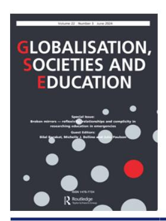
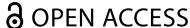

<!-- A1.R30 | source: papers_json/A1.R30/ -->

## **Globalisation, Societies and Education**

**ISSN: (Print) (Online) Journal homepage:****[ www.tandfonline.com/journals/cgse20](https://www.tandfonline.com/journals/cgse20?src=pdf)**

## **حدود التعريف السائد لمصطلح** **"التدويل" في التعليم العالي: هل الفكرة خاطئة أم الخلل في الواقع؟**

## **Simon Marginson**

**To cite this article:** Simon Marginson (04 Oct 2023): Limitations of the leading definition of 'internationalisation' of higher education: is the idea wrong or is the fault in reality?, Globalisation, Societies and Education, DOI: [10.1080/14767724.2023.2264223](https://www.tandfonline.com/action/showCitFormats?doi=10.1080/14767724.2023.2264223)

**To link to this article: **[https://doi.org/10.1080/14767724.2023.2264223](https://doi.org/10.1080/14767724.2023.2264223)

| Image: Open padlock icon | © 2023 The Author(s). Published by Informa UK Limited, trading as Taylor & Francis Group |
| --- | --- |
| Image: Calendar icon | Published online: 04 Oct 2023. |
| Image: Pencil icon | Submit your article to this journal Image: External link icon |
| Image: Bar chart icon | Article views: 2481 |
| Image: Magnifying glass on document icon | View related articles Image: External link icon |
| Image: Crossmark logo | View Crossmark data Image: External link icon |

<!-- page 2 -->

## **حدود التعريف السائد لمصطلح "التدويل" في ** **التعليم العالي: هل الفكرة خاطئة أم الخلل في الواقع؟**

Simon Marginson a,b

a Department of Education, University of Oxford, Oxford, UK; ^b^ Centre for the Study of Higher Education, University of Melbourne, Melbourne, Australia

## **الملخص**

تراجع هذه الورقة بشكل نقدي التعريف السائد لمصطلح "التدويل" في التعليم العالي، وهو تعريف صاغته Knight وزملاؤها منذ 1993 عبر مراجعات متتالية، ويُقصد به التطبيق العالمي الشامل. يُعرَّف التدويل هنا بأنه "عملية دمج بُعد دولي أو ثقافي متعدد أو عالمي" في التعليم ما بعد الثانوي. قاد هذا التعريف منذ أمد بعيد البحث العلمي والخطاب والممارسة عبر الحدود، وتم الترويج له لدعم مجموعة واسعة من الأجندات الحكومية والتجارية والمؤسسية. غير أن الانفصال بين الفكرة والواقع أزعج على نحو متزايد أنصار هذا التعريف، وتكمن خلف هذا التوتر صعوبات أعمق. فالتعريف يحاول توحيد ممارسات متناقضة عبر الحدود تحت قيادة الغرب/الشمال العالمي. وتقوم جغرافيا التعريف على ثنائية أيديولوجية بين "العولمة" (السيئة) و"التدويل" (الحسن)، وهي ثنائية تحبس الممارسين في مقاربات مرتبطة بحدود الأمة. كما أن التعريف غير علائقي (relational) في صيغته، لكنه علائقي في نتائجه، إذ يركّز على خصائص الذات - الشخص، المؤسسة، الأمة - دون النظر إلى ما يترتب على التدويل من آثار على الآخر. ومن ثم فإن التعريف، حين يطبّقه فاعلون من الغرب/الشمال، يُسهّل استمرار الهيمنة الأوروبية-الأمريكية. تقترح الورقة مقاربة مختلفة للمصطلحات والجغرافيا والعلائقية والسلطة في التعليم عبر الحدود.

## **ARTICLE HISTORY**

Received 30 April 2023 Accepted 25 September 2023

## **KEYWORDS **

Higher education; globalisation; internationalisation; crossborder higher education; western centrism; Jane Knight

## **المقدمة**

في عالم متصل عالمياً تقوده مجموعة متشابكة من الدول القومية في تنظيم الحياة الاجتماعية، من الضروري وجود مصطلح للتعبير عن نمو العلاقات التعليمية عبر الحدود الوطنية. المصطلح الحرفي هو "التدويل" (internationalisation)؛ وهو مصطلح ارتبط بعد الحرب العالمية الثانية بطريقة معينة لفهم العلاقات بين الأمم (العلاقات بين الدول)، في أعمال المنظمات متعددة الأطراف وفي تخصصات مثل العلاقات الدولية. لكن معنى الكلمة في سياق دراسات التعليم العالي ليس واضحاً، ولا خالياً من الإشكال في الاستخدام. أولاً، يضم التعليم العالي أكثر من نوع واحد من النشاط خارج نطاق الدولة القومية. فهناك نشاط "بين-دولي" مثل تنقل الطلاب، وهو نشاط يتكون من حركة بين دول محددة الحدود. وهناك أيضاً نشاط "عالمي" يتجاوز الحدود الوطنية، كما هو الحال في العلم، والبرامج

**CONTACT **Simon Marginson [simon.marginson@education.ox.ac.uk ](mailto:simon.marginson@education.ox.ac.uk)Department of Education, University of Oxford, 15 Norham Gardens, Oxford, OX2 6PY, Oxfordshire, UK, Centre for the Study of Higher Education, University of Melbourne, Melbourne, Australia

> ^© 2023 ^The Author(s). Published by Informa UK Limited, trading as Taylor & Francis Group This is an Open Access article distributed under the terms of the Creative Commons Attribution License ([http://creativecommons.org/licenses/by/4.0/)](http://creativecommons.org/licenses/by/4.0/), which permits unrestricted use, distribution, and reproduction in any medium, provided the original work is properly cited. The terms on which this article has been published allow the posting of the Accepted Manuscript in a repository by the author(s) or with their consent.

<!-- page 3 -->

عبر الإنترنت (Marginson[ 2022a)](#page-19-0). ثانياً، استُخدم مصطلح "التدويل" استخداماً معيارياً في محاولات محددة لتشكيل التعليم العالي بطرق معينة.

هذه الورقة عمل من أعمال البحث النقدي، يستكشف ويفسّر كيفية بناء فهم سائد لمصطلح "التدويل" في التعليم العالي[1 ](#page-16-0) ويحدد مشكلات هذا المشروع وتناقضاته وحدوده. وعلى وجه التحديد، تراجع الورقة وتنقد التعريف الذي صاغته Jane Knight في تسعينيات القرن الماضي (يُشار إليه لاحقاً بتعريف OI)، وهو التعريف الذي استخدمه على نطاق واسع الباحثون والممارسون والمؤسسات والدول، مع تفسيرات وتعديلات ومبررات متتالية رافقت تطوره. تتأمل الورقة في التفاعل المستمر بين بناء المفهوم والبيئة الأوسع المتغيرة. اعتمد البحث الأساسي على قراءة نقدية لجميع أوراق Knight حول التدويل منذ عام 1993، إلى جانب مجموعة مختارة من أوراق زملائها ونقّادها. كما تستند الورقة إلى أعمال سابقة للمؤلف تتأمل في السياق التاريخي (على سبيل المثال Marginson and Rhoades[ 2002;](#page-19-1) Marginson [2004;](#page-19-2) [2016;](#page-19-3) Marginson et al.[ 2010;](#page-19-4) Cantwell, Marginson, and Smolentseva [2018](#page-17-0); Marginson [2022a;](#page-19-0) [2022d](#page-19-5)).

من المهم أن يُوضَّح منذ البداية أن الورقة تركّز بشكل وثيق على الممارسات الخطابية المرتبطة بهذا المشروع تحديداً (وإن كان بالغ الأهمية)، ولا تسعى إلى مراجعة ومقارنة كل التعريفات الأخرى القائمة للتدويل أو التعليم عبر الحدود في أدبيات واسعة. كما لا تسعى الورقة إلى وضع تعريف عالمي جديد. بل يتمثل التركيز في أصول هذه الفكرة وكيفية بنائها، وكيف "تفاعل معها العالم وحوّلها" (Robertson [2021](#page-19-6), 169).

ينبغي التأكيد على أن الورقة تتأمل الفكرة لا الشخص. فهي ليست دراسة سيرة ذاتية، ولا تتناول أعمال Knight العلمية ككل، بل تتناول فقط تعريف OI والنقاش المتطور حوله. لا تناقش الورقة أعمال Knight حول أنواع النشاط عبر الحدود، ولا مراكز التعليم (education hubs) (Knight [2014)](#page-18-0)، ولا الدبلوماسية المعرفية (knowledge diplomacy) (Knight [2019](#page-18-1)). يميّز Archer ([1995;](#page-17-1) [2007)](#page-17-2) بين الأشخاص، والفاعلين (actors)، والوكلاء (agents). فالأشخاص هم أفراد تأمليون يتحركون في العالم؛ والوكلاء لديهم أهداف وموارد؛ أما الفاعلون فيشغلون دوراً داخل حقل أو منظمة، وهو دور مستقل عن الشخص (Robertson [2021,](#page-19-6) 168–169). في سياسة التعليم وممارسته، وفي مجالات موازية، يشغل بعض منتجي المعرفة أدواراً معرفية محددة، بوصفهم مثقفين عضويين. تكتسب أفكارهم رواجاً وترتبط بوكلاء - غالباً في منظمات أو دول - يمتلكون مصالحهم ومواردهم وممارساتهم. وكلما اتسع انتشار الفكرة ازدادت تنوع هذه الارتباطات. فبينما يرتبط اسم Knight ارتباطاً وثيقاً بتعريف OI، فقد صار هذا التعريف يحمل مجموعة أوسع من المعاني والدلالات، بعضها لم تقصده Knight نفسها كما أشارت هي.

## *الأهمية تكمن في التعريفات*

عند مناقشة معاني "العولمة"، يلاحظ Scholte [(2008)](#page-20-0) أن "التعريف ليس كل شيء، لكن كل شيء يتضمن تعريفاً. فمعرفة العولمة هي إلى حد كبير دالة على كيفية تعريف الكلمة"، ما يستوجب "فحصاً دقيقاً ونقدياً للمصطلح نفسه". فالتعريف الدقيق يوفر رؤية متكررة ويساعد على توجيه الممارسة. وبالمقابل "فإن المفهوم الأساسي المشوش أو المضلَّل يُضعف فهمنا الكلي للمشكلة" (1471). وينطبق هذا الأمر أيضاً على مصطلح "التدويل".

في صيغته الأكثر شيوعاً، يرد تعريف OI على النحو التالي:

Internationalisation at the national, sector and institutional levels is defined as the process of integrating an international, intercultural or global dimension into the purpose, functions or delivery of post-secondary education. (Knight [2004a,](#page-18-2) 11)

باتت هذه الجملة المحورية الوحيدة معروفة إلى درجة أصبحت معها عادية ومألوفة. غير أن التعريف يتضمن حشواً منطقياً (فالتدويل يدمج ما هو دولي)، ويُخفي مجموعة من الافتراضات والأحكام والمشكلات والقضايا.

استُشهد بتعريف OI بشكل متكرر جداً في البحوث والوثائق الرسمية، خاصة في المنطقة الأنجلوفونية وأوروبا الغربية. عند كتابة هذه الورقة[2 ](#page-16-1) كانت أكثر الأوراق استشهاداً في

<!-- page 4 -->

العقد الأول من التعريف (Knight [1994](#page-18-3); Knight and de Wit [1995](#page-18-4)) قد بلغت 1078 و1030 استشهاداً على Google Scholar على التوالي، بينما بلغت أكثر الأوراق استشهاداً في العقد الثاني، حول "التعريف المُحدَّث" (Knight [2003;](#page-18-5) [2004a)](#page-18-2)، 2491 و4294 استشهاداً. أما الورقة التي شاركت في تأليفها Knight مع Phil Altbach بعنوان "The internationalisation of higher education: Motivations and realities" (Altbach and Knight [2007](#page-17-3)) فقد بلغت 5366 استشهاداً. ويوضح تحليل محتوى مجلة *Journal of Studies in International Education* الذي أجراه Bedenlier, Kondakci, and Zawacki-Richter [(2018](#page-17-4)) أن مقالتي 1994 و1995 كانتا أساسيتين لتأسيس هذا المجال البحثي (118)، وأن Knight ألّفت أو شاركت في تأليف أكثر الأعمال استشهاداً (114–115).

اعتمدت منظمة التعاون والتنمية الاقتصادية (OECD) [(2007,](#page-19-7) 23) تعريف OI، وكذلك اعتمدته حكومات عديدة، ومنظمات قطاعية مثل الرابطة الدولية للجامعات، والمجلس الأمريكي للتعليم (مثلاً ACE [2015)](#page-17-5)، وجامعات المملكة المتحدة (Universities UK). كثيراً ما يُستشهد به على مواقع الجامعات حين تعرض برامجها الدولية. وهذا مستوى من التأثير الملموس لا يحلم به معظم الباحثين. تحظى صياغة Knight بدعم إجماعي من المنظمات أكثر مما تحظى به لدى الباحثين. ويتجنبه كثير من الباحثين الذين يدرسون العلاقات العالمية في التعليم العالي. ومع ذلك، قلة من يحافظون على نقد صريح له (يناقَش بعضهم أدناه). وهذا الجمع بين التأييد العلني الواسع والاعتراض غير المُعلَن غالباً يشير إلى مستوى مرتفع من قبول تعريف OI. لقد بات مشروع Knight وصياغتها يمارسان "هيمنة" (hegemony) خطابية بمعنى Gramsci [(1971)](#page-18-6)، أي صناعة الرضا عن لغة القوة المهيمنة ورؤيتها للعالم وأجندتها (Lukes [2021](#page-19-8)).

غير أن الأفكار المؤثرة ينبغي أن تخضع لتمحيص نقدي مستمر، بالنظر إلى أن لا معرفة كاملة، وأن نظريات العالم يمكن بل يجب أن تُعامَل باعتبارها قابلة للخطأ. لا ينبغي للأفكار أن تكتسب طابع الأرثوذكسية الأصولية. وتخلص هذه الورقة إلى أن تعريف OI عاجز عن فهم التعليم عبر الحدود فهماً كافياً بما يدعم البحث العلمي. كما أنه لا يستطيع تشكيل الممارسة كما يريد أنصاره. وستُجادل الورقة بأن التعريف معياري بشكل مفرط وضعيف التفسير، ويستخدم جغرافيا مبتورة، ويدّعي عالمية لا يمكن تحقيقها، وأنه حين يُطبَّق في ممارسات التعليم العالي الأوروبي-الأمريكي، تكون له آثار رجعية في العالم غير الأوروبي-الأمريكي.

يجري توثيق هذه المقولات ومناقشتها أدناه. يعرض القسم التالي من الورقة نتائج البحث، وهو مراجعة نقدية للنصوص عبر ثلاث مراحل: أصول تعريف OI في تسعينيات القرن الماضي؛ تحدي أفكار اقتصاد المعرفة العالمي في العقد الأول من الألفية، الذي أدى إلى تعديلات محدودة في التعريف؛ وتراكم أزمة المعنى بين أنصار التعريف في العقد الثاني من الألفية. أما قسم المناقشة فيوسّع الحديث في حدود التعريف ويقدم تفسيراً من نوع آخر، قائماً على العلائقية المتبادلة.

## **فكرة في ثلاث مراحل**

يلخّص هذا القسم نتائج البحث الذي تستند إليه الورقة، وهو مراجعة نقدية لتعريف OI ومناقشته، ضمن السياق التاريخي المتغير.

تطور تعريف OI الخاص بـ Knight وبرز في العقد الذي تلا عام 1994. كانت تلك فترة تغيّر سريع، ومبادرات، وحماس في التعليم العالي عبر الحدود، وسط جيشان نقاشي حول التكامل والتقارب على المستوى العالمي، أو "العولمة" (Held et al. [1999](#page-18-7)) في الاقتصاد والمجتمع والثقافة والتعليم (انظر من بين مصادر عديدة Rizvi and Lingard [2009;](#page-19-9) Robertson and Dale [2015;](#page-19-10) James and Steger [2016;](#page-18-8) Rizvi, Lingard, and Rinne [2022;](#page-19-11) Marginson [2022a;](#page-19-0)[ 2022b)](#page-19-12). وتستدعي مثل هذه الأوقات الحاجة إلى تفسيرات جديدة وقواعد سلوك جديدة. وكانت Knight [(1994)](#page-18-3) من بين ابتكارات خطابية عديدة ظهرت آنذاك.

كانت هناك وجهات نظر ومصالح واستراتيجيات متنوعة ومتضاربة. رأت المنظمات الدولية وصانعو السياسات الوطنيون الذين وضعوا التعليم في إطار اقتصاد المعرفة العالمي أن تجارة الخدمات التعليمية مصدر لبناء القدرات وتراكم رأس المال معاً (مثلاً OECD [2004;](#page-19-13) Bashir [2007](#page-17-6)). رأى كثير من قادة الجامعات فرصاً لتوسيع نطاقهم ومكانتهم ودخلهم. وقدّم بعض الباحثين نصائح للدول أو الجامعات الساعية إلى التنافسية العالمية

<!-- page 5 -->

(مثلاً Mazzarol and Soutar [2002 ](#page-19-14) حول عاملَي "الدفع والجذب" في تنقل الطلاب). وقام باحثون آخرون بتنظير السياق العالمي الناشئ، مع نقد التسرع نحو أسواق التعليم (مثلاً van der Wende [2002](#page-20-1); Valimaa [2004](#page-20-2); Dale [2005;](#page-18-9) Robertson [2005)](#page-19-15). وكانت المصطلحات نفسها ساحة صراع. فبعض الباحثين، استناداً إلى Appadurai [(1996](#page-17-7))، وCastells ([2000](#page-17-8))، وBeck [(2000](#page-17-9)) وغيرهم، رأوا إمكانات إيجابية في الطابع العالمي من خلال الشبكات الإلكترونية، والمجتمع المدني العابر للحدود، والتعلم الكوني، والهجانات الجديدة (hybridities)، والتنقل خارج الحدود. ورأت مجموعة ثانية من الباحثين تقويض العولمة الرأسمالية للمصلحة العامة الوطنية، فطوّروا ثنائية أخلاقية بين خير وشر يرتبط فيها "التدويل" بالتعليم الديمقراطي المثالي، وترتبط "العولمة" برأس المال العالمي بمعناه الواسع. مثال على ذلك: 'The current worldwide tide of globomania threatens to engulf moves towards genuine internationalisation of universities' (Welch [2002,](#page-20-3) 471). واصطفت Knight ([1999;](#page-18-10) [2004a)](#page-18-2) مع نسخة أكثر اعتدالاً من هذه الحجة.

رأت مجموعة ثالثة من الباحثين كل العناصر متداخلة: الوطني والعالمي، الاقتصادي والثقافي، الإيجابي والسلبي (مثلاً Henry et al. [1999)](#page-18-11). اكتسبت العلاقات العالمية قوة متنامية، وارتبطت بتحولات انتقائية في أشكال الدولة (Sassen [1996](#page-19-16); Robertson, Bonal, and Dale [2002)](#page-19-17). فقد أخذت وحدات الأمم، بما فيها مؤسسات مثل الجامعات، تتكيف تدريجياً مع الطابع العالمي وتتوجه إليه جزئياً. لكن الدولة القومية احتفظت بثقلها: فظلت تنظّم التعليم العالي وتموّله (Marginson and Rhoades [2002](#page-19-1)).

تباطأ تدفق الأفكار الجديدة بعد منتصف العقد الأول من الألفية، لكن هذه المجموعات الثلاث من الباحثين لا تزال قائمة، وإن كانت التأكيدات الواثقة بشأن العولمة قد تراجعت. وفي مراجعة للأدبيات حول التعليم العالي الدولي والعالمي، يحدد Lee and Stensaker ([2021)](#page-19-18) ثلاث مقولات رئيسية: تراجع دور الدولة القومية، بقاء أهمية الدولة القومية، وتكيف المؤسسات مع المعايير العالمية (وهذه المقولة الأخيرة متوافقة مع أي من المقولتين الأخريين). وفي دراسات التعليم العالي، لا يزال الأمر غير واضح بشأن العلاقة بين الوطني والعالمي (Marginson [2022c)](#page-19-19). ومن الملاحَظ أيضاً أن الباحثين المهتمين بتعريف OI الخاص بـ Knight نادراً ما يستشهدون بالباحثين الذين يدرسون الطابع العالمي، والعكس صحيح. فلأكثر من ثلاثة عقود، ظل النقاشان منفصلين إلى حد كبير.

## *المرحلة الأولى في تسعينيات القرن الماضي: التأسيس*

قدّمت Knight تعريف OI في عامَي 1993 و1994 في أوراق موجّهة إلى ممارسي التعليم العالي عبر الحدود في كندا. وكانت Knight نفسها مرتبطة بالتنسيق الحكومي للتعليم الدولي، وبالممارسات القائمة على المؤسسات. رأت في تعريف OI وسيلة لبناء مجال مشترك، "نموذج مفاهيمي يوفر قدراً من الوضوح بشأن المعنى والمبادئ لتوجيه السياسة والممارسة" (Knight [2004a](#page-18-2), 6). "التعريفات يمكن أن تشكّل السياسة" (Knight [2003](#page-18-5), 2). وكانت قلقة مما رأته تطبيقاً انتقائياً للمصطلح على ممارسات متناقضة. "حين تؤدي التفسيرات المتباينة إلى شعور بالارتباك حول أهمية التدويل، وفي النهاية إلى إضعاف الشعور بالشرعية والتأثير، يصبح من الضروري اتخاذ إجراء ما" (Knight [1997,](#page-18-12) 39). وكان "الوضوح" ضرورياً للتنظيم والتأمل الذاتي. "لا بد أن يكون للتدويل ضوابط إذا أُريد تقييمه" (Knight [1994](#page-18-3), 3).

في مجلة *International Education Magazine* التابعة للمكتب الكندي للتعليم الدولي عام 1993، عرّفت Knight "التدويل" بأنه "عملية دمج البعد الدولي في وظائف التدريس والبحث والخدمة في مؤسسة التعليم العالي" (Knight [1994,](#page-18-3) 3). وفي نشرة *CBIE Research* عام 1994، ذكرت أن "البعد الدولي يعني منظوراً أو نشاطاً أو خدمة تُدخِل أو تدمج منظوراً دولياً/ثقافياً متعدداً/عالمياً في الوظائف الرئيسية لمؤسسة التعليم العالي" (3). فالأمر ليس مجرد نشاط بل عقلية أيضاً: "منظور" و"وجهة نظر". وسردت Knight الأماكن العديدة داخل المؤسسة التي يمكن فيها دمج "منظور دولي"، وناقشت بالتفصيل المبررات والدوافع، وعناصر النشاط عبر الحدود، والعوامل الأكاديمية والتنظيمية، و"نقاط تحقق لاستراتيجية التدويل" تضم 63 نقطة، ورسماً بيانياً لـ"دورة التدويل". وفي العام التالي، جاء كتابها المشترك مع Hans de Wit من جامعة أمستردام أقل توجيهاً وصفياً، لكنه فتح حواراً عالمياً (Knight and de Wit [1995)](#page-18-4)، حملته شبكة الإنترنت الناشئة آنذاك.

<!-- page 6 -->

اتسع صدى تعريف OI عبر شبكة واسعة من الخبراء في المكاتب الدولية للجامعات مثل de Wit، وجمعيات صناعية تخدم البرامج عبر الحدود، ومستشارين ومسؤولين حكوميين، بدايةً في الدول الأنجلوفونية وأوروبا الغربية. ومع مرور الوقت، أصبحت افتراضات وأحكام ضمنية مشتركة واضحة. تبنّى كثير من أنصار تعريف OI فكرة النهوض بالتعليم عبر الحدود استناداً إلى الأممية الليبرالية (liberal internationalism)، وهو مذهب Wilson الذي ظهر بعد الحرب العالمية الأولى وشكّل لاحقاً الأمم المتحدة (Dagen et al.[ 2019](#page-17-10), 646). وبحسب Brandenburg and de Wit [(2011](#page-17-11))، "لا يزال مجتمع التعليم العالي يؤمن بقوة بأن التدويل يؤدي بحكم تعريفه إلى السلام والتفاهم المتبادل، وهي القوى الدافعة وراء برامج مثل Fulbright في خمسينيات القرن الماضي" (15). غير أن الأممية الليبرالية، وإن صيغت بعبارات عالمية، كانت تاريخياً وثقافياً محلية النزعة بمعنى Chakrabarty [(2000](#page-17-12)). فمثلما رأى Wilson عام 1919 عالماً محوره أوروبا-أمريكا، رأى Fulbright في خمسينيات القرن الماضي الأمر ذاته. وفي سردها لتاريخ التعليم الدولي في كندا، تصف Trilokekar [(2010)](#page-20-4) دعوة رئيس الوزراء Lester Pearson (1963–1968) لنظام بين-دولي قائم على السيادة الوطنية والتنمية الشاملة في عالم عادل ومنصف (144) بوصفها أحد خيوط السياسة الخارجية، وتضع دولة رأسمالية كونية عالية المبادئ في موقع حامل العلاقات عبر الحدود. غير أن الدول نادراً ما تكون بهذا القدر من المبادئ، والحريات الاقتصادية الليبرالية الغربية لا تتوافق بالضرورة مع فاعلية الدول الناشئة. وكثيراً ما كانت الأممية الليبرالية حاملة لأجندات استعمارية جديدة.

في المراحل الأولى، لم تكن Knight [(1994](#page-18-3)) منشغلة كثيراً بالعولمة الاقتصادية. فقد كان التسويق التجاري في كندا مقتصراً إلى حد كبير على "كليات إدارة الأعمال" (5). غير أن Knight [(1999](#page-18-10)) سجّلت تحولاً لاحقاً. إذ صار مطلوباً من المؤسسات "أن تكون أكثر ريادة... وأن تفكر على المدى المتوسط والبعيد في مقاربتها للسوق الدولية" (2). وفي البداية، كانت Knight غير محسومة الموقف من ذلك. "يمكن أن توجد علاقة مباشرة ونافعة بين التوجه نحو السوق الدولية وتدويل الوظائف الأساسية للجامعة/الكلية أو المعهد". لكن "هذا ليس هو الحال دائماً". وكان المفتاح تحقيق "التوازن بين دوافع توليد الدخل والدوافع الأكاديمية" (8).

في ورقة عام 1999، طوّرت Knight رؤيتها بشأن العولمة والتدويل. بدأت بالتمييز الجغرافي المحايد. أولاً، "بمعناه الحرفي، يمكن تفسير التعليم الدولي على أنه 'نوع أو عملية تعليم تشمل أو تتعلق بأمتين أو أكثر، أو تجري بينهما'" (Knight, [1999](#page-18-10), p. 10). ثانياً، المعنى الحرفي لكلمة "عالمي" هو "'شامل للعالم كله' أو 'متعلق بالأرض أو العالم ككل'"، وتستدعي فكرة "الترابط والاعتماد المتبادل" (13)، بما في ذلك التدفقات العالمية لـ"التكنولوجيا والاقتصاد والمعرفة والناس والأفكار" (14). "السمة المركزية التي تميز العالمي عن الدولي... هي مفهوم الأمة" (13). وحتى هذه النقطة، كان تمييز Knight بين الصفتين "دولي" و"عالمي" غير أيديولوجي وشائعاً في دراسات التعليم العالي آنذاك (مثلاً Scott [1998](#page-20-5); Marginson and Rhoades [2002)](#page-19-1)). لكن Knight [(1999](#page-18-10)) استخدمت الأسماء، صيغ "-ation" أو "-isation"، بطريقة مختلفة عن الصفات.

ذكرت Knight أن المقاربة الحرفية للتدويل، أي ما هو بين الدول، "تؤدي إلى مقاربة مقيدة نوعاً ما للمفهوم" [(1999,](#page-18-10) 10). واختلف التدويل والعولمة في "الغرض والأثر الضمنيين" لكل منهما (13). وهنا استندت إلى الثنائية الأخلاقية بين التدويل والعولمة في الأدبيات. فالعولمة كانت في الأساس عولمة اقتصادية، وتهديداً خارجياً للتعليم العالي. أما التدويل فكان "استجابة لتزايد العولمة أو نتيجة له" من الخارج (14). ويمكن للمربّين ضبطه ضمن إطار وطني، وكان محتمَل الفضيلة. وكان التدويل هو المفهوم المحوري لتوحيد الممارسين.

تجنّبت Knight نظرة سلبية شاملة للعولمة، لكنها ربطتها بقمع الفروق الوطنية، والتجانس الثقافي، و"مقاربة استعمارية جديدة" (Knight [1999](#page-18-10), 15)، و"التسليع التجاري" (9). وأوحت الثنائية بأن التدويل بريء من هذه الآثار. غير أن Knight اعترفت في وقت مبكر من النص نفسه بأنه خارج "العالم الغربي... يُنظر إلى التدويل باعتباره شكلاً من أشكال التغريب أو حتى الاستعمار الجديد" (1). وكان ينبغي أن يدق هذا ناقوس الخطر، لكن لم يُتابَع هذا الطرح.

<!-- page 7 -->

## *المرحلة الثانية في العقد الأول من الألفية: اقتصاد المعرفة والخلل في الواقع*

بحلول أوائل العقد الأول من الألفية، كانت فكرة اقتصاد المعرفة العالمي (Olssen and Peters [2005)](#page-19-20) قد ترسّخت على نطاق واسع في سياسات التعليم عبر الحدود، بقيادة الدول الأنجلوفونية والوكالات الدولية التي استخدمت تعريف Knight. وتشدّدت الروابط الخطابية بين العولمة الاقتصادية، والسياسة النيوليبرالية، وتسليع التعليم. وتُصوَّر عمليتا التعلم والمعرفة بوصفهما مصدرَين مباشرَين للقيمة الاقتصادية عبر رأس المال البشري والابتكار القائم على البحث. وفي منتصف العقد الأول من الألفية، رسّخت التصنيفات الجامعية العالمية ما وصفه van der Wende [(2001)](#page-20-6) بأنه تحول نموذجي (paradigmatic shift) من التعاون إلى التنافس.

ضغطت الاتفاقية العامة لتجارة الخدمات التابعة لمنظمة التجارة العالمية (WTO GATS) من أجل تحرير التجارة عبر الحدود في التعليم (OECD[ 2004)](#page-19-13)، رغم وجود مقاومة من بعض العاملين في التعليم الدولي (Altbach[ 2001)](#page-17-13) ومن الوكالات متعددة الأطراف (مثل اليونسكو). ورأى كثيرون أن العولمة والتدويل مترادفان (Teichler [2004](#page-20-7), 23)، وهو ما شكّل معضلة لتعريف OI بتشويشه الحدود بين الأممية الليبرالية والتجارة العالمية والتصنيفات العالمية. فقد كان يمكن تقديم التعليم الدولي التجاري بوصفه "دمج بُعد دولي أو ثقافي متعدد أو عالمي" في التعليم ما بعد الثانوي. لكن الدول القومية التي تضع نفسها كمنافسة في اقتصاد المعرفة العالمي لا يمكن الوثوق بأنها تحمي الاستقلالية المؤسسية أو القيم الاجتماعية والثقافية. وأوجد ذلك معضلة لتعريف OI. فإما أن الخلل يكمن في التعريف نفسه، في فكرة التدويل الفاضل الشامل عالمياً *و*المنفصل في الوقت نفسه عن النشاط العالمي، وإما أن الخلل يكمن في الواقع. لقد أصبح تعريف OI الخاص بـ Knight شائعاً جداً، ولم تتخلَّ صاحبته عنه. بل بدت مقاربتها توحي بأن الواقع فشل في التوافق مع التعريف. ورغم أن أوراق Knight في [2003](#page-18-5)/[2004 ](#page-18-13) قيل إنها "تُحدِّث" التعريف و"تعيد صياغته"، فإن جوهره ظل إلى حد كبير دون مساس. وانصب تركيزها الرئيسي على قلقها المتنامي بشأن الاتجاهات التي سلكتها السياسة والممارسة.

أولاً، امتد تعريف OI ليتجاوز المؤسسات إلى "التدويل على المستويات الوطنية والقطاعية والمؤسسية". ثانياً، أصبح أكثر تجريداً وعالمية وشمولاً. فبدلاً من "وظائف التدريس والبحث والخدمة"، صار يشير الآن إلى "الغرض أو الوظائف أو التقديم". وقد أدخل ذلك مجموعة أوسع من مقدمي الخدمة في أشكال تجارية وشركاتية للتعليم العالي عبر الحدود (Knight [2004a,](#page-18-2) 11–12).

استمرت المؤلفة في اعتبار سلبيات العلاقات الدولية في التعليم العالي "عولمة"، محافظة بذلك على مثال التدويل الفاضل. ووسّعت الثنائية. فالمصطلحان "استُخدما عن قصد بطريقة مختلفة" في التعليم (Knight[ 2005,](#page-18-14) 5). وكان التدويل موقع "جهد مستمر ومتواصل" (Knight[ 2003,](#page-18-5) 2). أما العولمة فتنطوي على "تحديات ومخاطر" (3) ينبغي تجنبها.

The discussion does not centre on the globalisation of education. Rather, globalisation is presented as a process impacting internationalisation … In fact, substantial efforts have been made during this past decade to maintain the focus on the internationalisation of education and to avoid using the term globalisation of education. (Knight [2003](#page-18-5), 3)

"العولمة تُغيّر عالم التدويل"، بينما "التدويل يُغيّر عالم التعليم" (3). ومرة أخرى، كانت القوى الاقتصادية العالمية تؤثر على التعليم العالي الوطني من الخارج، لكن آثارها كانت مرشَّحة عبر الحاوية الوطنية، وقابلة للتعديل عبر الفاعلية بين-الدولية للأفراد والمؤسسات في التعليم العالي. لم يكن الأفراد والمؤسسات يمارسون (أو ينبغي ألا يمارسوا) فاعلية عالمية خارج الحاوية الوطنية. تطلّب هذا منطقاً بهلوانياً، لكنه كان مريحاً بطريقة غريبة. فالعنصر العالمي في الجغرافيا استُبعِد باعتباره كبيراً وخارجياً وتوسعياً؛ كما استُخدم في الوقت نفسه بوصفه فئة فرعية من التدويل، إلى جانب "الثقافي المتعدد". وقد وُضع القادة والموظفون في التعليم العالي الذين ينفذون نشاط التدويل في موقع جذاب بوصفهم محوّلين كونيين لمؤسساتهم.

لم يكن كل شيء فاضلاً. فقد انتقدت Knight [(2004a)](#page-18-2) "التركيز المتزايد على المنافسة على المستوى الدولي" و"تحولاً غير خفي نحو بناء سمعة دولية" لتعزيز الموقع التنافسي (21). وتساءلت: هل هناك "تحول ملحوظ بعيداً عن المبررات الاجتماعية والثقافية؟" (29). وشككت في "بناء العلامة التجارية" (branding) (21) والتصنيف. وكانت Knight [(2004b](#page-18-13)) أكثر

<!-- page 8 -->

نقداً في هذا الصدد. وفي بعض الأحيان، بدا بناء الجامعات ذات الطراز العالمي (WCU) وكأنه مندمج مع التسليع التجاري، مما دفع Huang ([2007)](#page-18-15) إلى الدفاع عن استراتيجيات WCU للحاق بالركب في الدول غير الغربية (58–59). وبالنسبة إلى Knight، كان كل ذلك متناقضاً مع تصورها المفضل للتدويل. غير أنها لم تحظر صراحة الأنشطة عبر الحدود التي لم تكن ترضى عنها، وهو ما كان سيتخلى عن ادعاء تعريف OI بتغطية شاملة عالمية للمجال. فـ"لا يوجد نهج صحيح واحد" (Knight [2004a,](#page-18-2) 18). بل دعت إلى التأمل الذاتي ومناقشة السياسات والاستراتيجيات والبرامج والأنشطة (19)، والمراجعة المستمرة للمبررات الأكاديمية والاجتماعية والثقافية والسياسية والاقتصادية.

ركّز Altbach and Knight [(2007](#page-17-3)) بشكل أكثر صراحة على السلطة العالمية غير المتكافئة، وهو موضوع متكرر لدى Altbach.[3 ](#page-16-2) وكانت العولمة الاقتصادية الخارجية مرة أخرى المشكلة الأساسية. فقد "استثمر رأس المال العالمي" بكثافة "في صناعات المعرفة حول العالم" (290). وأدى تعميم المعرفة، وأنماط التنقل، ونقل النماذج من الشمال إلى الجنوب، إلى تفاقم أوجه عدم المساواة العالمية القائمة أصلاً. "الشمال يسيطر إلى حد كبير على العملية". وكان الحل يكمن في النوع الصحيح من البرامج والابتكارات والممارسات. "قد تكون العولمة غير قابلة للتغيير، لكن التدويل يتضمن خيارات كثيرة" (291). "نحن في مفترق طرق - على البرامج والممارسات الناشئة اليوم أن تضمن أن يستفيد التعليم العالي الدولي من الصالح العام لا أن يكون مجرد مركز ربح" (304). لكن إذا كان طريق الصالح العام هو التدويل، فإن العملية نفسها كانت تخلق عقبات. وهل يمكن للشمال العالمي أن يقود التدويل ويقلّل هيمنته الخاصة في آن واحد؟

## *المرحلة الثالثة في عقد 2010: خيبة أمل متنامية وخلل في التعريف*

بحلول عقد 2010، كان التدويل قد "تطور من مجموعة هامشية وعشوائية من الأنشطة إلى عمليات وسياسات أكثر شمولاً ومركزية" (de Wit [forthcoming)](#page-18-16). ووجدت الرابطة الدولية للجامعات (IAU) عام 2018 أن أكثر من 90 في المئة من المؤسسات تذكر "التدويل" في رسالتها أو خطتها الاستراتيجية، وإن كان الثلث فقط في أمريكا الشمالية (Marinoni [2019](#page-19-21); de Wit and Altbach [2021](#page-18-17)). واستخدمت المؤسسات تعريف OI بحرية دون الالتزام بالمراجعة الذاتية التي كانت Knight توصي بها، وغالباً ما مارست ممارسات متناقضة. ولاحظ Stein ([2021)](#page-20-8) لاحقاً وجود جامعات تنتقد التجانس الغربي للمعرفة، وتدّعي احترام الثقافات الأخرى، بينما تحقق دون خجل أرباحاً من طلاب الدول الناشئة استناداً إلى افتراض تفوق التعليم الغربي الموروث من الحقبة الاستعمارية (1774).

وكان كل ذلك متوافقاً مع تعريف OI، وهذه كانت المشكلة. وكررت Knight [(2011](#page-18-18)) مخاوفها السابقة. فقد أصبح التدويل "عبارة جامعة... تفقد معناها واتجاهها" (14)، و"تبدو التنافسية والتصنيفات والتسليع التجاري هي القوى الدافعة" (15). وينبغي ألا يُعادَل عدد الطلاب الأجانب، أو الاتفاقيات، أو التسويق، أو بناء العلامة التجارية أو السمعة، أو الاعتماد الدولي، بالتدويل. فالمؤشرات الكمية تلبي متطلبات المساءلة لكنها تفتقد الجوهر "غير الملموس" (intangible) الإنساني (15). ولم تعد تسعى إلى توجيه العملية عبر "نقاط تحقق" كما فعلت عام 1994. ظلت Knight ترغب في تطبيع التدويل دون أن تكون توجيهية بشكل صريح. وظلت ترى أن المشكلة تكمن في الواقع لا في التعريف الساعي للعالمية، أو في عجز خطاب التعريف عن دفع الواقع نحو التوافق معه.

استجاب بعض زملاء Knight بطريقة مختلفة. فمثلها، كانوا قلقين بشأن مشكلات الواقع في التعليم عبر الحدود، لكنهم رأوا الآن أيضاً مشكلات في التعريف نفسه. "يعاني التدويل من أزمة هوية أو أزمة منتصف العمر"، كما ذكر de Wit [(2011](#page-18-19)). ومع ملاحظته "المشهد العالمي المتغير والنقاش المرتبط به حول التدويل بوصفه 'مفهوماً غربياً' أو تكراراً للنظام القديم بلاعبين جدد"، أراد إعادة تقييم العلاقات بين الدولي، والثقافي المتعدد، والعالمي. وفي مقال بعنوان "نهاية التدويل"، ذهب Brandenburg and de Wit ([2011)](#page-17-11) إلى أبعد من ذلك. فقد شككا في الثنائية الأيديولوجية. "أصبح التدويل الفارس الأبيض للتعليم العالي، والأرضية الأخلاقية الواجب الدفاع عنها، ورمز العدالة والإنصاف"، بينما "العولمة محمّلة بدلالات سلبية" (15). "هذا التضاد المُصطنَع بين التدويل والعولمة" يتجاهل

<!-- page 9 -->

حقيقة أن العولمة الاقتصادية "تُنفَّذ على نحو متزايد تحت راية التدويل". "علينا أن نبتعد عن المفاهيم العقائدية والمثالية" (16)، مع التركيز على "القيم والمبررات" التي تولّد نتائج "ذات معنى". "مستقبل التعليم العالي هو مستقبل عالمي" و"من واجبنا" الاستعداد له. "ربما علينا حتى أن نترك المفاهيم القديمة للتدويل والعولمة وننتقل إلى نموذج جديد غير متحيز" (17). وكان ذلك ذروة التفكير النقدي الذاتي في معسكر تعريف OI. لكن لم يحدث قطيعة نهائية مع الاستراتيجية القديمة القائمة على استخدام تعريف غربي لتشكيل الممارسة على مستوى العالم.

لم تختلف Knight ([2013](#page-18-20)) علناً مع Brandenburg and de Wit [(2011](#page-17-11))، لكنها تمسكت بموقفها السابق. أراد "الأكاديميون والمنظمات" "مفهمة أو تعريفاً أو مصطلحاً جديداً للتدويل". لكن هل كانت "كلمات جديدة" كافية إذا لم تتغير الممارسة؟ فقد كانت "المنافسة والتسليع التجاري والمصلحة الذاتية وبناء المكانة" في طريقها للفوز، مما يعني أن التدويل "استُلحِق بالجانب 'المظلم' من أجندة العولمة" (89). ودعا de Wit ([2013)](#page-18-21) إلى مزيد من التركيز على "المعايير أو القيم أو الأخلاقيات" وعلى العلاقات بين العالمي والمحلي (6). وأراد Leask and de Wit [(2016)](#page-19-22) أن يفكر الجميع "محلياً ووطنياً وعالمياً"، وهي جغرافيا أوسع مرة أخرى، وأن يُوسّعوا "القاعدة المعرفية للمنهج الدراسي إلى ما هو أبعد من المرجعية الأوروبية والرؤى المحدودة غربياً". وتساءل de Wit ([2019a](#page-18-22), 10) على سبيل الأمل: "هل يحل نموذج تدويل أكثر تنوعاً وشمولاً محل النموذج الغربي؟". وأراد آخرون "تدويلاً شاملاً" و"تدويلاً ذكياً" و"تدويلاً واعياً" و"تدويلاً مسؤولاً" و"تدويلاً إنسانياً" (de Wit [forthcoming)](#page-18-16).

في نهاية المطاف، اتخذ الاعتراض والبدائل شكل صفات أو عبارات إضافية أُلحقت بتعريف OI الأصلي. وظلت الصياغة الأساسية والمشروع المهيمن سليمَين. وفي تقرير للبرلمان الأوروبي، اقترح de Wit et al. ([2015)](#page-18-23) لا "نموذجاً جديداً غير متحيز" بل نسخة مزخرفة من النموذج القديم:

The intentional process of integrating an international, intercultural or global dimension into the purpose, functions and delivery of post-secondary education, in order to enhance the quality of education and research for all students and staff, and to make a meaningful contribution to society. (de Wit et al. [2015](#page-18-23), 29)

أراد المؤلفون توسيع الأجندة لتتجاوز توليد الإيرادات والتنافس بين الجامعات البحثية، ورعاية التدويل في الوطن، وتنفيذ أهداف التنمية المستدامة للأمم المتحدة (Brandenburg et al. [2019](#page-17-14)). "هناك توترات بين مقاربة نيوليبرالية قصيرة المدى للتدويل تركّز أساساً على التنقل والبحث، ومقاربة جودة شاملة طويلة المدى، تعلّم عالمي للجميع" (de Wit [2019a](#page-18-22), 15). غير أن التعريف المُنقَّح أضاف مزيداً من الغموض ("الجودة"، "المساهمة ذات المعنى")، بينما ظل يقبل معظم أنواع الممارسة عبر الحدود - واستمر الاستشهاد بـ Knight (2003, 2004a) بدلاً من تعريف de Wit et al. [(2015](#page-18-23)).

لم تتخلَّ أي من الأفكار الجديدة عن المشكلات الجوهرية لتعريف المرحلة الأولى: تفضيله للوطني/الدولي على العالمي، وعالميته الملتبسة، ومركزيته الأوروبية-الأمريكية. لكن ربما لم تعد مراجعة تعريف OI الأصلي خياراً متاحاً، لأن Knight وزملاءها لم يعودوا يقودون المفهوم أو الممارسة. فقد أصبح التعريف عقيدة راسخة ذات سلطة رمزية خاصة. ولفتح الطريق أمام ما هو أفضل، كان على Knight وزملائها أن يتبرأوا من أعمالهم السابقة، وكان ذلك جسراً بعيد المنال. تتأمل Stein ([2021)](#page-20-8) في الوعود المتكررة بـ"إعادة المفهمة"، وفي حجة "نهاية التدويل". وتلاحظ "الصعوبات الفكرية والوجدانية في 'تخيل طريقة أخرى'"، و"نقص القدرة على الصمود في مواجهة عدم اليقين والتعقيد، والشعور بالاستحقاق في الاستقلالية والتماسك والسيطرة" (1772).

In some ways concerns about the 'decline' of internationalisation appears to be a thinly veiled concern about a potential declining advantage and dominance of Western higher education. In particular, there is decreasing certainty that there will be a perpetual pool of international students willing to pay exorbitant prices for study in Western institutions. (Stein [2021](#page-20-8), 1775–1776)

فـ"الحنين الأوروبي المحور" إلى الحقبة السابقة على التسليع التجاري في التعليم عبر الحدود يجعل من "الأسهل تأطير مخاطر 'التراجع' المتصورة في الغرب دون نقد بوصفها

<!-- page 10 -->

خسارة جماعية مُعاشة عالمياً" (Stein [2021,](#page-20-8) 1776). فناقدو النزعة التجارية يدعون إلى تدويل من أجل "الصالح العام العالمي". لكن "من يحدد ما يشكّل الصالح العام العالمي؟" (1778). تدعو Stein إلى "تدويل قد يُهيّئنا للتخلي عن شعورنا المكتسب بالتفوق والانفصال، ويؤكد اعتمادنا المتبادل الجذري ومسؤوليتنا تجاه بعضنا البعض وتجاه الأرض نفسها" (1779).

## **المناقشة: حدود الفكرة**

يوسّع القسم التالي القضايا المفاهيمية الناشئة عن الترويج لتعريف OI في المراحل 1-3.

ظهرت أربع مشكلات في تعريف OI. أولاً، فهو ليس غائياً (teleological) فحسب (أي موجَّه نحو غاية)، بل إن غرضه في تشكيل الممارسة يميل إلى مزاحمة المهمة العلمية المتمثلة في الفهم والتفسير. ثانياً، يُتابَع المشروع المعياري بجغرافيا مضلِّلة. فالثنائية الأيديولوجية بين "العولمة" و"التدويل" تُخفي عن الأنظار جزءاً كبيراً من النشاط عبر الحدود، وتميل إلى حبس الممارسين في السياسات النيوليبرالية للتنافس العالمي التي تتبناها الحكومات الوطنية. ثالثاً، صيغ التعريف بعبارات عالمية تستوعب تقريباً أي نشاط تعليمي عبر الحدود وكل نشاط، بما في ذلك النشاط التجاري. وتعزز هذه العالمية القوة العاطفية لتعريف OI، لكنها في المقابل تحمي الأجندات النيوليبرالية، ويُضعف الغموض قدرة التعريف على التأثير في الممارسة. رابعاً، يُعزز التعريف عن غير قصد الهرمية العالمية في التعليم العالي. فهو يُثبّت فهماً محايداً للسلطة: يمكن لأي شخص أن يكون مدوِّلاً فاضلاً. وهو غير علائقي في صيغته، إذ يركّز على طبيعة الذات وممارساتها (أو المؤسسة الأم أو الدولة الأم) بدلاً من الآثار على الآخرين. ومع ذلك، تُشعَر آثاره العلائقية بعمق. فحين يُستخدَم في الأنظمة الأوروبية-الأمريكية، وصيغ في شكل عالمي مجرد، فإن تركيزه على الذات يجعله محوره الغرب/الشمال. وأشد النقد لتعريف OI يأتي من الدول غير الأوروبية-الأمريكية، حيث ينفي التدويل الغربي بدلاً من أن يعزز إمكانات الفاعلين.

ستُناقَش هذه المشكلات في ضوء التنظير المقابل الذي قدمه المؤلف للتعليم عبر الحدود (انظر مثلاً Marginson [2022a;](#page-19-0) [2022c;](#page-19-19) [2022d](#page-19-5)). وتقترح نهاية كل قسم فرعي مقاربة بديلة لمقاربة Knight وزملائها.

## *المنهج: تطبيع الممارسة دون تفسير*

في المرحلة الأولى، وضعت Knight نفسها والتعريف في موقع مفاهيمي بطابع، لكن بقصد عملي. فالمفاهيم معيارية دون أن تكون تفسيرية:

More emphasis is placed on analysing the conceptual aspects of international education (i.e. meaning, rationale and goals) than on operational aspects (programmes and activities). However, it is important to note that it is written from a professional practitioner's perspective not a theoretician's. (Knight [1999](#page-18-10), 1)

هذا مؤثر خطابياً كمبرر لتعريف موجَّه بغرض محدد. فمن يستطيع الاعتراض على الاهتمام بالممارسة؟ ولا حاجة لإضافة المضمون الضمني القائل إن الممارسين يعرفون العالم الحقيقي أكثر من المنظّرين. لكن هناك ما يثير القلق في هذه العبارة. لنتأمل الحجة المعكوسة. "أنا منظّر لا ممارس مهني. لكن لديّ نصيحة بشأن كيفية أداء عملك. (المعنى الضمني: مكانتي كمنظّر توحي بأن عليك أن تصغي وتتعلم)". وهذا الأمر صحيح/غير صحيح على قدم المساواة.

ذكرت Knight ([1994)](#page-18-3) أنها كانت تعمل بشكل مفاهيمي. وينبغي الحكم على تعريف OI والحجج المرتبطة به استناداً إلى الاتساق الفكري والقوة التفسيرية، فضلاً عن توجهها العملي. فلماذا نطرح تعارضاً بين إما/أو بين التصور المفاهيمي والممارسة؟ فكل رؤى العالم، بما فيها رؤى الممارسين، تتشكل في نهاية المطاف عبر النظرية (Swedberg[ 2014](#page-20-9)). وينبغي أن يكون بحث الممارسة منفتحاً وواضحاً وقابلاً للتحقق، بحيث يتيح علاقة منتجة بين المفهوم-البحث-الممارسة. وينبغي أن يكون بالإمكان تطوير أفكار حول التعليم عبر الحدود تكون في آن واحد متينة مفاهيمياً، ومستنيرة بالواقع التجريبي، و

<!-- page 11 -->

قابلة للتطبيق في الممارسة - أفكار مفيدة لكل من الممارسين والباحثين. فالمشكلة ليست أن تعريف OI صيغ من أجل الممارسين. المشكلة أنه لا يستوفي كل هذه الشروط. وذلك لأنه ليس تنظيراً واقعياً، بل حث معياري نحو مثال أعلى و"منظور" (Knight [1994](#page-18-3), 3). فتعريف OI مفهوم مغلق لا نظرية مفتوحة، وبهذا الشكل فإن قدرته على فهم التغيرات في التعليم عبر الحدود محدودة.

يضع Friedman [(2017)](#page-18-24) تدويل Knight ضمن "تقليد دعوي" (advocacy tradition) أقدم في التعليم عبر الحدود الأمريكي (10-11). ويذكر Friedman أن هناك "حدوداً لهذه المقاربة في الدراسة العلمية-الاجتماعية للتعليم العالي". فمن "الصعب فصل التحليل عن الدعوة". وبينما تخدم فكرة "أفضل الممارسات" في "توجيه مجتمع ممارسة يؤمن بهذه القضية"، فإن أفضل ممارسات تعريف OI تستند إلى مثال أعلى لا إلى وقائع مبنية تجريبياً (12). ويساعد Friedman في تفسير الطابع العقائدي لتعريف OI بحمولته الأيديولوجية. وهذا ما يُناقَش في القسم الفرعي التالي.

## *مقاربة بديلة للمنهج*

ينبغي أن تكون المصطلحات والتعريفات متينة مفاهيمياً، وأن تُضيء التعليم عبر الحدود في ظل ظروف متغيرة، وأن تكون مفيدة لكل من الباحثين والممارسين. وإذا كان التعريف موجَّهاً بغرض محدد، فينبغي أن يظل يُعظِّم مساحة التفسير. فعلى سبيل المثال، ينبغي أن تُضيء المفاهيم العدالة التعليمية في التعليم عبر الحدود لا عبر تحديد مسبق لما يمكن ملاحظته ومناقشته، بل عبر إضاءة الواقع على نحو واسع، مما يتيح للناس تكوين آرائهم الخاصة حول قضايا العدالة.

## *الجغرافيا بوصفها أيديولوجيا*

في المرحلة الأولى، بدأت Knight [(1999)](#page-18-10) بتمييز جغرافي محايد بين النشاط الوطني والنشاط العالمي في التعليم العالي، ثم أعادت صياغته كتدويل (حسن) مقابل عولمة (سيئة). ولم تنشأ الممارسات التعليمية المرئية والمشروعة عبر الحدود إلا من داخل "الحاوية الوطنية" (Shahjahan and Kezar [2013)](#page-20-10)، التي كان يُقصد منها حماية التعليم العالي من سلبيات العولمة الاقتصادية.

وكما ذُكر، أدخل زملاء Knight أحياناً عولمة أقل تحيزاً (de Wit and Altbach [2011](#page-18-17); Leask and de Wit [2016](#page-19-22))، وانتقد آخرون الجغرافيا الثنائية (van der Wende [2002](#page-20-1)). ويلاحظ Teichler [(2009](#page-20-11)) أن المؤسسات تتبع أجندات تعاونية وتعليمية *و*أجندات تنافسية واقتصادية في آن واحد، لكن لا يوجد ارتباط بين الأجندة والمقياس الجغرافي. فالمؤسسات تسعى إلى المنافسة الاقتصادية أو المكانية سواء رأت العالم من منظور حدود وطنية ثابتة، أو من منظور عالمي بحدود وطنية غير واضحة. ويلاحظ Beck ([2012)](#page-17-15) أنه إذا كانت العولمة والتدويل متمايزين ومتعارضين، وكان الأخير فقط هو ما يضمن هوية الفاعل، "فكيف إذن سار التدويل على درب العولمة الاقتصادية؟ أين يمكن إيجاد الفاعلية؟" (138). غير أن صياغة Knight يتبناها بشكل صريح، جزئياً أو كلياً، كثير من الباحثين: مثلاً van Vught, van der Wende, and Westerheijden [(2002](#page-20-12))، وHorie ([2002](#page-18-25))، وCurrie et al. [(2003)](#page-17-16)، وChan ([2004)](#page-17-17)، وUnterhalter and Carpentier ([2010)](#page-20-13)، وWarwick ([2014)](#page-20-14)، وScott [(2017)](#page-20-15). ولم تتخلَّ Knight قط عن المقاربة الأيديولوجية. فهذا الجزء الجوهري من تعريف OI لا يزال سليماً.

تتردد جغرافيا Knight مع تصورات شائعة عن كيفية عمل العالم. فمن الصعب استيعاب النشاط العالمي خارج نطاق الدولة القومية. ويشير Wimmer and Schiller [(2003](#page-20-16)) إلى "القومية المنهجية" (methodological nationalism)، أي "الاعتقاد بأن الأمة/الدولة/المجتمع هي الصيغة الاجتماعية والسياسية الطبيعية للعالم الحديث" (301). وفي هذا الإطار، يكون النشاط عبر الحدود محدَّداً كلياً بالدولة القومية، وهامشياً بالنسبة إليها في الوقت نفسه، مع علاقات وقوى عالمية خارجية عن التعليم العالي كما في تعريف OI. (من الانتقادات الموجَّهة للقومية المنهجية في التعليم العالي: Dale [2005;](#page-18-9) Lo and Ng [2013](#page-19-23); Shahjahan and Kezar [2013;](#page-20-10) Marginson [2022a)](#page-19-0)). وعلى الأرضية القومية منهجياً، يبدو تعريف OI وكأنه يمكّن فاعلي التعليم العالي المحليين. فهو يحدد التحركات التي يمكنهم القيام بها استجابة للعولمة. فالتعريف يقول: بإمكانك أن تتحكم. مع

<!-- page 12 -->

حكومتك الوطنية، بوصفها حليفاً مفيداً، وأثناء متابعة الأنشطة عبر الحدود التي تختارها، تحمي التعليم العالي عبر تلطيف القوى الاقتصادية العالمية وحجبها وتحويل مسارها.

وحتى بعض من يدركون أن للتعليم العالي جغرافيا متعددة يركزون فقط على المقياس الوطني لأنه يحكم السياسة والتنظيم؛ مثال ذلك إداريو البرامج الدولية في الولايات المتحدة والمملكة المتحدة الذين درسهم Friedman ([2017)](#page-18-24).

غير أن الجغرافيا الأيديولوجية لتعريف OI تنطوي على كلفتين. الأولى، أن الحكومات الوطنية كثيراً ما ترتبط بالاقتصاد العالمي، وتربط صيغة Knight الأفراد والمؤسسات بسياسات وطنية تشمل أجندات نيوليبرالية وأجندات اقتصاد المعرفة العالمي، وكذلك أجندات الأمن القومي. الثانية، أنها تُخفي أو تُهمّش ظواهر عالمية وإقليمية تتجاوز الأمم، مثل الروابط التواصلية، والعلم العالمي الذي توسع بسرعة ويفوق من الناحية المعرفية العلم الوطني (Marginson [2022b)](#page-19-12)، كما تُخفي البُعد الإقليمي (Robertson et al. [2016](#page-19-24)). وتُموَّل الأنشطة العالمية والإقليمية إلى حد كبير على مستوى الدولة القومية، لكن ديناميكياتها تتجاوز السيطرة الوطنية (انظر مثلاً Wagner, Park, and Leydesdorff [2015](#page-20-17) حول العلم العالمي المستقل). كما تُقلّل مقاربة تعريف OI المرتبطة بالأمة من شأن إمكانات التنوع الكوني في التعليم. فهي "تحول دون وعي كوكبي، لأننا محاصرون في خطابات عالمية تقوم على فئات وهويات الدولة القومية" (Shahjahan and Grimm [2022](#page-20-18), 10).

وتؤكد دراسات حالة أجراها Cantwell and Maldonado-Maldonado ([2009)](#page-17-18) في الشرق الأوسط وأمريكا اللاتينية القوة الشائعة لتعريف OI. ففي جميع الحالات الأربع، رأى المُستجوَبون العالمي بوصفه خارجياً ومتعالياً، مع فاعلين محليين مضطرين إلى الاستجابة له (303). ويخلص المؤلفان إلى أنه بينما تعريف OI "غير مُرضٍ نظرياً"، فإن التعريف نفسه "جزء من تقنية للحوكمة... ووفق هذا التصور، تُنظَر العولمة بوصفها كتلة واحدة وغير إشكالية، ومجموعة المواقف التفاعلية المحتملة محددة سلفاً" (304). وتُحدَّد هذه المواقف المحتملة عبر سياسات الحكومات الوطنية. وهذا يساعد على تفسير الانتشار الواسع لتعريف OI في الحكومات التي تستخدمه لإدماج التعليم العالي في أجندات اقتصاد المعرفة.

## *مقاربة بديلة للجغرافيا*

تُبنى جميع أنواع المكان، سواء كان عالمياً أو وطنياً أو محلياً، باستمرار عبر فاعلين بشريين (Robertson, Bonal, and Dale[ 2002](#page-19-17)). فالممارسات العالمية "يومية ومتجذرة تماماً، وفي الوقت نفسه قد تدور، حين تُربَط ببعضها، حول العالم" (Massey[ 2005,](#page-19-25) 7). فالأنشطة العالمية ليست متعالية أو خارجية عن التعليم العالي. والتعليم العالي هو موضوع وذات للعولمة في آن واحد (Scott [1998](#page-20-5))، فاعل ومستجيب معاً (Beerkens [2004](#page-17-19)). تستجيب المؤسسات والأفراد للقوى والفاعلين العالميين، وللترشيح الوطني للعالمي. كما يرون فرص العمل عبر الحدود ويُنفّذونها. وهناك أنواع عديدة من النشاط العالمي والدولي. وليس هناك ما يجعل ربط الترابط العالمي والاعتماد المتبادل بمخيال اقتصاد المعرفة أمراً حتمياً (Rizvi and Lingard [2009,](#page-19-9) 90; Rizvi, Lingard, and Rinne [2022](#page-19-11)). ويقترح Santos ([2007)](#page-19-26) "عولمة بديلة مضادة للهيمنة"، تقوم على التنوع المعرفي، بما يشمل المعرفة الأصلية (indigenous knowledge)، و"الجامعة بوصفها صالحاً عاماً" (78).

والمفاتيح هنا هي أن نُدرك (أ) أن الأنظمة الاجتماعية أنظمة مفتوحة، وأن النظريات التي تفترض انغلاق العالمي ينبغي تجنبها (Sayer [2000](#page-19-27))؛ (ب) أن المعاني تتغير عبر الزمن مع تغير العالم؛ (ج) أن التعليم العالي منخرط في مقاييس جغرافية متعددة (وطنية، إقليمية، عالمية، محلية) وهي في حركة مستمرة. يتنقل الفاعلون بين المقاييس ويجمعون بينها، وتتداخل المقاييس، ويسري التسبب في جميع الاتجاهات. ويمكن أن يكون النشاط في أي مقياس اقتصادياً واجتماعياً وسياسياً وثقافياً ومعرفياً وتعليمياً في آن واحد أو بعضاً منها (Marginson [2022c)](#page-19-19). ولا يوجد مقياس واحد يهيمن بالضرورة أو دائماً. فبينما كانت الأمة مهيمنة جداً بعد الحرب العالمية الثانية، ازداد ثقل العالمي بعد عام 1990، دون أن يُزيح الأمة (Robertson, Bonal, and Dale [2002](#page-19-17))، عبر تدفقات مكثفة من الناس والمال والمعلومات والأفكار والنماذج؛ والمقارنة العالمية؛ والعلم العالمي (Marginson [2022a)](#page-19-0). وهذا لا يعني أن العالمي أكثر شمولاً دائماً (فمثلاً يستبعد العلم تقريباً كل معرفة بلغات غير الإنجليزية: Marginson and Xu [2023](#page-19-28)). وشهد العقد الأخير تراجعاً في العولمة الاقتصادية

<!-- page 13 -->

وتأكيداً سياسياً أقوى للدولة القومية، دون أن يُزيل العالمي من التعليم العالي.

تدعم الجغرافيا المزدوجة للتعليم عبر الحدود، بعلاقاتها الوطنية/الدولية والعالمية معاً، نوعين من الممارسة. الأول، العلاقات الدولية التي تُشكَّل ضمن السياسة والتنظيم الوطنيين والنظام بين-الدولي متعدد الأطراف (مثل تأشيرات الطلاب). والثاني، العلاقات العالمية حيث تتحرك المؤسسات والأفراد والأفكار عبر الحدود بتدخل وطني ضئيل (مثل البحث والبرامج عبر الإنترنت). وتتابع المؤسسات والأفراد مزيجاً من الروابط الدولية والعالمية. وتتابع الوكالات الحكومية النشاط بين-الحكومي، لكنها تشارك أيضاً في أنظمة عالمية مثل العلم المتشابك. والاختلافات بين هذين النوعين من العلاقات عبر الحدود مهمة. ففي النشاط الدولي، يستمد الأفراد والمؤسسات مواردهم من الحكومة أثناء عملهم ضمن إطارها التنظيمي. أما في الأنشطة العالمية، فلديهم دعم أقل من الدولة لكن حرية أكبر للعمل.

وتُغذّي مجموعتا العلاقات إحداهما الأخرى (Marginson [2022b](#page-19-12)). فقد أوجد التقارب العالمي شروطاً لتكثيف التدويل (Knight[ 2004a](#page-18-2)). والعكس صحيح أيضاً. فالروابط الدولية المتكررة تُعزز التكامل العالمي (Conrad [2016;](#page-17-20) Zha and Xu [2001](#page-20-19), 103)، بل تؤدي إلى "إلغاء تدرّجي للوطنية" في التعليم (Teichler [2004](#page-20-7), 23).

تُدرَك الجغرافيا متعددة المقاييس للتعليم العالي غريزياً من قِبل القادة المؤسسيين والعلماء والطلاب المتنقلين. ورسم الممارسات عبر الحدود باستخدام إطار جامد يربط المعايير بالمقاييس، كما في تعريف OI، يقوّض هذا الفهم. غير أنه حين تُترَك الحمولة الأيديولوجية للتعريف، يمكن استخدام مصطلحات محايدة، كما هو الحال في تخصصات أخرى (مثل مفهوم المقياس في الجغرافيا).

في [Table 1 ](#page-12-0)، الاسمان "التدويل" و"العولمة" محايدان. وتُشار الأنواع المحددة من النشاط عبر الحدود، التي تنطوي على مصالح وقيم مختلفة، عبر إلحاق صفات بها. فمثلاً، تشير "العولمة النيوليبرالية" (أو التدويل النيوليبرالي) إلى انتشار سياسات تعزز الأسواق الاقتصادية وتراكم رأس المال ونماذج الأعمال. ويمكن أن تُستولى العولمة والتدويل معاً من قِبل الرأسمالية، أو الجيوسياسة، أو أجندات القوة الناعمة، أو المصلحة الذاتية للجامعات. ويشير "التدويل الاستعماري الجديد" إلى علاقات بين-دولية تتسم بفاعلية غير متكافئة، أو إكراه، أو تبعية في استمرارية مع الاستعمار. وتشير "العولمة التواصلية" إلى التقارب و/أو التكامل العالمي عبر توسع وتكثيف المراسلات والشبكات المعلوماتية. وتعني "العولمة الديمقراطية" علاقات عالمية قائمة على الانفتاح والفاعلية الموزَّعة والحقوق. ويشير "التدويل التبادلي" إلى علاقات بين-دولية تُنظِّمها المبادلة العادلة والاحترام المتساوي والتأثير المتبادل. وهكذا.

## *ادعاء العالمية*

بعد أن أضفت شرعية على النزعة التجارية والمنافسة والتصنيفات، رغم نواياها الأفضل، تتراوح Knight وزملاؤها بين الدعوة إلى مراجعة الممارسة (رؤية الخلل في الواقع) وصياغة جديدة (رؤية الخلل في التعريف). لكن الخلل يكمن في المشروع بأكمله - في الترويج لتعريف عالمي للتدويل وتوقع أن يتوافق واقع متنوع بطريقة ما مع التعريف.

Source: Author.

<!-- page 14 -->

ومن اللافت أن Knight تعترف بالعقبات أمام تعريف يسعى للعالمية، لكنها تصوغ واحداً رغم ذلك. فالتعليم العالي يضم دولاً وأنظمة وسياقات كثيرة (Knight [2003](#page-18-5), 2). ولأصحاب المصلحة أغراض وأجندات ومنظورات متنوعة (Knight [1999](#page-18-10), 10). وهي "لا تضع تعريفاً عالمياً" - لكنها ترى في الوقت نفسه أهمية ضمان "أن يكون المعنى مناسباً لمجموعة واسعة من السياقات والدول حول العالم" (Knight[ 2003](#page-18-5), 2). وبشكل أقوى: "من المهم أن يكون لدينا فهم مشترك للمصطلح بحيث نفهم بعضنا البعض حين نناقش الظاهرة [التدويل] ونحللها، وأن نشير إلى الظاهرة نفسها عند الدعوة إلى مزيد من الاهتمام والدعم" (Knight [2004a](#page-18-2), 9). إنها عالمية ناعمة، لكنها عالمية رغم ذلك. فالصيغة المجردة الشاملة لتعريف OI تُعظّم انتشاره وتُغذّي مفاهيم عاطفية قوية عن مهمة مشتركة فاضلة في جوهرها. ومن حين لآخر، تُبعد Knight نفسها عن فكرة أن أي نشاط عبر الحدود مرغوب فيه (مثلاً Knight[ 2013](#page-18-20))، لكنها هي وسائر أنصار تعريف OI يروّجون لقضية، كما يلاحظ Friedman [(2017](#page-18-24)).

غير أنه لكي يعمل تعريف OI بوصفه تعريفاً عالمياً، لا بد من اتفاق مسبق (a priori) على أغراض "دمج" بُعد دولي أو ثقافي متعدد أو عالمي. وليس اتفاق حقيقي على هذا أكثر جدوى من وجود غرض أو قيمة واحدة للتعليم العالي نفسه، بما له من مهام وأصحاب مصلحة متعددين. وعلاوة على ذلك، بإخفاء الخصوصيات والمصالح والفروق وخطوط الصدع الفعلية في التعليم عبر الحدود، يُضعف التدويل العالمي الواحد من جديد قدرته على التأثير في الممارسة (Friedman [2017](#page-18-24), 14). وأبرز مثال على ذلك هو فرض تدويل غربي مزعوم العالمية في دول غير غربية، كما سيُناقَش.

## *مقاربة بديلة للعالمية*

ينبغي التخلي عن هدف توحيد عالم التعليم العالي استناداً إلى فكرة واحدة للتعليم عبر الحدود، بمعنى واحد، وتنميط الممارسة وفق خطوط متشابهة. بل ينبغي أن تساعد المفاهيم في تفسير التعليم العالي عبر الحدود بأقصى قدر من الشمول والوضوح، بما يتيح التحديد الكامل والحر لأوجه التشابه والاختلاف والمواقف الأخلاقية بحيث تُثري الممارسة.

## *الجيوسياسة: المركزية الغربية*

تطرح الصيغة الأحادية العالمية لتعريف OI تساؤلاً حول محتواه الثقافي ودلالاته السياسية. تفترض الأممية الليبرالية أن مجموعة واحدة من القيم والممارسات الأوروبية-الأمريكية يمكن تطبيقها في كل مكان. غير أن هذا الادعاء العالمي محلي وخاص. وينتقد Beck and Grande ([2010)](#page-17-21) أفكار التقارب القائمة على "نموذج متجانس وعالمي للحداثة الغربية" (413). وفي عالم يشهد نزع الاستعمار (decolonial)، يصبح هذا الموقف أصعب فأصعب في الاستمرار. فالهيمنة الأوروبية-الأمريكية آخذة في التفتت - على سبيل المثال، التعدد القطبي الواضح في صعود الصين، وتقوية التعليم العالي في شرق آسيا وجنوب شرقها والهند وإيران والشرق الأوسط/شمال أفريقيا وأمريكا اللاتينية، ودور العقد الإقليمية في تنقل الطلاب. ولم يتطور تعريف OI ليستوعب التعددية السياسية والثقافية والمعرفية ونزع الاستعمار. فالقيام بذلك من شأنه أن يُضعف ادعاءه بتجسيد مقاربة عالمية واحدة.

والمشكلة ليست فقط استمرار عدم المساواة، بل استمرار التاريخ. فدعوة Knight إلى التدويل تأتي بعد مئتي عام من الهيمنة الأوروبية-الأمريكية. والمركزية الأوروبية (Eurocentrism) هي "القضية الأكثر جوهرية" في التعليم العالي الدولي (Yang [2019](#page-20-20), 65; Lo and Ng[ 2013,](#page-19-23) 38). ويعلم أنصار تعريف OI أن العالم متنوع، وأن الاستعمارية (coloniality) مهمة، غير أن لا شيء في التعريف يقوّض مركزيته الأوروبية-الأمريكية الافتراضية.

يستقبل العالم الأنجلوفوني، وفرنسا، وهولندا، وبلجيكا، وروسيا، معظم الطلاب القادمين عبر الحدود. وتحافظ هذه الدول الاستعمارية السابقة على أنماط هجرة الأدمغة والإقصاء المعرفي الموروثة من الاستعمار العسكري والهيمنة الإمبريالية الجديدة للولايات المتحدة بعد الحرب العالمية الثانية. وتُستدام العلاقات الاستعمارية الجديدة في التعليم عبر السلطة المؤسسية الموروثة، واللغة الإنجليزية العالمية، وجاذبية "البياض" (Whiteness) المُلزِمة للطلاب عبر الحدود (Shahjahan and Edwards [2022](#page-20-21)). والعلاقات بين التعليم العالي الأوروبي-الأمريكي وبقية العالم

<!-- page 15 -->

'continue to be predicated on the Western belief that it is morally superior and that it is its right to act on such a basis' (Yang[ 2019,](#page-20-20) 66). وأحد المحكّات هو المنهج الدراسي الأنجلوفوني. ففي السنوات الثلاثين منذ Knight [(1994](#page-18-3))، بالكاد مُسّت محتوياته بمعرفة غير أوروبية-أمريكية. وتجهّز برامج المواطنة العالمية والكفاءات في الغالب (وليس دائماً) الأوروبيين-الأمريكيين للعمل بحرية حول العالم، في استمرارية مع الاستشراق الاستعماري (Said[ 2003](#page-19-29)). وكثيراً ما تُديم مشاريع بناء القدرات في الدول الناشئة الاعتماد على الغرب. ويتطلب كل هذا مراجعة ذاتية عسيرة في الدول المستعمِرة سابقاً، كما تلاحظ Stein ([2021)](#page-20-8). ولا شيء في تعريف OI يُحفّز هذه المراجعة الذاتية الحاسمة الأهمية.

ما تسميه Knight [(1999](#page-18-10)) "الاستعمار الجديد" ليس مرضاً للعولمة منفصلاً عن التدويل ومعارضاً له. بل كان جزءاً طويلاً من التعاملات بين-الدولية، وسيظل كذلك حتى تتغير البنية العلائقية للتدويل. وهذه البنية العلائقية - أو بالأحرى، غيابها - هي نقطة ضعف أساسية في التعريف.

وكما تذكر Knight [(2004a)](#page-18-2) بحق، فإن "مصطلح 'دولي' يشدد... على العلاقة بين الأمم المختلفة وفيما بينها" (8). لكن هذا الحس لا يُبنى في التعريف. فتعريف OI *يركّز حصراً على خصائص الذات* (سواء كانت شخصاً أو مؤسسة أو أمة) دون النظر إلى الآثار على الآخر. فالتدويل هو "دمج بُعد دولي أو ثقافي متعدد أو عالمي في غرض التعليم ما بعد الثانوي أو وظائفه أو تقديمه". وتغيير تعليم المرء الخاص هو غاية في ذاته، لا رعاية نتائج لجميع الأطراف. وترى صيغة تعريف OI المؤسسة "نقطة يبدأ عندها النشاط وينتهي" (Beck [2012,](#page-17-15) 142)، لا جزءاً من كوكبة أكبر من الروابط. فهو لا يسمح للفاعلين بأن يكونوا مرجعيين لذواتهم فقط دون أن يكونوا مرجعيين للآخر فحسب، بل يقصي أيضاً آثار تدويل الذات على الآخر. وحين تتبنى المؤسسات والأنظمة الأوروبية-الأمريكية تدويل تعريف OI، تُبنى المركزية الأوروبية-الأمريكية في صميمه. فالإطار نرجسي وينفي فكرة العلاقات *بين-الدولية* نفسها. والوجه الآخر للادعاء الغربي بالعالمية هو الفردانية الغربية المكتفية بذاتها والانشغال بالذات.

وليس مفاجئاً أن يُنتقَد تعريف OI بشدة من مواقف غير غربية. فمن الشرق العالمي، يذكر Yang ([2014)](#page-20-22) أنه في "المجتمعات غير الغربية... فُرِض منظور 'دولي' مزعوم منذ البداية" (153).

What is lacking is an appropriate combination of the 'international' and the local. Within the contemporary context of Western dominance, internationalisation of higher education in non-Western societies necessarily touches on longstanding knotty issues and tensions between Westernisation and indigenisation. This is particularly true in China, a country with a continuous history of fostering unique cultural heritages for thousands of years. (Yang [2014,](#page-20-22) 153)

ومن الجنوب العالمي، يذكر Ogachi [(2009)](#page-19-30) أن الهرمية العالمية القائمة سلفاً، والتنافس العالمي على مواهب الطلاب، ومقدمي الخدمة التجاريين الاستغلاليين، "تفكك فكرة عملية تدويل إيثارية للتعليم العالي". ويعمّق التدويل "علاقة تبعية مؤسسات التعليم العالي المحلية بمؤسسات التعليم العالي في الدول الصناعية" (333). ويعترض Teferra [(2019a)](#page-20-23) على كلمة "المتعمَّد" (intentional) في التعريف المُعاد تسميته لدى de Wit et al. ([2015)](#page-18-23). "فالتدويل فيما يخص الجنوب العالمي، وخاصة أفريقيا، أبعد ما يكون عن كونه عملية متعمَّدة". فهناك تنخرط الجامعات في "استهلاك ضخم" للأفكار والمعرفة والكتب المدرسية من الشمال العالمي "بينما تلتزم بثبات، وإن كان بلا حول، بالمعايير والقيم الأكاديمية والعلمية الدولية". وقد "دفعت التصنيفات العالمية بندول التدويل من النية إلى الإكراه"، مما يضغط على المؤسسات "لفعل أشياء ليست بالضرورة ضمن نطاق الاحتياجات المؤسسية الملحّة". ويرى Teferra ([2019b](#page-20-24)) أن "النية الخيّرة في التدويل" هي "استمرار للمشروع الاستعماري الجديد". ويريد "تعريفاً أكثر حياداً ومتانة و'خالياً من النية' وشاملاً". وينبغي ألا تركز التعريفات على ما "ينبغي أن يكون" عليه التدويل، بل أن تكون واقعية، تركّز "على جوهر الظاهرة".

وفي الرد، يعترف de Wit [(2019b)](#page-18-26) بأن معظم النقاش حول التدويل "ركّز على العالم الغربي، مع اهتمام ضئيل بتبعات الاستعمار".

<!-- page 16 -->

Source: author.

فلا بد من بناء الفاعلية في أفريقيا. غير أن الطرفين يسيران في اتجاهين متعارضين. فـ de Wit يريد من الغرب أن يُدخل الآخرين. أما Teferra فيريد إطاراً علائقياً مختلفاً.

## *مقاربة بديلة للعلاقات العالمية*

من الضروري الابتعاد عن المشروع الغربي المهيمن وتيسير تنوع النماذج واللغات، واعتماد الفاعلين البشريين المتبادل، والتعلم المتبادل، والمساواة في الاحترام. وينبغي أن تُيسّر المفاهيم ملاحظة *العلائقية* في التعليم العالي عبر الحدود وتحليلها وفهمها، بما في ذلك عدم المساواة، والهيمنة/التبعية، والشمول/الإقصاء [(Tables 2](#page-15-0) و[3](#page-15-1)).

يقترح [Table 2 ](#page-15-0) طرقاً يمكن بها لجميع الأطراف أن تستجوب بشكل تأملي علاقات السلطة في التعليم عبر الحدود، والبحث، والإدارة، وضمان الجودة. ويمكن معالجة هذه الأسئلة تجريبياً باستخدام أساليب كمية ونوعية. وبناء على [Table 2](#page-15-0)، يقترح [Table 3 ](#page-15-1)

Source: author.

<!-- page 17 -->

تعريفات للتدويل والعولمة تدمج علاقات نزع الاستعمار، وغير الاستغلالية، وغير الهرمية (انظر أيضاً مناقشة *tianxia* في Yang, Marginson, and Xu[ 2022](#page-20-25)). ولا تتناول هذه التعريفات كل الممارسات التعليمية عبر الحدود كما يفعل تعريف OI. ويركّز [Table 3](#page-15-1) على أنواع محددة من الممارسات.

## **الخاتمة**

مشروع تعريف OI هو توحيد البحث والممارسة في التعليم العالي عبر الحدود استناداً إلى مفاهيم مهيمنة وتفسيراتها. وقد خضع هذا المشروع لتجربة استمرت 30 عاماً، وباتت عيوبه واضحة. وينبغي التخلي عنه.

لا يمكن تشكيل الواقع المنفتح والمتعدد ليتوافق مع التعريف المعياري الساعي للعالمية، بينما التعريف المقيَّد بالمركزية الأوروبية-الأمريكية وبجغرافيا معطِّلة لا يمكنه تفسير الواقع تفسيراً كافياً. وقد سعى أنصار تعريف OI بالتناوب إلى تفسير فشل توافق الواقع والتعريف باعتباره خللاً إما في (أ) ممارسة التعليم عبر الحدود، أو (ب) صياغة التعريف. ويسري هذا التردد عبر الأدبيات ويُغذّي النقاش داخل شبكة تعريف OI. لكن التعريف والواقع لا يمكن أن يتوافقا أبداً. فالاستراتيجية بأكملها كانت معيبة منذ البداية.

من حين لآخر، شكّك أنصار تعريف OI في الجغرافيا الأيديولوجية وأثاروا مشكلة المركزية الغربية (مثلاً Brandenburg and de Wit[ 2011](#page-17-11))، لكن المشروع العقائدي نفسه وعالميته، وادعاءه بتوحيد البحث العلمي والممارسة في جملة محورية واحدة انطلقت من الغرب إلى العالم، لم يُتخلَّ عنه قط. وقد نجت الصياغة الأساسية والجوهرية لتعريف التسعينيات الأصلي من كل منعطف في النقاش. ويُذكّر التطبيق المرن لتعريف OI في سياقات وطنية ومحلية متنوعة، وتعدد صيغه التي تُعاد فيها صياغة المهمة الأساسية، بملاحظة Shahjahan and Edwards ([2022)](#page-20-21) حول "مرونة" الهيمنة، و"قدرتها على تغيير الشكل استجابة لبيئتها الراهنة لإعادة بناء ماضيها ومستقبلها" (2). وقد خدم النقد الذاتي المتواضع وحديث "نهاية التدويل" حماية الخطاب وإطالة أمده. ومن اللافت أنه لا يزال مهيمناً.

من الضروري أن نبدأ من جديد، بمقاربة أقل طموحاً وأكثر طموحاً في آن واحد. أقل طموحاً، من حيث إنها تتخلى عن الوهم غير الواقعي بتوحيد كل الممارسات عبر الحدود. وأكثر طموحاً، من حيث كونها متسقة داخلياً، وأكثر تفسيراً، وأكثر فعالية في تشكيل التبادلية في التعليم العالي عبر الحدود، وفي الجمع بين مناقشة المستوى بين-الدولي والمستوى العالمي وعلى نطاق العالم. وتُمثّل الجداول 1-3 بداية متواضعة. ومع بدء تلاشي هيمنة تعريف OI، ستظهر أصوات وأفكار أكثر بكثير.

## **Notes**

- 1. The term 'higher education' here equates with UNESCO's [(2022)](#page-20-26) tertiary education, e.g. including two-year programmes in community colleges in the United States.
- 2. 17 September 2023.
- 3. In 'Servitude of the mind? Education dependency, and neocolonialism' Altbach [(1977)](#page-17-22) described global asymmetries in resources, technologies, language use, and cross-border mobility. Industrialised nations had controlling influence in nations in the 'periphery' (197–198). He emphasised the need to build independent intellectual agency (204), long before these issues were widely discussed in global literature.

## **Acknowledgements**

Both the constructive and negative responses to different versions of this paper have been helpful. Thanks to Riyad Shahjahan and Anna Smolentseva, and special thanks to Susan Robertson and the anonymous reviewers of *Globa**lisation, Societies and Education*.

## **Disclosure statement**

No potential conflict of interest was reported by the author(s).

<!-- page 18 -->

## **Funding**

This work was supported by ESRC/RE Centre for Global Higher Education and funded by the U.K. Economic and Social Research Council [grant number ES/T014768/1].

## **ORCID**

*Simon Marginson *[http://orcid.org/0000-0002-6738-3128](http://orcid.org/0000-0002-6738-3128)

## **References**

- ACE (American Council on Education). [2015.](#page-3-0) "Internationalizing U.S. Higher Education: Current Possibilities, Future Directions." *ACE*. Accessed 7 October 2022. [https://www.acenet.edu/Documents/Current-Policies-](https://www.acenet.edu/Documents/Current-Policies-Future-Directions-Part-2-US.pdf)[Future-Directions-Part-2-US.pdf.](https://www.acenet.edu/Documents/Current-Policies-Future-Directions-Part-2-US.pdf)
- Altbach, P. [1977.](#page-16-2) "Servitude of the Mind? Education, Dependency, and Neocolonialism." *Teachers College Record *79 (2): 187–204. [https://doi.org/10.1177/01614681770790020.](https://doi.org/10.1177/01614681770790020)
- Altbach, P.[ 2001.](#page-6-0) "Higher Education and the WTO: Globalization run Amok." *International Higher Education *23: 2– 4. [https://doi.org/10.6017/ihe.2001.23.6593](https://doi.org/10.6017/ihe.2001.23.6593).
- Altbach, P., and J. Knight. [2007](#page-3-1). "The Internationalization of Higher Education: Motivations and Realities." *Journal * *of Studies in International Education *11 (3/4): 290–305. [https://doi.org/10.1177/1028315307303542](https://doi.org/10.1177/1028315307303542).
- Appadurai, A.[ 1996](#page-4-0). *Modernity at Large: Cultural Dimensions of Globalization*. Minneapolis: University of Minnesota Press.
- Archer, M. [1995.](#page-2-0) *Realist Social Theory: The Morphogenetic Approach*. Cambridge: Cambridge University Press.
- Archer, M.[ 2007](#page-2-0). *Making our way Through the World: Human Reflexivity and Social Mobility*. Cambridge: Cambridge University Press.
- Bashir, S. [2007](#page-3-2). *Trends in International Trade in Higher Education: Options for Developing Countries*. Washington: World Bank.
- Beck, U. [2000](#page-4-0). "The Cosmopolitan Perspective: Sociology of the Second age of Modernity." *British Journal of * *Sociology *51 (1): 79–105. [https://doi.org/10.1111/j.1468-4446.2000.00079.x.](https://doi.org/10.1111/j.1468-4446.2000.00079.x)
- Beck, K. [2012](#page-10-0). "Globalization/s: Reproduction and Resistance in the Internationalization of Higher Education." *Canadian Journal of Education *35 (3): 133–146. [https://journals.sfu.ca/cje/index.php/cje-rce/article/view/1077.](https://journals.sfu.ca/cje/index.php/cje-rce/article/view/1077)
- Beck, U., and E. Grande. [2010](#page-13-0). "Varieties of Second Modernity: The Cosmopolitan Turn in Social and Political Theory and Research." *The British Journal of Sociology *61: 409–443. [https://doi.org/10.1111/j.1468-4446.2010.](https://doi.org/10.1111/j.1468-4446.2010.01320.x) [01320.x](https://doi.org/10.1111/j.1468-4446.2010.01320.x).
- Bedenlier, S., Y. Kondakci, and O. Zawacki-Richter.[ 2018](#page-3-3). "Two Decades of Research Into the Internationalization of Higher Education: Major Themes in the Journal of Studies in International Education (1997-2016)." *Journal of * *Studies in International Education *22 (2): 108–135. [https://doi.org/10.1177/1028315317710093.](https://doi.org/10.1177/1028315317710093)
- Beerkens, E. [2004](#page-11-0). "Global Opportunities and Institutional Embeddedness: Higher Education Consortia in Europe and Southeast Asia." PhD diss., University of Twente. Accessed October 7, 2022. [https://www.utwente.nl/en/](https://www.utwente.nl/en/bms/cheps/phd-page/cheps-alumni-and-their-theses/thesisbeerkens.pdf) [bms/cheps/phd-page/cheps-alumni-and-their-theses/thesisbeerkens.pdf](https://www.utwente.nl/en/bms/cheps/phd-page/cheps-alumni-and-their-theses/thesisbeerkens.pdf)
- Brandenburg, U., and H. de Wit. [2011.](#page-5-0) "The end of Internationalization." *International Higher Education *62: 15–17. [https://doi.org/10.6017/ihe.2011.62.8533](https://doi.org/10.6017/ihe.2011.62.8533).
- Brandenburg, U., H. de Wit, E. Jones, and B. Leask. [2019.](#page-8-0) *Internationalisation in Higher Education for Society*. *University World News*. 20 April. [https://www.universityworldnews.com/post.php?story=20190414195843914.](https://www.universityworldnews.com/post.php?story=20190414195843914)
- Cantwell, B., and A. Maldonado-Maldonado. [2009](#page-11-1). "Four Stories: Confronting Contemporary Ideas About Globalisation and Internationalization in Higher Education." *Globalisation, Societies and Education *7 (3): 289– 306. [https://doi.org/10.1080/14767720903166103.](https://doi.org/10.1080/14767720903166103)
- Cantwell, B., S. Marginson, and A. Smolentseva, eds.[ 2018.](#page-2-1) *High Participation Systems of Higher Education*. Oxford: Oxford University Press.
- Castells, M. [2000.](#page-4-0) *The Rise of the Network Society. Volume I of The Information Age: Economy, Society and Culture*. 2nd ed. Oxford: Blackwell.
- Chakrabarty, D. [2000.](#page-5-1) *Provincialising Europe: Postcolonial Thought and Historical Difference*. Princeton: Princeton University Press.
- Chan, W. [2004](#page-10-1). "International Cooperation in Higher Education: Theory and Practice." *Journal of Studies in Higher * *Education *8 (1): 32–55. [https://doi.org/10.1177/1028315303254429](https://doi.org/10.1177/1028315303254429).
- Conrad, S. [2016](#page-12-1). *What is Global History? *Princeton: Princeton University Press.
- Currie, J., R. de Angelis, H. de Boer, J. Huisman, and C. Lacotte. [2003.](#page-10-1) *Globalizing Practices and University Responses: * *European and Anglo-American Differences*. Westport: Praeger Publishers.
- Dagen, T., M. Dousak, D. Fink-Hafner, M. Hafner-Fink, and M. Novak. [2019](#page-5-0). "Defining Internationalisation, Globalisation and Europeanisation in Higher Education." *Teorija in Praksa *56 (2): 643–659.

<!-- page 19 -->

- Dale, R. [2005](#page-4-1). "Globalisation, Knowledge Economy and Comparative Education." *Comparative Education *41 (2): 117–149. Accessed October 8, 2022. [http://www.jstor.org/stable/30044528.](http://www.jstor.org/stable/30044528)
- de Wit, H.[ 2011](#page-7-0), October. "Naming Internationalisation Will not Revive it." *University World News *194.[ https://www.](https://www.universityworldnews.com/post.php?story=20111021215849411) [universityworldnews.com/post.php?story=20111021215849411](https://www.universityworldnews.com/post.php?story=20111021215849411).
- de Wit, H. [2013.](#page-8-1) "Reconsidering the Concept of Internationalization." *International Higher Education *70: 6–7. [https://doi.org/10.6017/ihe.2013.70.8703](https://doi.org/10.6017/ihe.2013.70.8703).
- de Wit, H.[ 2019a](#page-8-2). "Internationalization in Higher Education, a Critical Review." *Simon Fraser University Educational * *Review *12 (3): 10–17. [https://doi.org/10.21810/sfuer.v12i3.1036.](https://doi.org/10.21810/sfuer.v12i3.1036)
- de Wit, H. [2019b.](#page-14-0) We Must end Coercion in Internationalisation in Africa. *University World News*, 7 September. [https://www.universityworldnews.com/post.php?story=2019090214061267.](https://www.universityworldnews.com/post.php?story=2019090214061267)
- de Wit, H., and P. Altbach. [2021.](#page-7-1) "Internationalisation in Higher Education: Global Trends and Recommendations for its Future." *Policy Reviews in Higher Education *5 (1): 28–46.[ https://doi.org/10.1080/23322969.2020.1820898](https://doi.org/10.1080/23322969.2020.1820898).
- de Wit, H. [forthcoming.](#page-7-2) "Internationalization in and of Higher Education: Critical Reflections on its Conceptual Evolution." In *Internationalization in Higher Education and Research: Perspectives, Obstacles and Alternatives*, edited by L. Engwall. Dordrecht: Springer. TBA
- de Wit, H., F. Hunter, L. Howard, and E. Egron-Polak, eds. [2015.](#page-8-3) *Internationalisation of Higher Education. * Directorate-General for Internal Policies, European Parliament. Accessed 9 October 2022 at: [https://www.](https://www.europarl.europa.eu/RegData/etudes/STUD/2015/540370/IPOL_STU(2015) [europarl.europa.eu/RegData/etudes/STUD/2015/540370/IPOL_STU(2015](https://www.europarl.europa.eu/RegData/etudes/STUD/2015/540370/IPOL_STU(2015))540370_EN.pdf.
- Friedman, J. [2017](#page-10-2). "Global Distinction: Social Status, Organizational Change and the Internationalization of American and British Universities." Doctoral Thesis. New York University. Accessed October 8, 2022. [https://](https://eric.ed.gov/?id=ED579834) [eric.ed.gov/?id=ED579834](https://eric.ed.gov/?id=ED579834)
- Gramsci, A. [1971.](#page-3-4) *Selections from the Prison Notebooks*, edited by Q. Hoare and G. Nowell-Smith. London: Lawrence and Wishart.
- Held, D., A. McLew, D. Goldblatt, and J. Perraton. [1999](#page-3-5). *Global Transformations: Politics, Economics and Culture*. Stanford: Stanford University Press.
- Henry, M., B. Lingard, F. Rizvi, and S. Taylor. [1999](#page-4-2). "Working with/Against Globalization in Education." *Journal of * *Education Policy *14 (1): 85–97. [https://doi.org/10.1080/026809399286512.](https://doi.org/10.1080/026809399286512)
- Horie, M. [2002](#page-10-1). "The Internationalisation of Higher Education in Japan in the 1990s: A Reconsideration." *Higher * *Education *43: 65–84. [https://doi.org/10.1023/A:1012920215615](https://doi.org/10.1023/A:1012920215615).
- Huang, F. [2007.](#page-7-3) "Internationalisation of Higher Education in the era of Globalisation: What Have Been its Implications in China and Japan." *Higher Education Management and Policy *19 (1): 47–61. [https://doi.org/10.](https://doi.org/10.1787/hemp-v19-art3-en) [1787/hemp-v19-art3-en.](https://doi.org/10.1787/hemp-v19-art3-en)
- James, P., and M. Steger.[ 2016.](#page-3-6) "Globalization and Global Consciousness: Levels of Connectivity." In *Global Culture: * *Consciousness and Connectivity*, edited by R. Robertson and D. B. Gulmez, 21–39. Abingdon: Ashgate.
- Knight, J. [1994](#page-3-7). Internationalization: Elements and Checkpoints. *CBIE Research *No. 7. Canadian Bureau for International Education. Accessed October 7. [https://files.eric.ed.gov/fulltext/ED549823.pdf.](https://files.eric.ed.gov/fulltext/ED549823.pdf)
- Knight, J. [1997.](#page-4-3) "A Shared Vision? Stakeholders' Perspectives on the Internationalization of Higher Education in Canada." *Journal of Studies in International Education *1 (1): 27–44.[ https://doi.org/10.1177/102831539700100105](https://doi.org/10.1177/102831539700100105).
- Knight, J.[ 1999](#page-4-4). A Time of Turbulence and Transformation for Internationalization. *CBIE Research *No. 14. Canadian Bureau for International Education. [https://files.eric.ed.gov/fulltext/ED549870.pdf](https://files.eric.ed.gov/fulltext/ED549870.pdf).
- Knight, J. [2003.](#page-3-8) "Updating the Definition of Internationalization." *International Higher Education *33: 2–3. [https://](https://doi.org/10.6017/ihe.2003.33.7391) [doi.org/10.6017/ihe.2003.33.7391.](https://doi.org/10.6017/ihe.2003.33.7391)
- Knight, J. [2004a](#page-2-2). "Internationalization Remodelled: Definition, Approaches, and Rationales." *Journal of Studies in * *International Education *8 (1): 5–31. [https://doi.org/10.1177/1028315303260832](https://doi.org/10.1177/1028315303260832).
- Knight, J. [2004b](#page-6-1). "New Rationales Driving Internationalisation." *International Higher Education *34: 3–5.[ https://doi.](https://doi.org/10.6017/ihe.2004.34.7404) [org/10.6017/ihe.2004.34.7404.](https://doi.org/10.6017/ihe.2004.34.7404)
- Knight, J. [2005.](#page-6-2) *Borderless, Offshore, Transnational and Cross-border Education: Definitions and Dilemmas. *The Observatory on Borderless Education. Accessed October 7, 2022. [https://www.obhe.org/resources/borderless](https://www.obhe.org/resources/borderless-offshore-transnational-and-crossborder-education-definition-and-data-dilemmas)[offshore-transnational-and-crossborder-education-definition-and-data-dilemmas.](https://www.obhe.org/resources/borderless-offshore-transnational-and-crossborder-education-definition-and-data-dilemmas)
- Knight, J. [2011](#page-7-4). "Five Myths About Internationalization." *International Higher Education *62: 14–15. [https://doi.org/](https://doi.org/10.6017/ihe.2011.62.8532) [10.6017/ihe.2011.62.8532](https://doi.org/10.6017/ihe.2011.62.8532).
- Knight, J. [2013.](#page-8-4) "The Changing Landscape of Higher Education Internationalisation – for Better or Worse?" *Perspectives, Policy and Practice in Higher Education *17 (3): 84–90. [https://doi.org/10.1080/13603108.2012.753957](https://doi.org/10.1080/13603108.2012.753957).
- Knight, J. [2014](#page-2-0). *International Education Hubs: Student, Talent and Knowledge-Innovation Models*. Dordrecht: Springer.
- Knight, J. [2019](#page-2-0). "Knowledge Diplomacy in Action." *British Council*. Accessed October 8, 2022. [https://www.](https://www.britishcouncil.org/sites/default/files/research-knowledge-diplomacy-in-action.pdf) [britishcouncil.org/sites/default/files/research-knowledge-diplomacy-in-action.pdf.](https://www.britishcouncil.org/sites/default/files/research-knowledge-diplomacy-in-action.pdf)
- Knight, J., and H. de Wit. [1995.](#page-3-9) "Strategies for Internationalisation of Higher Education: Historical and Conceptual Perspectives." In *Strategies for Internationalisation of Higher Education: A Comparative Study of Australia, * *Canada, Europe and the United States of America*, edited by H. de Wit, 5–32. Amsterdam: European Association for International Education.

<!-- page 20 -->

Leask, B., and H. de Wit. [2016](#page-8-5). Reimagining the Curriculum for the 21st Century. *University World News*, 25 November. [https://www.universityworldnews.com/post.php?story=20161122185905336](https://www.universityworldnews.com/post.php?story=20161122185905336).

Lee, J., and B. Stensaker.[ 2021.](#page-4-5) "Research on Internationalization and Globalization in Higher Education – Reflections on Historical Paths, Current Perspectives and Future Possibilities." *European Journal of Education *56: 157–168. [https://doi.org/10.1111/ejed.12448.](https://doi.org/10.1111/ejed.12448)

Lo, W., and F. Ng. [2013.](#page-10-3) "A Critical Reflection on Internationalization of Higher Education in Hong Kong: The Search for a Cosmopolitan Alternative." *Asia Pacific Journal of Educational Development *2 (1): 37–46. [https://](https://doi.org/10.6228/APJED.2013.0201.04) [doi.org/10.6228/APJED.2013.0201.04.](https://doi.org/10.6228/APJED.2013.0201.04)

Lukes, S. [2021](#page-3-10). *Power: A Radical View*. 3rd ed. London: Bloomsbury.

Marginson, S. [2004](#page-2-1). "Competition and Markets in Higher Education: A 'Glonacal' Analysis." *Journal of Education * *Policy Futures *2 (2): 175–244. [https://doi.org/10.2304/pfie.2004.2.2.2.](https://doi.org/10.2304/pfie.2004.2.2.2)

Marginson, S. [2016.](#page-2-1) *The Dream is Over: The Crisis of Clark Kerr's California Idea of Higher Education*. Berkeley: University of California Press.

Marginson, S. [2022a](#page-2-1). "What is Global Higher Education?" *Oxford Review of Education*, Published online 18 May. [https://doi.org/10.1080/03054985.2022.2061438.](https://doi.org/10.1080/03054985.2022.2061438)

Marginson, S. [2022b.](#page-3-11) "Global Science and National Comparisons: Beyond Bibliometrics and Scientometrics." *Comparative Education *58 (2): 125–146. [https://doi.org/10.1080/03050068.2021.1981725.](https://doi.org/10.1080/03050068.2021.1981725)

Marginson, S. [2022c](#page-4-6). "Space and Scale in Higher Education: The Glonacal Agency Heuristic Revisited." *Higher * *Education *84 (6): 1365–1395. [https://doi.org/10.1007/s10734-022-00955-0](https://doi.org/10.1007/s10734-022-00955-0).

Marginson, S. [2022d.](#page-2-3) "Globalization in Higher Education: The Good, the bad and the Ugly." In *Reimagining * *Globalization and Education*, edited by F. Rizvi, B. Lingard, and R. Rinne, 11–30. New York: Routledge.

Marginson, S., C. Nyland, E. Sawir, and H. Forbes-Mewett. [2010.](#page-2-1) *International Student Security*. Cambridge: Cambridge University Press.

Marginson, S., and G. Rhoades. [2002.](#page-2-4) "Beyond National States, Markets, and Systems of Higher Education: A Glonacal Agency Heuristic." *Higher Education *43 (3): 281–309. [https://doi.org/10.1023/A:1014699605875](https://doi.org/10.1023/A:1014699605875).

Marginson, S., and X. Xu. [2023.](#page-11-2) "Hegemony and Inequality in Global Science: Problems of the Center-Periphery Model." *Comparative Education Review *67 (1), [Pages TBA]. [https://doi.org/10.1086/722760.](https://doi.org/10.1086/722760)

Marinoni, G. [2019.](#page-7-5) *The Fifth Global Survey: Internationalisation of Higher Education: An Evolving Landscape, * *Globally and Locally*. International Association of Universities/DUZ Medienhaus. Accessed October 9, 2022. [https://www.iau-aiu.net/IMG/pdf/iau_5th_global_survey_executive_summary.pdf.](https://www.iau-aiu.net/IMG/pdf/iau_5th_global_survey_executive_summary.pdf)

Massey, D. [2005.](#page-11-3) *For Space*. London: Sage.

Mazzarol, T., and G. N. Soutar. [2002](#page-4-7). "Push-Pull' Factors Influencing International Student Destination Choice." *International Journal of Educational Management *16 (2): 82–90. [https://doi.org/10.1108/09513540210418403.](https://doi.org/10.1108/09513540210418403)

OECD. [2007.](#page-3-12) *Cross-border Tertiary Education: A way Towards Capacity Development*. Paris: OECD.

OECD (Organisation for Economic Cooperation and Development). [2004](#page-3-2). *Internationalisation and Trade in Cross-**Border Education: Opportunities and Challenges*. Paris: OECD.

Ogachi, O.[ 2009.](#page-14-1) "Internationalization vs Regionalization of Higher Education in East Africa and the Challenges of Quality Assurance and Knowledge Production." *Higher Education Policy *22: 331–347. [https://doi.org/10.1057/](https://doi.org/10.1057/hep.2009.9) [hep.2009.9.](https://doi.org/10.1057/hep.2009.9)

Olssen, M., and M. Peters. [2005.](#page-6-3) "Neoliberalism, Higher Education and the Knowledge Economy: From the Free Market to Knowledge Capitalism." *Journal of Education Policy *20 (3): 313–345. [https://doi.org/10.1080/](https://doi.org/10.1080/02680930500108718) [02680930500108718](https://doi.org/10.1080/02680930500108718).

Rizvi, F., and B. Lingard. [2009](#page-3-13). *Globalizing Education Policy*. Abingdon: Routledge.

Rizvi, F., B. Lingard, and R. Rinne, eds. [2022.](#page-3-6) *Reimagining Globalization and Education*. Abingdon: Routledge.

Robertson, S.[ 2005](#page-4-1). "Re-Imagining and Rescripting the Future of Education: Global Knowledge Economy Discourses and the Challenge to Education Systems." *Comparative Education *41 (2): 151–170. [https://doi.org/10.1080/](https://doi.org/10.1080/03050060500150922) [03050060500150922](https://doi.org/10.1080/03050060500150922).

Robertson, S. [2021.](#page-2-5) "Provincializing the OECD-PISA Global Competences Project." *Globalisation, Societies and * *Education *19 (2): 167–182. [https://doi.org/10.1080/14767724.2021.1887725](https://doi.org/10.1080/14767724.2021.1887725).

Robertson, S., X. Bonal, and R. Dale. [2002](#page-4-8). "GATS and the Education Service Industry: The Politics of Scale and Global Reterritorialization." *Comparative Education Review *46 (4): 471–496. [https://doi.org/10.1086/343122.](https://doi.org/10.1086/343122)

Robertson, R., and S. Dale. [2015](#page-3-6). "Towards a 'Critical Cultural Political Economy' Account of the Globalising of Education." *Globalisation, Societies and Education *13 (1): 149–170. [https://doi.org/10.1080/14767724.2014.](https://doi.org/10.1080/14767724.2014.967502) [967502](https://doi.org/10.1080/14767724.2014.967502).

Robertson, S., K. Olds, R. Dale, and Q. Dang. [2016](#page-11-4). *Global Regionalisms and Higher Education: Projects, Processes, * *Politics*. Cheltenham: Edward Elgar.

Said, E. [2003.](#page-14-2) *Orientalism*. London: Penguin.

Santos, B. [2007.](#page-11-5) "Beyond Abyssal Thinking: From Global Lines to Ecologies of Knowledges." *Review (Fernand * *Braudel Center) *30 (1): 45–89. [https://www.jstor.org/stable/40241677](https://www.jstor.org/stable/40241677).

Sassen, S. [1996.](#page-4-9) *Losing Control? Sovereignty in the Age of Globalisation*. New York: Columbia University Press. Sayer, A. [2000.](#page-11-6) *Realism and Social Science*. London: Sage.

<!-- page 21 -->

Scholte, J. [2008](#page-2-6). "Defining Globalisation." *The World Economy *31 (11): 1471–1502. [https://doi.org/10.1111/j.1467-](https://doi.org/10.1111/j.1467-9701.2007.01019.x) [9701.2007.01019.x.](https://doi.org/10.1111/j.1467-9701.2007.01019.x)

Scott, P. [1998](#page-5-2). *The Globalization of Higher Education*. Buckingham: The Society for Research into Higher Education and Open University Press.

Scott, P.[ 2017.](#page-10-4) "Global Perspective on Higher Education." *Comparative Education *53 (2): 308–311.[ https://doi.org/10.](https://doi.org/10.1080/03050068.2017.1296249) [1080/03050068.2017.1296249.](https://doi.org/10.1080/03050068.2017.1296249)

Shahjahan, R., and K. Edwards. [2022.](#page-13-1) "Whiteness as Futurity and Globalization of Higher Education." *Higher * *Education *83: 747–764. [https://doi.org/10.1007/s10734-021-00702-x.](https://doi.org/10.1007/s10734-021-00702-x)

Shahjahan, R., and A. Grimm.[ 2022](#page-11-7). "Bringing the 'Nation-State' Into Being: Affect, Methodological Nationalism and the Globalisation of Higher Education." *Globalisation, Societies and Education*,[ https://doi.org/10.1080/14767724.](https://doi.org/10.1080/14767724.2022.2036107) [2022.2036107.](https://doi.org/10.1080/14767724.2022.2036107)

Shahjahan, R., and A. Kezar. [2013](#page-10-3). "Beyond the 'National Container': Addressing Methodological Nationalism in Higher Education Research'." *Educational Researcher *42 (1): 20–29. [https://doi.org/10.3102/0013189X12463050](https://doi.org/10.3102/0013189X12463050).

Stein, S. [2021](#page-7-6). "Critical Internationalisation Studies at an Impasse: Making Space for Complexity, Uncertainty, and Complicity in a Time of Global Challenges." *Studies in Higher Education *46 (9): 1771–1784. [https://doi.org/10.](https://doi.org/10.1080/03075079.2019.1704722) [1080/03075079.2019.1704722.](https://doi.org/10.1080/03075079.2019.1704722)

Swedberg, R. [2014.](#page-9-0) *The art of Social Theory*. Princeton: Princeton University Press.

Teferra, D. [2019a.](#page-14-3) "Defining Internationalisation – Intention Versus Coercion." *University World News*, 23 August. [https://www.universityworldnews.com/post.php?story=20190821145329703.](https://www.universityworldnews.com/post.php?story=20190821145329703)

Teferra, D. [2019b](#page-14-4). "Internationalisation – The Search for a Definition Continues." *University World News*, 21 September. [https://www.universityworldnews.com/post.php?story=20190920065921180](https://www.universityworldnews.com/post.php?story=20190920065921180).

Teichler, U. [2004](#page-6-4). "The Changing Debate on Internationalisation of Higher Education." *Higher Education *48: 5–26. [https://doi.org/10.1023/B:HIGH.0000033771.69078.41](https://doi.org/10.1023/B:HIGH.0000033771.69078.41).

Teichler, U. [2009](#page-10-5). "Internationalisation of Higher Education: European Experiences." *Asia Pacific Education Review * 10: 93–106. [https://doi.org/10.1007/s12564-009-9002-7.](https://doi.org/10.1007/s12564-009-9002-7)

Trilokekar, R.[ 2010](#page-5-3). "International Education as Soft Power? The Contributions and Challenges of Canadian Foreign Policy to the Internationalization of Higher Education." *Higher Education *59: 131–147. [https://doi.org/10.1007/](https://doi.org/10.1007/s10734-009-9240-y) [s10734-009-9240-y](https://doi.org/10.1007/s10734-009-9240-y).

UNESCO (United Nations Educational, Social and Cultural Organisation). [2022](#page-16-0). *International Standard Classification * *of Education (ISCED). *[http://uis.unesco.org/en/topic/international-standard-classification-education-isced](http://uis.unesco.org/en/topic/international-standard-classification-education-isced).

Unterhalter, E., and V. Carpentier. [2010.](#page-10-4) "Introduction: Whose Interests are we Serving? Global Inequalities and Higher Education." In *Whose Interests are we Serving? Global Inequalities and Higher Education*, edited by E. Unterhalter and V. Carpentier. London: Palgrave Macmillan.

Valimaa, J. [2004.](#page-4-1) "Nationalisation, Localisation and Globalisation in Finnish Higher Education." *Higher Education * 48: 27–54. [https://doi.org/10.1023/B:HIGH.0000033769.69765.4a](https://doi.org/10.1023/B:HIGH.0000033769.69765.4a).

van der Wende, M. [2001.](#page-6-5) "Internationalisation Policies: About new Trends and Contrasting Paradigms." *Higher * *Education Policy *14: 249–259. [https://doi.org/10.1016/S0952-8733(01)00018-6](https://doi.org/10.1016/S0952-8733(01)00018-6).

van der Wende, M. [2002](#page-4-10). "Higher Education Globally: Towards new Frameworks for Research and Policy." In*The * *CHEPS Inaugurals 2002*, 29–69. Enschede: Twente University Press.

van Vught, F., M. van der Wende, and D. Westerheijden. [2002](#page-10-1). "Globalisation and Internationalisation: Policy Agendas Compared." In *Higher Education in a Globalising World. International Trends and Mutual * *Observations*, edited by J. Enders and O. Fulton, 103–120. Amsterdam: Kluwer Academic Publishers.

Wagner, C., L. Park, and L. Leydesdorff. [2015](#page-11-8). "The Continuing Growth of Global Cooperation Networks in Research: A Conundrum for National Governments. W. Glanzel (ed.)." *PLOS ONE *10 (7): e0131816. [https://](https://doi.org/10.1371/journal.pone.0131816) [doi.org/10.1371/journal.pone.0131816.](https://doi.org/10.1371/journal.pone.0131816)

Warwick, P. [2014.](#page-10-4) "The International Business of Higher Education – A Managerial Perspective on the Internationalisation of UK Universities." *The International Journal of Management Education *12: 91–103. [https://doi.org/10.1016/j.ijme.2014.02.003](https://doi.org/10.1016/j.ijme.2014.02.003).

Welch, A. [2002](#page-4-4). "Going Global? Internationalizing Australian Universities in a Time of Crisis." *Comparative * *Education Review *46 (4): 433–471. [https://doi.org/10.1086/343120.](https://doi.org/10.1086/343120)

Wimmer, A., and N. Schiller. [2003.](#page-10-6) "Methodological Nationalism and Beyond: State Building, Migration and the Social Sciences." *Global Networks *2 (4): 301–334. [https://doi.org/10.1111/1471-0374.00043.](https://doi.org/10.1111/1471-0374.00043)

Yang, R. [2014.](#page-14-5) "China's Strategy for the Internationalisation of Education." *Frontiers of Education in China *9 (2): 151–162. [https://doi.org/10.1007/BF03397011.](https://doi.org/10.1007/BF03397011)

Yang, R. [2019](#page-13-2). "Riddled with Gaping Wounds: A Methodological Critique of Comparative and International Studies in Education: Views of a Professor." In *The SAGE Handbook of Comparative Studies in Education*, edited by L. Suter, E. Smith, and B. Denman, 63–78. London: Sage.

Yang, L., S. Marginson, and X. Xu. [2022](#page-16-3). "Thinking Through the World: A *Tianxia *Heuristic for Higher Education." *Globalisation, Societies and Education*. [https://doi.org/10.1080/14767724.2022.2098696.](https://doi.org/10.1080/14767724.2022.2098696)

Zha, X., and H. Xu. [2001](#page-12-1). "Internationalisation: A Challenge for China's Higher Education." In *Current Issues in * *Chinese Higher Education*, edited by OECD. Paris: OECD.
