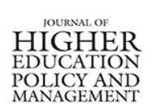

<!-- A1.R31 | source: papers_json/A1.R31/ -->

## **Journal of Higher Education Policy and Management**

**ISSN: 1360-080X (Print) 1469-9508 (Online) Journal homepage: ****[www.tandfonline.com/journals/cjhe20](https://www.tandfonline.com/journals/cjhe20?src=pdf)**

## **أنماط توظيف القيادات الأكاديمية في** **الجامعات الأسترالية وآثارها على** **مستقبل التعليم العالي**

**Susan Loomes, Alison Owens & Grace McCarthy**

**To cite this article:** Susan Loomes, Alison Owens & Grace McCarthy (2019) Patterns of recruitment of academic leaders to Australian universities and implications for the future of higher education, Journal of Higher Education Policy and Management, 41:2, 137-152, DOI: [10.1080/1360080X.2019.1565296](https://www.tandfonline.com/action/showCitFormats?doi=10.1080/1360080X.2019.1565296)

**To link to this article: **[https://doi.org/10.1080/1360080X.2019.1565296](https://doi.org/10.1080/1360080X.2019.1565296)

Published online:17 Jan 2019.Submit your article to this journalArticle views:1369View related articlesView Crossmark dataCiting articles:9 View citing articles

<!-- page 2 -->

## أنماط توظيف القيادات الأكاديمية في الجامعات الأسترالية وآثارها على مستقبل التعليم العالي

Susan Loomesa, Alison Owensb and Grace McCarthyc

aBusiness Operations, Notre Dame University, Sydney Campus, Chippendale, NSW, Australia; bSchool of Education and Arts, Central Queensland University, Norman Gardens, QLD, Australia; 'Sydney Business School, University of Wollongong, Sydney and Wollongong, Australia

## **الملخص**

تعرض هذه الورقة نتائج بحث أُجري لفهم العوامل الرئيسية المؤثرة في توظيف واختيار القيادات الأكاديمية العليا في الجامعات الأسترالية. وقد كشف هذا البحث عن اعتماد متزايد على شركات البحث التنفيذي عند توظيف القيادات الأكاديمية العليا. ويعود هذا الاعتماد إلى مجموعة من العوامل، منها تقلّص وتقدّم سن مجموعة القيادات الأكاديمية المحتملة، وتزايد المنافسة محلياً ودولياً، وتراجع جاذبية الأكاديميا كمسار مهني مستدام في ظل تزايد العمل غير الدائم بين الأكاديميين. وفي الوقت نفسه، لم يكن التخطيط للقوى العاملة والتخطيط للإحلال الوظيفي أولوية عالية لدى كثير من الجامعات. ونتيجة لذلك، تجد الجامعات الأسترالية صعوبة متزايدة في توظيف قيادات أكاديمية عليا دون الاستعانة بشركات البحث التنفيذي. وتحمل هذه النتائج آثاراً مهمة على قطاع التعليم العالي في أستراليا وتستحق مزيداً من البحث.

## **KEYWORDS **

recruitment; selection; universities; executive search; workforce planning

## المقدمة

تقدم هذه الورقة رؤى مستمدة من بحث أُجري حول الطبيعة المتغيرة لتوظيف واختيار القيادات الأكاديمية العليا في الجامعات الأسترالية، مع التركيز على تنامي اعتماد وتأثير شركات البحث التنفيذي في التعليم العالي. وتقدم الورقة أولاً ملخصاً للعوامل المؤثرة في عملية توظيف واختيار الجامعات، مثل تزايد المنافسة على الموظفين الأكاديميين، وتقدّم سن القوى العاملة الأكاديمية، وتراجع جاذبية الأكاديميا، وغياب التخطيط للإحلال الوظيفي لدى الجامعات الأسترالية. ثانياً، وفي هذا السياق، تعرض هذه الورقة بشيء من التفصيل نتائج بحثية تتعلق بتنامي الاعتماد على شركات البحث التنفيذي في توظيف واختيار القيادات الأكاديمية العليا في الجامعات الأسترالية، وتناقش الآثار المحتملة لذلك.

<!-- page 3 -->

## **الخلفية**

## المشهد المتغير للجامعات الأسترالية

تعمل الجامعات الأسترالية في بيئة ديناميكية ومتغيرة باستمرار. وهي تواجه مجموعة من التحديات من منظورين، الكلي والداخلي (Kent, 2006; Middlehurst, Goreman, & Woodfield, 2009). وتضع هذه التحديات الجامعات في موقع عالي المخاطر لم تعتد عليه تقليدياً (Fullan & Scott, 2009). وقد تعرضت الجامعات لضغوط كبيرة بسبب تراجع التمويل الحكومي كنسبة من الدخل، واضطرت إلى أن تصبح أكثر شبهاً بالشركات التجارية (Brown & Moshavi, 2002; Harman, 2003; Kent, 2006; Middlehurst et al., 2009; Wolverton & Poch, 2000; Yielder & Codling, 2004). ونتيجة لذلك، تحتاج الجامعات إلى جذب دخل إضافي، والتحكم في التكاليف، ومواجهة المنافسة المتزايدة على الطلاب. ولمعالجة هذا العجز في الدخل، لجأت جامعات كثيرة إلى توظيف أعداد كبيرة من الطلاب الدوليين. وهذا لا يمثل قلقاً على المدى القصير؛ غير أن سوق الطلاب الدوليين قد يكون متقلباً وقد لا يكون مستداماً على المدى الطويل.

من منظور بيئي كلي، كان أحد أبرز التحديات للتعليم العالي في أستراليا هو التغيير المستمر في السياسات من قبل الحكومة الأسترالية. ويقدم الجدول التالي ملخصاً لبعض أبرز السياسات التي أثرت على الجامعات خلال السنوات الثلاثين الماضية. وقد جعلت هذه التغييرات المستمرة في السياسة الحكومية، كما يوضح الجدول 1، إدارة الجامعات أكثر تعقيداً وصعوبة. وتُعد القدرة على توظيف قيادات أكاديمية عليا ذات كفاءة عالية لإدارة هذه البيئة المتغيرة باستمرار أمراً حاسماً لنجاح القطاع واستدامته.

وفي تقرير حديث لشركة Ernst & Young، ورد ما يلي:

يدرك قادة الجامعات الذين أجرينا معهم مقابلات أنهم بحاجة للتحرك بسرعة لإعداد مؤسساتهم للمنافسة في عالم مختلف تماماً عن اليوم. كما أنهم يعملون ضمن سياق تمويلي وسياسي يجعل من هذه التغييرات أمراً صعباً، مما يعني أن أي حلول ستتطلب تعاوناً بين الحكومة والجامعات لمعالجتها. (2018, p. 4)

وفي عام 2017، لاحظت هيئة Universities Australia أن وجود بيئة سياسات وتمويل أكثر استقراراً أمر حيوي لضمان مستقبل أستراليا (Knott, 2017).

## **سؤال البحث**

تعرض هذه الورقة نتائج بحث أوسع أُجري لفهم أفضل لتوظيف واختيار القيادات الأكاديمية العليا في الجامعات الأسترالية بشكل عام، من خلال أسئلة البحث التالية:

- (1) ما العوامل التي تؤثر في توظيف واختيار القيادات الأكاديمية العليا؟
- (2) كيف توظف الجامعات الأسترالية وتختار قياداتها الأكاديمية
- (3) ما الدور الذي تؤديه شركات البحث التنفيذي في توظيف واختيار القيادات الأكاديمية العليا؟
- (4) ما الذي تبحث عنه الجامعات الأسترالية عند توظيف القيادات الأكاديمية العليا؟

<!-- page 4 -->

| Table 1. Some of the policy changes that have impacted higher education provi | viders in Australia. |
| --- | --- |

| Year | Policy | Reviews/changes |
| --- | --- | --- |
| 1989 | Higher Education Contribution Scheme was introduced | Shifted a significant proportion of the cost of higher education from the Commonwealth to students. Under the original HECS, a $1800 fee was charged to all university students, and the Commonwealth paid the balance. A student could defer payment of this HECS amount (in which case it was called a HECS debt) and repay the debt through the tax system, when the student's income exceeds a threshold level. |
| 1997 | West Committee Review of Higher Education Financing and Policy | West Review, Chaired by Roderick West recommended three main changes. Funding to be student centred, research to be a priority and to invest in IT and the infrastructure required to support it (West, 1998). |
| 2008 | Bradley Review | Reported on the future direction of the higher education sector making recommendations for reform and continuous improvement such as the demand-driven funding model. The review found Australia was falling behind other countries in performance and investment in higher education (Bradley, Noonan, Nugent, & Scales, 2008). |
| 2010 | The Knight Review was commissioned by Department of Immigration and Department of Education (DEEWR) | Knight Report recommends a number of incremental changes to improve the performance of the student visa system (Creagh, 2011; Department of Education and Training, 2011). |
| 2011 | Tertiary Education Quality and Standards Agency (TEQSA) was formed. | Established as a result of the Bradley Review. Regulates and assures the quality of higher education in Australia (Mazzolini, 2012). |
| 2011 | TEQSA introduced the Higher Education Standards Framework (Threshold Standards) 2011 | Higher education providers in Australia are to comply with the Commonwealth Government's Threshold Standards, which form part of the Higher Education Standards Framework (Department of Education and Training, 2011). |
| 2012 | Student Visa Program | Aimed to simplify the visa application process for international students requiring reduced evidential requirements when applying for a student visa (Department of Immigration and Citizenship, 2012). |
| 2016 | Simplified Student Visa Framework | Aimed to reduce red-tape and create a level playing field for all education providers (Australian Government, 2015a, Australian Government, 2016c). |
| 2016 | Excellence in Research for Australia (ERA) | Australian Government declared a shift in the focus of ERA from general scholarly activity (measured by publications) to research that drives innovation and foster collaboration between universities and businesses (Australian Government, 2016b). |
| 2017 | Revised Higher Education Standards Framework (Threshold Standards) 2015 | Standards were restructured to align with the student experience or 'student life cycle' (Australian Government, 2017d). New Standards were introduced. |
| 2017 | End of the demand driven funding system | Australian Government put a 2-year freeze on universities funding for, 2018 and 2019 affecting Commonwealth Supported Places funding (Norton, 2017). |

تعرض هذه الورقة وتناقش النتائج المرتبطة بشكل مباشر بسؤال البحث الثالث، الذي يركز على دور شركات البحث التنفيذي في توظيف واختيار القيادات الأكاديمية العليا في الجامعات الأسترالية. غير أن معلومات ذات صلة بهذا الموضوع استُمدت أيضاً من السؤالين الأول والثاني. ويعود ذلك إلى أن تأثير شركات البحث التنفيذي في توظيف القيادات الأكاديمية العليا كان نتيجة غير متوقعة ومهمة.

<!-- page 5 -->

## **معايير البحث**

استُمد المشاركون في البحث من 39 جامعة أسترالية (أصبح عددها الآن 41) وثلاث شركات بحث تنفيذي. ولتكوين فهم أفضل لهوية القيادات الأكاديمية العليا في الجامعات الأسترالية، أجرى الباحث تحليلاً لهياكل القيادة العليا فيها من خلال المواقع الإلكترونية للجامعات. وتضمن ذلك مراجعة الهياكل التنظيمية والهياكل التنفيذية الجامعية، والتعمق في صفحات الكليات. وكشفت النتائج أن منصب نائب المستشار (Vice Chancellor) كان ثابتاً في جميع الجامعات، في حين لم يكن لدى أربع جامعات منصب نائب المستشار المساعد (يُشار إليه أحياناً بـ Provost). ونحو 30 بالمائة من الجامعات لم يكن لديها منصب نائب المستشار المساعد (Pro-Vice-Chancellor). ويُعد منصب العميد التنفيذي اتجاهاً ناشئاً ظهر في ثلث الجامعات، ويدعمه عميد أو عميد مساعد أو نائب عميد. وتمتلك جميع الجامعات منصب عميد الكلية أو ما يعادله، وهناك اعتراف واسع بأهمية هذا الدور: 'الخط الفاصل بين المديرين والموظفين الأكاديميين يقع في مكان ما بين عميد الكلية والموظف الفرد،' (Marginson & Considine, 2000, p. 4).

وبعد مراجعة الهياكل الجامعية، اتُخذ قرار بالتركيز على توظيف واختيار نواب المستشار المساعدين، ونواب المستشار، والعمداء التنفيذيين، والعمداء (أو ما يعادلهم)، نظراً للدور المهم الذي يؤدونه ضمن هيكل القيادة الأكاديمية العليا للجامعة. إضافة إلى ذلك، أُدرج منصب رئيس القسم في البحث، لأن دوره محوري في تنفيذ استراتيجية الجامعة. وفي حين يؤدي نواب المستشار دوراً مهماً بوضوح داخل الجامعة، لم يدرجهم الباحث في هذا البحث لأن طريقة توظيفهم واختيارهم تختلف عن غيرهم من القيادات العليا.

اختير موظفون أقدم يشغلون مناصب قيادية في إدارات الموارد البشرية بالجامعات لإجراء المقابلات معهم، نظراً لمشاركتهم الكبيرة في توظيف واختيار القيادات الأكاديمية العليا ومسؤوليتهم عن ذلك، سواء تم داخلياً أو عبر شركات البحث التنفيذي. وهم يرون عملية التوظيف والاختيار من منظور شامل على مستوى الجامعة، وكذلك على أساس كل حالة على حدة. علاوة على ذلك، افتُرض أنهم، بحكم خبرتهم في منصب موارد بشرية أقدم، يمتلكون معرفة واسعة وإلماماً بعمليات التوظيف والاختيار.

ومع بروز الدور المحوري لشركات البحث التنفيذي في عملية الاختيار والتوظيف خلال هذه المقابلات، أُجريت مقابلات إضافية مع ثلاث شركات بحث تنفيذي متخصصة في توظيف قيادات التعليم العالي، وأُجريت مراجعة أدبيات شاملة.

## المنهجية

اعتُمد نهج نوعي في هذا البحث لأن الباحث سعى إلى الحصول على وصف عميق وغني لعمليات توظيف واختيار الموظفين الأكاديميين العليا في الجامعات الأسترالية. واستُخدمت أساليب تفسيرية في جمع البيانات وتحليلها بافتراض أن الحقيقة يمكن التوصل إليها من خلال التواصل مع الأفراد وتبادل الخبرات ضمن عالمنا المعاش، والتي تُصاغ عبر النقاش والحوار المستمرين (Angen, 2000). واعتُمد نهج دراسة حالة متعددة، مما أتاح استكشافاً عميقاً لعملية توظيف واختيار القيادات الأكاديمية العليا في 10 جامعات أسترالية

<!-- page 6 -->

من خلال عملية أخذ عينة قصدية، دُعي المشاركون في البحث المسؤولون عن تقديم وإدارة الموارد البشرية في كل من الجامعات الأسترالية الـ39 للمشاركة في البحث. ونتيجة لذلك، حضر 10 مديري موارد بشرية جامعية مقابلات فردية وجهاً لوجه مع الباحث. واستُمد هؤلاء المشاركون من خمس فئات من الجامعات الأسترالية: مجموعة الثمانية (Group of Eight)، وشبكة الجامعات الإقليمية، والشبكة الأسترالية للتكنولوجيا الجامعية، والجامعات البحثية المبتكرة، والجامعات 'غير المنتسبة' التي لا تندرج ضمن هذه التصنيفات الرسمية. وأتاح هذا التوزيع للمشاركين عبر فئات الجامعات منظوراً شاملاً وواسعاً حول قطاع الجامعات الأسترالية. وسعت أسئلة المقابلة إلى استخلاص آراء وخبرات هؤلاء الموظفين الجامعيين في سعيهم لتوظيف موظفين أكاديميين عليا في مناصب قيادية.

وكما سبقت الإشارة، كانت إحدى النتائج البارزة التي ظهرت مبكراً في عملية المقابلات هي درجة اعتماد الجامعات على شركات البحث التنفيذي لتوظيف كبار الموظفين. ونتيجة لذلك، أُجريت مقابلات أيضاً مع مديري ثلاث شركات بحث تنفيذي لاستخلاص رؤاهم حول دورهم في توظيف واختيار القيادات الأكاديمية العليا. وسُجلت جميع المقابلات مع موظفي الجامعات وشركات البحث التنفيذي ونُسخت لتحليلها باستخدام برنامج NViVO. وتعرض هذه الورقة وتحلل بيانات تتعلق بدور شركات البحث التنفيذي في توظيف واختيار القيادات الأكاديمية العليا في الجامعات الأسترالية

وأتيحت فرصة لجمع بيانات إضافية في مؤتمر تخطيط وسياسة القوى العاملة في التعليم العالي لعام 2012، الذي حضره مديرو موارد بشرية جامعية أقدم. وبصفته أحد المتحدثين في المؤتمر، طلب المؤلف من الحضور تقديم ردود مكتوبة على النتائج الأولية للبحث المستمد من المقابلات. وأُخذت هذه الردود بعين الاعتبار عند تفسير نتائج المقابلات.

## المناقشة

## العوامل المؤثرة في توظيف القيادات الأكاديمية العليا في الجامعات الأسترالية

حدد البحث أربعة عوامل رئيسية تؤثر في توظيف واختيار القيادات الأكاديمية العليا في الجامعات الأسترالية: (1) تزايد المنافسة، (2) تقدّم سن القوى العاملة الأكاديمية، (3) تراجع جاذبية الأكاديميا كمهنة، و(4) غياب التخطيط للإحلال الوظيفي. ويناقش القسم التالي هذه العوامل وكيفية تأثيرها في توظيف واختيار القيادات الأكاديمية العليا.

## **تزايد المنافسة**

بسبب طريقة تمويل الجامعات حالياً وأثر العولمة، أصبحت الجامعات اليوم في منافسة مباشرة على الترتيب والطلاب والموظفين الأكاديميين (Ernst & Young, 2018; Fullan & Scott, 2009; Scott, Coates, & Anderson, 2008). ويشمل المنافسون جامعات أخرى من داخل أستراليا، ومن الخارج، إضافة إلى شركات خاصة مثل Navitas وLaureate International Universities، ومؤسسات التعليم المهني مثل Technical and Further Education، وكذلك جمعيات

<!-- page 7 -->

مهنية مثل Chartered Professional Accountants وAustralian Computer Society.

أبرز كل من Scott وCoates وAnderson، في تقرير Australian Learning and Teaching Council (2008) بعنوان Learning Leaders in Times of Change Academic Leadership Capabilities for Australian Higher Education، الضغوط المتزايدة على الجامعات، وبخاصة تزايد المنافسة على الموظفين والطلاب من داخل أستراليا ومن الخارج (Scott et al., 2008).

وستستمر الجامعات الأسترالية في مواجهة منافسة شديدة على الطلاب الدوليين من الدول المنافسة التقليدية. وتذكر هيئة Universities Australia:

يواجه التعليم الدولي ضغوطاً متزايدة من منافسين تقليديين مثل المملكة المتحدة والولايات المتحدة، ولكن الأهم من ذلك من دول ناشئة مثل الصين وسنغافورة وماليزيا، التي تسعى إلى تكرار النجاح الباهر الذي حققته أستراليا في التعليم الدولي. (Universities Australia, 2012, p. 16)

كما يشير تقرير أعدته شركة Deloittes لصالح هيئة Austrade إلى أن أستراليا ستواجه منافسة أقوى على الطلاب الدوليين مع تحسّن جودة وطاقة الأنظمة التعليمية المحلية في أسواق مثل الصين (Deloittes Access Economics, 2015).

وأفادت شركة Ernst & Young بأنه إلى جانب المنافسين التقليديين، هناك أيضاً تهديد التعطيل التقني للنماذج الجامعية التقليدية. ويذكر التقرير:

في الولايات المتحدة، تُغلق المراكز التجارية والمتاجر الكبرى بمعدل 1 من كل 5 مع تحوّل المستهلكين نحو التسوق عبر الإنترنت، وقد بدأ هذا الاتجاه يظهر في أستراليا أيضاً. وتؤثر التقنية في التعليم بطريقة مماثلة، مع تحوّل التعلّم نحو الإنترنت. وتحتاج الجامعات إلى إعادة النظر في دور الحرم الجامعي في مستقبل تهيمن فيه نماذج التعلّم الرقمي، ويقل فيه أهمية المكان والزمان. (Ernst & Young, 2018, p. 21)

كما تتزايد المنافسة من الجامعات الآسيوية الصاعدة، إلى جانب الجامعات الدولية ذات العلامة المعروفة التي تستقطب الطلاب المحليين بعروض دراسية رقمية (Ernst & Young, 2018).

وأكد المشاركون في هذه الدراسة رأي Ng (2013)، الذي يشير إلى نشوء حرب مواهب عالمية بين اقتصادات كثيرة مع تقلّص مجموعة المواهب الأكاديمية وازدياد حراكها العالمي. وتكتسب دول مثل تلك الموجودة في آسيا والشرق الأوسط زخماً في هذا المجال وتصبح منافسة شرسة على المواهب. وفي حين ينبع بحث Ng من سنغافورة، فمن المثير للاهتمام أن نتائجه تتسق مع ما وردت في السياق الأسترالي. وتماشياً مع Stone (2011)، ذكر المشاركون أنه مع تقلّص مجموعة المواهب الأكاديمية، تتزايد الحاجة إلى التوجه دولياً للحصول على مواهب ذات جودة، وأكدوا تحولاً نحو التعيينات العالمية باستخدام استراتيجيات استقطاب دولية. وقال أحد المشاركين من الجامعات، 'كان استقطاب مرشح من الخارج أمراً 'غريباً' نوعاً ما في السابق؛ أما الآن فأصبح ممارسة معتادة'. وقال آخر،

إذا انخفضت قيمة الدولار الأسترالي أيضاً، فسنفقد قدرتنا على المنافسة من حيث الراتب. تعلمون، هذه هي أنواع المخاطر التي قد نواجهها مستقبلاً. الآن، الوضع مثالي إلى حد ما بالنسبة لنا، لأن الأمور ليست وردية هناك في الوقت الحالي، لذا تبدو أستراليا جذابة جداً، لكن هذا يمكن أن يتغير بالسرعة نفسها.

ومع مواجهة القطاع منافسة متزايدة من المنافسين العالميين والتعطيل الرقمي، سيحتاج إلى الاستعداد لهذه الوتيرة غير المسبوقة من التغيير (Deloittes Access Economics, 2015).

<!-- page 8 -->

## تقدّم سن القوى العاملة الأكاديمية

تحتاج الجامعات الأسترالية إلى التعامل مع تقدّم سن السكان وما يترتب عليه من تقدّم سن القوى العاملة الأكاديمية (Bexley, Arkoudis, & James, 2012; Group of Eight, 2012; Hugo & Morriss, 2010; Larkin & Neumann, 2012; Noonan & Pilcher, 2018). وقد دأب Graeme Hugo، من المركز الوطني لتطبيقات نظم المعلومات الجغرافية الاجتماعية، على تقديم تقارير حول الآثار المهمة لتقدّم سن القوى العاملة الأكاديمية منذ عام 2004. وذكر بشكل مثير للقلق أن الجامعات ستتأثر بشدة بتراجع القوى العاملة الأكاديمية، مشيراً إلى أن 'ما بين خُمس وثلث موظفيها سيتقاعدون خلال العقد المقبل' (Hugo, 2005, p. 20)، وأن بعض الجامعات قد تفقد نصف قياداتها خلال السنوات الخمس المقبلة (Hugo & Morriss, 2010).

ومنذ ذلك الحين، أشار تقرير لشركة Ernst & Young عام 2012 إلى أن القوى العاملة الأكاديمية تتقدّم في السن أكثر من بقية القوى العاملة، مشيراً إلى أن 'ربع القوى العاملة الأكاديمية في أستراليا يبلغ عمرها 55 عاماً فأكثر، مقارنة بـ15 بالمائة لبقية القوى العاملة في أستراليا' (Ernst & Young, 2012, p. 24). وفي عام 2017، لم يطرأ تغيير يُذكر، إذ بلغت نسبة القوى العاملة الأكاديمية فوق سن 55 نحو 23 بالمائة. وبالتعمق أكثر في البيانات، يتضح أن 42 بالمائة من الموظفين الأكاديميين في رتبة محاضر أول فما فوق (بدوام كامل أو جزئي) تجاوزوا سن 55 (Australian Government, 2017). وفي حين تثير هذه البيانات القلق، يشير معهد LH Martin إلى أن هذا الأثر قد يكون أكثر تدرجاً مما كان متوقعاً في البداية، بسبب انتقال الأفراد تدريجياً نحو التقاعد (Group of Eight, 2014).

ومع انسحاب جيل ازدهار المواليد من القوى العاملة الأكاديمية، قد تواجه الجامعات الأسترالية حاجة متزايدة للتوظيف من الخارج (Archer, 2005; Bexley et al., 2012; Fullan & Scott, 2009; Kent, 2006; McCarthy & Loomes, 2011). وفي سياق الحرب العالمية المتصاعدة على المواهب، يحذر Fullan وScott (2009) من أن 'استراتيجية السبعينيات المتمثلة في سد الفجوة عن طريق توظيف أكاديميين من الخارج لن تنجح'. وبالفعل، وُلد 40 بالمائة من القوى العاملة الأكاديمية لدينا في الخارج مقارنة بـ25.7 بالمائة من القوى العاملة الأسترالية عموماً (Universities Australia, 2016).

وفي حين تشير الأدبيات إلى أن تقدّم سن القوى العاملة الأكاديمية يمكن أن يؤثر بشكل كبير في القوى العاملة الأكاديمية بالجامعة، يبدو، بشكل مفاجئ، أن الجامعات لا تُسلّح نفسها باستراتيجيات لمعالجة نقص الإمداد الوشيك. وحدد اثنان من المشاركين الجامعيين تقدّم سن القوى العاملة بوصفه مصدر قلق رئيسي، بتعليقات مثل، 'أعتقد أن تقدّم سن القوى العاملة يجعل المجموعة أكثر تحدياً بالنسبة للجميع'. غير أن غالبية المشاركين من الجامعات وشركات البحث التنفيذي رأوا أن تقدّم سن القوى العاملة الأكاديمية مسألة لا تمثل مشكلة الآن بقدر ما ستمثله مستقبلاً.

ومن أسباب عدم ظهور هذه المسألة كمشكلة الآن أنه لا يزال بالإمكان استقطاب أكاديميين ذوي جودة عالية من الخارج. ويعود ذلك جزئياً إلى كون أستراليا وجهة جذابة للقيادات الأكاديمية العليا، خاصة من الدول التي واجهت ظروفاً اقتصادية سيئة منذ الأزمة المالية العالمية (Cox, 2010). وأقر المشاركون بأن هذه الظروف يمكن أن تتغير بسرعة: فتغيّر قيمة الدولار الأسترالي أو تحسّن الأوضاع الاقتصادية في دول أخرى قد يترك الجامعات الأسترالية فجأة في موقف ضعيف أمام التنافس على المواهب عالية الجودة. من ناحية أخرى، قد يؤدي قرار بريطانيا بمغادرة الاتحاد الأوروبي والمشهد السياسي الحالي في الولايات المتحدة إلى تدفق أكاديميين من هذه الدول إلى أستراليا.

<!-- page 9 -->

وفي جانب إيجابي، لا يبدو أن الجامعات في هذه الدراسة تحمل أي تحيزات تجاه توظيف الأكاديميين الأكبر سناً. وذكر أحد المشاركين من شركات البحث التنفيذي أن إقناع لجنة بالنظر في مرشح أصغر سناً لمناصب عليا قد يكون أحياناً أكثر صعوبة. غير أن ما أكد جميع المشاركين على أهميته هو 'لياقة المرشح للوظيفة'، أي ما إذا كان قد حافظ على حيويته وطاقته ومستوى نشاطه، وبقي مرناً فكرياً.

## تراجع جاذبية الأكاديميا

في حين كانت الوظيفة الجامعية تاريخياً وظيفة مدى الحياة، لاحظ جميع المشاركين في هذه الدراسة تراجع جاذبية الأكاديميا بسبب تقلّص المناصب الدائمة. ويتسق هذا مع Coates وزملائه الباحثين (Coates et al., [2009;](#page-14-13) Coates & Goedegebuure, [2012](#page-14-14); Coates, Goedegebuure, Van Der Lee, & Meek, [2008](#page-14-15))، الذين حذروا من أن الجامعات بحاجة إلى ضمان بقاء المهنة الأكاديمية جذابة. وأدلى المشاركون بتعليقات مثل

أعتقد أن مهنة الأكاديميا لديها الكثير من دواعي القلق، وكثير من الموظفين لا يُمنحون مناصب دائمة. (جامعة)

بشكل عام … أحد التحديات الرئيسية حالياً هو أن معظم الجامعات في أستراليا تسعى للتخلي عن مفهوم المنصب الدائم. (شركة بحث تنفيذي)

وفي حين ذكر تقرير Grattan (Norton, [2013)](#page-15-14) أن معظم الموظفين الأكاديميين ليس لديهم توظيف دائم، فإنه لم يتناول تحديداً مدة عقود تعيين القيادات الأكاديمية العليا. وذكر المشاركون في هذه الدراسة أن التعيينات الأكاديمية العليا في معظم الحالات هي عقود قصيرة المدى (3-5 سنوات)، ما يوفر أماناً وظيفياً محدوداً.

وأفاد المشاركون في هذا البحث بأن جامعتهم تواجه بالفعل مشكلة متزايدة في توظيف أكاديميين عليا في تخصصات محددة مثل المحاسبة والقانون والهندسة والتسويق والمجالات الطبية، أي التخصصات المرتبطة بمهن ذات أجور وأمان وظيفي أعلى مما توفره الجامعات. ووردت نتائج مماثلة في ورقة نشرتها Universities UK ([2007](#page-16-7)) قبل عقد من الزمن.

## غياب التخطيط للإحلال الوظيفي

من أبرز القضايا التي أثارها جميع المشاركين غياب التخطيط للإحلال الوظيفي وغياب 'مسارات' راسخة في الجامعات الأسترالية، وهو ما يتسق مع بحث Larkin وNeumann ([2012](#page-15-9)). وعلى الرغم من استثمار الجامعات مبالغ كبيرة من المال في التوظيف، فإنها لا تستثمر جميعها في تطوير قياداتها من الداخل.

وقال أحد المشاركين من الجامعات، 'تتحدث الجامعات عن تخطيط القوى العاملة والتخطيط للإحلال الوظيفي، لكنني لم أرَ بعد جامعة تسيطر على هذا الأمر.'

وذكر مشاركون آخرون،

أعتقد أن الجامعات تخشى الحديث عن التخطيط للإحلال الوظيفي بسبب المخاوف المتعلقة بالجدارة. وهذا فرصة ضائعة كبرى ومجال خطر. (شركة بحث تنفيذي) أقول إن التخطيط للإحلال الوظيفي مهم، لكنني لم أفعل شيئاً بنفسي حيال ذلك، ولم نفعل شيئاً كجامعة حيال ذلك أيضاً. لا أعتقد أن هذا أمر جديد، ولكن عندما تواجه نقصاً محتملاً في المهارات، ينبغي أن تنظر إلى مجموعة

<!-- page 10 -->

واسعة من الاستراتيجيات المختلفة، من بينها بناء المسار الوظيفي من القاعدة. وليس فقط الذهاب على المستوى الدولي والقول، "سنحصل عليهم من مكان ما". يجب أن تكون هناك مجموعة من الاستراتيجيات المختلفة وبناء ذلك المسار. (جامعة)

يبرز Rothwell (2010) أهمية تحديد المواهب من الداخل وتنميتها وترقيتها، وامتلاك مسارات راسخة للمواهب الصاعدة، لضمان تحقيق المؤسسة أهدافها الاستراتيجية. ولا يبدو أن التخطيط للإحلال الوظيفي يمثل أولوية عالية لدى الجامعات الأسترالية (Larkin & Neumann, 2012). ولم تُبلّغ أي جامعة مشاركة في هذه الدراسة عن وجود مسارات راسخة للقيادات المحتملة. ويعود ذلك إلى رغبة الجامعات في تعيين أفضل الأكاديميين والباحثين، وهو ما يعني، في رأي كثير من المشاركين، تعييناً دولياً. ويعود ذلك أساساً إلى رغبة الجامعات في رفع مكانتها البحثية. وتتسق هذه النتائج مع رأي Scott et al. (2008)، الذين يرون أن الجامعات الأسترالية تفعل القليل لمواجهة تحديات التوظيف المرتقبة، وأنها لا تمتلك استراتيجيات إحلال وظيفي منظمة.

وللتخطيط للإحلال الوظيفي فوائد واضحة، منها عدم الحاجة إلى المنافسة محلياً أو عالمياً على المواهب. ومن الفوائد الأخرى خفض التكاليف (عدم الحاجة إلى البحث التنفيذي لاستقطاب المواهب)، والقدرة على الاحتفاظ بمعرفة الجامعة وولاء موظفيها وثقافتها الراسخة (Larkin & Neumann, 2012; McMurray et al., 2012).

ومن الأسباب المحتملة لإهمال التخطيط للإحلال الوظيفي في الجامعات الأسترالية الميل إلى تعيين القيادات العليا بعقود قصيرة المدى نسبياً، مع تركيز أقل على المبادرات الاستراتيجية طويلة المدى، مثل تخطيط القوى العاملة. كما يبدو أن إدارات الموارد البشرية مثقلة بحدود قدراتها المالية والبشرية، وقد لا تمتلك الموظفين المناسبين لتنفيذ التخطيط للإحلال الوظيفي على مستوى الجامعة.

## تزايد استخدام شركات البحث التنفيذي

نتيجة لتزايد المنافسة، وتقدّم سن القوى العاملة الأكاديمية، وتراجع جاذبية الأكاديميا، وغياب التخطيط للإحلال الوظيفي، تتزايد الحاجة إلى استخدام شركات البحث التنفيذي لاستقطاب قيادات أكاديمية عليا ذات جودة.

البحث التنفيذي، الذي يُطلق عليه أحياناً 'الصيد الوظيفي'، هو العملية التي تدفع فيها المؤسسة مقابلاً لوكالة توظيف للمساعدة في عملية التوظيف (Compton, Morrissey, & Nankervis, 2009; Nankervis, Compton, Baird, & Coffeey, 2011; Stone, 2011; Tienari, Meriläinen, Holgersson, & Bendle, 2013).

تاريخياً، كانت إدارات الموارد البشرية بالجامعات تتولى إدارة توظيف واختيار القيادات الأكاديمية العليا. ويكشف هذا البحث عن تحول نحو التعاقد مع شركات البحث التنفيذي لاستقطاب قيادات أكاديمية ذات جودة. ويتسق هذا مع أبحاث حول البحث التنفيذي في قطاعات أخرى، حيث يميل سوق العمل، مع تشدده، إلى استخدام البحث التنفيذي للتعيينات العليا (Fernández-Mateo & Fernández, 2016; McGraw, 2011; Shulman & Chiang, 2007; Tienari et al., 2013).

والبحث التنفيذي ليس رخيصاً. ويشير Stone (2011) إلى أن تكلفة البحث التنفيذي في أستراليا تبلغ عادة ما بين 25 و40 بالمائة من إجمالي الأجر (للسنة الأولى)، وتُدفع على ثلاث دفعات؛ وتُدفع الرسوم سواء تم توظيف مرشح أم لا، وتُحتسب المصاريف بشكل منفصل. وفي المملكة المتحدة، تعادل رسوم البحث التنفيذي عادة ثلث راتب السنة الأولى. وعادة، يُدفع 50 بالمائة

<!-- page 11 -->

مقدماً، ويُدفع الـ50 بالمائة الأخرى عند إتمام التعيين (Faulconbridge, Beaverstock, Hall, & Hewitson, 2009).

وكشفت هذه الدراسة عن ضعف تأثير الإعلانات الجامعية عند توظيف القيادات الأكاديمية العليا، وبالتالي عن حاجة متصورة لاستخدام شركات البحث التنفيذي. وكان موضوعاً متكرراً في المقابلات أن نحو 10 بالمائة فقط من المرشحين يأتون عبر الإعلانات.

وذكر أحد مديري شركات البحث التنفيذي.

بعد أن عملت مديراً للموارد البشرية لفترة طويلة، عندما بدأت أدخل مجال البحث التنفيذي، صُدمت. صُدمت لأن إعلانات الوظائف ببساطة لم تكن فعالة. في حين أنه خلال الفترة التي كنت فيها مديراً للموارد البشرية، كنت عادة تحصل على مجموعة جيدة نوعاً ما، لكن ليس دائماً، وكنت ببساطة تعيد الإعلان. فعندما رأيت قلة الاهتمام وقلة الاستجابة للإعلانات، أدركت أن أمراً جوهرياً قد تغيّر. (شركة بحث تنفيذي)

وعند الإجابة عن سؤال البحث الثاني (ص. 3)، حدد غالبية المشاركين في هذه الدراسة أن جامعتهم تستخدم شركات البحث التنفيذي لتوظيف قياداتها الأكاديمية العليا (الجدول 2).

كما اتضح من المقابلات أنه في حين كانت الجامعات تدرك أنها تستقطب عدداً قليلاً جداً من المرشحين ذوي الجودة عبر الإعلانات، فإنها كانت تدرك أيضاً أن الإعلانات تُظهر شفافية في عملية التوظيف وتوفر وعياً بالعلامة الجامعية.

وذكر عدة مشاركين أيضاً أن أحد أسباب صعوبة استقطاب مرشحين ذوي جودة عبر الإعلانات هو انشغال الناس عن الاستجابة للإعلانات. فهم ينوون ذلك لكنهم لا يفعلونه:

أحد الأمور التي تغيّرت هو أن الناس مشغولون جداً، وما لم يقولوا فعلياً، 'حان وقت الانتقال'، فإنهم لا يهتمون. حتى لو نظروا إلى وظيفة وقالوا إنها جيدة، لكنهم مشغولون جداً ولا يستطيعون إيجاد وقت لها. لكن عندما تأتيهم مكالمة تقول "هل فكرت في هذا؟" فذلك يكون الدافع الصغير الذي يحركهم. (شركة بحث تنفيذي)

ونتيجة لتقلّص مجموعة المواهب الأكاديمية، تُستخدم شركات البحث التنفيذي للوصول إلى ما يُسمى 'المواهب السلبية'، أي المرشحين الذين لا يبحثون فعلياً عن عمل أو يسعون لتغيير أصحاب العمل. وهناك تصور لدى الجامعات وشركات البحث التنفيذي بأن المواهب السلبية تُنتج مرشحين أفضل جودة.

| Table 2 | Use of | executive | search | firms | bv | universities. |
| --- | --- | --- | --- | --- | --- | --- |

| Use of executive search |  |
| --- | --- |
| Case study | Comment |
| One | Every senior appointment is outsourced to executive search |
| Two | Mostly executive search depending on how difficult they feel it would be to source a suitable pool of candidates |
| Three | Always use an executive search firm |
| Four | Vice chancellor or deputy vice chancellor would make the decision whether to use executive search firms. In most cases executive search is used |
| Five | Executive search is used for all senior appointments, this is a directive from the vice chancellor |
| Six | Never use executive search |
| Seven | Executive search is used in nearly every instance |
| Eight | Executive search used in most cases depending on the budget |
| Nine | Always use executive search firms |
| Ten | Internal expression of interest; if not success, then executive search used. |

<!-- page 12 -->

تسعى شركة البحث التنفيذي إلى إقناع الأفراد بالانتقال إلى مؤسسة أخرى بإقناع لطيف، غالباً حول فوائد الانتقال، مثل التقدم الوظيفي وزيادة الأجر. ويشير Fernández-Mateo وFernández (2016) إلى أن شركات البحث التنفيذي تُعد قائمة بالمرشحين المحتملين لدور معين، وقد لا يعرف المرشح أنه مدرج في تلك القائمة.

وذكر المشاركون أن السبب الرئيسي لاستخدام الجامعات للبحث التنفيذي هو عدم اعتقادها بامتلاك القدرة الذاتية على استقطاب مجموعة واسعة من المرشحين ذوي الجودة العالية، خاصة إذا كانت تسعى لاستقطاب مرشحين دوليين. وتتسق هذه النتيجة مع ما ورد في الأدبيات (Holm, 2012; Meriläinen, Tienari, & Valtonen, 2013; Tienari et al., 2013). وثمة سبب آخر هو أن التوظيف يستغرق وقتاً طويلاً، وقد لا تمتلك الجامعات القدرة الإدارية اللازمة لإدارة العملية. علاوة على ذلك، يمتلك مستشارو البحث التنفيذي معرفة واسعة بالقطاع وفهماً عميقاً لممارسات التوظيف؛ لذا فإن خبرتهم ورؤيتهم يمكن أن تُسهّل استقطاب مرشحين ذوي جودة عالية.

هناك عدد أقل فأقل من الأشخاص، وكلنا نسعى وراء المجموعة نفسها، جميع الجامعات. في هذه التعيينات على المستوى العالي، لا يوجد أشخاص جدد. لهذا غيّرنا طريقة التوظيف، واتجهنا إلى شركات البحث للوصول إلى الأشخاص السلبيين. (جامعة)

تمتلك شركات البحث التنفيذي قواعد بيانات محلية ودولية واسعة وفرق بحث (بعضها أكبر من غيرها) لاستقطاب المواهب السلبية. وتفحص هذه الفرق المواقع الإلكترونية للجامعات، والمنصات الإلكترونية مثل LinkedIn وFacebook، وتصل إلى قوائم حضور المؤتمرات للعثور على المواهب السلبية. وتشير الملاحظات العامة من شركات البحث التنفيذي إلى أن نحو 90 بالمائة من المرشحين يأتون عبر الصيد الوظيفي و10 بالمائة عبر الإعلانات.

وذكر أحد المشاركين من شركات البحث التنفيذي،

طريقنا الرئيسي لإعداد قائمة ناجحة من المرشحين هو بصراحة بحث 'السماء المفتوحة'، وهو غالباً كثير من البحث المكتبي. من مزايا العمل في التعليم العالي أن لكل شخص ملفاً شخصياً، وغالباً سيرة ذاتية على الإنترنت. إذا أردنا معرفة من هو John Smith في جامعة XXX، فإننا كحد أدنى سنحصل على ملخص من صفحة واحدة يقول إن John Smith يفعل هذا، وهذا مجاله البحثي، وهذه تفاصيل الاتصال به. وغالباً لا تحصل على ذلك في القطاع الصناعي. (شركة بحث تنفيذي)

وأصبح واضحاً خلال المقابلات أن المشاركين من شركات البحث التنفيذي يمتلكون فهماً ومعرفة سليمة جداً بقطاع التعليم العالي. ولأنهم في نقاش وتواصل مستمرين مع قيادات أكاديمية عليا عبر مجموعة من الجامعات، فهم على دراية بما يحدث، ليس فقط من منظور حكومي وسياسي، بل أيضاً فيما يتعلق بتفاصيل عمليات الجامعة.

وفي حين أن تكلفة البحث التنفيذي مرتفعة، تعتقد الجامعات أن الاستثمار يستحق العناء لأنه أمر حاسم لإجراء تعيينات ناجحة. وهي تدرك تبعات التعيين الأكاديمي العليا غير الناجح، الذي لا يؤثر فقط في معنويات الموظفين، بل يمكن أن يضر أيضاً بسمعة الجامعة.

وفي حين قد يبدو البحث التنفيذي أمراً بسيطاً نسبياً وقليل الأثر، فإنه قد تكون له آثار أوسع على المؤسسة والقوى العاملة. ويشير Faulconbridge et al. (2009) إلى أن شركات البحث التنفيذي تقدم قائمة من المرشحين لصاحب العمل، وهذا يضع الشركة في موقع قوة

<!-- page 13 -->

للتحكم في سوق العمل النخبوي. فعلى سبيل المثال، يجري الفحص الأولي للمرشحين لمنصب قيادي جامعي عليا من قبل شركة البحث التنفيذي، التي قد تستبعد مرشحين ربما كانت الجامعة قد أدرجتهم في القائمة القصيرة.

وقد بحث Hamori (2010) في دراسة نوعية الطريقة التي تُشكّل بها شركات البحث التنفيذي التنقلات الوظيفية وتبني أسواق العمل. وتتسق نتائجه مع نتائج Faulconbridge et al. (2009)، وCappelli وHamori (2013)، إذ يذكرون أن شركات البحث التنفيذي تبني سوق العمل عبر اختيار 'المواهب' فقط من مؤسسات ذات جودة عالية وسمعة جيدة، وغالباً من مجموعة محددة من المؤسسات ذات الأداء الجيد. وفي سياق الجامعات، قد يعني هذا اختيار مرشحين من جامعات تحقق أداءً جيداً في جداول الترتيب وتمتلك اعتماداً خارجياً، مثل اعتماد Association to Advance Collegiate Schools of Business، وEngineers Australia، وNSW Nursing Board، أو Australian Health Practitioner Regulation Agency.

ومن خلال تشجيع تنقّل الأفراد، وكثير منهم لا يبحثون فعلياً عن صاحب عمل جديد، 'تهدم شركات البحث التنفيذي حدود المسار الوظيفي وتخلقها في آن واحد' (Hamori, 2010, p. 56). بعبارة أخرى، في حين تجد هذه الشركات مرشحين محتملين ذوي جودة لجامعة معينة، فقد تقتنصهم من جامعة أخرى، وفي هذه العملية تولّد فرص عمل جديدة لأعمالها الخاصة.

واستناداً إلى الموجز الذي تقدمه الجامعة، تختار شركات البحث التنفيذي المرشحين لتقديمهم لمناصب القيادة الأكاديمية العليا، مما يُظهر نفوذاً متزايداً على من سيقود جامعاتنا في المستقبل. وفي حين أن شركات البحث التنفيذي مهتمة بإجراء تعيين ناجح، فإن نموذج أعمالها يختلف عن نموذج الجامعات، لأنه نموذج قائم على تحقيق الربح. ويسلط هذا البحث الضوء على فرص لمزيد من البحث في الأسئلة التالية:

- ما آثار هذا التحول في القوة نحو شركات البحث التنفيذي العاملة في توظيف واختيار القيادات الجامعية؟
- هل ينبغي أن توظف الجامعات موظفين لديهم خبرة في البحث التنفيذي حتى يمكن إدارة عملية البحث التنفيذي من داخل الجامعة؟
- هل يحتاج مديرو الموارد البشرية إلى مهارات/فهم خاص لإدارة شركات البحث؟
- ما الاستراتيجيات وبرامج التطوير التي يمكن للجامعات تنفيذها لتطوير قدرات القيادة لدى كبار الموظفين؟

## الخاتمة

حدد هذا البحث عوامل رئيسية تؤثر في توظيف واختيار القيادات الأكاديمية العليا في الجامعات الأسترالية، منها تزايد المنافسة على الموظفين والطلاب من داخل أستراليا والخارج، وتقدّم سن القوى العاملة الأكاديمية، وتراجع جاذبية الأكاديميا كمهنة، وغياب التخطيط للإحلال الوظيفي. وقد جعل هذا المزيج من العوامل من الصعب بشكل متزايد على الجامعات استقطاب قيادات أكاديمية عليا ذات جودة. ولم تعد الأساليب التقليدية للتوظيف، مثل الإعلان عن وظيفة، فعالة؛ لذا لجأت الجامعات إلى شركات البحث التنفيذي لمساعدتها في توظيف كبار موظفيها. ومن خلال هذه العملية، تتخلى الجامعات

<!-- page 14 -->

عن جزء من أموالها ونفوذها في اختيار المرشحين للمناصب القيادية. فاستخدام شركات البحث التنفيذي مكلف، ويعني أيضاً أن الجامعات تسلّم جزءاً من السيطرة والقوة لشركات البحث التنفيذي، التي قد تُحدث انحرافاً في نوع المرشحين الذين يُقدَّمون للجامعات كجزء من عملية التوظيف. ومن الناحية المثالية، سيكون من الأفضل للجامعات توظيف موظفيها بنفسها، ربما من مجموعاتها الكبيرة من الموظفين الأكاديميين المؤقتين؛ غير أن ذلك سيتطلب تخطيطاً شاملاً للقوى العاملة يشمل التخطيط للإحلال الوظيفي والتطوير المهني والتوجيه لبناء قوتها العاملة من الداخل. ولتحقيق ذلك، ستحتاج الجامعات إلى الاستثمار في موظفين متخصصين في التوظيف والاختيار إلى جانب تخطيط القوى العاملة وتنفيذه. وبينما يدعو مؤلفا هذه الورقة إلى التوظيف من الداخل، فإنهما يقرّان أيضاً بأهمية استقطاب موظفين من خارج الجامعة يحملون أفكاراً وطرقاً جديدة للعمل. ومع تزايد المنافسة على الموظفين والطلاب وخروج جيل ازدهار المواليد من القوى العاملة، سيصبح من الصعب بشكل متزايد على الجامعات توظيف قيادات أكاديمية عليا ذات جودة. والجامعات التي تستثمر بجدية والتزام في تخطيط القوى العاملة من خلال بناء مواهب المستقبل من الداخل لن تحتفظ فقط بمعرفة الجامعة وولاء موظفيها وثقافتها الراسخة، بل ستعزز أيضاً التزاماً حقيقياً من موظفيها الحاليين، وستُنظر إليها كصاحب عمل مفضل من قبل من هم خارج الجامعة.

## **الشكر والتقدير**

قُدمت نسخة سابقة من هذه الورقة في مؤتمر إدارة التعليم العالي التعليم الجامعي (Tertiary Education Management Conference) بتاريخ 12 سبتمبر 2018.

## **بيان الإفصاح**

لم يُبلّغ المؤلفون عن أي تعارض محتمل في المصالح.

## References

Angen, M. (2000). Pearls, pith, and provocation: Evaluating interpretive inquiry: Reviewing the validity debate and opening the dialogue. Qualitative Health Research, 10(3), 378-395. doi:10.1177/104973230001000308

Archer, W. (2005). Mission critical? Modernising human resource management in higher education. Higher Education Policy Institute. Retrieved from http://www.hepi.ac.uk/466-1170/Mission-Critical-Modernising-Human-Resource-Management-in-Higher-Education.

Australian Government. (2015a). Future directions for streamlined visa processing. Retrieved from https://www.border.gov.au/ReportsandPublications/Documents/reviews-and-inquiries/ future-directions.pdf

Australian Government. (2016b). National innovation and science agenda. Retrieved from http:// www.arc.gov.au/news-media/news/national-innovation-and-science-agenda

Australian Government. (2016c). Risk assessment framework version 2.1. Retrieved from http:// www.teqsa.gov.au/regulatory-approach/risk-assessment-framework

Australian Government. (2017). Selected higher education statistics - 2017 staff data. Retrieved from https://www.education.gov.au/selected-higher-education-statistics-2017-staff-data

<!-- page 15 -->

- Australian Government. [(2017d](#page-3-3)). Higher education standards framework 2015. Retrieved from [https://www.teqsa.gov.au/higher-education-standards-framework-2015](https://www.teqsa.gov.au/higher-education-standards-framework-2015)
- Bexley, E., Arkoudis, S., & James, R. [(2012](#page-7-2)). The motivations, values and future plans of Australian academics. Higher Education, 65, 3.
- Bradley, D., Noonan, P., Nugent, H., & Scales, B. ([2008](#page-3-4)). Review of Australian higher education. Retrieved from [http://www.deewr.gov.au/highereducation/review/pages/reviewofaustralian](http://www.deewr.gov.au/highereducation/review/pages/reviewofaustralianhighereducationreport.aspx) [highereducationreport.aspx](http://www.deewr.gov.au/highereducation/review/pages/reviewofaustralianhighereducationreport.aspx)
- Brown, W., & Moshavi, D. ([2002)](#page-2-0). Herding academic cats. Journal of Leadership Studies(Winter), 79. doi:[10.1177/107179190200800307](https://doi.org/10.1177/107179190200800307)
- Cappelli, P., & Hamori, M. ([2013)](#page-12-0). Understanding executive job search. Organization Science. Retrieved from [https://pubsonline.informs.org/doi/abs/10.1287/orsc.2013.0871](https://pubsonline.informs.org/doi/abs/10.1287/orsc.2013.0871)
- Coates, H., Dobson, I., Edwards, D., Friedman, T., Goedegebuure, L., & Meek, L. ([2009](#page-8-0), October). Research briefing, changing academic profession. Retrieved from [http://research.](http://research.acer.edu.au/higher_education/11/) [acer.edu.au/higher_education/11/](http://research.acer.edu.au/higher_education/11/)
- Coates, H., & Goedegebuure, L. [(2012](#page-8-1)). Recasting the academic workforce: Why the attractiveness of the academic profession needs to be increased and eight possible strategies for how to go about this from an Australian perspective. Higher Education: the International Journal of Higher Education and Educational Planning, 64(6), 875–889. doi:[10.1007/s10734-012-9534-3](https://doi.org/10.1007/s10734-012-9534-3)
- Coates, H., Goedegebuure, L., Van Der Lee, J., & Meek, L. [(2008](#page-8-1)). The Australian academic profession: A first overview (pp. 179–202). Retrieved from [https://minerva-access.unimelb.edu.](https://minerva-access.unimelb.edu.au/handle/11343/28915) [au/handle/11343/28915](https://minerva-access.unimelb.edu.au/handle/11343/28915)
- Compton, R., Morrissey, W., & Nankervis, A. ([2009](#page-9-0)). Effective recruitment and selection practices (5th ed.). Sydney: CCH Australia Ltd.
- Cox, K. [(2010)](#page-7-3). The backyard and beyond. Big picture recruitment. Retrieved January 29, 2014, from [http://w3.unisa.edu.au/news/opinion/2010/May_7.asp](http://w3.unisa.edu.au/news/opinion/2010/May_7.asp)
- Creagh, S. [(2011)](#page-3-5). Review of international student visa rules. The Conversation. Retrieved October 20, 2011, from [http://theconversation.edu.au/universities-welcome-knight-review-of](http://theconversation.edu.au/universities-welcome-knight-review-of-international-student-visa-rules-3504)[international-student-visa-rules-3504](http://theconversation.edu.au/universities-welcome-knight-review-of-international-student-visa-rules-3504)
- Deloittes Access Economics. ([2015](#page-6-0), December). Growth and opportuntiy in Australian international education. A report prepared for Austrade. Retrieved from [https://www.austrade.gov.au/](https://www.austrade.gov.au/Australian/Education/Services/australian-international-education-2025/growth-and-opportunity) [Australian/Education/Services/australian-international-education-2025/growth-and](https://www.austrade.gov.au/Australian/Education/Services/australian-international-education-2025/growth-and-opportunity)[opportunity](https://www.austrade.gov.au/Australian/Education/Services/australian-international-education-2025/growth-and-opportunity)
- Department of Education and Training. [(2011](#page-3-6)). Fact sheet: Demand driven funding for undergraduate student places. Retrieved August 23, 2012, from [https://www.education.gov.au/](https://www.education.gov.au/report-review-demand-driven-funding-system) [report-review-demand-driven-funding-system](https://www.education.gov.au/report-review-demand-driven-funding-system)
- Department of Immigration and Citizenship. [(2012](#page-3-7)). Implementation of the government response to the knight review of the student visa program. Retrieved from [http://www.](http://www.immi.gov.au/students/knight/) [immi.gov.au/students/knight/](http://www.immi.gov.au/students/knight/)
- Ernst & Young. [(2012](#page-7-4)). University of the future. Retrieved from [https://www.ey.com/au/en/](https://www.ey.com/au/en/newsroom/news-releases/australian-universities-on-the-cusp-of-profound-change%2014ernst-and-young-report) [newsroom/news-releases/australian-universities-on-the-cusp-of-profound-change](https://www.ey.com/au/en/newsroom/news-releases/australian-universities-on-the-cusp-of-profound-change%2014ernst-and-young-report)—ernst-and[young-report](https://www.ey.com/au/en/newsroom/news-releases/australian-universities-on-the-cusp-of-profound-change%2014ernst-and-young-report)
- Ernst & Young. [(2018](#page-2-1)). Can the universities of today lead learning tomorrow. Retrieved from [https://www.ey.com/au/en/industries/government](https://www.ey.com/au/en/industries/government%2014public-sector/ey-university-of-the-future-2030)—public-sector/ey-university-of-the-future-[2030](https://www.ey.com/au/en/industries/government%2014public-sector/ey-university-of-the-future-2030)
- Faulconbridge, R., Beaverstock, J., Hall, S., & Hewitson, A. ([2009)](#page-10-1). The 'war of talent': The gatekeeper role of executive search firms. Geoforum, 40, 800–808. doi:[10.1016/j.](https://doi.org/10.1016/j.geoforum.2009.02.001) [geoforum.2009.02.001](https://doi.org/10.1016/j.geoforum.2009.02.001)
- Fernández-Mateo, I., & Fernández, R. [(2016](#page-9-1)). Bending the pipeline? Executive search and gender inequality in hiring top management jobs. Management Science, 62(12), 3636–3655. doi:[10.1287/mnsc.2015.2315](https://doi.org/10.1287/mnsc.2015.2315)
- Fullan, M., & Scott, G. [(2009](#page-2-2)). Turnaround leadership for higher education. San Francisco: Jossey Bass Wiley.
- Group of Eight. ([2012)](#page-7-5). Policy note: University admissions. Retrieved from [http://www.go8.edu.](http://www.go8.edu.au/__documents/go8-policy-analysis/2012/go8policynote3_universityadmissions.pdf) [au/__documents/go8-policy-analysis/2012/go8policynote3_universityadmissions.pdf](http://www.go8.edu.au/__documents/go8-policy-analysis/2012/go8policynote3_universityadmissions.pdf)

<!-- page 16 -->

- Group of Eight. [(2014](#page-7-6)). Future demand for higher education in Australia. Retrieved from [https://](https://go8.edu.au/publication/future-demand-higher-education-australia) [go8.edu.au/publication/future-demand-higher-education-australia](https://go8.edu.au/publication/future-demand-higher-education-australia)
- Hamori, M. [(2010)](#page-12-1). Who gets headhunted–and who gets ahead? The impact of search firms on executive careers. Academy of Management Perspectives, 24(4), 46–59. doi:[10.5465/](https://doi.org/10.5465/amp.2010.55206384) [amp.2010.55206384](https://doi.org/10.5465/amp.2010.55206384)
- Harman, G. [(2003](#page-2-0)). Academic leaders or corporate managers: Deans and heads in Australian higher education, 1977 to 1997. Higher Education Management and Policy, 1. Retrieved from [https://doi.org/10.1787/hemp-v14-art13-en](https://doi.org/10.1787/hemp-v14-art13-en)
- Holm, A.B. [(2012](#page-11-0)). E-recruitment: Towards an ubiquitous recruitment process and candidate relationship management. German Journal of Research in Human Resource Management, 26 (3), 241–259. Retrieved from [http://journals.sagepub.com/doi/abs/10.1177/](http://journals.sagepub.com/doi/abs/10.1177/239700221202600303) [239700221202600303](http://journals.sagepub.com/doi/abs/10.1177/239700221202600303)
- Hugo, G. [(2005)](#page-7-7). Demographic trends in Australia's academic workforce. Journal of Higher Education Policy and Management, 27(3), 327–343. doi:[10.1080/13600800500283627](https://doi.org/10.1080/13600800500283627)
- Hugo, G., & Morriss, A. ([2010](#page-7-8)). Investigating the aging academic workforce: Stocktake (pp. 1–98). Retrieved May 24, 2011, from Universities Australia website: [http://www.hru.uts.edu.au/docs/](http://www.hru.uts.edu.au/docs/forum/hugo_morriss.pdf) [forum/hugo_morriss.pdf](http://www.hru.uts.edu.au/docs/forum/hugo_morriss.pdf)
- Kent, M. ([2006](#page-2-0)). Not dead, but may be extinct: The university in Australia. Australian Quarterly, 78(6), 4–8. doi[:10.2307/20638434](https://doi.org/10.2307/20638434)
- Knott, M. ([2017](#page-2-3), January). No need for a 'dramatic overhaul': Universities Australia warns against radical reform. Sydney Morning Herald. Retrieved from [https://www.smh.com.au/](https://www.smh.com.au/politics/federal/no-need-for-a-dramatic-overhaul-universities-australia-warns-against-radical-reform-20170123-gtx06o.html) [politics/federal/no-need-for-a-dramatic-overhaul-universities-australia-warns-against-radical](https://www.smh.com.au/politics/federal/no-need-for-a-dramatic-overhaul-universities-australia-warns-against-radical-reform-20170123-gtx06o.html)[reform-20170123-gtx06o.html](https://www.smh.com.au/politics/federal/no-need-for-a-dramatic-overhaul-universities-australia-warns-against-radical-reform-20170123-gtx06o.html)
- Larkin, J., & Neumann, R. ([2012](#page-7-9)). Ageing academics: Workfore priorities for universities. International Journal of Employment Studies, 20(1), 3–24.
- Marginson, S., & Considine, M. ([2000)](#page-4-1). The enterprise university: Power, governance and reinvention in Australia. United Kingdom: Cambridge University Press.
- Mazzolini, M. ([2012,](#page-3-8) October 10). Shaping up to jump TEQSA's bar. Campus Review, 22, 7.
- McCarthy, G., & Loomes, S. ([2011)](#page-7-2). The aging workforce: How can Australian universities address future workforce challenges? Paper presented at the ANZAM Conference, Wellington.
- McGraw, P. [(2011](#page-9-2)). Recruitment and selection Australian master human resource guide (9th ed.). Sydney: CCH Australia Limited.
- McMurray, A., Henly, D., Chaboyer, W., Clapton, J., Lizzio, A., & Teml, M. [(2012)](#page-9-3). Leadership succession management in a university health faculty. Journal of Higher Education Policy & Management, 34(4), 365–376. doi:[10.1080/1360080X.2012.689198](https://doi.org/10.1080/1360080X.2012.689198)
- Meriläinen, S., Tienari, J., & Valtonen, A. [(2013)](#page-11-1). Headhunters and the 'ideal' executive body. Organization, 22(1), 3–22. doi[:10.1177/1350508413496578](https://doi.org/10.1177/1350508413496578)
- Middlehurst, R., Goreman, H., & Woodfield, S. [(2009](#page-2-0)). Why research leadership in higher education? Exploring contributions from the UK's leadership foundation for higher education. Leadership, Sage Journal, 5(3), 311–329. doi:[10.1177/1742715009337763](https://doi.org/10.1177/1742715009337763)
- Nankervis, A., Compton, R., Baird, M., & Coffeey, J. ([2011)](#page-9-0). Human resource management: Strategy and practice (7th ed.). South Melbourne, Victoria: Cengage Learning Australia.
- Ng, P. [(2013)](#page-6-1). The global war for talent: Responses and challenges in the Singapore higher education system. Journal of Higher Education Policy and Management, 35(3), 280–292. doi:[10.1080/1360080X.2013.786859](https://doi.org/10.1080/1360080X.2013.786859)
- Noonan, P., & Pilcher, S. [(2018](#page-7-9), April). Participation in tertiary education in Australia, modelling and scenario analysis. Retrieved from [http://www.mitchellinstitute.org.au/wp-content/](http://www.mitchellinstitute.org.au/wp-content/uploads/2018/04/Participation-in-tertiary-education-in-Australia.pdf) [uploads/2018/04/Participation-in-tertiary-education-in-Australia.pdf](http://www.mitchellinstitute.org.au/wp-content/uploads/2018/04/Participation-in-tertiary-education-in-Australia.pdf)
- Norton, A. ([2013](#page-8-2)). Taking university teaching seriously. Retrieved from [https://grattan.edu.au/](https://grattan.edu.au/report/taking-university-teaching-seriously/) [report/taking-university-teaching-seriously/](https://grattan.edu.au/report/taking-university-teaching-seriously/)
- Norton, A. [(2017)](#page-3-9). Demand for cuts deals death blow to Australia's demand-driven system. Retrieved from [https://grattan.edu.au/news/demand-for-cuts-deals-death-blow-to-australias](https://grattan.edu.au/news/demand-for-cuts-deals-death-blow-to-australias-demand-driven-system/)[demand-driven-system/](https://grattan.edu.au/news/demand-for-cuts-deals-death-blow-to-australias-demand-driven-system/)

<!-- page 17 -->

- Rothwell, W. [(2010)](#page-9-4). Effective succession planning: Ensuring leadership continuity and building talent from within (Fourth ed.). New York: American Management Association.
- Scott, G., Coates, H., & Anderson, M. [(2008](#page-5-0)). Learning leaders in times of change academic leadership capabilities for Australian higher education. Retrieved from [https://research.acer.](https://research.acer.edu.au/higher_education/3) [edu.au/higher_education/3](https://research.acer.edu.au/higher_education/3)
- Shulman, B., & Chiang, G. [(2007)](#page-9-2). When to use an executive search firm and how to get the most out of the relationship. Employment Relations Today (Wiley), 34(1), 13–19. doi:[10.1002/(ISSN)](https://doi.org/10.1002/(ISSN)1520-6459) [1520-6459](https://doi.org/10.1002/(ISSN)1520-6459)
- Stone, R. [(2011)](#page-6-2). Human Resource Management (7th ed.). Milton: John Wiley & Sons Australia Ltd.
- Tienari, J., Meriläinen, S., Holgersson, C., & Bendle, R. ([2013](#page-9-2)). And then there are none: On the exclusion of women in processes of executive searach. Gender in Management: an International Journal, 28(1), 43–62. doi[:10.1108/17542411311301565](https://doi.org/10.1108/17542411311301565)
- Universities Australia. ([2012)](#page-6-3). Universities Australia submission to the development of an international education strategy for Australia. Retrieved from [https://aei.gov.au/IEAC2/](https://aei.gov.au/IEAC2/Submissions(IEAC)/Documents/20.%20Universities%20Australia.pdf) [Submissions(IEAC)/Documents/20.%20Universities%20Australia.pdf](https://aei.gov.au/IEAC2/Submissions(IEAC)/Documents/20.%20Universities%20Australia.pdf)
- Universities Australia. [(2016](#page-7-10)). Keep it clever: Policy statement 2016. Retrieved from [https://www.](https://www.universitiesaustralia.edu.au/news/policy-papers/Keep-it-Clever%2013Policy-Statement-2016%23.WinZKbpuKhc) [universitiesaustralia.edu.au/news/policy-papers/Keep-it-Clever](https://www.universitiesaustralia.edu.au/news/policy-papers/Keep-it-Clever%2013Policy-Statement-2016%23.WinZKbpuKhc)–Policy-Statement-2016#. [WinZKbpuKhc](https://www.universitiesaustralia.edu.au/news/policy-papers/Keep-it-Clever%2013Policy-Statement-2016%23.WinZKbpuKhc)
- Universities UK. ([2007](#page-8-3)). Policy briefing; Talent wars. Retrieved from [http://www.universitiesuk.](http://www.universitiesuk.ac.uk/Publications/Documents/Policy%20Brief%20Talent%20Wars.pdf) [ac.uk/Publications/Documents/Policy%20Brief%20Talent%20Wars.pdf](http://www.universitiesuk.ac.uk/Publications/Documents/Policy%20Brief%20Talent%20Wars.pdf)
- West, R. ([1998](#page-3-10)). Learning for life: final report - review of higher education financing and policy. Retrieved from [http://www.voced.edu.au/content/ngv%3A30787](http://www.voced.edu.au/content/ngv%3A30787)
- Wolverton, M., & Poch, S. ([2000)](#page-2-4). The nexus between academic deans and corpoprate CEO's: An opportunity in the making. Journal of Leadership Studies, 7(3), 122–132. doi[:10.1177/](https://doi.org/10.1177/107179190000700309) [107179190000700309](https://doi.org/10.1177/107179190000700309)
- Yielder, J., & Codling, A. [(2004](#page-2-4)). Management and leadership in Contemporary universities. Journal of Higher Education Policy and Management, 26(3), 315–328. doi[:10.1080/](https://doi.org/10.1080/1360080042000290177) [1360080042000290177](https://doi.org/10.1080/1360080042000290177)
