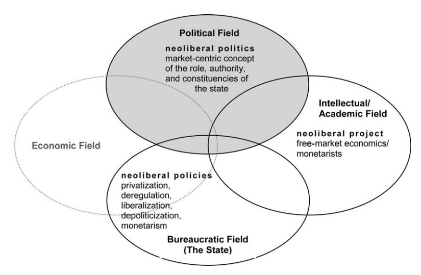
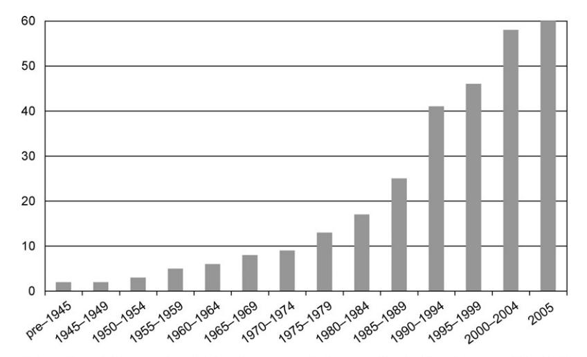
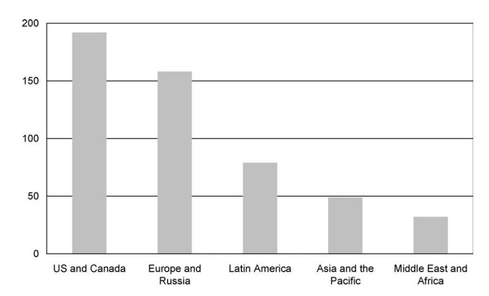

<!-- A1.R38 | source: papers_json/A1.R38/ -->

## أحدث ما توصل إليه البحث

## ما هي الليبرالية الجديدة؟

## ستيفاني لي مدج

برنامج ماكس فيبر، المعهد الجامعي الأوروبي (EUI)، فيلا لا فونتي، سان دومينيكو دي فيزوله، إيطاليا

المراسلة: stephanie.mudge@eui.eu؛ stephaniemudge@gmail.com

الليبرالية الجديدة مفهوم كثير الاستخدام لكنه غير محدد بدقة في العلوم الاجتماعية. تطرح هذه المقالة تصورًا للليبرالية الجديدة بوصفها نظامًا أيديولوجيًا فريدًا نشأ من صراع وتعاون في ثلاثة عوالم: الفكري والبيروقراطي والسياسي. ومع التركيز على "الوجه" الثالث للليبرالية الجديدة، تجادل المقالة بأن الفشل في فهمها كصيغة سياسية يفرض قيدين على فهم آثارها: (١) ترسيخ افتراض ضمني بأن النخب السياسية الأوروبية تعارض "بطبيعتها" تطبيق السياسات الليبرالية الجديدة؛ و(٢) الميل إلى إعاقة البحث في حقيقة مقلقة، وهي أن أكثر المدافعين فعالية عن السياسات التي تُفهم على أنها ليبرالية جديدة في أوروبا الغربية (وخارجها) كانوا في الغالب نخبًا متعاطفة مع اليسار ويسار الوسط أو ممثلة له. وبما أن السياسة الديمقراطية الاجتماعية كانت قوية بشكل استثنائي في أوروبا الغربية لمعظم فترة ما بعد الحرب، فإن الليبرالية الجديدة داخل الأحزاب الرئيسية لليسار الأوروبي تستحق اهتمامًا خاصًا.

الكلمات المفتاحية: الليبرالية، الليبرالية الجديدة، الفكر الاقتصادي، المؤسساتية، الاقتصاد السياسي

تصنيف JEL: A14 علم اجتماع الاقتصاد، B2 تاريخ الفكر الاقتصادي منذ عام ١٩٢٥، F59 العلاقات الدولية والاقتصاد السياسي الدولي

## ١. مقدمة

في تسعينيات القرن الماضي، بدأ المراقبون السياسيون يلاحظون أفول، للأفضل أو للأسوأ، السياسة كما عرفناها. وكما قال كراوش (Crouch, 1997, p. 352)، أصبحت الأحزاب الرئيسية لليسار تعيش "في عالم سياسي ليس من صنعها"١ — عالم بنيته ذاتها تتعارض مع أهداف ومبادئ الديمقراطية الاجتماعية. ويتتبع أدب سوسيولوجي متنامٍ التحول الدولي نحو الأسواق الحرة منذ السبعينيات، مع تركيز خاص على إنتاج وتصدير "توافق واشنطن" من الشمال إلى أمريكا الوسطى و

> ^1^ يشير كراوش هنا إلى فوز حزب العمال الجديد البريطاني عام ١٩٩٧، مقارنًا إياه بفوز حزب المحافظين بقيادة تشرشل عام ١٩٥١.

> ^#^ المؤلف ٢٠٠٨. نُشر بواسطة مطبعة جامعة أكسفورد وجمعية النهوض بالاقتصاد الاجتماعي. جميع الحقوق محفوظة. للحصول على الأذونات، يرجى مراسلة: journals.permissions@oxfordjournals.org.

<!-- page 2 -->

أمريكا الجنوبية (Campbell and Pedersen, 2001; Dezalay and Garth, 2002; Fourcade-Gourinchas and Babb, 2002; Babb, 2004; Massey et al., 2006). ومع التركيز على الغرب، يشير المتخصصون في السياسة المقارنة إلى تراجع الهويات الحزبية داخل ناخبي الديمقراطيات الغنية، وصعود أحزاب سياسية احترافية لا تلتزم بالانقسامات الأيديولوجية "القديمة"، وتضاؤل أهمية الحكومة الحزبية كمؤشر لاختيارات السياسة الاقتصادية الكلية (Boix, 2000; Dalton and Wattenberg, 2002; Fiorina, 2002).^2^ وفي الوقت نفسه، يؤكد أدب توليفي مستمَد من "المؤسساتيات" في الاقتصاد والعلوم السياسية وعلم الاجتماع على الانتشار العالمي للأفكار كعامل تفسيري مركزي وراء انتشار السياسات (الليبرالية الجديدة) (Henisz et al., 2005; Dobbin et al., 2007; Quinn and Toyoda, 2007).

تلتقي هذه الخطوط التحليلية عند نغمة مشتركة: بروز مشهد جديد تتغير فيه معاني الفئات السياسية المألوفة، وتصبح فيه التحزبات ذات دلالات سياسية غير متوقعة. فكيف نفهم الفئات السياسية "القديمة" في عصر ليبرالي جديد؟ تسهم هذه المقالة في الأدب الخاص بهذا السؤال من خلال تطوير مفهوم ثلاثي الأبعاد للليبرالية الجديدة، متجذر تاريخيًا: بوصفها مشروعًا فكريًا-مهنيًا، ومجموعة من السياسات، وشكلًا من أشكال السياسة. ومعالجةً لفجوة مفاهيمية في الأدب القائم، أركز هنا تحديدًا على الوجه السياسي للليبرالية الجديدة.

## ٢. عرض موجز للحجج الرئيسية

تطرح المقالة ثلاث حجج رئيسية. أولًا، الليبرالية الجديدة نظام أيديولوجي فريد نشأ من عمليات تاريخية من الصراع والتعاون في ثلاثة عوالم: الفكري والبيروقراطي والسياسي. بعبارة أخرى، للليبرالية الجديدة ثلاثة "وجوه" مترابطة:

- (١) يتميز الوجه الفكري للليبرالية الجديدة بـ (أ) عبرقوميته المرتكزة على العالم الأنجلو-أمريكي؛ (ب) نشأته التاريخية المحددة داخل مؤسسات رأسمالية الرفاه وانقسام الحرب الباردة؛ و(ج) تركيزه الخالص على السوق (غير المُدمج اجتماعيًا) بوصفه مصدر وحكم الحريات الإنسانية.
- (٢) يتجلى وجهه البيروقراطي في سياسة الدولة: التحرير، وإلغاء التنظيم، والخصخصة، ونزع الطابع السياسي، والنقدية. تستهدف هذه الحزمة من الإصلاحات تعزيز المنافسة غير المقيدة عبر إخراج الدولة من أعمال الملكية وإبعاد السياسيين عن الإدارة الاقتصادية ذات النمط التوجيهي. كما تهدف السياسات الليبرالية الجديدة إلى "نزع القداسة" عن مؤسسات كانت محمية سابقًا من قوى منافسة السوق الخاصة، مثل التعليم والرعاية الصحية.

> استمرار تراجع التحزب مسألة خلافية (Hetherington, 2001).

<!-- page 3 -->

(٣) وجهه السياسي "سياسة" جديدة محورها السوق — صراعات على السلطة السياسية تتشارك مركزًا أيديولوجيًا معينًا، أو بعبارة أخرى، تستند إلى "حس مشترك" غير مشكوك فيه. فعلى مستوى النخبة،٣ تنحصر سياسة الليبرالية الجديدة ضمن تصورات معينة حول مسؤوليات الدولة (إطلاق قوى السوق حيثما أمكن) وموقع سلطة الدولة (تحديد نطاق صنع القرار السياسي). كما تميل إلى التوجه نحو فئات معينة (قطاع الأعمال والمال والمهنيين ذوي الياقات البيضاء) على حساب فئات أخرى (النقابات العمالية على وجه الخصوص).

ثانيًا، أجادل بأن الفشل في فهم تقاطع الليبرالية الجديدة مع السياسة يفرض قيودًا خطيرة على الفهم العلمي الاجتماعي لآثارها. تتشارك الوجوه الثلاثة للليبرالية الجديدة جوهرًا أيديولوجيًا مشتركًا ومميزًا: إعلاء السوق — الذي يُفهم ككيان غير سياسي وغير ثقافي وشبه آلي — فوق كل أنماط التنظيم الأخرى. وقد صيغت الليبرالية الجديدة بهذا الشكل المميز في الحقل الفكري منذ زمن بعيد، لكنها فقدت مصداقيتها خلال الحربين العالميتين؛ ثم عادت إلى الظهور في الحياة الفكرية والسياسية السائدة منذ السبعينيات، مع اهتمام ضئيل بالانقسامات الحزبية "القديمة" أو الحدود الوطنية.

تنبثق الحجة الثالثة من الثانية: الميل إلى التركيز على السياسة في البلدان الليبرالية الأنجلوسكسونية أو حصرًا داخل صفوف اليمين السياسي، على الأرجح يفوّت معظم "الفعل الحقيقي". فقد وُلد عصر الليبرالية الجديدة من عصر مهيمن سابق كانت فيه السياسة محكومة بأنظمة فكرية رفاهية ودولاتية وكينزية، يمكن تسميتها "السياسة الديمقراطية الاجتماعية". وكان هذا الشكل السياسي السابق مهيمنًا بشكل خاص في أوروبا الغربية، وأدى إلى نشوء بعض من أوسع مؤسسات الرفاه التي عرفها العالم. ونظرًا لنقطة انطلاقها التاريخية بوصفها القلب النابض للسياسة الديمقراطية الاجتماعية، فإن الليبرالية الجديدة في سياسة الأحزاب الرئيسية لليسار الأوروبي تستحق اهتمامًا خاصًا.

## ٣. التعريفات والمنظور النظري

الليبرالية الجديدة مصطلح كثير الاستخدام يمكن أن يعني أشياء مختلفة كثيرة. بالنسبة لكامبل وبيدرسن (Campbell and Pedersen, 2001) فإن الليبرالية الجديدة هي:

مجموعة غير متجانسة من المؤسسات تتألف من أفكار متنوعة وسياسات اجتماعية واقتصادية، وطرائق لتنظيم النشاط السياسي والاقتصادي... مثاليًا، تشمل مؤسسات رسمية، مثل برامج دولة الرفاه الأدنى، والضرائب، وتنظيم الأعمال؛ وأسواق عمل مرنة

> ^3^ رغم أن هذا النقاش يركز على النخب السياسية، فإن سياسة الليبرالية الجديدة تضم مجموعة أوسع بكثير من الفاعلين — جماعات المصالح، والمنظمات الشعبية، والتنظيمات السياسية غير الحزبية، وغيرها، تعمل على المستويات المحلي والوطني والدولي (Evans, 2005; Prasad, 2006; Martin, 2008).

<!-- page 4 -->

وعلاقات عمل ورأس مال لامركزية غير مقيدة بنقابات قوية أو مفاوضة جماعية؛ وغياب الحواجز أمام حركة رأس المال الدولية. وتشمل مبادئ معيارية مؤسسية تفضّل الحلول القائمة على السوق الحرة للمشكلات الاقتصادية، بدلًا من التفاوض أو التخطيط الإرشادي، والتزامًا بضبط التضخم حتى على حساب التوظيف الكامل. وتشمل مبادئ معرفية مؤسسية، وأبرزها إيمان عميق ومسلَّم به بالاقتصاد الكلاسيكي الجديد. (Campbell and Pederson, 2001, p. 5, emphasis added)

يوفر التعريف المؤسساتي للليبرالية الجديدة نقطة انطلاق مفيدة، لكنه يفتقر إلى البعد التاريخي والاقتصاد في التعبير. وينبغي أن يحدد التعريف الشامل الليبرالية الجديدة بمصطلحات تاريخية، ويوضح أصولها ويبرز ما يميزها عن سوابقها. فما الذي يقع في جوهر الليبرالية الجديدة؟

وبإضافة أساس تاريخي إلى تعريف كامبل وبيدرسن، تُعرَّف الليبرالية الجديدة هنا بأنها نظام أيديولوجي يقدّس "السوق"، وُلد داخل العلوم "الإنسانية" أو الاجتماعية وصُقل في شبكة من منتجي المعرفة المتمركزة حول العالم الأنجلو-أمريكي، وتجلّى بطرق مختلفة داخل مؤسسات دولة ما بعد الحرب وحقولها السياسية (Bourdieu, 1992, 1994, 2005; Bourdieu and Wacquant, 1992). وتتجذر الليبرالية الجديدة في مشروع أخلاقي، مصاغ بلغة الاقتصاد، يمتدح "الفوائد الأخلاقية لمجتمع السوق" ويعتبر "الأسواق شرطًا ضروريًا للحرية في جوانب أخرى من الحياة" (Fourcade and Healy, 2007, p. 287). وينسجم هذا التصور للليبرالية الجديدة تمامًا مع المنظورات الدوركهايمية التي تعامل صناعة السوق بوصفها عملية تُشكَّل من خلالها "الفئات الأخلاقية" — أي المقدس والمدنس — و"تُنازَع وتُحوَّل" (Fourcade and Healy, 2007, p. 301).٤ وكما جادل دوركهايم (Durkheim, 2001[1912])، فإنه بسبب "إيمان ديني في جوهره" بالعلم، تمارس مفاهيمه — وفي هذه الحالة مفهوم "سوق" مستقلة وغير سياسية وشبه آلية — قوة أخلاقية (2001[1912]، ص ٢٠٨، ٤٣٩).

يبرز التعريف أيضًا حقيقة أن للليبرالية الجديدة أنماطًا وتعبيرات مميزة. فهي توجد كمشروع فكري-مهني أنجلو-محوري لمنتجي معرفة اقتصادية أكاديميين وغير أكاديميين بشكل رئيسي وفاعلين آخرين من "الطبقة الجديدة" (King and Szelényi, 2004)، وكمجموعة من السياسات تُطبَّق عبر بيروقراطيات دولة الرفاه السابقة، وكمجموعة من التوجهات السياسية المتمحورة حول السوق تُحدد المعايير الخطابية للتنافس السياسي (الشكل ١).

في جميع أنماطها، تُبنى الليبرالية الجديدة على مبدأ واحد أساسي: تفوّق المنافسة الفردية القائمة على السوق على أنماط التنظيم الأخرى

> ^4^ حول الاقتصاد كفلسفة أخلاقية ولاهوت، انظر Hausman and McPherson (2006) و Nelson (2001).

<!-- page 5 -->

*الشكل ١ الوجوه الثلاثة للليبرالية الجديدة.*

وهذا المبدأ الأساسي هو السمة المميزة للفكر الليبرالي الجديد — وله جذور قديمة تكمن جزئيًا في الاقتصاد الأنجلوسكسوني وجزئيًا في المدارس الألمانية للليبرالية.

تحدد هذه المقالة الوجوه الثلاثة للليبرالية الجديدة مع التركيز على الوجه الثالث: السياسة الليبرالية الجديدة. واستنادًا إلى مفهوم بورديو للحقل السياسي، يشير مصطلح "السياسة" إلى نوع معين من الأرض الاجتماعية: مساحة صراع محدودة على السلطة السياسية تحكمها قواعد الوصول، حيث تُوزَّع الموارد بشكل تفاضلي بين اللاعبين، وتكون مجموعة المواقف المشروعة على مسائل الحكم مقيدة — أي أن بعض المواقف السياسية تقع خارج حدود الخطاب المشروع في أي وقت ومكان معينين. لهذا السبب، فإن عالم الاحتمالات السياسية لا يخضع إلا جزئيًا لتلاعب الفاعلين السياسيين. وفي السياسة، إذن، فإن أكثر أنواع القوة تأثيرًا هي القوة التعريفية: فمن يملك القدرة على تعريف المشكلات السياسية ومدى الحلول الممكنة يمارس تأثيرًا فريدًا.

وهذا لا يعني أن الفاعلين السياسيين يمارسون السلطة التعريفية تلقائيًا. فسياسة الليبرالية الجديدة تعبّر عن نظام فكري نشأ خارج السياسة.٥ وبعبارة أخرى، قد يمارس النخب السياسية سلطات التعريف من خلال الاستناد — بوعي أو دون وعي — إلى أنظمة أيديولوجية صيغت في مساحات غير سياسية.

> ^5^ حجتي القائلة بأن الموارد الرمزية غالبًا ما تُنتَج خارج الحقل السياسي تتباين مع المنظور المؤسساتي القائل بأن مجموعة المؤسسات والفاعلين والمنظمات التي تشكل الحقل السياسي تُمثل الموطن الرئيسي للموارد الرمزية ("الأطر الثقافية"؛ Stone-Sweet and Sandholtz, 1999; Stone-Sweet et al., 2001).

<!-- page 6 -->

## ٤. الليبرالية الجديدة كمشروع فكري-مهني٦

بوصفها مشروعًا فكريًا-مهنيًا، الليبرالية الجديدة "جديدة" بثلاثة معانٍ: (١) عبرقوميتها المتزامنة مع ارتكازها في الأكاديمية الأنجلو-أمريكية؛ (٢) نشأتها التاريخية المحددة داخل رأسمالية الرفاه وانقسام الحرب الباردة (أي كاستجابة لبروز رأسمالية الرفاه في الشمال، وخطاب ديمقراطي اجتماعي مهيمن، وانقسامات سياسية وفكرية أنتجتها الحرب الباردة؛ Esping-Andersen, 1990; Lemke and Marks, 1992; Sassoon, 1996, 1997; Bockman and Eyal, 2002; Bockman, 2007; Therborn, 2007)؛ و(٣) تركيزها الخالص على السوق بوصفه مصدر وحكم الحقوق والمكافآت والحريات — وبالتبعية، ازدراءها الواضح للسياسة والبيروقراطيات ودولة الرفاه.

## ٤.١ عبرقومية مرتكزة على العالم الأنجلوسكسوني

يتميز "الوجه" الفكري للليبرالية الجديدة جزئيًا بعبرقوميته وفوق-قوميته — أي مواقعه في أنشطة وأشكال تنظيمية تقع خارج حدود الدولة القومية — وبارتكازه الجغرافي داخل الأكاديمية الأنجلو-أمريكية. ويؤكد أدب واسع حول "المشروع الهيمني" على الشبكات العابرة للحدود من الناشطين ومراكز الفكر المؤيدة للسوق الحرة، والنخب السياسية اليمينية، والفرع القائم على شيكاغو من الاقتصاد الأنجلو-أمريكي المؤيد للسوق الحرة، كقوى رئيسية وراء صعود الليبرالية الجديدة (Smith, 1993; Cockett, 1995; Valdes, 1995; Kelly, 1997; Bourdieu and Wacquant, 1999; Weyland, 1999; Bockman and Eyal, 2002; Dezalay and Garth, 2002; Babb, 2004; Kay, 2007; Power, 2005).^7^ وهؤلاء هم الفاعلون الذين يمكن فهمهم بسهولة أكبر، بمصطلحات معينة، على أنهم "ليبراليون جدد".

وإلى جانب المشاركة في العمل السياسي المباشر، قدّم المفكرون الليبراليون الجدد موارد رمزية للنخب السياسية في شكل تفسيرات لإخفاقات السياسات الكينزية والتنموية، ومجموعة جديدة من التوصيات للتعافي الاقتصادي. وقد وُظِّفت هذه الموارد بتأثيرات متفاوتة عبر حكومات ومنظمات كانت في موقع جيد لممارسة ضغوط قسرية ومعيارية على المستوى الدولي: الحكومة الأمريكية (أو الدول

> ^6^ أقرن هنا "الفكري" بـ "المهني" لأبرز أن المفكرين ليسوا مجرد ناقلين لأنماط معرفية معينة؛ فهم أيضًا منخرطون في مهن تخصصية لها مصالحها وديناميكياتها التنافسية الخاصة (Abbott, 1988; Dezalay and Garth, 2002).

> تعتمد بعض هذه الأعمال على نظرية الحقل — التي تتميز، من بين أمور أخرى، برفض صريح لأشكال التفسير الميكانيكية "شبيهة الفلبر" (Martin, 2003). تسعى نظرية الحقل إلى "تفسير التغيرات في حالات بعض العناصر [...] لكن دون الحاجة إلى الاستناد إلى تغيرات في حالات عناصر أخرى (أي "الأسباب")"، حيث لا ينتج التغيير عن أجسام "تصطدم ببعضها البعض" بل عن "تفاعل بين الحقل والحالات القائمة للعناصر" (2003، ص ٤، ٧).

<!-- page 7 -->

"الأساسية" الغنية بشكل عام)، ومنظمة التعاون الاقتصادي والتنمية (OECD)، والاتحاد الأوروبي، وصندوق النقد الدولي (IMF)، والبنك الدولي (Dezalay and Garth, 2002; Hanley et al., 2002; Stiglitz, 2002; Massey et al., 2006; Dobbin et al., 2007).^8^

بدأ تحول الليبرالية الجديدة من مجموعة قناعات فكرية مهمَّشة إلى قوة مهيمنة كاملة مع الأزمة الاقتصادية، التي أضعفت الحكومات القائمة وجعلت النخب السياسية أكثر تقبلًا لنظام فكري مختلف. بدأت الضغوط الاقتصادية منذ منتصف الستينيات (Harvey, 1989, 2005)، لكن مصدر نهاية حاسمة لازدهار حقبة ما بعد الحرب جاء عام ١٩٧٣، عندما قيّدت دول أوبك٩ الإنتاج ودفعت إلى ارتفاع سعر النفط خمسة أضعاف (Prasad, 2006). ومع ارتفاع تكاليف إنتاج السلع المحلية، ارتفع كل من التضخم والبطالة معًا — وهو تطور، عُرف بـ"الركود التضخمي"، تحدّى الفهم الكينزي لكيفية عمل النظم الاقتصادية وأشعل صراعات جديدة على السلطة السياسية.

كانت الموارد الرمزية التي استند إليها الكثير من الفاعلين الرئيسيين في هذه الصراعات الجديدة أنجلو-أمريكية المنشأ، مقدَّمة من فرع معين من منتجي المعرفة ذوي استثمارات مهنية خاصة بهم. ويعرض الأدب القائم حول هذه النقطة الطابع الأمريكي-المحوري للفكر الاقتصادي الليبرالي الجديد على خطوتين: (١) الشرعنة السياسية والارتقاء المهني (داخل الاقتصاد) لفكر السوق الحرة عبر التدخلات المباشرة للاقتصاديين الأمريكيين والمتدربين في الولايات المتحدة في مشاريع الإصلاح في أمريكا اللاتينية، و(٢) تدويل مهنة الاقتصاد (جزئيًا عبر التكامل الأوروبي) وترسّخ نوع من سلطة الترخيص المهني داخل الأكاديمية الأمريكية (Dezalay and Garth, 2002; Fourcade, 2006).

يبرز ديزالاي وغارث أهمية المواقع المتماثلة بنيويًا للاقتصاديين الكلاسيكيين الجدد في الولايات المتحدة وأمريكا اللاتينية خلال الحقبة الكينزية. وقد شكّل الاقتصاديون المؤيدون للسوق الحرة، المهمَّشون في الشمال والجنوب على حد سواء، "تحالفًا غير مقدس" مع المحافظين الجمهوريين ورجال الإعلام والأعمال، و"استثمروا" دوليًا في مشاريع سياسية جديدة. ومن الأمثلة البارزة هنا استخدام أرنولد هاربرغر (من جامعة شيكاغو) لمساعدات الوكالة الأمريكية للتنمية الدولية (USAID) ومؤسسات خيرية للاستثمار في أقسام اقتصادية أجنبية، مثل الجامعة الكاثوليكية في سانتياغو، تشيلي، موطن "فتيان شيكاغو" سيئي الصيت. واستخدم نظراء شيكاغو الجنوبيون وسائل مماثلة لاكتساب النفوذ: بناء روابط مع الإعلام والاقتصاديين في الولايات المتحدة لتراكم القوة في بلدانهم الأصلية. وقد "شكّل هذا قصة لافتة من

> ^8^ هناك خلاف حول مسألة تأثير مشروطية صندوق النقد الدولي. وعلى نطاق أوسع، يشكك البعض في التحليلات الهيمنية لأنها تفشل "في نمذجة الآلية الدقيقة للانتشار أو النظر في آليات بديلة" (Dobbin et al., 2007, p. 457). وليس واضحًا ما إذا كان يمكن نقد التفسيرات القائمة على الحقل بإنصاف ضمن إطار التحليل الميكانيكي (انظر الحاشية السابقة).

> ^9^ منظمة الدول المصدرة للنفط.

<!-- page 8 -->

التصدير والاستيراد، ساعدت لاحقًا في بناء مصداقية توافق واشنطن الناشئ" (Dezalay and Garth, 2002, p. 46).

وحين تمكّن الاقتصاديون المتدربون في شيكاغو من نيل الفضل في توافق سياسي جديد حول الإدارة الاقتصادية، "انتقلوا بسلاسة نحو التركيز الجديد على المؤسسات والدولة: ما يُسمى بالتحرك بعد توافق واشنطن" (Dezalay and Garth, 2002, p. 47). ومع انخراطهم في آنٍ واحد في مواقع سلطة الدولة وفي "سوق الخبرة" الدولي، أضفوا الشرعية على مواقعهم الجديدة القوية من الخارج ومن الداخل معًا. وكانت النتيجة النهائية أن:

معايير الخبرة الشرعية تُحدَّد وفقًا للسوق الدولي المتمركز في الولايات المتحدة. وهناك تسلسل هرمي جديد يضع النخبة المهنية الأمريكية في القمة [...] وداخل كل بلد يوجد أيضًا تسلسل هرمي مهني من طبقتين. هناك نخبة كوزموبوليتية وكتلة متزايدة الإقليمية من المهنيين في القانون والاقتصاد وحقول أخرى. (Dezalay and Garth, 2002, p. 57)

وتضع فوركاد (Fourcade, 2006) تأكيدًا مرتبطًا على الطابع الأمريكي-المحوري لمهنة اقتصاد متزايدة التدويل. وهي تجادل بأن تدويل الاقتصاد مهم؛ أولًا، بسبب القوة الرمزية الفريدة التي يمنحها للاقتصاديين "لإعادة بناء المجتمعات وفق مبادئ الأيديولوجيا الاقتصادية المهيمنة" (Fourcade, 2006, p. 157). وثانيًا، "هذه التحولات [...] تُغذي بدورها احترافية الاقتصاديين وتعريفهم الاجتماعي حول العالم" (المصدر نفسه). ورغم أن الاقتصاد لا يملك نظام ترخيص رسميًا مغلقًا، فإن تدويله كمهنة اتجه نحو العمل وفق معايير وممارسات محدَّدة في العالم الأطلسي، وخصوصًا في الولايات المتحدة. والنتيجة أن المدارس الأمريكية للدراسات العليا والمهنية بشكل رئيسي، والمدارس الأوروبية بشكل ثانوي، تعمل "كمؤسسات ترخيص نخبوية لمعظم بقية العالم"، منتجةً تقاربًا دوليًا في مهنة الاقتصاد حول المعايير المهنية الأنجلو-أمريكية كما لو كانت حقلًا مرخصًا (Fourcade, 2006, p. 152).

## ٤.٢ النشأة داخل رأسمالية الرفاه والحرب الباردة

يمكن فهم الليبرالية الجديدة، في صيغتها كـ"مشروع"، كمجموعة مترابطة من الصراعات السياسية والفكرية المضادة للهيمنة (Dezalay and Garth, 1998, 2002, 2006; Teles and Kenney, 2008). فقد نشأت في فترة تميزت بصعود الشيوعية السوفيتية، وصعود دولة الرفاه في الديمقراطيات الغربية ("العصر الذهبي" الأسطوري؛ Esping-Andersen, 1997, 1999)، وهيمنة المقاربات الكينزية للإدارة الاقتصادية الكلية (Hall, 1989). وسياسيًا، دعم هذا المشروع محافظون كانوا "محبطين مما

<!-- page 9 -->

اعتقدوا أنه شبكات دولية من الخبراء اليساريين الذين بشّروا ثم طبّقوا مخططات لتوسيع الحكومة" (Teles and Kenney, 2008, p. 136). وفي الحقل الفكري، نما من فهم مماثل لسياسة الحقبة الكينزية بوصفها محكومة بدافع اشتراكي في جوهره، من شأنه، بشكل أو بآخر، أن يمهّد الطريق للشمولية.

يمكن تفصيل هذه القصة على نطاق واسع، لكن رواية موجزة كافية هنا. فقد أثار الكساد والحربان العالميتان نقاشًا واسعًا بين النخب، وخاصة المفكرين، الذين سعوا إلى تفسير الانهيار الحضاري لأوروبا ورسم طريق لإعادة البناء. وفي هذا السياق، أصبح الاقتصادي النمساوي فريدريك فون هايك المركز الكاريزمي لشبكة من مفكري عدم التدخل — مجموعة تميزت برفضها للحجة السائدة القائلة بأن الرأسمالية الجامحة كانت السبب الجذري لانهيار أوروبا. ومهمَّشًا عن التأثير في السياسة السائدة في بداية فترة ما بعد الحرب، بنت هذه "المجموعة الصغيرة والحصرية من المدافعين المتحمسين — معظمهم اقتصاديون ومؤرخون وفلاسفة" ملاذًا فكريًا في سويسرا: جمعية مونت بيليرين.١٠ اجتمعت الجمعية لأول مرة عام ١٩٤٧ برعاية هايك — أول رئيس لها — ومعلمه لودفيغ فون ميزس (Harvey, 2005, pp. 19–20).^11^

في عمله المحوري "الطريق إلى العبودية" (Hayek, 1994[1944]) — المُهدى إلى "اشتراكيي جميع الأحزاب" — جادل هايك بأن كلًا من التخطيط الاقتصادي المركزي على الطراز السوفيتي و"إعادة التوزيع الواسعة للدخل عبر الضرائب ومؤسسات دولة الرفاه" ستؤديان إلى النتيجة الاستبدادية نفسها — وإن كانت "أبطأ وأقل مباشرة وأقل اكتمالًا" (المصدر نفسه، ص xxiii) في حالة الديمقراطيات الغربية. وكُتب هذا العمل بين ١٩٤٠ و١٩٤٣، وفق كلمات هايك نفسه، بدافع "الانزعاج من سوء الفهم التام في الأوساط "التقدمية" الإنجليزية لطبيعة الحركة النازية"، وكان "العبودية" تدخلًا سياسيًا يهدف إلى تصحيح ميول ربط النازية بتجاوزات الرأسمالية — أي دحض الادعاء بأن صعود الفاشية جاء نتيجة "لحشرجة موت نظام رأسمالي فاشل" (Hayek, 1994[1944], p. xxi).

كما استلهم "العبودية" مباشرة من بوادر دولة الرفاه البريطانية. فقد صاغ هايك حجته الأساسية أول مرة في مذكرة إلى السير وليام بيفريدج، مدير كلية لندن للاقتصاد، في أوائل الثلاثينيات

> ^10^ http://www.montpelerin.org/home.cfm. ضم الاجتماع الأول للجمعية ٣٦ مشاركًا. يلاحظ هارفي (Harvey, 2005, p. 20) أنه بالنسبة لأعضاء جمعية مونت بيليرين، "أشار مسمى الليبرالية الجديدة إلى التزامهم بمبادئ السوق الحرة للاقتصاد الكلاسيكي الجديد التي ظهرت في النصف الثاني من القرن التاسع عشر (بفضل أعمال ألفريد مارشال، وويليام ستانلي جيفونز، وليون فالراس) لتحل محل النظريات الكلاسيكية لآدم سميث وديفيد ريكاردو، وبالطبع كارل ماركس".

> ^11^ في عشرينيات القرن الماضي، عمل هايك كطالب لدى فون ميزس في فيينا، وكان يُدرّس في جامعة لندن عندما وصل هتلر إلى السلطة عام ١٩٣٣.

<!-- page 10 -->

(Hayek 1994[1944]). ولم يتأثر بيفريدج بحجج هايك، فألّف تقرير بيفريدج الشهير لعام ١٩٤٢، الذي صاغ المبادئ الأساسية للرفاه البريطاني في فترة ما بعد الحرب.١٢ وإحباطًا من عجزه عن التأثير في التيارات السياسية في بريطانيا،١٣ ساعد هايك وزملاؤه في إنشاء حركة عبر أطلسية للسوق الحرة تخترق العالمين الأكاديمي وغير الأكاديمي. فالمفكرون المنخرطون في عمل جمعية مونت بيليرين، على سبيل المثال، شاركوا أيضًا في إنشاء وشرعنة وانتشار شبكتين مترابطتين من مراكز الفكر المؤيدة للسوق الحرة.

يبرز السير أنتوني فيشر من بين الشخصيات المهمة المختلفة المنخرطة في هذا الجهد. ويُقال إن فيشر التقى هايك في كلية لندن للاقتصاد عام ١٩٤٥، حيث نصحه هايك بـ"تجنب السياسة والوصول إلى المفكرين بحجج معقولة".١٤ وقد ألهمت نصيحة هايك فيشر لتأسيس معهد الشؤون الاقتصادية (IEA) في لندن عام ١٩٥٥ "لشرح أفكار السوق الحرة للجمهور، بمن فيهم السياسيون والطلاب والصحفيون ورجال الأعمال والأكاديميون وكل مهتم بالسياسة العامة".١٥ وفي السبعينيات، أصبح فيشر قوة محورية وراء تأسيس منظمات السوق الحرة، وربط معهد الشؤون الاقتصادية بمنظمات جديدة وقائمة في بلدان أخرى عبر عقدتين تنظيميتين شمال أمريكيتين على الأقل. كانت إحداهما معهد فريزر في فانكوفر (أسسه رجل الأعمال الكندي بات بويل عام ١٩٧٤؛ Cockett, 1995)، وهو الآن مركز "شبكة الحرية" (الشكل ٢؛ Gunderson, 1989; Gwartney and Lawson, 2005, 2007).١٦

وتطورت شبكة ثانية، أكبر، حول مؤسسة أطلس للبحوث الاقتصادية،١٧ التي أسسها فيشر عام ١٩٨١ في أرلينغتون، فيرجينيا. وبحلول عام ٢٠٠٨، كان هناك أكثر من ٥٠٠ منظمة عضو في مؤسسة أطلس، تمتد عبر معظم مناطق العالم (الشكل ٣).

> ^12^ لاحظ هايك في مقدمته لعام ١٩٥٦ لكتاب "العبودية" أنه "كان واضحًا تمامًا بالفعل أن إنجلترا نفسها من المرجح أن تجرّب بعد الحرب نفس أنواع السياسات التي كنت مقتنعًا بأنها ساهمت كثيرًا في تدمير الحرية في أماكن أخرى" (Hayek, 1994[1944], p. xxviii).

> ^13^ رغم أنه قصد بـ"العبودية" تحذيرًا لـ"المثقفين الاشتراكيين في إنجلترا"، وجد هايك استقبالًا أكثر دفئًا في الولايات المتحدة. وفي عام ١٩٣٨، نُشرت حججه في مجلة Contemporary Review، وظهرت لاحقًا كـ"كتيب سياسة عامة" للأستاذ هاري ج. غيديونس في جامعة شيكاغو (Hayek, 1994[1944], pp. xxvii–xxvii).

> ^14^ المصدر: http://www.iea.org.uk/record.jsp?type=page&ID=24، تم الاطلاع عليه في ١٣ فبراير ٢٠٠٧.

> ^15^ المصدر: http://www.iea.org.uk/record.jsp?type=page&ID=24، تم الاطلاع عليه في ١٣ فبراير ٢٠٠٧.

> ^16^ معهد فريزر منتسب لسبعة اقتصاديين حائزين على جائزة نوبل، واستضاف اجتماعات جمعية مونت بيليرين في ثلاث مناسبات على الأقل: ١٩٨٣ و١٩٩٢ و١٩٩٩ (Fraser Institute, 2004). ويمثل حائزو نوبل السبعة المرتبطون بفريزر معًا رئاسة ما يقارب نصف سنوات وجود جمعية مونت بيليرين.

> ^17^ أسّس فيشر مؤسسة أطلس للبحوث الاقتصادية كعقدة تنظيمية للمنظمات الدولية المؤيدة للسوق الحرة ووسيلة لجمع وتوزيع التمويل من المانحين الخاصين والشركات.

<!-- page 11 -->

ملاحظات: العضوية التراكمية حسب فترات خمس سنوات، وفقًا لسنة التأسيس (N = 68؛ سنوات تأسيس ٨ منظمات عضو غير متوفرة).

المصدر: Gwartney and Lawson (2005) ومواقع شبكة الحرية التنظيمية (http://www.freetheworld.com/member.html، تم الاطلاع عليه في ١٢ مارس ٢٠٠٧).

*الشكل ٢ شبكة الحرية حتى عام ٢٠٠٥.*

*ملاحظة*: المنظمات الأعضاء حسب المنطقة حتى يوليو ٢٠٠٨ (N = 514).

المصدر: www.atlasusa.org/V2/main/acc.php (تم الاطلاع عليه في ١٠ يوليو ٢٠٠٨).

*الشكل ٣ مؤسسة أطلس للبحوث الاقتصادية ومنظماتها الأعضاء.*

تلقى الآثار السياسية لهذه الأنواع من المنظمات المنتجة للمعرفة اهتمامًا متزايدًا (Medvetz, 2007). ويعتمد تأثيرها على العلاقات مع الأحزاب السياسية والدولة، ناهيك عن المنافسة

<!-- page 12 -->

مع المنافسين التنظيميين.١٨ ومع ذلك، فإن حقيقة انتشارها دليل على اتساع النطاق الدولي للليبرالية الجديدة كمشروع فكري ومهني.

خارج الولايات المتحدة، ربما لعبت مراكز الفكر المؤيدة للسوق الحرة دورًا خاصًا داخل المساحات الاجتماعية التي خلقها انقسام الحرب الباردة — أي بالإضافة إلى الدور الواضح في توفير عرض من الخبرة الليبرالية الجديدة بعد عام ١٩٨٩.١٩ واستنادًا إلى دراسة في مركز دراسة المشكلات الاقتصادية والاجتماعية (CESES)٢٠ في ميلانو، تجادل بوكمان (Bockman, 2007) بأن الفكر الليبرالي الجديد نما من "مساحات عتبية" بين الشيوعية والرأسمالية، خاصة بعد وفاة ستالين عام ١٩٥٣. وتُظهر أن لا مؤسسي ولا مشاركي أنشطة CESES كانت لديهم هويات معادية للشيوعية قوية أو متسقة (2007، ص ٣٤٩–٣٥٠).٢١ وبجمعها مفكرين لم تكن توجهاتهم تنسجم بدقة مع أي من جانبي الستار الحديدي، وفّر CESES مساحة حاسمة تبادل فيها منتجو المعرفة معرفة حول الرأسمالية والتجربة الاشتراكية. وترديدًا لحجج سابقة (مع جيل إيال) حول دور البلدان الاشتراكية كمختبر للمعرفة الاقتصادية (Bockman and Eyal, 2002)، تبرز بوكمان أن CESES أصبح واحدًا من مواقع عديدة لإنتاج المعرفة كانت أساسية لوصول الليبرالية الجديدة إلى صفوف المهنيين الخبراء والنخب السياسية.

## ٤.٣ محورية السوق: الأسواق كحرية

يستحضر تصور الليبرالية الجديدة كمشروع شبه ديني نقاش بولاني حول "العقيدة الليبرالية" كنظام معتقدات شبه ديني (Polanyi, 2001 [1944]). وهنا، تشير "الجديدة" إلى إحياء مجموعة من الأفكار تعود إلى إنجلترا القرنين الثامن عشر والتاسع عشر، أُعيدت صياغتها لتلائم مؤسسات وسياسات بيئة ما بعد الحرب المتأخرة، وحُدِّثت بمفاهيم وتقنيات

> ^18^ على سبيل المثال، أسّست مجموعة من الشخصيات الفكرية والسياسية الأمريكية معهد سياسة الاقتصاد عام ١٩٨٦ "لتوسيع النقاش حول السياسة الاقتصادية ليشمل مصالح العمال ذوي الدخل المنخفض والمتوسط". وضم مؤسسوه روبرت رايش، المفكر الأمريكي المؤيد للنقابات الذي أصبح لاحقًا وزير العمل في عهد الرئيس كلينتون (Greenhouse, 1993; http://www.epi.org/content.cfm/about، تم الاطلاع عليه في ٢٤ يونيو ٢٠٠٨).

> ^19^ يلاحظ كوكيت (Cockett, 1995) أن شبكة أطلس المتوسعة بسرعة عنت أنه "[عندما] سقط جدار برلين عام ١٩٨٩، كان هناك جيش من الليبراليين الاقتصاديين الدوليين الملتزمين، الذين نشأوا في التقليد الهايكي، مسلحين بألواح الكتابة والهواتف المحمولة، بانتظار الانتقال إلى أوروبا الشرقية والاتحاد السوفيتي المتفكك لتحويل اقتصاداتهما المتعثرة" (1995، ص ٣٠٧).

> ^20^ أُنشئ عام ١٩٦٤ من قِبل كونفيندوستريا، الرابطة الرئيسية الممثلة للصناعة الخاصة الإيطالية.

> ^21^ تنتقد بوكمان الميل إلى "افتراض ناشطين قادرين على كل شيء، لديهم هويات يمينية واضحة ونجحوا في نشر أيديولوجيا أو دعاية يمينية أو مؤيدة للرأسمالية معلَّبة سلفًا. وتفترض هذه الروايات أيضًا متلقين واضحي الهوية لهذه الدعاية — إما ناشطين آخرين أو ضحايا ساذجين — يسمعون رسالة الليبرالية الجديدة بوضوح، ويتحولون إليها، ولا يملكون أفكارًا اقتصادية أو سياسية منافسة أخرى" (Bockman, 2007, p. 344).

<!-- page 13 -->

مهنة اقتصاد متزايدة التنافسية والرياضياتية (Block, 2001; Block and Somers, 2003, 2005; Krippner et al., 2004; Young, 2005).

تتميز الليبرالية الجديدة عن الليبراليات الأخرى في سعيها لتحرير "السوق" مفاهيميًا ورفعه إلى مستوى أعلى من السياسة — أي تحريره من أي نوع من التدخلات السياسية.٢٢ ويتناقض رفضها لتضمين السوق اجتماعيًا بشكل خاص مع الليبرالية الجديدة القارية (الأوردوليبرالية) (Friedrich, 1955)، التي كانت على الأرجح موقع أول من أطلق على نفسه اسم "ليبراليين جدد"، ناهيك عن أول صياغات لـ"طريق ثالث" بين الشمولية وعدم التدخل.٢٣ والمهم أن الأوردوليبرالية كانت مدرسة فكرية تاريخانية تجذّر هايك فيها في البداية قبل أن ينفصل عنها نحو مسار أكثر صرامة في عدم التدخل.٢٤

نظر الأوردوليبراليون إلى الديناميكيات الاقتصادية على أنها "مُضمَّنة" في السياسة (Friedrich, 1955, p. 511). ورفض فيلهلم روبكه، أحد الشخصيات المحورية للمدرسة، بشكل قاطع فكرة أن السوق "عملية مستقلة تدور آليًا من تلقاء نفسها" (Röpke 1996[1948], pp. 31–32).٢٥ ورغم معارضتهم للتخطيط المركزي (الدعم)، اعتقد الأوردوليبراليون أن تدخلات الحكومة ضرورات اقتصادية:

الشعار الرئيسي هو "اقتصاد السوق الاجتماعي" (soziale Marktwirtschaft)، وهو اقتصاد "حر" بالتأكيد، مقارنة باقتصاد موجَّه ومخطط، لكنه يخضع لضوابط، يُفضَّل أن تكون بصيغة قانونية صارمة، مصممة لمنع تركّز القوة الاقتصادية، سواء عبر الاتحادات الاحتكارية أو الثقة أو الشركات العملاقة. ومعارضةً لكل أشكال الدعم [...] يدعو أنصار "اقتصاد السوق الاجتماعي" إلى تدخل حكومي فقط بغرض تسريع التغيرات الوشيكة عبر تسهيلها. (Friedrich, 1955, p. 511)

> ^22^ يتجذر هذا الانقطاع المفاهيمي في المنظور القائل بأن "الأسواق تشكل أفضل ترتيب ممكن لإشباع الاحتياجات الفردية والتخصيص الفعال للموارد"، وهو ما يعود إلى سميث وفالراس (Fourcade and Healy, 2007).

> ^23^ في الخمسينيات، كانت مدرسة فرايبورغ موطن الأوردوليبرالية، و"تجسدت في شخص وزير الاقتصاد الديناميكي للجمهورية الاتحادية، لودفيغ إرهارد" (Friedrich, 1955, pp. 509–510).

> ^24^ كان هايك مدرجًا في وقت من الأوقات ضمن هيئة تحرير الأوردوليبراليين (Friedrich, 1955, p. 509). وانفصل عن الأوردوليبرالية، من بين مسائل أخرى، حول ما إذا كانت الرأسمالية قوة مدمرة ذاتيًا وقطبية بطبيعتها، وبالتالي تُلام على الحربين العالميتين.

> ^25^ "الخطأ الجوهري للفكر الرأسمالي الليبرالي القديم" كان نسيان أن "البشر ليسوا مجرد منافسين ومنتجين ورجال أعمال وأعضاء نقابات ومساهمين ومدخرين ومستثمرين، بل هم ببساطة بشر لا يعيشون على الخبز وحده" (Röpke, 1996[1948], pp. 31–32).

<!-- page 14 -->

دعا الأوردوليبراليون إلى "تدابير ومؤسسات توفر المنافسة" ضمن "إطار أخلاقي وقانوني مدروس"، بدعم من "حكومة قوية ونزيهة" (Röpke, 1996[1948], p. 28). كما دعوا إلى "سياسة هيكلية" بروح "الإنسانية الاقتصادية"،٢٦ لإنهاء الاحتكارات وتعزيز "تحسين الصعوبات والمحن التي يواجهها العناصر الأضعف في المجتمع" ضمن "سياسة يمكن وصفها بعبارتي "إزالة البروليتاريا" واللامركزية الاقتصادية" (Röpke, 1996[1948], p. 30).

يمكن تحديد التميز الأيديولوجي للليبرالية الجديدة في مهام المنظمات السياسية الدولية، التي تُعبّر عن المأسسة السياسية للمدارس الفكرية الاقتصادية المهيمنة. وقد نشأت ثلاث منها في بداية فترة ما بعد الحرب: الحركة الديمقراطية المسيحية الوسطية الدولية (CDI)، تأسست عام ١٩٦١ لـ"توسيع التعاون الدولي بين الأحزاب الديمقراطية المسيحية وتعزيز تشكيل أحزاب جديدة" (Szajkowski, 2005)؛ والدولية الليبرالية (LI)، تأسست عام ١٩٤٧ في أكسفورد، المملكة المتحدة؛ والدولية الاشتراكية (SI)، تأسست عام ١٩٥١ في فرانكفورت — منبثقة عن الدوليتين الأولى والثانية (١٨٦٤–١٨٧٦ و١٨٨٩). وعبّر تأسيس الدولية الليبرالية عن النطاق السياسي لمدرسة الأوردوليبرالية، الذي امتد عبر "إسكندنافيا، ودول البنلوكس، [...] وفرنسا وإيطاليا" في بداية فترة ما بعد الحرب (Friedrich, 1955, pp. 509–510). وفي الوقت نفسه، تدولت الليبرالية الجديدة رسميًا عام ١٩٨٣ بتأسيس الاتحاد الديمقراطي الدولي (IDU) في لندن — الذي أطلق على نفسه بشكل غير رسمي "الدولية الحرة". وشارك في تأسيسه مارغريت تاتشر (المملكة المتحدة)، وجورج بوش الأب (الولايات المتحدة)، وجاك شيراك (فرنسا)، وهيلموت كول (ألمانيا)، وآخرون.

الخط الفاصل بين الدولية الليبرالية والاتحاد الديمقراطي الدولي واضح. فكما يظهر في الجدول ١، تُبرز الدولية الليبرالية الأسواق إلى جانب موضوعات المجتمع والفقر والعدالة الاجتماعية؛ ولا تطرح نظرية شاملة عن الفرد أو الإنسانية، بل تركز على الشروط المؤسسية للحرية وحذر من الاحتكار وتركّز القوة. وبالمقارنة، فإن الميل الأكثر تمحورًا حول السوق والفردية للاتحاد الديمقراطي الدولي واضح بلا لبس. ففي إعلان واشنطن لعام ٢٠٠٥، الصادر في اجتماع قادة الأحزاب في واشنطن العاصمة، يصف الاتحاد الديمقراطي الدولي نفسه بمصطلحات القيم الجوهرية للليبرالية الجديدة — المشروع الحر، والتجارة الحرة، والملكية الخاصة، والديمقراطية، والقضاء المستقل، والحكومة المحدودة — لكنه لا يردد اهتمامات الدولية الليبرالية بالمجتمع أو الفقر أو التعددية أو تركّز القوة.

يبرز العنصر شبه الديني للليبرالية الجديدة في ادعاءات الاتحاد الديمقراطي الدولي بعالمية رؤيته وفهمه للجوهر الروحي للطبيعة

> ^26^ يشير بإعجاب إلى إصلاحات تشيانغ كاي شيك في الصين وروزفلت في الولايات المتحدة (Röpke, 1996[1948], p. 30).

<!-- page 15 -->

*الجدول ١ بيانات مهمة الدولية الليبرالية (LI) والاتحاد الديمقراطي الدولي (IDU)*

## يلتزم الليبراليون ببناء وحماية مجتمعات حرة وعادلة ومنفتحة، يسعون فيها إلى الموازنة بين القيم الأساسية للحرية والمساواة والمجتمع، ولا يستعبد فيها أحد بالفقر أو الجهل أو المطابقة القسرية.

يدافع الليبراليون عن حرية وكرامة ورفاهية الأفراد.

نُقر ونحترم الحق في حرية الضمير وحق كل فرد في تطوير مواهبه بالكامل. نهدف إلى توزيع القوة، وتعزيز التنوع، ورعاية الإبداع.

لا يمكن الحفاظ على حرية الإبداع والابتكار إلا من خلال اقتصاد سوق، لكن يجب أن يكون سوقًا يوفر للناس خيارات حقيقية.

وهذا يعني أننا لا نريد سوقًا تُقيَّد فيه الحرية بالاحتكارات، ولا اقتصادًا منفصلًا عن مصالح الفقراء والمجتمع ككل. والليبراليون متفائلون في جوهرهم ويثقون بالناس مع إدراكهم الحاجة إلى اليقظة الدائمة تجاه أصحاب السلطة. (المصدر: www.liberal-international.org، تم الاطلاع عليه في ١ ديسمبر ٢٠٠٥)أ

## الدولية الليبرالية (تأسست عام ١٩٤٧) الاتحاد الديمقراطي الدولي (تأسس عام ١٩٨٣)

نحن أحزاب الوسط ويمين الوسط، من الديمقراطية المسيحية والمحافظة.

نعكس تنوع العالم ونمتلك وحدة في القيم التي ندافع عنها.

رؤيتنا المشتركة هي مجتمعات حرة وعادلة ورحيمة.

نُقدّر قيمة التقاليد والحكمة الموروثة.

نُقدّر الحكومات المنتخبة بحرية، والاقتصاد القائم على السوق، والحرية لمواطنينا.

سنحمي شعوبنا ممن يبشّرون بالكراهية ويخططون لتدمير أسلوب حياتنا.

المشروع الحر، والتجارة الحرة، والملكية الخاصة هي أحجار الزاوية للأفكار الحرة والإبداع، إلى جانب الرفاهية المادية. نؤمن بالعدالة، مع قضاء مستقل.

نؤمن بالديمقراطية، وبالحكومة المحدودة، وبمجتمع مدني قوي. ونرى هذه أفكارًا عالمية.

العطش إلى الحرية ليس سمة خاصة بشعوب قارة أو منطقة أو أمة أو عرق أو دين واحد — إنه مطلب للبشرية جمعاء.

وهذا أيضًا هو الإلهام التأسيسي للاتحاد الديمقراطي الدولي.

(المصدر: IDU 2005: 2)ب

> أ تؤكد الدولية الليبرالية أيضًا على التعددية وحقوق الأقليات الوطنية والعرقية. من بيانها لعام ١٩٩٧: "نعتقد أن شروط الحرية الفردية تشمل سيادة القانون، وتكافؤ الفرص في التعليم الكامل والمتنوع، وحرية التعبير والتجمع والوصول إلى المعلومات، والمساواة في الحقوق والفرص بين النساء والرجال، والتسامح مع التنوع، والإدماج الاجتماعي، وتعزيز المشاريع الخاصة وفرص العمل. ونعتقد أن المجتمع المدني والديمقراطية الدستورية يوفران أعدل وأثبت أساس للنظام السياسي. ... ونعتقد أن اقتصادًا قائمًا على قواعد السوق الحرة يؤدي إلى أكثر توزيع فعال للثروة والموارد، ويشجع الابتكار، ويعزز المرونة. ونعتقد أن التعاون الوثيق بين المجتمعات الديمقراطية عبر المنظمات العالمية والإقليمية، في إطار القانون الدولي، واحترام حقوق الإنسان، وحقوق الأقليات الوطنية والعرقية، والالتزام المشترك بالتنمية الاقتصادية العالمية، هو الأساس الضروري للسلام العالمي وللاستدامة الاقتصادية والبيئية".

> ب أُرسل هذا الإعلان إليّ مشكورًا من الاتحاد الديمقراطي الدولي ردًا على طلب بالبريد الإلكتروني لمزيد من المعلومات عن المنظمة.

<!-- page 16 -->

الإنسانية (أي "عطش" الأفراد إلى الحرية).٢٧ وهذا يردد الطابع الديني الضمني في، على سبيل المثال، وصف جوزيف ستيغليتز لاقتصاديي صندوق النقد الدولي بأنهم "أصوليون سوقيون" (Stiglitz, 2002)؛ وإعلان مارغريت تاتشر الشهير عام ١٩٧٤، عندما أخرجت كتاب هايك "دستور الحرية" (Hayek, 1978[1960]) من حقيبتها في مجلس العموم البريطاني، قائلة "هذا ما نؤمن به"؛ والنبرة شبه التبشيرية في صياغة ميلتون فريدمان للأسواق كمصدر وحكم للحريات الإنسانية (Friedman and Friedman, 1980).

## ٥. الوجه البيروقراطي للليبرالية الجديدة

توجد السياسة الليبرالية الجديدة كمجموعة أو حزمة — سلسلة من الإصلاحات تستهدف معًا، من المنظور الليبرالي الجديد، تعزيز المنافسة غير المقيدة عبر إخراج الدولة من أعمال الملكية، ومنع السياسيين من ممارسة الإدارة الاقتصادية ذات النمط التوجيهي، وإدخال منافسة سوقية (أو شبيهة بالسوق) في مساحات مؤسسية كانت "مقدسة" سابقًا (مثال بارز هو التعليم العام).٢٨ ومع ذلك، تجدر الإشارة إلى أن تمييزًا حصريًا متبادلًا بين السوق والدولة يُشكّل أساس فكرة الليبرالية الجديدة عن "تحرير" السوق — وهي فكرة انتُقدت منذ زمن طويل في علم الاجتماع الاقتصادي (Krippner and Alvarez, 2007).٢٩ وتُوصف تعبيرات السياسة الليبرالية الجديدة بـ"وجهها البيروقراطي" للفت الانتباه إلى ارتكازها الضروري داخل بيروقراطيات الدولة. ويتماشى هذا مع الرؤية البولانية القائلة بأن الإصلاحات الليبرالية الجديدة لا تعني "تراجع" أو إلغاء بيروقراطيات الدولة (Cerny, 1993; Vogel, 1996; Krippner, 2007). بل تعني، يمكن القول، خلق "الدولة الليبرالية الجديدة" (Brown, 2003).

بحلول التسعينيات، ظهرت مجموعة السياسات الليبرالية الجديدة في صيغ محددة بدقة، كما في تحديد جون ويليامسون الشهير الآن لـ"شروط توافق واشنطن" (Williamson, 1990, 1993). وتضم هذه المجموعة خمسة مكونات رئيسية: خصخصة الشركات العامة؛ وفصل السلطة التنظيمية عن السلطة التنفيذية — ما يشمل إنشاء بنك مركزي مستقل سياسيًا؛ ونزع الطابع السياسي عن التنظيم الاقتصادي عبر

> ^27^ نقطتي ليست أن "العطش إلى الحرية" ليس غريزة إنسانية، بل أن الاتحاد الديمقراطي الدولي يعرّف الحرية بطريقة معينة. فلننظر، على سبيل المثال، إلى المفهوم غير الاقتصادي الذي صاغه روزفلت في خطابه الشهير عام ١٩٤١ عن "الحريات الأربع": التحرر من العوز، وحرية العبادة، وحرية التعبير، والتحرر من الخوف (Roosevelt, 1941).

> ^28^ في الولايات المتحدة، كان أحد أبرز التحولات السياسية العميقة في عصر الليبرالية الجديدة شرعنة الحجج الداعية إلى إدخال منافسة شبيهة بالسوق في التعليم العام، التي صاغها اقتصاديون وعلماء سياسة بارزون، منهم ميلتون فريدمان وجون تشوب وتيري مو (Friedman and Friedman, 1980; Chubb and Moe, 1990).

> ^29^ أشكر مراجعًا مجهولًا لإبرازه هذه النقطة.

<!-- page 17 -->

عزل السلطات التنظيمية عن التأثير السياسي، وتحرير الاقتصاد المحلي والدولي بفتح الأسواق أمام مزودي خدمات متعددين (Henisz et al., 2005). وإلى ذلك، ينبغي أن نضيف النقدية، أي بعبارة أخرى، التحكم في عرض النقد بدلًا من إدارة الطلب عبر التدخل المالي.٣٠

انتشار السياسة الليبرالية الجديدة مثبت تجريبيًا بشكل جيد، رغم أن التباينات الزمنية والجغرافية موضع نقاش تفسيري. ففي بيانات على مستوى العالم قدّمها سيمونز وآخرون (Simmons et al., 2006)، تسارعت الخصخصة والانفتاح المالي بشكل ملحوظ منذ أواخر الثمانينيات، متبعة المنحنى على شكل حرف S النمطي لعمليات الانتشار. اندفعت بلدان أوروبا الغربية وأمريكا الشمالية نحو الانفتاح المالي الكامل ابتداءً من أواخر الثمانينيات؛ وتحركت أمريكا اللاتينية وأوروبا الشرقية بشكل مماثل (وإن كان أقل دراماتيكية) في أوائل التسعينيات. وتسارعت الخصخصة في أوروبا الشرقية في التسعينيات، وبشكل مفاجئ، في الشرق الأوسط وشمال أفريقيا. وبحلول أوائل الألفية الثانية، بلغ التباين في هذه المؤشرات عبر جميع البلدان أدنى مستوى له على الإطلاق. وبالمثل، يؤكد هينيسز وآخرون (Henisz et al., 2005) على اتجاه تحريري واسع ودولي، خاصة في صناعات البنية التحتية التي كانت سابقًا مملوكة للدولة بشكل رئيسي (الاتصالات، والكهرباء، والمياه، والصرف الصحي، والنقل؛ ص ٨٧١).٣١ ويتتبع كوين وتويودا (Quinn and Toyoda, 2007) زيادة عامة في انفتاح الحسابات الرأسمالية والجارية لثمانين وثمانين بلدًا منذ الثمانينيات فصاعدًا،٣٢ مجادلين بأن الأيديولوجيات العالمية والمحلية تلعب أدوارًا سببية مستقلة في انتشار التحرير المالي عبر تغيير الحوافز والفرص التي يواجهها المسؤولون الحكوميون.

## ٦. السياسة الليبرالية الجديدة

يصف كثير من الأدب حول الرأسماليات الحديثة العقود الأخيرة من القرن العشرين بأنها حقبة سياسية جديدة (Hall, 1989; Esping-Andersen, 1990, 1994, 1997; Steinmo et al., 1992; Pierson, 1994, 1996; Hall and Soskice, 2001). وشهد الفكر السوقي الحر، المهمَّش سابقًا، إحياءً سياسيًا،٣٣

> ^30^ من نتائج صنع السياسة النقدية التركيز القوي على الانضباط الموازني والابتعاد عن الإنفاق العام المضاد للدورة الاقتصادية.

> ^31^ يختلف تحليل هينيسز وآخرين عن تحليلات أخرى جزئيًا لأنهم يؤكدون على أربعة أنواع من الاتجاهات كجزء من حزمة خيارات ("التبني المشترك"): خصخصة الشركات المملوكة للدولة؛ فصل السلطة التنظيمية عن السلطة التنفيذية؛ نزع الطابع السياسي؛ التحرير (2005، ص ٨٧١–٨٧٢).

> ^32^ كان للإصلاحات الاقتصادية الليبرالية مكمّل سياسي في شكل "موجة ثالثة" من التحول الديمقراطي في بلدان لم تكن ديمقراطية سابقًا.

> ^33^ ارتقى هايك من التهميش النسبي إلى الشهرة الدولية في السنوات الأولى لـ"السياسة الجديدة"، حين فاز بجائزة نوبل عام ١٩٧٤.

<!-- page 18 -->

ما مثّل صعود مجموعة جديدة من "الفئات المعرفية التي يدرك بها الفاعلون الاقتصاديون والسياسيون العالم" (Fourcade and Babb, 2002, p. 534).٣٤

بحلول التسعينيات، فهم البعض التجليات الواسعة الانتشار للليبرالية الجديدة كـ"دليل" على صلابتها الأنطولوجية. ففي عام ١٩٩٣، عقد ويليامسون نفسه تشبيهًا بين مقترحات الليبرالية الجديدة الأساسية والاعتقاد بأن "الأرض مسطحة" (Williamson, 1993). ووصف نفسه بأنه "يسار الوسط"، وتساءل عما إذا كان ينبغي للفلسفات الاقتصادية البديلة أن تحظى بتمثيل سياسي أصلًا:

سيكون من السخف أن نجادل بأن كل وجهة نظر ممكنة، من حيث المبدأ، ينبغي أن تمثلها حزب سياسي رئيسي. لا أحد يشعر بأن النقاش السياسي مقيَّد لأن ما من حزب يصر على أن الأرض مسطحة. [...] يبدو لي أن التقارب العالمي هو بمعنى ما المعادل الاقتصادي لهذه القضايا التي (نأمل) أن تكون قد خرجت من دائرة السياسة. وإلى أن يُقبل هذا الحس الاقتصادي السليم على نطاق واسع، فإن تعزيزه يجب أن يظل أولوية سياسية. لكن كلما أسرع في نيل القبول العام وأمكن إخراجه من النقاش السياسي السائد، كان ذلك أفضل للجميع. ... [إن] الأداء الاقتصادي الأعلى للبلدان التي تُنشئ وتحافظ على اقتصادات سوق موجَّهة نحو الخارج وخاضعة لانضباط اقتصادي كلي هو في جوهره سؤال إيجابي. قد لا يكون الدليل حاسمًا تمامًا كالدليل على أن الأرض ليست مسطحة، لكنه راسخ بما يكفي ليمنح الناس العقلاء أشياء أفضل يفعلونها بوقتهم من تحدي صحته. (Williamson, 1993, p. 1330)

مزاعم ويليامسون الإيجابية بشأن الأداء الاقتصادي الأعلى للاقتصادات "المُليبرلة جديدًا" ومزاعمه المعيارية بشأن عدم منطقية البدائل السياسية قابلة للجدل، لكن هذا يتجاوز نطاق النقاش الحالي. والأهم من ذلك هو إقراره وتقديسه المتزامنين لإعادة تمركز الفضاء السياسي حول فلسفة اقتصادية جديدة. واستنادًا إلى عمل ماير وروان (Meyer and Rowan, 1991, p. 41)، يمكن فهم الليبرالية الجديدة هنا كـ"مجموعة من الأساطير المُدمجة في البيئة المؤسسية" تميل إلى ترسيخ توجهات الفاعلين السياسيين. وهذه إعادة التمركز بالتحديد هي التي تمثّل صعود السياسة الليبرالية الجديدة.

> ^34^ يصف كامبل وبيدرسن (Campbell and Pedersen, 2001) صعود الليبرالية الجديدة كمجموعة من "التحولات المؤسسية على نطاق لم يُشاهد منذ أعقاب الحرب العالمية الثانية مباشرة، ومشروع حاول تحويل بعض أهم التسويات السياسية والاقتصادية الأساسية لحقبة ما بعد الحرب" (2001، ص ١).

<!-- page 19 -->

## ٦.١ الليبرالية الجديدة كسياسة

يميل بعض الأدب إلى إسقاط مصطلح "الليبرالية الجديدة" بشكل غير مريح على الانقسامات السياسية القديمة — محتفظًا ضمنيًا بالمصطلح لأحزاب اليمين، مع التركيز على البلدان الأنجلوسكسونية. ويُستخدم المصطلح غالبًا للإشارة إلى الجمهوريين الأمريكيين أو المحافظين البريطانيين — على غرار النماذج التاريخية المتجسدة في شخصيتي رونالد ريغان ومارغريت تاتشر.٣٥ لكن، كما يلاحظ الأدب حول "الطريق الثالث" وأدب نقدي محدود حول التكامل الأوروبي، فإن الليبرالية الجديدة تتجاوز السياسة المقيدة وطنيًا بكثير ولا تنسجم بدقة مع انقسامات اليمين واليسار (Dezalay and Garth, 1998; Holmes, 2000; Green-Pedersen et al., 2001; Cafruny and Ryder, 2003; van Apeldoorn et al., 2003; Hay, 2004).

يمكن تفصيل هذا مجددًا على نطاق واسع، لكن رواية موجزة تكفي. ففي الولايات المتحدة، اكتسبت تسمية "الليبراليين الجدد"، التي يُقال إن محرر مجلة Washington Monthly تشارلز بيترز صاغها، شكلها في مؤتمر عام ١٩٨٣ ضم أكاديميين ومهنيين (معلمين ومحامين وصحفيين وأكاديميين) متعاطفين مع الحزب الديمقراطي (Farrell, 1983). وكان هذا أحد المنتديات المتعددة التي ساعدت في ترسيخ حركة سياسية صديقة للسوق كانت تتحرك بين الديمقراطيين — صعود "فلسفة جديدة" سعت إلى القطيعة مع ماضي الحزب من خلال، ضمن أمور أخرى، تحويل أولويات السياسة الاقتصادية "بعيدًا عن التركيز على إعادة التوزيع ونحو الهدفين التوأمين المتمثلين في استعادة النمو والفرص" (Hale, 1995, p. 211). وفي عام ١٩٨٥، بلغ هذا التحول الليبرالي الجديد داخل الحزب الديمقراطي ذروته بتأسيس مجلس القيادة الديمقراطية (DLC) — القاعدة التنظيمية التي صعد منها لاحقًا آل كلينتون إلى السلطة السياسية.

لم يكن لتسمية "الليبراليين الجدد" معنى ثابت في عوالم خارج العالم الأمريكي، لكن الليبراليين الجدد الأمريكيين كان لهم مع ذلك نظراء أوروبيون. ففي التسعينيات، تميزت سياسة "الطريق الثالث" لحزب العمال الجديد بقبول قيود العولمة الاقتصادية، ورفض الثنائيات "القديمة" (اليمين مقابل اليسار؛ الدولة مقابل السوق؛ رأس المال مقابل العمل)، وتوجه إيجابي بشكل حاسم نحو الأعمال والمال، وصياغة جديدة للمصلحة الجماعية بمصطلحات فردية (Leys, 1997). وبنهاية القرن، وصل هذا النمط الجديد من اليسارية إلى بقية أوروبا: في ألمانيا، وهولندا، والبرتغال،

> ^35^ انظر تحليل وولي للاقتصاديين النقديين والمحافظين السياسيين الأمريكيين خلال سنوات ريغان (Woolley, 1982). يركز نقاش براساد حول الليبرالية الجديدة في فرنسا على أحزاب وسياسات اليمين، ويناقش تبني اليسار الفرنسي الجزئي لأفكار الليبرالية الجديدة فقط في التسعينيات — كجزء من التزامه بميثاق النمو والاستقرار (1996)؛ وفي الحالة الأمريكية، تركز حصريًا على سنوات ريغان-بوش (Prasad, 2005). وتحدد الفترة بين ١٩٩٠ و٢٠٠٥ باعتبارها مرحلة "التوطيد" للليبرالية الجديدة، التي فيها "عزّز مجيء الوحدة الأوروبية موقف الليبراليين الجدد الأوروبيين بطرق لا تزال بحاجة إلى التوضيح"، لكنها تترك هوية الليبراليين الجدد الأوروبيين غير محددة.

<!-- page 20 -->

والسويد، والدنمارك، وإيطاليا، وبلجيكا، حيث تبنّى قادة يساريون أسواق عمل أكثر تحررًا من التنظيم وأكدوا على ضرورات التكيف مع قوى السوق.

لم يكن هذا مجرد خطاب. ففي الولايات المتحدة، وقّع الرئيس كلينتون قانونًا عام ١٩٩٦ "أنهى الرفاه كما عرفناه"؛ وفي المملكة المتحدة، روّج توني بلير للشراكات بين القطاعين العام والخاص وأشرف على إدخال رسوم التعليم الجامعي عام ١٩٩٧؛ وانتهجت حكومات يسار الوسط في ألمانيا وهولندا إصلاحات لتحرير سوق العمل من التنظيم في التسعينيات وأوائل الألفية الثانية (Visser and Hemerijck, 1997; Esping-Andersen, 2002). وفي السويد، قاد الديمقراطيون الاجتماعيون من "الطريق الثالث" حملة تحرير الأسواق المالية من التنظيم في الفترة ١٩٨٥–١٩٨٦، وأنهوا تدريجيًا ضوابط الصرف، ودفعوا بتخفيضات في معدلات الضريبة الهامشية على الدخل في ١٩٨٩–١٩٩٠، وتقدموا بطلب العضوية في الجماعة الأوروبية (Pontusson 1992, 1994).

لم يكن ظهور اليسار الصديق للسوق عبر ضفتي الأطلسي مصادفة: فباستمرار تقليد طويل من تبادل الأفكار السياسية (Rueschemeyer and Skocpol, 1996; Rodgers, 1998)،٣٦ تبلورت أولويات سياستهم وامتدت عبر شبكة متينة متزايدة من الروابط السياسية داخل أوروبا من جهة، وبين أوروبا والولايات المتحدة من جهة أخرى — وكلاهما، جزئيًا، نتيجة للتكامل الأوروبي. وبحلول عام ٢٠٠٠، بدأت اليسارات "المُليبرلة جديدًا" تبدو أكثر فأكثر كحركة سياسية دولية. وإدراكًا لهذا الامتداد الواسع، أعلن معهد السياسة التقدمية الأمريكي (PPI) — الذراع البحثية لمجلس القيادة الديمقراطية — عام ١٩٩٩ أن "الطريق الثالث" هو "الحركة السياسية الدولية الأسرع نموًا في العالم، والموجة الصاعدة في الأحزاب السياسية ليسار الوسط عبر أوروبا".٣٧

## ٦.٢ الليبرالية الجديدة عند تقاطع الفكري والسياسي

للأنظمة الأيديولوجية وجود خارجي عن السياسة جزئيًا لأنها تولد في مساحات قد لا تكون سياسية. وصعود مجموعة جديدة من القوى الأيديولوجية هو، بعبارة أخرى، ظاهرة مؤسسية بحد ذاتها؛ وقد يتجذر في مجالات غير سياسية من الصراع والتعاون. ويمكن فهم هذه المجالات باعتبارها تنتمي إلى "الحقل الثقافي" — أي المساحات الاجتماعية التي ينخرط فيها الفاعلون في صراعات على مطالبات ذات سلطة بالحقيقة والمعنى: الدين، والفن، والأدب، والصحافة، والعلوم "الإنسانية". وتتقاطع الأنظمة الأيديولوجية

> ^36^ تُمثّل حالة الحزب التقدمي الأمريكي شاهدًا مثيرًا للاهتمام بشكل خاص على التأثيرات التكوينية للتبادل عبر الأطلسي في الحياة السياسية (Davis, 1964).

> ^37^ http://www.ndol.org/ndol_ci.cfm?kaid=128&subid=185&contentid=880، تم الاطلاع عليه في ٥ ديسمبر ٢٠٠٦. أصدر مجلس القيادة الديمقراطية هذا الإعلان بمناسبة "طاولة مستديرة" في أبريل ١٩٩٩ ضمت السيدة الأولى هيلاري رودهام كلينتون ورئيس المجلس آل فروم. وضمت توني بلير، وغيرهارد شرودر، وويم كوك، وماسيمو داليما. وكانت الطاولة المستديرة متابعة ثانية لاجتماع أولي بين هيلاري كلينتون وتوني بلير جرى عام ١٩٩٧.

<!-- page 21 -->

الناشئة من هذه المساحات مع السياسة بسبب الأدوار الفكرية-السياسية الهجينة التي يلعبها النخب "الحاملة للمعرفة" (Rueschemeyer and Skocpol, 1996).

ورغم انتشار الليبرالية الجديدة الواسع، هناك ميل إلى تصورها بشكل ضيق سياسيًا وجغرافيًا معًا. فجغرافيًا، غالبًا ما تُخلط الليبرالية الجديدة بالسياسة الأنجلو-أمريكية، ما يوحي بأن النخب السياسية القارية والشمال أوروبية تعارض "بطبيعتها" تطبيق السياسات الليبرالية الجديدة. وسياسيًا، هناك ميل إشكالي لخلط الليبرالية الجديدة باليمين السياسي. لكن الفشل في فهم صعود الليبرالية الجديدة كنظام أيديولوجي وُلد خارج السياسة يفرض حواجز تحليلية تعسفية على أسئلة آثارها السياسية. كانت تاتشر وريغان بلا شك أبرز مدافعي الليبرالية الجديدة في الثمانينيات، لكن الحقيقة أن التوجهات الليبرالية الجديدة دخلت السياسة السائدة منذ السبعينيات دون اعتبار للانقسامات الحزبية القديمة أو الحدود الوطنية.٣٨ ورغم أنها شهدت تباينات مهمة، أصبح صعود السياسة الصديقة للسوق عبر الطيف السياسي في التسعينيات ظاهرة لا لبس فيها.

وبتحديد أكبر، فإن خلط الليبرالية الجديدة بـ"يمينية" أنجلو-أمريكية يعيق الفهم العلمي الاجتماعي لطبيعة وديناميكيات "السياسة الجديدة" بطريقتين. أولًا، الميل إلى خلط الليبرالية الجديدة بالسياسة الأنجلو-أمريكية يوحي بأن النخب السياسية القارية والشمال أوروبية تعارض جوهريًا تطبيق السياسات الليبرالية الجديدة. وهذا صحيح جزئيًا، نظرًا لترسّخ التقاليد الرفاهية في أوروبا — لكنه ادعاء ينبغي تقييمه تجريبيًا بدلًا من التسليم به. ثانيًا، فإن العمى عن الليبرالية الجديدة كقوة تخترق الانقسامات الأيديولوجية "القديمة" في سياسة اليمين واليسار يميل إلى إعاقة البحث العلمي الاجتماعي في ظاهرة تاريخية لم تُفسَّر بعد: أن أكثر المدافعين فعالية عن السياسات المفهومة على أنها ليبرالية جديدة في أوروبا الغربية (وخارجها) كانوا في الغالب نخبًا سياسية وفكرية متعاطفة مع اليسار ويسار الوسط أو ممثلة له.٣٩

النقطة هنا بسيطة: تستحق السياسة الليبرالية الجديدة الاهتمام التحليلي نفسه الذي يحظى به وجها الليبرالية الجديدة الآخران. وجزء من هذا الجهد يجب أن يكون إعادة التفكير في معنى الليبرالية الجديدة نفسها، مع اعتبار آثارها كـ

> ^38^ يلاحظ كوكس (Cox, 2001) أنه "لا يوجد نمط يميّز اليسار عن اليمين خلال فترة التراجع. فحكومات يمينية في بعض البلدان وجدت جهودها للتراجع محبَطة بمعارضة شعبية، بينما تمكنت حكومات يسارية في بلدان أخرى من سن إصلاحات جذرية".

> ^39^ يناقش ليفي (Levy, 2001) خصخصات ليونيل جوسبان وقراره إعادة صياغة بدلًا من إلغاء قانون توماس لعام ١٩٩٧، الذي عزز خصخصة صناديق التقاعد. ويجادل (بحق) بأن اليسار الفرنسي سعى إلى تكييف إصلاحات السياسة الليبرالية الجديدة على أسس تقدمية — لكن هذا لا يعالج السؤال الأساسي عن ما الذي أنتج وشرعن المبادئ الليبرالية الجديدة في المقام الأول.

<!-- page 22 -->

قوة عامة تتقاطع مع الحياة السياسية بغض النظر عن التقاليد الديمقراطية الاجتماعية أو الحدود الوطنية.

## ٧. خاتمة: الاتساق والنتائج

يشكل مفهوم الليبرالية الجديدة نقطة ارتباك مركزية في فهم السياسة وصنع السياسات منذ السبعينيات. تسعى هذه المقالة إلى تسليط بعض الضوء على هذه المسألة من خلال تعريف الليبرالية الجديدة وتحديد سمات وجوهها الثلاثة. وبدلًا من البحث في الليبرالية الجديدة كـ"شيء" واحد، يسمح لنا التصور الثلاثي المطروح هنا بمعالجة اتساقها من خلال التعامل مع وجوهها المختلفة كل على حدة.

الوجه الأكثر اتساقًا للليبرالية الجديدة — أي أقرب ما تكون فيه الليبرالية الجديدة إلى مشروع واعٍ ومنظم ومتسق منطقيًا — هو وجهها الفكري-المهني. وباستنادها إلى نظام فكري اقتصادي راسخ وإيمان بوعد "السوق"، يشكل تقدم الليبرالية الجديدة الفكرية-المهنية من قِبل نخب واعية منتجة للمعرفة مشروعًا أخلاقيًا وسياسيًا ومهنيًا في آن واحد. ويُعزى اتساق هذا الوجه على الأرجح إلى تهميشه عن السياسة السائدة، وبالتالي نشأته الطويلة في الحقل الفكري. كما يُعزى إلى موقعه داخل الاقتصاد، المعروف جيدًا بتدويله وترشيده وتأثيره السياسي الفريد مقارنة بفروع أخرى من العلوم الإنسانية (Fourcade, 2006).

من جهة أخرى، تُنتَج تعبيرات الليبرالية الجديدة في السياسة والسياسات عند تقاطع المجالات الفكرية والسياسية والبيروقراطية، مولّدة ليس ليبرالية جديدة واحدة بل ليبراليات جديدة متعددة. وهذه التعبيرات ليست متسقة بمعنى إنتاج خطابات وسياسات سياسية متطابقة، لكنها ترتكز على الحس المشترك ذاته: القوة المستقلة للسوق؛ وتفوّق المنافسة السوقية أو شبه السوقية على البيروقراطيات كآلية لتخصيص الموارد. وهذا لا يعني أن جميع النخب السياسية قبلت هذه المواقف بالكامل؛ بل يعني، ببساطة، أنهم يواجهون صعوبة في صياغة بدائل مع الاحتفاظ بالشرعية السياسية السائدة. وبعبارة أخرى، يعني أن النخب السياسية من كل الأطياف يجب أن تتعامل مع السؤال الأساسي "كم من السوق"، بدلًا من سؤال الحقبة الكينزية "كم من الدولة".

كيف نفهم ونحلل السياسة الليبرالية الجديدة في سياقات أوروبية ذات تقاليد اشتراكية وديمقراطية اجتماعية قوية؟ بدلًا من قبول روايات النخب السياسية نفسها كما هي، ينبغي لرسم خرائط دقيق لـ"الليبراليات الجديدة" السياسية أن يولي اهتمامًا وثيقًا للروابط المؤسسية بين الخبراء والفاعلين السياسيين وبيروقراطيات الدولة. ويمكن للمرء أن يتوقع أنه حيثما تكون الدول أكثر انكشافًا واعتمادًا على رأس المال والخبرة الأجنبيين، تبدو الليبرالية الجديدة أكثر اتساقًا: فلننظر مثلًا إلى "توافق واشنطن" بالنسبة

<!-- page 23 -->

لبلدان الجنوب، أو "العلاج بالصدمة" للشرق ما بعد الشيوعي. كما ينبغي لرسم شامل لـ"الليبراليات الجديدة" أن يتتبع أيضًا "التغذية الراجعة" من مجالي السياسة والسياسات عائدة إلى الحقل الفكري، حيث يصبح انتشار السياسات والخطابات السياسية مادة لصياغات علمية جديدة (مثل "توافق واشنطن" لويليامسون)، تساعد بدورها على بلورة الظواهر التي تدّعي أنها ترصدها فقط.

وبتوسّع من هذه النتيجة، ينبغي أن نتوقع أن تبدو السياسة الليبرالية الجديدة مختلفة جوهريًا في البلدان الغنية ذات التقاليد الرفاهية، لسببين على الأقل. أولًا، تمارس المنظمات الدولية والخبرات الأجنبية تأثيرات غامضة في، على سبيل المثال، قرار النخب السياسية الألمانية بمتابعة إلغاء تنظيم سوق العمل. وهذا لا يعني أنها لا تلعب أي دور على الإطلاق، بل أن تقييم انخراطها يتطلب تفكيرًا دقيقًا في الخصوصيات المؤسسية للحالة المعنية. أما المصدر الثاني للاختلاف في إنتاج "الليبراليات الجديدة" الغربية فأقل وضوحًا، لكنه على الأرجح أكثر حسمًا: ففي حين أن تقاطع الفكري والسياسي في الجنوب والشرق يعج بمنتجي معرفة متجذرين في أشكال خبرة غربية، فإن البلدان الغربية الغنية هي في آن واحد مصادر وموضوعات للتدخلات الأكاديمية. ويشكل هذا تعقيدًا مهمًا في نظرتنا إلى تقاطع الفكري والسياسي في البلدان الغنية، مستلزمًا نمط تحليل عاكس بعمق: إذ سيتعين على الباحثين الغربيين أن يوجهوا نظرتهم التحليلية نحو أنفسهم، مقيّمين أدوارهم السياسية الخاصة وأدوار أقرانهم. وقد يكون هذا سببًا رئيسيًا في أن فهمنا لتعبيرات الليبرالية الجديدة، كما جادلت هذه المقالة، هو على الأرجح الأضعف في الديمقراطيات الغربية الغنية — وخاصة تلك ذات التقاليد الديمقراطية الاجتماعية القوية.

## شكر وتقدير

يشكر المؤلف بيتر ماير على ملاحظاته المفيدة على نسخة سابقة من هذه المقالة. كما يشكر المؤلف سفن شتاينمو، ونيل فليغشتاين، وسام لوكاس، ومارغريت وير، ومارون فوركاد، وإسحاق مارتن، وباساك كوس، وتوم ميدفيتز، وبريجيت لونورماند، وديفيد ماكورت، وزملاءه من منح ماكس فيبر، وثلاثة مراجعين مجهولين لمجلة Socio-Economic Review على تعليقاتهم ورؤاهم النقدية. وقُدِّم الدعم من برنامج ماكس فيبر التابع للمعهد الجامعي الأوروبي (EUI)، وكذلك من مركز أبحاث المسح، ومعهد أبحاث العمل والتوظيف، وقسم علم الاجتماع في جامعة كاليفورنيا، بيركلي.

## References

Abbott, A. (1988) The System of Professions: An Essay on the Division of Expert Labor, Chicago, IL, University of Chicago Press.

<!-- page 24 -->

- Babb, S. (2004) Managing Mexico: Economists from Nationalism to Neoliberalism, Princeton, NJ, Princeton University Press.
- Block, F. (2001) 'Introduction'. In Polanyi, K. (ed) The Great Transformation: The Political and Economic Origins of Our Time, Boston, MA, Beacon Press, pp. pxviii–xxxviii.
- Block, F. and Somers, M. (2003) 'In the Shadow of Speenhamland: Social Policy and the Old Poor Law', Politics and Society, 31, 283–323.
- Block, F. and Somers, M. R. (2005) 'From Poverty to Perversity: Ideas, Markets, and Institutions over 200 Years of Welfare Debate', American Sociological Review, 70, 260–287.
- Bockman, J. (2007) 'The Origins of Neoliberalism between Soviet Socialism and Western Capitalism: "A galaxy without borders"', Theory and Society, 36, 343–371.
- Bockman, J. and Eyal, G. (2002) 'Eastern Europe as a Laboratory for Economic Knowledge: The Transnational Roots of Neoliberalism', American Journal of Sociology, 108, 310–352.
- Boix, C. (2000) 'Partisan Governments, the International Economy, and Macroeconomic Policies in Advanced Nations, 1960–93', World Politics, 53, 38–73.
- Bourdieu, P. (1992) The Logic of Practice, Stanford, CA, Stanford University Press.
- Bourdieu, P. (1994) 'Rethinking the State: Genesis and Structure of the Bureaucratic Field', Sociological Theory, 12, 1–18.
- Bourdieu, P. (2005) The Social Structures of the Economy, Cambridge, UK and Malden, MA, Polity Press.
- Bourdieu, P. and Wacquant, L. (1992) An Invitation to Reflexive Sociology, Chicago, IL, University of Chicago Press.
- Bourdieu, P. and Wacquant, L. (1999) 'On the Cunning of Imperialist Reason', Theory, Culture and Society, 16, 41–58.
- Brown, W. (2003) 'Neo-liberalism and the End of Liberal Democracy', Theory and Event, 7, accessed at http://muse.jhu.edu/journals/theory_and_event/v007/7.1brown.html on July 8, 2008.
- Cafruny, A. W. and Ryder, M. (eds) (2003) A Ruined Fortress? Neoliberal Hegemony and Transformation in Europe, Oxford, UK, Rowman & Littlefield.
- Campbell, J. L. and Pedersen, O. K. (eds) (2001) The Rise of Neoliberalism and Institutional Analysis, Princeton, NJ, Princeton University Press.
- Cerny, P. G. (1993) Finance and World Politics: Markets, Regimes, and States in the Posthegemonic Era, Aldershot, Hants, UK and Brookfield, VT, Edward Elgar.
- Chubb, J. E. and Moe, T. M. (1990) Politics, Markets and America's Schools, Washington, DC, Brookings Institution Press.
- Cockett, R. (1995) Thinking the Unthinkable: Think-Tanks and the Economic Counter-Revolution, 1931–1983, London, Harper Collins.
- Cox, R. H. (2001) 'The Social Construction of an Imperative: Why Welfare Reform Happened in Denmark and the Netherlands but Not in Germany', World Politics, 53, 463–498.

<!-- page 25 -->

- Crouch, C. (1997) 'The Terms of the Neo-liberal Consensus', The Political Quarterly, 68, 352–360.
- Dalton, R. J. and Wattenberg, M. P. (eds) (2002) Parties Without Partisans: Political Change in Advanced Industrial Democracies, Oxford, UK, Oxford University Press.
- Davis, A. F. (1964) 'Social Workers and the Progressive Party', The American Historical Review, 69, 671–688.
- Dezalay, Y. and Garth, B. (1998) 'Sociology of the Hegemony of Neoliberalism', Actes de la Recherche en Sciences Sociales, 121, 3–22.
- Dezalay, Y. and Garth, B. (2002) The Internationalization of Palace Wars: Lawyers, Economists, and the Contest to Transform Latin American States, Chicago, IL, and London, University of Chicago Press.
- Dezalay, Y. and Garth, B. (2006) 'The National Usages of a Global Science: The International Diffusion of New Economic Paradigms as Both Hegemonic Strategy and Professional Stakes within the National Fields of Reproduction of State Elites', Sociologie Du Travail, 48, 308–329.
- Dobbin, F., Simmons, B. and Garrett, G. (2007) 'The Global Diffusion of Public Policies: Social Construction, Coercion, Competition, or Learning?', Annual Review of Sociology, 33, 449–472.
- Durkheim, E. (2001[1912]) The Elementary Forms of Religious Life, Oxford, UK, and New York, Oxford University Press.
- Esping-Andersen, G. (1990) The Three Worlds of Welfare Capitalism, Princeton, NJ, Princeton University Press.
- Esping-Andersen, G. (1994) 'Welfare States and the Economy'. In Smelser, N. and Swedberg, R. (eds) The Handbook of Economic Sociology, Princeton, NJ, Russell Sage Foundation.
- Esping-Andersen, G. (1997) 'After the Golden Age? Welfare State Dilemmas in a Global Economy'. In Esping-Andersen, G. (ed) Welfare States in Transition: National Adaptations in Global Economies, London, Sage, pp. 1–32.
- Esping-Andersen, G. (1999) The Social Foundations of Postindustrial Economies, Oxford, UK, Oxford University Press.
- Esping-Andersen, G. (ed) (2002) Why We Need a New Welfare State, Oxford, UK, Oxford University Press.
- Evans, P. (2005) 'Counterhegemonic Globalization: Transnational Social Movements in the Contemporary Global Economy'. In Janoski, T., Alford, R. R. and Hicks, A. M. (eds) The Handbook of Political Sociology, Cambridge, UK, Cambridge University Press.
- Farrell, W. E. (1983, October 24) '"Neoliberals" in Need of Constituents', The New York Times, New York, NY, p. 8.
- Fiorina, M. P. (2002) 'Parties and Partisanship: A 40-Year Retrospective', Political Behavior, 24, 93–115.

<!-- page 26 -->

- Fourcade, M. (2006) 'The Construction of a Global Profession: The Transnationalization of Economics', American Journal of Sociology, 112, 145–194.
- Fourcade-Gourinchas, M. and Babb, S. L. (2002) 'The Rebirth of the Liberal Creed: Paths to Neoliberalism in Four Countries', American Journal of Sociology, 108, 533–579.
- Fourcade, M. and Healy, K. (2007) 'Moral Views of Market Society', Annual Review of Sociology, 33, 285–311.
- Fraser Institute (2004) 'The Fraser Institute at 30: A Retrospective', Vancouver, BC, The Fraser Institute.
- Friedman, M. and Friedman, D. R. (1980) Free to Choose: A Personal Statement, London, Secker and Warburg.
- Friedrich, C. J. (1955) 'The Political Thought of Neo-Liberalism', American Political Science Review, 49, 509–525.
- Greenhouse, S. (1993 January 10) 'The New Presidency: The Labor Department; Nominee Devoted Years To Rehearsing for Role', The New York Times, New York, NY, Sunday, Late Edition—Final, Section 1; p. 18; Column 1; National Desk.
- Green-Pedersen, C., van Kersbergen, K. and Hemerijck, A. (2001) 'Neo-liberalism, the "third way" or What? Recent Social Democratic Welfare Policies in Denmark and the Netherlands', Journal of European Public Policy, 8, 307–325.
- Gunderson, M. (1989) 'Review: Freedom, Democracy and Economic Welfare, edited by Michael A. Walker, Vancouver, the Fraser Institute, 1988', Relations Industrielles, 44, 465–466.
- Gwartney, J. (2007) 'Economic Freedom of the World: 2007 Annual Report', accessed at http://www.freetheworld.com/datasets_efw.html on July 8, 2008.
- Gwartney, J. and Lawson, R. (2005) 'Economic Freedom of the World: 2005 Annual Report', Vancouver, BC, The Fraser Institute, accessed at http://www.freetheworld. com/datasets_efw.html on July 8, 2008.
- Hale, J. F. (1995) 'The Making of the New Democrats', Political Science Quarterly, 110, 207–232.
- Hall, P. (ed) (1989) The Political Power of Economic Ideas: Keynesianism across Nations, Cambridge, MA, Harvard University Press.
- Hall, P. A. and Soskice, D. (2001) Varieties of Capitalism: The Institutional Foundations of Comparative Advantage, Oxford, UK, Oxford University Press.
- Hanley, E., King, L. and Janos, I. T. (2002) 'The State, International Agencies, and Property Transformation in Postcommunist Hungary', American Journal of Sociology, 108, 129–167.
- Harvey, D. (1989) The Condition of Postmodernity, Oxford, UK, Basil Blackwell.
- Harvey, D. (2005) A Brief History of Neoliberalism, Oxford, UK, Oxford University Press.
- Hausman, D. H. and McPherson, M. (2006) Economic Analysis, Moral Philosophy and Public Policy, 2nd edn, Cambridge, UK, Cambridge University Press.

<!-- page 27 -->

- Hay, C. (2004) 'The Normalizing Role of Rationalist Assumptions in the Institutional Embedding of Neoliberalism', Economy and Society, 33, 500–527.
- Hayek, F. A. (1978[1960]) The Constitution of Liberty, Chicago, IL, University of Chicago Press.
- Hayek, F. A. (1994[1944]) The Road to Serfdom. Fiftieth Anniversary Edition, Chicago, IL, University of Chicago Press.
- Hayek, F. A. (2007[1944]) The Road to Serfdom: Text and Documents—The Definitive Edition, Chicago, IL, University of Chicago Press.
- Henisz, W. J., Zelner, B. A. and Guillen, M. F. (2005) 'The Worldwide Diffusion of Marketoriented Infrastructure Reform, 1977–1999', American Sociological Review, 70, 871–897.
- Hetherington, M. J. (2001) 'Resurgent Mass Partisanship: The Role of Elite Polarization', American Political Science Review, 95, 619–631.
- Holmes, D. R. (2000) Integral Europe: Fast-Capitalism, Multiculturalism and Neofascism, Princeton, NJ, and Oxford, UK, Princeton University Press.
- IDU (2005) 'Washington Declaration', July 18, Washington, DC.
- Kay, C. (2007) 'From Pinochet to the "Third Way": Neoliberalism and Social Transformation in Chile', Journal of Latin American Studies, 39, 412–413.
- Kelly, J. L. (1997) Bringing the Market Back in: The Political Revitalization of Market Liberalism, New York, New York University Press.
- King, L. P. and Szele´nyi, I. (2004) Theories of the New Class: Intellectuals and Power, Minneapolis, MN, University of Minnesota Press.
- Krippner, G. R. (2007) 'The Making of US Monetary Policy: Central Bank Transparency and the Neoliberal Dilemma', Theory and Society, 36, 477–513.
- Krippner, G. R. and Alvarez, A. S. (2007) 'Embeddedness and the Intellectual Projects of Economic Sociology', Annual Review of Sociology, 33, 219–240.
- Krippner, G., Granovetter, M., Block, F., Biggart, N., Beamish, T., Hsing, Y. T., Hart, G., Arrighi, G., Mendell, M., Hall, J., Burawoy, M., Vogel, S. and O'Riain, S. (2004) 'Polanyi Symposium: A Conversation on Embeddedness', Socio-Economic Review, 2, 109–135.
- Lemke, C. and Marks, G. (1992) The Crisis of Socialism in Europe, Durham, NC, Duke University Press.
- Levy, J. D. (2001) 'Partisan Politics and Welfare Adjustment: The Case of France', Journal of European Public Policy, 8, 265–285.
- Leys, C. (1997) 'The British Labour Party since 1989'. In Sassoon, D. (ed) Looking Left. European Socialism after the Cold War, London and New York, IB Tauris Publishers.
- Martin, J. L. (2003) 'What is Field Theory?', American Journal of Sociology, 109, 1–49.
- Martin, I. (2008) The Permanent Tax Revolt: How the Property Tax Transformed American Politics, Stanford, CA, Stanford University Press.

<!-- page 28 -->

- Massey, D. S., Sanchez, R. M. and Behrman, J. R. (2006) 'Of Myths and Markets', The Annals of the American Academy of Political and Social Science, 606, 8–31.
- Medvetz, T. (2007) Think Tanks and the Production of Policy Knowledge in America, Unpublished PhD Dissertation, Berkeley, CA, University of California.
- Meyer, J. W. and Rowan, B. (1991) 'Institutionalized Organizations: Formal Structure as Myth and Ceremony'. In Powell, W. P. and DiMaggio, P. J. (eds) The New Institutionalism in Organizational Analysis, Chicago, IL, University of Chicago Press, pp. 41–62.
- Nelson, R. H. (2001) Economics as Religion: From Samuelson to Chicago and Beyond, State College, PA, Pennsylvania State University Press.
- Pierson, P. (1994) Dismantling the Welfare State, Cambridge, UK, Cambridge University Press.
- Pierson, P. (1996) 'The New Politics of the Welfare State', World Politics, 48, 143–179.
- Polanyi, K. (2001[1944]) The Great Transformation: The Political and Economic Origins of Our Time, Boston, MA, Beacon Press.
- Pontusson, J. (1992) The Limits of Social Democracy: Investment Politics in Sweden, Ithaca, NY, Cornell University Press.
- Pontusson, J. (1994) 'Sweden: After the Golden Age'. In Anderson, P. and Camiller, P. (eds) Mapping the West European Left, London, Verso, pp. 23–54.
- Power, M. (2005) 'Victims of the Chilean Miracle: Workers and Neoliberalism in the Pinochet Era, 1973–2002', Latin American Politics and Society, 47, 199–203.
- Prasad, M. (2006) The Politics of Free Markets: The Rise of Neoliberal Economic Policies in Britain, France, Germany and the United States, Chicago, IL, University of Chicago Press.
- Quinn, D. P. and Toyoda, A. M. (2007) 'Ideology and Voter Preferences as Determinants of Financial Globalization', American Journal of Political Science, 51, 344–363.
- Rodgers, D. T. (1998) Atlantic Crossings: Social Politics in a Progressive Age, Cambridge, MA, Harvard University Press.
- Roosevelt, F. D. (1941) Annual Address to Congress, Hyde Park, NY, Franklin D. Roosevelt Presidential Library and Museum.
- Ro¨pke, W. (1996[1948]) The Moral Foundations of Civil Society, New Brunswick, NJ, and London, Transaction Publishers.
- Rueschemeyer, D. and Skocpol, T. (1996) States, Social Knowledge and the Origins of Modern Social Policies, Princeton, NJ, and New York, Princeton University Press and the Russell Sage Foundation.
- Sassoon, D. (1996) Social Democracy at the Heart of Europe, London, Institute for Public Policy Research.
- Sassoon, D. (ed) (1997) Looking Left: European Socialism after the Cold War, London, New York, Rome, IB Tauris Publishers and The Gramsci Foundation.
- Simmons, B. A., Dobbin, F. and Garrett, G. (2006) 'Introduction: The International Diffusion of Liberalism', International Organization, 60, 781–810.

<!-- page 29 -->

- Smith, J. A. (1993) The Idea Brokers: Think Tanks and The Rise of The New Policy Elite, New York, The Free Press.
- Steinmo, S., Thelen, K. and Longstreth, F. (eds) (1992) Structuring Politics: Historical Institutionalism in Comparative Perspective, Cambridge, UK, Cambridge University Press.
- Stiglitz, J. E. (2002) Globalization and Its Discontents, New York and London, W. W. Norton and Company.
- Stone-Sweet, A. and Sandholtz, W. (eds) (1999) European Integration and Supranational Governance, Oxford, UK, Oxford University Press.
- Stone-Sweet, A., Sandholtz, W. and Fligstein, N. (eds) (2001) The Institutionalization of Europe, Oxford, UK, Oxford University Press.
- Szajkowski, B. (ed) (2005) Political Parties of the World, London, John Harper Publishing Inc.
- Teles, S. and Kenney, D. A. (2008) 'Spreading the Word: The Diffusion of American Conservatism in Europe and Beyond'. In Kopstein, J. and Steinmo, S. (eds) Growing Apart? America and Europe in the 21st Century, Cambridge, UK, and New York, Cambridge University Press.
- Therborn, G. (2007) 'After Dialectics: Radical Social Theory in a Post-Communist World', New Left Review, 43, 63–114.
- Valdes, J. G. (1995) Pinochet's Economists: The Chicago School in Chile, Cambridge, UK, Cambridge University Press.
- van Apeldoorn, B., Overbeek, H. and Ryner, M. (2003) 'Theories of European Integration: A Critique'. In Cafruny, A. W. and Ryner, M. (eds) A Ruined Fortress? Neoliberal Hegemony and Transformation in Europe, Oxford, UK, Rowman and Littlefield, pp. 17–46.
- Visser, J. and Hemerijck, A. (1997) A Dutch Miracle: Job Growth, Welfare Reform Corporatism in the Netherlands, Amsterdam, Amsterdam University Press.
- Vogel, S. K. (1996) Freer Markets, More Rules: Regulatory Reform in Advanced Industrial Countries, Ithaca, NY, and London, Cornell University Press.
- Weyland, K. (1999) 'Neoliberal Populism in Latin America and Eastern Europe', Comparative Politics, 31, 379–401.
- Williamson, J. (1990) 'What Washington Means by Policy Reform'. In Williamson, J. (ed) Latin American Adjustment: How Much Has Happened?, Washington, DC, Institute for International Economics.
- Williamson, J. (1993) 'Democracy and the "Washington Consensus"', World Development, 21, 1329–1336.
- Woolley, J. T. (1982) 'Monetarists and the Politics of Monetary Policy', Annals of the American Academy of Political and Social Science, 459, 148–160.
- Young, C. (2005) 'The Politics, Mathematics and Morality of Economics: A Review Essay on Robert Nelson's Economics as Religion', Socio-Economic Review, 3, 161–172.
