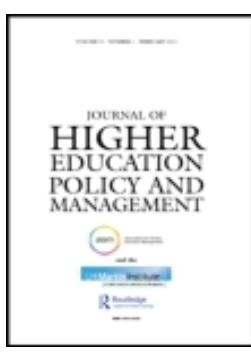
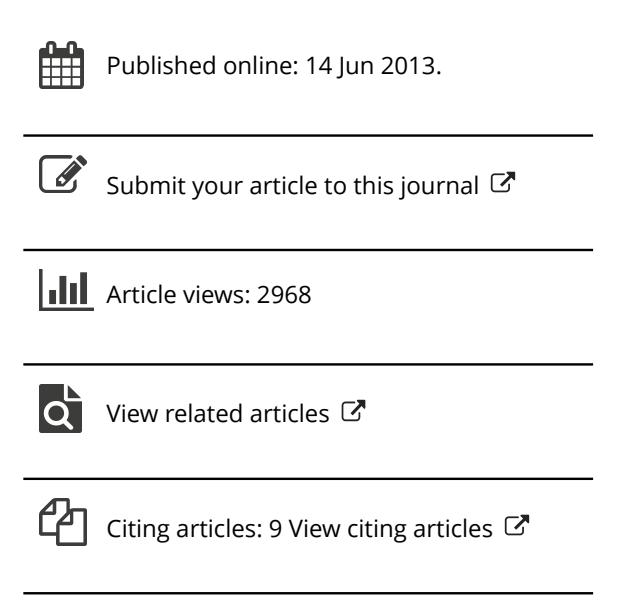

<!-- A1.R39 | source: papers_json/A1.R39/ -->

## **Journal of Higher Education Policy and Management**

**ISSN: 1360-080X (Print) 1469-9508 (Online) Journal homepage: ****[www.tandfonline.com/journals/cjhe20](https://www.tandfonline.com/journals/cjhe20?src=pdf)**

## **The global war for talent: responses and** **challenges in the Singapore higher education** **system**

## **Pak Tee Ng**

**To cite this article:** Pak Tee Ng (2013) The global war for talent: responses and challenges in the Singapore higher education system, Journal of Higher Education Policy and Management, 35:3, 280-292, DOI: [10.1080/1360080X.2013.786859](https://www.tandfonline.com/action/showCitFormats?doi=10.1080/1360080X.2013.786859)

**To link to this article: **[https://doi.org/10.1080/1360080X.2013.786859](https://doi.org/10.1080/1360080X.2013.786859)

<!-- page 2 -->

## **The global war for talent: responses and challenges** **in the Singapore higher education system**

Pak Tee Ng*

*Nanyang Technological University, Singapore, Republic of Singapore*

تتناول هذه المقالة أهداف حكومة Singapore في تطوير نظام higher education لديها ليصبح Global Schoolhouse من أجل الاستفادة من سوق عالمي مربح لـhigher education. ولتحقيق ذلك، يحتاج نظام higher education في Singapore إلى المنافسة عالميًا على talent. وتفحص هذه المقالة استجابات نظام higher education في Singapore والتحديات التي يواجهها في ظل الحرب العالمية على talent. وتصف أولًا نظام higher education في Singapore وتحلل استجابة النظام للحرب على talent. ثم تفحص القضايا والتحديات المتعلقة باستقطاب جامعات عالمية المستوى وأكاديميين بارزين واستقطاب طلاب جامعيين أجانب موهوبين. وعلى وجه الخصوص، ورغم نجاح Singapore في بعض الجوانب، تتمثل التحديات في نمو هذا education hub ضمن منهج تتحكم فيه الحكومة، والفروق الثقافية بين السكان المحليين والمواهب الأجنبية، والمشاعر المحلية تجاه المواهب الأجنبية.

**Keywords:** culture; globalisation; higher education; policies; talent; talent war

تُعد الحرب العالمية على talent منافسة شرسة بين اقتصادات كثيرة تتعامل مع آثار globalisation. ودخل استقطاب talent والاحتفاظ بها إلى الخطاب السياسي والاقتصادي في التاريخ الحديث بسبب صعود عصر المعرفة والحاجة إلى عمال معرفة مبدعين (Drucker, 1998, 2000; Goffee & Jones, 2009; Ng, 2011; Reich, 1991). ويرى Florida (2005, p. 26) أن العالم دخل "عصر الإبداع لأن العامل الرئيسي الذي يدفعنا إلى الأمام هو صعود الإبداع بوصفه المحرك الأساسي لاقتصادنا". ويوفر talent المبدع الفارق الحاسم بين الاقتصادات أو الشركات التي تنمو وتبتكر وتلك التي تكافح من أجل البقاء (Cohen, 2001). لذلك، ووفقًا لـMcKinsey & Company، فإن "talent الأفضل يستحق النضال من أجله" (Chambers, Foulon, Handfield-Jones, Hankin, & Michaels, 1998, p. 45).

وبتأثير من خطاب "الحرب العالمية على talent" وظهور نوع جديد من الجدارة العالمية (global meritocracy) (مثل Axelrod, Handfield-Jones, & Welsh, 2001; Brown & Hesketh, 2004; Brown & Tannock, 2009; Chambers et al., 1998; Florida, 2005; Michaels, Handfield-Jones, & Axelrod, 2001)، تُغيّر الحكومات سياساتها الاقتصادية والاجتماعية بل حتى التعليمية لاستقطاب talent والاحتفاظ بها، مما يعزز النموذج التنموي المهيمن لدولة المنافسة (competition state) (Abella, 2006; Lavenex, 2007). ويُنظر إلى استقطاب talent والاحتفاظ بها بوصفه منهجًا استراتيجيًا لمواجهة تحديات globalisation من خلال الاستثمار في "رأس المال البشري" (Brown & Tannock, 2009). وفي الوقت الحاضر، هناك من ينتقد خطاب talent والافتراض غير المتسائل بشأن إسهامها الكبير في النمو التنظيمي والاقتصادي (Groysberg, Nanda, & Nohria, 2004; Pfeffer &

> ^*^Email: paktee.ng@nie.edu.sg

<!-- page 3 -->

Sutton, 2006). والواقع أن أبحاثًا حديثة (Groysberg et al., 2004; Groysberg, McLean, & Nohria, 2006, 2008) تدعم الدور المحوري للسياق في تحديد الأداء الفردي والتنظيمي، وتحذر من الاكتفاء بمحاولة "خوض حرب النجوم والفوز بها" (Groysberg et al., 2004, p. 92). ورغم هذا النقد، تُظهر دول كثيرة سلوكيات تكديس talent لتلبية احتياجاتها الاقتصادية والتنموية الخاصة (Brown & Tannock, 2009).

وتُغذّي الحرب على talent زيادة نفاذية الحدود الجغرافية والثقافية (Baruch, Budhwar, & Khatri, 2006) واستعداد الناس للانتقال من بلدانهم الأصلية (Tung & Lazarova, 2006; Tung, Worm, & Petersen, 2008). ورغم أن "brain drain" مشكلة تواجه اقتصادات كثيرة، فإنها تدير هذه المشكلة من خلال تشجيع اتجاهات الهجرة العكسية، واستقطاب المهاجرين العائدين ذوي التأهيل العالي، واستقطاب talent من اقتصادات أخرى. وهذا يحوّل مشكلة "brain drain" إلى ديناميكية "تدفق talent" يمكن إدارتها (Carr, Inkson, & Thorn, 2005). والحرب العالمية على talent ديناميكية.

Singapore دولة صغيرة تُعد الموارد البشرية موردها "الطبيعي" الوحيد. لذلك، ومنذ الاستقلال في 1965، ركزت Singapore على التعليم بوصفه الوسيلة لتلبية احتياجاتها من القوى العاملة، إذ واجهت البلاد تحديات التصنيع في الماضي وتواجه اليوم تحديات اقتصاد المعرفة. وكان التعليم دائمًا نفقة - وربما استثمارًا يستحق العناء للمستقبل، لكنه يظل بندًا من بنود الإنفاق في الميزانية الوطنية. أما الآن، فقد تغير هذا الوضع. إذ يُطوَّر التعليم بشكل متزايد ليصبح قطاعًا رئيسيًا مولدًا للإيرادات في الاقتصاد (Mok & Cheung, 2011; Ng & Tan, 2010). وفي ضوء ذلك، أصبح talent عبارة رائجة مع منافسة هذا القطاع المولّد للإيرادات نظراءه في العالم.

يُقبل الطلب بشدة على أصحاب talent البارزين، وبالتالي لديهم رفاهية البحث عن أماكن تقدم لهم عرض قيمة يجذبهم. وقد يكون على رأس أولوياتهم أسئلة عن كيفية سماح المكان لهم فعليًا بتحقيق إمكاناتهم وأهدافهم في الحياة، وسمعة المكان الذي سيرتبطون به، سواء الآن أو في المستقبل. ولا يقدم هؤلاء الأشخاص الموهوبون للشركات أعلى قيمة فحسب، بل لديهم القدرة على تقديم قيمة أكبر حتى، بشرط توفر البيئة والتوجيه والرعاية المناسبة. لذلك، ينبغي أن تركز المؤسسات والاقتصادات على جعل نفسها أكثر قيمة بالنسبة إلى الأشخاص الموهوبين من خلال تحسين علامتها التجارية وطريقة إدراك هذه المواهب لها (Goffee & Jones, 2009). ويمكن قول الأمر نفسه عن نظام higher education في أجزاء كثيرة من العالم (مثل Mok & Cheung, 2011)، وبشكل خاص في Singapore.

وتُعد الحرب على talent جزءًا من ظاهرة globalisation الأوسع. ورغم أن globalisation تبدو خطابًا كليًا (macro)، لا يمكن مناقشتها بفعالية إلا بالإشارة إلى السياق المحلي (Beck, 2002). لذلك، تهدف هذه المقالة إلى فحص استجابات نظام higher education في Singapore والتحديات التي يواجهها في ظل الحرب العالمية على talent. وتصف أولًا نظام higher education في Singapore وتحلل استجابة النظام للحرب على talent. ثم تفحص القضايا والتحديات المتعلقة باستقطاب جامعات عالمية المستوى وأكاديميين بارزين وطلاب جامعيين أجانب موهوبين إلى Singapore.

## **The Singapore higher education system and its governance**

توجد حاليًا خمس جامعات محلية في Singapore، هي National University of Singapore (NUS)، وNanyang Technological University (NTU)، وSingapore Management University (SMU)، وSingapore University of Technology and Design (SUTD)، وSIM University. والجامعات الأربع الأولى ممولة من الحكومة وتُعرف بـAutonomous Universities، في حين أن الخامسة جامعة محلية خاصة.

<!-- page 4 -->

تتولى الجامعة المستقلة (Autonomous University) الملكية الكاملة لتطورها الخاص، مما يسمح لها بأن تصبح أكثر استجابة في تكييف أجندتها التعليمية والبحثية لتلبية الاحتياجات الوطنية وتعزيز التجربة التعليمية لطلابها. غير أن الحكومة تحافظ على سيطرة مركزية على الجامعات المحلية من خلال أنظمة المساءلة والتمويل. وقد ذكرت الحكومة أنه رغم استقلاليتها، يجب أن تواصل الجامعات المستقلة المحلية، بوصفها جامعات وطنية، أداء أدوارها الأساسية في تدريب القوى العاملة من الخريجين لاقتصاد Singapore (Ministry of Education, 2007). وعلى وجه التحديد، تنص القوانين البرلمانية على أن تقدم الحكومة تمويلًا للجامعات المستقلة، ويُتوقع منها أن تستخدم الموارد فقط للأهداف التي وافق عليها وزير التعليم. ويملك الوزير أيضًا صلاحية تعيين وعزل أعضاء مجلس الأمناء (Trustees)، ومنح موافقته على قبول أعضاء الجامعة أو إزالتهم؛ والتصرف في أعمال الجامعة أو ممتلكاتها؛ والتصفية الطوعية للجامعة؛ وأي تعديلات على وثائق تأسيس الجامعة.

يُعد ضمان جودة التعليم مصدر قلق كبير لحكومة Singapore (Ng, 2008, 2010). ويضمن إطار مساءلة للجامعات، يتألف من إطار ضمان الجودة القائم للجامعات (Quality Assurance Framework for Universities) ومجموعة من اتفاقيات السياسة والأداء (Policy and Performance Agreements) بين Ministry of Education (MOE) وكل جامعة، عدم المساس بالجودة (University Autonomy & Governance and Funding Steering Committee, 2005). ورغم أن هذه الجامعات الممولة من القطاع العام تتمتع باستقلالية كبيرة منذ إقرار University Corporatization Act في عام 2005، لا تزال الحكومة قادرة على الحفاظ على سيطرتها على هذا القطاع من خلال أطر الأداء هذه (Gopinathan & Lee, 2011; Lee & Gopinathan, 2007). ويُوصف Autonomous Universities، رغم كونها "مستقلة"، بدقة أكبر بأنها "مؤسسات ممولة من الدولة، تُدار خاصًا، وخاضعة للمساءلة العامة" (Ng & Tan, 2010, p. 182).

وإلى جانب الجامعات المحلية العامة، يُعد transnational higher education صناعة نشطة في Singapore. وأدى إدراج higher education بوصفه صناعة ضمن إطار General Agreement of Trade in Services إلى تغيير كبير في المشهد العالمي لـhigher education (Knight, 2006). وتوجد الآن جهات متنوعة تقدم higher education في Singapore، باستخدام أنماط تتراوح بين وجود حرم جامعي محلي، وتنفيذ برامج مشتركة مع مؤسسات محلية، والتعلم عن بعد (distance-learning)، وبرامج التوأمة (twinning programmes).

## **The responses of the Singapore higher education system to the talent war**

مع سوق عالمي للتعليم تقدر قيمته بنحو $US2.2 trillion، يُعد قطاع higher education في Singapore قطاعًا رئيسيًا مولدًا للإيرادات في الاقتصاد (Chan & Ng, 2008; Ng & Tan, 2010; Yeo, 2003). وتتمثل الرؤية في وضع Singapore بوصفها "Global Schoolhouse" (Yeo, 2003) - "Boston of Asia" و"Mecca للدبلومات والدرجات العلمية وhigher education" (Duhamel, 2004, p. 40). وأوضح George Yeo، الذي كان آنذاك وزير Trade and Industry، أنه إذا استطاعت Singapore مضاعفة عدد الطلاب الدوليين مرتين أو ثلاث مرات ليصل إلى 100,000 أو 150,000، فستنشأ آثار اقتصادية جانبية متنوعة، بما في ذلك منافع لأسواق التجزئة وتأجير المساكن. علاوة على ذلك، سيوسع الطلاب الأجانب شبكة Singapore الدولية عند عودتهم إلى بلادهم (Yeo, 2003).

غير أنه، لتنمية هذه الصناعة المربحة كثيفة المعرفة من أجل اكتساب سمعة دولية وحصة سوقية أكبر، يُعد talent أمرًا حاسمًا. ويحتاج نظام higher education في Singapore إلى جامعات عالمية المستوى وأكاديميين بارزين. كما يحتاج إلى استقطاب أفضل الطلاب في العالم لتلقي التعليم في مؤسساته. وبعبارة أخرى، وفي ظل حرب عالمية على talent، يحتاج نظام higher education في Singapore أيضًا إلى المنافسة عالميًا على talent.

<!-- page 5 -->

## *Attracting world-class universities and top academics*

منذ منتصف التسعينيات، تدعو Singapore بشكل استراتيجي جامعات عالمية المستوى لإنشاء Centres of Excellence في البلاد لقيادة research & development (R&D) ونقل المعرفة إلى الصناعات، وذلك كله بما يتماشى مع رؤية Global Schoolhouse أو education hub العالمي (Ng & Tan, 2010; Olds, 2007; Sidhu, 2009). وتشمل الجامعات عالمية المستوى التي دخلت مشهد higher education في Singapore INSEAD (Institut Européen d'Administration des Affaires)، وUniversity of Chicago Graduate School of Business، وUniversity of Pennsylvania's Wharton School، وMassachusetts Institute of Technology، وTechnische Universiteit Eindhoven، وTechnische University Munchen، وGeorgia Institute of Technology، وJohns Hopkins University (Ng & Tan, 2010).

كما تُحث الجامعات المحلية على تبني نموذج ريادي (entrepreneurial model) (Wong, Ho, & Singh, 2007). وتحت رعاية الحكومة، تُشكّل الجامعات المحلية شراكات مع جامعات أجنبية ذات جودة عالية كجزء من التوسع والتنويع في مشهد higher education المحلي (Chan & Ng, 2008; Gopinathan & Lee, 2011; Ng & Tan, 2010). فعلى سبيل المثال، وفيما كان أول شراكة جامعية ألمانية-آسيوية، قدمت TUM Asia، وهي فرع مملوك بالكامل لـTechnische Universität München، درجات دراسات عليا مشتركة مع NUS وNTU. وأطلق Singapore National Institute of Education، وهو جزء من NTU، درجة دكتوراه تعليمية مزدوجة مشتركة مع Institute of Education بـUniversity of London. وتعاون Lee Kuan Yew School of Public Policy، وهو جزء من NUS، مع School of International and Public Affairs بـColumbia University، وLondon School of Economics and Political Science، وInstitut d'Etudes Politiques de Paris لتقديم درجة ماجستير مزدوجة. وارتبط Nanyang Academy of Fine Arts بـRoyal College of Music في United Kingdom في برنامج درجة علمية. وفي وقت أحدث، تعاونت SUTD مع Massachusetts Institute of Technology وZhejiang University لتقديم منهج متعدد التخصصات للتعلم يكون فيه design تخصصًا محوريًا. وارتبطت NUS بـYale University لإطلاق برنامج liberal arts.

ويتمثل جزء آخر من الاستجابة للحرب العالمية على talent في استقطاب أكاديميين أجانب بارزين للعمل في مؤسسات higher education في Singapore. وتحاول الحكومة إغراء كبار الأساتذة الأجانب للقدوم إلى Singapore من خلال منح بحثية سخية ومكافآت جذابة. وفي السنوات الأخيرة، استقطبت Singapore عددًا لا بأس به من هؤلاء الأساتذة البارزين للقدوم إلى الجزيرة الوطنية لمتابعة أبحاثهم في مجالاتهم. ومن اللافت أنه كان من بينهم عالم الأحياء البريطاني الحائز على Nobel Prize، Sydney Brenner؛ والباحثان الطبيان الأمريكيان Neal Copeland وNancy Jenkins، اللذان عملا في National Cancer Institute في Maryland؛ وAlan Coleman، الذي كان جزءًا من الفريق الذي استنسخ Dolly the sheep؛ وEdison Liu، الخبير في functional genomics لسرطانات الإنسان. ورغم أن هذه الأمثلة يمكن اعتبارها نجاحات في استقطاب talent أجنبي بارز، فإن الاحتفاظ بهؤلاء الأجانب الموهوبين قضية أصعب بكثير، مع تفاوت مستويات النجاح في كل حالة.

فعلى سبيل المثال، عاد Neal Copeland وNancy Jenkins إلى United States بعد سنوات قليلة. ووفقًا لتقرير إخباري، أُصيبا بالإحباط من التعامل مع البيروقراطية (red tape) والضغط المتزايد للتركيز على النتائج الاقتصادية للحصول على التمويل (Wong, 2011). كما غادر خبير آخر في المجال الطبي الحيوي، Professor Edison Liu، Singapore ليتولى رئاسة مرفق بحثي مرموق في مجال الوراثة في Maine بـUS. ووفقًا لتقرير، شعر علماء الأحياء في Singapore بأن مجتمعهم يتلقى ضغطًا مفرطًا من جهات التمويل لتوليد عوائد اقتصادية (Normile, 2011). والواقع أن الفروق في الثقافات المؤسسية بين جامعة في Singapore وأخرى في الغرب تجعل على الأرجح أي أكاديمي أجنبي يتساءل عما إذا كان سيندمج ويزدهر في بيئة لا تُعرف بالانفتاح. وقد لا يرغب الأكاديميون الأجانب في اتباع أجندة بحثية رسمية لمجرد توفر الدعم المالي. غير أن Sydney Brenner بقي في Singapore وحصل على جائزة Distinguished Friends of Singapore عام 2000 عن

<!-- page 6 -->

إسهاماته في تقدم علوم الحياة في البلاد. ويقسم Alan Coleman وقته الآن بين عمله كباحث رئيسي في Institute of Medical Biology في Singapore ومديرًا جديدًا لـStem Cell Centre في King's College London. لذلك، لا يُعد استقطاب talent الأجنبي والاحتفاظ به أمرًا بسيطًا. وتختلف النتائج من حالة إلى أخرى. وتصبح الاستجابة للحرب على talent ممارسة مستمرة لإدارة تدفق ديناميكي لـtalent الأجنبي في البلاد.

وفي السنوات الأخيرة، وبدلًا من "big whales"، اتجهت الحكومة إلى استقطاب علماء أجانب شباب ومنحهم منحًا بحثية لمتابعة أبحاثهم الرائدة في Singapore. فعلى سبيل المثال، في عام 2011، جرى اختيار 11 عالمًا شابًا أجنبيًا من بين 174 متقدمًا على مستوى العالم، ومُنح كل منهم منحة بحثية بقيمة $3 million لمدة 5 سنوات (National Research Foundation, 2011) لعملهم. وكانت من بينهم Dr Kimberly Kline، وهي عالمة أمريكية درست أبحاثها كيفية التعامل مع البكتيريا المقاومة للمضادات الحيوية الحديثة. وذكرت Dr Kline أن المنحة وفرت نقطة انطلاق مثالية لإسهامها في المجتمع كثيف الأبحاث في Singapore (National Research Foundation, 2011).

## *Attracting talented foreign students*

يُعد استقطاب الطلاب الدوليين للدراسة في Singapore مسعى تُبادر به الحكومة وتدعمه من خلال وزارات أو هيئات قانونية متعددة. وتتمثل الفكرة في الترويج للعلامة التجارية الدولية لـSingapore بوصفها مقدمًا لتعليم عالي الجودة، وتقديم الدعم للمؤسسات المحلية للوصول إلى شريحتها السوقية المتخصصة من خلال منصات متنوعة، وإنشاء قنوات معلومات موثوقة تُعزز مكانة Singapore بوصفها learning hub عالمي المستوى بين الطلاب الدوليين. غير أنه، للحصول على اعتراف عالمي المستوى، تحتاج Singapore إلى استقطاب طلاب أجانب موهوبين. وتتمثل إحدى طرق تحقيق ذلك في منح scholarships للطلاب الأجانب المتفوقين.

توجد منح دراسية عديدة للطلاب الأجانب المتفوقين في Singapore. وبعض هذه المنح متاح في جميع المؤسسات التعليمية عبر Singapore لكنها مفتوحة فقط للطلاب المتقدمين من دول محددة مثل دول ASEAN وIndia وHong Kong. ومن أمثلة هذه المنح Asean Scholarships وSIA Youth Scholarship وHong Kong Scholarship. كما توجد منح مفتوحة لجميع الجنسيات لكنها تُقدَّم فقط لبرامج دراسية في مؤسسات محددة للتعليم العالي. فعلى سبيل المثال، تقدم SMU منحة SMU Sports Scholarship ومنحة Ian Ferguson Foundation Scholarship، في حين تقدم NTU منحة Nanyang Scholarship ومنحة NatSteel Asia's Scholarship. كما توجد منح تُقدَّم لطلاب من دول محددة وتكون متاحة فقط في جامعات مختارة. فعلى سبيل المثال، تُقدَّم منحة Dr Goh Keng Swee Scholarship فقط للمتقدمين من دول ASEAN الذين يدرسون في NTU أو NUS. ولتيسير التقدم بطلبات المنح، توجد بوابة إلكترونية شاملة تُدعى Brightsparks تجمع المعلومات ذات الصلة والتحديثات حول جميع الأمور المتعلقة بالمنح الدراسية في Singapore، من البحث عن المنح إلى التقديم عليها إلى متابعة حالتها. وتجعل هذه التسهيلات من السهل والجذاب للطلاب الأجانب الموهوبين تأمين منح دراسية للدراسة في Singapore.

وإلى جانب scholarships، يوجد نظاما منح تحت MOE لغير المواطنين - Tuition Grant Scheme وService Obligation Scheme. ويُخصص Tuition Grant Scheme لطلاب الدبلوم والبكالوريوس بدوام كامل من غير مواطني Singapore أو المقيمين الدائمين فيها. وفي هذا النظام، يُطلب من الطلاب توقيع اتفاقية Tuition Grant Agreement، تُلزمهم تعاقديًا بتقديم خدمة لشركات مقرها Singapore لمدة 3 سنوات عقب إتمام دراستهم. وهذا النظام متاح للطلاب الدارسين في مؤسسات تعليمية متنوعة محددة بموجب المنحة. ويجوز للطلاب الدوليين الذين يتابعون

<!-- page 7 -->

دراساتهم العليا في الجامعات المحلية الأربع الممولة من القطاع العام (NTU وNUS وSMU وSUTD) التقدم لبرنامج Service Obligation Scheme. وبموجب هذا النظام، يجب على الطلاب الدوليين إتمام التزام (bond) لمدة 3 سنوات للعمل مع شركات مقرها Singapore عقب التخرج.

## **Issues and challenges**

رغم استجابة نظام higher education في Singapore للحرب العالمية على talent، توجد قضايا وتحديات متنوعة، هي:

- Government control and the long-term development of the Global Schoolhouse
- Cultural differences between local and foreign institutions and talents
- Local sentiments to influx of foreign talent

## *Government control and the long-term development of the global schoolhouse*

يُعد تطوير Global Schoolhouse أجندة حكومية. لذلك، وانسجامًا مع أسلوب الحكم العملي (pragmatic) للحكومة، فإن الجامعات التي يمكنها دخول السوق هي جامعات مرموقة عالميًا، مدعوة تحديدًا من قِبل حكومة Singapore (Gopinathan & Lee, 2011; Lee & Gopinathan, 2007). وتُدير الحكومة Global Schoolhouse وتنظمها بعناية. وقد أوضح Senior Minister of State for Trade and Industry and for Education، السيد S Iswaran، فلسفة الحكومة في هذا الشأن أمام البرلمان:

Firstly, we put effort in selecting the right partners of the highest quality. Secondly, these partnerships are structured to mutually benefit Singapore and its partners. Thirdly, we will also ensure that capabilities are transferred to and embedded in our institutions, so that the value lasts not just for the duration of the partnership, but yields long term benefits. As a principle, MOE calibrates resources allocated and ensures that the funding for each collaboration is commensurate with its scope and scale. It is also tied to milestones which meet the objectives of the collaboration. Is there a risk that embarking on such collaborations will not yield what we seek? The answer is yes. But does it mean that we do not embark on such ventures? I think the overall benefits outweigh the costs and the risks so we should ensure that we meticulously structure the arrangements to mitigate downside risks and maximise benefits to us. (Iswaran, 2011, para 5)

يُعد هذا منهجًا تجاريًا وتعامليًا (transactional) للتعاون مع المؤسسات الأجنبية. وتُقلل الحكومة المخاطر عمدًا وتُعظّم المنفعة. وفي حين توجد الآن أمثلة نجاح متعددة ولامعة، فإن حالة University of New South Wales (UNSW) تُعد مع ذلك مثالًا على منهج الحكومة الذي لم يسر كما هو متوقع (انظر Chan & Ng, 2008; Ng & Tan, 2010). وكان يُقصد بـUNSW Asia أن تكون جامعة بحثية وتعليمية شاملة تقع في Singapore، مملوكة بالكامل لمؤسستها الأم. وهدفت UNSW إلى إنشاء جامعة شاملة في Singapore بحرم جامعي واسع بُني خصيصًا لها. واستطاعت UNSW التخطيط لإنشاء مثل هذا الحرم لأنها كانت تعتمد على دعم مالي قوي من حكومة Singapore عبر Economic Development Board. وقُدّم مبلغ إجمالي قدره $S32.3 million من Economic Development Board لـUNSW، منه $S17.3 million كمنح و$S15 million كقروض.

غير أن حزمة الدعم جاءت بشروط. ووفقًا لـEconomic Development Board، كانت حزمة الدعم، التي تضمنت حوافز ضريبية ومنحًا وقروضًا، "قابلة للاسترداد إذا لم تُحقَّق المعالم والنتائج المتفق عليها مسبقًا" (نقلًا عن

<!-- page 8 -->

Davie, 2007, p. 29). وشملت هذه النتائج أعداد الالتحاق. غير أن الدفعة الافتتاحية في عام 2007 شهدت التحاقًا أقل من المتوقع. ووفقًا لـProfessor Fred Hilmer، نائب رئيس UNSW، وضعت أعداد الالتحاق الأقل من المتوقع الجامعة في وضع مالي غير مستدام. وفي عام 2006، أنفقت UNSW Asia (الحرم الجامعي في Singapore) مبلغًا أكبر قليلًا من $S17.3 million الذي قدمته Economic Development Board لـSingapore كمنح. كما تحملت الجامعة دينًا قدره $S156.8 million، سحبت منه بالفعل $S21 million. ولم يكن لدى الحرم الرئيسي لـUNSW سوى $A200 million كاحتياطي. وبعد نحو شهرين فقط من بدء عملياتها في March 2007، أعلنت UNSW إغلاقها وانسحابها التام من Singapore.

وتُعطي هذه الحادثة الشركاء الأجانب المحتملين سببًا للتوقف والتفكير. وتتوقع حكومة Singapore بالفعل أن يفي نظراؤها الأجانب بجزئهم من الاتفاق. وتستعد الحكومة لأن تكون سخية في المنح المالية وتيسير أي تطور يتماشى مع نيتها، لكنها حذرة دائمًا على مستوى الحوكمة (Chan & Ng, 2008). وعلى مدار تاريخ Singapore منذ الاستقلال، كانت الحكومة اللاعب الأكبر في قطاعات رئيسية متنوعة من الاقتصاد، إذ بادرت باستقطاب الاستثمار الأجنبي المباشر إليها، مع اتباع القطاع الخاص لها. ويحدث الأمر نفسه الآن في Global Schoolhouse. وللحضور الحكومي القوي في هذه الشراكات مع جامعات عالمية المستوى مزايا وعيوب (Ng & Tan, 2010). فمن ناحية، يُسرّع الحضور والاستثمار الحكوميان القويان بلا شك الوتيرة التي تُوضع بها Singapore على خريطة higher education العالمية. لكن، يكمن العيب في منهج "الاستهداف الصناعي" هذا في أنه قد يصبح ضحية لنفسه، لأن الاقتصاد يتقدم بوتيرة أسرع من نضج التعلم (Young, 1992). ونظرًا إلى منهج التدخلات الحكومية المتعمدة التجاري والتعاملي، يُطرح السؤال عما إذا كان نظام higher education قد ينضج لينتج نظامًا ذاتي الاستدامة على المدى الطويل بمعدل معقول من القدرة والإنتاجية الداخلية.

## *Cultural differences between local and foreign institutions and talent*

لا يُعد استقطاب جامعات وأكاديميين أجانب موهوبين أمرًا بسيطًا يقتصر على تقديم ترتيبات تمويل ممتازة أو حزم مكافآت جذابة. إذ توجد فروق ثقافية عديدة ينبغي مراعاتها. ويتمثل أحد الفروق الثقافية ذات الصلة في تفسير "academic freedom". وطُرحت تساؤلات حول ما إذا كان بإمكان المساعي الأكاديمية أن تزدهر "بحرية" في Singapore، مع وصف الحكومة بأنها استبدادية (Rodan, 2004) وسيطرة (Trocki, 2006). وهذا تحدٍّ ستحتاج Singapore إلى معالجته عند استقطاب مواهب أجنبية ذات قيم وتفسيرات ثقافية مختلفة.

ومن الأمثلة الحديثة على هذا التحدي حالة Yale-NUS Liberal Arts Programme. ففي September 2010، وقّعت NUS وYale University مذكرة تفاهم لإنشاء برنامج liberal arts يجمع بين المدرستين الفكريتين الشرقية والغربية في تعليم liberal arts. ويُعد هذا المشروع الأول من نوعه في Asia، ويُفترض أن يكون شراكة بارزة لإنشاء نموذج جديد للتعليم الجامعي في Asia. ومن المقرر أن يبدأ في July 2013، حيث سينخرط طلاب رواد من Singapore في برنامج انغماس (immersion) في حرم New Haven التابع لـYale لتعريف الطلاب بتعليم liberal arts وحياة الكلية السكنية. وسيتضمن ذلك انخراط الطلاب في الحياة اللامنهجية والأكاديمية بـYale، والرياضات داخل الحرم الجامعي، وRector's Teas، وإنشاء فعالياتهم الخاصة من خلال حكومة طلابية نشطة.

مع ذلك، توجد تعقيدات متأصلة في الجمع بين ثقافتين مختلفتين تمامًا في المساعي الأكاديمية. والواقع أن ثقافة مؤسسة أمريكية يمكن أن تكون مختلفة تمامًا عن ثقافة مؤسسة في Singapore، مع تفسيرات متباينة لمفاهيم "liberal education" و"democracy" و"freedom". وهذه قضية معقدة يتعين على المؤسسة الجديدة

<!-- page 9 -->

التعامل معها، خصوصًا في برنامج liberal arts. وبينما كان الإداريون في كلا الجامعتين متحمسين للتعاون، لم يكن بعض أعضاء هيئة التدريس في Yale متحمسين بالقدر نفسه لهذا الاحتمال. وذكرت *Yale Daily News*:

When University President Richard Levin and University Provost Peter Salovey first announced the project in September 2010, a small group of professors objected to Yale's decision to open a jointly run campus in a nation that they said could not support the University's values. That debate intensified in New Haven earlier this month when roughly 150 professors gathered at the Yale College faculty meeting for nearly three hours to hear colleagues voice concern about Yale-NUS. (Kofman & Stephenson, 2012, para 2–3)

ورغم معارضة رئيس Yale، Richard Levin، أقر أساتذة الجامعة قرارًا يحث كلية Yale-NUS على "التمسك بالحرية المدنية والحرية السياسية في الحرم الجامعي وفي المجتمع الأوسع" و"احترام وحماية وتعزيز مبادئ عدم التمييز للجميع" (Aw, 2012, para 2). وبعد إقرار القرار، أعلن Levin صراحة أنه، رغم تقديره لانخراط زملائه والتزامهم بمبادئ مهمة، يعارض القرار لأنه لم يعكس الاحترام المتبادل الذي ميّز التعاون بين Yale وNUS منذ البداية (Aw, 2012).

ومع ذلك، أكد الإداريون في كلا الجامعتين التزامهم بتطوير الكلية الجديدة. وانتقد أعضاء من هيئة التدريس في Yale رئيسها، Professor Levin، للمضي قدمًا في التعاون مع NUS دون تشاور كافٍ مع أعضاء هيئة تدريس Yale. وتساءل عدد من أعضاء هيئة التدريس في Yale عما إذا كانت Yale قد "باعت مبادئها" (sold out) بالشراكة مع NUS، وعما إذا كانت الجامعة توسعت من أجل التوسع فحسب وانضمت إلى "الاندفاع الأكاديمي نحو الذهب" (gold rush). غير أن Levin أكد أن الشراكة كانت في نهاية المطاف قرار Yale Corporation (Kofman & Stephenson, 2012).

غير أنه لم يكن جميع من في Yale ضد الشراكة. وذكر تقرير إخباري (Kai, 2012) أن Professor Pericles Lewis، الذي كان عضو هيئة تدريس في Yale في قسمي English وComparative Literature منذ 1998، وعُيِّن أول رئيس للكلية الجديدة، تناول قضية academic freedom في Singapore. وذكر أن Yale، عند الشراكة مع NUS، توصلت إلى اتفاق يضمن academic freedom، وهو ما أيدته NUS أيضًا بقوة. وأوضح أن بإمكان الطلاب التحدث عما يريدون وبإمكان الأساتذة تدريس ما يريدون ومتابعة أبحاث قد تكون مثيرة للجدل، ورأى أن "... الأمور تتغير هنا (في Singapore) بسرعة، وكثير من الناس في US لديهم انطباع عنها فقط من تقارير صحفية قديمة" (Kai, 2012, para 8).

كما ذكر تقرير إخباري آخر أن Lewis تحدث مع أكاديميين في Singapore، محليين وأجانب، وكان مقتنعًا بأن أعضاء هيئة التدريس أحرار في تدريس القضايا المثيرة للجدل وإجراء أبحاث عنها (Davie, 2012). ونظرًا إلى الاهتمام الإعلامي بهذه المسألة، أوضح Education Minister، Heng Swee Keat، في البرلمان أن هذه قضية داخلية أساسًا في Yale وتُعالَج من قِبل إدارة Yale. غير أنه أشار إلى أن إدارة Yale ناقشت مع NUS "كيف يمكنهما معًا تصحيح أي مفاهيم خاطئة عن Singapore بين مختلف أصحاب المصلحة في الجامعة"، وأن "عددًا من Singaporeans والأجانب المتفهمين لـSingapore جيدًا قد كتبوا في منتديات متنوعة لتقديم منظورات عادلة وموضوعية عن مجتمع Singapore" (See 2012, para 3–4).

## *Local sentiments towards the influx of foreign talent*

توجد مشاعر متنامية بين Singaporeans مفادها أن أماكن الجامعات المحلية تُفقد بشكل متزايد لصالح الطلاب الأجانب. ونظرًا إلى أن higher education في Singapore مدعومة للمواطنين وأن عدد الجامعات المحلية قليل جدًا، كانت المنافسة شديدة للغاية.

<!-- page 10 -->

وقد أدى الحضور المتزايد للطلاب الأجانب الموهوبين بينهم إلى توترات بين السكان المحليين.

وقد عزّزت التقارير الإخبارية الوعي بهذه القضية والنقاش حولها. فعلى سبيل المثال، ذُكر أن طالبة جامعية منزعجة في سنتها الأولى قالت إن الطلاب المحليين، بوصفهم طلابًا محليين، رأوا نظراءهم الأجانب منافسة شرسة، مما جعل الطلاب المحليين يشعرون بالإحباط بدلًا من التحفيز (Lur, 2011). كما ذُكر أن طالبة في المدرسة الثانوية اشتكت من المعاملة غير العادلة المتمثلة في التنافس مع الطلاب الدوليين وضآلة فرصتها في الدراسة في جامعة محلية رغم تلقيها تعليمًا ما قبل جامعي أكثر صرامة في Singapore (Lur, 2011).

كما أثار أعضاء البرلمان قضية talent الأجنبي في البرلمان، متسائلين عما إذا كانت الحكومة قد بالغت في التركيز على استقطاب طلاب أجانب موهوبين على حساب إزاحة الطلاب المحليين (Ministry of Education, 2011a, 2012). فعلى سبيل المثال، لخّص عضو البرلمان Lim Biow Chuan هذه المشاعر خلال جلسة برلمانية بالإشارة إلى أن بعض طلاب Singapore كانوا غير راضين لأنهم لم يتمكنوا من تأمين أماكن في جامعات محلية واضطروا إلى دفع رسوم مرتفعة لتعليم جامعي في الخارج، بينما كانت هناك أماكن يشغلها طلاب أجانب قد لا يقدّرون هذه الأماكن أصلًا (Lim, 2011).

وأدت حادثة حديثة تتعلق بتعليق مهين نُشر عبر الإنترنت من قِبل باحث أجنبي في جامعة محلية إلى إخضاع سياسة الحكومة بشأن منح scholarships للطلاب الأجانب الموهوبين لتدقيق مكثف. وناقش كثير من المواطنين هذه الحالة في منتديات عامة متنوعة، معظمها مجتمعات عبر الإنترنت، بشأن سلامة السياسة الحكومية في استقطاب talent الأجنبي. وكان هذا الباحث الأجنبي قد حصل على منحة حكومية منذ كان طالبًا في المدرسة الثانوية. وفي February 2012، نشر تعليقًا مهينًا على حسابه الشخصي في موقع تواصل اجتماعي، قائلًا إن "there are more dogs than humans in Singapore"، في إشارة إلى تجاربه غير السارة مع Singaporeans (Chua, 2012). وشعر كثير من Singaporeans بالإهانة. وبالنسبة إلى السكان المحليين، عكس التعليق جحود الباحث تجاه البلاد التي ساعدته على تأمين مستقبل جيد بفضل جودة التعليم الذي أُتيح له، بل وموّل له.

وفي غضون أسابيع، عاقبت الجامعة الطالب بغرامة كبيرة قدرها SG$3000، وإلغاء منحته البحثية، ودفعة قدرها SG$8200 لفصله الدراسي الأخير. وكان من المفترض أن يتخرج في June 2012، لكنه اضطر الآن إلى فصل دراسي إضافي كجزء من الإجراء التأديبي. وظل مسؤولًا عن إتمام التزامه (bond) بمنحته لمدة ست سنوات للعمل في Singapore (Nanayakara & Tong, 2012). وأعرب Provost وBoard of Discipline بالجامعة عن أسفهما لأن تعليق الباحث "أثار قدرًا كبيرًا من عدم الارتياح وانعدام الثقة والاستياء في المجتمع" (Chan, 2012). كما أعربت Education Ministry عن خيبة أملها من التعليق "غير المسؤول" الصادر عن الباحث.

وإدراكًا للمشاعر المحلية، طمأن Education Minister، Heng Swee Keat، المواطنين:

The universities, various community organisations and government agencies award scholarships and bursaries to locals for studies in our local universities. In AY2010, a total of around 30,300 Singapore Citizens received a scholarship or some form of financial assistance which helped fund their undergraduate education. The Government intends to offer more scholarships to locals, to nurture a strong core of Singaporean talent with the requisite skills to anchor our key current and emerging economic sectors, and secure our future. (Ministry of Education, 2011b, para 5–6)

غير أنه، حتى في ظل التكاليف السياسية المحتملة، تتمسك الحكومة بأن Singapore لا تزال بحاجة إلى قبول talent الأجنبي في البلاد. ويرى رئيس الوزراء Lee، في تأكيده على هذا الموقف، أن على Singapore إيجاد التوازن الصحيح، بدلًا من

<!-- page 11 -->

تبني مواقف متطرفة، من أجل "معالجة الضغوط والتوترات التي يشعر بها الناس، مع تتبع تحدياتنا الخارجية والاستجابة لها والحفاظ على صحة استراتيجياتنا طويلة الأمد" (Lee, 2011, para 8). ويتمثل التحدي بطبيعة الحال في "ضبط سياستنا وسياساتنا معًا" (Lee, 2011, para 8)، وهو أمر ليس سهل التحقيق. بل إن رئيس الوزراء حث الطلاب المحليين قائلًا:

There are many benefits for the local students to have foreign classmates. It prepares them better for the global workplace, it exposes them to the competition and makes them, spurs them to work harder and give their best and quite often the local and the foreign students will even partner and make new start-ups. (Lee, 2011, para 32)

ومع ذلك، لا تزال الحكومة تتخذ خطوات لتعديل سياساتها المتعلقة بقبول الطلاب الأجانب في higher education لطمأنة السكان المحليين بأنهم أولوية الحكومة. ويُحدَّد سقف قبول الطلاب الأجانب حاليًا عند 18 في المئة لكل دفعة اعتبارًا من 2011 (Choo, 2011). وتعتزم MOE تخفيض هذه النسبة إلى 15 في المئة وإضافة 2000 مكان إضافي للطلاب المحليين للقبول في الجامعات المحلية بحلول 2015 (Hoe & Kotwani, 2011; Lee, 2011). وهذا يعني أنه خلال 3 سنوات، ستزداد النسبة من 27 في المئة إلى 30 في المئة من الدفعة سنويًا التي ستلتحق بالجامعات الممولة من الدولة (Wong, 2012).

## **Conclusion**

أوضحت هذه المقالة كيف هدف نظام higher education في Singapore إلى أن يصبح Global Schoolhouse وكيف استجاب للحرب العالمية على talent. كما فحصت هذه المقالة القضايا والتحديات التي واجهتها Singapore في هذه الحرب على talent:

- Government control and the long-term development of the Global Schoolhouse
- Cultural differences between local and foreign institutions and talents
- Local sentiments to influx of foreign talent

وبالنظر إلى المستقبل، ستستمر القضايا الثلاث المذكورة أعلاه في تحدي Singapore Global Schoolhouse مع منافستها للعالم على talent. ورغم هذه التحديات، عُرفت حكومة Singapore بموقفها الاستباقي في معالجة القضايا وحل المشكلات. وستُجرى تحولات معينة في السياسة، وإن كانت بأسلوب متدرج.

وفي جوهر الأمر، يكمن أحد التوترات في أنه بينما لا تزال الحكومة ترغب في السيطرة على تطور higher education، يصبح ذلك صعبًا بشكل متزايد. وقد تكون المنح السخية جذابة في البداية، لكن المنهج المدروس والموجه نحو الأهداف قد لا يحتفظ بالأشخاص الموهوبين للغاية. ومع ذلك، بدأت حكومة Singapore بالفعل التحول نحو إطار عمل وسطي يُسمى "التنظيم الذاتي المنظم" (regulated self-regulation) (Mok, 2005, 2008)، حيث تنخرط الجامعات المستقلة العامة والجامعات الخاصة بشكل متزايد في صنع سياسة higher education وتنفيذها، نظرًا إلى أدوارها المتزايدة الأهمية في التعليم. ويرى Mok (2005, p. 20) أنه "ينبغي إنشاء إطار عمل ذاتي التنظيم لحوكمة هذه المؤسسات الناشئة حديثًا للتنسيق التعليمي الخاص/غير الحكومي، شريطة أن تظل هذه المؤسسات المشاركة ملتزمة بالإطار العام أو التوجيهات التي تضعها الدولة".

ويتمثل توتر آخر بالنسبة إلى Singapore في سياستها الخاصة بـtalent الأجنبي. وهذا لا يعني أنه ينبغي رفض المواهب الأجنبية؛ فالسنغافوريون الأوائل كانوا في الأصل مهاجرين. بل يعني أنه، مع تزايد تأثر مجتمع Singapore بـglobalisation، سيثبت التفسير الجامد والوصفي لـ"استقطاب talent أجنبي" عدم كفايته لمواجهة الحقائق الجديدة. وبدلًا من ذلك، ينبغي للدولة أن تراقب عن كثب قضية معقدة ومتغيرة ومتطورة. ورغم أن سياسات talent الأجنبي

<!-- page 12 -->

تبدو استراتيجية اقتصادية، ستكون القضايا الاجتماعية بل والتكاليف السياسية هي القضايا الحاسمة التي ستحتاج الحكومة إلى التعامل معها. وعملية التغيير معقدة، وليست جامدة. وفي مثل هذا النظام، تؤكد complexity theory أن التبادلات بين أصحاب المصلحة المتفاعلين الكثيرين والعوامل المؤثرة غير خطية، ومتشابكة بشدة، وتتضخم عبر تكرارات عديدة، مما يجعل نتائج التدخلات الحكومية شبه مستحيلة الضمان (Ng, 2009).

وتُعد القضايا والتحديات المحيطة بالحرب العالمية على talent في نظام higher education في Singapore دراسة حالة مفيدة عن المحاولات والتحديات التي تواجهها دول كثيرة في تصميم وتنفيذ سياساتها المتعلقة بـtalent لتعزيز أجندتها الوطنية. وتوجد، ويمكن القول إنها ستظل موجودة دائمًا، توترات اجتماعية خفية متأصلة في مثل هذه السياسات العامة. ومع جني الاقتصاد بعض المنافع من هذه السياسات، سيتعين عليه أيضًا إدارة عواقبها.

## **References**

- Abella, M. (2006). Global competition for skilled workers and consequences. In C. Kuptsch & P.E. Fong (Eds.), *Competing for global talent* (pp. 11–32). Geneva: International Labour Organisation.
- Aw, M. (2012, April 7). Resolution on Yale-NUS College passes despite objection. *Yahoo!* *News Singapore*. Retrieved from http://sg.news.yahoo.com/yale-nus-resolution-passes-despiteobjection.html
- Axelrod, B., Handfield-Jones, H., & Welsh, T. (2001). War for talent, part two. *The McKinsey* *Quarterly*, *10*, 9–11.
- Baruch, Y., Budhwar, P., & Khatri, N. (2006). Brain drain: Inclination to stay abroad afterstudies. *Journal of World Business*, *42*, 99–112.
- Beck, U. (2002). The cosmopolitan society and its enemies. *Theory, Culture and Society*, *19*, 17–44.
- Brown, P., & Hesketh, A. (2004). *The mismanagement of talent*. Oxford, UK: Oxford University Press.
- Brown, P., & Tannock, S. (2009). Education, meritocracy and the global war for talent. *Journal of* *Education Policy*, *24*, 377–392.
- Carr, S.C., Inkson, K., & Thorn, K. (2005). From global careers to talent flow: Reinterpreting'brain drain'. *Journal of World Business*, *40*, 386–398.
- Chambers, E., Foulon, M., Handfield-Jones, H., Hankin, S., & Michaels, E. (1998). The war for talent. *The McKinsey Quarterly*, *7*, 44–57.
- Chan, D., & Ng, P.T. (2008). Similar agendas, diverse strategies: The quest for a regional hub ofhigher education in Hong Kong and Singapore. *Higher Education Policy*, *21*, 487–503.
- Chan, J. (2012, March 26). NUS Scholar Sun Xu punished for online remarks. *Channel News Asia*. Retrieved from[ http://www.channelnewsasia.com/stories/singaporelocalnews/view/1191310/1/.](http://www.channelnewsasia.com/stories/singaporelocalnews/view/1191310/1/.html) [html](http://www.channelnewsasia.com/stories/singaporelocalnews/view/1191310/1/.html)
- Choo, E. (2011, October 21). Foreign students make up 18 per cent of local university intake in 2011. *Channel NewsAsia*. Retrieved from[ http://www.channelnewsasia.com/stories/specialreport/news/](http://www.channelnewsasia.com/stories/specialreport/news/1161001_170/1/.html) [1161001_170/1/.html](http://www.channelnewsasia.com/stories/specialreport/news/1161001_170/1/.html)
- Chua, Y. (2012, February 22). S'poreans outraged over PRC scholar's 'dog' comment. *Yahoo! News* *Singapore*. Retrieved from http://sg.news.yahoo.com/blogs/singaporescene/poreans-outragedover-prc-scholar-dog-072146916.html
- Cohen, D. (2001). *The talent edge*. Toronto: John Wiley.
- Davie, S. (2007, June 3). Why UNSW Asia went under. *The Sunday Times*, p. 29.
- Davie, S. (2012, May 31). Yale Prof to head liberal arts college. *The Sunday Times*, p. A6.
- Drucker, P. (1998). The future that has already happened. *The Futurist*, *32*, 16–18.
- Drucker, P. (2000). Knowledge work. *Executive Excellence*, *17*, 11–12.
- Duhamel, D. (2004, October). Can Singapore be the Boston of Asia? *Singapore Business Review*, pp. 40–42.
- Florida, R. (2005). *The flight of the creative class*. New York: Harper Business.
- Goffee, R., & Jones, G. (2009). *Clever: Leading your smartest, most creative people*. Boston, MA: Harvard Business Press.

<!-- page 13 -->

- Gopinathan, S., & Lee, M.H. (2011). Challenging and co-opting globalisation: Singapore's strategies in higher education. *Journal of Higher Education Policy and Management*, 33, 287–299.
- Groysberg, B., McLean, A., & Nohria, N. (2006). Are leaders portable? *Harvard Business Review*, 84, 92–100.
- Groysberg, B., McLean, A., & Nohria, N. (2008). How star women build portable skills. *Harvard Business Review*, 86, 74–81.
- Groysberg, B., Nanda, A., & Nohria, N. (2004). The risky business of hiring stars. *Harvard Business Review*, 82, 92–100.
- Hoe, Y.N., & Kotwani, M. (2011, December 26). Singapore's education plans in the years ahead. *Channel NewsAsia*. Retrieved from http://www.channelnewsasia.com/stories/specialreport/news/1173388_170/1/.html
- Iswaran, S. (2011). Establishment of new degree-awarding programmes. FY 2011 Committee of Supply Debate: 3rd Reply by Mr S Iswaran, Senior Minister of State for Trade and Industry and Education, on a Quality Higher Education with Opportunities for all. Singapore: Ministry of Education. Retrieved from http://www.moe.gov.sg/media/speeches/2011/03/07/fy-2011-committee-of-supply-de-3.php
- Kai, F. (2012, May 30). Yale-NUS will guarantee academic freedom: College president. Yahoo! News Singapore. Retrieved from http://sg.news.yahoo.com/yale-nus-will-guarantee-academic-freedom--college-president.html
- Knight, J. (2006). Higher education crossing borders: A guide to the implications of the general agreement on trade in services (GATS) for cross-border education. Paris: UNESCO.
- Kofman, A., & Stephenson, T. (2012, March 27). Yale takes brand to Singapore. *Yale Daily News*. Retrieved from http://www.yaledailynews.com/news/2012/mar/27/yale-takes-brand-singapore/
- Lavenex, S. (2007). The competition state and highly skilled migration. Society, 44, 32-41.
- Lee, H.L. (2011, August 14). Prime Minister Lee Hsien Loong's National Day Rally speech at the University Cultural Centre, National University of Singapore. Retrieved from http://www.pmo.gov.sg/content/pmosite/mediacentre/speechesninterviews/primeminister/2011/August/Prime Minister Lee Hsien Loongs National Day Rally 2011 Speech in English.html
- Lee, M.H.H., & Gopinathan, S. (2007). University restructuring in Singapore: Amazing! Or a Maze? *Journal of Comparative Asian Development*, 6, 107–141.
- Lim, B.C. (2011, October 19). Enquiry by Mr. Lim Biow Chuan, Member of Parliament (Mountbatten), during the Debate on President's Address (third allotted day). Retrieved from http://160.96.186.106/search/topic.jsp?currentTopicID=00077964-WA&currentPubID=00075839-WA&topicKey=00075839-WA.00077964-WA_1%2Bpresident-address%2B
- Lur, X. (2011, October 27). S'porean students feel the heat from foreign counterparts. *Yahoo! News Singapore*. Retrieved from http://sg.news.yahoo.com/blogs/what-is-buzzing/porean-students-feel-heat-foreign-counterparts-114119914.html
- Michaels, E., Handfield-Jones, H., & Axelrod, B. (2001). *The war for talent*. Boston, MA: Harvard Business School Press.
- Ministry of Education. (2007, January 8–12). *International academic advisory panel sixth meeting*. Singapore: Singapore Government Press Release.
- Ministry of Education. (2011a, November 21). *International students and permanent residents in local universities*. Parliamentary Replies to Mr Gan Thiam Poh, Member of Parliament for Pasir Ris-Punggol GRC. Retrieved from http://www.moe.gov.sg/media/parliamentary-replies/2011/11/number-of-international-students-prs.php
- Ministry of Education. (2011b, October 21). *Number of international students in local universities*. Parliamentary Replies to Mr Ang Wei Neng, Member of Parliament for Jurong GRC. Retrieved from http://www.moe.gov.sg/media/parliamentary-replies/2011/10/number-international-students-local-universities.php
- Ministry of Education. (2012, April 9). *Foreign scholars*. Parliamentary Replies to Mr Yee Jenn Jong, NCMP. Retrieved from http://www.moe.gov.sg/media/parliamentary-replies/2012/04/foreign-scholars-1.php
- Mok, K.H. (2005). Globalisation and governance: Educational policy instruments and regulatoryarrangements. *International Review of Education*, *51*, 289–311.
- Mok, K.H. (2008). Singapore's global education hub ambitions: University governance change and transnational higher education. *International Journal of Educational Management*, 22, 527–546.

<!-- page 14 -->

- Mok, K.H., & Cheung, A.B.L. (2011). Global aspirations and strategizing for world-class status: New form of politics in higher education governance in Hong Kong. *Journal of Higher Education* *Policy and Management*, *33*, 231–251.
- Nanayakara, D., & Tong, J.H. (2012, March 27). NUS fines scholar for 'dogs' comment. *Asia One News*. Retrieved from[ http://www.asiaone.com/News/Latest%2BNews/Singapore/](http://www.asiaone.com/News/Latest%2BNews/Singapore/Story/A1Story20120327-335873.html) [Story/A1Story20120327-335873.html](http://www.asiaone.com/News/Latest%2BNews/Singapore/Story/A1Story20120327-335873.html)
- National Research Foundation. (2011, January 21). *Eleven outstanding young scientists awarded the* *Singapore NRF fellowship to carry out cutting-edge research in Singapore*. Singapore: National Research Foundation Press Release. Retrieved from[ http://www.nrf.gov.sg/nrf/uploadedFiles/](http://www.nrf.gov.sg/nrf/uploadedFiles/News_and_Events/Press_Release/2011/20110121_RF%20Press%20Release_final.pdf) [News_and_Events/Press_Release/2011/20110121_RF%20Press%20Release_final.pdf](http://www.nrf.gov.sg/nrf/uploadedFiles/News_and_Events/Press_Release/2011/20110121_RF%20Press%20Release_final.pdf)
- Ng, P.T. (2008). Quality assurance in the Singapore education system: Phases and paradoxes. *Quality* *Assurance in Education*, *16*, 112–125.
- Ng, P.T. (2009). Examining the use of new science metaphors in learning organisation. *The Learning* *Organization*, *16*, 168–180.
- Ng, P.T. (2010). The evolution and nature of school accountability in the Singapore education system. *Educational Assessment, Evaluation and Accountability*, *22*, 275–292.
- Ng, P.T. (2011). Singapore's response to the global war for talent: Politics and education. *International Journal of Educational Development*, *31*, 262–268.
- Ng, P.T., & Tan, C. (2010). The Singapore Global Schoolhouse: An analysis of the development of the tertiary education landscape in Singapore. *International Journal of Educational Management*, *24*, 178–188.
- Normile, D. (2011). Winds of change leave bioscientists scrambling. *Science*, *332*, 165.
- Olds, K. (2007). Global assemblage: Singapore, foreign universities, and the construction of a 'Global Education Hub'. *World Development*, *35*, 959–975.
- Pfeffer, J., & Sutton, R. (2006). *Hard facts, dangerous half-truths, and total nonsense: Profiting from* *evidence-based management*. Boston, MA: Harvard Business School Press.
- Reich, R. (1991). *The work of nations*. New York: Vintage.
- Rodan, G. (2004). *Transparency and authoritarian rule in Southeast Asia: Singapore and Malaysia*. London: Routledge-Curzon.
- See, S. (2012, May 14). Yale College faculty statement an 'internal issue': Education Minister. *Channel NewsAsia*. Retrieved from[ http://www.channelnewsasia.com/stories/](http://www.channelnewsasia.com/stories/singaporelocalnews/view/1201241/1/.html) [singaporelocalnews/view/1201241/1/.html](http://www.channelnewsasia.com/stories/singaporelocalnews/view/1201241/1/.html)
- Sidhu, R. (2009). The brand name research university goes global. *Higher Education*, *57*, 125–140. Trocki, C.A. (2006). *Singapore: Wealth, power and the culture of control*. London: Routledge.
- Tung, R.L., & Lazarova, M. (2006). Brain drain versus brain gain: An exploratory study of ex-host country nationals in Central and East Europe. *The International Journal of Human Resource* *Management*, *17*, 1853–1872.
- Tung, R., Worm, V., & Petersen, S.A. (2008). How small nations fare in the global war for talent: The case of Denmark. *Journal of Small Business Strategy*, *19*, 1–14.
- University Autonomy, Governance and Funding Steering Committee. (2005). *Autonomous universi**ties – towards peaks of excellence*. Singapore: Singapore Government Press Release.
- Wong, A. (2011, August 13). Famous biomed couple leaving S'pore for the US. *Yahoo! News* *Singapore*. Retrieved from[ http://sg.news.yahoo.com/blogs/singaporescene/renown-biomed](http://sg.news.yahoo.com/blogs/singaporescene/renown-biomed-couple-leaving-pore-us-034709023.html)[couple-leaving-pore-us-034709023.html](http://sg.news.yahoo.com/blogs/singaporescene/renown-biomed-couple-leaving-pore-us-034709023.html)
- Wong, L. (2012, March 8) *Better pre-schools*, *stronger tertiary institutions*, *more education* *opportunities for all*. Speech by Mr. Lawrence Wong, Minister of State for Education, at Parliament Committee of Supply Debate. Retrieved fro[m http://160.96.186.106/search/topic.jsp?](http://160.96.186.106/search/topic.jsp?currentTopicID=00077097-WA¤tPubID=00077090-WA&topicKey=00077090-WA.00077097-WA_11%2Bbudget%2B) currentTopicID=[00077097-WA&currentPubID](http://160.96.186.106/search/topic.jsp?currentTopicID=00077097-WA¤tPubID=00077090-WA&topicKey=00077090-WA.00077097-WA_11%2Bbudget%2B)=00077090-WA&topicKey=00077090-WA.00 [077097-WA_11%2Bbudget%2B](http://160.96.186.106/search/topic.jsp?currentTopicID=00077097-WA¤tPubID=00077090-WA&topicKey=00077090-WA.00077097-WA_11%2Bbudget%2B)
- Wong, P.K., Ho, Y.P., & Singh, A. (2007). Towards an 'entrepreneurial university' model to support knowledge-based economic development: The case of the National University of Singapore. *World Development*, *35*, 941–958.
- Yeo, G. (2003, August 16). Speech by Minister for Trade and Industry at the 'Singapore The Global Schoolhouse' Conference. Document #2003081602. Retrieved from[ http://a2o.nas.](http://a2o.nas.sg/stars/public/index.html) [sg/stars/public/index.html](http://a2o.nas.sg/stars/public/index.html)
- Young, A. (1992). A tale of two cities: Factor accumulation and technical change in Hong Kong and Singapore. In O. J. Blanchard and S. Fischer (Eds), *National Bureau of Economic Research,* *Macroeconomics Annual 1992* (Vol. 7, pp. 13–64). Cambridge, MA: MIT Press.
