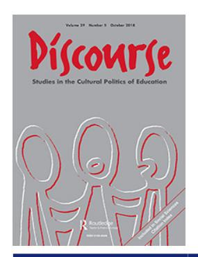
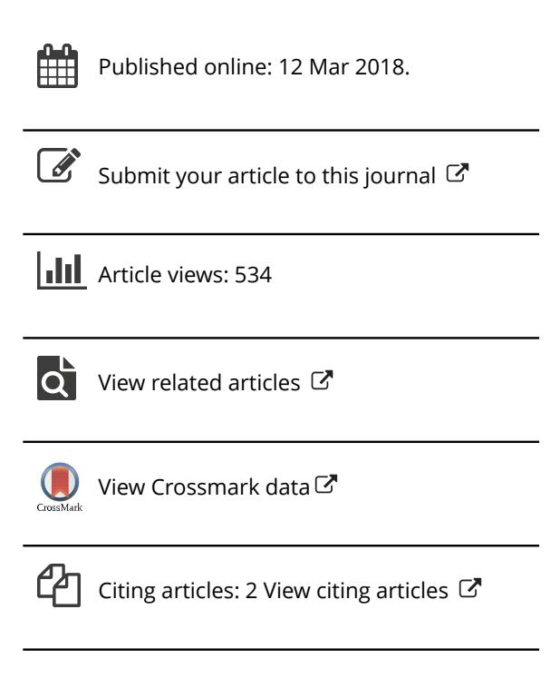
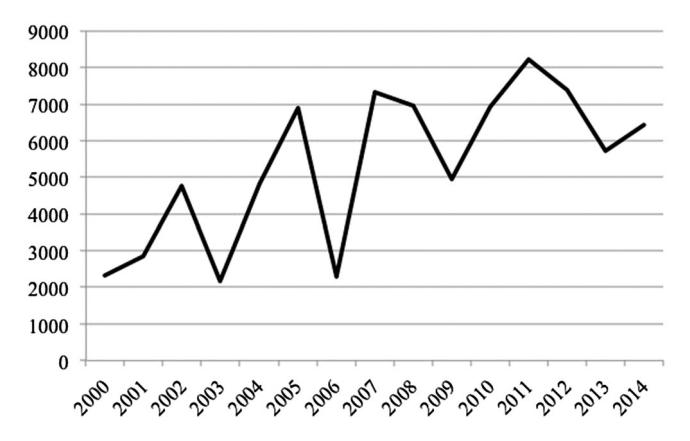

<!-- A1.R42 | source: papers_json/A1.R42/ -->

## **Discourse: Studies in the Cultural Politics of Education**

**ISSN: 0159-6306 (Print) 1469-3739 (Online) Journal homepage:****[ www.tandfonline.com/journals/cdis20](https://www.tandfonline.com/journals/cdis20?src=pdf)**

## **بناء مركز تعليمي عالمي: حالة مانيلا غير المتوقعة**

## **Yasmin Y. Ortiga**

**To cite this article:** Yasmin Y. Ortiga (2018) Constructing a global education hub: the unlikely case of Manila, Discourse: Studies in the Cultural Politics of Education, 39:5, 767-781, DOI: [10.1080/01596306.2018.1448703](https://www.tandfonline.com/action/showCitFormats?doi=10.1080/01596306.2018.1448703)

**To link to this article: **[https://doi.org/10.1080/01596306.2018.1448703](https://doi.org/10.1080/01596306.2018.1448703)

<!-- page 2 -->

## بناء مركز تعليمي عالمي: حالة مانيلا غير المتوقعة

Yasmin Y. Ortiga

College of Alice and Peter Tan, National University of Singapore, Singapore

## الملخص

تبحث هذه الورقة في نشأة مركز تعليمي غير متوقع في مانيلا، الفلبين، حيث شهدت المؤسسات المحلية تزايداً في أعداد الطلاب الدوليين القادمين من كوريا والهند والشرق الأوسط. يسعى هؤلاء الطلاب إلى الحصول على مؤهلات في مهن يمثل فيها المهاجرون الفلبينيون نسبة عالية، إما لاكتساب ميزة داخل بلدانهم الأصلية أو كخطوة انتقالية نحو وظائف في أماكن أخرى. وبالاستناد إلى النقاشات الحالية حول 'المدن العالمية'، تناقش هذه الورقة كيف تروّج جهات فاعلة مختلفة لمانيلا كوجهة مثالية للطلاب، مستخدمة موقع البلاد الفريد ضمن السوق العالمية للعمالة المهاجرة وتاريخها الاستعماري الأمريكي. هنا، يقوم مالكو المدارس الفلبينية والمسؤولون الحكوميون بتسويق الجامعات الفلبينية باعتبارها أفضل مكان للتدرب على وظائف موجودة في أي مكان في العالم. تستهدف هذه الاستراتيجيات الطلاب الأقل حظاً، غير القادرين على الالتحاق بجامعات أكثر مكانة، وهو ما يخلق أشكالاً جديدة من حراك المعرفة في سوق للتعليم العالي يزداد تجزؤاً.

## الكلمات المفتاحية

Education hub; migration; labor export; international students; Philippines

شهدت العقود القليلة الماضية ظهوراً سريعاً لـ'مراكز تعليمية' education hubs داخل آسيا، حيث تروّج أماكن مثل Singapore وHong Kong لنفسها كمراكز للتعليم والبحث (Collins & Ho, [2014;](#page-13-0) Currie, Vidovich, & Yang, [2008;](#page-13-0) Mok, [2007)](#page-14-0)). وقد قيل الكثير عن كيفية ضخ الوكالات الحكومية لموارد ضخمة في مبادرات التعليم العالي، وبناء البنية التحتية الجامعية، واستقطاب أعضاء هيئة تدريس أجانب من مؤسسات مرموقة في الغرب (Findlay, [2011](#page-13-0); Lee, [2014;](#page-14-0) Sidhu, Ho, & Yeah, [2011](#page-14-0); Yonezawa, [2007)](#page-15-0)). ومع ذلك، لم يبحث سوى عدد قليل من الباحثين في الطرق المختلفة التي عُرّف بها 'مركز التعليم'، وكيف تحاول الدول بناء دورها في اقتصاد اليوم القائم على المعرفة. مالت الدراسات القائمة إلى التركيز على سمات مشتركة مثل مكانة الجامعة، واستقطاب الطلاب، وحجم الاستثمارات الحكومية في التعليم العالي. لكن في الواقع، تتفاوت أهداف ونتائج إنشاء هذه 'مراكز التعليم' تفاوتاً كبيراً من مكان لآخر. فعلى سبيل المثال، يميّز تصنيف Knight's [(2011](#page-14-0)) لمراكز التعليم داخل آسيا بين أماكن: تركز فقط على تقديم التدريب في التعليم العالي (مراكز الطلاب)؛ وتدرّب الطلاب بنية استيعابهم في القوى العاملة المحلية (مراكز القوى العاملة الماهرة)؛ وتعمل نحو البحث والابتكار (مركز المعرفة).

في هذه الورقة، أبحث في نشأة مركز تعليمي غير متوقع في مانيلا، الفلبين. وأُظهر أنه رغم أن الجامعات الفلبينية لا تمتلك المكانة أو

<!-- page 3 -->

جودة التعليم التي تجذب الطلاب إلى وجهات شائعة مثل Hong Kong وSingapore، فقد شهدت هذه المؤسسات تزايداً في أعداد الطلاب الدوليين من دول مثل كوريا ونيجيريا والهند. يسعى هؤلاء الطلاب إلى الحصول على مؤهلات في مهن يمثل فيها المهاجرون الفلبينيون نسبة عالية، مستخدمين الشهادات الفلبينية إما لاكتساب ميزة في أسواق العمل داخل بلدانهم الأصلية أو للعمل نحو وظائف في الشرق الأوسط وأمريكا الشمالية. وبهذا المعنى، تعكس مانيلا بعض جوانب 'مركز الطلاب' عند Knight's ([2011](#page-14-0))، حيث تستقطب المؤسسات والسياسات الحكومية طلاباً أجانب للحصول على درجات عليا دون البقاء في البلد. غير أن الكليات والجامعات المحلية تُبرز أيضاً نجاح الخريجين الفلبينيين في سد احتياجات عمالية محددة حول العالم، مما يعكس خطاب مراكز القوى العاملة الماهرة مثل البحرين، حيث تُوجَّه الجامعات نحو تنمية الموارد البشرية لصناعات محددة. وبالاستناد إلى النقاشات الحالية حول ظهور 'المدن العالمية' (انظر Amen, Mark, Archer, & Bosman, [2006](#page-13-0))، تناقش هذه الورقة كيف تروّج جهات فاعلة ومنظمات مختلفة لمانيلا كوجهة مثالية للطلاب، مستخدمة موقع البلاد الفريد ضمن السوق العالمية للعمالة المهاجرة، وتاريخها الاستعماري الأمريكي. وعلى وجه الخصوص، أُظهر كيف يبني مالكو المدارس الفلبينية وشركات التعليم الخاصة على سمعة البلاد كمصدر رئيسي للعمالة المهاجرة، مسوّقين الجامعات الفلبينية باعتبارها أفضل مكان للتدرب على وظائف موجودة في أي مكان في العالم. تُظهر الأقسام التالية كيف تبني هذه الاستراتيجيات نسخة مانيلا الخاصة من 'مركز التعليم'، حيث توجّه الجامعات والكليات المحلية تدفقات غير متوقعة من الطلاب الأجانب الذين يأملون أن يصبحوا عمالاً مهاجرين مستقبليين للاقتصاد العالمي.

## التعلّم في المدينة العالمية

على مدى العقود القليلة الماضية، سعى الباحثون إلى فهم الدور المتغير للمدن في خضم العولمة. لاحظ باحثون مثل Sassen [(2001,](#page-14-0) [2002)](#page-14-0) ظهور المدن العالمية – أماكن تستمد مكانتها من الخدمات التي تقدمها للاقتصاد العالمي. ومال هذا العمل إلى التركيز على الإنتاج والتصنيع، مسمياً مدناً مثل Tokyo وLondon وNew York باعتبارها المواقع الرئيسية التي يُعالَج فيها رأس المال أو يُصدَّر أو يُستهلك. وقد وسّعت الأدبيات الحديثة مفهوم المدينة العالمية أكثر، داعية إلى ضرورة الاعتراف بجوانب أخرى من الاقتصاد العالمي تتجاوز الإنتاج، وإلى إدراج المدن الأخرى العديدة الواقعة في الجنوب العالمي. وعلى وجه الخصوص، يشدد Surborg ([2011](#page-14-0)) على ضرورة النظر إلى 'موقعية' المدينة positionality في الاقتصاد العالمي، وكيف يشكّل ذلك تفاعلها واستجابتها للقوى العالمية (ص. 326). وكما لاحظ Shatkin [(2007)](#page-14-0)، فإن المدن حول العالم تصدّر وتعالج 'مجموعة متنوعة من المنتجات والخدمات، لكل منها منطقها المكاني الخاص' (ص. 5). وبينما تُعد مدن مثل New York وTokyo محورية في السوق العالمية، فإن هذه الأماكن ترتبط بمدن في الأطراف بطرق عديدة، ويمكن لهذه الروابط أن تُغيّر وتُشكّل التحول الحضري في السياقين معاً.

تربط هذه الورقة تكوّن مانيلا كمركز تعليمي غير متوقع بدورها الحالي في السوق العالمية للعمال المهاجرين، حيث تُعرف الفلبين ككل على نطاق واسع بأنها إحدى أكبر الدول المصدّرة للعمالة في العالم (Acacio, [2008;](#page-12-0) Rodriguez, [2010](#page-14-0)). ورغم أنها بعيدة عن 'المدن العالمية' التقليدية التي تناولها باحثون مثل Sassen، فإن مانيلا تُعد موقعاً محورياً يُستقطَب فيه ويُدرَّب العمال المهاجرون المستقبليون على العمل الذي يُبقي الاقتصاد العالمي عاملاً (Tyner, [2006](#page-14-0)). ويطلق محلل السياسة الاجتماعية Yeates' ([2009](#page-15-0), [2012](#page-15-0)) على هذا النظام اسم سلسلة سلعة العمالة المهاجرة، حيث تقوم المؤسسات

<!-- page 4 -->

داخل الدول المُرسِلة بـ'إنتاج' عمال لسد احتياجات العمل في الدول الأكثر ثراءً. وقد أظهرت دراسات قائمة كيف تشكّل الروابط بين الدول المُرسِلة والمستقبِلة للمهاجرين التحول الحضري، كما يتضح في تكاثر الصناعات المرتبطة بالهجرة (مثل وكالات التوظيف) داخل المدن الكبرى (Guevarra, [2010](#page-13-0); Tyner, [2009)](#page-15-0)). تبني هذه الورقة على هذه الأدبيات، مناقشةً كيف يُشكّل موقع مانيلا ضمن سلسلة سلعة العمالة المهاجرة سوق التعليم العالي فيها، مما يدفع المسؤولين الحكوميين ومالكي المدارس إلى تسويق المدينة كوجهة مثالية للمهاجرين الطموحين الساعين للحصول على شهادات أكاديمية تعزز فرصهم في العمل بالخارج.

وفي الوقت نفسه، تتفق هذه الورقة مع الباحثين الذين يحذّرون من تعريف المدن باعتبارها مجرد نتاج بُنى داخل الاقتصاد العالمي. فمفهوم المدينة العالمية بحد ذاته بناء اجتماعي، تروّج له خطابات تخدم مصالح سياسية واقتصادية محددة (انظر Amen et al., [2006)](#page-13-0)). وفي حالة مراكز التعليم، تستند هذه الورقة إلى دراسات تُظهر كيف تعمل الجهات الفاعلة والمنظمات على أرض الواقع على بناء مدنها كمكان مرغوب للطلاب (Raghuram, [2013](#page-14-0)). ويُظهر Collins and Ho ([2014)](#page-13-0)، على سبيل المثال، كيف يمكن لإعادة الهيكلة داخل الكليات والجامعات أن تؤثر في تدفق الطلاب الدوليين إلى هذه المؤسسات. وفهم هذه العملية يتيح لنا رؤية كيف تُحوِّل هذه التغيرات لاحقاً المدن التي تقع فيها هذه الجامعات. في هذه الورقة، أُظهر كيف يوفر موقع مانيلا في سلسلة سلعة العمالة المهاجرة تحديات وفرصاً فريدة للمسؤولين الحكوميين ومالكي المدارس الفلبينيين، مما يؤدي إلى تغيرات مميزة داخل المدينة وسوق التعليم الأوسع.

## الجامعات الفلبينية: التعليم من أجل التصدير

اشتُهرت الفلبين منذ زمن طويل بنظامها الحكومي 'لإدارة الهجرة' (Acacio, [2008,](#page-12-0) p. 104)، حيث تُسهّل الهيئات الحكومية بنشاط هجرة مواطنيها إلى الخارج عبر التصديق على أوراق الخروج والمؤهلات، وضمان سلامتهم، وتسويق عمالتهم لأصحاب العمل المحتملين.[1](#page-12-0) ورغم أنها حظيت باهتمام أكاديمي أقل، فإن نشأة استراتيجيات الوساطة في العمالة هذه ترافقت مع ظهور نظام تعليم عالٍ موجَّه نحو إنتاج عمال مهاجرين 'قابلين للتوظيف'. ويرتبط جزء من هذه الظاهرة بثقافة الهجرة في المجتمع الفلبيني، حيث يرى الفلبينيون الشباب الهجرة جزءاً طبيعياً ومتوقعاً من الحياة (Asis, [2006)](#page-13-0)). وبينما تشغل غالبية العمال المهاجرين الفلبينيين وظائف منخفضة الأجر في البناء والعمل المنزلي، فإن عدداً كبيراً منهم يتركّز أيضاً في مواقع ماهرة وشبه ماهرة متنوعة، من الممرضين وأخصائيي العلاج الطبيعي إلى مهندسي البحرية (Alburo & Abella, [2002)](#page-12-0)). ولهذا، يسعى الفلبينيون الشباب أيضاً إلى التعليم العالي كوسيلة للحصول على عمل في الخارج، مما يُولّد طلباً على تخصصات مرتبطة بوظائف متاحة في دول وجهة شائعة مثل الولايات المتحدة وكندا (Asis & Batistella, [2013](#page-13-0); Ortiga, [2017)](#page-14-0)).

من ناحية أخرى، تُسهّل مؤسسات خاصة وعامة مثل الوكالات الحكومية والجامعات وجمعيات المدارس الخاصة هذه الطموحات الهجرية أيضاً، مُيسّرةً سعي الطلاب للتعلّم كوسيلة لمغادرة البلاد. والتعليم العالي في الفلبين هو إلى حد كبير مشروع خاص (Altbach, [1989,](#page-12-0) [2005](#page-13-0)).[2](#page-12-0) وتُشكّل الجامعات والكليات المملوكة للقطاع الخاص 88 بالمئة من إجمالي 1943 جامعة وكلية في البلاد. ومن بين هذه المؤسسات الخاصة، 359 مؤسسة ذات طابع طائفي، بينما تُدار البقية من قبل شركات ومشاريع عائلية (Commission on Higher Education [CHED], [2017)](#page-13-0)). ولهذا، أصبح تسويق تخصصات محددة كخطوة انتقالية نحو الهجرة استراتيجية مربحة لمالكي المدارس الساعين إلى تعزيز أرباح مؤسساتهم. وفي عمل سابق، وصفتُ كيف

<!-- page 5 -->

تحاول الكليات والجامعات الفلبينية محاكاة مفهوم مثالي لـ'المرونة'، فتوسّع بسرعة البرامج الأكاديمية المرتبطة بوظائف 'مطلوبة' في الخارج، ثم تُحوّل بسرعة موارد المدرسة وطاقمها إلى تخصصات أخرى عندما تتغير هذه الاحتياجات (Ortiga, [2018)](#page-14-0)). وتؤدي هذه الاستراتيجيات إلى تغيرات هائلة في البُنى المادية والمناهج الأكاديمية على حد سواء، إذ يتسابق مالكو المدارس لإنتاج عمال 'في الوقت المناسب' لسد فجوات عمالية متوقعة في الخارج. ورغم أن ممارسات مماثلة يمكن رؤيتها في الكليات والجامعات الهادفة للربح في دول أخرى، فإن المؤسسات الفلبينية تختلف من حيث إنها تحصل على دعم هيكلي من دولة تعمل كوسيط في العمالة. والواقع أن المشرّعين الفلبينيين دفعوا نحو سياسات تعليمية تسعى إلى جعل خريجي تخصصات معينة (مثل التمريض والملاحة البحرية) أكثر جاذبية لأصحاب العمل في الخارج، وأكثر تنافسية من نظرائهم من دول أخرى مُرسِلة للمهاجرين (Cabanda, [2015](#page-13-0), [2017](#page-13-0)). كما أرسلت وكالات حكومية مثل CHED ممثلين إلى أصحاب عمل محتملين في دول وجهة شائعة للهجرة مثل الإمارات لتشكيل معايير المناهج المحلية بما يتماشى مع معايير 'العالم الأول' (Ortiga, [2014](#page-14-0)). وفي دفعهم نحو التعليم العالي كوسيلة للهجرة، روّج المسؤولون الحكوميون الفلبينيون لخطاب مفاده أن المهاجرين ذوي التعليم العالي أقرب إلى الحصول على وظائف أعلى أجراً في الخارج وسيحتاجون إلى حماية أقل من الدولة (انظر Rodriguez & Schwenken, [2013](#page-14-0)).

ورغم هذا التركيز على التعليم العالي، عانت الجامعات الفلبينية منذ زمن طويل من مشكلات ضعف الجودة. ومع عجز الوكالات الحكومية عن تنظيم المؤسسات الخاصة تنظيماً كاملاً، اشتكى الطلاب وأولياء الأمور من هيئة تدريس غير مؤهلة، وأداء ضعيف في امتحانات المجالس المهنية، ونقص المرافق المناسبة (Tan, [2011](#page-14-0)). وبينما خصصت مراكز تعليمية ناشئة أخرى في المنطقة أموالاً حكومية للبنية التحتية الأكاديمية وعملت على تعزيز السمعة الدولية للجامعات المحلية (Knight & Morshidi, [2011)](#page-14-0))، فإن هذه الاستراتيجيات غائبة نسبياً في الفلبين، حيث لا تظهر سوى أربع مؤسسات من مؤسسات البلاد في التصنيفات العالمية، وليست أي منها ضمن أفضل 200 جامعة.

ومن اللافت للنظر أنه رغم الأداء المتفاوت للجامعات الفلبينية، أفاد المسؤولون الحكوميون الفلبينيون ومالكو المدارس الخاصة بتزايد أعداد الطلاب الدوليين داخل البلاد. وقد دفع هذا الازدياد المزعوم مفوض الهجرة السابق Ricardo David, Jr إلى إعلان الفلبين 'مركزاً تعليمياً جديداً في منطقة آسيا والمحيط الهادئ' (Tubeza, [2013](#page-14-0)). غير أن الوكالات الحكومية كانت غير متسقة فيما يتعلق بالإحصاءات الفعلية وراء هذا 'الاتجاه'. وتفيد CHED الفلبينية بأنه رغم أن عدد الطلاب الدوليين تضاعف ثلاث مرات خلال السنوات العشر الأخيرة، فإن عدد المسجلين الأجانب ظل دون 10,000 (انظر [Figure 1](#page-5-0)). أما مكتب الهجرة فيرى أن هذه الأرقام أكبر بكثير، بالنظر إلى أن CHED يركز أكثر على المسجلين الجدد وليس الطلاب العائدين (Aning, [2011](#page-13-0); Tubeza, [2013](#page-14-0)). ومع ذلك، اعترفت الوكالتان معاً في نهاية المطاف بأنهما غير قادرتين على 'إحصاء' الطلاب الأجانب الملتحقين بالجامعات المحلية دون تأشيرات طالب رسمية، معتمدتين بدلاً من ذلك على تصاريح سياحية ممددة (Cebu Daily News, [2013](#page-13-0)). كما لا تشمل هذه الأرقام أولئك القادمين إلى الفلبين لدورات قصيرة الأمد (أقل من سنة واحدة)، لكنهم يحضرون أيضاً محاضرات في مؤسسات التعليم العالي المحلية.

اتفقت الوكالات الحكومية بشكل عام حول مصدر الطلاب الدوليين، حيث تضم أعلى خمس جنسيات الكوريين والإيرانيين والصينيين والأمريكيين والهنود (CHED, [2013](#page-13-0); Miralao & Makil, [2007](#page-14-0)). وتتألف فئة 'الأمريكيين' في الغالب من فلبينيين أمريكيين من الجيل الثاني عادوا إلى الفلبين لمتابعة دراستهم.

<!-- page 6 -->

*Figure 1. International student enrolment in the Philippines. Source: Philippines Commission of Higher Education (CHED).*

## المنهجية

تنبع هذه الورقة من مشروع أكبر حول كيفية سعي الجامعات الفلبينية إلى تعليم الخريجين من أجل 'التصدير'، وتعديل السياسات المدرسية والمناهج وفقاً للاحتياجات المتوقعة لأصحاب العمل الأجانب.[3](#page-12-0) لم أبدأ عملي الميداني بنية دراسة الطلاب الدوليين، غير أنه كان من الصعب تجاهل المجموعات العديدة من الطلاب الأجانب في الحرم الجامعي الذي زرته. وفي النهاية، بدأتُ في التحقيق في كيفية قدوم هؤلاء الطلاب إلى الفلبين، وكيف أثر وجودهم على بُنى المدارس وسياساتها داخل الجامعات التي التحقوا بها. وتستند النتائج في هذه الورقة إلى مقابلات معمقة مع ما مجموعه 31 فرداً: 7 مسؤولين حكوميين،[4](#page-12-0) و4 وكلاء تعليميين، و20 من مالكي المدارس الخاصة والإداريين في مانيلا. ورغم أن هذه عينة صغيرة من العديد من الجهات الفاعلة المشاركة في سوق الطلاب الدوليين في الفلبين، فإن هذه المقابلات تقدّم بصيرة مهمة حول جانب لم يحظَ بدراسة كافية من حراك الطلاب الدوليين. وأناقش كيف يستخدم المشاركون في المقابلات هذا الخطاب لخدمة مصالحهم الخاصة، حيث يأمل مالكو المدارس والوكلاء في توسيع قاعدة عملائهم من الطلاب، ويسعى المسؤولون الحكوميون إلى تعزيز سمعة البلاد كمدرّب عالمي للعمال المهاجرين المستقبليين.

استقطبتُ المشاركين في المقابلات أولاً عبر تعميم رسالة دعوة من خلال جمعيات المدارس الخاصة والوكالات الحكومية ذات الصلة في مانيلا. ثم أحالني أوائل المشاركين إلى مالكي مدارس ومسؤولين حكوميين آخرين مستعدين للمشاركة في دراستي. وباستثناء الوكلاء التعليميين الأربعة، كان جميع المشاركين فلبينيين، وكانت محادثاتنا في الغالب مزيجاً من Tagalog والإنجليزية. أما الوكلاء التعليميون الذين تحدثتُ إليهم فجميعهم من الهند. وقد أسسوا مكاتب خاصة داخل جامعتين في مانيلا لـ'خدمة' الطلاب الأجانب في الحرم الجامعي بشكل أفضل. وحصلتُ على مقابلات معهم عبر مالكي المؤسسات التي يعملون فيها. ولا توجد إحصاءات حول العدد الفعلي للوكالات ذات المكاتب في مانيلا، غير أنه كما لوحظ في قسم النتائج، ادّعى الإداريون المدرسيون أنهم يتلقون عشرات 'مقترحات التعاون' من الوكلاء التعليميين يومياً. وقد دفعهم هذا إلى الاعتقاد بوجود عدد متزايد من الوكلاء الذين يقيمون روابط مع الجامعات المحلية. وتقتصر هذه الورقة على أنني تحدثتُ إلى أربعة فقط من هؤلاء الوكلاء ولم أُجرِ مقابلات مباشرة مع الطلاب الأجانب الساعين للحصول على درجات عليا في مانيلا. ولهذا، لا تقدّم نتائجي مناقشة معمقة لعمل الوكلاء التعليميين أو لدوافع الطلاب الأجانب

<!-- page 7 -->

نحو متابعة التعليم العالي في الفلبين. بل أبحث بدلاً من ذلك في الاستراتيجيات التي تستخدمها جهات فاعلة ومؤسسات مختلفة في تسويق الفلبين كوجهة مثالية لمجموعة معينة من الطلاب الدوليين، وكيف يتشكّل ذلك بموقع مانيلا في السوق العالمية للعمالة المهاجرة. تراوحت مدة المقابلات بين 45 دقيقة وساعتين. وقد استخدمتُ أسماء مستعارة لجميع المشاركين حرصاً على عدم الكشف عن هويتهم أو المؤسسات التي يعملون بها.

كمّلتُ مقابلاتي بتحليل للتقارير الإعلامية الفلبينية حول الطلاب الدوليين، وكتيبات الجامعات (من المؤسسات التي زرتها)، وكذلك مواقع الوكلاء التعليميين التي تروّج للتعليم العالي الفلبيني. وعلى وجه الخصوص، نظرتُ في كيفية تسويق الكليات والجامعات المحلية في هذه المنشورات، وكيف ارتبطت هذه الموضوعات بالموضوعات التي برزت من مقابلاتي. كما لاحظتُ ما إذا كانت هذه الوثائق تروّج لبرامج دراسية محددة داخل المؤسسات، أو تستهدف أنواعاً معينة من الطلاب. ولا أعتبر هذا التحليل رؤية شاملة للخطاب العام حول الطلاب الدوليين في الفلبين. غير أن هذه الوثائق سمحت لي بتحديد ما إذا كانت بعض الموضوعات من مقابلاتي تعكس اتجاهات أوسع تتجاوز وجهات النظر الشخصية للمشاركين.

## التعليم الدولي على الهامش

للوهلة الأولى، من الصعب تخيّل كيف يمكن للجامعات الفلبينية أن تصبح خياراً جذاباً للطلاب الدوليين. ويُبرز البحث حول حراك الطلاب كيف يسعى الطلاب الدوليون إلى شهادات أجنبية كوسيلة للوصول إلى مؤسسات ذات تصنيف أعلى أو تجارب تعلّم أفضل (Alberts, [2007](#page-12-0); Baas, [2006](#page-13-0); Guruz, [2008;](#page-13-0) King & Raghuram, [2013;](#page-14-0) Waters, [2009)](#page-15-0)). وقد أظهر باحثون كيف أدى هذا السعي للحصول على شهادات إلى تسلسل هرمي عالمي لمؤسسات التعليم العالي، ليس بالضرورة من حيث التصنيفات العالمية المحددة، بل من حيث تصورات ذاتية للمكانة والفوائد (Findlay, King, Smith, Geddes, & Skeldon, [2012](#page-13-0)). وبينما كانت الولايات المتحدة والمملكة المتحدة تقليدياً وجهتين رئيسيتين، شهدت العقود القليلة الماضية تنوعاً متزايداً في وجهات الطلاب، إذ تبحث الأسر ذات الموارد المالية الأقل عن جامعات يمكنها تقديم شهادات 'ذات جودة' بأسعار أرخص (Findlay, [2011](#page-13-0); Phan, [2018](#page-14-0); Yang, [2018](#page-15-0)). وتتفاوت تعريفات الجودة هذه بين مجموعات مختلفة من الطلاب، لكنها تدور عموماً حول 'الجوانب الأكاديمية والمرافق وبيئة التعلّم والاعتراف الدولي' (Dimmock & Ong, [2010](#page-13-0), p. 31).

وتؤدي معظم الجامعات الفلبينية أداءً ضعيفاً نسبياً من حيث هذه المعايير. فبصرف النظر عن تفاوت جودة التعليم، يتركز عدد كبير من جامعات البلاد في مانيلا، وهي مدينة سيئة السمعة بسبب اكتظاظ السكان وأزمات المرور الخانقة ونقص الأمن العام. ورغم أن الرسوم الدراسية وتكاليف المعيشة منخفضة نسبياً في الفلبين، فإن هناك دولاً نامية أخرى كثيرة في العالم تقدّم أيضاً بدائل أرخص من وجهات مثل الولايات المتحدة وأستراليا. كما أن فرص العمل للأجانب في سوق العمل الفلبيني محدودة، وتجعل متطلبات التأشيرة المعقدة العمل في البلاد أمراً صعباً. وبما يتماشى مع تعريف Knight's [(2011)](#page-14-0) لمركز الطلاب، تُعد مانيلا مكاناً أساسياً للحصول على تدريب أكاديمي، وليس مكاناً لاستكشاف فرص وظيفية مستقبلية.

ومع ذلك، شهدت العقود القليلة الماضية بروز خطاب يُصوّر مانيلا كمركز تعليمي 'جديد' يوفر فرصاً مهمة للطلاب الأجانب الساعين للحصول على شهادات في الخارج (انظر Bureau of Immigration, [2014;](#page-13-0) Goquingco & Lowe, [2009](#page-13-0)).

<!-- page 8 -->

ويشمل مؤيدو هذا الخطاب مسؤولين حكوميين فلبينيين ومالكي مدارس، إضافة إلى مواقع وإعلانات وكلاء من طرف ثالث مقرهم دول مثل الصين وتايلاند والهند ونيجيريا. وتُروّج هذه الوكالات، التي تُقدَّم بوصفها 'شركاء' أو 'مستشارين' تعليميين، بنشاط للوجهات التي تختارها للطلاب المهتمين، وتعرض تسهيل طلبات الالتحاق الجامعي ومتطلبات التأشيرة. ويتولى هؤلاء الوكلاء رعاية سكن الطلاب واستشاراتهم واحتياجاتهم اليومية؛ غير أنهم لا يشاركون في ربط الطلاب بوظائف مستقبلية بعد التخرج. وفي السنوات الأخيرة، استقبلت الجامعات الفلبينية أيضاً تدفقاً منتظماً من الفلبينيين الأمريكيين من الجيل الثاني، الذين لم يتأهلوا للحصول على شهادات بكالوريوس مدتها أربع سنوات في الولايات المتحدة أو لم يستطيعوا تحمّل تكاليفها. وقد 'أُعيد' معظم هؤلاء الطلاب (من قبل الوالدين والأقارب) للالتحاق بالجامعات المحلية، حيث يعملون على الحصول على شهادات في مهن يمثل فيها الفلبينيون نسبة عالية في الولايات المتحدة. غير أن الطلاب الدوليين لا يلتحقون بالضرورة بأفضل مؤسسات البلاد، بل يتوزعون على نطاق واسع من الكليات والجامعات الهادفة للربح في مانيلا. وأشار المسؤولون الحكوميون الذين قابلتهم لهذه الدراسة إلى أن السبب في ذلك على الأرجح هو أن هذه المؤسسات تخصص موارد أكثر للتسويق واستقطاب الطلاب، وأنها بنت روابط قوية مع الوكلاء التعليميين.

يناقش هذا القسم طريقتين استخدمتهما هذه الجهات الفاعلة المختلفة لتسويق الجامعات الفلبينية كوجهات مثالية للطلاب الدوليين، وبالتالي تشكيل الدور الذي ستؤديه مدينة مانيلا في اقتصاد اليوم القائم على المعرفة. أولاً، أناقش كيف استفادت هذه الجهات الفاعلة من تاريخ الفلبين كمستعمرة أمريكية سابقة لتسويق مانيلا كمكان مثالي لتعلّم الإنجليزية. ثانياً، أُظهر كيف استخدم الوكلاء التعليميون الأجانب ومالكو المدارس والمسؤولون الحكوميون الفلبينيون مكانة الفلبين البارزة كدولة مصدّرة للعمالة، مصورين برامجهم الأكاديمية باعتبارها أفضل وسيلة للتدرب على سد فجوات العمالة القائمة في الخارج.

## تسويق الاستعمار: التعليم الإنجليزي 'الأمريكي'

يُعد تحسين مهارات اللغة الإنجليزية منذ زمن طويل سبباً رئيسياً يدفع الطلاب الدوليين إلى متابعة التعليم العالي في الخارج. وقد أظهرت دراسات حالية كيف أدت هذه الدوافع إلى تزايد حراك الطلاب نحو الدول التي تكون فيها الإنجليزية لغة 'أم'، مثل الولايات المتحدة والمملكة المتحدة وأستراليا (Chowdhury & Phan, [2014;](#page-13-0) Phan, [2008](#page-14-0)). وبالمثل، سعت الجامعات الفلبينية أيضاً إلى جذب الطلاب الدوليين بالتركيز على فرصة تعلّم الإنجليزية في مجتمع تُستخدم فيه اللغة على نطاق واسع. وهي تفعل ذلك بالإشارة إلى تاريخ البلاد كمستعمرة أمريكية سابقة، مُبرزةً كيف لا تزال الإنجليزية لغة التدريس في المدارس المحلية، وكذلك اللغة المستخدمة داخل المؤسسات العامة والخاصة المهمة.

فعلى سبيل المثال، قال Francis Cruz، رئيس جامعة مملوكة لعائلة، إن مدرسته قصدت في موقع الجامعة على الإنترنت التركيز على التدريس بالإنجليزية، وهي استراتيجية يعزو إليها الفضل في تزايد أعداد الطلاب الصينيين في مؤسسته. وبالمثل، أوضح Mr Gupta، وهو وكيل تعليمي، أن الطلب على 'بيئة إنجليزية' هو ما دفعه إلى النظر في الفلبين كوجهة للطلاب في عام 2010. وقبل ذلك، كان قد أحضر طلاباً هنوداً إلى كليات طب في الصين وروسيا وأوكرانيا. 'الصين دولة مجاورة، والهند لديها علاقة جيدة مع روسيا. اعتقدنا أنها أماكن جيدة لطلابنا – خاصة أولئك الذين أرادوا دراسة الطب'، أوضح Mr Gupta. لكن الأهالي بدأوا يشتكون من انخفاض معدلات النجاح بين الطلاب الهنود، بسبب صعوبات في

<!-- page 9 -->

التواصل مع الأساتذة والمرضى على حد سواء. وشجّع هذا 'الارتداد' Mr Gupta على البحث عن وجهات أخرى لطلابه. وقد سمع عن التعليم القائم على الإنجليزية في الفلبين، وتواصل مع السفارة الهندية في مانيلا، التي وصلته بدورها بجامعة خاصة محلية. وقال: 'كان لدي اجتماع جيد مع مالكي المدرسة وقالوا إن الطلاب سيتمكنون من ممارسة الإنجليزية يومياً'. وفي العام التالي، أحضر Mr Gupta 1000 طالب هندي إلى الجامعة نفسها.

وبطرق عديدة، اعتقد مالكو المدارس الفلبينية أن تاريخ الفلبين الاستعماري يميّزهم عن غيرهم من السكان الناطقين بالإنجليزية. فقد فخروا بطريقة الفلبينيين 'الخاصة' في التحدث بالإنجليزية، المتجذرة في علاقاتهم الوثيقة بالأمريكيين، لكنها 'ممزوجة' مع اللغة والثقافة الفلبينية. وفي بعض النواحي، يعكس هذا الخطاب مفهوم المحاكاة mimicry عند Homi Bhabha's [(1984)](#page-13-0)، حيث يقلّد الأفراد في المجتمعات المستعمَرة لباس مستعمِريهم ولغتهم وسلوكهم، غالباً في محاولة لنيل الاحترام والمكانة والسلطة ذاتها المرتبطة بتلك الثقافة. غير أن مالكي المدارس الفلبينية يُظهرون كيف يمكن لاستخدام هذه 'الروابط الاستعمارية' أن يؤدي أيضاً إلى نتائج غير متوقعة، حيث لا تكون الإنجليزية الفلبينية مجرد 'نسخة' جيدة عن الإنجليزية الأمريكية، بل قد تكون في الواقع أكثر جاذبية. وروى Vic Fuentes، مالك كلية خاصة، محادثة مع الملحق التعليمي للسفارة الإندونيسية في مانيلا، الذي كان مهتماً بالترويج لبرنامج التمريض في جامعته للطلاب الإندونيسيين:

[The Indonesians] said, 'We like your English. It is closest to the Americans'. So I said, 'The Filipino accent is neutral [emphasis added]. They can twist that accent based on who they are talking to. You put an Indian there, no matter what you do, they will have an Indian accent.' They said, 'That is what we need. And you are very cheap as far as tuition is concerned'.

وقد قدّم Fuentes جامعته كمكان يمكن للطلاب الدوليين فيه تعلّم 'العلامة' الفلبينية للإتقان الإنجليزي – قريبة من الإنجليزية الأمريكية، لكنها 'محايدة' بما يكفي ليفهمها أي شخص. لم يكن 'يبيع' قدرة الطلاب على التحدث مثل الأمريكيين، بل مثل الفلبينيين. وبينما كانت دول مثل الهند أيضاً مستعمرات غربية سابقة، فإنه يشدد على أن لكنتهم لا تزال هندية بوضوح. وفرصة تعلّم 'الإنجليزية الفلبينية' تُكمّلها رسوم دراسية معقولة، أقل بكثير مما يُتوقع من الطلاب إنفاقه في أماكن مثل الولايات المتحدة.

وإلى جانب الاستخدام الواسع للإنجليزية داخل الفلبين، ذهب الشركاء التعليميون ومالكو المدارس في الاستفادة من الروابط الاستعمارية للبلاد إلى أبعد من ذلك، مُحتجّين بأنه لأن نظام التعليم العالي الفلبيني أُنشئ على يد الأمريكيين، فينبغي أن يوفر تجربة مماثلة لنظيره في الولايات المتحدة. وكما ورد في موقع إحدى الوكالات التعليمية:

Philippines follows the American system of education. This is shaped due to the fact that Philippines was a colony of USA for a period of 50 years, which shaped the education system and has brought out one of the best education system in Asia.

وبدا أن هذا المنطق يجذب الطلاب الذين إما لا يملكون الموارد المالية لدفع الرسوم الكاملة في الولايات المتحدة، أو لا يتأهلون لمنح دراسية تنافسية في الخارج. وتذكر التقارير حول الطلاب الدوليين الكوريين باعتبارهم أكبر مجموعة من الأجانب الدارسين في الجامعات الفلبينية، ومعظمهم من خلفيات الطبقة المتوسطة والعاملة (Bureau of Immigration, [2014;](#page-13-0) Miralao & Makil, [2007)](#page-14-0)). وترى Mrs Tangco، مديرة شؤون الطلاب الدوليين في جامعة خاصة، أنه من خلال استهداف سوق طلابي محدد، عملت الجامعات الفلبينية 'بالتعاون' مع مؤسسات أخرى أعلى تصنيفاً، مقدمةً خدمات للطلاب الراغبين في الدراسة في الولايات المتحدة والعاجزين عن ذلك.

<!-- page 10 -->

وبينما يُشكّل الإتقان الإنجليزي 'على الطراز الأمريكي' بلا شك عامل جذب رئيسياً للطلاب الدوليين في مانيلا، فإن هذا ليس السبب الرئيسي وراء التحاق الطلاب الدوليين بالجامعات الفلبينية. وفي القسم التالي، أناقش كيف يروّج مالكو المدارس والمسؤولون الحكوميون والوكلاء التعليميون أيضاً لمانيلا باعتبارها منصة مثالية للتدرب على وظائف حول العالم، مستفيدين بشكل أساسي من سمعة الفلبين كدولة مُرسِلة للمهاجرين ومن العدد الكبير من العمال الفلبينيين في الخارج.

## التعليم من أجل التصدير

لاحظ باحثو الهجرة كيف تستخدم أعداد متزايدة من الدول المستقبِلة للمهاجرين الشهادات الأكاديمية معياراً للاختيار بالنسبة للمهاجرين الطموحين، حيث تختار المتقدمين المرغوبين بناءً على المعرفة والمهارات المفترضة التي يجلبونها لمجتمعاتهم المضيفة (De Haas, [2005;](#page-13-0) Kofman, [2007](#page-14-0)). كما أثار الحوكمة العالمية لمهن معينة الحاجة إلى عمال 'معتمدين'، يُفترض أن تدريبهم يتماشى مع المعايير والاتفاقيات الدولية (Raghuram, [2013)](#page-14-0)). ولم تفت هذه المتطلبات مالكي المدارس الفلبينيين. فقد شكّل نجاح الفلبين كدولة مصدّرة للعمالة دليلاً على أن الخريجين الفلبينيين يمتلكون مؤهلات تتيح لهم العمل في جميع أنحاء العالم (والواقع أن كثيراً من هؤلاء الخريجين غالباً ما يكونون مؤهلين فوق متطلبات وظائفهم الحالية). وحملت الشهادة الجامعية الفلبينية عندئذ وعداً بحراك مستقبلي – ليس فقط من حيث المكانة الاجتماعية والاقتصادية، بل أيضاً من حيث قدرة الفرد على التنقل عبر الحدود بحثاً عن فرص وظيفية. وكما ورد في كتيب وكيل تعليمي مقره تايلاند وماليزيا، 'نظام التعليم رائع جداً لدرجة أن الفلبين أرسلت مئات الأطباء والمهندسين للعمل في الولايات المتحدة والمملكة المتحدة والشرق الأوسط وغيرها، إلى جانب مهنيين آخرين'.

غير أنه من المهم ملاحظة أن 'جاذبية' الجامعات الفلبينية المفترضة لا تشمل جميع أنواع البرامج والمهن. فبينما توفر المؤسسات الشهيرة في الولايات المتحدة أو المملكة المتحدة مكانة للطلاب بمجرد الانتساب إليها، لا تكون الشهادة الفلبينية ذات قيمة إلا في البرامج التي نجح فيها الفلبينيون في تأسيس مواطئ قدم عمالية خارج البلاد. وبهذا المعنى، لا تسعى الجامعات الفلبينية إلى المنافسة من حيث تعليم STEM أو إدارة الأعمال أو العلوم الإنسانية. وباستثناء أفضل مؤسسات البلاد، تظل هذه البرامج إلى حد كبير ناقصة التمويل وضعيفة التدريس داخل نظام التعليم العالي الفلبيني. وبطريقة ما، تشترك مانيلا أكثر مع تعريف Knight's [(2011)](#page-14-0) لمركز القوى العاملة الماهرة، وهو نوع من مراكز التعليم تُوجَّه فيه بُنى المدرسة والسياسات الحكومية نحو 'تنمية الموارد البشرية لاقتصاد المعرفة والخدمات' (p. 235). غير أنه في تعريف Knight، تُوجَّه مراكز القوى العاملة الماهرة نحو إنتاج رأس مال بشري للصناعات المحلية أو الوطنية. أما في حالة مانيلا، فتُوجَّه الجامعات المحلية نحو مواطئ قدم صناعية محددة قائمة خارج البلاد. وكما ورد في مدونة وكيل تعليمي يستهدف الطلاب الهنود والنيباليين:

Philippines is generally not a good option for average students for their higher studies … However Philippines offers very good options for specific student communities – especially for English courses and Courses as Pathway to Australia and MBBS/ MD/ Medical related courses. [Emphasis added]

ولهذا، مال الطلاب الدوليون في مانيلا أيضاً إلى التجمع في برامج معينة – حسب طموحات الطلاب وخططهم للحراك المستقبلي. ويلتحق الطلاب الهنود ببرامج الطب، بعضهم يأمل ممارسة المهنة في الهند بينما ينظر آخرون نحو إمكانية

<!-- page 11 -->

الهجرة إلى الولايات المتحدة. ووفقاً لـMitul، وهو وكيل تعليمي لطلاب الطب الهنود، انجذب الطلاب إلى فكرة أن كثيراً من الجامعات الفلبينية 'معتمدة' من قبل منظمة الصحة العالمية ومجلس الطب الهندي، مما يوفر لهم على ما يبدو 'خيارات أكثر' مقارنة بالالتحاق بجامعة من مستوى أدنى في الهند. ويبرز هذا التركيز على 'الاعتماد' الدولي بشكل خاص في مدارس التمريض الفلبينية أيضاً. ولاحظت Ella، وهي إدارية في كلية التمريض بجامعة خاصة، تدفقاً من الطلاب الفلبينيين الأمريكيين الذين احتاجوا فقط إلى شهادة بكالوريوس للحصول على وظائف أفضل أجراً في الولايات المتحدة:

They always ask me if our school is affiliated or accredited in the States. There are a lot of universities who are not accredited so they want to make sure that when they graduate, they will get jobs in Canada or the US. Parents of these [Filipino Americans] are usually in the medical field as well. I remember one student asked me about accreditation and it was another student who answered her – he said that our university is actually one of the schools recognized in her state. I'm not sure what state that was.

وضمّت جامعة أخرى زرتها عدداً كبيراً من الطلاب النيجيريين الساعين للحصول على شهادات بكالوريوس في الهندسة البحرية. ووفقاً لأحد الإداريين، أرادت الحكومة النيجيرية تطوير صناعة الشحن لديها لكنها لم تمتلك 'مدارس جيدة' لتدريب مواطنيها. وبملاحظة العدد الكبير من البحّارة الفلبينيين في قطاع الشحن العالمي (انظر McKay, [2007](#page-14-0))، 'أوكل' المسؤولون النيجيريون تدريب مواطنيهم إلى جامعات فلبينية في مانيلا، بدلاً من إنفاق مزيد من الموارد على تطوير برامج محلية. وفي الوقت نفسه، تخصص الطلاب الكوريون في الغالب في إدارة الفنادق والمطاعم، وهو تخصص شائع بين الفلبينيين الراغبين في العمل في صناعة الضيافة العالمية. وبهذه الطرق، تؤدي مانيلا فعلاً دوراً شبيهاً بمركز القوى العاملة الماهرة – مركز يوفر خدمات تدريب من هذا القبيل لعملاء أجانب متعددين.

ورغم أن عدد الطلاب الدوليين في الفلبين منخفض مقارنة بوجهات شائعة أخرى في المنطقة، فقد عمل مالكو المدارس والوكلاء التعليميون بقوة على زيادة أعدادهم. وقد زادت إحدى الجامعات المملوكة لعائلة عدد طلابها الدوليين من أقل من 100 طالب في عام 2007 إلى أكثر من 2000 مسجل في عام 2014. وفي جامعة عائلته، كان Francis متحمساً بشكل خاص لأثر اتفاقيات التعاون الأخيرة لرابطة أمم جنوب شرق آسيا ASEAN بين الدول الأعضاء، حيث شجعت السياسات الجديدة على سهولة الحركة عبر دول المنطقة – خاصة للمهنيين والطلاب. وكان يأمل أن يتوجه الطلاب من المنطقة إلى الجامعات الفلبينية كخطوة انتقالية نحو وظائف في الولايات المتحدة وأستراليا، وهي أماكن استطاعت جامعته إقامة روابط مع أصحاب العمل فيها. وادّعى أن جامعته تتلقى بالفعل طلبات من طلاب إندونيسيين وفيتناميين يريدون تعلّم الإنجليزية، لكنهم التحقوا ببرنامج التمريض بسبب الفرص المحتملة للعمل في أماكن مثل اليابان وكندا. وأوضح، 'نحن نتحدث عن 600 مليون شخص. ستتلاشى الحدود. سيكون هناك الكثير من الهجرة المتبادلة في المنطقة. هذه فرصة ضخمة للتعليم'.

وتماماً كما تبحث وكالات العمالة الفلبينية بنشاط عن 'أسواق جديدة' للعمال الفلبينيين المهاجرين، كان مالكو المدارس والإداريون الفلبينيون حريصين أيضاً على إظهار مرونتهم، ساعين إلى تطوير مقررات تلبي احتياجات التدريب 'الجديدة' للحكومات الأجنبية. وشارك Conrado De Leon، الإداري المدرسي في جامعة خاصة كبيرة، بقوله:

<!-- page 12 -->

One time a group from Malaysia came to us asking if we could come up with a course on gaming. They said, 'We want dealers. We operate one of the gaming facilities in Genting … I said, 'We can assure them of the supply, but we need to know their specifications. What do they want? Then we will tailor the course to their needs. Then they have to hire all the graduates'.

ويُظهر استعداد Conrado لإنشاء برنامج جديد بالكامل لتلبية احتياجات العملاء كيف يمكن للجامعات الفلبينية أن تروّج لنفسها كأماكن يمكن لدول أخرى أن توكل إليها تعليم وتدريب مواطنيها. وكما لاحظ مالك مدرسة آخر، فإن تزايد حركة الطلاب الدوليين يُعد 'أحد أكثر الأسواق ربحية في العالم'، وكان من المهم للجامعات المحلية أن تستحوذ على جزء من هذا السوق.

والحقيقة أن كثيراً من مالكي المدارس والإداريين الذين قابلتهم قالوا إنهم بنوا علاقات مع سفارات محددة في مانيلا. وادّعت Mrs Tangco، التي تستقطب جامعتها عدداً كبيراً من الطلاب الهنود، أن علاقتها بالسفارة الهندية في مانيلا بدأت كوسيلة للحماية من الوكلاء التعليميين عديمي النزاهة ولحماية الطلاب. 'قد يستخدم بعض الأشخاص اسم الجامعة، ويجمعون رسوم الطلاب، ثم يختفون!' قالت. 'من الجيد أن يكون لديك جهات اتصال في السفارة لتعرف إلى من تلجأ عند حدوث هذه الأمور'. لكن السفارة نفسها بدأت لاحقاً بإحالة الجامعة إلى وكلاء تعليميين آخرين، مما زاد عدد الشركات التي تأمل في إقامة شراكات مع أصحاب عمل Mrs Tangco. 'الآن أستطيع الحصول على نحو 200 مقترح من الوكلاء كل عام!' شاركت. 'نما عدد طلابنا الدوليين كثيراً'.

## الخاتمة

مرّت الجامعات الفلبينية بتغيرات كثيرة لاستيعاب التدفقات الجديدة من الطلاب الدوليين واستقطاب مسجلين مستقبليين. فقد بنت الجامعات مساكن خاصة، وعدّلت المناهج المحلية، ووظّفت طاقم إرشاد. كما ظهرت أعمال تجارية جديدة مثل متاجر البقالة الكورية وأكشاك الطعام الهندي حول الجامعة، ساعيةً لخدمة قاعدة عملاء متنامية. وداخل الجامعات، تكيّف المعلمون الفلبينيون مع مجموعات جديدة من الطلاب الأجانب، لم يكن أي منهم على الأرجح يتحدث الفلبينية، اللغة الوطنية. وبالنسبة لكثير من المسؤولين الحكوميين ومالكي المدارس، مثّل تدفق الطلاب الدوليين إلى الجامعات المحلية فرصة واعدة للتعليم العالي الفلبيني. وإذ كانت الكليات والجامعات الفلبينية موجَّهة بالفعل نحو تعليم الخريجين الفلبينيين من أجل وظائف في الخارج، فقد كانت حريصة على توسيع خدماتها لتشمل دولاً أخرى أيضاً. وقد ناقشتُ في هذه الورقة كيف يروّج الوكلاء التعليميون ومالكو المدارس والمعلمون لمانيلا باعتبارها نسخة خاصة بها من مركز الطلاب ومركز القوى العاملة الماهرة – مستفيدين من موقع البلاد كمستعمرة أمريكية سابقة، والأهم من ذلك، كمُنتِج للعمالة المهاجرة في الاقتصاد العالمي.

غير أن هناك أيضاً الكثير مما لم يتغيّر. فرغم تزايد تدفق الطلاب الدوليين، لا تزال الفلبين متأخرة عن جيرانها من حيث جودة التعليم العالي وتصنيفاته. ومع توجّه الجامعات الخاصة نحو إنتاج عمال قابلين للتوظيف، تظل البرامج الأكاديمية ذات العوائد الاقتصادية الأقل وضوحاً ضعيفة التمويل ومقتصرة عموماً على عدد قليل من الجامعات الحكومية. وكما لاحظت Mrs Tangco، لم تكن المؤسسات الهادفة للربح، التي تُعلّم غالبية الطلاب الدوليين، مهتمة بالتصنيفات العالمية للجامعات أو بإنتاج المعرفة. ولهذا، لا تزال البرامج الأكاديمية التي تحظى بأكبر دعم من مالكي المدارس الخاصة هي

<!-- page 13 -->

التخصصات المرتبطة بـ'الطلبات' المتصورة في الخارج. ولم يُغيّر وضع مانيلا المفترض كمركز تعليمي 'ناشئ' شيئاً من هذا الوضع القائم.

وقد أظهر باحثون كيف أدت عولمة التعليم العالي إلى تدفقات متعددة من الطلاب عبر الحدود، لكل منها دوافعه وطموحاته الخاصة للانتقال (Findlay et al., [2012)](#page-13-0)). وركزت الدراسات الحالية إلى حد كبير على الحركة نحو المدن الثرية في آسيا والغرب، حيث يسعى الطلاب إلى شهادات مرموقة وتجربة دولية وجامعات 'عالمية المستوى'. وتُلقي هذه الورقة الضوء على نمط أقل وضوحاً من حراك الطلاب، حيث يتطلع العمال المهاجرون الطموحون إلى دول ناجحة في تصدير العمالة لتوفير التدريب اللازم لسد فجوات العمل 'في الوطن' أو في وجهات هجرة شائعة. ويُبرز هذا الشكل من هجرة الطلاب الطابع المجزأ لحراك الطلاب الدوليين – وهو جانب خفي من اقتصاد اليوم القائم على المعرفة. وتُظهر حالة مانيلا أنه رغم تزايد الاهتمام الأكاديمي بفهم حراكات المعرفة الحالية، لا تزال هناك حاجة لفهم أعمق للطرق غير المتكافئة التي يتحرك بها الناس والأفكار حول العالم. وكما لاحظ Collins and Ho [(2014)](#page-13-0)، يمكن لحراكات المعرفة أن تأخذ أشكالاً 'متباينة'، ولهذه الحراكات أيضاً القدرة على تغيير البُنى المحلية، وإعادة تشكيل الطموحات الفردية، وبناء هويات غير متوقعة لمدن 'عالمية' على الهامش. وهذه الورقة بداية لجهد في فهم معنى هذه الظاهرة، وتداعياتها المحتملة على الهجرة والروابط عبر الحدود داخل المنطقة.

## الملاحظات

- 1. While the Philippines' migration management system emerged in the 1970s, Filipinos have been leaving to seek overseas opportunities since the Spanish colonial period. Rodriguez's ([2010)](#page-14-0) book provides a more comprehensive outline of the country's migration history.
- 2. Isidro and Ramos [(1973](#page-14-0)) provide a more detailed history of the Philippine higher education system.
- 3. This project included two years of fieldwork in Manila, where I interviewed educators and students from two programs associated with overseas jobs: Nursing and Hotel and Restaurant Management. Findings from this project have been reported in other publications (see Ortiga, [2018](#page-14-0)).
- 4. State officials came from the following departments: The Philippine Commission on Higher Education, the Department of Labor and Employment, the Philippine Overseas Employment Agency, and the Department of Education.

## بيان الإفصاح

No potential conflict of interest was reported by the author.

## References

Acacio, K. ([2008)](#page-2-0). Managing labor migration: Philippine state policy and international migration flows, 1969–2000. Asia and Pacific Migration Journal, 17(2), 103–132.

Alberts, H. C. [(2007](#page-6-0)). Beyond the headlines: Changing patterns in international student enrolment in the United States. Geojournal, 68(2–3), 141–153.

Alburo, F. A., & Abella, D. I. [(2002)](#page-3-0). Skilled labour migration from developing countries: Study on the Philippines. Geneva: International Labour Office.

Altbach, P. G. [(1989](#page-3-0)). Twisted roots: The Western impact on Asian higher education. Higher Education, 18(1), 9–29.

<!-- page 14 -->

- Altbach, P. G. [(2005)](#page-3-0). Universities: Family style. In P. G. Altbach & D. C. Levy (Eds.), Private higher education: A global revolution (pp. 29–32). The Netherlands: Sense Publishers.
- Amen, M., Mark, K. A., Archer, K., & Bosman, M. M. [(2006](#page-2-0)). Thinking through global cities. In M. M. Amen, K. Archer, & M. M. Bosman (Eds.), Relocating global cities: From the center to the margins (pp. 1–22). Lanham, MA: Rowman & Littlefield Publishers, Inc.
- Aning, J. ([2011, August 21)](#page-4-0). Philippines has 26k foreign students. Inquirer.net. Retrieved from [http://](http://globalnation.inquirer.net/9781/philippines-has-26k-foreign-students) [globalnation.inquirer.net/9781/philippines-has-26k-foreign-students](http://globalnation.inquirer.net/9781/philippines-has-26k-foreign-students)
- Asis, M. M. B. [(2006)](#page-3-0). The Philippines' culture of migration. Retrieved from [http://www.](http://www.migrationinformation.org/Profiles/display.cfm?ID=364) [migrationinformation.org/Profiles/display.cfm?ID=364](http://www.migrationinformation.org/Profiles/display.cfm?ID=364)
- Asis, M. M. B., & Batistella, G. [(2013)](#page-3-0). The Filippino youth and the employment migration nexus. Makati City: UNICEF Philippines.
- Baas, M. ([2006](#page-6-0)). Students of migration: Indian international students and the question of permanent residency. People and Place, 14(1), 9–24.
- Bhabha, H. [(1984)](#page-8-0). Of mimicry and man: The ambivalence of colonial discourse. October, 28, 125–133. Retrieved from [https://www.jstor.org/stable/778467](https://www.jstor.org/stable/778467)
- Bureau of Immigration (Philippines). [(2014)](#page-6-0). Koreans dominate foreign student admissions at Philippine universities. Manila: Bureau of Immigration.
- Cabanda, E. ([2015)](#page-4-0). Identifying the role of the sending state in the emigration of health professionals: A review of the empirical literature. Migration and Development. [doi:10.1080/21632324.2015.](https://doi.org/10.1080/21632324.2015.1123838) [1123838](https://doi.org/10.1080/21632324.2015.1123838)
- Cabanda, E. ([2017](#page-4-0)). Higher education, migration and policy design of the Philippine Nursing Act of 2002. Higher Education Policy. [doi:10.1057/s41307-017-0038-8](https://doi.org/10.1057/s41307-017-0038-8)
- Cebu Daily News. [(2013, October 1](#page-4-0)). BI reminds schools: Admit only foreign students with study visa. Retrieved from [http://newsinfo.inquirer.net/498651/bi-reminds-schools-admit-only-foreign](http://newsinfo.inquirer.net/498651/bi-reminds-schools-admit-only-foreign-students-with-study-visa)[students-with-study-visa](http://newsinfo.inquirer.net/498651/bi-reminds-schools-admit-only-foreign-students-with-study-visa)
- Chowdhury, R., & Phan, L. H. ([2014)](#page-7-0). Desiring TESOL and international education: Market abuse and exploitation. Bristol, UK: Multilingual Matters.
- Collins, F. L., & Ho, K. C. [(2014)](#page-1-0). Globalising higher education and cities in Asia and the pacific. Asia Pacific Viewpoint, 55(2), 127–131.
- Commission on Higher Education, Philippines (CHED). ([2013)](#page-4-0). Foreign students. Retrieved from [http://www.ched.gov.ph/index.php/higher-education-in-numbers/foreign-students/](http://www.ched.gov.ph/index.php/higher-education-in-numbers/foreign-students/)
- Commission on Higher Education, Philippines (CHED). ([2017)](#page-3-0). Distribution of higher education institutions by institution type, AY 2016–2017. Retrieved from [http://www.ched.gov.ph/central/page/](http://www.ched.gov.ph/central/page/distribution-of-higher-education-institutions-by-institution-type-ay-2016-17) [distribution-of-higher-education-institutions-by-institution-type-ay-2016-17](http://www.ched.gov.ph/central/page/distribution-of-higher-education-institutions-by-institution-type-ay-2016-17)
- Currie, J., Vidovich, L., & Yang, R. [(2008)](#page-1-0). Countability not answerability? Accountability in Hong Kong and Singapore Universities. Asia Pacific Journal of Education, 28(1), 67–85.
- De Haas, H. [(2005](#page-9-0)). International migration, remittances and development: Myths and facts. Third World Quarterly, 26(8), 1269–1284.
- Dimmock, C., & Ong, J. S. L. [(2010)](#page-6-0). Studying overseas: Mainland Chinese students in Singapore. Compare: A Journal of Comparative and International Education, 40(1), 25–42.
- Findlay, A. ([2011)](#page-1-0). An assessment of supply and demand-side theorizations of international student mobility. International Migration, 49(2), 162–190.
- Findlay, A., King, R., Smith, F., Geddes, A., & Skeldon, R. [(2012)](#page-6-0). World class? An investigation of globalisation, difference and international student mobility. Transactions of the Institute of British Geographers, 37(1), 118–131.
- Goquingco, J., & Lowe, S. [(2009](#page-6-0)). Not just exporting: Philippines becoming an attractive destination for international students. World Education News & Reviews. Retrieved from [http://wenr.wes.org/](http://wenr.wes.org/2009/01/wenr-january-2009-not-just-exporting-philippines-becoming-an-attractive-destination-for-international-students/) [2009/01/wenr-january-2009-not-just-exporting-philippines-becoming-an-attractive-destination](http://wenr.wes.org/2009/01/wenr-january-2009-not-just-exporting-philippines-becoming-an-attractive-destination-for-international-students/)[for-international-students/](http://wenr.wes.org/2009/01/wenr-january-2009-not-just-exporting-philippines-becoming-an-attractive-destination-for-international-students/)
- Guevarra, A. R. ([2010](#page-3-0)). Marketing dreams, manufacturing heroes: The transnational labor brokering of Filipino workers. Piscataway, NJ: Rutgers University Press.
- Guruz, K. [(2008](#page-6-0)). Higher education and international student mobility in the global knowledge economy. Albany, NY: State University of New York Press, Albany.

<!-- page 15 -->

- Isidro, A., & Ramos, M. D. [(1973](#page-12-0)). Private colleges and universities in the Philippines. Manila: Coordinating Council of Private Educational Associations.
- King, R., & Raghuram, P. [(2013)](#page-6-0). International student migration: Mapping the field and new research agendas. Population, Space and Place, 19(2), 127–137.
- Knight, J. [(2011](#page-1-0)). Education hubs: A fad, a brand, an innovation? Journal of Studies in International Education, 15(3), 221–240.
- Knight, J., & Morshidi, S. ([2011](#page-4-0)). The complexities and challenges of regional education hubs: Focus on Malaysia. Higher Education, 62(5), 593–606.
- Kofman, E. [(2007)](#page-9-0). The knowledge economy, gender and stratified migrations. Studies in Social Justice, 1(2), 122–135.
- Lee, J. T. ([2014)](#page-1-0). Education hubs and talent development: Policymaking and implementation challenges. Higher Education, 68(6), 807–823.
- McKay, S. C. ([2007](#page-10-0)). Filipino sea men: Constructing masculinities in an ethnic labour niche. Journal of Ethnic and Migration Studies, 33(4), 617–633.
- Miralao, V. A., & Makil, L. P. ([2007](#page-4-0)). Understanding the Korean diaspora to the Philippines. In V. A. Miralao & L. P. Makil (Eds.), Exploring transnational communities in the Philippines (pp. 24–39). Philippines: Philippine Social Science Council.
- Mok, K. H. [(2007](#page-1-0)). Questing for internationalization of universities in Asia: Critical reflections. Journal of Studies in International Education, 11(3–4), 433–454.
- Ortiga, Y. Y. [(2014](#page-4-0)). Professional problems: The burden of producing the 'global' Filipino nurse. Social Science & Medicine, 115, 64–71.
- Ortiga, Y. Y. [(2017)](#page-3-0). The flexible university: Higher education and the global production of migrant labor. British Journal of Sociology of Education, 38(4), 485–499.
- Ortiga, Y. Y. [(2018)](#page-4-0). Emigration, employability, and higher education in the Philippines. Oxford: Routledge.
- Phan, L. H. [(2008)](#page-7-0). Teaching English as an international language: Identity, resistance and negotiation. Clevedon: Multilingual Matters.
- Phan, L. H. ([2018](#page-6-0)). Higher education, English and the idea of 'the West': Globalizing and encountering a global south regional university. Discourse: Studies in the Cultural Politics of Education. [doi:10.](doi.org/10.1080/01596306.2018.1448704) [1080/01596306.2018.1448704](doi.org/10.1080/01596306.2018.1448704)
- Raghuram, P. [(2013)](#page-3-0). Theorising the spaces of student migration. Population, Space and Place, 19(2), 138–154.
- Rodriguez, R. M. [(2010)](#page-2-0). Migrants for export: How the Philippine state brokers labor to the world. Minneapolis, MN: University of Minnesota Press.
- Rodriguez, R. M., & Schwenken, H. ([2013](#page-4-0)). Becoming a migrant at home: Subjectivation processes in migrant-sending countries prior to departure. Population, Space and Place, 19(2), 375–388.
- Sassen, S. ([2001](#page-2-0)). The global city: New York, London, Tokyo. Princeton, NJ: Princeton University Press. Sassen, S. ([2002](#page-2-0)). Global cities and survival circuits. In B. Ehrenreich & A. R. Hochschild (Eds.), Global woman: Nannies, maids and sex workers in the new economy (pp. 254–274). New York: Metropolitan Books/ Henry Holt and Company.
- Shatkin, G. [(2007](#page-2-0)). Global cities of the south: Emerging perspectives on growth and inequality. Cities, 24(1), 1–15.
- Sidhu, R., Ho, K. C., & Yeah, B. S. A. ([2011](#page-1-0)). Emerging education hubs: The case of Singapore. Higher Education, 61(1), 23–40.
- Surborg, B. ([2011](#page-2-0)). World cities are just 'basing points for capital': Interacting with the world city from the global south. Urban Forum, 22(4), 315–330.
- Tan, E. ([2011](#page-4-0)). What's wrong with Philippine higher education? Philippine Review of Economics, 48(1), 147–184.
- Tubeza, P. C. [(2013, January 18](#page-4-0)). Number of foreign students up 14% to 47,000–BI. Inquirer.net. Retrieved from [http://globalnation.inquirer.net/61819/number-of-foreign-students-up-14-to-](http://globalnation.inquirer.net/61819/number-of-foreign-students-up-14-to-47000-bi)[47000-bi](http://globalnation.inquirer.net/61819/number-of-foreign-students-up-14-to-47000-bi)
- Tyner, J. A. [(2006)](#page-2-0). Laboring in the periphery: The place of Manila in the global economy. In M. M. Amen, K. Archer, & M. M. Bosman (Eds.), Relocating global cities: From the center to the margins (pp. 101–117). Lanham, MA: Rowman & Littlefield Publishers, Inc.

<!-- page 16 -->

- Tyner, J. A. ([2009](#page-3-0)). The Philippines: Mobilities, identities and globalization. New York: Routledge.
- Waters, J. L. ([2009)](#page-6-0). Transnational geographies of academic distinction: The role of social capital in the recognition and evaluation of 'overseas' credentials. Globalisation, Societies and Education, 7(2), 113–129.
- Yang, P. ([2018](#page-6-0)). Compromise and Complicity in International Student Mobility: The ethnographic case of Indian medical students at a Chinese University. Discourse: Studies in the Cultural Politics of Education. [doi:10.1080/01596306.2018.1435600](doi.org/10.1080/01596306.2018.1435600)
- Yeates, N. ([2009](#page-2-0)). Production for export: The role of the state in the development and operation of global care chains. Population, Space and Place, 15(2), 175–187.
- Yeates, N. [(2012)](#page-2-0). Global care chains: A state-of-the-art review and future directions in care transnationalization research. Global Networks, 12(2), 135–154.
- Yonezawa, A. ([2007](#page-1-0)). Strategies for the emerging global higher education market in East Asia: A comparative study of Singapore, Malaysia and Japan. Globalisation, Societies and Education, 5(1), 125–136.
