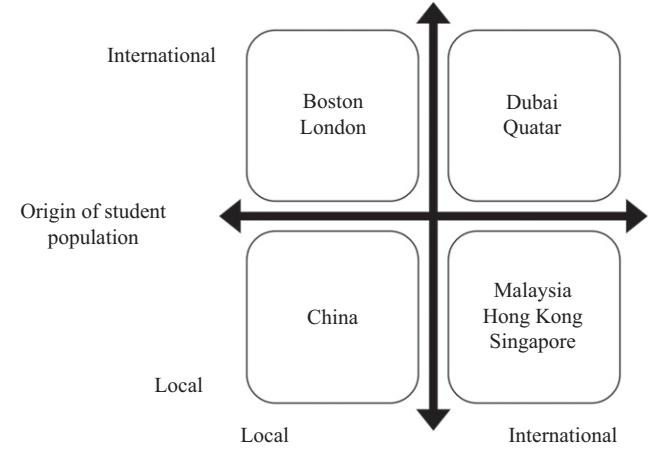

<!-- A1.R44 | source: papers_json/A1.R44/ -->

## رد على مقالة "المنطق المؤسسي لفقاعات الأعمال: دروس مستفادة من هوس كليات إدارة الأعمال في دبي" تطور دبي كمركز عالمي للتعليم في إدارة الأعمال

## TIM ROGMANS Zayed University, Dubai, United Arab Emirates

كرد على مقالة[ Alajoutsijarvi,](#page-7-0) ¨ [Juusola, and Lamberg (2014)](#page-7-0) بعنوان "دروس مستفادة من هوس كليات إدارة الأعمال في دبي"، تطبق هذه المساهمة الحوارية جوانب من نظرية الأعمال الدولية لتحليل تطور قطاع تعليم إدارة الأعمال في دبي، وتقترح تصنيفاً جديداً لمراكز تعليم إدارة الأعمال. يجادل الكاتب بأن دبي تحتل موقعاً عالمياً فريداً نتيجة الطابع الدولي العالي لكل من كلياتها الإدارية وطلابها. مراكز كليات إدارة الأعمال الأخرى إما تهيمن عليها جامعات محلية (مثل بوسطن ولندن) أو تخدم بشكل أساسي طلاباً محليين (مثل ماليزيا). هذا يطرح السؤال: "لماذا يجتمع هذا العدد الكبير من كليات إدارة الأعمال والطلاب من مختلف أنحاء العالم في دبي وليس في مكان آخر؟" بطريقة تتفق مع النظرية المؤسسية [(North 1991](#page-8-0);[ Kunci](#page-8-0)ˇ [c, 2014](#page-8-0)), يجادل الكاتب بأن قطاع كليات إدارة الأعمال الدولية في دبي يستمر في النمو بشكل أساسي نتيجة استراتيجية حكومية توفر إطاراً تنظيمياً داعماً لكل من الجامعات والطلاب. تعززت هذه الاستراتيجية عام 2006 بتأسيس هيئة المعرفة والتنمية البشرية (KHDA)، وهي هيئة تنظيمية متخصصة في قطاع التعليم. تم وضع لوائح لجذب مشغلين أجانب ذوي سمعة جيدة مع الحفاظ على معايير الجودة، مما يجذب بدوره طلاباً محليين وأجانب للدراسة في دبي. هذا مثال على استراتيجية "ابنِه وسيأتون" التي نجحت في قطاعات مختلفة في دبي، بما في ذلك النقل والسياحة والتجزئة. ورغم أن حكومة دبي لم تبنِ فعلياً كليات إدارة الأعمال العاملة حالياً في الإمارة، إلا أنها طورت البيئة

أود أن أشكر المحررين المشاركين الأستاذ Russ Vince والأستاذ Paul Hibbert، على ملاحظاتهم القيّمة وتشجيعهم ودعمهم خلال عملية المراجعة، وكذلك المراجعين المجهولين على ملاحظاتهم البناءة وحوارهم.

اللازمة للسماح لكليات إدارة الأعمال الأجنبية بتأسيس نفسها والنمو.

"تحتل دبي موقعاً عالمياً فريداً نتيجة الطابع الدولي العالي لكل من كلياتها الإدارية وطلابها."

## دروس مستفادة من هوس كليات إدارة الأعمال في دبي

في مقالتهم المنشورة في Academy of Management Learning & Education، يتناول[ Alajoutsijarvi, Juusola, and](#page-7-0) ¨ [Lamberg (2014)](#page-7-0) السؤال التالي: "كيف أمكن لأفضل كليات إدارة الأعمال في العالم أن تخطئ في تقدير السوق بشكل جماعي وأن تستثمر في أنشطة كانت، بأثر رجعي، بعيدة عن العقلانية الاقتصادية؟" يصف الكتّاب النمو السريع لكل من دبي نفسها وقطاع كليات إدارة الأعمال حتى عام 2008، مما أدى في النهاية إلى "انفجار الفقاعة، 2009–2012." يستند تبرير الإشارة إلى هذه الفترة بـ"انفجار الفقاعة" بشكل أساسي إلى وصف انخفاض أسعار العقارات في دبي وتباطؤ اقتصادي عام، إلى جانب ملاحظة أن "بعض المدارس أفلست وأُجبر كثير غيرها على الخروج أو التقليص." ولدعم ذلك، يظهر جدول أن خلال عامي 2009–2010 خرجت خمس مدارس من السوق ولم تفتح أي مدرسة جديدة خلال هذه الفترة.

لتفسير النمو السريع والتراجع اللاحق لكليات إدارة الأعمال في دبي، يستخدم الكتّاب نظرية الفقاعة مع منظور مؤسسي مكمّل للفقاعات الاقتصادية. استناداً إلى [Kindleberger and Aliber (2011)](#page-7-0)، يُقدَّم إطار عام للفقاعات، حيث يتبع النمو الأولي في قطاع ما مرحلة نشوة وهوس، ثم مرحلة ضيق واشمئزاز وانفجار للفقاعة،

<!-- page 2 -->

مما يؤدي إلى "ذعر يغذي نفسه بطريقة مشابهة للمضاربة الأولية" ([Alajoutsijarvi](#page-7-0) ¨ [et al., 2014)](#page-7-0). يستند الكتّاب بعد ذلك إلى المنظورات المؤسسية لتفسير أن الأفراد يبنون رؤى للعالم وقواعد وأعرافاً يتشاركونها مع منظمات وأفراد آخرين مشابهين [(Lok, 2010)](#page-8-0). يُطرح أن الأفراد والمنظمات يمكن أن يكونوا "عرضة للتقليد أو السلوك الجماعي" [(Alajoutsijarvi et al., 2014)](#page-7-0) وأن ¨ هذا كان عاملاً مساهماً في قرارات كليات إدارة الأعمال بالتأسيس في دبي، خاصة في سياق الاحترافية الإدارية في كليات إدارة الأعمال، مع تراجع دور أعضاء هيئة التدريس في قرارات الاستثمار [(Ginsberg, 2011](#page-7-0)). تختتم المقالة بالقول إن "كليات إدارة الأعمال ارتكبت معظم الأخطاء المذكورة في الأدبيات" وأن قادة كليات إدارة الأعمال بحاجة إلى الانتباه للتاريخ الاقتصادي لصناعة كليات إدارة الأعمال.

تُظهر مراجعة للتطورات الأحدث لكليات إدارة الأعمال في دبي أنه من المشكوك فيه أن تكون هناك فقاعة انفجرت في دبي، بالطريقة التي تصفها نظرية الفقاعة. كما ذكر [Alajoutsijarvi et al. (2014)](#page-7-0)، من بين المدارس الخمس ¨ التي أغلقت خلال 2009–2010، انتقلت اثنتان إلى إمارة مجاورة داخل دولة الإمارات العربية المتحدة (Mahatma Gandhi University، Bharati Vidyapeeth University)؛ وأُغلقت واحدة بسبب مشاكل في المؤسسة الأم (EHSAL)؛ وواحدة لا تزال نشطة وإن لم تعد كلية إدارة أعمال (Michigan State University)؛ وأُغلقت واحدة بسبب نقص الطلاب (PIM، سريلانكا). أما بقية كليات إدارة الأعمال الـ21 التي فحصتها المقالة فكانت جميعها مفتوحة عام 2012 ولا تزال جميعها تعمل حتى يناير 2018 [(KHDA, 2018)](#page-8-0). وفقاً لهيئة المعرفة والتنمية البشرية في دبي ([KHDA, 2017](#page-7-0))، يبلغ العدد الإجمالي لمزودي التعليم العالي حالياً 62 في دبي، بما في ذلك الفروع الدولية للجامعات (IBCs) والجامعات المحلية. نما عدد الجامعات في دبي خلال كل عام من السنوات الثلاثين الماضية باستثناء 2009–2010، حين انخفض عدد المزودين بمقدار واحد. وضمن هذه المجموعة من الجامعات، نما عدد الفروع الدولية من 30 عام 2009 إلى 39 عام 2017، مرة أخرى مع حدوث الانخفاض الوحيد في 2009–2010 [(KHDA,](#page-7-0) [2017](#page-7-0)).

يذكر[ Alajoutsijarvi et al. (2014)](#page-7-0) أنه ¨ "بعد انفجار الفقاعة" كانت هناك "منافسة شديدة على عدد متناقص من الطلاب المؤهلين." وعلى الرغم من أن المنافسة بين كليات إدارة الأعمال قد اشتدت بالفعل، فإن العدد الإجمالي للطلاب في دبي ازداد فعلياً كل عام، حتى خلال فترة 2008–2012 ([KHDA, 2013](#page-7-0)).

الانخفاض المسجل الوحيد في عدد الطلاب الأجانب كان عام 2010، حين انخفض عددهم بمقدار 682، أي بنسبة أقل من 3% مقارنة بالعام السابق. وخلال الفترة نفسها، ازدادت نسبة الطلاب الذين يدرسون شهادة إدارة أعمال ونسبة الطلاب الذين يدرسون في الفروع الدولية (IBCs) على حد سواء ([KHDA,](#page-7-0) [2013)](#page-7-0). ورغم أن المنافسة المتزايدة بين المدارس أدت إلى ضغط على الرسوم الدراسية لكليات إدارة الأعمال، لا يوجد دليل على أي انهيار في الأسعار من النوع الذي يُشاهَد عادة عند انفجار فقاعة. باختصار، لا تتوافق البيانات المتاحة لفترة 2002–2012 مع الأنماط التي تصفها نظرية الفقاعة، من انهيار في عدد الداخلين الجدد وتزايد في حالات الخروج ([Tuckett, 2011](#page-8-0)) يؤدي إلى ذعر يغذي نفسه ([Kindleberger & Aliber, 2011)](#page-7-0). وبأثر رجعي، عند النظر في قطاع كليات إدارة الأعمال في دبي خلال فترة 2009–2012 من حيث عدد الداخلين والخارجين والطلاب، وكذلك مستويات الرسوم، يبدو الوضع أقرب إلى تباطؤ مؤقت في النمو منه إلى انفجار فقاعة.

"عند النظر في قطاع كليات إدارة الأعمال في دبي خلال فترة 2009–2012 من حيث عدد الداخلين والخارجين والطلاب، وكذلك مستويات الرسوم، يبدو الوضع أقرب إلى تباطؤ مؤقت في النمو منه إلى انفجار فقاعة."

يكمّل الكتّاب حجتهم بمنظور مؤسسي، موضحين أن المنظمات ضمن مجال معين تتبنى مع مرور الوقت هياكل وعمليات وخطاباً متزايد التشابه ([Alajoutsijarvi et al., 2014)](#page-7-0). يمكن ¨ فعلاً ملاحظة أن كليات إدارة الأعمال تتبع بعضها البعض إلى حد ما في جهودها للتدويل. ومن المؤكد أن وجود كليات إدارة أعمال أخرى بالفعل في موقع ما يمكن أن يوفر طمأنينة للقادمين الجدد، وتدعم بيانات المقابلات في المقالة الأصلية هذا المنظور. ومع ذلك، فإن نسبة كليات إدارة الأعمال التي لديها فرع دولي (IBC) في أي مكان في العالم لا تزال منخفضة جداً. يذكر مرصد التعليم العالي عابر الحدود [(Garrett, Kinser, Lane, &Merola, 2016](#page-7-0)) أن هناك 246 فرعاً دولياً في العالم، وليست جميعها تضم كليات إدارة أعمال. ووفقاً لـ[ AACSB (2018)](#page-7-0)، يوجد أكثر من 16,000 كلية إدارة أعمال في العالم، مما يعني أن البيانات المتاحة تشير إلى أن أقل من 2% من كليات إدارة الأعمال فتحت فرعاً دولياً. أما القول بأن 10 من أفضل 100 كلية إدارة أعمال (بحسب تصنيف Financial Times) لديها وجود في دبي [(Alajoutsijarvi et al.,](#page-7-0) ¨ [2014](#page-7-0)) فقد يشير إلى درجة من السلوك الجماعي بين أفضل المدارس. تجدر الإشارة إلى أن نصف هذه المدارس

<!-- page 3 -->

المتميزة لها وجود في دبي فقط في شكل مراكز تُقدَّم فيها الدعم للطلاب، حيث يسافر المحاضرون لإعطاء دروس لطلاب بدوام جزئي. وبالطبع، حتى اختيار نمط التشغيل هذا يمكن أن يكون نتيجة سلوك مؤسسي، حيث تحاكي المدارس المتميزة اختيارات الموقع ونموذج الأعمال لأولئك الموجودين بالفعل. لذلك، توجد بيانات تدعم فكرة أن كليات إدارة الأعمال تتبع بعضها البعض عند اتخاذ قرارات الموقع، لكن من الصعب تحديد بوضوح إلى أي مدى يقود السلوك المؤسسي هذه الاستراتيجيات، مقارنة بالمزايا الخاصة لدبي كموقع. وبغض النظر عن الدوافع، يبدو أن المؤسسات الرائدة لا تزال حريصة على الافتتاح في دبي. فخلال عامي 2017 و2018، أعلنت جامعة Birmingham وكلية Babson عن خططهما لافتتاح حرم جامعي في دبي، كما أعلن معهد Rochester Institute of Technology عن خطة توسع كبيرة.

## التطورات 2013–2018

تشير التطورات الأخيرة إلى سوق مستمر في النمو لكليات إدارة الأعمال في دبي. خلال فترة 2013–2016، ازداد إجمالي عدد الطلاب في دبي بنسبة 9.6% سنوياً ليصل إلى أكثر من 60,310، وارتفعت نسبة جميع الطلاب المسجلين في برنامج إدارة أعمال من 42% إلى 52.7% ([KHDA, 2017](#page-7-0)). وفي هذا السوق المتنامي، يشكّل الوافدون 56% من إجمالي عدد الطلاب في دبي [(KHDA, 2017](#page-7-0)). وفي الوقت نفسه، زادت الفروع الدولية (IBCs) حصتها من إجمالي عدد الطلاب من 42.8% في 2010–2011 إلى 46% في 2015–2016 ([KHDA, 2017)](#page-7-0)، مما يشير إلى أن عدد الطلاب في الفروع الدولية نما بمعدل أسرع من نمو مجموع طلاب الجامعات في دبي.

يذكر مرصد التعليم العالي عابر الحدود [(Garrett et al., 2016)](#page-7-0) أن الصين تجاوزت الآن دولة الإمارات كأكثر دولة من حيث عدد الفروع الدولية (IBCs)، حيث تضم الصين 32 فرعاً دولياً، وتستضيف الإمارات 31 فرعاً، تليها سنغافورة وماليزيا بـ12 فرعاً لكل منهما. في دبي، أكثر من نصف الفروع الدولية أنجلوساكسونية المنشأ (من أستراليا أو المملكة المتحدة أو الولايات المتحدة)، وتمثل 73% من إجمالي طلاب الفروع الدولية و79% من طلاب إدارة الأعمال [(KHDA, 2018)](#page-8-0). وفي الوقت نفسه، ينحدر 86% من جميع الطلاب في دبي من آسيا ومنطقة الشرق الأوسط وشمال إفريقيا (MENA) (بما فيها الإمارات)، ومعظم الطلاب الإماراتيين يلتحقون بإحدى مؤسسات التعليم العالي الاتحادية

(جامعة Zayed University وكليات التقنية العليا). الصورة التي تظهر من هذا التحليل هي فروع دولية أنجلوساكسونية تقدم تعليماً في إدارة الأعمال لطلاب أجانب من آسيا ومنطقة الشرق الأوسط وشمال إفريقيا. حصة كبيرة لكن غير معروفة من هؤلاء الطلاب الآسيويين والعرب هم بالفعل مقيمون في الإمارات قبل الالتحاق بالجامعة، لكنهم يختارون بشكل متزايد البقاء في دبي بدلاً من الانتقال إلى المملكة المتحدة أو الولايات المتحدة أو الهند لدراستهم الجامعية. وفي الوقت نفسه، يأتي الشباب الآسيوي والعربي إلى دبي للحصول على شهادة إدارة أعمال أنجلوساكسونية قريبة نسبياً من بلدانهم. ورغم عدم توفر إحصائيات مفصلة عن وقت دخول الطلاب الوافدين إلى دبي أصلاً، فإن كون عدد الطلاب في دبي قد نما بمعدل 1.5 ضعف معدل نمو عدد سكان دبي الإجمالي يشير إلى أن هناك على الأرجح عدداً متزايداً من الطلاب الذين ينتقلون إلى دبي لدراستهم. هذا الوضع في دبي يتناقض مع الفروع الدولية في الصين، حيث يكون الجمهور المستهدف بشكل أساسي طلاباً صينيين محليين.

"لذلك، توجد بيانات تدعم فكرة أن كليات إدارة الأعمال تتبع بعضها البعض عند اتخاذ قرارات الموقع، لكن من الصعب تحديد بوضوح إلى أي مدى يقود السلوك المؤسسي هذه الاستراتيجيات، مقارنة بالمزايا الخاصة لدبي كموقع."

"مصطلح مركز التعليم ظاهرة حديثة نسبياً لم تحظَ بقدر كبير من البحث الأكاديمي."

## التوسع الدولي لكليات إدارة الأعمال

## مراكز التعليم والفروع الدولية للجامعات

بما أن الفروع الدولية (IBCs) في دبي تخدم في معظمها طلاباً أجانب، وأن دراسات إدارة الأعمال هي البرنامج الأكثر شعبية بفارق كبير ([KHDA, 2017)](#page-7-0)، فمن الواضح أن دبي أصبحت مركزاً دولياً لتعليم إدارة الأعمال. وفي سياق تدويل البحث والتعليم، فإن مصطلح مركز التعليم ظاهرة حديثة نسبياً لم تحظَ بقدر كبير من البحث الأكاديمي وليس لها تعريف مقبول بشكل عام.[ Kinser and Lane (2015)](#page-7-0) يشيران إلى مصطلح "المركز" على أنه استعارة موحية

<!-- page 4 -->

تشمل أنواعاً مختلفة من الاستراتيجيات، تتضمن عادة تطوير جامعات القطاع الخاص والفروع الدولية.[ Knight (2011)](#page-7-0) قدّم التعريف العملي التالي للمصطلح:

مركز التعليم هو جهد مخطط لبناء كتلة حرجة من الفاعلين المحليين والدوليين المنخرطين استراتيجياً في التعليم والتدريب وإنتاج المعرفة وأنشطة الابتكار.

[Knight (2011)](#page-7-0) يصف جهود ست دول أعلنت خططاً لوضع نفسها كمراكز تعليمية ضمن منطقتها وخارجها (سنغافورة، ماليزيا، هونغ كونغ، الإمارات، قطر، البحرين).[ Knight (2011)](#page-7-0) لا يتناول المراكز على مستوى المدن، وهو ما كان يمكن أن يؤدي إلى إدراج مدن مثل بوسطن أو لندن في دراستها. تشمل أبحاث أخرى حول مراكز التعليم دراسات حالة لمراكز آسيوية مثل سنغافورة ([Ho Mok, 2008](#page-7-0))، وماليزيا [(Knight & Morshidi, 2011](#page-7-0)).[ Knight (2015)](#page-7-0) قدّم تصنيفاً أولياً لمراكز التعليم إلى ثلاثة أنواع (مركز طلابي، مركز تعليم وتدريب، مركز معرفة وابتكار) وأقرّ بضرورة إجراء المزيد من البحث في هذه الظاهرة الحديثة نسبياً.

يتعلق تيار آخر من أدبيات التعليم العالي بتأسيس وإدارة الفروع الدولية (IBCs).[ Lane (2011a)](#page-8-0) وجد أن الفروع الدولية تُنشأ إما لتقديم شيء مختلف أو أفضل مما هو موجود بالفعل، أو لامتصاص الطلب الزائد في بلد ما. وبما أن الفروع الدولية لا تُدعم عادة من المؤسسة الأم، فإنها تعتمد على الرسوم الدراسية ودعم الحكومة المضيفة واستثمارات الشركاء من القطاع الخاص كمصادر رئيسية للتمويل [(Lane](#page-8-0) [2011b](#page-8-0)). في حالتي دبي وماليزيا، كان الهدف من وجود الفروع الدولية خلق طلب جديد في قطاع التعليم العالي المحلي، ومنع الطلاب المحليين من الدراسة بالخارج، وجذب طلاب أجانب ([Lane, 2011a)](#page-8-0). وبما أن الفروع الدولية تنطوي على مخاطر مالية وسمعة كبيرة بالنسبة للمؤسسات الأم، تناولت عدة دراسات جوانب إدارة المخاطر لديها [(Wilkins, 2016](#page-8-0);[ Hommel, Li, &](#page-7-0) [Pastwa, 2016)](#page-7-0).[ Lane (2011b)](#page-8-0) حدد تحديات إدارية وقيادية كبيرة مرتبطة بالتوسع عبر الفروع الدولية.

## نحو تصنيف لمراكز التعليم

تصنيف Knight'[s (2015)](#page-7-0) لمراكز التعليم إلى الأنواع الثلاثة المذكورة أعلاه من الصعب اختباره تجريبياً استناداً إلى البيانات المتاحة. ورغم أن السلطات المحلية قد تطمح إلى التقدم من مراكز طلابية إلى مراكز ابتكار، ليس من السهل تحديد متى يتوافق موقع ما مع تصنيف

أو آخر. بل من الممكن أن تصبح المواقع مراكز ابتكار دون أن تكون قد مرت بمرحلة مركز طلابي دولي. ولاستكمال الأدوات المتاحة لتحليل مراكز التعليم، يقترح الكاتب صياغة تصنيف جديد لوجهات التعليم وفق معيارين: البُعد الدولي لعدد طلابها، والبُعد الدولي لكليات إدارة الأعمال العاملة في الموقع. وتطبيق هذا التصنيف على ثمانية مواقع (مدن ودول) هي الأكثر إشارة إليها في الأدبيات كمراكز تعليمية، ينتج الشكل 1 أدناه.

موقع مراكز التعليم في المصفوفة تخطيطي، ويُحدَّد بناءً على المعلومات المتاحة عن عدد الطلاب الدوليين كنسبة من إجمالي الطلاب (للمحور الرأسي) وتقدير لقدرة الفروع الدولية كنسبة من إجمالي قدرة كليات إدارة الأعمال في الموقع (للمحور الأفقي). لا تندرج جميع المدن والدول الموضحة في المصفوفة بدقة ضمن أحد الأرباع، لكن موقع كل منطقة يشير إلى خصائصها كمركز مقارنة بالمواقع الأخرى الموضحة. في الربع العلوي الأيسر، تهيمن الجامعات المحلية، لا الفروع الدولية، على مدن مثل بوسطن ولندن. ولندن لديها عدد أعلى قليلاً من الفروع الدولية مقارنة ببوسطن ([Garret](#page-7-0) [et al., 2016)](#page-7-0)، لكن في كلتا الحالتين تهيمن الجامعات المحلية التقليدية على عرض التعليم العالي. ورغم أن غالبية طلاب بوسطن ولندن من المواطنين المحليين، فإن كليهما يضم نسبة كبيرة من

*الشكل 1 أبعاد التدويل لمراكز تعليم إدارة الأعمال.*

*أصل كليات إدارة الأعمال*

<!-- page 5 -->

الطلاب القادمين من الخارج. وفي الجانب السفلي الأيمن من المصفوفة، تتميز ماليزيا وسنغافورة وهونغ كونغ بحضور قوي للجامعات الأجنبية وقاعدة طلابية محلية بشكل كبير. وعلى الرغم من أن عدد الطلاب الأجانب ليس مهملاً على الإطلاق، إلا أنهم يمثلون أقلية صغيرة فقط من إجمالي عدد الطلاب. وتمتلك ماليزيا، بشكل خاص، عدداً دولياً كبيراً ومتنامياً في التعليم العالي ([New](#page-8-0) [Straits Times](#page-8-0), 2016)، لكن هذا لا يزال يمثل أقل من 15% من إجمالي عدد طلاب الجامعات في البلاد. تركز الفروع الدولية في الصين بشكل أقوى حتى على الطلاب المحليين مقارنة بماليزيا وسنغافورة وهونغ كونغ. ومن حيث الأصل الوطني لكليات إدارة الأعمال، فإن الصين هي الدولة التي تضم أكبر عدد من الفروع الدولية في العالم، لكن تأثيرها المحلي لا يزال طفيفاً نسبياً من حيث الحصة التي تمثلها هذه الفروع في سوق تعليم إدارة الأعمال الصيني الضخم. لذلك، فإن الصين، مقارنة بمراكز التعليم الأخرى، لا تزال تتميز بهيمنة المزودين المحليين والطلاب المحليين، مما يضع الصين في الربع السفلي الأيسر. ويتوافق العدد المتنامي من الفروع الدولية في الصين مع الوصف الذي قدمه[ Lane (2011a)](#page-8-0)، بأن الفروع الدولية تقدم شيئاً مختلفاً أو أفضل مما هو موجود بالفعل في السوق المحلية. وأخيراً، في الربع العلوي الأيمن، تتميز دبي وقطر بشكل فريد كمراكز يغلب عليها الطلاب الأجانب والجامعات الأجنبية. ورغم أن الموقعين يقعان في نفس ربع المصفوفة، توجد فروقات مهمة في حجمهما وطبيعتهما كمراكز تعليمية. وعلى وجه الخصوص، من حيث عدد الطلاب والجامعات، سوق تعليم إدارة الأعمال الدولي أكبر بكثير في دبي منه في قطر. تُحلَّل الفروقات الأخرى بين دبي وقطر بمزيد من التفصيل أدناه.

باختصار، تتفرد دبي بين مراكز تعليم إدارة الأعمال الموضحة في[ الشكل 1](#page-3-0) من حيث أن الفروع الدولية والطلاب الدوليين في دراسات إدارة الأعمال كبيرون، سواء من حيث عددهم المطلق أو كنسبة من سوق تعليم إدارة الأعمال في الموقع. ويطرح هذا التحليل لتطور قطاع كليات إدارة الأعمال في دبي ضمن سياقها العالمي السؤال حول لماذا اختارت هذه الأعداد الكبيرة من الجامعات والطلاب الدوليين دبي كموقع لتقديم تعليم إدارة الأعمال والحصول عليه.

## كليات إدارة الأعمال الدولية ونظرية الأعمال الدولية

في "الميزة التنافسية للأمم"، يصف [Porter](#page-8-0) [(1990)](#page-8-0) نموذج الماسة لتفسير نشوء التكتلات نتيجة شروط عوامل الإنتاج،

وشروط الطلب، ووجود الصناعات المرتبطة والداعمة، فضلاً عن استراتيجية الشركة وهيكلها والمنافسة. وحتى مع استخدام هذا النموذج لتحليل التعليم عبر الحدود الوطنية في الصين وماليزيا [(Tsiligiris, 2018](#page-8-0))، فإن التحليل لا ينطبق بشكل جيد على نشوء دبي كمركز تعليم عالمي. فالغياب الأولي لعوامل الإنتاج الرئيسية (مثل هيئة تدريس مؤهلة)، وصغر حجم السكان المحليين مما يؤدي إلى ظروف طلب غير مواتية، والغياب الأولي للصناعات المرتبطة والداعمة (مثل سكن الطلاب)، كلها عوامل تجعل نموذج الماسة إطاراً نظرياً غير قابل للتطبيق لتحليل تطور قطاع تعليم إدارة الأعمال في دبي. والواقع أن أي تفسير شامل لنشوء دبي كمركز لتعليم إدارة الأعمال يحتاج إلى مراعاة كيف حدثت هذه الظاهرة رغم الغياب الأولي للشروط التي حددها نموذج الماسة لبورتر.

يمكن معالجة مسألة تدويل كليات إدارة الأعمال بشكل أفضل من خلال عدسة نظرية الأعمال الدولية، التي تسعى لتفسير سبب توسع الشركات دولياً بالطريقة التي تفعل بها.[ Dunning (1977](#page-7-0),[ 2003)](#page-7-0) صاغ إطار OLI، مشيراً إلى أن الشركات ستتوسع في الخارج إذا وُجدت مزايا الملكية والموقع والاستيعاب الداخلي (Ownership, Location, Internalization). وفي هذا الإطار، تشمل مزايا الملكية المزايا التنافسية للشركة التي تساعدها على النجاح في الأسواق الأجنبية، مثل اسم العلامة التجارية أو المعرفة الخاصة أو الموارد المالية. وتشير نظرية الأعمال الدولية إلى وجود "عبء الغربة" [(Johanson & Vahlne, 1977)](#page-7-0)، الذي يضع المستثمر الأجنبي في موقع أقل تفضيلاً مقارنة بالمنافسة المحلية، ويجب تعويض هذا العبء بمزايا ملكية للمنظمة الأجنبية.

ثانياً، تساعد مزايا الموقع في تفسير سبب اختيار المنظمة بلداً معيناً لنشاطها الأجنبي. قد تشمل هذه المزايا حجم سوق البلد، وجودة مؤسساته، وسيادة القانون، وتوافر العمالة الماهرة، والبنية التحتية المادية، وما شابه. وأخيراً، تشير مزايا الاستيعاب الداخلي إلى أسباب قيام الشركة بتنفيذ النشاط الدولي بنفسها بدلاً من التعاقد مع شريك. ووفقاً لنظرية تكاليف المعاملات، سيحدث ذلك إذا كانت تكلفة التعاقد مع شريك محلي أكبر من تكلفة السيطرة على النشاط الدولي عبر الهيكل الداخلي للمنظمة [(Hymer, 1960](#page-7-0)). تشمل تكاليف المعاملات الجهود اللازمة لتحديد الشركاء الأجانب ومراقبتهم، وهي مرتفعة بشكل خاص في حال وجود احتمال للانتهازية (أو الغش) من جانب

<!-- page 6 -->

الشريك المحلي ([Williamson, 1985](#page-8-0)). في مجال التعليم، قد تتمثل هذه الانتهازية في عدم التزام شريك محلي بمعايير الجودة التي حددتها المؤسسة الأم، مما يسبب ضرراً بالسمعة. وتساعد مزايا الاستيعاب الداخلي في تفسير نمط الملكية الذي تختاره المنظمة لنشاطها الدولي، بدءاً من مستويات استثمار وسيطرة عالية إلى منخفضة (أي الملكية الكاملة، والمشاريع المشتركة، والترخيص، والامتياز). ولا تتناول هذه المزايا سؤال لماذا يحدث النشاط التجاري في موقع معين. لذلك، ومن حيث إطار OLI، لن يتضمن باقي هذا القسم مزيداً من تحليل مزايا الاستيعاب الداخلي، بل سيركز حصرياً على مزايا الملكية والموقع. ويكفي الإشارة في هذه المرحلة إلى أن كليات إدارة الأعمال الدولية في دبي موجودة عبر كامل طيف خيارات الملكية، من الملكية الكاملة إلى المشاريع المشتركة إلى الترخيص.

وضع Dunning إطار OLI كإطار عام لتطوير النظرية، لا كنظرية محددة للتدويل. وفي رد على انتقاد مفاده أن إطار OLI يحتوي على عدد كبير جداً من المتغيرات التفسيرية المحتملة بحيث تكون قيمته التنبؤية شبه معدومة، جادل[ Dunning (2003)](#page-7-0) بأن "الغرض من النموذج الانتقائي ليس تقديم تفسير كامل لجميع أنواع الإنتاج الدولي، بل بالأحرى الإشارة إلى منهجية ومجموعة عامة من المتغيرات تحتوي على المكونات اللازمة لأي تفسير مُرضٍ لأنواع معينة من نشاط القيمة المضافة الأجنبي." وضمن هذا السياق، يظل إطار OLI الإطار النظري السائد لتحليل تدويل الشركات. ورغم أن مزودي التعليم العالي في معظم الحالات ليسوا منظمين كشركات، فإن توسعهم الدولي عادة ما يُبنى على غرار مبادرة القطاع الخاص، بهدف تحقيق ربح للمؤسسة الأم كأحد الدوافع على الأقل [(Lane, 2011a](#page-8-0)). لذلك، من المعقول بناء نظرية حول ظاهرتَي الفروع الدولية ومراكز التعليم باستخدام جوانب من نظرية الأعمال الدولية. وفي هذه الحالة تحديداً، "ما هي مزايا الملكية والموقع التي تساعد في تفسير سبب التقاء كليات إدارة الأعمال الدولية والطلاب في دبي وليس بنفس الدرجة في أماكن أخرى؟"

من حيث مزايا الملكية، تجدر الإشارة إلى أن معظم الفروع الدولية العاملة في دبي تنحدر من دول أنجلوساكسونية (أستراليا والمملكة المتحدة والولايات المتحدة). وتعتمد هذه الجامعات بشكل كبير على تاريخها واسم علامتها التجارية وسمعتها وتصنيفها وبلد منشئها عند التسويق للطلاب المحتملين، على سبيل المثال عبر الإعلانات في الصحف والراديو، وكذلك عبر مواقع الجامعات الإلكترونية ووسائل التواصل الاجتماعي. كما تستفيد عدة فروع هندية وباكستانية

في دبي من اسم علامتها التجارية المبني في بلدها الأم لتقديم تعليم إدارة الأعمال للمقيمين الهنود والباكستانيين في دبي. وقد تكمن مزايا ملكية إضافية للفروع الدولية في خبرتها ومعرفتها في إدارة تعليم إدارة الأعمال. بل إن بعض كليات إدارة الأعمال تحوّل قدرتها على تشغيل فروع دولية على مستوى العالم إلى مصدر ميزة تنافسية (مثل Heriot Watt University وManipal). ومع ذلك، من المرجح أن يكون جانب الخبرة الدولية المتراكمة ميزة ملكية طفيفة نسبياً في هذا السياق، بالنظر إلى أن عملية دبي هي العملية الدولية الوحيدة أو الأولى لمعظم الفروع الدولية في دبي. وقد يكون توافر الموارد المالية أيضاً ميزة ملكية لكليات إدارة الأعمال الساعية للتوسع في الخارج، لكن تجدر الإشارة إلى أن كليات إدارة الأعمال التي تتوسع في الخارج ليست عادة تلك التي تمتلك أكبر الأوقاف. والواقع أن القدرة على توليد أموال لتمويل أنشطة البحث الأكاديمي في الوطن هي دافع رئيسي لكليات إدارة الأعمال للتوسع في الخارج [(Garrett et al., 2016](#page-7-0)).

"ما هي مزايا الملكية والموقع التي تساعد في تفسير سبب التقاء كليات إدارة الأعمال الدولية والطلاب في دبي وليس بنفس الدرجة في أماكن أخرى؟"

توفر مزايا الموقع تفسيراً لماذا اختارت كليات إدارة الأعمال ذات الطموحات الدولية دبي كمكان للعمل، بدلاً من مكان آخر. فإذا اعتُبر عدد سكان دبي الحالي (3 ملايين نسمة) هو حجم السوق، فإن السوق يبدو مُشبعاً بشكل كبير. ومع ذلك، بالنظر إلى الطابع الدولي للطلاب في الفروع الدولية، يتضح أن هذه الفروع تستهدف منطقة MENASA بأكملها (الشرق الأوسط وشمال إفريقيا وجنوب آسيا) وما وراءها لاستقطاب الطلاب. ونجاح دبي في جذب الفروع الدولية والطلاب الدوليين يشبه من نواحٍ عديدة نجاحها في أن تصبح مركزاً للأعمال في قطاعات أخرى: جودة الحياة، وبنية تحتية مادية ممتازة مع اتصالات سهلة بأي مكان في المنطقة وما وراءها، وبيئة آمنة، وتوافر الأراضي للبناء، وتطبيق سيادة القانون [(Rogmans, 2012](#page-8-0)). ويمكن تلخيص مجموع مزايا الموقع هذه في مصطلح "البنية التحتية"، الذي يشمل عناصر من البنية التحتية الصلبة والناعمة. ويرتبط مصطلح البنية التحتية الناعمة ارتباطاً وثيقاً بمفهوم الجودة المؤسسية، الذي يشمل "قواعد اللعبة" الرسمية وغير الرسمية وخصائص إنفاذها [(North](#page-8-0) [1991; Kunci](#page-8-0)ˇ c[, 2014](#page-8-0)). وعادة ما تشمل مقاييس الجودة المؤسسية ˇ

<!-- page 7 -->

خصائص على المستويات القانونية والسياسية والاقتصادية، مثل استقلال القضاء، وغياب الفساد، وجودة بيروقراطية البلد، وحماية حقوق الملكية، وغياب ضوابط رأس المال.[ Kunci](#page-8-0)ˇ [c (2014)](#page-8-0) صنّف ˇ الإمارات في الشريحة الوسطى من ترتيب لـ197 دولة استناداً إلى الجودة المؤسسية، مشيراً إلى التقدم السريع للبلد منذ التسعينيات. ومن بين التصنيفات المختلفة للجودة المؤسسية والتنافسية، عادة ما تحتل الإمارات المرتبة الأولى في العالم العربي. ومع ذلك، فإن هذه التصنيفات العامة للجودة المؤسسية أو غيرها من تصنيفات بيئة الأعمال العامة للدول لا تفسر الأداء الفريد لدبي عالمياً في جذب كليات إدارة الأعمال والطلاب الدوليين. وتوجد خصائص مؤسسية معينة تفسر جاذبية دبي كوجهة تعليمية، وتتجسد في تأسيس هيئة المعرفة والتنمية البشرية في دبي (KHDA) عام 2006. وهيئة KHDA هيئة تنظيمية أسستها إمارة دبي، وأحد أهدافها التأسيسية المذكورة هو "جذب المؤسسات التعليمية الخاصة، ومراكز البحث والدراسات، والمؤسسات الدولية المرموقة لتطوير الموارد البشرية، لتأسيس فروع في الإمارة" ([KHDA, 2006](#page-7-0)). وهيئة KHDA جهة تنظيمية متخصصة في قطاع التعليم في دبي، توفر إطاراً واضحاً لكليات إدارة الأعمال الدولية المؤهلة للتأسيس في دبي، مع حماية استثمار الطلاب عند بدء دراستهم لشهادة جامعية. ويبدأ تدخل هيئة KHDA في التوجيه الأولي الذي تجريه كليات إدارة الأعمال عند اتخاذ قرار التوسع الدولي، ويستمر خلال عملية الترخيص، ويصل إلى ضمان الجودة [(KHDA, 2017](#page-7-0)). ومنذ تأسيس هيئة KHDA عام 2006، تضاعف عدد الفروع الدولية في دبي تقريباً ثلاث مرات، من 11 إلى 32 [(Garret et al., 2016)](#page-7-0). ورغم وجود مخاطر في تولي منظمة واحدة دور المنظِّم والميسِّر معاً، يبدو أن الدور التنظيمي يُطبَّق بصرامة، مع رفض عدد كبير من الطلبات [(Alajoutsijarvi et al., 2014)](#page-7-0). ¨

تتناقض استراتيجية دبي ونموها مع قطر، التي تُعد المثال المهم الوحيد الآخر في[ الشكل 1](#page-3-0) لمركز يضم جامعات وطلاباً دوليين بشكل غالب. فمن جهة، ركزت دبي على تهيئة الظروف المناسبة لتأسيس كليات إدارة الأعمال، ثم توفر الدعم للجامعات التي تفكر في دخول سوق دبي عبر عملية الترخيص والتأسيس. وفي المقابل، تتمركز معظم الجامعات الأجنبية في قطر في مدينة التعليم (Education City)، وهو تكتل تطور استناداً إلى عدد صغير من الجامعات الدولية النخبوية المتخصصة في تخصصات

أكاديمية مختلفة. وقد دُعيت الجامعات في مدينة التعليم لتأسيس حرم جامعي، وتحظى بدعم مالي من الحكومة عبر مؤسسة قطر. وبهذا المعنى، فإن دور السلطات المحلية أقرب إلى دور العميل منه إلى دور المنظِّم والميسِّر. ومن بين الجامعات في مدينة التعليم، فقط HEC وCarnegie Mellon تقدمان شهادات في إدارة الأعمال (Education City, 2018). وخارج مدينة التعليم، توجد ثلاث جامعات أجنبية فقط تقدم شهادات في إدارة الأعمال في قطر (University of Aberdeen وStenden University Qatar وCollege of North Atlantic). ويكمن الفرق الرئيسي في النهج بين دبي وقطر في تهيئة الظروف المناسبة لتأسيس كليات إدارة الأعمال الدولية وازدهارها (دبي) مقابل شراكة الحكومة مع عدد صغير من الجامعات النخبوية في تخصصات محددة (قطر).

لذلك، فإن تطور مشهد تعليم إدارة الأعمال في دبي لا يعود بشكل أساسي إلى البنية التحتية العامة أو الخصائص المؤسسية، رغم أن هذه العوامل ربما لعبت دوراً، ولا إلى تواصل الحكومة مع عدد صغير من الجامعات المرموقة، بل هو نتيجة سياق مؤسسي صُمم عمداً وتحديداً لقطاع التعليم العالي من قبل حكومة دبي من خلال تأسيس هيئة KHDA. ومن حيث أبعاد المصفوفة في[ الشكل 1،](#page-3-0) وفي غياب دعم حكومي مالي مباشر للجامعات والطلاب القادمين من الخارج، فكلما زاد العنصر الدولي لجامعات مركز التعليم وطلابه، زادت أهمية مصداقية الترتيبات المؤسسية للموقع اللازمة للتغلب على عبء الغربة بالنسبة لكل من الجامعات والطلاب.

## الخاتمة

استعرضت هذه المساهمة الحوارية مساهمة[ Alajoutsijarvi et al. (2014)](#page-7-0) التي حللت ¨ تطور قطاع كليات إدارة الأعمال في دبي باستخدام نظرية الفقاعة مع منظور مؤسسي مكمّل. وقد طُرحت حجة مفادها أن التباطؤ المؤقت في نمو القطاع لا يتوافق مع انفجار فقاعة بالطريقة التي تقترحها نظرية الفقاعة. ومن المرجح أن تكون كليات إدارة الأعمال قد أظهرت بعض سلوكيات التقليد التي وصفتها المقالة الأصلية كنظرية مؤسسية، مع استمداد بعض كليات إدارة الأعمال للطمأنينة من كون أخرى قد سبقتها، لكن يلزم مزيد من الأدلة التجريبية لتحديد ما إذا كان هذا عنصراً أكثر أهمية من مزايا الموقع القائمة.

<!-- page 8 -->

تسهم هذه المساهمة الحوارية في أدبيات تدويل تعليم إدارة الأعمال من خلال تحديد ووصف وتفسير ظاهرة جديدة: مركز التعليم، الذي يتكون في معظمه من جامعات أجنبية وطلاب أجانب. ويشير تحليل يطبق جوانب من نظرية الأعمال الدولية لفهم تطور قطاع تعليم إدارة الأعمال في دبي كمركز عالمي، إلى أن دبي موقع اختارت فيه كليات إدارة الأعمال الدولية الاستفادة من أصولها المتعلقة بالسمعة ضمن بيئة مؤسسية داعمة ومتماسكة. وبدورهم، جاء الطلاب الدوليون إلى دبي بسبب العرض الكبير لكليات إدارة أعمال مرموقة، مدعومين أيضاً في اتخاذ قرارهم بالبيئة التنظيمية الموثوقة. وبالنسبة للطرفين (الجامعات والطلاب)، توفر عناصر البنية التحتية الصلبة والناعمة الأخرى في دبي دعماً إضافياً لاختيارهم.

ومع استمرار تدويل سوق تعليم إدارة الأعمال، يمكن للجامعات استخدام عناصر نظرية الأعمال الدولية المطبقة هنا لدعم اتخاذ قرارها الخاص بشأن الموقع الدولي وهياكل الملكية المناسبة لأنشطتها الدولية. ويمكن للمواقع الساعية لتوسيع دورها كمراكز دولية لتعليم إدارة الأعمال استخدام تصنيف مراكز التعليم الذي طُوِّر في هذه المقالة لتحديد موقع أنشطتها الخاصة وصياغة استراتيجياتها. وكما يبين تطور دبي، فإن صورة العلامة التجارية للجامعات وإطاراً تنظيمياً محدداً ومُنفَّذاً بفعالية للمؤسسات التعليمية الدولية من المرجح أن يكونا العاملين الرئيسيين اللذين سيشكلان نمو تعليم إدارة الأعمال الدولي.

الفروع الدولية للجامعات ومراكز تعليم إدارة الأعمال العالمية ظواهر حديثة نسبياً. يمكن للنظرية القائمة أن توفر أدوات لتحليل وفهم هذه التطورات، لكن من المرجح أن تظهر أيضاً أطر نظرية وتصورات جديدة. وكخطوة أولى، يمكن لأبحاث مستقبلية ضمن إطار OLI أن تختبر بمزيد من التفصيل دوافع ومحركات قرارات التوسع الدولي لكليات إدارة الأعمال، وكذلك العوامل التي تحدد اختيارات الموقع وهيكل الملكية للعمليات الأجنبية.

## REFERENCES

- Alajoutsijarvi, K., Juusola, K., & Lamberg, J. 2014. Insti- ¨ tutional logic of business bubbles: Lessons from the Dubai Business school mania. Academy of Management Learning & Education, 13(1): 5–25.
- AACSB. 2018. Best Business Schools,[ http://bestbizschools.](http://bestbizschools.aacsb.edu/aacsb-accredited) [aacsb.edu/aacsb-accredited,](http://bestbizschools.aacsb.edu/aacsb-accredited) (accessed on 26 March 2018).

- Dunning, J. H. 1977. Trade, location of economic activity and the MNE; A search for an eclectic approach. The international allocation of economic activity. London: Macmillan.
- Dunning, J. H. 2003. The eclectic (OLI) paradigm of international production: Past, present and future, International business and the eclectic paradigm – Developing the OLI framework. London: Routledge.
- Garrett, R., Kinser, K., Lane, J. & Merola, R. 2016.International branch campuses – Trends and developments 2016. Observatory of Borderless Higher Education.
- Ginsberg, B. 2011. The fall of the faculty: The rise of the all-administrative university and why it matters. Oxford, UK: Oxford University Press.
- Ho Mok, K. 2008. Singapore's global education hub ambitions: University governance change and transnational higher education. International Journal of Educational Management, 22(6): 527–546.
- Hommel, U., Li, W., & Pastwa, A. M. 2016. The state of risk management in business schools. Journal of Management Development, 35(5): 606–622.
- Hymer, S. 1960. The international operations of national firms. PHD dissertation. Massachusetts Institute of Technology.
- Johanson, J., & Vahlne, J. E. 1977. The internationalization process of the firm – A model of knowledge development and increasing foreign market commitments. Journal of International Business Studies, 8: 23–31.
- Kindleberger, C. P., & Aliber, R. Z. 2011. Manias, panics, and crashes: A history of financial crises, (6th ed.). Basingstoke, UK: Palgrave Macmillan.
- Kinser, K., & Lane, J. 2015. Deciphering "educational hubs" strategies: Rhetoric and reality. International Higher Education, (59).
- Knight, J. 2011. Education hubs: A fad, a brand, an innovation? Journal of Studies in International Education, 15(3): 221–240.
- Knight, J. 2015. Regional education hubs–Rhetoric or reality. International Higher Education, (59).
- Knight, J., & Morshidi, S. 2011. The complexities and challenges of regional education hubs: Focus on Malaysia. Higher Education, 62(5): 593–606.
- Knowledge and Human Development Authority. 2006. Law No 30 of 2006 Establishing KHDA, [www.khda.](http://www.khda.gov.ae) [gov.ae](http://www.khda.gov.ae) (accessed on 26 March 2018).
- Knowledge and Human Development Authority. 2013. The Higher Education Landscape in Dubai 2012, [www.khda.gov.ae](http://www.khda.gov.ae) (accessed on 26 March 2018).
- Knowledge and Human Development Authority. 2017. Dubai's Education Landscape 2016/2017,[ www.khda.](http://www.khda.gov.ae) [gov.ae](http://www.khda.gov.ae) (accessed on 26 March 2018).

<!-- page 9 -->

- Knowledge and Human Development Authority. 2018. Private Education Institutions in Dubai,[ www.khda.](http://www.khda.gov.ae/en/directory) [gov.ae/en/directory](http://www.khda.gov.ae/en/directory) (accessed on 26 March 2018).
- Kunciˇ c, A. 2014. Institutional quality dataset. ˇ Journal of Institutional Economics, 10(1): 135–161.
- Lane, J. E. 2011a. Importing private higher education: International branch campuses. Journal of Comparative Policy Analysis, 13(4): 367–381.
- Lane, J. E. 2011b. Global expansion of international branch campuses: Managerial and leadership challenges. New Directions for Higher Education, (155): 5–17.
- Lok, J. 2010. Institutional logics as identity projects. Academy of Management Journal, 53: 1305–1335.
- New Straits Times. 2016. International student enrolment up by 12 percent last year: Higher Education Ministry. March 30, 2016. (Accessed 7 April 2018).
- North, D. C. 1991. Institutions. The Journal of Economic Perspectives, 5(1): 97–112.
- Porter, M. E. 1990. The competitive advantage of nations. New York: Free Press.
- Rogmans, T. J. 2012. The emerging markets of the Middle East: Strategies for entry and growth. Business Expert Press.

- Tsiligiris, V. 2018. An adapted Porter Diamond Model for the evaluation of transnational education host countries. International Journal of Educational Management, 32(2): 210–226.
- Tuckett, D. 2011. Minding the markets. An emotional finance view of financial instability. London: Palgrave Macmillan.
- Williamson, O. E. 1985. The economic institutions of capitalism. NY: Free Press.
- Wilkins, S. 2016. Establishing international branch campuses: A framework for assessing opportunities and risks. Journal of Higher Education Policy and Management, 38(2): 167–182.

حصل Tim Rogmans على درجة الدكتوراه من جامعة Nyenrode في هولندا، وعلى درجة الماجستير في إدارة الأعمال (MBA) من INSEAD في فرنسا. وهو أستاذ مشارك في الإدارة الاستراتيجية بكلية إدارة الأعمال في جامعة Zayed University في دبي، الإمارات العربية المتحدة. وتشمل اهتماماته البحثية الأعمال الدولية، واستراتيجية الاستدامة المؤسسية، والابتكارات في تعليم إدارة الأعمال.

<!-- page 10 -->

Copyright of Academy of Management Learning & Education is the property of Academy of Management and its content may not be copied or emailed to multiple sites or posted to ^a^ listserv without the copyright holder's express written permission. However, users may print, download, or email articles for individual use.
