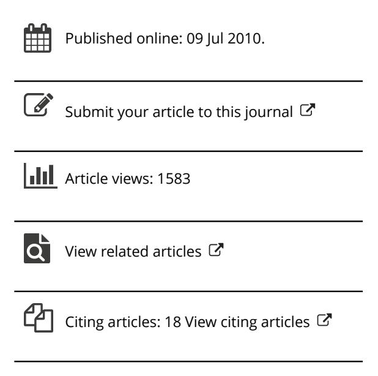

<!-- A1.R48 | source: papers_json/A1.R48/ -->

## **Journal of Higher Education Policy and Management**

**ISSN: 1360-080X (Print) 1469-9508 (Online) Journal homepage: ****[www.tandfonline.com/journals/cjhe20](https://www.tandfonline.com/journals/cjhe20?src=pdf)**

## **Higher education in the United Arab Emirates: an** **analysis of the outcomes of significant increases in** **supply and competition**

## **Stephen Wilkins**

**To cite this article:** Stephen Wilkins (2010) Higher education in the United Arab Emirates: an analysis of the outcomes of significant increases in supply and competition, Journal of Higher Education Policy and Management, 32:4, 389-400, DOI:[ 10.1080/1360080X.2010.491112](https://www.tandfonline.com/action/showCitFormats?doi=10.1080/1360080X.2010.491112)

**To link to this article: **[https://doi.org/10.1080/1360080X.2010.491112](https://doi.org/10.1080/1360080X.2010.491112)

<!-- page 2 -->

## CJHE 1360-080X 1469-9508Journal of Higher Education Policy and Management, Vol. 32, No. 4, May 2010: pp. 020130 Management **Higher education in the United Arab Emirates: an analysis ** **of the outcomes of significant increases in supply and competition**

Journal of Higher Education Policy and Management S. Wilkins Stephen Wilkins*

*International Centre for Higher Education Management, School of Management, University * *of Bath, UK*

خلال العقد الماضي، أنشأت عدة دول في الشرق الأوسط والشرق الأقصى مراكز إقليمية للتعليم العالي، ونما بعضها بسرعة عبر استقطاب جامعات أجنبية لإقامة فروع دولية لها. وتُعد الإمارات العربية المتحدة (UAE) أكبر مضيف للفروع الجامعية الدولية على مستوى العالم، إذ استضافت أكثر من 40 مزوداً بحلول نهاية عام 2009. وأصبح سوق التعليم العالي في الإمارات شديد التنافسية، وفي القطاع الخاص، يفوق العرض الطلب حالياً. تستكشف هذه الورقة وتحلل نتائج وآثار هذا الوضع السوقي على استقطاب الطلاب، وتجربة الطالب، والجودة، واستراتيجيات المؤسسات. كما تناقش الورقة استمرارية الفروع الجامعية الدولية في الإمارات على المدى الطويل، في سياق القضايا السياسية والاجتماعية المحلية.

**Keywords: **competition; higher education hub; international branch campuses; quality assurance; United Arab Emirates (UAE)

## **Introduction**

يبلغ عدد سكان الإمارات العربية المتحدة (UAE) ما يقارب 5.07 مليون نسمة (UAE Interact, 2009)، ويضم البلد أكثر من 60 جامعة وكلية للتعليم العالي (National Media Council, 2009). وقد أشارت وسائل الإعلام المحلية إلى أن العرض في أماكن التعليم العالي بالإمارات يفوق الطلب بالفعل (Moussly, 2010). غير أن نسبة عدد الكليات أو المقاعد الجامعية إلى عدد السكان وحدها لا تشير إلى المشكلة المحتملة التي تواجه المؤسسات العاملة بالفعل في الإمارات. فمنطقة بوسطن الحضرية في ولاية ماساتشوستس، بعدد سكان يزيد قليلاً عن أربعة ملايين نسمة، تحتضن أكثر من 100 كلية وجامعة. ويمكن اعتبار بوسطن مركزاً تعليمياً يستقطب طلاباً ليس فقط من جميع أنحاء الولايات المتحدة بل من العالم أجمع. وتسعى الإمارات إلى تحقيق أمر مماثل، على الأقل على المستوى الإقليمي. غير أن الإمارات ليست وحدها في هذا الطموح. فخلال العقد الماضي، ظهرت مراكز جديدة للتعليم العالي في عدد من الدول، منها قطر، الدولة المجاورة على الخليج العربي، وسنغافورة وماليزيا في الشرق الأقصى.

نمت مراكز التعليم العالي الجديدة بسرعة، ويعود ذلك غالباً إلى استقطاب جامعات من دول ذات قطاعات تعليم عالٍ راسخة لإقامة فروع لها. فقد أُنشئ ما لا يقل عن 49 فرعاً جامعياً دولياً خلال السنوات الثلاث الأخيرة، ويوجد الآن ما لا يقل عن 162 فرعاً على مستوى العالم (Becker, 2009). واستفادت الجامعات الأمريكية والأسترالية والبريطانية بشكل خاص من عملية العولمة التي شهدها التعليم العالي، لأن الدول التي تنتمي إليها تمتلك عموماً

L H Martin Institute for Higher Education Leadership and Management DOI: 10.1080/1360080X.2010.491112 http://www.informaworld.com

> ^*^Email: sjkw20@bath.ac.uk

<!-- page 3 -->

أنظمة تعليم عالٍ ذات سمعة جيدة، ولأن اللغة الإنجليزية أصبحت اللغة المشتركة في التعليم العالي الدولي. وقد وجد استطلاع أُجري على طلاب يدرسون مؤهلاً بريطانياً في مؤسستين بالإمارات وسلطنة عُمان أن 62 في المائة من العينة يعتقدون أن المملكة المتحدة تقدم أفضل تعليم عالٍ في العالم (Wilkins, 2001). وهناك عدة طرق يمكن للجامعات من خلالها أن تحقق وجوداً في دول أجنبية، منها تشغيل مراكز دراسية، ومنح امتياز البرامج لمزودين محليين، وتقديم برامج التعلّم عن بُعد، وإنشاء فروع جامعية دولية.

يوحي مصطلح "الفرع الجامعي الدولي" بنهج مادي ملموس، حيث تمتلك المؤسسة وجوداً فعلياً في دولة أجنبية. ويتلقى الطلاب تعليمهم في مبانٍ تملكها أو تستأجرها المؤسسة الأجنبية، بمفردها أو بالشراكة مع طرف محلي، وإلى جانب قاعات التدريس، قد يضم الفرع الجامعي عادة مكتبة ومطعماً ومرافق ترفيهية وسكناً للطلاب. ويستخدم الفرع الجامعي دائماً اسم المؤسسة الأجنبية ويقدم برامج بكالوريوس و/أو دراسات عليا كاملة، عادة في عدد من التخصصات المختلفة. ويُستقطب الطلاب من المناطق المحلية أو المحيطة. ويتبعون البرامج ذاتها، أو على الأقل برامج مشابهة جداً لتلك المقدمة في الحرم الجامعي الأصلي، وعند إتمام دراستهم، يُمنح الطلاب درجة علمية من الجامعة الأجنبية.

يُوظَّف العاملون في الفروع الجامعية الدولية بطرق متعددة؛ فقد يُنقل المحاضرون من الحرم الأصلي بشكل دائم أو مؤقت، أو يمكنهم بدلاً من ذلك القدوم من الحرم الأصلي لفترات قصيرة في كل مرة. وقد يُستقطب أكاديميون جدد خصيصاً للفرع الجامعي، بدوام كامل دائم أو مؤقت، أو بدوام جزئي. ولكل طريقة من هذه الطرق مزايا وعيوب، ستُناقش لاحقاً. ويسهل الخلط بين الفرع الجامعي الدولي وأنواع أخرى من تقديم التعليم العالي في الخارج، مثل الأحرام الجامعية الفرعية والمراكز الدراسية والدورات الممنوحة بامتياز والمقدمة فقط من مؤسسات محلية، إذ لا يوجد بعد إجماع عالمي على تعريف دقيق لهذا المصطلح. والواقع أن Altbach (2010) يرى أن معظم الفروع الجامعية الدولية ليست أحراماً جامعية حقيقية على الإطلاق، لأنها صغيرة ومتخصصة وتقدم مجموعة محدودة من البرامج الأكاديمية.

وقد تبنّت الدول المضيفة، وكذلك جامعات من دول مثل الولايات المتحدة وأستراليا والمملكة المتحدة وكندا، نموذج الفرع الجامعي الدولي بحماس. ولاحظ Al-Lamki (2002) الانتشار السريع للكليات الخاصة ذات السنتين في سلطنة عُمان بعد صدور مرسوم سلطاني في عام 1996 يسمح بإنشاء كليات خاصة. وقد اعتُمد بشكل كبير على مزودي القطاع الخاص لزيادة استيعاب التعليم العالي في عدة دول خليجية. ففي عام 2006، كانت ثلاث من أصل أربع جامعات في سلطنة عُمان مملوكة للقطاع الخاص (Mazawi, 2008). أما الإمارات، فهي أكبر مضيف للفروع الجامعية الدولية على مستوى العالم بفارق كبير، إذ استضافت أكثر من 40 مزوداً في عام 2009 (Becker, 2009).

## **Aims and methodology**

تمثل مراكز التعليم العالي، التي تضم عدداً من الفروع الجامعية الدولية، نموذجاً تعليمياً جديداً لم يُختبر بعد. ولم نبدأ إلا مؤخراً برؤية آثار ونتائج هذا النموذج، الذي يهدف إلى زيادة استيعاب التعليم العالي في الدول الأقل تقدماً أو الدول ذات قطاعات التعليم العالي الأقل تطوراً. تحلل هذه الورقة هذه الآثار والنتائج، وتبعاتها على المزودين الأجانب العاملين بالفعل في الإمارات، أو على من لا يزال يفكر في التأسيس داخل البلد. وتُعد الإمارات دراسة حالة مثيرة للاهتمام بشكل خاص لأنها أكبر مركز عالمي للفروع الجامعية الدولية، وبسبب السرعة التي هرعت بها المؤسسات الأجنبية للتأسيس في البلد.

<!-- page 4 -->

يحتاج أي سوق فعّال إلى التوازن "الصحيح" بين العرض والطلب، لكن من الواضح في بداية عام 2010 أن قطاعي التعليم العالي، العام والخاص، في الإمارات لا يمتلكان هذا التوازن "الصحيح". ويمكن أن يضر هذا الفشل السوقي بالطلاب والشركات والمزودين التعليميين أنفسهم وبالمجتمع الإماراتي عموماً. ومن خلال مراجعة الأدبيات، حددت هذه الدراسة بعض النتائج الرئيسية لهذه الاختلالات السوقية. ولدى عدة أطراف معنية اهتمام بجودة التعليم العالي في الإمارات، منهم الطلاب وأولياء الأمور وأصحاب العمل والحكومة الإماراتية. فإذا لم تحقق الفروع الجامعية الدولية معايير جودة مماثلة لتلك التي تحققها الحرم الأصلي، فمن المحتمل جداً أن تفشل هذه الفروع في استقطاب أعداد كافية من الطلاب لضمان استمرارها. لهذا السبب، جرى فحص قضايا ضمان الجودة بمزيد من التفصيل.

## **Development and structure of higher education in the UAE**

تأسست الإمارات العربية المتحدة كدولة اتحادية عام 1971 باتفاق حكام الإمارات السبع التي تشكل الآن الدولة. وفي ذلك الوقت، كان التعليم في البلد يُقدَّم عبر 74 مدرسة، ولم تكن هناك أي جامعة. وبعد تأسيس الإمارات، تطور نظام التعليم في البلد استناداً إلى النموذج البريطاني (Kirk & Napier, 2009)، رغم أن جوانب من النظام الأمريكي جرى تبنّيها مؤخراً. فعلى سبيل المثال، تستند معايير ضمان الجودة المستخدمة على المستوى الاتحادي إلى نموذج أمريكي. وكانت جامعة الإمارات العربية المتحدة، التي تأسست عام 1977 في العين، أول مؤسسة للتعليم العالي تُنشأ في الدولة. ثم في عام 1988، أُسِّست كليات التقنية العليا (HCT) لتقديم برامج مهنية وتقنية بشكل أساسي، رغم أنها تقدم اليوم مجموعة واسعة من المقررات تشمل درجات البكالوريوس والدراسات العليا. وتضم كليات التقنية العليا حالياً شبكة من 16 حرماً جامعياً في أنحاء البلد، بكليات منفصلة للذكور والإناث. وكانت جامعة زايد، التي تأسست عام 1998 وتضم حرمين في أبوظبي ودبي، ثالث وآخر مؤسسة تُنشئها الحكومة الاتحادية. وتُعرف مؤسسات التعليم العالي الثلاث التي تسيطر عليها الدولة الاتحادية بالمؤسسات "العامة" أو "الاتحادية"؛ بينما تُعرف جميع المؤسسات الأخرى بالمؤسسات "الخاصة".

تقر المادة 23 من دستور الإمارات بدور التعليم في التنمية الوطنية، وتعهدت الحكومة الاتحادية بتقديم التعليم مجاناً لمواطني الإمارات في جميع المراحل. ونتيجة لذلك، يحق لجميع خريجي المدارس من مواطني الإمارات الالتحاق بإحدى المؤسسات الاتحادية الثلاث إذا استوفوا شروط القبول. وقد ظهر التزام الحكومة بالتعليم عام 2001 عندما كان أكبر تخصيص فردي للأموال الاتحادية موجهاً لتوفير التعليم لمواطني الإمارات (Godwin, 2006). ومع ذلك، ظلت المنح المقدمة للمؤسسات الاتحادية الثلاث ثابتة في كثير من السنوات منذ ذلك الحين.

تندرج الجامعات الخاصة ضمن فئتين: إما أنها مملوكة ومُدارة محلياً، من قِبل إمارات فردية أو منظمات محلية، أو من الخارج، من قِبل مؤسسات تعليم عالٍ أجنبية أسست فروعاً جامعية. ومن أمثلة الجامعات الخاصة المملوكة محلياً الجامعة الأمريكية في الشارقة، التي أسسها حاكم الشارقة عام 1997؛ وجامعة دبي، التي تأسست باسم بوليتكنك دبي من قِبل غرفة تجارة وصناعة دبي عام 1997؛ وجامعة باريس السوربون أبوظبي، التي أسسها مجلس أبوظبي للتعليم عام 2006؛ وجامعة الغرير، المملوكة لمجموعة الغرير، وهي شركة ذات مصالح متنوعة تشمل بنكاً ومركزاً تجارياً وشركة أسمنت.

أُنشئ أول فرع جامعي دولي في دبي عام 1993 على يد جامعة ولونجونج، وهي جامعة ذات سمعة جيدة من أستراليا. ومنذ ذلك الحين افتتحت جامعات أخرى كثيرة، منها جامعة ميدلسكس وجامعة هيريوت-وات من المملكة المتحدة، و

<!-- page 5 -->

جامعة بونا، إحدى أفضل الجامعات الحكومية تصنيفاً في الهند، التي أسست حرماً جامعياً في المنطقة الحرة بإمارة رأس الخيمة عام 2009. وفي وقت أحدث، أقامت جامعة نيويورك وحكومة أبوظبي شراكة لإنشاء جامعة نيويورك أبوظبي، حيث سيبدأ التدريس في سبتمبر 2010. وستمول حكومة أبوظبي هذه المؤسسة الإماراتية، بحيث لن تُحوَّل موارد مالية من حرم الجامعة في نيويورك.

## **Supply and demand for higher education in the UAE**

من أصل سكان الإمارات البالغ 5.07 مليون نسمة، يمثل مواطنو الإمارات أقل من 20 في المائة، والباقي من المقيمين الوافدين (UAE Interact, 2009). وأكبر الدول المصدرة للوافدين هي الهند (1.75 مليون) وباكستان (1.25 مليون). ويُقدَّر عدد المقيمين "الغربيين" من أستراليا وأوروبا وأمريكا الشمالية بنحو 500,000 نسمة. وقُدِّر أن عدد سكان الإمارات زاد بنسبة 6.3 في المائة عام 2009 (UAE Interact, 2009). ورغم أن الوافدين ساهموا في هذه الزيادة أكثر من المواطنين، إلا أن عدد المواطنين ارتفع أيضاً بنحو 4 في المائة. وتُبقي المؤثرات الثقافية والدينية معدل المواليد في الإمارات مرتفعاً نسبياً، رغم أنه أصبح الآن أقل بكثير من معدلات النمو السنوي التي بلغت 10-15 في المائة في السبعينيات وأوائل الثمانينيات. وقد أدت معدلات المواليد المرتفعة بين مواطني الإمارات في السبعينيات والثمانينيات، إلى جانب تزايد الإدراك لقيمة التعليم العالي، إلى زيادة كبيرة في طلب المواطنين على التعليم العالي منذ أوائل التسعينيات. فقد قبلت جامعة الإمارات العربية المتحدة 400 طالب عند تأسيسها عام 1977 (Hijazi, Zoubeidi, Abdalla, & Harb, 2008)؛ وتضم اليوم أكثر من 12,000 طالب.

وقد وضع تعهد حكومة الإمارات بضمان مقعد لكل خريج مدرسة من مواطني الدولة يستوفي شروط القبول في المؤسسات الاتحادية الثلاث، ضغطاً هائلاً على هذه المؤسسات لتوسيع طاقتها الاستيعابية. فعلى سبيل المثال، بين عامي 2003 و2008، ارتفع عدد الطلاب المسجلين في جامعة زايد بنسبة 52 في المائة، بينما ظل التمويل المقدم من الحكومة الاتحادية شبه ثابت خلال الفترة نفسها كل عام (National Media Council, 2009). ولم يتوسع قطاع التعليم العالي العام بالسرعة الكافية، ونتيجة لذلك، يُعتقد أن آلاف المواطنين الإماراتيين حُرموا من مقاعد في الجامعات الاتحادية خلال السنوات الأخيرة (Bardsley, 2009). ولا يُقبل في المؤسسات العامة سوى عدد محدود نسبياً من الوافدين.

وأظهرت الجامعات الرائدة في الإمارات خلال السنوات القليلة الماضية عزماً أكبر على إنتاج بحوث عالية الجودة على مستوى عالمي. فجامعة الإمارات العربية المتحدة، على سبيل المثال، تهدف إلى تحقيق تحسن كبير في ترتيبها في جداول التصنيف البحثي الإقليمي والعالمي خلال السنوات الخمس المقبلة. غير أنها غير قادرة على استثمار المزيد في المشاريع البحثية وتطوير برامج دكتوراه جديدة، وكذلك زيادة طاقة برامج البكالوريوس، دون زيادة التمويل الحكومي. وقد هدد نائب رئيس جامعة الإمارات العربية المتحدة مؤخراً بخفض القوى العاملة في الجامعة بنسبة 7 في المائة (200 وظيفة) كحل لمعضلة التمويل (Bardsley, 2010c). وستشمل التخفيضات، إذا نُفذت، الوظائف الأكاديمية والإدارية على حد سواء. كما علّقت جامعة زايد مؤخراً إطلاق مركز بحثي جديد. وتواجه الفروع الجامعية الدولية العاملة في مراكز التعليم الجديدة في الشرق الأوسط والشرق الأقصى ضغطاً متزايداً من شركائها والحكومات المحلية لزيادة أنشطتها البحثية. فعلى سبيل المثال، طلب الشركاء الصينيون لجامعة ليفربول مؤخراً أن يصبح حرمها في الصين أكثر تركيزاً على البحث لأن جامعة ليفربول جامعة رائدة في البحث في المملكة المتحدة (Altbach, 2010).

من الواضح أن الطلب على المقاعد في المؤسسات العامة/الاتحادية يفوق العرض بشكل كبير. ولاحظ Edwards (2008) الآثار الاجتماعية السلبية التي يمكن أن تنتج عندما

<!-- page 6 -->

يتخلف العرض من مقاعد التعليم العالي عن الطلب. فعلى سبيل المثال، كشفت دراسته أن الشباب من الفئات الاجتماعية والاقتصادية الأدنى يصبحون أكثر تضرراً بشكل متزايد. فإذا لم يتمكن مواطنو الإمارات من الخلفيات الفقيرة، أو المقيمون في المناطق الريفية، من المشاركة في التعليم العالي، فمن المحتمل أيضاً أن تقل فرصهم في المشاركة في سوق العمل. وقد يؤدي هذا الوضع في نهاية المطاف إلى اضطرابات اجتماعية. وبالنظر إلى أن الإمارات لا تزال تعتمد بشكل كبير على العمالة الوافدة، فقد كان هدفاً حكومياً رئيسياً لسنوات عديدة زيادة مشاركة المواطنين في سوق العمل.

وتحقق الإمارات معدلات مشاركة مرتفعة جداً في التعليم العالي. فنحو 95 في المائة من جميع النساء و80 في المائة من جميع الرجال ممن أكملوا السنة الأخيرة من المرحلة الثانوية يتقدمون بطلبات للالتحاق بالتعليم العالي (National Media Council, 2009). وفي العام الدراسي 2008-2009، قبلت جامعة الإمارات العربية المتحدة 3,355 طالباً جديداً؛ وقبلت كليات التقنية العليا 7,902 طالب؛ وقبلت جامعة زايد 1,558 طالباً (National Media Council, 2009). ومن بين الطلاب المواطنين الذين تخرجوا عام 2006، كانت نسبة 66.8 في المائة من النساء (Hijazi et al., 2008). ويفضل كثير من الرجال الانضمام إلى القوات المسلحة أو العمل في مشاريع عائلية أو وظائف إدارية جيدة الأجر نسبياً في القطاع العام. وحتى مع وجود نقص في المقاعد بالمؤسسات العامة، لا يحضر كل عام كثير من خريجي المدارس الذكور الذين يُعرض عليهم مقاعد للتسجيل في بداية العام الدراسي.

انخفض مستوى التمويل الاتحادي لكل طالب في مؤسسة تعليم عالٍ عامة الآن إلى ما دون المعايير الدولية (Fox, 2008). ومن الواضح أن المؤسسات العامة تحتاج إلى زيادات في التمويل من الحكومة الاتحادية لتتمكن من زيادة عدد المقاعد في برامج البكالوريوس. كما يلزم مزيد من التمويل لتطوير وتوسيع برامج الدراسات العليا، بما في ذلك برامج الدكتوراه، ولدعم تطوير مزيد من النشاط البحثي. وقد قدمت الإمارات الفردية حوافز متنوعة، مثل إنشاء مناطق حرة تجارية وتعليمية، لاستقطاب مؤسسات أجنبية للتأسيس في الإمارات. وبالنظر إلى أن ما لا يقل عن 57 مؤسسة خاصة تعمل حالياً في البلد، يبدو أن الحكومات المحلية نجحت في تبني هذه الاستراتيجية كوسيلة لزيادة عدد مقاعد التعليم العالي. ففي عام 2001، بلغت نسبة الدرجات العلمية الممنوحة من المؤسسات الخاصة 26.9 في المائة (Hijazi et al., 2008)؛ وارتفعت هذه النسبة إلى 54.6 في المائة عام 2006.

وأسست معظم المؤسسات الخاصة الجديدة في دبي وأبوظبي، الإمارتين ذواتي أكبر عدد سكان. وتُعد رأس الخيمة إمارة أخرى حققت بعض النجاح في استقطاب مؤسسات أجنبية. ونظام التعليم الخاص مفتوح لجميع سكان الإمارات، لكن يُتوقع من المواطنين والوافدين على حد سواء دفع رسوم دراسية كاملة، وهي مرتفعة نسبياً وغير ميسورة لكثير من الأسر. ولم يُتَح سوى عدد محدود من المنح الدراسية للدراسة في المؤسسات الخاصة، سواء من الحكومة أو من المؤسسات نفسها. ويدرس حالياً نحو ثلث طلاب البكالوريوس من مواطني الإمارات في مؤسسة خاصة بدلاً من إحدى المؤسسات الاتحادية الثلاث. وبالنسبة لبعض الطلاب، كان هذا خياراً مفروضاً لأنهم لم يحققوا شروط القبول بالمؤسسات الاتحادية. وفي هذه الحالة، تشترط المؤسسات الخاصة الأجنبية عادة أن يخوض الطالب برنامجاً تأسيسياً أو لغوياً قبل الالتحاق ببرنامج بكالوريوس. فعلى سبيل المثال، من بين 3,565 طالباً مسجلين في حرم جامعة ولونجونج بدبي في نهاية عام 2009، كان 753 طالباً يدرسون في مركزها للغة والثقافة في مقررات دون مستوى البكالوريوس.

ولدى مواطني الإمارات مجموعة من الدوافع الأخرى للدراسة في مؤسسة خاصة، منها فرصة دراسة تخصصات غير متاحة في المؤسسات الاتحادية، وإمكانية الحصول على درجة أكثر احتراماً من الخارج، مما قد يعزز فرصهم الوظيفية في سوق العمل الدولي، أو ببساطة لأن المؤسسة التي يختارونها في موقع أكثر ملاءمة. ويتزايد عدد المواطنين الناضجين العاملين الذين

<!-- page 7 -->

يختارون الدراسة بدوام جزئي. ففي العام الدراسي 2001-2002، كان نحو ثلثي طلاب دبي بوليتكنك (التي أعيدت تسميتها لاحقاً جامعة دبي) من مواطني الإمارات يدرسون في الفترة المسائية بدوام جزئي.

## **Current problems and issues**

تأسس ما لا يقل عن ثلثي المؤسسات الخاصة العاملة حالياً في الإمارات بعد عام 2005. وقد وُصفت السرعة التي أتت بها المؤسسات الأجنبية إلى الإمارات في وسائل الإعلام بـ"طفرة التعليم الذهبية" (Lewin, 2008). ومن المؤكد أن بعض الجامعات الأجنبية أُغريت باحتمال تحقيق إيرادات سهلة في بلد ثري (Altbach & Knight, 2007; Naidoo, 2010)، وربما اتخذ بعضها قرار التأسيس في الإمارات دون إجراء بحث سوقي كافٍ. وليس من السهل تحديد الدوافع الدقيقة للجامعات الأجنبية لإنشاء أحرام جامعية في الإمارات. ويرى Knight (2006) أن الجامعات، التي لا تنتمي إلى القطاع الهادف للربح، تُحفَّز عادة بالرغبة في تعزيز البحث والقدرة المعرفية، وزيادة الفهم الثقافي. وتقدم معظم الفروع الجامعية في الإمارات مجموعة ضيقة من المقررات، وقرر كثير منها التخصص في المواد ذاتها، مثل الأعمال/الإدارة وتكنولوجيا المعلومات، وهي تخصصات رخيصة التأسيس نسبياً ويمكنها استيعاب أعداد كبيرة من الطلاب بسهولة.

ومن المعروف أن بعض المؤسسات فشلت في تحقيق أهدافها في استقطاب الطلاب. ففي مايو 2009، أغلقت جامعة جورج ميسون، وهي مؤسسة أمريكية مقرها فيرجينيا، حرمها في رأس الخيمة، بعد أقل من ثلاث سنوات من افتتاحه. ولم تتمكن من تسجيل سوى 180 طالب بكالوريوس. وفي نهاية عام 2008، أقر المدير العام لهيئة المعرفة والتنمية البشرية (KHDA)، وهي الجهة المسؤولة عن ترخيص مؤسسات التعليم العالي الخاصة في إمارة دبي، علناً بأن توازن العرض والطلب "يعمل لصالح الطلاب" من خلال إبقاء الرسوم الدراسية منخفضة (Bardsley, 2008). ومن المعروف أن بعض الجامعات الخاصة الأجنبية القائمة بالفعل في الإمارات دعت السلطات إلى القيام بدور أكثر فاعلية في توفير بيئة تنظيمية تضمن أن يكون عدد مزودي التعليم العالي "صحيحاً".

وفي ديسمبر 2009، ذكرت صحيفة *نيويورك تايمز* أن الفروع الجامعية الدولية في دبي تعاني بعد انهيار اقتصاد الإمارة المتضخم (Lewin, 2009). فجامعة ولاية ميشيغان، التي بدأت الدراسة في أغسطس 2008، لم يكن لديها سوى 85 طالب بكالوريوس بنهاية عام 2009، ومعهد روتشستر للتكنولوجيا، الذي بدأ عملياته أيضاً في أغسطس 2008، لم يكن لديه سوى 50 طالباً. وأقرت جامعة مردوخ، ومقرها بيرث في غرب أستراليا، والتي بدأت عملياتها في دبي في صيف 2008، بأن عدد طلابها في سنتها الثانية كان أقل بنحو 30 في المائة من هدفها. وستحتاج بعض المؤسسات وقتاً أطول بكثير مما خططت له لتحقيق التعادل، وقد لا تصل بعضها إلى تلك النقطة إطلاقاً. وقد أرجأت جامعة ولاية ميشيغان بالفعل هدفها لتحقيق التعادل من ثلاث سنوات إلى خمس سنوات.

وتجد المؤسسات صعوبة في تمييز نفسها في سوق مزدحم، والاضطرار للتنافس على السعر أمر لم يكن كثير منها يتوقع أن ينتهي به المطاف إليه. وكانت جامعة ولاية ميشيغان تأمل في استقطاب 100 طالب من جامعات أخرى في النصف الثاني من عام 2009 من خلال تقديم رسوم دراسية بنصف السعر. وحتى هذه الاستراتيجية لم تنجح، إذ بحلول منتصف يناير 2010، لم يُقبل سوى عشرين طالباً (Bardsley, 2010b). ورغم استلام نحو 200 طلب للحصول على المقاعد المائة بنصف السعر، لم تستوفِ سوى 10 في المائة من الطلبات معايير القبول القياسية للجامعة. وادعت الجامعة أنها برفضها 180 طلباً أثبتت أنها لن تتنازل عن معايير الجودة الأكاديمية. وتتمثل إحدى المشكلات المحتملة لمؤسسات التعليم العالي في

<!-- page 8 -->

الإمارات في أن أفضل الطلاب من حيث الجودة يختارون الدراسة في أفضل الجامعات في دول مثل الولايات المتحدة وأستراليا والمملكة المتحدة.

ويرى Sutton and Tse (1997) أن على المسؤولين التعليميين إيلاء اهتمام عاجل بالجودة خلال فترات التوسع السريع، لأن الكم كثيراً ما يتحقق على حساب الجودة. وقد عانت بعض أولى الدفعات في دبي بوليتكنك من معدلات تسرب ورسوب بلغت 50 في المائة على الأقل (Wilkins, 2002). ووجد الطلاب المعتادون على التعليم الثانوي التلقيني المتمحور حول المعلم صعوبة في التكيف مع التعلّم المتمحور حول الطالب والمستقل الذي يتوقعه النظام البريطاني للتعليم العالي. كما تبيّن أن نسبة كبيرة من الطلاب لديهم مهارات كتابة غير مُرضية في اللغة الإنجليزية.

## **Some institutions are doing better than others**

ليست جميع مؤسسات التعليم العالي في الإمارات تعاني. فقد سجلت جامعة هيريوت-وات، ومقرها إدنبره في اسكتلندا، 800 طالب جديد في حرمها بدبي عام 2009، ليصل إجمالي طلابها إلى أكثر من 1,500. وتدّعي الجامعة أنها تقدم تعليماً عالي الجودة بأسعار تنافسية. وإدارة الجامعة راضية جداً عن تقدمها حتى الآن، وستشمل المرحلة التالية من تطورها بناء حرم جامعي جديد أكبر في مدينة دبي الأكاديمية الدولية (DIAC). كما ستوسع تقديمها الأكاديمي ليشمل مجموعة من برامج الدكتوراه والمقررات ذات الصلة بالإمارات والتي تقع ضمن مجال خبرتها، مثل هندسة البترول.

وتُعد جامعة ولونجونج حالياً أكبر فرع جامعي مملوك لجهة أجنبية في الإمارات يعمل تحت الاسم ذاته لحرمها الأصلي. وبعد وجودها في دبي منذ عام 1993، استفادت جامعة ولونجونج بوضوح من ميزة السبق، وكان لديها 2,812 طالباً مسجلاً في برامج البكالوريوس أو الدراسات العليا بنهاية عام 2009. ولديها توازن متساوٍ بين طلاب البكالوريوس والدراسات العليا، وتُستقطب الغالبية العظمى من الطلاب من الجاليات الوافدة المحلية، حيث يمثل الهنود نحو ربع إجمالي التسجيلات، يليهم الإيرانيون (15 في المائة). ويمثل مواطنو الإمارات نحو 13.4 في المائة من الطلاب.

ويُعتقد أن جامعات مرموقة مثل جامعة باريس السوربون أبوظبي وجامعة نيويورك أبوظبي تحقق أهدافها في استقطاب الطلاب. ومع تطور هذه المؤسسات وتوسعها، يبدو واضحاً أن الجامعات الأقل تصنيفاً ستُجبر على التنافس على السعر أو من خلال تقديم تخصصات غير متاحة في مكان آخر. ومن الواضح أيضاً أنه بينما يفوق الطلب على المقاعد في المؤسسات الاتحادية الثلاث العرض، فإن العرض في قطاع التعليم العالي الخاص، مع بداية عام 2010، يفوق الطلب بشكل كبير. ومن المرجح أن تحدث عملية شبيهة بالانتقاء الطبيعي في سوق التعليم العالي الإماراتي خلال السنوات الخمس إلى العشر القادمة، حيث تزدهر الجامعات الأفضل وتنمو بينما تتقلص الأضعف أو تنسحب من الإمارات.

## **Quality of higher education in the UAE**

من الممكن أن يكون لكثرة مزودي التعليم العالي في الإمارات أثر إيجابي على الجودة، لأن المؤسسات تُجبر على التنافس عبر تحسين برامجها وقابلية توظيف خريجيها. غير أنه لا يمكن الاعتماد على قوى السوق وحدها لضمان جودة برامج التعليم العالي المقدمة في الإمارات. ويكشف فحص منتديات إلكترونية مثل www.dubaifaqs.com/universities وwww.desertspeak.com أن كثيراً من الطلاب قلقون بشأن جودة التعليم العالي في الإمارات. وقد أعرب الطلاب عن مخاوف بشأن جودة الأكاديميين العاملين في الجامعات، وارتفاع معدل دوران العمالة في بعض المؤسسات، وجودة الموارد والمعدات التعليمية، وعدم تقديم المقررات الاختيارية المعلن عنها.

<!-- page 9 -->

وتتولى وزارة التعليم العالي والبحث العلمي (MHESR)، من خلال إداراتها المختلفة، مسؤولية التخطيط لسياسات التعليم العالي وتطويرها وتنفيذها، وإدارة الجودة، وجمع البيانات وتحليلها، وتوفير خدمات القبول للمؤسسات الاتحادية، ومنح المنح الدراسية لمواطني الإمارات. وتخضع المؤسسات الاتحادية الثلاث لعملية ضمان الجودة الخاصة بمجلس التعليم العالي (وهو قسم تابع لوزارة التعليم العالي والبحث العلمي). وإضافة إلى ذلك، سعت جميع المؤسسات الاتحادية الثلاث إلى الحصول على اعتماد دولي، بشكل رئيسي من هيئات الاعتماد الإقليمية الأمريكية.

ويُشترط على مؤسسات التعليم العالي الخاصة في الإمارات الحصول على ترخيص من هيئة الاعتماد الأكاديمي (CAA)، ثم اعتماد كل برنامج أكاديمي على حدة. وتستند معايير هيئة الاعتماد الأكاديمي إلى نموذج أمريكي، لكنها عُدِّلت لتناسب الإمارات. وتغطي هذه المعايير جميع الأنشطة الرئيسية للمؤسسة التعليمية. ويمكن للمؤسسات الأجنبية تجنب متطلبات هيئة الاعتماد الأكاديمي بالتموضع في بعض المناطق الحرة المنتشرة في أنحاء البلد. غير أنها ستظل مُطالبة باستيفاء متطلبات الإمارات الفردية؛ فعلى سبيل المثال، في دبي، يجب على المؤسسات استيفاء معايير الترخيص الخاصة بهيئة المعرفة والتنمية البشرية. ويُتوقع من مزودي التعليم الخاص الأجانب، سواء كانوا في مناطق حرة أم لا، الالتزام بمعايير مؤسساتهم الأم والسياسات واللوائح المطبقة في بلدانهم الأصلية. وبالنظر إلى أن كثيراً من الجامعات الأجنبية في الإمارات ربما تكون موجودة في المقام الأول لتحقيق الربح، فإن توقع التنظيم الذاتي قد لا يكون طريقة موثوقة لضمان الحد الأدنى من معايير الجودة. ومن غير المرجح أن يُقبل مواطنو الإمارات على برامج لم تعتمدها هيئة الاعتماد الأكاديمي، إذ لا تعترف الجهات الحكومية بمثل هذه البرامج. ومن الناحية العملية، يعني هذا أن مواطني الإمارات الحاملين لدرجات غير معتمدة لا يستطيعون الحصول على وظائف في القطاع العام (Wilkins, 2002)، وهو المكان الذي يفضل معظم المواطنين العمل فيه بسبب مستويات الأجور الأعلى وظروف العمل الأفضل مقارنة بالقطاع الخاص.

كما أنشأت الإمارات الفردية منظماتها الخاصة المسؤولة عن وضع وإنفاذ السياسات واللوائح المتعلقة بالجودة في مؤسسات التعليم العالي الأجنبية. ففي عام 2009، أنشأت إمارة دبي المجلس الدولي لضمان جودة الجامعات (UQAIB). وبحلول يناير 2010، كان المجلس قد أنجز نصف عملية تقييم 24 مؤسسة في المناطق الحرة. وأعلن المجلس عبر بيان صحفي أن لديه صلاحية إلغاء ترخيص أي فرع جامعي دولي لا يستوفي متطلباته (Bardsley, 2010a). وألمح رئيس المجلس إلى إمكانية إلغاء تراخيص المؤسسات دون المستوى المطلوب بنهاية عام 2010. ومن المثير للاهتمام أن المجلس لا يقتصر على تقييم المؤسسات فحسب، بل يجري أيضاً مراجعة لمدى نجاح نموذج الفرع الجامعي الدولي.

## **Brand reputation and human resource issues**

في عام 2008، أعلنت جامعة بنسلفانيا وجامعة ييل أنهما لن تفتحا فروعاً جامعية دولية في المستقبل المنظور. وكان ما يهم المؤسستين هو السيطرة على سمعة العلامة التجارية وقضايا ضمان الجودة، خصوصاً قدرتهما على استقطاب أكاديميين بمستوى يضمن المعايير الأكاديمية (Olds, 2008). فعادة ما يتردد الأكاديميون الأقدم النشطون بحثياً في مغادرة عملهم في الحرم الأصلي، ويخشى الأكاديميون الأصغر سناً أن يحد العمل في الخارج من فرص ترقيتهم. وكثيراً ما تستقطب الفروع الجامعية الدولية أكاديميين لا صلة لهم بالحرم الأصلي (Altbach, 2010)، بل تُوظِّف أحياناً أكاديميين ليست لديهم أي خبرة في التدريس أو التعليم في بلدهم الأصلي. وتوظف بعض الفروع الجامعية الأصغر نسباً مرتفعة نسبياً من الأكاديميين بدوام جزئي، وهو ما قد يمثل طريقة فعالة لخفض التكاليف، لكنه

<!-- page 10 -->

ليس طريقة لتحقيق التزام الموظفين والتدريس والبحث عالي الجودة. وختاماً، وبينما قد يجذب إنشاء فروع جامعية دولية في الإمارات، أو في أي من مراكز التعليم الجديدة الأخرى، المؤسسات الراغبة في زيادة السيولة وحضورها الدولي، يبدو أن بعض أعرق الجامعات في العالم لا تعتقد بعد أن المكاسب تفوق المخاطر والتكاليف المحتملة.

ومن الواضح أن نقص طلبات الالتحاق يُجبر بعض مؤسسات التعليم العالي الخاصة على أن تكون "مرنة" فيما يتعلق بشروط القبول. فهناك طلاب يدرسون في فروع جامعية دولية في الإمارات ربما لم يكن ليُقبلوا في البرنامج ذاته في الحرم الأصلي للمؤسسة (Altbach, 2010). وبمجرد التسجيل، يقع ضغط كبير على الأكاديميين لإرضاء الطلاب، إذ يُنظر إليهم الآن كمستهلكين أكثر من كونهم مجرد متلقين للتعليم. ولا يختلف هذا عن الوضع القائم في كثير من دول العالم، والذي يعتبره كثيرون نتيجة لتسليع التعليم العالي. وكشف استطلاع أُجري في الإمارات أن كثيراً من الأساتذة يعتقدون أن طلابهم يمتلكون قدرات متوسطة أو دون المتوسط في الرياضيات والكتابة باللغة الإنجليزية. كما أقروا بأن الطلاب يُمنحون درجات أعلى مما يستحقون (Gerson, 2010). ومن الشائع أن يطلب الطلاب في الإمارات درجات أعلى، غالباً بضغط من الأهل أو الأقران. وحدد الأساتذة في الاستطلاع تقييمات المقررات السيئة، وشكاوى الطلاب، والمخاوف بشأن الأمن الوظيفي، كبعض أسباب تضخم الدرجات. وليس من غير المألوف أن تُنهى عقود أكاديميين في مؤسسات التعليم العالي بالإمارات بسبب تقييمات المقررات السيئة. وتستخدم جامعة الإمارات العربية المتحدة تقييمات الطلاب للتدريس كعامل في تحديد الترقيات ومكافآت الاستحقاق والعقود طويلة الأمد وتجديد العقود (Badri, Abdulla, Kamali, & Dodeen, 2006). ويقترح Pounder (2007) أن على المؤسسات التعليمية تطوير وتجريب مناهج جديدة لتقييم جودة التدريس وديناميكيات الفصل الدراسي.

وقد جلب التوازن الحالي بين العرض والطلب في قطاع التعليم العالي الخاص بالإمارات مزايا وعيوباً للطلاب على حد سواء. وتشمل العيوب والمخاطر المحتملة توفر مجموعة ضيقة من المواد والخيارات، ومقررات لا تُقدَّم بسبب عدم كفاية عدد الطلاب المسجلين فيها، ونقص الاستثمار في الموارد والمعدات، ومجموعة محدودة من الأنشطة اللامنهجية، وخطر إغلاق المؤسسات وتخليها عن طلابها المسجلين قبل إتمام برامجهم. أما المزايا المحتملة للطلاب من الوضع السوقي الحالي فتشمل الحصول على تعليم عالٍ ربما كان سيتعذر الوصول إليه، والقدرة على الحصول على درجة من جامعة غربية مرموقة دون الحاجة للسفر إلى البلد الذي تقع فيه، وأحجام فصول أصغر، وعدم قدرة المؤسسات على زيادة الرسوم الدراسية.

## **Discussion and conclusions**

لا يزال مفهوم مركز التعليم العالي، الذي أُنشئ مؤخراً في عدة دول في الشرق الأوسط والشرق الأقصى، نموذجاً لم تثبت جدواه بعد. وفي حين وُجدت جامعة ولونجونج بنجاح في الإمارات لسنوات عديدة، لم يتضح بعد كيف ستتعامل مع السوق المتزايد التنافسية الناتج عن هدف الحكومة بإقامة الإمارات كمركز إقليمي للتعليم العالي. ومع ذلك، أتاحت الفروع الجامعية الدولية بالفعل التعليم العالي لآلاف الطلاب الذين ربما لم يكن ليتمكنوا من الوصول إليه لولا ذلك. ومن المرجح أن تزدهر وتنمو بعض المؤسسات بينما تفشل أخرى. ولا يمكن للجامعات الأجنبية الاستمرار في فتح فروع جامعية تقدم فقط برامج مشابهة في الأعمال/الإدارة وتكنولوجيا المعلومات؛ فهناك بالفعل فائض في العرض من هذه البرامج في عدة مواقع، ونتيجة لذلك تعمل كثير من المؤسسات دون طاقتها الكاملة. ولم يتضح بعد كيف ستكون ردة فعل الجامعات الأجنبية

<!-- page 11 -->

عندما تفشل فروعها الجامعية الدولية في تحقيق أهداف التسجيل والربح في المستقبل. ومن المرجح أن يتخلى بعضها عن المحاولة ويغلق، كما فعلت جامعة جورج ميسون في إمارة رأس الخيمة وكما فعلت جامعة نيو ساوث ويلز في سنغافورة. ومع ذلك، وفي الوقت نفسه الذي أعلنت فيه جامعة جورج ميسون قرارها بالانسحاب من رأس الخيمة، كانت مؤسستان أخريان بصدد الانتقال إليها: المدرسة البوليتكنيكية الفيدرالية في لوزان (EPFL)، ومقرها سويسرا، وجامعة بونا المرموقة من الهند. وبينما تضمنت أولى البرامج التي قدمتها جامعة بونا إدارة الأعمال وتكنولوجيا المعلومات، تتخصص EPFL في العلوم وتخطط لتقديم برامج في تخصصات مثل الهندسة وإمدادات الطاقة.

ولا تزال مراكز التعليم العالي الجديدة في الشرق الأوسط والشرق الأقصى، والفروع الجامعية الدولية الموجودة فيها، في المراحل المبكرة من تطورها. ومن المرجح أن تنجو أكثر المؤسسات الدولية مرموقية، مثل جامعة نيويورك وجامعة باريس السوربون، وكلاهما في أبوظبي، على الأقل في المدى المتوسط، عبر الاستفادة من علامتيهما التجاريتين القويتين لاستقطاب الطلاب وكذلك الاعتماد، عند الحاجة، على تمويل مضمون من حكومة أبوظبي. وعلى المدى الأطول، تواجه حتى هذه المؤسسات تحديات كبيرة. ويلاحظ Witte (2010) أن جامعة نيويورك أبوظبي تعتزم فرض شروط قبول صارمة، وأن الأمريكيين يُتوقع أن يشكلوا نحو 40-50 في المائة من الطلاب، بينما لن يمثل مواطنو الإمارات سوى نسبة صغيرة جداً. ولن يساعد غياب برنامج سنة تأسيسية على استقطاب مزيد من مواطني الإمارات مستقبلاً. ومن غير المعروف ما إذا كانت حكومة أبوظبي ستقتنع بتمويل الجامعة على المدى الأطول إذا لم يُقبل مزيد من المواطنين. وتُقدَّم حالياً حزم مساعدات مالية سخية للطلاب الملتحقين بجامعة نيويورك أبوظبي، لكن إذا خُفِّضت هذه الحزم أو أُلغيت، فقد تمنع الرسوم الدراسية المرتفعة جداً كثيراً من الطلاب من التقدم.

وهناك عدد من القضايا السياسية الأخرى التي تمثل مخاطر على الفروع الجامعية الدولية. فعملية توطين العمالة، المعروفة بالتوطين، قوية بالفعل في عدة قطاعات إماراتية، مثل المصارف والتمويل، حيث تُلزم التشريعات الشركات بتوظيف حصص معينة من المواطنين. ويكاد يكون موظفو وأكاديميو الفروع الجامعية الدولية حالياً من الوافدين بالكامل، لكن سيظهر قريباً رغبة في رؤية مزيد من مواطني الإمارات موظفين كمديرين وأكاديميين على حد سواء. وسيساعد الإدخال الأخير لبرامج الدكتوراه في عدة جامعات إماراتية على تعزيز عملية التوطين في التعليم العالي. أما مسألة ما إذا كانت البرامج الأجنبية تُعدَّل لتناسب الإمارات أم لا، فهي قضية أخرى مثيرة للجدل. فيعتقد البعض أن على المؤسسات الأجنبية أن تقدم في الإمارات ما تقدمه بالضبط في حرمها الأصلي؛ ويرى آخرون أن هذا عديم الجدوى وأنه يتجاهل الثقافة والسياقات والقضايا المحلية. وقد قيل إن البحث عالي الجودة، خصوصاً في العلوم الإنسانية والاجتماعية، أقل احتمالاً أن يُنتج في بيئات محافظة وسلطوية للغاية (Romani, 2009). وحتى الآن، يشعر بعض الباحثين أن البحث في الإمارات حول القضايا الاجتماعية والدينية والثقافية والأخلاقية مقيد بشدة. وقد يعيق هذا تقدم المؤسسات الساعية إلى الاعتراف الدولي بمخرجاتها البحثية.

وبالنظر إلى أن كثيراً من مؤسسات التعليم العالي في الإمارات تعمل حالياً دون طاقتها الكاملة، وبالنظر إلى أنه لا يوجد حالياً طلب إضافي كبير داخل الإمارات نفسها، ينبغي للمؤسسات أن تهدف إلى استقطاب مزيد من الطلاب من الخارج. وستحتاج هذه الاستراتيجية إلى تعاون الحكومة الإماراتية، في إصدار تأشيرات الطلاب بسرعة وكفاءة وبتكلفة معقولة. وعلاوة على ذلك، قد يردع اندلاع حرب أو نزاع عسكري مستقبلي في الشرق الأوسط الطلاب الدوليين عن الدراسة في المنطقة. وتحتاج المؤسسات إلى وضع خطط طوارئ للتعامل مع مثل هذه الحالات. كما ينبغي لها تقديم مجموعة أوسع من البرامج بعد إجراء بحث سوقي شامل، لتحديد التخصصات التي يريدها الطلاب و

<!-- page 12 -->

التي تحتاجها الاقتصادات المحلية والإقليمية. كما ينبغي للمؤسسات أن تستثمر أكثر في مواردها المادية والبشرية. وسيتوقع الطلاب بشكل متزايد الحصول على تجارب تعليمية واجتماعية وثقافية أقرب إلى تلك التي يحصلون عليها في الحرم الأصلي. ويجب على المؤسسات أن تتصرف أكثر كشركات إذا أرادت البقاء في سوق التعليم العالي التنافسي والمزدحم. ويجب أن تطور وتحمي وتُسوّق علاماتها التجارية بفاعلية (Hemsley-Brown & Goonawardana, 2007). ويجب أن تطور وتنفذ استراتيجيات تمنحها ميزة تنافسية (Mazzarol & Soutar, 1999). ويجب أن تحقق الجودة في جميع مجالات عملياتها. وأخيراً، ولعل الأهم، يجب أن تُرضي عملاءها من خلال تزويدهم بالمعرفة والمهارات والخبرات التي تُمكّنهم من تحقيق أهدافهم الشخصية وأن يكونوا منتجين في أسواق العمل المحلية والدولية.

## **References**

- Al-Lamki, S M. (2002). Higher education in the Sultanate of Oman: The challenge of access, equity and privatisation. *Journal of Higher Education Policy and Management*, *24*(1), 75–86.
- Altbach, P.G. (2010, No. 58, Winter). Why branch campuses may be unsustainable. *International* *Higher Education*. Retrieved February 13 2010, from http://www.bc.edu/bc_org/avp/soe/cihe/ newsletter/Number58/p2_Altbach.htm.
- Altbach, P.G., & Knight, J. (2007). The internationalisation of higher education: Motivations and realities. *Journal of Studies in International Education*, *11*(3/4), 290–305.
- Badri, M.A., Abdulla, M., Kamali, M.A., & Dodeen, H. (2006). Identifying potential biasing variables in student evaluation of teaching in a newly accredited business program in the UAE. *Interna**tional Journal of Educational Management*, *20*(1), 43–59.
- Bardsley, D. (2008, December 7). Tuition fees checked by universities' expansion. *The National*. Retrieved March 6 2009, from http://www.thenational.ae/article/20081207/NATIONAL/ 640032666/1010.
- Bardsley, D. (2009, December 24). Universities 'desperate' as funding plan is delayed. *The* *National*. Retrieved February 11 2010, from http://www.thenational.ae/apps/pbcs.d11/article? AID=/20091225/NATIONAL/712249867&SearchID=73381447367283.
- Bardsley, D. (2010a, January 11). Dubai may revoke university licences. *The National*. Retrieved February 11 2010, from http://www.thenational.ae/apps/pbcs.d11/article?AID=20100112/ NATIONAL/701119876&SearchID=73381447367283.
- Bardsley, D. (2010b, January 22). University's half-price tuition scheme gets disappointing pass rate. *The National*. Retrieved February 11 2010, from http://www.thenational.ae/apps/pbcs.d11/ article?AID=/20100122/NATIONAL/701219866&SearchID=73381447367283.
- Bardsley, D. (2010c, February 9). Threat of 200 job cuts to fund university research. *The National*. Retrieved February 11 2010, from http://www.thenational.ae/apps/pbcs.d11/article?AID=/ 20100209/NATIONAL/702089829&SearchID=73381447367283.
- Becker, R.F.J. (2009). *International branch campuses: markets and strategies*. London: The Observatory on Borderless Higher Education.
- Edwards, D. (2008). What happens when supply lags behind demand? Disadvantaged students and the ever increasing competition for university places. *Journal of Higher Education Policy and* *Management*, *30*(1), 3–13.
- Fox, W.H. (2008). The United Arab Emirates and policy priorities for higher education. In C. Davidson & P. Mackenzie Smith (Eds), *Higher education in the Gulf States: shaping economies, politics* *and culture* (pp. 110–125). London: Saqi, in association with the London Middle East Institute at SOAS.
- Gerson, J. (2010, January 23). Inflation of grades is widespread, study says. *The National*. Retrieved February 11 2010, from http://www.thenational.ae/apps/pbcs.d11/article?AID=/20100124/ NATIONAL/701239914&SearchID=73381447367283.
- Godwin, S.M. (2006). Globalisation, education and emiratisation: a study of the United Arab Emirates. *The Electronic Journal on Information Systems in Developing Countries*, *27*(1), 1–14.
- Hemsley-Brown, J., & Goonawardana, S. (2007). Brand harmonization in the international higher education market. *Journal of Business Research*, *60*(9), 942–948.

<!-- page 13 -->

- Hijazi, R., Zoubeidi, T., Abdalla, I., & Harb, N. (2008). A study of the UAE Higher education sector in light of Dubai's strategic objectives. *Journal of Economic & Administrative Sciences*, *24*(1), 68–81.
- Kirk, D., & Napier, D. (2009). The transformation of higher education in the United Arab Emirates: Issues, implications, and intercultural dimensions. In J. Zajda, H. Daun & L. J. Saha (Eds.), *Nation-building, identity and citizenship education: Cross cultural perspectives* (pp. 131–142). Springer Science + Business Media B.V.
- Knight, J. (2006). *Internationalization of higher education: new directions, new challenges. The* *2005 IAU global survey report*. Paris: International Association of Universities.
- Lewin, T. (2008, February 10). U.S. universities rush to set up outposts abroad. *The New York Times*. Retrieved October 28 2009, from http://www.nytimes.com/2008/02/10/education/10global.html.
- Lewin, T. (2009, December 28). University branches in Dubai are struggling. *The New York Times*. Retrieved January 9 2010, from http://www.nytimes.com/2009/12/28/education/28dubai.html.
- Mazawi, A.E. (2008). Policy politics of higher education in the Gulf Cooperation Council member states: Intersections of globality, regionalism and locality. In C. Davidson & P. Mackenzie Smith (Eds.), *Higher education in the Gulf States: Shaping economies, politics and culture* (pp. 59–72). London: Saqi, in association with the London Middle East Institute at SOAS.
- Mazzarol, T., & Soutar, G.N. (1999). Sustainable competitive advantage for educational institutions: A suggested model. *The International Journal of Educational Management*, *13*(6), 287–300.
- Moussly, R. (2010, January 3). Universities face shrinking classes. *Gulf News*. Retrieved January 13 2010, from http://gulfnews.com/news/gulf/uae/education/universities-face-shrinking-classes-1.561224.
- Naidoo, V. (2010, No. 58, Winter). Transnational higher education: why it happens and who benefits? *International Higher Education*. Retrieved February 13 2010, from http://www.bc. edu/bc_org/avp/soe/cihe/newsletter/Number58/p6_Naidoo.htm.
- National Media Council. (2009). *United Arab Emirates yearbook 2009*. Abu Dhabi: National Media Council.
- Olds, K. (2008, April 23). Just saying 'no' to overseas branch campuses and programs: Ivy League vs UK logics. *Globalhighered*. Retrieved October 28 2009, from http://globalhighered.wordpress.com/ 2008/04/23/no-overseas-campuses/.
- Pounder, J.S. (2007). Is student evaluation of teaching worthwhile? An analytical framework for answering the question. *Quality Assurance in Education*, *15*(2), 178–191.
- Romani. V. (2009). The politics of higher education in the Middle East: Problems and prospects. *Middle East Brief, No. 36*. Waltham, MA: Crown Center for Middle East Studies, Brandeis University.
- Sutton, J., & Tse, P. (1997). Curriculum issues in the relationship between language, culture and learning: The case of food and beverage management teaching. *Journal of Vocational Education &* *Training*, *49*(3), 367–384.
- *UAE Interact.* (2009). *UAE population likely to cross 5m*. Retrieved February 12 2010, from http:// www.uaeinteract.com/docs/UAE_population_likely_to_cross_5m/37283.htm.
- Wilkins, S. (2001). Student and employer perceptions of British higher education in the Arabian Gulf region. *Research in Post-Compulsory Education*, *6*(2), 157–174.
- Wilkins, S. (2002). Human resource development through vocational education in the United Arab Emirates: The case of Dubai Polytechnic. *Journal of Vocational Education & Training*, *54*(1), 5–26.
- Witte, S. (2010, No. 58, Winter). Gulf state branch campuses: global student recruitment. *Interna**tional Higher Education*. Retrieved February 13 2010, from http://www.bc.edu/bc_org/avp/soe/ cihe/newsletter/Number58/p5_Witte.htm.
