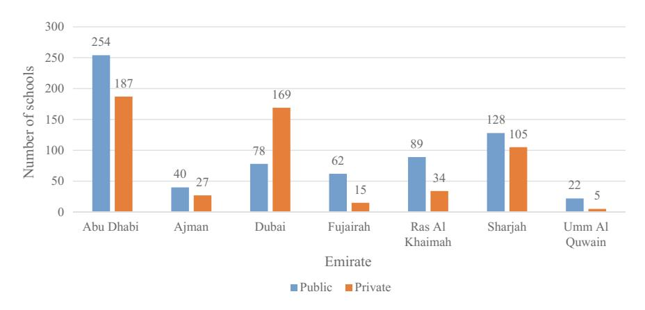
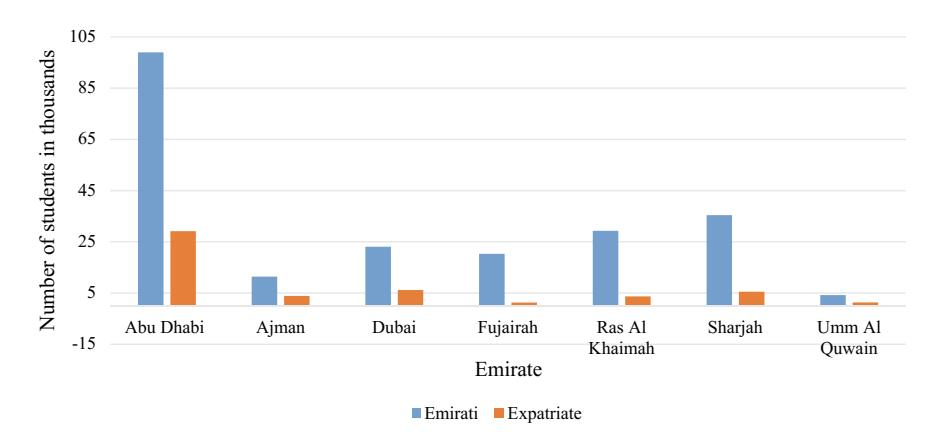
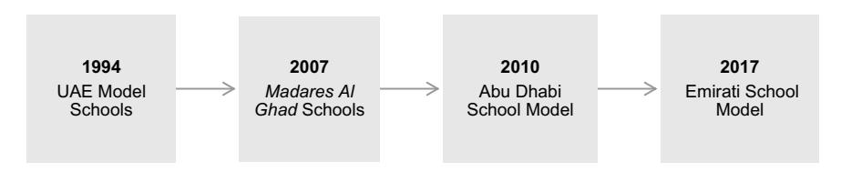

<!-- A2.R01 | source: papers_json/A2.R01/ -->

## Education in the United Arab Emirates

**Innovation and Transformation **

<!-- page 2 -->

## Education in the United Arab Emirates

<!-- page 3 -->

Kay Gallagher Editor

## Education in the United Arab Emirates

Innovation and Transformation

<!-- page 4 -->

Editor
Kay Gallagher
Zayed University
Abu Dhabi, United Arab Emirates

ISBN 978-981-13-7735-8 ISBN 978-981-13-7736-5 (eBook) https://doi.org/10.1007/978-981-13-7736-5

## © Springer Nature Singapore Pte Ltd. 2019

هذا العمل يخضع لحقوق النشر. جميع الحقوق محفوظة للناشر، سواء تعلق الأمر بكامل المادة أو جزء منها، وتحديداً حقوق الترجمة، وإعادة الطباعة، وإعادة استخدام الرسوم التوضيحية، والتلاوة، والبث، والاستنساخ على الميكروفيلم أو بأي طريقة مادية أخرى، والنقل أو تخزين المعلومات واسترجاعها، والتكييف الإلكتروني، وبرمجيات الحاسوب، أو بأي منهجية مماثلة أو مختلفة معروفة الآن أو تُستحدث لاحقاً.

استخدام الأسماء الوصفية العامة والأسماء المسجلة والعلامات التجارية وعلامات الخدمة وما إلى ذلك في هذا المنشور لا يعني، حتى في غياب بيان محدد، أن هذه الأسماء معفاة من القوانين واللوائح الحمائية ذات الصلة، وبالتالي فهي متاحة للاستخدام العام.

يفترض الناشر والمؤلفون والمحررون أن النصائح والمعلومات الواردة في هذا الكتاب صحيحة ودقيقة في تاريخ النشر. لا يقدم الناشر ولا المؤلفون ولا المحررون أي ضمان، صريح أو ضمني، فيما يتعلق بالمادة الواردة هنا أو عن أي أخطاء أو إغفالات قد تكون حدثت. يبقى الناشر محايداً فيما يتعلق بالمطالبات القضائية الواردة في الخرائط المنشورة والانتماءات المؤسسية.

هذا الإصدار من Springer ينشره الناشر المسجل Springer Nature Singapore Pte Ltd. عنوان الشركة المسجلة هو: 152 Beach Road, #21-01/04 Gateway East, Singapore 189721, Singapore

<!-- page 5 -->

## **Preface **

يهدف هذا المجلد المحرر إلى تقديم استعراض علمي للتعليم المعاصر في دولة الإمارات العربية المتحدة (UAE). يوجد اهتمام عالمي كبير بالتعليم في الإمارات اليوم؛ إلا أن مصادر المعلومات والتحليل الشاملة قليلة. نتيجة للتحولات التي حدثت في التعليم بالإمارات خلال العقود الأخيرة، يصل آلاف المعلمين الدوليين إلى البلاد سنوياً للعمل في هذا المركز التعليمي الشاب والمبتكر. ومع ذلك، غالباً ما يكون لديهم فهم محدود لنظام التعليم الذي يجدون أنفسهم فيه. يسد هذا الكتاب هذه الفجوة، ويقدم نقطة مرجعية أساسية حول القطاعات الرئيسية للتعليم في الإمارات، للمعلمين والأساتذة، وللباحثين التربويين، والإداريين، والقادة وصانعي السياسات على حد سواء، وكذلك لطلاب التعليم الوطنيين والدوليين على المستويين الجامعي والدراسات العليا.

يهدف الكتاب إلى تجميع الرؤى من السياسات والممارسة والبحث لتقديم تحليل موثوق ومستنير للتعليم في الإمارات عبر مجالات متعددة، بواسطة أكاديميين وممارسين نشطين في مجالاتهم. جميع فصول هذا المجلد كُتبت خلال *عام زايد* (2018)، وهي مبادرة وطنية لتكريم إرث مؤسس الدولة الراحل، الشيخ زايد بن سلطان آل نهيان، وهو إرث يضع التنمية البشرية في صميمه.

على الرغم من وجود مجموعة متنامية من الأبحاث التربوية الصادرة من هذا المحور التعليمي الناشئ، لم يكن هناك حتى الآن استعراض موثوق للتعليم المعاصر قطاعاً بقطاع في الإمارات. يحتوي هذا المجلد المحرر على فصول كتبها خبراء متخصصون يمتلكون خبرة عملية مباشرة وواسعة بالتطورات في مختلف المجالات التعليمية، ويقدم سرداً أساسياً واستعراضاً علمياً للتطورات التاريخية والمبتكرة في هذا المشهد التعليمي المتحول.

علاوة على ذلك، معظم الأبحاث في مجال التعليم في الإمارات حتى الآن صغيرة النطاق، والبحوث التربوية المستقلة واسعة النطاق نادرة. من إنجازات هذا المجلد جمع الرصيد الموجود من الأبحاث حول كل قطاع. ونظراً لأن البحث التربوي في البلاد في مرحلة مبكرة نسبياً، ومع أن التقدم سريع، سيلاحظ القارئ أن مصادر مثل مقالات الصحف والقوانين والبيانات الصحفية والمواقع الإلكترونية والتقارير ووثائق السياسات تلعب دوراً مهماً في هذا المجلد. إنجاز آخر لهذا المجلد المحرر هو جمع

<!-- page 6 -->

vi Preface

مجموعة أدلة غالباً ما تكون مجزأة ومفككة في مكان واحد. علاوة على ذلك، في هذا السياق التعليمي سريع التطور، حيث تُقترح مبادرات جديدة، وتُسن سياسات جديدة، وتُشكَّل وكالات جديدة، ويُعاد توجيه الوكالات القائمة بشكل متكرر، يقدم هذا المجلد لقطة بانورامية لحالة التعليم المعاصر.

يحدد الفصل الافتتاحي من هذا الكتاب العوامل السياقية الرئيسية التي تؤثر على جميع جوانب التعليم في الإمارات، ويقدم موضوعات رئيسية تتكرر عبر الكتاب. يتبع ذلك فصول حول التعليم في مرحلة الطفولة المبكرة، والتعليم من الروضة حتى الصف الثاني عشر (K–12)، والتعليم العالي. تتبعها فصول حول تعليم اللغة العربية، وتعليم STEM، وتعليم اللغة الإنجليزية. ثم يُتناول إعداد المعلمين وتعليم ذوي الاحتياجات الخاصة، ويُختتم الكتاب بدراسة ضمان الجودة في التعليم. لتوفير الاتساق للقارئ، يقدم كل فصل نظرة تاريخية موجزة على تطور القطاع، بينما ينصب التركيز الأساسي على دراسة الابتكارات والتحولات المعاصرة. تُستكشف الاتجاهات والتوجهات المستقبلية، بالاستناد إلى الأبحاث المحلية والإقليمية والدولية، وتُقدَّم أمثلة على الممارسة والسياسة والمناهج الحالية في القطاع.

Abu Dhabi, United Arab Emirates Kay Gallagher

Kay Gallagher

<!-- page 7 -->

## Contents

1**Introduction: Education in the UAE—Context and Themes**
Kay Gallagher2**Innovation and Transformation in Early Childhood Education in the UAE**
Anna Dillon193**The Growth and Transformation of K–12 Education in the UAE**
Susan Kippels and Natasha Ridge374**Expanding the UAE's Higher Education Horizon: Path Toward a Sustainable Future**
Fatima Badry575**Arabic Language Education in the UAE: Choosing the Right Drivers**
Hanada Taha Thomure736**The 'S' and 'T' in STEM: Integrating Science and Technology in Education in the UAE**
Martina Dickson, Patricia Fidalgo and Dean Cairns937**Transformation in English Language Education in the UAE**
Melanie Taylor Gobert1138**Challenges and Opportunities in Sourcing, Preparing and Developing a Teaching Force for the UAE**
Kay Gallagher127

<!-- page 8 -->

viiiContent

9Educating Learners with Special Needs and Disabilities in the UAE: Reform and Innovation147Eman Gaad10In Quest of Educational Quality in the UAE161Rana M. Tamim and Linda K. Colburn

<!-- page 9 -->

## Editor and Contributors

## About the Editor

كاي غالاغر (Kay Gallagher) أستاذة مشاركة وعميدة مساعدة في كلية التربية بجامعة زايد في أبوظبي. عملت في التعليم العالي في الإمارات منذ منتصف التسعينيات، وكانت سابقاً رئيسة قسم التربية في كلية أبوظبي للبنات، ثم رئيسة دراسات التربية في كلية الإمارات للتربية المتقدمة. أشرفت على برنامج ماجستير في التربية بجامعة هونغ كونغ، وعملت مديرة مدرسة في أيرلندا. تشمل اهتماماتها البحثية اللغة في التعليم، وإعداد المعلمين والتطوير المهني للمعلمين، واكتساب اللغة الثانية ومحو الأمية، والبحث القائم على الممارسة في الفصل الدراسي.

## Contributors

Fatima Badry American University of Sharjah, Sharjah, UAE

Dean Cairns Emirates College for Advanced Education, Abu Dhabi, UAE

Linda K. Colburn Bemidji State University, Bemidji, MN, USA

Martina Dickson Emirates College for Advanced Education, Abu Dhabi, UAE

Anna Dillon Zayed University, Abu Dhabi, UAE

Patricia Fidalgo Emirates College for Advanced Education, Abu Dhabi, UAE

Eman Gaad British University in Dubai (BUiD), Dubai International Academic City, Dubai, UAE

Kay Gallagher Zayed University, Abu Dhabi, UAE

Melanie Taylor Gobert Higher Colleges of Technology, Abu Dhabi, UAE

<!-- page 10 -->

x Editor and Contributors

Susan Kippels Sheikh Saud bin Saqr al Qasimi Foundation, Ras al Khaimah, UAE

Natasha Ridge Sheikh Saud bin Saqr al Qasimi Foundation, Ras al Khaimah, UAE

Hanada Taha Thomure Zayed University, Abu Dhabi, UAE

Rana M. Tamim Zayed University, Abu Dhabi, UAE

<!-- page 11 -->

## Abbreviations

ACTVET Abu Dhabi Centre for Technical and Vocational Education and

Training

ADEC Abu Dhabi Education Council (2005–2017)

ADEK Abu Dhabi Department of Education and Knowledge (2017 onwards)

AUD American University of Dubai AUS American University of Sharjah BUiD British University in Dubai

CAA Commission for Academic Accreditation

DSC Dubai Statistics Center

DSIB Dubai School Inspection Bureau DWE Dubai Women's Establishment

ECAE Emirates College for Advanced Education

ECE Early Childhood Education

ECCE Early Childhood Care and Education ECEI Early Childhood Education Institution

EMSA External Measurement of Student Achievement (UAE school test)

GCC Gulf Cooperation Council HCT Higher Colleges of Technology IEP Individualized Education Program

K–12 Kindergarten to Grade 12 (Age 4–17 years)

KHDA Knowledge and Human Development Authority (Dubai)

LSA Learning Support Assistant MOE Ministry of Education MOSA Ministry of Social Affairs MSA Modern Standard Arabic

NAEYC National Association for the Education of Young Children OECD Organization for Economic Cooperation and Development

PIRLS Progress in International Reading Literacy Study PISA Program for International Student Assessment

SCAD Statistics Center, Abu Dhabi

<!-- page 12 -->

xii Abbreviations

SEND Special Educational Needs and Disabilities

STEM Science, Technology, Engineering and Mathematics

TELS Teacher and Educational Licensure System

TIMSS Trends in International Mathematics and Science Study

UAE United Arab Emirates

UAEU United Arab Emirates University (Al Ain)

UNCRPD United Nations Convention on the Rights of Persons with Disabilities

UNDP United Nations Development Program ZU Zayed University (Abu Dhabi and Dubai)

<!-- page 13 -->

## **Chapter 1** **Introduction: Education** **in the UAE—Context and Themes**

1

**Kay Gallagher**

**Abstract** يقدم هذا الفصل التمهيدي استعراضاً للتعليم في دولة الإمارات العربية المتحدة (UAE). كما يعمل كمعاينة لتحليلات مختلف قطاعات التعليم في الفصول التالية: التعليم في مرحلة الطفولة المبكرة، والتعليم من الروضة حتى الصف الثاني عشر (K–12)، والتعليم العالي، وتعليم اللغة العربية، وتعليم STEM، وتعليم اللغة الإنجليزية، وإعداد المعلمين، والتعليم الخاص، وضمان الجودة في التعليم. يُوضَّح هنا المرحلتان المتميزتان في التطور التعليمي للبلاد حتى الآن: التأسيس والتوسع الأولي لنظام التعليم، يليه التركيز الحالي على تحسين جودته. يُوصف هيكل وتمويل نظام التعليم المعاصر في الإمارات، وتُناقش أهمية الابتكار والتحول. تُحدَّد الموضوعات الأساسية البارزة في التعليم المعاصر التي تتكرر عبر فصول الكتاب اللاحقة، بما في ذلك تأثير التركيبة السكانية للبلاد على التعليم، والأدوار النسبية للمواطنين الوطنيين والمقيمين غير المواطنين في التعليم، والاختلافات في توفير التعليم إقليمياً داخل البلاد، والتباين بين التعليم الحكومي والخاص.

## **Introduction**

تأسست دولة الإمارات العربية المتحدة (UAE) في عام 1971، عندما اتحدت الإمارات السبع، أبوظبي ودبي والفجيرة ورأس الخيمة والشارقة وأم القيوين وعجمان، بموجب اتفاق فيدرالي، وأصبحت أبوظبي العاصمة. تُعد الإمارات من أصغر الدول في الشرق الأوسط سناً، وقد تحقق تقدم ملحوظ منذ بدايات التعليم المتواضعة في البلاد في أكواخ سعف النخيل في أوائل القرن العشرين. في ذلك الوقت، كان التعليم غير رسمي ومقتصراً في الغالب على الأولاد، وكان المعلم إماماً ملحقاً بالمسجد المحلي، مقارنة بالوقت الحاضر حيث تضم الإمارات أكبر عدد من المدارس الدولية الناطقة بالإنجليزية في العالم (Warner & Burton, [2017)](#page-29-0). لم تُنشأ أول جامعة في البلاد إلا في

<!-- page 14 -->

عام 1976؛ ومع ذلك تزدهر اليوم فروع الجامعات الدولية المرموقة، بما في ذلك المؤسسات الرائدة مثل جامعة نيويورك وجامعة السوربون.

لتوضيح التقدم التعليمي السريع الذي تحقق، عند تأسيس اتحاد الإمارات في السبعينيات، كانت نسبة الأمية بين البالغين في الإمارات 48%، لكن بعد 40 عاماً أصبح أكثر من 93% ملمّين بالقراءة والكتابة (Crown Prince Court, [2011)](#page-27-0). وبحلول عام 2018، كانت نسبة الأمية أقل من 1% من السكان (Government.ae, [2018a)](#page-27-1). في السنوات بين 1973 و2009، على سبيل المثال آخر، ارتفع معدل الالتحاق بالمدارس الثانوية من 22% إلى 93%، بينما ارتفع معدل الالتحاق بالتعليم العالي من أكثر بقليل من 1% في عام 1979 إلى أكثر من 30% في عام 2009 (Crown Prince Court, [2011)](#page-27-0). واليوم، تتفوق الإمارات على جيرانها في العديد من مجالات التعليم، وتتفوق بانتظام على غيرها في المنطقة في الجداول التصنيفية التعليمية الدولية. ففي اختبار دولي حديث لإتقان القراءة، على سبيل المثال، حقق الطلاب في الإمارات أعلى درجة بين جميع الدول العربية (Progress in International Reading Literacy Study [PIRLS], [2016)](#page-28-0). ومن ناحية أخرى، عند إجراء المقارنات الدولية، لم تصل الإمارات بعد إلى المتوسط الدولي في اختبارات تحصيل الطلاب. من الواضح أنه تحقق الكثير، لكن لا يزال هناك الكثير الذي يجب إنجازه.

لتهيئة القارئ للخيوط السردية التي تمتد عبر هذا المجلد، يُقدَّم في هذا الفصل التمهيدي عدد من العوامل السياقية التي تتردد أصداؤها عبر فصول هذا المجلد. تشمل هذه العوامل السياقية التركيبة السكانية الفريدة للبلاد، والدفع نحو التوطين (Emiratization) في التعليم، والتباين بين التعليم الحكومي والخاص، والاختلاف في التركيز التعليمي داخلياً بين مناطق الإمارات. أولاً، مع ذلك، يُعرض بإيجاز هيكل نظام التعليم في الإمارات، وكذلك إنفاقها على التعليم، تليه مناقشة للابتكار والتحول في التعليم في الإمارات بشكل عام.

لا يمكن البدء في مناقشة التعليم المعاصر دون استعراض تمهيدي لنشأة الإمارات كدولة. وُصف تطور إمارات الخليج العربي من مناطق نائية غير متطورة إلى بعض أغنى اقتصادات العالم بأنه أحد سخريات التاريخ (Davidson, [2005)](#page-27-2). أصبحت الإمارات واحدة من أشهر دول الخليج العربي، بفضل الانتشار العالمي لمدينتيها الرئيسيتين أبوظبي ودبي، اللتين ارتقتا إلى مكانة عالمية بارزة في قطاعات دولية مثل الطيران والسياحة. في أقل من 50 عاماً منذ تأسيسها في 1971، مرت الإمارات، وما زالت تمر، بتحول عميق نحو دولة حضرية ثرية ومنفتحة على العالم. ثروة النفط والغاز في العاصمة أبوظبي منحت البلاد أحد أعلى مستويات دخل الفرد في العالم، ووفرت الوسائل للاستثمار بكثافة في البنية التحتية المادية وكذلك بنية التنمية الاجتماعية الاقتصادية والبشرية.

## **Two Phases of Development**

لا شك أنه حتى وقت قريب كان نظام التعليم متأخراً عن التطورات في القطاعات الأخرى. في الواقع، لم يكن قبل وقت طويل ممكناً القول، كما فعل Godwin [(2006,](#page-27-3) p. 5)، إن 'التعليم في الإمارات ظل دون تغيير ... منذ

<!-- page 15 -->

قيام الاتحاد'. ومع ذلك، منذ عام 2010، أخذ تحول نظام التعليم يكتسب سرعة وزخماً.

يمكن تقسيم تطور التعليم في الإمارات منذ تأسيسها إلى مرحلتين متمايزتين: كانت المرحلة الأولى مرحلة توسع كمي، تلتها المرحلة الحالية من التحول النوعي. امتدت مرحلة التوسع الأولية من السبعينيات حتى نهاية التسعينيات تقريباً، وشهدت نمواً هائلاً في أعداد الطلاب والمعلمين والمدارس. أما المرحلة الثانية، مرحلة التحسينات النوعية، فقد ركزت على إصلاح جذري وشامل لنظام المدارس الحكومية، وعلى تطوير نظام مدارس خاصة ديناميكي، وعلى توسيع وتحسين التعليم العالي. هذه المرحلة الثانية هي التركيز الأساسي لهذا الكتاب.

بدأت المحاولة الأولى لتحويل جودة التعليم مع إطلاق الحكومة *رؤية 2020* للتعليم، عندما أعلن Mawgood، وهو مستشار كبير لوزير التربية في نهاية التسعينيات، أن 'الإصلاح التعليمي ينبغي أن يركز على العوامل النوعية بقدر تركيزه على العوامل الكمية' (Mawgood, [1999,](#page-28-1) p. 17). ومع الاعتراف بأن الإنجازات خلال المرحلة الأولى من التوسع التعليمي كانت كبيرة، أصبح واضحاً، بحسب كلماته، أن 'مشكلات الهدر وعدم الكفاءة وضعف الإنتاجية [هي] متجذرة بعمق' (Mawgood, [1999,](#page-28-1) p. 8). واعتقد أن 'نهج الترقيع أو المعالجة الجزئية لن يكون كافياً. المطلوب هو تحويل نظام التعليم في الإمارات ...' (Mawgood, [1999,](#page-28-1) p. 6). نشأ هذا الإدراك مع بدء البلاد في تموضعها كلاعب عالمي في اقتصاد المعرفة، وبدأت تفكر فيما كان غير مفكر فيه سابقاً: مرحلة ما بعد النفط. غير أن النتائج الضعيفة في اختبارات التحصيل الموحدة (سواء في الاختبارات الوطنية، مثل CEPA،[1](#page-14-0) أو الاختبارات الدولية، مثل IELT[S2](#page-14-1) وTIMS[S3)](#page-14-2) لفتت انتباه الرأي العام إلى ما كان الباحثون والمستشارون الخارجيون فقط قد لاحظوه سابقاً. بعد أكثر من عقد على إطلاق رؤية 2020، واعتقاداً منه بأن الإصلاحات التعليمية الموعودة كانت بطيئة في اكتساب الزخم، رأى مجلس أبوظبي للتعليم — سلطة التعليم المحلية في العاصمة آنذاك — ضرورة وضع 'استراتيجيته الممتدة الخاصة لتحقيق تحسينات جذرية في الجودة' في التعليم (ADEC, [2012)](#page-27-4).

> ^1^اختبار *الكفاءة التعليمية المشتركة* (CEPA) تكوّن من اختبارين وطنيين موحدين، اختبار في اللغة الإنجليزية وآخر في الرياضيات. كان على خريجي المدارس اجتياز اختبار اللغة الإنجليزية إذا رغبوا في الدراسة في مؤسسة تعليم عالٍ اتحادية في الإمارات، بينما تطلبت بعض مؤسسات التعليم العالي اجتياز اختبار الرياضيات أيضاً. استُبدل CEPA باختبار وطني موحد آخر، EMSAT، في عام 2016.

> ^2^اختبار *اللغة الإنجليزية الدولي* (IELTS) هو اختبار دولي موحد قائم على المهارات لقياس إتقان اللغة الإنجليزية. يحقق ممتحنو الإمارات باستمرار من بين أدنى الدرجات بين 40 دولة حول العالم، بمتوسط درجة إجمالي بلغ 4.9 في وحدة اللغة الإنجليزية الأكاديمية لعام 2017 (IELTS, nd).

> ^3^اختبار *الاتجاهات الدولية في الرياضيات والعلوم* (TIMSS) هو اختبار دولي موحد لتحصيل الطلاب في الرياضيات والعلوم، يُجرى كل 4 سنوات. يؤدي ممتحنو الرياضيات في الإمارات أداءً أفضل من معظم الدول العربية، لكنهم لا يزالون دون المتوسط العالمي (Mullis, Martin, Foy, & Hooper, [2016)](#page-28-2).

<!-- page 16 -->

4 K. Gallagher

## **Structure and Funding**

قبل الانتقال إلى مناقشة دور الابتكار والتحول في التعليم في الإمارات، يُقدَّم استعراض لهيكل نظام التعليم في الجدول [1.1](#page-15-0) أعلاه. (تُظهر المعلومات المعروضة بنية العمر والصف كما نشرتها وزارة التربية والتعليم في عام [2018.](#page-28-4)) بعد الجدول، يُقدَّم ملخص موجز لتمويل حكومة الإمارات الموازني للتعليم.

فيما يتعلق بالتمويل الحكومي للتعليم، وفقاً لتقرير صادر عام 2017 عن صندوق النقد الدولي (IMF)، يبلغ الإنفاق الحكومي على التعليم 1.6% من الناتج المحلي الإجمالي (Bibolov, Cakir, Garcia, Martinez, & Tamirisa, [2017)](#page-27-5). وكما يقر التقرير، فإن هذا يبدو للوهلة الأولى منخفضاً مقارنة بمتوسط منظمة التعاون الاقتصادي والتنمية (OECD) البالغ 4.5%. غير أن الإمارات تضم نسبة عالية جداً من المدارس الخاصة التي تفرض رسوماً، وعند دمج هذا العامل مع النسبة الصغيرة نسبياً من الملتحقين بالمدارس ضمن السكان، يصبح الإنفاق على التعليم الذي توفره الدولة أكبر بكثير من دول أخرى، وفقاً لهذا التقرير. في الواقع، يشير تقرير صندوق النقد الدولي إلى أن الإنفاق على التعليم العام أكبر منه في دول منظمة التعاون الاقتصادي والتنمية ذات أعلى مستويات إنفاق على التعليم العام (النرويج والدنمارك وفنلندا). ففي الإمارات، يتجاوز الإنفاق 22,000 دولار للفرد، أي أكثر من ضعف متوسط منظمة التعاون الاقتصادي والتنمية (Bibolov et al., [2017)](#page-27-5). علاوة على ذلك، هناك إنفاق غير مباشر كبير على التعليم عبر بدلات الرسوم المدرسية الكبيرة التي تُدفع سنوياً للعديد من الموظفين، لا سيما العاملين في القطاع الحكومي الواسع. عامل معقد آخر هو وجود إنفاق رسمي كبير على التعليم على مستوى الإمارة، بالإضافة إلى الإنفاق الفيدرالي المركزي، حيث تقدم إمارتا أبوظبي ودبي بشكل خاص تمويلاً كبيراً لمبادرات التعليم المحلية.

بلغت قيمة قطاع المدارس الخاصة المتنامي في الإمارات 4.4 مليار دولار في عام 2017 (Hoteit, El Hachem, Erker & Farah, [2018)](#page-28-5)، ومن المتوقع أن يتضاعف تقريباً إلى 7.1 مليار دولار بحلول عام 2023 (Hoteit et al., [2018)](#page-28-5). تدعم الحكومة التعليم الخاص، وقد جرى حث المواطنين الإماراتيين — الشريحة السكانية التي اعتادت الالتحاق بالمدارس الحكومية — على النظر في الالتحاق بالمدارس الخاصة (Arabian Business, [2017)](#page-27-6). إذا تخلى المواطنون عن المدارس الحكومية لصالح المدارس الخاصة، فسيؤدي ذلك إلى مزيد من تقلص نظام المدارس الحكومية في دبي، بل وربما زواله. غير أن بعض الأطراف أعربت عن تحفظات بشأن هيمنة التعليم الخاص في

<!-- page 17 -->

البلاد، مع تحذير من أن 'هيمنة مقدمي الخدمة الربحيين تعني أن العوائد المالية، بدلاً من الإيمان بأهمية التعليم للفرد والمجتمع، بدأت تؤثر على الخطاب في قطاع التعليم عموماً' (Ridge, Shami, & Kippels, [2016,](#page-28-6) p. 56).

مع ارتفاع عدد المدارس الخاصة التي تفرض رسوماً، يبدو أن الإنفاق الحكومي الفيدرالي على التعليم آخذ في الانخفاض، وفقاً لمصادر متنوعة. بالنسبة لعام 2017، أُفيد بأن مخصصات الميزانية الفيدرالية للتعليم بلغت 20.5% من إجمالي الميزانية الفيدرالية (Ministry of Finance, [2016)](#page-28-7). وبحلول عام 2018، أُفيد بأن ميزانية التعليم بلغت 20% (Salama, [2017)](#page-28-8). أما بالنسبة لعام 2019، فقد أُفيد بأن ميزانية التعليم بلغت 17% من إجمالي الميزانية الفيدرالية (Zacharias & Saadi, [2018)](#page-29-1).

المدارس الحكومية مجانية للمواطنين الإماراتيين الذين يشكلون الغالبية العظمى من الطلاب في المدارس الحكومية. في قطاع K–12 الحكومي، ووفقاً لدائرة أبوظبي للتعليم والمعرفة، سلطة التعليم المحلية التي تتخذ من العاصمة مقراً لها، يجوز قبول غير المواطنين 'المتميزين' (درجة 'A' في العربية والإنجليزية والرياضيات) كطلاب يدفعون رسوماً في المدارس الحكومية في أبوظبي، شريطة ألا يتجاوزوا 20% من إجمالي عدد الطلاب في الصف (ADEK, [2018)](#page-27-7). فقط المواطنون الإماراتيون مؤهلون للالتحاق برياض الأطفال الممولة من الدولة.

وفي التعليم العالي أيضاً، كان هناك 'استثمار عام محلي هائل' في التعليم الخاص من خلال الدعم الحكومي للفروع الجامعية الدولية. ومع أن Fox و Al Shamisi [(2014)](#page-27-8) يلاحظان أنه 'لا توجد خطة وطنية أو استراتيجية منسقة لتطوير الإمارات كمركز تعليمي' (p. 67)، فإن أبوظبي تستضيف وتدعم بالكامل بعض فروع الجامعات ذات المستوى العالمي، بما في ذلك جامعة نيويورك والسوربون. أما في دبي، فتنتشر الفروع الجامعية الدولية، لكنها ليست مدعومة بنفس القدر (Knight, [2014)](#page-28-9)، إذ لا تدعم حكومة دبي تكاليف التشغيل، على عكس الحال في أبوظبي.

## **Innovation**

تنتقل المناقشة الآن إلى دراسة معنى الابتكار والتحول، وأهميتهما في الخطاب المتعلق بالتعليم في الإمارات. يمكن تعريف *الابتكار* بأنه 'تغيير يُحدَث في طبيعة أو شكل أي شيء؛ شيء يُستحدث حديثاً؛ ممارسة أو طريقة جديدة، إلخ' (Oxford English Dictionary, [2018)](#page-28-4). يعني الابتكار حلولاً بديلة وجديدة للتحديات القائمة في موقف معين. وهو مرتبط بالسياق. قد يكمن الابتكار في طريقة تنفيذ شيء ما ومع من يُنفَّذ، ولا يعني بالضرورة الجدة أو حتى شيئاً جديداً (Paniagua & Istance, [2018)](#page-28-10). بالنسبة لقادة الإمارات، يُنظر إلى التعليم كمحرك رئيسي للابتكار. الابتكار في التعليم مطلوب لضمان استمرار الازدهار الاقتصادي للبلاد في حقبة ما بعد النفط القائمة على المعرفة؛ حقبة ستتطلب عقولاً مبتكرة وأفعالاً مبتكرة. وضعت وزارة التربية والتعليم في الإمارات التعليم كوسيلة لقذف البلاد نحو اقتصاد المعرفة، مصرحةً بوضوح أن 'نريد الانتقال من اقتصاد قائم على النفط إلى اقتصاد جديد قائم على المعرفة البشرية' (Ministry of Education, [2017a)](#page-28-11).

<!-- page 18 -->

مع استعداد الإمارات لحقبة ما بعد النفط والغاز، حين تتضاءل مواردها الطبيعية المحلية الوفيرة أو تصبح متزايدة عدم الجدوى بسبب التحول العالمي نحو أشكال طاقة أنظف ومستدامة، يتنامى الإدراك بأن الموارد الفكرية البشرية المحلية للبلاد ستصبح أثمن أصولها. وبناءً على ذلك، هناك جهد منسق جارٍ لبناء اقتصاد قائم على المعرفة لحقبة ما بعد الوقود الأحفوري. ولتحقيق ذلك، يُعد وجود سكان متعلمين جيداً أمراً أساسياً، وبالتالي ارتقى التعليم في الإمارات إلى أولوية وطنية أعلى بكثير مما كان عليه في الماضي.

تُوصف رؤية الإمارات الأحدث للتعليم بأنها 'تعليم مبتكر لمجتمع معرفي ورائد وعالمي' (Ministry of Education, [2018a)](#page-28-12). سبقت هذه الرؤية بحوالي 20 عاماً حين اقتُرح أن 'مفهوم المنهج المدرسي يجب أن يتغير جذرياً من نهج محوره المعلم ... إلى نهج محوره الطالب' (Mawgood, [1999,](#page-28-1) p. 8). علاوة على ذلك، أُعلن في ذلك الوقت أنه 'سيكون هناك تحول في التركيز في الأساليب والممارسات في التعليم — انتقال من المعلم إلى الطلاب، ومن التدريس إلى التعلم، ومن الحفظ إلى التعلم والتفكير القائمين على الطالب' (Mawgood, [1999,](#page-28-1) p. 22). كان هذا بياناً واضحاً للنية الابتكارية.

بعد بضع سنوات، أُطلقت استراتيجية وطنية للابتكار في عام 2014، أُبرز فيها التعليم كقطاع رئيسي للابتكار (government.ae, [2018c)](#page-28-13). يُطلب من كل جهة حكومية، بما في ذلك الجامعات الاتحادية، أن يكون لديها 'الرئيس التنفيذي للابتكار'. وبالتوازي مع ذلك، هناك تركيز على الابتكار كركيزة رئيسية في الخطة الاستراتيجية الحكومية الحالية، المعنونة *متحدون في المعرفة* (Vision, [2021)](#page-29-2) التي تركز على تنمية مواطنين إماراتيين واعين ومبتكرين من خلال التعليم.

## **Transformation**

في حين ينطوي الابتكار على القيام بالأشياء بطريقة مختلفة، ينطوي *التحول*، من ناحية أخرى، على 'تغيير ملحوظ في الشكل أو الطبيعة أو المظهر' (Oxford English Dictionary, [2018)](#page-28-4). بالفعل، يميل المعلقون إلى وصف التحول الأخير في التعليم بالإمارات بعبارات مبالغ فيها. ترديداً للغة المستخدمة حول الانتفاضات الاجتماعية السياسية التي حدثت في عدة دول في المنطقة في مطلع الألفية الجديدة، وصفت صحيفة إماراتية وطنية التغييرات العميقة في التعليم بأنها ليست أقل من *ثورة*: 'مجلس وزراء الإمارات يعلن ثورة تعليمية'، بحسب ما ورد (Croucher & Salem, [2013)](#page-27-9). وفي الوقت نفسه، وُصف أجندة إصلاح المدارس في العاصمة كما يلي: 'بالنسبة لأبوظبي، يُقصد بإصلاح التعليم أن يكون *خطة وحركة تحول*، سعياً لإحداث تغيير منهجي في الممارسة التعليمية على مستوى التعليم الأساسي في المجتمع' (Badri & Al Khaili, [2014,](#page-27-10) p. 202; emphasis added).

تمتد هذه اللغة الدرامية المستخدمة حول التعليم المدرسي إلى مناقشات التعليم العالي. فعلى سبيل المثال، في وصف العدد المتزايد من الفروع الجامعية الدولية في الإمارات في مقال بصحيفة *نيويورك تايمز*، أطلق Lewin [(2008)](#page-28-14) عليه تسمية حمى ذهب التعليم. وفي الوقت نفسه، وُصفت التحولات التي تحدث في التعليم

<!-- page 19 -->

في منطقة الخليج بشكل عام بأنها 'غير مسبوقة في تاريخ الحضارة من حيث الحجم أو السرعة' (Bashur, [2010,](#page-27-11) p. 253). وفي حين قد تميل هذه المشاعر نحو المبالغة، فإنها تدل على دهشة المراقبين إزاء 'النمو غير المسبوق في توفير التعليم من الطفولة المبكرة حتى المستوى الجامعي' (Warner and Burton, [2017,](#page-29-0) p. 17).

جعل قادة البلاد الآن التعليم بنداً رئيسياً على جدول الأعمال. فوجود نظام تعليمي عالي الجودة ليس ضرورياً فقط لمستقبل البلاد الاقتصادي، بل هو ضروري أيضاً لـ'الأمن والحفاظ على التوازن الاستراتيجي' لدول الخليج، وفقاً لـ (Mawgood, [1999,](#page-28-1) p. 11). بالإضافة إلى استثمار إنفاق حكومي كبير في التعليم، يستثمر الحكام أيضاً اهتماماً شخصياً كبيراً في التعليم. ففي بداية العام الدراسي الجديد في سبتمبر 2018، على سبيل المثال، استخدم قادة البلاد تويتر لحث طلاب المدارس على النجاح، بينما جلس ولي عهد البلاد إلى جانب الطلاب في فصل دراسي بمدرسة حكومية في أبوظبي في اليوم الأول من العام الدراسي الجديد، وحث الطلاب الوطنيين على أن الهدف لم يعد 'النجاح فقط — بل التفوق والوصول إلى القمة' (Dajani, [2018)](#page-27-12).

## **Factors of Context**

يؤثر عدد من العوامل الخاصة بالبلاد على التعليم في الإمارات، وهي عوامل تتكرر عبر فصول هذا المجلد. تشمل هذه العوامل التركيبة السكانية للبلاد، وظاهرة التوطين (Emiratization)، والاختلافات الإقليمية في توفير التعليم، وأدوار التعليم الحكومي والخاص. تنتقل المناقشة الآن إلى دراسة هذه العوامل واحداً تلو الآخر.

## *Demographics*

أولاً، التركيبة السكانية للبلاد فريدة، من حيث نسبة المواطنين إلى المقيمين غير المواطنين، وهذا يؤثر على التعليم كما يؤثر على جميع جوانب الحياة في الإمارات. لا يحق للمقيمين الأجانب الحصول على الجنسية، ولا يكونون في الغالب مؤهلين لوضع إقامة طويلة الأمد. في عاصمة أبوظبي عام 2016، شكّل المواطنون الإماراتيون 19% فقط من السكان، بينما شكّل المقيمون الأجانب أكثر من 80% من السكان (Statistics Center of Abu Dhabi, [2017a)](#page-29-3). هذا التفاوت أكبر حتى في العاصمة التجارية دبي: أكثر من 90% من سكان دبي مقيمون أجانب، بينما يشكل المواطنون الإماراتيون أقل من 10% من السكان (Dubai Statistics Center, [2017)](#page-27-13).

هذه التركيبة السكانية ذات صلة بأي مناقشة للتعليم بطرق عديدة. يقتصر التعليم المجاني الذي توفره الدولة، سواء في المدارس أو التعليم العالي، بشكل عام على المواطنين الإماراتيين. لا يُقبل غير المواطنين عموماً في المؤسسات التعليمية الممولة من الدولة، ويتعين عليهم دفع تكاليف تعليمهم بشكل خاص. ونتيجة لذلك، يلتحق بالمدارس الحكومية المواطنون الإماراتيون بشكل شبه حصري، وتتبع هذه المدارس منهج وزارة التربية والتعليم في الإمارات. أما المدارس الخاصة، فرغم أنها تضم العديد من

<!-- page 20 -->

الطلاب الإماراتيين، إلا أنها تتكون بشكل أساسي من المقيمين الأجانب. وليس من المستغرب، نظراً للتركيبة السكانية غير المتوازنة للبلاد، أن تتكاثر المدارس الخاصة لتلبية احتياجات أكثر من مائتي جنسية أجنبية تعيش في الإمارات (Government.ae)، حيث تقدم مجموعة متنوعة من المناهج (وغالباً ما تُقدَّم عدة مسارات منهجية داخل المدرسة الواحدة)، بما في ذلك المناهج الأمريكية والأسترالية والبريطانية والكندية والفرنسية والألمانية والهندية والباكستانية، وهجائن دولية منها. لذلك تشير فصول هذا المجلد بانتظام إلى التعليم 'الحكومي' أو 'العام' أو 'الرسمي' أو 'الاتحادي' من جهة، وإلى التعليم 'الخاص' و'الدولي' و'الربحي' من جهة أخرى.

جانب آخر من التركيبة السكانية غير المعتادة للبلاد هو المشاركة الواسعة للخبرات الخارجية في تطوير نظام التعليم. فعلى سبيل المثال، أُنشئت أول جامعة اتحادية في البلاد، جامعة الإمارات العربية المتحدة (UAEU)، بمساعدة مستشارين مصريين في عام 1973. وبحلول عام 1988، عندما أُنشئ نظام كليات التقنية العليا (HCT)، كانت الإمارات قد توجهت إلى كندا طلباً للخبرة. لاحقاً، عند تأسيس جامعة زايد في عام 1998، استُقدم مستشارون من الولايات المتحدة الأمريكية. ووفقاً لـ AlAli [(2014)](#page-27-14)، فتحت تأثير النظام العالمي، أجرت الإمارات تحولاً جذرياً في نهاية الثمانينيات في نموذج التعليم العالي الاتحادي، باستبدال نموذجها الأصلي المصري القائم على اللغة العربية بنموذج منهجي أمريكي-إنجليزي. ومن ناحية أخرى، عند تأسيس كلية الإمارات للتربية المتقدمة (أول كلية معلمين في البلاد) في عام 2007، طُلبت الخبرة في ذلك الوقت من الشرق، ودُعي المعهد الوطني للتربية في سنغافورة للمساعدة في إنشاء الكلية الجديدة. توضح هذه الأمثلة انفتاح الإمارات على التأثيرات الخارجية وحماسها لتبني المعايير الدولية في التعليم.

## *Emiratization*

مرتبطة بالمناقشة السابقة حول التركيبة السكانية ظاهرة التوطين (Emiratization)، وهي حملة مستمرة لإعطاء الأولوية لتوظيف المواطنين الإماراتيين حيثما أمكن ذلك. في مجال التعليم، تُعد التركيبة السكانية غير المتوازنة مشكلة، وقد لوحظ منذ سنوات أن 'الهدف الأساسي من التوطين هو ضمان استمرار التماسك الاجتماعي في مواجهة تدفق هائل من المشاركين الأجانب من ثقافات أخرى. ويتحقق هذا على أفضل وجه من خلال نظام مدارس حكومية يعمل فيه معلمون إماراتيون مؤهلون جيداً' (Mawgood, [1999,](#page-28-1) p. 16). من الواضح أن إحدى الوظائف المهمة لأي نظام مدارس حكومية في العالم هي النقل الثقافي. غير أنه في الإمارات، خلال سنوات بناء الدولة المستمرة، وبسبب عدم التوازن السكاني بين المقيمين الأجانب والمواطنين، تكتسب عوامل الهوية الثقافية أهمية أكبر. في عام 1999، كان أقل من 30% من المعلمين في المدارس الحكومية إماراتيين (Mawgood, [1999,](#page-28-1) p. 16). وبحلول عام 2017، ارتفعت هذه النسبة إلى 36% فقط في المدارس الحكومية، لكن نسبة المعلمين المواطنين في المدارس الخاصة بلغت 0.3% فقط (Statistics Center of Abu Dhabi, [2017b)](#page-29-4). قضايا إعداد المعلمين داخل البلاد، والتحديات في استقطاب المعلمين من

<!-- page 21 -->

خارج البلاد، والجهود المبذولة لرفع جودة المعلمين، هي موضوع آخر يتكرر عبر هذا المجلد.

## **Regional Differences**

بطرق عديدة، كما تكشف فصول هذا الكتاب، تمثل قصة التعليم في الإمارات — رغم دمج سلطتي التعليم العام في عام 201[74—](#page-20-0)قصة مدينتين، بل وقصة نظامين: العام والخاص. ففي دبي، يتفوق عدد المدارس الخاصة على المدارس الحكومية بنسبة اثنين إلى واحد، بينما في الإمارات الشمالية الأقل شهرة، رأس الخيمة والفجيرة والشارقة وعجمان وأم القيوين، يوجد عدد أكبر من المدارس الحكومية مقارنة بالخاصة. من ناحية أخرى، في أبوظبي، تتفوق المدارس الخاصة على الحكومية بفارق ضئيل. منذ تأسيس سلطة تعليم جديدة لأبوظبي في عام 2005، مجلس أبوظبي للتعليم (ADEC)، وحتى إعادة هيكلته كدائرة التعليم والمعرفة (ADEK) في عام 2017، ضخّت مدينة وإمارة أبوظبي تمويلاً ضخماً وجهداً متواصلاً لإعادة هندسة نظام مدارسها الحكومية. أما مدينة دبي، من ناحية أخرى، فقد تصدرت المسار في تطوير وتنظيم التعليم الخاص خلال العقد الماضي، كما يُناقش أدناه.

## *Public and Private*

استكمالاً للمناقشة حول الاختلاف في التركيز بين أبوظبي ودبي، يُبرَّر هنا استعراض موجز للأدوار النسبية للتعليم العام والخاص في الإمارات. في تقرير البنك الدولي المرجعي حول الحاجة إلى الإصلاح التعليمي في الشرق الأوسط، *الطريق الذي لم يُسلك* (Galal et al., [2008)](#page-27-15)، حُدد دور رئيسي للمدارس الخاصة في رفع المعايير التعليمية. توسع قطاع المدارس الخاصة في دبي بسرعة كبيرة حتى إن الحكومة أنشأت في عام 2006 جهة خاصة للإشراف عليه، هي *هيئة المعرفة والتنمية البشرية* (KHDA). توقعت KHDA زيادة بنسبة 7% في الطلب على المدارس عالية الجودة بين عامي 2014 و2019، وفقاً لتقرير في مجلة اقتصادية بالشرق الأوسط (James, [2014)](#page-28-15). ومن المثير للاهتمام أن نسبة الطلاب الإماراتيين الملتحقين بالمدارس الخاصة ارتفعت من 34% إلى 57% بين عامي 2004 و2014 (Thacker & Cuadra, [2014)](#page-29-5)، وبحلول عام 2017، التحق 73% من سكان البلاد في سن الدراسة بالمدارس الخاصة، مقابل 27% فقط بالمدارس الحكومية، وفقاً لتقرير صندوق النقد الدولي (Bibolov et al., [2017)](#page-27-5). كان هناك 567 مدرسة خاصة في البلاد بحلول 2016–2017 (Warner & Burton, [2017)](#page-29-0). وصف Thacker و Cuadra [(2014,](#page-29-5) p. 5) هيمنة المدارس الخاصة في

> ^4^في عام 2017، حُلَّ مجلس أبوظبي للتعليم (ADEC)، الذي أُنشئ في الأصل عام 2005 كجهة منفصلة عن وزارة التربية والتعليم (MOE) التي تتخذ من دبي مقراً لها، وقاد إصلاح التعليم الحكومي في أبوظبي لأكثر من عقد، وأُعيد دمجه كدائرة تابعة لوزارة التربية والتعليم.

<!-- page 22 -->

دبي بأنها 'فريدة ومتطرفة في آن واحد'. ولتنظيم هذا القطاع المتنامي، أُنشئ مكتب دبي لتفتيش المدارس (DSIB) في عام 2007 للإشراف على جودة التعليم الخاص في دبي، وبذلك جلب 'تركيزاً جديداً على أهمية جودة التعليم ... لم يكن موجوداً من قبل' (Thacker & Cuadra, [2014,](#page-29-5) p. 34). في غضون عقد واحد، تحسنت جودة تعلم الطلاب وكذلك رفاهية الطلاب بشكل ملحوظ، كما يتضح من تقرير ملخص استعادي حول التحولات في التعليم الخاص في دبي خلال الفترة 2007–2017 (KHDA, [2018)](#page-28-16).

بالفعل، تظهر العديد من المناهج التعليمية المبتكرة من قطاع المدارس الخاصة الدولي المتنامي في دبي. فعلى سبيل المثال، تُعد GEMS (Global Education Management Systems)، التي نشأت في دبي، أحد أكبر مزودي المدارس الخاصة في العالم (Sharif, [2013)](#page-29-6). تُعلن GEMS أنها تُعلِّم ربع جميع الطلاب في دبي، وتوظف 9000 معلم من أكثر من 115 دولة في مدارسها البالغ عددها 48 مدرسة عبر الإمارات (GEMS Education, [2018)](#page-27-16). وفي حين يدير تكتل GEMS Education نموذج عمل ربحياً، فإنه يدعم أيضاً إعداد المعلمين في العالم النامي من خلال ذراعه الخيرية (Verger, Lubienski, & Steiner-Khamsi, [2016)](#page-29-7). وفي الوقت نفسه، تُمنح جائزتها السنوية المرموقة ذات القيمة المالية الكبيرة، *الجائزة العالمية للمعلم*، لمعلم واحد كل عام. تهدف الجائزة إلى الاحتفاء بـ'الأثر الذي يحدثه المعلمون في العالم من حولهم — ليس فقط على طلابهم، بل على المجتمعات المحيطة بهم' (Varkey Foundation, [2018)](#page-29-8).

علاوة على ذلك، على مستوى التعليم العالي، أصبحت الإمارات بارزة عالمياً في استقطاب ودعم الفروع الجامعية الدولية لجامعات مرموقة، بما في ذلك جامعة السوربون الفرنسية وجامعة نيويورك في أبوظبي. وفي الوقت نفسه، أنشأت دبي في عام 2003 منطقة حرة للفروع الجامعية الدولية وكذلك للجامعات الخاصة المحلية، أُطلق عليها اسم 'قرية المعرفة'، وأسست جهات تعليم عالٍ متعددة حرماً جامعياً لها هناك.

## **The National Agenda for Education**

يُوضَع التعليم في الدول المتقدمة اليوم بين المحلي والعالمي، والتقليدي والحديث، والمحلي والمستورد. لكن ربما أكثر من مواقع أخرى، يعكس التعليم في الإمارات العولمة والليبرالية الجديدة المعاصرة للتعليم، وهو ما يتجلى في انتشار المدارس الخاصة الدولية والتعليم العالي الخاص. علاوة على ذلك، يُدار التعليم العام في الإمارات في مناخ من التطور السريع والتغيير المتكرر. ورغم كونها من بين أفضل الأنظمة المدرسية أداءً في العالم العربي، ورغم أن الإنفاق الحكومي على التعليم يفوق متوسطات منظمة التعاون الاقتصادي والتنمية (Bibolov et al., [2017)](#page-27-5)، لا تزال مخرجات التعلم أقل من متوسطات منظمة التعاون الاقتصادي والتنمية. وفيما يتعلق بدرجات تحصيل الطلاب في *برنامج التقييم الدولي للطلاب* (PISA)، على سبيل المثال، لوحظ أن

الموارد الكبيرة المخصصة للتعليم لم تُترجم بعد إلى مخرجات قوية ... أكثر من 40 في المئة من الطلاب عند المستوى 2 أو أقل — وهو مستوى كفاءة تعتبره منظمة التعاون الاقتصادي والتنمية ضرورياً للمشاركة الكاملة في عالم معولم. (Bibolov et al., [2017](#page-27-5) p. 17)

<!-- page 23 -->

هذا المستوى من الأداء يمثل مشكلة في ضوء طموح الإمارات لتطوير 'نظام تعليمي عالمي المستوى يدعم جميع المتعلمين في تحقيق كامل إمكاناتهم للمنافسة في السوق العالمي' (ADEC, [2010)](#page-27-17).

رغم التحديات، تهدف الأجندة الوطنية للإمارات التي أُطلقت في 2014 مباشرة إلى تحقيق 'نظام تعليمي من الطراز الأول' (Vision [2021)](#page-29-2). تحتوي هذه الأجندة التي تقودها الحكومة على ثمانية مؤشرات أداء طموحة لنظام التعليم:

- 1. أن تكون من بين أفضل 20 دولة في اختبار برنامج التقييم الدولي للطلاب (PISA).
- 2. أن تكون من بين أفضل 15 دولة في دراسة الاتجاهات الدولية في الرياضيات والعلوم (TIMSS).
- 3. ضمان أن تضم جميع المدارس (الحكومية والخاصة) في الإمارات معلمين عالي الجودة.
- 4. ضمان أن تمتلك جميع المدارس (الحكومية والخاصة) قيادة فعالة للغاية.
- 5. ضمان أن يكون لدى 90 في المئة من طلاب الصف التاسع في المدارس الحكومية والخاصة إتقان للغة العربية.
- 6. رفع معدل التخرج من المدرسة الثانوية إلى 98% بين الطلاب الإماراتيين.
- 7. توفير تعليم مرحلة الطفولة المبكرة لـ95% من الأطفال بين سن 4 و5 سنوات عبر التعليم قبل المدرسي الحكومي والخاص.
- 8. إلغاء حاجة الطلاب الإماراتيين لإتمام برنامج تأسيسي لتأهيلهم لدخول الجامعة (Adapted from Warner & Burton, [2017)](#page-29-0).

فيما يتعلق بأول هذه الأهداف الوطنية للتعليم كما وردت أعلاه، يُجرى اختبار PISA (*برنامج التقييم الدولي للطلاب*) التابع لمنظمة التعاون الاقتصادي والتنمية (OECD) دولياً كل 3 سنوات، ويختبر تحصيل طلاب المرحلة المتوسطة في القراءة والرياضيات والعلوم. شاركت الإمارات لأول مرة في عام 2009 وتهدف إلى أن تكون من بين أفضل 20 دولة عالمياً في اختبار PISA بحلول 2021. ولإعطاء فكرة عن حجم هذا الطموح، في جولة اختبار 2012، احتل طلاب المدارس في الإمارات المرتبة 44 عالمياً في العلوم، والمرتبة 48 في الرياضيات، والمرتبة 46 في القراءة. وبحلول عام 2015، تقدم طلاب البلاد كثيراً في الجداول التصنيفية الدولية لـPISA، حيث احتلوا المرتبة 35 في العلوم، و37 في الرياضيات، و34 في القراءة. ومع صدور نتائج دورة اختبار 2018 المتوقعة في أبريل/مايو 2019، سيُظهر الوقت ما إذا كانت الإمارات ستحقق أهدافها الطموحة. غير أنه لا شك في حجم طموح البلاد. ففي نشرتها الإعلامية الإلكترونية حول PISA، التي استُقيت منها البيانات أعلاه، تُضمِّن وزارة التربية والتعليم اقتباساً مؤثراً من رئيس الوزراء، الشيخ محمد بن راشد آل مكتوم، نائب رئيس الدولة ورئيس مجلس الوزراء وحاكم إمارة دبي، يؤكد فيه أن 'من حقنا أن نحلم بأن تكون بلادنا من بين أفضل دول العالم' (Ministry of Education, [2018b)](#page-28-17).

الهدف الثاني من الأهداف المذكورة أعلاه للتعليم في الإمارات هو أن تكون من بين أفضل 15 دولة في العالم بحلول 2021 في أداء الرياضيات والعلوم في دراسة *الاتجاهات الدولية في الرياضيات والعلوم* (TIMSS) التابعة للرابطة الدولية لتقييم التحصيل التربوي (IEA). يُجرى هذا الاختبار كل 4 سنوات في أكثر من 50 دولة، ويُقيّم أداء الطلاب في الرياضيات

<!-- page 24 -->

والعلوم في الصفين الرابع والثامن. تحقق الإمارات بالفعل أداءً في القمة في العالم العربي في اختباري TIMSS وPISA؛ إلا أن نتائج الاختبار الدولي لعام 2015 تُظهر أن الإمارات ستحتاج إلى التقدم في الترتيب الدولي بـ20 مرتبة في الصف الرابع وبأكثر من 6 مراتب في الصف الثامن، إذا أُريد تحقيق الطموح بأن تكون من بين أفضل 15 دولة عالمياً في أداء الرياضيات والعلوم في TIMSS بحلول 2021 (Ministry of Education, [2017b)](#page-28-18).

سلطت *هيئة المعرفة والتنمية البشرية* (KHDA)، سلطة المدارس الخاصة في دبي، الضوء على تأثير هذه الاختبارات الدولية على المشهد التعليمي في الإمارات، إذ لاحظت أن 'كلا اختباري TIMMS وPISA تغيّرا في الإمارات، من كونهما مجرد تقييمات دولية إلى أن أصبحا جزءاً من أولوياتنا الوطنية' (KHDA, [2017,](#page-28-19) p. 3). وفي الوقت نفسه، في أبوظبي، يُشعَر بأثر هذه الاختبارات الدولية ضمن المهام المنهجية التي يقوم بها الطلاب: تطلب دائرة أبوظبي للتعليم والمعرفة (ADEK) من جميع الطلاب المقرر أداؤهم اختبار TIMMS الإجابة على 'سؤال يومي' في الرياضيات والعلوم عبر تطبيق على مدى عدة أسابيع استعداداً للاختبار، وأيضاً أداء اختبار تجريبي، بهدف رفع الدرجات (National, 2018).

## **Conclusion**

بالنظر إلى متن هذا الكتاب، يلي ذلك مجموعة مختارة بعناية من الفصول، كتبها خبراء متخصصون في المواضيع، درسوا وبحثوا ونشروا في قطاعاتهم التعليمية الخاصة، وكانت لديهم سنوات عديدة من الخبرة في تطبيق وقيادة الممارسة ضمن مجالهم في الإمارات. توجد فصول موثوقة حول التعليم في مرحلة الطفولة المبكرة، والتعليم من الروضة حتى الصف الثاني عشر، والتعليم العالي، وتعليم اللغة العربية، وتعليم STEM، وتعليم اللغة الإنجليزية، وإعداد المعلمين، والتعليم الخاص، وضمان الجودة في التعليم، والتي تُقدِّم معاً لقطة بانورامية لحالة التعليم المعاصر في الإمارات. يلي ذلك استعراض عام لكل فصل.

## *Early Childhood Education*

وسط إدراك متزايد لأهمية بيئة تعلم مبكر قوية وشاملة، تدرس **آنا ديلون (Anna Dillon)** الدور والوضع الحالي للتعليم في مرحلة الطفولة المبكرة في فصلها المعنون **Innovation and Transformation in Early Child****hood Education in the UAE**. تناقش توفير رعاية وتعليم الطفولة المبكرة للفئة العمرية من الولادة حتى 4 سنوات، ثم للفئة العمرية من 4 إلى 6 سنوات. ورغم إحراز تقدم كبير في تحويل التعليم للفئة العمرية الأخيرة، لا يزال التوفير للفئة العمرية الأصغر محدوداً، ولا يوجد إطار منهجي وطني لمن هم دون سن الرابعة. يُنظر إلى تطوير مثل هذا المنهج على أنه ذو أهمية بالغة في تحقيق رؤية الإمارات.

<!-- page 25 -->

## *School Education*

في هذا الفصل المحوري، *The Growth and Transformation of K***–***12 Education in* *the United Arab Emirates*، تقدم المؤلفتان **سوزان كيبلز (Susan Kippels)** و**ناتاشا ريدج (Natasha Ridge)** استعراضاً ثاقباً وشاملاً للتعليم على المستوى المدرسي في الإمارات من الروضة حتى الصف الثاني عشر، في تجلياته التاريخية والمعاصرة. تُتناول مجالات الابتكار الحديثة في المدارس، بما في ذلك توسيع التعليم التقني والمهني، والجهود المبذولة لتعزيز رفاهية الطلاب. مع التركيز بشكل أساسي على قطاع المدارس الحكومية، تُقدَّم توصيات لمزيد من التطوير على عدة جبهات، بما في ذلك الجهود المبذولة لاستقطاب الذكور المواطنين للتدريس في المدارس الحكومية، وتنويع المنهج الوطني، وتحسين التواصل بين أصحاب المصلحة الرئيسيين، والحاجة إلى صنع القرار القائم على البحث والتعاون مع الشركاء في التعليم.

## *Higher Education*

كان توسع قطاع التعليم العالي دراماتيكياً في الإمارات المعاصرة. تتتبع **فاطمة بدري (Fatima Badry)** في فصلها، *Expanding the Horizon of UAE Higher Edu**cation: Path towards a Sustainable Future*، تطور هذا القطاع وتدرس استدامة التعليم العالي في الإمارات. يضع فصلها الضغوط والتوترات في نظام التعليم العالي الحالي في الإمارات ضمن سياق القضايا العالمية في التعليم العالي. يُقترح توسيع المنهج لتجنب خطاب اختزالي حول التعليم العالي باعتباره مجرد منتج للموارد البشرية للاقتصاد. بالإضافة إلى ذلك، يُوصى بنهج استباقي لاستقطاب الطلاب الدوليين إلى الإمارات، إذا أُريد تحقيق إمكاناتها كمركز للتعليم العالي المعولم.

## *Arabic Language Education*

فصل **هنادي طه ثمرة (Hanada Taha Thomure)** حول تعليم اللغة العربية، المعنون *Arabic* *Language Education in the UAE: Choosing the Right Drivers*، يحتل مكانة خاصة في هذا المجلد. باعتبارها اللغة الأولى في الإمارات، ولغة الأم للأطفال الإماراتيين الأصليين الملتحقين بقطاع المدارس الحكومية، واللغة الأولى لمئات الآلاف من الأطفال العرب المقيمين الملتحقين بنظام المدارس الخاصة، فهي أيضاً مادة دراسية إلزامية لكل طفل في نظام المدارس الإماراتي، سواء في التعليم الحكومي أو الخاص. يناقش هذا الفصل العديد من المشاريع المبتكرة الجديرة بالثناء التي حدثت في السنوات الأخيرة لتعزيز تطوير اللغة العربية في الإمارات. ومن ناحية أخرى، يُحدَّد إعداد المعلمين وتدريب القيادة المدرسية كمجالات تحتاج إلى اهتمام عاجل، إذا أُريد لمثل هذه المبادرات أن يكون لها أثر دائم على مخرجات تعلم اللغة العربية.

<!-- page 26 -->

## *STEM Education*

يتناول المؤلفون **مارتينا ديكسون (Martina Dickson)** و**باتريشيا فيدالغو (Patricia Fidalgo)** و**دين كيرنز (Dean Cairns)** تعليم STEM في الإمارات، مع تركيز خاص على إمارة أبوظبي. وكما يشير عنوان فصلهم، *The 'S' and 'T' in STEM: Integrating Science and Tech**nology in Education in the UAE*، يركز هذا الفصل بشكل أساسي على اثنين من مواد STEM الأربع، العلوم والتقنية، وعلى الدمج المنهجي لـSTEM. يدرس الفصل الأبحاث المتعلقة بالمواقف تجاه استخدام ودمج التقنية التعليمية في المدارس ومؤسسات التعليم العالي في الإمارات، ويقدم عدة أمثلة خاصة بالبلاد على الممارسات المنهجية والتربوية الجيدة. يربط الفصل تطوير الكفاءات الوطنية في العلوم والتقنية بمستقبل الاقتصاد القائم على المعرفة بعد انتهاء حقبة النفط.

## *English Language Education*

تقدم **ميلاني تايلور غوبير (Melanie Taylor Gobert)** وصفاً شاملاً لدور ووظيفة اللغة الإنجليزية في التعليم بالإمارات. في فصلها، *Transformation in* *English Language Education in the United Arab Emirates*، تستكشف دور اللغة الإنجليزية في التعليم باعتبارها اللغة الثانية الأساسية في الإمارات، وتتتبع تاريخ وتطور توفير تعليم اللغة الإنجليزية في المدارس الحكومية وفي برامج التأسيس في التعليم العالي. يدرس الفصل تداعيات نتائج الاختبارات المعيارية لمستوى اللغة الإنجليزية في التعليم الحكومي بالإمارات. كما يناقش فصلها اكتساب اللغة الإنجليزية كلغة ثانية في المدارس الخاصة الناطقة بالإنجليزية ذات المناهج الدولية، حيث يُغمر المتعلمون في اللغة المستهدفة.

## *Teacher Education*

تدرس محررة المجلد **كاي غالاغر (Kay Gallagher)** الحالة الراهنة لإعداد المعلمين في فصلها المعنون *Challenges and Opportunities in Sourcing, Preparing and* *Developing a Teaching Force for the UAE*. إعداد المعلمين مشروع متعدد الأوجه، ويشمل هذا الفصل اختيار وإعداد المرشحين للتدريس، وتوجيه المعلمين المستجدين، واستقطاب المعلمين، والتطوير المهني، والمؤهلات المتقدمة. في السنوات الأولى التي تلت تأسيس البلاد في 1971، جرى استقطاب المعلمين من جميع أنحاء العالم العربي، قبل تأسيس برامج إعداد محلية للمعلمين الوطنيين. وفي السنوات الأخيرة، استقطبت الإمارات معلمين من الأنظمة المدرسية عالية الأداء في العالم الناطق بالإنجليزية. تشمل المجالات المُحدَّدة للتطوير المستقبلي في مجال إعداد المعلمين إعداد معلمي اللغة العربية، والتطوير المهني للمعلمين لـ

<!-- page 27 -->

متطلبات ترخيص المعلمين الجديدة القادمة، وبرامج التوجيه لدعم الاحتفاظ بالمعلمين الوطنيين المستجدين.

## *Learners with Special Needs and Disabilities*

عندما وقّعت حكومة الإمارات على *اتفاقية الأمم المتحدة لحقوق الأشخاص ذوي* *الإعاقة* في عام 2006، والتي تضمن حقوقاً تعليمية متساوية لذوي الاحتياجات الخاصة، تعيّن على نظام التعليم في البلاد إعادة التفكير في توفيره للمتعلمين ذوي الاحتياجات التعليمية الخاصة والإعاقات، المعروفين في الإمارات باسم *أصحاب الهمم*. في فصلها المؤثر، *Learners with Special Needs and Disabilities in* *the UAE: Reform and Innovation*، تسرد المؤلفة إيمان الجاد (Eman Gaad) الخطوات الثابتة التي اتخذتها البلاد نحو التعليم الشامل، والتقدم المحرز في تلبية احتياجات المتعلمين ذوي الاحتياجات التعليمية الخاصة والإعاقات في المدارس والجامعات. تُدرَس مشاريع رائدة حديثة غيّرت الممارسة والتصورات في هذا المجال في جميع أنحاء البلاد.

## *Quality Assurance in Education*

بما أن هذا المجلد يركز على التحولات في جودة التعليم في الإمارات عبر مجالاته الرئيسية، فمن المناسب أن يُختتم الكتاب بفصل حول ضمان الجودة في التعليم. يدرس المؤلفان **رنا تميم (Rana Tamim)** و**ليندا كولبورن (Linda Colburn)** نمو ضمان الجودة في التعليم وحالته الراهنة في فصلهما، *In* *Quest of Educational Quality in the UAE*. تُعزى بروز ضمان الجودة والاعتماد إلى توقعات الحكومة بشأن قيمة استثمارها الكبير في التعليم، وهو أيضاً مؤشر على المنافسة في أسواق المدارس الخاصة والتعليم العالي التي تُميّز البيئة التعليمية المعاصرة في الإمارات. علاوة على ذلك، يُنظر إلى ضمان الجودة والاعتماد كعنصرين أساسيين في تصميم البلاد على خلق اعتراف وطني وعالمي لنظامها التعليمي، وخاصة في مجال التعليم العالي.

## *Concluding Remarks*

يهدف هذا الكتاب إلى تقديم معلومات أساسية عن حالة التعليم في الإمارات عبر القطاعات الرئيسية. بالنظر إلى المدة الزمنية القصيرة منذ تأسيس البلاد، وحقيقة أنه لم يكن هناك نظام تعليمي قائم مسبقاً تقريباً لترثه هذه الدولة الفتية، كان التقدم لافتاً. يهدف هذا المجلد إلى تقديم معرفة معمقة بالسياق المعاصر للتعليم، إذ بدون هذه المعرفة، سيتعثر التطور التعليمي المتكامل والمستدام.

<!-- page 28 -->

## **References**

- ADEC. (2010). *ADEC prepares education community for monumental step in education* *reform*. Retrieved from [http://www.adec.ac.ae/en/news/adec-prepares-school-community-for](http://www.adec.ac.ae/en/news/adec-prepares-school-community-for-monumental-step-in-education-reform.html)monumental-step-in-education-reform.html.
- ADEC. (2012) *Abu Dhabi education reform: The road to 2030*. [Presentation]. Retrieved June 16, 2018 from [https://centres.insead.edu/innovation-policy/events/policy-breakfasts/documents/ad_](https://centres.insead.edu/innovation-policy/events/policy-breakfasts/documents/ad_edu_ref_pres-2012april.pdf) edu_ref_pres-2012april.pdf.
- ADEK. (2018). *Education.* Retrieved April 28, 2018 from https://www.adek.abudhabi.ae/en/ [Education/OurEducationSystem/PublicSchools/KGE/Pages/default.aspx.](https://www.adek.abudhabi.ae/en/Education/OurEducationSystem/PublicSchools/KGE/Pages/default.aspx)
- AlAli, M. (2014). *The development of the UAE federal higher education system: Main characteris**tics and influences* (Thesis (DBA), University of Bath, Bath, UK). Retrieved August 19th, 2018 from [http://opus.bath.ac.uk/42018/.](http://opus.bath.ac.uk/42018/)
- Arabian Business. (2017, November 2). *Dubai's crown prince wants to see more Emirati pupils in* *private schools*. Retrieved January 26, 2019 from https://www.arabianbusiness.com/industries/ [education/382627-dubais-crown-prince-wants-to-see-more-emirati-pupils-in-private-schools.](https://www.arabianbusiness.com/industries/education/382627-dubais-crown-prince-wants-to-see-more-emirati-pupils-in-private-schools)
- Badri, M., & Al Khaili, M. (2014). Migration of P-12 education from its current state to one of high [quality: The aspirations of Abu Dhabi.](https://doi.org/10.2304/pfie.2014.12.2.200) *Policy Futures in Education, 12*(2), 200–220. https://doi. org/10.2304/pfie.2014.12.2.200.
- Bashur, M. (2010). Observations from the edge of the deluge. In Abi-Mershed (Ed.), *Trajectories* *of education in the Arab World* (pp. 247–272). Oxford: Routledge.
- Bibolov, A., Cakir, S., Garcia, P., Martinez, M., & Tamirisa, N. (2017). *IMF Coun**try Report No 17/219 United Arab Emirates*. Retrieved from Washington, DC: file://Users/z9299/Downloads/cr17219%20(2).pdf.
- Croucher, M. & Salem, O. (2013, December 8). UAE Cabinet announces education revolution. *The National*. Retrieved September 20, 2018 from https://www.thenational.ae/uae/education/ [uae-cabinet-announces-education-revolution-1.655781.](https://www.thenational.ae/uae/education/uae-cabinet-announces-education-revolution-1.655781)
- Crown Prince Court. (2011). *United Arab Emirates: Forty years of progress*. Retrieved September 22, 2018 from [https://www.cpc.gov.ae/SiteCollectionDocuments/40%20years%20book%](https://www.cpc.gov.ae/SiteCollectionDocuments/40%20years%20book%20English.pdf) 20English.pdf.
- Dajani, H. (2018, September 1). *'Excel—And make it to the top': UAE leaders wish school* *pupils well ahead of new term*. Retrieved September 10, 2018 from https://www.thenational. [ae/uae/education/excel-and-make-it-to-the-top-uae-leaders-wish-school-pupils-well-ahead-of](https://www.thenational.ae/uae/education/excel-and-make-it-to-the-top-uae-leaders-wish-school-pupils-well-ahead-of-new-term-1.765706)new-term-1.765706.
- Davidson, C. (2005). *The United Arab Emirates: A study in survival*. US: Lynne Rienner Publications.
- [Dubai Statistics Center. (2017). Retrieved August 20, 2018 from](https://www.dsc.gov.ae/Report/DSC_SYB_2017_01%20_%2003.pdf) https://www.dsc.gov.ae/Report/ DSC_SYB_2017_01%20_%2003.pdf..
- Fox, W., & Al Shamisi, S. (2014). United Arab Emirates' education hub: A decade of development. In J. Knight (Ed.), *International education hubs: Students, talent, knowledge models* (pp. 63–80). Dordrecht, Netherlands: Springer Publishers.
- Galal, A., Welmond, M., Carnoy, M., Nellemann, S., Keller, J., Wahba, J., & Yamasaki, I. (2008). *The road not traveled: Education reform in the Middle East and North Africa MENA development* *report*. Retrieved May 21, 2018 from [http://siteresources.worldbank.org/INTMENA/Resources/](http://siteresources.worldbank.org/INTMENA/Resources/EDU_Flagship_Full_ENG.pdf) EDU_Flagship_Full_ENG.pdf.
- GEMS Education (2018). *Our teachers*. Retrieved September 22, 2018 from http://www. [gemseducation.com/why-a-gems-education/our-teachers/.](http://www.gemseducation.com/why-a-gems-education/our-teachers/)
- Godwin, S. (2006). Globalization, education and emiratization: A study of the United Arab Emirates. *[The Electronic Journal of Information Systems in Developing Countries, 27](https://doi.org/10.1002/j.1681-4835.2006.tb00178.x)*, 1–14. https://doi. org/10.1002/j.1681-4835.2006.tb00178.x.
- Government ae. (2018a). *Government's efforts to eradicate illiteracy*. Retrieved September 22, 2018 from [https://government.ae/en/information-and-services/education/governments-efforts](https://government.ae/en/information-and-services/education/governments-efforts-to-eradicate-illiteracy)to-eradicate-illiteracy.

<!-- page 29 -->

- Government.ae. (2018b). *Stages of K-12 education*. Retrieved September 17th, 2018 from https:// [government.ae/en/information-and-services/education/school-education-k-12/joining-k-12](https://government.ae/en/information-and-services/education/school-education-k-12/joining-k-12-education/stages-of-k-12-education) education/stages-of-k-12-education.
- Government ae. (2018c). Retrieved September 22, 2018 from https://government.ae/en/about[the-uae/strategies-initiatives-and-awards/federal-governments-strategies-and-plans/national](https://government.ae/en/about-the-uae/strategies-initiatives-and-awards/federal-governments-strategies-and-plans/national-innovation-strategy)innovation-strategy.
- Hoteit, L., El Hachem, M., Erker, C., & Farah, S. (2018). *Where to invest now in GCC private* *education*. Retrieved January 26, 2019 from http://image-src.bcg.com/Images/BCG-Where-to-[Invest-Now-in-GCC-Private-Education_tcm9-188993.pdf.](http://image-src.bcg.com/Images/BCG-Where-to-Invest-Now-in-GCC-Private-Education_tcm9-188993.pdf)
- IELTS. (nd). *Test taker performance 2017*. Retrieved from [https://www.ielts.org/teaching-and](https://www.ielts.org/teaching-and-research/test-taker-performance)research/test-taker-performance.
- James, G. (2014). Regulating for quality. *MEED: Middle East Economic Digest, 58*(46).
- KHDA. (2017). *Dubai TIMSS 2015: Journey towards the United Arab Emirates National Agenda*. [Retrieved January 27, 2018 fromhttps://khda.gov.ae/Areas/Administration/Content/FileUploads/](https://khda.gov.ae/Areas/Administration/Content/FileUploads/Publication/Documents/English/20170718150710_DUBAI_TIMSS_EN.pdf) Publication/Documents/English/20170718150710_DUBAI_TIMSS_EN.pdf.
- KHDA. (2018). *Dubai private schools: A decade of growth*. Retrieved September 27, 2018 [fromhttps://khda.gov.ae/Areas/Administration/Content/FileUploads/Publication/Documents/](https://khda.gov.ae/Areas/Administration/Content/FileUploads/Publication/Documents/English/20180507174427_KeyFindings_2008-2018_en.pdf) English/20180507174427_KeyFindings_2008-2018_en.pdf.
- Knight, J. (Ed.). (2014). *International education hubs: Students, talent, knowledge models*. Dordrecht, Netherlands: Springer Publishers.
- Lewin, T. (2008, February 10). U.S. universities rush to set up outposts abroad. *The New York Times*. Retrieved from [https://uniconexed.org/in-the-news/NYT-USUniversitiesRush-2-10-08.pdf.](https://uniconexed.org/in-the-news/NYT-USUniversitiesRush-2-10-08.pdf)
- Mawgood, E. (1999). *Vision 2020: An overview.* Paper presented at the First International Conference of Educational Reform in the UAE, Dubai, UAE.
- Ministry of Education. (2017a). *Education vital for switch to knowledge-based econ**omy*. [https://gulfnews.com/news/uae/education/education-vital-for-switch-to-knowledge-based](https://gulfnews.com/news/uae/education/education-vital-for-switch-to-knowledge-based-economy-1.1959679)economy-1.1959679.
- Ministry of Education. (2017b).*Aspiring to achieve a world class education in the UAE*: *TIMSS 2015* *results*. Retrieved January 27, 2018 from [https://www.moe.gov.ae/Arabic/Docs/Assessment2014/](https://www.moe.gov.ae/Arabic/Docs/Assessment2014/TIMSS/TIMSS2015%20Media%20Report.pdf) TIMSS/TIMSS2015%20Media%20Report.pdf.
- Ministry of Education. (2018a). *[United Arab Emirates Ministry of Education](https://www.moe.gov.ae/En)*. Retrieved fromhttps:// www.moe.gov.ae/En.
- Ministry of Education. (2018b). *PISA Brochure.* https://www.moe.gov.ae/En/ImportantLinks/ [InternationalAssessments/Documents/PISA/Brochure.pdf.](https://www.moe.gov.ae/En/ImportantLinks/InternationalAssessments/Documents/PISA/Brochure.pdf)
- Ministry of Finance. (2016). *Resources and budget*. Retrieved January 26, 2019 from https://www. [mof.gov.ae/en/resourcesAndBudget/fedralBudget/Pages/Budget2017.aspx.](https://www.mof.gov.ae/en/resourcesAndBudget/fedralBudget/Pages/Budget2017.aspx)
- Mullis, I., Martin, M., Foy, P., & Hooper, M. (2016). TIMSS 2015 international results in mathematics. *Trends in International Mathematics and Science Study.* Retrieved from http:// [timssandpirls.bc.edu/timss2015/international-results/wp-content/uploads/filebase/full%20pdfs/](http://timssandpirls.bc.edu/timss2015/international-results/wp-content/uploads/filebase/full%20pdfs/T15-International-Results-in-Mathematics.pdf) T15-International-Results-in-Mathematics.pdf.
- Oxford English Dictionary. (2018). Retrieved from [http://www.oed.com/.](http://www.oed.com/)
- Paniagua, A., & Istance, D. (2018). Teachers as designers of learning environments: The importance of innovative pedagogies. *[Educational Research and Innovation.](http://dx.doi.org/10.1787/9789264085374-en)* Retrieved from http://dx.doi. org/10.1787/9789264085374-en.
- PIRLS. (2016). *International results in reading: PIRLS 2016 countries*. Retrieved from [http://timssandpirls.bc.edu/pirls2016/international-results/pirls/about-pirls-2016/pirls-2016](http://timssandpirls.bc.edu/pirls2016/international-results/pirls/about-pirls-2016/pirls-2016-countries/) countries/.
- Ridge, N. Y., Shami, S., & Kippels, S. M. (2016). *Private education in the absence of a public option:* *The cases of the United Arab Emirates and Qatar*. FIRE: Forum for International Research in Education, *3*(2). Retrieved December 30, 2018 from [http://preserve.lehigh.edu/fire/vol3/iss2/5.](http://preserve.lehigh.edu/fire/vol3/iss2/5)
- Salama, S. (2017, December 19). *Federal National Council passes Budget*. Retrieved December 21, 2018 from [https://gulfnews.com/uae/government/fnc-passes-budget-of-dh514-billion-for-2018-](https://gulfnews.com/uae/government/fnc-passes-budget-of-dh514-billion-for-2018-1.2143885) 1.2143885.

<!-- page 30 -->

- Sharif, A. (2013, March 27). World's Biggest Private School Operator GEMS Seeks $1Billion. Retrieved July 4, 2018 from [https://www.bloomberg.com/news/articles/2013-03-27/world](https://www.bloomberg.com/news/articles/2013-03-27/world-s-biggest-private-school-operator-gems-seeks-1-billion)s-biggest-private-school-operator-gems-seeks-1-billion.
- Statistics Center of Abu Dhabi. (2017a). *Statistical Yearbook of Abu Dhabi 2017*. Retrieved August 20, 2018 from [https://www.scad.ae/Release%20Documents/Statistical%20Yearbook%](https://www.scad.ae/Release%20Documents/Statistical%20Yearbook%20-%20Population%20-%20EN.pdf) 20-%20Population%20-%20EN.pdf.
- Statistics Center of Abu Dhabi. (2017b). *Education statistics 2016–2017*. Retrieved September 19, 2018 from [https://www.scad.ae/Release%20Documents/Education%20Statistics%202016-17%](https://www.scad.ae/Release%20Documents/Education%20Statistics%202016-17%20-%20EN.pdf) 20-%20EN.pdf.
- Thacker, S., & Cuadra, E. (2014). *The road traveled: Dubai's Journey towards improving private* *education*. In *A World Bank review: MENA development report*. Retrieved June 21, 2018 from [https://openknowledge.worldbank.org/handle/10986/23963.](https://openknowledge.worldbank.org/handle/10986/23963)
- Varkey Foundation. (2018). *Global teacher prize*[. Retrieved May 12, 2018 from](https://www.globalteacherprize.org/) https://www. globalteacherprize.org/.
- Verger, A., Lubienski, C., & Steiner-Khamsi, G. (Eds.). (2016). *World yearbook of education 2016:* *The global education industry*. New York: Routledge.
- Vision 2021. *United in knowledge*. Retrieved September 17, 2018 from https://www.vision2021. [ae/en/uae-vision/list/united-in-knowledge.](https://www.vision2021.ae/en/uae-vision/list/united-in-knowledge)
- Warner, R., & Burton, G. (2017). *A fertile oasis: The current state of education in the UAE*. Retrieved from [http://mbrsg.ae/getattachment/658fdafb-673d-4864-9cel-88laaccd08e2/A-Fertile-OASIS.](http://mbrsg.ae/getattachment/658fdafb-673d-4864-9cel-88laaccd08e2/A-Fertile-OASIS)
- Zacharias, A., & Saadi, N. (2018, September 30). *UAE cabinet approves dh60bn federal budget* *for development*. Retrieved January 26, 2019 from https://www.thenational.ae/uae/uae-cabinet[approves-dh60bn-federal-budget-for-2019-development-1.775425.](https://www.thenational.ae/uae/uae-cabinet-approves-dh60bn-federal-budget-for-2019-development-1.775425)

**كاي غالاغر (Kay Gallagher)** أستاذة مشاركة وعميدة مساعدة في كلية التربية بجامعة زايد في أبوظبي. عملت في التعليم العالي في الإمارات منذ منتصف التسعينيات، وكانت سابقاً رئيسة قسم التربية في كلية أبوظبي للبنات، ثم رئيسة دراسات التربية في كلية الإمارات للتربية المتقدمة. أشرفت على برنامج ماجستير في التربية بجامعة هونغ كونغ، وعملت مديرة مدرسة في أيرلندا. تشمل اهتماماتها البحثية اللغة في التعليم، وإعداد المعلمين والتطوير المهني للمعلمين، واكتساب اللغة الثانية ومحو الأمية، والبحث القائم على الممارسة في الفصل الدراسي.

<!-- page 31 -->

## **Chapter 2** **Innovation and Transformation in Early** **Childhood Education in the UAE**

**Anna Dillon**

**Abstract** يستكشف هذا الفصل تطور التعليم في مرحلة الطفولة المبكرة في الإمارات، مع التركيز على الفترة بين الولادة وسن الالتحاق الإلزامي بالمدرسة. يُميَّز الفصل بين رعاية وتعليم الطفولة المبكرة، بتركيز على الفئة العمرية من الولادة حتى أربع سنوات، والتعليم في مرحلة الطفولة المبكرة، بتركيز على الفئة العمرية من أربع إلى ست سنوات. تُستكشف سياقات التعليم الحكومي والخاص عبر الفئة العمرية، بما في ذلك الرعاية المنزلية، والحضانات الحكومية، والحضانات الاتحادية، ورياض الأطفال الحكومية، وتوفير رياض الأطفال في المدارس الخاصة. الاستثمار في مرحلة الطفولة المبكرة يمنح الأطفال فرصاً معززة للنجاح لاحقاً في حياتهم. تحقق تقدم في الإمارات للفئة العمرية من أربع إلى ست سنوات من حيث تعزيز الجودة عبر أطر تفتيش صارمة قائمة على أفضل الممارسات الدولية، وكذلك من حيث إصلاح المنهج في المدارس الحكومية لهذه الفئة العمرية. أما بالنسبة للفئة العمرية من الولادة حتى أربع سنوات، فقد كان التقدم محدوداً من حيث توفير الخدمات. رُفعت معايير ضمان الجودة، لكن لا يزال لا يوجد إطار منهجي وطني معمول به في الإمارات للسنوات المبكرة. يبدو أن أهمية هذا التجسيد لأهداف المجتمع التعليمية ومقاصده مفهومة جيداً بالنسبة لأطفال سن المدرسة، مع استمرار البلاد في تنقيح وإصلاح المنهج. يُعد تطوير إطار منهجي لرعاية وتعليم الطفولة المبكرة ذا أهمية بالغة من حيث عكس القيم والطموحات المجتمعية الواسعة وتحقيق رؤية الإمارات.

## **Introduction and Context**

يستكشف هذا الفصل تطور التعليم في مرحلة الطفولة المبكرة في الإمارات، مع التركيز على الفترة بين الولادة وسن الالتحاق الإلزامي بالمدرسة. في الإمارات، سن الالتحاق الإلزامي بالمدرسة هو ست سنوات (Abu Dhabi Education Council, [2015;](#page-44-0) Bennett Report, [2009)](#page-44-1). من المهم منذ البداية توضيح ما يُقصد بـ'تعليم الطفولة المبكرة' (ECE) من حيث توفير الخدمات في الإمارات. يتخذ تعليم ورعاية الطفولة المبكرة عالمياً أشكالاً متنوعة، 'تتراوح من برامج تربية الأبناء

<!-- page 32 -->

إلى الرعاية المجتمعية والمنزلية للأطفال، والتوفير القائم على المراكز، والتعليم ما قبل الابتدائي، والرعاية بعد المدرسة' (Karaman, [2011,](#page-45-0) p. 1). في الإمارات، يتخذ هذا شكل الحضانات (الحكومية والخاصة)، والرعاية المنزلية (التي يقدمها الوالدان و/أو العاملات المنزليات)، ورياض الأطفال أو أقسام السنوات المبكرة ضمن مدارس K–12. من المهم ملاحظة أن الطفولة المبكرة تُقبل عموماً دولياً على أنها الفترة بين الولادة وسن الثامنة (NAEYC, [2009)](#page-46-0). يفهم New و Cochran تعليم الطفولة المبكرة (ECE) بأنه 'الخدمات المقدمة خلال الفترة من الولادة حتى سن الالتحاق الإلزامي بالمدرسة' [(2007,](#page-46-1) p. xxv). اعتمدت هيئة المعرفة والتنمية البشرية (KHDA)، التي تشرف على التعليم في المدارس الخاصة في إمارة دبي، الفئة العمرية من صفر إلى ست سنوات كتعريف للطفولة المبكرة (Bennett Report, [2009)](#page-44-1). كما يلاحظ مجلس أبوظبي للتعليم (ADEC)، الذي كان مسؤولاً عن الإشراف على التعليم في المدارس الخاصة والحكومية في إمارة أبوظبي حتى عام 2017، أن التعليم الإلزامي يبدأ في سن ست سنوات وأن الالتحاق برياض الأطفال (سن أربع إلى ست سنوات) ليس إلزامياً (ADEC, [2015)](#page-44-0).

لذلك، سيُميَّز في هذا الفصل بين رعاية وتعليم الطفولة المبكرة (ECCE)، بتركيز على الفئة العمرية من الولادة حتى أربع سنوات (ما قبل الروضة)، وتعليم الطفولة المبكرة (ECE)، بتركيز على الفئة العمرية من أربع إلى ست سنوات (الروضة). ستُستكشف سياقات التعليم الحكومي والخاص عبر الفئة العمرية، بما في ذلك الرعاية المنزلية، والحضانات الحكومية، والحضانات الاتحادية، ورياض الأطفال الحكومية، وتوفير رياض الأطفال في المدارس الخاصة.

## **Care in Early Childhood Education**

في الإمارات، يتمحور الخطاب حول الطفولة المبكرة على 'التعليم' و'رعاية الأطفال' كمصطلحين منفصلين. غير أن مصطلح رعاية وتعليم الطفولة المبكرة أصبح أكثر انتشاراً دولياً من مصطلح تعليم الطفولة المبكرة (OECD, [2014)](#page-46-2). من المنظور الاجتماعي الثقافي، 'يتطلب فهم دور الرعاية في الممارسة اعترافاً صريحاً بالإسهام الحاسم للجانب الشخصي في التعليم المبكر' (Hayes, [2007,](#page-45-1) p. 19). يجب إيلاء 'الرعاية' اهتماماً بقدر ما يُولى لـ'التعليم' لأن لهما معانيَ مختلفة. بالفعل، تحمل هذه المعاني المختلفة دلالات مختلفة أيضاً، وهو ما قد يجعل من المشكل تضمين 'الرعاية' عند الإشارة إلى برامج الطفولة المبكرة ما لم يفهم المرء تماماً ما تعنيه 'الرعاية' (OECD, [2014)](#page-46-2).

يوضح Hayes [(2007)](#page-45-1) أن الرعاية تحمل دلالات الحفظ والأمومة والاعتناء، مما يشير إلى الطفل كمتلقٍ سلبي. ربما يكون من الأنسب النظر إلى الرعاية على أنها تنشئة. تحمل التنشئة معها معانيَ أكثر فاعلية، مثل التغذية الفعالة، والتربية، والرعاية، والتعليم (Hayes, [2007)](#page-45-1). يمكن النظر إلى برامج رعاية وتعليم الطفولة المبكرة على أنها تتضمن أسلوباً تربوياً تنشئوياً بينما نحاول إعادة صياغة مفهوم 'الرعاية' بحيث تُصنَّف على قدم المساواة مع التعليم في عملية وممارسة التعليم المبكر (Hayes, [2007)](#page-45-1). استُخدمت عبارة 'التعليم الرعائي' (educaring) في الأدبيات. ويشرحها Caldwell جيداً على النحو التالي: 'مزيج مناسب نمائياً من التعليم والرعاية؛ من التحفيز والتنشئة؛ من العمل واللعب' [(1989,](#page-44-2) p. 266).

<!-- page 33 -->

يبدو أن إدراج مفهوم 'التعليم الرعائي' في الخطاب حول تعليم الطفولة المبكرة يبتعد عن الاحتمال غير المثمر لـ'مَدرَسة' نماذج برامج الطفولة المبكرة (Ring & O'Sullivan, [2018)](#page-46-3). لذلك، يُقدَّم هذا المفهوم هنا منذ البداية لتوجيه تفسير الابتكارات والتحولات الحالية في قطاع تعليم الطفولة المبكرة في الإمارات.

## **Current Research and Innovation Trends in the UAE**

يلاحظ Al-Momani وIhmeideh وMomani [(2008)](#page-44-3) أن التطور في مجال تعليم الطفولة المبكرة كان بطيئاً مقارنة بالتطور في مجالات أخرى في الإمارات، مما أدى إلى نقص الدراسات في هذا المجال. حتى مايو 2018، كانت وثائق السياسات أو التقارير الوحيدة المنشورة على البوابة الرسمية لحكومة الإمارات مؤرخة من عام 2009 — تقرير *Bennett* و*معايير رعاية الطفل الوطنية*.

هناك بحث تجريبي محدود متاح للعموم فيما يتعلق برياض الأطفال الحكومية أو تعليم الطفولة المبكرة تحديداً. تأسست مؤسسة سلامة بنت حمدان آل نهيان (SHF) في عام 2010 بمهمة الاستثمار في الفرص التعليمية وتوسيعها، مع تركيز خاص على تنمية الطفولة المبكرة. تُقر SHF بأنه رغم إحراز تقدم كبير في التعليم في أبوظبي منذ ميلاد الدولة، لا يزال تعليم الطفولة المبكرة مجالاً يحتاج إلى مزيد من التطوير. تتمثل رؤية SHF في زيادة تأهيل الدولة من حيث رأس المال البشري نتيجة الاستثمار في تنميتهم خلال 'المرحلة الحاسمة من الصفر إلى ثلاث سنوات من العمر' (Education, n.d.).

## **Birth to Four—Early Childhood Care and Education**

في الفئة العمرية من الولادة حتى أربع سنوات، يبقى الأطفال إما في المنزل مع الوالدين و/أو العاملات المنزليات أو يلتحقون بـ'مؤسسات تعليم الطفولة المبكرة' (ECEIs)، المعروفة عموماً بالحضانات، للتعليم ما قبل المدرسي غير الإلزامي. من المهم ملاحظة أنه في عام 2013، جرى تمييز في السياسة بين الحضانات ومراكز تعليم الطفولة المبكرة (Ministry Orders Closure, [2013)](#page-46-4). في ذلك الوقت، لم تكن الحضانات خاضعة لتنظيم KHDA في دبي، بينما كانت مراكز تعليم الطفولة المبكرة التي ترغب في تقديم منهج تعليمي معتمد تخضع لتنظيم KHDA. يبدو أنه في وقت النشر، أصبحت جميع مؤسسات تعليم صغار الأطفال حتى سن أربع سنوات خاضعة للتنظيم. طوال هذا الفصل، وللوضوح، سيُشار إلى جميع الحضانات باسم ECEIs لأنه المصطلح المستخدم حالياً. سن القبول في مؤسسة ECEI لا يقل عن 45 يوماً ولا يزيد عن 4 سنوات.

<!-- page 34 -->

## *Early Childhood Education Institutions*

هناك معلومات محدودة متاحة حول تطور ووضع مؤسسات ECEI عبر الإمارات. تأتي المعلومات الأكثر موثوقية من إمارة دبي. يلاحظ Karaman [(2011)](#page-45-0) أن البيانات والسجلات الدقيقة لمؤسسات ECEI في دبي تعود إلى عام 1996، رغم أن أول مؤسسة ECEI مرخصة أُنشئت هناك في عام 1984. منذ ذلك الحين، أُنشئ عدد كبير من مؤسسات ECEI لتوفير خدمات ما قبل المدرسة لعدد السكان الأجانب سريع النمو في ذلك الوقت، وكذلك للأسر المحلية. غير أن معظم الطلب على تعليم الحضانة يأتي من الأسر الأجنبية. اعتباراً من عام 2014، بلغ عدد الحضانات في الإمارات 497 حضانة، مع تسجيل 35,552 طفلاً (Social Affairs: Children, [2017)](#page-46-5). غالبية هذه الحضانات خاصة 'ربحية'، بينما تعمل 39 فقط كحضانات عامة 'غير ربحية' ضمن المكاتب والدوائر الحكومية (Salem, [2014)](#page-46-6).

عبر الإمارات، تخضع الحضانات التي توفر رعاية وتعليم الطفولة المبكرة لإشراف مجموعة متنوعة من الجهات، مما يؤدي إلى 'بيئة تنظيمية مجزأة' (Karaman, [2011,](#page-45-0) p. 4). فعلى سبيل المثال، أشرفت KHDA في الماضي على الترخيص وتطوير السياسات لهذا القطاع في دبي، إلى جانب وزارة الشؤون الاجتماعية (MoSA). ومع ذلك، في أوائل عام 2016، انتقلت مسؤولية الحضانات من وزارة الشؤون الاجتماعية إلى وزارة التربية والتعليم (MoE)، مع إعادة هيكلة الحكومة الاتحادية وفقاً للقانون الاتحادي رقم 14 لعام 2016 (Social Affairs: Children, [2017)](#page-46-5). ومع هذا النقل في الإشراف، أُنشئت مديرية التفتيش على مؤسسات ECEI (2016). في إمارة أبوظبي، اعتباراً من عام 2017، تتولى دائرة التعليم والمعرفة (ADEK) مسؤولية ترخيص الحضانات. كانت، ولا تزال، جهات محلية أخرى مشاركة أيضاً في شؤون الحضانات عبر الإمارات بحسب الاقتضاء (Bennett Report, [2009)](#page-44-1).

لا يوجد إطار منهجي وطني لمؤسسات ECEI أو لرعاية وتعليم الطفولة المبكرة عموماً. بدلاً من ذلك، تتبع مؤسسات ECEI نموذجاً أو نهجاً منهجياً من اختيارها، مثل Early Years Foundation Stage، أو Creative Curriculum، أو برامج مونتيسوري (Watson, [2014)](#page-47-0). يقدر تقرير Bennett [(2009)](#page-44-1) أن نحو 13 منهجاً من دول مختلفة تُتَّبع عبر الإمارات. يلاحظ تقرير Bennett أن *معايير رعاية الطفل الوطنية* (Dubai Women's Establishment, [2009)](#page-45-2) كانت قريبة من أن تصبح 'النص' التنظيمي الذي يحدد معايير الطفولة المبكرة في ذلك الوقت. شملت المعايير الثمانية الترخيص والإدارة، والمبنى والمعدات، وتنظيم رعاية الأطفال، وأنشطة الرعاية والتعلم، والسلامة والأمن، والرعاية الصحية، والتغذية، والشراكة مع الوالدين. غير أن صفحتين فقط خُصصتا لأنشطة الرعاية والتعلم، وبالتالي لا يمكن اعتبارها إطاراً منهجياً بأي معنى. لكنها كانت مفيدة في تحديد المتطلبات المقبولة لبيئات رعاية الأطفال من منظور ضمان الجودة.

في عام 2016، نشرت وزارة التربية والتعليم *دليل تفتيش الامتثال لمؤسسة تعليم الطفولة المبكرة* [مراسلة شخصية]. يحل هذا محل منشور *معايير رعاية الطفل الوطنية* (Dubai Women's Establishment, [2009)](#page-45-2). تستخدم هذه الوثيقة مجموعة من أساليب الامتثال الدولية والوطنية لأغراض المقارنة المرجعية. حُددت أربعة معايير امتثال تعليمية رئيسية، تشمل التنظيم والإدارة، وسلامة الطفل، والخدمات

<!-- page 35 -->

والرعاية والمبنى والموارد. وعلى غرار معايير 2009، لا يُحدَّد إطار منهجي، بل آليات ولوائح لتلبية عملية الامتثال.

يبدو أن وزارة التربية والتعليم تركز حالياً على رفع معايير الامتثال عبر مؤسسات ECEI، بدلاً من تطوير إطار منهجي وطني. ووفقاً لـ Gandhi [(2012)](#page-45-3)، اشترطت إرشادات وزارة الشؤون الاجتماعية لعام 2012 إما 18 أو 30 ساعة من التطوير المهني/التدريب السنوي لكل موظف في مؤسسة ECEI. كانت كمية التدريب المطلوبة لكل موظف تعتمد على مؤهل الفرد الأولي ودوره في مؤسسة ECEI. شمل التدريب تدريباً إلزامياً على حماية الطفل والإسعافات الأولية للأطفال لجميع الموظفين، بينما يمكن لكل مؤسسة ECEI أو فرد اختيار مواضيع بقية التدريب. في عام 2012، اختارت وزارة التربية والتعليم عدداً من المنظمات لتقديم هذا التدريب، والذي كان يكلف عادة نحو 1000 دولار أمريكي لكل موظف سنوياً. في وقت النشر، من غير الواضح ما إذا كان هذا لا يزال شرطاً لمؤسسات ECEI.

تُظهر مجموعة الدورات المقدمة من مزودين معتمدين (Arabian Child, [2016;](#page-44-4) Continuous Professional Development, [2018)](#page-45-4) وجود طلب على التطوير المهني المتعلق بالممارسة الملائمة نمائياً. يلاحظ Gandhi [(2012)](#page-45-3) أنه رغم الترحيب بمزيد من التدريب/التطوير المهني، لم تُرحَّب المدارس بالتكلفة الإضافية نظراً لغياب 'الدعم من الحكومة، في نظام هش أصلاً، يفتقر إلى الهيكلة' (p. 60). علاوة على ذلك، عندما تُطبَّق مجموعة من الأطر المنهجية المحددة في مؤسسات ECEI المختلفة، كما هو الحال عبر الإمارات، يصبح من الصعب تزويد الممارسين بتدريب مرتبط تحديداً بكل إطار.

## *Federal Nurseries*

يُلزم قرار مجلس الوزراء رقم 19 لعام 2006 بإنشاء مؤسسات ECEI في الدوائر والمؤسسات الحكومية لتوفير رعاية لأطفال الموظفات. يُطبَّق هذا الإلزام على الدوائر الحكومية الاتحادية والمحلية التي تضم أكثر من 50 موظفة إماراتية لديهن 20 طفلاً دون سن 4 سنوات. هذه حاجة مُلِحّة تُشعر بها الإمارات، إذ تقتصر إجازة الأمومة القانونية على 90 يوماً (OECD, [2017)](#page-46-7). زادت هذه المدة في عام 2016 من 60 يوماً من إجازة الأمومة لموظفات القطاع العام. في الماضي، كان يُطلب من العديد من الأمهات الجدد ذوات الوظائف الحكومية العودة إلى العمل عندما كان أطفالهن في سن 6 أسابيع فقط، مما دفع كثيرات إلى الاستقالة أو أخذ إجازة طويلة الأمد (OECD, [2017)](#page-46-7). يهدف إلزام عام 2006 إلى دعم المرأة العاملة عبر توفير إمكانية إبقاء أطفالهن قريبين منهن في بيئة تنشئة آمنة.

غير أن هذا الإلزام لم يُطبَّق من قبل العديد من المكاتب أو الدوائر الحكومية. بحلول عام 2010، أنشأت 17 جهة حكومية فقط حضانة. من أبرز الأسباب التي ذكرتها الجهات الحكومية لعدم فتح حضانات صعوبة إيجاد مواقع مناسبة بمساحة كافية (Constantine, [2010)](#page-45-5). في ذلك الوقت، أُثيرت مخاوف بشأن فقدان المرأة فرصة تولي أدوار

<!-- page 36 -->

قيادية (Constantine, [2010)](#page-45-5). بحلول عام 2013، لم تُنشأ أي حضانات في الجهات الحكومية في أم القيوين ورأس الخيمة والفجيرة، مع وجود ما مجموعه 33 حضانة حكومية مرخصة عبر الإمارات الأربع الأخرى بحلول ذلك الوقت. وضعت رئيسة قسم الأطفال في وزارة الشؤون الاجتماعية ذلك عند معدل استجابة بلغ 14.3% لقرار مجلس الوزراء لعام 2006 (Ministry Looks into Nurseries, [2013)](#page-46-8). وحثت الأمهات العاملات على الإصرار على وجود حضانات في المكاتب الحكومية (Salem, [2014)](#page-46-6). وذكرت أنه في ذلك الوقت، فتحت 39 دائرة حكومية فقط من أصل 320 حضانة في مكان العمل.

يهدف إلزام عام 2006 إلى توفير خيارات ميسورة التكلفة للوالدين عبر تحديد سقف هذه الخدمات بـ1000 درهم إماراتي شهرياً، وهو أقل من تكلفة العديد من مؤسسات ECEI الخاصة. يلاحظ Salem [(2014)](#page-46-6) أن العديد من الدوائر الحكومية تفتقر إلى ميزانية لفتح وصيانة مؤسسات ECEI في مكان العمل. يُذكر أن وزارة الشؤون الاجتماعية ترى أنه رغم أن تكلفة الحضانات الاتحادية أقل من الحضانات الخاصة، إلا أنها تنتهي إلى تمويل نفسها. غير أن قدرة مؤسسات ECEI على تمويل نفسها تعتمد على مجموعة واسعة من العوامل، بما في ذلك موظفو الحضانة، والإطار المنهجي، والمرافق/الموارد المتوفرة. ليس واضحاً ما إذا كانت الدوائر الحكومية تتلقى أي تمويل اتحادي مخصص لتشغيل مؤسسات ECEI.

تهدف مؤشرات التوازن بين الجنسين في الإمارات إلى النهوض بالتقدم وقياسه في ثلاثة مجالات (OECD, [2017)](#page-46-7). أحد هذه المجالات هو بناء أماكن عمل تدعم التوازن بين الجنسين. ينص الدليل على أنه 'ينبغي تحليل السياسات والبرامج التنظيمية من خلال منظور جندري لمعالجة الفروق الكامنة التي قد تؤثر سلباً على الرجال أو النساء' (OECD, [2017,](#page-46-7) p. 29). يعني النهج المراعي للنوع الاجتماعي أن السياسات والخدمات ستلبي الاحتياجات المتمايزة للنساء والرجال. أوصت منظمة التعاون الاقتصادي والتنمية بإجراء تقييم لتجربة الموظفات فيما يتعلق بالانتقال السلس للعودة إلى العمل بعد إجازة الأمومة في حال واجهن أي عوائق. كما أوصت المنظمة بوضع سياسات مراعية للأسرة مثل رعاية الأطفال في مكان العمل لكل من الآباء أو الأمهات، وغرف خاصة للأمهات المرضعات. تُعد هذه الخطوة بعيدة كل البعد عن الماضي القريب، حيث كانت المرأة تُشجَّع تقليدياً على تقدير أدوار تقليدية مثل ربة المنزل والأم، بينما كانت الوظائف خارج المنزل تُعتبر تقليدياً جزءاً من المجال الذكوري (Schvaneveldt, Kerpelman, & Schvaneveldt, [2005)](#page-46-9). بل يشير المؤلفون أنفسهم إلى أن التعليم كان له تأثير كبير في تشجيع قدر أكبر من الحداثة. يدعم توفير مؤسسات ECEI في مكان العمل بالتأكيد السياسات المراعية للأسرة التي ستؤدي إلى تحقيق مؤشرات الأداء الرئيسية لمؤشرات التوازن بين الجنسين. يذكر Salem [(2014)](#page-46-6) مستوى عالياً من الرضا عن مؤسسات ECEI في مكان العمل من حيث القيمة المضافة، وفوائد الحياة الأسرية، والرفاهية النفسية، وزيادة الرضاعة الطبيعية، وتقليل الاعتماد على العاملات المنزليات. علاوة على ذلك، يُدَّعى أن مواعيد وتكلفة الحضانات الحكومية خيار أفضل للموظفين. يذكر Issa [(2013)](#page-45-6) القلق من أن الحضانات الخاصة مكلفة، وموجهة نحو الربح، وتغلق خلال الصيف، بالإضافة إلى ادعاءات الأمهات بأن رسوم الحضانات الخاصة تفوق إمكاناتهن، وأنهن لا يرغبن حتى في الحمل دون وجود خيار حضانات في مكان العمل.

أُنشئت أول مؤسسة ECEI حكومية إما في جمارك دبي أو وزارة الشؤون الاجتماعية في دبي. تدَّعي البيانات الصحفية لكلا المكتبين أنهما كانا الأولين. افتُتحت مؤسسة ECEI في عام 2009 في جمارك دبي (Dubai Customs Celebrates,

<!-- page 37 -->

[2009)](#page-45-7). صُممت لاستيعاب ما بين 32 و34 طفلاً. لم يُذكر المنهج المتبع في البيان الصحفي. افتُتحت أيضاً مؤسسة ECEI في وزارة الشؤون الاجتماعية في عام 2009. تقبل هذه المؤسسة أيضاً أطفال موظفي وزارة العمل ووزارة الأشغال العامة (Constantine, [2010)](#page-45-5). يستوعب الفرعان 70 طفلاً. افتتحت هيئة كهرباء ومياه دبي (DEWA) أول حضانة لها في عام 2010 وثانية في عام 2013 (59 Children Graduate, [2017)](#page-44-5). افتُتح 'قصر الأطفال' كمؤسسة ECEI في وزارة شؤون الرئاسة في عام 2011 (Nursery at Presidential Affairs, [2011)](#page-46-10). يبدو أن وزارة شؤون الرئاسة تخطط لبناء حضانة مصممة خصيصاً لهذا الغرض (Nursery for Ministry, [2018)](#page-46-11). افتُتحت أحدث مؤسسة ECEI حكومية في عام 2017. أطلقت الهيئة الاتحادية للموارد البشرية الحكومية 'مركز رعاية الأطفال البساتين' في مقرها بدبي (FAHR Opens Childcare Centre, [2017)](#page-45-8). ووفقاً للبيان الصحفي، ستخدم الحضانة أيضاً موظفي ثلاث جهات اتحادية أخرى. يتعلق معظم الخطاب الإعلامي حول هذا الافتتاح بالتقدم في التوازن بين الجنسين وتحسين بيئة العمل. تزامن الافتتاح مع نشر مؤشرات التوازن بين الجنسين للإمارات (OECD, [2017)](#page-46-7). غير أنه يُشاد أيضاً بالبيئة التعليمية المثالية لرعاية مواهب الأطفال وإبداعهم (FAHR Opens Childcare Centre, [2017)](#page-45-8). تديرها سلسلة خاصة من مؤسسات ECEI في الإمارات تتبع منهج British Early Years Foundation Stage (British Orchard Nursery, [2018)](#page-44-6).

من المثير للاهتمام ملاحظة أنه في معظم البيانات الصحفية، مثل تلك الصادرة عن DEWA ووزارة الشؤون الاجتماعية، يركز الخطاب على زيادة رضا الموظفين، وبيئة عمل إيجابية، وتشجيع الموظفين على التفوق، وتحقيق التوازن بين العمل والحياة، وتمكين المرأة، وتقليل الاستقالات والغياب، وتحسين الأداء. أما بيئة التعلم المزمع توفيرها والإطار المنهجي المزمع اتباعه، فيُذكران في معظم الحالات بشكل عابر، مع التركيز على 'أعلى المعايير الدولية' من حيث تجهيزات الأثاث وأساليب التدريس.

يبدو أن مؤسسة ECEI واحدة تتميز عن غيرها في هذا الصدد. افتُتح مركز تعلم الطفولة المبكرة (ECLC) في حرم جامعة زايد (جامعة اتحادية) في أبوظبي عام 2013، مع افتتاح فرع ثانٍ في حرم دبي عام 2017. غالبية الأطفال في ECLC هم أبناء الطلاب والموظفين وأعضاء هيئة التدريس. يختلف الخطاب حول رعاية وتعليم الطفولة المبكرة في هذه المؤسسة اختلافاً كبيراً عن مؤسسات ECEI الأخرى في المؤسسات الاتحادية. فبينما يُعلِّق أحد البيانات الصحفية على حقيقة أن الأمهات الطالبات يحصلن على دعم نتيجة توفر المرفق في الموقع (Swan, [2015)](#page-47-1)، يركز البيان الصحفي الرئيسي عنه على بيئة التعلم التي تركز على نمو الطفل، والبحث، وقرب الأمهات من أطفالهن، ووجود معلمات محليات، والثقة بالمعلمات، والعناية بمشاعر الأطفال ونموهم الاجتماعي (Al Hashemi, [2013)](#page-44-7). هذا يختلف تماماً عن الخطاب حول التوازن بين العمل والحياة وزيادة الإنتاجية في البيانات الصحفية عن مؤسسات ECEI الأخرى المذكورة أعلاه.

يتميز ECLC بكونه مدرسة معملية، مرتبطة بكلية التربية. لديه رؤية لإلهام التميز في رعاية وتعليم صغار الأطفال (Dillon & Pinedo-Burns, [2017)](#page-45-9). مجتمعين، لدى كلا الفرعين سعة

<!-- page 38 -->

استيعابية تبلغ 210 أطفال. تتشابه رؤية ورسالة ECLC مع إحدى أولويات مؤسسة سلامة بنت حمدان آل نهيان (SHF)، التي من ضمن أهدافها إنشاء مركز تميز في تنمية الطفولة المبكرة، بما في ذلك مركز لتنمية الطفولة المبكرة يعمل كمدرسة معملية للباحثين والمربين. حتى مايو 2018، كان مركز تنمية الطفولة المبكرة في مرحلة 'التصميم'، وبالتالي فإن ECLC، على حد علم المؤلفة، هو المدرسة المعملية الوحيدة المبنية لهذا الغرض في البلاد.

من حيث التواصل المجتمعي، قدم ECLC مجموعة من محاضرات تربية الأبناء والبحث كل فصل دراسي منذ عام 2015 (على سبيل المثال 'Coffee talk at the ECLC', [2016)](#page-44-8). كما تمتلك SHF هدفاً مماثلاً يتمثل في رفع الوعي العام الواسع عبر تقديم محاضرات من خبراء دوليين في تنمية الطفولة المبكرة ومحاضرات تربية الأبناء مجاناً للجمهور. بين عامي 2013 و2015، شمل ذلك محاضرات حول الذكاء العاطفي لصغار الأطفال (Zaman, [2014)](#page-47-2)، وحول أساليب تربية الأبناء ووضع الحدود (Maaty, [2014)](#page-45-10)، والآباء كشركاء متساوين في التربية (Al Khoori, [2014)](#page-44-9).

يتبع ECLC منهج Creative Curriculum (Teaching Strategies, [2010a,](#page-47-3) [2010b)](#page-47-4) ويقدم برنامجاً ثنائي اللغة مع معلمين مشاركين يعملون معاً لتعزيز تطور اللغة الثنائية الناشئة لدى صغار الأطفال. ورغم أن جودة الرعاية والتعليم التي يقدمها ECLC عالية، وأن رسالته ورؤيته فريدتان بين مؤسسات ECEI في الإمارات، إلا أنه يختلف عن الحضانات الاتحادية الأخرى في مجال الرسوم الدراسية. يمثل هذا تحدياً خاصاً لـ ECLC. الرسوم الدراسية مماثلة لتلك في الحضانات الخاصة رغم أنه ليس منظمة ربحية، رغم وجود خصم يُقدَّم للطلاب وأعضاء هيئة التدريس والموظفين. أكبر بند إنفاق في ميزانية ECLC هو الموظفون. للحفاظ على مستويات التوظيف، وضمان الجودة، ودعم التوطين، تكون الرواتب أعلى قليلاً من متوسط موظف ECEI في الإمارات في حالة المعلمين الأجانب، وأعلى بكثير في حالة الإماراتيين. لا تعمل المرأة الإماراتية عادة كمعلمة في مؤسسات ECEI، إذ من الأكثر شيوعاً أن تعمل المرأة الإماراتية في القطاع العام مقارنة بالقطاع الخاص.

تدعم الأبحاث وجود موظفين مؤهلين وذوي أجور جيدة يقودون التعلم في مؤسسات ECEI. كما يذكر Gandhi، 'المورد الحقيقي لأي روضة أطفال هو قوتها العاملة المؤهلة والمدربة' [(2012,](#page-45-3) p. 60). ووفقاً لـ OECD [(2012)](#page-46-12)، يرتبط الممارسون ذوو التدريب المتخصص والتعليم العالي بتفاعلات أكثر إيجابية بين الطفل والراشد. علاوة على ذلك، أدى وجود معلمين مؤهلين تأهيلاً كاملاً لمرحلة ما قبل الابتدائي حصلوا على رواتب أعلى مساوية لزملائهم في التعليم الابتدائي إلى أداء طلابي أعلى بمقدار مرتين أو أكثر في القراءة والكتابة والرياضيات (Pianta, Barnett, Burchinal, & Thornburg, [2009)](#page-46-13). لا تتناسب الإشارة إلى أداء الطلاب في مجالات دراسية محددة تماماً مع السرد السابق حول 'التعليم الرعائي'، لكنها جديرة بالذكر من حيث الرواتب المتاحة للممارسين في قطاع السنوات المبكرة. من حيث الرواتب، بل والاستثمار المالي في تنمية الطفولة المبكرة عموماً، يجد Ochs [(2013)](#page-46-14) أن رعاية الأطفال لا تُعامَل بنفس أهمية التعليم الابتدائي في العديد من الدول، رغم التقارير التي تشير إلى أن كل دولار يُستثمر في الطفولة المبكرة يحقق عائداً محتملاً قدره ثمانية دولارات (UNICEF, [2010)](#page-47-5). سيُعاد تناول التداعيات المالية إلى جانب احتمال 'مَدرَسة' تعليم الطفولة المبكرة لاحقاً.

<!-- page 39 -->

## *In-Home Care*

يذكر تقرير Bennett أن الغالبية العظمى من الأطفال الإماراتيين يُربَّون في المنزل. يسمي هذا نموذج 'الطفل في المنزل'، ويرى أنه معزز بتوفر العاملات المنزليات من الدول الآسيوية بما في ذلك الهند وباكستان والفلبين وسريلانكا. اعتباراً من عام 2009، كان أقل من 5% من الأطفال الإماراتيين بين صفر وأربع سنوات مسجلين في حضانات (وزارة الشؤون الاجتماعية، مقتبس في Karaman, [2011)](#page-45-0). تُربى غالبية الأطفال الإماراتيين في المنزل حتى مستوى الروضة. يلاحظ Roumani [(2005)](#page-46-15) أن هذا النموذج منتشر على نطاق واسع في دول الخليج وبدأ في السبعينيات مع بداية طفرة النفط. وتذكر أن مهام رعاية الأطفال غالباً ما تُفوَّض لهؤلاء العاملات المنزليات، إلى جانب مجموعة من المهام الأخرى بما في ذلك التنظيف والكي وغسل الأطباق.

يجد Roumani أنه أصبح 'ممارسة معيارية مقبولة' للأسر أن تترك الخادمة المنزلية ترعى الأطفال، وأن هذا أصبح 'عرفاً اجتماعياً راسخاً' [(2005,](#page-46-15) p. 150). علاوة على ذلك، تلاحظ أنه من المريح للوالدين أن يكون لديهم عاملات منزليات منخرطات في رعاية الأطفال؛ فهن لسن فقط متاحات طوال الوقت، في المنزل، وبتكلفة أقل بكثير من حضانة مرخصة، بل هن أيضاً متاحات بسهولة وسهلات التوظيف والتسريح.

يذكر تقرير Bennett [(2009)](#page-44-1) أسباباً متعددة لتفسير تفضيل الأسر الإماراتية لنموذج الطفل في المنزل، بعضها مرتبط بنقص المعرفة حول خدمات وبرامج الحضانة، ونقص التوجيه الوالدي، ونقص الحضانات الجيدة و/أو الميسورة التكلفة، ونقص الحضانات الملحقة بمكان العمل، والمواقف الأسرية التقليدية التي تثني عن رعاية وتعليم الحضانة، والاعتقاد بأن صغار الأطفال ينبغي أن يُربَّوا في المنزل. يسلط Roumani [(2005)](#page-46-15) الضوء أيضاً على المكانة الاجتماعية المرتبطة بوجود عاملة منزلية. في دراستها، وجدت أن جميع مواطني دول الخليج تقريباً يوظفون أكثر من عاملة منزلية واحدة. علاوة على ذلك، يلاحظ Gandhi [(2012)](#page-45-3) أن جودة وتكلفة الحضانات الخاصة في دبي متفاوتة للغاية، وقد تكون الرسوم باهظة لبعض الأسر. بل يطرح Selim [(2016)](#page-47-6) سؤالاً حول مدى أخلاقية منع الوالدين فعلياً من تسجيل أطفالهم في مدارس جيدة بسبب التكلفة، وهو سؤال يمكن طرحه بالمثل فيما يتعلق بمؤسسات ECEI.

هناك عدد من التحديات المرتبطة بنموذج الطفل في المنزل، لا سيما عندما تتحمل العاملة المنزلية معظم مسؤولية رعاية الطفل. يلاحظ Al Sumaiti [(2012)](#page-44-10) أن سهولة توظيف وتسريح العاملات المنزليات قد تؤدي إلى توتر عاطفي لدى الطفل. علاوة على ذلك، عادة ما لا تحمل العاملات المنزليات أي مؤهل في رعاية الأطفال (Al Sumaiti, [2012;](#page-44-10) Gandhi, [2012)](#page-45-3). عادة ما تتحدث العاملات المنزليات لغات غير العربية كلغة أم، وبالتالي قد لا يتمكنَّ من التواصل مع صغار الأطفال تحت رعايتهن بالعربية، اللغة الأولى لغالبية صغار الأطفال عبر الإمارات. يحذر Al Sumaiti من أن على الوالدين 'مراقبة تأثير مقدمي الرعاية عن كثب على اكتساب أطفالهم للغة وعلى نموهم العاطفي والسلوكي' [(2012,](#page-44-10) p. 4). يتفاقم هذا أكثر بسبب مقدار الوقت الذي يقضيه الأطفال عادة في رعاية العاملات المنزليات (من ثلاثين إلى سبعين ساعة أسبوعياً)، والذي يتجاوز عادة المدة التي يقضونها في مؤسسات ECEI. قد يسبب هذا

<!-- page 40 -->

مشكلات في التعلق، مما يؤدي إلى مشكلات سلوكية (Al Sumaiti, [2012;](#page-44-10) Roumani, [2005)](#page-46-15). ومن المخاوف الأخرى أن أنواع المهام التي تؤديها العاملات المنزليات عادة للأطفال تحت رعايتهن تميل إلى أن تكون غير ملائمة نمائياً، بل مفرطة، على سبيل المثال، إطعام الطفل في سن ينبغي أن يكون فيها قادراً على إطعام نفسه. قد يسهم هذا في عجز مكتسب 'قد يؤثر على إمكانية الطفل في أن يصبح راشداً معتمداً على نفسه ومسؤولاً' (Bradley, [2010,](#page-44-11) p. 3).

يقترح Gandhi [(2012)](#page-45-3) أن الطلب بين الأسر الإماراتية على رعاية الأطفال وعلى سنة ما قبل الروضة قد يكون أقوى مما تشير إليه أرقام التسجيل رغم التفضيلات المذكورة أعلاه. تستشهد بمسح أجرته KHDA يشير إلى أن غالبية النساء العاملات في الدوائر الحكومية سيستفدن من مرفق رعاية أطفال إذا تُوفِّر، وإذا قُدِّمت رعاية أطفال عالية الجودة بواسطة أخصائيين تربويين مدربين. اقتُبس عن إحدى الموظفات الحكوميات في عام 2010 أنها فكرت في ترك وظيفتها في بلدية دبي لتكون مع أطفالها الأربعة، ما لم يكن لديها عاملة منزلية ترعاهم في المنزل. وأُفيد بأن الحاشمي قالت 'لو كانت هناك حضانة في عملي لكنت بالطبع أرسلتهم إليها إذا وجدت التدريب والظروف مناسبة' (كما ورد في Constantine, [2010)](#page-45-5).

## **Age Range Four to Six—Kindergartens in the UAE**

يختلف توفر التعليم للأطفال من سن أربع إلى ست سنوات في الإمارات بحسب الجنسية. يُتاح للأطفال الإماراتيين خيار الالتحاق بالمدارس الحكومية، بما في ذلك رياض الأطفال، أو المدارس الخاصة، بينما يجب على الأطفال الأجانب الالتحاق بالمدارس الخاصة (Coughlin, Mayers, & Woolridge, [2009;](#page-45-11) Selim, [2016;](#page-47-6) 'Private schools in the UAE', [2017)](#page-46-16)، إذا اختاروا إرسال أطفالهم إلى المدرسة قبل سن السادسة. يختار بعض الوالدين الإماراتيين تسجيل أطفالهم في مدارس خاصة بدلاً من المدارس الحكومية. في إمارتي أبوظبي ودبي، عدد الأطفال الإماراتيين الملتحقين بالمدارس الخاصة في ازدياد (ADEK, 2017; Knowledge and Human Development Authority, [2018)](#page-45-12). وعلى غرار مؤسسات ECEI، تخضع المدارس الخاصة لإشراف وترخيص جهات مختلفة — تمتلك وزارة التربية والتعليم الولاية العامة في جميع الإمارات السبع، لكن الإمارتين الأكثر ثراءً 'أنشأتا كلتاهما سلطات تعليمية مستقلة عن الوزارة لمراقبة وتقييم وتطوير المدارس الخاصة بشكل غير مباشر' (Selim, [2016,](#page-47-6) p. 16): ADEK في أبوظبي، وKHDA في دبي.

## *Public Kindergartens*

يقدم Coughlin وآخرون [(2009)](#page-45-11) الاستعراض التاريخي الأكثر شمولاً لرياض الأطفال الحكومية في الإمارات حتى الآن. وفقاً لهم، افتُتحت أول روضة أطفال حكومية في الإمارات في أبوظبي عام 1968. غير أن Al-Momani وآخرون [(2008)](#page-44-3) يقدمون تاريخاً مختلفاً، عام 1955، لتأسيس أول روضة أطفال حكومية

<!-- page 41 -->

في البلاد، في رأس الخيمة، إحدى الإمارات الشمالية الأصغر. تُعد هذه المعلومات المتناقضة نموذجاً لنقص التوثيق والبحث في هذا القطاع. بعد خمس سنوات، أصبح هناك سبع رياض أطفال عبر الإمارات، بينما بحلول عام 2009 كان هناك 1092 فصل روضة حكومي يخدم 22,506 طفلاً إماراتياً بين سن أربع وست سنوات. ووفقاً لأحدث بيانات وزارة التربية والتعليم (School Statistics, [2017)](#page-46-17)، كان هناك 1634 فصلاً في رياض الأطفال مفتوحاً في 124 روضة أطفال حكومية عبر الإمارات في 2016–2017، تخدم 37,324 طالباً إماراتياً. يُظهر هذا نمواً هائلاً خلال الخمسين عاماً الماضية.

بعد أن استندت سابقاً إلى المنهج المستخدم في الكويت، طورت وزارة التربية والتعليم منهجها الخاص للمدارس الحكومية في عام 1982. ونفذت منهجاً وطنياً لرياض الأطفال في عام 1999 (Coughlin et al., [2009)](#page-45-11). استُرشد هذا جزئياً بتأسيس مركز تطوير رياض الأطفال (KDC) في عام 1992 (المرجع نفسه). أُنشئ KDC بالتعاون بين وزارة التربية والتعليم وجهات أخرى بما في ذلك اليونيسف. تُقدَّم معلومات متناقضة من Al-Momani وآخرون [(2008)](#page-44-3)، الذين يذكرون أن وزارة شؤون الشباب أنتجت منهجاً جديداً يُسمى 'المنهج المطوَّر' في عام 2001.

على أي حال، بغض النظر عن أي تاريخ محدد صحيح، كان الإصلاح التعليمي يكتسب سرعة في ذلك الوقت في أواخر التسعينيات/أوائل الألفينيات. يتفق Coughlin وآخرون [(2009)](#page-45-11) وAl-Momani وآخرون [(2008)](#page-44-3) على أنه قبل ذلك، استخدم المعلمون في رياض الأطفال الإماراتية أساليب التعليم المباشر وركزوا على المهام الأكاديمية مثل إكمال أوراق العمل بسبب توجيهات وزارة التربية والتعليم السابقة. ووفقاً لـ Coughlin وآخرون [(2009)](#page-45-11)، دعمت أهداف منهج وزارة التربية والتعليم الجديد في أوائل الألفينيات طبيعة الطفل من خلال التأكيد على أهمية أن يأخذ المربون بعين الاعتبار 'نمو كل طفل من منظور شامل' (p. 18)، والاعتراف بترابط 'الجوانب الثقافية والاجتماعية العاطفية والجسدية والفكرية والإبداعية للنمو' (p. 18). في وقت ذلك النشر، تمكن المؤلفون من ملاحظة أن البرامج كانت تُواءم مع 'أفضل الممارسات والخبرات الدولية، والبحث الحالي، والمبادئ الملائمة نمائياً لتنمية وتعلم الطفولة المبكرة' (Coughlin et al., [2009,](#page-45-11) p. 18). غير أن دراسة Al-Momani وآخرون [(2008)](#page-44-3) وجدت أنه حتى بعد عدة سنوات من إدخال 'المنهج المطوَّر'، وجد المعلمون صعوبة بالغة في تغيير معتقداتهم حول عملية التعليم والتعلم. اعتاد المعلمون على نظام صارم للغاية تفرضه الحكومة، حيث تُسلَّم الوحدات التعليمية وأوراق العمل للمعلمين مع مجال ضئيل للإبداع أو المهام والأنشطة التي يصممها المعلم أو يقودها الطفل. رغبت غالبية المعلمين في تطوير مزيد من المهارات الأكاديمية على مستوى الروضة. ورغم رؤية المنهج المنقح، ظلوا متمسكين بنهج التعليم المباشر، وهو ما أثار قلق Al-Momani وآخرون [(2008)](#page-44-3) إذ يرون أن الخبرات التي يمر بها الأطفال على مستوى الروضة يمكن أن تكون حاسمة للتقدم والنجاح المستقبلي في المدرسة.

زاد منهج مدرسة الغد، الذي طُوِّر بناءً على مشروع أُطلق في عام 2008، من التركيز على التعلم النشط وحل المشكلات عبر جميع المستويات الدراسية بما في ذلك الروضة. كان جزءاً من خطة استراتيجية مدتها 5 سنوات نحو إصلاح المدارس، نُفذت من خلال 'شراكة مع وزارة التعليم العالي والبحث العلمي في الإمارات، ومزود الخدمات التعليمية Association for Supervision Curriculum Development وكلية التربية في جامعة زايد' (Cough-

<!-- page 42 -->

lin et al., [2009,](#page-45-11) p. 18). تبع ذلك عن قرب تكرار آخر للإصلاح، في شكل الخطة الاستراتيجية لمجلس أبوظبي للتعليم (ADEC) (2009–2018). هدفت هذه الخطة إلى 'إصلاح نظام التعليم في الإمارة من خلال تعزيز نهج ثنائي اللغة للتعلم على مستوى K–12' (O'Sullivan, [2015,](#page-46-18) p. 425). ووفقاً لـ Gallagher، يشكل هذا نموذجاً خاصاً للانغماس في اللغة الثانية تسميه 'نموذج الانغماس الجزئي المبكر جنباً إلى جنب' [(2011,](#page-45-13) p. 69).

على مستوى الروضة في أبوظبي، شهد هذا نموذج الانغماس الجزئي عمل معلمي اللغة الإنجليزية، الذين يتحملون المسؤولية الأساسية عن الإنجليزية والرياضيات والعلوم، جنباً إلى جنب مع معلمي اللغة العربية، الذين يتحملون المسؤولية الأساسية عن العربية والدراسات الإسلامية والتربية المدنية. يلاحظ Dillon وSalazar وAl Otaibi [(2015)](#page-45-14) أن نموذج التدريس المشترك كان في حالة تغير وسيولة مستمرة منذ بدء عملية الإصلاح التعليمي. كان الهدف مما بدأ باسم النموذج المدرسي الجديد وأُعيدت تسميته لاحقاً نموذج مدارس أبوظبي هو 'رفع المخرجات الأكاديمية لطلاب أبوظبي إلى المستوى التنافسي الدولي اللازم لتحقيق رؤية أبوظبي الاقتصادية 2030' (ADEC, 2013 [مراسلة شخصية]). ووفقاً للسياسة 7110 بشأن لغة التدريس (ADEC, 2013 [مراسلة شخصية])، كان الهدف على مستوى الروضة أن يُقدَّم التدريس بنسبة 50% بالعربية و50% بالإنجليزية بحلول نهاية الروضة الثانية، مع عمل المعلمين معاً بشكل تعاوني لتحقيق هذا الهدف رهناً بقدرة ADEC على استقطاب وتدريب الموظفين. علاوة على ذلك، أرست السياسة 7120 بشأن منهج النموذج المدرسي الجديد أن يُوجَّه المنهج حول مجموعة من مخرجات التعلم لكل مادة ومستوى دراسي، مع تركيز مزدوج على العربية والإنجليزية (ADEC, 2013). يُذكر بوضوح أن موارد التدريس والتعلم ينبغي أن تُستخدم بطريقة 'تُيسِّر بيئة تعلم نشطة'، وأن 'الطلاب ينبغي أن يتعلموا من خلال الممارسة'. بالنسبة للروضة وجميع المراحل التي تنفذ النموذج المدرسي الجديد، تنص السياسة 7120 على أن رؤساء الكليات ينبغي أن يعملوا معاً لتحديد المجالات التي يمكن فيها 'تدريس مفاهيم ومحتوى متشابهة بشكل مشترك' من قبل معلمي اللغة العربية ومعلمي اللغة الإنجليزية (ADEC, 2013).

اعتباراً من أواخر عام 2017، توقفت إصلاحات ADEC بينما أصبح المصطلح الجديد المستخدم عبر الإمارات هو 'النموذج المدرسي الإماراتي'. يبقى أن نرى كيف سيتجلى هذا من حيث منهج السنوات المبكرة مستقبلاً. حتى وقت النشر، لم يكن واضحاً بعد ما هي التغييرات التي ستحدث في مدارس الروضة عبر الإمارات السبع، لكن أصبح واضحاً أنها ستكون موحدة عبر جميع الإمارات بدلاً من أن تتبع إمارة أبوظبي منهجاً وإمارة دبي منهجاً مختلفاً.

## *Kindergarten Provision in Private Schools*

الإمارات هي الدولة الرائدة في المدارس الدولية الناطقة بالإنجليزية من K–12، بأعلى معدل التحاق من أي دولة في العالم (Global Report, [2016)](#page-45-15). كانت هناك 567 مدرسة خاصة عاملة عبر الإمارات في 2016–2017 مع 100,642 طفلاً يلتحقون بأقسام الروضة في تلك المدارس (School Statistics, [2017)](#page-46-17). يمثل هذا 13% من الأطفال المسجلين في مدارس K–12 هذه. ووفقاً لـ ADEK (Learning Varieties, [2018)](#page-45-16)، يُقدَّم ثلاثة عشر منهجاً مختلفاً عبر إمارة

<!-- page 43 -->

أبوظبي. تُفيد هيئة المعرفة والتنمية البشرية [(2018)](#page-45-12) بوجود إجمالي سبعة عشر منهجاً مختلفاً يُقدَّم في إمارة دبي. النموذج التنظيمي الأكثر شيوعاً للمدارس الدولية في الإمارات هو النموذج الرأسي K-12 — هناك عدد قليل جداً من مدارس الروضة المستقلة.

رغم عدد الأطفال الملتحقين بهذه المدارس الخاصة في السنوات المبكرة في الإمارات، هناك بحث محدود متاح لهذا القطاع. الوثائق الوحيدة المتاحة للعموم في إمارة أبوظبي هي تقارير تفتيش إرتقاء (Inspection Reports, n.d.)، التي تغطي الفئة العمرية الكاملة للمدرسة. أُنشئ قطاع المدارس الخاصة وضمان الجودة في عام 2010 لتنظيم وترخيص وتفتيش ودعم المدارس الخاصة في إمارة أبوظبي، بينما يقوم مكتب دبي لتفتيش المدارس التابع لـ KHDA بتفتيش المدارس منذ عام 2008.

يسلط تقرير KHDA *مدارس دبي الخاصة: عقد من النمو* [(2018)](#page-45-12) الضوء على بعض حالات الممارسة الجيدة على مستوى الروضة. تُبرَز إحدى رياض الأطفال لإظهارها المرونة والحساسية تجاه احتياجات الأطفال، وكذلك تحقيقها معايير جيدة جداً في الرياضيات. يُسلَّط الضوء أيضاً على تقدم مدرستين خاصتين أخريين في اللغة الإنجليزية في السنوات المبكرة. ووفقاً للتقرير، ركزت المدرسة بشكل منهجي على تطوير مهارات التحدث والاستماع لدى الأطفال من خلال تيسير تعلم الأطفال تعاونياً في سياقات غنية باللغة، مما أدى إلى تقدم جيد جداً لأطفال الروضة. يُسلَّط الضوء أيضاً على أهمية مهارات التواصل لدى الأطفال لنموهم الفكري والاجتماعي والعاطفي.

تُظهر هذه التعليقات على ثلاث مدارس في إمارة دبي تركيزاً على مهارات التواصل (التحدث والاستماع)، والتعلم التعاوني، والمرونة والحساسية تجاه احتياجات الأطفال، والتحصيل في الرياضيات. مقترنة بالتقارير من أبوظبي، تُظهر تقارير التفتيش هذه تركيزاً على التحصيل الأكاديمي وكذلك مهارات التعلم.

## **Discussion**

تحتوي رؤية 2021 على مجموعة من البيانات التي توضح رؤية التعليم في الإمارات. أحد هذه البيانات هو كما يلي، فيما يتعلق بحصول الإماراتيين على تعليم من الطراز الأول وبالتالي إسهامهم بشكل إيجابي في المجتمع (Vision 2021 United Arab Emirates, [2014,](#page-47-7) p. 23). علاوة على ذلك، تنص الأجندة الوطنية على أنه في تطوير نظام تعليمي من الطراز الأول 'ستكون هناك أيضاً استثمارات كبيرة لتعزيز وتقوية الالتحاق بمرحلة ما قبل المدرسة، إذ يُعد ذلك أمراً حاسماً في تشكيل شخصيات الأطفال ومستقبلهم' (National Agenda, n.d.). تنصح اليونيسف [(2010)](#page-47-5) بأن الاستثمار في الطفولة المبكرة يمنح الأطفال فرصاً معززة للنجاح لاحقاً في حياتهم، وأن اللحظات الحاسمة للطفولة المبكرة يجب استغلالها بشكل مثمر لجميع الأطفال.

كان أحد أهداف SHF بناء جيل جديد من المتخصصين من خلال زمالة تنمية الطفولة المبكرة. ضمت دفعة 2014–2016 ثماني نساء يعملن في قطاع تعليم الطفولة المبكرة في الإمارات. تعزز هذه الأنواع من المبادرات، التي تركز على تمكين المرأة الإماراتية كـ

<!-- page 44 -->

قائدات في تعليم الطفولة المبكرة، أهمية الطفولة المبكرة، إلى جانب تحقيق مؤشرات الأداء الرئيسية لمؤشرات التوازن بين الجنسين (OECD, [2017)](#page-46-7). ستكون النساء من هذا النوع في موقع مثالي للعمل مع وزارة التربية والتعليم، إلى جانب الخبراء في هذا المجال، فيما يتعلق بتطوير إطار منهجي وطني لمؤسسات ECEI. غير أن العدد الصغير من النساء المشاركات سيجعل من الصعب جداً رؤية أثر. لذلك، ينبغي توسيع مثل هذه البرامج.

تحقق تقدم للفئة العمرية من 4 إلى 6 سنوات من حيث تعزيز الجودة عبر أطر تفتيش صارمة قائمة على أفضل الممارسات الدولية، وكذلك من حيث إصلاح المنهج في المدارس الحكومية لتلك الفئة العمرية. تغيرت أساليب التدريس والتعلم في الروضة بشكل جذري، منتقلة من تركيز مقتصر على الجوانب الأكاديمية إلى مزيد من التركيز على الإبداع والتواصل والنمو الشامل للطفل. غير أنه مع استمرار الإصلاح التعليمي عبر قطاع K–12، يبقى أن نرى كيف سيُطبَّق ما تم تعلمه عملياً.

غير أنه على المستوى الوطني، كان التقدم محدوداً من حيث توفير الخدمات للفئة العمرية من الولادة حتى 4 سنوات. فيما يتعلق بالحضانات الاتحادية، كانت هناك بالتأكيد زيادة في توفير البرامج، وإن كانت بمعدل بطيء. تُعد ميزانيات تشغيل مؤسسات ECEI هذه مصدر قلق للوحدات الاتحادية. عُزِّزت معايير ضمان الجودة. غير أنه لا يزال لا يوجد إطار منهجي وطني معمول به في الإمارات. بدلاً من ذلك، توجد مجموعة متنوعة من الأطر المنهجية عبر الحضانات الاتحادية والخاصة. قد يكون غياب مثل هذا الإطار الوطني أحد أسباب كون مجال تعليم الطفولة المبكرة أقل تطوراً في الإمارات (Gandhi, [2012)](#page-45-3).

## **Conclusion**

ستستمر العديد من الأسر في تفضيل نموذج الطفل في المنزل، سواء تحمل الوالدان أو أفراد آخرون من الأسرة أو العاملات المنزليات مسؤولية تنشئة صغار الأطفال. الرعاية المنزلية شائعة عالمياً. غير أن التداعيات السلبية المحتملة لتولي العاملات المنزليات دور مربية الأطفال جرى توضيحها سابقاً في الفصل. من شأن وجود إطار منهجي وطني لرعاية وتعليم الطفولة المبكرة أن يوفر نقطة مرجعية للممارسة الجيدة لأولئك المشاركين في الرعاية المنزلية. من شأن توسيع *دليل تفتيش الامتثال لمؤسسات تعليم الطفولة المبكرة* لعام 2016 [مراسلة شخصية] ليشمل إرشادات ضمان الجودة لمقدمي الرعاية المنزلية والأسر أن يتيح لجميع أصحاب المصلحة قياس ممارساتهم مقارنة بمعايير متفق عليها وطنياً.

سيكون أكبر إسهام دائم قيّم في هذا المجال هو البناء على العمل الذي أُنجز بشأن *دليل تفتيش الامتثال لمؤسسات تعليم الطفولة المبكرة* (2016) وتطوير إطار منهجي وطني للطفولة المبكرة. سيكون هذا الإطار ملائماً لسياق الإمارات، مع الاستمرار في البناء على أفضل الممارسات الدولية. يمكن النظر إلى المنهج على أنه 'اتفاق سياسي واجتماعي يعكس الرؤية المشتركة للمجتمع مع مراعاة الاحتياجات والتوقعات المحلية والوطنية والعالمية' (UNESCO IBE, [2016,](#page-47-8) p. 6). يبدو أن أهمية هذا التجسيد لأهداف المجتمع التعليمية ومقاصده

<!-- page 45 -->

مفهومة جيداً بالنسبة لأطفال سن المدرسة مع استمرار الدولة في تنقيح وإصلاح المنهج لأطفال سن المدرسة. غير أنها غائبة بالنسبة للسنوات المبكرة. يحتاج الأمر إلى تطوير إطار منهجي وطني للسنوات المبكرة من أجل تحقيق رؤية الإمارات، ويُفضَّل أن يكون ذلك في سياق الحضانات الاتحادية. هذا لا يعني أن مؤسسات ECEI ينبغي أن تعمل بنفس طريقة المدارس، أو أن تُعتبر مكاناً لمزيد من التحصيل الأكاديمي التقليدي في هذا السن المبكر. بل ينبغي أن يدعم الإطار المنهجي الوطني للطفولة المبكرة الاحتفاء بالطفولة المبكرة كـ'وقت للكينونة' (NCCA, 2009, p. 6)، حيث 'يستمتع صغار الأطفال ويتعلمون من الخبرات وهي تتكشف' (NCCA, 2009, p. 6))، وباعتبارها إرساءً لأساس التعلم مدى الحياة. يتردد صدى هذا في دعوة Urban للممارسين وصانعي السياسات لفهم الطرق المختلفة التي يمتلكها الأطفال في 'الكينونة والمعرفة والفعل' [(2018,](#page-47-9) p. 5). يُعد تطوير إطار منهجي لرعاية وتعليم الطفولة المبكرة ذا أهمية بالغة من حيث عكس القيم والطموحات المجتمعية الواسعة وتحقيق رؤية الإمارات، مع رفع مستوى الرعاية والتعليم الملائمين في هذه المرحلة النمائية الحاسمة.

## **References**

59 Children Graduate from DEWA Nurseries. (2017, May 25). *Government of Dubai: Dubai Elec**tricity and Water Authority*. https://www.dewa.gov.ae/en/about-dewa/news-and-media/press[and-news/latest-news/2017/05/59-children-graduate-from-dewa-nurseries.](https://www.dewa.gov.ae/en/about-dewa/news-and-media/press-and-news/latest-news/2017/05/59-children-graduate-from-dewa-nurseries)

Abu Dhabi Education Council. (2015). *A parent's guide to kindergarten readiness* (Second Edition). Abu Dhabi Education Council. https://www.adek.abudhabi.ae/en/ResearchDevelopment/ [ADEC%20Special%20Reports/KG+Book+2015+En+(1).compressed%20(1).pdf.](https://www.adek.abudhabi.ae/en/ResearchDevelopment/ADEC%20Special%20Reports/KG%2bBook%2b2015%2bEn%2b(1).compressed%20(1).pdf)

Al Hashemi, B. A. (2013, December 15), University nursery helps women in the UAE to combine motherhood with study. *The National*. [https://www.thenational.ae/uae/education/university](https://www.thenational.ae/uae/education/university-nursery-helps-women-in-the-uae-to-combine-moth)nursery-helps-women-in-the-uae-to-combine-moth.

Al Khoori, A. (2014, March 3). Fathers urged to be equal partners. *The National*. Retrieved from [http://www.shf.ae/en/wp-content/uploads/14-03-03-The-National.pdf.](http://www.shf.ae/en/wp-content/uploads/14-03-03-The-National.pdf)

Al Sumaiti, R. (2012). *Parental involvement in the education of their children in Dubai*. Dubai School of Government Policy Brief No. 30, 1–8. https://khda.gov.ae/CMS/WebParts/TextEditor/ [Documents/Parental_Involvement_in_the_Education.pdf.](https://khda.gov.ae/CMS/WebParts/TextEditor/Documents/Parental_Involvement_in_the_Education.pdf)

Al-Momani, I. A., Ihmeideh, F. M., & Momani, M. (2008). Teachers' views of the effectiveness of United Arab Emirates kindergarten curriculum, instructional strategies, and assessment procedures. *Journal of Research in Childhood Education, 23*(2), 239–252.

Arabian Child. (2016). *[Training catalogue 2016/2017.](http://arabianchild.org/images/trainingcatalogueV3.pdf)* http://arabianchild.org/images/ trainingcatalogueV3.pdf.

Bennett Report. (2009). *Early childhood and education services in Dubai*. Dubai: Knowledge and Human Development Authority.

Bradley, G. (2010). *The maid phenomenon: Home/school differences in pedagogy and their impli**cations for children in two international schools in the Middle East*. Unpublished doctoral dissertation (EdD), University of Bath. [http://opus.bath.ac.uk/22133/.](http://opus.bath.ac.uk/22133/)

British Orchard Nursery. (2018). [http://www.britishorchardnursery.com/.](http://www.britishorchardnursery.com/)

Caldwell, B. (1989). All day kindergarten—Assumptions, precautions and over generalisations. *Early Childhood Research Quarterly, 4,* 261–269.

Coffee Talk at the ECLC. (2016, September 21). *Zayed University early childhood learning center*. [https://www.zu.ac.ae/main/en/eclc/_news_items/coffee_talk_21st.aspx.](https://www.zu.ac.ae/main/en/eclc/_news_items/coffee_talk_21st.aspx)

<!-- page 46 -->

[Constantine, Z. (2010, January 23), The slow growth of the office nursery.](https://www.thenational.ae/uae/the-slow-growth-of-the-office-nursery-1.507838) *The National.* https:// www.thenational.ae/uae/the-slow-growth-of-the-office-nursery-1.507838.

- Continuous Professional Development. (2018, May 29). *Early years education services Middle* *East*. [http://eyes-me.com/continuous-professional-development/.](http://eyes-me.com/continuous-professional-development/)
- Coughlin, C., Mayers, G., & Wooldridge, D. C. (2009). History of public kindergartens in the United Arab Emirates: Past, present, future. *The Delta Kappa Gamma Bulletin*, 14–19 (Fall 2009).
- Dillon, A., & Pinedo-Burns, H. (2017). Intercultural reflective conversations: Fulfilling the mission of laboratory schools in the UAE and US. *International Association of Laboratory Schools* *Journal*. [https://www.laboratoryschools.org/attachments/article/99/IALS_Spring17.pdf](https://www.laboratoryschools.org/attachments/article/99/IALS_Spring17.pdf) (Spring 2017).
- Dillon, A., Salazar, D., & Al Otaibi, R. (2015). Leading learning; Co-teaching to enhance Arabic/English biliteracy at kindergarten level. *Middle East and Africa Journal of Educational* *Research, 16*, 21–33. [http://www.majersite.org/issue16/16_2.pdf.](http://www.majersite.org/issue16/16_2.pdf)
- Dubai Customs Celebrate the Opening of First Nursery in a Government Department. (2009, April 4). *WAM emirates news agency*. [http://wam.ae/en/details/1395228335260.](http://wam.ae/en/details/1395228335260)
- Dubai Women's Establishment. (2009). *National Childcare Standards*. Dubai, Dubai Women's Establishment. Retrieved from [http://www.dwe.gov.ae/data2/PDF/NCCP_%20Standards_](http://www.dwe.gov.ae/data2/PDF/NCCP_%20Standards_English.pdf) English.pdf.
- Education. (n.d.). *[Salama bint Hamdan Al Nahyan Foundation.](http://www.shf.ae/en/what-we-do/education/)* http://www.shf.ae/en/what-we-do/ education/.
- FAHR Opens Childcare Centre for Employees (2017, October 16). *Gulf News*. https://gulfnews. [com/news/uae/society/fahr-opens-childcare-centre-for-employees-1.2107115.](https://gulfnews.com/news/uae/society/fahr-opens-childcare-centre-for-employees-1.2107115)
- Gallagher, K. (2011). Bilingual education in the UAE: Factors, variables and critical questions. *Education, Business and Society: Contemporary Middle Eastern Issues, 4*(1), 62–79.
- Gandhi, V. K. (2012). *An investigative study into the socialization and learning of children at a* *preschool in Dubai, U.A.E. and the parental demographic factors that may contribute to it.* Unpublished Masters Dissertation submitted in partial fulfillment of Master of Education (International [Management and Policy), British University in Dubai. Retrieved from](http://bspace.buid.ac.ae/handle/1234/393) http://bspace.buid.ac.ae/ handle/1234/393.
- Global Report. (2016). *ISC research*. [https://www.iscresearch.com/services/global-report#.](https://www.iscresearch.com/services/global-report)
- Hayes, N. (2007). *Perspectives on the relationship between education and care in early* *childhood: A research paper*. Dublin: National Council for Curriculum and Assessment. Retrieved from https://www.curriculumonline.ie/getmedia/f9fda0a5-bf83-4e76-9588- [44ef32b6015e/ECSEC05_Exec1_Eng.pdf. Accessed November 7, 2015.](https://www.curriculumonline.ie/getmedia/f9fda0a5-bf83-4e76-9588-44ef32b6015e/ECSEC05_Exec1_Eng.pdf)
- Inspection Reports: Questions and Answers for Parents. (n.d.). Department of Education and Knowledge. [https://www.adek.abudhabi.ae/en/Education/KeyInitiatives/Documents/parents%20guide-](https://www.adek.abudhabi.ae/en/Education/KeyInitiatives/Documents/parents%20guide-EN.pdf)EN.pdf.
- Issa, W. (2013, September 28). UAE Ministry of Social Affairs nursery is a trailblazer. *The National*. [https://www.thenational.ae/uae/government/uae-ministry-of-social-affair](https://www.thenational.ae/uae/government/uae-ministry-of-social-affair-s-nursery-is-a-trailblazer-1.334589)s-nursery-is-a-trailblazer-1.334589.
- Karaman, J. (2011). *Early childhood education in Dubai. Dubai School of Government Policy Brief* *No. 23*. Retrieved from [https://www.khda.gov.ae/CMS/WebParts/TextEditor/Documents/Early_](https://www.khda.gov.ae/CMS/WebParts/TextEditor/Documents/Early_Childhood_Education_in_Dubai_Eng.pdf) Childhood_Education_in_Dubai_Eng.pdf.
- Knowledge and Human Development Authority. (2018). *Dubai private schools: A decade of growth.* *Key findings 2008–2018.* Retrieved from https://www.khda.gov.ae/Areas/Administration/ [Content/FileUploads/Publication/Documents/English/20180507174427_KeyFindings_2008-](https://www.khda.gov.ae/Areas/Administration/Content/FileUploads/Publication/Documents/English/20180507174427_KeyFindings_2008-2018_en.pdf) 2018_en.pdf.
- Learning Varieties. (2018). *Department of Education and Knowledge*. https://www.adek.abudhabi. [ae/en/Parents/PrivateSchools/Pages/LearningVarieties.aspx.](https://www.adek.abudhabi.ae/en/Parents/PrivateSchools/Pages/LearningVarieties.aspx)
- Maaty, D. (2014, February). A loving parent: Why being tough is not the answer. *Salama bint* *Hamdan Al Nahyan Foundation.* [http://www.shf.ae/en/wp-content/uploads/Coverage-Report-](http://www.shf.ae/en/wp-content/uploads/Coverage-Report-February-2014-3.pdf)February-2014-3.pdf.

<!-- page 47 -->

- Ministry Looks Into Nurseries for Government Bodies. (2013, March 26). *The National.* https:// [www.thenational.ae/uae/education/ministry-looks-into-nurseries-for-uae-government-bodies-1.](https://www.thenational.ae/uae/education/ministry-looks-into-nurseries-for-uae-government-bodies-1.329316) 329316.
- Ministry Orders Closure of Four Nurseries; Warnings Issued. (2013, May 21). *Which* *School Advisor.* [https://whichschooladvisor.com/uae/school-news/ministry-orders-closure-of](https://whichschooladvisor.com/uae/school-news/ministry-orders-closure-of-four-nurseries-warnings-issued)four-nurseries-warnings-issued.
- National Agenda. (n.d.). *[United Arab Emirates: The Cabinet](https://uaecabinet.ae/en/national-agenda)*. https://uaecabinet.ae/en/nationalagenda.
- National Association for the Education of Young Children. (2009). *Developmentally appropri**ate practice in early childhood programs serving children from birth through age 8—Position* *statement.* Retrieved from [http://www.naeyc.org/files/naeyc/file/positions/PSDAP.pdf.](http://www.naeyc.org/files/naeyc/file/positions/PSDAP.pdf)
- New, R., & Cochran, M. (Eds.). (2007). *Early childhood education: An international encyclopedia*. Westport, CT: Praeger.
- [Nursery at Presidential Affairs Ministry Opened. (2011, November 20).](https://www.khaleejtimes.com/article/20111120/ARTICLE/311209854/1002) *Khaleej Times*. https:// www.khaleejtimes.com/article/20111120/ARTICLE/311209854/1002.
- Nursery for Ministry of Presidential Affairs. (2018, May 29). *Architecture and planning group*. [https://www.apgarch.com/nursery-of-ministry-of-presidential.](https://www.apgarch.com/nursery-of-ministry-of-presidential)
- O'Sullivan, K. (2015). Bilingual education—Mismatch between policy and practice in the UAE? *International Journal of Arts and Sciences, 8*(7), 425–438.
- Ochs, K. (2013). *Early childhood education: Renewing focus and taking action in the Common**wealth* [(pp. 83–85). Commonwealth Education Partnerships. Retrieved from](http://www.cedol.org/wp-content/uploads/2013/11/6-Early-childhood-education.pdf) http://www.cedol. org/wp-content/uploads/2013/11/6-Early-childhood-education.pdf.
- OECD. (2012). *Education at a glance 2012: Highlights*. OECD Publishing. Retrieved from http:// [dx.doi.org/10.1787/eag_highlights-2012-en.](http://dx.doi.org/10.1787/eag_highlights-2012-en)
- OECD. (2014), Indicator C2: How do early childhood education systems differ around the world? In *[Education at a glance 2014: OECD indicators](http://dx.doi.org/10.1787/888933118333)*. OECD Publishing. http://dx.doi.org/10.1787/ 888933118333.
- OECD. (2017). *[Gender balance guide: Actions for UAE organisations](https://www.oecd.org/gov/gender-balance-guide-uae-2017.pdf)*. Retrieved from https://www. oecd.org/gov/gender-balance-guide-uae-2017.pdf.
- Our Mission. (n.d.). *[Salama bint Hamdan Al Nahyan Foundation](http://www.shf.ae/en/who-we-are/our-mission/)*. http://www.shf.ae/en/who-weare/our-mission/.
- Our Perspective. (n.d.) *[Salama bint Hamdan Al Nahyan Foundation.](http://www.shf.ae/en/what-we-do/our-perspective/)* http://www.shf.ae/en/whatwe-do/our-perspective/.
- Pianta, R. C., Barnett, W. S., Burchinal, M., & Thornburg, K. R. (2009). The effects of preschool education: What we know, how public policy is or is not aligned with the evidence base, and what we need to know. *Psychological Science in the Public Interest, 10*(2), 49–88.
- Private Schools in the UAE. (2017, October 5). *The official portal of the UAE Gov**ernment*. [https://government.ae/en/information-and-services/education/school-education-k-12/](https://government.ae/en/information-and-services/education/school-education-k-12/joining-k-12-education/private-schools-in-the-uae) joining-k-12-education/private-schools-in-the-uae.
- Ring, E., & O'Sullivan, L. (2018). Dewey: A panacea for the 'schoolification' epidemic. *Education* *3–13*, *46*(4), 402–410. [https://doi.org/10.1080/03004279.2018.1445474.](https://doi.org/10.1080/03004279.2018.1445474)
- Roumani, H. B. (2005). Maids in Arabia. *Journal of Early Childhood Research, 3*(2), 149–167.
- Salem, O. (2014, March 22). Demand for childcare at workplaces, UAE women told. *The* *National*. [https://www.thenational.ae/uae/government/demand-for-childcare-at-workplaces-uae](https://www.thenational.ae/uae/government/demand-for-childcare-at-workplaces-uae-women-told-1.315109)women-told-1.315109.
- School Statistics. (2017). *Ministry of Education.* [https://www.moe.gov.ae/Ar/OpenData/](https://www.moe.gov.ae/Ar/OpenData/Documents/2016-2017.pdf) Documents/2016-2017.pdf.
- Social Affairs: Children. (2017, October 5). *The official portal of the UAE Government*. https:// [government.ae/en/information-and-services/social-affairs/children.](https://government.ae/en/information-and-services/social-affairs/children)
- Schvaneveldt, P. L., Kerpelman, J. L., & Schvaneveldt, J. D. (2005). Generational and cultural changes in family life in the United Arab Emirates: A comparison of mothers and daughters. *Journal of Comparative Family Studies, 36*(1), 77–91.

<!-- page 48 -->

- Selim, S. (2016). *Schooling for sale in Dubai: An analysis of schooling quality and price*. Unpublished doctoral dissertation, University of Bath. [http://opus.bath.ac.uk/view/person_id/5196.html.](http://opus.bath.ac.uk/view/person_id/5196.html)
- Swan, M. (2015, May 31), Student mums offered support at Zayed University. *The National*. [https://www.thenational.ae/uae/education/student-mums-offered-support-at-zayed-university-1.](https://www.thenational.ae/uae/education/student-mums-offered-support-at-zayed-university-1.122803) 122803.
- Teaching Strategies. (2010a). *The creative curriculum for preschool*. Washington DC: Teaching Strategies.
- Teaching Strategies. (2010b). *The creative curriculum for infants, toddlers and twos*. Washington DC: Teaching Strategies.
- UNESCO International Bureau of Education. (2016). What makes a quality curriculum? In-progress reflection No. 2 on *Current and critical issues in curriculum and learning*. Retrieved from http:// [unesdoc.unesco.org/images/0024/002439/243975e.pdf.](http://unesdoc.unesco.org/images/0024/002439/243975e.pdf)
- UNICEF. (2010). *Early childhood interventions key to achieving global equity, experts say 'Imple**menting Child Rights in Early Childhood'*. [http://www.unicef.org/mdg/index_56530.htm.](http://www.unicef.org/mdg/index_56530.htm)
- Urban, M. (2018). The *Shape of Things to Come* and what to do about Tom and Mia: Interrogating the oecd's international early learning and child well-being study from an anti-colonialist perspective. *Policy Futures in Education*. [https://doi.org/10.1177/1478210318819177.](https://doi.org/10.1177/1478210318819177)
- Vision 2021 United Arab Emirates. (2014). *United in ambition and determination*. Retrieved from [https://www.vision2021.ae/docs/default-source/default-document-library/uae_](https://www.vision2021.ae/docs/default-source/default-document-library/uae_vision-arabic.pdf%3fsfvrsn%3db09a06a6_6) vision-arabic.pdf?sfvrsn=b09a06a6_6.
- Watson, C. (2014). Childcare in the Emirates. *Early Years Educator Eye, 16*(4). https://www. [magonlinelibrary.com/doi/full/10.12968/eyed.2014.16.4.28.](https://www.magonlinelibrary.com/doi/full/10.12968/eyed.2014.16.4.28)
- Zaman, S. (2014, February 2). Emotional stability is vital for children. *Salama bint Hamdan* *Al Nahyan Foundation*. [http://www.shf.ae/en/wp-content/uploads/Coverage-Report-February-](http://www.shf.ae/en/wp-content/uploads/Coverage-Report-February-2014-2.pdf)2014-2.pdf.

**آنا ديلون (Anna Dillon)** أستاذة مشاركة ورئيسة قسم دراسات التربية في كلية التربية بجامعة زايد. كانت سابقاً مديرة مركز تعلم الطفولة المبكرة، الحضانة المعملية في الحرم الجامعي. عملت في مجال التعليم كمعلمة فصل، ورئيسة كلية، ومديرة مدرسة، ومدربة معلمين. تشمل اهتماماتها البحثية التعليم ثنائي اللغة في السنوات المبكرة، والبحث القائم على الفصل الدراسي، والتدريس المشترك.

<!-- page 49 -->

## **Chapter 3** **The Growth and Transformation of K–12** **Education in the UAE**

**Susan Kippels and Natasha Ridge**

**Abstract** منذ تأسيس دولة الإمارات العربية المتحدة (UAE) في عام 1971، تحسن الوصول إلى تعليم عالي الجودة في البلاد باطراد نتيجة الاستثمار الكبير والإصلاحات العديدة والمبادرات المتخصصة. كان التعليم قطاعاً ذا أولوية عالية بالنسبة للإمارات، إذ تدرك الحكومة أن الأساس التعليمي القوي ضروري لتحقيق طموح البلاد في تنويع وتطوير اقتصادها. يبدأ هذا الفصل بتقديم استعراض تاريخي موجز للتعليم في البلاد، مع التركيز على القطاع الحكومي. ثم يدرس عدداً من الخصائص الرئيسية لمنظومة التعليم من K–12 المعاصرة، بما في ذلك أدوار الجهات التنظيمية، والعدد الصغير من المعلمين الذكور الوطنيين، والإصلاحات المتعلقة بالمنهج. بعد ذلك، يقدم استعراضاً لبعض الابتكارات في التعليم في البلاد، تحديداً في مجالات التقنية، والتعليم التقني والمهني، ورفاهية الطلاب. أخيراً، نناقش كيف يمكن تعزيز قطاع التعليم الحكومي K–12 من خلال تطوير مبادرات إضافية لاستقطاب مزيد من الذكور الإماراتيين إلى مهنة التدريس، وتنويع المنهج الوطني، وتحسين التواصل بين أصحاب المصلحة، وزيادة كمية البحث التعليمي المتاح للعموم.

## **Historical Overview of Schooling in the UA****[E1](#page-48-1)**

على مدى القرن الماضي، توسع توفير التعليم في شبه الجزيرة العربية بسرعة. بدأ التعليم في المنطقة في المساجد المحلية وتكوَّن من التعاليم الإسلامية بالإضافة إلى أساسيات القراءة والكتابة (AlNaqbi, [2009;](#page-63-0) Ridge, [2009)](#page-65-0). قاد هذه الحلقات الدراسية *المطوع* (الداعية الديني) المحلي أو *الفقي* (المعلم الديني الزائر) (AlNaqbi, [2009;](#page-63-0) Ridge, [2009)](#page-65-0). غير أنه مع مطلع القرن التاسع عشر

> ^1^اقتُبست أجزاء مختارة من هذا الفصل وحُدِّثت من ورقتي سياسة كتبهما المؤلفان ولم تُنشرا خارج المؤسسة التابعتين لها، مؤسسة الشيخ سعود بن صقر القاسمي لبحوث السياسة. هذان المصدران هما Ridge وKippels وElAsad [(2017)](#page-65-1) وRidge وKippels وFarah [(2017)](#page-65-2).

<!-- page 50 -->

عشر، أصبحت المنطقة أكثر ثراءً في أعقاب ازدهار في صناعة اللؤلؤ المحلية، وحدث توسع في كمية ونوع التعليم المقدم.

مع هذا الازدهار الجديد من صناعة اللؤلؤ، بدأ الطلب على التعليم والعرض منه في النمو. في المنطقة التي تُعرف اليوم بدولة الإمارات العربية المتحدة (UAE)، افتُتحت أول مدارس خاصة للأولاد في دبي والشارقة عام 1912 (Davidson, [2008)](#page-63-1). كان تجار اللؤلؤ، الذين تعرضوا للمدارس ذات الطراز الغربي خلال رحلاتهم، أول من افتتح هذه المدارس، وفعلوا ذلك كمبادرات مستقلة (AlNaqbi, [2009)](#page-63-0). بحلول العشرينيات، كانت العديد من الإمارات الأخرى قد افتتحت أيضاً مدارس باستخدام مناهج ومعلمين من الدول العربية المجاورة (Davidson, [2008;](#page-63-1) UAE Ministry of Education, [2013)](#page-66-0). لسوء الحظ، عندما انهارت صناعة اللؤلؤ في الأربعينيات، انتهت العديد من هذه التطورات التعليمية المبكرة (Davidson, [2008)](#page-63-1).

بحلول الخمسينيات، ومع ذلك، ومع اكتشاف النفط في أجزاء أخرى من الخليج، بدأ الاقتصاد بالتعافي وبدأ التعليم بالتوسع مجدداً. يعود تطور نظام التعليم في هذا الوقت في منطقة الإمارات إلى حد كبير إلى دعم الشيخ عبد الله سالم الصباح أمير الكويت، الذي قدم الدعم المنهجي والرواتب للمعلمين الأجانب (Davidson, [2008)](#page-63-1). أدى الدعم المالي من الكويت إلى افتتاح ما أصبح أول مدرسة حكومية حديثة في البلاد في إمارة الشارقة عام 1953 (Ridge, [2014;](#page-65-3) UAE MOE, [2013)](#page-66-0). بينما مولت الكويت بعض المدارس، أُنشئت مدارس إضافية في الستينيات من قبل دول مجاورة أخرى، بما في ذلك مصر والبحرين والهند وإيران والسعودية وقطر (Bahgat, [1999;](#page-63-2) Brooks, Fuller, & Waters, [2012;](#page-63-3) Davidson, [2008;](#page-63-1) Suliman, [2000)](#page-65-4). عادةً، كانت الدول التي دعمت المدارس مالياً تُزوِّدها أيضاً بالموظفين وتستخدم كتبها ومناهجها الخاصة. رغم تأسيس عدة مدارس خلال هذه الفترة، ظل التعليم متاحاً إلى حد كبير فقط للأطفال من الخلفيات المتميزة (Ridge, [2009)](#page-65-0).

مع اكتشاف النفط وتأسيس الإمارات لاحقاً في عام 1971، تشكلت وزارة التربية والتعليم (MOE)، مما أرسى الأساس لنظام التعليم الوطني الموجود في البلاد اليوم. وحدت وزارة التربية والتعليم الجديدة المزيج المتنوع من المدارس في البلاد ودمجت نحو 50 مدرسة كانت تديرها سابقاً الحكومة الكويتية وجهات أخرى (Ridge, [2009;](#page-65-0) Suliman, [2000)](#page-65-4). في هذا الوقت تقريباً، أعلنت وزارة التربية والتعليم أيضاً أن التعليم الأساسي إلزامي لجميع الأطفال الوطنيين (Ridge, [2014)](#page-65-3)[.2](#page-49-0) كجزء من الجهد المستمر لتوحيد نظام التعليم، أطلقت وزارة التربية والتعليم في عام 1979 مشروع المنهج الوطني للبلاد، ونُفذ منهج وطني بالكامل في عام 1985 (Ridge, [2009)](#page-65-0).

مع أخذ هذا السياق التاريخي لقطاع التعليم في الإمارات بعين الاعتبار، يستكشف باقي هذا الفصل الخصائص الرئيسية لنظام التعليم K–12 المعاصر في البلاد. يبدأ باستعراض لمنظومة التعليم ويركز على القطاع الحكومي. ثم يوضح عدة تحولات أثرت على التعليم في الإمارات، مع التركيز على مجالات التقنية والتعليم المهني والرفاهية. أخيراً، يُختتم باقتراحات لسياسات ومبادرات التعليم الحكومي التي يمكن أن تدعم القطاع مستقبلاً.

> ^2^أُقر قانون في عام 2012 جعل التعليم إلزامياً لجميع الإماراتيين حتى الصف الثاني عشر، أو حتى سن 18 (Abu Dhabi Digital Government, [2018;](#page-62-0) Ahmed, [2012b)](#page-63-4).

<!-- page 51 -->

## **UAE K–12 Education Ecosystem**

يُدار قطاع التعليم K–12 في الإمارات على المستويين الاتحادي والإماراتي، ويقدم هذا القسم استعراضاً للجهات التنظيمية بالإضافة إلى مناقشة موجزة لقطاعي المدارس الحكومية والخاصة. في هذا القسم، نستكشف أيضاً الخصائص الرئيسية لمعلمي المدارس الحكومية والطلاب الإماراتيين والمنهج الوطني.

## *Overview of the Education Sector*

في الإمارات، تعمل الجهات التنظيمية للتعليم على المستويين الاتحادي والإماراتي، وتشمل هذه وزارة التربية والتعليم (MOE، مقرها دبي)، ودائرة التعليم والمعرفة (ADEK، مقرها أبوظبي)[،3](#page-50-0) والمناطق التعليمية (مكاتب في كل إمارة)، وهيئة المعرفة والتنمية البشرية (KHDA، مقرها دبي). ورغم أن الولايات المحددة لهذه الجهات معقدة نسبياً ومتطورة، تُوصَف كل من هذه الجهات التنظيمية الرئيسية الأربع بإيجاز في الشكل [3.1.](#page-50-1)

على المستوى الاتحادي، هناك وزير للتربية والتعليم يرفع إليه كل من وزير الدولة للتعليم العام ووزير الدولة للتعليم العالي تقاريرهما (UAE MOE, [2018)](#page-66-1). في عام 2017، أحدث اندماج بين وزارة التربية والتعليم ودائرة ADEK في أبوظبي تحولاً واسع النطاق في المشهد التعليمي في الإمارات. جرى ذلك لتشجيع تعاون أكبر من خلال مواءمة "التفكير والثقافة" لـ

**Federal level**: Ministry of Education (MOE) + Department of Education and Knowledge (ADEK)

توحدت هاتان الجهتان في عام 2017 كجزء من 'النموذج المدرسي الإماراتي'. بموجب النموذج المدرسي الإماراتي، تشمل ولايتهما جميع المدارس الحكومية والمدارس الخاصة التي تتبع المنهج الحكومي. وفي الوقت نفسه، تشرف ADEK أيضاً على جميع المدارس الخاصة في إمارة أبوظبي.

**Emirate level**: Education Zones

تخضع المناطق التعليمية للسلطة الاتحادية لوزارة التربية والتعليم، وتوجد في كل من الإمارات السبع. في الإمارات الشمالية الخمس، تنظم كلاً من التعليم الحكومي والخاص K-12.

**Dubai-only: **Knowledge and Human Development Authority (KHDA)

تشرف KHDA حصرياً على المدارس الخاصة في إمارة دبي.

***Fig. 3.1** UAE education authorities and their respective mandates*

> ^3^حتى سبتمبر 2017، كانت ADEK تُعرف باسم مجلس أبوظبي للتعليم (ADEC) (*The* *National*, [2017a)](#page-65-5). تأسست ADEC في الأصل عام 2005.

<!-- page 52 -->

المدارس ومؤسسات التعليم العالي (Pennington, [2016b,](#page-64-0) p. 1). في هذا الوقت، تشاركت الجهتان الحكوميتان لتوحيد نظام التعليم في الإمارات من خلال إنشاء النموذج المدرسي الإماراتي. من خلال النموذج المدرسي الإماراتي، تعمل وزارة التربية والتعليم وADEK معاً لتنظيم المدارس الحكومية والخاصة (Abu Dhabi Education Council [ADEC], [2016;](#page-62-1) Langton, [2017)](#page-64-1).

على مستوى الإمارة، تمتلك كل من الإمارات السبع 'منطقة تعليمية' تعمل كمكتب محلي لوزارة التربية والتعليم. توفر المناطق التعليمية التوجيه والتنسيق بين وزارة التربية والتعليم والمدارس الحكومية والخاصة المحلية. في الماضي، كانت هذه المناطق التعليمية مسؤولة عن الإشراف على تنفيذ السياسات الاتحادية والمحلية وكذلك دعم الموظفين الإداريين. غير أن مسؤولياتها تغيرت في عام 2016، وفي الإمارات الشمالية[،4](#page-51-0) أصبح التركيز الآن بشكل أساسي على ترخيص المدارس الحكومية والخاصة. في الوقت نفسه، في أبوظبي، تتحمل ADEK وحدها مسؤولية الإشراف على المنهج غير التابع لوزارة التربية والتعليم في المدارس الخاصة، وفي إمارة دبي، تعمل KHDA كسلطة تنظيمية لجميع المدارس الخاصة.

من حيث التعليم الحكومي، العديد من المدارس الحكومية أحادية الجنس[5](#page-51-1) واللغة الأساسية للتدريس هي العربية، مع استخدام الإنجليزية لتدريس مواد مختارة في بعض الحالات (Abu Dhabi Digital Government, [2018)](#page-62-0). تُقسَّم المدارس الحكومية إلى نظام رباعي المراحل يغطي 14 عاماً من التعليم. هذه المستويات هي الروضة (KG1–KG2، سن 4–5 سنوات)، والابتدائية (المرحلة 1، الصفوف 1–4، سن 6–11 سنة)، والإعدادية (المرحلة 2، الصفوف 5–8، سن 12–14 سنة)، والثانوية (المرحلة 3، الصفوف 9–12، سن 15–17 سنة) (Government.ae, [2018b;](#page-64-2) MOE Personal Communication, 2018). في عام 2018، كان هناك نقاش حول توسيع وزارة التربية والتعليم لمدة الدراسة لتشمل الصفين 13 و14، ربما كوسيلة لإلغاء السنة التأسيسية، التي يلتحق بها العديد من الطلاب عند دخول الجامعات الحكومية (MOE, personal communication, 2018)[.6](#page-51-2)

بينما يتألف نظام التعليم في الإمارات بشكل أساسي من قطاعين حكومي وخاص[،7](#page-51-3) توجد أيضاً مدارس يمكن تصنيفها شبه حكومية[8](#page-51-4) تعمل في البلاد. في 2016–17، كان هناك 659 مدرسة حكومية و567 مدرسة خاصة في الإمارات. ينمو قطاع المدارس الخاصة، الذي تهيمن عليه كيانات ربحية مع عدد قليل من المدارس غير الربحية، حالياً بمعدل أسرع من القطاع الحكومي، إلى حد كبير لتلبية الاحتياجات المتنامية للسكان الأجانب. في

> ^4^الإمارات الشمالية هي الشارقة وعجمان والفجيرة ورأس الخيمة وأم القيوين.

> ^5^في يوليو 2018، أعلنت وزارة التربية والتعليم أن الصف الأول سيصبح مختلطاً اعتباراً من سبتمبر 2018، مع خطة لدمج صف جديد من فصول الأولاد والبنات سنوياً حتى الصف الخامس (Dajani & Rizvi, [2018)](#page-63-5).

> ^6^غير أن هذا لم يُنفذ بعد، حتى وقت النشر.

> ^7^المدارس الخاصة في الإمارات متنوعة وتقدم مجموعة واسعة من المناهج. في إمارة دبي وحدها، كان هناك 17 خياراً منهجياً مقدماً في شبكة مدارسها الخاصة خلال العام الدراسي 2015–16، وكانت المناهج الأكثر استخداماً من المملكة المتحدة والولايات المتحدة والهند (KHDA, [2016)](#page-64-3). تشمل المناهج الأخرى المقدمة في المدارس الخاصة عبر الإمارات تلك من فرنسا والفلبين وألمانيا وباكستان (KHDA, [2016;](#page-64-3) WhichSchoolAdvisor.com, [2016)](#page-66-2).

> ^8^تمثل مدارس الإمارات الوطنية شبكة مدارس شبه حكومية. مدارس الإمارات الوطنية هي مدارس تفرض رسوماً بدأت في عام 2002 تحت إشراف وزارة شؤون الرئاسة (Emirates National Schools [ENS], [2016)](#page-63-6).

<!-- page 53 -->

***Fig. 3.2** School types across the UAE, by emirate (2016–17) (UAE MOE, [2019)](#page-66-3)*

في 2010–11، كانت 39% من المدارس خاصة و61% حكومية، لكن بحلول العام الدراسي 2016–17، ارتفعت نسبة المدارس الخاصة إلى 46% بينما انخفضت نسبة المدارس الحكومية إلى 54% (UAE MOE, [2010,](#page-65-6) [2019)](#page-66-3). يُظهر الشكل [3.2](#page-52-0) توزيع المدارس الحكومية والخاصة عبر الإمارات حسب الإمارة في 2016–17.

كان النمو في المدارس الخاصة الأكثر وضوحاً في إمارة دبي، حيث يوجد أكثر من مدرستين خاصتين لكل مدرسة حكومية، كما هو موضح في الشكل [3.2.](#page-52-0) يتناقض هذا مع بقية الإمارات، حيث لا تزال المدارس الحكومية تفوق عدد المدارس الخاصة. ووفقاً لبيانات وزارة التربية والتعليم لعام 2017–18، خدم قطاع المدارس الخاصة نحو 73% من السكان الطلابيين في البلاد، بما في ذلك الطلاب الإماراتيون والأجانب (UAE MOE, [2019)](#page-66-3). في دبي، الرقم أعلى حتى من ذلك، إذ تلقى 90% من جميع طلاب الإمارة تعليمهم في مدارس خاصة خلال العام الدراسي 2015–16 (Knowledge and Human Development Authority [KHDA], 2016). ومع ذلك، يخدم النظام الحكومي بشكل غالب الطلاب الإماراتيين. جزء من التحدي في توفير تعليم عالي الجودة هو توفير قوة تدريسية مؤهلة بنفس القدر، ونستكشف بعد ذلك التركيبة السكانية لمعلمي المدارس الحكومية.

## *Public School Teachers*

في الإمارات، يُستقطب معلمو المدارس الحكومية محلياً ودولياً، وفي 2017–18، كان هناك نحو 23,100 معلم مسؤولين عن تدريس نحو 287,700 طالب (UAE MOE, [2019)](#page-66-3). خلال العام الدراسي 2014–15، كان هناك 11,813 معلماً إماراتياً و11,965 معلماً أجنبياً في المدارس الحكومية في الإمارات (UAE MOE, [2015)](#page-66-4). ورغم أن هذا التوزيع كان شبه متساوٍ بين المواطنين والأجانب، تختلف النسب عبر الإمارات الفردية مع

<!-- page 54 -->

نسبة أكبر من المعلمين الأجانب في أبوظبي والعين والمنطقة الغربية مقارنة بالفجيرة ورأس الخيمة. يُفسَّر هذا على الأرجح بسياسة توظيف عدد كبير من المعلمين الناطقين بالإنجليزية كلغة أم في إمارة أبوظبي لتدريس المواد الأساسية، مثل الرياضيات والعلوم، بالإنجليزية (Dajani, [2016;](#page-63-7) Sankar, [2013)](#page-65-7).

بينما تدرس الإناث أحياناً في المدارس الابتدائية للأولاد، يدرس الذكور فقط في مدارس الأولاد على المستويين الإعدادي والثانوي. عند دراسة التوزيع بين الإماراتيين والأجانب حسب النوع الاجتماعي، يُظهر الجدول [3.1](#page-53-0) جنسيات معلمي المدارس الحكومية في الإمارات حسب النوع الاجتماعي والإمارة، اعتباراً من عام 2017. هناك معلمات إماراتيات أكثر من معلمات أجنبيات في جميع المناطق باستثناء أبوظبي، حيث النسبة متقاربة تقريباً. من ناحية أخرى، لا يوجد عدد كبير من المعلمين الذكور الإماراتيين عبر جميع الإمارات.

على مستوى البلاد، يشكل المعلمون الذكور الإماراتيون 10% فقط من مجموع المعلمين الذكور في المدارس الحكومية. غير أنه في بعض الإمارات، مثل دبي وعجمان وأم القيوين، يشكل الذكور أقل من خمسة بالمئة من جميع المعلمين الإماراتيين. ما لا يظهر في الجدول [3.1](#page-53-0) هو أن هناك أيضاً معلمات أكثر بكثير من المعلمين الذكور على المستوى الابتدائي. في العام الدراسي 2017–18، كانت 91% من معلمي المدارس الابتدائية في الإمارات إناثاً بينما شكلت الإناث 52% فقط من طلاب المرحلة الابتدائية الحكومية (UAE MOE, [2019)](#page-66-3). يبدو أن معدل المشاركة المنخفض للذكور الإماراتيين في قطاع التعليم يعكس اعتقاداً بأن التدريس ليس مهنة مرغوبة للذكور، ويُعزى هذا الاعتقاد إلى أن الذكور لديهم فرص عمل في مجالات أخرى أكثر ربحية (Ridge, [2014;](#page-65-3) Salama, [2012)](#page-65-8). بسبب النقص في المعلمين الذكور الإماراتيين، غالباً ما يُدرِّس الذكور الأجانب الأولاد على المستويين الإعدادي والثانوي. غير أن الإماراتيين، كما هو موضح في القسم التالي، يشكلون غالبية طلاب المدارس الحكومية.

*Note* Data from March 2017. Adapted from Ridge, Kippels, & ElAsad [(2017)](#page-65-1) and UAE MOE [(2017)](#page-66-5)

<!-- page 55 -->

## *Emirati Students*

من الروضة حتى الجامعة، يحق للمواطنين الإماراتيين الالتحاق بالمدارس والكليات والجامعات الحكومية مجاناً (Abu Dhabi eGovernment, [2016)](#page-63-8). وبناءً على ذلك، يشكل المواطنون غالبية طلاب المدارس الحكومية عبر جميع الإمارات. يُظهر الشكل [3.3](#page-54-0) توزيع عدد الطلاب الإماراتيين مقابل الأجانب في مدارس K–12 الحكومية في الإمارات حسب المنطقة. خلال العام الدراسي 2014–15، كان 81% (223,000) من جميع طلاب المدارس الحكومية إماراتيين، وكانت غالبية الـ19% المتبقية (51,100) في الغالب من العرب الأجانب (UAE MOE, [2015)](#page-66-4). يُعزى وجود الطلاب العرب الأجانب مقارنة بأولئك من خلفيات أخرى إلى حد كبير إلى أن العربية هي لغة التدريس الأساسية عبر معظم البلاد في المدارس الحكومية وأن هناك رسماً يُفرض على غير المواطنين (Abu Dhabi eGovernment, [2016;](#page-63-8) Government.ae, [2018a;](#page-63-9) UAE Government, [2016)](#page-65-9).

رغم التحاق أكثر من 220,000 إماراتي بالمدارس الحكومية، يتزايد أيضاً التحاق الإماراتيين بالمدارس الخاصة (UAE MOE, [2015)](#page-66-4). عبر الإمارات، خلال العام الدراسي 2014–15، كان هناك نحو 113,000 طالب إماراتي مسجل في النظام الخاص على مستوى البلاد، يشكلون نحو 17% من جميع طلاب المدارس الخاصة (Ridge, Kippels, & ElAsad, [2017;](#page-65-1) UAE MOE, [2015)](#page-66-4). كان هذا النمو ملحوظاً بشكل خاص في دبي، حيث، وفقاً لـ Kenaid [(2011)](#page-64-4)، من 2003 إلى 2010، كانت هناك زيادة بنسبة 75% في معدل التحاق الطلاب الإماراتيين بالمدارس الخاصة.

يعكس التفضيل المتنامي للإماراتيين لإرسال أطفالهم إلى مدارس خاصة اعتقاداً واسع الانتشار بأن المدارس الخاصة تقدم جودة تعليم أعلى من المدارس الحكومية. غير أن تحليل نتائج تقييم دراسة التقدم في القراءة الدولية (PIRLS) 2016 يُظهر أن الطلاب الإماراتيين الملتحقين بمدارس خاصة ذات منهج أمريكي حققوا في المتوسط درجات أقل من الطلاب الإماراتيين الملتحقين بمدارس حكومية تابعة لوزارة التربية والتعليم (Buckner, forthcom-

***Fig. 3.3** Emirati and expatriate students in public education across the UAE, by emirate (2014–15). Adapted from Ridge, Kippels, & ElAsad [(2017)](#page-65-1), and UAE MOE [(2015)](#page-66-4)*

<!-- page 56 -->

ing; IEA, [2016)](#page-64-5). لذلك، هناك حاجة متنامية لمزيد من المعلومات للوالدين حول أداء المدارس الخاصة والحكومية حتى لا يتخذوا قرارات غير مستنيرة، وربما ضارة، بشأن تعليم أطفالهم. يلعب المنهج دوراً منتظماً في اختيار الوالدين للمدرسة، ونفحص بعد ذلك التغييرات الرئيسية على مر الزمن في منهج وزارة التربية والتعليم، المنهج المستخدم عبر المدارس الحكومية وفي بعض المدارس الخاصة التي تختار استخدامه.

## **Curriculum Reforms**

في الأيام الأولى للتعليم الحكومي في الإمارات، كان هناك تركيز قوي على استيراد المناهج من العالم العربي، بشكل أساسي من مصر (Findlow, [2001)](#page-63-10). غير أنه مع مرور الوقت، بدأت الإمارات بالبحث في أماكن أخرى عن نماذج تعليمية، وفي منتصف التسعينيات، بدأت الدول الغربية بامتلاك تأثير أكبر على المنهج الوطني. منذ ذلك الوقت، نفذت الإمارات عدة إصلاحات تستهدف منهجها الوطني، وتضمنت هذه الإصلاحات عادة دمج اللغة الإنجليزية بدرجات متفاوتة. يوضح الشكل [3.4](#page-55-0) أهم أربعة إصلاحات منهجية في الإمارات على مدى الخمسة والعشرين عاماً الماضية تقريباً.

في محاولة لتحسين تحصيل الطلاب، أُطلقت مبادرة المدارس النموذجية في الإمارات في عام 1994. صُممت المدارس النموذجية لتلبية الحاجة المتزايدة عالمياً للخريجين المتعلمين علمياً والمتقنين للإنجليزية (Shaheen, [2010)](#page-65-10). درَّست هذه المدارس العلوم والرياضيات بالإنجليزية، إلى جانب توسيع استخدام التقنية في الفصل الدراسي (Sarsar, [2007)](#page-65-11). بحلول عام 2010، كانت مبادرة المدارس النموذجية في الإمارات قد نمت لتصل إلى نحو 18,000 طالب في 40 مدرسة حكومية عبر البلاد (Shaheen, [2010)](#page-65-10). غير أن Shaheen [(2010)](#page-65-10) وجد أن أداء المدارس النموذجية تفاوت بشكل كبير، وكانت هناك تحديات متعلقة باستقطاب وتدريب المعلمين، واستبعدت متطلبات القبول طلاب ذوي الاحتياجات الخاصة. لذلك، تُركت المبادرة تدريجياً، وحتى عام 2018، عادت جميع المدارس النموذجية السابقة تقريباً لاتباع منهج ولوائح المدارس الحكومية التابعة لوزارة التربية والتعليم (Chung, forthcoming).

كان الإصلاح المهم التالي المتعلق بالمنهج مبادرة *مدارس الغد* (Madares Al Ghad)، التي أُطلقت في العام الدراسي 2007–08 عبر 50 مدرسة حكومية (Kannan, [2008)](#page-64-6). صُممت مدارس *مدارس الغد* لتحسين مستويات الإنجليزية لدى الطلاب، وأُدخلت كتب اللغة الإنجليزية في

***Fig. 3.4** Timeline of four of the UAE's key curriculum reform initiatives, 1994–2017. Adapted from Chung (forthcoming)*

<!-- page 57 -->

العلوم والرياضيات (كانت هذه المواد تُدرَّس سابقاً بالعربية) (Ridge, Kippels, & Farah, [2017)](#page-65-2). غير أنه كانت هناك صعوبات متعلقة باستقطاب معلمين مؤهلين وثنائيي اللغة للبرنامج، وكان هناك قلق يحيط بالتحول إلى استخدام الإنجليزية كلغة تدريس (Habboush, [2009;](#page-64-7) Ridge et al., [2017)](#page-65-2). بحلول عام 2015، أُوقف برنامج *مدارس الغد*، وأُعيدت مدارس *مدارس الغد* إلى نموذج المدارس الحكومية التابع لوزارة التربية والتعليم (Jonny, [2015)](#page-64-8).

في عام 2010، أُطلق نموذج مدارس أبوظبي (ADSM)[9](#page-56-0) من قبل ADEK في إمارة أبوظبي. شمل تعليماً ثنائي اللغة بالعربية والإنجليزية، وتركيزاً كبيراً على العلوم والتقنية والهندسة والرياضيات (STEM) ومهارات القرن الحادي والعشرين (Pennington, [2016a)](#page-64-9). غير أن هذا الإصلاح أدى إلى انخفاض عدد المواد المقدمة للطلاب، وحتى عام 2018، لم يُحدَّد بعد نجاح الإصلاح. لا يقتصر الأمر على ADSM، فقد جنحت إصلاحات المنهج في الإمارات عموماً إلى عدم مراعاة مجموعة واسعة من العروض للطلاب (Ridge et al., [2017)](#page-65-2).

مؤخراً، كما ذُكر سابقاً، أُطلق في عام 2017 النموذج المدرسي الإماراتي. من حيث المنهج، أرسى النموذج المدرسي الإماراتي مسؤولية مشتركة بين وزارة التربية والتعليم وADEK لإنتاج مناهج مواد المدارس الحكومية وكذلك إعداد التقييمات والإشراف عليها على مستوى البلاد (Langton, [2017)](#page-64-1). بالإضافة إلى ذلك، كجزء من هذا النموذج الجديد، اقتُرحت الإنجليزية كلغة تدريس لحصص الرياضيات والعلوم (Zaman, [2017)](#page-66-6). ورغم أن سياسة الإنجليزية هذه كانت مطبقة بالفعل في أبوظبي بموجب نموذج ADSM السابق، مثلت نهجاً جديداً بالنسبة لدبي والإمارات الشمالية، حيث كانت حصص الرياضيات والعلوم تُدرَّس سابقاً بالعربية بموجب منهج وزارة التربية والتعليم. غير أنه حتى يوليو 2018، لم يُنفَّذ هذا ولا تزال الرياضيات والعلوم تُدرَّس بالعربية في دبي والإمارات الشمالية.

من خلال إصلاحات المنهج هذه، من الواضح أن الإمارات سعت بنشاط لإيجاد طرق جديدة لتحسين أداء الطلاب ولخلق ما قد يسميه كثيرون نظام تعليم 'حديث'. غير أنه رغم العديد من التغييرات المنهجية، ومليارات الدولارات المنفقة، لا يزال طلاب المدارس الحكومية في الإمارات يؤدون أداءً ضعيفاً في التقييمات الدولية ولا يزالون يُدرَّسون في فصول محورها المعلم (Reuters, [2013;](#page-65-12) Ridge, [2014;](#page-65-3) The National, [2017b)](#page-65-13). ورغم أن إصلاحات المنهج في الإمارات جنحت إلى التركيز على تحسين التدريس واكتساب الإنجليزية ومواد STEM، فإنها غالباً ما تغفل مواد لا منهجية مهمة، مثل الفنون والموسيقى والتربية البدنية. ورغم أن هذه المواد تُعتبر ذات أولوية منخفضة، أو تُستبعد من المنهج على المستوى الثانوي، يستفيد الطلاب من مثل هذه المواد، وتُعطى عادة أولوية أكبر في دول منظمة التعاون الاقتصادي والتنمية (OECD) (Ridge et al., [2017)](#page-65-2). من حيث الفوائد، أظهرت الأبحاث أن الفنون تساعد في تطوير قدرات تعزز مجموعات مهارات غير فنية، بينما ارتبطت التربية البدنية بتقدير ذات أعلى لدى الطلاب، ومواقف أفضل تجاه المدرسة، ومهارات اجتماعية أكبر، بل وتحسن في النمو المعرفي (Bailey, [2006;](#page-63-11) Catterall, [2002;](#page-63-12) Winner, Goldstein, & Vincent-Lancrin, [2013)](#page-66-7).

> ^9^في البداية، كان يُطلق على هذا اسم 'النموذج المدرسي الجديد' لأبوظبي.

<!-- page 58 -->

بينما صُممت التغييرات المنهجية لتحسين مخرجات الطلاب، أُطلقت مبادرات إضافية في الإمارات بنفس الهدف. نناقش أدناه ثلاثاً من أكثر المبادرات ابتكاراً.

## **Education Innovation in the UAE**

في هذا القسم، نسلط الضوء على الطرق التي اتخذت بها البلاد والإمارات الفردية إجراءات مبتكرة لتحسين مشاركة الطلاب وتعلمهم. تحقق هذا من خلال دمج التقنية في الفصل الدراسي، وتوفير التعليم التقني والمهني، واستهداف رفاهية الطلاب وسعادتهم، على التوالي.

## *Incorporating Technology into the Public School Classroom*

منذ منتصف التسعينيات، سعت الإمارات لأن تكون محدَّثة تقنياً في الفصل الدراسي أو حتى سبَّاقة. في عام 1994، عندما أُطلقت المدارس النموذجية في الإمارات، شملت المبادرة توسيع استخدام التقنية في الفصل الدراسي (Sarsar, [2007)](#page-65-11). بعد ذلك بوقت قصير، بدأ أول مبادرة تعليمية رسمية تركز على التقنية، مشروع الشيخ محمد لتعليم تقنية المعلومات (ITEP)، في عام 2000 من أجل زيادة إتقان الطلاب لاستخدام التقنية. ووفقاً للمكتب الدولي للتربية التابع لمنظمة الأمم المتحدة للتربية والعلم والثقافة، ساعد ITEP في دعم طموح البلاد "بتوفير حاسوب لكل عشرة أطفال في الروضة، ولكل خمسة تلاميذ في المدارس الابتدائية، ولكل طالبين في المدارس الإعدادية" (UNESCO, [2011,](#page-66-8) p. 1). طُبِّق المشروع في البداية في جميع المدارس النموذجية في الإمارات وتوسع لاحقاً ليشمل مدارس حكومية أخرى عبر البلاد. ورغم أن برنامج ITEP لم يعد مستمراً، لا يزال وجود التقنية في المدارس أولوية لحكومة الإمارات، إذ تهدف رؤية الإمارات 2021 إلى "تزويد جميع المدارس والجامعات والطلاب بأنظمة وأجهزة ذكية كأساس لجميع أساليب التدريس والمشاريع والبحث" (UAE Government, [2018,](#page-65-14) p. 1).

استمراراً للزخم في جلب مزيد من الوصول إلى تقنية المعلومات إلى الفصول الدراسية، أُنشئ برنامج محمد بن راشد للتعلم الذكي في عام 2012 (Pennington, [2014)](#page-64-10). صُممت المبادرة لإصلاح بيئة التعلم من خلال زيادة استخدام التقنية، تحديداً عبر تزويد جميع المعلمين والمديرين بأجهزة حاسوب محمولة وكل طالب في الصفوف 6–12 بأجهزة لوحية بحلول عام 2019. ورغم أن تقريراً من Jigsaw Consult [(2014)](#page-64-11) وجد أن بعض المعلمين شعروا أن للبرنامج أثراً إيجابياً على تدريسهم وتعلم الطلاب، ذكر المقيّمون أن مزيداً من الوقت ضروري لتحديد نجاح البرنامج وأثره الفعلي على مخرجات تعلم الطلاب. بحلول عام 2016، ومع ذلك، وصل البرنامج إلى ما يُقدَّر بـ202 مدرسة، و7000 معلم، و35,000 طالب، وهو عدد أكبر من المدارس والطلاب مقارنة بالعديد من الإصلاحات السابقة (Navdar, [2016)](#page-64-12). ورغم أن برنامج محمد بن راشد للتعلم الذكي قد قُلِّص حجمه بحسب ما ورد،

<!-- page 59 -->

يعكس هذا البرنامج، إلى جانب المدارس النموذجية في الإمارات وITEP، التزام الإمارات باحتضان تقنية التعليم والنهج المبتكرة لقطاع التعليم (The Cabinet of the United Arab Emirates, [2018;](#page-65-15) Chung, forthcoming).

## *Reimagining Technical and Vocational Education* *and Training*

إلى جانب تعزيزها للتقنيات الجديدة، وضعت الإمارات أيضاً تركيزاً على التعليم والتدريب التقني والمهني (TVET) من خلال إنشاء مدارس ثانوية انتقائية تركز على STEM. بطرق عديدة، كانت إمارة أبوظبي رائدة في تحرك الإمارات نحو TVET في التعليم الثانوي. كانت خطوة رئيسية نحو TVET في عام 2010 عندما أُنشئ مركز أبوظبي للتعليم والتدريب التقني والمهني (ACTVET). أُنشئ ACTVET من أجل "زيادة عدد الشباب الإماراتي الماهر في مسارات مهنية مجزية وتعزيز التعلم مدى الحياة والتطور الشخصي" (Abu Dhabi Centre for Technical and Vocational Education and Training [ACTVET], [2015,](#page-62-2) p. 8). كجزء من ولايته، يشرف ACTVET على المدارس التقنية الثانوية (STS) ومدارس التقنية التطبيقية الثانوية (ATHS)[10](#page-58-0) للمواطنين الإماراتيين الذين يستوفون معايير القبول. تمتلك مدارس STS برنامجاً مدته 3 سنوات يبدأ في الصف العاشر وهي موجهة للطلاب الذين يسعون إلى مهنة تقنية أو مهنية بعد المدرسة الثانوية. توجد هذه المدارس عبر البلاد. تُدير مدارس ATHS برنامجاً مدته 3 أو 4 سنوات، بحسب سن ومستوى الطلاب الدراسي، وتُعِدُّ الطلاب لمهنة تقنية أو مهنية، أو مهنة في الطب، أو للتعليم العالي في STEM (Applied Technology High School [ATHS], [2016;](#page-63-13) Secondary Technical Schools [STS], [2016)](#page-65-16). ورغم أن هذه المدارس المتخصصة أُنشئت في البداية للطلاب الذكور، توجد الآن حرم جامعية للأولاد والبنات، بحسب الموقع (ACTVET, [2015;](#page-62-2) Jones, [2012)](#page-64-13).

كلا مجموعتي المدارس مزودتان بموارد وفيرة للغاية، إذ يلاحظ Jones [(2012)](#page-64-13) أن مدارس ATHS تمتلك مرافق حديثة للغاية وموظفين أجانب مؤهلين تأهيلاً عالياً، كثير منهم من أوروبا وأمريكا الشمالية. يحصل الطلاب أيضاً على أجر. يجذب هذا المزيج من الحوافز والموارد العديد من الطلاب الإماراتيين، مما يسمح بدوره لهذه المدارس بأن تكون انتقائية للغاية وتأخذ فقط الأفضل والأكثر تألقاً من الإماراتيين. وجد بحث أجراه Jones [(2012)](#page-64-13) أن الطلاب في مدارس ATHS متحمسون للغاية، مع استعداد أكبر لتحمل المخاطر عندما تكون لديهم فرصة عالية للمكافأة، مقارنة بطلاب المدارس الحكومية.

بينما توفر مبادرات مثل STS وATHS للطلاب الإماراتيين فرصاً ربما لا تكون متاحة لهم لولا ذلك، يشير Jones [(2012)](#page-64-13) وAhmed [(2012a)](#page-63-14) إلى أن الطلاب الأكثر احتمالاً للاستفادة من هذه المدارس هم أولئك الذين لديهم آباء أكثر ثراءً. لذلك، قد تُفاقم هذه المدارس الفجوات الأكاديمية القائمة بدلاً من أخذ طلاب ربما ليسوا أكاديميين بنفس القدر لكن

> ^10^تأسست مدارس ATHS في عام 2005. غير أنه عند إنشاء ACTVET، أصبحت هذه المدارس جزءاً من ولايته.

<!-- page 60 -->

جيدين في مواد أكثر تطبيقية. بشكل عام، مع ذلك، تمنح هذه المدارس الطلاب ذوي الأداء العالي، لا سيما الأولاد، فرصة لأن يصبحوا ماهرين للغاية في مواد STEM وأن يصبحوا مهندسي المستقبل.

## *Focusing on Well-being and Happiness*

أخيراً، تماشياً مع طموح إمارة دبي والبلاد لتصبح واحدة من أسعد مدن العالم بحلول 2021 (KHDA, [2018a)](#page-64-14)، دمجت الإمارة جوانب من هذا الطموح في نظامها التعليمي. في عام 2016، عينت الحكومة وزيرة دولة للسعادة، وفي العام التالي، شكلت KHDA شراكة مع حكومة جنوب أستراليا لإطلاق تعداد رفاهية طلاب دبي (DSWC) (Chew, [2016)](#page-63-15). يهدف DSWC إلى دراسة "كيف يشعر الطلاب ويفكرون بشأن رفاهيتهم وسعادتهم وجودة حياتهم ومشاركتهم" وهو جزء من مبادرة مدتها 5 سنوات (KHDA, [2018a,](#page-64-14) [2018b,](#page-64-15) p. 1). نشرت KHDA بعض النتائج الإجمالية من التعداد الأول وتستخدم النتائج لتحسين رفاهية الطلاب ودراسة بيئات المدارس (KHDA, [2018a,](#page-64-14) [2018d)](#page-64-16). على وجه الخصوص، تعمل KHDA على دعم "قادة المدارس لوضع خطط وسياسات قائمة على الأدلة لزيادة تحسين رفاهية الطلاب في مدارسهم" (KHDA, [2018c)](#page-64-17). لتحقيق هذا الهدف، عُقدت ثلاث ورش عمل مدة كل منها يوم واحد لمساعدة المدارس على فهم البيانات في تقرير مدرستها ضمن DSWC ووضع خطط عمل للتواصل مع المعلمين والإداريين والوالدين لتنفيذ التدخلات (Engelhardt & Lewkowicz, n.d.; KHDA, personal communication, 2018)[.11](#page-59-0)

عملت KHDA أيضاً على خلق فرص إضافية للمدارس للتعاون وتبادل أفضل الممارسات المتعلقة بالبرامج التي تدعم رفاهية الطلاب (KHDA, personal communication, 2018). مستقبلاً، تخطط KHDA لتوسيع نطاقها لتشمل أيضاً دراسة مستويات رفاهية المعلمين وموظفي المدارس الآخرين (Engelhardt & Lewkowicz, n.d.; KHDA, personal communication, 2018). الاعتقاد وراء هذه المبادرة هو أنه من خلال التركيز على رفاهية الطلاب وتحسين مشاعر الطلاب تجاه أنفسهم ومدارسهم، سيحققون بدورهم مستوى أعلى من الأداء الأكاديمي. ورغم عدم وجود بيانات بعد لدعم هذا الافتراض، فإن المبادرة مثيرة للاهتمام من حيث أنها تتبع نهجاً مختلفاً لمعالجة تحصيل الطلاب عما جُرِّب في الماضي.

> ^11^كانت نتائج DSWC لعام 2017 إيجابية جداً بشكل عام، إذ كشفت أن أكثر من 80% من طلاب الصفوف 6–8 يُبلغون عن مستويات عالية أو متوسطة من السعادة في المدارس (KHDA, [2018a)](#page-64-14). في الوقت نفسه، سلط DSWC الضوء على مجالات قد ترغب المدارس في استهدافها مستقبلاً. على سبيل المثال، وجد التعداد أن نحو نصف الطلاب فقط يقرؤون للمتعة أو يمارسون رياضات منظمة ثلاث مرات أسبوعياً (KHDA, [2018a)](#page-64-14). لذلك، قد ترغب المدارس في تشجيع الطلاب على المشاركة في أنشطة محددة بشكل أكثر انتظاماً، بحسب نتائجها الخاصة على مستوى المدرسة.

<!-- page 61 -->

## **Conclusion**

منذ تأسيس وزارة التربية والتعليم، زاد الوصول إلى تعليم عالي الجودة في الإمارات بشكل كبير. مستقبلاً، مع ذلك، هناك مجالات في قطاع التعليم الحكومي يمكن أن تستفيد من تركيز أكبر، بما في ذلك استقطاب والاحتفاظ بمزيد من الذكور الإماراتيين للتدريس في المدارس، ومواصلة دعم وتنويع المنهج الوطني، وزيادة التواصل بين صانعي السياسات وأصحاب المصلحة الآخرين في التعليم. ستستفيد البلاد أيضاً من رصيد أكبر من الأبحاث حول التعليم، بما في ذلك الدروس المستفادة من مبادرات التعليم ومجالات التركيز المحددة.

بداية، من شأن تنفيذ *مبادرات ناجحة لاستقطاب والاحتفاظ بمعلمين ذكور* *إماراتيين* أن يُعزز قطاع التعليم في الإمارات. ورغم أن النقص في المعلمين الذكور الوطنيين حظي باهتمام من الأكاديميين وصانعي السياسات على حد سواء (Salama, [2012)](#page-65-8)، لا يزال هناك عدد قليل جداً من الذكور الإماراتيين العاملين في القطاع. لذلك، من شأن تصميم وتفعيل سياسات لاستقطاب الذكور المحليين والاحتفاظ بهم في قوة التدريس أن يُعزز قطاع التعليم على المدى الطويل. النقص في المعلمين الذكور الإماراتيين والاعتماد على المعلمين الأجانب له تداعيات مهمة من حيث القدوة الذكورية، ويُرجَّح أنه يسهم في عزوف الأولاد الإماراتيين مقارنة بالبنات في نظام التعليم في البلاد (Ridge, Shami, & Kippels, [2017)](#page-65-17).

بعد ذلك، من المهم أيضاً أن *يُقيَّم منهج المدارس الحكومية ويُصمَّم بما* *يتناسب* لتلبية احتياجات المجتمع ومكان العمل على أفضل وجه. في الماضي، وُجد أن المدارس في الإمارات لا توفر للطلاب مجموعة من المواد واسعة بما يكفي للسماح لهم بمواءمة اهتماماتهم مع قدراتهم (Ridge et al., [2017)](#page-65-2). ورغم أن أحدث إصلاحات المنهج التي يجري تطبيقها تمثل جهداً لتعزيز المنهج الوطني، لا تزال هذه التغييرات لا تعالج الحاجة إلى تقديم مواد لا منهجية في الفنون أو مواد مهنية، مثل التصميم واللحام. ثبت أن مواد مثل هذه تقدم للطلاب فوائد تتجاوز بكثير المهارات والمعرفة التي توفرها، كما هو موضح في برنامج *التعلم العملي* (Hands on Learning) في رأس الخيمة (انظر الإطار 1). مستقبلاً، ينبغي أن تشمل المناهج الجديدة مجموعة أكثر تنوعاً من المواد غير الأساسية، مع تقييمها بشكل شامل، وتطبيق الدروس المستفادة، وتعديل النظام حسب الحاجة.

## **Box 1.** *Reengaging Boys in Education*

في الإمارات، توجد فجوة نوع اجتماعي عكسية واضحة في قطاع التعليم، حيث تتفوق البنات الإماراتيات والأجنبيات في البلاد على الأولاد عبر عدد من المقاييس، بما في ذلك من حيث التحصيل الأكاديمي (Ridge, [2014)](#page-65-3). في التقييمات الوطنية والدولية، تتفوق البنات باستمرار على الأولاد عبر البلاد. على سبيل المثال، في برنامج التقييم الدولي للطلاب (PISA) 2015، أدت البنات في الإمارات أداءً أفضل من الأولاد عبر المواد الأساسية الثلاث، بفارق 7 نقاط في الرياضيات، و25

<!-- page 62 -->

نقطة في العلوم، و50 نقطة في القراءة (Organisation for Economic Co-operation and Development [OECD], [2015)](#page-64-18).

إدراكاً منها بأن العديد من الأولاد منعزلون وضعيفو الأداء في المدرسة، أطلقت مؤسسة الشيخ سعود بن صقر القاسمي لبحوث السياسة[12](#page-61-0) برنامج *التعلم العملي* (HOL) في الإمارات في عام 2014. صُمم HOL الإمارات على غرار برنامج ناجح في أستراليا وطُبِّق تجريبياً في إمارة رأس الخيمة لدعم وإعادة إشراك الطلاب الذكور الإماراتيين. يلتقي البرنامج بطلاب المدارس الحكومية الذكور يوماً واحداً أسبوعياً للعمل على مجموعة من المشاريع، ويهدف تحديداً إلى زيادة مشاركة الطلاب، وإبقاء الطلاب 'المعرضين للخطر' في المدرسة، وتحسين مواقف الطلاب حتى يتمكنوا في نهاية المطاف من الأداء بشكل أفضل في المدرسة وفي التوظيف المستقبلي.

ورغم أن المشاريع التي يعمل عليها الأولاد ذات طبيعة مهنية، فإن هدف HOL الإمارات ليس التركيز على التعليم المهني، بل مساعدة الأولاد على إعادة الانخراط في المدرسة حتى يتمكنوا من تحقيق أهدافهم الخاصة. على وجه الخصوص، يتحقق هذا من خلال زيادة معدلات الحضور، وبناء العلاقات، وتطوير الشخصية، وردع التنمر، وتحسين تقدير الذات، وتعزيز مهارات التواصل، وتحقيق النجاح في المدرسة. أفاد الطلاب في برنامج HOL الإمارات بأنهم استفادوا من البرنامج، ولاحظوا على وجه الخصوص أنهم اكتسبوا مهارات عملية، ووجدوا متعة في تعلم أشياء جديدة، وحسّنوا لغتهم الإنجليزية، وزادوا ثقتهم واستقلاليتهم، وتعلموا قيمة العمل الجماعي والتعاون. ورغم أن التجربة التجريبية شهدت نجاحاً من حيث إعادة انخراط الطلاب، توجد بعض التحديات طويلة الأمد، لا سيما المتعلقة باستقطاب موظفين مؤهلين، وتأمين التمويل، وإقناع الوالدين والمعلمين بقيمة وفوائد مشاركة الأولاد يوماً كاملاً كل أسبوع.

Source: Adapted from Ridge, Kippels, & Chung [(2017)](#page-65-18).

غذت الرغبة في تعزيز ومركزة تنظيم قطاع التعليم الإصلاحات والاندماجات الأخيرة لمختلف الجهات التنظيمية في الإمارات. غير أن *تواصلاً أكبر بين أصحاب المصلحة في التعليم* من شأنه أن يزيد من قبول السياسات المستقبلية، بما في ذلك تلك المتعلقة بالمنهج، ويدعم في نهاية المطاف تنفيذ إعادة الهيكلة والإصلاحات الجديدة. عادةً، يتلقى المعلمون والإداريون والأسر إشعاراً قصير المدة بشأن الإصلاحات الحكومية على مستوى البلاد،[13](#page-61-1) دون تفسيرات شاملة. أدى هذا إلى عدم يقين وغموض قصير المدى حول الأساس المنطقي وراء التغييرات وكذلك تحول أدوار ومسؤوليات الجهات التنظيمية للتعليم والمدارس. إحدى طرق تعزيز قنوات التواصل ستكون من خلال زيادة التعاون وتبادل المعرفة بين وزارة التربية والتعليم والجهات على مستوى الإمارة، مثل المناطق التعليمية والمدارس، إذ لديها روابط مباشرة بالمعلمين والأسر. من شأن طلب التغذية الراجعة والتخطيط المشترك لعمليات التنفيذ مع الجهات المحلية أن يُحسِّن القدرة على الاستجابة

> ^12^المؤلفتان منتسبتان إلى مؤسسة القاسمي.

> ^13^على سبيل المثال، لم يُقدَّم سوى إشعار مدته شهران بشأن تشكيل مدارس حكومية مختلطة لطلاب الصف الأول في عام 2018 (Dajani & Rizvi, [2018)](#page-63-5).

<!-- page 63 -->

ودعم قرارات وزارة التربية والتعليم. بما أنه ستكون هناك حتماً تغييرات إضافية في السياسة مستقبلاً، يمكن أن يساعد الإشعار المسبق الأكبر والشفافية الأكبر في تسهيل الانتقالات، مع توفير وقت كافٍ للمعلمين والإداريين والأسر وغيرهم لفهم وتقدير التدابير الجديدة.

أخيراً، من شأن *مزيد من البحث التعليمي المتاح للعموم* أن يفيد القطاع، سواء من حيث التقييمات البرامجية أو المواضيع المدروسة. بداية، من شأن مزيد من البحث العام المتعلق بنجاحات وإخفاقات مبادرات التعليم عبر البلاد (على المستويين الحكومي والمؤسسي) أن يفيد قطاع التعليم، مما يسمح بدمج الدروس المستفادة في الإصلاحات المستقبلية وتحديثات المنهج. من شأن ربط البحث بالممارسة أن يوفر الوقت والمال، ويمكن التخلي عن الممارسة الحالية المتمثلة في إعادة تغليف الإصلاحات السابقة. من خلال مزيد من البحث وتبادل البيانات، يمكن تصميم الإصلاحات لتحسين جودة التدريس والتعلم، مع البناء أيضاً على العمل المُنجَز بالفعل. ثانياً، هناك أيضاً حاجة لمزيد من البحث في مجالات تعليمية محددة. على سبيل المثال، عبر الشرق الأوسط وشمال أفريقيا، تحتاج حالة تعليم الطفولة المبكرة إلى اهتمام أكبر. إذا أسهمت الإمارات في بحث تعليم الطفولة المبكرة، يمكن أن يُعزز ذلك نظامها الخاص ويساعد أيضاً دولاً أخرى في المنطقة. على وجه الخصوص، ستكون معلومات إضافية حول كيفية دعم سياسات وممارسات الطفولة المبكرة الشاملة قيّمة، إذ إن للأساس القوي للطفولة المبكرة آثاراً إيجابية طويلة الأمد من حيث التحصيل الأكاديمي والإنجاز لاحقاً، لا سيما للأطفال من الخلفيات الضعيفة (Campbell, Pungello, Miller-Johnson, Burchinal, & Ramey, [2001;](#page-63-16) Reynolds, Temple, Roberson, & Mann, [2001)](#page-65-19).

ورغم تحقق الكثير، لا تزال هناك مجالات تحتاج إلى تعزيز من أجل خدمة الطلاب والبلاد بشكل أفضل في سعيها لتصبح اقتصاداً قائماً على المعرفة والابتعاد عن الاعتماد على النفط. من شأن تركيز أكبر على مجالات معينة، مثل تعزيز وتنويع المنهج ومزيد من بيانات وأبحاث التعليم المتاحة للعموم، أن يساعد في ضمان وصول جميع الطلاب إلى إمكاناتهم. من خلال ربط البحث والممارسة بعملية صنع السياسات، من المرجح أن يمكن تصميم سياسات أكثر استدامة وفعالية من أجل تقريب الإمارات من طموحها في امتلاك نظام تعليمي من الطراز الأول ينتج خريجين متحمسين ومطلعين.

## **References**

Abu Dhabi Centre for Technical and Vocational Education and Training. (2015). *ACTVET*. Retrieved from [http://www.actvet.ac.ae/files/ACTVETCorporateBooklet2015Spread.pdf.](http://www.actvet.ac.ae/files/ACTVETCorporateBooklet2015Spread.pdf)

Abu Dhabi Digital Government. (2018). *Education system in Abu Dhabi*. Retrieved on March 14, 2018 from [https://www.abudhabi.ae/portal/public/en/citizens/education/schools/education](https://www.abudhabi.ae/portal/public/en/citizens/education/schools/education-system-in-abu-dhabi)system-in-abu-dhabi.

Abu Dhabi Education Council. (2016, November 1). *Emirates school in Ras Al Khaimah*. Retrieved from https://www.adec.ac.ae/en/MediaCenter/_layouts/ADEC/Upgrades/ [MultimediaGalleryAlbumDetailsaspx?AlbumID=2&GalleryList=MultimediaGallery&](https://www.adec.ac.ae/en/MediaCenter/_layouts/ADEC/Upgrades/MultimediaGalleryAlbumDetailsaspx%3fAlbumID%3d2%26GalleryList%3dMultimediaGallery%26AlbumsList%3dMultimediaAlbums%26GalleryURL%3d/en/MediaCenter) AlbumsList=MultimediaAlbums&GalleryURL=/en/MediaCenter.

<!-- page 64 -->

- Abu Dhabi eGovernment. (2016, November 1). *Education system in Abu Dhabi.* Retrieved from [https://www.abudhabi.ae/portal/public/en/citizens/education/schools/gen_info14?docName=](https://www.abudhabi.ae/portal/public/en/citizens/education/schools/gen_info14%3fdocName%3dADEGP_DF_19654_EN%26_adf.ctrl-state%3d1codji0ahs_4%26_afrLoop%3d10435135439620297#!) ADEGP_DF_19654_EN&_adf.ctrl-state=1codji0ahs_4&_afrLoop=10435135439620297#!.
- Ahmed, A. (2012a, July 3). Technical schools seek a third of Emirati pupils. *The* *National.* Retrieved from [https://www.thenational.ae/uae/education/technical-schools-seek-a](https://www.thenational.ae/uae/education/technical-schools-seek-a-third-of-emirati-pupils-1.366732)third-of-emirati-pupils-1.366732.
- Ahmed, A. (2012b, July 24). Compulsory school-leaving age raised in the UAE. *The* *National*. Retrieved from [https://www.thenational.ae/uae/education/compulsory-school-leaving](https://www.thenational.ae/uae/education/compulsory-school-leaving-age-raised-in-the-uae-1.395234)age-raised-in-the-uae-1.395234.
- AlNaqbi, A. (2009). *The British educational policies in the Trucial States (1953–1971) (Arabic)*. UAE: Ras Al Khaimah.
- Applied Technology High School. (2016, November 1). *The applied technology high school*. Retrieved from [point.iat.ac.ae/schools.](http://point.iat.ac.ae/schools)
- Bahgat, G. (1999). Education in the Gulf monarchies: Retrospect and prospect.*International Review* *of Education, 45*(2), 127–136.
- Bailey, R. (2006). Physical education and sport in schools: A review of benefits and outcomes. *Journal of School Health, 76*(8), 397–401.
- Brooks, R., Fuller, A., & Waters, J. L. (Eds.). (2012). *Changing spaces of education: New perspec**tives on the nature of learning*. Oxon, UK: Routledge.
- Buckner, E. (forthcoming). *The other gap: Examining low-income Emiratis' educational achieve**ment.* Ras Al Khaimah, UAE: Sheikh Saud bin Saqr Al Qasimi Foundation for Policy Research.
- Campbell, F. A., Pungello, E. P., Miller-Johnson, S., Burchinal, M., & Ramey, C. T. (2001). The development of cognitive and academic abilities: Growth curves from an early childhood educational experiment. *Developmental Psychology, 37*(2), 231–242.
- Catterall, J. C. (2002). *The arts and the transfer of learning. Critical links: Learning in the arts and* *student academic and social development*. Washington, DC: Arts Education Partnership.
- Chew, J. (2016, February 10). This country just appointed a Minister Of Happiness. *Fortune*. Retrieved from [fortune.com/2016/02/10/uae-minister-happiness/.](http://fortune.com/2016/02/10/uae-minister-happiness/)
- Chung, B. J. (forthcoming). *Rethinking the focus of education reform in the United Arab Emirates* *(UAE): Challenges and opportunities*. Ras Al Khaimah, UAE: Sheikh Saud bin Saqr al Qasimi Foundation for Policy Research.
- Dajani, H. (2016, July 25). More than 800 teachers hired in Abu Dhabi schools. *The* *National*. Retrieved from [https://www.thenational.ae/uae/more-than-800-teachers-hired-in-abu](https://www.thenational.ae/uae/more-than-800-teachers-hired-in-abu-dhabi-schools-1.156724)dhabi-schools-1.156724.
- Dajani, H., & Rizvi, A. (2018, July 1). Boys and girls to be educated together in major shift for UAE's public schools. *The National*. Retrieved from https://www.thenational.ae/uae/boys-and[girls-to-be-educated-together-in-major-shift-for-uae-s-public-schools-1.745934.](https://www.thenational.ae/uae/boys-and-girls-to-be-educated-together-in-major-shift-for-uae-s-public-schools-1.745934)
- Davidson, C. M. (2008, September). From traditional to formal education in the lower Arabian Gulf, 1870–1971. *[Journal of History of Education Society](https://doi.org/10.1080/00467600701430020)*, *37*(5), 633–643. https://doi.org/10. 1080/00467600701430020.
- Emirates National Schools. (2016, November 5). *Tuition & educational resource fees for* *2016–2017.* Retrieved from [www.ens.sch.ae/admissions/fees-schedule/.](http://www.ens.sch.ae/admissions/fees-schedule/)
- Engelhardt, D., & Lewkowicz, A. (n.d.). *Dubai student wellbeing census workshop [power**point slides]*. Retrieved from [https://www.khda.gov.ae/CMS/WebParts/TextEditor/Documents/](https://www.khda.gov.ae/CMS/WebParts/TextEditor/Documents/DSWCResultsWorkshopPresentation.pdf) DSWCResultsWorkshopPresentation.pdf.
- Findlow, S. (2001). *Global and local tension in an Arab Gulf state: Conflicting values: UAE* *higher education*. Paper presented to the Travelling Policy/Local Spaces: Globalisation, Identities and Education Policy in Europe International Conference, Keele University, UK. Retrieved from [http://www.ibrarian.net/navon/paper/Global_and_local_tensions_in_an_Arab_Gulf_state_](http://www.ibrarian.net/navon/paper/Global_and_local_tensions_in_an_Arab_Gulf_state__.pdf%3fpaperid%3d1887445) _.pdf?paperid=1887445.
- Government.ae. (2018a). *School fees*. Retrieved on July 29, 2018 from https://www.government.ae/ [en/information-and-services/education/school-education-k-12/joining-k-12-education/school](https://www.government.ae/en/information-and-services/education/school-education-k-12/joining-k-12-education/school-fees)fees.

<!-- page 65 -->

- Government.ae. (2018b). *Stages of K-12 education*. Retrieved on March 18, 2018 from. https:// [government.ae/en/information-and-services/education/school-education-k-12/joining-k-12](https://government.ae/en/information-and-services/education/school-education-k-12/joining-k-12-education/stages-of-k-12-education) education/stages-of-k-12-education.
- Habboush, M. (2009, October 28). FNC: failures in Arabic 'breach of constitution'. *The* *National*. Retrieved from [http://www.thenational.ae/news/uae-news/education/fnc-failures-in](http://www.thenational.ae/news/uae-news/education/fnc-failures-in-arabic-breach-ofconstitution)arabic-breach-ofconstitution.
- IEA. (2016). *PIRLS 2016 international database* [data file]. Retrieved from https://timssandpirls. [bc.edu/pirls2016/international-database/index.html.](https://timssandpirls.bc.edu/pirls2016/international-database/index.html)
- Jigsaw Consult. (2014). *MBRSLP research 2013–2014*. London, UK: Author.
- Jones, C. W. (2012). *Building citizens for the Arab knowledge economy: Evidence from the United* *Arab Emirates*. Ras Al Khaimah, UAE: Sheikh Saud bin Saqr al Qasimi Foundation for Policy Research. Retrieved from [www.alqasimifoundation.com/admin/Content/File-161220154713.](http://www.alqasimifoundation.com/admin/Content/File-161220154713.pdf) pdf.
- Jonny, D. (2015, September 1). The (MOE) reclaims/brings back 38 schools from *Madares Al Ghad* to public education sphere (Arabic). *Al Ittihad Newspaper*. Retrieved from http://www.alittihad. [ae/details.php?id=82499&y=2015&article=full.](http://www.alittihad.ae/details.php?id=82499&y=2015&article=full)
- Kannan, P. (2008, August 19). Madares Al Ghad schools to focus on English, computers. *Khaleej* *Time*s. Retrieved from [https://www.khaleejtimes.com/article/20080818/ARTICLE/308189943/](https://www.khaleejtimes.com/article/20080818/ARTICLE/308189943/1002) 1002.
- Kenaid, K. S. (2011). *In search of good education—Why Emirati parents chose private schools* *in Dubai*. Dubai, UAE: KHDA. Retrieved from https://www.educationdevelopmenttrust.com/~/ [media/EDT/Reports/Research/2011/r-in-search-of-good-education-2011.pdf.](https://www.educationdevelopmenttrust.com/%7e/media/EDT/Reports/Research/2011/r-in-search-of-good-education-2011.pdf)
- Knowledge and Human Development Authority. (2016, November 1). *DSIB school inspection:* *Key findings 2015–2016*. Dubai, UAE: Author. Retrieved from https://www.khda.gov.ae/ [Areas/Administration/Content/FileUploads/Publication/Documents/English/20160510093655_](https://www.khda.gov.ae/Areas/Administration/Content/FileUploads/Publication/Documents/English/20160510093655_20160510053714_DSIBSchoolInspectionKeyFindings2015-2016EN.pdf) 20160510053714_DSIBSchoolInspectionKeyFindings2015-2016EN.pdf.
- Knowledge and Human Development Authority. (2018a). *All's well that starts well*. Dubai, UAE: Author. Retrieved from https://www.khda.gov.ae/Areas/Administration/Content/FileUploads/ [Publication/Documents/English/20180218150520_WellbeingCensus_2017Results.pdf.](https://www.khda.gov.ae/Areas/Administration/Content/FileUploads/Publication/Documents/English/20180218150520_WellbeingCensus_2017Results.pdf)
- Knowledge and Human Development Authority. (2018b). *Dubai student wellbeing census 2017.* Retrieved on March 22, 2018 from [https://www.khda.gov.ae/en/dswc.](https://www.khda.gov.ae/en/dswc)
- Knowledge and Human Development Authority. (2018c, February 10). *The Dubai student wellbeing* *census journey 2017* [ ] [Video file]. Retrieved from https://www. [youtube.com/watch?v=qtrnXbIRXfo.](https://www.youtube.com/watch?v=qtrnXbIRXfo)
- Knowledge and Human Development Authority. (2018d). *FAQs—Dubai student wellbeing census* *2017*. Retrieved on March 22, 2018 from [https://www.khda.gov.ae/en/dswcfaqs.](https://www.khda.gov.ae/en/dswcfaqs)
- Langton, J. (2017, September 3). UAE President announces plans to unify education in all government schools. *The National*. Retrieved from https://www.thenational.ae/uae/uae-president[announces-plans-to-unify-education-in-all-government-schools-1.625336.](https://www.thenational.ae/uae/uae-president-announces-plans-to-unify-education-in-all-government-schools-1.625336)
- [Navdar, P. (2016, December 7). MBRSLP: Smart learning success.](http://www.itp.net/610345-mbrslp-smart-learning-success) *ITP.net*. Retrieved from www. itp.net/610345-mbrslp-smart-learning-success.
- Organisation for Economic Co-operation and Development. (2015). *PISA 2015: Results in focus*. [Paris, France: OECD Publishing. Retrieved from](https://www.oecd.org/pisa/pisa-2015-results-in-focus.pdf) https://www.oecd.org/pisa/pisa-2015-resultsin-focus.pdf.
- Pennington, R. (2014, January 13). Smart learning program transforms education in UAE's government schools. *The National*. Retrieved from https://www.thenational.ae/uae/education/smart[learning-program-transforms-education-in-uae-s-government-schools-1.320112.](https://www.thenational.ae/uae/education/smart-learning-program-transforms-education-in-uae-s-government-schools-1.320112)
- Pennington, R. (2016a, June 29). More than 340 teachers dismissed in Abu Dhabi. *The National*. Retrieved from [http://www.thenational.ae/uae/more-than-340-teachers-dismissed-in-abu-dhabi.](http://www.thenational.ae/uae/more-than-340-teachers-dismissed-in-abu-dhabi)
- Pennington, R. (2016b, October 17). Abu Dhabi education merger 'will strengthen research.' *The* *National*. Retrieved from [www.thenational.ae/uae/abu-dhabi-education-merger-will-strengthen](http://www.thenational.ae/uae/abu-dhabi-education-merger-will-strengthen-research)research.

<!-- page 66 -->

- Reuters. (2013). UAE approves slightly higher federal spending for 2014: PM. *Reuters*. Retrieved from [http://www.reuters.com/article/us-emirates-budget-idUSBRE99Q09O20131027.](http://www.reuters.com/article/us-emirates-budget-idUSBRE99Q09O20131027)
- Reynolds, A. J., Temple, J. A., Robertson, D. L., & Mann, E. A. (2001). Long-term effects of an early childhood intervention on educational achievement and juvenile arrest: A 15-year follow-up of low-income children in public schools. *JAMA, 285*(18), 2339–2346.
- Ridge, N. (2009). *Privileged and penalized: The education of boys in the United Arab Emirates*. (Doctoral dissertation). (UMI Number: 334836). Available at Teachers College, Columbia University.
- Ridge, N. (2014). *Education and the reverse gender divide in the Gulf States: Embracing the global,* *ignoring the local*. New York City, New York: Teachers College Press.
- Ridge, N., Kippels, S., & Chung, J. (2017). *The challenges and implications of a global decline* *in the educational attainment and retention of boys*. Doha, Qatar: World Innovation Summit for Education. Retrieved from [https://www.wise-qatar.org/sites/default/files/rr.2.2017_qasimi.pdf.](https://www.wise-qatar.org/sites/default/files/rr.2.2017_qasimi.pdf)
- Ridge, N., Kippels, S., & ElAsad, S. (2017). *Education in Ras Al Khaimah and the United Arab Emi**rates*. Ras Al Khaimah, UAE: Sheikh Saud bin Saqr Al Qasimi Foundation for Policy Research. Retrieved from [www.alqasimifoundation.com/admin/Content/File-138201703546.pdf.](http://www.alqasimifoundation.com/admin/Content/File-138201703546.pdf)
- Ridge, N., Kippels, S., & Farah, S. (2017). *Curriculum development in the United Arab Emi**rates* (Policy Paper, No.18). Ras Al Khaimah, UAE: Sheikh Saud bin Saqr Al Qasimi Foundation for Policy Research. Retrieved from [http://www.alqasimifoundation.com/en/publication/68/](http://www.alqasimifoundation.com/en/publication/68/curriculum-development-in-the-united-arab-emirates) curriculum-development-in-the-united-arab-emirates.
- Ridge, N., Shami, S., & Kippels, S. (2017d). Arab migrant teachers in the United Arab Emirates and Qatar: Challenges and opportunities. In Z. Barbar (Ed.), *Arab migrant communities in the* *GCC*. Hurst: London, UK.
- Salama, S. (2012, March 14). FNC members complain about lack of male Emirati teachers. *Gulf* *News*. Retrieved from [gulfnews.com/news/uae/education/fnc-members-complain-about-lack-of](http://gulfnews.com/news/uae/education/fnc-members-complain-about-lack-of-male-emirati-teachers-1.994053)male-emirati-teachers-1.994053.
- Sankar, A. (2013, June 12). Hundreds of foreign teachers for Abu Dhabi. *Gulf News*. Retrieved from [gulfnews.com/news/uae/education/hundreds-of-foreign-teachers-for-abu-dhabi-1.1196306.](http://gulfnews.com/news/uae/education/hundreds-of-foreign-teachers-for-abu-dhabi-1.1196306)
- Sarsar, N. (2007). *Low-level educational achievements in the UAE model schools*. Retrieved from ERIC database. (ED499085).
- Secondary Technical Schools (STS). (2016). *About STS*. Retrieved from [www.sts.ac.ae/about-sts/.](http://www.sts.ac.ae/about-sts/) Shaheen, K. (2010, March 11). 'Model school' principals spell out their problems. *The National*. Retrieved from [http://www.thenational.ae/news/uae-news/education/model-school-principals](http://www.thenational.ae/news/uae-news/education/model-school-principals-spell-out-theirproblems)spell-out-theirproblems.
- Suliman, O. M. (2000). *A descriptive study of the educational system of the United Arab Emirates* (Unpublished doctoral dissertation). University of Southern California.
- The Cabinet of the United Arab Emirates. (2018). *Mohammed Bin Rashid smart learning pro**gramme*. Retrieved on March 6, 2018 from https://uaecabinet.ae/en/details/prime-ministers[initiatives/mohammed-bin-rashid-smart-learning-programme.](https://uaecabinet.ae/en/details/prime-ministers-initiatives/mohammed-bin-rashid-smart-learning-programme)
- *The National*. (2017a, September 14). *Abu Dhabi Education Council made a government* *department*. Retrieved from [https://www.thenational.ae/uae/abu-dhabi-education-council-made](https://www.thenational.ae/uae/abu-dhabi-education-council-made-a-government-department-1.628636)a-government-department-1.628636.
- *The National*. (2017b, November 7). UAE Cabinet approves a record Dh51.4billion.billion federal budget for 2018. Retrieved from https://www.thenational.ae/uae/government/uae-cabinet[approves-a-record-dh51-4-billion-federal-budget-for-2018-1.673877.](https://www.thenational.ae/uae/government/uae-cabinet-approves-a-record-dh51-4-billion-federal-budget-for-2018-1.673877)
- UAE Government. (2016, November 5). *Going to school in the UAE*. Retrieved from http://www. [government.ae/en/web/guest/going-to-school-in-the-uae.](http://www.government.ae/en/web/guest/going-to-school-in-the-uae)
- UAE Government. (2018). *Education is a fundamental element for the development of a nation and* *the best investment in its youth*. Retrieved on February 21, 2018 from https://www.vision2021. [ae/en/national-priority-areas/first-rate-education-system.](https://www.vision2021.ae/en/national-priority-areas/first-rate-education-system)
- UAE Ministry of Education. (2010). *The Ministry of Education strategy 2010–2020—Aiming in* *accomplishing a score of 10/10 in all of its initiatives*. Dubai, UAE: Author. Retrieved from [https://www.moe.gov.ae/Arabic/Docs/MOE%20_Strategy.pdf.](https://www.moe.gov.ae/Arabic/Docs/MOE%20_Strategy.pdf)

<!-- page 67 -->

UAE Ministry of Education. (2013). *The evolution of education in the UAE*. Retrieved from http:// [www.moe.gov.ae/English/Pages/UAE/UaeEdu.aspx.](http://www.moe.gov.ae/English/Pages/UAE/UaeEdu.aspx)

UAE Ministry of Education. (2015). *Open data: Education statistics 2014–2015*. Retrieved from [http://www.moe.gov.ae/Arabic/Pages/opendatanew.aspx.](http://www.moe.gov.ae/Arabic/Pages/opendatanew.aspx)

UAE Ministry of Education. (2017). *Public school teachers in the UAE 2017* (Arabic).

UAE Ministry of Education. (2018). *About the Ministers*. Retrieved on March 31, 2018 from https:// [www.moe.gov.ae/En/AboutTheMinistry/Pages/About-the-Ministers.aspx.](https://www.moe.gov.ae/En/AboutTheMinistry/Pages/About-the-Ministers.aspx)

UAE Ministry of Education. (2019). *Open data*. Retrieved on January 9, 2019 from https://www. [moe.gov.ae/En/OpenData/pages/home.aspx.](https://www.moe.gov.ae/En/OpenData/pages/home.aspx)

UNESCO International Bureau of Education. (2011). *Country basic information*. Retrieved from [http://www.ibe.unesco.org/fileadmin/user_upload/archive/Countries/WDE/2006/ARAB_](http://www.ibe.unesco.org/fileadmin/user_upload/archive/Countries/WDE/2006/ARAB_STATES/United_Arab_Emirates/United_Arab_Emirates.htm) STATES/United_Arab_Emirates/United_Arab_Emirates.htm.

WhichSchoolAdvisor.com. (2016, June 14). *Full Abu Dhabi school list with latest ADEC rat**ing*. Retrieved from [https://whichschooladvisor.com/uae/guides/full-abu-dhabi-school-list-with](https://whichschooladvisor.com/uae/guides/full-abu-dhabi-school-list-with-latest-rating)latest-rating.

Winner, E., Goldstein, T. R., & Vincent-Lancrin, S. (2013). *Art for art's sake? The impact of arts* *education*. Paris, France: OECD Publishing. [https://doi.org/10.1787/9789264180789-en.](https://doi.org/10.1787/9789264180789-en)

Zaman, S. (2017, September 3). UAE adopts new Emirati School Model. *Gulf News*. Retrieved from [gulfnews.com/news/uae/government/uae-adopts-new-emirati-school-model-1.2084511.](http://gulfnews.com/news/uae/government/uae-adopts-new-emirati-school-model-1.2084511)

**سوزان كيبلز (Susan Kippels)** زميلة باحثة في مؤسسة الشيخ سعود بن صقر القاسمي لبحوث السياسة. بحثت سابقاً في استراتيجيات التعليم غير الرسمي وكذلك التعلم المبكر في سياقات الطوارئ لصالح اليونيسف. تشمل اهتماماتها البحثية الحالية في مؤسسة القاسمي العمل الخيري والتعليم، والتعليم الخاص في الخليج، والمعلمين العرب المهاجرين. تحمل سوزان درجة بكالوريوس مزدوجة في الاقتصاد والعربية من جامعة نوتردام، بالإضافة إلى درجة ماجستير في سياسة التعليم الدولي من كلية هارفارد للدراسات العليا في التربية.

**ناتاشا ريدج (Natasha Ridge)** المديرة التنفيذية لمؤسسة الشيخ سعود بن صقر القاسمي لبحوث السياسة. قبل ذلك، كانت المديرة بالوكالة للبحوث في كلية دبي للإدارة الحكومية. لديها عدد من المنشورات بما في ذلك *Education and the Reverse Gender Divide* *in the Gulf States: Embracing the Global, Ignoring the Local*. تحمل ناتاشا درجة دكتوراه في التربية في سياسة التعليم الدولي من جامعة كولومبيا وماجستير في التنمية الدولية والمجتمعية من جامعة ديكن. وهي عضوة مجلس إدارة تنفيذية ورئيسة سابقة لجمعية الخليج للتربية المقارنة.

<!-- page 68 -->

## **Chapter 4** **Expanding the UAE's Higher Education** **Horizon: Path Toward a Sustainable** **Future**

**Fatima Badry**

**Abstract** يقدم هذا الفصل استعراضاً لتطور التعليم العالي في الإمارات ويناقش كيف أدت رقمنة اقتصادات العالم وزيادة الأتمتة إلى دعوات لإعادة ابتكار الجامعة للاستجابة للتحول العميق في نوع المهارات المطلوبة للمستقبل. بالإضافة إلى ذلك، تُحوِّل التكاليف المتصاعدة وتقليص الدعم المالي الحكومي التعليم العالي إلى سلعة خاصة بدلاً من كونه منفعة عامة. أثارت هذه التطورات مخاوف بشأن فعالية التعليم العالي والقدرة على تحمل تكلفته. يعالج هذا الفصل هاتين القضيتين العالميتين الرئيسيتين في سياق الإمارات من خلال استعراض التطور السريع للتعليم العالي في الإمارات واستدامته في ضوء عوامل عالمية وإقليمية ومحلية. بناءً على الحقائق التنافسية لمشهد التعليم العالي محلياً وإقليمياً وعالمياً، والعوامل الديموغرافية والاجتماعية الاقتصادية المحلية، هناك حاجة إلى نهج وطني أكثر استباقية لاستقطاب الطلاب الدوليين. يجادل الفصل أيضاً بأن الخطاب السائد الذي يُعرِّف دور التعليم العالي فقط كمنتج للموارد البشرية للاقتصاد اختزالي جداً ولا ينبغي أن يكون الأساس الوحيد للإصلاحات المنهجية.

## **Introduction**

يُعد مستقبل نموذج الجامعة الغربية التقليدية موضوع نقاش حاد عبر تخصصات متعددة فيما يتعلق بقدرته على إعداد الأجيال القادمة للحياة في سياقات اجتماعية واقتصادية سريعة التغير. تُحدث الرقمنة وزيادة الأتمتة في اقتصادات العالم، الناتجتان عن التقنيات التخريبية المشار إليها بالثورة الصناعية الرابعة، تحولاً عميقاً في نوع المهارات المطلوبة في سوق العمل اليوم (Etzkowitz, Webster, Gebhardt, & Terra, [2000;](#page-81-0) Massy, [2016;](#page-82-0)World Economic Forum, [2017)](#page-83-0). في الوقت نفسه، أدى الطلب المتزايد على التعليم العالي عالمياً وتكاليفه المتصاعدة إلى قيام الحكومات بتقليص دعمها المالي، مما نتج عنه تحول متزايد للتعليم العالي إلى سلعة خاصة بدلاً من كونه منفعة عامة. أثارت هذه التطورات مخاوف بشأن فعالية التعليم العالي والقدرة على تحمل تكلفته. يعالج هذا الفصل

American University of Sharjah, P.O. Box 26666 Sharjah, UAE e-mail: [badry@aus.edu;](mailto:badry@aus.edu) [badryfatima@gmail.com](mailto:badryfatima@gmail.com)

<!-- page 69 -->

هاتين القضيتين العالميتين الرئيسيتين في سياق الإمارات من خلال استعراض التطور السريع للتعليم العالي في الإمارات واستدامته في ضوء عوامل عالمية وإقليمية ومحلية. سيُقترح أنه بناءً على الحقائق التنافسية لمشهد التعليم العالي محلياً وإقليمياً وعالمياً، هناك حاجة إلى نهج وطني أكثر استباقية لاستقطاب الطلاب الدوليين، بالنظر إلى الحقائق الديموغرافية والاجتماعية الاقتصادية للبلاد والمنطقة. سيُجادَل أيضاً بأن الخطاب السائد الذي يُعرِّف دور التعليم العالي *فقط* كمنتج للموارد البشرية للاقتصاد اختزالي جداً ولا ينبغي أن يكون الأساس الوحيد للإصلاحات المنهجية. لترسيخ تحليل سياق التعليم العالي في الإمارات، يبدأ الفصل بتوضيح موجز لبعض الحجج ذات الصلة التي تدعو إلى تغيير في التعليم العالي عالمياً.

## **Global Calls for Change in Higher Education**

انتقادات التعليم العالي عالمية وتأتي من منظورات عديدة تتهمه بـ"الفشل في تلبية احتياجات رأس المال البشري لاقتصاد قائم على المعرفة (KBE) يُزعم أنه أكثر تنافسية وعولمة باستمرار" (Jessop, [2017,](#page-82-1) 855). من المقبول عموماً أن التحولات العميقة في النماذج الاقتصادية للقرن الحادي والعشرين تدعو الجامعات إلى إعادة ابتكار مناهجها، ومواءمتها مع سوق العمل، وتحديث أساليب تدريسها، وأن تصبح فعالة من حيث التكلفة (Creative Destruction, [2014,](#page-81-1) Davies & Barnett, [2015;](#page-81-2) Etzkowitz, Webster, Gebhardt & Terra, [2000;](#page-81-0) Livingstone & Guile, [2012;](#page-82-2) OECD, [2008;](#page-82-3) Sum & Jessop, [2013;](#page-82-4) Trowler, [2004)](#page-83-1). هناك أسباب عديدة تُطرح لهذه الحاجة إلى التغيير. على سبيل المثال، وفقاً لـ Brown [(1998)](#page-81-3)، تواجه الجامعات في المملكة المتحدة:

نمواً سريعاً في أعداد الطلاب، وتبايناً متزايداً في مدخلات الطلاب، وموارد متناقصة، ومخاوف بشأن جودة الخريجين، وضغوطاً متزايدة للمساءلة العامة، ومخاوف بشأن الصلة بالصناعة، ومنافسة متزايدة من دول أخرى ومصالح تجارية، وزيادة في توفر وسائل الإعلام الشبكية وانخفاض تكاليفها. (Brown, [1998,](#page-81-3) 31)

العديد من التغييرات التي حددها Brown في سياق المملكة المتحدة أعلاه مشتركة بين الجامعات التقليدية. هناك إجماع على أنه يجب "إعادة هندسة" الجامعات لتصبح فاعلة في تطوير "مثلث المعرفة" لتمكين المجتمعات من الازدهار. يشمل مثلث المعرفة رأس المال البشري، ورأس المال المعرفي، ورأس المال الاجتماعي (Cervantes, [2017)](#page-81-4). غير أنه لا يوجد حتى الآن اتفاق يُذكر حول كيفية إجراء إعادة الهندسة هذه ولا حول الأولويات التي ينبغي أن تتبناها جامعة المستقبل كرسالتها (Brown, [1998;](#page-81-3) Massy, [2016;](#page-82-0) Trowler, [2004)](#page-83-1). في العقد الماضي، ادعى العديد من الاقتصاديين والسياسيين ومتخصصي سياسة التعليم أن دور التعليم العالي هو أن يكون المحرك لتطوير رأس المال البشري لخدمة احتياجات السوق (انظر Epstein, Boden, Deem, Rizvi, & Wright, [2008;](#page-81-5) Farrell & Fenwick, [2007](#page-81-6) لمناقشة هذا المنظور). جادل آخرون بأن تعليم الجامعة يجب أن يُطوِّر بالمثل رأس المال الاجتماعي للمواطن المستقبلي. على سبيل المثال، في وصفه لـ"إسهام التعليم العالي في أنظمة الابتكار"، يذكر Cervantes [(2017,](#page-81-4) 29) أن

<!-- page 70 -->

"نظام التعليم العالي المنظم بشكل صحيح يمكن أن يزيد من كفاءة الأنشطة البحثية، مما يزيد بدوره من رصيد رأس المال المعرفي — بخلاف رأس المال البشري — وهو الأساس للتقدم التقني." من المفترض أن يصبح التعليم محرك الابتكار الذي "يسهم في التنمية الاقتصادية المحلية من خلال أنشطة ما يُسمى بـ"المهمة الثالثة" أو "المشاركة المجتمعية." المهمة الثالثة مفهوم واسع وفضفاض يُستخدم عادة ليشمل كلاً من الطبيعة الريادية والتجارية لمؤسسات التعليم العالي، وأهميتها الاجتماعية والثقافية، ونقل المعرفة.

ورغم أن الدعوات لإعادة ابتكار الجامعة اتجاه عالمي، فإنها تتشكل بحسب الضرورات والسياقات المحلية. قد تؤثر التقاليد التاريخية المحلية، والاختلافات في القيم الثقافية، والمصالح الاجتماعية السياسية، ونوع البيروقراطية على تنفيذ اتجاه عالمي بطرق مختلفة في سياقات مختلفة (Wodak & Fairclough, [2010)](#page-83-2). على سبيل المثال، يجب على المؤسسات التعليمية الغربية المزروعة في منطقة الخليج تعديل منهجها ومحتواها بما يتناسب مع الحساسيات الثقافية. عادة ما يتأثر تنفيذها بحقائق التعليم ما قبل الجامعي والقوى الاجتماعية السياسية على أرض الواقع.

كان تدويل التعليم العالي أيضاً اتجاهاً متنامياً كجزء من العولمة. سهَّلت العولمة حركة المؤسسات والطلاب عبر الحدود الوطنية وزادت المنافسة في استقطاب الطلاب الأجانب لتخفيف الضغوط المالية التي تعاني منها الجامعات (Vedder, [2018)](#page-83-3). يمكن تحقيق التدويل إما من خلال زرع فروع جامعية في الخارج أو استقطاب طلاب أجانب إلى الحرم الجامعي الأم. من المثير للاهتمام أن تطورات سياسية مثل خروج بريطانيا من الاتحاد الأوروبي (Brexit)، والترامبية، وصعود الحركات القومية والمناهضة للهجرة في أوروبا والولايات المتحدة، تُحوِّل أقطاب الجذب من الغرب إلى مناطق أخرى في آسيا، لا سيما بالنسبة للطلاب في تلك القارة (Altbach & de Wit, [2018)](#page-81-7). كما سيُناقش أدناه، في المرحلة الأولى من تطوير تعليمها العالي، اختبرت الإمارات النوع الأول من التدويل من خلال دعوة العديد من المؤسسات الأجنبية لإنشاء فروعها الجامعية في مناطق حرة تعليمية مصممة خصيصاً لهذا الغرض (Badry &Willoughby, [2016)](#page-81-8). في مرحلتها الثانية، سيعتمد مستقبل وقابلية استمرار التعليم العالي في الإمارات ليس فقط على تحسين جودته بل أيضاً على قدرته على استقطاب عدد كافٍ من الطلاب الدوليين لموازنة العرض الزائد من مؤسسات التعليم العالي العاملة في البلاد (Wilkins, [2010)](#page-83-4).

## **Evolution of Higher Education in the UAE**

يُعد التعليم العالي في الإمارات تطوراً حديثاً نسبياً بدأ بُعيد تأسيس الإمارات في عام 1971 كاتحاد فيدرالي من سبع إمارات في منطقة الخليج العربي. خلال العقود الخمسة الماضية، حقق نظام التعليم في الإمارات تقدماً مذهلاً، إذ قفزت معدلات محو الأمية من 10% في الستينيات إلى أكثر من 93% (UNICEF, [2013)](#page-83-5)، ومن عدم وجود أي تعليم عالٍ متاح في البلاد قبل عام 1976 إلى

<!-- page 71 -->

60 F. Badry

نحو 180 مؤسسة تعليم عالٍ.[1](#page-70-0) كان انفجار مؤسسات التعليم العالي ملحوظاً بشكل خاص في المدن الرئيسية في الإمارات، أبوظبي ودبي والشارقة، وبدرجة أقل في رأس الخيمة (RAK). تُعتبر الإمارات اليوم "أكبر مركز عالمي للتعليم العالي للفروع الجامعية الدولية" (Wilkins, [2010,](#page-83-4) 390). يُحدِّد الاستعراض التاريخي الموجز التالي مرحلتين رئيسيتين في تطور التعليم العالي في الإمارات.

## *The Early Stages: 1976–2008*

بدأ انفجار مؤسسات التعليم العالي في نهاية القرن الماضي تقريباً وغذَّاه الطلب المتزايد الناتج عن النمو السريع في عدد خريجي المدارس الثانوية الإماراتيين والزيادة الدوارة في عدد السكان المقيمين الأجانب الذين استقطبتهم الإمارات لخدمة اقتصادها سريع النمو بشكل استثنائي. شُجِّعت الزيادة في الطلب أيضاً جزئياً بعوامل خارجية في أعقاب أحداث 11 سبتمبر 2001. أدى المناخ والمواقف السلبية تجاه طلاب الشرق الأوسط في الولايات المتحدة والغرب عموماً إلى شعور العديد من طلاب الشرق الأوسط الذين يدرسون في الخارج بعدم الترحيب بهم. حتى أولئك الذين ما زالوا يرغبون في الدراسة في الجامعات الغربية لم يتمكنوا من ذلك بسبب الإجراءات المتشددة للحصول على تأشيرات أمريكية أو أوروبية. قدمت جامعات الإمارات الجديدة بديلاً جذاباً لطلاب الخليج والشرق الأوسط. لغرض هذا الاستعراض، تُوصَف مؤسسات التعليم العالي ضمن فئتين رئيسيتين: مؤسسات اتحادية وغير اتحادية. تشمل الأخيرة المؤسسات الممولة من الإمارة، والمؤسسات الممولة من القطاع الخاص، والفروع الجامعية للجامعات الدولية.

## *Federally Funded HEIs*

تأسست أول جامعة اتحادية، جامعة الإمارات العربية المتحدة (UAEU)، في عام 1976 لتعليم مواطني الإمارات. ورغم أن UAEU اتبعت في البداية أنظمة التعليم العربية، بعد عقدين أصبحت UAEU وغالبية مؤسسات التعليم العالي في الإمارات تعتمد على أنظمة الجامعات الغربية، لا سيما النموذجين الأمريكي والبريطاني، المشهود لهما بالنجاح في تطوير المعرفة والبحث على مدى القرون الماضية. تضم UAEU تسع كليات تقدم 52 برنامجاً للبكالوريوس، و31 درجة ماجستير، و4 برامج دكتوراه لنحو 14,000 طالب (UAEU, [2018)](#page-83-6). تأسست ثاني مؤسسة تعليم عالٍ اتحادية، نظام كليات التقنية العليا (HCT)، في عام 1988 وصُممت لتعليم خريجي المدارس الثانوية الإماراتيين مهارات مرتبطة بالوظائف في مجالات الأعمال والصحة والتقنية التطبيقية والعلوم في أربع كليات. اليوم، توسعت عروض HCT إلى ما بعد مستوى الدبلوم التطبيقي. يمكن للطلاب متابعة درجات على مستويي البكالوريوس والماجستير في 6 أقسام أكاديمية و72 برنامجاً أكاديمياً. تمتلك HCT أكبر عدد طلاب في الإمارات بعدد طلاب يتجاوز 22,000 في 17 حرماً جامعياً عبر الإمارات (HCT Factbook

> ^1^هذه تقديرات تستند إلى قواعد بيانات مختلفة نشرتها عدة مواقع حكومية محلية واتحادية رسمية. بالنظر إلى التقلبات المميزة لمشهد التعليم العالي في الإمارات، قد تتغير من عام لآخر.

<!-- page 72 -->

2017–18, [2018)](#page-82-5). افتتحت ثالث مؤسسة تعليم عالٍ اتحادية، جامعة زايد (ZU)، أبوابها بعد 10 سنوات في عام 1998. اليوم، لديها حرمان جامعيان، أحدهما في أبوظبي والآخر في دبي، بعدد طلاب إجمالي يقارب 9500. تضم ZU 7 كليات تقدم 19 برنامجاً للبكالوريوس وعدة درجات ماجستير (ZU Factbook, 2016–17, [2018)](#page-83-7). أُضيفت كلية الدفاع الوطني وأكاديمية الإمارات الدبلوماسية إلى مشهد المؤسسات الاتحادية في عامي 2013 و2014 على التوالي (Nasir, [2017a)](#page-82-6).

يلتحق نحو 41% من الطلاب الإماراتيين بالمؤسسات الاتحادية، بأكبر نسبة (50%) في نظام HCT، و33% في UAEU، و17% في ZU (KHDA, [2014)](#page-82-7). المؤسسات الاتحادية مجانية الرسوم الدراسية للمواطنين الإماراتيين. تقدم الحكومة الاتحادية أيضاً منحاً دراسية سخية للمواطنين الإماراتيين للدراسة في أماكن أخرى. كانت جميع المؤسسات الاتحادية في البداية مفتوحة فقط للمواطنين الإماراتيين لكنها قبلت مؤخراً عدداً محدوداً من الطلاب العرب الآخرين. وهي مفصولة بحسب النوع الاجتماعي على مستوى الحرم الجامعي وتخدم بشكل غالب عدداً من الطالبات[.2](#page-71-0) ورغم نموها الكبير، مع ذلك، لم تتمكن المؤسسات الاتحادية من تلبية الطلب على التعليم العالي من حيث الكمية والجودة لسكان شباب سريعي النمو. اليوم، يلتحق 47% من جميع الطلاب الإماراتيين بمؤسسات تعليم عالٍ غير اتحادية في الإمارات (Salama, [2016)](#page-82-8).

## *Nonfederal HEIs*

من الصعب تصنيف المؤسسات غير الاتحادية كجامعات خاصة/عامة أو ربحية/غير ربحية أو حتى كفروع وحرم جامعية مستقلة، إذ تتلقى العديد من المؤسسات "الخاصة" المزعومة والفروع الجامعية دعماً مالياً وبدلات كبيرة من الإمارة التي تقع فيها. على سبيل المثال، تدعم إمارة أبوظبي بكثافة الفروع الجامعية الدولية مثل جامعة نيويورك أبوظبي (NYUAD) والسوربون، وتموّل بالكامل جامعات مثل جامعة خليفة. مول حاكم إمارة الشارقة تأسيس المؤسسات في مدينة الشارقة الجامعية، مثل الجامعة الأمريكية في الشارقة وجامعة الشارقة. تواصل بلدية الشارقة تقديم الخدمات للمجمع. يسمح تمويل هذه الأنواع من المؤسسات للإمارة الممولة بالتحكم في المؤسسة وتعزيز صورتها. يجب اعتماد جميع البرامج التي تقدمها المؤسسات غير الفرعية من قبل هيئة الاعتماد الأكاديمي (CAA)، وهي قسم تابع لوزارة التعليم العالي والبحث العلمي.

اعتمدت إمارة دبي نهجاً أكثر تحرراً من خلال إنشاء عدة مناطق تعليمية حرة، تُدعى فيها المؤسسات لإنشاء حرمها الجامعية. لا تتلقى المؤسسات في المناطق الحرة أي تمويل حكومي محلي لكن لديها عدة حوافز مالية. الفروع الجامعية من جامعات دولية معتمدة تُنشأ في المناطق الحرة لا تحتاج إلى ترخيص من هيئة المعرفة والتنمية البشرية (KHDA)، وهي جهة أنشأتها حكومة دبي لترخيص والإشراف على التعليم في الإمارة. دبي هي أيضاً موطن للعديد من الجامعات المملوكة ملكية خاصة مثل جامعة الغرير، وجامعة دبي، أو الجامعة الأمريكية

> ^2^عاد حرم ZU في دبي إلى طالبات جامعيات فقط بعد قبول مؤقت ومحدود للذكور، ونظراً لقيود المساحة يحتاج إلى الحفاظ على فصل الجنسين في مساحات منفصلة. الفصول الدراسية العليا مختلطة في حرم ZU.

<!-- page 73 -->

62 F. Badry

في دبي (انظر Badry & Willoughby, [2016](#page-81-8) لمناقشة وتصنيف مفصلين لمؤسسات التعليم العالي غير الاتحادية).

ورغم أن أول جامعة خاصة يعود تاريخها إلى عام 1993 مع افتتاح جامعة وولونغونغ في دبي، فإن الانفجار الحقيقي في التعليم العالي الخاص بدأ في العام الدراسي 1997–98. في عام 2017، عدّت دبي وحدها أكثر من 62 مؤسسة تعليم عالٍ مقارنة بأربع فقط في عام 2002 (KHDA, [2017)](#page-82-9). تسع وثلاثون من هذه المؤسسات في مناطق حرة و23 خارج المناطق الحرة. المؤسسات المزروعة في دبي هي فروع جامعية من 12 دولة بما في ذلك أستراليا والهند وباكستان وإيران والمملكة المتحدة والولايات المتحدة (KHDA, [2017)](#page-82-9).

لا يقتصر التوسع على دبي، مع ذلك. شهدت إمارات أخرى نمواً أيضاً. في الشارقة، تمتلك جامعة الشارقة أكبر عدد من الطلاب المسجلين من أي جامعة غير اتحادية في الإمارات بأكثر من 12,000 طالب، وكان لدى الجامعة الأمريكية في الشارقة أكثر من 5000 طالب في عام 2017.[3](#page-72-0) في أبوظبي، يوجد أكثر من 18 معهداً وكلية وجامعة مصنَّفة كخاصة من قبل مجلس أبوظبي للتعليم (ADEC) (Abu Dhabi Digital). شهدت إمارة رأس الخيمة أيضاً افتتاح خمس جامعات خلال العقدين الماضيين. اليوم، يوجد نحو 180 مؤسسة تعليم عالٍ في الإمارات، 79 منها معتمدة من CAA (CAA). غير أن تركيز هذا الفصل هو على المؤسسات غير الاتحادية في إمارة دبي، التي تضم أكبر عدد من الفروع الجامعية والمؤسسات المملوكة ملكية خاصة.

## *Stage 2: 2008 to Present: Reality Checks*

ورغم أن المشهد التعليمي شهد تباطؤاً في أعقاب الأزمة الاقتصادية لعام 2008، استمر في التوسع وأُضيفت عدة مؤسسات إلى مشهد التعليم العالي. غير أنه بحلول 2015–16 بدأ سوق التعليم العالي يشهد أزمة من نوع جديد مع بدء تراجع التحاق الطلاب. اليوم، تواجه العديد من مؤسسات التعليم العالي انخفاضاً في نسب الالتحاق تتراوح بين 5 و30%.[4](#page-72-1) تقدم بعضها حوافز مالية و/أو برامج درجات أقصر لمواجهة هذه الأزمة. يمثل التسرب مقترناً بانخفاض في أعداد التحاق الطلاب تهديداً خطيراً للمؤسسات التي تعتمد على الرسوم الدراسية لاستدامتها المالية. زاد السوق المزدحم من المنافسة وتجد المؤسسات صعوبة في تمييز نفسها. بالإضافة إلى ذلك، "الاضطرار إلى المنافسة على السعر ليس أمراً كان العديد منها يتوقع أن ينتهي به المطاف إلى فعله" عندما انجذبت إلى دبي (Wilkins, [2010,](#page-83-4) 395). تشير أدلة قصصية إلى أن الطلاب يستفيدون من المنافسة بين المؤسسات من خلال الانتقال إلى مؤسسات أخرى بحثاً عن تكاليف أقل و/أو مدة دراسة أقصر. يذهب آخرون إلى الخارج، لا سيما لبرامج الدراسات العليا.

> ^3^جُمعت هذه الأرقام من موقع كل جامعة في ربيع 2018.

> ^4^عدد قليل جداً من المؤسسات ينشر أرقام التحاقها واستبقائها. لم تنجح محاولة الحصول على أرقام رسمية عبر التواصل المباشر مع المؤسسات أيضاً. جرى الحصول على هذه التقديرات من مراسلات شخصية مع إداريين في جامعات مختلفة.

<!-- page 74 -->

هناك عدة تفسيرات محتملة لهذه الأزمة الجديدة. أولاً، أدى تكاثر مؤسسات التعليم العالي إلى منافسة شرسة داخل الإمارات. ثانياً، ورغم أن الإمارات كانت سبَّاقة في توسيع التعليم العالي في المنطقة، حذت جميع دول مجلس التعاون الخليجي (GCC)، وهي مجموعة إقليمية تضم البحرين والكويت وعُمان وقطر والإمارات والسعودية، حذوها ووسعت أنظمة تعليمها العالي العامة والخاصة. نتيجة لذلك، أصبحت هناك حاجة أقل لطلاب دول مجلس التعاون الخليجي للسفر إلى الإمارات لدراستهم. ثالثاً، جعل المناخ السياسي في المنطقة (منذ الربيع العربي 2011) من الصعب بشكل متزايد على الطلاب من دول معينة الحصول على تأشيرات طلابية لدخول الإمارات. من المفارقات أن أحداث 11 سبتمبر 2001 وتداعياتها في الولايات المتحدة هي التي أسهمت في جاذبية الإمارات كوجهة جامعية بديلة للعديد من طلاب الشرق الأوسط وجنوب آسيا الآخرين الذين لم يعد بإمكانهم الالتحاق بالجامعات الأمريكية في الولايات المتحدة. يشير تقارب هذه العوامل إلى الحاجة إلى إعادة التفكير في استراتيجيات استقطاب الطلاب للجامعات الخاصة في الإمارات اليوم، بالنظر إلى تراجع الدعم الحكومي وأن الرسوم الدراسية للطلاب، الآخذة في الارتفاع، هي المصدر الرئيسي لإيرادات المؤسسات الخاصة.

## **Education as the Engine of Growth**

اقتحمت الإمارات المسرح العالمي كدولة ناشئة بفضل نموها التنموي الاستثنائي في تاريخها القصير جداً كدولة حديثة بدأ في عام 1971. يُظهر مؤشر التنافسية العالمي [(2017–2018)](#page-83-8) مكانة متحسنة باستمرار في تصنيفات التنافسية العالمية. في عام 2017، احتلت الإمارات المرتبة 17 من أصل 137 دولة مشمولة في التقرير. تجعل هذه المرتبة الإمارات الرائدة في منطقة الشرق الأوسط وشمال أفريقيا. ووفقاً للتقرير، أظهر اقتصاد الإمارات مرونة وتمكن من الصمود أمام انخفاض أسعار النفط نتيجة استراتيجيات تنويعه. ومع ذلك، يشير التقرير إلى أنه من أجل أن تحافظ الإمارات على هذا الاتجاه، تحتاج إلى "تسريع التقدم من حيث نشر أحدث التقنيات الرقمية (المرتبة 36) وتطوير التعليم (المرتبة 36)" (The Global Competitiveness Index [2017–2018,](#page-83-8) 32). منذ البداية، اعتُبر التعليم محرك النمو وكان متوقعاً أن يكون القوة الدافعة للتوطين، أي توطين القوى العاملة. كان متوقعاً أن يحل الخريجون الإماراتيون الشباب محل المهنيين الأجانب في جميع قطاعات الاقتصاد (Olarte-ulherr, [2015)](#page-82-10). ظل هذا الهدف بعيد المنال حتى الآن (Alshaal, [2018;](#page-81-9) Salama, [2013)](#page-82-11).

مما لا يمكن إنكاره أن نظام التعليم في البلاد يمكن أن يفخر بإنجازاته في نواحٍ عديدة مثل سد فجوة النوع الاجتماعي، وتحقيق معدلات محو أمية عالية، وتوسيع مشهد التعليم العالي. تُعد الإمارات من بين الدول التي تتمتع بواحدة من أعلى نسب خريجي المدارس الثانوية الملتحقين بالتعليم العالي.

<!-- page 75 -->

64 F. Badry

غير أنه رغم هذه الإنجازات، معدلات البطالة بين شباب الإمارات مقلقة (أكثر من 11%)[.5](#page-74-0) ورغم عدة جهود من الحكومة تهدف إلى تشجيع المواطنين على السعي للتوظيف في القطاعات الخاصة مثل البنوك والضيافة وقطاعات الخدمات الأخرى، "يعمل أكثر من 70% من المواطنين الإماراتيين الموظفين في القطاع العام بما في ذلك الدفاع والأمن والحكومة والنفط والغاز" (British Council, [2017,](#page-81-10) 17). يفضل الخريجون الإماراتيون الشباب التوظيف الحكومي بسبب عدة مزايا مثل ساعات عمل أقصر، وإجازات أطول، وأجر أعلى، ومزايا تقاعدية، وترقيات روتينية لا تعتمد على الأداء (Nasir, [2017b)](#page-82-12). أحد الأسباب الرئيسية التي تُطرح عادة لتبرير النجاح المحدود لمشروع التوطين هو ما يُسمى بعدم توافق مخرجات التعليم مع سوق العمل الحالي. يدَّعي أصحاب العمل أن خريجي الجامعات غير مُعدين جيداً للعمل في سوق العمل اليوم وأن الوالدين غير راضين عن عائد الاستثمار في تعليم أبنائهم الجامعي (Spraggon & Bodolica, [2014)](#page-82-13). ربما يكون عامل آخر وراء النجاح المحدود للتوطين هو التصورات والمواقف الاجتماعية حول أنواع الوظائف المرغوبة التي تحمل مكانة اجتماعية وهيبة عالية بين السكان المحليين.

لم تحقق الإصلاحات المتتالية المُنفَّذة حتى الآن استجابةً لاحتياجات سوق العمل النتائج المرجوة، ويعود ذلك جزئياً إلى رؤيتها الضيقة للقضايا المنهجية التي لا تُدرَج ضمن السياقات الاقتصادية والاجتماعية المحلية وركزت بدلاً من ذلك على التوحيد القياسي والتنظيم (Badry & Willoughby, [2016)](#page-81-8). من المرجح أن يكون نقص الانسجام بين استراتيجيات التخطيط الاقتصادي والتعليمي عاملاً رئيسياً في عدم توافق مخرجات التعليم مع سوق العمل. بينما تتطلب أكبر قطاعات الاقتصاد مثل البناء عمالة منخفضة إلى متوسطة المهارة في الغالب، لم يكن هناك تركيز كافٍ على التدريب المهني الذي يستهدف قطاعات النمو في اقتصاد الإمارات. حتى نظام HCT، الذي بدأ كبرامج تدريب مهني مدتها سنتان، تحول إلى كليات تمنح درجات البكالوريوس والماجستير لمدة 4 سنوات. في المؤسسات الاتحادية والقطاع غير الاتحادي، يقدم العديد من مؤسسات التعليم العالي الصغيرة الجديدة في دبي درجات في الأعمال والمحاسبة والقيادة لخدمة قطاعات مثل البنوك والتمويل. هذه بالضبط أنواع الوظائف المهددة بالاختفاء بسبب أتمتتها والتحرك نحو رؤية دبي المدينة الذكية 2021 حيث ستُؤتمت معظم الخدمات (Smart Dubai [2021)](#page-82-14).[6](#page-74-1)

> ^5^هذا الرقم مضلل نوعاً ما إذ لا يأخذ بعين الاعتبار أولئك الذين لا يسعون للتوظيف، مثل الإناث بشكل أساسي في الإمارات الشمالية. كما لا يأخذ بعين الاعتبار العديد من الإماراتيين العاطلين عن العمل الذين لا يسعون للعمل بسبب دخول الكفالة والترخيص. الكفالة نظام رعاية مستخدم على نطاق واسع في الخليج، حيث يجب أن يكون لدى الشركات الأجنبية شريك وطني يُدفع له مقابل كفالته.

> ^6^يُوصف هذا المشروع رسمياً في بوابات المدينة على النحو التالي: "دبي الذكية [2021:](#page-82-14) إعداد دبي لاحتضان المستقبل الآن" يتصور مدينة تُحسَّن فيها جميع الموارد لأقصى قدر من الكفاءة، حيث تُدمج الخدمات بسلاسة في الحياة اليومية، حيث نحمي كلاً من شعبنا ومعلوماتنا — لخلق أكثر تجربة حياة وأعمال ممكنة إثراءً للجميع." [https://2021.smartdubai.ae/.](https://2021.smartdubai.ae/)

<!-- page 76 -->

## **A Question of Numbers**

بدأ قطاع التعليم العالي في الإمارات يُظهر اختلالات بين العرض والطلب في كلا القطاعين العام والخاص بحلول عام 2008، عندما أصبح واضحاً أن مجموعة الطلاب المحتملين المحلية صغيرة جداً بالنسبة لعدد مؤسسات التعليم العالي المُنشأة في البلاد (Ashour & Kauser, [2016;](#page-81-11) Wilkins, [2010)](#page-83-4). كان لدى معظم الـ79 مؤسسة معتمدة خارج المناطق الحرة والمنظمة من قبل هيئة الاعتماد الأكاديمي (CAA) أقل من 1000 طالب، وكان لدى العديد منها أقل من 100 (CAA). أدت مثل هذه المعدلات المنخفضة للالتحاق إلى إغلاقات، كما هو الحال مع الفرع الجامعي الدولي لجامعة جورج ماسون في رأس الخيمة في عام 2009. اضطرت مؤسسات أخرى إلى تنقيح أهدافها للأسفل للبقاء عاملة (Wilkins, [2010)](#page-83-4). في مواجهة مثل هذا الاختلال بين العرض والطلب، دعت بعض الجامعات الخاصة الأجنبية المُنشأة بالفعل في الإمارات السلطات إلى تبني دور أكثر فاعلية في توفير بيئة تنظيمية تضمن أن عدد مقدمي التعليم العالي *صحيح* (Swan, [2016a;](#page-82-15) Wilkins, [2010)](#page-83-4). يستمر هذا الاتجاه اليوم، مما يثير تساؤلات حول فعالية السياسات الحالية لسياسة الباب المفتوح غير المقيدة في سوق التعليم العالي، لا سيما في دبي. تواجه العديد من مؤسسات التعليم العالي غير الاتحادية التي تعتمد بشكل أساسي على الرسوم الدراسية و/أو الدعم الحكومي المحلي المتضائل لإيراداتها قرارات صعبة بشأن استدامتها.

قضية تضاؤل الإيرادات من رسوم الطلاب وتراجع الدعم الحكومي للتعليم العالي ليست جديدة، ولا خاصة بأي منطقة. غير أنه رغم شيوع المشكلة، تدعو العوامل الاجتماعية السياسية والاقتصادية المختلفة في كل سياق إلى حلول مختلفة. تكافح العديد من الجامعات في الغرب، وتبنت مؤسسات مختلفة نهجاً مختلفة للبقاء طافية. على سبيل المثال، كان أحد الحلول التي تبنتها بعض الجامعات تقليص البرامج من خلال إلغاء تخصصات العلوم الإنسانية والفنون والعلوم الاجتماعية بالكامل (Kelderman, [2018)](#page-82-16). تُسمَع هذه الدعوات أيضاً في الإمارات وتقصر العديد من مؤسسات التعليم العالي الأصغر عروضها على الأعمال أو تقنية المعلومات أو الهندسة.

نهج آخر تبنته الجامعات عالمياً هو زيادة جهودها في استقطاب الطلاب الدوليين، الذين تعوض رسومهم المرتفعة عادة تكاليف مواطنيها. في الإمارات، يُعد عاملان مهمين بشكل خاص لفهم الحاجة إلى استقطاب الطلاب الدوليين. أولاً، العامل الديموغرافي: يبلغ عدد سكان الإمارات نحو 10 ملايين نسمة، 80% منهم أجانب لا يملكون حق إقامة دائم وترتبط إقامتهم بتوظيفهم[.7](#page-75-0) نتيجة لذلك، تتسم هذه الفئة من المقيمين بتقلب وعدم يقين عالٍ بحسب الظروف الاقتصادية والسياسية. كان توسع هذه الفئة هو ما غذَّى انفجار التعليم العالي في مراحله المبكرة، إذ إن نسبة السكان المواطنين أقل من 20% وأكثر من نصف الطلاب الإماراتيين يلتحقون بمؤسسات اتحادية مجاناً أو يحصلون على منح دراسية للدراسة في الخارج.

من الواضح أن مؤسسات التعليم العالي في دبي، مثل العديد من القطاعات الأخرى في الاقتصاد (مثل العقارات)، تعتمد بشكل كبير على الأجانب، الذين اختاروا البقاء في الإمارات بسبب

> ^7^نسبة كبيرة من هؤلاء عمال غير مهرة من شبه القارة الهندية. لا يُسمح لهم بكفالة أسرهم كمقيمين في الإمارات.

<!-- page 77 -->

انفتاحها الاجتماعي النسبي، وازدهارها الاقتصادي، ومستويات معيشتها العالية (British Council, [2017)](#page-81-10). مصدر آخر لاستقطاب الطلاب في العقد الماضي كان من الدول المجاورة بما في ذلك دول مجلس التعاون الخليجي وإيران وجنوب شرق آسيا. حقيقة أن الإمارات كانت أول دولة خليجية تنطلق في توسع سريع لمشهد تعليمها العالي منحتها ميزة وأصبحت وجهة جذابة لطلاب الخليج، لا سيما في أعقاب 11 سبتمبر 2001، بسبب انفتاحها الاجتماعي النسبي وتقديمها مستوى معين من الألفة الثقافية كدولة عربية/مسلمة. هناك أيضاً أمل إضافي في التوظيف المستقبلي في البلاد بعد التخرج (Hanif, [2016)](#page-81-12).

غير أن تطورات حديثة مثل الارتفاع الصاروخي في تكلفة المعيشة، وإدخال ضريبة القيمة المضافة (VAT)، والقلق الاجتماعي السياسي في مناخ الشرق الأوسط المتوتر، قد تُعرِّض للخطر جاذبية دولة أنشأت مؤخراً منصباً وزارياً للسعادة وتطمح لأن تصبح أسعد دولة على وجه الأرض (KHDA, [2017;](#page-82-9) Smart Dubai, [2021,](#page-82-14) n.d). تُظهر مقارنة بين وثيقتين متتاليتين من هيئة المعرفة والتنمية البشرية (KHDA) انخفاضاً في عدد الطلاب المسافرين إلى الإمارات للدراسة. في 2015/16، كان 33% من الطلاب المسجلين على تأشيرات طلابية (KHDA, [2016)](#page-82-17). من هؤلاء، شكّل الهنود 30% تليهم المصريون بنسبة 8%، والباكستانيون والنيجيريون بنسبة 6%، والأردنيون بنسبة 5% (KHDA, [2016)](#page-82-17). بحلول العام الدراسي 2016–17، انخفضت النسبة الإجمالية إلى 23% (KHDA, [2017)](#page-82-9). تُفيد وثيقة KHDA لعام 2017 أيضاً بنمو سنوي بنسبة 4.5% في التحاق الطلاب بالتعليم العالي الخاص في السنوات الخمس الماضية، منهم 92% من المقيمين في الإمارات. كما تشير هذه الأرقام، يعتمد استقطاب الطلاب في الإمارات بشكل كبير على السوق الداخلي، بشكل أساسي على أبناء الأجانب العاملين والمقيمين في الإمارات.

بدأت المزايا التي جعلت من الإمارات مركزاً تعليمياً في العقد الأول من القرن الحادي والعشرين تضعف مع توسع دول مجلس التعاون الخليجي الأخرى أيضاً في عروضها التعليمية العليا. تهدف دول آسيوية مثل ماليزيا وسنغافورة الآن إلى استقطاب طلاب من المنطقة حيث لا يُلبى الطلب. يُفيد Morgan [(2016)](#page-82-18) بأن هناك أكثر من 600 مليون شاب في جنوب آسيا دون سن 18، وستمتلك الهند "أكبر فئة عمرية جامعية في العالم" في وقت مبكر يصل إلى عام 2020. يواصل Morgan التقرير بأن "[بينما] يُقدَّر أن 30 مليوناً أو أكثر مسجلون في أنظمة التعليم العالي عبر المنطقة، يُقدَّر الطلب غير المُلبى بثلاثة إلى أربعة أضعاف هذا الرقم" (Morgan, [2016)](#page-82-18).

## **Becoming a Regional Hub**

تسارعت حركة الطلاب عبر الحدود الوطنية بفعل العولمة. عالمياً، يدرس أكثر من 3.3 مليون طالب خارج بلدهم (Bhandari & Blumenthal [2011)](#page-81-13). بينما كانت الولايات المتحدة والمملكة المتحدة وكندا وأستراليا تاريخياً وجهة أولى للطلاب الأجانب من جميع أنحاء العالم، تساعد المشاعر المعادية للأجانب الأخيرة هناك في إعادة توجيه حركة الطلاب نحو وجهات جديدة مثل الصين وسنغافورة وماليزيا. تستفيد هذه الدول من الاحتياجات غير الملباة للتعليم العالي في آسيا وحتى أفريقيا و"كان لديها حصة مجمعة

<!-- page 78 -->

تبلغ نحو 12 في المئة من سوق الطلاب العالمي" بحلول 2005 (Agarwal, [2011,](#page-80-0) 52). الدخل من رسوم الطلاب الأجانب ليس ضئيلاً. يستشهد Bhandari وBlumenthal [(2011,](#page-81-13) 1) بتقارير تُظهر أن "نحو 450,000 طالب هندي يهاجرون إلى الخارج وينفقون 13 مليار دولار أمريكي سنوياً على اكتساب تعليم عالٍ في الخارج." لاستقطاب طلاب أجانب من آسيا، أنشأت سنغافورة في عام 2009 وكالة سنغافورة الدولية للتعليم (SIEA) لاستقطاب وتقديم المساعدة للطلاب الوافدين من خلال مساعدتهم ليس فقط في إجراءات الجامعة والتأشيرات والسكن والنقل، بل أيضاً في الترويج لسنغافورة دولياً (SIEA, [2009)](#page-82-19). أثمرت هذه الجهود، ورغم صعوبة الحصول على إحصائيات دقيقة ومحدَّثة، تمتلك أفضل 4 جامعات في سنغافورة نسبة طلاب دوليين تتراوح بين 17 و30% من إجمالي عدد الطلاب المسجلين[.8](#page-77-0) وضعت ماليزيا والصين وحتى اليابان أيضاً أهدافاً طموحة لاستقطاب طلاب دوليين بحلول 2020 (Bhandari & Blumenthal [2011)](#page-81-13). ووفقاً لـ Gürüz [(2011)](#page-81-14)، بحلول 2025، سيأتي 56% من الطلب العالمي على التعليم العالي من الصين والهند وماليزيا وكوريا.

قد يعتمد مستقبل التعليم العالي في الإمارات على النجاح في الانضمام إلى ظاهرة التدويل هذه. خلال العقدين الماضيين، ركز توسع التعليم العالي على استقطاب وتأسيس مؤسسات لتلبية الطلب المحلي القائم. تحقق هذا الهدف قصير ومتوسط المدى إلى حد كبير. اليوم، لم تعد مجموعة الطلاب الحالية كافية لدعم هذا التوسع، وهناك حاجة إلى خطة منسقة وطويلة المدى على المستوى الوطني للاستفادة من حركة الطلاب، لا سيما من آسيا. يُحفَّز الطلاب الذين يغادرون بلدهم للدراسة في الخارج بعوامل متعددة مثل عدم كفاية قدرة التعليم العالي الوطني في وطنهم، والاعتقاد بأن الدراسة في الخارج مثرية، وتعزز الفرص المهنية. تُعد جودة التعليم وقيمته للآفاق المستقبلية بالتأكيد الاعتبار الرئيسي عند اختيار مكان الدراسة، لكن المؤسسة التي تُيسِّر تجارب وتفاعلات غنية داخلياً وخارجياً لها فوائد إضافية. تشمل العوامل الأخرى المؤثرة على اختيارات الطلاب والوالدين الاعتبارات الجغرافية، والروابط الثقافية والتاريخية بين الدولة المستضيفة والوطن الأم، وتكلفة المعيشة (Bhandari & Blumenthal, [2011,](#page-81-13) 8). مثل سنغافورة، تمتلك الإمارات الموقع الاستراتيجي لتصبح قطب جذب للطلاب من آسيا والشرق الأوسط. دبي، على وجه الخصوص، علامة تجارية معروفة جيداً، مدينة عالمية وتطلعية تقدم مجموعة واسعة من فرص التوظيف لخريجي الجامعات (KHDA, [2017)](#page-82-9). جوها متعدد الجنسيات ومتعدد الثقافات ومتعدد اللغات، وموقعها الاستراتيجي يجعلانها مثالية لمواطني العالم اليوم.

من أجل استقطاب طلاب دوليين، يجب على صانعي السياسات على مستويي الإمارة والاتحاد تنسيق استراتيجياتهم في تخطيط وتنظيم المشهد التعليمي. يجب أن يستند تأسيس مؤسسات جديدة إلى معايير مثل تكامل البرامج المُقدَّمة ومواءمتها مع التنمية الاجتماعية والاقتصادية المخطط لها (Swan, [2017)](#page-83-9). قد تُنشئ الحكومة أيضاً

> ^8^تجدر الإشارة هنا إلى أن الجامعة الأمريكية في الشارقة بالإمارات مُدرَجة من قبل *Times Higher* *Education* كأفضل جامعة عالمياً من حيث عدد طلابها الدوليين، إذ يُصنَّف 83% من طلابها كطلاب دوليين [(https://www.timeshighereducation.com/student/best](https://www.timeshighereducation.com/student/best-universities/international-student-table-2018-top-200-universities)universities/international-student-table-2018-top-200-universities). غير أن هذه النسبة تستند إلى جنسية الطلاب، ومعظمهم أبناء مقيمين أجانب في الإمارات ولا يأتون خصيصاً للدراسة في الإمارات.

<!-- page 79 -->

أو تُشجِّع تأسيس وكالة مشابهة لوكالة سنغافورة الدولية للتعليم تكون مسؤولة عن تموضع الإمارات كوجهة جذابة للتعليم العالي الدولي وتطوير علامة الإمارات التجارية في التعليم العالي بشكل أكثر فعالية. من شأن مثل هذه الوكالة أن تُيسِّر استقطاب الطلاب وتُسهِّل الإجراءات المختلفة، من اختيار مؤسسة إلى تسهيل طلبات التأشيرة. سيكون خفض تكاليف تأشيرات الإقامة، وتسهيل الإجراءات الإدارية وإجراءات التأشيرة خطوات مرحباً بها. يُعد قرار حكومة الإمارات الأخير بتسهيل لوائح التأشيرة للخريجين علامة مشجعة في هذا الاتجاه (Rizvi, [2018)](#page-82-20).

مع ذلك، لا شك أن أحد أهم العوامل المؤثرة على اختيار مؤسسة هو جودة التعليم المُقدَّم. من الواضح أن الجامعات يجب أن تُظهر التزامها بالتميز الأكاديمي من أجل استقطاب الطلاب والاحتفاظ بهم في سوق متزايد التنافسية. حتى يكون التعليم العالي في الإمارات تنافسياً عالمياً، ينبغي أن تقدم الجامعات مساحة مفتوحة تسمح بالإبداع والابتكار والتحفيز في التعلم والتدريس والبحث. إحدى الطرق التي تحاول بها حكومة الإمارات تحسين جودة التعليم العالي هي زيادة تحكمها وتنظيمها في التدريس (Badry & Willoughby, [2016)](#page-81-8). أنشأت وزارة التعليم العالي والبحث العلمي، من خلال CAA، معايير اعتماد ينبغي أن تلبيها جميع المؤسسات الخاصة التي ليست فروعاً جامعية في مناطق حرة. بالإضافة إلى ذلك، قدمت الوزارة إطار مؤهلات للإمارات في عام 2012 "مصمم ليكون الهيكل الوحيد الذي يمكن من خلاله وصف ومقارنة جميع المؤهلات في الإمارات، مما يتيح تحديد العلاقة بين جميع المؤهلات" (CAA, [2012,](#page-81-15) 2). تتوقع هذه الجهة التنظيمية أن تُلزم المؤسسات أعضاء هيئة التدريس بتقديم أدلة على أساليب تدريسهم وتقييمهم بشكل منتظم. يشعر أعضاء هيئة التدريس بأن هذه الاتجاهات الأخيرة في التقييم والاعتماد قد تؤدي إلى مزيد من التوحيد في التدريس وتترك مجالاً أقل للنُهج المبتكرة التي تُفضي إلى نهج أكثر تركيزاً على المتعلم. بالإضافة إلى ذلك، يُساء تفسير تقييمات الطلاب للتدريس أحياناً كمقاييس للتدريس بينما هي في الواقع تقييمات معيارية لمدى امتثال المُدرِّس لرغبات الطلاب الاستهلاكية (Cain, Romanelli & Smith, [2012)](#page-81-16). من خلال هذه التقييمات، تنتقل السلطة الأكاديمية من الأساتذة إلى الطلاب، مما يؤدي في نهاية المطاف إلى تعليم عالٍ يلبي مطالب الطلاب وقد يؤثر سلباً على تحفيز أعضاء هيئة التدريس. معاملة التعليم كسلعة وتبني أساليب الأعمال للإشباع الفوري للعوائد له عيوب خطيرة. بينما أصبحت قيم السوق هي المعيار الذي يحكم الأفعال البشرية، من المهم تذكر أن "الجامعات موجودة لإنتاج قيمة وليس ربحاً، ...[حتى لو] كان عليها أن تتاجر في السوق" (Massy, [2016,](#page-82-0) p. 19). إعطاء الأولوية لرضا المستهلك (الطالب)، في نهاية المطاف، يؤثر سلباً على جودة التعلم والتدريس لأن الطلاب يميلون إلى تطوير موقف الاستحقاق مع "الاعتقاد الكامن بأنهم، كمستهلكين، ينبغي خدمتهم، ومنحهم فرصة المشاركة في العملية التعليمية وفقاً لتفضيلاتهم" (Cain et al., [2012,](#page-81-16) 189). في هذا النموذج، يميل أعضاء هيئة التدريس إلى تلبية تفضيلات الطلاب وتصبح تقييمات الطلاب السلاح المفضل للتأثير على ما يُتعلَّم أكثر من محتوى المنهج.

<!-- page 80 -->

## **The Twenty-First-Century Curriculum**

يدعو خطاب سائد للتغيير في مناهج التعليم العالي إلى التركيز على مجموعات المهارات المطلوبة للتنمية الاقتصادية. التقارير والوثائق التي تنشرها الوكالات والاقتصاديون والصحف مليئة بالشكاوى حول الحالة الراهنة للتعليم العالي باعتباره يفشل في تزويد الطلاب بالمهارات التي تحتاجها الشركات في سوق العمل (Spraggon & Bodolica, [2014)](#page-82-13). يلاحظون أيضاً الحاجة إلى تطوير مهارات لينة أخرى مثل التفكير النقدي والتواصل والإنجليزية. تُحدِّد ورقة بيضاء نشرها المجلس الثقافي البريطاني مؤخراً بعنوان "المهارات المستقبلية الداعمة للقوى العاملة المستقبلية للإمارات" (British Council, [2017,](#page-81-10) 11) الثغرات لدى الخريجين، التي، وفقاً لمسؤولي أعمال جرت مقابلتهم، هي "نقص المهارات التقنية (المرتبطة بشكل أساسي بـ STEM) والمهارات الأساسية مثل القدرات التحليلية، والتواصل، ومهارات التقنية الأساسية، والتفكير النقدي، والتعاون والعمل ضمن فرق، واللغة الإنجليزية." (British Council, [2017,](#page-81-10) 11). في مقابلة مع صحيفة National، وهي صحيفة مقرها أبوظبي وممولة حكومياً، تدَّعي عميدة كلية الدراسات العليا في UAEU أن "الابتعاد عن المواد الكلاسيكية مثل الرياضيات والفيزياء نحو التطبيقات الحديثة، القابلة للتطبيق على المهن، مثل الفيزياء النووية أو فيزياء الفلك، كان أمراً حيوياً لطلاب اليوم" (Swan, [2017)](#page-83-9). ندد آخرون بعدم كفاية الاهتمام واختيار تخصصات STEM من قبل الطلاب لصالح مواد أسهل (Arezki & Ghanem, [2018)](#page-81-17).

مع ذلك، هناك إجماع عام على أن تطوير التفكير النقدي ضروري لمواطن المستقبل إذ إنه الأساس للإبداع والابتكار، وهما كفاءتان أساسيتان في تقدم المعرفة. في مناقشة لمفهوم التفكير النقدي، يقترح Davies وBarnett [(2015,](#page-81-2) 8) أن التفكير النقدي في التعليم العالي يجب أن يُفهَم كمركب من المهارات والأحكام والاستعدادات. لا يحتاج الطلاب فقط إلى تطوير مهارات مثل الحجاج والاستقراء والاستنباط والاستدلال، بل يحتاجون أيضاً إلى القدرة على إصدار أحكام حول الأفكار واتخاذ إجراءات. من منظور التربية النقدية، "يتعلق التفكير النقدي أكثر بتغيير الأمور، وهنا تغيير المجتمع بقدر ما إن لم يكن أكثر من الطلاب الأفراد" (Davies & Barnett, [2015,](#page-81-2) 9). يجادل Ten Dam وVolman (مقتبس في Davies and Barnett, [2015,](#page-81-2) 9) بأن تعلم التفكير النقدي ينبغي — جزئياً على الأقل — أن يُصاغ كـ"اكتساب الكفاءة للمشاركة النقدية في المجتمعات والممارسات الاجتماعية التي يكون الشخص عضواً فيها."

من المهم الإشارة، مع ذلك، إلى أن اكتساب هذه الكفاءات عملية نمائية تحتاج إلى البدء مبكراً في الرحلة التعليمية للفرد. إن لوم التعليم العالي على أوجه القصور في تطويرها يتجاهل نقص الإعداد الكافي على مستويات التعليم ما قبل الجامعي (Andrews, [2015,](#page-81-18) 50) ويتطلب رؤية شاملة وجامعة لإصلاح التعليم. لا يمكن تحقيق إعادة ابتكار الجامعة بمعزل عن إعادة ابتكار نظام التعليم بأكمله، إذا كان الهدف *تعليم* مبتكرين ومتعلمين مدى الحياة أكفاء ومبدعين. علاوة على ذلك، لا يمكن أن تقتصر الإصلاحات المنهجية المرجح أن تحقق هذا الهدف على التركيز على المهارات التقنية وSTEM. يجب أن تكون الإصلاحات المنهجية شاملة وتركز على تطوير المهارات اللينة اللازمة للتعلم مدى الحياة من خلال تمكين كل من أعضاء هيئة التدريس والطلاب. كما يلاحظ Trowler [(2004,](#page-83-1) 9):

<!-- page 81 -->

اليوم، المخاطر على الاحترافية الأكاديمية عديدة، وأحياناً يصعب التمييز بين القوى التي قد تعمل حقاً من أجل الصالح العام، وتضمن الجودة وتعززها، وتُمكِّن الطلاب، وتزيد الحراك الاجتماعي والإنصاف، وتلك التي تُقلِّل من شأن التعليم العالي، وتُضعف وتُدهور ظروف عمل المهنيين، وتُفقر عملهم وتترك الطلاب في النهاية دون مجموعة الخبرات والصفات التي سعى التعليم العالي تقليدياً إلى غرسها.

## **Conclusion**

قد يتطلب تصحيح الاختلالات وتحقيق الاستدامة مستقبلاً تغييرات جوهرية في سياسة التعليم في الإمارات على المستويين الوطني والقطاعي. على مستوى البلاد، يمكن للجهات التنظيمية أن تسهم بشكل أفضل في جودة التعليم العالي من خلال التأكيد على الابتكار والإبداع في تقييم التدريس بدلاً من الامتثال والتوحيد. على المستوى الكلي، قد يوسع ضمان التكامل بين المؤسسات بدلاً من التنافسية وتكرار البرامج المُقدَّمة عبر المشهد التعليمي آفاقه. تجاوز النهج غير المقيد الحالي تجاه سوق التعليم فوائده ويحتاج إلى إفساح المجال لنظام أكثر تماسكاً وتنظيماً على مستوى البلاد (Swan, [2016b)](#page-82-21). هناك أيضاً حاجة إلى سياسة وحملة وطنية تُروِّج للتعليم العالي في الإمارات وتُيسِّر استقطاب الطلاب الدوليين، لا سيما من شبه القارة الهندية حيث يوجد طلب واضح غير مُلبى. بفضل مواردها المالية، وتطورها، وموقعها الجغرافي، يمكن للإمارات تحقيق مكانة المركز التعليمي الإقليمي/العالمي التي تطمح إليها، ومنافسة دول مثل سنغافورة وماليزيا (Agarwal, [2011;](#page-80-0) British Council, [2017;](#page-81-10) KHDA, [2017)](#page-82-9).

على المستوى القطاعي، من الواضح أن هناك حاجة إلى إعادة هندسة الجامعة للاستجابة للتحولات الاجتماعية والاقتصادية العميقة الناتجة عن التقنيات التخريبية للقرن الحادي والعشرين. غير أن التاريخ يُظهر أن الجامعات تزدهر عندما تقدم لكل من أعضاء هيئة التدريس والطلاب مساحة مفتوحة لتطوير كفاءات مثل التفكير النقدي والإبداع والابتكار. النهج الاختزالي الذي يدعو إلى إصلاحات منهجية تركز على الجامعات كمقدمة للموارد البشرية لسوق العمل الحالي يتجاهل أهمية مثلث المعرفة في تزويد الخريجين بـ*المعرفة* الضرورية للعمل بفعالية في مستقبل سريع التغير وغير قابل للتنبؤ إلى حد ما.

## **References**

Abu Dhabi Digital Government. (2018). *Universities in Abu Dhabi*. https://www.abudhabi.ae/portal/ [public/en/citizens/education/universities/universities-in-abu-dhabi. Accessed August 20, 2018.](https://www.abudhabi.ae/portal/public/en/citizens/education/universities/universities-in-abu-dhabi) Agarwal, P. (2011). India's growing influence in international student mobility. In R. Bhandari & P. Blumenthal (Eds.), *International students and global mobility in higher education: International* *and development education* (pp. 43–67). New York: Palgrave Macmillan.

<!-- page 82 -->

- Alshaal, A. (2018, July 5). Plugging gaps in the Emiratisation programme: The UAE needs to move beyond setting quotas on job creation for UAE nationals. *Gulf News*. https://gulfnews.com/ [business/analysis/plugging-gaps-in-the-emiratisation-programme-1.2246232.](https://gulfnews.com/business/analysis/plugging-gaps-in-the-emiratisation-programme-1.2246232)
- Altbach, P. G., & de Wit, H. (2018, February 23). The challenge to higher education internationalization. *University World News. 494.* [http://www.universityworldnews.com/article.php?story=](http://www.universityworldnews.com/article.php?story=20180220091648602) 20180220091648602.
- Andrews, R. (2015). Critical thinking and/or argumentation in higher education. In M. Davies & R. Barnett (Eds.), *The Palgrave handbook of critical thinking in higher education* (pp. 49–62). NY: Palgrave Macmillan.
- Arezki, R., & Ghanem, H. (2018, September 1). Preparing the region's young for a digital economy: Internet access and smartphone penetration alone will not create the needed jobs. *Special to* *Gulf News*. Analysis. [https://gulfnews.com/business/analysis/preparing-the-region-s-young-for](https://gulfnews.com/business/analysis/preparing-the-region-s-young-for-a-digital-economy-1.2219877)a-digital-economy-1.2219877.
- Ashour, S., & Kauser, F. S. (2016). Factors favouring or impeding building a stronger higher education system in the United Arab Emirates. *Journal of Higher Education Policy and Management,* *38*(5), 576–591. [https://doi.org/10.1080/1360080X.2016.1196925.](https://doi.org/10.1080/1360080X.2016.1196925)
- Badry, F., & Willoughby, J. (2016). *Higher education revolutions in the Gulf: Globalization and* *institutional viability*. London: Routledge.
- Bhandari, R., & Blumenthal, P. (2011). Global student mobility and the twenty-first century silk road: National trends and new directions. In R. Bhandari & P. Blumenthal (Eds.), *International students* *and global mobility in higher education. International and development education* (pp. 1–23). NY: Palgrave Macmillan.
- British Council. (2017). *[Future skills supporting the UAE's future workforce](http://www.britishcouncil.ae)*. www.britishcouncil. ae. Accessed May 2018.
- [Brown, S. (1998). Reinventing the University.](https://core.ac.uk/download/pdf/14289.pdf) *ALT-J, 6*(3), 30–37 https://core.ac.uk/download/pdf/ 14289.pdf.
- CAA. (2012, September). *Extracts from the qualifications framework emirates hand**book and implementation of QF emirates in higher education*. https://www.nqa.gov.ae/ [EN/NQAWEBOPENDATADOCUMENTS/f890c24f-c73c-4ef2-b4c2-613d44945061/PDF/](https://www.nqa.gov.ae/EN/NQAWEBOPENDATADOCUMENTS/f890c24f-c73c-4ef2-b4c2-613d44945061/PDF/Extract%20QFEmirates_Higher%20Education.pdf) Extract%20QFEmirates_Higher%20Education.pdf.
- Cain, J., Romelli, F., & Smith, K. M. (2012). Academic entitlement in pharmacy education. *Amer**ican Journal of Pharmaceutical Education, 76,* 10. [https://doi.org/10.5688/ajpe7610189.](https://doi.org/10.5688/ajpe7610189)
- Cervantes, M. (2017). Higher education institutions in the knowledge triangle. *Foresight and* *STI Governance, 11*, 227–242. [https://doi.org/10.17323/2500-2597.2017.2.27.42](https://doi.org/10.17323/2500-2597.2017.2.27.42) OECD: Paris, France.
- CAA. *[Institutional enrollments for the last 5 years](https://www.caa.ae/caa/DesktopModules/InstEnrollment.aspx)*. https://www.caa.ae/caa/DesktopModules/ InstEnrollment.aspx.
- Creative Destruction: Higher Education. (2014, June 28). *The Economist* (Vol. 411). London.
- Davies, M., & Barnett, R. (Eds.). (2015). *The Palgrave handbook of critical thinking in Higher* *Education*. New York: Palgrave Macmillan.
- Epstein, D., Boden, R., Deem, R., Rizvi, F., & Wright, S. (Eds.). (2008). *Geographies of knowledge,* *geometries of power: Framing the future of higher education*. NY: Routledge.
- Etzkowitz, H., Webster, A., Gebhardt, C., & Terra, R. B. C. (2000). The future of the university and the university of the future: Evolution of ivory tower to entrepreneurial paradigm. *Research* *Policy, 29*(2), 313–330.
- Farrell, I., & Fenwick, T. (Eds.). (2007). *Educating the global workforce: Knowledge, knowledge* *work and knowledge workers*. London: Routledge.
- Guruz, K. (2011). *Higher education and international student mobility in the global knowledge* *economy*. NY: State University of New York Press.
- Hanif, N. (2016, March 15). Most university students coming to study in Dubai are Indian: report. *The National*. [https://www.thenational.ae/uae/education/most-university-students-coming-to](https://www.thenational.ae/uae/education/most-university-students-coming-to-study-in-dubai-are-indian-report-1.167602)study-in-dubai-are-indian-report-1.167602.

<!-- page 83 -->

- HCT Factbook 2017–18. (2018). *Higher colleges of technology*. http://www.hct.ac.ae/content/ [uploads/HCT-FACT-BOOK-2017-18_Jan18.pdf.](http://www.hct.ac.ae/content/uploads/HCT-FACT-BOOK-2017-18_Jan18.pdf)
- Jessop, B. (2017). Varieties of academic capitalism and entrepreneurial universities: On past research and three thought experiments. *Higher Education, 73*, 853–870. [https://doi.org/10.1007/s10734-](https://doi.org/10.1007/s10734-017-0120-6) 017-0120-6 (Springer).
- Kelderman, E. (2018, April, 13). Can closing a humanities college save a university? *The chronicle* *of higher education.* [https://www.chronicle.com.](https://www.chronicle.com)
- KHDA. (2014). *Dubai private education landscape 2013/2014*. https://www.khda.gov.ae/CMS/ [WebParts/TextEditor/Documents/LandscapePEEnglish.pdf.](https://www.khda.gov.ae/CMS/WebParts/TextEditor/Documents/LandscapePEEnglish.pdf)
- KHDA. (2016).*From now to next. The last ten years of private education in Dubai and beyond. Dubai* *private education landscape, 2016–17*. https://www.khda.gov.ae/Areas/Administration/Content/ [FileUploads/Publication/Documents/English/20170615112154_KHDALandscape2016-17__](https://www.khda.gov.ae/Areas/Administration/Content/FileUploads/Publication/Documents/English/20170615112154_KHDALandscape2016-17__English.pdf) English.pdf.
- KHDA. (2017). *Higher education in Dubai*. https://www.khda.gov.ae/Areas/Administration/ [Content/FileUploads/Publication/Documents/English/20170523085007_Dubai_Higher_](https://www.khda.gov.ae/Areas/Administration/Content/FileUploads/Publication/Documents/English/20170523085007_Dubai_Higher_Education_Guide.pdf) Education_Guide.pdf.
- Livingstone, D. W., & Guile, D. (Eds.). (2012). *The knowledge economy and lifelong learning a* *critical reader*. Rotterdam: Sense Publishers.
- Massy, W. F. (2016). *Reengineering the university: How to be mission centered, market smart, and* *margin conscious*. Baltimore, MD: Johns Hopkins University Press.
- Morgan, J. (2016, June 16). Can India and China dominate HE in the 21st century? *The Times* *of Higher Education (THE).* [https://www.timeshighereducation.com/blog/world-insight-future](https://www.timeshighereducation.com/blog/world-insight-future-higher-education-south-asia)higher-education-south-asia.
- Nasir, S. (2017a, December 13). New ratings system for UAE universities. *Khaleej Times.* https:// [www.khaleejtimes.com/nation/new-ratings-system-for-uae-universities-education-quality.](https://www.khaleejtimes.com/nation/new-ratings-system-for-uae-universities-education-quality)
- Nasir, S. (2017b, April 9). Emirati unemployment to reach below 1% by 2020.*Khaleej Times*. https:// [www.khaleejtimes.com/news/general/emirati-unemployment-rate-to-reach-below-1-by-2021.](https://www.khaleejtimes.com/news/general/emirati-unemployment-rate-to-reach-below-1-by-2021)
- OECD. (2008). *Tertiary education for the knowledge society* (Vols. 1 and 2). Paris: OECD.
- Olarte-ulherr, O. (2015, February 6). Emiratization should be a passion, say experts. *Khaleej Times*. [https://www.khaleejtimes.com/nation/general/emiratisation-should-be-a-passion-say-experts.](https://www.khaleejtimes.com/nation/general/emiratisation-should-be-a-passion-say-experts)
- Rizvi, A. (2018, May 22). UAE visa changes: Five-year student visas can re-energise jobs market. *The National*. [https://www.thenational.ae/uae/education/uae-visa-changes-five-year-student](https://www.thenational.ae/uae/education/uae-visa-changes-five-year-student-visas-can-re-energise-jobs-market-1.732747)visas-can-re-energise-jobs-market-1.732747.
- Salama, S. (2013, November 16). Emirati unemployment a national security issue, says Al Rahoum. Al Rahoumi says young jobless rate in the UAE is very high. *Gulf* *News*. [https://gulfnews.com/news/uae/government/emirati-unemployment-a-national-security](https://gulfnews.com/news/uae/government/emirati-unemployment-a-national-security-issue-says-al-rahoumi-1.1255712)issue-says-al-rahoumi-1.1255712.
- Salama, S. (2016, December 21). 47% of Emirati students attend private universities, FNC hears. *Gulf News*. [http://gulfnews.com/news/uae/government/47-of-emirati-students-attend](http://gulfnews.com/news/uae/government/47-of-emirati-students-attend-private-universities-fnc-hears-1.1949746)private-universities-fnc-hears-1.1949746.
- SIEA. (2009). *Singapore International Education Agency*. [http://siea.com.sg/index.php.](http://siea.com.sg/index.php)
- Smart Dubai 2021. *Make Dubai the happiest city on earth: Preparing Dubai to embrace the future,* *now*. Smart Dubai office. [https://2021.smartdubai.a.](https://2021.smartdubai.a)
- Spraggon, M., & Bodolica, V. (2014). *Managing organizations in the United Arab Emirates:* *Dynamic characteristics and key economic developments*. NY: Palgrave Macmillan.
- Sum, N., & Jessop, B. (2013). Competitiveness, the knowledge-based economy and Higher Education. *Journal of the Knowledge Economy, 4*(1), 24–44. [https://doi.org/10.1007/s13132-012-0121-](https://doi.org/10.1007/s13132-012-0121-8) 8.
- Swan, M. (2016a, January 17). Two UAE universities in top 20 of most international list. *The National.* [https://www.thenational.ae/uae/education/two-uae-universities-in-top-20-of](https://www.thenational.ae/uae/education/two-uae-universities-in-top-20-of-most-international-list-1.202946)most-international-list-1.202946.
- Swan, M. (2016b, March 4). Lack of regulation hits higher education in RAK. *The National.* https:// [www.thenational.ae/uae/education/lack-of-regulation-hits-higher-education-in-rak-1.157250.](https://www.thenational.ae/uae/education/lack-of-regulation-hits-higher-education-in-rak-1.157250)

<!-- page 84 -->

Swan, M. (2017, March 23). UAE University academics plan reform so students are prepared for the future. *The National.* [https://www.thenational.ae/uae/education/uae-university-academics-plan](https://www.thenational.ae/uae/education/uae-university-academics-plan-reform-so-students-are-prepared-for-the-future-1.73937)reform-so-students-are-prepared-for-the-future-1.73937.

The Global Competitiveness Index. (2017). *Key indicators, 2016–2018*. http://www3.weforum.org/ [docs/GCR20172018/05FullReport/TheGlobalCompetitivenessReport2017%E2%80%932018.](http://www3.weforum.org/docs/GCR20172018/05FullReport/TheGlobalCompetitivenessReport2017%25E2%2580%25932018.pdf) pdf.

Trowler, P. (2004, December). Reinventing the University: visions and hallucinations. *Keynote* *speech given at the Reinventing the University conference*, Rhodes University, Grahamstown, South Africa.

UAEU. (2018). *History and key achievements*. [https://www.uaeu.ac.ae/en/about/uaeuhistory.shtml.](https://www.uaeu.ac.ae/en/about/uaeuhistory.shtml) [UNICEF. (2013, December 31). United Arab Emirates.](https://www.unicef.org/infobycountry/uae_statistics.html) *Statistics*. https://www.unicef.org/ infobycountry/uae_statistics.html.

Vedder, R. (2018, April 5). Why colleges need major creative destruction. *Forbes.com.*

Wilkins, S. (2010). Higher education in the United Arab Emirates: An analysis of the outcomes of significant increases in supply and competition. *Journal of Higher Education Policy and* *Management, 32*(4), 389–400. [https://doi.org/10.1080/1360080X.2010.491112.](https://doi.org/10.1080/1360080X.2010.491112)

Wodak, R., & Fairclough, N. (2010). Recontextualizing European higher education policies: The cases of Austria and Romania. *Critical Discourse Studies, 7*(1), 19–40.

World Economic Forum. (2017). *Jobs and the fourth industrial revolution*. https://www.weforum. [org/about/jobs-and-the-fourth-industrial-revolution.](https://www.weforum.org/about/jobs-and-the-fourth-industrial-revolution)

ZU Factbook 2016–17. *Zayed University*. [https://www.zu.ac.ae/main/files/contents/open_data/](https://www.zu.ac.ae/main/files/contents/open_data/Factbook-2016-2017.pdf) Factbook-2016-2017.pdf.

**فاطمة بدري (Fatima Badry)** أستاذة متقاعدة في الجامعة الأمريكية في الشارقة (الإمارات). تشمل مجالات بحثها سياسة التعليم، والهوية والهجرة، وثنائية اللغة والتعليم ثنائي اللغة، واكتساب العربية، والإنجليزية العالمية. تشمل منشوراتها الحديثة "State Control of higher education in the UAE and Qatar: Blurring the private/public boundary" في Gray, Bashir & Keck (eds). (2017) *Western Higher Education in Asia and the Middle East*. London: Lexington Books؛ *Higher Education Revolutions in the Gulf: Globalization and Institutional Viability* (2016)، London: Routledge؛ "United Arab Emirates: Searching for an elusive balance in bilingual education" في Mehisto & Genesee (eds) (2015). *Building Bilingual Education Systems: Forces, Mecha**nisms and Counterweights*, Cambridge: CUP.

<!-- page 85 -->

## **Chapter 5** **Arabic Language Education in the UAE:** **Choosing the Right Drivers**

**Hanada Taha Thomure**

**Abstract** يصف هذا الفصل العديد من المبادرات التي قادتها دولة الإمارات العربية المتحدة (UAE) في محاولة لتطوير تدريس وتعلم اللغة العربية في البلاد. ورغم الاهتمام غير المسبوق الذي حظي به تعليم اللغة العربية في العقد المنتهي بعام 2018، بما في ذلك ميثاق اللغة العربية، وقانون القراءة، وتحدي القراءة العربي، وتقرير العربية للحياة، وجائزة العربية على سبيل الذكر لا الحصر، لا تزال المدارس الخاصة والحكومية تواجه بعض التحديات في تطبيق أفضل الممارسات في فصول اللغة العربية مع استمرار ضعف أداء الطلاب. تستحق رؤية الإمارات ومبادراتها الموضوعة لتطوير تعليم اللغة العربية الإشادة؛ غير أن اتجاه تلك الرؤية هو ما يحتاج إلى تعديل ليركز بشكل أساسي على إعداد المعلمين وتدريب قيادة المعلمين والمدارس. المعلمون وقادة المدارس هم القطعة الأهم في النسيج التعليمي، وبدون ضمان حصولهم على أفضل إعداد وتدريب ودعم مستمر وذي معنى طوال مسيرتهم المهنية، فإن هذه المبادرات ستُحدث أثراً ضئيلاً على مخرجات تعليم اللغة العربية.

## **Introduction**

على مر السنين، جربت الإمارات العديد من النماذج المدرسية والعديد من المناهج لتطوير نظامها التعليمي ورفع مكانة تعليم اللغة العربية. بدأ التعليم الرسمي في عام 1972 مع تأسيس وزارة التربية والتعليم (MOE)، ورغم أن الرحلة كانت قصيرة مقارنة بدول أخرى، كانت طموحة وجادة للغاية. خلال العقد الماضي، مرت الإمارات بعدة تكرارات لنماذج المدارس ومدارس فكرية حول التدريس والتعلم، بما في ذلك إدخال التعليم ثنائي اللغة في السنوات المبكرة، إلى إدخال اللغة الإنجليزية فقط كلغة عالمية في السنوات المبكرة مع تدريس جميع المواد الأخرى باللغة الأم (العربية). جربت البلاد أيضاً نهجاً قائماً على المعايير، ومؤخراً نسخة خفيفة من النهج القائم على الأدب حيث رُخِّص كثير من النصوص المُدرَجة في منهج

<!-- page 86 -->

اللغة العربية للعام الدراسي 2018 من أدب أطفال عربي أصيل. جربت وزارة التربية والتعليم أيضاً مجموعة من البرامج المتخصصة المُدخلة في المدارس بما في ذلك دمج التقنية ومختبرات STEM، وإعادة هيكلة القيادة والإشراف على المعلمين، وتحديث المرافق والموارد، بالإضافة إلى الإدخال الحديث للاختبارات الموحدة على المستوى الوطني (Litz & Scott, [2017)](#page-101-0).

سيناقش هذا الفصل التحديات التي تُميز تدريس اللغة العربية في الإمارات اليوم، وسيسلط الضوء على بعض المبادرات والسياسات التي أدخلتها الحكومة الإماراتية للتغلب على بعض هذه التحديات.

## **Student Achievement in Arabic Language Standardized** **Tests**

في هذا القسم، سيُناقَش تحصيل طلاب الإمارات في اختبارات اللغة العربية الموحدة، وتحديداً PIRLS (دراسة التقدم في القراءة الدولية) وEMSA (القياس الخارجي لتحصيل الطلاب). ستُقارَن نتائج اختبار PIRLS كذلك بدول عربية أخرى شاركت في هذا الاختبار.

## *The Progress in International Reading Literacy Study (PIRLS)*

اختبار موحد ذو تأثير وسمعة دوليين هو دراسة التقدم في القراءة الدولية (PIRLS). ربما يتأهل PIRLS كأهم دراسة لمحو الأمية بين صغار الطلاب حول العالم. الغرض من PIRLS هو قياس قدرة الطلاب على القراءة بلغتهم الأم، وفهم النصوص الأدبية والمعلوماتية على حد سواء (Mullis, Martin, Foy, & Drucker, [2012;](#page-101-1) Taha, [2017a)](#page-101-2). في الإمارات، يخضع الطلاب الذين يدرسون بالعربية لاختبار PIRLS باللغة العربية، ويخضع الطلاب الذين يدرسون في مدارس ناطقة بالإنجليزية للاختبار بالإنجليزية. تمثل البيانات المنشورة والمتاحة للعموم البيانات المجمعة من PIRLS بالعربية والإنجليزية.

تُظهر نتائج اختبار PIRLS لعام 2011 أنه من بين 45 دولة شاركت في الاختبار، احتل المغرب المرتبة 45، وعُمان 42، والسعودية 41، وقطر 37، والإمارات العربية المتحدة 34 (Mullis et al., [2012)](#page-101-1). ورغم أن الإمارات تفوقت على جميع الدول العربية التي خاضت PIRLS 2011، إلا أنها لا تزال تؤدي أداءً دون متوسط المقياس الدولي البالغ 500 (Mullis et al., [2012)](#page-101-1). أُجري أحدث اختبار PIRLS في عام 2016. خاضت 51 دولة الاختبار، بما في ذلك ثماني دول ناطقة بالعربية. جاءت الإمارات في المرتبة 43 متقدمة على جميع الدول العربية الأخرى التي خاضته (البحرين المرتبة 44، قطر 45، عُمان 47، الكويت 48، المغرب 49، مصر 50)، بدرجة 450 وهي أعلى بـ11 نقطة من درجة 2011 (PIRLS, [2016)](#page-101-3). هذا تحسن جدير بالثناء للإمارات؛

<!-- page 87 -->

غير أنه يجب أن تستمر التدابير في تحديث تعليم اللغة العربية إذا أرادت البلاد الوصول إلى المتوسط الدولي البالغ 500 نقطة وما بعده.

## *The Abu Dhabi External Measurement of Student* *Achievement (EMSA)*

في عام 2016، شارك 105,665 طالباً في الصفوف 3–12 (في المدارس الخاصة والحكومية) في أبوظبي والعين والغربية في القياس الخارجي لتحصيل طلاب أبوظبي (EMSA). صُمم اختبار EMSA داخل الإمارات لتوفير بيانات لمجموعة واسعة من أصحاب المصلحة حول تحصيل الطلاب في اللغات والعلوم والرياضيات، وفقاً لمجلس أبوظبي للتعليم السابق [ADEC] [(2016)](#page-99-0).

تُظهر نتائج اختبار القراءة بالعربية EMSA لعام 2016 أن الطلاب في الصفوف 3–12 أظهروا إتقاناً في استرجاع المعلومات الحرفية وإيجاد المعلومات في النصوص — وهذه مهارات ذاكرة واسترجاع تتضمن إيجاد كلمات أو عبارات مباشرة ورئيسية في النصوص (Abu Dhabi Education Council [ADEC], [2016)](#page-99-0). غير أن الطلاب بدوا يواجهون تحدياً في البنود التي تتطلب مهارات تفكير عليا، بما في ذلك التفسير والاستدلال وفهم المعنى، والبنود التي تتطلب من الطلاب تحليل والتأمل في نصوص أطول مع أسئلة تركز على أفكار متأخرة في المقطع — تختبر هذه الأنواع من الأسئلة الفهم بدلاً من الذاكرة أو مهارات الاسترجاع المحلي (Abu Dhabi Education Council [ADEC], [2016)](#page-99-0). تفوقت البنات باستمرار على الأولاد في القراءة بالعربية بمقدار سنة دراسية واحدة عبر جميع الصفوف. لا تضيق هذه الفجوة بين الأولاد والبنات مع تقدم الطلاب نحو المرحلة الثانوية (Abu Dhabi Education Council [ADEC], [2016)](#page-99-0). بشكل عام، لم تُظهر نتائج القراءة بالعربية معدل النمو المتوقع في السنوات اللاحقة من التعليم (Abu Dhabi Education Council [ADEC], [2016)](#page-99-0).

## **Arabic as a Diglossic Language**

اللغة العربية لغة ثنائية اللهجة (Aldannan, [2010;](#page-99-1) AlMousa, [2007;](#page-99-2) Ferguson, [1959,](#page-100-0) [1991;](#page-100-1) Obeid, [2010)](#page-101-4) لديها العديد من اللهجات المحكية الإقليمية وصيغة مكتوبة موحدة على مستوى أعلى. يمكن تمثيل الطبيعة الثنائية اللهجة للعربية على متصل تقع فيه العربية الفصحى، لغة القرآن والحديث والشعر الكلاسيكي، في أحد الطرفين، وربما اللهجات والعاميات غير المتعلمة في الطرف الآخر، مع انتشار العربية الفصحى الحديثة (MSA)، واللهجات المتعلمة، واللهجات المستنيرة بينهما (Kaye, [1994)](#page-100-2). لسوء الحظ، طُغي على هذه السمة الثنائية اللهجة، التي تمثل نقطة قوة وتميز وثراء كبيرة، بممارسات معينة في تعليم اللغة العربية خلال العقود السبعة الماضية، حيث عُومِلت الازدواجية اللغوية كنقطة ضعف بدلاً من نقطة قوة (Shousha, [2014)](#page-101-5). يأتي معظم الأطفال إلى المدرسة وقد اكتسبوا صيغة أو

<!-- page 88 -->

لهجة واحدة من العربية، وهي تلك التي سمعوها في المنزل من الوالدين وأفراد الأسرة. في المدرسة، لغة الكتب المدرسية وأدب الأطفال، والتدريس المفترض، كلها بالفصحى الحديثة، وهي الصيغة الموحدة للعربية المستخدمة في الإعلام والأدب وجميع التواصل الرسمي والمكتوب. اختبر Feitelson وGoldstein وIraqi وShare [(1993)](#page-100-3) وAbu-Rabia [(2000)](#page-99-3) الروابط السببية بين الفصحى الحديثة واللهجات لدى الأطفال. ووجدوا أنه كلما قُرئ أدب الأطفال للأطفال مبكراً، أصبح انتقالهم من اللهجات إلى الفصحى الحديثة أسهل. غير أن اللغة العربية تُدرَّس عادة بطريقة صارمة تركز على القواعد والدقة. أدى هذا إلى خنق قدرة متعلمي اللغة العربية على استخدامها كأداة للعلم والعمل الإبداعي والمصطلحات الحديثة والأفكار المبتكرة واللعب والاستقصاء والضحك (Taha-Thomure, [2008)](#page-101-6). يُصحَّح الطلاب باستمرار في الفصول الدراسية، ويُعلَّمون أنه لا يمكن ارتكاب خطأ عند القراءة أو الكتابة بالفصحى الحديثة، وأن التهجئة المبتكرة واختراع الكلمات ممارسات غير مقبولة (Taha-Thomure, [2008)](#page-101-6). في الفصل، يستخدم معظم المعلمين الذين لوحظوا اللهجات لشرح ميزات اللغة، مما يمثل مستوى آخر من التعقيد نحو مساعدة الطلاب على الانتقال من اللهجة إلى الفصحى الحديثة، وسد الفجوة بينهما (Taha, [2017a;](#page-101-2) Taha-Thomure, [2008)](#page-101-6). نتيجة لذلك، تميل العربية إلى أن تُعتبر أقل المواد المحببة للطلاب في المدارس، ويُعد التحدث والقراءة والكتابة بالفصحى الحديثة آخر الأشياء التي يرغبون في فعلها، وفعلياً القادرين على فعلها (AlZeny, [2016;](#page-99-4) Arabic for Life, [2014)](#page-99-5).

بالنظر إلى التحديات المذكورة أعلاه، أصبح تحديث تدريس اللغة العربية أولوية لوزارة التربية والتعليم في الإمارات نظراً لمكانة اللغة كلغة رسمية ولغة أم للبلاد. تحاول وزارة التربية والتعليم إدخال مبادرات مختلفة لأفضل الممارسات على أمل تحسين تدريس وتعلم اللغة العربية في المدارس. كانت إحدى المبادرات تبني معايير فنون اللغة العربية (Taha, [2017b)](#page-101-7) من قبل مجلس أبوظبي للتعليم في عام 2010. في عام 2011، طورت دبي معايير المحتوى الخاصة بها للغة العربية كمادة أساسية في المدارس. دعا النهج القائم على المعايير إلى استخدام معايير مشتركة صارمة وموحدة بين جميع المدارس ومتماشية إلى حد ما مع الموارد المتاحة في المدارس (Taha, [2017b)](#page-101-7).

أُدخلت عدة مبادرات أخرى، ستُناقَش لاحقاً في هذا الفصل، في الإمارات، وبدأت تؤثر على التفكير المحيط باللغة العربية كمجموعة من القواعد والنحو التي لا يمكن مسها ولا تحديثها ولا أن تكون مرنة أو ممتعة أو متطورة. يقود الوعي والمعرفة المتزايدان في مجال تدريس وتعلم اللغة العربية العديد من أصحاب المصلحة إلى التأمل في الممارسات القديمة والحالية التي لم تُحقق أي نتائج حتى الآن. يؤمَل أن يؤدي رفع الوعي إلى نشاط في تحديث تدريس وتعلم اللغة العربية ودفع مجال ظل راكداً لعقود إلى الأمام.

<!-- page 89 -->

## **Quality of Arabic Language Programs Based on School** **Inspections**

تُفتَّش المدارس الخاصة في الإمارات سنوياً. تُنشَر جميع تقارير وتصنيفات المدارس الخاصة في دبي على موقع الجهة التنظيمية للمدارس الخاصة في دبي، هيئة المعرفة والتنمية البشرية (KHDA). يعني الحصول على تصنيف "متميز" أن المدرسة تؤدي عملاً استثنائياً في مجموعة من المكونات بما في ذلك ثقافة المدرسة، وبيئة الفصل الدراسي، والمعايير الأكاديمية وتقديم المنهج، وإجراءات السلامة، والتسهيلات المُقدَّمة لطلاب ذوي الاحتياجات الخاصة، ومستويات التحصيل في كل مجال دراسي (Knowledge and Human Development Authority [KHDA], [2018)](#page-100-4).

تهدف تقارير التفتيش إلى تقديم استعراض معمق لأداء ومعايير المدارس الخاصة في دبي (Knowledge and Human Development Authority [KHDA], [2018)](#page-100-4). تتضمن تقارير تفتيش المدارس قسم "تقرير للوالدين" الذي يمنح الوالدين معلومات مفصلة عن جودة التعليم الذي تقدمه مدرسة طفلهم، مما يساعدهم على اتخاذ قرارات مستنيرة. بالإضافة إلى ذلك، يتضمن كل تقرير معلومات محددة عن جودة التسهيلات المتاحة للطلاب ذوي الاحتياجات الخاصة وجودة تعليم السنوات المبكرة. صُممت المعلومات الواردة في التقارير لمساعدة الوالدين على العمل بشكل أوثق مع المدارس، "كشركاء في تعلم أطفالهم، وتيسير تحسين المدرسة" (Knowledge and Human Development Authority [KHDA], [2018)](#page-100-4).

تُقدِّم معظم المدارس الخاصة العربية للمتعلمين الناطقين بها والعربية للمتعلمين غير الناطقين بها، لتتمكن من تلبية الاحتياجات اللغوية لطلابها المتنوعين لغوياً (Export.gov, [2016)](#page-100-5). لذلك، تحتوي تقارير تفتيش المدارس على تصنيف للعربية كلغة أولى، وتصنيف آخر للعربية كلغة إضافية. يستخدم مقياس التصنيف خمسة مستويات: متميز، ممتاز، جيد جداً، مقبول، وضعيف (Knowledge and Human Development Authority [KHDA], [2018)](#page-100-4). عند البحث في موقع KHDA عن المدارس الحاصلة على تصنيف متميز، وُجد أن 15 مدرسة من أصل 149 مدرسة جرى تفتيشها في عام 2016 صُنفت "متميزة". بدراسة تفاصيل كل تقرير من تلك المدارس الـ15، وجدت هذه الباحثة أنه رغم تصنيف تلك المدارس كـ"متميزة" في كل جانب من جوانب الحياة الأكاديمية والاجتماعية للمدرسة، إلا أنها باستمرار حصلت على تصنيف أقل من "متميز" في اللغة العربية. تُلخَّص نتائج العربية من تلك المدارس الخمس عشرة "المتميزة" التي جرى تفتيشها في عام 2016 في الجدول [5.1.](#page-89-0)

تتوافق النتائج الملخصة أعلاه مع تصورات الوالدين حول تعليم اللغة العربية في المدارس الخاصة، الذين يعتقدون أن تدريس العربية في المدارس الخاصة ليس بالمستوى الذي يتوقعونه ويريدونه (Issa, [2013)](#page-100-6). أضافت Issa أن الخبراء الذين تحدثت إليهم قالوا إن المدارس الخاصة لا تولي اللغة العربية الاهتمام الذي تستحقه. هذا مقلق للغاية ويستحق بعض البحث والتحليل المعمق في أسباب عدم حصول العربية على الاهتمام الذي تستحقه، وأسباب عدم بلوغ الطلاب مستويات الإتقان المتوقعة في العربية.

<!-- page 90 -->

*Source* [https://www.khda.gov.ae/en/DSIB/Reports](https://www.khda.gov.ae/en/DSIB/Reports)

## **Challenges for Arabic Language Education in the UAE**

بالنظر إلى نتائج الطلاب وضعف الأداء المستمر في اختبارات اللغة العربية التي نُوقشت سابقاً فيما يتعلق بـ PIRLS واختبار EMSA وتفتيش المدارس، من الضروري مناقشة الأسباب المؤدية إلى هذه النتائج إذ قد تُلقي الضوء على الحلول التي يجب إدخالها لتحسين الأداء. تُعرَض أدناه سبعة تحديات أو عوائق رئيسية أمام تعليم اللغة العربية عالي الجودة في الإمارات. يمكن العثور على معظم هذه التحديات في معظم فصول اللغة العربية عبر العالم العربي أيضاً.

## 1. **Time and Resources Allocated to Arabic Language**

التحدي الأول، وفقاً لـ AlFarra [(2011)](#page-99-6)، هو أن اللغة العربية لا تُعطى الأهمية التي تستحقها في معظم المدارس الخاصة. يُهدِّد نقص الوقت المُنفَق على تعلم العربية في معظم المدارس الخاصة اللغة. بالإضافة إلى ذلك، جودة وكمية التدريس والموارد التعليمية المتاحة لا تُماثل ما يتلقاه الطلاب في اللغة الإنجليزية، مما قد يُهدِّد هوية الأطفال (AlFarra, [2011;](#page-99-6) Bell, [2016)](#page-99-7). اللغة العربية هي اللغة الرسمية الوحيدة للإمارات، ومع ذلك تُعامل معظم المدارس الخاصة في الإمارات العربية كـ"مادة خاصة"، أي أنها ليست لغة التدريس والوقت المخصص لها عادة لا يتجاوز 45 دقيقة يومياً. عدم وجود وقت انغماس كافٍ في العربية يعني أن متعلمي العربية الناطقين بها لا يُمنحون فرصة التعمق في اللغة والانغماس فيها (AlFarra, [2011)](#page-99-6).

<!-- page 91 -->

## 2. **Rigor**

التحدي الثاني للغة العربية في كل من المدارس الخاصة والحكومية هو أنه لا يُعطى صرامة كافية لتدريس العربية بسبب نقص خبرة المعلمين والمناهج المناسبة (Bell, [2016)](#page-99-7). يحتاج المعلمون إلى تدريب معمق حول ماذا وكيف يدرِّسون المتعلمين غير الناطقين بها وكيفية تصميم خبرات تعلمية ولغوية بعناية تبني على تعلم الطلاب عاماً بعد عام. غالباً ما يقول الوالدون إن أطفالهم يدرسون العربية في المدارس لسنوات، لكنهم لا يتعلمون الكثير ويبقون غير قادرين على التحدث أو القراءة أو الفهم بطلاقة بالفصحى الحديثة.

## 3. **Uninformed Leadership**

التحدي الثالث لتعلم العربية هو أن المدارس الخاصة في الإمارات تُقاد في الغالب بقيادة غربية خبيرة لا تتحدث العربية ولا تمتلك معرفة خلفية كافية، إن وُجدت، عن العربية وطبيعتها الثنائية اللهجة وكيفية تناول تدريسها على أفضل وجه. يترك هذا هذه القيادة حائرة بشأن ما يجب فعله وإلى من تتوجه لأفضل الممارسات في تدريس العربية. بالتوازي مع ذلك، تركز القيادة في المدارس الحكومية بشكل كبير على الأعمال الورقية، ونادراً ما يُنظر إلى المدير كقائد تعليمي يحتاج إلى أن يكون مطلعاً ومشاركاً في كل ما يتعلق بالجانب الأكاديمي في المدرسة.

## 4. **Arabic Across the School**

التحدي الرابع هو أن عدداً قليلاً جداً من المدارس الخاصة، على سبيل المثال، يشجع تعلم الموسيقى العربية، أو استخدام العربية في النشرات الإخبارية أو عروض المواهب أو المسرح أو الإعلانات أو الأعمال الفنية المعروضة. يحصر هذا وجود اللغة العربية في الفصل الدراسي فقط ويرسل غالباً رسالة للمعلمين والوالدين والطلاب مفادها أن العربية ليست لغة مهمة وممتعة.

## 5. **Teacher Quality**

يتعلق التحدي الخامس في تدريس العربية في الإمارات بجودة معلمي العربية الذين يُوظَّفون في المدارس الخاصة والحكومية. تسعى المدارس الخاصة المتميزة في الإمارات وعبر العالم العربي إلى توظيف أفضل الكفاءات من المعلمين من جميع أنحاء العالم. لديها "موسم توظيف" مجدول سنوياً حيث تستكشف معلمين رائعين في معارض وظيفية مخصصة لمطابقة أفضل المرشحين مع المدارس (Teachaway, [2017)](#page-101-8). غير أنه لا توجد معارض وظيفية متاحة لمعلمي اللغة العربية، وبالتالي تجد المدارس الخاصة نفسها محدودة بمجموعة صغيرة من المرشحين الذين يصادف أنهم مقيمون في الإمارات ولا يمتلكون بالضرورة جودة الإعداد والتدريب اللازمة للتدريس بشكل جيد. لذلك، تنتهي العديد من المدارس الخاصة بمستويين من جودة المعلمين: معلمون مُعدون ومدربون جيداً للمواد الناطقة بالإنجليزية، ومعلمون سيئو الإعداد وغير مدربين للغة العربية، مما له عواقب مؤسفة بدوره على تعلم الطلاب وعلى كيفية النظر إلى العربية. في المدارس الحكومية، يُوظَّف معلمو اللغة العربية محلياً وإقليمياً بمجرد اجتيازهم اختباراً في محتوى اللغة العربية ومقابلة قصيرة. غير أن أداء الطلاب وإتقانهم للغة العربية كما يظهر في الاختبارات الوطنية والدولية قد يكون (انعكاساً) لجودة الإعداد والتدريب الذي تلقاه معلموهم (Saiegh-Haddad, [2005)](#page-101-9).

<!-- page 92 -->

## 6. **Curriculum Quality**

يتعلق التحدي السادس بجودة مناهج وموارد اللغة العربية المستخدمة في المدارس الخاصة والحكومية. معظم مناهج اللغة العربية المتاحة في المدارس قائمة على الكتب المدرسية والقواعد وليست متماشية جيداً مع مهارات القرن الحادي والعشرين ولا مع المواد الأخرى في المدرسة (Faour, [2012)](#page-100-7). علاوة على ذلك، توجد موارد رقمية عربية عالية الجودة قليلة جداً. حدثت في السنوات القليلة الماضية طفرة مرحب بها في إنتاج وجودة أدب أطفال عربي، لكن لم نرَ بعد استخدام أدب الأطفال كأداة تعلم لغوية فعالة وأساسية في الفصل الدراسي.

## 7. **Professional Development**

يتعلق التحدي السابع بالتطوير المهني للغة العربية في المدارس الخاصة والحكومية على حد سواء. ورغم أن المدارس الخاصة تسعى إلى تدريب معلميها جيداً وتزويدهم بفرص تطوير مهني سنوية ومستمرة، فعندما يتعلق الأمر بتدريب موظفي اللغة العربية لديها، تجد نفسها إما تدربهم بالإنجليزية على قضايا لا ترتبط بتعليم اللغة العربية أو تكون بمستوى أعلى بكثير مما يحتاجه المعلمون، أو لا تدربهم على الإطلاق (Taha, [2017a)](#page-101-2). لا تمتلك المدارس الحكومية خطة تدريب مستدامة وموجهة لمعلميها. بدلاً من ذلك، يُزوَّد جميع المعلمين بـ3 أسابيع من التدريب العام على مدار العام تُعقَد في مرفق كبير حيث يختارون حضور أي جلسة لمدة ساعتين يفضلونها، حتى لو لم تكن في مجالهم أو مستواهم الدراسي. عادة لا يجري أي متابعة للتدريب في المدارس الحكومية ولا يُطلب من المعلمين نقل أي من ذلك التعلم إلى فصولهم الدراسية.

## **Arabic Language Teacher Preparation and Training** **in the UAE**

لا يمكن المبالغة في التأكيد على أهمية إعداد وتدريب معلمي العربية بجودة عالية. المعلمون هم العمود الفقري لأي نظام تعليمي ناجح وتنافسي. أكد البحث التربوي باستمرار على دور المعلمين الأكفاء في ضمان جودة التدريس ومخرجات التعلم (Alamoush, [2009;](#page-99-8) Darling-Hammond [2006,](#page-100-8) [2010;](#page-100-9) Darling-Hammond, Holtzman, Gatlin, & Vasquez-Heilig, [2005;](#page-100-10) Faour, [2012;](#page-100-7) Taha-Thomure, [2009;](#page-101-10) Taha, [2017a)](#page-101-2). في هذا القسم، سيُناقَش إعداد معلمي اللغة العربية (قبل الخدمة) وتدريبهم (أثناء الخدمة) كقضيتين رئيسيتين تؤثران على تحصيل الطلاب.

يُتوقَّع أن تُخرِّج برامج إعداد المعلمين عالية الجودة معلمين فعالين لا يعرفون مادتهم جيداً فحسب، بل يمتلكون أيضاً حافظة من طرق التدريس والمنهجيات يمكنهم استخدامها بسهولة لضمان حدوث التعلم (Darling-Hammond, [2000,](#page-100-11) Darling-Hammond et al., [2005;](#page-100-10) Faour, [2012,](#page-100-7) Taha, [2017a)](#page-101-2). غير أن Faour [(2012)](#page-100-7)، في عمله المعنون *Arab Education Report Card*، يُقر بأن معظم المعلمين في العالم العربي لا يمتلكون المعرفة بالمحتوى والمهارات التربوية اللازمة للنجاح في نظام تعليمي للقرن الحادي والعشرين. معظم المعلمين

<!-- page 93 -->

في العالم العربي غير قادرين على إشراك طلابهم في مهارات تفكير عليا (Faour, [2012;](#page-100-7) Taha, [2017a)](#page-101-2).

يشترك معلمو اللغة العربية في الإمارات مع العديد من المعلمين الآخرين في العالم العربي في نفس محنة سوء التدريب. هذه قضية مقلقة يمكن أن تكون لها تداعيات على الأمن الوطني. يُؤتمَن معلمو اللغة العربية في المدارس الحكومية على ضمان وصول الطلاب إلى طلاقة ودقة كافيتين بلغتهم الأم (العربية)، والقدرة على الوصول إلى المعلومات، والتواصل بفعالية وملاءمة في مواقف مختلفة، وتعلم التفكير النقدي باستخدام هذه اللغة (Gallagher, [2011;](#page-100-12) Taha, [2017a)](#page-101-2). إتقان اللغة العربية بالغ الأهمية في جميع المدارس الحكومية في العالم العربي لأنها لغة التدريس. يعتمد النجاح في المواد الأخرى بما في ذلك الرياضيات والعلوم على قدرة الطلاب على القراءة بطلاقة وفهم (Gallagher, [2011)](#page-100-12). القدرة على القراءة بطلاقة، مع الفهم والتفكير النقدي، أمر لا بد منه في عالم اليوم. ستُحدِّد هذه المهارات في أي مؤسسة تعليم عالٍ يُقبل الطلاب وأي أنواع من الوظائف يمكنهم الحصول عليها في سوق عمل متزايد التنافسية (Abu Dhabi Education Council [ADEC], [2014;](#page-99-9) Allen, [2003)](#page-99-10). بدون أساس متين في لغتهم الأم، سيكون من شبه المستحيل على الطلاب فهم النصوص التي يُطلب منهم قراءتها، ومن المرجح أن يعانوا طوال المدرسة في مواد أخرى أيضاً، إن لم يتسربوا من المدرسة بالكامل (Perfetti, [2007;](#page-101-11) Stanovich, [2000)](#page-101-12).

في نسخته لعام 2016، اشترط *تقرير المعرفة العربي* لبرنامج الأمم المتحدة الإنمائي (UNDP, [2016a,](#page-101-13) [2016b)](#page-101-14) أنه من أجل أن ينتقل العالم العربي إلى اقتصاد المعرفة، وفي نهاية المطاف مجتمع المعرفة، سيحتاج إلى الانتقال من الإنفاق على الأجور والبنية التحتية والمتطلبات اللوجستية إلى التركيز أكثر على جودة التدريس والتعلم (UNDP, [2016a,](#page-101-13) [2016b)](#page-101-14). هذا بالطبع غير قابل للتحقيق دون امتلاك برامج إعداد وتدريب معلمين عالية الجودة.

يجب ملاحظة أن معظم معلمي اللغة العربية هم نتاج، أو على الأرجح ضحايا، أنظمة تعليمية منخفضة الجودة، وبرامج إعداد معلمين تقصر عن إعدادهم بشكل كافٍ في المعرفة بالمحتوى والمهارات التربوية ومهارات التفكير العليا (Education in the Arab World, [2009;](#page-100-13) Faour, [2012;](#page-100-7) Taha, [2017a)](#page-101-2). يُوجَد أن العديد من معلمي العربية يفتقرون إلى المعرفة بالمحتوى وإلى الالتزام باستخدام الفصحى الحديثة (MSA) كلغة تدريس في فصولهم الدراسية (Alamoush, [2009;](#page-99-8) Obeid, [2010;](#page-101-4) Taha, [2017a)](#page-101-2)، وهو ما دفع وزارة التربية والتعليم في الإمارات إلى إصدار توجيه في عام 2016 يُلزم جميع المعلمين باستخدام الفصحى الحديثة. لسوء الحظ، لا يزال هذا التوجيه مُتجاهَلاً إلى حد كبير لأن المعلمين لا يُدرَّبون على إتقان الفصحى الحديثة، ولم يُقيَّموا أو يُحاسَبوا حتى الآن بناءً على استخدامهم للفصحى الحديثة في الفصل الدراسي.

تمتلك الإمارات خمس مؤسسات تعليم عالٍ ممولة اتحادياً وأكثر من 100 مؤسسة تعليم عالٍ خاصة (Nassir, [2017)](#page-101-15). عدد قليل جداً من الجامعات في الإمارات تقدم برامج إعداد معلمي اللغة العربية. لا تقدم أي مؤسسة تعليم عالٍ اتحادية أي برنامج إعداد معلمي لغة عربية (Emirates College for Advanced Education, [2018;](#page-100-14) Higher Colleges of Technology, [2018;](#page-100-15) United Arab Emirates University, [2018;](#page-102-0) Zayed University, [2018)](#page-102-1). تقدم جميعها برنامج تعليم للسنوات الابتدائية يركز على أساليب التدريس العامة قد يتضمن دورتين أو ثلاثاً في العربية أو اللغويات، لكن لا يقدم أي منها برنامج

<!-- page 94 -->

84 H. Taha Thomure

إعداد قائم بذاته لمعلمي اللغة العربية (Emirates College for Advanced Education, [2018)](#page-100-14).

توجد بضع مؤسسات خاصة متفرقة تقدم برامج إعداد معلمي اللغة العربية، لكن هذه البرامج لم تثبت أنها بالجودة والصرامة والحداثة التي تحتاجها البلاد والمجال. كان لهذا تداعيات كبيرة على المدارس وعلى جودة تدريس اللغة العربية. وتجلى هذا أيضاً في نتائج الطلاب وتحصيلهم. ثبت أن جودة التدريس مرتبطة بجودة الإعداد والتدريب قبل الخدمة الذي يتلقاه المعلمون (Bannayan & Al Attia, [2015;](#page-99-11) Darling-Hammond, [2006;](#page-100-8) Taha, [2017a)](#page-101-2). الروابط بين تحصيل الطلاب وإعداد المعلمين قوية للغاية ودالة، وبالتالي، تستحق نظرة أقرب على بعض النتائج في اختبارات محو الأمية الدولية.

يُعد نقص البرامج المعتمدة والمستجيبة بشكل كبير والحديثة والصارمة لإعداد معلمي اللغة العربية في مؤسسات التعليم العالي بالإمارات قضية ستحتاج إلى معالجة عاجلة نظراً للاهتمام المتزايد الذي حظيت به اللغة العربية في العقد الماضي (Burden-Leahy, [2009)](#page-99-12). كان أحد التطورات الواعدة في عام 2018 الإعلان عن عملية ترخيص للتدريس. سيُناقَش هذا لاحقاً في هذا الفصل، وسيكون من المثير للاهتمام رؤية الأثر الذي سيُحدثه هذا على تعليم اللغة العربية.

## **Continuous Professional Development for In-Service** **Teachers**

يُعد التطوير المهني المستمر أو ما يُسمى "التعلم المهني" (Fullan, [2007,](#page-100-16) مقتبس في Taha, [2017a)](#page-101-2) ضرورياً لضمان أن يُعمِّق المعلمون العاملون معرفتهم، ويتأملوا في ممارساتهم، ويتلقوا الدعم من الأقران ضمن شبكتهم. ووفقاً لـ Fullan [(2007)](#page-100-16)، يعتمد تعلم الطلاب على ضمان أن يكون كل معلم يتعلم طوال الوقت (Darling-Hammond, [2012)](#page-100-17). عدد قليل جداً من معلمي العربية يتلقون تطويراً مهنياً أثناء الخدمة ذا معنى ومستدام (Taha, [2017a)](#page-101-2). أولئك الذين يتلقونه يُقدَّم لهم عادة تطوير مهني "سريع" يتكون من بضع ساعات يُنظَر خلالها إلى مفهوم أو استراتيجية جديدة لا تؤدي بالضرورة إلى أي نقل للتعلم إلى الفصل الدراسي (Coe, Aloisi, Higgins, & Major, [2014;](#page-99-13) Taha, [2017a)](#page-101-2). تُدرِك وزارة التربية والتعليم في الإمارات ببطء أهمية التطوير المهني ذي المعنى والمستدام الذي يتمحور داخل كل مدرسة، والذي يعمل على بناء مجتمع تعلمها المهني الخاص وربطه بمجتمعات أخرى تقوم بأشياء مماثلة.

حالياً، خصصت وزارة التربية والتعليم ثلاثة أسابيع للتطوير المهني على مدار العام حيث يحصل المعلمون على 120 ساعة من التدريب الإلزامي.

تُوزَّع ساعات التدريب حالياً على النحو التالي: أسبوع (خمسة أيام عمل كاملة) قبل بدء المدارس، وأسبوع في نهاية الفصل الدراسي الأول، وأسبوع في نهاية الفصل الدراسي الثاني. عند حضور جلسات التدريب هذه، يذهب المعلمون إلى مرفق تدريب كبير ومجهز جيداً في إمارة عجمان حيث يمكنهم الاختيار من قائمة طويلة من الجلسات حول مواضيع وأفكار ومنهجيات

<!-- page 95 -->

ومجالات متنوعة. لا تأتي المدارس إلى أسابيع التدريب تلك بخطة للتركيز، على سبيل المثال، على موضوع محدد واحد يجب على جميع معلمي العربية الانخراط فيه وتطبيقه في فصولهم الدراسية، ولا تشارك المدارس في كيفية تطبيق المعلمين لما تعلموه وتجريبه ومتابعته.

## **UAE Arabic Language Plans and Initiatives in the Past** **Decade**

يتردد صدى القلق بشأن مكانة اللغة العربية وتعليمها في المدارس عبر العالم العربي. اقتُرحت مبادرات عديدة، ومُوِّلت مشاريع عديدة على مر السنين للمساعدة في إيجاد حلول للمعايير غير المقبولة في استخدام اللغة العربية (Gallagher, [2011)](#page-100-12). في العقد الماضي، كانت الإمارات في طليعة الدول العربية التي تعمل بنشاط على إنشاء ودعم مبادرات اللغة العربية بهدف الحفاظ على اللغة وتحديث أسسها التربوية في آن واحد.

أخذ الشيخ محمد بن راشد آل مكتوم، نائب رئيس الدولة وحاكم دبي، على عاتقه ضمان وجود دعم، على مستوى السياسات، لدعم اللغة. علاوة على ذلك، ضمن أن تخصص الحكومة الاتحادية عموماً، وحكومة دبي بشكل خاص، الأموال والموارد البشرية اللازمة حتى تُدعَم جميع السياسات والمبادرات المتعلقة باللغة العربية وتُتابَع. أثبتت العديد من هذه المبادرات أنها شائعة وفعالة للغاية، ليس فقط في الإمارات، بل عبر العالم العربي (Akhanian, [2016;](#page-99-14) Bell, [2016)](#page-99-7). لا يزال يتعين معرفة ما هو الأثر الأكاديمي الفعلي لهذه المبادرات. سيتطلب هذا بعض مشاريع البحث الطولية التي تتابع وتتتبع أثر هذه المبادرات على تدريس وتعلم اللغة العربية، وعلى تصور الشباب للغة. فيما يلي وصف موجز لأهم مبادرات اللغة العربية التي كانت معمولاً بها في الإمارات ابتداءً من عام 2012.

## *Arabic Language Charter*

أُطلق *ميثاق اللغة العربية* الإماراتي في عام 2012. وهو إطار مرجعي لجميع السياسات والقوانين التي تحكم الرؤية طويلة المدى لتحديث اللغة العربية والحفاظ عليها. يتضمن الميثاق 13 بنداً تتراوح من التأكيد على اللغة العربية كلغة رسمية للإمارات، وبالتالي لغة جميع التواصل الرسمي المكتوب والقوانين والمراسيم. علاوة على ذلك، يشير الميثاق إلى أن اللغة العربية ستكون لغة جميع الخدمات الحكومية (Emirates News, [2012)](#page-100-18).

يُشجِّع الميثاق جميع المدارس الخاصة ومراكز اللغات على تقديم فصول لغة عربية للمتعلمين غير الناطقين بها (Emirates News, [2012)](#page-100-18). ووفقاً للميثاق، ستكون مؤسسات التعليم العالي ومراكز البحث في الإمارات مسؤولة

<!-- page 96 -->

عن إثراء اللغة بمصطلحات وعبارات ومفردات عربية جديدة، وإجراء بحث أكاديمي يُثري مجال تدريس وتعلم اللغة العربية بما في ذلك ترجمة الأعمال الأدبية والعلمية الدولية إلى العربية (Emirates News, [2012)](#page-100-18).

## *Arabic for Life Report*

بتكليف من نائب رئيس الدولة وحاكم دبي، الشيخ محمد بن راشد آل مكتوم، في عام 2012، أنتجت لجنة رفيعة المستوى تقريراً قائماً على الأدلة في عام 2013 اقترح طرقاً لتحديث تدريس وتعلم اللغة العربية عبر خمسة مجالات تشمل تطوير المنهج، وثقافة القراءة، وإعداد المعلمين وتدريبهم، ودور الإعلام، والعربية للمتعلمين غير الناطقين بها (Arabic for Life, [2014)](#page-99-5). سلط التقرير الضوء على نتائج مسح واسع النطاق للمعلمين والطلاب في عدة دول عربية، حيث اعتقد أكثر من 70% من المعلمين والطلاب أن تدريس اللغة العربية يتمحور حول القواعد وقال 67% من الطلاب إنهم يواجهون صعوبة في القواعد (Arabic for Life, [2014)](#page-99-5).

## *BilArabi Initiative*

أطلقها الشيخ محمد بن راشد آل مكتوم في عام 2013 كجزء من مؤسسة محمد بن راشد (MBRF)، تهدف مبادرة *بالعربي* (BilArabi) إلى إلهام العرب، صغاراً وكباراً، لإظهار دعمهم للحفاظ على اللغة من خلال استخدام الفصحى الحديثة كشكلهم الأساسي للتواصل عبر وسائل التواصل الاجتماعي (Ramahi, [2017)](#page-101-16). يفضل العديد من الشباب العرب استخدام اللغة الإنجليزية على وسائل التواصل الاجتماعي، أو مزيجاً من العربية والإنجليزية، أو كتابة العربية بأحرف لاتينية تُعرَف بـ"*العربيزي*" أو استخدام لهجاتهم العربية المحلية للتعبير عن أنفسهم على منصات التواصل الاجتماعي (Ramahi, [2017)](#page-101-16). ورغم أن مبادرة *بالعربي* اكتسبت عدداً من المتابعين على مر السنين (Akhanian, [2016;](#page-99-14) Ramahi, [2017)](#page-101-16)، إلا أنه من غير المعروف ما إذا كانت متابعة المبادرة تعني أن المتابعين سيستخدمون الفصحى الحديثة في تواصلهم على وسائل التواصل الاجتماعي.

## *Arabic Award*

أُنشئت *جائزة اللغة العربية* من قبل الشيخ محمد بن راشد آل مكتوم في عام 2015. وتُعتبر "أرفع تقدير لجهود الأفراد والمنظمات المعنية باللغة العربية، وهي جزء من المبادرات التي أطلقها صاحب السمو الشيخ محمد بن راشد، لتعزيز ونشر وتيسير تعلم وتدريس اللغة العربية، بالإضافة إلى تعزيز مكانة

<!-- page 97 -->

اللغة العربية، وتشجيع من يهدفون إلى تنميتها" (Arabic Award, [2018)](#page-99-15). تقدم *جائزة اللغة العربية* تقديراً في 11 فئة تشمل التدريس والتعلم والتقنية والثقافة والإعلام وسياسة اللغة والترجمة (Arabic Award, [2018)](#page-99-15).

## *Arabic Reading Challenge*

في عام 2015، أعلن حاكم دبي، الشيخ محمد بن راشد آل مكتوم، عن *تحدي القراءة العربي*، الذي يُعتبر أكبر مبادرة قراءة باللغة العربية أُطلقت على الإطلاق في العالم العربي (Arabic Reading Challenge, [2018)](#page-99-16). هدف التحدي، وفقاً لموقعه الإلكتروني، إلى غرس حب القراءة في الجيل الجديد، وجعل القراءة عادة في حياتهم، والاعتراف بدور الثقافة في نشر قيم التعايش والقبول والانفتاح على الثقافات الأخرى، وإعداد جيل من الموهوبين، وتطوير مناهج اللغة العربية عبر العالم العربي، وإثراء دورة الكتابة والنشر والترجمة (Arabic Reading Challenge, [2018)](#page-99-16). ضم *تحدي القراءة العربي* 3,500,000 مشارك من 15 دولة عربية و11 دولة أجنبية في جولته الأولى في عام 2016، قرؤوا مجتمعين 50,000,000 كتاب (Arabic Reading Challenge, [2018)](#page-99-16).

## *Reading Law*

في عام 2016، أصدر الشيخ خليفة بن زايد آل نهيان، رئيس دولة الإمارات، أول *قانون قراءة* من نوعه في المنطقة. يهدف القانون إلى مأسسة القراءة كركيزة أساسية في تحقيق الرؤية الإماراتية. يجعل قانون القراءة القراءة حقاً متاحاً للجميع (Salama, [2016)](#page-101-17). ووفقاً لقانون القراءة هذا، سيتلقى كل مولود إماراتي جديد ثلاث حقائب كتب تستهدف احتياجات قراءة الطفل من الولادة حتى سن أربع سنوات (Salama, [2016)](#page-101-17). يطلب قانون القراءة من جميع مكتبات المدارس والجامعات، بالإضافة إلى المكتبات العامة، إثراء وزيادة مجموعاتها من الكتب سنوياً. جميع "السلع" والمواد المتعلقة بالقراءة معفاة من الضرائب بموجب هذا القانون. يُخصِّص القانون شهراً واحداً سنوياً كشهر للقراءة عبر الإمارات (Salama, [2016)](#page-101-17).

## *Living Arabic*

*Living Arabic* مبادرة بدأتها في عام 2016 هيئة المعرفة والتنمية البشرية (KHDA) في دبي. وهي منصة يجتمع فيها المربون لتبادل وتطوير حلول مبتكرة لتدريس وتعلم اللغة العربية، سعياً نحو هدف مشترك واحد يتمثل في توفير تعليم من الطراز الأول لجميع طلاب الإمارات، كما هو موضح في رؤية الأجندة الوطنية للإمارات 2021 (Knowledge and Human Development Authority [KHDA], [2018)](#page-100-4).

<!-- page 98 -->

## *Faseeha Directive*

في عام 2017، أصدرت هيئة المعرفة والتنمية البشرية (KHDA)، بالإضافة إلى وزارة التربية والتعليم ومجلس أبوظبي للتعليم، توجيهاً لجميع المدارس الحكومية والخاصة يُلزم جميع معلمي اللغة العربية باستخدام الفصحى الحديثة (MSA) خلال المحادثات وتقديم المنهج (The National, [2017a)](#page-101-18). أضاف التوجيه أن مفتشي المدارس سيُقيِّمون استخدام اللغة خلال الدروس وسيعتبرون استخدام الفصحى الحديثة أولوية (The National, [2017a)](#page-101-18).

## *Arabic Literacy Strategy and Pilot Study*

جاءت الاستراتيجية الوطنية للغة العربية في عام 2017 بعد دراسة شاملة أجرتها مؤلفة هذا الفصل نيابة عن ADEK ووزارة التربية والتعليم. تدور الاستراتيجية حول تعزيز تدريس القراءة في الصفوف 1–3 من خلال تدريب المعلمين على استخدام النهج الصوتي إلى جانب نهج غني بالأدب. تحتاج الفصول الدراسية وفقاً للاستراتيجية إلى تجهيزها بزوايا قراءة، ويجب دمج نهج شبه ورشة قراءة في المنهج باستخدام الأنواع الأربعة للقراءة (القراءة الجهرية، والمشتركة، والموجهة، والمستقلة)، ودراسة الكلمات. بدأت خمس مدارس تجريبية بالفعل في تطبيق الاستراتيجية ويجري توجيه المعلمين في تلك المدارس بشكل منتظم. إذا أثبتت التجربة نجاحها، قد تُوسَّع الاستراتيجية لتشمل جميع المدارس الحكومية عبر الإمارات.

## **Conclusion: Future Needs and Plans**

حظي تعليم اللغة العربية في الإمارات باهتمام غير مسبوق في العقد الماضي. أُدخلت مبادرات وقوانين عديدة، بعضها أكثر نجاحاً من بعض. تجدر الإشارة إلى النجاح الهائل لمبادرة *تحدي القراءة* التي شهدت خلال 3 سنوات ملايين الأطفال حول العالم يقرؤون بالعربية. علاوة على ذلك، شكل تفتيش المدارس الذي بدأ في عام 2009 تجربة قائمة على الأدلة وكاشفة فيما يتعلق بجودة تعليم اللغة العربية. غير أن هناك عدة تحديات ستحتاج إلى اجتماع مجتمع المربين والباحثين وصانعي السياسات في مجال اللغة العربية في الإمارات بحثاً عن حلول. سيشمل هذا إعداد وتدريب معلمي العربية، والسياسات القائمة على البحث، وتدريب القيادة، والبحث. من حيث إعداد وتدريب معلمي اللغة العربية، ستحتاج المدارس، الخاصة والحكومية، إلى بدء مبادرة على مستوى البلاد لتدريب المعلمين الراغبين في التدريب وإحالة أو إنهاء خدمة أولئك غير الراغبين في أن يكونوا جزءاً من رحلة التطوير. تُعد مجتمعات التعلم المهني المدعومة جيداً حاجة ملحة في المدارس إذ يمكن أن تشكل الزخم للإصلاحات القائمة على المدرسة والتغيير وضمان تعلم الطلاب (Dufour, [2004)](#page-100-19).

<!-- page 99 -->

هذا يعني أن التعديلات على ميزانية وزارة التربية والتعليم ستحتاج إلى إجرائها لإبطاء القفزة نحو الأتمتة والتقنية والتوظيف الفائض حتى يُخصَّص مزيد من الاستثمار والوقت والموارد لبرامج إعداد المعلمين وبرامج تطويرهم (Fullan, [2007)](#page-100-16). بالطبع، الإنفاق على التقنية والمرافق أكثر وضوحاً وربما أكثر متعة على المدى القصير إذ يمنح الناس شيئاً يستعرضونه، بينما تدريب المعلمين والمديرين عمل شاق يستغرق عادة وقتاً طويلاً لرؤية نتائجه وليس بنفس البريق والوضوح مثل شراء وتجهيز مختبر للعلوم والتقنية والهندسة والرياضيات (STEM). سيلزم إجراء بعض التأمل في تخصيص الموارد وأولويات الميزانية بشكل عاجل (The National, [2017b)](#page-101-19). أكدت الإمارات باستمرار على أهمية الاستثمار في العامل البشري، ويُؤمَل أن يلقى مثل هذا الاقتراح باستثمار في تدريب ورفع مهارات المعلمين والقادة التربويين صدى.

سيحتاج المعلمون في الإمارات قريباً إلى اجتياز اختبار في المعرفة بالمحتوى واختبار في المعرفة التربوية حتى يُرخَّص لهم بالتدريس. سيكون من المهم رؤية ما ستكون عليه نتائج ترخيص التدريس وكيف سيؤثر على تحصيل الطلاب على المدى الطويل. يُؤمَل أن يكون لإدخال ترخيص التدريس أثر ارتدادي على برامج إعداد المعلمين في البلاد. لا يزال من غير الواضح ما إذا كانت البرامج التي يُتبيَّن أنها تفتقر إلى جودة خريجيها ستُحاسَب بأي شكل من الأشكال. علاوة على ذلك، ستحتاج وزارة التربية والتعليم إلى تعزيز شراكات قائمة على الثقة ورؤية مشتركة مع جامعات بارزة في الإمارات لإعداد وتدريب معلمي اللغة العربية بشكل مناسب. هذا الحوار بين الجهات التنظيمية ومقدمي الخدمة هو ما سيمكّنهم من دفع مجال تعليم اللغة العربية إلى الأمام.

يقود هذا إلى موضوع السياسة، حيث لا تزال هناك حاجة كبيرة لسياسة تعليم لغة عربية واضحة وقائمة على البحث ومُنفَّذة ومدعومة جيداً تلتزم بها جميع المدارس الحكومية والخاصة وتُحاسَب عليها (Plecki, Elfers, & Nakamura, [2012)](#page-101-20). البحث في ممارسات فصول اللغة العربية عبر الإمارات مطلب حتى يصبح المجال أكثر اطلاعاً على ما يُنفَّذ بشكل صحيح وما يحتاج إلى تحسين.

علاوة على ذلك، يُعد تدريب القيادة نقطة أخرى تحتاج إلى اهتمام فوري. يحتاج القادة في المدارس الخاصة إلى تدريب على العناصر الرئيسية لأفضل ممارسات تعليم اللغة العربية، وما هي أفضل الممارسات التي ينبغي أن يبحثوا عنها ويتبنوها في مدارسهم (Ghanimeh, [1996;](#page-100-20) Obeid, [2010)](#page-101-4). يحتاج إداريو المدارس الخاصة إلى التفاعل مع المجتمع وتبني اللغة العربية من خلال تدريس وتعلم عالي الجودة ومن خلال دمج العربية في فصول الموسيقى والفن والتربية البدنية وجميع الأنشطة التي ينخرط فيها الطلاب. يحتاج مديرو المدارس الحكومية إلى تدريب مكثف حول كيفية أن يكونوا قادة تربويين ميدانيين بدلاً من مديرين إداريين وحراس بوابة. يحتاجون إلى تدريب حول كيفية توجيه المعلمين، وكيفية البقاء منخرطين ومطلعين على البحث التربوي وأفضل الممارسات.

سيحتاج الأمر إلى مزيد من البحث في مجال تعليم اللغة العربية في الإمارات. ممارسات فصول اللغة العربية، وأثر نظام الترخيص الإماراتي الجديد وأحكام السياسة الأخرى على إعداد معلمي العربية وتصورات الطلاب عن العربية، هي مجرد أمثلة قليلة من المواضيع التي تحتاج إلى دراسة في أبحاث مستقبلية. برؤيتها وقيادتها،

<!-- page 100 -->

90 H. Taha Thomure

ومواردها، تحتل الإمارات موقعاً يُتيح لها أن تكون قائدة التغيير التعليمي للغة العربية في العالم العربي من خلال تبادل أفضل الممارسات وقصص النجاح والدروس المستفادة. الرؤية الحالية واعدة وملهمة، لكن الحفاظ على المسار والتركيز على المحركات الصحيحة سيكونان ضروريين لضمان نتائج فعالة ومواتية على المدى الطويل.

## **References**

Abu Dhabi Education Council. (2014). *ADEC organizes Arabic medium teacher induction: An* *exciting journey of discovery*. Retrieved from [https://www.adec.ac.ae/en/mediacnter/news/pages/](https://www.adec.ac.ae/en/mediacnter/news/pages/adec-organises-arabic-medium-teacher.aspx) adec-organises-arabic-medium-teacher.aspx.

Abu Dhabi Education Council. (2016). *Report on external measurement of student achievement*. Abu Dhabi Education Council: Abu Dhabi, UAE.

Abu-Rabia, S. (2000). Effects of exposure to literary Arabic on reading comprehension in a diglossic situation. *Reading and Writing: An Interdisciplinary Journal, 13,* 147–157.

Akhanian, M. (2016). Arabic Language initiative in the UAE reaches millions of Arabs*. Gulf* *News*. Retrieved from [http://gulfnews.com/news/uae/government/arabic-language-initiative-in](http://gulfnews.com/news/uae/government/arabic-language-initiative-in-uae-reaches-millions-of-arabs-1.1945198)uae-reaches-millions-of-arabs-1.1945198.

AlAmoush, K. (2009). Arabic language teacher preparation programs at the Jordanian University: Current practices and ways to develop them. *The Jordan Academy of Arabic.* Retrieved from [http://www.majma.org.jo/index.php/2009-02-10-09-35-28/374-27-8.html.](http://www.majma.org.jo/index.php/2009-02-10-09-35-28/374-27-8.html)

AlDannan, A. (2010). *The theory of teaching MSA through natural practice: Application, assessment* *and dissemination*. Damascus-Syria: AlBasha'er Publishing House.

AlFarra, S. (2011). Education in the UAE: A vision for the future. In *Education in the UAE: Current* *status and future developments*. The Emirates Center for Strategic Studies and Research, Abu Dhabi.

Allen, M. (2003). *Eight questions on teacher education: What does the research say? A summary* *of the findings*. Education Commission of the States. Retrieved from http://www.ecs.org/html/ [educationissues/teachingquality/tpreport/home/summary.pdf.](http://www.ecs.org/html/educationissues/teachingquality/tpreport/home/summary.pdf)

AlMousa, N. (2007). *Arabic language in the modern era: Constant values and changing values*. Amman: AlShurouq Publishing House.

AlZeny, I. (2016). *A conversation with one of the world's most influential Arabic teachers*. Retrieved from [https://www.al-fanarmedia.org/2016/11/conversation-one-worlds-influential](https://www.al-fanarmedia.org/2016/11/conversation-one-worlds-influential-arabic-teachers/)arabic-teachers/.

Arabic Award. (2018). Retrieved from [http://www.arabicaward.ae.](http://www.arabicaward.ae)

Arabic for Life Report. (2014). Dubai, UAE: The UAE Prime Minister's Executive Office.

Arabic Reading Challenge. (2018). Retrieved from [http://www.arabreadingchallenge.com/en.](http://www.arabreadingchallenge.com/en) March 28, 2018.

Bannayan, H., & Al Attia, H. (2015). *Preparing teachers, changing lives: A position note on teacher* *preparations program in Jordan*. Queen Rania Teacher Academy, Queen Rania Foundation.

Bell, M. (2016, September 24). School principals insist focus is on improving Arabic classes. *The National*. Retrieved from [https://www.thenational.ae/uae/education/school-principals-insist](https://www.thenational.ae/uae/education/school-principals-insist-focus-is-on-improving-arabic-classes-1.230195)focus-is-on-improving-arabic-classes-1.230195.

Burden-Leahy, S. (2009). Globalization and education in the postcolonial world: The conundrum of the higher education system in the United Arab Emirates. *Comparative Education, 45*(4), 525–544.

Coe, R., Aloisi C., Higgins, S., & Major, L. E. (2014). *What makes great teaching? Review of the* *underpinning research*. Retrieved from Sutton Trust Website: http://www.suttontrust.com/wp[content/uploads/2014/10/What-Makes-Great-Teaching-REPORT.pdf.](http://www.suttontrust.com/wp-content/uploads/2014/10/What-Makes-Great-Teaching-REPORT.pdf)

<!-- page 101 -->

- Darling-Hammond, L. (2000). Teacher quality and student achievement: A review of state policy evidence. *[Education Policy Analysis Archives](http://epaa.asu.edu/ojs/article/view/392/515)*, *8*(1), 1–44. Retrieved from http://epaa.asu.edu/ ojs/article/view/392/515.
- Darling-Hammond, L. (2006). *Powerful teacher education: Lessons from exemplary programs*. San Francisco, CA: Wiley.
- Darling-Hammond, L. (2010). *Evaluating teacher effectiveness: How teacher performance assess**ments can measure and improve teaching*. Retrieved from NYSED, Office of Higher Education Website: [http://www.highered.nysed.gov/TELDH.pdf.](http://www.highered.nysed.gov/TELDH.pdf)
- Darling-Hammond, L. (2012). Creating a comprehensive system for evaluating and supporting effective teaching. *Standford Center for Opportunity Policy in Education*. Retrieved from [https://edpolicy.stanford.edu/sites/default/files/publications/creating-comprehensive-system](https://edpolicy.stanford.edu/sites/default/files/publications/creating-comprehensive-system-evaluating-and-supporting-effective-teaching.pdf)evaluating-and-supporting-effective-teaching.pdf.
- Darling-Hammond, L., Holtzman, D., Gatlin, S., & Vasquez-Heilig, J. (2005). Does teacher education matter? Evidence about teacher certification, teach for America, and teacher effectiveness. *[Education Policy Analysis Archives, 13](http://epaa.asu.edu/ojs/article/view/147/273)*(42), 1–55. Retrieved from http://epaa.asu.edu/ojs/article/ view/147/273.
- Dufour, R. (2004). What is a professional learning community? *Educational Leadership, 61*(8), 6–11.
- Education in the Arab World: Laggards Trying to Catch Up (2009, October 15). *The Economist.* Retrieved from [www.economist.com/node/14660446.](http://www.economist.com/node/14660446)
- E[mirates College for Advanced Education Website. (2018). Retrieved from](http://www.ecae.ac.ae/undergraduate-programs.html) http://www.ecae.ac.ae/ undergraduate-programs.html.
- Emirates News. (2012). *Mohamed unveils the Arabic language charter.* Retrieved fromhttps:// [www.emirates247.com/news/government/mohammed-unveils-arabic-language-charter-2012-](https://www.emirates247.com/news/government/mohammed-unveils-arabic-language-charter-2012-04-23-1.455274) 04-23-1.455274.
- Export.gov. (2016). *United Arab Emirates Education*. Retrieved from https://www.export.gov/ [article?id=United-Arab-Emirates-Education. Retrieved March 27, 2018.](https://www.export.gov/article%3fid%3dUnited-Arab-Emirates-Education)
- Faour, M. (2012). *The Arab World's education report card: school climate and citizenship skills*. [Retrieved from Carnegie Endowment for International Peace Website:](http://carnegieendowment.org/files/school_climate.pdf) http://carnegieendowment. org/files/school_climate.pdf.
- Feitelson, D., Goldstein, Z., Iraqi, J., & Share, D. L. (1993). Effects of listening to story reading on aspects of literacy acquisition in a diglossic situation. *Reading Research Quarterly, 28,* 71–79. Ferguson, C. A. (1959). Diglossia. *Word, 15*, 325–340.
- Ferguson, C. A. (1991). Diglossia revisited. *Southwest Journal of Linguistics, 10,* 214–234.
- Fullan, M. (2007). Change the terms for teacher learning. *National Staff Development Council,* *28*(3), 35–36.
- Gallagher, K. (2011). Bilingual education in the UAE: Factors, variables and critical questions. *Education, Business and Society: Contemporary Middle Eastern Issues, 4*(1), 62–97.
- Ghanimeh, M. (1996). *Policies and Arab teacher preparation programs and the structure of the* *teaching-learning process*. Cairo: Egyptian-Lebanese Publishing House.
- [Higher Colleges of Technology Website. (2018). Retrieved from](http://www.hct.ac.ae/en/programmes/) http://www.hct.ac.ae/en/ programmes/.
- Issa, W. (2013). Parents brand Arabic teaching in UAE private schools a 'disaster'. *The National*. Retrieved from [https://www.thenational.ae/uae/education/parents-brand-arabic-teaching-in-uae](https://www.thenational.ae/uae/education/parents-brand-arabic-teaching-in-uae-private-schools-a-disaster-1.564911)private-schools-a-disaster-1.564911. Retrieved March 27, 2018.
- Kaye, A. (1994). Formal vs. Informal in Arabic: Diglossia, triglossia, tetraglossia, etc., polyglossia—multiglossia viewed as a continuum. *Zeitschrift Für Arabische Linguistik,* No. 27), *47–66*(27), 47–66. Retrieved from [http://www.jstor.org/stable/43525622.](http://www.jstor.org/stable/43525622)
- Knowledge and Human Development Authority. (2018). *School reports*. Retrieved from https:// [www.khda.gov.ae/en/DSIB/Reports?isSearched=1&islight=_islight&school=&textFilter=&](https://www.khda.gov.ae/en/DSIB/Reports%3fisSearched%3d1%26islight%3d_islight%26school%3d%26textFilter%3d%26rating%3d1%26curriculum%3d%26grade%3d%26fee%3d%26location%3d%26isNewSchool%3d0%26tab%3dtab-school%26year) rating=1&curriculum=&grade=&fee=&location=&isNewSchool=0&tab=tab-school&year. Retrieved March 05, 2018.

<!-- page 102 -->

- Knowledge and Human Development Authority. (2016). *DSIB School inspection: Key* *findings 2015–2016*. Retrieved from https://www.khda.gov.ae/Areas/Administration/ [Content/FileUploads/Publication/Documents/English/20160510093655_20160510053714_](https://www.khda.gov.ae/Areas/Administration/Content/FileUploads/Publication/Documents/English/20160510093655_20160510053714_DSIBSchoolInspectionKeyFindings2015-2016EN.pdf) DSIBSchoolInspectionKeyFindings2015-2016EN.pdf.
- Litz, D., & Scott, S. (2017). Transformational leadership in the educational system of the United Arab Emirates. *Educational Management, Administration & Leadership, 45*(4), 566–587.
- Mullis, I. V. S., Martin, M. O., Foy, P., & Drucker, K. T. (2012). *PIRLS 2011 international results* *in reading*. Retrieved from [http://timssandpirls.bc.edu/pirls2011/international-results-pirls.html.](http://timssandpirls.bc.edu/pirls2011/international-results-pirls.html)
- Nassir, S. (2017). New ratings system for UAE universities. *Khaleej Times*. Retrieved from https:// [www.khaleejtimes.com/nation/new-ratings-system-for-uae-universities-education-quality.](https://www.khaleejtimes.com/nation/new-ratings-system-for-uae-universities-education-quality)
- Obeid, A. (2010). *Reasons for the low performance in the teaching of Arabic language*. Tunisia: Arab Organization for Education, Culture and Science.
- Perfetti, C. (2007). Reading ability: Lexical quality to comprehension. *Scientific Studies of Reading,* *11*(4), 357–383. [https://doi.org/10.1080/10888430701530730.](https://doi.org/10.1080/10888430701530730)
- PIRLS. (2016). *International results in reading: PIRLS 2016 countries*. Retrieved from [http://timssandpirls.bc.edu/pirls2016/international-results/pirls/about-pirls-2016/pirls-2016](http://timssandpirls.bc.edu/pirls2016/international-results/pirls/about-pirls-2016/pirls-2016-countries/) countries/.
- Plecki, M. L., Elfers, A., & Nakamura, Y. (2012). Using evidence for teacher education program improvement and accountability: An illustrative case of the role of value-added measues. *Journal* *of Teacher Education, 63*(5), 318–334.
- Ramahi, N. (2017). New initiative will promote Arabic among UAE's youth. *The National*. Retrieved from [https://www.thenational.ae/uae/education/new-initiative-will-promote-arabic-among-uae](https://www.thenational.ae/uae/education/new-initiative-will-promote-arabic-among-uae-s-youth-1.684228)s-youth-1.684228.
- Saiegh-Haddad, E. (2005). Correlates of reading fluency in Arabic: Diglossic and orthographic factors. *Reading and Writing, 18*(6), 559–582. [https://doi.org/10.1007/s11145-005-3180-4.](https://doi.org/10.1007/s11145-005-3180-4)
- Salama, S. (2016). Reading law opens a new chapter in UAE*. Gulf News*. Retrieved from http:// [gulfnews.com/news/uae/government/reading-law-opens-a-new-chapter-in-uae-1.1922410.](http://gulfnews.com/news/uae/government/reading-law-opens-a-new-chapter-in-uae-1.1922410)
- Shousha, F. (2014). ElSaid Badawi: A one of a kind scholar. *AlAhram Newspaper*. Retrieved from [http://www.ahram.org.eg/NewsPrint/271563.aspx.](http://www.ahram.org.eg/NewsPrint/271563.aspx)
- Stanovich, K. E. (2000). *Progress in understanding reading: Scientific foundations and new fron**tiers*. New York: Guilford Press.
- Taha, H. (2017a). Arabic language teacher education. In A. Gebril (Ed.), *Applied linguis**tics in the Middle East and North Africa* (pp. 267–287). Amsterdam: John Benjamins, ISBN 9789027265791. [https://doi.org/10.1075/aals.15.12tah.](https://doi.org/10.1075/aals.15.12tah)
- Taha, H. (2017b). *Arabic language arts standards and performance indicators.* Publisher: Educational Book House Publishing, KSA. ISBN: 978-603-8147-32-0.
- Taha-Thomure, H. (2008). The status of Arabic language today. *Journal of Education, Business* *and Society: Contemporary Middle Eastern Issues, 1*(3), 186–192.
- Taha-Thomure, H. (2009). The ghoul, phoenix, loyal friend and reading. In *Proceedings of the Arab* *Thought Foundation Conference in Arab Publishing.* Beirut: Arab Thought Foundation.
- Teachaway. (2017). *International education recruitment report 2017–2018: What international* *[schools need to know about today's job-seeking candidate](http://go.teachaway.com/recruitmentreport/)*. Retrieved from http://go.teachaway. com/recruitmentreport/.
- The National. (2017a). *All classes taught in Arabic to use modern standard form*. Retrieved from [https://www.thenational.ae/uae/education/all-classes-taught-in-arabic-to-use](https://www.thenational.ae/uae/education/all-classes-taught-in-arabic-to-use-modern-standard-form-1.56748)modern-standard-form-1.56748.
- The National. (2017b). *UAE Cabinet approves a record Dh51-4 billion federal budget* *for 2018*. Retrieved from [https://www.thenational.ae/uae/government/uae-cabinet-approves-a](https://www.thenational.ae/uae/government/uae-cabinet-approves-a-record-dh51-4-billion-federal-budget-for-2018-1.673877)record-dh51-4-billion-federal-budget-for-2018-1.673877.
- UNDP. (2016a). *The Arab knowledge report: Knowledge 4 all*. Retrieved from http://knowledge4all. [com/en/96/Pages/Download-the-AKI-2016. March 26, 2018.](http://knowledge4all.com/en/96/Pages/Download-the-AKI-2016)
- UNDP. (2016b).*The Arab human development report 2016: Youth and the prospects for human* *development in a changing reality*. Retrieved from [http://www.realinstitutoelcano.org/wps/](http://www.realinstitutoelcano.org/wps/wcm/connect/cbbdc892-a0bc-4846-b780-69fdb635b555/ArabHDR2016-Executive-Summary-UNDP.pdf%3fMOD%3dAJPERES%26CACHEID%3dcbbdc892-a0bc-4846-b780-69fdb635b555)

<!-- page 103 -->

[wcm/connect/cbbdc892-a0bc-4846-b780-69fdb635b555/ArabHDR2016-Executive-Summary-](http://www.realinstitutoelcano.org/wps/wcm/connect/cbbdc892-a0bc-4846-b780-69fdb635b555/ArabHDR2016-Executive-Summary-UNDP.pdf%3fMOD%3dAJPERES%26CACHEID%3dcbbdc892-a0bc-4846-b780-69fdb635b555)UNDP.pdf?MOD=AJPERES&CACHEID=cbbdc892-a0bc-4846-b780-69fdb635b555.

[United Arab Emirates University Website. (2018). Retrieved from](https://cedu.uaeu.ac.ae/en/programs/undergraduate/) https://cedu.uaeu.ac.ae/en/ programs/undergraduate/.

Zayed University Website. (2018). Retrieved from [https://www.zu.ac.ae/main/en/colleges/colleges/](https://www.zu.ac.ae/main/en/colleges/colleges/__college_of_education/index.aspx) __college_of_education/index.aspx.

**هنادي طه ثمرة (Hanada Taha Thomure)** أستاذة كرسي ورئيسة قسم العربية في جامعة زايد. عملت سابقاً عميدة بالوكالة وعميدة مساعدة في كلية البحرين للمعلمين، وكانت مديرة قسم العربية في جامعة سان دييغو الحكومية. عملت البروفيسورة طه على مشروع محو أمية بقيمة 6 ملايين دولار مع دار نشر Scholastic. تدير مشروع *Arabi21* التابع لمؤسسة الفكر العربي. وهي عضوة في مجلس إدارة جائزة صاحب السمو الشيخ محمد بن راشد للغة العربية. راجعت منهج اللغة العربية الأردني، وألّفت ورقة سياسة إصلاح تربوي لمؤسسة الملكة رانيا، وقيّمت منهج اللغة العربية في المغرب. تحمل البروفيسورة طه درجة الدكتوراه في التربية من جامعة نيو أورلينز، الولايات المتحدة الأمريكية؛ وماجستير في علم النفس التربوي والإرشاد؛ وبكالوريوس في العلوم الاجتماعية والسلوكية من الجامعة الأمريكية في بيروت، لبنان.

<!-- page 104 -->

## **Chapter 6** **The 'S' and 'T' in STEM: Integrating** **Science and Technology in Education** **in the UAE**

**Martina Dickson, Patricia Fidalgo and Dean Cairns**

**Abstract** في هذا الفصل، ننظر إلى الطرق التي أثرت بها STEM (العلوم والتقنية والهندسة والرياضيات) على التعليم في دولة الإمارات العربية المتحدة (UAE) على مدى العقود الأخيرة، مع التركيز بشكل خاص على استخدام ودمج التقنية التعليمية في المدارس ومؤسسات التعليم العالي (HEIs). العنصر الأساسي في تبني التقنية في التعليم هو مواقف وتصورات وكفاءة ذاتية المعلمين وأعضاء هيئة التدريس والإدارة. نُلخِّص الأدبيات الرئيسية الصادرة من قطاعي المدارس ومؤسسات التعليم العالي في الإمارات، ثم نناقش روابط التقنية بتعليم العلوم في الإمارات، وإمارة أبوظبي على وجه الخصوص. أخيراً، نقدم أربعة أمثلة رئيسية على كيفية دمج العلوم والتقنية التعليمية بفعالية، ونقدم اقتراحات محددة لكيفية ربط ذلك بسياق الإمارات. نختتم ببعض التوصيات الرئيسية للدمج الفعال لتعليم العلوم والتقنية.

## **Introduction**

اعتمد اقتصاد الإمارات بشكل غالب على عائدات النفط منذ اكتشافه في الخمسينيات. مع الإدراك المتنامي لطبيعة الاعتماد قصيرة الأمد على الوقود الأحفوري، وضعت حكومة الإمارات تركيزاً كبيراً وطاقة فكرية في طرق يمكن من خلالها تنويع مصادر الاقتصاد في البلاد. يلعب التعليم دوراً محورياً في رؤية الإمارات 2021. هنا، يُسلَّط الضوء على الحاجة إلى اقتصاد قائم على المعرفة بدلاً من النفط في أهدافها لـ'الانتقال بالإمارات إلى اقتصاد قائم على المعرفة يعزز دور المواطنين الإماراتيين في الابتكار والبحث والتطوير، وأن تكون من بين الأفضل في العالم في هذا' (UAE Vision 2021, [2010)](#page-119-0).

ترتبط هذه العناصر الثلاثة، الابتكار والبحث والتطوير، ارتباطاً مباشراً بالحاجة إلى تعليم STEM عالي الجودة في جميع المراحل بدءاً من المدارس الابتدائية، وحتى مؤسسات التعليم العالي. أصلحت إمارة أبوظبي على وجه الخصوص أنظمة مدارسها بشكل جذري خلال العقد الماضي. من أبرز

<!-- page 105 -->

96 M. Dickson et al.

التغييرين اللذين جلبهما العقد الماضي للمدارس استقطاب أعداد كبيرة من المعلمين الناطقين بالإنجليزية كلغة أم في كلا المستويين الابتدائي والثانوي، وتغيير لغة التدريس لمادتي العلوم وتقنية المعلومات من العربية إلى الإنجليزية[.1](#page-104-0) كانت الزيادة في أعداد المعلمين الأجانب الكبيرة ضرورية بسبب قلة عدد المعلمين الإماراتيين للمواد الناطقة بالإنجليزية. يعود هذا جزئياً إلى صغر عدد السكان الإماراتيين نسبياً، وإلى توفر وظائف في قطاعات توظيف أخرى تُعتبر أكثر ربحية مالياً ومن حيث المكانة الاجتماعية (Swan, [2011)](#page-119-1). كانت هناك أيضاً مجموعة واسعة من نماذج تدريب المعلمين أثناء الخدمة لمحاولة رفع مهارات المعلمين الحاليين لمواءمة المتطلبات الطموحة للمناهج الجديدة المُدخلة، غالباً بأساليب تربوية مختلفة بشكل كبير عما كانت عليه سابقاً. كان توصيف الطلاب كمتعلمين مستقلين انحرافاً حاداً عن مواقف التعلم الأكثر تمحوراً حول المعلم في المدارس في العقود السابقة (Macpherson, Kachelhoffer, & El Nemr, [2007)](#page-118-0). في العلوم وتقنية المعلومات (IT) من بين مواد أخرى، شمل هذا، على سبيل المثال، الحاجة إلى قدرة الطلاب على حل المشكلات، والعمل بشكل مستقل باستخدام مناهج استقصائية للتعلم، وامتلاك مهارات تقنية المعلومات اللازمة للتمكن من دمجها مع جميع المواد التي تعلموها، بما في ذلك العلوم. عندما طُبِّق النموذج المدرسي الجديد (المصطلح المستخدم للمنهج الجديد المُطبَّق في مدارس أبوظبي في ذلك الوقت) في عام 2010، كان هناك تركيز قوي على STEM ومهارات القرن الحادي والعشرين (Pennington, [2016)](#page-118-1).

ضمن مجلس التعاون الخليجي (GCC)، من المفهوم أن الدول تدرك الآن الحاجة إلى إعداد مواطنيها لتحديات التوظيف المستقبلية وأن التقنية التعليمية يمكن أن تكون محفزاً لمساعدتهم على المضي قدماً (Dini, Markey, & Mohamad, [2015)](#page-117-0). أجرى Wiseman وAbdelfattah وAlmassaad [(2016)](#page-119-2) بحثاً في دول مجلس التعاون الخليجي لدراسة العلاقة بين تعليم STEM، ووضع المواطنة، والمشاركة المتوقعة للمواطنين في سوق العمل. نظر المؤلفون تحديداً في التأثيرات المهيمنة للتدريس القائم على تقنية المعلومات والاتصالات (ICT) وخلصوا إلى أن تدريس STEM القائم على ICT يساعد الشباب على تطوير مجموعة متنوعة من المهارات بما في ذلك القدرة على إعادة تعليم أنفسهم باستمرار وكذلك التفكير النقدي، وهو ما له أثر كبير في سوق العمل. ووفقاً لدراسة الاتجاهات الدولية في الرياضيات والعلوم لعام 2011 (TIMSS)، يتأثر تطوير رأس المال البشري لدى مواطني دول مجلس التعاون الخليجي والشباب الأجنبي بشكل مختلف بتعليم STEM المعزز بـICT (TIMSS & PIRLS International Study Center, [2011)](#page-119-3). وُجد أنه بينما قدّر الشباب الأجانب تعليم STEM كوسيلة للتوظيف المستقبلي، لم يفعل مواطنو دول مجلس التعاون الخليجي ذلك. اقترح مؤلفو الدراسة أن هذا قد يعود إلى ميل أكبر للاعتماد على عوامل غير متعلقة بالتعليم (مثل العلاقات الاجتماعية)، مما يدفع الطلاب إلى الاعتقاد بأنهم يمكنهم الحصول على الوظيفة التي يريدونها دون الحاجة إلى الأداء الجيد في العلوم. لذلك، بينما من الواضح أن تقدماً كبيراً قد تحقق في وقت قصير في الإمارات، وهي دولة نامية بنظام تعليمي نامٍ، من الواضح أيضاً أن هناك الكثير الذي لا يزال يتعين إنجازه في رفع مهارات رأس المال البشري، وفي تصورات فائدة وأهمية STEM.

> ^1^مراسلة شخصية مع موظفي مجلس أبوظبي للتعليم.

<!-- page 106 -->

نركز مناقشتنا في هذا الفصل بشكل خاص حول إمارة أبوظبي، للأسباب التالية: أولاً، لسبب عملي هو أننا كفريق من المؤلفين، لدينا خبرة عمل طويلة الأمد ضمن التعليم في الإمارة، وثانياً، لأن أبوظبي هي أكبر إمارة في الإمارات وكانت بطرق عديدة في طليعة الإصلاح التعليمي الرئيسي منذ عام 2007 تقريباً. اتبعت إمارات أخرى في نقاط من التاريخ التعليمي للبلاد أيضاً قيادة العاصمة في الإصلاح التعليمي. كان العمل المستمر لحكومة دبي لدمج التقنية في التعليم بالغ الأهمية، لا سيما برنامج محمد بن راشد للتعلم الذكي المبتكر الذي بدأ في عام 2012. شمل هذا، على سبيل المثال، اتصالاً شاملاً بالإنترنت، واستخدام أجهزة لوحية مجانية تصدرها المدرسة لكل طفل، وكتباً مدرسية رقمية وابتكارات أخرى (Pennington, [2014)](#page-118-2). تبع هذا مشروعاً طموحاً آخر قبل أكثر من عقد، مشروع الشيخ محمد بن راشد التعليمي الذي أُطلق في عام 2000، وشمل تركيب مختبرات حاسوب في المدارس المشاركة في المشروع بأثر ملحوظ فيما يبدو (Embassy of the UAE Cultural Division in Washington D.C. Report, n.d.).

## **Perceptions of Technology Use in UAE Institutions**

الخطوة الأولى في التركيز على STEM أو إدخالها في المؤسسات هي فهم المهارات والكفاءات والتصورات والمواقف لجميع المعنيين (Corlu, Capraro, & Capraro, [2014)](#page-117-1). يعني تنوع المؤسسات التعليمية في الإمارات تنوعاً في الموارد والتدريب والمؤهلات وخلفيات المعلمين والإداريين، مما قد يسهم في الغموض تجاه تطبيق التقنية. توجد أيضاً تحديات محددة لتطبيق التقنية مثل نقص الثقة بين المعلمين، ونقص الاتساق ودوران عالٍ للموظفين الأجانب (Nasir, [2018)](#page-118-3) مما قد يؤثر على التطبيق الناجح لـSTEM في كل من المدارس ومؤسسات التعليم العالي. بما أن طبيعة هذين القطاعين مختلفة بسبب عوامل مثل مستويات نضج الطلاب، ومتطلبات النظام، واحتمالية استخدام أدوات مثل منصات إدارة التعلم التي من غير المرجح استخدامها في مدارس القطاع الحكومي، ندرس بعد ذلك الأدبيات المتاحة حول القطاعين بشكل منفصل. نختتم هذا القسم من الفصل بجزء حول تصورات الطلاب حول استخدام التقنية.

## *Perceptions of Technology Use in Schools*

تميل الدراسات البحثية في الإمارات إلى دراسة دمج التقنية في مدارس K–12 من خلال جمع بيانات كمية حول مواقف المعلمين وتصوراتهم. هذه الحقيقة بحد ذاتها جديرة بالملاحظة ودالة على طبيعة "المراحل المبكرة" لـSTEM في الإمارات، وسيُتطرَّق إليها لاحقاً في الفصل. أظهر Almekhlafi وAlmeqdadi [(2010)](#page-117-2) أن المعلمين كانوا يعززون تعلم الطلاب من خلال دمج التقنية في أنشطة فصولهم، على سبيل المثال، من خلال استخدام أجهزة و

<!-- page 107 -->

برمجيات خاصة بالمحتوى. وجد المؤلفون أن تصور المعلمين الذاتي لقدرتهم على دمج التقنية بنجاح في الفصل كان مرتفعاً. حُددت عدة عوائق أمام دمج التقنية: عدد الطلاب في الفصل، وتحفيز المعلم، والمواقف السلبية للمعلمين والوالدين حول تأثير التقنية على العملية التعليمية، والمشكلات التقنية، والدعم المالي. ورغم هذه العوائق، وبدرجات مختلفة من الفعالية، كان المعلمون يدمجون التقنية في فصولهم. أُجريت هذه الدراسة في "مدرسة نموذجية" إماراتية كما كانت معروفة آنذاك، والتي تميل إلى امتلاك بنية تحتية أفضل وتقدم أنشطة تطوير مهني أكثر تكراراً للمعلمين، لذلك قد لا تكون النتائج دالة على مواقف المعلمين عبر قطاع المدارس الحكومية الأوسع، رغم أن المؤلفين ألمحوا إلى أن المدارس الحكومية الأخرى لديها نفس المزايا من حيث موارد التقنية وتدريب المعلمين.

أُجريت بعض الدراسات المثيرة للاهتمام حول المواقف السائدة بين قيادة المدارس تجاه استخدام التقنية التعليمية في مدارسهم. على سبيل المثال، أظهر Serhan [(2007)](#page-118-4) أن مديري 200 مدرسة إماراتية (لم يُحدَّد القطاع في مقال الدراسة) أبدوا مواقف إيجابية عموماً تجاه استخدام التقنية في مدارسهم. أظهرت الدراسة أن، بشكل حاسم، كان هؤلاء المديرون أيضاً على استعداد لتحسين معرفتهم ومهاراتهم الخاصة وكذلك مهارات موظفيهم، وكانوا متحمسين للرابط بين استخدام التقنية وتحفيز الطلاب وتفاعلهم ومشاركتهم. يشير هذا إلى أن الرغبة في دمج التقنية في بيئات المدرسة موجودة بالتأكيد. هذا مهم لأن دعم القيادة أمر حاسم لتعزيز روح مبتكرة وصديقة لـSTEM في المدرسة. ركزت دراسات إماراتية أخرى على تتبع وتقييم التعلم الإلكتروني بآثار إيجابية في بعض الحالات، مثل تطبيق واستخدام الأجهزة اللوحية في مشروع تجريبي في قطاع المدارس الخاصة (Ally, [2013)](#page-117-3)، حيث لُوحظت فوائد وتنبأ بها المعلمون والإدارة على حد سواء.

بحث Al-Awidi وIsmail [(2014)](#page-117-4) في تصورات معلمي اللغة الإنجليزية كلغة ثانية بشأن استخدام التعلم اللغوي بمساعدة الحاسوب (CALL) في تدريس القراءة للأطفال في الإمارات. أفاد المعلمون باستخدام الحواسيب لتعزيز مهارات قراءة الأطفال، ودعم قراءة الأطفال، والاستماع إلى القصص المقروءة بصوت عالٍ، والتعرف على العلاقات بين الحروف والأصوات، وتحديد الحروف وأصوات بداية الكلمات. أفاد المعلمون أيضاً بأن التقنية أتاحت فرصاً للتفاعل النشط والتدريس المتمايز. ذُكرت ثلاثة عوائق رئيسية أمام تطبيقها الناجح وهي نقص توفر الموارد، ونقص الأجهزة، ونقص البرامج المناسبة.

## *Perceptions of Technology Use in HEIs*

بالإضافة إلى استخدام التقنية لأغراض التدريس والتعلم، في مؤسسات التعليم العالي أحياناً يكون الدافع مدفوعاً أيضاً باحتياجات مؤسسية أخرى مثل الجدولة والتسجيل وإدارة بيانات التقييم، مما يُلهم الاهتمام بأداة يمكنها أداء جميع هذه الوظائف بالإضافة إلى تلبية الاحتياجات التعليمية. مثال على ذلك نظام إدارة تعلم شامل (LMS)

<!-- page 108 -->

يمكنه أداء وظائف متعددة، بما في ذلك المذكورة. يعتمد هذا بشكل كبير على البنية التحتية المؤسسية والدعم التقني المتاح، وهو ما يعتمد بدوره بشكل كبير على تخصيص الميزانية لهذه العوامل. يجب أيضاً أن يشعر المعلمون بالثقة والكفاءة في تطبيق التقنية واستخدام الأجهزة في فصولهم، لا سيما في عصر "أبناء العصر الرقمي" حيث غالباً ما يكون الطلاب الأصغر سناً أكثر راحة وطلاقة مع التقنية من معلميهم (Salajan, Schönwetter, & Cleghorn, [2010)](#page-118-5).

في الإمارات، أُجريت مجموعة متنوعة من الدراسات حول الطريقة التي يُنظَر بها إلى الأجهزة التقنية وتُستقبل من قبل المدرسين في التعليم العالي. درس Hargis وCavanaugh وKamali وSoto [(2014)](#page-117-5) تصورات أعضاء هيئة التدريس لاستخدام أجهزة iPad وكيفية دمجها في تعلم الطلاب، بعد الإدخال الإلزامي للأجهزة اللوحية في برامج التأسيس في المؤسسات الاتحادية للتعليم العالي. وُجد أن نشر iPad ارتبط بتبني أسلوب تربوي أكثر تركيزاً على الطالب وانخراط أكبر في التطوير المهني غير الرسمي والرسمي على حد سواء. كانت هناك نتيجة إضافية للبرنامج تمثلت في ازدهار مجتمعات التعلم المهني غير الرسمية، وهو أمر مهم بشكل خاص إذ أوضحت الدراسة أيضاً وجود أعضاء هيئة تدريس لديهم نقاط ضعف في معرفتهم ومهاراتهم الخاصة بالتقنية.

في مناسبات عديدة، يعود الأمر إلى المربين لتقرير ما إذا كانوا يرغبون في تبني ودمج تقنيات تدريس جديدة. أشارت دراسات إلى أن "المربين الذين يقررون تبني تقنيات تدريس جديدة كثيراً ما لا يحصلون على دعم [من قيادة المؤسسة] بأنشطة متابعة أو تطوير معمق للموظفين، مما يؤدي إلى دمج طفيف للتقنيات الجديدة في أساليبهم التعليمية الحالية" (Kagima & Hausafus, [2001,](#page-118-6) p. 35). ووفقاً لـ Kagima وHausafus [(2001)](#page-118-6)، يظل هذا النقص في الدعم المؤسسي بما في ذلك التطوير المهني في استخدام التقنية عائقاً كبيراً أمام دمج التقنيات الجديدة في التعليم. في دراسة صُممت للتحقيق في مدى استعداد مؤسسات التعليم الإماراتية للقرن الحادي والعشرين، استُخدمت ثلاثة مؤشرات قياس رئيسية (Al Blooshi & Ezziane, [2013)](#page-117-6). أولاً، تحديد أدوات القرن الحادي والعشرين المستخدمة في المؤسسات التعليمية الثلاث المشمولة بالدراسة، ثانياً، دراسة قدرات الطلاب على التعلم داخل وخارج الحرم الجامعي، وثالثاً، نوع أدوات التقييم المستخدمة في المؤسسات. وُجد أن كل مؤسسة تعليمية كان لديها نهج مختلف لرؤية القرن الحادي والعشرين وكانت مستعدة بمستويات مختلفة. كان هناك تغير نسبي في متوسط الدرجات للمقاييس الثلاثة، مع مرور الوقت، مما يشير إلى تحقق تقدم، لكنها تقف الآن عند "مفترق طرق".

في دراستهما الإماراتية لمؤسسات التعليم العالي المتخصصة في تدريب المعلمين، قدم Al-Awidi وAlghazo [(2012)](#page-117-7) نتائج تشير إلى أن الطريقة المثلى لتدريب المعلمين قبل الخدمة، والتي ستؤدي بهم إلى استخدام التقنيات أنفسهم كمعلمين، هي إتاحة فرص لهم لمراقبة معلمين يُظهرون استخدام التقنية. بهذه الطريقة، سيتعلمون بالنيابة من معلميهم أو مشرفيهم. اقترحت دراستهما أيضاً بعض القضايا ضمن هيكل برامج تدريب المعلمين قبل الخدمة والتي قد تؤدي إلى عدم إعداد المعلمين بشكل كامل للانخراط في التقنية التعليمية في الفصل الدراسي. أشارت دراسات أخرى إلى استعداد كبير لدى المعلمين قبل الخدمة لاستخدام البرمجيات ودمجها كجزء من المنهج، مما يُظهر قدرة على اختيار موارد التقنية المناسبة و

<!-- page 109 -->

استعداداً قوياً لاستخدامها (Serhan, [2009)](#page-119-4). يمكن لأعضاء هيئة التدريس نقل الكفاءة والمعرفة والمهارات بشكل غير مباشر في التقنية التعليمية من خلال إظهار استخدام مجموعة متنوعة من التقنيات بأنفسهم وبالتالي تجسيد استخدامها (مثل Smith, [2016)](#page-119-5). بهذه الطريقة، يصبح الطلاب على دراية بالتقنيات ويشهدون استخدامها في بيئة يشعرون فيها بالراحة والألفة، والتي قد يكون تطبيقها على ممارساتهم التدريسية الخاصة لاحقاً أسهل عليهم.

أخيراً، درس Parkman وLitz وGromik [(2017)](#page-118-7) مدى تخطيط المعلمين قبل الخدمة في الإمارات لاستخدام بيئات تعلم غنية بالتقنية في مسيرتهم التدريسية المستقبلية وأظهروا أنه رغم وجود قبول قوي لبيئات غنية بالتقنية، كانت المؤشرات الرئيسية لنوايا السلوك المستقبلي هي الفائدة المُدركة والكفاءة الذاتية في استخدام الحاسوب. تشير دراسات معتقدات المعلمين قبل الخدمة ومستويات ثقتهم وكفاءتهم الذاتية إلى وجود بعض قضايا انخفاض هذه المؤشرات في الإمارات (مثل Dickson, McMinn, & Kadbey, [2017;](#page-117-8) McMinn, Dickson, & Kadbey, [2015)](#page-118-8) وأن هذا يبدو أحياناً ناتجاً عن نقص فهم معمق للمعرفة بمحتوى المادة (Tairab, [2013)](#page-119-6). نعلم، من خبرتنا القصصية الخاصة كأعضاء هيئة تدريس لتدريب المعلمين، أن الطلاب غالباً ما يستخدمون في التطبيق العملي ما رأوه مُجسَّداً من قبل أعضاء هيئة التدريس في فصلهم الجامعي. رأينا أمثلة على هذا في تطبيقات ومواقع محددة لإدارة الفصل والتقييم التكويني، على سبيل المثال، ولكن أيضاً في الطرق التي يلاحظ بها الطلاب معلميهم يستخدمون سبوراتهم الذكية التفاعلية. تستخدم جميع المدارس الحكومية في أبوظبي الآن سبورات ذكية تفاعلية، لكن ليس جميع مؤسسات التعليم العالي تفعل ذلك. قيّمت دراسة بحثية واحدة أُجريت في جامعة حكومية إماراتية كبيرة فعالية تقنية السبورة التفاعلية (IWBT) في التدريس (Al-Qirim, [2011)](#page-117-9). حاولت هذه الدراسة كشف العوامل المؤثرة على إدخال IWBT واستخدامها في أقسام مختلفة. سلط البحث الضوء على إسهامات نظرية ومهنية مختلفة وأثار الحاجة إلى مزيد من البحث في مجال IWBT. حيث يكون استخدام مثل هذه التقنية غامضاً لدى أعضاء هيئة التدريس، من السهل أن نرى أن المعلمين الطلاب لا يشاهدون تجسيداً لما ينبغي أن يطبقوه أثناء التدريب العملي.

## *Students' Perceptions of Technology Use*

لا شك أن الطلاب في الإمارات هم بالفعل "أبناء العصر الرقمي" وأنهم قد يكونون في حالات عديدة أكثر استعداداً لاحتضان التقنية من معلميهم. أظهرت دراسة واحدة ضمن مؤسسة إماراتية أن الطلاب كانوا على دراية عالية بالأجهزة المحمولة واستخداماتها: امتلك 99% من الطلاب إما هاتفاً ذكياً أو جهازاً لوحياً، وأشار 81.5% من الطلاب إلى أنهم يستخدمون أجهزتهم المحمولة في دراستهم (Al-Emran, Elsherif, & Shaalan, [2016)](#page-117-10). بالنظر إلى هذه الإحصائيات، من المهم للغاية أن يرفع أعضاء هيئة التدريس مهاراتهم (حيثما كان ذلك مناسباً) إما من خلال نوع التدخل الذي وصفه Hargis وآخرون [(2014)](#page-117-5) حيث أدى نشر iPad إلى أسلوب تربوي أكثر تركيزاً على الطالب، أو الانخراط في التطوير المهني والعمل مع الزملاء لتعلم كيفية دمج استخدام التقنية في دروسهم.

<!-- page 110 -->

في جامعة الشارقة بالإمارات، بحث Abulibdeh وHassan [(2011)](#page-116-0) في العلاقة بين الكفاءة الذاتية للطلاب في تقنية المعلومات وتحصيلهم الأكاديمي، من خلال تأثير تفاعلات التعلم الإلكتروني. أشارت نتائجهما إلى أن العلاقة لم تكن بالضرورة ارتباطاً مباشراً، إذ لم تُظهر نتائجهما أن مجرد امتلاك كفاءة ذاتية عالية في تقنية المعلومات وحدها ستؤدي إلى تحصيل أكاديمي، بل يتطلب التحصيل الأكاديمي مجموعة من العوامل الأخرى للتفاعل مع هذا، مثل التفاعلات مع الطلاب الآخرين، مثل التعلم التعاوني، والتفاعلات مع المدرسين.

درس Santos [(2013)](#page-118-9) استخدام الأجهزة المحمولة من خلال تطبيق نشاط اختبار قصير عبر الهاتف المحمول لتعزيز تعلم الطلاب واستكشف تداعيات إحضار تلك الأجهزة الشخصية إلى المؤسسة، بالإضافة إلى أثر استخدام الأجهزة المحمولة على تعلم الطلاب. استُخدمت هذه الأجهزة المحمولة لتشجيع نقاش الفصل وتعزيز التقييم التكويني. قدمت هذه الدراسة دليلاً قوياً لتبرير تكاليف زيادة عرض النطاق الترددي المؤسسي لتمكين الوصول إلى الإنترنت على الأجهزة المحمولة الشخصية للطلاب. أعجبت معظم الطلاب فكرة استخدام أجهزتهم المحمولة في الفصل وأوصى كثيرون باستخدام الفكرة من قبل مدرسين آخرين أيضاً. وجد الطلاب عملية الوصول إلى الاختبارات القصيرة سهلة، مما يُظهر وضعهم كـ"أبناء العصر الرقمي"، وأشارت الدراسة إلى أن الطلاب قد يحتاجون فقط إلى دعم تقنية المعلومات فيما يتعلق بتوزيع التطبيقات.

## **Integration of Technology with Science Education**

نوجه انتباهنا الآن إلى حرف "S" في STEM، الطرق التي يمكن ويجب أن تكون بها العلوم والتقنية شريكين واضحين في حركة STEM. أكد منهج العلوم المستخدم حالياً في مدارس أبوظبي الحكومية بقوة على مهارات العلوم والاستقصاء، كما يوضح المقتطف التالي من منهج العلوم للصف الخامس[2](#page-109-0) لمهارات العلوم في فرع "الاستقصاء العلمي" من المنهج:

- صياغة سؤال علمي للتحقيق فيه والتنبؤ بالنتيجة.
- تحديد كيفية التحقيق في سؤال علمي.
- تحديد المتغير (المتغيرات) المراد تغييرها وقياسها وإبقاؤها ثابتة.
- اختيار المعدات لإجراء تحقيق.
- ذكر المخاطر الواضحة في تحقيق.
- إجراء اختبار عادل.
- إجراء ثلاث ملاحظات/قياسات مناسبة على الأقل.
- تسجيل وتنظيم البيانات من الملاحظات أو القياسات.
- رسم مخطط بياني شريطي بسيط.
- وصف الملاحظات والأنماط البسيطة في البيانات.
- استخلاص استنتاجات من الأنماط في البيانات.
- اقتراح تحسينين على تجربة.

> ^2^مُخصَّص للتغيير في سبتمبر 2018.

<!-- page 111 -->

يُقصد بكل مهارة من هذه المهارات أن يحققها كل طالب بنهاية العام، لكن القصد هو أن يدمج المعلمون المهارات عبر محتوى منهج العلوم للمستوى الدراسي المحدد. يُقسَّم محتوى منهج أبوظبي وقت الكتابة إلى أربعة أقسام، تُسمى 'المادة' (مرتبطة بعناصر الكيمياء)، و'الأرض والفضاء' (مرتبطة بعناصر جيولوجية)، و'العالم الحي' (مرتبط بعناصر الأحياء)، و'العالم المادي' (مرتبط بعناصر الفيزياء).

## *Inquiry-Based Learning*

ترتبط مهارات العلوم ارتباطاً وثيقاً بالتعلم القائم على الاستقصاء وتتيح فرصاً لتعزيز التفكير النقدي وانخراط الطلاب بعمق. من المرجح أن يكتسب الطلاب عمقاً في الفهم عند انخراطهم في تعلمهم الخاص، مثل من خلال الأساليب التربوية القائمة على الاستقصاء (Healey & Roberts, [2004)](#page-117-11). يمتلك التعلم القائم على الاستقصاء القدرة على 'تحسين تدريس العلوم من خلال إشراك الطلاب في تحقيقات أصيلة، وبالتالي تحقيق فهم أكثر واقعية للمسعى العلمي بالإضافة إلى توفير بيئة أكثر تركيزاً على المتعلم ومحفزة' (Kubieck, [2005,](#page-118-10) p. 1). ضمن المناهج المستخدمة في الإمارات (باستخدام نموذج أبوظبي كمثال)، هناك مجال واسع للتعلم القائم على الاستقصاء باستخدام مهارات العلوم المحددة.

نوضح الآن أربعة أمثلة رئيسية على الطرق التي يمكن بها دمج التقنية مع تدريس وتعلم العلوم، وكيف استُخدم هذا للتأثير في سياقات أخرى، أو يُستخدم في الإمارات، حيثما ينطبق ذلك.

## **Use of Photography and Video Acquisition Devices in Science**

أظهرت الأبحاث فعالية استخدام التقنية المحمولة بما في ذلك أجهزة iPad في الدروس التي تتضمن أساليب استقصائية وقائمة على الاستقصاء. كمثال، يمكن للطلاب العمل في مجموعات صغيرة لتصميم مركبات متحركة بسيطة من مواد متاحة، وجمع بيانات الوقت والمسافة خلال التجارب، ويمكن للمجموعات استخدام جهاز iPad لالتقاط صور وفيديوهات باستخدام تطبيق الكاميرا لعملية بناء نماذجها الأولية، بالإضافة إلى فيديو واحد على الأقل لتجربة اختبارية. يمكنهم أيضاً تثبيت تطبيقات تتصل بالقوة والحركة (Wilson, Goodman, Bradbury, & Gross, [2013)](#page-119-7). هناك مزايا تربوية لاستخدام الطلاب أجهزة iPad لالتقاط صور أو فيديوهات لأنفسهم وهم يؤدون تجارب. تشمل هذه إنشاء حوار جنباً إلى جنب مع مراقبة تجربة، وتسجيل التنبؤات قبل التجارب واستخلاص الاستنتاجات بعدها. تخلق هذه الأنواع من الأنشطة أيضاً فرصاً للطلاب للعمل معاً في فرق، بشكل تعاوني وتشاركي، مع مساهمة كل عضو والعمل معاً نحو هدف مشترك. هناك طرق عديدة يمكن من خلالها تطبيق منهج العلوم الحالي لدمج التقنية، ليس فقط في أبوظبي، بل عبر الإمارات،

<!-- page 112 -->

مثل القوة والحركة، وقوانين نيوتن، إلخ، وهي مفاهيم تشكل جزءاً لا يتجزأ من منهج الفيزياء.

هدفت دراسة إماراتية واحدة أجراها Awani وSenteni وSingh وBin وSmart [(2016)](#page-117-12) إلى استكشاف وجهات نظر المعلمين والطلاب حول أثر الفيديوهات الرقمية في التدريس. أراد المؤلفون أيضاً دراسة ممارسات المعلمين واستراتيجياتهم وصعوباتهم ومعتقداتهم حول استخدام الفيديو في فصولهم. ركزت الدراسة على أثر الفيديوهات على تعلم الطلاب وتحفيزهم ورضاهم. وُجدت علاقة قوية بين تعلم الطلاب وانخراطهم، واستخدام الفيديوهات. أكد هذا البحث الحاجة إلى دعم المنهج بمنصة لمشاركة الفيديو عبر الإنترنت يمكنها عرض أفضل ممارسات التدريس. سلط أيضاً الضوء على الحاجة إلى دمج فعال لتقنية الفيديو مع المناهج بالإضافة إلى المعرفة والمهارات التربوية حول كيفية إنشاء فيديوهات مناسبة للأنظمة التعليمية الحالية.

لا يزال في موضوع استخدام التقنية كوسائل بصرية، استخدم Tamim [(2013)](#page-119-8) نهجاً بطرق مختلطة لإجراء دراسة حول استخدام معلمي المدارس لفيديوهات YouTube في الإمارات، وخلص إلى أن دمج فيديوهات YouTube في الدروس كان له مزايا مُدركة بما في ذلك دعم عملية التعلم، وزيادة الاهتمام والكفاءة، وإثراء المحتوى، لكن غالبية المشاركين كانوا يستخدمون الفيديوهات لأغراض العرض في فصول يقودها المعلم. بدا أن هناك نقصاً في المعرفة حول إمكانات الأساليب التربوية البصرية وكيف يمكن أن تدعم فهم الطلاب وانخراطهم. غير أن السماح للطلاب بالمرونة في البحث عن ورفع أفلام لتجاربهم الخاصة لأغراض التدريس والتعلم أثبت أنه مفيد للغاية.

## **Use of Data Sensors and Data-Gathering Probes**

تحاول المدارس بشكل متزايد دمج التقنية في اكتساب مهارات العلوم التي تتضمن جمع البيانات، باستخدام مسابير البيانات والأجهزة المرتبطة بها. قد تشمل أمثلة على هذا استخدام مجموعة من المستشعرات لقياس درجة الحرارة وسرعة الرياح والرطوبة، في تحقيقات مرتبطة بالطقس، ومستشعرات تقيس الوقت والسرعة والقوة، في التجارب الميكانيكية، ومستويات pH وCO2 في تجارب الكيمياء والأحياء. ورغم أن هذه المواضيع ترتبط عادة بعمل العلوم في المرحلتين المتوسطة والثانوية، هناك أيضاً فرص وافرة في علوم المرحلة الابتدائية لاستخدام مسابير البيانات. يمكن استخدام مسابير جمع البيانات المحمولة يدوياً لتوسيع التحقيقات القائمة على الاستقصاء ببيانات وتصورات في الوقت الفعلي. يمكن للمستشعرات التقاط البيانات، وإنشاء تصورات (مثل على شاشات صغيرة متصلة بالمسبار، أو أجهزة الحاسوب المحمولة أو على أجهزة iPad إذا كان التطبيق الصحيح مثبتاً) (Maldonado & Pea, [2010)](#page-118-11). أظهر الطلاب أيضاً باستمرار تفضيلهم للأجهزة المحمولة في تعلم كل من مواد فصلهم وخارج الفصل (Looi et al., [2011)](#page-118-12). الأجهزة اللوحية والأجهزة المحمولة الأخرى مفيدة أيضاً للغاية في العلوم الميدانية. هناك أمثلة عديدة على أنشطة ميدانية محتملة حيث يمكن للطلاب جمع بيانات باستخدام مسابير، على سبيل المثال، فحص جودة المياه، وعينات النباتات، في النظم البيئية في الإمارات مثل غابات المانغروف، أو قياس درجات حرارة مواقع تكاثر السلاحف المختلفة الموجودة على طول سواحل الإمارات وعُمان. بهذه الطرق، يمكن دمج

<!-- page 113 -->

أجهزة جمع البيانات بشكل وثيق مع مناهج العلوم. يقدم Looi وآخرون [(2011)](#page-118-12) أمثلة على كيفية شروع الطلاب في 'مهام أصيلة يمكن إتمامها من خلال أنشطة تعلم بنائية ومنتجة' (p. 271). موجَّهين بسؤال اجتماعي علمي، يمكن للطلاب العمل بشكل فردي وتعاوني لأداء 'مهمتهم'.

بالنسبة لأعضاء هيئة التدريس غير الواثقين أو الماهرين في استخدام التقنية، قد تكون فكرة دمج درس علوم كامل باستخدام المسابير ومسجلات البيانات وأجهزة iPad مربكة للغاية. ذكرنا سابقاً قيمة أن يُجسِّد أعضاء هيئة التدريس، من خلال الاستخدام، مجموعة متنوعة من التقنيات التي يمكن للطلاب استخدامها بعد ذلك، لكن هذا ليس ممكناً دائماً. يُظهر التخطيط لإتاحة مرونة أكبر للطلاب لاستخدام التقنية التي يألفونها أن أعضاء هيئة التدريس راغبون ومهتمون، إن لم يكونوا ماهرين. على سبيل المثال، قد يتغلب منح الطلاب فرصاً لتوجيه تعلمهم الذاتي، أو لجمع والوصول إلى معلومات المقرر وتقديمها باستخدام أي تقنية يرغبون بها، على بعض هذه القضايا.

## **Geographical Information Systems**

الإمارات دولة ذات ظروف طبوغرافية وجيولوجية ومناخية متنوعة (بالنظر إلى صغر حجمها نسبياً)، مما يجعلها مناسبة جداً لربط علم أنظمة المعلومات الجغرافية لتتبع ونمذجة هذا التضاريس. من 2011 حتى 2014، ركز تطوير منهج العلوم لمجلس أبوظبي للتعليم (ADEC) على دمج التعلم القائم على الاستقصاء كمنهجية أساسية في جميع المراحل (الدورات) إلى جانب تعليم العلوم القائم على السياق ونهج التعلم التعاوني. كانت هذه الاستراتيجية تطبيقاً للإرشادات التي أنتجها عمل سابق في هذا المجال (Lowe, [2004)](#page-118-13) حيث اختبر طلاب في نيوزيلندا عملاً جماعياً تعاونياً قائماً على الاستقصاء ومنهجيات تقييم أدت إلى تحسن كبير في المواقف المتعلقة بالعلوم. علاوة على ذلك، كان الهدف تطوير دور التقنية في تعليم العلوم لتمكين الطلاب من استكشاف ظواهر علمية أصيلة بشكل تفاعلي وأداء أنشطة تعلم معقدة قائمة على الاستقصاء (Hanif & Al-Ahmadi, [2009)](#page-117-13). أنشطة التعلم القائمة على الاستقصاء التي طُوِّرت لمنهج المرحلة 2 (السنوات المتوسطة) مثيرة للاهتمام بشكل خاص إذ طُبِّقت في عدد من المدارس وطُوِّرت بشكل تكراري من خلال عملية تجريبية. تضمنت وحدات الاستقصاء المبتكرة هذه استخدام برمجيات أنظمة المعلومات الجغرافية (GIS) وتقنيات أخرى متنوعة.

كان أحد أمثلة وحدة التعلم القائمة على الاستقصاء بعنوان 'الأنواع المهددة بالانقراض: الحبارى الآسيوية' (Abu Dhabi Education Council, [2011a)](#page-116-1). الحبارى الآسيوية طائر مهاجر يُستخدم كطريدة للصيد بالصقور، وهو جانب مهم من ثقافة الإمارات وتراثها. عند ملاحظة تراجع عدد الحبارى الآسيوية، أسس الشيخ زايد بن سلطان آل نهيان برنامج تربية في عام 1982 في حديقة حيوان العين (International Fund for Houbara Conservation, [2017)](#page-117-14). أُنشئ الصندوق الدولي لحفظ الحبارى (IFHC) لمواصلة وتوسيع هذا المشروع في عام 2006. ربطت وحدة الاستقصاء هذه عمل الحفظ الذي يقوم به IFHC بعدد من المخرجات في منهج العلوم. كانت خبرات التعلم في الوحدة متنوعة وجاذبة، وشملت زيارات إلى

<!-- page 114 -->

المركز الوطني لأبحاث الطيور (NARC) حيث درس الطلاب مع علماء يعملون في برامج التربية الأسيرة والإطلاق. دمجت الوحدة أيضاً *إطار مهارات الشراكة* *للتعلم في القرن الحادي والعشرين* (Partnership for 21st Century Learning, [2016)](#page-118-14) الذي طوره محترفون من عالم الأعمال وخبراء تربويون لتحديد المهارات والمعرفة اللازمة للطلاب للمساهمة بنجاح في المجتمع، سواء في العمل أو في المجتمع الأوسع. أحد العناصر الرئيسية في هذا الإطار هو تطوير مهارات المعلومات والإعلام والتقنية. طور الطلاب مهاراتهم التقنية في سياقات استقصائية أصيلة من خلال أداء مهام متعلقة بـGIS، مثل رسم خرائط بيانات GPS باستخدام برمجيات GIS، من أجل تحديد الظروف التي تختبرها الحبارى في طرق هجرتها.

تضمنت وحدة ثانية للتعلم القائم على الاستقصاء المرتبطة بالمنهج دراسة غابات المانغروف حول جزر أبوظبي الرئيسية (Abu Dhabi Education Council, [2011b)](#page-116-2). أثارت مشاريع التطوير، مثل بناء جزيرة جديدة، قلقاً بشأن حفظ مناطق المانغروف كموارد بيئية مهمة. في هذه الوحدة، كان يُتوقَّع من الطلاب التخطيط لحملة إعلامية للترويج لحفظ غابات المانغروف الضعيفة. بدأت وحدة الاستقصاء بوصول الطلاب إلى برمجيات GIS واستخدام بيانات جغرافية مُحمَّلة مسبقاً لتقييم التغييرات التي حدثت في منطقة أبوظبي منذ السبعينيات. تعلم الطلاب أيضاً، من خلال البحث عبر الإنترنت، أن إجراءات حفظ غابات المانغروف، مثل مشاريع الزراعة وقنوات توزيع البذور، كانت جارية بالفعل. جرت بعد ذلك أنشطة غامرة، مثل جولة في مستنقعات المانغروف بقوارب الكاياك واستخدام أجهزة محمولة بكاميرات مدمجة وأنظمة GPS وقدرات إنترنت متنقلة، لجمع بيانات بيئية ومسح الحياة البرية في المنطقة. رفع الطلاب البيانات الناتجة، في الموقع، إلى خريطة ويب حية باستخدام برمجيات GIS وحُلِّلت وفُسِّرت لتوضيح الأهمية البيئية لغابات المانغروف. طُلب من الطلاب بعد ذلك التواصل بنتائجهم، بأسلوب حملة متعددة الوسائط، كجزء من تقييم نهاية الوحدة. ورغم أن تركيز تطوير المنهج في إمارة أبوظبي تحول بعيداً عن النهج القائم على الاستقصاء في عام 2015، استمر استخدام الأنشطة القائمة على الاستقصاء التي تدمج تقنيات GIS حتى عام 2017. استمر تقديم مشروعي *الحبارى والمانغروف* لجميع المدارس الحكومية في الإمارة، على أساس اختياري، واستخدم المعلمون مخرجات هذه المشاريع كدليل تقييم لمكون العمل الفصلي للطلاب في درجتهم النهائية في العلوم. حتى الآن، لم يُجرَ تقييم رسمي لفعالية مشاريع GIS هذه، لكن في عام 2015، أُضيفت تقنيات GIS رسمياً إلى المنهج كمادة اختيارية قائمة على الاستقصاء تُسمى 'علوم الأرض' في مدارس أبوظبي الحكومية (Abu Dhabi Education Council, [2015)](#page-116-3).

## **3D Printing**

حالياً، تُعد الطباعة ثلاثية الأبعاد نوعاً من "القضية الساخنة" في التقنية التعليمية، مع عمل فرق بحثية متنوعة دولياً على تدريب كل من المعلمين والطلاب على مهارة استخدام وتطبيق الطباعة ثلاثية الأبعاد. أصبحت المحاضرة والممارسات

<!-- page 115 -->

الأخرى المتمحورة حول المعلم قديمة لأنها لا تستطيع مواكبة متطلبات عالم تهيمن عليه التقنيات بشكل متزايد (Hilbert & Lopez, [2011)](#page-117-15). يُستبدل الحفظ والتعلم الآلي بمهارات أخرى مثل المهارات الصناعية والإبداع والابتكار التي تهدف إلى إعداد الطلاب لمسيرتهم المهنية المستقبلية. إحدى التقنيات الناشئة التي يمكن أن تعزز هذا الإبداع والابتكار هي الطباعة ثلاثية الأبعاد. خلال عملية الطباعة، تُنشأ الأجسام عن طريق إضافة طبقات، وهذا سبب اعتبار الطباعة ثلاثية الأبعاد نوعاً من تقنية التصنيع الإضافي (Kaur, [2012)](#page-118-15). مع أن الطباعة ثلاثية الأبعاد أصبحت أكثر سهولة في الاستخدام ومتاحة بسهولة للمستخدمين غير التجاريين (Griffey, [2017)](#page-117-16)، بدأت المدارس باستخدام الطباعة ثلاثية الأبعاد كوسيلة لتعزيز خبرات تعليمية متعددة التخصصات ومحسَّنة (Sansing, [2015)](#page-118-16).

في الإمارات، استُخدم مثال على التعلم القائم على المشروع (PBL) في التعليم العالي كممارسة تدريسية إضافية. قدم الطلاب واجباتهم بطرق مختلفة بما في ذلك أجسام مطبوعة ثلاثية الأبعاد. قُدِّمت نتائج هذه التجربة، التي أجراها طلاب من مؤسسة تعليم عالٍ في الإمارات، من قبل Mohammed [(2017)](#page-118-17) كتوفير 'محفز لتعليم عالي الجودة موجه نحو العملية بفعالية وكفاءة حيث يكون الطلاب أفراداً نشطين يديرون تعلمهم الخاص ويستمتعون في العملية' (p. 1). يحاول مشروع آخر يجري تطويره في الإمارات إنشاء أجسام مطبوعة ثلاثية الأبعاد من نماذج مُعاد بناؤها ثلاثية الأبعاد باستخدام مستشعر Kinect منخفض التكلفة. يهدف نظام ثلاثي الأبعاد هذا، المُسمى *From Sense to Print*، إلى 'توليد نماذج ثلاثية الأبعاد جاهزة للطباعة للأجسام دون تدخل يدوي في خط المعالجة' (Figueroa, Dong, & El Saddik, [2013,](#page-117-17) p. 4897).

في الإمارات، تُدخَل الطباعة ثلاثية الأبعاد في مدارس مختارة من قبل السلطات التعليمية بهدف دمج هذه التقنية الناشئة في المواد المدرسية. استكشف مشروع بحثي أُجري في أربع مدارس ابتدائية في أبوظبي أثر واستراتيجيات وفعالية الطباعة ثلاثية الأبعاد في تلك المدارس. في المشروع، حُددت فرص الطباعة ثلاثية الأبعاد ودُمجت في مناهج العلوم والرياضيات والإنجليزية الحالية. طُلب من المعلمين إنشاء خطط دروس تتضمن أنشطة طباعة ثلاثية الأبعاد بهدف تحسين القدرة المكانية للطلاب، وأدائهم، وتحفيزهم، وتصوراتهم عن STEM (Khine, Ali, Santos, Gromik, & Hill, [2017)](#page-118-18).

## **STEAM (Science, Technology, Engineering, Arts and Mathematics)**

STEAM نهج تعليمي للتعلم يذهب خطوة أبعد من STEM ليشمل الفنون الإبداعية. يصف Menano وFidalgo [(2017)](#page-118-19) الطرق التي "يسير بها الفن والتقنية جنباً إلى جنب معززين الإبداع، وغالباً ما تُدمج علاقتهما في البيئة التعليمية" (p. vii)، معتنقين الفلسفة الكامنة وراء عمليات STEAM. هناك طرق عديدة يمكن من خلالها ربط الفنون بالعناصر الأخرى لـSTEAM. يقدم مجال الروبوتات الناشئ استراتيجيات لعب إبداعية لإشراك صغار الأطفال بمكونات التقنية والهندسة في STEM. كتب Sullivan وStrawhacker وBers [(2017)](#page-119-9) عن الطريقة التي يمكن بها للروبوتات تيسير دمج الهندسة والتقنية. وجدوا أيضاً أنه 'عند تطبيقها بتأنٍ، تُعد الروبوتات وسيطاً إبداعياً له القدرة على إشراك صغار الأطفال في الفنون والعلوم الإنسانية' (p. 231). فصلت دراسة أجراها Grant وPatterson [(2016)](#page-117-18) شراكة تضمنت متحف تاريخ طبيعي

<!-- page 116 -->

ومعرض فني، حيث دمج برنامج تعلم STEAM العلوم والفن، ونتج عنه عدد من فعاليات STEAM التي دمجت الاثنين. قدم الكاتبان أمثلة مدفوعة علمياً بقوة مثل السماح للطلاب بتعميق 'فهمهم لدفاعات اليرقات، ومورفولوجيا السمك البيئية، وبيولوجيا الملقحات' (p. 144). دُرست إمكانية مثل هذا العمل لتطوير مهارات، على سبيل المثال، التفكير النقدي. يتناول آخرون تطبيق STEAM من خلال منظور أكثر تنظيماً، باستخدام التحليل البصري والفني كجوانب أساسية للبرنامج مع أدوات التفكير الرياضي والعلمي المستخدمة في خدمة الأهداف (Glass & Wilson, [2016)](#page-117-19). كتب Glass وWilson عن الطريقة التي يصبح بها دمج هذه المجالات الدراسية تعاونياً من خلال الجمع بين نقاط القوة في المجالات المختلفة، بمقالتهما المعنونة بشكل مناسب "Collaboratively learning our way to improved STEAM integration". ورغم أننا لم نتمكن من إيجاد أدبيات كبيرة حول استخدام STEAM في مدارس الإمارات، بخلاف بعض أمثلة استخدام أجهزة الطباعة ثلاثية الأبعاد لإنشاء فن، من واقع الخبرة القصصية وخبرات المدارس، نعتقد أن هذا يحدث بشكل متقطع. يمكن لمؤسسات التعليم العالي المساعدة من خلال الشراكة مع ممارسي المدارس من أجل توثيق ونشر البحث في هذا المجال الجديد. تلمح هذه المراجعة الموجزة للأدبيات إلى إمكانيات STEAM لمدارس الإمارات. هذا صحيح بشكل خاص بالنظر إلى التركيز الهائل على الفن والثقافة في الإمارات؛ مثال رائع على ذلك افتتاح متحف اللوفر أبوظبي في عام 2017. مع تخطيط متاحف ومعارض أخرى في المستقبل القريب، تحمل الروابط بين هذه المؤسسات الفنية والمدارس إمكانات كبيرة لفرص STEAM في الإمارات.

## **Implications and Recommendations for STEM Integration** **in the UAE**

أثناء البحث في استخدام ودمج التقنية التعليمية في الإمارات، كان واضحاً أن هناك ندرة في الأعمال الأكاديمية المنشورة حول التطبيق الفعلي للتقنية في مدارس الإمارات، أي الطرق المحددة التي دُمجت بها التقنية في التعليم والنتائج المنشورة حول هذه المشاريع. حيث توجد منشورات، كما أظهرت الأقسام السابقة، تميل إلى التركيز على عوامل المواقف أو التصورات أو الوعي المتعلقة باستخدام التقنية، غالباً كجزء من تحليل احتياجات أوسع تُقدَّم بعده اقتراحات رئيسية. يعود هذا جزئياً، على الأرجح، إلى الحداثة النسبية لنظام التعليم في البلاد وقطاع التقنية الأحدث حتى منه، الذي لا يزال إلى حد كبير في مراحل التخطيط والتطوير.

في القسم السابق، عرضنا بعض الأمثلة الرئيسية لأفضل الممارسات في العمل المتعلق بـSTEM والتي تربط تحديداً العلوم والتقنية، وقدمنا اقتراحات حول كيفية دمج هذه في منهج العلوم المستخدم ضمن السياق الوطني للإمارات. يعتمد الدمج الفعال للتقنية على مزيج من عوامل مختلفة مثل التدريب والدعم والاستثمار في البنية التحتية (مثل الاتصال بالإنترنت عالي السرعة) والموارد التقنية. يعتمد أيضاً على تصورات أصحاب المصلحة لفائدة التقنية واستعدادهم لـ

<!-- page 117 -->

108 M. Dickson et al.

المشاركة في عملية التغيير. يمكن استخدام عدة أساليب عند دمج التقنية، مثل التأكد من أن للتقنية قيمة وصلة بالمواد والمنهج، والعمل عن كثب مع المعلمين لضمان توفر واستخدام تطبيقات مناسبة. يُقترح بشكل متكرر إلى حد ما في الأدبيات المتاحة أن مشاركة أعضاء هيئة التدريس في إثارة ومناقشة الاحتياجات التقنية والدعم كانت أحياناً غير كافية، أي أن القرارات كانت تُتخذ *لأجل* أعضاء هيئة التدريس، بدلاً من *معهم*. قد يكون هذا، بالتالي، مجالاً يجب على المؤسسات تطويره وتحسينه من أجل زيادة الاستخدام الفعال للتقنية. يقترح Almekhlafi وAlmeqdadi [(2010)](#page-117-2) بضع خطوات لزيادة الدمج الفعال للتقنية في المدارس، بما في ذلك عقد ورش عمل تطوير مهني منتظمة، وزيادة التعاون بين المدارس عبر البلاد، ومنح المعلمين بعض الحرية والاستقلالية في اختيار وتغطية موارد المنهج.

قد تكون الديناميكية التي يشعر فيها المعلم بأنه أقل كفاءة ومعرفة من طلابه أنفسهم عاملاً رئيسياً في مقاومة تطبيق الأجهزة في الفصل الدراسي. هنا يصبح الإطار الفعال للتطوير المهني والتدريب حاسماً في دعم قدرة المعلمين على دمج التقنية بفعالية في تدريسهم. في المؤسسة التي يعمل بها المؤلفون، على سبيل المثال، جُرِّب مخطط "رفيق إلكتروني" في عام 2016 حيث حدد أعضاء هيئة التدريس أنفسهم كمتقنين ومطلعين بشكل كبير في استخدام التقنية التعليمية. تطوعوا للشراكة مع أعضاء هيئة تدريس حددوا أنفسهم كأقل راحة أو مهارة. بالإضافة إلى التدريب المباشر، يمكن لهذا النوع من المبادرات أن يكمل ويضيف إلى الشعور العام لعضو هيئة التدريس بالراحة والكفاءة، وبالتالي يمكن اعتماد مزيد من المبادرات المماثلة من قبل كل من المدارس ومؤسسات التعليم العالي.

يجب أن تندمج المبادرات لزيادة استخدام التقنية في المدارس والتعليم العالي بشكل حاسم ضمن رؤية أو رسالة شاملة للمنهج لقطاع معين، إذ لا يمكن توقع أن تحمل مواد قائمة بذاتها مثل العلوم وتقنية المعلومات المهمة وحدها. هذا التواصل عبر التخصصات هو ما نقترح أنه سيؤدي إلى الدمج الناجح لـ"العلم" و"التقنية" في STEM، على وجه الخصوص.

## **References**

Abu Dhabi Education Council. (2011a). *Endangered species: The Asian Houbara*. Retrieved from [https://maps.adec.ac.ae/GISatSchools/Documents/Exercises/Science/Science%](https://maps.adec.ac.ae/GISatSchools/Documents/Exercises/Science/Science%20Houbara%20Project.pdf) 20Houbara%20Project.pdf.

Abu Dhabi Education Council. (2011b). *Mangroves—A sustainable future*. Retrieved from https:// [maps.adec.ac.ae/gisatschools/documents/exercises/science/Science%20Mangroves.pdf.](https://maps.adec.ac.ae/gisatschools/documents/exercises/science/Science%20Mangroves.pdf)

Abu Dhabi Education Council. (2015). *Grade 11 student electives guidelines for 2015/16*. Retrieved from [https://planning.adek.abudhabi.ae/C3Electives/Documents/C3_Grade_11_](https://planning.adek.abudhabi.ae/C3Electives/Documents/C3_Grade_11_student_elective_guidlines_English_Final.pdf) student_elective_guidlines_English_Final.pdf.

Abulibdeh, E. S., & Hassan, S. S. S. (2011). E-learning interactions, information technology self efficacy and student achievement at the University of Sharjah, UAE. *Australasian Journal of* *Educational Technology*, *27*(6).

<!-- page 118 -->

- Al-Awidi, H. M., & Alghazo, I. M. (2012). The effect of student teaching experience on preservice elementary teachers' self-efficacy beliefs for technology integration in the UAE. *Educational* *Technology Research and Development, 60*(5), 923–941.
- Al-Awidi, H. M., & Ismail, S. A. (2014). Teachers' perceptions of the use of computer assisted language learning to develop children's reading skills in English as a second language in the United Arab Emirates. *[Early Childhood Education Journal](http://doi.org/10.1007/s10643-012-0552-7)*, *42*(1), 29–37. http://doi.org/10.1007/ s10643-012-0552-7.
- Al Blooshi, A., & Ezziane, Z. (2013). Technological readiness of the UAE HEIs for the 21st century. *Journal of Education and Learning*, *2*(4), 123–139. [http://doi.org/10.5539/jel.v2n4p123.](http://doi.org/10.5539/jel.v2n4p123)
- Al-Emran, M., Elsherif, H. M., & Shaalan, K. (2016). Investigating attitudes towards the use of mobile learning in higher education. *Computers in Human Behavior, 56,* 93–102.
- Al-Qirim, N. (2011). Determinants of interactive white board success in teaching in HEIs. *Com**puters & Education, 56*(3), 827–838.
- Ally, M. (2013). Mobile learning: From research to practice to impact education. *Learning and* *Teaching in Higher Education: Gulf Perspectives*, *10*(2).
- Almekhlafi, A. G., & Almeqdadi, F. A. (2010). Teachers' perceptions of technology integration in the United Arab Emirates school classrooms. *Journal of Educational Technology & Society,* *13*(1), 165–175.
- Awani, A., Al, Senteni, A., Singh, A. D., Bin, H., & Smart, M. (2016). An investigation about the usage and impact of digital video for learning. In *Proceedings of the European Conference on* *E-Learning*, 1–9.
- Corlu, M. S., Capraro, R. M., & Capraro, M. M. (2014). Introducing STEM education: Implications for educating our teachers in the age of innovation. *Education and Science, 39*(171), 74–85.
- Dickson, M., McMinn, M., & Kadbey, H. (2017). Science anxiety levels in Emirati student teachers. *Learning and Teaching in Higher Education: Gulf Perspectives*, *14*(1).
- Dini, L. A., Markey, J., & Mohamad, G. (2015). Education, technology, and the Middle East. *Journal* *of Applied Learning Technology, 5*(2), 35–41.
- Embassy of the UAE Cultural Division in Washington D.C. Report. (n.d.). *K-12 education in the* *UAE; Embassy report*. Retrieved May 25th, 2018 from [http://www.uaecd.org/k-12-education.](http://www.uaecd.org/k-12-education)
- Figueroa, N., Dong, H., & El Saddik, A. (2013). From sense to print: Towards automatic 3D printing from 3D sensing devices. In *2013 EEE International Conference on Systems, Man, and* *Cybernetics—SMC* (pp. 4897–4904). Manchester, United Kingdom: Institute of Electrical and Electronics Engineers. [http://doi.org/10.1109/SMC.2013.833.](http://doi.org/10.1109/SMC.2013.833)
- Glass, D., & Wilson, C. (2016). The art and science of looking: Collaboratively learning our way to improved STEAM integration. *Art Education, 69*(6), 8–14.
- Grant, J., & Patterson, D. (2016). Innovative arts programs require innovative partnerships: A case study of STEAM partnering between an art gallery and a Natural History Museum. *The Clearing* *House: A Journal of Educational Strategies, Issues and Ideas, 89*(4–5), 144–152.
- Griffey, J. (2017). 3D: A status report. *American Libraries*. Retrieved from https:// [americanlibrariesmagazine.org/2017/09/01/3d-printing-status-report/.](https://americanlibrariesmagazine.org/2017/09/01/3d-printing-status-report/)
- Hanif, M., & Al-Ahmadi, F. (2009). *Computer based teaching and learning of physics at under**graduate level by using multimedia*. Paper presented at the Multimedia in Physics Teaching and Learning, University of Udine, Italy.
- Hargis, J., Cavanaugh, C., Kamali, T., & Soto, M. (2014). A federal higher education iPad mobile learning initiative: Triangulation of data to determine early effectiveness. *Innovative Higher* *Education, 39*(1), 45–57.
- Healey, M., & Roberts, J. (Eds.). (2004). *Engaging students in active learning: Case studies in* *geography, environment and related disciplines*. Cheltenham: Geography Discipline Network and School of Environment, University of Gloucestershire.
- Hilbert, M., & Lopez, P. (2011). The world's technological capacity to store, communicate and compute information. *Science, 332,* 60–65.
- I[nternational Fund for Houbara Conservation. (2017). Retrieved from](http://www.houbarafund.org/en/info/asian_houbara) http://www.houbarafund.org/ en/info/asian_houbara.

<!-- page 119 -->

- Kagima, L. K., & Hausafus, C. O. (2001). Faculty: The central element in instructional technology integration. *Journal of Family and Consumer Sciences, 93*(4), 33–36.
- Kaur, S. (2012). How is "Internet of the 3D printed products" going to affect our lives? *IETE* *Technical Review, 29*(5), 360–364. [http://doi.org/10.4103/0256-4602.103164.](http://doi.org/10.4103/0256-4602.103164)
- Khine, M. S., Ali, N., Santos, I. M., Gromik, N., & Hill, A. (2017). Integrating 3D printing in the curriculum to support STEM education. In *Proceedings of International Symposium on Education* *and Psychology (ISEP 2017)* (pp. 284–292). Kyoto, Japan.
- Kubieck, J. P. (2005). Inquiry-based learning, the nature of science, and computer technology: New possibilities in science education. *Canadian Journal of Learning and Technology/La revue* *canadienne de l'apprentissage et de la technologie*, *31*(1).
- Looi, C. K., Zhang, B., Chen, W., Seow, P., Chia, G., Norris, C., et al. (2011). 1:1 mobile inquiry learning experience for primary science students: A study of learning effectiveness. *Journal of* *Computer Assisted learning, 27*(3), 269–287.
- Lowe, P. (2004). *The effect of cooperative group work and assessment on the attitudes of students* *towards science in New Zealand* (Unpublished doctoral dissertation). Curtin University, Australia.
- Macpherson, R., Kachelhoffer, P., & El Nemr, M. (2007). The radical modernization of school and education system leadership in the United Arab Emirates: Towards indigenized and educative leadership. *International Studies in Educational Administration, 35*(1), 60–77.
- Maldonado, H., & Pea, R. D. (2010). LET'S GO! To the creek: co-design of water quality inquiry using mobile science collaboratories. In *Proceedings of the Sixth International IEEE Conference* *on Wireless, Mobile and Ubiquitous Technologies in Education (WMUTE 2010)* (pp. 81–87). IEEE.
- McMinn, M., Dickson, M., & Kadbey, H. (2015). Emirati Science Teachers' beliefs, self-confidence, challenges faced and their reported practice. *International Online Journal of Primary Education* *(IOJPE), 4*(1). ISSN: 1300-915X.
- Menano, L., & Fidalgo, P. (Eds.). (2017). *Art and technology: The practice and influence of art and* *technology in education*. Berlin: Springer.
- Mohammed, N. (2017). Project-based learning in higher education in the UAE : A case study of Arab students in Emirati Studies. *Learning and Teaching in Higher Education: Gulf Perspectives,* *14*(2), 1–14. [http://doi.org/10.18538/lthe.v14.n2.294.](http://doi.org/10.18538/lthe.v14.n2.294)
- Nasir, S. (2018, March 11). Teacher turnover is taking a toll on quality of instruction in the UAE. *Khaleej Times*. Retrieved May 25th, 2018 from https://www.khaleejtimes.com/news/education/ [teacher-turnover-is-taking-a-toll-on-quality-of-instruction-in-uae.](https://www.khaleejtimes.com/news/education/teacher-turnover-is-taking-a-toll-on-quality-of-instruction-in-uae)
- Parkman, S., Litz, D., & Gromik, N. (2017). Examining pre-service teachers' acceptance of technology-rich learning environments: A UAE case study. *Education and Information Tech**nologies*, 1–23.
- Partnership for 21st Century Learning. (2016). *Framework for 21st century learning*. Retrieved from Washington, DC. [http://www.p21.org/storage/documents/docs/P21_framework_0816.pdf.](http://www.p21.org/storage/documents/docs/P21_framework_0816.pdf)
- Pennington, R. (2014, January 13). Smart Learning Program transforms education in UAE's government schools*. The National*. Retrieved May 25th, 2018, from https://www.thenational. [ae/uae/education/smart-learning-program-transforms-education-in-uae-s-government-schools-](https://www.thenational.ae/uae/education/smart-learning-program-transforms-education-in-uae-s-government-schools-1.320112)1.320112.
- Pennington, R. (2016, August 29). Sweeping reforms in UAE schools overhaul. *The National*. Retrieved May 25th, 2018, from [https://www.thenational.ae/uae/sweeping-reforms-in-uae](https://www.thenational.ae/uae/sweeping-reforms-in-uae-schools-overhaul-1.137303)schools-overhaul-1.137303.
- Salajan, F. D., Schönwetter, D. J., & Cleghorn, B. M. (2010). Student and faculty inter-generational digital divide: Fact or fiction? *Computers & Education, 55*(3), 1393–1403.
- Sansing, C. (2015). *3-D printing: Worth the hype?* Retrieved March 11, 2018, from https://www. [slj.com/2015/05/technology/3-d-printing-worth-the-hype-the-maker-issue/.](https://www.slj.com/2015/05/technology/3-d-printing-worth-the-hype-the-maker-issue/)
- Santos, I. (2013). Integrating personal mobile devices in teaching: the impact on student learning and institutional support. *Learning and Teaching in Higher Education: Gulf Perspectives*, *10*(2), 1–15. Retrieved from [http://lthe.zu.ac.ae/index.php/lthehome/article/view/149.](http://lthe.zu.ac.ae/index.php/lthehome/article/view/149)
- Serhan, D. (2007). School principals' attitudes towards the use of technology: United Arab Emirates technology workshop. *TOJET: The Turkish Online Journal of Educational Technology*, *6*(2).

<!-- page 120 -->

- Serhan, D. (2009). Preparing pre-service teachers for computer technology integration.*International* *Journal of Instructional Media, 36*(4), 439–448.
- Smith, C. (2016). A framework for understanding and gauging faculty change and evolution in teaching. *Faculty Development in Developing Countries: Improving Teaching Quality in Higher* *Education*, 174.
- Sullivan, A., Strawhacker, A., & Bers, M. U. (2017). Dancing, drawing, and dramatic robots: Integrating robotics and the arts to teach foundational STEAM concepts to young children. In *Robotics in STEM education* (pp. 231–260). Berlin: Springer.
- Swan, M. (2011, June 21). Universities need more Emirati teachers. *The National*. Retrieved on May 25th from [https://www.thenational.ae/uae/education/universities-need-more-emirati-teachers-1.](https://www.thenational.ae/uae/education/universities-need-more-emirati-teachers-1.607234) 607234.
- Tairab, H. (2013). Assessing Science Teachers' Content Knowledge and confidence in teaching science: How Confident are UAE Prospective Elementary Science Teachers? *Florida Journal of* *Educational Research, 51,* 1–20.
- Tamim, R. M. (2013). Teachers' use of YouTube in the United Arab Emirates: An exploratory study. *Computers in the Schools*, *30*(4), 329–345. [http://doi.org/10.1080/07380569.2013.844641.](http://doi.org/10.1080/07380569.2013.844641)
- TIMSS & PIRLS International Study Center. (2011). *TIMSS 2011: Trends in International Math**ematics and Science Study, Lynch School of Education, B. C*. Retrieved March 20, 2018, from [https://timssandpirls.bc.edu/timss2011/index.html.](https://timssandpirls.bc.edu/timss2011/index.html)
- UAE Vision 2021. (2010). *UAE Vision 2021*. Retrieved from [https://www.vision2021.ae/en/our](https://www.vision2021.ae/en/our-vision)vision.
- Wilson, R., Goodman, J., Bradbury, L., & Gross, L. (2013). Exploring the use of iPads to investigate forces and motion in an elementary science methods course. *Contemporary Issues in Technology* *and Teacher Education, 13*(2), 105–126.
- Wiseman, A. W., Abdelfattah, F. A., & Almassaad, A. (2016). The intersection of citizenship status, STEM education, and expected labor market participation in gulf cooperation council countries. *Digest of Middle East Studies, 25*(2), 362–392. [https://doi.org/10.1111/dome.12087.](https://doi.org/10.1111/dome.12087)

**مارتينا ديكسون (Martina Dickson)** تحمل درجة الدكتوراه في العلوم من جامعة لندن، وماجستير وشهادة PGCE في التربية من جامعتي لندن وغلاسكو على التوالي. شغلت مناصب تدريسية واستشارية متنوعة في اسكتلندا واليونان وعُمان وهونغ كونغ والإمارات. في دور سابق، عملت الدكتورة مارتينا مستشارة تعليمية أولى للعلوم للمعلمين أثناء الخدمة في المدارس المتوسطة والثانوية في أبوظبي. تشمل اهتماماتها البحثية الرئيسية أساليب تدريس العلوم، والقلق من العلوم، والإصلاح التعليمي، والنوع الاجتماعي في التعليم. هي حالياً أستاذة مشاركة في كلية الإمارات للتربية المتقدمة في الإمارات، وتُدرِّس مقررات أساليب تدريس العلوم للمعلمين قبل الخدمة.

**باتريشيا فيدالغو (Patricia Fidalgo)** تحمل درجة الدكتوراه في علوم التربية من جامعة نوفا في لشبونة، البرتغال. فيدالغو خبيرة في التقنية والشبكات والوسائط المتعددة في التعليم والتدريب وطورت معظم أجندتها البحثية في هذه المواضيع. كانت، لعدة سنوات، مسؤولة عن مجموعة الباحثين الناشئين التابعة للرابطة الأوروبية للبحث التربوي. لديها ما يقارب 20 عاماً من الخبرة التدريسية في أوروبا وأفريقيا والشرق الأوسط. تعيش حالياً في الإمارات وهي أستاذة مساعدة في كلية الإمارات للتربية المتقدمة حيث تُدرِّس في مجال التقنية التعليمية.

**دين كيرنز (Dean Cairns)** يحمل درجة الدكتوراه في الكيمياء من جامعة ساسكس، وماجستير العلوم في علوم البوليمر من جامعة لانكستر، وشهادة PGCE في تعليم العلوم الثانوي من جامعة ساوثهامبتون. عمل عالماً باحثاً في دول أوروبية مختلفة، ومعلم علوم في المملكة المتحدة لعدة سنوات، ومؤخراً مستشاراً للعلوم لنظام مدارس أبوظبي. تحول بحثه من بحث العلوم البحتة إلى أساليب تدريس العلوم، مع التركيز على أساليب التدريس مثل التعلم القائم على الاستقصاء والتدريس المباشر. هو حالياً أستاذ مساعد في كلية الإمارات للتربية المتقدمة.

<!-- page 121 -->

## **Chapter 7** **Transformation in English Language** **Education in the UAE**

**Melanie Taylor Gobert**

**Abstract** يستكشف هذا الفصل الحاجة إلى اللغة الإنجليزية كلغة ثانية في دولة الإمارات العربية المتحدة (UAE)، وما تكشفه الاختبارات المعيارية عن مستوى الإنجليزية بين الطلاب الإماراتيين، وتاريخ وتطور توفير اللغة الإنجليزية في K–12 وفي برامج التأسيس في التعليم العالي في الإمارات، ونمو المدارس الخاصة ذات المناهج الدولية بالإنجليزية. وحدت الإمارات مؤخراً وزارة التربية والتعليم K–12 (MoE) مع وزارة التعليم العالي والبحث العلمي السابقة (MoHESR)، التي كانت مسؤولة عن التعليم العالي الذي تقدمه مؤسسات التعليم العالي الخاصة والحكومية. بدأت وزارة التربية والتعليم إصلاحات تعليمية رئيسية لـK–12 في عام 2008 لأن الطلاب القادمين من التعليم الحكومي K–12 إلى مؤسسات التعليم العالي كانوا غير مُعدين بشكل كافٍ للدراسات الجامعية بلغة الإنجليزية. أدى هذا إلى إنفاق مبالغ كبيرة من التمويل المخصص للتعليم العالي على برامج التحضير التأسيسية. طورت وزارة التربية والتعليم مؤخراً نموذجاً مدرسياً جديداً، النموذج المدرسي الإماراتي (ESM)، لمعالجة هذه القضية. في ESM، تُدرَّس المواد العلمية والإنجليزية بلغة الإنجليزية من قبل معلمين ناطقين بها كلغة أم ومرخصين بينما تُدرَّس مواد مثل العربية والدراسات الإسلامية بالعربية.

## **Introduction**

قبل تأسيس دولة الإمارات العربية المتحدة (UAE)، سيطرت بريطانيا على جزء كبير من منطقة الشرق الأوسط الحالية، من فلسطين إلى الهند، بما في ذلك العراق وإيران، نظراً لأهمية طرق تجارة شركة الهند الشرقية البريطانية. لم تُمنح الإمارات المتصالحة، كما كانت الإمارات تُعرَف قبل تأسيسها، وضع مستعمرة تحت الإمبراطورية البريطانية أبداً، لأنها كانت منطقة فقيرة للغاية قبل اكتشاف النفط وأهميتها في العالم الحديث. يعود تاريخ تدريس اللغات الأجنبية في الإمارات، لا سيما الإنجليزية كلغة أجنبية أو ثانية (EFL/ESL)، إلى بداية

<!-- page 122 -->

وزارة التربية والتعليم الإماراتية (MoE) عندما تأسست البلاد في عام 1971. قبل ذلك، لم يكن هناك نظام تعليمي راسخ مثل وزارة أو مديرية للتعليم تحت البريطانيين. عندما تأسست البلاد، كان أحد أول أعمالها تأسيس وزارة للتربية والتعليم (Suliman, [2000)](#page-133-0). ومع ذلك التأسيس، استُورد أول منهج للغة الإنجليزية من إمارة الكويت المجاورة (Suliman, [2000)](#page-133-0). يُفسِّر الوجود البريطاني التاريخي، إلى جانب انتشار الإنجليزية عبر الثقافة الشعبية الأمريكية والعولمة، ومؤخراً الإنترنت، كون الإنجليزية اللغة الإضافية المفضلة للإماراتيين.

في عام 2006، قدّر Graddol أن ملياري شخص حول العالم سيتعلمون الإنجليزية في السنوات الـ10–15 القادمة وأن الوضع "سيكون واحداً من أعمار عديدة واحتياجات عديدة" (Graddol, [2006,](#page-131-0) p. 14). توقع أن سن تعلم الإنجليزية سيبدأ مبكراً وأكثر تبكيراً في أنظمة المدارس حول العالم، وفي ذلك الوقت، بدأت مخيمات صيفية "بالإنجليزية فقط" تظهر في كوريا واليابان والصين (Manzo & Zehr, [2006)](#page-132-0)، وبدأ الأطفال الأوروبيون بدراسة الإنجليزية في المدرسة الابتدائية، بمعدل قُدِّر بـ73% في 2009–2010 (Devlin, [2015)](#page-131-1). تتبع مدارس وزارة التربية والتعليم الإماراتية الاتجاهات العالمية في محاولات إصلاحها لتحسين تدريس اللغة الإنجليزية في المدارس وتدريس المواد ذات المحتوى العلمي بلغة الإنجليزية. يختار عدد متزايد من الإماراتيين إرسال أطفالهم إلى مدارس خاصة K–12 لإتقان الإنجليزية قبل الجامعة (Al Hameli & Underwood, [2014)](#page-131-2).

## **English for Work and Study**

تتجلى أهمية اللغة الإنجليزية كلغة ثانية (ESL) في الإمارات ومنطقة الخليج الفارسي في منهج المدارس (Al Kitbi, [2006;](#page-131-3) Al Sayegh, [2004;](#page-131-4) Kharma, [1998)](#page-131-5). الإنجليزية هي لغة التدريس في جميع أقسام الجامعات الحكومية مثل الهندسة أو الطب، باستثناء الدراسات الإماراتية/الإسلامية والعربية. الإنجليزية هي أيضاً لغة العلوم والتقنية والهندسة والرياضيات، وهي مجالات ستقود سوق العمل المستقبلي والتي استهدفتها حكومة الإمارات لزيادة القدرة المعرفية للمجتمع. تدريب اللغة الإنجليزية أثناء العمل مطلوب للإماراتيين في الوزارات والبنوك والشركات الخاصة والمؤسسات المملوكة بشكل مشترك من الحكومة والقطاع الخاص، لا سيما في صناعة النفط. تكثر مدارس اللغة التي تُدرِّس الإنجليزية، بما في ذلك المجلس الثقافي البريطاني، وخدمات اللغة الإنجليزية (ELS)، وBerlitz، ومعهد Eton.

افتتحت العديد من الكليات والجامعات الخاصة والحكومية الناطقة بالإنجليزية فروعاً في الإمارات في العشرين عاماً الماضية، بما في ذلك الجامعتان الأمريكيتان في الشارقة ودبي، وجامعة ميدلسكس دبي (المملكة المتحدة)، وجامعة وولونغونغ (أستراليا)، ومعهد نيويورك للتقنية، وجامعة روتشستر للتقنية (الولايات المتحدة)، والجامعة الكندية بدبي (جامعة نيو برونزويك). بفخر كبير، استضافت حكومة أبوظبي فروعاً لاثنتين من أرقى الجامعات في العالم، جامعة نيويورك أبوظبي وجامعة باريس السوربون أبوظبي (Lindsey, [2012;](#page-131-6) Naidoo & Sherif; [2011;](#page-132-1)

<!-- page 123 -->

Shamsedinne, [2006)](#page-133-1). تُقدِّم باريس السوربون أبوظبي جميع برامجها للماجستير تقريباً بالكامل باللغة الإنجليزية. بالإضافة إلى ذلك، افتُتحت العديد من الجامعات الخاصة المملوكة محلياً التي تقدم التعليم بلغة الإنجليزية، ومن الأمثلة الجامعة البريطانية في دبي، وجامعة أبوظبي، وجامعة الحصن. تخدم هذه الجامعات المتنوعة بشكل أساسي مجتمع الأجانب في الإمارات والطلاب الأجانب، ولديها حالياً أكثر من 139,500 طالب يدرسون في أكثر من 70 مؤسسة تعليم عالٍ (Masudi, [2017)](#page-132-2).

تقدم مؤسسات التعليم العالي الحكومية الرئيسية الثلاث، كليات التقنية العليا (HCT)، وجامعة زايد (ZU)، وجامعة الإمارات العربية المتحدة (UAEU)، التعليم بلغة الإنجليزية للمواطنين الإماراتيين الساعين لمؤهلات تعليم عالٍ في برامج مختلفة مثل الأعمال، وتقنية المعلومات، والعلوم الصحية، والهندسة، والتربية، والإعلام. ورغم وجود بعض غير الإماراتيين المسجلين في هذه المؤسسات، أعدادهم قليلة جداً. التعليم العالي الحكومي أكثر شعبية من التعليم العالي الخاص بين المواطنين الإماراتيين لأنهم يمكنهم الالتحاق بالجامعات الحكومية مجاناً. تُدرَّس الدراسات الإماراتية والدراسات الإسلامية واللغة العربية كجزء من المنهج الأساسي، لكن الساعات المعتمدة الإلزامية في هذه المقررات تُقلَّص وتُدرَّس غالبية جميع المقررات ذات المحتوى (المقررات غير اللغة الإنجليزية) بالإنجليزية.

رغم الأهمية المُعطاة لتعلم الإنجليزية في منهج K–12 والتعليم العالي، غالباً ما كان مستوى إتقان اللغة الإنجليزية بين المواطنين الإماراتيين غير كافٍ لدخول مؤسسات التعليم العالي أو سوق العمل. حلت الإنجليزية محل العربية كلغة مشتركة في مكان العمل في الإمارات في أوائل الألفينيات (Randall & Samimi, [2010)](#page-132-3). تتكون القوى العاملة في الإمارات من أكثر من 200 جنسية، يأتي كثير منها من آسيا وأوروبا، وبالتالي لا يتقنون العربية، في بلد يشكل فيها الإماراتيون 12% فقط من إجمالي السكان (Zaatari, [2017)](#page-133-2). تُعد بطالة الشباب مصدر قلق حقيقي عبر العالم العربي اليوم (Nazzal, [2014b)](#page-132-4)، وفي الإمارات، يجب على الإماراتيين إتقان الإنجليزية للمنافسة في مكان العمل.

## **Benchmarking and Testing**

قبل عام 2008، رفضت HCT، أكبر مؤسسة تعليم عالٍ حكومية، بعدد طلاب مسجلين حالياً يتجاوز 25,000، منح درجة جامعية لطلاب إماراتيين فشلوا في تحقيق إتقان الإنجليزية كما يُقاس باختبارين معياريين خارجيين لـEFL/ESL، اختبار PET التمهيدي للإنجليزية واختبار IELTS الدولي. استُخدم اختبار PET كاختبار خروج معياري للطلاب الذين يدرسون في برامج الدبلوم، وهو برنامج ما بعد الثانوي مدته سنتان في HCT. في منتصف الألفينيات، بدأ اختبار PET يُستخدم بشكل أساسي مع الأطفال في سن المدرسة في أوروبا وليس الطلاب الراشدين. أصبحت مواد الاختبار غير مناسبة لمتعلمي ESL الراشدين، مع سيناريوهات اختبار أُنشئت خصيصاً للأطفال مثل أب وابنه في سن المدرسة يخططان لكيفية قضاء وقتهما خلال توقف في مطار. بلغ معدل الرسوب في PET على مستوى الإمارات 47% في عام 2006 (Preliminary English Test, [2006)](#page-132-5). بالمقارنة، بلغ متوسط معدل الرسوب في 50 دولة أخرى مُدرجة على موقع الاختبار الإلكتروني 21% (Preliminary English Test, [2006)](#page-132-5).

<!-- page 124 -->

116 M. T. Gobert

كان الاختبار المعياري الخارجي المستخدم لمنح شهادات الدبلوم العالي والبكالوريوس من قبل HCT قبل عام 2008 هو اختبار IELTS. كان على الطلاب تحقيق درجة إجمالية في IELTS تبلغ 5.5 للتخرج بدبلومهم العالي أو درجة البكالوريوس. تُرك كل من PET وIELTS كمعايير خارجية للتخرج من قبل HCT في عام 2007، وأصبحت درجة إجمالية في IELTS تبلغ 5.0 معيار القبول لجميع الطلاب الذين يدرسون في أي مؤسسة تعليم عالٍ في الإمارات، سواء خاصة أو حكومية، وفقاً لإرشادات نُشرت لأول مرة في عام 2007 من قبل هيئة اعتماد الكليات الإماراتية (CAA)، وهي قسم فرعي من وزارة التعليم العالي والبحث، MoHESR.[1](#page-123-0)

تقترح إرشادات CAA أن درجة IELTS 5.0 تعادل درجة TOEFL الورقية 500: "للبرامج التي تُدرَّس بالإنجليزية، يُطلب حد أدنى من درجة TOEFL يبلغ 500 (173 CBT، 61 iBT)، أو *5.0 IELTS* [تأكيد مضاف]، أو اختبار موحد آخر معترف به دولياً ومعتمد من الهيئة" لدخول جامعات ناطقة بالإنجليزية (Standards for Licensure and Accreditation, [2011)](#page-133-3). مستخدمو الإنجليزية بدرجة 5.0 هم "مستخدمون متواضعون" يمتلكون "إتقاناً جزئياً للغة"، يتعاملون مع المعنى العام في معظم المواقف، رغم احتمال ارتكابهم أخطاء كثيرة مع القدرة على التعامل مع التواصل الأساسي في بيئة عملهم أو تخصصهم (Understand Your IELTS Scores, [2015)](#page-133-2).

قبل تأسيس CAA، التحق الطلاب الإماراتيون ببرامج التأسيس الجامعية، أو مباشرة ببرامج البكالوريوس أو الدبلوم العالي، وفقاً لأدائهم في اختبار التنسيب التعليمي المشترك (CEPA). طُوِّر اختبار CEPA وأُدير كاختبار تنسيب معياري من قبل مؤسسات التعليم العالي الحكومية الثلاث في البلاد تحت مكتب التنسيب والتقييم الوطني التابع لوزارة التعليم العالي والبحث العلمي (MoHESR) (Ismail, [2008)](#page-131-7). قيّم اختبار CEPA تحصيل طلاب الثانوية الإماراتيين الوافدين في الإنجليزية والرياضيات وكان في الأصل اختباراً ورقياً، لكنه تطور لاحقاً إلى اختبار عبر الإنترنت دون مكون الرياضيات. اعتباراً من عام 2007، أُتيح للطلاب الإماراتيين الذين لم يتمكنوا من تحقيق الدرجات اللازمة في اختبار CEPA البديل المتمثل في أداء اختبار IELTS والحصول على درجة 5.0 لدخول التعليم العالي كما هو موضح في إرشادات CAA. أصبح IELTS اختباراً مُسوَّقاً بشدة في الإمارات وأُزيلت اللوائح المتعلقة بالمدة الزمنية بين محاولات الاختبار. افتتح كل كلية وجامعة تقريباً، خاصة وحكومية، مركز اختبار، ودُفع للمحاورين 50 درهماً إماراتياً (نحو 15 دولاراً أمريكياً) عن كل مرشح تُجرى معه مقابلة و350 درهماً إماراتياً (نحو 80 دولاراً أمريكياً) لتقييم كتابة الطلاب في دفعات من 20 نموذج كتابة. بلغت تكلفة الاختبار نحو 900 درهم إماراتي (300 دولار أمريكي) للمحاولة الواحدة، وغالباً ما كان الطلاب الإماراتيون يسجلون لخمس محاولات أو أكثر في المرة الواحدة، متباعدة كل أسبوعين، واعتبروا "الحظ" عاملاً رئيسياً في تحقيق الدرجة المطلوبة 5.0، وفقاً لمراسلات قصصية مع الطلاب. اشتكى الوالدون من التكلفة العالية لهذا الاختبار بإنفاق قُدِّر بـ14 مليون درهم إماراتي (3.8 مليون دولار أمريكي) في عام 2012 (Salem & Swan, [2014)](#page-133-4). بلغت انتقادات اضطرار الطلاب لأداء IELTS والحصول على درجة 5.0 لدخول

> ^1^اندمجت وزارتا التعليم العالي والبحث العلمي والتربية والتعليم الإماراتيتان في وزارة واحدة (MoE) في عام 2016 (Swan & Hanif, [2016)](#page-133-5).

<!-- page 125 -->

التعليم العالي ذروتها في عام 2014، مما دفع الحكومة إلى الإعلان عن تطوير نظام اختبار وطني جديد ليحل محله (Salama, [2014)](#page-133-6).

اُستُبدل اختبار CEPA، وكذلك اختبار IELTS، باختبار الإمارات الموحد في عام 2017 لدخول الكليات للإماراتيين إلى مؤسسات التعليم العالي الحكومية (About EmSAT, [2018)](#page-130-0). EmSAT اختبار موحد قائم على الحاسوب طُوِّر بعد التطبيق الناجح لاختبار CEPA القائم على الحاسوب. قِيست الإنجليزية فقط باستخدام CEPA القائم على الحاسوب، لكن EmSAT يحتوي على اختبارات متعددة في الإنجليزية والرياضيات والعلوم، وسيُقدِّم قريباً اختباراً في العربية. اُستُخدم EmSAT لأول مرة في عام 2018 لتقييم تحصيل كل من الإماراتيين وغير الإماراتيين في المدارس الحكومية والخاصة في الإمارات عند مستوى الصف الثانوي الأخير (Achieve Test Grade 12, [2018)](#page-130-1).

## **The Standard of English**

أصبحت حكومة الإمارات قلقة بشأن ضعف معايير اللغة الإنجليزية بين مواطني الإمارات فيما يتعلق بجهود توطين الوظائف والحفاظ على النمو الاقتصادي في منتصف الألفينيات (Al Kitbi, [2006;](#page-131-3) Al Sayegh, [2004)](#page-131-4). كان هذا القلق واضحاً في تقرير عن مؤسسات التعليم العالي أصدرته لجنة التربية والشباب والشؤون الإعلامية والثقافية التابعة للمجلس الوطني الاتحادي الإماراتي في عام 2004 (Hoath, [2004)](#page-131-8). عبّر التقرير عن قلق إزاء تدهور معايير الإنجليزية لدى الطلاب الإماراتيين عموماً (Hoath, [2004)](#page-131-8).

كانت مؤسسات التعليم العالي الحكومية تخصص موارد مالية كبيرة لتزويد خريجي المدارس الثانوية الإماراتيين بمهارات اللغة الإنجليزية اللازمة للتعامل مع الحياة الأكاديمية في جامعات ناطقة بالإنجليزية. قُدِّرت تكلفة برامج التأسيس هذه (الإنجليزية المكثفة والرياضيات ومهارات الدراسة) بأكثر من 300 مليون درهم إماراتي (80 مليون دولار أمريكي) سنوياً من ميزانية التعليم العالي (Hoath, [2004)](#page-131-8). تعرضت مؤسسات التعليم العالي الاتحادية الثلاث لانتقادات شديدة لهذا باعتباره هدراً للموارد لأن ثلث الميزانية في هذه المؤسسات كان يُنفَق على برامج التأسيس بدلاً من التعليم العالي في برامج المحتوى الرئيسية، مثل الهندسة والعلوم الصحية، والبحث (Salem & Swan, [2014)](#page-133-4).

علاوة على ذلك، شارك معلمو التعليم العالي في المؤسسات الحكومية الإماراتية، حتى وقت قريب، تجربة فشل معظم الطلاب في تحقيق معايير إتقان إنجليزية كافية للدراسة في جامعات ناطقة بالإنجليزية (O'Sullivan, [2004)](#page-132-6)، رغم أن الإنجليزية كانت جزءاً كبيراً من منهج K–12 منذ عام 1992 (Clarke & Gallagher, [2008)](#page-131-9). لاحظ العديد من المعلمين في منطقة مجلس التعاون الخليجي أن أضعف مهارة لدى طلابهم هي القراءة (Cobb, [2007;](#page-131-10) Gobert, [2011)](#page-131-11).

كجزء من الإصلاحات التعليمية الشاملة التي أعلنتها الحكومة في عام 2008، شاركت مدارس دبي لأول مرة في اختبار برنامج التقييم الدولي للطلاب (PISA) الذي تديره منظمة التعاون الاقتصادي والتنمية (OECD) في عام 2009 (Ahmed, [2010)](#page-130-2). خاض أكثر من 5620 طالباً في سن 15 عاماً من دبي من 134 مدرسة حكومية وخاصة اختبار PISA لأول مرة. احتلت دبي المرتبة 43 من أصل 65 دولة شاركت في الاختبار.

<!-- page 126 -->

كان متوسط مستوى القراءة لجميع المشاركين في الإمارات المستوى 1، وهو المستوى الذي يمكن فيه للطلاب الإجابة على أسئلة في سياقات مألوفة عندما تكون جميع المعلومات ذات الصلة موجودة والأسئلة محددة بوضوح. ووفقاً لرئيسة دراسة PISA، "لم يصل ثلث الطلاب في دبي إلى المستوى الأساسي 2 في محو الأمية القرائية، وهو المستوى الأدنى المطلوب للنجاح في 'اقتصاد قائم على المعرفة'" (Ahmed, [2010)](#page-130-2).

شاركت الإمارات ككل في اختبار PISA في 2012 و2015. انخفضت من المرتبة 46 في 2012 إلى المرتبة 48 في 2015 في القراءة. في القراءة، سجل طلاب الإمارات 434 في 2015، أي أقل بـ8 نقاط من 2012 (442) وأقل بـ51 نقطة من متوسط منظمة التعاون الاقتصادي والتنمية. أُجري الاختبار عبر الإمارات للطلاب الملتحقين بالمدارس الحكومية والخاصة على حد سواء، أي الإماراتيين وغير الإماراتيين. كانت نتائج PISA لعام 2015 مخيبة للآمال بالنسبة لوزارة التربية والتعليم الإماراتية ومجلس أبوظبي للتعليم (ADEC)، وهي جهة حكومية تأسست عام 2005 للإشراف على التعليم K–12 في إمارة أبوظبي. كان كل من ADEC ووزارة التربية والتعليم يأملان في تحسن كبير في نتائج اختبار PISA بسبب إصلاحات التعليم K–12 التي بدأت في 2008 والإنفاق الحكومي الضخم لتنفيذها (Pennington, [2016c)](#page-132-7). تُنفق الإمارات نحو 20% من ميزانيتها الوطنية على التعليم، أي نحو 10 مليارات درهم إماراتي أو 2.7 مليار دولار أمريكي.

بالإضافة إلى اختبار PISA، أُجري أيضاً تقرير الاتجاهات في الرياضيات والعلوم (TIMMS)، الذي أعدته الرابطة الدولية لتقييم التحصيل التربوي، بناءً على اختبار دولي مقارن آخر للتعليم، لطلاب دبي لأول مرة في عام 2007. يقيس الاختبار تحديداً الاتجاهات في الرياضيات والعلوم في أنظمة مدرسية متنوعة اقتصادياً وجغرافياً عبر العالم لإطلاع صانعي القرار السياسي. تقرير TIMSS ذو صلة بمسألة اللغة ومحو الأمية في الإمارات إذ يوثق أيضاً علاقة بين التحصيل في الرياضيات وعدد الكتب في المنزل. يُقدَّم الاختبار لتلاميذ الصفين 4 و8. يسجل الطلاب الذين لديهم أكثر من 200 كتاب في المنزل متوسط 486 نقطة. يسجل الطلاب الذين لديهم بين 101 و200 كتاب متوسط 480 نقطة. يسجل الطلاب الذين لديهم 26–100 كتاب متوسط 464 نقطة وأولئك الذين لديهم 11–25 كتاباً في المنزل يسجلون 436 نقطة في المتوسط. يسجل الطلاب الذين لديهم أقل من 10 كتب في المنزل متوسط 413 نقطة (Sankar, [2009)](#page-133-7). وجد التقرير أن تلاميذ دبي لديهم عدد أقل من الكتب في المتوسط مقارنة بالعالم وأن غالبية الطلاب لديهم أقل من 25 كتاباً في المنزل (Sankar, [2009)](#page-133-7).

في غضون بضع سنوات من الإصلاحات التعليمية التي بدأت في 2008، أعلنت الحكومة أن برامج الإنجليزية المكثفة المكلفة في مؤسسات التعليم العالي الحكومية، التي احتاجها معظم الطلاب لدراسة المحتوى والبرامج بلغة الإنجليزية، ستنتهي في عام 2018 (Al Hameli & Underwood, [2014;](#page-131-2) Salem & Swan, [2014)](#page-133-4). ادعى خبراء التعليم أن هذا القرار سيُحسِّن المعايير في المدرسة الثانوية ويقلل التكاليف عبر إلغاء السنة التأسيسية في الجامعات الحكومية (Salem & Swan, [2014)](#page-133-4). غير أنه في يوليو 2017، أعلنت الحكومة أن خطط إلغاء السنة التأسيسية تدريجياً لطلاب الجامعات الإماراتيين الملتحقين بمؤسسات التعليم العالي الحكومية بحلول 2018 أُجِّلت حتى 2021 (Pennington, [2017a)](#page-132-8). قال أحد قادة التعليم العالي في HCT إنه كان هناك تحسن بنسبة 3% في الطلاب المستعدين للجامعة في 2016 (23%) مقارنة

<!-- page 127 -->

بـ20% فقط في 2014، لذلك بدأت الإصلاحات التعليمية المُعلَنة في 2008 تصبح فعالة (Pennington, [2017a)](#page-132-8)، لكن ليس بما يكفي لإلغاء السنة التأسيسية لـ77% من الطلاب الإماراتيين الملتحقين بالتعليم العالي الحكومي في 2016. عادة ما تستغرق جهود الإصلاح التعليمي الكبرى بعض الوقت لتحقيق أهدافها.

## **History of English in the UAE K–12 Curriculum**

عندما تأسست الإمارات في عام 1971، تسلمت الحكومة أكثر من 47 مدرسة كانت قد أُنشئت من قبل مصالح سياسية مختلفة في المنطقة. لم تكن هناك دولة قبل ذلك، فقط مجموعة من الإمارات التي لم تكن تُحكَم، بل "تُحمى" من قبل الحكومة البريطانية. لم يُنشئ البريطانيون وزارة أو مديرية للتعليم خلال 300 عام من وجودهم في المنطقة. استُخدمت خمسة مناهج مختلفة، من الكويت ومصر وقطر والأردن والسعودية، في هذه المدارس ووفرت حكوماتها المعنية المناهج والمعلمين والكتب المدرسية مجاناً كمساعدة للإمارات (Suliman, [2000)](#page-133-0). يكتب Khateeb [(2016)](#page-131-12)، وهو أردني من أصل فلسطيني، عن استقطابه في مصر من قبل وزارة التربية والتعليم الكويتية للتدريس في أول مدرسة في أبوظبي في عام 1959. جلب تطور هذه المدارس الفن والتربية البدنية إلى المنهج التقليدي للدين والعربية والدراسات الاجتماعية والرياضيات والعلوم، مع إضافة الإنجليزية في المدرسة المتوسطة في عام 1971 (Suliman, [2000)](#page-133-0).

يكتب Suliman [(2000)](#page-133-0) أن منهج الإنجليزية مر بثلاث مراحل من 1971 إلى 2000. أولاً، استُخدمت سلسلة *Longman*، القادمة من وزارة التربية والتعليم الكويتية، دون أي تكييف. ثانياً، طورت Longman سلسلة *Crescent* خصيصاً للإمارات، وثالثاً، في عام 1990، دخل المنهج الوطني حيز التنفيذ. عندما دخل هذا حيز التنفيذ، أصبحت الخيارات محدودة وكان يُتوقَّع من المعلمين الالتزام بالكتاب المدرسي المُلزم (Clarke & Gallagher, [2008;](#page-131-9) Ridge, Kippels, & Farah, [2017)](#page-132-9)، الذي كان بحكم الواقع هو المنهج. كان على المعلمين أن يكونوا في صفحة معينة في يوم معين وكانوا يُقيَّمون لأداء التدريس وفقاً لمعايير مثل ما إذا كتبوا التاريخ على السبورة بالإنجليزية قبل بدء الدرس (مراسلة شخصية).

لم تكن الإصلاحات المدرسية الشاملة التي بدأتها وزارة التربية والتعليم الإماراتية في عام 2008 أول محاولات "إصلاح" النظام المدرسي. طبقت وزارة التربية والتعليم الإماراتية على الأقل نسختين سابقتين من الإصلاح المدرسي الشامل. في عام 1994، تبعت ما يُسمى "المدارس النموذجية"، أول محاولة لتحديث وإصلاح التعليم في الإمارات، توطين المنهج (Shaheen, [2010,](#page-133-8) مقتبس في Ridge et al., [2017)](#page-132-9). كانت هذه المدارس أفضل تمويلاً ويُفترَض أنها "نماذج" تجريبية لما ينبغي أن تكون عليه المدرسة الجيدة (Shaheen, [2010)](#page-133-8). كان لدى المدارس متطلب قبول أعلى (85%) ويُفترَض أن تستخدم المدارس الإنجليزية كلغة تدريس للرياضيات والمواد العلمية مع التركيز على استخدام التقنية في التدريس (Ridge et al., [2017)](#page-132-9). في عام 2010، تراوحت شكاوى المديرين حول هذه المدارس النموذجية من نقص المعلمين الذكور الإماراتيين ونقص دمج طلاب ذوي الاحتياجات الخاصة (بسبب متطلبات القبول العالية)، إلى فشل

<!-- page 128 -->

المدارس في تدريس الرياضيات والعلوم بالإنجليزية بسبب ممارسات توظيف ضعيفة، حيث كان معلمون يُفترَض أنهم ثنائيو اللغة يُدرِّسون معظم الوقت بالعربية (Shaheen, [2010)](#page-133-8).

في عام 2007، أطلقت وزارة التربية والتعليم مبادرة تعليمية جديدة باسم "مدارس الغد"، التي حاولت مرة أخرى التركيز على تحسين إنجليزية الطلاب (Layman, [2011)](#page-131-13). في هذه المبادرة، كانت الإنجليزية لغة التدريس للرياضيات والعلوم مع تخصيص ساعات أكثر للإنجليزية في 38 مدرسة عبر الإمارات (Ridge et al., [2017)](#page-132-9). غير أن هذه المدارس أُوقفت في عام 2015 بسبب التكلفة العالية ونتائج الاختبار الضعيفة (Jonny, [2015)](#page-131-14). ورغم إدخال التعلم المتمحور حول الطالب والكتب المدرسية في مدارس مدارس الغد، بقي التقييم كما هو، مما يعني بقاء أساليب التدريس المتمحورة حول المعلم والكتاب المدرسي (Ridge et al., [2017)](#page-132-9). كانت هناك أيضاً تحديات في استقطاب موظفين مؤهلين ثنائيي اللغة وأثار الوالدون قلقاً بشأن ما سيفعله الانغماس في الإنجليزية بإتقان الطلاب للعربية (Ridge et al., [2017)](#page-132-9)، والتي يُقال إنها لغة سهلة التحدث، لا سيما بلهجاتها العامية، لكنها لغة صعبة الإتقان بسبب ظاهرة الازدواجية اللغوية العربية (Maamouri, [1998)](#page-132-10).

يصف مصطلح "الازدواجية اللغوية" (diglossia)، الذي استخدمه Ferguson لأول مرة بالإنجليزية في عام 1959 (مقتبس في Saiegh-Haddad, [2004)](#page-132-11)، حالة توجد فيها أشكال مختلفة للغة، مثل شكل "عالٍ" يُستخدم لأغراض دينية أو رسمية، وشكل "منخفض" تستخدمه الطبقة العاملة في الحياة اليومية. اللغة العربية، في شكلها الأدبي أو الفصيح، لغة مختلفة جداً عن الشكل العامي أو المحكي اليومي. في الواقع، تُوصف العربية أحياناً بأنها "ثلاثية اللهجة" لأن هناك صيغتين مكتوبتين للغة وصيغة ثالثة منطوقة. الصيغتان المكتوبتان للغة العربية هما العربية الفصحى الكلاسيكية (CA)، التي كانت اللغة المستخدمة لكتابة القرآن، والفصحى الحديثة (MSA)، التي كانت تحديثاً للفصحى الكلاسيكية حدث في القرن التاسع عشر. تتباين هاتان الصيغتان المكتوبتان للغة بشكل كبير مع اللهجات العامية التي تتحدثها المجموعات المختلفة التي يتكون منها العالم العربي (Maamouri, [1998;](#page-132-10) Saiegh-Haddad, [2004)](#page-132-11). يُشار إلى اللغات العامية باسم العاميات العربية المنطوقة (SAVs). الاختلافات بين اللغات الثلاث، الفصحى الكلاسيكية والفصحى الحديثة المكتوبتين، والعاميات المنطوقة، صوتية وكذلك نحوية ومعجمية (Abu Rabia & Taha, [2006;](#page-130-3) Saiegh-Haddad, [2004)](#page-132-11).

في 2009/2010، أُطلق "النموذج المدرسي الجديد" (NSM)، الذي أُعيدت تسميته لاحقاً "نموذج مدرسة أبوظبي" (ADSM) في عام 2015 (Pennington, [2015)](#page-132-12)، في إمارة أبوظبي (Ridge et al., [2017)](#page-132-9). يُسمى هذا النموذج المدرسي الجديد الآن النموذج المدرسي الإماراتي ويُستخدم من قبل جميع مدارس وزارة التربية والتعليم عبر الإمارات. في هذه المبادرة، لم يكن هناك تركيز متزايد على الإنجليزية في المنهج فحسب، بل على الإنجليزية كلغة تدريس. شملت ولايتها التعليم ثنائي اللغة، وتقليص عدد المواد المُدرَّسة من 13 مادة مختلفة إلى 8، والتركيز على STEM (العلوم والتقنية والهندسة والرياضيات) ومهارات القرن الحادي والعشرين (Pennington, [2015)](#page-132-12). منذ عام 2010، فرضت الحكومة ولاية كبيرة على جميع المؤسسات التعليمية في البلاد للتركيز على مواد STEM بسبب رؤية الحكومة الطموحة 2030 للصناعة والابتكار، رغم أن 70% من طلاب المرحلة الثانوية يدرسون المسار الأدبي (Ahmed, [2011b;](#page-131-15) Nazzal, [2014b)](#page-132-4) لأنه يُنظَر إليه على أنه أسهل. في المدارس الثانوية الإماراتية، يمكن للطلاب دراسة تخصص أدبي أو تخصص علمي.

<!-- page 129 -->

كانت إحدى الإصلاحات المتعددة المتداخلة مع NSM في أبوظبي إدخال الشراكة بين القطاعين العام والخاص (PPP)، وهي مبادرة استُقطبت بموجبها جهات إدارة تعليمية ربحية وغير ربحية واستشارية مثل Beaconhouse وCfBT Education وMosaica وNord Anglia من قبل ADEC لإدارة أكثر من 176 مدرسة تابعة لوزارة التربية والتعليم في إمارة أبوظبي بعد تجربة إيجابية مع 30 مدرسة (Thorne, [2011)](#page-133-9). في الوقت نفسه، استقطبت ADEC أكثر من 940 معلماً مرخصاً ناطقاً بالإنجليزية كلغة أم من الولايات المتحدة وأستراليا والمملكة المتحدة للتدريس في المدارس كجزء من برنامج NSM (Hamilton, [2010)](#page-131-16). كان من المفترض أن يكون هؤلاء المعلمون معلمي الإنجليزية والعلوم والرياضيات بلغة الإنجليزية.

قبل استقطاب المعلمين الناطقين بالإنجليزية كلغة أم للتدريس في المدارس، كان معلمو الإنجليزية في المدارس بشكل أساسي من العالم العربي، ولم تكن الإنجليزية لغتهم الأولى. في NSM، درَّس معلمون مرخصون ناطقون بالإنجليزية كلغة أم الرياضيات والعلوم والإنجليزية بينما درَّس المعلم الناطق بالعربية الدراسات الاجتماعية والعربية (Riddlebarger, [2015)](#page-132-13). في نهاية المطاف، حُلَّت الشراكات بين القطاعين العام والخاص بعد إنفاق مبالغ ضخمة من المال عليها (Ahmed, [2011a)](#page-130-4). عادة ما يُخبَر عدد كبير من المعلمين كل ربيع أن خدماتهم لم تعد مطلوبة (Pennington, [2016b)](#page-132-14)، إذ تبحث وزارة التربية والتعليم عن منافذ جديدة لاستقطاب معلمين مؤهلين بتكلفة أقل. غير أنه رغم كل هذه الإصلاحات التعليمية، لا تزال نتائج الاختبارات ضعيفة (Abu Dhabi Education Council, [2017)](#page-130-5) وتستمر درجات PISA في القراءة بالانخفاض (Saman, [2018)](#page-133-10).

## **Growth of English-Medium Schools**

بالإضافة إلى الإصلاحات التعليمية التي تحدث في نظام المدارس الحكومية K–12، أسست الإمارات في الوقت نفسه مدارس ثانوية متخصصة ناطقة بالإنجليزية ممولة حكومياً وليست جزءاً من وزارة التربية والتعليم، بل ومولت أيضاً مدارس ناطقة بالإنجليزية غير حكومية (خاصة). في عام 2005، أسست حكومة الإمارات معاهد التقنية التطبيقية (IAT) لتقديم تعليم تقني قائم على المهن بالإنجليزية. معاهد التقنية التطبيقية هيئة مؤسسية ذات استقلال مالي وإداري عن وزارة التربية والتعليم، تُدير حالياً أربع عشرة مدرسة ثانوية للتقنية التطبيقية (ATHS) عبر الإمارات. تقدم المدارس الأربع عشرة التعليم بلغة الإنجليزية مع التركيز على مواد STEM. تبدو هذه المدارس أفضل تمويلاً من مدارس وزارة التربية والتعليم وتتطلب اختبارات قبول للالتحاق بها. وهي حصرية لمواطني الإمارات أو دول مجلس التعاون الخليجي (GCC) (Institutes of Applied Technology, [2018)](#page-131-17) ولديها حالياً 8315 طالباً مسجلاً (Reports and Statistics, [2018)](#page-132-15). المدرسون في هذه المدارس متحدثون ثنائيو لغة عالو الإتقان أو ناطقون بالإنجليزية كلغة أولى (Al Noursi, [2013)](#page-131-18).

يرتبط مزودان للمدارس الخاصة بجهات حكومية. أُسست أكاديميات الدار من قبل شركة الدار العقارية المملوكة لحكومة أبوظبي، في عام 2007 عندما مُنحت مدرسة حكومية لهم لإعادة تصميمها وتحديثها. حالياً، تقدم منهجاً بريطانياً بلغة الإنجليزية لـ6554 تلميذاً في سبع مدارس ابتدائية مع 950 معلماً (Pennington, [2017a,](#page-132-8) [2017b)](#page-132-16). أكاديميات الدار مستعدة للتوسع نحو الفئة السكانية متوسطة الدخل و

<!-- page 130 -->

تقديم مزيد من التعليم التقني (Pennington, [2017a,](#page-132-8) [2017b)](#page-132-16). كُلِّفت أكاديميات الدار أيضاً مؤخراً بتولي إدارة أربع مدارس ثانوية كانت تديرها سابقاً شركة النفط الوطنية، أدنوك (Pennington, [2017a,](#page-132-8) [2017b)](#page-132-16). تأسست مدارس الإمارات الوطنية (EMS)، مزود مدارس خاصة لبرنامج البكالوريا الدولية، بمرسوم رئاسي وتنتمي إلى وزارة شؤون الرئاسة. التعليم في EMS بالإنجليزية، وفق المعايير الأساسية المشتركة الأمريكية في الإنجليزية والرياضيات والعلوم، وبالعربية، للغة العربية والدراسات الإسلامية.

التطور التحويلي الرئيسي في تعليم الإنجليزية في الإمارات هو النمو الهائل في قطاع المدارس الخاصة الناطقة بالإنجليزية (Godwin, [2017)](#page-131-19). العدد الحالي للمدارس الخاصة في البلاد هو 567 (Reports and Statistics, [2018)](#page-132-15)، وهو ما يقارب عدد المدارس الحكومية، البالغ 659. أحد أمثلة هذه المدارس الخاصة هو GEMS (Global Education Management Systems) التي نشأت في دبي. أُسست GEMS من قبل رائد أعمال من دبي من أصل هندي تقدم مدارسه تعليماً خاصاً لكل من العمال منخفضي الأجر و"النخبة." (Kerr, [2013)](#page-131-20). لدى GEMS حالياً 49 مدرسة في الإمارات العربية المتحدة، بـ5 مناهج مختلفة، بما في ذلك البريطاني والهندي والأمريكي، بدءاً من مدرسة واحدة في عام 1980 ونحو 10 مدارس في عام 2001.

بطريقة ما، وجد الوالدون الذين يرسلون أطفالهم إلى مدارس K–12 هذه الناطقة بالإنجليزية "المكوّن السحري": يُدرَّس الطلاب من قبل ناطق باللغة الإنجليزية كلغة أم أو عالي الإتقان يستخدم الإنجليزية فقط في الفصل الدراسي مع الطلاب منذ سن صغيرة جداً. نجحت المدارس الخاصة في هذا المسعى أكثر من نموذج الانغماس ثنائي اللغة الذي تبنته المدارس الحكومية، والتي أرجعت فشلها في نتائج الامتحانات النهائية في الفصل الدراسي الأول من 2017 إلى الغياب والتأخر والتسليم المتأخر لكتب المقررات (Abu Dhabi Education Council, [2017)](#page-130-5). يرسل العديد من الوالدين حول العالم أطفالهم إلى مدارس خاصة لضمان تعليم أفضل. يختار العديد من الوالدين أيضاً إرسال أطفالهم إلى المدرسة بلغة يرغبون في أن يتقنوها.

في الواقع، أظهر تقرير نشرته هيئة المعرفة والتنمية البشرية في دبي (KHDA) أن أكثر من 60% من الإماراتيين يرسلون أطفالهم إلى مدارس خاصة، حيث يمكن أن تصل الرسوم إلى 45,000 درهم إماراتي (12,250 دولاراً) (Nazzal, [2014a)](#page-132-17). كان السببان اللذان ذكرهما الوالدون لهذا الاختيار هما جودة تعليم أفضل وتعليم إنجليزية أفضل (Nazzal, [2014a)](#page-132-17). معدل نمو التعليم الخاص في دبي حالياً 10% سنوياً وعدد الإماراتيين الملتحقين بمؤسسات خاصة في دبي ينمو بنحو 3% سنوياً (Nazzal, [2014a)](#page-132-17). لا يخلو هذا من قضايا، مع ذلك، أبرزها تراجع معايير العربية والثقافة الإسلامية (Badam, [2018)](#page-131-21). تُلزم ADEC ووزارة التربية والتعليم الآن بتدريس هذه المواد في المدارس الخاصة (Pennington, [2016a)](#page-132-18) وقد تكيفت معظم المدارس ببرامج متاحة لكل من الناطقين بالعربية وغير الناطقين بها. بالإضافة إلى ذلك، أدخلت البلاد التربية الأخلاقية لتدريس الأخلاق والاحترام والتسامح والثقافة (Masudi, [2017)](#page-132-2) في النموذج المدرسي الإماراتي الجديد الذي سيُستخدم من قبل كل من المدارس الخاصة والحكومية التي تتبع منهج وزارة التربية والتعليم (Zaman, [2018)](#page-133-11).

<!-- page 131 -->

## **Conclusion**

أدخلت الحكومة مؤخراً خطة للموافقة على مدارس خاصة جديدة برسوم تتراوح بين 20,000–30,000 درهم إماراتي (نحو 5000–7500 دولار أمريكي) سنوياً (Zaman, [2018)](#page-133-11)، وهناك حديث عن تزويد مواطني الإمارات بقسائم لأطفالهم للالتحاق بمدارس خاصة من اختيارهم. بالإضافة إلى ذلك، لم تعد ADEC موجودة كجهة حكومية منفصلة في أبوظبي بل استُوعبت كدائرة في وزارة التربية والتعليم يُشار إليها الآن باسم دائرة أبوظبي للتعليم والمعرفة (ADEK) (Masudi, [2017)](#page-132-2)، والتي سيكون دورها مماثلاً لدور KHDA في دبي في تنظيم التعليم الخاص والحكومي K–12. تُظهر الحالة الراهنة القائمة على التنسيب في برنامج التأسيس والالتحاق المباشر للطلاب ببرنامج البكالوريوس في إحدى مؤسسات التعليم العالي الحكومية أن هناك حالياً فجوة تحصيل كبيرة بين الطلاب الإماراتيين القادمين من بعض المدارس الحكومية والمدارس الخاصة في الإمارات، مع عدم تحقيق العديد ممن يلتحقون بالمدارس الحكومية، لا سيما في المناطق الريفية، الدرجة اللازمة البالغة 1100 في EmSAT حتى بعد سنة دراسية في برنامج التأسيس للالتحاق بالتعليم العالي، رغم أن مزيداً من الطلاب يختبرون للالتحاق المباشر ببرامج مستوى البكالوريوس. تحتاج هذه الفجوة إلى سد، وقد يكون تقديم قسائم للإماراتيين لإرسال أطفالهم إلى مدارس خاصة من اختيارهم إحدى الطرق المبتكرة لسد تلك الفجوة. بدأت الولايات المتحدة بالفعل باستخدام برنامج قسائم مدرسية، يمنح الأسر أموالاً كانت ستُنفق على التعليم الحكومي (التكلفة لكل طفل) لتسجيل طفلها في مدرسة خاصة من اختيارها. إذا استمر معدل نمو المدارس الخاصة في الإمارات، قد تُبلغ نقطة تحول حيث لم تعد الحكومة ملزمة بتوفير التعليم الحكومي بل يمكنها استبداله بقسائم للتعليم الخاص K–12. تُنفق الحكومة حالياً أموالاً أكثر على تمويل التعليم الحكومي مما تكلفه حالياً هذه المدارس الخاصة للعمل، جزئياً لأن المؤسسات التعليمية الخاصة تدفع للمعلمين أقل من المدارس الممولة اتحادياً.

## **References**

About EmSAT. (2018). *UAE Ministry of Education*. Retrieved from [http://emsat.moe.gov.ae/emsat/](http://emsat.moe.gov.ae/emsat/EmSAT_About.aspx) EmSAT_About.aspx.

Abu Dhabi Education Council Slams 'Poor' Exam Scores. (2017, January 11). *Gulf News*. Retrieved from [https://gulfnews.com/news/uae/education/abu-dhabi-education-council-slams-poor-exam](https://gulfnews.com/news/uae/education/abu-dhabi-education-council-slams-poor-exam-scores-1.1960413)scores-1.1960413.

Abu Rabia, S., & Taha, H. (2006). Phonological errors predominate in Arabic spelling across grades 1–9. *Journal of Psycholinguistic Research*, *35*(2), 167–188.

Achieve Test Grade 12. (2018). *UAE Ministry of Education*. Retrieved from http://emsat.moe.gov. [ae/emsat/EmSAT_achieve_en.aspx.](http://emsat.moe.gov.ae/emsat/EmSAT_achieve_en.aspx)

Ahmed, A. (2010, December 8). Tests show Dubai could do better in reading literacy. *The National*. Retrieved from [http://www.thenational.ae/news/uae-news/education/tests-show-dubai-could-do](http://www.thenational.ae/news/uae-news/education/tests-show-dubai-could-do-better-in-reading-literacy)better-in-reading-literacy.

Ahmed, A. (2011a, May 14). Schools PPP future to be revealed soon. *The National*. Retrieved from [https://www.thenational.ae/uae/schools-ppp-future-to-be-revealed-soon-1.391999.](https://www.thenational.ae/uae/schools-ppp-future-to-be-revealed-soon-1.391999)

<!-- page 132 -->

- Ahmed, A. (2011b, October 5). Education chiefs consider cutting compulsory subjects. *The* *National*. Retrieved from [https://www.thenational.ae/uae/education/education-chiefs-consider](https://www.thenational.ae/uae/education/education-chiefs-consider-cutting-compulsory-subjects-1.412889)cutting-compulsory-subjects-1.412889.
- Al Hameli, A., & Underwood, M. (2014, February 4). Challenges of abolishing foundation year in the UAE. *The National*. Retrieved from https://www.thenational.ae/uae/education/challenges[of-abolishing-foundation-year-in-the-uae-1.316494#full.](https://www.thenational.ae/uae/education/challenges-of-abolishing-foundation-year-in-the-uae-1.316494#full)
- Al Kitbi, E. (2006). Gulf state's educational reform's real goals. *Arab Reform Bulletin, 4*(4), 23–24. Al Noursi, O. (2013). Attitude towards learning English: The case of the UAE technological high school. *Educational Research*, *4*(1), 21–30.
- Al Sayegh, F. (2004). Post-9/11 changes in the Gulf: The case of the UAE. *Middle East Policy*, *11*(2), 107–135.
- Badam, R. T. (2018, April 8). UAE schools urged to teach more Arabic earlier as pupils fall behind Education summit hears of need to improve grammar and give teachers flexibility in lessons. *The National*. Retrieved from [https://www.thenational.ae/uae/uae-schools-urged-to-teach-more](https://www.thenational.ae/uae/uae-schools-urged-to-teach-more-arabic-earlier-as-pupils-fall-behind-1.719829)arabic-earlier-as-pupils-fall-behind-1.719829.
- Clarke, M., & Gallagher, K. (2008). Curriculum revitalization: A UAE perspective. In D. Hayes & J. Sharkey (Eds.), *Revitalizing an established program for school age learners through curricular* *innovation*. Alexandria, VA, USA: TESOL Publications.
- Cobb, T. (2007). The old vocabulary, the new vocabulary, and the Arabic learner. In P. Davidson, C. Coombe, D. Lloyd, & D. Palfreyman (Eds.), *Teaching and learning vocabulary in another* *language* (pp. 102–121). Dubai: TESOL Arabia.
- Devlin, K. (2015, July 13). *Learning a foreign language a 'must' in Europe, not so in America.* Pew Research Center. Retrieved from [http://www.pewresearch.org/fact-tank/2015/07/13/learning-a](http://www.pewresearch.org/fact-tank/2015/07/13/learning-a-foreign-language-a-must-in-europe-not-so-in-america/)foreign-language-a-must-in-europe-not-so-in-america/.
- Gobert,M. (2011). Cultivating phonological and orthographic awareness in Arab learners of English. In C. Gitsaki (Ed.), *Teaching and Learning in the Arab World* (pp. 399–420). Bern: Peter Lang.
- Godwin, S. (2017). Globalization, education, and emiratisation: A study of the United Arab Emirates. *The Electronic Journal of Information Systems in Developing Countries*, 27(1), 1–14.
- Graddol, D. (2006). *English next*. UK: British Council. Retrieved from https://englishagenda. [britishcouncil.org/continuing-professional-development/cpd-researchers/english-next.](https://englishagenda.britishcouncil.org/continuing-professional-development/cpd-researchers/english-next)
- Hamilton, C. (2010, September 22). Teachers complain of visa chaos as 1,000 arrive to start work at once. *The National*. Retrieved from https://www.thenational.ae/uae/education/teachers[complain-of-visa-chaos-as-1-000-arrive-to-start-work-at-once-1.501111.](https://www.thenational.ae/uae/education/teachers-complain-of-visa-chaos-as-1-000-arrive-to-start-work-at-once-1.501111)
- Hoath, N. (2004, January 22). Performance of higher colleges under scrutiny. *Gulf News*. Retrieved from [http://archive.gulfnews.com/articles/04/01/22/108662.html.](http://archive.gulfnews.com/articles/04/01/22/108662.html)
- Institutes of Applied Technology. (2018). Retrieved from [http://point.iat.ac.ae/.](http://point.iat.ac.ae/)
- Ismail, M. (2008, September 19). Can your English skills take the test? *Gulf News* [Retrieved from [https://gulfnews.com/news/uae/education/can-your-english-skills-take-the-test-1.131958.](https://gulfnews.com/news/uae/education/can-your-english-skills-take-the-test-1.131958)
- Jonny, D. (2015, September 1). The (MOE) reclaims/brings back 38 schools from Madares Al Ghad to public education sphere (Arabic). *Al Ittihad Newspaper*. Retrieved from http://www.alittihad. [ae/details.php?id=82499&y=2015&article=full.](http://www.alittihad.ae/details.php?id=82499&y=2015&article=full)
- Kerr, S. (2013, June 18). School rooms for everyone. *Financial Times*. Retrieved from https://www. [ft.com/content/3eee5a58-d755-11e2-8279-00144feab7de.](https://www.ft.com/content/3eee5a58-d755-11e2-8279-00144feab7de)
- Kharma, N. (1998). EFL and community needs. *International Review of Applied Linguistics*, *36*(1), 49–67.
- Khateeb, A. (2016). *Sand, huts and salty water—The story of Abu Dhabi's first schoolteacher*. Abu Dhabi, UAE: Makaram, Ltd.
- Layman, H. M. (2011). *A contribution to Cummin's thresholds theory: The Madaras Al Ghad* *program* [(Master's thesis). Retrieved fromhttps://bspace.buid.ac.ae/bitstream/1234/166/1/80002.](https://bspace.buid.ac.ae/bitstream/1234/166/1/80002.pdf) pdf.
- Lindsey, U. (2012, June 3). NYU-Abu Dhabi behaves like careful guest in foreign land (2012, June 3). *The Chronicle of Higher Education*. Retrieved from https://www.chronicle.com/article/ [A-Careful-Guest-in-a-Foreign/132075.](https://www.chronicle.com/article/A-Careful-Guest-in-a-Foreign/132075)

<!-- page 133 -->

- Maamouri, M. (1998). *Language education and human development: Arabic diglossia and its* *impact on the quality of education in the Arab region*. Paper presented at the Mediterranean Development Forum of the World Bank (Marrakech, Morocco, September 3–6, 1998). Retrieved from [https://files.eric.ed.gov/fulltext/ED456669.pdf.](https://files.eric.ed.gov/fulltext/ED456669.pdf)
- Manzo, K. K., & Zehr, M. A. (2006, April 11). English now the foreign language of schools abroad. *Education Week*. Retrieve from [https://www.edweek.org/ew/articles/2006/04/12/31english.h25.](https://www.edweek.org/ew/articles/2006/04/12/31english.h25.html) html.
- Masudi, F. (2017, September 23). UAE schools take first steps in moral education. *Gulf News*. Retrieved from [https://gulfnews.com/news/uae/education/uae-schools-take-first-steps-in-moral](https://gulfnews.com/news/uae/education/uae-schools-take-first-steps-in-moral-education-1.2094496)education-1.2094496.
- Naidoo, A., & Sherif, I. (2011, February 13). Paris Sorbonne campus in Abu Dhabi ready. *Gulf* *News*. Retrieved from [http://gulfnews.com/news/uae/education/paris-sorbonne-campus-in-abu](http://gulfnews.com/news/uae/education/paris-sorbonne-campus-in-abu-dhabi-ready-1.761156)dhabi-ready-1.761156.
- Nazzal, N. (2014a, April 2). Emiratis continue choosing private schools over public schools. *Gulf* *News*. Retrieved from [https://gulfnews.com/news/uae/education/emiratis-continue-choosing](https://gulfnews.com/news/uae/education/emiratis-continue-choosing-private-schools-over-public-schools-1.1312894)private-schools-over-public-schools-1.1312894.
- Nazzal, N. (2014b, December 8). Students pick humanities over sciences. *Gulf News*. Retrieved from [https://gulfnews.com/news/uae/education/students-pick-humanities-over-sciences-1.1423879.](https://gulfnews.com/news/uae/education/students-pick-humanities-over-sciences-1.1423879)
- O'Sullivan, A. (2004). Reading and Arab college students: Issues in the United Arab Emirates Higher Colleges of Technology. *The Reading Matrix*, *16*, Article 0004b, Retrieved from http:// [www.readingmatrix.com/conference/pp/proceedings/sullivan.pdf.](http://www.readingmatrix.com/conference/pp/proceedings/sullivan.pdf)
- Pennington, R. (2015, March 25). ADEC reveals major changes to Abu Dhabi schools' curriculum. *The National*[. Retrieved fromhttp://www.thenational.ae/uae/adec-reveals-major-changes-to-abu](http://www.thenational.ae/uae/adec-reveals-major-changes-to-abu-dhabi-schools-curriculum)dhabi-schools-curriculum.
- Pennington, R. (2016a, April 27). Adec carries out spot checks on teaching of Arabic in schools. *The National*. [https://www.thenational.ae/uae/education/adec-carries-out-spot-checks](https://www.thenational.ae/uae/education/adec-carries-out-spot-checks-on-teaching-of-arabic-in-schools-1.136098)on-teaching-of-arabic-in-schools-1.136098.
- Pennington, R. (2016b, June 29). More than 340 teachers dismissed in Abu Dhabi. *The National*. Retrieved from [http://www.thenational.ae/uae/more-than-340-teachers-dismissed-in-abu-dhabi.](http://www.thenational.ae/uae/more-than-340-teachers-dismissed-in-abu-dhabi)
- Pennington, R. (2016c, December 6). UAE ranking in school survey drops in science, reading and maths. *The National*. Retrieved from https://www.thenational.ae/uae/education/uae-ranking-in[school-survey-drops-in-science-reading-and-maths-1.222405.](https://www.thenational.ae/uae/education/uae-ranking-in-school-survey-drops-in-science-reading-and-maths-1.222405)
- Pennington, R. (2017a, July 22). Pre-university year for Emiratis won't be phased out yet, officials say. *The National*. Retrieved from [https://www.thenational.ae/uae/education/pre-university-year](https://www.thenational.ae/uae/education/pre-university-year-for-emiratis-won-t-be-phased-out-yet-officials-say-1.613147)for-emiratis-won-t-be-phased-out-yet-officials-say-1.613147.
- Pennington, R. (2017b, October 10). *Aldar Academies has big plans 10 years after starting* *from humble beginnings*. Retrieved from https://www.thenational.ae/uae/aldar-academies-has[big-plans-10-years-after-starting-from-humble-beginnings-1.665847.](https://www.thenational.ae/uae/aldar-academies-has-big-plans-10-years-after-starting-from-humble-beginnings-1.665847)
- P[reliminary English Test (PET). (2006). Retrieved from](http://www.cambridgeesol.org/what-we-do/research/grade-stats/2006/pet.htm) http://www.cambridgeesol.org/what-wedo/research/grade-stats/2006/pet.htm.
- Randall, M., & Samimi, M. (2010). The status of English in Dubai. *English Today, 26*(1), 43–50. Reports and Statistics. (2018). Retrieved from [https://www.moe.gov.ae/Ar/OpenData/Documents/](https://www.moe.gov.ae/Ar/OpenData/Documents/2015-2016.pdf) 2015-2016.pdf.
- Riddlebarger, J. (2015). English instruction in Abu Dhabi. Global neighbors, the newsletter of the English as a foreign language special interest section. *TESOL International*. Retrieved from http:// [newsmanager.commpartners.com/tesoleflis/issues/2014–12-22/1.html.](http://newsmanager.commpartners.com/tesoleflis/issues/2014%e2%80%9312-22/1.html)
- Ridge, N., Kippels, S., & Farah, S. (2017, April). *Curriculum development in UAE, Policy Paper No.* *[18. Sheikh Saud bin Saqr Al Qasimi Foundation](http://www.alqasimifoundation.com/admin/Content/File-1232018224520.pdf)*. Retrieved from http://www.alqasimifoundation. com/admin/Content/File-1232018224520.pdf.
- Saiegh-Haddad, E. (2004). The impact of phonemic and lexical distance on the phonological analysis of words and pseudowords in a diglossic context. *Applied Psycholinguistics*, *24*, 495–512.

<!-- page 134 -->

- Salama, S. (2014, December 9). National test to replace Toefl, IELTS and checkpoints. *Gulf* *News*. Retrieved from [https://gulfnews.com/news/uae/education/national-tets-to-replace-toefl](https://gulfnews.com/news/uae/education/national-tets-to-replace-toefl-ielts-and-checkpoints-1.1424433)ielts-and-checkpoints-1.1424433.
- Salem, O., & Swan, M. (2014, February 4). Foundation year at UAE state universities to be scrapped in 2018. *The National*. Retrieved from https://gulfnews.com/news/uae/education/ [national-tets-to-replace-toefl-ielts-and-checkpoints-1.1424433 https://www.thenational.ae/uae/](https://gulfnews.com/news/uae/education/national-tets-to-replace-toefl-ielts-and-checkpoints-1.1424433) education/foundation-year-at-uae-state-universities-to-be-scrapped-in-2018-1.466783.
- Saman, S. (2018, May 7). UAE students still not performing well on international tests. *Gulf News*. Retrieved from [https://gulfnews.com/news/uae/education/uae-students-still-not](https://gulfnews.com/news/uae/education/uae-students-still-not-performing-well-on-international-tests-1.2217721)performing-well-on-international-tests-1.2217721.
- Sankar, A. (2009, December 13). Dubai pupils lacking in book ownership. *Gulf News*. Retrieved from [http://m.gulfnews.com/dubai-pupils-lacking-in-book-ownership-says-study-1.552718.](http://m.gulfnews.com/dubai-pupils-lacking-in-book-ownership-says-study-1.552718)
- Shaheen, K. (2010, March 11). 'Model school' principals spell out their problems. *The* *National*. Retrieved from [https://www.thenational.ae/uae/education/model-school-principals](https://www.thenational.ae/uae/education/model-school-principals-spell-out-their-problems-1.517125)spell-out-their-problems-1.517125.
- Shamsedinne, M. (2006, April 12). Sorbonne opens first campus outside France. *Gulf New*s. Retrieved from [http://gulfnews.com/news/uae/education/sorbonne-opens-first-campus-outside](http://gulfnews.com/news/uae/education/sorbonne-opens-first-campus-outside-france-1.232572)france-1.232572.
- S[tandards for Licensure and Accreditation. (2011). Retrieved from](https://www.caa.ae/caa/images/Standards2011.pdf) https://www.caa.ae/caa/images/ Standards2011.pdf.
- Suliman, O. (2000). *A descriptive study of the educational system in the United Arab Emirates.* (Doctoral dissertation, University of Southern California, 2000). Retrieved from ProQuest Dissertations and Theses database.
- Swan, M., & Hanif, N. (2016, February 9). Educators give cautious welcome to ministry merger. *The National*. Retrieved from [https://www.thenational.ae/uae/education/educators-give](https://www.thenational.ae/uae/education/educators-give-cautious-welcome-to-ministry-merger-1.225357)cautious-welcome-to-ministry-merger-1.225357.
- Thorne, C. (2011). The impact of educational reform on the work of the school principal in the United Arab Emirates. *Educational Management Administration & Leadership*, *39*(2), 172–185. [Understand Your IELTS Scores. (2015). Retrieved from](https://takeielts.britishcouncil.org/find-out-about-results/understand-your-ielts-scores) https://takeielts.britishcouncil.org/find-outabout-results/understand-your-ielts-scores.
- Zaatari, S. (2017, June 6). UAE makes strides in education and health. *Gulf News*. Retrieved from [https://gulfnews.com/news/uae/society/uae-makes-major-strides-in-education-health-and](https://gulfnews.com/news/uae/society/uae-makes-major-strides-in-education-health-and-social-progress-1.2232245)social-progress-1.2232245.
- Zaman, S. (2018, June 13). *Parents welcome new affordable private school model*. Retrieved from [https://gulfnews.com/news/uae/education/parents-welcome-new-affordable-private-school](https://gulfnews.com/news/uae/education/parents-welcome-new-affordable-private-school-model-1.2236485)model-1.2236485.

**ميلاني تايلور غوبير (Melanie Taylor Gobert)** كتبت وقدمت على نطاق واسع حول تدريس الإنجليزية لطلاب الخليج العرب. تعمل في الخليج منذ عام 1993. تشمل اهتماماتها تدريس الكتابة، واستخدام تقنية المعلومات في الفصل الدراسي، والبحث الإجرائي. كانت محررة مجلة *Perspectives*، وهي مجلة محكّمة في تدريس اللغة الإنجليزية، من 2008 إلى 2014، ورئيسة TESOL Arabia في عام 2015. كانت متحدثة رئيسية في المؤتمر العالمي الثاني للقراءة الموسعة في سيول، كوريا، ومتحدثة بارزة في المنتدى الأكاديمي الدولي في دبي، الإمارات العربية المتحدة. هي حالياً حكم لجائزة أدب متعلمي اللغة.

<!-- page 135 -->

## **Chapter 8** **Challenges and Opportunities** **in Sourcing, Preparing and Developing** **a Teaching Force for the UAE**

**Kay Gallagher**

**Abstract** يحدث إعداد المعلمين على متصل يشمل استقطاب مرشحي التدريس، وإعداد مرشحي التدريس، وتوجيه المعلمين المستجدين، والتطوير المهني للمعلمين، والمؤهلات المتقدمة للمعلمين. منذ تأسيس الدولة في عام 1971، مرت عملية استقطاب المعلمين وإعدادهم في الإمارات بعدة مراحل من التطور، بدءاً من استقطاب المعلمين من العالم العربي، مروراً بتأسيس برامج إعداد معلمين محلية مصممة لإنتاج معلمين وطنيين، وصولاً إلى توظيف معلمين من أنظمة مدرسية عالية الأداء في العالم الناطق بالإنجليزية. إعداد المعلمين مسعى صعب للغاية، ويتأثر بالتغييرات في نظام التعليم المتطور باستمرار في هذه الدولة الفتية. قد يصعب إيجاد مرشحين لإعداد معلمين عالي الجودة، ومن الصعب استقطاب المواطنين للتدريس، لا سيما الذكور. مع ذلك، في الوقت نفسه، هناك فرص لإعداد المعلمين مع سعي البلاد بجد لرفع المعايير التعليمية، بما في ذلك تطوير إعداد معلمي اللغة العربية، وتوفير تطوير مهني مستمر حول ترخيص المعلمين، وبرامج توجيه للمعلمين المستجدين.

## **Introduction**

إعداد المعلمين مسعى متعدد الأوجه. يتكون من عدة مراحل ومكونات مترابطة، تبدأ باستقطاب مرشحين قادرين إلى برامج إعداد المعلمين حيث يطورون معرفة بالمحتوى إلى جانب معرفة تربوية عامة وخاصة بالمحتوى ويكتسبون خبرة قائمة على الفصل الدراسي من خلالها يُنمون استعدادات مناسبة. يستمر هذا في توجيه وإرشاد المعلمين المستجدين، ويشمل التطوير المهني المستمر، ويتضمن تقييم المعلمين ومسارات التطور الوظيفي (Darling-Hammond et al., [2017)](#page-150-0). في ضوء تعدد أبعاد إعداد المعلمين، وبينما يركز هذا الفصل بشكل أساسي على استقطاب وإعداد مرشحي التدريس للمدارس الحكومية في الإمارات، فإنه يشمل أيضاً مناقشة

<!-- page 136 -->

توفير التطوير المهني محلياً لآلاف المعلمين الذين يعملون في المدارس الخاصة الدولية. تُناقَش أيضاً عناصر مرتبطة بمتصل استقطاب وإعداد المعلمين للمدارس الحكومية، بما في ذلك استقطاب المعلمين الدوليين، وترخيص المعلمين، ودعم المعلمين المبتدئين، والتطوير المهني للمعلمين، والمؤهلات المتقدمة للمعلمين. يبدأ الفصل باستعراض للنماذج العامة والأساليب الهيكلية لإعداد المعلمين.

## **Models of Teacher Education**

من الناحيتين المفاهيمية والتاريخية، قُسِّم إعداد المعلمين إلى ثلاثة نماذج دولية واسعة: نموذج الحرفة، ونموذج العلم التطبيقي، ونموذج الممارسة التأملية (Wallace, [1991)](#page-152-0). في نموذج الحرفة، يراقب مرشح التدريس[1](#page-135-0) ويُوجَّه ويقلد أفعال معلم ذي خبرة في نهج تلمذة صناعية قائم على الممارسة. في نموذج العلم التطبيقي بالمقابل، أو كما يسميه Zeichner [(2009)](#page-152-1)، نموذج 'تطبيق النظرية'، تُنقَل أدلة البحث والمنظورات النظرية التي يقوم عليها التدريس أولاً من الخبراء إلى مرشحي التدريس في فصول المستوى الجامعي، ثم يُطبِّق مرشحو التدريس هذه المعرفة لاحقاً في فصل المدرسة.

في نموذج الممارسة التأملية، من ناحية أخرى، يُدمَج عنصرا الممارسة والنظرية: يُقيم مرشحو التدريس روابط مستمرة بين النظرية والممارسة من خلال المدخلات والملاحظة، ومن خلال ممارسة التدريس، بينما يبنون فهمهم التأملي الخاص أثناء تطوير مهاراتهم التربوية. بالفعل، خلص تقرير رئيسي لمنظمة التعاون الاقتصادي والتنمية حول إعداد المعلمين دولياً (OECD, [2017)](#page-151-0)، وربما ليس مفاجئاً، إلى أن هذا النموذج المدمج هو الأكثر تقديراً من قبل المعلمين عالمياً. علاوة على ذلك، بينما كان يُنظَر إلى إعداد المعلمين سابقاً كنشاط فردي، يُنظَر إليه الآن بشكل متزايد كممارسة اجتماعية، وبالتالي يمكن اعتبار نموذج مجتمع الممارسة (Lave & Wenger, [1991;](#page-150-1) Wenger, [1998)](#page-152-2) نموذجاً رئيسياً رابعاً يقوم عليه إعداد المعلمين، حيث يُطور المعلمون معرفتهم ومهاراتهم ويصقلونها كأعضاء في مجتمع تعلم مهني متخصص.

هيكلياً، هناك شكلان رئيسيان لإعداد المعلمين دولياً: شكل البرنامج المتزامن وشكل البرامج المتتابعة. بموجب الشكل المتزامن، يدرس مرشحو التدريس المحتوى وأساليب التدريس جنباً إلى جنب، مُكمَّلين بتدريب عملي في المدارس. يُنفَّذ هذا النوع من برامج إعداد المعلمين عادة على المستوى الجامعي، ويؤدي إلى درجة بكالوريوس في التربية. في النموذج المتتابع، بالمقابل، تُكتسَب المعرفة بالمحتوى أولاً من خلال درجة جامعية في مادة أو مواد متخصصة، ثم

> ^1^لتجنب الخلط بين "الطلاب" كمتعلمين في المدرسة و"الطلاب" كمتعلمين في برنامج إعداد المعلمين، سيُستخدم مصطلح "مرشح التدريس" في هذه الورقة للإشارة إلى أولئك الذين يتعلمون ليصبحوا معلمين. يتوافق هذا المصطلح مع اللغة المستخدمة من قبل جهات اعتماد إعداد المعلمين، مثل CAEP (مجلس اعتماد إعداد المعلمين) الأمريكي.

<!-- page 137 -->

تتبعها المعرفة التربوية والتدريب العملي في برنامج تطبيقي لإعداد المعلمين على مستوى دبلوم الدراسات العليا أو ماجستير التربية.

## **Sourcing Teachers**

يُدرَس في القسم التالي تاريخ استقطاب وإعداد كادر تدريسي لنظام المدارس الحكومية في الإمارات. يبدأ بمناقشة الاستقطاب الخارجي للمعلمين من جميع أنحاء الشرق الأوسط لتزويد النظام المدرسي الناشئ بالموظفين، عقب تأسيس الدولة في عام 1971. في السنوات الأخيرة، توجهت الإمارات إلى الغرب للحصول على العديد من معلميها. يواصل القسم بدراسة برامج إعداد المعلمين المحلية لإعداد معلمين إماراتيين وطنيين. تُعالَج أيضاً التطورات الحديثة في إعداد المعلمين للمدارس الخاصة.

## *Recruiting Teachers from the Middle East*

عندما أُنشئ نظام المدارس الحكومية في الإمارات في السبعينيات، لم تكن هناك برامج إعداد معلمين محلية معمولاً بها. مع قلة المعلمين الوطنيين المتاحين، توجه قادة الدولة الجديدة إلى مصر للحصول على الخبرة التربوية (Ridge, Kippels, & ElAsad, [2015)](#page-151-1). لا يزال إرث أولئك المعلمين المصريين الرواد واضحاً في بعض الفصول الدراسية الإماراتية اليوم، وفقاً لـ Ridge وShami وKippels [(2017)](#page-151-2) الذين يدَّعون أنه يتضح في انتشار الفصول الدراسية التلقينية المتمحورة حول المعلم. من الثمانينيات فصاعداً، مع تزايد أعداد الطلاب مع نمو السكان، تزايدت أيضاً الحاجة إلى توظيف معلمين من الخارج. انضم إلى المعلمين المصريين الأجانب معلمون من دول ناطقة بالعربية أخرى بما في ذلك الأردن ولبنان وفلسطين وسوريا. كان تزويد المدارس بالموظفين دائماً مسعى كبيراً لوزارة التربية والتعليم (MOE)، إذ كما لاحظ Gardner في عام 1995، كانت تُعالَج أكثر من 25,000 طلب كل عام، وتُجرى مقابلات مع المعلمين وتُجرى مفاوضات بين الحكومات لتمكين المعلمين من العالم العربي من التدريس في الإمارات. لأن الرواتب كانت جيدة نسبياً مقارنة بأوطانهم، والمنافسة قوية، 'كان يمكن توظيف الأفضل والأذكى من المتقدمين، وغالباً ما جرى ذلك' (Gardner, [1995,](#page-150-2) p. 296).

غير أن هؤلاء المعلمين المهاجرين وُظِّفوا بعقود سنوية، دون أمان وظيفي من عام لآخر، وحصلوا على أجر أقل بنسبة 50% من زملائهم المعلمين الإماراتيين للعمل نفسه (Clarke, [2009)](#page-149-0). تلقوا القليل من التطوير المهني أو لم يتلقوا أي شيء؛ علاوة على ذلك، غالباً ما كانوا غير مدربين على أساليب التدريس من الأساس (Clarke & Gallagher, [2008)](#page-149-1). في الواقع، عندما بحثت Ridge [(2010)](#page-151-3) في الملف التربوي للمعلمين العرب الأجانب الموظفين في المدارس الحكومية الإماراتية، وجدت أن أياً من الدول الثلاث الرئيسية التي كان يُوظَّف منها معلمو العلوم — سوريا ومصر والأردن — لم يكن يشترط تدريباً عملياً مُشرَفاً عليه في المدرسة أو فترة اختبار، وبالتالي كان المعلمون محرومين من أي تدريب قائم على الفصل الدراسي قبل الخدمة.

<!-- page 138 -->

ليس ذلك فحسب، بل إن برامج إعداد معلميهم قبل الخدمة لم تضع تركيزاً يُذكَر، إن وُجد، على المعرفة التربوية، مقارنة بالمعرفة بالمحتوى. بالاستناد إلى بيانات عن أداء الطلاب في الرياضيات والعلوم من اختبار دولي موحد (TIMSS, [2008)](#page-151-4) طُبِّق في الدول التي زودت الإمارات تاريخياً بالمعلمين، خلصت Ridge [(2010,](#page-151-3) p. 28) إلى أن 'الجودة الضعيفة للطلاب الملتحقين ببرامج إعداد المعلمين في هذه الدول تتفاقم بعد ذلك ببرامج إعداد معلمين ضعيفة بالمثل.' لم يُبشر هذا بالخير لمخرجات تعلم مجموعة الطلاب التي سيُدرِّسها هؤلاء المعلمون في الإمارات. عُولجت هذه القضية قريباً بقرار استقطاب معلمين من أنظمة مدرسية عالية الأداء دولياً بدلاً من ذلك.

## *Sourcing Teachers from the West*

من منتصف الألفينيات، بالتزامن مع نشر نتائج ضعيفة للطلاب في اختبارات أداء موحدة دولياً مثل TIMSS وPISA، ابتعدت الإمارات إلى حد ما عن العالم العربي سعياً وراء ما سمته 'معلمين مرخصين'. نتيجة لذلك، وُظِّف آلاف من معلمي المدارس الحكومية المؤهلين من دول معروفة بأنظمتها التعليمية الفعالة، كما تشير إليه أداء الطلاب في اختبارات دولية موحدة، بما في ذلك أستراليا وكندا وأيرلندا والمملكة المتحدة ونيوزيلندا. كان عامل إضافي في هذا التحول نحو استيراد المعلمين من الغرب هو الحاجة المُدرَكة إلى معلمين ناطقين بالإنجليزية للمدارس الحكومية. تكثف هذا المتطلب من عام 2010 فصاعداً بسبب التحول من التدريس بالعربية فقط إلى التدريس بالعربية والإنجليزية في المدارس الحكومية، عقب الإصلاحات التعليمية في مدارس أبوظبي الحكومية التي شهدت انتقال تدريس الرياضيات والعلوم من العربية إلى الإنجليزية كلغة تدريس (Badri & Al Khaili, [2014)](#page-149-2).

كانت المواد الأساسية مثل الرياضيات والعلوم تُدرَّس سابقاً بالعربية من قبل معلم إماراتي أو عربي أجنبي، وأدى هذا التحول الجذري إلى تهميش مئات المعلمين غير القادرين على التدريس بالإنجليزية. كانت هذه بالفعل 'نتيجة غير سارة' (Badri & Al Khaili, [2014,](#page-149-2) p. 209)، ووُصفت بصراحة بأنها 'الفصل الجماعي للأجانب العرب غير الإماراتيين، الذين كان كثير منهم يُدرِّس في البلاد لما يصل إلى 20 عاماً' (Dickson, [2012,](#page-150-3) p. 205). علاوة على ذلك، بالنسبة لمعلمي المواد الإماراتيين المدرَّبين محلياً على المستوى الابتدائي، عنى هذا الحاجة إلى إعادة التدريب كمعلم فصل متكامل يمكنه تدريس الرياضيات والعلوم بالإنجليزية (Gallagher, [2011)](#page-150-4)، أو، في كثير من الحالات، ترك مهنة التدريس بالكامل. بالنسبة لإعداد المعلمين قبل الخدمة في أبوظبي، عنى هذا إعادة توجيه لبرامج إعداد المعلمين. لفترة، كانت آفاق الوظائف ضعيفة في المدارس الحكومية بأبوظبي لخريجي مرشحي التدريس الإماراتيين الذين أُعدوا كمتخصصين في المواد للنظام المدرسي القائم، بدلاً من كونهم معلمي فصل متكاملين يُدرِّسون الرياضيات والعلوم بالإنجليزية كما يتطلبه النموذج المدرسي الجديد. على النقيض من ذلك، في مدارس دبي الحكومية، استمرت الرياضيات والعلوم تُدرَّس بالعربية، لكن مزودي إعداد المعلمين قبل الخدمة

<!-- page 139 -->

في دبي لا يمتلكون دائماً القدرة على إعداد معلمين للتدريس بالعربية، إذ إن الإنجليزية هي لغة التدريس في التعليم العالي.

## *Investing in Nonnational Teachers*

بينما تميل معظم دول العالم إلى اختيار وتدريب وتوظيف معلمي مدارسها الحكومية من بين مواطنيها، تعني التركيبة السكانية غير المتوازنة للإمارات عدم وجود عدد كافٍ من المواطنين المدربين محلياً لتزويد مدارسها بالموظفين، وبالتالي لا يزال يُستقطَب آلاف من معلمي المدارس الحكومية دولياً. في دبي، على سبيل المثال، نسبة سكان المواطنين 9% فقط (DSC, [2016)](#page-150-5)، مقابل 91% أجانب، بينما في أبوظبي، تبلغ نسبة السكان المواطنين 19% مقابل 81% أجانب (SCAD, [2017)](#page-151-5). إلى جانب ذلك، مؤسسات التعليم العالي الحكومية التي تضم برامج إعداد المعلمين الجامعية مفتوحة حالياً ومجانية لمواطني الإمارات فقط، في معظم الحالات، وليس للأجانب الذين يشكلون غالبية سكان البلاد. مع ذلك، هناك بعض الاعتراف الحديث بالحاجة إلى الاستثمار في المعلمين غير الوطنيين. على سبيل المثال، كجزء من ولايتها لبناء القدرات، أطلقت مؤسسة القاسمي التقدمية في رأس الخيمة مخططاً للمنح الدراسية للمعلمين من أي جنسية يُدرِّسون في المدارس الحكومية (Al Qasimi Foundation, [2018)](#page-149-3). يمكن للمعلمين أيضاً التقدم بطلب للحصول على دعم مالي لدراسة درجة ماجستير أو مقرر تعليمي آخر، أو للانخراط في بحث إجرائي. في الوقت نفسه، أطلقت أكبر جامعة حكومية في الدولة، جامعة الإمارات العربية المتحدة في العين، مخططاً للمنح الدراسية للطلاب الأجانب المتفوقين المولودين في الإمارات لخوض برنامج إعداد معلمين STEM، إذا التزموا بالتدريس في مدرسة حكومية عند التخرج (UAEU, [2018)](#page-152-3).

## **Preparing Emirati Teachers**

كان إعداد المعلمين الوطنيين محلياً مسعى تعليمياً حيوياً للإمارات، بالتوازي مع استقطاب كادر تدريسي من الخارج. بالنظر إلى مهمة تعزيز هوية وطنية للدولة الحديثة التأسيس، كان إعداد أول معلمين وطنيين إماراتيين من شأنهم غرس الهوية الوطنية الإماراتية لدى الأطفال خطوة ضرورية في بناء الدولة (Findlow, [2005)](#page-150-6). ورغم أن التحصيل الأكاديمي للطلاب يُنظَر إليه الآن كهدف رئيسي للتعليم في الإمارات، تماشياً مع القيم النيوليبرالية الدولية السائدة (Cochran-Smith et al., [2018)](#page-150-7)، كان يُنظَر تقليدياً إلى النقل الثقافي في الإمارات كأحد الأهداف الأساسية للتعليم.

في البداية، من أجل بناء كادر من المعلمين الوطنيين، وفقاً لـ Gardner [(1995)](#page-150-2)، لم يُشترَط على المواطنين الراغبين في التدريس في المدارس الحكومية إتمام درجة جامعية، ولا كان مطلوباً منهم إتمام دورة تدريب معلمين. كل ما كان مطلوباً هو شهادة ثانوية عامة، وهو وضع شائع

<!-- page 140 -->

في دول أخرى حول العالم خلال المراحل المبكرة جداً من التطور. وليس مفاجئاً، لم يُبشر هذا المعيار المنخفض بالخير لجودة التعليم، ولا لمكانة التدريس. غير أنه بعد عقد من ملاحظات Gardner، تحسن الوضع بشكل هائل مع كون 8% فقط من المعلمين في مدارس أبوظبي دون درجة جامعية أولى (Badri & Al Khaili, [2014)](#page-149-2).

بُعيد تأسيس الدولة، أنشأت وزارة التربية والتعليم كليات لتدريب المعلمين مدتها سنتان في عام 1979، ولعدة سنوات أنتجت هذه الكليات المعلمين الإماراتيين المدربين والمؤهلين محلياً الوحيدين. بحلول منتصف الثمانينيات، مع ذلك، سلمت وزارة التربية والتعليم مسؤولية إعداد المعلمين إلى جامعة الإمارات العربية المتحدة (UAEU) التي تأسست في العين عام 1976. في البداية، عُرضت مناصب تدريسية في المدارس الحكومية على حاملي درجة البكالوريوس من كليتي الآداب والعلوم في الجامعة، رغم عدم امتلاكهم أي تدريب تربوي، في محاولة لبناء الكادر التدريسي الوطني. لم يكن هذا الوضع فريداً بالإمارات، إذ كما لاحظ Gardner [(1995,](#page-150-2) p. 289)

من بين المشكلات الأكثر إرباكاً التي تواجه المربين وصانعي السياسات في الدول النامية إيجاد طرق ووسائل لضمان توفر قوة تدريسية عالية الجودة للمدارس. ...يُعد هذا "الشد والجذب" بين الكمية والجودة أحد الموضوعات المستمرة والمهيمنة في إعداد المعلمين عالمياً.

كانت المؤسسة التعليمية العليا التالية التي بدأت إعداد المعلمين محلياً هي كليات التقنية العليا (HCT) متعددة الحرم، التي تأسست على غرار كليات المجتمع في أمريكا الشمالية عام 1988، وقدمت في البداية خيارات برامج الشهادة والدبلوم والدبلوم العالي فقط. في عام 2000، استجابة لإدراك أن التدريس في المدارس الإماراتية بحاجة إلى تحسين (Clarke, [2006)](#page-149-4)، أطلقت HCT برنامج بكالوريوس في التربية لإعداد الطلاب الإماراتيين لتدريس الإنجليزية لصغار المتعلمين في المدارس، وهي مجال من مجالات خبرة نظام الكليات. بينما أُنشئ نظام الكليات نفسه بمستشارين كنديين، طُوِّر برنامج إعداد المعلمين مع جامعة ملبورن، أستراليا، مما أضفى منظوراً عالمياً واسعاً يُميز إعداد المعلمين المعاصر في الإمارات.

بعد ذلك، كانت المبادرة التالية لإعداد المعلمين محلياً هي كلية التربية في جامعة زايد عام 1998، وهي مؤسسة فنون ليبرالية على الطراز الأمريكي بحرمين في أبوظبي ودبي، تقدم درجات جامعية في تدريس الرياضيات وتدريس الإنجليزية وتعليم الطفولة المبكرة، وكذلك العمل الاجتماعي المدرسي، وأضافت لاحقاً درجات ماجستير في التربية. تبع هذا أول كلية معلمين مخصصة في البلاد، كلية الإمارات للتربية المتقدمة (ECAE)، التي أنشأها مجلس أبوظبي للتعليم (ADEC) في عام 2007 بالتشاور مع المعهد الوطني للتربية في سنغافورة، عندما نظرت البلاد شرقاً بدلاً من غرباً للحصول على خبرة إعداد المعلمين. ورغم أن هذه المؤسسة الجديدة قدمت دبلوم دراسات عليا في التربية لحاملي درجات المحتوى (متبعة النموذج المتتابع لإعداد المعلمين)، سُجِّل معظم الطلاب في بكالوريوس التربية، نفس النموذج المتزامن لإعداد المعلمين كما في مؤسسات إعداد المعلمين الحكومية الأخرى حيث يتعلم مرشحو التدريس مادة المحتوى وأساليب التدريس في آن واحد.

<!-- page 141 -->

## **School-Based Preparation of Emirati Teachers for State** **Schools**

كما رأينا، مال النموذج التقليدي لإعداد المعلمين قبل الخدمة في العالم العربي إلى اتباع نموذج العلم التطبيقي أو النظرية التطبيقية الذي شمل قدراً ضئيلاً، إن وُجد، من الانخراط في فصول المدرسة. بحلول نهاية التسعينيات، مع ذلك، اعتُبر هذا النهج قاصراً. على سبيل المثال، أوصى تقرير عن جودة تدريس اللغة الإنجليزية في المدارس الحكومية في الإمارات، ركز على المعلمين المدربين محلياً من أكبر جامعة في البلاد، بأن التدريب الأولي للمعلمين يحتاج إلى تضمين ممارسة تدريس واسعة ومنظمة في المدارس (Loughrey, Hughes, Bax, Magness, & Aziz, [1999)](#page-151-6). لذلك، من بداية الألفينيات فصاعداً، بدأت الجامعات والكليات الإماراتية بالتركيز على نموذج الممارسة التأملية المدمج وسعت إلى دمج عناصر النظرية والبحث والممارسة. غير أنه كان هناك في البداية بعض سوء الفهم والمقاومة تجاه ممارسة مرشحي التدريس في المدارس خلال برامج دراستهم قبل الخدمة. تناول Sowa وVega [(2009)](#page-151-7)، على سبيل المثال، التحديات التي واجهها مرشحو التدريس في اكتساب القبول خلال تمركزاتهم في المدارس الحكومية، بينما لاحظت Gallagher [(2007)](#page-150-8) أن المدارس الحكومية كافحت في البداية لتوفير مواقع فعالة لتوجيه تعلم مرشحي التدريس، بسبب أعداد معلمي التوجيه غير المؤهلين وناقصي التأهيل في المدارس. علاوة على ذلك، مال معلمو المدارس عموماً في ذلك الوقت إلى تفضيل الأساليب المتمحورة حول المعلم، وغالباً ما أُسيء فهم مرشحي التدريس الإماراتيين الذين حاولوا تطبيق أساليب أكثر تركيزاً على المتعلم (Gardiner Hyland, [2014)](#page-150-9).

## **School-Based Preparation of Teachers for Private Schools**

مؤخراً، ظهرت نسخة قوية من نموذج الحرفة أو التلمذة الصناعية لإعداد المعلمين في الإمارات، استجابة أساساً للحاجة إلى استقطاب آلاف المعلمين لقطاع التعليم الخاص المتنامي، لكن أيضاً لرفع مهارات المعلمين العاملين في جميع القطاعات لتلبية متطلبات ترخيص المعلمين الجديدة، وهو تطور سيُناقَش لاحقاً في الفصل. أحد الأمثلة هو مبادرة *تعلم وقيادة المعلمين للجميع* (TELLAL, [2018)](#page-151-8)، وهي منظمة تدريب معلمين وتطوير مهني طورتها GEMS، التكتل التعليمي الربحي العالمي مقره دبي (Sharif, [2013)](#page-151-9)، ووُصفت بأنها "نموذج تقوده المدارس ومتموضع في المدارس" (Navdar, [2017)](#page-151-10). طُوِّر نموذج SCITT (تدريب المعلمين الأولي المتمركز في المدرسة) في المملكة المتحدة، وهو نموذج حرفة/تلمذة صناعية يؤدي إلى صفة معلم مؤهل في إنجلترا لكنه لا يمنح مؤهلاً أكاديمياً.

غير أنه من الضروري تزويد مرشحي التدريس بمساحة كافية للتعلم من النظرية والرؤى من البحث، إلى جانب الانغماس في الممارسة. لا يمكن لنموذج حرفة قائم بالكامل على المدرسة أن يوفر الإعداد الشامل الذي يتطلبه التدريس الفعال القائم على التأمل والمُؤسَّس نظرياً (Zeichner, [2009)](#page-152-1). علاوة على ذلك، ورغم الهجمات المتكررة الأخيرة على إعداد المعلمين

<!-- page 142 -->

على المستوى الجامعي في الولايات المتحدة والمملكة المتحدة، ورغم الجهود المتضافرة في بعض الأوساط للتحرك نحو نماذج قائمة بالكامل على المدرسة، تواصل الدول الرائدة من حيث التحصيل التعليمي مثل فنلندا وسنغافورة اعتناق نموذج ممارس متأمل قائم على الجامعة يستند إلى الروابط بين النظرية والبحث والممارسة، مع شراكات قوية قائمة على المدرسة. تحتفي هذه الدول بمعلميها ومؤسسات إعداد معلميها (Darling-Hammond, [2017)](#page-150-10)، وتقف مخرجات تعلم الطلاب في المدارس باستمرار في قمة الجداول التصنيفية العالمية.

## **The Challenges of In-Country Teacher Education**

عقب الاستعراض التاريخي السابق للاستقطاب الخارجي والإعداد المحلي للمعلمين لسكان المدارس المتزايدين باستمرار في الإمارات، تُدرَس بعد ذلك بشيء من التفصيل التحديات الرئيسية التي تواجه إنتاج معلمي المدارس الحكومية محلياً. ورغم استحسان إعداد معلمين إماراتيين مؤهلين تأهيلاً جيداً للمدارس الحكومية في الإمارات، توجد عدة عقبات في الطريق. بطرق عديدة، هذه قضايا تنموية وتنبع من حقيقة أن نظام التعليم لا يزال حديثاً من الناحية العالمية. الأولى من هذه القضايا هي انتقائية مرشحي التدريس، وهي قضية في العديد من الدول. الثانية قضية تُشعَر بها أيضاً في دول أخرى حول العالم لكنها أكثر حدة في الإمارات: غياب الذكور في برامج إعداد المعلمين.

## **Teacher Candidate Selection in the UAE**

من الثابت الآن بقوة في الأدبيات البحثية الدولية أنه، بعد أخذ عوامل الطلاب بعين الاعتبار، يُعد التدريس عالي الجودة العامل الأهم في فعالية أي نظام مدرسي (Barber & Mourshed, [2007)](#page-149-5). من البديهي أن المستويات العالية من تحصيل الطلاب في المدارس تتطلب معلمين عالي الجودة، وهو ما يتطلب بدوره مرشحي تدريس عالي الجودة يتخرجون من المدرسة، ويلتحقون بالجامعة، ثم يتخرجون منها، وهو أشبه بمشكلة البيضة والدجاجة. بحلول التسعينيات، مع بدء ظهور مخاوف بشأن جودة التعليم في المدارس الحكومية، أُثيرت أيضاً قضايا تتعلق بجودة إعداد المعلمين الجامعي في الإمارات. كان هناك عدد كبير جداً من مرشحي إعداد المعلمين في أكبر جامعة في البلاد، وفقاً لـ Gardner وAbu Libde [(1995)](#page-150-11)، اللذين ذكرا أنهم "من بين الأضعف في الجامعة" (p. 307). علاوة على ذلك، اقترح Gardner [(1995,](#page-150-2) p. 298) أنه في محاولة لزيادة الحضور الوطني في المدارس الحكومية، "ضحى مسؤولو التوظيف كثيراً باعتبارات الجودة في جهودهم لاستقطاب المواطنين إلى مهنة التدريس؛ وبصراحة، كان لدى العديد من المعلمين الوطنيين الذين وُظِّفوا خلال الـ25 عاماً الماضية مؤهلات دون أي معيار دولي معقول."

بالفعل، لا يزال القادة التربويون ينتقدون جودة المعلمين المستجدين المدربين محلياً، وفقاً لـ Ibrahim [(2012)](#page-150-12). لا تزال الأسئلة حول جودة المعلمين قائمة، وأُفيد بأن اختبارات إتقان لغة المعلمين التي أجرتها ADEC

<!-- page 143 -->

في عام 2008، على سبيل المثال، وجدت أنه "لا يستوفي أي معلم إنجليزية ... الحد الأدنى من متطلبات إتقان الإنجليزية" وأن "نتائج اختبار اللغة العربية تُظهر أن 7% فقط من المعلمين يصلون إلى مستوى 'مؤهل'" (Badri & Al Khaili, [2014,](#page-149-2) p. 202).

من الواضح أن هذا تحدٍّ لجميع مزودي إعداد المعلمين الأولي ضمن الإمارات. بالفعل، يُنظَر إلى جودة مرشحي التدريس كقضية لجميع دول الخليج، وفقاً لـ Barber وMourshed وWhelan [(2007)](#page-149-6)، الذين يقارنون متطلبات القبول شديدة الانتقائية لبرامج إعداد المعلمين في أنظمة تعليمية عالية الأداء مثل سنغافورة وفنلندا بالانتقائية الأقل بكثير لأولئك الملتحقين ببرامج إعداد المعلمين في دول مجلس التعاون الخليجي. هناك أسباب عديدة لعزوف الطلاب الوطنيين المتفوقين عن الالتحاق ببرامج تدريب المعلمين في الإمارات. أولاً، لا تفعل الرواتب المقدمة للمعلمين مقارنة بالمهن الأخرى الكثير لاستقطاب مرشحين أقوياء يمكنهم كسب مال أكثر بكثير في قطاعات أخرى (Riddlebarger, [2015)](#page-151-11). ثانياً، يحمل التدريس مكانة أقل بين السكان الإماراتيين من مهن أخرى (Buckner, [2017;](#page-149-7) Riddlebarger, [2015)](#page-151-11). ثالثاً، هناك التحدي النفسي المعرفي المتمثل في قلب التعلم السابق رأساً على عقب. كما لاحظت Thorne [(2015)](#page-151-12)، حتى لو اختار طلاب إماراتيون ذوو كفاءة أعلى الدراسة ليصبحوا معلمين، سيظل إعداد المعلمين يواجه تحدي التغلب على أثر تلمذتهم الطويلة القائمة على الملاحظة (Lortie, [1975)](#page-150-13)، كمتعلمين سابقين في مدارس ضعيفة الأداء. رابعاً، بمجرد وضع مرشحي التدريس في تجارب تدريب عملي في المدارس الحكومية، غالباً ما يواجهون ظروفاً مدرسية غير مستقرة، بسبب ما وصفه أحد الباحثين بـ"سلسلة من التغييرات السياسية غالباً ما تُنفَّذ بتسرع" (Thorne, [2015,](#page-151-12) p. 32). يمكن لمثل هذه الظروف أن تدفع الكثيرين إلى إعادة التفكير في التدريس كمهنة، والسعي إلى توظيف بديل عند التخرج. علاوة على ذلك، عندما استطلعت Dickson [(2013)](#page-150-14) آراء نحو 500 طالبة إماراتية في الصف الثاني عشر في المدارس الثانوية الحكومية بأبوظبي حول التدريس كمهنة، وجدت أنهن يعتبرنه مهنة مُرهقة وصعبة وغير مُقدَّرة — وقالت 3% فقط منهن إنهن يخططن للتدريس كمهنة (Dickson, [2013)](#page-150-14).

على نحو مماثل، حددت باحثة أخرى في إعداد المعلمين، Riddlebarger [(2015)](#page-151-11)، تحديات إعداد معلمين وطنيين لنظام مدرسي سريع التغير. لاحظت هي أيضاً أن برامج تدريب المعلمين قبل الخدمة كافحت لتلبية متطلبات متغيرة، بما في ذلك التحدي الذي واجهه مرشحو التدريس الوطنيون الناطقون بالعربية في تلبية متطلبات إتقان اللغة الإنجليزية الجديدة للتوظيف في مدارس أبوظبي الحكومية. بالفعل، عندما قابلت O'Sullivan [(2015)](#page-151-13) معلمين إماراتيين وطنيين، وجدت أنهم شعروا بالتهميش والإقصاء، وكانوا خائفين من الإحلال محلهم بوصول معلمين ناطقين بالإنجليزية إلى النظام المدرسي المُعاد هندسته لغوياً في أبوظبي، عقب الإصلاحات المدرسية التي بدأت في منتصف الألفينيات. من الجانب الآخر لعملة ثنائية اللغة، هناك أيضاً مخاوف عبر البلاد بشأن قدرة المعلمين على تقديم نماذج فعالة للفصحى الحديثة. تحدٍّ آخر لبرامج إعداد المعلمين الأولي عالية الجودة ذو طابع ثقافي: يلتحق العديد من الطلاب ببرامج إعداد المعلمين بسبب تفضيل الوالدين أو الزوج للبيئة المعزولة والمقتصرة على النساء في المدارس الحكومية المفصولة بحسب النوع الاجتماعي لبناتهم وأزواجهم (Ibrahim, [2012)](#page-150-12).

<!-- page 144 -->

## **Emirati Male Teacher Candidates**

تماشياً مع تأنيث مهنة التدريس المدرسي عالمياً، هناك ندرة حادة في المعلمين الذكور الإماراتيين الخاضعين لإعداد المعلمين في الإمارات (Ridge, [2010)](#page-151-3)، وفيما يلي مناقشة موجزة لهذا. وجدت دراسة لتصورات التدريس لدى طلاب الثانوية الذكور أجرتها ADEC، كما أفاد Badri وAl Khaili [(2014)](#page-149-2)، أن الراتب كان اعتباراً رئيسياً، إذ تتوفر رواتب وظروف أكثر جاذبية في قطاعات توظيف أخرى. حدث أكبر جهد متضافر لاستقطاب مرشحين وطنيين ذكور للتدريس عندما افتُتحت أول كلية معلمين في البلاد (ECAE، كما ذُكر سابقاً) في أبوظبي في عام 2007 وقدمت راتباً شهرياً سخياً للطلاب الذكور. غير أن دراسة لمرشحي التدريس الذكور في سنة تخرجهم من الكلية لم تكن مشجعة: من بين الستة ذكور الذين بقوا في البرنامج (يمثلون 38% فقط من دفعة مرشحي التدريس الذكور الأصلية)، أشار أربعة إلى أنهم كانوا يفضلون دراسة الهندسة، لكنهم لم يتمكنوا من القبول فيها، بينما أشار اثنان إلى أنهم لم يستمتعوا فعلياً بالعمل مع الأطفال، لكنهم اختاروا إعداد المعلمين لأنه كان الخيار الوحيد المتاح لهم (Dickson & LeRoux, [2012)](#page-150-15). تُظهر أحدث الإحصائيات المتاحة لأبوظبي، على سبيل المثال، أن 13% فقط من المربين العاملين في المدارس الحكومية هم ذكور إماراتيون (SCAD, [2016–17)](#page-151-14)، لكن معظمهم إداريون وليسوا معلمي فصل. من المخيب للآمال، ومنذر بالسوء بالنسبة للمستقبل، لم يكن هناك بحلول عام 2018 أي مرشحين ذكور جدد لإعداد المعلمين الأولي في أي من مؤسسات تدريب المعلمين في الإمارات.

## **The Opportunities**

بترك التحديات وراءنا، الفرصة الأولى التي تُعالَج في هذا القسم هي ترخيص المعلمين، وهو تطور جديد في مشهد إعداد المعلمين في الإمارات. ثانياً، يُعالَج إعداد معلمي اللغة العربية، إذ تتمتع العربية بمكانة ودور خاصين كأول لغة رسمية للإمارات وكلغة تدريس في العديد من المواد المدرسية. تُناقَش أيضاً المجالات المرتبطة بتوجيه المعلمين المستجدين، والتطوير المهني للمعلمين، والمؤهلات التدريسية المتقدمة.

## *Teacher Licensure*

من حيث النماذج الهيكلية لإعداد المعلمين في الإمارات، كما رأينا، كان النموذج المتزامن هو السائد حتى الآن، مع إعداد المعلمين في برامج جامعية حيث يتعلمون في آن واحد محتوى المادة ويدرسون النظرية التربوية ويمارسون مهاراتهم التدريسية. غير أن إدخال ترخيص المعلمين الوشيك من المرجح أن يشهد تحولاً في التركيز نحو

<!-- page 145 -->

النموذج المتتابع، لأن هناك آلاف المعلمين في المدارس الإماراتية بدرجات محتوى فقط، دون أي مؤهل تدريس رسمي وسيحتاجون إلى خوض برنامج إعداد معلمين لتلبية متطلبات ترخيص المعلمين الجديدة.

أصبح يُنظَر إلى ترخيص المعلمين كحل شامل لمشكلة عدم انتظام جودة المعلمين في الإمارات. يجري حالياً بذل جهد متضافر لتحسين جودة المعلمين من خلال التجربة التجريبية لاختبارات الترخيص لجميع المعلمين في البلاد، وسيُمنح ترخيص للتدريس لأولئك الذين يجتازون اختبارات إلزامية للمعرفة التربوية ومعرفة المحتوى. أوصى تقرير متابعة أعده Thacker وCuadra [(2014)](#page-151-15) لتقرير البنك الدولي الأصلي (Galal et al., [2008)](#page-150-16) الذي سلط الضوء على الحاجة الملحة لإصلاح التعليم في الشرق الأوسط بتبني معايير مهنية للمعلمين والمدارس. وفقاً لذلك، طُوِّرت معايير لترخيص المعلمين الإماراتيين وجُرِّبت في 2015–2017، مع خطة لترخيص كل معلم بحلول 2021 (Pennington, [2017)](#page-151-16). مع مراعاة أن أحد نتائج تقرير OECD [(2017)](#page-151-0) حول إعداد المعلمين عالمياً هو أن نسبة أصغر من المعلمين المقيمين في الإمارات أتموا برنامج إعداد أو تدريب معلمين مقارنة بمعظم الدول الأخرى، بترتيب 28 من أصل 34 دولة، تُعد هذه مبادرة مهمة نحو رفع مستوى المعرفة التربوية للمعلمين.

بذلت وزارة التربية والتعليم جهوداً متضافرة لإشراك جميع مزودي إعداد المعلمين على مستوى التعليم العالي في تطوير نظام الترخيص، وهو تطور مُرحَّب به في تسخير الخبرة التعاونية. التعاون هو ما يدعو إليه قادة إعداد المعلمين على المستوى الدولي في محاولة لتجاوز التعريفات الضيقة بشكل متزايد لمساءلة إعداد المعلمين (Cochran-Smith et al., [2017)](#page-150-17). مع ذلك، هناك خطر أن يُقلِّص اختبار ترخيص المعلمين تعقيد التدريس إلى مجموعة من أسئلة الاختيار من متعدد؛ ولموازنة ذلك، يمكن أن يُرافق الترخيص حافظة تدريس ونظام تقييم أداء سنوي قوي.

بعد آخر مهم لإعداد المعلمين والتطوير المهني المستمر هو تقييم المعلمين، وهذا مجال حققت فيه الإمارات خطوات هائلة خلال فترة قصيرة جداً. ورغم عدم إمكانية مناقشة تقييم المعلمين والمدارس في الإمارات بالتفصيل هنا، تجدر الإشارة إلى أن مكتب دبي لتفتيش المدارس، جزء من هيئة المعرفة والتنمية البشرية، ساعد منذ عام 2007 في رفع معيار التعليم في المدارس الخاصة بشكل كبير من خلال عمليات تفتيش على مستوى المدرسة في دبي. علاوة على ذلك، بحلول 2011، جرى تفتيش جميع المدارس الخاصة في أبوظبي من قبل مجلس أبوظبي للتعليم.

## *Arabic Language Teacher Education*

العربية هي اللغة الأم للأطفال الإماراتيين في قطاع المدارس الحكومية، ومع ذلك، ترتبط المخاوف المستمرة بشأن مكانة العربية (اللغة الرسمية للبلاد) بمخاوف بشأن جودة تدريسها في المدارس، وهو ما يتأثر بدوره بجودة إعداد معلمي العربية. لا يؤثر ضعف تدريس اللغة العربية فقط على معايير محو أمية الطلاب باللغة

<!-- page 146 -->

الأم نفسها، بل يؤثر على التعلم عبر المواد، لأن اللغة تتوسط التعلم عبر المنهج، وتؤثر على التحصيل في مواد أخرى مثل العلوم الإنسانية التي لا تزال تُدرَّس بالعربية في المدارس الحكومية. بالاستناد إلى *تقرير المعرفة العربي* لعام 2014 (UNDP, [2014)](#page-152-4) الذي سلط الضوء على العوائق أمام مشاركة العالم العربي في اقتصاد المعرفة، بما في ذلك ضعف النظام التعليمي والنظرة الجامدة للغة العربية، خلصت Taha [(2017)](#page-151-17) إلى أن "معلمي اللغة العربية هم نتاج، أو على الأرجح ضحايا، تلك الأنظمة التعليمية المعطلة نفسها وبرامج إعداد المعلمين التي تقصر عن إعدادهم بشكل كافٍ في المعرفة بالمحتوى والمهارات التربوية ومهارات التفكير العليا" (Taha, [2017,](#page-151-17) p. 271).

علاوة على ذلك، ورغم الخطوات المُحققة نحو تطبيق نماذج الممارسة التأملية في إعداد المعلمين في الإمارات، لاحظت Taha [(2017)](#page-151-17) أن معلمي العربية للمرحلتين المتوسطة والثانوية لا يزالون يتخرجون اليوم دون تدريب تربوي فعلي. من منظور عالمي، عندما درست Darling-Hammond وزملاؤها [(2017)](#page-150-0) إعداد المعلمين في بعض أنظمة العالم التعليمية الأعلى أداءً، مثل سنغافورة وفنلندا وأستراليا وكندا وشنغهاي بالصين، وجدوا أن عاملاً مشتركاً كان "تركيزاً متزايداً بشدة على التدريب السريري الممتد لمرشحي التدريس" (Darling-Hammond et al., [2017,](#page-150-0) p. 14)، وهو اتجاه واضح في إعداد المعلمين في مجالات مواد أخرى ومؤسسات أخرى في الإمارات منذ بداية الألفية، كما نُوقش سابقاً في هذا الفصل، لكنه لا يزال غائباً على ما يبدو في إعداد معلمي العربية. لا يُعد استقطاب أعداد كبيرة من المعلمين المؤهلين من دول ذات أنظمة مدرسية عالية الأداء خياراً بالنسبة لتدريس اللغة العربية، مع ذلك، بسبب ندرة معلمي العربية في تلك الدول.

## *Novice Teacher Induction*

يكمن مجال فرصة آخر في توجيه المعلمين المستجدين. بمجرد التأهل والترخيص، من المعروف أن خبرات المعلمين المستجدين خلال السنوات الأولى من التدريس تحدد ما إذا كانوا سيبقون في المهنة (OECD, [2014)](#page-151-18). وبالتالي، يُنظَر الآن بشكل صحيح إلى توجيه المعلمين كجزء لا يتجزأ من متصل إعداد المعلمين (OECD, [2017)](#page-151-0). هذا مجال بحاجة ملحة إلى التطوير في الإمارات، كما تلاحظ Ibrahim [(2012)](#page-150-12). في وقت الكتابة، لا يوجد هيكل دعم من هذا النوع معمول به، رغم أن Sowa وVega [(2009)](#page-151-7) أفادا بأن كلية التربية في جامعة زايد سعت إلى إنشاء شبكة دعم لخريجيها المعلمين المستجدين خلال سنتهم الأولى في الميدان. بطريقة مربكة إلى حد ما، في المسح الدولي لـOECD حول إعداد المعلمين (OECD, [2017)](#page-151-0)، أفادت نسبة أكبر من المعلمين في الإمارات بمشاركتهم في برنامج توجيه رسمي مقارنة بمعظم الدول الأخرى (70.9%). من المرجح، مع ذلك، أن يشير هذا إلى برنامج توجيه إلزامي مدته أسبوع واحد في بداية العام الدراسي، كما سيُناقش بتفصيل أكبر أدناه، لكن لا يوجد حالياً برنامج دعم رسمي بعد ذلك التوجيه الأولي الموجز. تقود هذه المناقشة الموجزة لتوجيه المعلمين المستجدين

<!-- page 147 -->

إلى دراسة دور التطوير المهني للمعلمين كجزء من متصل إعداد المعلمين، وسيُناقش في القسم التالي.

## *Teacher Professional Development*

التطوير المهني (PD) حيوي لإبقاء المعلمين مطلعين على المناهج الجديدة، ومواكبين للأساليب الجديدة، ومنعشين حول التفكير الجديد في التعليم. ضروري للبناء المستمر على المعرفة والمهارات والاستعدادات التي تكونت خلال إعداد المعلمين الأولي. علاوة على ذلك، من المعروف أن توفر تطوير مهني عالي الجودة يساعد على استقطاب والاحتفاظ بمعلمين جيدين (Lynch, Hennessy, & Gleeson, [2013)](#page-151-19). يُعد الاحتفاظ بالمعلمين تحدياً متزايداً للمدارس في الإمارات، بالنظر إلى السوق التنافسي عالمياً للمعلمين ذوي الكفاءة العالية للمدارس الدولية. يصعب الحصول على أرقام دقيقة لمعدلات تسرب المعلمين — تقرير OECD، على سبيل المثال، غامض بشكل غير معتاد، إذ يذكر فقط أن مدارس الإمارات "تكافح مع معدلات دوران عالية للمعلمين" (OECD, [2015a)](#page-151-20). تتضمن تقارير تفتيش المدارس ملاحظات نوعية فقط بدلاً من إحصائيات فعلية عن دوران المعلمين في الإمارات. في سوق التعليم الدولي الخاص شديد التنافسية في دبي، يُعترَف بشكل متزايد بدوران المعلمين العالي (الناتج إلى حد كبير عن المنافسة على الرواتب) كعائق أمام رفع معايير المدارس. في الوقت نفسه، معدلات تسرب المعلمين مرتفعة أيضاً بين المعلمين الإماراتيين في المدارس الحكومية، وارتفعت معدلات التسرب في أبوظبي عندما أُدخل التدريس بالإنجليزية إلى المدارس في 2009/2010 (Dickson, Riddlebarger, Stringer, Tennant & Kennetz, [2014)](#page-150-18).

يمكن أن يتخذ توفير التطوير المهني أشكالاً عديدة، بما في ذلك المناقشات والاجتماعات غير الرسمية والرسمية، وورش العمل، وجلسات المعايرة، والندوات، والحلقات الدراسية، والمؤتمرات، والدورات، والشبكات المهنية، ومراقبة الفصل مع تغذية راجعة، والتوجيه، ويمكن أن يحدث وجهاً لوجه أو عبر الإنترنت أو في أنماط تعلم مدمجة. يكتسب التطوير المهني أهمية خاصة خلال أوقات التغيير التعليمي العميق، كما اختبرته الإمارات منذ بداية هذه الألفية. غير أن مسحاً أجرته ADEC في عام 2008 وجد أن المعلمين كان لديهم خيارات قليلة للتطوير المهني، وشعروا أنهم يتلقون دعماً تطويرياً قليلاً من المفتشين الذين يزورون الفصول بانتظام لضمان الالتزام بالمنهج المُلزَم مركزياً (Badri & Al Khaili, [2014.](#page-149-2))

مع ذلك، وجدت دراسة أجراها Litz وScott [(2016)](#page-150-19) بعد سنوات قليلة أن المربين في الإمارات يعتقدون أن المعلمين يُشجَّعون ويُدعَمون في الانخراط في التطوير المهني. بالفعل، وجد مسح TALIS الدولي لـOECD للمعلمين أن الإمارات لديها واحد من أعلى مستويات انخراط المعلمين المُبلَّغ عنها ذاتياً في التطوير المهني في العالم، بنسبة 92% (OECD, [2015b)](#page-151-21). من المرجح أن يعود هذا الرقم المرتفع إلى التطوير المهني الإلزامي في بداية كل فصل دراسي جديد (Buckner, Chedda, & Kindreic, [2016)](#page-149-8). لمعلمي المدارس الحكومية عبر الإمارات، هناك ثلاثة أسابيع إلزامية للتطوير المهني، في بداية ونهاية الفصلين الدراسيين. يختار المعلمون فردياً من قائمة من الدورات؛ غير أنه لا يوجد تركيز موضوعي أو تركيز على مستوى المدرسة بأكملها. في الواقع، وجدت دراسة متابعة نوعية استندت إلى مقابلات مع معلمين إماراتيين أنهم شعروا بأن الكثير من التدريب أثناء الخدمة

<!-- page 148 -->

كان زائداً، أو متكرراً، أو ضعيف التقديم (Buckner et al., [2016)](#page-149-8). علاوة على ذلك، اقترحت دراسة لمواقف قادة المدارس تجاه التطوير المهني الواسع الذي خضعوا له في أبوظبي خلال فترة الإصلاح أنه لم يلبِّ احتياجاتهم بشكل كافٍ فيما يتعلق بنموذج تفتيش المدارس الجديد، الذي شمل تقييماً ذاتياً وخطة تحسين مدرسية (Blaik Hourani & Litz, [2018)](#page-149-9).

مثل الكثير في التعليم في الإمارات، يتفاوت توفير التطوير المهني حسب القطاع والإمارة. في قطاع المدارس الحكومية، حتى إعادة توحيد النظام المدرسي تحت وزارة التربية والتعليم في عام 2016، كانت الوزارة مسؤولة عن التطوير المهني لمعلمي المدارس الحكومية في دبي والإمارات الشمالية. في أبوظبي، كانت ADEC مسؤولة عن التطوير المهني حتى عام 2016 عندما عُيِّن المجلس دائرة تابعة لوزارة التربية والتعليم. منذ عام 2009، طُلب من المعلمين في أبوظبي قضاء 90 دقيقة أسبوعياً في تطوير مهني إلزامي، بموجب مرسوم عام 2011 (Blaik Hourani & Litz, [2018)](#page-149-9)، وكان لدى كل مدرسة حكومية في أبوظبي رئيس كلية، معظمهم من نظام مدرسي غربي، شملت واجباتهم توفير تطوير مهني أسبوعي قائم على المدرسة للمعلمين (Dickson, Kabey, & McMinn, [2015)](#page-150-20). في الوقت نفسه، افتتحت وزارة التربية والتعليم مركزاً وطنياً لتطوير معلمي المدارس الحكومية في عجمان، أصغر إمارة في الإمارات، لكنه في متناول المعلمين عبر البلاد، وأدارت برنامج تطوير مهني مدته أسبوع بعنوان 'منتدى المعلمين' لـ10,000 معلم في 2018 (WAM, [2018)](#page-152-5).

اتُّبع نهج مختلف في قطاع المدارس الخاصة القوي في دبي، حيث أدخلت KHDA برنامجاً مبتكراً يقوده المعلمون بعنوان 'ما ينجح' (What Works) في عام 2012 للسماح للمربين بتبادل الرؤى عبر نظام مدارس خاصة متفاوت الأداء. ووفقاً لتقرير موسوعة TIMSS (TIMSS, [2015)](#page-152-6)، حضر أكثر من 15,000 معلم 500 ورشة عمل في 18 فعالية، بما في ذلك فعاليات مثل 'ما ينجح في الرياضيات' و'ما ينجح في العلوم'. بحلول عام 2018، أفادت KHDA بحدوث نمو بنسبة 54% في الحضور منذ عام 2012. بالاستناد إلى مبادئ الاستقصاء التقديري والتبادل التعاوني من قبل المربين، واتباع نموذج مجتمع الممارسة، يُعد هذا نهجاً مبتكراً للحاجة، التي حددها Thacker وCuadra [(2014)](#page-151-15)، إلى تبادل الممارسات الجيدة عبر المدارس من أجل رفع المعيار للمدارس الأقل أداءً.

في الوقت نفسه، شملت مبادرات التطوير المهني لقادة المدارس الخاصة في دبي أيضاً مبادرة Lighthouse، وهي اجتماع سنوي لقادة المدارس لتبادل نجاحاتهم وتحدياتهم. دعت Warner [(2018)](#page-152-7) إلى مزيد من هذا التمكين للمربين وأشكال أكثر تموضعاً لتدريب وتطوير القيادة التعليمية والتدريسية. في أبوظبي، خلصت دراسة للفعالية المُدركة للتطوير المهني من قبل قادة المدارس الحكومية إلى أن التطوير المهني الفعال ينبغي أن يكون 'شاملاً وتعاونياً ومستمراً وذا صلة مستمرة بمتطلبات إصلاحات المدرسة وتحسينها' (Blaik Hourani & Litz, [2018,](#page-149-9) p. 12). غير أن توفير هذا في قطاع المدارس الحكومية يمثل تحدياً كبيراً، لا سيما في ضوء تكرار وسرعة التغييرات التعليمية.

<!-- page 149 -->

## *Advanced Qualifications for Educators*

يشمل إعداد المعلمين، كما لاحظنا، تطوير مسارات وظيفية متقدمة، بما في ذلك القيادة التعليمية، وصنع السياسات التعليمية، وإعداد المعلمين، وكلها تتطلب مؤهلات متقدمة. بالفعل، في بعض الدول الرائدة، لا سيما فنلندا وأستراليا، أصبح التدريس في الفصل الدراسي نفسه الآن مهنة على مستوى الماجستير. في الإمارات، يُفيد Badri وAl Khaili [(2014)](#page-149-2) بأن أقل من 3% من المعلمين يحملون درجة ماجستير. يقدم عدد من مؤسسات التعليم العالي الحكومية والخاصة مؤهلات دراسات عليا في التربية. على مستوى الماجستير، توجد عدة برامج محلية في مجالات مثل التدريس والتعلم، والقيادة التعليمية، والتعليم الخاص. غير أنه على مستوى الدكتوراه (وتُطلَب درجات الدكتوراه الآن من جميع معدي المعلمين الجامعيين في الإمارات)، هناك نطاق محدود جداً من الخيارات المحلية، إذ لا تقدم برامج دكتوراه في التربية محلياً سوى الجامعة البريطانية في دبي (BUiD) وجامعة الإمارات العربية المتحدة. مع تطور نظام التعليم ونضجه، يُعد هذا بالتأكيد مجالاً بحاجة.

مجال نمو آخر يكمن في النموذج المتتابع لإعداد المعلمين، حيث تُتبَع درجة البكالوريوس في مادة محتوى بشهادة/دبلوم/ماجستير دراسات عليا في التربية. يدخل مزودون جدد المجال، استجابة للطلب المتنامي على معلمين مؤهلين. على سبيل المثال، عندما افتتح أول فرع جامعي دولي في دبي لجامعة من أفضل 100 جامعة وفق QS، جامعة برمنغهام البريطانية، أبوابه في سبتمبر 2018، شملت عروض البرنامج شهادة دراسات عليا (PGCE) في كل من التعليم الابتدائي والثانوي، بخيارات في الرياضيات والعلوم والإنجليزية (British Business Group, [2018)](#page-149-10). في الوقت نفسه، تقدم الجامعة الأمريكية في دبي (AUD) شهادة تدريس مهنية "للمعلمين والمساعدين التدريسيين ومن يغيرون مسارهم المهني والمهتمين باكتساب خبرة عملية في معرفة ومهارات المعلمين عالي الفعالية" (AUD, 2018).

## **Conclusions and Recommendations**

للأسف، وفقاً لتقرير OECD حول إعداد المعلمين دولياً (OECD, [2017)](#page-151-0)، يعتقد واحد من كل ثلاثة معلمين في الإمارات أن التدريس ليس مهنة ذات قيمة في المجتمع. في الإمارات، 50% فقط من معلمي المرحلة الإعدادية موظفون بشكل دائم، وهو أدنى معدل عالمياً بفارق كبير. رومانيا وحدها تقترب نسبياً من ذلك، بنسبة 70% من معلمي مدارسها موظفين دائمين (OECD, [2017,](#page-151-0) p. 240). في الواقع، في الإمارات، يُوظَّف واحد من كل أربعة معلمين تقريباً بعقود سنوية (OECD, [2017,](#page-151-0) p. 240). المواطنون الوطنيون هم الوحيدون المؤهلون للتوظيف الدائم في الإمارات. الجميع سواهم على عقود محددة المدة قابلة للتجديد، دون ضمان وظيفي. من الصعب رؤية كيف يمكن بناء نظام تعليمي مستدام وطويل الأمد وعالي الجودة على قاعدة من معلمين متنقلين في مهنة منخفضة المكانة.

<!-- page 150 -->

فيما يتعلق بجودة المعلمين، من المعروف أن نوع المعلمين القادرين على تحقيق نتائج أكاديمية عالية هم، من بين صفات أخرى، متفوقون أكاديمياً بأنفسهم. في ضوء القضايا المحيطة باستقطاب المعلمين الوطنيين المحددة في هذا الفصل، يمكن استقطاب طلاب دوليين متفوقين وتقديم تدريب لهم مقابل فترة تعاقدية مستدامة من التدريس في المدارس الحكومية عند التخرج. بالإضافة إلى ذلك، كما يقترح Buckner [(2017)](#page-149-7)، ستستقطب منح دراسية مرموقة لإعداد المعلمين أيضاً المتفوقين، سواء الوطنيين أو الأجانب، على مستوى الدراسات العليا.

مع ظهور ترخيص المعلمين، سيتشكل محتوى إعداد المعلمين الأولي المستقبلي وبرامج التطوير المهني المستمر للمعلمين إلى حد كبير بأثر الارتداد من اختبارات الترخيص. من المهم ألا تُخفَّف الأسس النظرية والبحثية للتدريس، وكذلك تنمية الاستعدادات المناسبة للمعلمين، لصالح التحضير للاختبار. لا حاجة لأن يهيمن نموذج حرفة قائم بالكامل على المدرسة على نموذج إعداد معلمين تأملي مدمج يشمل المعرفة بالمحتوى القائمة على البحث، والمعرفة التربوية بالمحتوى، والمعرفة التربوية التقنية، ومهارات التدريس الفعالة. لتحقيق ذلك، هناك حاجة إلى شراكات قوية بين مزودي إعداد المعلمين على مستوى التعليم العالي، والمدارس الحكومية والخاصة، والجهات التعليمية.

## **References**

- Alqasimi Foundation. (2018). *Teacher scholarships*. Retrieved from http://www. [alqasimifoundation.com/en/what-we-do-l3/75/teacher-scholarships.](http://www.alqasimifoundation.com/en/what-we-do-l3/75/teacher-scholarships)
- Badri, M., & Al Khaili, M. (2014). Migration of P-12 education from its current state to one of high quality: The aspirations of Abu Dhabi. *Policy Futures in Education, 12*(2), 200–220.
- Barber, M., & Mourshed, M. (2007). *How the world's best-performing systems come out on top*. London: McKinsey and Company.
- Barber, M., Mourshed, M., & Whelan, F. (2007). *Improving education in the Gulf*. Retrieved from [https://abujoori.files.wordpress.com/2007/04/improve-gulf-education.pdf.](https://abujoori.files.wordpress.com/2007/04/improve-gulf-education.pdf)
- Blaik Hourani, R., & Litz, D. (2018). Perceptions of the school self-evaluation process: The case of Abu Dhabi. *[School Leadership & Management, 36](https://doi.org/10.1080/13632434.2016.1247046)*(3), 247–270. https://doi.org/10.1080/ 13632434.2016.1247046.
- British Business Group. (2018). Bimingham University coming to Dubai. *Capital Letter, 20*(2), 22. Buckner, E. (2017). *The status of teaching and teacher professional satisfaction in the UAE*. Retrieved from Ras Al Kahaimah, UAE: [http://www.alqasimifoundation.com/admin/Content/](http://www.alqasimifoundation.com/admin/Content/File-562017233517.pdf) File-562017233517.pdf.
- Buckner, E., Chedda, S., & Kindreic, J. (2016). *Teacher professional development in the UAE:* *What do teachers actually want?* Retrieved from: http://www.academia.edu/25943209/Teacher_ [Professional_Development_in_the_UAE_What_Do_Teachers_Actually_Want.](http://www.academia.edu/25943209/Teacher_Professional_Development_in_the_UAE_What_Do_Teachers_Actually_Want)
- Clarke, M. (2006). Reflective practice: A foundation for action research and effective teaching. In A. Warne (Ed.), *Action research in English language teaching in the UAE: Perspectives from* *teacher education at the higher colleges of technology* (pp. 11–20). Abu Dhabi, UAE: HCT Press.
- Clarke, M. (2009). The discursive construction of interpersonal relations in an online community of practice. *Journal of Pragmatics, 41*(11), 2333–2344.
- Clarke, M., & Gallagher, K. (2008). Curriculum revitalization: A UAE perspective. In D. Hayes & J. Sharkey (Eds.), *Revitalizing an established program for school age learners through curricular* *innovation*. Alexandria, VA, USA: TESOL Publications.

<!-- page 151 -->

- Cochran-Smith, M., Baker, M., Burton, S., Chang, W.-C., Cummings Carney, M., Fernández, M. B., … Sánchez, J. G. (2017). The accountability era in US teacher education: Looking back, looking forward. *[European Journal of Teacher Education, 40](https://doi.org/10.1080/02619768.2017.1385061)*(5), 572–588. https://doi.org/10. 1080/02619768.2017.1385061.
- Cochran-Smith, M., Cummings Carney, M., Stringer Keefe, E., Burton, S., Chang, W.-C., Fernández, M. B., … Baker, M. (2018). *Reclaiming accountability in teacher education*. Columbia University, New York: Teachers College Press.
- Darling-Hammond, L. (2017). Teacher education around the world: What can we learn from international practice? *[European Journal of Teacher Education, 40](https://doi.org/10.1080/02619768.2017.1315399)*(3), 291–309. https://doi.org/10. 1080/02619768.2017.1315399.
- Darling-Hammond, L., Burns, D., Campbell, C., Goodwin, L., Hammerness, K., Low, E., et al. (2017). *Empowered educators: How high performing systems shape teaching quality around the* *world*. San Francisco, CA: Jossey-Bass.
- Dickson, M. (2012). Wide-scale educational reform in Abu Dhabi, United Arab Emirates: What do the teacher training students think? *Journal of Teacher Education and Educators, 1*(2), 203–228.
- Dickson, M. (2013). School improvements in Abu Dhabi, United Arab Emirates: Asking the 'expert witnesses'. *Improving Schools, 16*(3), 272–284.
- Dickson, M., Kabey, H., & McMinn, M. (2015). Comparing reported classroom practice in public and private schools in the United Arab Emirates. *Procedia Social and Behavioral Sciences, 186,* 209–215.
- Dickson, M., & LeRoux, J. (2012). Why do Emirati males become teachers and how do cultural factors influence this decision? *Learning and Teaching in Higher Education: Gulf Perspectives,* *9*(2).
- Dickson, M., Riddlebarger, J., Stringer, P., Tennant, L., & Kennetz, K. (2014). Challenges faced by Emirati novice teachers. *[Near and Middle Eastern Journal of Research in Education, 4](http://dx.doi.org/10.5339/nmejre.2014.4)*. http:// dx.doi.org/10.5339/nmejre.2014.4.
- DSC. (2016). *Statistical yearbook*. Retrieved May 29, 2018, from Government of Dubai https:// [www.dsc.gov.ae/Report/Copy%20of%20DSC_SYB_2016_01%20_%2002.pdf.](https://www.dsc.gov.ae/Report/Copy%20of%20DSC_SYB_2016_01%20_%2002.pdf)
- Findlow, S. (2005). International networking in the United Arab Emirates higher education system: Global-local tensions. *Compare, 35*(3), 285–302.
- Galal, A., Welmond, M., Carnoy, M., Nellemann, S., Keller, J., Wahba, J., & Yamasaki, I. (2008). *The road not traveled: Education reform in the Middle East and North Africa MENA development* *report*. Retrieved from Washington, DC.
- Gallagher, K. (2007). 'Giving What I Never Got': Issues in mentoring in initial teacher education in the United Arab Emirates. In P. Davidson & L. Stephenson (Eds.), *Teacher education in the* *Arab World*. Dubai: TESOL Arabia Publications.
- Gallagher, K. (2011). Becoming and re-becoming a teacher in the Arabian Peninsula: Amal's story of hope. *Teacher Development, 15*(2), 141–155.
- Gardiner Hyland, F. (2014). Exploring the impact of teacher education pedagogy on EFL reading teacher identities a United Arab Emirates case. In K. Bailey & R. Damerow (Eds.), *Teaching and* *learning english in the arabic-speaking world* (pp. 83–100). London: Routledge.
- Gardner, W. (1995). Developing a quality teaching force for the United Arab Emirates: Mission improbable. *Journal of Education for Teaching, 21*(3), 289–302.
- Gardner, W., & Abu Libde, A. (1995). Professional development schools: How well do they travel? *Journal of Education for Teaching, 21*(3), 303–315.
- Ibrahim, A. (2012). The learning needs of beginning teachers in the United Arab Emirates. *Journal* *of Education for Teaching, 38*(5), 539–549. [https://doi.org/10.1080/02607476.2013.739791.](https://doi.org/10.1080/02607476.2013.739791)
- Lave, J., & Wenger, E. (1991). *Situated learning: Legitimate peripheral participation*. Cambridge: Cambridge University Press.
- Litz, D., & Scott, S. (2016). Transformational leadership in the educational system of the United Arab Emirates. *[Educational Management Administration & Leadership, 45](https://doi.org/10.1177/1741143216636112)*(4), 556–587. https:// doi.org/10.1177/1741143216636112.
- Lortie, D. (1975). *Schoolteacher: A sociological study*. Chicago: University of Chicago Press.

<!-- page 152 -->

- Loughrey, B., Hughes, A., Bax, S., Magness, C., & Aziz, H. (1999). English language teaching in the UAE: Evaluation report. Retrieved from Roehampton, UK.
- Lynch, R., Hennessy, J., & Gleeson, J. (2013). Acknowledging teacher professionalism in Ireland: The case for a chartered teacher initiative. Irish Educational Studies, 32(4), 493–510.
- Navdar, P. (2017, October 3). Education: Following the schools-led, school-situated model. Arabianindustry.com. Retrieved from http://www.arabianindustry.com/education/features/2017/oct/3/ [education-following-the-schools-led-school-situated-model-5693064/.](http://www.arabianindustry.com/education/features/2017/oct/3/education-following-the-schools-led-school-situated-model-5693064/)
- [OECD. (2014). What does it take to become a teacher? Retrieved from](http://www.oecd.org/education/EAG2014-Indicator%20D6%20(eng).pdf) http://www.oecd.org/ education/EAG2014-Indicator%20D6%20(eng).pdf.
- OECD. (2015a). Better skills, better jobs, better lives: A strategic approach to education and skills policies for the United Arab Emirates. Retrieved from http://www.Users/z9299/Desktop/UAE% [20Ed%20Book/Teacher%20Education/A-Strategic-Approach-to-Education-and%20Skills-](http://www.Users/z9299/Desktop/UAE%20Ed%20Book/Teacher%20Education/A-Strategic-Approach-to-Education-and%20Skills-Policies-for-the-United-Arab-Emirates.pdf)Policies-for-the-United-Arab-Emirates.pdf.
- [OECD. (2015b). Education GPS: Country profile (United Arab Emirates). Retrieved from](http://www.oecd.org/education/school/TALIS-Country-profile-Abu-Dhabi.pdf) http:// www.oecd.org/education/school/TALIS-Country-profile-Abu-Dhabi.pdf.
- [OECD. (2017). TALIS: Initial teacher preparation study. Retrieved from](https://www.slideshare.net/OECDEDU/oecd-talis-initial-teacher-preparation-study) https://www.slideshare. net/OECDEDU/oecd-talis-initial-teacher-preparation-study.
- O'Sullivan, K. (2015). Bilingual education—Mismatch between policy and practice in the UAE? International Journal of Arts & Sciences, 8(7), 425–438.
- Pennington, R. (2017, April 17). Abu Dhabi teacher licensing in brought forward. The National. Retrieved from [https://www.thenational.ae/uae/abu-dhabi-teacher-licensing-is-brought-forward-](https://www.thenational.ae/uae/abu-dhabi-teacher-licensing-is-brought-forward-1.22894)1.22894.
- [Riddlebarger, J. (2015). English instruction in Abu Dhabi. Retrieved from](http://newsmanager.commpartners.com/tesoleflis/issues/2014-12-22/1.html) http://newsmanager. commpartners.com/tesoleflis/issues/2014-12-22/1.html.
- Ridge, N. (2010). Teacher quality, gender and nationality in the United Arab Emirates: A crisis for boys. In M. B. R. S. o. Government (Ed.), (Vol. 6). Dubai.
- Ridge, N., Kippels, S., & ElAsad, S. (2015). Education in Ras Al Khaimah and the United Arab Emirates. Retrieved from [http://www.alqasimifoundation.com/admin/Content/File-138201703546.](http://www.alqasimifoundation.com/admin/Content/File-138201703546.pdf) pdf.
- Ridge, N., Shami, S., & Kippels, S. (2017). Arab migrant teachers in the United Arab Emirates and Qatar: Challenges and opportunities. In Z. Babar (Ed.), Arab migrant communities in the GCC (39–64). Oxford, UK: Oxford University Press.
- SCAD. (2016–17). Education statistics. Retrieved from https://www.scad.ae/Release% [20Documents/Education%20Statistics%202016-17%20-%20EN.pdf.](https://www.scad.ae/Release%20Documents/Education%20Statistics%202016-17%20-%20EN.pdf)
- SCAD. (2017). Statistical yearbook of Abu Dhabi 2017. Retrieved May 29th 2018, from Government of Abu Dhabi [https://www.scad.ae/Release%20Documents/SYB_2017_EN.PDF.](https://www.scad.ae/Release%20Documents/SYB_2017_EN.PDF)
- Sharif, A. (2013). World's biggest private school operator GEMS seeks $1 Billion. Bloomberg. Retrieved from [https://www.bloomberg.com/news/articles/2013-03-27/world-s-biggest-private](https://www.bloomberg.com/news/articles/2013-03-27/world-s-biggest-private-school-operator-gems-seeks-1-billion)school-operator-gems-seeks-1-billion.
- Sowa, P. A., & Vega, D. L. (2009). One corner at a time: Collaborating for educational change in the UAE. Childhood Education, 85(2), 102–106.
- Taha, H. (2017). Arabic language teacher education. In A. Gebril (Ed.), Applied linguistics in the Middle East and North Africa (pp. 269–287). Amsterdam, The Netherlands: John Benjamins Publishing Company.
- T[ELLAL. (2018). Teacher training. Retrieved from](https://www.tellalinstitute.com/faculties-category/teacher-training/) https://www.tellalinstitute.com/facultiescategory/teacher-training/.
- Thacker, S., & Cuadra, E. (2014). The road traveled: Dubai's journey towards improving pri[vate education. In A world bank review: MENA development report. Retrieved from](https://openknowledge.worldbank.org/handle/10986/23963) https:// openknowledge.worldbank.org/handle/10986/23963.
- Thorne, C. (2015). An investigation of the professional identity of teacher educators in the UAE. (PhD), Exeter, UK.
- TIMSS. (2008). TIMSS 2007 encyclopedia: Volumes 1 and 2. In I. V. S. Mullis, M. O. Martin, J. F. Olson, D. R. Berger, D. Milne, & G. M. Stanco (Eds.), A guide to mathematics and science

<!-- page 153 -->

education around the world (Vols. 1, 2). Chestnut Hill, MA: TIMSS & PIRLS International Study Center, Boston College.

TIMSS. (2015). TIMSS 2015 encyclopedia. Retrieved from http://timssandpirls.bc.edu/timss2015/ [encyclopedia/benchmarking-participants/dubai-uae/special-initiatives-in-mathematics-and](http://timssandpirls.bc.edu/timss2015/encyclopedia/benchmarking-participants/dubai-uae/special-initiatives-in-mathematics-and-science-education/)science-education/.

[UAEU. (2018). Teacher education program (international students only). Retrieved from](https://www.uaeu.ac.ae/en/admission/teacherprog.shtml) https:// www.uaeu.ac.ae/en/admission/teacherprog.shtml.

UNDP. (2014). The arab knowledge report for 2014: Youth and localisation of knowledge. Retrieved from Dubai.

Wallace, M. (1991). *Training foreign language teachers: A reflective approach*. Cambridge: Cambridge University Press.

WAM. (2018). Teachers forum which examines modern educational strategies opens in Ajman [Press release]. Retrieved from [http://wam.ae/en/details/1395302658131.](http://wam.ae/en/details/1395302658131)

Warner, R. (2018). Education policy reform in the UAE: Building teacher capacity (49). Retrieved from Dubai: [http://www.mbrsg.ae/getattachment/872091c8-05f3-418b-84a9-](http://www.mbrsg.ae/getattachment/872091c8-05f3-418b-84a9-48294717ebbb/Building-Teacher-Capacity) 48294717ebbb/Building-Teacher-Capacity.

Wenger, E. (1998). *Communities of practice: Learning, meaning, and identity*. Cambridge: Cambridge University Press.

Zeichner, K. (2009). Rethinking the connections between campus courses and field experiences in college- and university-based teacher education. *Journal of Teacher Education, 61*(1–2), 89–99.

**كاي غالاغر (Kay Gallagher)** أستاذة مشاركة وعميدة مساعدة في كلية التربية بجامعة زايد في أبوظبي. عملت كاي في التعليم العالي في الإمارات منذ منتصف التسعينيات، وكانت سابقاً رئيسة قسم التربية في كلية أبوظبي للبنات، ثم رئيسة دراسات التربية في كلية الإمارات للتربية المتقدمة. أشرفت كاي على برنامج ماجستير في التربية بجامعة هونغ كونغ وعملت مديرة مدرسة في أيرلندا. تشمل اهتمامات كاي البحثية اللغة في التعليم، وإعداد المعلمين والتطوير المهني للمعلمين، واكتساب اللغة الثانية ومحو الأمية، والبحث القائم على الممارسة في الفصل الدراسي.

<!-- page 154 -->

## **Chapter 9** **Educating Learners with Special Needs** **and Disabilities in the UAE: Reform** **and Innovation**

## **Eman Gaad**

**Abstract** يتضح التوجه العالمي نحو تبني التعليم الشامل لجميع المتعلمين في المدارس العادية النظامية، وتتجه دولة الإمارات العربية المتحدة (UAE) بثبات نحو هذا التبني. تُقر حكومة الإمارات بوضوح بالحاجة إلى تعليم المتعلمين ذوي الاحتياجات التعليمية الخاصة والإعاقات (SEND)، المعروفين محلياً أيضاً بأصحاب الهمم (POD)، واتخذت خطوات ثابتة لا سيما خلال العقد الماضي لدعم التعليم الشامل لهؤلاء المتعلمين. يقدم هذا الفصل استعراضاً للحالة الراهنة لتعليم المتعلمين ذوي SEND في الإمارات مع تركيز خاص على التحولات والابتكارات الحديثة في التعليم الشامل في الإمارات. ثم يسلط الضوء على ثلاث من عدة مبادرات تُعتبر مبتكرة و"نقاط تحول" في السعي نحو تعليم شامل فعال في الإمارات. يستكشف الفصل الحماس والقلق والتحديات المرتبطة التي تصاحب التغيير عند إصلاح أنظمة التعليم، لا سيما عند تبني خطوة طبيعية لكن جريئة مثل التعليم الشامل في بلد سريع التطور.

## **Introduction**

تبنى بيان سالامانكا — الذي صدر في مؤتمر نظمته منظمة الأمم المتحدة للتربية والعلم والثقافة (اليونسكو) في عام 1994 — إطاراً للتعليم كأساس للتقدم المجتمعي (UNESCO, [1994)](#page-164-0). ذكّر سالامانكا الحكومات بأن الأطفال ذوي الإعاقات والصعوبات جزء من المجموعة الأكبر لأطفال العالم، وأن شمول ومشاركة جميع الأطفال ضروريان للكرامة الإنسانية ومفهوم حقوق الإنسان. أكد أيضاً على التعليم الشامل كلاعب رئيسي في تحقيق هذه الأهداف ونصح الحكومات بتبني هذا المفهوم كقانون أو سياسة، ما لم تكن عاجزة تماماً عن ذلك. مع أخذ هذا بعين الاعتبار، جاء التحرك نحو التعليم الشامل في الإمارات لاحقاً وتُوِّج بعدة قطع من

E. Gaad (B)

British University in Dubai (BUiD), Dubai International Academic City, PO Box 345015, Dubai, UAE

e-mail: [eman.gaad@buid.ac.ae](mailto:eman.gaad@buid.ac.ae)

<!-- page 155 -->

التشريع بدأت بالقانون الاتحادي 29/2006 (Ministry of Social Affairs, [2006)](#page-164-1) الذي اعتُبر اختراقاً إذ كان طال انتظاره وجاء بعد نحو 25 عاماً من القانون الأولي لإنشاء فصول خاصة في المدارس الحكومية النظامية العادية في عام 1981. جاء القانون الاتحادي 29/2006 استجابة مباشرة لتصديق الإمارات على اتفاقية الأمم المتحدة لحقوق الأشخاص ذوي الإعاقة، المعروفة باسم UNCRPD [(2000)](#page-164-2).

بذلت الحكومة كل جهد للامتثال للتصديق إذ إن للإمارات تاريخاً في الامتثال لجميع اتفاقيات وقرارات الأمم المتحدة، رغم عمر البلاد الحديث نسبياً. تمتلك البلاد أيضاً سجلاً جيداً في الاستثمار في شعبها. يجادل Mittler [(2000)](#page-164-3) بأن الاستثمار في التعليم هو الوسيلة الفردية الأكثر فعالية لرفع مستوى المعيشة وتحسين صحة الأمة. على وجه الخصوص، استجابت الإمارات للمادة 33 من UNCRPD التي أوعزت لجميع الأطراف بإنشاء إطار وطني لدعم تنفيذ الاتفاقية ولم تدخر جهداً في تفعيلها. في المادة، تُلزَم كل دولة بإنشاء آليتين، إحداهما للتنسيق بين منظماتها الحكومية المختلفة، والأخرى لمراقبة تنفيذ تشريعها الوطني. شكلت الوزارة المعنية، المعروفة في ذلك الوقت بوزارة الشؤون الاجتماعية، ثلاث لجان. كانت لجنة للتعليم، وأخرى للتوظيف، والثالثة للصحة للإشراف على تنفيذ التشريعات والسياسات وضمان تقديم الخدمات للأشخاص ذوي الإعاقة (PWD) في هذه المجالات الحيوية الثلاثة.

عُدِّل القانون بعد ذلك استجابة للمناصرين والمنظمات غير الحكومية لاستبدال مصطلح "أصحاب الاحتياجات الخاصة" بـ"الأشخاص ذوي الإعاقة" لضمان توفير تسهيلات وخدمات لأي من فئات الإعاقة، إذ كافح صانعو القرار في تحديد الاحتياجات الخاصة بسبب النطاق الواسع من القدرات/الإعاقات التي قد تندرج تحت مثل هذا المصطلح. لذلك، صدر القانون 14/2009 لتغيير المصطلح إلى *الأشخاص ذوي الإعاقة*. عبر البلاد، ناضلت السلطات المحلية لتفعيل القانون، وكانت مبادرات مثل "مجتمعي" في دبي لجعل دبي مدينة صديقة للإعاقة شائعة (Dubai Executive Council, [2017)](#page-164-4). كان مصطلح *أصحاب الهمم* (POD) اختراقاً آخر في عام 2017 عندما أطلق رئيس مجلس الوزراء صاحب السمو الشيخ محمد بن راشد آل مكتوم هذا المصطلح لإبراز قدراتهم، لا إعاقاتهم، عند التعامل مع أو خدمة الأشخاص ذوي الإعاقة. رسمياً، غُيِّرت جميع الوثائق لتبني المصطلح الجديد وطُبِّق في الوثائق الرسمية عبر البلاد (Government.ae, [2017)](#page-164-5).

## **Recent Transformations**

كان الابتكار كلمة رائجة مؤخراً في الإمارات وفي كل مؤسسة حكومية هناك شخصية رئيسية مُعيَّنة — بل في بعض الوكالات والجهات قسم كامل حتى — مسؤولة عن الابتكار. يُشهَد التحول في جميع أنحاء قطاع التعليم وعندما يتعلق الأمر بأصحاب الهمم، يُلاحَظ ذلك جيداً الآن. أبوظبي ودبي هما المدينتان الرئيسيتان اللتان تعكسان تبني التعليم

<!-- page 156 -->

الشامل، بينما تلحق الإمارات الأخرى بالركب. يُعد المقتطف التالي من السياسة التي تبنتها سلطة التعليم المحلية في أبوظبي، على سبيل المثال، دليلاً على طريقة التفكير الجديدة:

تضمن الدولة لصاحب الاحتياجات الخاصة فرصاً متساوية في التعليم في جميع المؤسسات التعليمية والتربوية، والتأهيل المهني، وتعليم الكبار، والتعليم المستمر في الفصول العادية أو في فصول خاصة؛ إذا لزم الأمر، مع توفير المنهج بلغة الإشارة أو طريقة برايل وأي طرق أخرى حسب الحاجة. لا تشكل الاحتياجات الخاصة في حد ذاتها عائقاً يمنع من التقدم للتسجيل أو الانضمام أو الدخول إلى أي مؤسسة تعليمية سواء حكومية أو خاصة. (ADEC, [2012,](#page-163-0) p. 4)

بالمثل، وفقاً لإطار سياسة التعليم الشامل في دبي (KHDA, [2017)](#page-164-6) على سبيل المثال، يجب أن تكون التسهيلات المقدمة لطلاب أصحاب الهمم مرئية وموثقة، وترتبط مباشرة بترتيب المدرسة في نظام التفتيش السنوي. يجب دمج تدقيق الشمول المرتبط بأدلة تفصيلية إضافية في سياسة وثقافة المدرسة. تتبنى العديد من المدارس الآن أنماطاً مختلفة من التواصل لتعكس التعليم الشامل لطلاب أصحاب الهمم، مثل امتلاك موقع مدرسي صديق لأصحاب الهمم. تُظهر العديد من المدارس الآن كيفية ترحيبها بطلاب أصحاب الهمم في المدرسة. تختار بعض المدارس تعديل رؤية المدرسة أو بيان الرسالة — أو بيانات القبول — لتكون صديقة لجميع المتعلمين، بما في ذلك أصحاب الهمم. أصبح افتراضياً في هذه الأيام يجب تقديم وعود بالوصول إلى تسهيلات وموارد وخيارات منهجية مناسبة لطلاب أصحاب الهمم وإظهار أدلة لدعم ذلك. أصبح تقديم أدلة لدعم كيفية وصول طلاب أصحاب الهمم إلى تعليم عالي الجودة الآن جزءاً من عملية التفتيش في دبي. تمتلك أبوظبي أيضاً إرشادات واضحة لمدارسها لتبني تطوير قائم على الأدلة في النظام المدرسي لدعم طلاب أصحاب الهمم.

يجب على أي مدرسة خاصة في دبي الآن إثبات أنها طورت خطة تحسين فعالة للتعليم الشامل. تشمل هذه الخطط فجوات محددة في التوفير، وإجراءات للتحسين، وإطاراً زمنياً، وتمويل/موارد مخصصة. تشير سياسة الشمول إلى القوانين المحلية والوطنية ذات الصلة. مثال جيد على ذلك هو قرار المجلس التنفيذي رقم (2) لعام 2017، *تنظيم المدارس الخاصة في* *إمارة دبي*، الذي يشير تحديداً إلى مواد تدعم وتشجع المدارس على خدمة المتعلمين ذوي SEND، مثل المادة 4 (14)، والمادة 13 (16)، والمادة 13 (17)، والمادة 13 (19)، والمادة 23 (4).

## *Professional Development*

يجب أن يكون التدريب الداخلي والخارجي ودورات التطوير المهني لموظفي المدرسة، وللمعلمين على وجه الخصوص، المتعلقة بالتعليم الشامل واضحاً الآن إذا رغبت المدرسة في تحقيق تصنيف متميز في التفتيش السنوي. ووفقاً للإطار، يجب أن يكون هناك فريق مناسب بقيادة قائد مؤهل لتوفير الخدمات لطلاب أصحاب الهمم. يجب أن يكون هذا الفرد معلماً مؤهلاً، ويحمل مؤهلات متخصصة في مجال الشمول، ولديه أكثر من 3 سنوات خبرة في مجال التعليم. ثقافة المدرسة أيضاً شيء تحول بالفعل

<!-- page 157 -->

150 E. Gaad

على مدى السنوات القليلة الماضية. تُشجَّع المدارس على إنتاج مواد ترويجية، وينبغي عرض صور ورسائل إيجابية داخل المدرسة تروج لشمول طلاب أصحاب الهمم. يمتد هذا من نشرة المدرسة إلى لوحات العرض وكذلك منشورات وسائل التواصل الاجتماعي.

## *Admission and Accessibility*

عندما يتعلق الأمر بالقبول وإمكانية الوصول، قد يلاحظ المرء عدة مؤشرات مبتكرة وتحويلية. يجب أن تشير سياسة القبول في المدارس الآن بوضوح إلى قبول الطلاب الذين هم أشقاء لطلاب أصحاب الهمم. ينبغي أن تنص بوضوح على أن القبول ليس مشروطاً بتشخيص طبي. يجب على المدرسة ببساطة إظهار أن لديها تعداداً طلابياً متنوعاً، بما في ذلك طلاب أصحاب الهمم بمجموعة من الاحتياجات. حولت الإمارات أيضاً إجراءات التحديد والتقييم بأكملها. يجب أن يمتلك المعلمون الآن إمكانية الوصول إلى أداة فرز أو قائمة تحقق تحدد حاجة تعليمية عند الالتحاق بالمدرسة أو خلال العام الدراسي. يجب الإعلان عن أسماء أدوات الفرز أو قوائم التحقق المستخدمة ثم اعتمادها من قبل فريق عمل الشمول وبطل الشمول. ينبغي تضمين توصيات التقييمات الطبية في برنامج التعليم الفردي (IEP). ينبغي أن تكون ملفات IEP النموذجية التي تتضمن تقارير طبية متاحة لجميع المعنيين.

يُلاحَظ أيضاً مع التحولات الجديدة في نظام التعليم الشامل أن المدارس تُجبَر على تنظيم أي رسوم إضافية تُفرَض بسبب احتياجات التعلم الاستثنائية التي قد يمتلكها الطفل. حيثما تُفرَض رسوم إضافية على الوالدين، ينبغي وجود صفحة تكميلية لعقد المدرسة مع الوالدين. ينبغي أن تمثل هذه الرسوم الإضافية على الوالدين التكلفة الفعلية للخدمات المقدمة. ينبغي وجود مبرر واضح للخدمات الإضافية، بما في ذلك الأهداف التعليمية ومقاييس الأثر. أصبحت المراجعة والتقييم المنتظمان لجودة التقديم والأثر على مخرجات الطلاب، بما في ذلك التقدم نحو مخرجات التعلم المقصودة، الآن جزءاً من الروتين في المدارس الشاملة.

## *School Leadership for SEND*

تتضمن اللوائح في الإمارات إرشادات واضحة حول دور القيادة في تمكين تعليم شامل فعال. يجب على قادة المدارس إثبات قدرتهم على تقديم أدلة على ميزانية محددة مخصصة لتدريب المعلمين والموظفين على التعليم الشامل. يجب أن تشمل خطط IEP الوالدين كأعضاء في الفريق المسؤول عن تطويرها، وينبغي الاحتفاظ بمحاضر اجتماعات/مناقشات IEP ونسخ موقعة من جميع خطط IEP لجميع المتعلمين المسجلين ذوي SEND في متناول اليد وتحديثها بانتظام.

في عام 2017، كان هناك أيضاً تركيز على دور مجلس الإدارة إذ أصبح الآن إلزامياً أن يُعيِّن المجلس محافظاً للتعليم الشامل بينما

<!-- page 158 -->

لم يكن هناك سابقاً مثل هذا التحديد، واعتمدت الهيئات الإدارية ببساطة على العضو "الأقرب" للمجال لرعاية الرعاية الروحية والتعليم الخاص والطلاب المعرضين للخطر. يُتوقَّع الآن من محافظ التعليم الشامل أن يكون نشطاً في مساءلة المدرسة عن جودة التوفير والمخرجات لطلاب أصحاب الهمم. ينبغي أن تُظهر محاضر اجتماعات مجلس الإدارة الآن مثل هذا الدور النشط.

## *Staffing, Qualifications, and Professional Development*

من حيث الموظفين والموارد، يمكن للمرء ملاحظة تحول هائل خلال السنوات القليلة الماضية. يجب أن يكون هناك الآن فريق دعم للتعليم الشامل، وينبغي أن يشمل هذا الفريق، على سبيل المثال لا الحصر، مدير المدرسة ومهنيين آخرين في مجال التعليم الشامل. أصبح مصطلح "بطل الشمول" أيضاً كلمة رائجة جديدة الآن. المدارس ملزمة الآن بتسمية عضو من الموظفين لأداء مثل هذا الدور بمساءلة كاملة عن توفير التعليم الشامل يومياً. يتخذ معلم الدعم ومساعد دعم التعلم (LSA) دوراً مختلفاً بشهادات وتوقعات أكثر، وهو ما يختلف عن السنوات السابقة عندما كانت هذه الأدوار تُخصَّص ببساطة لأي شخص يبحث عن وظيفة. يُعد ممثلو الوالدين في فريق عمل الشمول أيضاً شيئاً أُدخل مؤخراً. يُتوقَّع من فرق دعم التعليم الشامل هذه الانخراط بنشاط في تحسين جودة التوفير لطلاب أصحاب الهمم، مع تركيز خاص على دعم المعلمين.

تفرض هيئة المعرفة والتنمية البشرية (KHDA) في دبي، الجهة المنظمة للمدارس الخاصة، نسبة موظفين إلى طلاب لدعم مثل هؤلاء الطلاب: معلم واحد لكل 200 طالب مسجل. يجب الآن الإعلان للمحافظين عن نسخة من الوصف الوظيفي، وعدد وأسماء معلمي الدعم الموظفين وكذلك العدد الإجمالي للطلاب في المدرسة. يُتوقَّع الآن من قادة المدارس توفير معلمي دعم بالنسبة المحددة في إطار سياسة التعليم الشامل في دبي (KHDA, [2017)](#page-164-6). يجب على قادة المدارس توفير مساعدي دعم التعلم بالنسبة المحددة في إطار سياسة التعليم الشامل في دبي (1:125)، وينبغي وجود وصف وظيفي واضح لدور مساعد دعم التعلم.

أحد النهج المبتكرة الجديدة التي تدعم تبني التعليم الشامل الفعال هو الشراكات الخارجية. يجب أن تكون الاتفاقيات والشراكات مع جهات خارجية لتطوير خدمات التعليم الشامل داخل المدرسة واضحة. يجب وجود سجلات لجميع أسماء الشركاء/الجهات الخارجية. مع التشريع الجديد، يُلاحَظ أن المدارس تعمل بالشراكة مع جهات التعليم المهني والتعليم العالي والتوظيف بعد المدرسة لضمان وجود خطط انتقال من المدارس إلى مسارات التعليم المهني و/أو العالي. للمضي قدماً في هذا، يُتوقَّع تسجيل الاتفاقيات/الرسائل وانتقال الطلاب من كل مرحلة إلى التالية.

يمكن للمرء أن يشهد بسهولة أن الإمارات تنظر إلى التعليم المدرسي كبداية لخطة تطوير مهني طويلة الأمد لصاحب الهمة. يُتوقَّع الآن من المدرسة تحديد وتعيين عضو من الموظفين مسؤول عن التوجيه

<!-- page 159 -->

المهني لطلاب أصحاب الهمم. يُتوقَّع من المدرسة تسجيل اسم ودور ومؤهلات عضو الموظفين المُعيَّن. يُتوقَّع أيضاً الكشف عن أسماء أي أعضاء موظفين لديهم خبرة محددة في مجالات الشمول والتعليم الخاص لتقديم النصح والدعم لأعضاء الموظفين الآخرين ذوي الخبرة القليلة أو المعدومة في هذه المجالات.

إذا لم يتمكن طالب من أصحاب الهمم من الوصول إلى المنهج الرئيسي للمدرسة، يُتوقَّع من المدرسة الآن، وفقاً للوائح الجديدة، تزويد الطالب ببرنامج دراسي بديل معترف به. تشمل أنواع المناهج البديلة المستخدمة مؤهلات ASDAN (شبكة تطوير واعتماد نظام الجوائز) أو BTEC (مجلس التعليم التجاري والتقني) البريطانية، أو مؤهلات المهارات الوظيفية، أو مؤهلات أخرى لمستوى الدخول. ينبغي ذكر هذا بوضوح في سجل الطالب من أصحاب الهمم وفي IEP.

## **The UAE and the Quest for Inclusivity: Exemplars** **of Practice**

تُقدَّم هنا ثلاثة أمثلة تعكس التحول الحالي لتعليم المتعلمين ذوي SEND في الإمارات. اختيرت الأمثلة المبتكرة/التحويلية الثلاثة بعناية لتعكس كيف تُتبنى سياسة وتشريع التعليم الشامل عملياً في البلاد. مؤسسة سدرة هي مثال على منظمة غير حكومية غير ربحية، ومقرها أبوظبي (عاصمة الإمارات). المثال الثاني هو برنامج تآلف الذي تديره مؤسسة الجليلة، وهي جهة شبه حكومية مقرها دبي (العاصمة التجارية). المثال الثالث هو مؤسسة الإمارات لتنمية الشباب، ومقرها أبوظبي، لكنها تعمل على مستوى البلاد.

## *SEDRA Foundation*

مؤسسة سدرة منظمة غير ربحية تعمل كاستشارية إدارية للمؤسسات الحكومية والخاصة وممكِّنات تُمكِّن الأطفال والمراهقين والبالغين ذوي الإعاقة وأسرهم. أُنشئت في عام 2014 من قبل سمو الشيخة الجزية بنت سيف آل نهيان. ووفقاً لموقعها الإلكتروني، الرؤية هي: "أن يتمتع الأشخاص ذوو الإعاقة في أبوظبي بحياة مُشبِعة من المهد إلى اللحد من خلال التمكين الإيجابي والشمول الفعال في جميع جوانب المجتمع" (SEDRA). مؤسسة سدرة للشمول هي مركز أبوظبي لأحدث البحوث وأفضل الممارسات الشاملة ضمن منظور عالمي. تستند قيمها إلى إطار حقوق الإنسان لاتفاقية حقوق الأشخاص ذوي الإعاقة (UNCRPD) لمساعدة المجتمع المحلي على الظهور بحلول 2030 كنموذج مستدام عالمي المستوى لمجتمع شامل يُزيل العوائق الاجتماعية الثقافية أو الاقتصادية أو السياسية أمام المشاركة الكاملة والمتساوية في جميع جوانب المجتمع

<!-- page 160 -->

(SEDRA). تُيسِّر سدرة الشمول من خلال خمسة مجالات برامج رئيسية: التعليم، والبحث، والتوعية ودعم المجتمع، ودعم الأسرة، والتوظيف.

تتماشى رؤية مؤسسة سدرة مع الاستراتيجية الوطنية لأصحاب الهمم: "مجتمع شامل خالٍ من العوائق يضمن تمكين وحياة كريمة لأصحاب الهمم" (SEDRA). يُنظَر إلى مصطلح *أصحاب الهمم* كدفعة معنوية لجميع أصحاب المصلحة، تعكس ثقافة إماراتية تتميز بوضوح بالإيجابية والتسامح والتفاؤل الطموح (SEDRA). التعليم الشامل في صميم جميع المجالات الخمسة، وهناك عدة أمثلة على التزام المؤسسة بالتعليم الشامل. تعاونت سدرة مع سلطة التعليم المحلية، مجلس أبوظبي للتعليم (ADEC)، حيث كان الهدف الرئيسي تدريب وتزويد معلمين جدد بالمعرفة والمهارات التي يحتاجونها لتيسير السياسة. استخدمت سدرة فريق تدريب مؤهل جيداً بمعرفة محلية ومكانة دولية في مجال التعليم الشامل لتدريب هؤلاء المعلمين الجدد. كانت ركيزة البحث في مؤسسة سدرة مهمة جداً لتحديد فعالية برنامج التدريب في الميدان.

أدركت سدرة أن عدد المتعلمين ذوي SEND في تزايد كل يوم بسبب نمو سكان الإمارات (20% من السكان في أي مجتمع معين هم/قد يكونون ذوي SEND). هناك أيضاً زيادة واضحة في التشخيص المهني للإعاقات مثل اضطراب طيف التوحد، واضطراب فرط الحركة ونقص الانتباه، وإعاقات أخرى لم تُلاحَظ سابقاً (Gaad, [2017)](#page-164-7). عقب عدة اجتماعات بدأتها سدرة مع قسم التعليم الخاص في ADEC، اقترحت سدرة برنامج التدريب التجريبي المجاني في يونيو 2014 وبدأ التنفيذ رسمياً في أكتوبر 2015. قُدِّمت كل دفعة في 3 مواقع، وهي أبوظبي والعين والمنطقة الغربية من البلاد. أذنت سلطة التعليم للمدارس ورؤساء الأقسام بإطلاق المعلمين في أيام محددة من خلال نظام تواصل مدرسي متتابع للتنفيذ.

صُمم برنامج تدريب موحد لسدرة من قبل خبراء في مجال التعليم الخاص والشامل، ثم أُرسل للمراجعة إلى ثلاثة خبراء دوليين. تتضمن كل حزمة تدريب ثلاثة أيام مدرسية كاملة. دُرِّب ما مجموعه 249 معلماً جديداً على مدار عام دراسي كامل (2015/6). لقياس فعالية البرنامج، استُطلعت عينة عشوائية من المشاركين. أظهرت النتائج أثراً إيجابياً هائلاً على مواقف المعلمين تجاه شمول المتعلمين ذوي SEND في فصولهم. أفاد المشاركون باكتساب معرفة حول جميع أنواع الإعاقات التي قد توجد في الفصول الدراسية، وكذلك اكتساب مهارات في تصميم وتنفيذ وتقييم خطة تعليم فردية (IEP) لكل طفل. قدّر المشاركون أيضاً تعرضهم لأحدث الاتجاهات والقضايا في هذا المجال.

مبادرة أخرى لمؤسسة سدرة كانت برنامج تدريب المعلم الظل. استهدف برنامج تدريب المعلم الظل التجريبي أولئك المهتمين بأن يصبحوا معلمي ظل أو مساعدي دعم التعلم (LSAs)، كما يُعرَفون محلياً عبر الإمارات، لدعم المتعلمين ذوي الاحتياجات التعليمية الخاصة والإعاقات. قُدِّم البرنامج بالعربية والإنجليزية على أساس تجريبي على أمل دراسة القضايا الرئيسية ومجالات التحسين التي يمكن استخدامها لتطوير البرنامج على أساس واسع على مستوى البلاد. قُدِّم برنامج التدريب البالغ 30 ساعة للمعلمين المشاركين في منطقتين، أبوظبي ودبي، و

<!-- page 161 -->

نفذته سدرة خلال العامين الدراسيين 2016/17 و2017/8. استخدم الذراع البحثي المرتبط بالبرنامج نهجاً بطرق مختلطة من جمع بيانات نوعية وكمية للتحقق مما إذا كان البرنامج التجريبي فعالاً من حيث المعرفة والمهارات المكتسبة من قبل المشاركين لدعم طفل ذي SEND في مدرسة عادية. كان الأثر واضحاً من حيث تغيير مواقف المتدربين تجاه الشمول، واكتساب معرفة ومهارات حيوية لتبني شمول المتعلمين ذوي SEND، وقبل كل شيء المهارات اللازمة لدعم الطفل المُظلَّل في المدارس العادية. قُدِّمت توصيات قائمة على الأدلة للبرامج المستقبلية لمواصلة تطوير البرنامج ودعم مؤسسة سدرة في رؤيتها وولايتها لدعم شمول الأشخاص ذوي الإعاقة في جميع جوانب الحياة.

يُعتبر كلا برنامجي مؤسسة سدرة أعلاه مبتكرين ويمكن القول إنهما تحويليان إذ هناك شعور بتحدي الأساليب التقليدية لتدريب المعلمين في الأول من خلال منح المعلمين خبرة عملية مدعومة بمهام في الفصل الدراسي حيث يُطبِّق المعلمون المؤهلون حديثاً المعرفة والمهارات المكتسبة عملياً ويتأملون في ممارستهم الخاصة. تحدت مبادرة سدرة الثانية أيضاً الطرق القديمة عبر سد الفجوة في السوق. تسعى البلاد لأن تكون شاملة والمتعلمون في المدارس يحتاجون إلى الدعم، مع سعي كثيرين للحصول على شهادة مهنية ليصبحوا معلمي ظل، وبالتالي استجابت سدرة لاحتياجات السوق إذ كان هناك موقف سلبي عام تجاه التعليم الشامل في الإمارات بين معلمي التعليم العام، الذين اعتقدوا في ذلك الوقت أنه ينبغي أيضاً توفير فصول خاصة (Gaad & Khan, [2007)](#page-164-8). يُعد تقديم مثل هذه البرامج بكل من الإنجليزية والعربية مفيداً وممكِّناً لهؤلاء المهنيين والأهم من ذلك ممكِّناً لأولئك المتعلمين الصغار في البيئة الشاملة المُتبَناة حديثاً من خلال توفير المهنيين اللازمين لدعم شمولهم في المدرسة العادية.

## *Al Jalila Foundation's Parent Training Program: Ta'alouf*

مؤسسة الجليلة (AJF) ممولة بالكامل من كرم المتبرعين، وتُستثمر جميع الأموال في البحث الطبي والتعليم والعلاج في الإمارات. تواصلت AJF مع الجامعة البريطانية في دبي (BUiD) — وهي جامعة غير ربحية قائمة على البحث — للشراكة في مشروع تنمية مجتمعية عالي الجودة يُسمى تآلف. بدأ البرنامج في عام 2014، استمر 5 سنوات وخرَّج أكثر من 500 والد لأطفال ذوي SEND. عادة، جرت جلسة مدتها 4 ساعات كل عطلة نهاية أسبوع لمدة ستة أسابيع. قُدِّمت الدورة بالعربية والإنجليزية لخدمة مجتمع الإمارات المتنوع. قُدِّمت الدورة في إمارات مختلفة وخدمت والدي أطفال ذوي احتياجات خاصة وإعاقات مختلفة. أُفيد بوجود حاجة ماسة لدعم الوالدين (Gaad, [2013)](#page-164-9)، ودعمت الدورة هذا النداء في مجتمع استجابت له AJF بسخاء.

في المتوسط، تكون كل مجموعة من نحو 35–50 والداً. في نهاية الدورة، قدم جميع المشاركين حافظة تضمنت مهام أُنجزت خلال فترة الأسابيع الستة، وتقريراً كتابياً نهائياً. كانت هذه الحافظة أحد متطلبات

<!-- page 162 -->

التخرج التي حددها كل من الراعي والجامعة (Gaad & Thabet, [2016)](#page-164-10). كان هناك أيضاً عنصر بحثي لقياس فعالية الدورة. إلى جانب التقييم الذي أظهر الرضا، واكتساب الوالدين مهارات في التعامل مع السلوك الصعب، بالإضافة إلى ظهور مجموعة دعم للوالدين نتيجة اجتماعهم في الدورة، كانت هناك أيضاً عدة مكاسب. جذب البرنامج انتباه الإعلام وبدأ الوالدون بمناصرة زملائهم الوالدين. أصبح الآباء تدريجياً أكثر مشاركة، بدءاً باثنين من الآباء من أصل 48 مشاركاً في الدورة الأولى وانتهاءً بـ16 أباً في الدورة الأخيرة. يتماشى هذا مع الاتجاهات الدولية حيث يُنظَر إلى الأمهات عادة كمن يشرفن على تعليم أطفالهن بينما يُنظَر إلى الآباء أكثر كرفقاء لعب بدلاً من مقدمي رعاية.

كان هناك أيضاً بعض الأدلة الحقيقية على تحسن جودة الحياة في المنزل عقب تطبيق المعرفة والمهارات التي اكتسبها الوالدون المشاركون وطبقوها في تجارب الحياة الواقعية (Gaad & Thabet, [2018)](#page-164-11). دعم البرنامج أيضاً الشمول الفعال للأطفال في بيئات الفصول الدراسية العادية، إذ كان دعم الوالدين إحدى القضايا التي أُثيرت في دراسات أخرى (Gaad, [2015)](#page-164-12). انتهى البرنامج في عام 2018 مع إمكانية التجديد وفقاً للطلب في المجتمع.

## *Emirates Foundation: Kayani*

مؤسسة الإمارات منظمة مستقلة أنشأتها حكومة إمارة أبوظبي لتيسير مبادرات ممولة من القطاعين العام والخاص لتحسين رفاهية الشباب عبر الإمارات. في عام 2012، احتفلت مؤسسة الإمارات ببداية حقبتها الجديدة بتبني رسالة تركز على التأثير الإيجابي والدائم على حياة الشباب، ورؤية تُقر بأهمية الشباب للتقدم الاجتماعي الاقتصادي الناجح للأمة. تمتلك المؤسسة قاعدة بيانات لجميع الشباب الذين تتعامل معهم تُدار وتُحمى فكرياً. تسعى مؤسسة الإمارات إلى تحديد وفهم التحديات التي تواجه شباب الإمارات في الفئة العمرية 15–35 عاماً مع تحديد فرص نموهم وتطورهم. تهدف المؤسسة إلى تطوير حلول مستدامة قائمة على المشاريع للقضايا الاجتماعية تساعد في تحفيز وتوجيه الشباب الإماراتيين، كما تهدف إلى تطوير قدراتهم وثقتهم ومهاراتهم القيادية. تمتلك مؤسسة الإمارات ستة برامج وأحدها هو *كياني* (Emirates Foundation, [2016)](#page-164-13).

صُمم *كياني* (الذي يعني "هويتي" بالعربية) لتمكين النساء الإماراتيات المحرومات اللواتي لم يتمكنَّ لأسباب متنوعة من مواصلة تعليمهن الجامعي. يركز برنامج تمكين المرأة على العمل مع منظمات حكومية مختلفة ومدارس عامة وخاصة. الهدف هو تزويد هؤلاء النساء بالأدوات اللازمة ليصبحن مساعدات تدريس مؤهلات في فصول دراسية بها متعلمون ذوو SEND وخلق فرص توظيف لهن. يتمكن البرنامج من تحقيق أهدافه بالطرق التالية:

<!-- page 163 -->

- مرحلة نظرية من حضور دورة مدتها 6 أشهر تليها مرحلة عملية مدتها 6 أشهر يتلقى خلالها المشاركون تدريباً أثناء العمل في مدارس حكومية.
- يُمنح جميع المشاركين شهادة مساعد معلم معتمدة من هيئة المؤهلات الوطنية (NQA).
- العمل مع أصحاب المصلحة في الصناعة لتأمين فرص توظيف للخريجات.

(Emirates Foundation, [2016)](#page-164-13).

كما ورد في Gaad [(2017)](#page-164-7)، صُمم *كياني* كمشروع ساعد في تبني الإمارات كدولة للتعليم الشامل لجميع المتعلمين في المدارس العادية. في الوقت نفسه، سعى المشروع إلى تمكين النساء الإماراتيات غير العاملات من اكتساب المعرفة والمهارات اللازمة ليصبحن مساعدات معلم عبر الإمارات. حوّل المشروع القائم على البحث هؤلاء النساء إلى موظفات منتجات يسهمن في تنمية أمتهن ويدعمن سياسة التعليم الشامل التي تتبناها الإمارات عقب التصديق على اتفاقية الأمم المتحدة لحقوق الأشخاص ذوي الإعاقة.

أظهرت الدراسة القائمة على البحث التي تلت البرنامج نتائج مشجعة دعمت تطوير تعليم شامل فعال في الإمارات. أفاد المشاركون بأثر إيجابي للدورة على مهاراتهم ومعرفتهم (Gaad, [2017)](#page-164-7). غير أن Gaad [(2017)](#page-164-7) حذرت من أنه رغم الحاجة الماسة الظاهرة لخريجي البرنامج في المدارس لتحقيق شمول فعال، قد تتدخل القيود الميزانية والقدرات الفردية لكل مشارك على دعم المدرسة وعوامل أخرى وتعيق المدارس عن الاستفادة من هؤلاء الخريجات. بشكل عام، لقي البرنامج كمبادرة استقبالاً جيداً من المجتمع كأداة تمكين لتحويل حياة أولئك النساء الإماراتيات الشابات وكذلك حياة المتعلمين ذوي SEND عبر الإمارات.

## **Discussion**

بالنظر بحتاً من منظور النهج القائم على الحقوق المُتبنى حديثاً، يمكن للمرء أن يجادل بأن جميع الأطفال يمتلكون حقاً متساوياً في التعلم معاً. يجادل Bruce وMeggitt [(2002,](#page-163-1) p. 368) بأن "الأطفال متشابهون أكثر مما هم مختلفون". من الواضح أن الإمارات كدولة لا تضع فقط تشريعاً لفرض تبني التعليم الشامل بل تُنشئ أيضاً مبادرات وفرصاً حقيقية لدعم التنفيذ الفعال لمثل هذه المبادرات. تُظهر تغريدة حديثة لسفارة الإمارات في الولايات المتحدة حول الألعاب الأولمبية الخاصة التي استضافتها الإمارات في عام 2019، وهي المرة الأولى التي تُقام فيها هذه الألعاب في الشرق الأوسط، كيف ترغب الإمارات أيضاً في تأكيد رسالتها للعالم بشأن هذا الأمر. تضمنت التغريدة صورة للسفير نفسه تماشياً مع أجندة البلاد "*تماشياً مع جهود حكومة الإمارات لتعزيز* *فهم أكبر وشمول واحترام لأصحاب الهمم، لا يوجد* *وقت أفضل لإقامة الألعاب العالمية في أبوظبي ولا شريك أفضل من* *@SpecialOlympics*"—*السفير العتيبة في معسكر تدريب @specialolyUSA في ديلاوير"* Twitter: @UAEEmbassyUS.

<!-- page 164 -->

يقدم هذا الفصل سرداً لكيفية تحويل الإمارات نظامها التعليمي لشمول وتمكين جميع المتعلمين. إلى جانب التشريع، عرض الفصل ثلاثة أمثلة موجزة عبر البلاد لمبادرات توضح مدى حرص الإمارات على تبني تعليم شامل فعال من خلال مشاريع وبرامج تحويلية على مستوى البلاد، مع ذلك، ومع جميع المبادرات الجديدة، يُوصى بمزيد من البحث للنظر في الأثر طويل المدى لأي مبادرة مبتكرة و/أو تحويلية. تُردد عدة دراسات سابقة حول قضايا متعلقة بالتعليم الشامل عموماً وعوامل متعلقة بفعالية هذه الظاهرة المُتبناة حديثاً نسبياً في البلاد والمنطقة مثل هذه التوصيات (مثل Alahbabi, [2009;](#page-163-2) Alborno & Gaad, [2012,](#page-163-3) [2014;](#page-163-4) Anati, [2012;](#page-163-5) Bradshaw, [2009;](#page-163-6) Dukmak, [2013;](#page-164-14) Gaad, [2004a,](#page-164-15) [2004b,](#page-164-16) [2011;](#page-164-17) Hamaidi, Homidi, & Reyes, [2012)](#page-164-18). تستمر الجهود الحكومية في الاستثمار في جميع الأشخاص بمن فيهم ذوو SEND، والتعليم هو الطريق إلى الأمام. يُدعَم الآن نهج استراتيجي نحو الشمول والتمكين بتشريع وتعزيز القوانين المحلية والاتحادية وكذلك الخطط الاستراتيجية، مثل رؤية الإمارات 2021، ورؤية أبوظبي الاقتصادية 2030، وخطة دبي الاستراتيجية 2021. تُعد الألعاب الأولمبية الخاصة التي ستُقام في 2019 في أبوظبي أيضاً علامة واضحة على هذا التوجه. يُؤخذ نهج دبي 2020 "مجتمعي" الذي يهدف إلى جعل دبي مدينة يسهل الوصول إليها للجميع على محمل الجد أيضاً. يُؤمَل أن تستمر الجهود في دعم شمول وتمكين جميع المتعلمين بشعور من "الإنصاف"، لا مجرد المساواة. بالحكم من الروح الحالية في البلاد، من الواضح أن صانعي القرار والمهتمين بالمجال يأخذون على محمل الجد *إعلان إنشيون للتعليم 2030* الصادر عن اليونسكو، الذي يضع رؤية جديدة للتعليم للسنوات الـ15 القادمة، وينص على: "الشمول والإنصاف في التعليم ومن خلاله هما حجر الزاوية لأجندة تعليمية تحويلية، وبالتالي نلتزم بمعالجة جميع أشكال الإقصاء والتهميش والتفاوتات وعدم المساواة في الوصول والمشاركة ومخرجات التعلم" (UNESCO, [2015)](#page-164-19).

## **References**

ADEC. (2012). *Special education policy and procedures handbook*. Abu Dhabi, UAE: ADEC.

Alahbabi, A. (2009). K-12 special and general education teachers' attitudes toward the inclusion of students with special needs in general education classes in the United Arab Emirates (UAE). *International Journal of Special Education, 24*(2), 42–54.

Alborno, N., & Gaad, E. (2012). Evaluation of the implementation of a policy for adults with intellectual disabilities in Dubai: A case study. *Journal of Policy and Practice in Intellectual* *Disabilities, 9*(2), 103–111.

Alborno, N., & Gaad, E. (2014). Index for inclusion: A framework for school review in the UAE. *British Journal of Special Education, 41*(3), 232–248.

Anati, N. M. (2012). Including students with disability in UAE schools: A descriptive study. *Inter**national Journal of Special Education, 27,* 75–85.

Bradshaw, K. (2009). Teachers' attitudes and concerns towards integrating students with special needs in regular classrooms: A United Arab Emirates perspective. *The Journal of the International* *Association of Special Education, 10*(1), 49–55.

Bruce, T., & Meggitt, C. (2002). *Child care and education* (3rd ed.). Italy: Hodder and Stoughton.

<!-- page 165 -->

Dubai Executive Council. (2017). *Resolution No. (2) of 2017*. Dubai, UAE: Government of Dubai. Dukmak, S. J. (2013). Regular classroom teachers' attitudes towards including students with disabilities in the regular classroom in the United Arab Emirates. *The Journal of Human Resource* *and Adult Learning, 26*(1), 26–39.

- Emirates Foundation. (2016). *Emirates foundation sustainability report*. Retrieved July 2, 2018 from [https://www.emiratesfoundation.ae/ef/wp-content/uploads/2018/04/Sustainability-Report-](https://www.emiratesfoundation.ae/ef/wp-content/uploads/2018/04/Sustainability-Report-2016.pdf)2016.pdf.
- Gaad, E. (2004a). Cross-cultural perspectives on the effect of cultural attitudes towards inclusion for children with intellectual disabilities. *International Journal of Inclusive Education, 8*(3), 311–328.
- Gaad, E. (2004b). Pre-service teachers' attitudes towards a career in special education in the United Arab Emirates. *College Student Journal, 38*(4), 619–632.
- Gaad, E. (2011). *Inclusive education in the Middle East*. New York: Routledge.
- Gaad, E. (2013). Assessing the needs of people with disabilities in the Emirate of Abu Dhabi, UAE. *Journal of Education and Vocational Research, 4*(10), 331–338.
- Gaad, E. (2015). Look who's coming to school: The Emirati student voice in an intervention based study on inclusion of learners with intellectual disabilities in Emirati mainstream government schools. *Journal of Research in Special Educational Needs, 15*(2), 130–138.
- Gaad, E. (2017). Three birds with one stone: Empower, include and sustain the Emirati community Kayani programme. *The International Journal of Interdisciplinary Educational Studies, 39*(2), 1–13.
- Gaad, E., & Khan, L. (2007). Primary teachers' attitudes towards inclusion of students with special educational needs in the private sector: A perspective from Dubai.*International Journal of Special* *Education, 22*(2), 95–109.
- Gaad, E., & Thabet, R. (2016). Behaviour support for parents of children with autism spectrum disorder. *Journal of Education and Learning, 5*(1), 133–135.
- Gaad, E., & Thabet, R. (2018). Behavior support training for parents of children with down syndrome: Perceptions, feedback, and attitudes. *The International Journal of Diverse Identities*, *17*(3), 1–16.
- Government.ae. (2017). *People of determination*. Retrieved from https://government.ae/en/ [information-and-services/social-affairs/special-needs.](https://government.ae/en/information-and-services/social-affairs/special-needs)
- Hamaidi, D., Homidi, M., & Reyes, L. (2012). International views of inclusive education: A comparative study of early childhood educators' perceptions in Jordan, United Arab Emirates, and the United States of America. *International Journal of Special Education, 27*(2), 94–101.
- KHDA. (2017). *Dubai inclusive education policy framework*. Dubai, UAE: KHDA.
- Ministry of Social Affairs. (2006). *UAE Federal Law 29/2006*. UAE: Abu Dhabi.
- Mittler, P. (2000). *Working towards inclusive education: Social contexts*. London: David Fulton. SEDRA. *Vision*. Retrieved June 25, 2016 from [http://sedra.org.](http://sedra.org)
- UNESCO. (1994). *The Salamanca statement and framework for action on special needs education*. Paris: UNESCO.
- UNESCO. (2015). *Incheon Declaration, Education 2030: Towards inclusive and equitable quality* *education and lifelong learning for all*. Retrieved September 28, 2018 from https://en.unesco. [org/world-education-forum-2015/incheon-declaration.](https://en.unesco.org/world-education-forum-2015/incheon-declaration)
- UNRCPD. (2000). *[United Nation convention on the rights of persons with disability](http://www.un.org/disability)*. www.un.org/ disability.

**إيمان الجاد (Eman Gaad)** عميدة كلية التربية وأستاذة التربية الخاصة والشاملة في الجامعة البريطانية في دبي (BUiD). وهي أيضاً محاضرة منتسبة في جامعة غلاسكو، المملكة المتحدة. فازت بجائزة سمو الأميرة هيا للتربية الخاصة في فئة أفضل بحث فردي متميز في عام 2012، وفي العام نفسه حصلت على جائزة القيادة العالمية في التعليم من مجلس جائزة القيادة الآسيوية. أُعيرت لمدة

<!-- page 166 -->

عامين كأول مديرة لخدمات الإعاقة في هيئة تنمية المجتمع التابعة لحكومة دبي (CDA). هي مستشارة لليونسكو بشأن شمول المتعلمين ذوي الإعاقة في المدارس العادية، ومؤلفة كتاب "Inclusive Education in the Middle East" (Routledge, 2010).

<!-- page 167 -->

## **Chapter 10** **In Quest of Educational Quality** **in the UAE**

**Rana M. Tamim and Linda K. Colburn**

**Abstract** بدأ ضمان الجودة كعملية متعلقة بالشركات في الستينيات لكنه أصبح لاحقاً هدفاً مرغوباً بشدة في السياقات التعليمية والأكاديمية. كان الاهتمام المتنامي بضمان الجودة نتيجة توقعات الحكومة والأعمال، وكذلك المنافسة في سوق التعليم العالي. أحد أسواق ضمان الجودة المتنامية هذه هو دولة الإمارات العربية المتحدة، حيث لم يوجد التعليم الحكومي الرسمي إلا منذ السبعينيات. يركز هذا الفصل على السعي وراء ما يمكن اعتباره *الكأس المقدسة* ضمن سياق كل من الفصول السابقة في هذا الكتاب المحرر، أي التعليم عالي الجودة. يقدم الفصل ملخصاً للتطورات السريعة الوتيرة والأنشطة الجارية في ضمان جودة التعليم في دولة الإمارات العربية المتحدة. ستُعرَض وتُناقَش مبادرات اتحادية وعلى مستوى الإمارات مع التأمل في الدروس المستفادة وتقديم توصيات حيثما أمكن.

## **Introduction**

يركز الفصل الحالي على السعي وراء ما يمكن اعتباره *الكأس المقدسة* ضمن سياق كل من الفصول السابقة في هذا الكتاب المحرر، أي التعليم عالي الجودة. ورغم أن مفهوم ضمان الجودة ليس جديداً، نما الاهتمام الذي حظي به بشكل أسي في السنوات الأخيرة. أثّرت متغيرات عديدة في هذا الارتفاع، وأبرزها التقدم في الابتكارات التقنية وانتشار استخدامها. ورغم أنها ليست علاقة سبب-نتيجة مباشرة، زاد الابتكار التقني من الحاجة إلى ضمان جودة التعليم بينما وفر أيضاً وسائل مراقبتها من خلال تحليل البيانات.

عندما كان يستغرق الأمر سابقاً ساعات أو حتى أياماً لوصول الأخبار من جميع أنحاء العالم إلينا في منطقتنا، أصبح الوصول إلى المعلومات الآن فورياً. يمكن لمالكي الهواتف الذكية

R. M. Tamim (B)

Zayed University, P.O. Box 144534, Abu Dhabi, UAE

e-mail: [Rana.Tamim@zu.ac.ae](mailto:Rana.Tamim@zu.ac.ae)

L. K. Colburn

Bemidji State University, 1500 Birchmont Dr NE, Bemidji, MN 56601, USA

e-mail: [Linda.Colburn@bemidjistate.edu](mailto:Linda.Colburn@bemidjistate.edu)

<!-- page 168 -->

نشر مزيج من عناصر النص والصوت والفيديو بسهولة على مواقع التواصل الاجتماعي والبث المباشر لأنشطتهم والفعاليات التي يشهدونها. سهّلت مثل هذه التطورات تبادل المعرفة والمعلومات من خلال ترابط مستمر وفوري بين الأفراد حول العالم، مما أدى إلى ما قد يُنظَر إليه كـ*كوكب متقلص*. من منظور حكومي، رفع هذا التبادل المتزايد للأخبار الفورية والعالمية الاهتمام الممنوح للصورة المنشورة عن موارد وأفعال البلد. تتفاقم الحالة بحقيقة أن هذه التغييرات تحدث في وقت دخل فيه العالم عصر اقتصاد المعرفة العالمي (k-economy) مع ما ينتج عنه من تركيز على توليد المعرفة (Bagley & Portnoi, [2014)](#page-182-0). وغني عن القول، يزيد مفهوم "اقتصاد المعرفة" من التركيز على قدرة الأمة على تعليم شعبها جيداً للمستقبل الذي سيواجهونه. هذا مهم بشكل خاص في وقت التغيير المستمر، حيث يعتمد مستقبل أي بلد على مواطنين متعلمين ومطلعين.

ضمن الأوساط الأكاديمية، تُعتبر التطورات السريعة في التقنيات المعاصرة قوة دافعة وممكِّناً للعولمة (Audretsch, Lehmann, & Wright, [2014)](#page-182-1). من الواضح أن التقنية أثرت على تفضيلات ومهارات الطلاب، وتوقعات الجمهور من المؤسسات الأكاديمية، والدور المتوقع للمعلم؛ غير أن التغيير الفعلي في النظام التعليمي يبدو أنه يأتي ببطء مقارنة بمعدل التغيير في قطاعات أخرى. مع ذلك، شهدت العقود الثلاثة الماضية العديد من المبادرات حول العالم لتحديث وجه التعليم ورفع المعايير على جميع المستويات ولجميع المتعلمين.

بالنظر إلى أن تعليم سكان أي بلد مسعى مهم لكنه مكلف، يعالج عدد كبير من المبادرات فعالية النظام التعليمي مع التركيز على عائد الاستثمار. أي حكومة لا ترغب في ضمان أن الأموال المُستثمَرة تُنفَق جيداً؟ الأهم من ذلك، أي حكومة لا ترغب في ضمان أن الجيل الشاب — في الواقع مستقبل البلد — متعلم جيداً ومُعَد ليكون قادة الغد؟ ضمن مثل هذه البيئة العالمية، كانت مسألة وقت قبل أن تبدأ فكرة ضمان الجودة، وهي مفهوم قائم أصلاً على الشركات، في اكتساب الاهتمام واستقطاب المؤيدين ضمن قطاع التعليم.

يقدم الفصل استعراضاً للتطورات السريعة الوتيرة والأنشطة الجارية في ضمان جودة التعليم في واحدة من أصغر الدول لكن الأكثر تقدماً في العالم، أي دولة الإمارات العربية المتحدة. ستُعرَض مبادرات اتحادية وعلى مستوى الإمارات مع تسليط الضوء على نقاط القوة، والتأمل في التحديات، وتقديم توصيات حيثما أمكن. طوال الفصل، من المهم مراعاة أن الأنشطة والمبادرات ذات صلة ببلد فتي حيث نشأ التعليم الحكومي في نفس الفترة التي نشأ فيها نهج ضمان الجودة العالمي الذي يُستكشَف.

<!-- page 169 -->

## **Quality Assurance: What, Why, and How**

ضمان الجودة ابتكار حديث نسبياً، بدأ في الستينيات في قطاع الشركات، لكنه لم يترسخ فعلياً عالمياً إلا منذ أواخر الثمانينيات. كان جزء من الضغط من أجل جهود ضمان الجودة هو الارتفاع في التحاق الطلاب بالجامعات الذي شُهد في أواخر الثمانينيات، مما خلق شعوراً أكبر بالإلحاح لدى المسؤولين العامين لإدارة النمو والحفاظ على الجودة (El Khawas, [2007)](#page-182-2). إذن، ماذا يعني ضمان الجودة بالضبط؟

يطرح Mishra المعضلة المحتملة للجودة، قائلاً "تعرف ما هي، لكنك لا تعرف ما هي" [(2007,](#page-183-0) p. 11). اقترح Harvey وWilliams أن للجودة خصائص محددة، مثل كونها استثنائية، ولديها اتساق، وملاءمة للغرض، وقيمة مقابل المال، وقدرة على التحول [(2010)](#page-182-3). ضمن السياقات التعليمية، أُجريت دراسات لاستكشاف بناء الجودة من منظورات لاعبين رئيسيين، مثل الطلاب والموظفين، تسلط الضوء على أهمية الاختلافات في المنظور (Iacovidou, Gibbs & Zopiatis, [2009)](#page-182-4). ومع ذلك، لا يزال هناك بعض الغموض حول المصطلحات المستخدمة لمناقشة ضمان الجودة، إلى جانب قدر معين من سوء استخدام المفاهيم (Vlasceanu, Grundberg, & Parlea, [2007)](#page-183-1). قد يجادل بعض المؤلفين حتى بأن تعريفاً متفقاً عليه للمصطلح لم يتبلور بعد (Van Damme, [2004)](#page-183-2). من الواضح أن التعريف الإجرائي سيتأثر بالسياق وإطار ضمان الجودة المُطبَّق. رغم هذا القيد، نتفق مع Harvey وWilliams على أن ضمان الجودة في التعليم العالي يشير إلى السياسات والإجراءات والأنشطة المستخدمة لإثبات صلاحية وشرعية برنامج [(2010)](#page-182-3). يلاحظ Harvey وWilliams أيضاً أن غرضاً إضافياً لضمان الجودة هو أن يكون مصدر معلومات لصانعي القرار وجهات التمويل. لذلك، ورغم عدم وجود إجماع أكاديمي بعد فيما يتعلق بالمصطلحات — بالنظر إلى مفهوم "الجودة" كهدف متحرك حيث يعتمد التعريف على السياق والفترة الزمنية والقيم الثقافية ودور صاحب المصلحة — لغرض هذه المناقشة سنعتمد على جهود Harvey وWilliams في تعريف مفهوم الجودة وكذلك بناء ضمان الجودة.

يُبرَّر توضيح آخر فيما يتعلق بضمان الجودة والاعتماد، إذ غالباً ما يُشار إليهما معاً. عُرِّف الاعتماد بأنه العملية التي تُقيِّم بموجبها جهة معتمدة واحدة جودة برنامج أو منظمة بغرض الاعتراف بأن تلك الجهة تلبي معايير أو معايير محددة (Vlasceanu et al., [2007)](#page-183-1). بينما ضمان الجودة هدف نهائي يُثبت جودة وشرعية برنامج (Kinser, [2014)](#page-183-3)، الاعتماد عملية متعددة الخطوات يمكن من خلالها ضمان ذلك (El Khawas, [2007;](#page-182-2) Vlasceanu et al., [2007)](#page-183-1).

ليس من السهل تحديد النقطة التي تجاوز فيها ضمان الجودة كونه عملية في قطاع الشركات وأصبح موضة في المؤسسات الأكاديمية وقد لا يكون ذلك ذا صلة في الوقت الحاضر. مع ذلك، من المهم تسليط الضوء على العوامل الرئيسية التي أسهمت في زيادة الاهتمام، وأبرزها التنافسية وتسويق التعليم العالي وارتفاع تأثير نماذج الأعمال مثل إدارة الجودة الشاملة (TQM). معاً، أثّر هذان

<!-- page 170 -->

العاملان على الهيئات الحاكمة وأصحاب المصلحة الآخرين للسعي وراء مؤشرات الجودة وبيانات موثوقة عن أداء المؤسسات التعليمية الفردية. جنباً إلى جنب مع ثقافة التنافسية السائدة اليوم، كانت توقعات الحكومة والأعمال للتجربة التعليمية للعمال والمواطنين المستقبليين رافعة أيضاً للسعي وراء ضمان الجودة.

تجلٍّ آخر للتنافسية العالمية والتعليمية هو الاهتمام المتزايد الممنوح للتصنيفات العالمية للمؤسسات بل وحتى الدول. الحجة هي أن هناك علاقة بين التصنيفات والجودة والأداء — رغم أنها ليست واضحة دائماً — مع كون ضمان الجودة نهجاً رائداً يؤثر على تصنيف المؤسسة (Sadlak, Merisotis, & Cai Lui, [2008)](#page-183-4). علاوة على ذلك، جُودل بأنه يمكن تعزيز مكانة البلد العالمية وتنافسيته من خلال ارتفاع مكانة مؤسسات التعليم العالي المحلية فيه (Bagley & Portnoi, [2014)](#page-182-0). كانعكاس لوجهة النظر أعلاه، ومع تزايد انتشار الاعتراف الدولي بالتصنيفات، أعلنت حكومات حول العالم عن نيتها استضافة جامعات عالمية المستوى. غير أنه، وبالتوازي مع الرغبة في أن تُعرَف بجودة التعليم الذي يتلقاه الطلاب، هناك قلق متنامٍ إزاء ارتفاع عدد المؤسسات الربحية الجديدة، مما يجعل ضمان الجودة في المؤسسات الأكاديمية أكثر حيوية.

قادت المتغيرات المذكورة أعلاه بالتأكيد إلى زيادة الاهتمام بجودة التعليم، لكن ارتفاع ضمان الجودة كاتجاه عالمي في السياقات الأكاديمية أصبح ممكناً بسبب انتشار وسهولة الوصول إلى البيانات في هذا العصر. مع الابتكارات التقنية والذكاء الاصطناعي، تجاوزت سهولة جمع بيانات كمية ونوعية ذات طبيعة رسمية وغير رسمية كل التوقعات السابقة. حالياً، يمكن مراقبة أنشطة معظم أصحاب المصلحة — الإداريين والمدرسين والطلاب — من خلال بوابات ومنصات إلكترونية ودراستها بتحليلات بيانات قوية. وبالتالي، تمتلك المؤسسات الأكاديمية والهيئات الإشرافية امتياز وسلطة مراقبة ودراسة جوانب مختلفة من بيئة وعملية التعلم. جعلت هذه القدرة على جمع وتحليل الأدلة المساءلة هدفاً أكثر قابلية للتحقيق (Sellar, [2015)](#page-183-5). بالنظر إلى هذه الظروف والروافع، يأتي الطلب على بيانات جودة المؤسسات من العديد من الهيئات الحاكمة وقد مهد الطريق لانتشار منظمات تعد بتقديم مثل هذه البيانات (Sadlak et al., [2008)](#page-183-4).

## **Accountability and Quality Assurance**

من منظور عام، أن تكون مسؤولاً يعني أن تخضع لمعيار أداء وأن تكون مسؤولاً عن تلبية ذلك المعيار. قد تكون هناك تداعيات إيجابية أو سلبية للطريقة التي يُلبي بها المرء المعيار. غير أنه ضمن السياقات التعليمية، ماذا يعني أن تكون مسؤولاً، ومن المسؤول، ومن يُحاسبه؟ في التعليم، غالباً ما نتحدث عن مساءلة المعلمين مع تركيز كبير على درجات الطلاب في الاختبارات. غير أن Turnipseed وDarling-Hammond [(2015)](#page-183-6) يجادلان بأن المساءلة في السياقات التعليمية يجب أن تتجاوز المعلم ودرجات اختبارات الطلاب. يؤكدان أن

<!-- page 171 -->

الوقت قد حان لأنظمة مساءلة غنية تُمكِّن من تطوير الخريجين المبدعين اللازمين لقوة العمل المستقبلية.

لتحقيق مخرجات أكاديمية ناجحة، تحتاج المساءلة إلى تطبيقها من خلال نهج أنظمة يُحاسَب بموجبه جميع أصحاب المصلحة في النظام. يجادل Lingenfelter [(2003)](#page-183-7) بأن أصحاب المصلحة يشملون الطلاب بقدراتهم وجهدهم المتفاوتين؛ والوالدين، لا سيما في المدارس الابتدائية والثانوية؛ ومجموعات الأقران وتأثيرها في تعزيز أو تثبيط الأداء الأكاديمي؛ والمعلمين والأساتذة بدورهم المحوري في تحسين الأداء التعليمي؛ والمدارس والكليات بأثر هياكلها الأكاديمية والإدارية واللوجستية؛ وقطاع الأعمال بدوره المتطور من عميل للتعليم إلى مزود للتعليم؛ وأخيراً الحكومة بسلطتها في توفير الموارد والدعم المالي وكذلك وضع السياسات والمبادرات التعليمية. علاوة على ذلك، يجادل الأكاديميون والباحثون بأن مزودي إعداد المعلمين ينبغي أن يُحاسَبوا أيضاً وبالتالي التركيز المتنامي على اعتماد برامج إعداد المعلمين (Cochran-Smith et al., [2017)](#page-182-5).

عادة ما ترتبط المساءلة بأصحاب مصلحة خارجيين مثل جهات الاعتماد والوكالات الحكومية (Nicholson, [2011)](#page-183-8). عادة ما تستخدم عمليات الاعتماد والتدقيق البيانات المجمعة كدليل على الامتثال للمعايير واللوائح. غير أن هناك أيضاً أنظمة أخرى قيد العمل فيما يتعلق بالمساءلة، مثل النظام القائم على الأداء الذي يركز على المخرجات والنتائج، أو القيمة المضافة للتجربة التعليمية، والمساءلة العامة عن جودة التجربة التعليمية (Thacker & Cuadra, [2014)](#page-183-9). بالإضافة إلى ذلك، يُحاسِب المربون أنفسهم وفقاً لمعايير الممارسة المهنية (Thacker & Cuadra, [2014)](#page-183-9).

ورغم أن جهود ضمان الجودة في قطاع الشركات كانت معمولاً بها منذ الستينيات في العالم الغربي، فهو وافد أحدث على المشهد الدولي. بدأت جهات فاعلة عالمية أخرى في الظهور خلال أواخر الثمانينيات، بينما النظام الحالي لضمان الجودة في المملكة المتحدة معمول به منذ التسعينيات (Kinser, [2014)](#page-183-3). دول منطقة الشرق الأوسط وشمال أفريقيا لاعبون أحدث في السعي وراء ضمان الجودة، لكن هذا يبدو معقولاً بالنظر إلى حداثة التعليم الحكومي المُؤسَّس في المنطقة.

## **Educational Quality in the United Arab Emirates**

يفخر الإماراتيون بشدة بالاهتمام الذي أولاه للتعليم مؤسس دولة الإمارات العربية المتحدة الشيخ زايد بن سلطان آل نهيان الذي أكد أن "الثروة الحقيقية لأي أمة متقدمة هي شعبها، لا سيما المتعلمين منهم، ويُقاس ازدهار ونجاح الشعب بمعيار تعليمهم." بمثل هذه الرؤية والكلمات الموجِّهة، ورغم أن نظام التعليم في الإمارات فتي، عملت الحكومة بلا كلل خلال عقود قليلة فقط لتأسيس نظام يخدم احتياجات السكان الوطنيين والأجانب. دُعِم الالتزام المُعلَن بتخصيص أموال كبيرة للتعليم والتنمية الاجتماعية.

<!-- page 172 -->

بالإضافة إلى ذلك، كانت هناك قوة دافعة قوية لجلب نظام التعليم إلى مكانة تنافسية في المجال الدولي مع تصعيد الجهود لتحديد ضمان الجودة. لتقديم منظور أفضل حول مبادرات الإمارات التعليمية وتطوراتها في مجال ضمان الجودة، من المهم هنا تسليط الضوء على تاريخ البلد ونشأة ونمو نظامها التعليمي.

## **The United Arab Emirates**

يجب أن تشير أي مناقشة لضمان جودة التعليم في دولة الإمارات العربية المتحدة (UAE) إلى أصول ونمو البلد. لذلك، من الضروري تقديم استعراض موجز للتحولات التي حدثت في الإمارات في عقودها القليلة الأولى. الإمارات دولة أُنشئت حديثاً نسبياً في الشرق الأوسط، دولة تشكلت بانضمام سبع إمارات، كانت تُعرَف قبل عام 1971 بالإمارات المتصالحة. الإمارات السبع في الإمارات الحالية هي أبوظبي وعجمان ودبي والفجيرة ورأس الخيمة والشارقة وأم القيوين. أبوظبي عاصمة الإمارات (Morris, [2005)](#page-183-10). كان الاقتصاد المبكر زراعياً مع إضافة الغوص بحثاً عن اللؤلؤ وصيد الأسماك كمصادر أخرى للتجارة ورأس المال. مع نمو إنتاج وتصدير النفط، وقيادة الشيوخ المؤسسين، شهدت البلاد نمواً اقتصادياً دراماتيكياً سمح بتطورات استثنائية في فترة زمنية قصيرة جداً (Shihab, [2001)](#page-183-11).

لتسليط الضوء على مدى نمو البلاد، نلاحظ أنه في عام 1950 قُدِّر عدد سكان الإمارات بـ70,000 (United Nations, [2017)](#page-183-12) بينما كان عدد سكان دبي أقل من 50,000 نسمة (Gulf Labor Markets and Migration, [2015)](#page-182-6). منذ ذلك الحين، نما عدد سكان البلاد بشكل هائل بعدد سكان حالي تجاوز 9.5 مليون نسمة (Worldometers, [2018)](#page-184-0). مؤخراً، تجاوز الإماراتيون عتبة المليون ممثلين نحو 11.5% من سكان الإمارات، مع كون الجنسية الأجنبية الأكبر هي الهندية (Global Media Insights, [2018)](#page-182-7).

## **Education in the United Arab Emirates**

انعكس النمو في عدد السكان في نمو المؤسسات الأكاديمية. تاريخياً في الإمارات، مر تطور المؤسسات التعليمية بأربع مراحل مختلفة شملت (1) المطوع والكتاتيب، (2) الحلقات التعليمية، (3) التعليم شبه المنظم، وأخيراً (4) نظام التعليم الحديث (Alhebsi, Pettaway, & Waller, [2015)](#page-182-8). في عام 1930، كانت مدرسة القاسمية أول مدرسة تعليم حديث تأسست في الشارقة، وبحلول عام 1962 كانت هناك 20 مدرسة في الإمارات المتصالحة. عندما تأسس الاتحاد في عام 1971، ارتفع عدد المدارس إلى 74 (Godwin, [2006)](#page-182-9) وأُتيح التعليم الحكومي المجاني لجميع الأطفال الإماراتيين. في هذا الوقت أيضاً عُيِّن أول وزير للتربية والتعليم، الشيخ سلطان بن محمد القاسمي (Thacker & Cuadra, [2014)](#page-183-9).

<!-- page 173 -->

تزامن النمو في عدد المدارس الحكومية مع انتشار المدارس الخاصة لخدمة الطلاب غير الإماراتيين. تفيد وزارة التربية والتعليم بأنه اعتباراً من العام الدراسي 2016/2017، يخدم سكان الإمارات 659 مدرسة حكومية و567 مدرسة خاصة (Ministry of Education, [2017)](#page-183-13). بينما التعليم الحكومي مجاني للطلاب الإماراتيين، تختار العديد من الأسر تسجيل أطفالها في مدارس خاصة. تختلف نسبة الطلاب الوطنيين الملتحقين بالمدارس الخاصة حسب الإمارة لكنها ارتفعت بشكل كبير في العقد الماضي بتقدير 57% من الطلاب الإماراتيين الملتحقين بمدارس خاصة (Thacker & Cuadra, [2014)](#page-183-9).

أما بالنسبة للتعليم العالي، أُنشئت وزارة التعليم العالي والبحث العلمي في عام 1976. بعد ذلك بوقت قصير، أُنشئت أول مؤسسة تعليم عالٍ، جامعة الإمارات العربية المتحدة، في عام 1977 في العين. تشكلت كليات التقنية العليا (HCT) في عام 1988، بحرمين منفصلين للذكور والإناث في كل من الإمارات السبع. أُسس أول فرع إماراتي لجامعة دولية في دبي في عام 1993 من قبل الجامعة الأسترالية وولونغونغ (Wilkins, [2010)](#page-184-1). كانت جامعة زايد ثالث مؤسسة اتحادية تفتتح في عام 1998 بحرمين في دبي وأبوظبي. وفقاً لبيانات 2017 المُبلَّغ عنها، تمتلك الإمارات 72 مؤسسة تعليم عالٍ مرخصة تقدم برامج معتمدة وطنياً ودولياً (Ministry of Education, [2017)](#page-183-13).

## **Need for Quality Assurance**

ورغم أن أسواق التعليم الحكومي والخاص في الإمارات فتية نسبياً وفق المعايير العالمية، فقد نشأت وتطورت بوتيرة سريعة لا يمكن تفسيرها إلا ضمن سياق الإمارات وتطورها وتوسعها الشامل. وغني عن القول، يأتي مع النمو السريع خطر فقدان تتبع الجودة مراعاة للسعي وراء الكمية (Wilkins, [2010)](#page-184-1). أيضاً، هناك دائماً احتمال ظهور قضايا تزيد من الحاجة إلى تنظيم وضمان جودة أقوى. على سبيل المثال، كان الاقتصاد المزدهر والسكان الأجانب المتناميون عامل جذب للمنظمات التعليمية الدولية — سواء في مرحلة ما قبل الجامعة أو التعليم العالي — التي اغتنمت الفرصة لتوسيع نفوذها وزيادة ربحها. ضمن هذا السياق، أُثيرت مخاوف خاصة بشأن جودة الفروع الجامعية الدولية للتعليم العالي وصرامة كل من متطلبات القبول وسياسات التقييم لديها (Wilkins, [2010)](#page-184-1).

بالإضافة إلى النمو السريع، توجد بالتأكيد قضايا أخرى أدت إلى الدعوة إلى ضمان الجودة في الإمارات بما في ذلك تدفق المؤسسات والأجانب الدوليين، وكذلك التنافسية الوطنية والاهتمام برفع المعيار. هناك أيضاً بالتأكيد اهتمام بزيادة الاعتراف الدولي كمركز تعليمي (Wilkins, [2010)](#page-184-1). عكس مؤشر التنافسية العالمي للمنتدى الاقتصادي العالمي انخفاضاً في ترتيب الإمارات من المرتبة 12 إلى المرتبة 17 في عام 2015 وأثرت إضافة فئة جديدة متعلقة بالالتحاق بالتعليم العالي على ذلك الترتيب (Warner & Burton, [2017)](#page-184-2). قدم هذا زخماً إضافياً لمعايير ضمان جودة صارمة لتأكيد أن مؤسسات التعليم العالي الدولية تقدم نفس معايير التعليم التي تقدمها في وطنها. سبب آخر

<!-- page 174 -->

تحدٍّ ظهر ومن المرجح أنه مدفوع بالنمو السريع في المشروع التعليمي هو الزيادة في الشهادات المزورة (British Broadcasting Corporation, [2018;](#page-182-10) Gulf News, [2014)](#page-182-11) أو الدرجات من برامج تعلم عن بعد غير معتمدة، مما أدى إلى تنظيم أكثر صرامة لأعضاء هيئة التدريس في التعليم العالي والمعلمين الأجانب في مرحلة ما قبل الجامعة (Ministry of Education).

في ضوء كل ما سبق، كانت جودة التعليم محور اهتمام في الإمارات على مدى أكثر من 20 عاماً. بالإضافة إلى ذلك، عبرت قيادة البلاد باستمرار عن رغبتها في أن تترك الإمارات بصمتها فيما يتعلق بمشاريعها التعليمية وآمالها في تحقيق ذلك من خلال استخدام ضمان الجودة لخلق اعتراف وطني وعالمي لا سيما بالتعليم العالي.

## **Educational Quality Initiatives in the UAE**

ورغم أن الإمارات دولة فتية من حيث الحكم والتعليم الرسمي، كان هناك شعور بالإلحاح الوطني فيما يتعلق بضمان جودة التعليم استجابة لقضايا مثل تلك المحددة في الأقسام السابقة. دفع هذا الشعور بالإلحاح خططاً لمبادرات عديدة، بعضها لم يتحقق أبداً بعد مرحلة التخطيط وبعضها كان قصير الأمد، ليُستبدَل فقط بمبادرات أخرى بطريقة دورية. هذا ليس مفاجئاً إذ إن السعي وراء جودة التعليم ليس بسيطاً، مع نتائج بحثية تشير باستمرار إلى أنه ينبغي أن يكون عملية مستمرة وتكرارية (Fullan, [2016)](#page-182-12). غير أنه يجب أن يكون هناك توازن دقيق بين سرعة حدوث التغيير والوقت اللازم لملاحظة أو دراسة أثر مبادرة معينة. يجادل Fullan [(2000)](#page-182-13) بأن "الأعداء الرئيسيين" للإصلاحات والمبادرات التعليمية واسعة النطاق هما التشرذم الشديد والحمل الزائد. وبشكل أكثر تحديداً، يحذر DuFour [(2004)](#page-182-14) من "الدورة المألوفة جداً" للاهتمام الأولي بمبادرة يتبعها عدم يقين بشأن المبادئ الدافعة، مقترناً بصعوبات تنفيذ متوقعة، مما يؤدي إلى التخلي عن المبادرة لأنها لم تنجح في تحقيق النتائج المرجوة، لتُتبع فقط بمبادرة جديدة أخرى. شهد القادة الأكاديميون حول العالم دورة DuFour عملياً حتى في الدول التي يُتوقع فيها أن يستغرق التغيير وقتاً.

خُطِّطت مبادرات التعليم في الإمارات — بما في ذلك تلك التي تعالج ضمان الجودة في الإمارات — ونُفذت إما لاستهداف قضية معينة، مثل جودة الفروع الجامعية لمؤسسات التعليم العالي الدولية أو لمعالجة الهدف الأكبر المتمثل في تحسين التجربة التعليمية ورفع الاعتراف الدولي. تُشبه هذه المبادرات إلى حد كبير تلك الموجودة حول العالم، وفي كثير من الحالات مستوحاة و/أو موجَّهة من مشاريع تعليمية ناجحة في دول أخرى. غير أنها جميعاً تميل إلى اتباع النمو الدراماتيكي للإمارات وسرعة تطورها. وبالتالي، تميل المبادرات إلى التخطيط والتطوير والتنفيذ في إطار زمني مضغوط مما يُضخِّم "الدورة المألوفة جداً" لـDuFour.

في القسم التالي، سنقدم أمثلة على هذه المبادرات بترتيب زمني لتاريخ الإطلاق — قدر الإمكان مع الاعتراف بالتداخل — من أجل توضيح أفضل للعمل الذي جرى للتأكد من الجودة

<!-- page 175 -->

في التعليم في الإمارات، وكذلك لتوضيح شيء من الجدول الزمني للجهود. يرغب المؤلفان في التوضيح أنه رغم بروزها، هذه الأمثلة ليست سوى تمثيل صغير لجسم أكبر بكثير من العمل إذ ليس من الممكن تحديدها جميعاً وإنصافها في فصل واحد. بالإضافة إلى ذلك، من المهم تسليط الضوء على أنه بسبب التفاوت في كمية المعلومات المتاحة للعموم حول كل مبادرة، تختلف الأقسام التالية في نطاق الاستعراض المُدرَج. علاوة على ذلك، بسبب التغييرات السريعة الوتيرة وغياب تقارير منشورة رسمية في بعض الحالات، تمثل البيانات الصحفية من مسؤولين حكوميين أو الأخبار المصدر الرئيسي، إن لم يكن الوحيد، للمعلومات لبعض المبادرات.

## *1999: Commission for Academic Accreditation*

أحد أوائل الجهات التنظيمية التعليمية الرسمية — ولا تزال نشطة — في الإمارات هي هيئة الاعتماد الأكاديمي (CAA) التي أُنشئت في عام 1999 بهدف ترخيص مؤسسات التعليم العالي غير الاتحادية واعتماد برامج الدراسة في الإمارات. جاء تأسيس CAA استجابة للنمو السريع وغير المنظم في عدد الفروع الجامعية الأجنبية في الإمارات مع تقديم العديد من المؤسسات برامج ذات جودة مشكوك فيها. تتطلب معايير ضمان ترخيص CAA (الذي يُجدَّد كل 5 سنوات) أن تتيح المؤسسة برامج منظمة معتمَدة تشمل عروضاً على مستوى البكالوريوس. ينبغي أن يكون هناك تركيز على فرص البحث على مستوى الدراسات العليا. بالإضافة إلى المعايير السابقة، ينبغي أيضاً وجود ما يلي: (1) هياكل حوكمة شفافة، (2) مرافق تدريس كافية، (3) سياسات وإجراءات مناسبة، (4) سياسات قبول متسقة، (5) أعضاء هيئة تدريس وأحجام فصول مناسبة، (6) تمويل مطلوب، (7) وعمليات ضمان جودة وإبلاغ داخلية (World Education News and Reviews, [2018)](#page-184-3). يمكن وضع المؤسسات التي لا تلبي المعايير أو المتطلبات تحت المراقبة لفترة معينة وفي ظل هذه الظروف لا يُسمح للمؤسسة بقبول طلاب جدد حتى تُعالَج المخاوف التي حددتها CAA. من المهم ملاحظة أنه بدون ترخيص CAA، لا تستطيع مؤسسة التعليم العالي الإعلان عن برامجها أو تسجيل طلاب فيها. تُتيح CAA للعموم الوصول إلى قائمة المؤسسات والبرامج الأكاديمية المرخصة على موقعها الإلكتروني.

## *2005: Abu Dhabi Education Council*

بالهدف الأصلي المتمثل في إدارة وتشغيل مدارس أبوظبي الحكومية، تشكل مجلس أبوظبي للتعليم (ADEC) في عام 2005. كُلِّف بإصدار التراخيص وتفتيش المدارس. سرعان ما زادت سلطة ADEC لتشمل المدارس الخاصة وكذلك التعليم العالي في أبوظبي. في عام 2008، شكل ADEC فريق عمل يتألف من ممثلين عن القطاعات التعليمية الثلاثة وممثلين حكوميين لتطوير سياسة التعليم في أبوظبي ووضع

<!-- page 176 -->

أجندتها (ADEK, [2018)](#page-182-15). في عام 2009، طبق ADEC النموذج المدرسي الجديد بهدف رفع معايير وجودة المنهج المُطبَّق في المدارس الحكومية. ركزت المبادرة على استقطاب معلمين وإداريين ناطقين بالإنجليزية كلغة أم للعمل في المدارس بصفات مختلفة. بالإضافة إلى ذلك، كان على جميع المدارس الخاصة في أبوظبي الالتزام بقواعد ولوائح ADEC وخضعت للتفتيش سنوياً. استهدف التفتيش والتقارير الناتجة عنه خمسة معايير أداء، حُددت كـ(1) تحصيل الطلاب، (2) نمو الطلاب الشخصي والاجتماعي، (3) أداء التدريس والتقييم، (4) أداء المنهج، (5) حماية ورعاية وتوجيه ودعم الطلاب، و(6) القيادة والإدارة (ADEK, [2018)](#page-182-15).

مؤخراً (سبتمبر 2017) وفي إطار الجهود المستمرة لضمان الجودة، ورفع المعايير، وترسيخ الاتساق، أعلن مرسوم رئاسي ADEC كدائرة حكومية وتُسمى الآن دائرة أبوظبي للتعليم والمعرفة (ADEK) (The National, [2017a,](#page-183-14) [2017b)](#page-183-15). تشمل جهود حكومة الإمارات لمركزة التعليم مبادرات أخرى ستُعرَض في الأقسام التالية. في القسم التالي، لن يكون استخدام ADEC مقابل ADEK قابلاً للتبديل بل سيعتمد على (أ) ما إذا كانت الإشارة المحددة إلى الجهة عندما كانت تعمل كمجلس أو كدائرة و(ب) على الاختصار الفعلي المستخدم من قبل المصدر المُستشهَد به.

## *2007: Dubai School Inspection Bureau*

كما لُوحظ في الأقسام السابقة، لمعالجة النمو الهائل في عدد الأطفال الأجانب المقيمين في الإمارات، أُنشئ العديد من المدارس الربحية لمرحلة ما قبل الجامعة، لا سيما في دبي. بالهدف العام المتمثل في حوكمة والإشراف على هذه المدارس وضمان جودة التعليم المُقدَّم، أُنشئ مكتب دبي لتفتيش المدارس، التابع لهيئة المعرفة والتنمية البشرية (KHDA)، في عام 2007. كجزء من ولايته، أجرى DSIB عمليات تفتيش سنوية للمدارس الخاصة على مدى السنوات العشر الماضية. خلال هذه الفترة، أُجريت 1416 عملية تفتيش بإجمالي أكثر من 137,000 درس فصلي جرت مراقبته (KHDA, [2018)](#page-183-16). هناك أيضاً دليل على أن المشاركة في ضمان الجودة في شكل عمليات تفتيش إماراتية أسهمت في تحول المدرسة وأدائها فيما يتعلق بدور البيئة المدرسية المهنية، كما اكتشفت El Saadi [(2017)](#page-182-16).

يركز إطار عمل التفتيش على ستة معايير أداء مشابهة لمعايير ADEC. حُلِّل كل معيار بشكل أكبر لتحديد 17 مؤشر أداء. تقود هذه المعايير والمؤشرات عملية التفتيش والتقييمات الشاملة للمدارس. ورغم وجود ستة معايير في الإطار، وجدت دراسة أجرتها El Saadi [(2017)](#page-182-16) أن اثنين فقط من مؤشرات إطار الإمارات الستة المدروسة ظهرا كمتنبئين بأداء المدرسة. يشير هذا العمل إلى الحاجة إما لتغييرات أو مزيد من التوضيح للمؤشرات ومعايير الأداء لإطار الإمارات. تكشف نتائج تفتيش المدارس أيضاً عن رابط عبر خصائص جودة المعلم، وفعالية التدريس، ومخرجات التعليم

<!-- page 177 -->

للطلاب (Warner & Burton, [2017)](#page-184-2). تُؤكَّد هذه النتيجة دولياً بعمل Hattie [(2003)](#page-182-17).

في إطار تفتيش المدارس الخاصة في دبي، تُصنَّف المدارس بناءً على تقييماتها السنوية. في البداية، كانت هناك ستة مستويات للجودة لكن المدارس تُصنَّف حالياً في واحدة من خمس مجموعات جودة: (أ) ضعيف، (ب) مقبول، (ج) جيد، (د) جيد جداً، و(هـ) متميز. تشير أحدث البيانات المتاحة التي نشرتها KHDA إلى أن 66% من الطلاب يلتحقون الآن بمدارس جيدة أو أفضل وحدث انخفاض بمقدار 10 نقاط مئوية في عدد الطلاب الملتحقين بمدارس ضعيفة (Knowledge and Human Development Authority, [2018)](#page-183-16). من المهم ملاحظة أن الشرط الدقيق للانخفاض لم يُوضَّح وبالتالي لا يمكن الإبلاغ عنه هنا. هناك نطاق كبير من الجودة في المدارس الخاصة لمرحلة ما قبل الجامعة، مع بدو المدارس الأفضل تصبح أفضل حتى، بينما تُحاصَر المدارس المتعثرة في تيار يدفعها للخلف في محاولاتها للتقدم (Thacker & Cuadra, [2014)](#page-183-9). من المرجح أن العديد من العوامل تلعب دوراً في هذه النتيجة لكنها تشمل بالتأكيد الوصول إلى الموارد (Thacker & Cuadra, [2014)](#page-183-9). تُنشَر تقارير عن جودة المدارس سنوياً وتؤثر هذه النتائج على كل من الرسوم الدراسية والالتحاق المستقبلي.

## *2010: United Arab Emirates Vision 2021*

في عام 2010، أطلق صاحب السمو الشيخ محمد بن راشد آل مكتوم، نائب رئيس الدولة ورئيس مجلس الوزراء وحاكم دبي، الأجندة الوطنية للإمارات كمنصة لتحقيق أهداف رؤية الإمارات 2021 (vision2021, [2018)](#page-183-17). لعام 2021 أهمية، إذ يُصادف الاحتفال بمرور 50 عاماً منذ تأسيس البلاد في 1971. يستند أساس رؤية 2021 إلى *أربع ركائز* تُوصَف بأنها متحدون في الازدهار والمعرفة والمصير والمسؤولية (Vision 2021, [2018)](#page-183-17). ترتبط جميع الركائز الأربع ارتباطاً عميقاً بتحسين التعليم. تركز الرؤية على ست أولويات وطنية بهدف رفع مكانة الإمارات لتكون واحدة من أعظم دول العالم بحلول موعد الاحتفال باليوبيل الذهبي للاتحاد. الأولويات المحددة هي (1) مجتمع متماسك وهوية محفوظة، (2) اقتصاد معرفي تنافسي، (3) رعاية صحية عالمية المستوى، (4) نظام تعليمي من الطراز الأول، (5) بيئة وبنية تحتية مستدامة، و(6) أمن عام وقضاء عادل. باعتباره واحداً من الأولويات الوطنية الست المذكورة، لا يمكن توضيح أهمية التعليم لقيادة الإمارات بشكل أوضح.

تلاحظ وزارة التربية والتعليم أن التركيز على المواطنة وريادة الأعمال وعلى تطوير اقتصاد أقوى حتى مدفوع بجهود مبتكرة وبحث عالي الجودة والعلوم والتقنية (Warner & Burton, [2017)](#page-184-2). علاوة على ذلك، هدف مهم للأجندة الوطنية للإمارات هو أن يُعتَرف بها لتقديم تعليم عالمي المستوى لمواطنيها. هناك أيضاً نية لتحويل اقتصاد البلاد إلى اقتصاد قائم على المعرفة البشرية بدلاً من النفط، كما شارك وزير التربية والتعليم في عام 2017 (Gulf News, [2017a,](#page-182-18) [2017b)](#page-182-19). وبشكل أكثر تحديداً، تحمل أجندة إصلاح التعليم 2021 أهداف (1) تحسين التجربة التعليمية للطلاب على جميع المستويات، (2) تحسين الجودة والاحترافية بين جميع المربين، (3) ضمان معايير أعلى على المستوى الدولي، و(4) ضمان

<!-- page 178 -->

مساءلة أكبر في التعليم (Warner & Burton, [2017)](#page-184-2). هناك ثمانية مؤشرات ستُستخدَم لتقييم التقدم نحو الأهداف وتشمل رفع مكانة الإمارات لتكون من بين أفضل 20 دولة من حيث أداء الطلاب في برنامج التقييم الدولي للطلاب (PISA) وأن تُدرَج ضمن أفضل 15 دولة من حيث أداء الطلاب في دراسة الاتجاهات الدولية في الرياضيات والعلوم أو المعروفة عادة باسم TIMMS (Warner & Burton, [2017)](#page-184-2).

## *2016: Shift to Educational Centralization*

كما لُوحظ سابقاً، كان التعليم العالي في الإمارات يُشرَف عليه من قبل وزارة التعليم العالي والبحث العلمي (MOHESR)، مع حوكمة وزارة التربية والتعليم (MOE) للمدارس في البلاد. في عام 2016، دُمجت MOHESR في MOE التي أصبحت الآن الجهة المخصصة للبلاد لتطوير وتنفيذ السياسات المتعلقة بالمؤسسات التعليمية والبحث التربوي (Warner & Burton, [2017)](#page-184-2). جرى هذا الدمج بهدف توحيد النظام التعليمي ومركزة الحوكمة، وكذلك زيادة الجودة والكفاءة (Warner & Burton, [2017)](#page-184-2).

بالإضافة إلى ذلك، أصبح مجلس أبوظبي للتعليم المُسمى سابقاً دائرة أبوظبي للتعليم والمعرفة (ADEK) مع الاحتفاظ بحق "إنشاء معاهد أكاديمية وهيئات تعليمية في أبوظبي، بالتنسيق مع وزارة التربية والتعليم وبموافقة المجلس التنفيذي." (World Education News and Reviews, [2018)](#page-184-3). بالإضافة إلى ذلك، لُوحظ أن عملية التوحيد ستأخذ بعين الاعتبار استمرار ADEK في تقديم الرياضيات والعلوم بالإنجليزية (MOE, 2018). علاوة على ذلك، ووفقاً للمعلومات المُقدَّمة على موقع وزارة التربية والتعليم، تشمل جهود التوحيد القياسي امتحانات الدين الإسلامي واللغة العربية والدراسات الاجتماعية لجميع المستويات الدراسية.

من المهم ملاحظة أنه بينما بدا انتقال ADEC إلى ADEK واضحاً من الخارج، يبدو أن تفاصيل محددة لا تزال تُسوَّى مع قلة من البيانات الرسمية المتاحة للعموم بسبب التغيير السريع الوتيرة. هذا ليس أمراً غير مسموع به أو غير متوقع مثل أي اندماج كبير بين جهات حكومية، وتحتاج الدوائر إلى وقت للاستقرار في مسؤولياتها وولاياتها الجديدة. مع أخذ هذا بعين الاعتبار، يُتوقع أنه مع الوقت، ستكون هناك مزيد من المعلومات والوضوح حول دور ADEK.

## *2016: Teacher Licensure*

مشروع ترخيص المعلمين على مستوى الإمارات مبادرة رئيسية أخرى تركز على مركزة التعليم. بينما 2016 هو العام الذي أُطلق فيه الاختبار التجريبي وعملية الترخيص، بدأ العمل على المبادرة قبل ذلك بكثير عندما أذن قرار لمجلس وزراء الإمارات في عام 2013 بتأسيس لجنة توجيهية وطنية عليا للإشراف على تطوير وتنفيذ نظام وطني

<!-- page 179 -->

لترخيص المعلمين. ترأست اللجنة التوجيهية هيئة المؤهلات الوطنية (NQA) وضمت أعضاء من وزارة التربية والتعليم (MOE)، ومجلس/دائرة أبوظبي للتعليم (ADEC/K)، وهيئة المعرفة والتنمية البشرية (KHDA)، ومركز أبوظبي للتعليم والتدريب التقني والمهني (ACTVET)، ومعهد التقنية التطبيقية. في عام 2015، أكمل واعتمد فريق العمل معايير المعلم والقيادة التعليمية للإمارات (TELS UAE) (The National, 2017a, 2017b).

وفقاً لعملية الترخيص، يحتاج المرشحون للخضوع لتقييم صارم من خلال استخدام تقييمات وطنية للمحتوى والمعرفة التربوية بالإضافة إلى تطوير حافظة أدلة. بالإضافة إلى ذلك، هناك خطط لمراقبة كفاءة المعلم. الخطة هي تنفيذ موسع بهدف ترخيص جميع المعلمين العاملين فعلياً في الإمارات بحلول 2021. توجد أربعة معايير محددة لترخيص معلمي الإمارات، وهي كالتالي:

- المعيار 1: السلوك المهني والأخلاقي
- المعيار 2: المعرفة المهنية
- المعيار 3: الممارسة المهنية، و
- المعيار 4: النمو المهني

حُددت عناصر كل معيار، وكذلك معايير ومؤشرات الأداء. يقدم الجدول 10.1 نظرة موجزة على عناصر (فقط) كل من المعايير الأربعة لتوضيح أفضل لتركيز المبادرة (Warner & Burton, 2017). في يونيو 2018، حصلت مجموعة من 106 معلمين من أول تجربة لمعلمي المدارس الخاصة على ترخيص إماراتي (Gulf News, 2018). بينما نجح 106 من المعلمين في المجموعة التجريبية، كان هناك 50 سيحتاجون إلى إعادة اختبار الترخيص.

<!-- page 180 -->

مع مراعاة حقيقة أن هذا لا يزال مشروعاً يتكشف، هناك غياب لبحث يُطلعنا على أثر عملية الترخيص على المعلمين. غير أنه في ضوء التغييرات السريعة، ونطاق المشروع وامتداده، والغياب النسبي للوضوح فيما يتعلق بالعملية، من المفهوم وجود مستوى من المقاومة والتوتر بين المعلمين الذين يُتوقَّع منهم الخضوع لعملية الترخيص. أفادت صحيفة Khaleej Times بأن بعض أسباب امتناع العديد من المعلمين عن التسجيل للاختبار تشمل (1) عدم شعورهم بالاستعداد، (2) مواجهة صعوبات تقنية عند محاولة التسجيل عبر الإنترنت، (3) عدم الشعور بالحاجة لأداء اختبارات مع خبرتهم التدريسية الطويلة، و(4) الخوف من الإحراج إذا لم يجتازوا الاختبار (Khaleej Times, [2018)](#page-183-18).

## *2017: Emirati School Model*

النموذج المدرسي الإماراتي مبادرة إماراتية أخرى تهدف إلى رفع المعايير التعليمية وضمان الجودة من خلال نظام تعليمي مركزي. كجزء من هذه المبادرة، ستتبع جميع المدارس الحكومية والخاصة التي تقدم منهج وزارة التربية والتعليم عبر الإمارات السبع النموذج المدرسي الإماراتي (Gulf News, [2017a,](#page-182-18) [2017b)](#page-182-19). يأتي النموذج نتيجة 3 سنوات من النقاش والجهود التعاونية المستمرة بين وزارة التربية والتعليم وADEC. اعتُبر العام الدراسي 2017–2018 عام الانتقال واستُهدف 2018–2019 كعام التوحيد الفعلي.

وفقاً لإعلان مشترك في وسائل الإعلام في سبتمبر 2017، مع النموذج المدرسي الإماراتي الجديد، تتولى وزارة التربية والتعليم مراقبة جميع المدارس في الإمارات وضمان امتثالها للقوانين واللوائح والسياسات، مع تزويد ADEK بالتحديثات (Gulf News, [2017a,](#page-182-18) [2017b)](#page-182-19). علاوة على ذلك، ستحتفظ ADEK بولاية تقييم أداء المدارس الحكومية والخاصة مع إحاطة وزارة التربية والتعليم بالنتائج. منذ ذلك الحين، يبدو أن هناك تحولاً في ولاية ADEK للتركيز حصرياً على المدارس الخاصة في أبوظبي، لكن للأسف لا توجد إشارة رسمية محددة لدعم ذلك. يستند الفهم إلى التصور العام المشترك بين الأكاديميين في الإمارات بناءً على مناقشاتهم الفردية مع أصحاب المصلحة الرسميين في التعليم. مع ذلك، من المهم ملاحظة أنه في وقت إتمام هذا الفصل، سبتمبر 2018، يقدم موقع ADEK رسالة ورؤية وقيماً عامة وغير حصرية بينما يُبلغ عن نتيجة التفتيش للمدارس الخاصة للعام الدراسي 2017–2018. أيضاً، تربط الأزرار الجانبية للمدارس الخاصة والتعليم العالي زوار الموقع بصفحات نشطة، بينما يأخذ زر فعاليات تطوير المدارس الحكومية الزائر إلى صفحة تحمل الرسالة التالية "لا توجد فعاليات مفتوحة في الوقت الحالي."

## *2017: Standardized Testing and University Admissions*

عادة ما يخوض الطلاب الذين يتبعون المنهج الوطني للإمارات امتحانات موحدة في الصف الثاني عشر كجزء من متطلبات تخرجهم (Farah & Ridge, [2009)](#page-182-21).

<!-- page 181 -->

منذ عام 2017، أدخلت وزارة التربية والتعليم إجراءً إضافياً لرفع المعايير، وهو اختبار الإمارات الموحد (EmSAT) الذي يُستخدم كجزء من الشروط المسبقة للقبول في الجامعات الممولة اتحادياً (World Education News and Reviews, [2018)](#page-184-3). مجالات المواد المشمولة في EmSAT هي الرياضيات والفيزياء والإنجليزية والعربية. بالنسبة لطلاب المسار المتقدم، الكيمياء مجال مادة آخر يحتاجون إلى خوض اختباره. قبل EmSAT، استُخدمت درجات اختبار الكفاءة التعليمية المشتركة (CEPA) كمعايير اختيار لقبول الطلاب في الجامعة.

## **Qualifications, Attestation, and Equalization**

رغم عدم وجود تاريخ إطلاق رسمي، تُخصص الإمارات جهوداً وأموالاً كبيرة لضمان صحة مؤهلات جميع المربين في النظام، سواء في مرحلة ما قبل الجامعة أو التعليم العالي. تأتي هذه الجهود استجابة لبعض الحالات الكبرى للاحتيال في الدرجات العلمية التي كُشفت في الإمارات والمنطقة (Gulf News, [2015)](#page-182-22). طلبت وزارة التربية والتعليم سابقاً توثيق درجات عضو هيئة التدريس أو المعلم من خلال تقديم نسخة رسمية من الدرجة مختومة بختم الجامعة المانحة، تليها مصادقة من سفارة الإمارات في بلد الجامعة المانحة، ثم من وزارة الخارجية في الإمارات.

مؤخراً، تطلب وزارة التربية والتعليم شكلاً منفصلاً آخر من التوثيق، وهو المعادلة الرسمية للدرجة (الدرجات) الممنوحة. تُعنى معادلة الدرجات على وجه الخصوص بضمان أن الدرجة المكتسبة قابلة للمقارنة فعلياً بالدرجات المعتمدة في الإمارات. كلتا العمليتين مطلوبتان لجميع المربين الذين يحصلون على درجات خارج المؤسسات الاتحادية الإماراتية (United Arab Emirates Ministry of Education, [2015)](#page-183-19). عملية المعادلة، التي تديرها وزارة التربية والتعليم، صارمة ومصممة لضمان أن جميع العاملين كمربين يعملون بالمؤهلات المناسبة. العملية صارمة للغاية وتهدف إلى معالجة الاحتيال في الدرجات وكذلك تصفية الدرجات المكتسبة من خلال برامج التعلم عن بعد وعبر الإنترنت التي لا تزال غير مقبولة كدرجات موثوقة في المنطقة. وبالتالي، يشمل جزء من عملية معادلة الدرجات مراجعة جواز سفر حامل الدرجة لضمان الإقامة في بلد المؤسسة المانحة للدرجة خلال دراسته، بالإضافة إلى الحصول على إذن من مقدمي الطلبات للتواصل المباشر مع المؤسسات لتأكيد الدراسة وإتمام الدرجة في المجال المحدد.

## **Conclusion and Future Considerations**

توضح الآراء القائلة بأن تدابير ضمان الجودة يمكن أن تكون تدخلية ومستهلكة للوقت الحاجة إلى إرساء الثقة بين القيادة المؤسسية والحكومية (El Khawas, [2007)](#page-182-2). ذكر بعض الباحثين أن سياسات المساءلة أنتجت فوائد قليلة بينما فرضت طلبات غير منتجة ومرهقة

<!-- page 182 -->

على المؤسسات (McNay, [1995)](#page-183-20). بالطبع، هناك دائماً مسارات مختلفة عديدة يمكن اتخاذها في أي رحلة نحو النمو والتحسين. يجادل البعض بنهج أكثر من أعلى إلى أسفل بينما يجادل آخرون بأن الجودة ينبغي أن تكون جهداً من أسفل إلى أعلى وأن الجميع ينبغي أن ينخرط في جهود للنظر في ما هي الجودة وكيف تبدو في التدريس والبرامج والمؤسسات. مع ذلك، تجاوز مفهوم وأهداف المساءلة الأعمال ليصل إلى الحكومة وجميع مستويات التعليم. مع وصولنا الفوري إلى المعلومات، والتقدم التقني السريع، والمنافسة العالمية، من غير المرجح أن يتضاءل دور ونطاق ضمان الجودة.

بالنظر إلى مدى حداثة الإمارات كدولة، يستحق كل من الحكومة وجميع أصحاب المصلحة الإشادة بما تحقق حتى الآن. مع ذلك، لكي تحقق الإمارات أهدافها بحلول 2021، لا يزال هناك الكثير الذي يحتاج إلى إنجاز وسيلعب ضمان الجودة بالتأكيد دوراً في التحقيق الناجح لرؤية 2021 والمبادرات الأخرى. حاول مؤلفا هذا الفصل تقديم استعراض للحالة الراهنة لضمان جودة التعليم في الإمارات. لم تكن مهمة بناء نظام ضمان جودة للتعليم سهلة لأسباب متعددة، وأهمها حجم ما أُنجز في الإطار الزمني القصير منذ تأسيس اتحاد الإمارات. بروح الإمارات الحقيقية، قصة ضمان جودة التعليم سريعة الوتيرة وطموحة، حيث من الواضح أن مقولة Bill Waterson لـKelvin وHobbes "من المضحك كيف لا يتغير شيء يوماً بيوم. لكن، عندما تنظر للخلف، كل شيء مختلف" لا تنطبق. مثل كل شيء في هذا البلد الفتي الطموح والمزدهر، يتغير كل شيء يومياً، ولولا تلك الوتيرة السريعة، لما تمكنت البلاد من تحقيق هذا القدر في هذا الوقت القصير. وبالتالي، يقدم الفصل استعراضاً موجزاً لبعض أهم المبادرات ذات الصلة مع ملاحظة أن العديد منها لا يزال جارياً وقد يكون تطور أكثر في الوقت القصير القادم.

وغني عن القول، تأتي مع الإنجازات الكبرى تحديات وعقبات كبرى مع كون الوقت أثمن سلعة. بينما في قطاع الشركات، الوقت جوهري عند إتمام مشروع، يميل السباق مع الوقت في السياقات التعليمية إلى أن يكون سلاحاً ذا حدين. في التعليم، يتعامل المشروع نفسه مع بشر والمُخرَج هو المواطن المطلع في المستقبل. وبالتالي، ليس قياس النتيجة النهائية للمشروع واضحاً كما هو الحال في قطاع الشركات، ويصبح ضمان الجودة أكثر مراوغة. مع أخذ هذا بعين الاعتبار، قد تمثل الوتيرة التي خُطِّطت وطُوِّرت ونُفِّذت بها المبادرات المعروضة في هذا الفصل الجانب الأضعف عند مراجعتها من منظور إدارة التغيير الشامل والإصلاح التعليمي، ومع ذلك تلك الوتيرة نفسها هي أكبر إنجاز تفخر به الإمارات. ورغم عدم وضوح المبادرات التي ستتبع في المستقبل القريب، هناك شيء واحد مؤكد. قيادة الإمارات ملتزمة بالتعليم وبمسار تطويره أكثر للوصول إلى اعتراف ومعايير عالمية. يقدم هذا الكتاب استعراضاً لتطور التعليم في الإمارات، لكنه بالتأكيد ليس الوجهة النهائية.

<!-- page 183 -->

## **References**

- [ADEK. (2018). Abu Dhabi Department of Education and Knowledge website.](https://www.adek.abudhabi.ae/en/Pages/default.aspx) https://www.adek. abudhabi.ae/en/Pages/default.aspx.
- Alhebsi, A., Pettaway, L., & Waller, L. (2015). A history of education in the United Arab Emirates and Trucial Sheikdoms. *The Global e-Learning Journal, 4*(1), 1–6.
- Audretsch, D. B., Lehmann, E. E., & Wright, M. (2014). Technology transfer in a global economy. *The Journal of Technology Transfer, 39*(3), 301–312.
- Bagley, S. S., & Portnoi, L. M. (2014). Setting the stage: Global competition in higher education. *New Directions for Higher Education, 2014,* 5–11. [https://doi.org/10.1002/he.20109.](https://doi.org/10.1002/he.20109)
- British Broadcasting Corporation. (2018). *Staggering trade in fake degrees revealed*. Retrieved from [https://www.bbc.com/news/uk-42579634.](https://www.bbc.com/news/uk-42579634)
- Cochran-Smith, M., Baker, M., Burton, S., Carney, M. C., Chang, W. C., Fernández, M. B., … Stern, R. (2017). Teacher quality and teacher education policy: The US case and its implications. In *International handbook of teacher quality and policy* (pp. 445–462). Routledge.
- DuFour, R. (2004). What is 'Professional Learning Community'?. *Educational Leadership, 61*(8), 6–11.
- El Khawas, E. (2007). Accountability and quality assurance: New issues for academic inquiry. In J. Forest & P. Altbach (Eds.), *International handbook of higher education* (pp. 23–27). Dordrecht: Springer.
- El Saadi, D. (2017). *The contribution of the UAE School Inspection Framework as a quality assur**ance tool for school transformation and performance improvement*. Dissertation.
- Farah, S., & Ridge, N. (2009). *Challenges to curriculum development in the UAE*. Dubai: Dubai School of Government.
- Fullan, M. (2000). The three stories of education reform. *Phi Delta Kappan, 81*(8), 581–584.
- Fullan, M. (2016). The elusive nature of whole system improvement in education. *Journal of* *Educational Change, 17*(4), 539–544.
- Global Media Insights. (2018). Retrieved from [https://www.globalmediainsight.com/.](https://www.globalmediainsight.com/)
- Godwin, S. (2006). Globalization, education and emiratization: A study of the United Arab Emirates. *The Electronic Journal on Information Systems in Developing Countries, 27*(1), 1–14.
- Gulf News. (2014). *Fake degree racket in UAE exposed*. Retrieved from https://gulfnews.com/news/ [uae/crime/fake-degree-racket-in-uae-exposed-1.1339968.](https://gulfnews.com/news/uae/crime/fake-degree-racket-in-uae-exposed-1.1339968)
- Gulf News. (2015). *AXACT sold over 200,000 fake degrees in Gulf countries.* https://gulfnews.com/ [uae/crime/axact-sold-over-200000-fake-degrees-in-gulf-countries-1.1533046.](https://gulfnews.com/uae/crime/axact-sold-over-200000-fake-degrees-in-gulf-countries-1.1533046)
- Gulf News. (2017a). *Education vital for switch to knowledge-based economy*. Retrieved from [https://gulfnews.com/news/uae/education/education-vital-for-switch-to-knowledge-based](https://gulfnews.com/news/uae/education/education-vital-for-switch-to-knowledge-based-economy-1.1959679)economy-1.1959679.
- Gulf News (2017b). *New emirati school model will ensure best education*. Retrieved from https:// [gulfnews.com/news/uae/education/new-emirati-school-model-will-ensure-best-education-1.](https://gulfnews.com/news/uae/education/new-emirati-school-model-will-ensure-best-education-1.2084953) 2084953.
- Gulf News. (2018). *First batch gets UAE teacher license*. Retrieved from https://gulfnews.com/ [news/uae/education/first-batch-gets-uae-teacher-licence-1.2038867.](https://gulfnews.com/news/uae/education/first-batch-gets-uae-teacher-licence-1.2038867)
- Gulf Labor Markets and Migration. (2015). *UAE, Dubai: Estimates of total population* *by sex*. Retrieved from [http://gulfmigration.eu/uae-dubai-estimates-of-total-population-by-sex-](http://gulfmigration.eu/uae-dubai-estimates-of-total-population-by-sex-1953-1968-census-dates-2006-2013/)1953-1968-census-dates-2006-2013/.
- Harvey, L., & Williams, J. (2010). Fifteen years of quality in higher education. *Quality in Higher* *Education, 16*(1), 3–36. [https://doi.org/10.1080/13538321003679457.](https://doi.org/10.1080/13538321003679457)
- Hattie, J. A. C. (2003). *Teachers make a difference: What is the research evidence?* Paper Presented at the Building Teacher Quality: What Does the Research Tell Us ACER Research Conference, Melbourne, Australia.
- Iacovidou, M., Gibbs, P., & Zopiatis, A. (2009). An exploratory use of the stakeholder approach to defining and measuring quality: The case of a Cypriot higher education institution. *Quality in* *Higher Education, 15*(2), 147–165.

<!-- page 184 -->

- Khaleej Times. (2018). *Unprepared teachers in UAE refrain from registering for license.* Retrieved from [https://www.khaleejtimes.com/news/education/unprepared-teachers-in-uae-refrain-from](https://www.khaleejtimes.com/news/education/unprepared-teachers-in-uae-refrain-from-registering-for-license)registering-for-license.
- Kinser, K. (2014). Questioning quality assurance. *New Directions for Higher Education, 2014,* 55–67. [https://doi.org/10.1002/he.20113.](https://doi.org/10.1002/he.20113)
- Knowledge and Human Development Association. (2018). *Dubai private schools a decade of* *growth: Key findings 2008–2018*. Retrieved from https://khda.gov.ae/Areas/Administration/ [Content/FileUploads/Publication/Documents/English/20180507174427_KeyFindings_2008-](https://khda.gov.ae/Areas/Administration/Content/FileUploads/Publication/Documents/English/20180507174427_KeyFindings_2008-2018_en.pdf) 2018_en.pdf.
- Lingenfelter, P. E. (2003). Educational accountability: Setting standards, improving performance. *Change: The Magazine of Higher Learning, 35*(2), 18–23.
- McNay, I. (1995). From collegial academy to corporate enterprise: The changing cultures of universities. In T. Schuller (Ed.), *The changing university*. Buckingham, UK: SRHE/Open University Press.
- Ministry of Education. (2017). *School statistics*. Retrieved from https://www.moe.gov.ae/Ar/ [OpenData/Documents/2016-2017.pdf.](https://www.moe.gov.ae/Ar/OpenData/Documents/2016-2017.pdf)
- Mishra, S. (2007). *Quality assurance in higher education: An introduction*. India: National Assessment and Accreditation Council.
- Morris, M. J. (2005, October 28). *Organisation, social change and the United Arab Emirates*, Paper presented at the Social Change in the 21st Century conference. Queensland University of Technology.
- Nicholson, K. (2011). Quality assurance in higher education: A review of the literature. *Retrieved* *March*, *23*, 2011.
- Sadlak, J., Merisotis, J., & Cai Liu, N. (2008). University rankings: Seeking prestige, raising visibility and embedding quality: Editors' views. *Higher Education in Europe, 33*(2–3), 195–199. [https://doi.org/10.1080/03797720802253645.](https://doi.org/10.1080/03797720802253645)
- Sellar, S. (2015). A feel for numbers: Affect, data and education policy.*Critical Studies in Education,* *56*(1), 131–146.
- Shihab, M. (2001). *Economic development in the UAE United Arab Emirates: A new perspective*. London: Trident Publishing.
- Thacker, S., & Cuadra, E. (2014). The road traveled: Dubai's journey towards improving private education. In *A World Bank review: MENA development report*. Retrieved from https:// [openknowledge.worldbank.org/handle/10986/23963.](https://openknowledge.worldbank.org/handle/10986/23963)
- The National. (2017a). *Abu Dhabi Education Council made a government depart**ment*. Retrieved from [https://www.thenational.ae/uae/abu-dhabi-education-council-made-a](https://www.thenational.ae/uae/abu-dhabi-education-council-made-a-government-department-1.628636)government-department-1.628636.
- The National. (2017b). *The new UAE teacher license scheme explained*. Retrieved from https:// [www.thenational.ae/uae/education/the-new-uae-teacher-licence-scheme-explained-1.18039.](https://www.thenational.ae/uae/education/the-new-uae-teacher-licence-scheme-explained-1.18039)
- Turnipseed, S., & Darling-Hammond, L. (2015). Accountability is more than a test score. *Education* *Policy Analysis Archives*, *23*(11), n11.
- Van Damme, D. (2004). Standards and indicators in institutional and programme accreditation in higher education: A conceptual framework and a proposal. In L. Vlascenau & L. C. Barrows (Eds.), *Indicators for institutional and programme accreditation in higher/tertiary education* (pp. 125–157). Bucharest: UNESCO-CEPES.
- United Arab Emirates Ministry of Education. (2015). *The United Arab Emirates school* *inspection framework*. Retrieved from [https://www.moe.gov.ae/Ar/ImportantLinks/Inspection/](https://www.moe.gov.ae/Ar/ImportantLinks/Inspection/PublishingImages/frameworkbooken.pdf) PublishingImages/frameworkbooken.pdf.
- United Nations. (2017). *World population prospects: Key findings & advance tables*. Retrieved from [https://esa.un.org/unpd/wpp/Publications/Files/WPP2017_KeyFindings.pdf.](https://esa.un.org/unpd/wpp/Publications/Files/WPP2017_KeyFindings.pdf)
- Vision 2021. (2018). *UAE vision*. Retrieved from [https://www.vision2021.ae/en/uae-vision.](https://www.vision2021.ae/en/uae-vision)
- Vlasceanu, L., Grundberg, L., & Parlea, D. (2007). *Quality assurance and accreditation: A glossary* *of basic terms and definitions*. Bucharest: UNESCO-CEPES.

<!-- page 185 -->

Warner, D. R. S., & Burton, D. G. J. S. (2017). A fertile oasis: The current state of education in the UAE. *Mohammed Bin Rashid School of Government, Dubai*.

Wilkins, S. (2010). Higher education in the United Arab Emirates: An analysis of the outcomes of significant increases in supply and competition. *Journal of Higher Education Policy and* *Management, 32*(4) 389–400. [https://doi.org/10.1080/1360080x.2010.491112.](https://doi.org/10.1080/1360080x.2010.491112)

World Education News and Reviews. (2018). *Education in the United Arab Emirates*. Retrieved from [https://wenr.wes.org/2018/08/education-in-the-united-arab-emirates.](https://wenr.wes.org/2018/08/education-in-the-united-arab-emirates)

Worldometer. (2018). Retrieved from [http://www.worldometers.info/.](http://www.worldometers.info/)

**رنا م. تميم (Rana M. Tamim)** أستاذة مشاركة في تقنية التعليم وعميدة كلية التربية بجامعة زايد. تحمل درجة الدكتوراه في تقنية التعليم من جامعة كونكورديا، وماجستير آداب ودبلوم تدريس في تعليم العلوم وبكالوريوس علوم في الأحياء من الجامعة الأمريكية في بيروت. تشمل مجالات تخصصها الأثر والدور الذي تلعبه التقنية في تيسير التعلم، والأساليب التربوية المناسبة لدمج التقنية في تصميم بيئات التعلم، وأثر التدريب قبل الخدمة وأثناءها على مواقف المعلمين تجاه دمج التقنية.

**ليندا كولبورن (Linda Colburn)** حصلت على بكالوريوس العلوم في التعليم الابتدائي من جامعة أوريغون. حصلت على درجتي الماجستير في التربية والدكتوراه من جامعة فاندربيلت. درَّست ليندا في التعليم العالي لمدة 13 عاماً وهي حالياً أستاذة مشاركة في جامعة بميدجي الحكومية في مينيسوتا. عملت على نطاق واسع في مجالات الاعتماد، والقراءة، والتطوير المهني للمعلمين، وتقنية التدريس. قدمت ليندا عروضاً في مؤتمرات وطنية ودولية ونشرت فصولاً في كتب وكذلك مقالات في مجلات علمية.
